# Phase Kernel Lifts Capacity of Dense Associative Memory

Yifei Zhao1 Ying Tang1,2,3,4∗

1Institute of Fundamental and Frontier Sciences,

University of Electronic Science and Technology of China, Chengdu 611731, China 2School of Physics, University of Electronic Science and Technology of China, Chengdu 611731, China 3Key Laboratory of Quantum Physics and Photonic Quantum Information, Ministry of Education, University of Electronic Science and Technology of China, Chengdu 611731, China 4Non-classical Information Science Basic Discipline Research Center of Sichuan Province, University of Electronic Science and Technology of China, Chengdu 611731, China

## Abstract

Dense associative memory underlies modern attention mechanisms; however, Modern Hopfield Networks (MHNs) with linear kernels yield overlapping attractor basins and spurious states under high memory load, limiting their theoretically exponential storage capacity in practice. We construct a class of nonlinear phase kernels that modify the energy landscape and retrieval dynamics, and prove that these kernels preserve exponential storage capacity and local fixed-point convergence under given conditions on kernel smoothness, memory separation, and memory distributions. The framework is instantiated by the Sigmoidal Phase Hopfield Network (S-Hop), which guarantees monotone energy descent and mitigates practical capacity loss. S-Hop has 8.3 and 4 gains in one-step noisy retrieval load over Uniform Hopfield Networks (U-Hop) on CIFAR-10 and TinyImageNet respectively, and reaches a 50 gain in first-failure load for ImageNet. The results demonstrate that phase kernels provide a principled route to robust dense associative memory 2.

## 1 Introduction

The MHN framework [1] provides a rigorous energy framework with provable capacity [2] and a direct mathematical equivalence to self-attention, yet most existing variants remain bound by linear or polynomial kernels that produce a dot-product energy surface in which increasing memory load can reduce pattern separation [3–5]. This geometric limitation causes narrow, overlapping attractor basins and spurious states under high memory load, motivating kernel designs that improve separation while retaining the MHN energy structure.

Continuous oscillator networks [6] offer a parallel paradigm in which stable retrieval emerges from smooth phase dynamics, and their success serves as the motivational starting point for our construction. Any modified kernel attempting to escape the geometric bottleneck of linear MHN must simultaneously preserve Lyapunov stability and exponential capacity, neither of which follows from a nonlinear feature substitution alone. Closing this gap therefore requires a structural condition on the kernel that is verifiable in advance and supports convergence and capacity analysis for a family of nonlinear embeddings, with energy descent verified for each instantiation.

Here, we propose a general theoretical framework that introduces a family of nonlinear phase kernels into MHN through separable strong convexity of the phase potential and a kernel contraction condition.

Under the stated assumptions, kernels in this family preserve exponential storage capacity and local fixed-point convergence. The induced Hessian metric controls local conditioning, while feature scale and separation also enter the capacity bound. S-Hop instantiates this framework with a coupled hyperbolic mapping and admits a concave-convex procedure (CCCP) with monotone energy descent. Figure 1 illustrates the energy-shaping motivation; the analysis establishes disjoint local attraction regions under a margin condition.

We evaluate S-Hop on MNIST, CIFAR-10, TinyImageNet, and ImageNet using one noisy retrieval update and a mean squared error (MSE) threshold of 0.1. On CIFAR-10 at $N = 5 0 0$ , S-Hop achieves 92.07% mean success compared with 48.40% for U-Hop’s public avg objective, a 43.67- percentage-point gain over three seeds. On ImageNet, S-Hop passes the 90% success criterion through $N = 5 0 0$ at both $6 4 \times 6 4$ and $2 2 4 \times 2 2 4$ resolution (Figure 4). Scale and component controls identify contributions from feature scale and the energy-derived state update (Appendices D.1 and D.3). Figure 2 provides a visual illustration of image retrieval from noisy queries.

(a)  
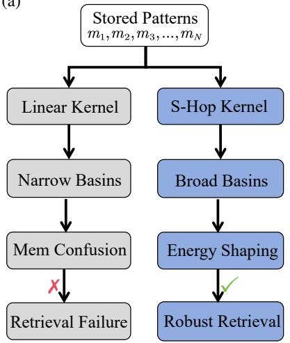

(b)  
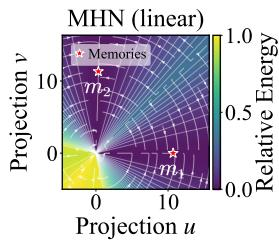  
(c)

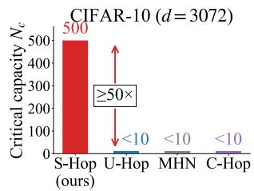

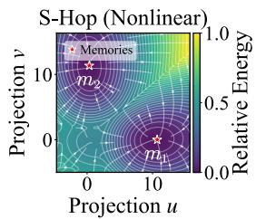

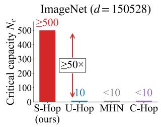  
Figure 1: Framework, energy landscape, and capacity gains of S-Hop. (a) Schematic of the energyshaping motivation for stored patterns. (b) Illustrative 2D energy contours around $m _ { 1 } , m _ { 2 } .$ , independently scaled to [0, 1] for each kernel. (c) Retrieval-load summaries on $\mathrm { C I F A R - } 1 0 ( d = 3 0 7 2 )$ and ImageNet $( 2 2 4 \times 2 2 \bar { 4 } , d = 1 5 0 5 2 8 )$ for S-Hop, U-Hop [7], MHN [1], and Cosine Hopfield Network (C-Hop). S-Hop achieves passing-load ratios of over 50 than the previous methods.

Our main contributions are:

• We introduce a class of nonlinear phase kernels for MHN. Their phase potential yields a component-wise inverse local field and an energy-derived retrieval update.

• We establish exponential storage capacity and local fixed-point convergence under explicit kernel and memory conditions. S-Hop also has monotone energy descent via CCCP.

• We quantify retrieval gains on MNIST, CIFAR-10, TinyImageNet, and ImageNet (Table 1). S-Hop supports more than 500 memories on MNIST, CIFAR-10, and ImageNet.

## 2 Related Work

Modern Hopfield Networks and Attention Associative memory models have long served as a foundational paradigm for understanding how complex systems store and retrieve structured information [8–12]. The introduction of MHN significantly advanced this field by demonstrating exponential memory capacity through polynomial and exponential interaction functions [13–17], with Lucibello and Mézard [2, 18] subsequently establishing tight asymptotic capacity bounds for this family [19]. Notably, continuous-state MHN exhibits a direct mathematical equivalence with the selfattention mechanism in Transformer architectures [1, 20–23] and with generative diffusion models via shared energy formulations [24–26], a correspondence further deepened by Rende et al. [27], who show that a single self-attention layer learns the conditionals of a generalized Potts model—a direct statistical-mechanics analogue of Hopfield energies. Santos et al. [28] further generalized this connection by formulating Hopfield-Fenchel-Young networks, revealing that sparsity and loss margins jointly govern exact single-pattern retrieval. Together, these results confirm that capacity and convergence in MHN are highly sensitive to the choice of interaction function—a sensitivity our nonlinear phase kernel framework directly exploits. Context-based retrieval [29] complements this approach by conditioning recall on auxiliary query signals.

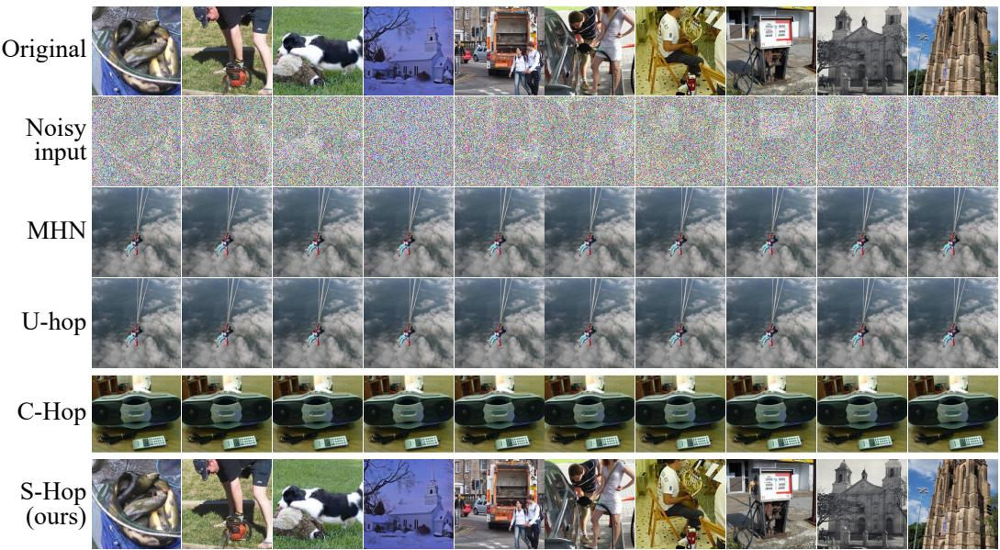  
Figure 2: Illustrative image retrieval from a shared memory bank of 500 ImageNet images. Each column shows a target image, its noisy query, and retrieval results after 20 updates $( \beta = 1 )$ without PCA or normalization. Queries are generated as $q = \mathrm { c l i p } ( | x + \epsilon | , 0 , 1 )$ with $\epsilon \sim \mathcal { N } ( 0 , I )$ . S-Hop successfully retrieves target images, while MHN, U-Hop and C-Hop converge to other stored images.

Limitations of Linear Kernels Despite the widespread success of continuous MHN, most existing variants rely on linear or polynomial kernel functions for pattern embedding. As demonstrated by Jin and Zhao [4] and Hu et al. [3], linear mappings can exhibit overlapping attractor basins at high memory loads in high-dimensional memory spaces, causing memory confusion and spurious states under load. The role of low-dimensional representations in shaping these energy landscapes is studied in [30], providing theoretical grounding for this failure mode. Recent biologically plausible approaches [31, 32] escape this bottleneck through a two-layer architecture with threshold nonlinearity, achieving capacity exponential in the number of hidden units via distributed representations. These models operate in a discrete two-layer setting without a continuous-state energy landscape or continuous-state convergence guarantees—the regime targeted by our framework.

Uniform Retrieval, Oscillatory Dynamics, and Distance-Based Variants U-Hop [7] improves the capacity ratio α by repositioning memory embeddings in a kernelized feature space, yet uses a learned linear projection, whereas S-Hop changes both the embedding and the phase-space retrieval update. Oscillator-based and input-driven dynamical models [6, 33–37] leverage continuous phase dynamics for stable retrieval, and recent work [38, 39] proves exponential capacity in honeycomb Kuramoto networks, but these paradigms operate outside the attention-equivalent energy framework. A parallel line of work [16, 34] reshapes basin geometry through distance-based overlaps rather than feature embeddings, achieving strong capacity gains via a memory-norm penalty that operates on an axis orthogonal to ours. Curved neural networks with higher-order interactions have also been introduced to enhance memory capacity and accelerate memory retrieval [40]. Our framework develops this complementary direction through separable, strongly convex phase potentials and explicit contraction conditions. These conditions support a family of nonlinear embeddings with exponential capacity and local convergence, while S-Hop additionally admits monotone energy descent.

## 3 Method

In this section, we formalize the proposed family of nonlinear phase kernels. We construct a surrogate Hopfield energy defined in phase space and derive tractable CCCP fixed-point dynamics. Here, d is the phase-space dimension and N the number of stored patterns.

## 3.1 Nonlinear Phase Kernel and Memory Patterns

We work with phase variables $\varphi \in \mathbb { R } ^ { d }$ , motivated by continuous oscillator dynamics. Each memory pattern is represented by a phase vector $\psi _ { i } \in \mathbb { R } ^ { d } \mathrm { f o r } i = 1 , \dots , N$ . We embed phases into an MHN feature space through a nonlinear map:

$$
F : \mathbb { R } ^ { d } \to \mathbb { R } ^ { D } , \qquad \xi = F ( \varphi ) ,\tag{1}
$$

and denote the embedded memories by

$$
\qquad x _ { i } : = F ( \psi _ { i } ) \in \mathbb { R } ^ { D } , \qquad X : = [ x _ { 1 } , \ldots , x _ { N } ] \in \mathbb { R } ^ { D \times N } .\tag{2}
$$

Our theoretical framework applies to a class of kernels F satisfying the smoothness and derivative bounds (Appendix A) and a structural condition that enables a tractable implicit step in phase space (Section 3.3). As a concrete instantiation, we formulate the S-Hop architecture using the kernel in (3).

$$
F ( \varphi ) = \left[ \sqrt { \varphi _ { 1 } ^ { 2 } + \operatorname { t a n h } \varphi _ { 1 } + 1 } , \sqrt { \varphi _ { 1 } ^ { 2 } + 1 } , \ldots , \sqrt { \varphi _ { d } ^ { 2 } + \operatorname { t a n h } \varphi _ { d } + 1 } , \sqrt { \varphi _ { d } ^ { 2 } + 1 } \right] ^ { \top } \in \mathbb { R } ^ { D } .\tag{3}
$$

Here, $D = 2 d ,$ , and the stored patterns are

$$
x _ { i } = F ( \psi _ { i } ) = \left[ \sqrt { \psi _ { i , 1 } ^ { 2 } + \operatorname { t a n h } \psi _ { i , 1 } + 1 } , \sqrt { \psi _ { i , 1 } ^ { 2 } + 1 } , \dots , \sqrt { \psi _ { i , d } ^ { 2 } + \operatorname { t a n h } \psi _ { i , d } + 1 } , \sqrt { \psi _ { i , d } ^ { 2 } + 1 } \right] ^ { \top } .\tag{4}
$$

This map is smooth and locally Lipschitz on any compact phase region, with a Jacobian sharing the same square-root structure used in our theoretical derivations. The analysis in Appendix A applies to kernels satisfying the stated structural and regularity conditions, of which (3) is one instance.

## 3.2 Hopfield Energy in Feature Space

Given a feature vector $\boldsymbol { \xi } \in \mathbb { R } ^ { D }$ and memory matrix X, the standard MHN energy in feature space is

$$
E _ { \mathrm { M H N } } ( \xi ) : = \frac { 1 } { 2 } \| \xi \| _ { 2 } ^ { 2 } + \frac { 1 } { \beta } \Big ( \log N + \frac { D } { 2 } \Big ) - \frac { 1 } { \beta } \log ( \beta X ^ { \top } \xi ) ,\tag{5}
$$

where $\beta > 0$ is an inverse-temperature parameter and $\textstyle \operatorname { l s e } ( z ) = \log \sum _ { i } e ^ { z _ { i } }$ denotes the log-sum-exp [1]. The logits $X ^ { \top } \xi \in \mathbb { R } ^ { N }$ induce softmax weights

$$
s ( \xi ) : = \mathrm { s o f t m a x } ( \beta X ^ { \top } \xi ) \in \Delta _ { N - 1 } ,\tag{6}
$$

where $\Delta _ { N - 1 }$ is the (N 1)-dimensional probability simplex. The constant term in (5) does not affect the dynamics but simplifies parts of the theoretical analysis. The pullback through $\xi =$ $F ( \varphi )$ introduces the Jacobian $J _ { F }$ into the phase-space update; the kernel structure below enables a component-wise implicit update.

## 3.3 Surrogate Energy in Phase Space

Directly pulling back $E _ { \mathrm { M H N } } ( \xi )$ through $\xi = F ( \varphi )$ yields

$$
\tilde { E } ( \varphi ) : = \frac { 1 } { 2 } F ( \varphi ) ^ { \top } F ( \varphi ) - \frac { 1 } { \beta } \log \left( \beta X ^ { \top } F ( \varphi ) \right) .\tag{7}
$$

For a general embedding, its regularizer gradient $J _ { F } ( \varphi ) ^ { \top } F ( \varphi )$ can couple phase coordinates. Our kernel family admits the component-wise representation:

$$
{ \frac { 1 } { 2 } } F ( \varphi ) ^ { \top } F ( \varphi ) = \sum _ { k = 1 } ^ { d } \int _ { 0 } ^ { \varphi _ { k } } h ( u ) \mathrm { d } u + C ,\tag{8}
$$

for some constant $C$ and a scalar local field $h : \mathbb { R } $ R acting component-wise. This identity decouples the implicit step across coordinates and makes the phase-space update transparent. For the S-Hop kernel, a direct calculation yields

$$
h ( \varphi _ { k } ) = 2 \varphi _ { k } + \frac { 1 } { 2 } \operatorname { s e c h } ^ { 2 } ( \varphi _ { k } ) , \qquad k = 1 , \ldots , d ,\tag{9}
$$

which is smooth and globally strictly monotone on $\mathbb { R } .$ , hence admits a component-wise inverse $h ^ { - 1 }$ The local regularizer is

$$
E _ { 1 } ( \varphi ) : = \sum _ { k = 1 } ^ { d } \int _ { 0 } ^ { \varphi _ { k } } h ( u ) \mathrm { d } u , \qquad \nabla _ { \varphi } E _ { 1 } ( \varphi ) = h ( \varphi ) ,\tag{10}
$$

with $h ( \varphi )$ understood component-wise. Appendix A (Lemma 3) shows that the quadratic kernel term

$$
Q ( \varphi ) \ = \ { \textstyle \frac { 1 } { 2 } } \| F ( \varphi ) \| _ { 2 } ^ { 2 }\tag{11}
$$

is globally µ-strongly convex, so $h = \nabla Q$ is globally µ-strongly monotone and $L _ { Q ^ { - 1 } }$ Lipschitz, supporting the contraction analysis in Appendix B. The MHN log-sum-exp interaction is

$$
E _ { 2 } ( \varphi ) : = \frac { 1 } { \beta } \log \sum _ { i = 1 } ^ { N } \exp \bigl ( \beta x _ { i } ^ { \top } \xi \bigr ) , \qquad \xi = F ( \varphi ) .\tag{12}
$$

Applying the chain rule gives [28]

$$
\nabla _ { \varphi } E _ { 2 } ( \varphi ) = R ( \varphi ) X s ( \xi ) , \qquad s ( \xi ) = \mathrm { s o f t m a x } \big ( \beta X ^ { \top } \xi \big ) ,\tag{13}
$$

where $R ( \varphi ) = J _ { F } ( \varphi ) ^ { \top }$ . The surrogate phase-space energy is $E ( \varphi ) : = E _ { 1 } ( \varphi ) - E _ { 2 } ( \varphi )$

For the S-Hop kernel, both $E _ { 1 }$ and $E _ { 2 }$ are globally strictly convex on $\mathbb { R } ^ { d }$ (Appendix A), so E admits a strict difference-of-convex decomposition and the iteration in the next subsection is a CCCP with monotone energy descent.3

## 3.4 CCCP Fixed-Point Dynamics

The gradient of the surrogate energy has the form

$$
\nabla _ { \varphi } E ( \varphi ) = h ( \varphi ) - R ( \varphi ) X s ( \xi ) , \qquad \xi = F ( \varphi ) ,\tag{14}
$$

so stationary points satisfy

$$
h ( \varphi ^ { \star } ) = R ( \varphi ^ { \star } ) X s ( \xi ^ { \star } ) , \qquad \xi ^ { \star } = F ( \varphi ^ { \star } ) .\tag{15}
$$

Treating $E _ { 1 }$ implicitly and $E _ { 2 }$ explicitly, the CCCP update for the current phase $\varphi _ { t }$ with $\xi _ { t } = F ( \varphi _ { t } )$ is defined by

$$
\nabla _ { \varphi } E _ { 1 } ( \varphi _ { t + 1 } ) = \nabla _ { \varphi } E _ { 2 } ( \varphi _ { t } ) = R ( \varphi _ { t } ) X s ( \xi _ { t } ) .\tag{16}
$$

Since $h$ is globally strictly monotone, the implicit relation can be solved independently for each coordinate:

$$
\varphi _ { t + 1 } = h ^ { - 1 } \big ( R ( \varphi _ { t } ) X s ( \xi _ { t } ) \big ) , \qquad \xi _ { t + 1 } = F ( \varphi _ { t + 1 } ) .\tag{17}
$$

For S-Hop, whose $F$ is injective, this induces a feature-space dynamical system,

$$
\xi _ { t + 1 } = T ( \xi _ { t } ) : = ( F \circ h ^ { - 1 } ) \big ( R ( \varphi _ { t } ) X s ( \xi _ { t } ) \big ) ,\tag{18}
$$

which preserves the MHN interaction structure and, for S-Hop, satisfies the monotone descent $E ( \hat { \varphi _ { t + 1 } } ) \leq E ( \varphi _ { t } )$ with equality only at stationary points (Appendix $\mathbf { A } )$

Table 1: Retrieval loads at 90% MSE < 0.1 success: one update, $\sigma = 0 . 3$ . Public avg and ImageNet entries use three-seed means. U-Hop uses a block projection at 224 224. Times amortize MNIST training over 256 queries at N = 300 ( : RTX 5090). TinyImageNet: Appendix D.4.
<table><tr><td rowspan="2">Method</td><td rowspan="2">MNIST  $2 8 \times 2 8$ </td><td rowspan="2">CIFAR-10  $3 2 \times 3 2$ </td><td colspan="2">ImageNet</td><td rowspan="2">Time (ms/q)</td></tr><tr><td> $6 4 \times 6 4$ </td><td> $2 2 4 \times 2 2 4$ </td></tr><tr><td>MHN [1]</td><td>&lt; 10</td><td>&lt; 10</td><td>&lt; 10</td><td>&lt; 10</td><td>≈0.1</td></tr><tr><td>U-Hop (max) [7]</td><td>40</td><td>&lt; 10</td><td>&lt; 10</td><td>&lt; 10</td><td>10-40</td></tr><tr><td>U-Hop (public avg)</td><td>≥ 500</td><td>60</td><td>&lt; 10</td><td>&lt; 10</td><td>1.24†</td></tr><tr><td>C-Hop</td><td>&lt; 10</td><td>&lt; 10</td><td>&lt; 10</td><td>&lt; 10</td><td>≈0.4</td></tr><tr><td>S-Hop (ours)</td><td>≥ 500</td><td>≥ 500</td><td>≥ 500</td><td>≥ 500</td><td>≈1.5</td></tr></table>

## 3.5 Theoretical Guarantees

Appendices A and B analyze the dynamics (18). Under the kernel smoothness and contraction conditions, and sufficient separation of the embedded patterns $\{ x _ { i } \} _ { i = 1 } ^ { N }$ , we establish:

• Local convergence. Around each stored phase $\psi _ { i }$ there exists an invariant ball $S _ { i }$ on which the phase-space update is a strict contraction. Each ball contains a unique fixed point; composing the convergent phase iterates with F gives convergence in feature space.

• Correct retrieval and disjoint basins. If the similarity gaps $\begin{array} { r } { \Delta _ { i } = \operatorname* { m i n } _ { j \neq i } ( x _ { i } ^ { \top } x _ { i } - x _ { i } ^ { \top } x _ { j } ) } \end{array}$ between each memory and its closest competitor satisfy the deterministic lower bound (124), the balls Si are pairwise disjoint, so each stored pattern $x _ { i }$ has a dedicated basin.

• Exponential storage capacity. For independent phase coordinates uniformly distributed on $[ - \bar { 1 } , 1 ]$ , the embedded memories $x _ { i } = F ( \psi _ { i } )$ satisfy the storage condition with probability at least $1 - \delta$ for a failure bound $\delta \in ( 0 , 1 )$ whenever

$$
2 \leq N \leq \exp ( \gamma d ) = \exp ( \gamma D / 2 ) ,\tag{19}
$$

for sufficiently large $d ,$ where $\gamma > 0$ depends on the kernel and $\beta$ (Theorem 3). Storage thus has the same exponential order in D as standard MHN [2].

## 4 Experiments

We evaluate the proposed nonlinear phase kernel framework, concretely instantiated as the S-Hop architecture, along five axes: (i) memory retrieval accuracy under increasing load, (ii) critical capacity measured by an MSE criterion, (iii) ablation of kernel and preprocessing, (iv) computational efficiency of the proposed kernel, and (v) generalization in a downstream CIFAR-10 classification task; full training curves are provided in Appendix C.

The implementation builds on the U-Hop codebase [7]. Unless otherwise stated, retrieval uses one update with $\beta = 1$ , Gaussian query noise with standard deviation $\sigma = 0 . 3$ , and success criterion $\mathrm { M S E } <$ 0.1. “Perfect retrieval” in the plots denotes success under this MSE threshold. We define the noisy critical retrieval load $N _ { c }$ as the largest tested N with over 90% success; a passing sweep endpoint gives a lower bound. Table 1 summarizes the loads. Our primary U-Hop comparison uses its public avg objective (Section 4.1); Figures 3–4 use this objective, with the max comparison retained in Table 1. Appendix D provides additional controls, and Appendix C evaluates a learned gating wrapper [41].

## 4.1 Memory Retrieval Performance and Capacity

With U-Hop’s public avg objective, a three-seed CIFAR-10 comparison at $N = 5 0 0$ gives success rates of $9 2 . \mathrm { \bar { 0 } 7 } \pm 0 . 4 2 \%$ for S-Hop, 48.40 3.83% for U-Hop, and $3 . 3 3 \pm 0 . 1 2 \%$ for MHN (mean sample standard deviation). The mean gain over U-Hop is 43.67 percentage points. All methods share memories, noisy queries, and one update, without principal component analysis (PCA) prepro cessing [42]. U-Hop last passes at 60; S-Hop passes through 500, giving a tested-load ratio of at least 8.3. Figure 34 gives raw, normalized, and matched-logit curves; Appendix D.5 specifies the objective and protocol.

Figure 3 extends the public avg comparison to ImageNet at $2 2 4 \times 2 2 4$ , averaging three seeds over $N = 1 0 , 2 0 , \dotsc , \bar { 5 } 0 0$ . S-Hop maintains at least 90% success throughout the sweep, reaching $9 8 . 5 3 \pm 0 . 1 2 \%$ at $N = 5 0 0 ;$ U-Hop reaches $4 . 6 7 \pm 0 . 1 2 \%$ at this load. The error curves show lower mean reconstruction error for S-Hop as the memory load increases. These results extend the retrieval gain to high-resolution images; normalization and matched-scale controls on CIFAR-10 isolate the contributions of feature scale and retrieval dynamics (Appendix D.1).

Further tests examine retrieval across datasets and kernel instances. MNIST $( d = 7 8 4 )$ also gives $N _ { c } \geq 5 0 0$ , and Phase Hopfield Network (P-Hop) supplies a second admissible kernel (Appendices C.1 and C.2). A centered dot-product control compares our embedding with a variant without the normpenalty mechanism of [34] (Appendix C.5). These comparisons connect retrieval performance to kernel choice and memory geometry.

(a)  
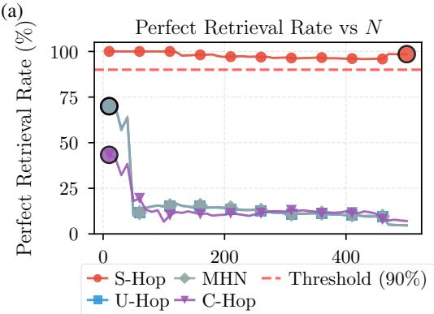  
Number of Stored Patterns (N)

(b)  
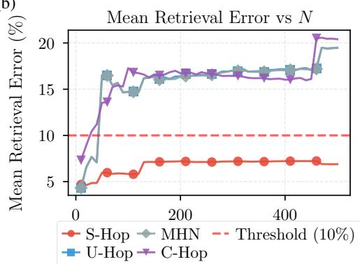  
Number of Stored Patterns (N)  
Figure 3: ImageNet retrieval at $2 2 4 \times 2 2 4$ , averaged over three seeds with U-Hop’s public avg objective. (a) $\mathrm { M S E } < 0 . 1$ success; outlined points mark first failures below 90% or passing endpoints. (b) Mean retrieval error. Shared memories and queries; one update, $\beta = 1 , \sigma = 0 . 3$ , and no PCA.

## 4.2 Critical Capacity Across Datasets

(a)  
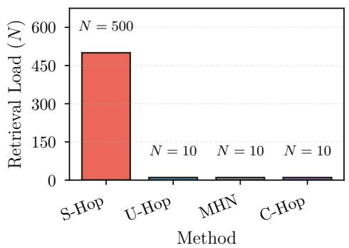

(b)  
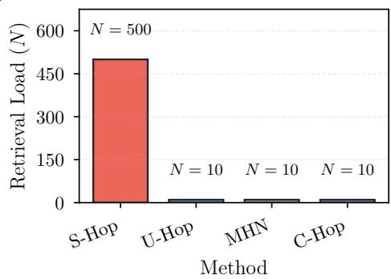  
Figure 4: ImageNet retrieval-load summaries at (a) $6 4 \times 6 4$ and (b) $2 2 4 \times 2 2 4$ , using three-seed mean success and U-Hop’s public avg objective. Bars mark passing endpoints for S-Hop $( N _ { c } \ge 5 0 0 )$ and first failures for the baselines $( N _ { c } < 1 0 )$ , under the protocol of Figure 3.

Table 1 summarizes retrieval loads on MNIST, CIFAR-10, and ImageNet. On MNIST, both S-Hop and U-Hop (public avg) pass through $N = 5 0 0$ , with U-Hop achieving $9 2 . 9 3 \pm 1 . 1 7 \%$ success at this load. On CIFAR-10, the normalized-logit sweep extends S-Hop’s passing load to 5000, compared with 870 for MHN and 880 for U-Hop (max), giving tested-load ratios of approximately 5.75 and

5.68. With matched logit scale, S-Hop achieves 91.47% success at $N = 5 0 0 .$ , compared with 3.40% for MHN and 4.40% for U-Hop (Appendix D.1). The aligned sum-of-squared-differences (SSD) criterion gives the same pattern-level success decisions as MSE < 0.1 (Figure 11).

On ImageNet, S-Hop achieves 91 $. 4 7 \pm 0 . 1 2 \%$ and $9 8 . 5 3 { \pm } 0 . 1 2 \%$ success at $N = 5 0 0$ for 64 64 and 224  224 inputs, respectively (Figure 4). Both sweeps give $N _ { c } \geq 5 0 0 .$ , versus $N _ { c } <$ 10 for U-Hop (public avg), a load advantage of over 50 . TinyImageNet’s 4 gain and selected 500-memory result are reported together in Appendix D.4.

## 4.3 Ablation of Kernel and Preprocessing

Table 2: Ablation study and protocol checks on CIFAR-10 (d = 3072). Loads are passing endpoints or first failures, identified in the final column. “ linear” denotes the linear-kernel ablation. U-Hop uses max unless indicated.
<table><tr><td>Variant</td><td>Load</td><td>Key observation</td></tr><tr><td>S-Hop (full)</td><td>≥ 500</td><td>Passing sweep endpoint</td></tr><tr><td>w/o PCA</td><td></td><td>Retrieval error increases under noise</td></tr><tr><td>P-Hop (2nd admissible kernel)</td><td>50</td><td>Below 90% success at this load</td></tr><tr><td>↓linear (w/o nonlinear kernel)</td><td>10</td><td>Below threshold at the smallest load</td></tr><tr><td>C-Hop (cosine kernel)</td><td>10</td><td>Violates strong convexity</td></tr><tr><td colspan="3">Cross-framework &amp; metric robustness</td></tr><tr><td>S-Hop (SSD metric)</td><td>≥ 500</td><td>Equivalent threshold, SSD &lt; 0.1d</td></tr><tr><td>S-Hop (legacy avg)</td><td>≥ 500</td><td>Passing endpoint in this comparison</td></tr><tr><td> $\mathbf { S } \mathbf { - } \mathbf { H o p } + \mathbf { G a t i n g }$ </td><td>≥ 500</td><td>Passing endpoint; heuristic update</td></tr><tr><td>U-Hop (legacy avg)</td><td>60</td><td>81.7% success; below threshold</td></tr><tr><td>H-Hop− (dot-product degenerate of [34])</td><td>40</td><td>Centered overlap; norm penalty removed</td></tr></table>

Table 2 summarizes the kernel and preprocessing controls. A similarity-only S-Hop variant fails the 90% criterion at $N = 1 0 .$ , while restoring the joint Jacobian/inverse-field update recovers a curve close to full S-Hop through $N = 5 0 0$ . S-Hop also outperforms the learned 2d U-Hop embedding (Figure 28). Figure 29 presents the preprocessing and noise controls, and Figures 8–9 compare the two admissible kernels.

## 4.4 Computational Efficiency Trade-Offs

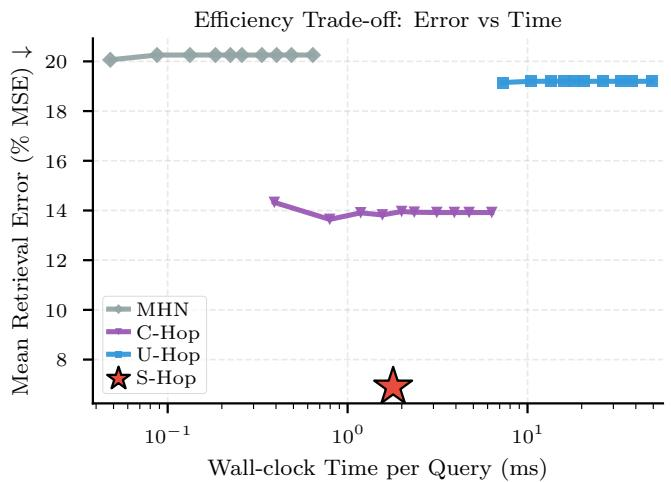  
Figure 5: Efficiency trade-off between mean retrieval error and amortized wall-clock time per query, exemplified on CIFAR-10 under the original max protocol. U-Hop training is performed once per memory set and amortized over 256 queries at N=300; S-Hop uses a training-free retrieval map.

On MNIST at $N = 3 0 0$ , S-Hop requires approximately 1.5 ms per query, compared with 0.1 ms for MHN and 10–40 ms for U-Hop (max; Figure 5). S-Hop has the lowest retrieval error in this comparison and is approximately 7–27 times faster than U-Hop when projection training is amortized over 256 queries. U-Hop trains its projection once per memory set and fixes it during retrieval; its amortized cost therefore decreases as more queries share that memory set. These measurements place S-Hop between MHN’s lower latency and U-Hop’s training overhead while improving retrieval accuracy.

## 4.5 Energy-Shaped Classification on CIFAR-10

We integrate S-Hop layers into a CIFAR-10 classifier by replacing attention-based aggregation modules; a hybrid of early S-Hop and later MHN layers achieves 90% test accuracy, approximately 0.2 percentage points above the best baseline peak in the 100-epoch run (Figure 20, Appendix C). These results extend the evaluation to supervised classification. Supplementary retrieval, gating, and multiple-instance learning (MIL) results are reported in Appendix C.

## 5 Discussion

The retrieval protocol specifies the inverse temperature $\beta$ and evaluation noise level σ. The original capacity experiments use $\beta = 1 , \sigma = 0 . 3 .$ , and one update, with success measured by $\mathrm { M S E } < 0 . 1$ One update gives a shared evaluation budget, while repeated updates connect the experiments to the convergence analysis. Appendix D.2 examines how error thresholds, identification criteria, and additional updates affect retrieval.

PCA denoising reduces input variance before storage through spectral shrinkage with regularization parameter $\sigma _ { \mathrm { P C A } } ^ { 2 } = \mathrm { 0 . 0 1 }$ . Our ablation shows improved retrieval at higher noise $( \sigma = 0 . 5 )$ without changing the phase-kernel update (Figure 16). The load–error curves in Figure 29 support preprocessing as a complementary source of robustness.

Memory geometry affects retrieval alongside input dimension. The TinyImageNet selection and target-removal controls link performance to memory separation and stored-memory information (Appendix D.4). The ImageNet resolution comparison extends this observation to two input dimensions. These results motivate representations with well-separated memories and comparable feature norms.

The scale and component controls identify contributions from both feature scale and the complete retrieval map (Figures 22 and 28). S-Hop and P-Hop share admissibility conditions but differ in their Jacobians, inverse local fields, and finite-dimensional performance (Appendix B.6). Extending these conditions to learned phase kernels could adapt retrieval to correlated data.

## 6 Conclusion

We introduced a nonlinear phase-kernel framework that reshapes both the MHN energy landscape and its retrieval dynamics. Separable strong convexity makes the inverse local field tractable, while explicit contraction and memory-separation conditions establish local convergence. The framework preserves exponential storage capacity for independent random phases, and S-Hop additionally guarantees monotone energy descent.

The experiments connect this construction to larger one-step noisy retrieval loads. S-Hop passes through 500 memories on MNIST, CIFAR-10, and ImageNet at both resolutions, while U-Hop (public avg) passes through 500 on MNIST, last passes at 60 on CIFAR-10, and falls below threshold at 10 on ImageNet. TinyImageNet, scale, and component controls connect these gains to memory separation, feature scale, and the joint Jacobian/inverse-field update. These results establish phase-kernel design as a practical means of improving dense associative retrieval with an analyzable energy model.

## 6.1 Limitations

The capacity theorem assumes independent, uniformly distributed phases, whereas natural images have correlated pixels and uneven feature norms. The original TinyImageNet subset contains visually similar goldfish images with lower average brightness than the selected subset and has a retrieval-load threshold of 40. Selecting better-separated memories with comparable feature norms raises the passing load to over 500 at the same resolution (Appendix D.4). This improvement motivates extending the theory to correlated image distributions and evaluating independently sampled memory sets. Stricter retrieval criteria, separate Jacobian and inverse-field ablations, energy-based gating, and faster kernel evaluation provide further routes to robust and efficient associative memory (Appendix D.6).

## Acknowledgments and Disclosure of Funding

We thank Hong Zhao and Tailin Wu for discussions. This work is supported by Projects 12322501, 12575035 of the National Natural Science Foundation of China, and 2026NSFSCZY0124 of the Natural Science Foundation of Sichuan Province.

## References

[1] Hubert Ramsauer, Bernhard Schäfl, Johannes Lehner, Philipp Seidl, Michael Widrich, Lukas Gruber, Markus Holzleitner, Thomas Adler, David Kreil, Michael K Kopp, Günter Klambauer, Johannes Brandstetter, and Sepp Hochreiter. Hopfield networks is all you need. In Proc. Int. Conf. Learn. Represent., 2021. URL https://openreview.net/forum?id=tL89RnzIiCd.

[2] Carlo Lucibello and Marc Mézard. Exponential capacity of dense associative memories. Phys. Rev. Lett., 132(7):077301, 2024. URL https://doi.org/10.1103/PhysRevLett. 132.077301.

[3] Jerry Yao-Chieh Hu, Donglin Yang, Dennis Wu, Chenwei Xu, Bo-Yu Chen, and Han Liu. On sparse modern Hopfield model. In Adv. Neural Inf. Process. Syst., volume 36, pages 27594–27608, 2023. URL https://proceedings.neurips.cc/paper\_files/paper/ 2023/hash/57bc0a850255e2041341bf74c7e2b9fa-Abstract-Conference.html.

[4] Tao Jin and Hong Zhao. Pattern recognition using asymmetric attractor neural networks. Phys. Rev. E, 72(6):066111, 2005. URL https://doi.org/10.1103/PhysRevE.72.066111.

[5] Saul Santos, Nuno Gonçalves, Daniel C. McNamee, Marcos Vinicius Treviso, and André F. T. Martins. Sparse associative memories through the lens of compact kernel regression. In Workshop on New Frontiers in Associative Memories (NFAM) at ICLR 2026, 2026. URL https://openreview.net/forum?id=8AGVhVFKsk.

[6] Takashi Nishikawa, Ying-Cheng Lai, and Frank C Hoppensteadt. Capacity of oscillatory associative-memory networks with error-free retrieval. Phys. Rev. Lett., 92(10):108101, 2004. URL https://doi.org/10.1103/PhysRevLett.92.108101.

[7] Dennis Wu, Jerry Yao-Chieh Hu, Teng-Yun Hsiao, and Han Liu. Uniform memory retrieval with larger capacity for modern Hopfield models. In Proc. Int. Conf. Mach. Learn., volume 235 of Proc. Mach. Learn. Res., pages 53282–53314. PMLR, 21–27 Jul 2024. URL https: //proceedings.mlr.press/v235/wu24i.html.

[8] SG Hu, Y Liu, Z Liu, TP Chen, JJ Wang, Q Yu, LJ Deng, Y Yin, and Sumio Hosaka. Associative memory realized by a reconfigurable memristive hopfield neural network. Nat. Commun., 6(1): 7522, 2015. URL https://doi.org/10.1038/ncomms8522.

[9] John J Hopfield. Neural networks and physical systems with emergent collective computational abilities. Proc. Natl. Acad. Sci. U.S.A., 79(8):2554–2558, 1982. URL https://doi.org/10. 1073/pnas.79.8.2554.

[10] Dmitry Krotov, Benjamin Hoover, Parikshit Ram, and Bao Pham. Modern methods in associative memory, 2025. URL https://icml.cc/virtual/2025/tutorial/40004. Tutorial presented at ICML 2025.

[11] Miquel Noguer i Alonso. John hopfield’s contributions to neural networks: A detailed mathematical exploration. SSRN Electron. J., 2024. URL https://doi.org/10.2139/ssrn.4980016.

[12] Dmitry Krotov. A new frontier for Hopfield networks. Nat. Rev. Phys., 5(7):366–367, 2023. doi: 10.1038/s42254-023-00595-y. URL https://www.nature.com/articles/ s42254-023-00595-y.

[13] Dmitry Krotov and John J Hopfield. Dense associative memory for pattern recognition. In Adv. Neural Inf. Process. Syst., volume 29, 2016. URL https://proceedings.neurips.cc/ paper\_files/paper/2016/hash/eaae339c4d89fc102edd9dbdb6a28915-Abstract. html.

[14] Dmitry Krotov and John J Hopfield. Large associative memory problem in neurobiology and machine learning. In Proc. Int. Conf. Learn. Represent., 2021. URL https://openreview. net/forum?id=X4y\_10OX-hX.

[15] Mete Demircigil, Judith Heusel, Matthias Löwe, Sven Upgang, and Franck Vermet. On a model of associative memory with huge storage capacity. J. Stat. Phys., 168(2):288–299, 2017. URL https://doi.org/10.1007/s10955-017-1806-y.

[16] Benjamin Hoover, Zhaoyang Shi, Krishnakumar Balasubramanian, Dmitry Krotov, and Parikshit Ram. Dense associative memory with Epanechnikov energy. In Adv. Neural Inf. Process. Syst., volume 38, 2025. URL https://openreview.net/forum?id=ZbQ5Zq3zA3. Spotlight.

[17] Hamza Tahir Chaudhry, Jacob A. Zavatone-Veth, Dmitry Krotov, and Cengiz Pehlevan. Long sequence Hopfield memory. In Adv. Neural Inf. Process. Syst., volume 36, pages 54300–54340, 2023. URL https://proceedings.neurips.cc/paper\_files/paper/ 2023/hash/aa32ebcdd2ce1bed4ef7f456fc8fa5c1-Abstract-Conference.html.

[18] Matteo Negri, Clarissa Lauditi, Gabriele Perugini, Carlo Lucibello, and Enrico Malatesta. Storage and learning phase transitions in the random-features Hopfield model. Phys. Rev. Lett., 131(25):257301, 2023. URL https://doi.org/10.1103/PhysRevLett.131.257301.

[19] Jerry Yao-Chieh Hu, Dennis Wu, and Han Liu. Provably optimal memory capacity for modern Hopfield models: Transformer-compatible dense associative memories as spherical codes. In Adv. Neural Inf. Process. Syst., volume 37, pages 70693– 70729, 2024. URL https://proceedings.neurips.cc/paper\_files/paper/2024/ hash/82846e19e6d42ebfd4ace4361def29ae-Abstract-Conference.html.

[20] Benjamin Hoover, Yuchen Liang, Bao Pham, Rameswar Panda, Hendrik Strobelt, Duen Horng Chau, Mohammed J. Zaki, and Dmitry Krotov. Energy transformer. In Adv. Neural Inf. Process. Syst., volume 36, pages 27532–27559. Curran Associates, Inc., 2023. doi: 10.52202/075280-1197. URL https://proceedings.neurips.cc/paper\_files/paper/ 2023/hash/57a9b97477b67936298489e3c1417b0a-Abstract-Conference.html.

[21] Matthew Smart, Alberto Bietti, and Anirvan M. Sengupta. In-context denoising with one-layer transformers: Connections between attention and associative memory retrieval. In Proc. Int. Conf. Mach. Learn., volume 267 of Proc. Mach. Learn. Res., pages 55950–55971. PMLR, 13–19 Jul 2025. URL https://proceedings.mlr.press/v267/smart25a.html.

[22] Rasmus Høier, Tugdual Kerjan, and Benjamin Scellier. Training a convergent energy transformer with equilibrium propagation. In Workshop on New Frontiers in Associative Memories (NFAM) at ICLR 2026, 2026. URL https://openreview.net/forum?id=Qrfml76eWJ.

[23] Alexi Gladstone, Ganesh Nanduru, Md Mofijul Islam, Peixuan Han, Hyeonjeong Ha, Aman Chadha, Yilun Du, Heng Ji, Jundong Li, and Tariq Iqbal. Energy-based transformers are scalable learners and thinkers. In Proc. Int. Conf. Learn. Represent., 2026. URL https: //openreview.net/forum?id=ZBj3Qp1bYg.

[24] Luca Ambrogioni. In search of dispersed memories: Generative diffusion models are associative memory networks. Entropy, 26(5):381, 2024. URL https://doi.org/10.3390/e26050381.

[25] Adrian Rodriguez, Benjamin Hoover, Yunhui Guo, and Yilun Du. Generative associative memory via equilibrium matching. In Workshop on New Frontiers in Associative Memories (NFAM) at ICLR 2026, 2026. URL https://openreview.net/forum?id=4zjhUaeeVh.

[26] Bao Pham, Gabriel Raya, Matteo Negri, Mohammed J. Zaki, Luca Ambrogioni, and Dmitry Krotov. Memorization to generalization: Emergence of diffusion models from associative memory networks. In Workshop on New Frontiers in Associative Memories (NFAM) at ICLR 2025, 2025. URL https://openreview.net/forum?id=IWZnhP3YgK.

[27] Riccardo Rende, Federica Gerace, Alessandro Laio, and Sebastian Goldt. Mapping of attention mechanisms to a generalized Potts model. Phys. Rev. Res., 6(2):023057, 2024. URL https: //doi.org/10.1103/PhysRevResearch.6.023057.

[28] Saul Santos, Vlad Niculae, Daniel McNamee, and André FT Martins. Hopfield-fenchel-young networks: A unified framework for associative memory retrieval. J. Mach. Learn. Res., 26(265): 1–51, 2025. URL https://jmlr.org/papers/v26/24-1961.html.

[29] Moulik Choraria, Argyrios Gerogiannis, Vidhata Jayaraman, Ankur Mani, and Lav R. Varshney. Towards context-based retrieval in associative memories. In Workshop on New Frontiers in Associative Memories (NFAM) at ICLR 2026, 2026. URL https://openreview.net/ forum?id=BuiIBO4Mmr.

[30] David Lipshutz. On low-dimensional representations and associative memory energy functions. In Workshop on New Frontiers in Associative Memories (NFAM) at ICLR 2026, 2026. URL https://openreview.net/forum?id=9fvoOb0BOB.

[31] Mohadeseh Shafiei Kafraj, Dmitry Krotov, and Peter E. Latham. A biologically plausible dense associative memory with exponential capacity. In Proc. Int. Conf. Learn. Represent., 2026. URL https://openreview.net/forum?id=mRZOayQL1i.

[32] Leo Kozachkov, Jean-Jacques Slotine, and Dmitry Krotov. Neuron–astrocyte associative memory. Proc. Natl. Acad. Sci. U.S.A., 122(21):e2417788122, 2025. URL https://doi.org/ 10.1073/pnas.2417788122.

[33] Simone Betteti, Giacomo Baggio, Francesco Bullo, and Sandro Zampieri. Input-driven dynamics for robust memory retrieval in Hopfield networks. Sci. Adv., 11(17):eadu6991, 2025. URL https://doi.org/10.1126/sciadv.adu6991.

[34] Benjamin Hoover, Duen Horng Chau, Hendrik Strobelt, Parikshit Ram, and Dmitry Krotov. Dense associative memory through the lens of random features. In Adv. Neural Inf. Process. Syst., volume 37, pages 23549–23576, 2024. URL https://proceedings.neurips.cc/paper\_files/paper/2024/hash/ 29ff36c8fbed10819b2e50267862a52a-Abstract-Conference.html.

[35] Takeru Miyato, Sindy Löwe, Andreas Geiger, and Max Welling. Artificial kuramoto oscillatory neurons. In Proc. Int. Conf. Learn. Represent., 2025. URL https://openreview.net/ forum?id=nwDRD4AMoN.

[36] Takashi Nishikawa, Frank C Hoppensteadt, and Ying-Cheng Lai. Oscillatory associative memory network with perfect retrieval. Phys. D: Nonlinear Phenom., 197(1-2):134–148, 2004. URL https://doi.org/10.1016/j.physd.2004.06.011.

[37] Qingshan Wang, Clara C Wanjura, and Florian Marquardt. Training coupled phase oscillators as a neuromorphic platform using equilibrium propagation. Neuromorph. Comput. Eng., 4(3): 034014, 2024. URL https://doi.org/10.1088/2634-4386/ad752b.

[38] Taosha Guo, Arie Ogranovich, Arvind R Venkatakrishnan, Madelyn R Shapiro, Francesco Bullo, and Fabio Pasqualetti. Oscillatory associative memory with exponential capacity. In Proc. IEEE Conf. Decis. Control, pages 986–991, 2025. URL https://ieeexplore.ieee. org/document/11312859.

[39] Arie Ogranovich, Taosha Guo, Arvind R. Venkatakrishnan, Madelyn Shapiro, Francesco Bullo, and Fabio Pasqualetti. Oscillator-based associative memory with exponential capacity: Theory, algorithms, and hardware implementation. arXiv preprint arXiv:2604.01469, 2026. URL https://arxiv.org/abs/2604.01469.

[40] Miguel Aguilera, Pablo A Morales, Fernando E Rosas, and Hideaki Shimazaki. Explosive neural networks via higher-order interactions in curved statistical manifolds. Nat. Commun., 16 (1):6511, 2025. URL https://www.nature.com/articles/s41467-025-61475-w.

[41] Zihan Qiu, Zekun Wang, Bo Zheng, Zeyu Huang, Kaiyue Wen, Songlin Yang, Rui Men, Le Yu, Fei Huang, Suozhi Huang, Dayiheng Liu, Jingren Zhou, and Junyang Lin. Gated attention for large language models: Non-linearity, sparsity, and attention-sink-free. In Adv. Neural Inf. Process. Syst., 2025. URL https://openreview.net/forum?id=1b7whO4SfY.

[42] Yann Le Cun, Ido Kanter, and Sara A Solla. Eigenvalues of covariance matrices: Application to neural-network learning. Phys. Rev. Lett., 66(18):2396, 1991. URL https://doi.org/10. 1103/PhysRevLett.66.2396.

[43] Hirohiko Shima. The Geometry ofHessian Structures. World Scientific, 2007. URL https: //www.worldscientific.com/worldscibooks/10.1142/6241.

[44] Shun-ichi Amari and Hiroshi Nagaoka. Methods of Information Geometry, volume 191 of Translations of Mathematical Monographs. American Mathematical Society, 2000. URL https://bookstore.ams.org/mmono-191.

[45] R. Tyrrell Rockafellar. Convex Analysis. Princeton University Press, 1970. URL https: //press.princeton.edu/books/paperback/9780691015866/convex-analysis.

[46] Wassily Hoeffding. Probability inequalities for sums of bounded random variables. J. Am. Stat. Assoc., 58(301):13–30, 1963. doi: 10.1080/01621459.1963.10500830. URL https: //doi.org/10.1080/01621459.1963.10500830.

## Appendix

A Theoretical Framework: Regularity, Convexity, and Energy Descent 15   
A.1 Notation Table 15   
A.2 Kernel Family Viewpoint 17   
A.3 Verification of the CCCP Structural Identity 19   
A.4 Regularity of the Kernel and Dynamics 20   
A.5 Strong Convexity of the Local Phase Potential 20   
A.6 Gradient of the Log-Sum-Exp Term 22   
A.7 Global Strict Convexity of E for S-Hop 22   
A.8 Strict CCCP Descent for S-Hop 25   
B Convergence, Storage Capacity, and Instantiation Comparison 26   
B.1 Local Approximation at a Stored Pattern 26   
B.2 Invariant Balls and Margin Conditions 27   
B.3 Jacobian Bounds and Contraction 29   
B.4 Correct Storage and Separation of Basins 34   
B.5 Exponential Storage Capacity . 35   
B.6 Theoretical Comparison of P-Hop and S-Hop Instantiations 36   
C Additional Numerical Results 37   
C.1 MNIST Retrieval and Capacity 38   
C.2 Framework-Level Validation: A Second Kernel Instance 39   
C.3 Robustness Under the U-Hop SSD Metric 40   
C.4 Alternative U-Hop Evaluation Protocol (Avg vs. Max) 41   
C.5 Comparison with a Centered Dot-Product Control . 42   
C.6 Extended Ablations and Diagnostics 43   
C.7 Gating Wrapper: Additional Retrieval Gains 43   
C.8 Additional Generalization: MIL 45   
C.9 Energy-Shaped Classification on CIFAR-10 45   
D Additional Retrieval Analyses 46   
D.1 Scale, Centering, and Minimum-Margin Controls 46   
D.2 Retrieval Criteria and Multiple Updates 49   
D.3 Similarity, Dynamics, Dimension, and Preprocessing 53   
D.4 Cross-Dataset Separation and ImageNet 54   
D.5 Public Average-Separation Baseline and Training Diagnostics 57   
D.6 Empirical Findings and Future Directions 58

## A Theoretical Framework: Regularity, Convexity, and Energy Descent

This part develops the structural foundations of the nonlinear phase kernel family. We introduce the notation (Appendix A.1) and the Hessian-geometric viewpoint (Appendix A.2), verify the CCCP decoupling identity (Appendix A.3), and establish the regularity and global strong convexity of the local phase potential (Appendices $\mathbf { A . 4 \mathrm { - } A . 6 } )$ . For the S-Hop instantiation, we additionally prove global strict convexity of the interaction term (Appendix A.7) and derive the monotone CCCP energy descent guarantee (Appendix $_ { \mathrm { A . 8 , } }$ Theorem 2). These structural results underpin the contraction and storage-capacity analysis in Appendix B.

## A.1 Notation Table

Tables 3 and 4 summarize the model, proof, and experimental notation.

Table 3: Key mathematical notation.
<table><tr><td>Notation</td><td>Description</td></tr><tr><td colspan="2">Dimensions and Constants</td></tr><tr><td> $d$ </td><td>Phase-space dimension.</td></tr><tr><td> $_ \alpha$ </td><td>Capacity ratio,  $N _ { c } / d .$ </td></tr><tr><td> $D$ </td><td>Feature-space dimension;  $D = 2 d$  for S-Hop.</td></tr><tr><td> $N$ </td><td>Number of stored memories.</td></tr><tr><td> $N _ { c }$ </td><td>Largest tested load with  $\geq 9 0 \%$  success at  $\mathrm { M S E } < 0 . 1 .$ </td></tr><tr><td> $\beta$ </td><td>Softmax inverse temperature.</td></tr><tr><td colspan="2">State Variables and Memory Patterns</td></tr><tr><td> $\varphi , \psi _ { i }$ </td><td>Phase state and phase of memory i, in  $\mathbb { R } ^ { d } .$ </td></tr><tr><td> $\xi$ </td><td>Embedded state in  $\mathbb { R } ^ { D } .$ </td></tr><tr><td> $x _ { i }$ </td><td>Embedded memory,  $x _ { i } = F ( \psi _ { i } ) \in \mathbb { R } ^ { D } .$ </td></tr><tr><td> $X$ </td><td>Memory matrix,  $[ x _ { 1 } , \dots , x _ { N } ] \in \mathbb { R } ^ { D \times N }$ </td></tr><tr><td> $s ( \xi )$ </td><td>Attention weights, softmax  $( \beta X ^ { \top } \xi )$ </td></tr><tr><td colspan="2">Functions and Energy Terms</td></tr><tr><td> $F$ </td><td>Phase kernel,  $F : \mathbb { R } ^ { d }  \mathbb { R } ^ { D }$ </td></tr><tr><td> $J _ { F } ( \varphi )$ </td><td>Jacobian of  $F .$ </td></tr><tr><td> $R ( \varphi )$ </td><td>Transposed Jacobian,  $J _ { F } ( \varphi ) ^ { \top }$ </td></tr><tr><td> $E _ { \mathrm { M H N } } ( \boldsymbol { \xi } )$ </td><td>Standard MHN energy in feature space.</td></tr><tr><td> $\tilde { E } ( \varphi )$ </td><td>Surrogate Hopfield energy in phase space.</td></tr><tr><td> $E _ { 1 } ( \varphi ) , E _ { 2 } ( \varphi )$ </td><td>Local regularizer and interaction energy.</td></tr><tr><td> $E ( \varphi )$ </td><td>Dynamical energy,  $E _ { 1 } ( \varphi ) - E _ { 2 } ( \varphi )$ </td></tr><tr><td> $Q ( \varphi )$ </td><td>Phase potential,  ${ \frac { 1 } { 2 } } \| F ( \varphi ) \| _ { 2 } ^ { 2 } .$ </td></tr><tr><td> $h ( \varphi )$ </td><td>Component-wise local field,  $\nabla Q ( \varphi )$ </td></tr><tr><td> $_ T$ </td><td>Feature-space fixed-point update.</td></tr><tr><td colspan="2">Theoretical Bounds and Geometry</td></tr><tr><td> $S _ { i }$ </td><td>Invariant phase-space ball centered at  $\psi _ { i }$ </td></tr><tr><td> $\Delta _ { i } , \Delta _ { \mathrm { m i n } }$ </td><td>Memory margin, min  ${ \bf \Phi } _ { j \neq i } x _ { i } ^ { \top }$  (xi −  $x _ { j } ) ;$  mini  $\Delta _ { i } .$ </td></tr><tr><td> $\Delta _ { i } ^ { \mathrm { e f f } } ( \xi )$ </td><td>State-dependent margin, min  $_ { j \neq i } \xi ^ { \top } ( x _ { i } - x _ { j } )$ </td></tr><tr><td> $\Delta _ { \mathrm { s t o r e } } ( N )$ </td><td>Margin threshold for correct storage.</td></tr><tr><td> $\mu , L _ { Q }$ </td><td>Strong-convexity and gradient-Lipschitz constants of</td></tr><tr><td> $\kappa$ </td><td> $Q .$  Hessian-metric condition number,  $L _ { Q } / \mu .$ </td></tr><tr><td> $\rho _ { 0 }$ </td><td>Kernel structural bound; admissibility requires  $\rho _ { 0 } < 1$ </td></tr><tr><td> $\boldsymbol { L } _ { q ^ { \prime \prime } }$ </td><td>Lipschitz constant of  $\cdot q ^ { \prime \prime }$ </td></tr><tr><td> $L _ { 2 }$ </td><td>Bound on  $| f _ { 1 } ^ { \prime \prime } |$  and  $| f _ { 2 } ^ { \prime \prime } |$  over the phase region.</td></tr><tr><td> $\delta$ </td><td>Storage-failure probability bound,  $0 < \delta < 1 .$ </td></tr><tr><td> $M$ </td><td>Common state and memory norm bound,  $\operatorname { E q . } ( 3 7 ) .$ </td></tr><tr><td> $L _ { F } , L _ { \mathrm { m a x } }$ </td><td>Lipschitz bound for  $h ^ { - 1 } , F \circ h ^ { - 1 }$  ; uniform derivative bound.</td></tr><tr><td> $v , B$ </td><td>Scalar-feature variance; coordinate-margin bound, Eqs. (126)–(127).</td></tr><tr><td> $\gamma$ </td><td>Capacity exponent in  $N \leq \exp ( \gamma d )$  , Eq. (129).</td></tr></table>

Table 4: Additional notation for geometry, proofs, and experiments.
<table><tr><td>Notation</td><td>Description</td></tr><tr><td colspan="2">Indices, Operators, and Kernel Geometry</td></tr><tr><td> $i , j ; k , a , b ; \ell$ </td><td>Memory, coordinate, and scalar-feature indices  $( \ell = 1 , 2 ) .$ </td></tr><tr><td> $t ; \varphi _ { t } , \xi _ { t }$ </td><td>Iteration index and iterates; t also denotes a scalar argument.</td></tr><tr><td> $I , I _ { d } ; \mathrm { i d }$ </td><td>Identity matrix (size d for  $I _ { d } ) ;$  identity map.</td></tr><tr><td> $\| \cdot \| _ { 2 } , \| \cdot \| _ { \infty }$ </td><td>Euclidean/spectral norm; maximum absolute value or supremum.</td></tr><tr><td> $\langle \cdot , \cdot \rangle , \preceq$ </td><td>Euclidean inner product; positive-semidefinite matrix order.</td></tr><tr><td> $\nabla , \nabla ^ { 2 } , J$ </td><td>Gradient, Hessian, and Jacobian; primes denote scalar derivatives.</td></tr><tr><td> $\mathrm { l s e } , z , \Delta _ { N - 1 }$ </td><td>Log-sum-exp, logit vector, and probability simplex.</td></tr><tr><td>tanh, sech, arctanh</td><td>Hyperbolic tangent, hyperbolic secant, and inverse hyperbolic tangent.</td></tr><tr><td> $f _ { 1 } , f _ { 2 } ; q , C$ </td><td>Scalar features; potential and constant in  $\begin{array} { r } { Q = \sum _ { k } q ( \varphi _ { k } ) + C . } \end{array}$ </td></tr><tr><td> $g _ { 1 } , g _ { 2 }$ </td><td>S-Hop radicands,  $t ^ { 2 }$  + tanh  $. t + 1$  and  $t ^ { 2 } + 1 .$ </td></tr><tr><td> $g ( t )$ </td><td>Auxiliary function, tanh t  $\operatorname { s e c h } ^ { 2 } t .$ </td></tr><tr><td> $N ( t )$ </td><td>Scalar convexity numerator,  $2 g _ { 1 } g _ { 1 } ^ { \prime \prime } - ( g _ { 1 } ^ { \prime } ) ^ { 2 } .$ </td></tr><tr><td> $t ^ { * } ; T = - t$ </td><td>Stationary point arctanh  $( 1 / \sqrt { 3 } )$  negative-tail variable.</td></tr><tr><td> $c _ { k }$ </td><td>Weighted feature coordinate,  $\begin{array} { r } { \sum _ { i } x _ { i , k } s _ { i } ( { \xi } ) . } \end{array}$ </td></tr><tr><td> $g _ { Q } , g _ { Q ^ { * } } ; Q ^ { * }$ </td><td>Hessian metrics; Fenchel conjugate of  $Q .$ </td></tr><tr><td> $T _ { \varphi } \mathbb { R } ^ { d }$ </td><td>Tangent space at  $\varphi .$ </td></tr><tr><td> $u , v , w$ </td><td>Local tangent/dual vectors or scalar integration variables</td></tr><tr><td>dh;  $D _ { Q }$ </td><td>Differential of  $h ;$  Bregman divergence generated by  $Q .$ </td></tr><tr><td colspan="2">Local Dynamics and Capacity Proofs</td></tr><tr><td> $U$ </td><td>Compact convex region containing stored phases and invariant balls.</td></tr><tr><td> $\Phi , J _ { \Phi }$ </td><td>Phase update  $h ^ { - 1 } ( R X s ( F ( \varphi ) ) )$  and its Jacobian.</td></tr><tr><td> $\varphi ^ { \star } , \xi ^ { \star }$ </td><td>Stationary phase and feature states.</td></tr><tr><td> $\varphi _ { i } ^ { \star } , \xi _ { i } ^ { \star }$ </td><td>Attracting fixed point in  $S _ { i }$  and its image  $F ( \varphi _ { i } ^ { \star } ) .$ </td></tr><tr><td> $r , \tilde { r }$ </td><td>Distances from the current or intermediate phase point to  $\psi _ { i }$ </td></tr><tr><td> $\tilde { \varphi } , \tilde { \xi }$ </td><td>Intermediate phase point and its feature image.</td></tr><tr><td> $\varepsilon _ { 0 }$ </td><td>Stored-pattern softmax leakage bound,  $( N - 1 ) e ^ { - \beta \Delta _ { i } } .$ </td></tr><tr><td> $\varepsilon , \hat { \varepsilon }$ </td><td>Upper bounds on softmax leakage  $1 - s _ { i }$ </td></tr><tr><td>ρ</td><td>Uniform contraction factor on an invariant ball,  $0 < \rho < 1 .$ </td></tr><tr><td> $C _ { \varepsilon } , C _ { r }$ </td><td>Leakage and displacement coefficients,  $\mathbb { E } { \mathsf { q . } } ( 1 0 3 ) .$ </td></tr><tr><td> $C _ { \varepsilon } ^ { \prime } , C _ { r } ^ { \prime } ; C _ { \varepsilon } ^ { \mathrm { ( s o f t ) } }$ </td><td>Perturbation bounds; softmax contribution to  $C _ { \varepsilon } .$ </td></tr><tr><td> $\bar { N _ { 0 } } , \bar { N _ { 0 } ^ { \mathrm { i n v } } } , \bar { N _ { 0 } ^ { \mathrm { s t o r e } } }$ </td><td>Load thresholds for contraction, invariance, and correct storage.</td></tr><tr><td> $y _ { j }$ </td><td>Transformed memory,  $R ( \psi _ { i } ) x _ { j } .$ </td></tr><tr><td> $w ( \varphi ) , m$ </td><td>Local-field input  $R ( \varphi ) X s ( F ( \varphi ) ) \mathrm { ; }$  weighted memory  $X s ( \xi ) .$ </td></tr><tr><td> $A , J _ { s }$ </td><td>Softmax covariance  $\mathrm { d i a g } ( s ) - s s ^ { \top }$  and Jacobian  $\beta A .$ </td></tr><tr><td> $\Delta R$ </td><td>Derivative of  $R ( \varphi ) X \varepsilon$  with s held fixed.</td></tr><tr><td>η</td><td>Feature residual,  $X s ( F ( \varphi ) ) - F ( \varphi )$ </td></tr><tr><td> $\Delta _ { i j } , Y _ { i j , k }$ </td><td>Directed gap  $x _ { i } ^ { \top } ( x _ { i } - x _ { j } )$  and coordinate-k contribution.</td></tr><tr><td>m in  $\bar { M } = m \sqrt { d } ; C _ { 0 }$ </td><td>Norm coefficient; storage-threshold growth constant.</td></tr><tr><td> $\mathbb { P } , \mathbb { E } , \mathrm { V a r }$ </td><td>Probability, expectation, and variance.</td></tr><tr><td> $O ( \cdot ) , o ( \cdot )$ </td><td>Asymptotic upper-order and vanishing relative-order notation.</td></tr><tr><td colspan="2">Retrieval, Preprocessing, and Diagnostic Quantities</td></tr><tr><td> $m _ { i } ; u , v ~ \mathrm { ( F i g u r e ~ 1 ) }$ </td><td>Illustrative memories; orthonormal memory-plane directions.</td></tr><tr><td>σ</td><td>Standard deviation of Gaussian query noise.</td></tr><tr><td> $\psi , \hat { \psi } ; \psi _ { k } , \hat { \psi } _ { k }$ </td><td>Target, retrieved output, and their pixel coordinates.</td></tr><tr><td> $\mathrm { M S E } , \mathrm { S S D }$ </td><td>Mean squared error and squared-difference sum;  $\mathrm { S S D } = d \mathrm { M S E } .$ </td></tr><tr><td>clamp; cos</td><td>Coordinate-wise clipping; cosine similarity.</td></tr><tr><td> $\sigma _ { \mathrm { P C A } } ^ { 2 } , \lambda _ { k }$ </td><td>PCA shrinkage regularizer and memory-covariance eigenvalue.</td></tr><tr><td> $\Psi , \varphi ^ { + }$ </td><td>Raw memory matrix  $[ \psi _ { 1 } , \dots , \psi _ { N } ]$  and next phase state.</td></tr><tr><td> ${ \bar { \psi } } , { \overline { { F ( \psi ) } } }$ </td><td>Mean raw and embedded memories in centering controls.</td></tr><tr><td> $x , \xi _ { j } , \bar { \xi } ( \mathrm { A p p e n d i x } \mathbf { C } . 5 )$ </td><td>Query, memory, and memory mean; tildes denote centered values.</td></tr><tr><td> $W , u _ { i }$ </td><td>U-Hop projection and normalized memory  $W \psi _ { i } / \| W \psi _ { i } \|$  2.</td></tr><tr><td> $m , q ; x _ { m , i } , q _ { m }$ </td><td>Method, query, and their indexed features in scale controls.</td></tr><tr><td> $z _ { m , i } , z _ { m , i } ^ { \mathrm { n o r m } }$ </td><td>Raw and normalized scores for method m and memory i.</td></tr><tr><td> $H , \sigma _ { z }$ </td><td>Softmax entropy (nats); mean within-query logit standard deviation.</td></tr><tr><td> $\sigma _ { m } , a _ { m }$ </td><td>Mean logit spread; scale multiplier  $\sigma _ { \mathrm { M H N } } / \sigma _ { m } .$ </td></tr><tr><td> $\Delta _ { \operatorname* { m i n } , m }$ </td><td>Minimum directed feature gap for method  $m .$ </td></tr><tr><td> $\mathrm { S t d } , \mathrm { m e a n }$ </td><td>Standard deviation and arithmetic mean.</td></tr></table>

We analyze the feature-space fixed-point iteration from the main text:

$$
\xi _ { t + 1 } = T ( \xi _ { t } ) : = \big ( F \circ h ^ { - 1 } \big ) \big ( R ( \varphi _ { t } ) X s ( \xi _ { t } ) \big ) , \qquad s ( \xi ) = \mathrm { s o f t m a x } ( \beta X ^ { \top } \xi ) ,\tag{20}
$$

with $\xi _ { t } = F ( \varphi _ { t } )$ and $R ( \varphi ) = J _ { F } ( \varphi ) ^ { \top }$

The nonlinear phase kernel is

$$
F ( \varphi ) = \left[ \sqrt { \varphi _ { 1 } ^ { 2 } + \operatorname { t a n h } \varphi _ { 1 } + 1 } , \sqrt { \varphi _ { 1 } ^ { 2 } + 1 } , . . . , \sqrt { \varphi _ { d } ^ { 2 } + \operatorname { t a n h } \varphi _ { d } + 1 } , \sqrt { \varphi _ { d } ^ { 2 } + 1 } \right] ^ { \top } ,\tag{21}
$$

so that the feature-space dimension is $D = 2 d .$ . Stored patterns are $x _ { i } = F ( \psi _ { i } )$ , and $R ( \varphi ) = J _ { F } ( \varphi ) ^ { \top }$ has the same square-root structure. All boundedness and Lipschitz conditions required in the analysis will follow from the explicit kernel above together with the global properties of the local field in Lemma 3 below.

## A.2 Kernel Family Viewpoint

Although we work throughout with the explicit kernel (21) for concreteness, the arguments in this appendix are not specific to the hyperbolic-tangent instance. More generally, the phase-space analysis applies to smooth coordinate-wise kernels $F : \mathbb { R } ^ { d }  \mathbb { R } ^ { 2 d }$ with $F _ { 2 k - 1 } ( \varphi ) = f _ { 1 } ( \varphi _ { k } )$ and $F _ { 2 k } \bar { ( } \varphi ) = \bar { f } _ { 2 } ( \varphi _ { k } )$ . We require that the associated phase potential

$$
Q ( \varphi ) : = \frac { 1 } { 2 } \| F ( \varphi ) \| _ { 2 } ^ { 2 }\tag{22}
$$

is (up to an additive constant) separable and strongly convex in the phase coordinates. Concretely, we require that $Q$ can be written as

$$
Q ( \varphi ) = \sum _ { k = 1 } ^ { d } q ( \varphi _ { k } ) + C\tag{23}
$$

for some scalar $q : \mathbb { R }  \mathbb { R }$ and constant $C ,$ so that the local field $h = \nabla Q$ acts component-wise and admits a component-wise inverse $h ^ { - 1 }$ on its range. In addition, we assume uniform Hessian bounds

$$
\mu I _ { d } \precsim \nabla ^ { 2 } Q ( \varphi ) \precsim L _ { Q } I _ { d } \qquad \mathrm { f o r ~ a l l } \ \varphi \in \mathbb { R } ^ { d } ,\tag{24}
$$

for some constants $0 < \mu \le L _ { Q } < \infty$ , which ensure that h is globally µ-strongly monotone and LQ-Lipschitz and that $h ^ { - 1 }$ is globally Lipschitz on range(h). We further assume that $q ^ { \prime \prime }$ is globally Lipschitz, equivalently that the third derivative is uniformly bounded:

$$
L _ { q ^ { \prime \prime } } : = \operatorname* { s u p } _ { t \in \mathbb { R } } | q ^ { \prime \prime \prime } ( t ) | < \infty .\tag{25}
$$

This is a mild regularity condition on the scalar potential $q$ and is used only in the Jacobianperturbation step of Lemma 10 (Step 4). Together with smoothness of $F$ on compact phase regions, these conditions give the regularity bounds in Lemma 2. The contraction argument also uses the condition below. The separable form (23), Hessian bounds (24), and third-derivative bound (25) can be checked directly for S-Hop and P-Hop.

In addition, we require the following contraction condition on the component functions $f _ { 1 } , f _ { 2 }$ of $F$ $( { \mathrm { i . e . , } } F _ { 2 k - 1 } ( \varphi ) = f _ { 1 } ( \varphi _ { k } )$ and $F _ { 2 k } ( \varphi ) = f _ { 2 } ( \varphi _ { k } ) )$ :

$$
\rho _ { 0 } : = \operatorname* { s u p } _ { t \in \mathbb { R } } \left. \frac { f _ { 1 } ( t ) f _ { 1 } ^ { \prime \prime } ( t ) + f _ { 2 } ( t ) f _ { 2 } ^ { \prime \prime } ( t ) } { q ^ { \prime \prime } ( t ) } \right. < 1 .\tag{26}
$$

The identity $q ^ { \prime \prime } = ( f _ { 1 } ^ { \prime } ) ^ { 2 } + ( f _ { 2 } ^ { \prime } ) ^ { 2 } + f _ { 1 } f _ { 1 } ^ { \prime \prime } + f _ { 2 } f _ { 2 } ^ { \prime \prime }$ then gives

$$
( 1 - \rho _ { 0 } ) \mu \leq [ f _ { 1 } ^ { \prime } ( t ) ] ^ { 2 } + [ f _ { 2 } ^ { \prime } ( t ) ] ^ { 2 } \leq ( 1 + \rho _ { 0 } ) L _ { Q } .
$$

In particular, the scalar feature pair is nonconstant and has a uniformly bounded derivative. S-Hop satisfies (26) by Lemma 10, Step 1; the P-Hop bound is verified in Appendix B.6.

Remark (Hessian-geometric interpretation of the kernel family). The structural conditions (23)– (26) admit a clean geometric reading in terms of Hessian geometry [43, 44], which we state here as an interpretive summary. No new assumptions are introduced; all claims below follow from Lemma 3 by standard results in convex analysis [45].

Induced Hessian metric. The global Hessian bounds $\mu I \preceq \nabla ^ { 2 } Q ( \varphi ) \preceq L _ { Q } I$ from Lemma 3 imply that $Q$ induces a flat Hessian metric on phase space,

$$
g _ { Q } ( \varphi ) [ u , v ] : = u ^ { \top } \nabla ^ { 2 } Q ( \varphi ) v , \qquad u , v \in T _ { \varphi } \mathbb { R } ^ { d } ,\tag{27}
$$

turning $( \mathbb { R } ^ { d } , g _ { Q } )$ into a smooth Riemannian manifold. By separability of $\textit { Q } ( \mathrm { E q . } ( 2 3 ) )$ , the metric $g _ { Q }$ is diagonal with entries $q ^ { \prime \prime } ( \varphi _ { k } )$ .

Dual metric and Legendre isometry. Since $Q$ is globally strongly convex and essentially smooth, it is of Legendre type in the sense of Rockafellar [45, §26], so its Fenchel conjugate $\dot { Q } ^ { \ast } ( u ) : =$ $\mathrm { s u p } _ { \varphi } \{ \langle \varphi , \bar { u } \rangle - Q ( \bar { \varphi } ) \}$ is also smooth and strongly convex, with

$$
\nabla Q ^ { * } = h ^ { - 1 } , \qquad \nabla ^ { 2 } Q ^ { * } ( u ) = \left( \nabla ^ { 2 } Q ( \varphi ) \right) ^ { - 1 } { \mathrm { w h e n e v e r } } u = h ( \varphi ) .\tag{28}
$$

The dual manifold $( ( \mathbb { R } ^ { d } ) ^ { * } , g _ { Q ^ { * } } )$ carries the dual Hessian metric $g _ { Q ^ { * } } ( u ) : = \nabla ^ { 2 } Q ^ { * } ( u )$ , satisfying $( 1 / L _ { Q } ) I \preceq g _ { Q ^ { * } } ( u ) \preceq ( 1 / \mu ) I .$ . The Legendre map $h = \nabla Q : ( \mathbb { R } ^ { d } , g _ { Q } ) \to ( ( \mathbb { R } ^ { d } ) ^ { * } , g _ { Q ^ { * } } )$ is a Riemannian isometry: for any tangent vectors $v , w ,$

$$
g _ { Q ^ { * } } \big ( h ( \varphi ) \big ) \big [ \mathrm { d } h ( \varphi ) [ v ] , \mathrm { d } h ( \varphi ) [ w ] \big ] = g _ { Q } ( \varphi ) [ v , w ] ,\tag{29}
$$

which follows directly from $\mathrm { d } h = \nabla ^ { 2 } Q$ and (28).

CCCP update as primal–dual–primal trajectory. Using $h ^ { - 1 } = \nabla Q ^ { * }$ , the update rule (17) rewrites as

$$
\varphi _ { t + 1 } = \nabla Q ^ { * } \bigl ( \nabla E _ { 2 } ( \varphi _ { t } ) \bigr ) ,\tag{30}
$$

which admits the geometric reading: (i) compute $\nabla E _ { 2 } { \left( \varphi _ { t } \right) }$ in the dual space $( \mathbb { R } ^ { d } ) ^ { * } ;$ ; (ii) pull it back to primal phase space via the dual gradient $\bar { \nabla Q } ^ { * }$ . The separability of Q preserves separability of $Q ^ { * }$ [45, Theorem 16.4], making $\nabla Q ^ { * }$ component-wise tractable—this is precisely the structural property exploited in Lemma 1.

Condition number as a unified geometric constant. The condition number $\kappa : = L _ { Q } / \mu$ from Lemma 3 admits three interrelated geometric interpretations in our framework, each following from Lemma 3 together with the isometry (29):

(i) Ellipsoidal distortion. The metric $g _ { Q }$ relative to the Euclidean metric has maximal-tominimal eigenvalue ratio at most κ uniformly in $\varphi ;$ equivalently, the metric ellipsoid $\{ v : \| v \| _ { g _ { Q } ( \varphi ) } \leq 1 \}$ has semi-axis ratio at most ${ \sqrt { \kappa } } .$

(ii) Bregman asymmetry. The induced Bregman divergence $D _ { Q } ( \varphi _ { 1 } , \varphi _ { 2 } ) : = Q ( \varphi _ { 1 } ) - Q ( \varphi _ { 2 } ) -$ $\langle h ( \varphi _ { 2 } ) , \varphi _ { 1 } - \varphi _ { 2 } \rangle$ satisfies

$$
\frac { 1 } { \kappa } \leq \frac { D _ { Q } ( \varphi _ { 1 } , \varphi _ { 2 } ) } { D _ { Q } ( \varphi _ { 2 } , \varphi _ { 1 } ) } \leq \kappa ,\tag{31}
$$

for $\varphi _ { 1 } \neq \varphi _ { 2 }$ , quantifying its asymmetry.

(iii) Inverse-field sensitivity. The inverse local field has Lipschitz constant at most $1 / \mu ,$ , and the softmax contribution to the Jacobian bound is $8 \beta M ^ { 2 } L _ { \mathrm { m a x } } ^ { 2 } \varepsilon / \mu$ . Appendix B.6 gives the leading capacity-scale dependence and the lower-order regularity terms.

For S-Hop, $\kappa \approx 1 . 4 7 7 .$ , whereas P-Hop has $\kappa \approx 2 . 0 9$ (Appendix B.6). These bounds characterize the local-potential geometry. The linear embedding $F = \mathrm { i d }$ has $\kappa = 1$ and recovers the standard MHN, which retains exponential-order capacity under its usual assumptions.

The strong-convexity bounds enter the convergence and capacity proofs together with the kernel contraction and memory-margin conditions. The geometric interpretation identifies separable strong convexity with a flat Hessian manifold and well-behaved Legendre duality [43].

## A.3 Verification of the CCCP Structural Identity

The surrogate-energy construction in Section 3.3 requires that the phase potential satisfies the decoupling identity

$$
{ \frac { 1 } { 2 } } \| F ( \varphi ) \| _ { 2 } ^ { 2 } = \sum _ { k = 1 } ^ { d } \int _ { 0 } ^ { \varphi _ { k } } h ( u ) \mathrm { d } u + C\tag{8}
$$

for a component-wise local field h and some additive constant C. This identity is the structural prerequisite for the CCCP update (16)–(17): it ensures that the implicit step $\nabla _ { \varphi } E _ { 1 } ^ { \cdot } ( \varphi _ { t + 1 } ) = \nabla _ { \varphi } E _ { 2 } \dot { ( } \varphi _ { t } )$ can be inverted component-wise via $h ^ { - 1 }$ . For a general kernel in our family the convexity of $E _ { 2 }$ is not guaranteed, and the update has the form of a CCCP-inspired iteration. However, for the S-Hop kernel (21) we prove in Section $\mathrm { A . 7 }$ that $E _ { 2 } ( \varphi )$ is globally strictly convex, upgrading the iteration to a genuine CCCP with monotone energy descent (Theorem 2, Section A.8). We now verify this identity explicitly for the S-Hop kernel (21).

Lemma 1 (CCCP structural identity for S-Hop). For the S-Hop kernel F defined in (21), the identity (8) holds with the localfield

$$
h ( \varphi _ { k } ) = 2 \varphi _ { k } + { \textstyle \frac { 1 } { 2 } } \mathrm { s e c h } ^ { 2 } ( \varphi _ { k } ) , \qquad k = 1 , \ldots , d ,\tag{32}
$$

and the constant $C = d .$ . Consequently, the local regularizer is $\begin{array} { r } { E _ { 1 } ( \varphi ) = \sum _ { k = 1 } ^ { d } \int _ { 0 } ^ { \varphi _ { k } } h ( u ) } \end{array}$ du with gradient $\nabla _ { \varphi } E _ { 1 } = h$ (cf. Eq. (10)), and the CCCP update (16)–(17) is well-defined, yielding the feature-space iteration $\xi _ { t + 1 } = T ( \xi _ { t } )$ in (18).

Proof. Expanding the left-hand side of (8) using the explicit form of F in (21):

$$
\begin{array} { l } { \displaystyle \frac { 1 } { 2 } \| F ( \varphi ) \| _ { 2 } ^ { 2 } = \frac { 1 } { 2 } \sum _ { k = 1 } ^ { d } \Bigl [ \bigl ( \varphi _ { k } ^ { 2 } + \operatorname { t a n h } \varphi _ { k } + 1 \bigr ) + \bigl ( \varphi _ { k } ^ { 2 } + 1 \bigr ) \Bigr ] } \\ { \displaystyle = \sum _ { k = 1 } ^ { d } \Bigl [ \varphi _ { k } ^ { 2 } + \frac { 1 } { 2 } \operatorname { t a n h } \varphi _ { k } + 1 \Bigr ] . } \end{array}\tag{33}
$$

For the right-hand side, we compute the antiderivative of h. Using the standard integral $\begin{array} { r } { \int _ { 0 } ^ { t } \mathrm { s e c h } ^ { 2 } ( u ) \mathrm { d } u = \operatorname { t a n h } ( t ) - \operatorname { t a n h } ( 0 ) = \operatorname { t a n h } ( t ) } \end{array}$ , we obtain

$$
\int _ { 0 } ^ { \varphi _ { k } } h ( u ) \mathrm { d } u = \int _ { 0 } ^ { \varphi _ { k } } \left[ 2 u + \frac { 1 } { 2 } \operatorname { s e c h } ^ { 2 } ( u ) \right] \mathrm { d } u = \varphi _ { k } ^ { 2 } + \frac { 1 } { 2 } \operatorname { t a n h } \varphi _ { k } .\tag{34}
$$

Summing over k and adding $C = d \colon$

$$
\sum _ { k = 1 } ^ { d } \int _ { 0 } ^ { \varphi _ { k } } h ( u ) \mathrm { d } u \mathrm { ~ + ~ } d \mathrm { ~ = ~ } \sum _ { k = 1 } ^ { d } \Bigl [ \varphi _ { k } ^ { 2 } + \frac { 1 } { 2 } \operatorname { t a n h } \varphi _ { k } + 1 \Bigr ] .\tag{35}
$$

Comparing (33) and (35) term by term establishes (8) with $C = d .$

Since $h ( \varphi _ { k } ) = q ^ { \prime } ( \varphi _ { k } )$ and $q ^ { \prime \prime } ( t ) \geq \mu > 0$ for all $t \in \mathbb { R } ( \mathrm { I }$ Lemma 3 below), h is globally strictly monotone and hence admits a component-wise inverse $h ^ { - 1 }$ on R. This guarantees that the implicit CCCP relation $h ( \varphi _ { t + 1 } ) = R ( \varphi _ { t } ) X s ( \xi _ { t } ) \left( \mathrm { E q . } \left( 1 6 \right) \right)$ uniquely determines $\varphi _ { t + 1 } .$ , yielding the component-wise implicit update $\varphi _ { t + 1 } \stackrel { \cdot } { = } h ^ { - 1 } ( \dot { R ( \varphi _ { t } ) } \dot { X ^ { } } s ( \xi _ { t } ) )$ ) (Eq. (17)) and the feature-space iteration $T$ in (18).

Comparison with the P-Hop identity. For the P-Hop kernel, the analogous identity holds with $h _ { P } ( \varphi _ { k } ) = 2 \varphi _ { k } + \frac { 1 } { 2 } \bigl ( \cos \varphi _ { k } - \sin \varphi _ { k } \bigr )$ and $C _ { P } \ = \ d .$ , following from $\begin{array} { r } { \int _ { 0 } ^ { \bar { t } } \frac { 1 } { 2 } ( \cos u - \sin u ) \mathrm { d } u \ = } \end{array}$ $\scriptstyle { \frac { 1 } { 2 } } ( \sin t + \cos t - 1 )$ . Both kernels thus satisfy the decoupling condition with the same constant $C = d ;$ their local fields and regularity properties are analyzed in the following subsections.

## A.4 Regularity of the Kernel and Dynamics

Lemma 2 (Regularity of the kernel and dynamics). Let $U \subset \mathbb { R } ^ { d }$ be a compact convex phase region containing the stored phases and the balls used below (note that $F$ is injective on $U ,$ since tanh is strictly monotone and the map $\varphi _ { k } \mapsto ( \sqrt { \varphi _ { k } ^ { 2 } + \operatorname { t a n h } \varphi _ { k } + 1 } , \sqrt { \varphi _ { k } ^ { 2 } + 1 } )$ is injective on $\mathbb { R } )$ . For the kernel F in (21) and the component-wise local field

$$
h ( \varphi _ { k } ) = 2 \varphi _ { k } + \frac { 1 } { 2 } \operatorname { s e c h } ^ { 2 } ( \varphi _ { k } ) , \qquad k = 1 , \ldots , d ,\tag{36}
$$

the following hold.

1. There existfinite constants $M , L _ { F } , L _ { \mathrm { m a x } } > 0$ such that, for all $\varphi \in U , \xi = F ( \varphi )$ and all stored patterns $x _ { i } = F ( \psi _ { i } )$ with $\psi _ { i } \in U _ { : }$

$$
\| x _ { i } \| _ { 2 } \leq M , \qquad \| \xi \| _ { 2 } \leq M , \qquad \| R ( \varphi ) x _ { i } \| _ { 2 } \leq M .\tag{37}
$$

2. Both $h ^ { - 1 }$ and $F \circ h ^ { - 1 }$ are globally Lipschitz, with constants bounded by $L _ { F }$

3. The Jacobians ofF and $h ^ { - 1 }$ are globally bounded, and the derivative ofR is bounded on U. Their operator-norm bounds are absorbed into $L _ { \operatorname* { m a x } } \ge 1$

In particular, the map T in (20) is smooth on $F ( U )$ , and all subsequent bounds involving M, $L _ { F }$ and $L _ { \mathrm { m a x } }$ are understood to hold uniformly on this compact phase region.

Proof. For each k, the radicands in (21) are

$$
g _ { 1 } ( \varphi _ { k } ) : = \varphi _ { k } ^ { 2 } + \operatorname { t a n h } \varphi _ { k } + 1 , \qquad g _ { 2 } ( \varphi _ { k } ) : = \varphi _ { k } ^ { 2 } + 1 .
$$

Radicand $g _ { 2 } .$ Since $g _ { 2 } ( \varphi _ { k } ) = \varphi _ { k } ^ { 2 } + 1 \ge 1 > 0$ for all $\varphi _ { k } \in \mathbb { R }$ , the second component $\sqrt { g _ { 2 } ( \varphi _ { k } ) }$ is smooth everywhere with no clamping required.

Radicand $g _ { 1 }$ . Using tanh $\varphi _ { k } \in ( - 1 , 1 )$ for all $\varphi _ { k } \in \mathbb { R }$ , we have $g _ { 1 } ( \varphi _ { k } ) > \varphi _ { k } ^ { 2 } - 1 + 1 = \varphi _ { k } ^ { 2 } \geq 0$ For an explicit bound, tanh $t \geq t$ when $t \leq 0$ , giving $g _ { 1 } ( t ) \geq t ^ { 2 } + t + 1 \geq 3 / 4 ;$ for $t \ge 0 , g _ { 1 } ( t ) \ge 1$ Thus $g _ { 1 } ( \bar { t } ) \geq 3 / 4$ globally. Hence each component of F in (21) is smooth and has bounded derivative on $U _ { : }$ , and so does $R ( \varphi ) = J _ { F } ( \varphi ) ^ { \intercal }$

Since U is compact and $F$ is continuous, $F ( U )$ is compact and the norms of $x _ { i } = F ( \psi _ { i } )$ and $\xi = F ( \varphi )$ are uniformly bounded; the same holds for $R ( \varphi ) x _ { i }$ because $R$ is continuous and $x _ { i }$ are bounded. This yields (37) for a suitable $M > 0$

From Lemma 3 below we know that $h = \nabla Q$ is globally Lipschitz and µ-strongly monotone on $\mathbb { R } ^ { d }$ for some $\mu > 0$ , so h is a diffeomorphism onto its range and $\displaystyle h ^ { - 1 }$ is globally Lipschitz with constant at most $1 / \mu$ . The derivative bound following (26) makes $F$ globally Lipschitz, so $F \circ h ^ { - 1 }$ is globally Lipschitz as well. Finally, since $U$ is compact and all maps under consideration are smooth, their Jacobians are uniformly bounded on $U$ , and we absorb those bounds into $L _ { \mathrm { m a x } }$ □

## A.5 Strong Convexity of the Local Phase Potential

We next record a simple global convexity property of the quadratic term associated with the nonlinear phase kernel. Recall that the kernel map $F : \mathbb { R } ^ { \check { d } }  \mathbb { R } ^ { D }$ with $D = 2 d$ is given componentwise by (21), and that the local phase potential in the main text is defined as

$$
Q ( \varphi ) : = \frac { 1 } { 2 } \| F ( \varphi ) \| _ { 2 } ^ { 2 } .\tag{38}
$$

In the main-text energy decomposition, $Q$ equals $E _ { 1 } ( \varphi )$ up to a constant.

Lemma 3 (Strong convexity of the local phase potential). There exist global constants $0 < \mu \leq$ $L _ { Q } < \infty$ such that

$$
\mu I _ { d } \precsim \nabla ^ { 2 } Q ( \varphi ) \precsim L _ { Q } I _ { d } \qquad f o r a l l \varphi \in \mathbb { R } ^ { d } .\tag{39}
$$

In particular, $Q$ (and hence $E _ { 1 } )$ is µ-strongly convex on $\mathbb { R } ^ { d }$ , and its gradient $h ( \varphi ) = \nabla Q ( \varphi )$ is µ-strongly monotone and L -Lipschitz on $\mathbb { R } ^ { d }$

Proof. By the explicit form of $F ,$ we obtain

$$
Q ( \varphi ) = { \frac { 1 } { 2 } } \sum _ { k = 1 } ^ { d } \Bigl ( \varphi _ { k } ^ { 2 } + \operatorname { t a n h } \varphi _ { k } + 1 + \varphi _ { k } ^ { 2 } + 1 \Bigr ) = \sum _ { k = 1 } ^ { d } q ( \varphi _ { k } ) ,\tag{40}
$$

where the one-dimensional potential $q : \mathbb { R }  \mathbb { R }$ is

$$
q ( t ) : = t ^ { 2 } + \frac { 1 } { 2 } \bigl ( \operatorname { t a n h } { t } + 2 \bigr ) = t ^ { 2 } + \frac { 1 } { 2 } \operatorname { t a n h } { t } + 1 .\tag{41}
$$

In particular, $Q$ is separable in the coordinates $\{ \varphi _ { k } \}$ and its Hessian is diagonal:

$$
\nabla ^ { 2 } Q ( \varphi ) = \mathrm { d i a g } \big ( q ^ { \prime \prime } ( \varphi _ { 1 } ) , \dots , q ^ { \prime \prime } ( \varphi _ { d } ) \big ) .\tag{42}
$$

Differentiating q twice, we obtain

$$
q ^ { \prime } ( t ) = 2 t + \frac { 1 } { 2 } \mathrm { { s e c h } } ^ { 2 } ( t ) , \qquad q ^ { \prime \prime } ( t ) = 2 - \operatorname { t a n h } ( t ) \mathrm { { s e c h } } ^ { 2 } ( t ) .\tag{43}
$$

Here we used the standard identity $\begin{array} { r } { \frac { d } { d t } \operatorname { s e c h } ^ { 2 } ( t ) = - 2 \operatorname { t a n h } ( t ) \operatorname { s e c h } ^ { 2 } ( t ) } \end{array}$

We now bound the perturbation term $g ( t ) : = \operatorname { t a n h } ( t ) \operatorname { s e c h } ^ { 2 } ( t )$ . Setting $g ^ { \prime } ( t ) = 0 \qquad $

$$
\begin{array} { c } { { g ^ { \prime } ( t ) = \mathrm { s e c h } ^ { 4 } ( t ) - 2 \operatorname { t a n h } ^ { 2 } ( t ) \ \mathrm { s e c h } ^ { 2 } ( t ) } } \\ { { = \mathrm { s e c h } ^ { 2 } ( t ) \left[ \mathrm { s e c h } ^ { 2 } ( t ) - 2 \operatorname { t a n h } ^ { 2 } ( t ) \right] = 0 . } } \end{array}\tag{44}
$$

Since $\mathrm { s e c h } ^ { 2 } ( t ) > 0$ for all t, the critical points satisfy se $\mathrm { { s h } } ^ { 2 } ( t ) = 2 \operatorname { t a n h } ^ { 2 } ( t )$ . Using the identity se $\mathrm { c h } ^ { 2 } ( t ) = \dot { 1 } - \mathrm { t a n h } ^ { 2 } ( t )$ , this gives $1 - \operatorname { t a n h } ^ { 2 } ( t ) = 2 \operatorname { t a n h } ^ { 2 } ( t )$ , hence tan $\mathbf { \boldsymbol { \mathrm { 1 } } } ^ { 2 } ( t ) \mathbf { \boldsymbol { \mathrm { = ~ } } } \boldsymbol { \mathrm { 1 / 3 } }$ and tanh $\mathsf { \Omega } _ { 1 } ( t ) = \pm 1 / \sqrt { 3 }$

At these critical points, sech $\mathrm { { } ^ { 2 } } ( t ) = 1 - 1 / 3 = 2 / 3$ , so

$$
| g ( t ) | \leq { \frac { 1 } { \sqrt { 3 } } } \cdot { \frac { 2 } { 3 } } = { \frac { 2 } { 3 { \sqrt { 3 } } } } = { \frac { 2 { \sqrt { 3 } } } { 9 } } \approx 0 . 3 8 5 .
$$

Since $g ( 0 ) = 0$ and $g ( t ) \to 0$ as $t \to \pm \infty$ , the global extrema of $g$ are indeed attained at $\operatorname { t a n h } ( t ) =$ $\pm 1 / \sqrt { 3 } .$ , confirming $\begin{array} { r } { \| g \| _ { \infty } = \frac { 2 } { 3 \sqrt { 3 } } } \end{array}$ . Therefore

$$
2 - { \frac { 2 } { 3 { \sqrt { 3 } } } } \leq q ^ { \prime \prime } ( t ) \leq 2 + { \frac { 2 } { 3 { \sqrt { 3 } } } } \qquad { \mathrm { f o r ~ a l l ~ } } t \in \mathbb { R } .\tag{45}
$$

This immediately yields the uniform bounds

$$
\Big ( 2 - \frac { 2 } { 3 \sqrt { 3 } } \Big ) I _ { d } \ \prec \ \nabla ^ { 2 } Q ( \varphi ) \ \prec \ \Big ( 2 + \frac { 2 } { 3 \sqrt { 3 } } \Big ) I _ { d } \qquad \mathrm { f o r ~ a l l ~ } \varphi \in \mathbb { R } ^ { d } ,\tag{46}
$$

so we can take

$$
\mu : = 2 - \frac { 2 } { 3 \sqrt { 3 } } \approx 1 . 6 1 5  { \mathrm { ~ \textrm ~ { ~ ~ } ~ } }  { \mathrm { a n d } } \qquad L _ { Q } : = 2 + \frac { 2 } { 3 \sqrt { 3 } } \approx 2 . 3 8 5\tag{47}
$$

in (39). The corresponding condition number is $\kappa : = L _ { Q } / \mu \approx 1 . 4 7 7$

$\boldsymbol { \mathrm { B y } }$ construction we also have $h ( \varphi ) = \nabla Q ( \varphi )$ , and component-wise

$$
\begin{array} { r } { h ( \varphi _ { k } ) = q ^ { \prime } ( \varphi _ { k } ) = 2 \varphi _ { k } + \frac { 1 } { 2 } \operatorname { s e c h } ^ { 2 } ( \varphi _ { k } ) , } \end{array}\tag{48}
$$

which coincides with the local field used in the main text and in (36). The eigenvalue bounds (39) imply that $Q$ is µ-strongly convex and that its gradient $h = \nabla Q$ is µ-strongly monotone and L -Lipschitz on $\mathbb { R } ^ { d } \colon$ for all $\bar { \varphi , \psi } \in \mathbb { R } ^ { d }$

$$
\begin{array} { r } { \langle h ( \varphi ) - h ( \psi ) , \varphi - \psi \rangle \ge \mu \| \varphi - \psi \| _ { 2 } ^ { 2 } , \qquad \| h ( \varphi ) - h ( \psi ) \| _ { 2 } \le L _ { Q } \| \varphi - \psi \| _ { 2 } . } \end{array}\tag{49}
$$

In particular, strong monotonicity yields a global Lipschitz bound on the inverse of h on its range: whenever $u = h ( \varphi )$ and $v = h ( \psi )$

$$
\| \varphi - \psi \| _ { 2 } \ \leq \ \frac { 1 } { \mu } \| h ( \varphi ) - h ( \psi ) \| _ { 2 } \ = \ \frac { 1 } { \mu } \| u - v \| _ { 2 } ,\tag{50}
$$

so that h is injective and $h ^ { - 1 }$ is globally Lipschitz with constant at most $1 / \mu$ on ${ \mathrm { r a n g e } } ( h )$ . Since $E _ { 1 } ( \varphi )$ differs from $Q ( \varphi )$ only by an additive constant, it inherits the same strong convexity and smoothness properties. These global bounds on h and $h ^ { - 1 }$ will be used in the contraction analysis of the fixed-point map T below. □

## A.6 Gradient of the Log-Sum-Exp Term

We derive $\nabla _ { \varphi } E _ { 2 } ( \varphi )$ explicitly to recover Eq. (13). From (12),

$$
E _ { 2 } ( \varphi ) = \frac { 1 } { \beta } \log \sum _ { i = 1 } ^ { N } \exp \bigl ( \beta x _ { i } ^ { \top } \xi \bigr ) , \qquad \xi = F ( \varphi ) .\tag{51}
$$

Taking the gradient with respect to $\varphi$ yields

$$
\nabla _ { \varphi } E _ { 2 } ( \varphi ) = \nabla _ { \varphi } \left[ \frac { 1 } { \beta } \log \sum _ { i = 1 } ^ { N } \exp \bigl ( \beta x _ { i } ^ { \top } \xi \bigr ) \right]\tag{52}
$$

$$
= \sum _ { i = 1 } ^ { N } \frac { \exp ( \beta x _ { i } ^ { \top } \xi ) } { \sum _ { j = 1 } ^ { N } \exp ( \beta x _ { j } ^ { \top } \xi ) } \nabla _ { \varphi } ( x _ { i } ^ { \top } \xi )\tag{53}
$$

$$
\begin{array} { r l } {  { = \sum _ { i = 1 } ^ { N } s _ { i } ( \xi ) \nabla _ { \varphi } ( x _ { i } ^ { \top } \xi ) , } } \end{array}\tag{54}
$$

where $s _ { i } ( \xi )$ are the softmax weights defined in (6). By the chain rule,

$$
\nabla _ { \varphi } ( x _ { i } ^ { \top } \xi ) = J _ { F } ( \varphi ) ^ { \top } x _ { i } = R ( \varphi ) x _ { i } .\tag{55}
$$

Collecting terms, we obtain

$$
\nabla _ { \varphi } E _ { 2 } ( \varphi ) = J _ { F } ( \varphi ) ^ { \top } X s ( \xi ) = R ( \varphi ) X s ( \xi ) ,\tag{56}
$$

which is Eq. (13) in the main text.

## A.7 Global Strict Convexity of $E _ { 2 }$ for S-Hop

The convergence analysis in Sections B.1–B.4 (below) is based on contraction-mapping arguments and applies to the entire kernel family. In this and the next subsection we show that the S-Hop kernel (21) enjoys an additional, stronger guarantee: the interaction term $E _ { 2 } ( \varphi )$ is globally strictly convex in the phase variable $\varphi ,$ so that the iteration (17) is an instance of CCCP applied to the difference of convex decomposition $E = E _ { 1 } - E _ { 2 }$ . We begin by establishing the convexity of the two scalar component functions of the S-Hop kernel.

Lemma 4 (Strict convexity of $f _ { 2 } )$ . Thefunction $f _ { 2 } ( t ) = \sqrt { t ^ { 2 } + 1 }$ is strictly convex on $\mathbb { R } .$

Proof. Differentiating twice,

$$
f _ { 2 } ^ { \prime \prime } ( t ) \ = \ \frac { 1 } { ( t ^ { 2 } + 1 ) ^ { 3 / 2 } } \ > \ 0 \qquad \forall t \in \mathbb { R } .
$$

Lemma 5 (Global convexity of $f _ { 1 } )$ . The function $f _ { 1 } ( t ) = \sqrt { t ^ { 2 } + \operatorname { t a n h } ( t ) + 1 }$ satisfies $f _ { 1 } ^ { \prime \prime } ( t ) \geq 0$ for all $t \in \mathbb { R }$

Proof. Let $g _ { 1 } ( t ) : = t ^ { 2 } + \operatorname { t a n h } ( t ) + 1$ , so that $f _ { 1 } ( t ) = \sqrt { g _ { 1 } ( t ) }$ . By the chain rule, $f _ { 1 }$ is convex if and only if

$$
N ( t ) : = 2 g _ { 1 } ( t ) g _ { 1 } ^ { \prime \prime } ( t ) - \left( g _ { 1 } ^ { \prime } ( t ) \right) ^ { 2 } \geq 0 \qquad \forall t \in \mathbb { R } .\tag{57}
$$

We compute:

$$
\begin{array} { r } { g _ { 1 } ^ { \prime } ( t ) = 2 t + \mathrm { s e c h } ^ { 2 } ( t ) , \qquad g _ { 1 } ^ { \prime \prime } ( t ) = 2 - 2 \operatorname { t a n h } ( t ) \mathrm { s e c h } ^ { 2 } ( t ) . } \end{array}\tag{58}
$$

Global lower bound on $g _ { 1 } ^ { \prime \prime }$ . From Lemma $^ { 3 , }$

$$
\operatorname* { m a x } _ { t } \operatorname { t a n h } ( t ) \operatorname { s e c h } ^ { 2 } ( t ) \ = \ \frac { 2 } { 3 \sqrt { 3 } } \ \approx \ 0 . 3 8 5 ,
$$

hence

$$
g _ { 1 } ^ { \prime \prime } ( t ) \geq 2 - 2 \cdot { \frac { 2 } { 3 \sqrt { 3 } } } = 2 - { \frac { 4 } { 3 \sqrt { 3 } } } \approx 1 . 2 3 0 > 0 \forall t \in \mathbb { R } .\tag{59}
$$

This implies that $g _ { 1 }$ is itself strictly convex, but this alone does not directly imply the convexity of ${ \sqrt { g _ { 1 } } } ;$ we must verify $N ( t ) \geq 0$

Asymptotic analysis. Case $t \to + \infty ,$ . Expanding tanh(t) and $\mathrm { s e c h } ^ { 2 } ( t )$ gives

$$
\begin{array} { l } { { g _ { 1 } ( t ) = t ^ { 2 } + 2 - 2 e ^ { - 2 t } + O ( e ^ { - 4 t } ) , } } \\ { { g _ { 1 } ^ { \prime } ( t ) = 2 t + 4 e ^ { - 2 t } + O ( e ^ { - 4 t } ) , } } \\ { { g _ { 1 } ^ { \prime \prime } ( t ) = 2 - 8 e ^ { - 2 t } + O ( e ^ { - 4 t } ) . } } \end{array}
$$

Substituting,

$$
N ( t ) = 2 ( t ^ { 2 } + 2 ) ( 2 ) - ( 2 t ) ^ { 2 } + O ( t ^ { 2 } e ^ { - 2 t } ) = 8 + O ( t ^ { 2 } e ^ { - 2 t } ) \to 8 > 0 .\tag{60}
$$

Case $t \to - \infty$ . Let $T = - t  + \infty$ . Expanding in $e ^ { - 2 T }$ gives

$$
\begin{array} { l } { { g _ { 1 } ( - T ) = T ^ { 2 } + 2 e ^ { - 2 T } + O ( e ^ { - 4 T } ) , } } \\ { { g _ { 1 } ^ { \prime } ( - T ) = - 2 T + 4 e ^ { - 2 T } + O ( e ^ { - 4 T } ) , } } \\ { { g _ { 1 } ^ { \prime \prime } ( - T ) = 2 + 8 e ^ { - 2 T } + O ( e ^ { - 4 T } ) . } } \end{array}
$$

A direct computation yields

$$
\begin{array} { l } { { N ( - T ) = 2 ( T ^ { 2 } + 2 e ^ { - 2 T } ) ( 2 + 8 e ^ { - 2 T } ) - ( - 2 T + 4 e ^ { - 2 T } ) ^ { 2 } + { \cal O } ( T ^ { 2 } e ^ { - 4 T } ) } } \\ { { \nonumber } } \\ { { \qquad = e ^ { - 2 T } ( 1 6 T ^ { 2 } + 1 6 T + 8 ) + { \cal O } ( T ^ { 2 } e ^ { - 4 T } ) ~ > ~ 0 . } } \end{array}\tag{61}
$$

Note that $N ( - T )  0 ^ { + }$ , so $f _ { 1 }$ becomes nearly linear as $t \to - \infty$ but does not lose convexity.

Finite-point verification and monotonicity of N. Let $\begin{array} { l l l } { t ^ { * } } & { \approx } & { 0 . 6 5 9 } \end{array}$ be the point where tanh(t) sech2(t) attains its maximum (tanh(t∗) = 1/√3):

$$
g _ { 1 } ( t ^ { * } ) \approx 2 . 0 1 1 , \qquad g _ { 1 } ^ { \prime } ( t ^ { * } ) \approx 1 . 9 8 4 , \qquad g _ { 1 } ^ { \prime \prime } ( t ^ { * } ) \approx 1 . 2 3 0 .\tag{62}
$$

Thus

$$
N ( t ^ { * } ) \approx 2 ( 2 . 0 1 1 ) ( 1 . 2 3 0 ) - ( 1 . 9 8 4 ) ^ { 2 } \approx 4 . 9 4 7 - 3 . 9 3 6 = 1 . 0 1 1 > 0 .\tag{63}
$$

The sign can also be bounded without rounding: using $0 . 6 5 < t ^ { * } < 0 . 6 6$ and $0 . 5 7 < 1 / \sqrt { 3 } <$ 0.58 gives $g _ { 1 } ( t ^ { * } ) ~ > ~ 1 . 9 9 2 5 , ~ g _ { 1 } ^ { \prime \prime } ( t ^ { * } ) ~ > ~ 9 2 \bar { / } 7 5 ,$ , and $g _ { 1 } ^ { \prime } ( t ^ { * } ) ~ < ~ 1 4 9 / 7 5$ Hence $N \dot { ( } t ^ { * } ) ~ >$ $\mathrm { 2 ( 1 . 9 \bar { 9 } 2 5 ) ( 9 \bar { 2 } / \bar { 7 } 5 ) - ( 1 4 9 / 7 5 ) ^ { 2 } \ > \ 0 . 9 3 }$ . It remains to justify that checking $t ^ { * }$ is enough. Differentiating (57) gives

$$
N ^ { \prime } ( t ) = 2 g _ { 1 } ( t ) g _ { 1 } ^ { \prime \prime \prime } ( t ) ,\tag{64}
$$

since the $2 g _ { 1 } ^ { \prime } ( t ) g _ { 1 } ^ { \prime \prime } ( t )$ terms cancel. From (58),

$$
g _ { 1 } ^ { \prime \prime \prime } ( t ) = 2 \mathrm { s e c h } ^ { 2 } ( t ) \big ( 3 \mathrm { t a n h } ^ { 2 } ( t ) - 1 \big ) ,\tag{65}
$$

and $g _ { 1 } ( t ) = t ^ { 2 } + \operatorname { t a n h } ( t ) + 1 > 0$ for all $t \in \mathbb { R }$ . Hence the sign of $N ^ { \prime } ( t )$ is exactly the sign of $3 \operatorname { t a n h } ^ { 2 } ( t ) - 1 .$ . Therefore N is increasing on $\left( - \infty , - t ^ { * } \right]$ , decreasing on $[ - t ^ { * } , t ^ { * } ]$ , and increasing on $[ t ^ { * } , \infty )$ , where t∗ = arctanh $( 1 / \sqrt { 3 } )$

Now (61) shows that $N ( t ) \to 0 ^ { + }$ as $t \to - \infty$ , so $N ( t ) > 0$ on $\left( - \infty , - t ^ { * } \right]$ because N is increasing there. $0 \mathrm { n } \left[ - t ^ { * } , \infty \right)$ , the above monotonicity implies that the minimum is attained at $t = t ^ { * }$ , and (63) gives $N ( t ^ { * } ) > 0$ . Therefore $N ( t ) > 0$ for all $t \in \mathbb { R }$ , and thus $f _ { 1 } ^ { \prime \prime } ( t ) \geq 0 ~ \mathrm { g l o b a l l y }$ □

Lemma 6 (Strict positivity of S-Hop embeddings). For all $\varphi _ { j } \in \mathbb { R }$ , every component of the S-Hop feature vector $F ( \bar { \varphi } )$ defined in (21) is strictly positive:

$$
x _ { i , k } = \left[ F ( \psi _ { i } ) \right] _ { k } > 0 \qquad \forall i , k .
$$

Proof. For each $\varphi _ { j } \in \mathbb { R } \colon$

$$
\bullet f _ { 2 } ( \varphi _ { j } ) = \sqrt { \varphi _ { j } ^ { 2 } + 1 } \geq 1 > 0 .
$$

$f _ { 1 } ( \varphi _ { j } ) = \sqrt { \varphi _ { j } ^ { 2 } + \operatorname { t a n h } ( \varphi _ { j } ) + 1 } \colon$ since tanh $\mathsf { \Omega } _ { 1 } ( t ) \mathsf { \Omega } > \mathsf { \Omega } - 1$ for all finite t, we have $\varphi _ { j } ^ { 2 } +$ tanh $( \varphi _ { j } ) + \mathrm { \ i } ~ > ~ \varphi _ { j } ^ { 2 } ~ \geq ~ 0$ , and at $\varphi _ { j } ~ = ~ 0$ the radicand equals $0 + 0 + 1 = 1 > 0$ More precisely, from Lemma 2 the global minimum of the radicand is $\geq 3 / 4 > 0$

Hence all embedded features $x _ { i , k } = [ F ( \psi _ { i } ) ] _ { k } > 0$

We can now state the main convexity result.

Theorem 1 (Global strict convexity of $E _ { 2 }$ for S-Hop). Under the S-Hop kernel (21), the interaction term

$$
E _ { 2 } ( \varphi ) \ = \ \frac 1 \beta \log \left( \beta X ^ { \top } F ( \varphi ) \right)\tag{66}
$$

is globally strictly convex.

Proof. Denote $\xi = F ( \varphi )$ and $s = \operatorname { s o f t m a x } ( \beta X ^ { \top } \xi )$ . The Hessian of $E _ { 2 }$ is

$$
\nabla _ { \varphi } ^ { 2 } E _ { 2 } ( \varphi ) = \underbrace { J _ { F } ( \varphi ) ^ { \top } \cdot \beta X \big ( \mathrm { d i a g } ( s ) - s s ^ { \top } \big ) X ^ { \top } \cdot J _ { F } ( \varphi ) } _ { ( A ) } + \underbrace { \sum _ { k = 1 } ^ { D } c _ { k } \cdot \nabla _ { \varphi } ^ { 2 } F _ { k } ( \varphi ) } _ { ( B ) } ,\tag{67}
$$

where $\begin{array} { r } { c _ { k } : = \sum _ { i = 1 } ^ { N } x _ { i , k } s _ { i } ( \xi ) } \end{array}$

Term (A). The matrix $\mathrm { d i a g } ( s ) - s s ^ { \top }$ is the Jacobian of the softmax function and is positive semidefinite (PSD). The quadratic form involving $J _ { F } , X$ , and $X ^ { \top }$ preserves this property. Hence $( A ) \succcurlyeq 0$

Term (B). By the separable structure of the S-Hop kernel (21), each $F _ { k }$ depends on one phase coordinate $\varphi _ { j }$ . Specifically, $F _ { 2 j - 1 } ( \varphi ) = f _ { 1 } ( \varphi _ { j } )$ and $F _ { 2 j } ( \varphi ) = f _ { 2 } ( \varphi _ { j } )$ , with diagonal Hessians:

$$
\begin{array} { r } { \nabla _ { \varphi } ^ { 2 } F _ { 2 j - 1 } ( \varphi ) = \mathrm { d i a g } ( 0 , \ldots , f _ { 1 } ^ { \prime \prime } ( \varphi _ { j } ) , \ldots , 0 ) , } \\ { \nabla _ { \varphi } ^ { 2 } F _ { 2 j } ( \varphi ) = \mathrm { d i a g } ( 0 , \ldots , f _ { 2 } ^ { \prime \prime } ( \varphi _ { j } ) , \ldots , 0 ) . } \end{array}\tag{68}
$$

Hence (B) is a diagonal matrix with the j-th diagonal entry

$$
( B ) _ { j j } = c _ { 2 j - 1 } \cdot f _ { 1 } ^ { \prime \prime } ( \varphi _ { j } ) + c _ { 2 j } \cdot f _ { 2 } ^ { \prime \prime } ( \varphi _ { j } ) .\tag{69}
$$

By Lemma $6 , x _ { i , k } > 0 ;$ since $s _ { i } > 0$ and $\beta > 0$ , we have $c _ { k } > 0$ for all k. By Lemma 4, $f _ { 2 } ^ { \prime \prime } ( \varphi _ { j } ) > 0$ By Lemma $5 , f _ { 1 } ^ { \prime \prime } ( \varphi _ { j } ) \geq 0$ . Therefore:

$$
( B ) _ { j j } \ \geq \ c _ { 2 j } \cdot f _ { 2 } ^ { \prime \prime } ( \varphi _ { j } ) > 0 \qquad \forall j .\tag{70}
$$

Thus $( B )$ is strictly positive definite (PD).

Combining. $\nabla _ { \varphi } ^ { 2 } E _ { 2 } ( \varphi ) = ( A ) + ( B ) \succ 0$ . Hence $E _ { 2 } ( \varphi )$ is globally strictly convex.

## A.8 Strict CCCP Descent for S-Hop

With Theorem 1 in hand, we upgrade the convergence guarantee for S-Hop from the contraction-based analysis to a standard CCCP descent argument.

Theorem 2 (Energy monotone descent for S-Hop). Under the S-Hop kernel (21), the update rule $\varphi _ { t + 1 } = h ^ { - 1 } \bigl ( R ( \varphi _ { t } ) ^ { - } X s ( \xi _ { t } ) \bigr )$ satisfies

$$
E ( \varphi _ { t + 1 } ) ~ \leq ~ E ( \varphi _ { t } ) ~ \forall t \geq 0 .\tag{71}
$$

Equality holds if and only $i f \varphi _ { t }$ is a stationary point of E.

Proof. By construction, $E = E _ { 1 } - E _ { 2 }$ , where $E _ { 1 }$ is $\mu \cdot$ -strongly convex (Lemma 3) and $E _ { 2 }$ is globally strictly convex (Theorem 1). Both functions are therefore convex, so E admits a difference of convex decomposition with both components convex. The update rule (16) is precisely the CCCP optimality condition:

$$
\nabla E _ { 1 } ( \varphi _ { t + 1 } ) \ : = \ : \nabla E _ { 2 } ( \varphi _ { t } ) .\tag{72}
$$

Energy difference.

$$
E ( \varphi _ { t + 1 } ) - E ( \varphi _ { t } ) \ = \ \big [ E _ { 1 } ( \varphi _ { t + 1 } ) - E _ { 1 } ( \varphi _ { t } ) \big ] \ - \ \big [ E _ { 2 } ( \varphi _ { t + 1 } ) - E _ { 2 } ( \varphi _ { t } ) \big ] .\tag{73}
$$

Bounding the $E _ { 1 }$ difference. Since $E _ { 1 }$ is convex, the first-order convexity condition at $\varphi _ { t + 1 }$ gives

$$
E _ { 1 } ( \varphi _ { t } ) \ \geq \ E _ { 1 } ( \varphi _ { t + 1 } ) + \big \langle \nabla E _ { 1 } ( \varphi _ { t + 1 } ) , \ \varphi _ { t } - \varphi _ { t + 1 } \big \rangle ,
$$

which rearranges to

$$
E _ { 1 } ( \varphi _ { t + 1 } ) - E _ { 1 } ( \varphi _ { t } ) \leq \big \langle \nabla E _ { 1 } ( \varphi _ { t + 1 } ) , \varphi _ { t + 1 } - \varphi _ { t } \big \rangle .\tag{74}
$$

Substituting the CCCP condition. Using $\nabla E _ { 1 } ( \varphi _ { t + 1 } ) = \nabla E _ { 2 } ( \varphi _ { t } )$ from (72),

$$
E _ { 1 } ( \varphi _ { t + 1 } ) - E _ { 1 } ( \varphi _ { t } ) \leq \big \langle \nabla E _ { 2 } ( \varphi _ { t } ) , \varphi _ { t + 1 } - \varphi _ { t } \big \rangle .\tag{75}
$$

Bounding the $E _ { 2 }$ difference. By the convexity of $E _ { 2 }$ (Theorem 1),

$$
E _ { 2 } ( \varphi _ { t + 1 } ) \ \geq \ E _ { 2 } ( \varphi _ { t } ) + \big \langle \nabla E _ { 2 } ( \varphi _ { t } ) , \varphi _ { t + 1 } - \varphi _ { t } \big \rangle .\tag{76}
$$

Rearranging: $\left. \nabla E _ { 2 } ( \varphi _ { t } ) , \varphi _ { t + 1 } - \varphi _ { t } \right. \leq E _ { 2 } ( \varphi _ { t + 1 } ) - E _ { 2 } ( \varphi _ { t } ) .$

Combining. Substituting (75) and (76) into (73):

$$
\begin{array} { r } { E ( \varphi _ { t + 1 } ) - E ( \varphi _ { t } ) \le \left. \nabla E _ { 2 } ( \varphi _ { t } ) , \varphi _ { t + 1 } - \varphi _ { t } \right. - \left[ E _ { 2 } ( \varphi _ { t + 1 } ) - E _ { 2 } ( \varphi _ { t } ) \right] \le 0 . } \end{array}\tag{77}
$$

The last inequality follows directly from the convexity of $E _ { 2 }$ .

Equality condition. Equality in (74) requires $\varphi _ { t + 1 } = \varphi _ { t }$ (by the strict convexity of $E _ { 1 } )$ , which is precisely the stationary-point condition $\dot { \nabla } E ( \varphi _ { t } ) = 0$ □

Lemma 7 (Zangwill global convergence for S-Hop). Let $\{ \varphi ^ { t } \} _ { t \geq 0 }$ be the sequence generated by the S-Hop update $\varphi ^ { t + 1 } = \Phi ( \varphi ^ { t } )$ from any initialization $\varphi ^ { 0 } \in \mathbb { R } ^ { d }$ . Then the energy sequence $\{ E ( \varphi ^ { t } ) \}$ converges, and every accumulation point of $\{ \varphi ^ { t } \}$ is a stationary point of $E ( \varphi )$

Proof. We verify the hypotheses of Zangwill’s convergence theorem.

Monotone descent. Theorem 2 gives $E ( \varphi ^ { t + 1 } ) \leq E ( \varphi ^ { t } )$ for all t, with equality only at stationarity.

Closedness of the iteration map. The map $\Phi ( \varphi ) = h ^ { - 1 } \bigl ( R ( \varphi ) X s ( F ( \varphi ) ) \bigr )$ is a composition of smooth functions $( F ,$ softmax, $R = J _ { F } ^ { \top }$ , and the component-wise $h ^ { - 1 }$ , whose smoothness follows from Lemma 3). Hence Φ is continuous and thus closed in Zangwill’s sense.

Coercivity and compactness of the trajectory. The explicit potential gives $E _ { 1 } ( \varphi ) \geq \| \varphi \| _ { 2 } ^ { 2 } - d / 2 \geq$ $\frac { \mu } { 2 } \| \varphi \| _ { 2 } ^ { 2 } - { d } / 2$ , so $\hat { E } _ { 1 }$ grows quadratically. For $E _ { 2 }$ , each component of the S-Hop kernel (21) satisfies $| F _ { k } ( \varphi ) | = O ( | \varphi _ { \lceil k / 2 \rceil } | ) \mathrm { a s } | \varphi _ { \lceil k / 2 \rceil } |  \infty$ (since both $\sqrt { t ^ { 2 } + \operatorname { t a n h } { t } + 1 }$ and $\sqrt { t ^ { 2 } + 1 }$ grow linearly), so $\| F ( \varphi ) \| _ { 2 } \le \dot { L } _ { \operatorname* { m a x } } \| \varphi \| _ { 2 } + \dot { C }$ for some $C > 0$ . Using lse $\begin{array} { r } { ( z ) \le \operatorname* { m a x } _ { i } { z _ { i } } + } \end{array}$ log N and Cauchy–Schwarz,

$$
E _ { 2 } ( \varphi ) \leq M L _ { \operatorname* { m a x } } \| \varphi \| _ { 2 } + C ^ { \prime } ,
$$

i.e. $E _ { 2 }$ grows at most linearly. Therefore

$$
\begin{array} { r } { E ( \varphi ) = E _ { 1 } ( \varphi ) - E _ { 2 } ( \varphi ) \ \ge \ \frac { \mu } { 2 } \| \varphi \| _ { 2 } ^ { 2 } - M L _ { \operatorname* { m a x } } \| \varphi \| _ { 2 } - C ^ { \prime \prime } \ \longrightarrow \ + \infty \quad \mathrm { a s } \ \| \varphi \| _ { 2 } \to \infty , } \end{array}
$$

confirming that E is coercive. By the descent property, the trajectory lies in the sublevel set $\{ \varphi : E ( \varphi ) \leq E ( \varphi ^ { 0 } ) \}$ , which is closed and bounded (hence compact) by coercivity. In particular, $\left\{ \varphi ^ { t } \right\}$ has at least one accumulation point.

Conclusion. All hypotheses hold: E is a continuous descent function that decreases strictly at non-stationary points, the map Φ is continuous (hence closed), and the trajectory is contained in a compact set. By Zangwill’s theorem, every accumulation point of $\{ \varphi ^ { t } \}$ is a stationary point of $E$ Since $\scriptstyle \mathbf { \dot { \{ E ( \varphi ^ { t } ) \} } }$ is monotonically non-increasing and bounded below, it converges. □

Remark. The energy descent guarantee in Theorem 2 is a global property that holds for any initialization, complementing the local contraction result of Lemma 11 (below), which guarantees exponential convergence within an invariant ball $S _ { i }$ . For the general P-Hop kernel, the convexity of $E _ { 2 }$ is not established, and the convergence analysis relies entirely on the contraction arguments in Sections B.1–B.3. This distinction represents a concrete theoretical advantage of S-Hop over P-Hop within the framework of the general kernel family.

## B Convergence, Storage Capacity, and Instantiation Comparison

The preceding part established the structural foundations of the kernel family: the separable CCCP decoupling identity (Appendix A.3), uniform regularity of the kernel on compact phase regions, and global strong convexity of the local phase potential with condition number $\kappa = L _ { Q } / \mu ( \mathrm { A p }$ pendix A.5). For the S-Hop instantiation we further obtained global strict convexity of $E _ { 2 } \ ( \mathrm { A }$ ppendix A.7) and the monotone CCCP energy descent guarantee of Theorem 2 (Appendix A.8).

Building on these foundations, this part carries out the quantitative convergence and capacity analysis. We first establish a local approximation of the feature-space iteration near each stored pattern (Appendix B.1), identify invariant balls and margin conditions that make the iterates well-separated (Appendix B.2), and derive the central Jacobian bound that certifies local contraction on each invariant ball (Appendix B.3). Combining these ingredients with a pattern-separation argument (Appendix B.4) yields the exponential storage-capacity theorem (Theorem 3, Appendix B.5). We conclude with a quantitative comparison of the S-Hop and P-Hop instantiations in terms of condition number, radicand positivity, and convergence guarantees (Appendix B.6).

For kernels in Appendix A.2, the phase-space proofs below use $h = q ^ { \prime }$ component-wise and the bounds of Lemma 2. These bounds follow from smoothness on the compact region and the global derivative and inverse-field bounds. The feature iterates are obtained by applying F to the phase iterates; when F is injective, as for S-Hop, they also define the map T.

## B.1 Local Approximation at a Stored Pattern

The feature-space iteration T in (20) factors through a phase-space map

$$
\Phi ( \varphi ) : = h ^ { - 1 } \bigl ( R ( \varphi ) X s ( F ( \varphi ) ) \bigr ) ,\tag{78}
$$

so that $T ( \xi ) = F { \bigl ( } \Phi ( \varphi ) { \bigr ) }$ whenever $\xi = F ( \varphi )$ . Because $h ^ { - 1 } , R , X , s ,$ , and $F$ are all smooth maps defined on $\mathbb { R } ^ { d } ( \mathrm { o r } \mathbb { R } ^ { D } ) , \Phi : \mathbb { R } ^ { d }  \mathbb { R } ^ { d }$ is well-defined and smooth on thefull phase space, with no restriction to an image submanifold. All subsequent local-convergence arguments are formulated for Φ in phase space; the feature-space conclusions follow by composing with $F .$

We show that a single application of $\Phi$ to a stored pattern $\psi _ { i }$ returns a point close to $\psi _ { i }$ when the pattern has sufficient margin.

Lemma 8 (Local approximation at a stored pattern). Let the assumptions of Lemma 2 hold and $N \geq 2$ . For each stored pattern $x _ { i } = F ( \psi _ { i } )$ , set

$$
\varepsilon _ { 0 } = ( N - 1 ) \exp \bigl ( - \beta \Delta _ { i } \bigr ) ,\tag{79}
$$

where $\begin{array} { r } { \Delta _ { i } = \operatorname* { m i n } _ { j \neq i } ( x _ { i } ^ { \top } x _ { i } - x _ { i } ^ { \top } x _ { j } ) } \end{array}$ . Then

$$
\| \Phi ( \psi _ { i } ) - \psi _ { i } \| _ { 2 } \leq \frac { 2 M } \mu \varepsilon _ { 0 } .\tag{80}
$$

In particular, $\| T ( x _ { i } ) - x _ { i } \| _ { 2 } \leq 2 L _ { F } M \varepsilon _ { 0 } ,$ , since $T ( x _ { i } ) = F ( \Phi ( \psi _ { i } ) )$ and $F \circ h ^ { - 1 }$ is Lipschitz with constant $L _ { F }$ (Lemma 2).

Proof. Since $x _ { i } = F ( \psi _ { i } )$ , the phase-space map evaluated at $\psi _ { i }$ reads

$$
\Phi ( \psi _ { i } ) = h ^ { - 1 } \big ( R ( \psi _ { i } ) X s ( x _ { i } ) \big ) .\tag{81}
$$

Define $y _ { j } = R ( \psi _ { i } ) x _ { j }$ for $j = 1 , \ldots , N$ and

$$
S = \sum _ { j = 1 } ^ { N } s _ { j } ( x _ { i } ) y _ { j } .\tag{82}
$$

By the identity $h ( \psi _ { i } ) = \nabla Q ( \psi _ { i } ) = J _ { F } ( \psi _ { i } ) ^ { \top } F ( \psi _ { i } ) = R ( \psi _ { i } ) x _ { i } = y _ { i }$ , we have

$$
\psi _ { i } = h ^ { - 1 } \big ( h ( \psi _ { i } ) \big ) = h ^ { - 1 } ( y _ { i } ) .\tag{83}
$$

The logit $x _ { i } ^ { \top } x _ { i }$ dominates all others by at least $\Delta _ { i }$ when evaluated at $\xi = x _ { i }$ , hence

$$
\sum _ { j \neq i } s _ { j } ( x _ { i } ) \leq ( N - 1 ) \mathrm { e } ^ { - \beta \Delta _ { i } } = \varepsilon _ { 0 } .\tag{84}
$$

We can write

$$
S - y _ { i } = \sum _ { j \neq i } s _ { j } ( x _ { i } ) ( y _ { j } - y _ { i } ) .\tag{85}
$$

Using the triangle inequality and $\| y _ { j } \| _ { 2 } = \| R ( \psi _ { i } ) x _ { j } \| _ { 2 } \leq M$ from (37), we obtain

$$
\| S - y _ { i } \| _ { 2 } \leq 2 M \varepsilon _ { 0 } .\tag{86}
$$

Since $\Phi ( \psi _ { i } ) = h ^ { - 1 } ( S )$ and $\psi _ { i } = h ^ { - 1 } ( y _ { i } )$ by (83), the global Lipschitz continuity of $h ^ { - 1 }$ with constant $1 / \mu$ (Lemma 3) yields

$$
\| \Phi ( \psi _ { i } ) - \psi _ { i } \| _ { 2 } \leq \frac { 1 } { \mu } \| S - y _ { i } \| _ { 2 } \leq \frac { 2 M } { \mu } \varepsilon _ { 0 } ,\tag{87}
$$

which is the claimed bound.

## B.2 Invariant Balls and Margin Conditions

We now show that, under a separation condition on the patterns $\{ x _ { i } \}$ , the phase-space map Φ leaves a small neighbourhood of each ψ invariant. For each stored pattern ψ define the phase-space ball

$$
S _ { i } = \left\{ \varphi \in \mathbb { R } ^ { d } : \| \varphi - \psi _ { i } \| _ { 2 } \leq \frac { 1 } { \beta N M L _ { \operatorname* { m a x } } } \right\} ,\tag{88}
$$

with the compact region $U$ chosen to contain these balls. Define the margin

$$
\Delta _ { i } = \operatorname* { m i n } _ { j \neq i } \big ( x _ { i } ^ { \top } x _ { i } - x _ { i } ^ { \top } x _ { j } \big ) .\tag{89}
$$

Because $S _ { i }$ is a ball in the full space $\mathbb { R } ^ { d }$ and Φ is smooth on $\mathbb { R } ^ { d }$ , the mean-value theorem can be applied along any line segment in $S _ { i }$ without domain restrictions—the key advantage of working in phase space rather than in the image $F ( U ) \subset \mathbb { R } ^ { D }$

For $\varphi \in S _ { i }$ , define the effective margin at $\xi = F ( \varphi )$ ) by

$$
\Delta _ { i } ^ { \mathrm { e f f } } ( \xi ) = \operatorname* { m i n } _ { j \neq i } \big ( \xi ^ { \top } x _ { i } - \xi ^ { \top } x _ { j } \big ) .\tag{90}
$$

Lemma 9 (Invariant ball around a stored pattern). Assume the kernel and regularity conditions above, $N \geq 2 ,$ , and

$$
N \geq N _ { 0 } ^ { \mathrm { i n v } } : = \left\lfloor \frac { 3 C _ { r } } { ( 1 - \rho _ { 0 } ) \beta M L _ { \operatorname* { m a x } } } \right\rfloor + 1 .
$$

$H \varphi \in S _ { i }$ and

$$
\Delta _ { i } \geq \operatorname* { m a x } \biggr \{ \frac { 2 } { \beta N } + \frac { 1 } { \beta } \log \biggr ( \frac { 3 C _ { \varepsilon } ( N - 1 ) } { 1 - \rho _ { 0 } } \biggr ) , \frac { 1 } { \beta } \log \biggr ( \frac { 6 \beta N M ^ { 2 } L _ { \operatorname* { m a x } } ( N - 1 ) } { \mu ( 1 - \rho _ { 0 } ) } \biggr ) \biggr \} ,\tag{91}
$$

then $\Phi ( \varphi ) \in S _ { i }$

Proof. We bound $\| \Phi ( \varphi ) - \psi _ { i } \| _ { 2 }$ via the triangle inequality:

$$
\begin{array} { r } { \| \Phi ( \varphi ) - \psi _ { i } \| _ { 2 } \leq \| \Phi ( \varphi ) - \Phi ( \psi _ { i } ) \| _ { 2 } + \| \Phi ( \psi _ { i } ) - \psi _ { i } \| _ { 2 } . } \end{array}\tag{92}
$$

Bound on the second term. By Lemma $^ { 8 , }$

$$
\| \Phi ( \psi _ { i } ) - \psi _ { i } \| _ { 2 } \leq \frac { 2 M } { \mu } ( N - 1 ) e ^ { - \beta \Delta _ { i } } .\tag{93}
$$

Bound on the first term. Since $\psi _ { i } \in S _ { i }$ and $S _ { i }$ is convex, every point $\tilde { \varphi }$ on the line segment $[ \psi _ { i } , \varphi ]$ lies in $S _ { i }$ . Let $\tilde { \xi } = F ( \tilde { \varphi } )$ . By the Lipschitz continuity of $F$

$$
\| \tilde { \xi } - x _ { i } \| _ { 2 } \leq \frac { 1 } { \beta N M } .\tag{94}
$$

By Cauchy–Schwarz, this implies

$$
\begin{array} { r l } & { \Delta _ { i } ^ { \mathrm { e f f } } ( \tilde { \xi } ) = \underset { j \not = i } { \operatorname* { m i n } } \big ( \tilde { \xi } ^ { \top } x _ { i } - \tilde { \xi } ^ { \top } x _ { j } \big ) } \\ & { \qquad \geq \Delta _ { i } - 2 \| \tilde { \xi } - x _ { i } \| _ { 2 } M } \\ & { \qquad \geq \Delta _ { i } - \displaystyle \frac { 2 } { \beta N } . } \end{array}\tag{95}
$$

Hence

$$
s _ { i } ( \tilde { \xi } ) \geq 1 - \hat { \varepsilon } , \qquad \hat { \varepsilon } : = ( N - 1 ) \exp \mathopen { } \mathclose \bgroup \left( - \beta \mathopen { } \mathclose \bgroup \left( \Delta _ { i } - \frac { 2 } { \beta N } \aftergroup \egroup \right) \aftergroup \egroup \right) .\tag{96}
$$

Applying Lemma 10 to $\tilde { \varphi } \in S _ { i }$ gives

$$
\| J _ { \Phi } ( \tilde { \varphi } ) \| _ { 2 } \leq \rho _ { 0 } + C _ { \varepsilon } \hat { \varepsilon } + C _ { r } \tilde { r } , \qquad \tilde { r } : = \| \tilde { \varphi } - \psi _ { i } \| _ { 2 } \leq \frac { 1 } { \beta N M L _ { \operatorname* { m a x } } } .\tag{97}
$$

Therefore

$$
\begin{array} { r l r } {  { \| \Phi ( \varphi ) - \Phi ( \psi _ { i } ) \| _ { 2 } \le \operatorname* { s u p } _ { \tilde { \varphi } \in [ \psi _ { i } , \varphi ] } \| J _ { \Phi } ( \tilde { \varphi } ) \| _ { 2 } \| \varphi - \psi _ { i } \| _ { 2 } } } \\ & { } & { \le ( \rho _ { 0 } + C _ { \varepsilon } \hat { \varepsilon } + \frac { C _ { r } } { \beta N M L _ { \mathrm { m a x } } } ) \frac { 1 } { \beta N M L _ { \mathrm { m a x } } } . } \end{array}\tag{98}
$$

Combining. To ensure $\Phi ( \varphi ) \in S _ { i }$ , it suffices that

$$
\Vert \Phi ( \varphi ) - \psi _ { i } \Vert _ { 2 } \leq \frac { 1 } { \beta N M L _ { \operatorname* { m a x } } } .
$$

By (92), (93), and (98), it is sufficient that

$$
C _ { \varepsilon } \hat { \varepsilon } \le \frac { 1 - \rho _ { 0 } } { 3 } , \qquad \frac { C _ { r } } { \beta N M L _ { \mathrm { m a x } } } \le \frac { 1 - \rho _ { 0 } } { 3 } , \qquad \frac { 2 M } { \mu } ( N - 1 ) e ^ { - \beta \Delta _ { i } } \le \frac { 1 - \rho _ { 0 } } { 3 \beta N M L _ { \mathrm { m a x } } } .\tag{99}
$$

The second inequality follows from $N \geq N _ { 0 } ^ { \mathrm { i n v } }$ . The first inequality follows from the first term in (91), since

$$
\hat { \varepsilon } = \left( N - 1 \right) \exp \left( - \beta \Bigl ( \Delta _ { i } - \frac { 2 } { \beta N } \Bigr ) \right) .
$$

The third inequality follows from the second term in (91). Hence $\Phi ( \varphi ) \in S _ { i }$

## B.3 Jacobian Bounds and Contraction

We bound the Jacobian of Φ to establish contraction on each invariant ball $S _ { i }$

Lemma 10 (Jacobian bound). Let $\varphi \in S _ { i }$ for some i, let $\xi = F ( \varphi )$ , let

$$
r : = \| \varphi - \psi _ { i } \| _ { 2 } ,
$$

and let $\varepsilon \in ( 0 , 1 / 2 ]$ satisfy $s _ { i } ( \xi ) \geq 1 - \varepsilon$ . Define

$$
\rho _ { 0 } : = \operatorname* { s u p } _ { t \in \mathbb { R } } \left. \frac { f _ { 1 } ( t ) f _ { 1 } ^ { \prime \prime } ( t ) + f _ { 2 } ( t ) f _ { 2 } ^ { \prime \prime } ( t ) } { q ^ { \prime \prime } ( t ) } \right. < 1 .\tag{100}
$$

Under Lemma 2 there exist finite constants $C _ { \varepsilon } , C _ { r } > 0 ,$ depending only on kernel and regularity parameters (and independent ofN), such that

$$
\| J _ { \Phi } ( \varphi ) \| _ { 2 } \le \rho _ { 0 } + C _ { \varepsilon } \varepsilon + C _ { r } r .\tag{101}
$$

Moreover, since $\varphi \in S _ { i }$ implies $r \leq 1 / ( \beta N M L _ { \operatorname* { m a x } } )$ , we have

$$
\| J _ { \Phi } ( \varphi ) \| _ { 2 } \le \rho _ { 0 } + C _ { \varepsilon } \varepsilon + \frac { C _ { r } } { \beta N M L _ { \operatorname* { m a x } } } .\tag{102}
$$

Let $L _ { 2 } \geq 1$ bound $| f _ { 1 } ^ { \prime \prime } |$ and $| f _ { 2 } ^ { \prime \prime } |$ on the scalar coordinates ofU. One may take

$$
\begin{array} { l } { { C _ { \varepsilon } = \operatorname* { m a x } \left\{ 1 , \frac { { 8 \beta M ^ { \mathrm { 2 } } L _ { \mathrm { m a x } } ^ { \mathrm { 2 } } } } { \mu } + \frac { { 4 L _ { \mathrm { 2 } } M } } { \mu } + \frac { { 2 \rho _ { 0 } L _ { q ^ { \prime \prime } } L _ { \mathrm { m a x } } M } } { \mu ^ { \mathrm { 2 } } } \right\} , } } \\ { { C _ { r } = \frac { { 2 L _ { \mathrm { 2 } } L _ { \mathrm { m a x } } } } { \mu } + \frac { { \rho _ { 0 } L _ { q ^ { \prime \prime } } L _ { \mathrm { m a x } } ^ { \mathrm { 2 } } } } { \mu ^ { \mathrm { 2 } } } . } } \end{array}\tag{103}
$$

Proof. Step 1: $\rho _ { 0 } < 1$ . For S-Hop the numerator in (100) is nonnegative by Lemmas 4 and 5. Since

$$
q ( t ) = \frac { 1 } { 2 } \big [ f _ { 1 } ( t ) ^ { 2 } + f _ { 2 } ( t ) ^ { 2 } \big ] ,
$$

differentiating twice gives

$$
q ^ { \prime \prime } ( t ) = [ f _ { 1 } ^ { \prime } ( t ) ] ^ { 2 } + f _ { 1 } ( t ) f _ { 1 } ^ { \prime \prime } ( t ) + [ f _ { 2 } ^ { \prime } ( t ) ] ^ { 2 } + f _ { 2 } ( t ) f _ { 2 } ^ { \prime \prime } ( t ) .
$$

Hence

$$
\rho _ { 0 } = 1 - \operatorname* { i n f } _ { t \in \mathbb { R } } \frac { [ f _ { 1 } ^ { \prime } ( t ) ] ^ { 2 } + [ f _ { 2 } ^ { \prime } ( t ) ] ^ { 2 } } { q ^ { \prime \prime } ( t ) } .
$$

By Lemma $3 , q ^ { \prime \prime } ( t ) \geq \mu > 0$ for all t. For S-Hop, $f _ { 2 } ^ { \prime } ( t ) = t / \sqrt { t ^ { 2 } + 1 }$ vanishes only at $t = 0 ,$ , while $f _ { 1 } ^ { \prime } ( 0 ) = 1 / 2 \neq 0$ . Therefore

$$
[ f _ { 1 } ^ { \prime } ( t ) ] ^ { 2 } + [ f _ { 2 } ^ { \prime } ( t ) ] ^ { 2 } > 0 \qquad \forall t \in \mathbb { R } .
$$

The ratio in the infimum tends to 1 as $| t |  \infty$ . Continuity and positivity on each compact interval therefore give a strictly positive global infimum, so $\rho _ { 0 } < 1$ . Other kernels in the family satisfy assumption (26) by hypothesis.

## Step 2: Decomposition of $J _ { \Phi }$ . Let

$$
w ( \varphi ) : = R ( \varphi ) X s ( F ( \varphi ) ) ,
$$

so that $\Phi ( \varphi ) = h ^ { - 1 } ( w ( \varphi ) )$ . By the chain rule,

$$
J _ { \Phi } ( \varphi ) = \left( \frac { \partial h } { \partial \varphi } \right) ^ { - 1 } \frac { \partial w } { \partial \varphi } ,\tag{104}
$$

where $( \partial h / \partial \varphi ) ^ { - 1 }$ is diagonal with entries $1 / q ^ { \prime \prime } ( \Phi ( \varphi ) _ { k } )$ and

$$
\left\| \left( { \frac { \partial h } { \partial \varphi } } \right) ^ { - 1 } \right\| _ { 2 } \leq { \frac { 1 } { \mu } } .
$$

The second factor expands as

$$
\frac { \partial w } { \partial \varphi } = R ( \varphi ) X \frac { \partial s ( F ( \varphi ) ) } { \partial \varphi } + \Delta R ( \varphi ) ,\tag{105}
$$

where

$$
\Delta R ( \varphi ) = \frac { \partial R ( \varphi ) } { \partial \varphi } X s ( F ( \varphi ) ) .\tag{106}
$$

Step 3: Softmax-dependent term. Using the chain rule through $\xi = F ( \varphi )$ and the standard softmax Jacobian identity,

$$
R ( \varphi ) X \frac { \partial s ( F ( \varphi ) ) } { \partial \varphi } = R ( \varphi ) X J _ { s } X ^ { \top } J _ { F } ( \varphi ) ,\tag{107}
$$

where

$$
J _ { s } = \beta ( \mathrm { d i a g } ( s ) - s s ^ { \top } ) .
$$

Let

$$
A : = \mathrm { d i a g } ( s ) - s s ^ { \top } , \qquad m : = X s ( \xi ) = \sum _ { j = 1 } ^ { N } s _ { j } ( \xi ) x _ { j } .
$$

Then

$$
X A X ^ { \top } = \sum _ { j = 1 } ^ { N } s _ { j } ( \xi ) ( x _ { j } - m ) ( x _ { j } - m ) ^ { \top } .\tag{108}
$$

We first control $m - x _ { i }$ . Since $\begin{array} { r } { \sum _ { j \neq i } s _ { j } ( \xi ) = 1 - s _ { i } ( \xi ) \leq \varepsilon , } \end{array}$

$$
m - x _ { i } = \sum _ { j = 1 } ^ { N } s _ { j } ( \xi ) x _ { j } - x _ { i } = \sum _ { j \neq i } s _ { j } ( \xi ) x _ { j } + ( s _ { i } ( \xi ) - 1 ) x _ { i }
$$

which simplifies to

$$
m - x _ { i } = \sum _ { j \neq i } s _ { j } ( \xi ) ( x _ { j } - x _ { i } ) .
$$

Hence, using $\| x _ { j } \| _ { 2 } \leq M$

$$
\| m - x _ { i } \| _ { 2 } \leq \sum _ { j \neq i } s _ { j } ( \xi ) \| x _ { j } - x _ { i } \| _ { 2 } \leq 2 M \sum _ { j \neq i } s _ { j } ( \xi ) \leq 2 M \varepsilon .\tag{109}
$$

Therefore

$$
\| x _ { i } - m \| _ { 2 } \leq 2 M \varepsilon ,
$$

and for $j \neq i ,$

$$
\| x _ { j } - m \| _ { 2 } \leq \| x _ { j } \| _ { 2 } + \| m \| _ { 2 } \leq \| x _ { j } \| _ { 2 } + \sum _ { k = 1 } ^ { N } s _ { k } ( \xi ) \| x _ { k } \| _ { 2 } \leq 2 M .
$$

Applying the triangle inequality to (108),

$$
\begin{array} { l } { \displaystyle \| X A X ^ { \top } \| _ { 2 } \leq \displaystyle \sum _ { j = 1 } ^ { N } s _ { j } ( \xi ) \| ( x _ { j } - m ) ( x _ { j } - m ) ^ { \top } \| _ { 2 } } \\ { \displaystyle = \sum _ { j = 1 } ^ { N } s _ { j } ( \xi ) \| x _ { j } - m \| _ { 2 } ^ { 2 } } \\ { \displaystyle \leq s _ { i } ( \xi ) \left( 2 M \varepsilon \right) ^ { 2 } + \sum _ { j \neq i } s _ { j } ( \xi ) \left( 2 M \right) ^ { 2 } } \\ { \displaystyle \leq 4 M ^ { 2 } \varepsilon ^ { 2 } + 4 M ^ { 2 } \varepsilon } \\ { \displaystyle \leq 8 M ^ { 2 } \varepsilon , } \end{array}\tag{110}
$$

where the last step uses $\varepsilon \in ( 0 , 1 / 2 ]$ . Since $J _ { s } = \beta A$

$$
\| X J _ { s } X ^ { \top } \| _ { 2 } \leq 8 \beta M ^ { 2 } \varepsilon .\tag{111}
$$

Combined with

$$
\left\| \left( \frac { \partial h } { \partial \varphi } \right) ^ { - 1 } \right\| _ { 2 } \leq \frac { 1 } { \mu } , \qquad \| R ( \varphi ) \| _ { 2 } \leq L _ { \operatorname* { m a x } } , \qquad \| J _ { F } ( \varphi ) \| _ { 2 } \leq L _ { \operatorname* { m a x } } ,
$$

from Lemma 2, the softmax-dependent contribution to $\| J _ { \Phi } ( \varphi ) \| _ { 2 }$ is bounded by

$$
\frac { 8 \beta M ^ { 2 } L _ { \mathrm { m a x } } ^ { 2 } } { \mu } \varepsilon .\tag{112}
$$

This gives the softmax part of the bound, with

$$
C _ { \varepsilon } ^ { \mathrm { ( s o f t ) } } : = \frac { 8 \beta M ^ { 2 } L _ { \mathrm { m a x } } ^ { 2 } } { \mu } .
$$

Step 4: Structural term $\Delta R _ { \bullet }$ By the coordinate-wise kernel structure, $\Delta R ( \varphi )$ is diagonal with entries

$$
\Delta R _ { a a } = f _ { 1 } ^ { \prime \prime } ( \varphi _ { a } ) [ X s ] _ { 2 a - 1 } + f _ { 2 } ^ { \prime \prime } ( \varphi _ { a } ) [ X s ] _ { 2 a } .
$$

Write

$$
[ X s ] _ { 2 a - 1 } = f _ { 1 } ( \varphi _ { a } ) + \eta _ { 2 a - 1 } , \qquad [ X s ] _ { 2 a } = f _ { 2 } ( \varphi _ { a } ) + \eta _ { 2 a } ,
$$

where

$$
\eta : = X s ( F ( \varphi ) ) - F ( \varphi ) .
$$

Since

$$
\eta = s _ { i } ( \xi ) \left( x _ { i } - F ( \varphi ) \right) + \sum _ { j \neq i } s _ { j } ( \xi ) \left( x _ { j } - F ( \varphi ) \right) ,
$$

we obtain

$$
\| { \boldsymbol { \eta } } \| _ { 2 } \leq s _ { i } ( { \boldsymbol { \xi } } ) \| _ { { \boldsymbol { x } } _ { i } } - F ( \varphi ) \| _ { 2 } + \sum _ { j \neq i } s _ { j } ( { \boldsymbol { \xi } } ) \| _ { { \boldsymbol { x } } _ { j } } - F ( \varphi ) \| _ { 2 } .
$$

Now $\varphi \in S _ { i }$ and Lemma 2 imply

$$
\| x _ { i } - F ( \varphi ) \| _ { 2 } = \| F ( \psi _ { i } ) - F ( \varphi ) \| _ { 2 } \leq L _ { \operatorname* { m a x } } \| \psi _ { i } - \varphi \| _ { 2 } = L _ { \operatorname* { m a x } } r ,
$$

while

$$
\sum _ { j \neq i } s _ { j } ( \xi ) = 1 - s _ { i } ( \xi ) \leq \varepsilon ,
$$

and for every $j ,$

$$
\| x _ { j } - F ( \varphi ) \| _ { 2 } \leq \| x _ { j } \| _ { 2 } + \| F ( \varphi ) \| _ { 2 } \leq 2 M .
$$

Therefore

$$
\| \eta \| _ { 2 } \le L _ { \operatorname* { m a x } } r + 2 M \varepsilon ,
$$

and hence, componentwise,

$$
| \eta _ { k } | \leq 2 M \varepsilon + L _ { \operatorname* { m a x } } r .\tag{113}
$$

Let

$$
L _ { 2 } : = \operatorname* { m a x } \Bigl \{ 1 , \ : \operatorname* { s u p } _ { U } | f _ { 1 } ^ { \prime \prime } | , \ : \operatorname* { s u p } _ { U } | f _ { 2 } ^ { \prime \prime } | \Bigr \} < \infty .
$$

Then

$$
\begin{array} { r l } & { \Delta R _ { a a } = f _ { 1 } ^ { \prime \prime } ( \varphi _ { a } ) f _ { 1 } ( \varphi _ { a } ) + f _ { 2 } ^ { \prime \prime } ( \varphi _ { a } ) f _ { 2 } ( \varphi _ { a } ) + f _ { 1 } ^ { \prime \prime } ( \varphi _ { a } ) \eta _ { 2 a - 1 } + f _ { 2 } ^ { \prime \prime } ( \varphi _ { a } ) \eta _ { 2 a } } \\ & { \qquad = \big [ f _ { 1 } ^ { \prime \prime } ( \varphi _ { a } ) f _ { 1 } ( \varphi _ { a } ) + f _ { 2 } ^ { \prime \prime } ( \varphi _ { a } ) f _ { 2 } ( \varphi _ { a } ) \big ] + \zeta _ { a } , } \end{array}\tag{114}
$$

with

$$
\left. \zeta _ { a } \right. \leq 2 L _ { 2 } ( 2 M \varepsilon + L _ { \operatorname* { m a x } } r ) .
$$

Dividing by $q ^ { \prime \prime } ( \Phi ( \varphi ) _ { a } ) \geq \mu$ gives

$$
\frac { | \zeta _ { a } | } { q ^ { \prime \prime } ( \Phi ( \varphi ) _ { a } ) } \le \frac { 4 L _ { 2 } M } { \mu } \varepsilon + \frac { 2 L _ { 2 } L _ { \operatorname* { m a x } } } { \mu } r .\tag{115}
$$

It remains to control the principal term

$$
\frac { | f _ { 1 } ^ { \prime \prime } ( \varphi _ { a } ) f _ { 1 } ( \varphi _ { a } ) + f _ { 2 } ^ { \prime \prime } ( \varphi _ { a } ) f _ { 2 } ( \varphi _ { a } ) | } { q ^ { \prime \prime } ( \Phi ( \varphi ) _ { a } ) } .
$$

First, by the definition of $\rho _ { 0 }$ ,

$$
\frac { | f _ { 1 } ^ { \prime \prime } ( \varphi _ { a } ) f _ { 1 } ( \varphi _ { a } ) + f _ { 2 } ^ { \prime \prime } ( \varphi _ { a } ) f _ { 2 } ( \varphi _ { a } ) | } { q ^ { \prime \prime } ( \varphi _ { a } ) } \leq \rho _ { 0 } .
$$

Second, we compare $q ^ { \prime \prime } ( \varphi _ { a } )$ and $q ^ { \prime \prime } ( \Phi ( \varphi ) _ { a } )$ . By (25), $q ^ { \prime \prime }$ is globally Lipschitz with constant $L _ { q ^ { \prime \prime } }$ Also,

$$
w ( \varphi ) - h ( \varphi ) = R ( \varphi ) \bigl [ X s ( F ( \varphi ) ) - F ( \varphi ) \bigr ] = R ( \varphi ) \eta ,
$$

so

$$
\| w ( \varphi ) - h ( \varphi ) \| _ { 2 } \leq \| R ( \varphi ) \| _ { 2 } \| \eta \| _ { 2 } \leq L _ { \operatorname* { m a x } } ( 2 M \varepsilon + L _ { \operatorname* { m a x } } r ) .
$$

Using the global Lipschitz continuity of $h ^ { - 1 }$ with constant $1 / \mu$ (Lemma 3),

$$
\| \Phi ( \varphi ) - \varphi \| _ { 2 } \leq \frac { L _ { \operatorname* { m a x } } } { \mu } \left( 2 M \varepsilon + L _ { \operatorname* { m a x } } r \right) .
$$

Hence

$$
\left| q ^ { \prime \prime } ( \varphi _ { a } ) - q ^ { \prime \prime } ( \Phi ( \varphi ) _ { a } ) \right| \leq L _ { q ^ { \prime \prime } } \left| \varphi _ { a } - \Phi ( \varphi ) _ { a } \right| \leq \frac { L _ { q ^ { \prime \prime } } L _ { \operatorname* { m a x } } } { \mu } \left( 2 M \varepsilon + L _ { \operatorname* { m a x } } r \right) .
$$

Since $q ^ { \prime \prime } ( \Phi ( \varphi ) _ { a } ) \geq \mu$ , it follows that

$$
\begin{array} { r l } & { \frac { q ^ { \prime \prime } ( \varphi _ { a } ) } { q ^ { \prime \prime } ( \Phi ( \varphi ) _ { a } ) } = 1 + \frac { q ^ { \prime \prime } ( \varphi _ { a } ) - q ^ { \prime \prime } ( \Phi ( \varphi ) _ { a } ) } { q ^ { \prime \prime } ( \Phi ( \varphi ) _ { a } ) } } \\ & { \qquad \leq 1 + \frac { L _ { q ^ { \prime \prime } } L _ { \operatorname* { m a x } } } { \mu ^ { 2 } } ( 2 M \varepsilon + L _ { \operatorname* { m a x } } r ) . } \end{array}\tag{116}
$$

Therefore

$$
\begin{array} { r l r } {  { \frac { | f _ { 1 } ^ { \prime \prime } ( \varphi _ { a } ) f _ { 1 } ( \varphi _ { a } ) + f _ { 2 } ^ { \prime \prime } ( \varphi _ { a } ) f _ { 2 } ( \varphi _ { a } ) | } { q ^ { \prime \prime } ( \Phi ( \varphi ) _ { a } ) } \leq \rho _ { 0 } \frac { q ^ { \prime \prime } ( \varphi _ { a } ) } { q ^ { \prime \prime } ( \Phi ( \varphi ) _ { a } ) } } } \\ & { } & { \leq \rho _ { 0 } + \frac { 2 \rho _ { 0 } L _ { q ^ { \prime \prime } } L _ { \operatorname* { m a x } } M } { \mu ^ { 2 } } \varepsilon + \frac { \rho _ { 0 } L _ { q ^ { \prime \prime } } L _ { \operatorname* { m a x } } ^ { 2 } } { \mu ^ { 2 } } r . } \end{array}\tag{117}
$$

Combining (114), (115), and (117), we obtain

$$
\left| \frac { \Delta R _ { a a } } { q ^ { \prime \prime } ( \Phi ( \varphi ) _ { a } ) } \right| \le \rho _ { 0 } + C _ { \varepsilon } ^ { \prime } \varepsilon + C _ { r } ^ { \prime } r
$$

for finite constants $C _ { \varepsilon } ^ { \prime } , C _ { r } ^ { \prime } > 0$ depending only on kernel and regularity parameters. Since the structural term is diagonal, this yields

$$
\left\| \left( \frac { \partial h } { \partial \varphi } \right) ^ { - 1 } \Delta R ( \varphi ) \right\| _ { 2 } \leq \rho _ { 0 } + C _ { \varepsilon } ^ { \prime } \varepsilon + C _ { r } ^ { \prime } r .
$$

Combining. Adding the bounds from Steps 3 and 4 gives

$$
\| J _ { \Phi } ( \varphi ) \| _ { 2 } \leq \rho _ { 0 } + \big ( C _ { \varepsilon } ^ { \mathrm { ( s o f t ) } } + C _ { \varepsilon } ^ { \prime } \big ) \varepsilon + C _ { r } ^ { \prime } r .
$$

Using the constants in (103),

$$
\begin{array} { r } { \| J _ { \Phi } ( \varphi ) \| _ { 2 } \le \rho _ { 0 } + C _ { \varepsilon } \varepsilon + C _ { r } r , } \end{array}
$$

which is (101). Since $r \leq 1 / ( \beta N M L _ { \operatorname* { m a x } } )$ for $\varphi \in S _ { i }$ , (102) follows immediately.

Lemma 11 (Contraction on the invariant ball). Assume the hypotheses ofLemma 9. In particular, $\Delta _ { i }$ satisfies the margin condition

$$
\Delta _ { i } > \frac { 2 } { \beta N } + \frac { 1 } { \beta } \log \Bigl ( \frac { 2 C _ { \varepsilon } ( N - 1 ) } { 1 - \rho _ { 0 } } \Bigr ) ,\tag{118}
$$

where $C _ { \varepsilon } > 0$ is the N-independent constantfrom Lemma $I O .$ . Assume also that

$$
N \geq N _ { 0 } : = \left\lfloor \frac { 2 C _ { r } } { ( 1 - \rho _ { 0 } ) \beta M L _ { \operatorname* { m a x } } } \right\rfloor + 1 .
$$

$I f \varphi , \psi \in S _ { i }$ , then there exists $0 < \rho < 1$ such that

$$
\begin{array} { r } { \| \Phi ( \varphi ) - \Phi ( \psi ) \| _ { 2 } \leq \rho \| \varphi - \psi \| _ { 2 } . } \end{array}\tag{119}
$$

In particular, Φ is a contraction mapping on $S _ { i }$

Proof. By Lemma 9, $S _ { i }$ is Φ-invariant. Since $S _ { i }$ is a convex subset of $\mathbb { R } ^ { d }$ , every point on the line segment

$$
\{ \lambda \varphi + ( 1 - \lambda ) \psi : \lambda \in [ 0 , 1 ] \}
$$

lies in $S _ { i }$ . Let $\tilde { \varphi }$ be any point on this segment, and set $\tilde { \xi } = F ( \tilde { \varphi } )$

By the same argument as in (94)–(95), we have

$$
\| \widetilde { \xi } - x _ { i } \| _ { 2 } \le \frac { 1 } { \beta N M } , \qquad \Delta _ { i } ^ { \mathrm { e f f } } ( \widetilde { \xi } ) \ge \Delta _ { i } - \frac { 2 } { \beta N } .
$$

Hence

$$
s _ { i } ( \tilde { \xi } ) \geq 1 - \varepsilon , \qquad \varepsilon : = ( N - 1 ) \exp \mathopen { } \mathclose \bgroup \left( - \beta \mathopen { } \mathclose \bgroup \left( \Delta _ { i } - \frac { 2 } { \beta N } \aftergroup \egroup \right) \aftergroup \egroup \right) .
$$

Applying Lemma 10 to $\tilde { \varphi } \in S _ { i }$ gives

$$
\| J _ { \Phi } ( \tilde { \varphi } ) \| _ { 2 } \le \rho _ { 0 } + C _ { \varepsilon } \varepsilon + C _ { r } \tilde { r } , \qquad \tilde { r } : = \| \tilde { \varphi } - \psi _ { i } \| _ { 2 } .\tag{120}
$$

Since $\tilde { \varphi } \in S _ { i }$

$$
\tilde { r } \le \frac { 1 } { \beta N M L _ { \operatorname* { m a x } } } .
$$

ε-term. By (118),

hence

$$
\varepsilon < \frac { 1 - \rho _ { 0 } } { 2 C _ { \varepsilon } } ,
$$

$$
C _ { \varepsilon } \varepsilon < \frac { 1 - \rho _ { 0 } } { 2 } .\tag{121}
$$

r-term. Since $N \geq N _ { 0 }$

and therefore

$$
N > \frac { 2 C _ { r } } { ( 1 - \rho _ { 0 } ) \beta M L _ { \mathrm { m a x } } } ,
$$

Thus

$$
C _ { r } \tilde { r } \leq \frac { C _ { r } } { \beta N M L _ { \operatorname* { m a x } } } < \frac { 1 - \rho _ { 0 } } { 2 } .
$$

$$
C _ { r } \tilde { r } < \frac { 1 - \rho _ { 0 } } { 2 } .\tag{122}
$$

Combining (120), (121), and (122), we obtain

$$
\| J _ { \Phi } ( \tilde { \varphi } ) \| _ { 2 } < 1 \qquad \forall \tilde { \varphi } \in S _ { i } .
$$

Now $J _ { \Phi }$ is continuous on the compact set $S _ { i }$ (Lemma $^ { 2 ) , }$ , so the function $\tilde { \varphi } \mapsto \lVert J _ { \Phi } ( \tilde { \varphi } ) \rVert _ { 2 }$ attains its maximum on $S _ { i }$ . Since it is pointwise strictly less than 1, there exists a uniform constant $0 < \rho < 1$ such that

$$
\| J _ { \Phi } ( \tilde { \varphi } ) \| _ { 2 } \leq \rho \qquad \forall \tilde { \varphi } \in S _ { i } .
$$

Since $\Phi$ is smooth on $\mathbb { R } ^ { d }$ and the line segment joining ψ and $\varphi$ lies entirely in $S _ { i } \subset \mathbb { R } ^ { d }$ , we may write

$$
\Phi ( \varphi ) - \Phi ( \psi ) = \int _ { 0 } ^ { 1 } J _ { \Phi } \big ( \psi + t ( \varphi - \psi ) \big ) \left( \varphi - \psi \right) d t .\tag{123}
$$

Hence, taking norms and using the uniform Jacobian bound on $S _ { i }$

$$
\| \Phi ( \varphi ) - \Phi ( \psi ) \| _ { 2 } \leq \int _ { 0 } ^ { 1 } \left\| J _ { \Phi } \big ( \psi + t ( \varphi - \psi ) \big ) \right\| _ { 2 } \| \varphi - \psi \| _ { 2 } d t \leq \rho \| \varphi - \psi \| _ { 2 } ,
$$

which proves (119).

## B.4 Correct Storage and Separation of Basins

We now combine the previous lemmas to show that each pattern has its own attracting fixed point and basin of attraction.

Lemma 12 (Correct storage and disjoint basins). Assume the kernel and regularity conditions above, $N \geq 2 ,$ , and

$$
N > N _ { 0 } ^ { \mathrm { s t o r e } } : = \operatorname* { m a x } \{ N _ { 0 } , \ N _ { 0 } ^ { \mathrm { i n v } } \} ,
$$

where

$$
N _ { 0 } : = \left\lfloor \frac { 2 C _ { r } } { ( 1 - \rho _ { 0 } ) \beta M L _ { \operatorname* { m a x } } } \right\rfloor + 1 , \qquad N _ { 0 } ^ { \mathrm { i n v } } : = \left\lfloor \frac { 3 C _ { r } } { ( 1 - \rho _ { 0 } ) \beta M L _ { \operatorname* { m a x } } } \right\rfloor + 1 .
$$

Assume moreover that

$$
\Delta _ { \operatorname* { m i n } } : = \operatorname* { m i n } _ { i } \Delta _ { i } \geq \Delta _ { \mathrm { s t o r e } } ( N ) ,\tag{124}
$$

where

$$
\begin{array}{c} \Delta _ { \mathrm { s t o r e } } ( N ) : = \operatorname* { m a x } \{ \frac { 2 } { \beta N } + \frac { 1 } { \beta } \log \Bigl ( \frac { 3 C _ { \varepsilon } ( N - 1 ) } { 1 - \rho _ { 0 } } \Bigr ) ,  ~  \\ {  \Delta _ { \mathrm { s t o r e } } ( N ) : = \operatorname* { m a x } \{ \frac { 1 } { \beta } \log \Bigl ( \frac { 6 \beta N M ^ { 2 } L _ { \operatorname* { m a x } } ( N - 1 ) } { \mu ( 1 - \rho _ { 0 } ) } \Bigr ) , \} . } \\ {  \frac { 2 } { \beta N } + \frac { 1 } { \beta } \log \Bigl ( \frac { 2 C _ { \varepsilon } ( N - 1 ) } { 1 - \rho _ { 0 } } \Bigr )  ~ } \end{array}\tag{125}
$$

Then:

1. For each $i ,$ there exists a unique fixed point $\varphi _ { i } ^ { \star }$ of Φ in $S _ { i } ,$ , and every phase-space trajectory starting in $S _ { i }$ converges to $\varphi _ { i } ^ { \star }$ . When $F$ is injective, $\xi _ { i } ^ { \star } : = F ( \varphi _ { i } ^ { \star } )$ is afixed point of $T ,$ , and every feature-space trajectory starting at any $\xi = F ( \varphi )$ with $\varphi \in S _ { i }$ converges to $\xi _ { i } ^ { \star }$

2. The balls $S _ { i }$ are pairwise disjoint, i.e., $S _ { i } \cap S _ { j } = \emptyset$ for $i \neq j .$ . In particular, each stored pattern $x _ { i }$ has its own basin of attraction, and the network retrieves the correct memory when initialized within $S _ { i }$

Proof. If (124) holds, then for every i the margin $\Delta _ { i }$ satisfies both the invariant-ball condition (91) and the contraction condition (118). Since $N > N _ { 0 } ^ { \mathrm { s t o r e } }$ , the corresponding lower bounds on $N$ also hold. Therefore, Lemma 9 gives $\Phi ( S _ { i } ) \subset S _ { i } ,$ , and Lemma 11 establishes contraction on $S _ { i }$

Because $S _ { i }$ is a closed ball in $\mathbb { R } ^ { d }$ , it is complete. Banach’s fixed-point theorem therefore yields a unique fixed point $\varphi _ { i } ^ { \star } \in S _ { i }$ , and every trajectory starting in $S _ { i }$ converges to it. Composing with the continuous map $F ,$ , the feature-space iterates $\bar { \xi } ^ { t } = F ( \circ ^ { t } )$ converge to $\xi _ { i } ^ { \star } : = F ( \varphi _ { i } ^ { \star } )$ . When $F$ is injective, this point satisfies

$$
T ( \xi _ { i } ^ { \star } ) = F ( \Phi ( \varphi _ { i } ^ { \star } ) ) = F ( \varphi _ { i } ^ { \star } ) = \xi _ { i } ^ { \star } .
$$

To show that the $S _ { i }$ are disjoint, suppose there exists $\varphi \in S _ { i } \cap S _ { j }$ with $i \neq j$ . Then

$$
\| \psi _ { i } - \psi _ { j } \| _ { 2 } \leq \| \psi _ { i } - \varphi \| _ { 2 } + \| \varphi - \psi _ { j } \| _ { 2 } \leq \frac { 2 } { \beta N M L _ { \operatorname* { m a x } } } .
$$

Applying the Lipschitz bound for $F$ gives

$$
\| x _ { i } - x _ { j } \| _ { 2 } \leq L _ { \operatorname* { m a x } } \| \psi _ { i } - \psi _ { j } \| _ { 2 } \leq \frac { 2 } { \beta N M } .
$$

Hence, by Cauchy–Schwarz and $\| x _ { i } \| _ { 2 } \leq M$

$$
\Delta _ { i } \leq x _ { i } ^ { \top } ( x _ { i } - x _ { j } ) \leq \| x _ { i } \| _ { 2 } \| x _ { i } - x _ { j } \| _ { 2 } \leq \frac { 2 } { \beta N } ,
$$

which contradicts (124), since $\begin{array} { r } { \Delta _ { \mathrm { s t o r e } } ( N ) > \frac { 2 } { \beta N } } \end{array}$ for $N \geq 2$ and $C _ { \varepsilon } \geq 1$ . Therefore $S _ { i } \cap S _ { j } = \emptyset$ for $i \neq j$ □

## B.5 Exponential Storage Capacity

We apply the deterministic margin condition of Lemma 12 to memories generated by random phases. Let $\psi _ { i , k }$ be independent and uniformly distributed on $[ - 1 , 1 ]$ over both i and $k ,$ and set $x _ { i } = F ( \psi _ { i } )$ Throughout this subsection, the scalar kernel functions and $\bar { \beta ^ { * } } > 0$ are fixed as d grows. For a scalar u uniform on $[ - 1 , 1 ]$ , define

$$
v : = \sum _ { \ell = 1 } ^ { 2 } \operatorname { V a r } \big ( f _ { \ell } ( u ) \big ) ,\tag{126}
$$

$$
B : = \operatorname* { m a x } _ { u , w \in [ - 1 , 1 ] } \left. \sum _ { \ell = 1 } ^ { 2 } f _ { \ell } ( u ) { \big ( } f _ { \ell } ( u ) - f _ { \ell } ( w ) { \big ) } \right. .\tag{127}
$$

Both constants depend only on the scalar kernel. Smoothness on $[ - 1 , 1 ]$ gives $B < \infty$ . The derivative lower bound following (26) ensures that the pair $( f _ { 1 } , f _ { 2 } )$ is nonconstant on this interval, so $v > 0$ and hence $B > 0$

Lemma 13 (Margin concentration for random phases). For the random memories above and any $N \geq 2$

$$
\mathbb { P } \bigg ( \Delta _ { \operatorname* { m i n } } < \frac { v d } { 2 } \bigg ) \leq N ( N - 1 ) \exp \bigg ( { - \frac { d v ^ { 2 } } { 8 B ^ { 2 } } } \bigg ) .\tag{128}
$$

Proof. For each ordered pair $i \neq j$ , write

$$
\Delta _ { i j } : = x _ { i } ^ { \top } ( x _ { i } - x _ { j } ) = \sum _ { k = 1 } ^ { d } Y _ { i j , k } , \qquad Y _ { i j , k } : = \sum _ { \ell = 1 } ^ { 2 } f _ { \ell } ( \psi _ { i , k } ) \big ( f _ { \ell } ( \psi _ { i , k } ) - f _ { \ell } ( \psi _ { j , k } ) \big ) .
$$

The summands are independent over $k ,$ satisfy $| Y _ { i j , k } | \le B$ , and have mean

$$
\mathbb { E } Y _ { i j , k } = \sum _ { \ell = 1 } ^ { 2 } \Big [ \mathbb { E } f _ { \ell } ( u ) ^ { 2 } - \big ( \mathbb { E } f _ { \ell } ( u ) \big ) ^ { 2 } \Big ] = v .
$$

Hoeffding’s inequality [46] therefore gives $\mathbb { P } ( \Delta _ { i j } < v d / 2 ) \le \exp ( - d v ^ { 2 } / ( 8 B ^ { 2 } ) )$ ). Taking a union bound over the $\bar { N } ( N - 1 )$ ordered pairs proves the claim. □

Theorem 3 (Exponential storage capacity). Let F be a fixed coordinate-wise kernel satisfying the conditions in Appendix A.2, and let the memories be generated by the random phases above. Fix $\beta > 0 , \delta \in ( 0 , 1 )$ , and

$$
0 < \gamma < \operatorname* { m i n } \left\{ \frac { v ^ { 2 } } { 1 6 B ^ { 2 } } , \frac { \beta v } { 4 } \right\} .\tag{129}
$$

For all sufficiently large d and every integer

$$
2 \leq N \leq \exp ( \gamma d ) = \exp ( \gamma D / 2 ) ,\tag{130}
$$

the margin condition (124) holds with probability at least $1 - \delta .$ . Each phase-space ball $S _ { i }$ then contains a unique attractingfixed point ofΦ, and the balls are pairwise disjoint.

Proof. Uniform regularity constants. Use the compact phase region $U = [ - 2 , 2 ] ^ { d }$ , which contains all sampled memories and their balls $S _ { i }$ for sufficiently large d. The coordinate-wise structure gives dimension-independent bounds on $J _ { F }$ and the second derivatives of its scalar components on this region. Choose $\dot { L } _ { \mathrm { m a x } } \geq 1$ to dominate these bounds, and choose a fixed m $\geq 1$ large enough that

$$
\| F ( \varphi ) \| _ { 2 } \leq m { \sqrt { d } } , \qquad \| R ( \varphi ) x _ { i } \| _ { 2 } \leq m { \sqrt { d } } \quad ( \varphi \in U ) .
$$

Thus $M = m { \sqrt { d } }$ satisfies (37). The constants in Lemma 10 obey $C _ { \varepsilon } = O ( d )$ and $C _ { r } = O ( 1 )$ , with constants independent of N and d. We may take $C _ { \varepsilon } \geq 1$ as specified there. The thresholds $N _ { 0 }$ and $N _ { 0 } ^ { \mathrm { i n v } }$ are consequently equal to 1 for all sufficiently large d.

Deterministic threshold. Substituting these bounds into the full definition of $\Delta _ { \mathrm { s t o r e } } ( N )$ in Lemma 12 shows that there is a constant $C _ { 0 } > \bar { 0 }$ , independent of $N$ and d, such that

$$
\Delta _ { \mathrm { s t o r e } } ( N ) \leq { \frac { 2 } { \beta } } \log N + { \frac { 1 } { \beta } } \log d + C _ { 0 } \qquad ( N \geq 2 ) .\tag{131}
$$

Indeed, the first and third logarithms in that definition are at most log $N +$ log d plus a constant, and the second is at most 2 log $\bar { N } +$ log d plus a constant. The remaining term $\bar { 2 } / ( \bar { \beta } N )$ is bounded by $1 / \beta . \mathrm { I f } N \le \exp ( \gamma d )$ , then

$$
\Delta _ { \mathrm { s t o r e } } ( N ) \leq \frac { 2 \gamma } { \beta } d + \frac 1 \beta \log d + C _ { 0 } < \frac v 2 d
$$

for all sufficiently large d, since $\gamma < \beta v / 4$

Probability and storage. By Lemma 13, the failure probability is at most

$$
N ( N - 1 ) e ^ { - d v ^ { 2 } / ( 8 B ^ { 2 } ) } \leq \exp \left[ - d \left( \frac { v ^ { 2 } } { 8 B ^ { 2 } } - 2 \gamma \right) \right] ,
$$

which is at most δ for sufficiently large d by (129). On the complementary event, $\Delta _ { \operatorname* { m i n } } \geq v d / 2 >$ $\Delta _ { \mathrm { s t o r e } } ( N )$ and $N > N _ { 0 } ^ { \mathrm { s t o r e } }$ . Lemma 12 gives the asserted fixed points, convergence, and disjointness. □

Theorem 3 establishes exponential-order storage for memories in the image of F. The constants v and B describe the geometry induced by the kernel on the stated phase distribution. Section 4 evaluates noisy retrieval on natural images.

## B.6 Theoretical Comparison of P-Hop and S-Hop Instantiations

Both P-Hop and S-Hop are concrete instantiations of the general kernel family specified in Section 3.3 and verified in this appendix. They share the same feature-space dimension $D = 2 d ,$ , the same surrogate energy decomposition $E = E _ { 1 } - E _ { 2 }$ , the same CCCP structural identity (Lemma 1 and its P-Hop counterpart, both with constant $C = d )$ , and the same phase-space update form Φ in (78). The phase-space conclusions of Lemmas 8–12 and Theorem 3 apply to both kernels under their stated conditions. In addition to the potential bounds, they use the absolute structural bound (26) verified below. The two kernels have different scalar features, potentials, and regularity constants. We now present a systematic comparison.

Kernel definitions. The two maps $F : \mathbb { R } ^ { d }  \mathbb { R } ^ { 2 d }$ are defined component-wise for each $k = 1 , \ldots , d \colon$
<table><tr><td>P-Hop S-Hop</td></tr><tr><td> $f _ { 1 } ( \varphi _ { k } )$   $\sqrt { \varphi _ { k } ^ { 2 } + \sin \varphi _ { k } + 0 . 5 }$   $\sqrt { \varphi _ { k } ^ { 2 } + \operatorname { t a n h } \varphi _ { k } + 1 }$ </td></tr><tr><td></td></tr><tr><td> $f _ { 2 } ( \varphi _ { k } )$   $\sqrt { \varphi _ { k } ^ { 2 } + \cos \varphi _ { k } + 0 . 5 }$   $\sqrt { \varphi _ { k } ^ { 2 } + 1 }$ </td></tr></table>

(132)

Scalar potential and local field. Both kernels yield a separable phase potential $\begin{array} { r } { Q ( \varphi ) = \sum _ { k } q ( \varphi _ { k } ) } \end{array}$ with local field $h = q ^ { \prime }$
<table><tr><td>P-Hop</td><td>S-Hop</td></tr><tr><td> $q ( t )$   $t ^ { 2 } + { \textstyle { \frac { 1 } { 2 } } } ( \sin t + \cos t + 1 )$ </td><td> $t ^ { 2 } + { \textstyle \frac { 1 } { 2 } } \operatorname { t a n h } t + 1$ </td></tr><tr><td> $h ( t ) = q ^ { \prime } ( t )$   $2 t + { \textstyle { \frac { 1 } { 2 } } } ( \cos t - \sin t )$ </td><td> $2 t + { \textstyle \frac { 1 } { 2 } } \operatorname { s e c h } ^ { 2 } ( t )$ </td></tr><tr><td> $q ^ { \prime \prime } ( t )$   $\textstyle 2 - { \frac { 1 } { 2 } } ( \cos t + \sin t )$ </td><td> $2 - \operatorname { t a n h } ( t ) \operatorname { s e c h } ^ { 2 } ( t )$ </td></tr></table>

(133)

Regularity constants and condition number. The global Hessian bounds $\mu \leq q ^ { \prime \prime } ( t ) \leq L _ { Q }$ are determined by bounding the perturbation term $\| q ^ { \prime \prime } ( t ) - 2 \| _ { \infty } \colon$

• P-Hop (tight bound): $\begin{array} { r } { \frac { 1 } { 2 } ( \cos t + \sin t ) = \frac { \sqrt { 2 } } { 2 } \sin ( t + \frac { \pi } { 4 } ) , \ : \mathrm { s o } \ : \left\| \frac { 1 } { 2 } ( \cos t + \sin t ) \right\| _ { \infty } = \frac { \sqrt { 2 } } { 2 } } \end{array}$ ≈ 0.707.

• S-Hop (tight bound): tanh(t) $\begin{array} { r } { \operatorname { s e c h } ^ { 2 } ( t ) \big \| _ { \infty } = \frac { 2 } { 3 \sqrt { 3 } } = \frac { 2 \sqrt { 3 } } { 9 } \approx 0 . 3 8 5 } \end{array}$ (attained at $\operatorname { t a n h } ^ { 2 } t =$ $1 / 3 ;$ see Lemma 3).

Remark. The original P-Hop analysis uses the looser elementwise bound cos t + sin t $\in [ - 2 , 2 ]$ yielding $\mu _ { P } ^ { \mathrm { l o o s e } } = 1$ and $L _ { Q , P } ^ { \mathrm { l o o s } } = 3 \stackrel { \cdot } { ( } \kappa _ { P } ^ { \mathrm { l o o s e } } = 3 )$ . This is sufficient for all theoretical conclusions but overestimates κ. For a fair comparison with S-Hop, we give tight bounds for both kernels.

The resulting constants are:
<table><tr><td></td><td> $\| q ^ { \prime \prime } - 2 \| _ { \infty }$ </td><td>µ</td><td> $L _ { Q }$ </td><td> $\kappa : = L _ { Q } / \mu$ </td></tr><tr><td>P-Hop (tight)</td><td> $\begin{array} { r } { \frac { \sqrt { 2 } } { 2 } \approx 0 . 7 0 7 } \end{array}$ </td><td> $2 - { \textstyle \frac { \sqrt { 2 } } { 2 } } \approx 1 . 2 9 3$ </td><td> $2 + { \frac { \sqrt { 2 } } { 2 } } \approx 2 . 7 0 7$ </td><td> $\approx 2 . 0 9$ </td></tr><tr><td>P-Hop (loose, as stated)</td><td>1</td><td>1</td><td>3</td><td>3.00</td></tr><tr><td>S-Hop (tight)</td><td> $\textstyle { \frac { 2 } { 3 { \sqrt { 3 } } } } \approx 0 . 3 8 5$ </td><td> $\begin{array} { r } { 2 - \frac { 2 } { 3 \sqrt { 3 } } \approx 1 . 6 1 5 } \end{array}$ </td><td> $\begin{array} { r } { 2 + \frac { 2 } { 3 \sqrt { 3 } } \approx 2 . 3 8 5 } \end{array}$ </td><td> $\approx 1 . 4 7 7$ </td></tr></table>

The condition number $\kappa = L _ { Q } / \mu$ describes the curvature of the local potential and bounds the inverse-field sensitivity through $1 / \mu$ . The complete contraction bound combines the embedding, Jacobian, and memory-margin constants.

Structural contraction bound. For S-Hop, Lemma 10, Step 1, proves $\rho _ { 0 } < 1$ . For P-Hop, use the identity

$$
{ \frac { f _ { 1 } f _ { 1 } ^ { \prime \prime } + f _ { 2 } f _ { 2 } ^ { \prime \prime } } { q ^ { \prime \prime } } } = 1 - { \frac { ( f _ { 1 } ^ { \prime } ) ^ { 2 } + ( f _ { 2 } ^ { \prime } ) ^ { 2 } } { q ^ { \prime \prime } } } .
$$

For $| t | \geq 1 0$ , the explicit derivatives and radicand bounds give

$$
\frac { 2 ( | t | - 1 / 2 ) ^ { 2 } } { t ^ { 2 } + 3 / 2 } \leq ( f _ { 1 } ^ { \prime } ( t ) ) ^ { 2 } + ( f _ { 2 } ^ { \prime } ( t ) ) ^ { 2 } \leq \frac { 2 ( | t | + 1 / 2 ) ^ { 2 } } { t ^ { 2 } - 1 / 2 } .
$$

Together with $2 - \sqrt { 2 } / 2 \leq q ^ { \prime \prime } \leq 2 + \sqrt { 2 } / 2$ , these bounds place the structural ratio in $[ - 0 . 7 1 5 , 0 . 3 4 4 ]$ on both tails. On [ 10, 10], outward-rounded interval evaluation on 20,000 intervals of width $1 0 ^ { - 3 }$ encloses the ratio in $\left[ - 0 . 5 3 , 0 . 9 8 3 \right]$ . The supplied verify\_theory.py reproduces this enclosure using interval arithmetic. Thus P-Hop also satisfies $\rho _ { 0 } \leq \dot { 0 } . 9 8 3 < \dot { 1 }$

Scale and asymptotic order. Theorem 3 permits any exponent satisfying (129). The ratio $v ^ { 2 } / B ^ { 2 }$ controls the probability of memory separation, while $_ { \beta v }$ controls the deterministic storage threshold. Multiplying all scalar features by a positive constant multiplies both v and B by its square, preserving the former ratio and scaling $\beta v$ accordingly. The regularity constants enter the dimension threshold through (131). The values $\kappa _ { P } \approx 2 . 0 9$ and $\kappa _ { S } \approx 1 . 4 7 7$ describe the local-potential curvature; Figures 8 and 9 compare finite-dimensional retrieval.

Radicands and descent. The stated P-Hop radicand $t ^ { 2 } + \sin t + 0 . 5$ has a positive minimum of approximately 0.268, while $t ^ { 2 } + \cos t + \dot { 0 } . 5 \geq 1 . 5$ . A clamp at $1 0 ^ { - 8 }$ is therefore inactive for these formulas. Both kernels have separable strongly convex local potentials and satisfy the local convergence and storage results under the stated assumptions. For S-Hop, Theorem 2 additionally establishes strict CCCP monotone descent.

## C Additional Numerical Results

This appendix reports supplementary experiments that complement the main results in Section 4. We focus on (i) cross-dataset verification on MNIST, (ii) framework-level validation through a second admissible kernel instance, (iii) consistency under the aligned U-Hop SSD metric, (iv) an alternative evaluation protocol inherited from the U-Hop codebase, (v) comparison with a centered dot-product control, (vi) extended ablations and diagnostics, (vii) a plug-in gating wrapper for S-Hop, (viii) additional generalization evidence on an MIL benchmark, and (ix) downstream CIFAR-10 classification results. Unless otherwise stated, we follow the same MSE-based retrieval criterion as in the main text, with successful retrieval defined by $\mathrm { M S E } < 0 . 1$

## C.1 MNIST Retrieval and Capacity

This subsection extends the CIFAR-10 and ImageNet capacity comparisons to lower-dimensional MNIST images. We repeat the capacity protocol of Section 4 on MNIST $( d = 7 8 4 )$ under identical settings: one-step retrieval with $\beta = 1$ , additive Gaussian noise of standard deviation $\sigma = 0 . 3$ , and the $\mathrm { M } \mathrm { \bar { S } E < 0 . 1 }$ perfect-retrieval criterion. The four methods are S-Hop, U-Hop (max), MHN, and the invalid-kernel baseline C-Hop. This cross-dataset check is the most direct test of whether the observed advantage generalizes beyond a single image resolution.

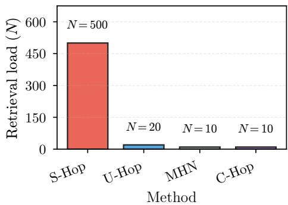  
Figure 6: MNIST retrieval-load summary with U-Hop (max; $d = 7 8 4 )$ . S-Hop attains $N _ { c } \ge 5 0 0 , { \mathrm { a } }$ passing sweep endpoint matching that reached on CIFAR-10.

S-Hop reaches 100% success at $N = 5 0 0$ on MNIST. U-Hop (max) first falls below 90% at $N = 2 0$ then reaches 90% at 30 and 40; its largest passing load is therefore 40. The public avg objective instead passes through 500, with $9 2 . 9 \bar { 3 } \pm \bar { 1 . 1 7 } \%$ success. Figure 6 retains the original first-failure annotation of 20 for U-Hop; Table 1 reports the largest passing loads.

(a)  
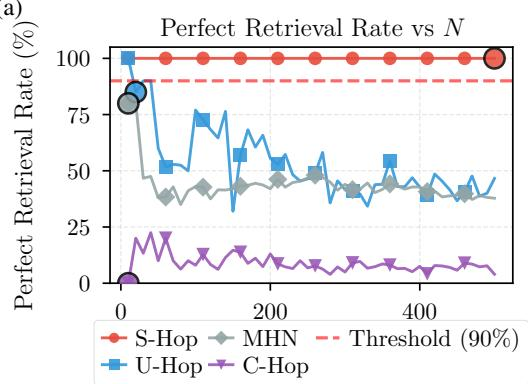  
Number of Stored Patterns (N)

(b)  
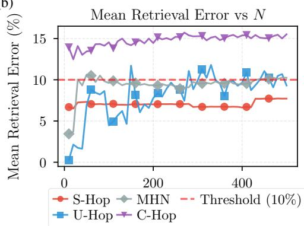  
Number of Stored Patterns (N)  
Figure 7: MNIST retrieval curves with U-Hop (max; $d = 7 8 4 )$ . (a) Perfect retrieval rate under the $\mathrm { M \bar { S } E < 0 . 1 }$ criterion. (b) Mean retrieval error versus the number of stored patterns. S-Hop sustains above-threshold retrieval and low error across the full range, while baselines saturate early.

Figure 7 further confirms that S-Hop maintains consistently higher perfect retrieval rates and lower mean retrieval error across the full capacity range on MNIST. The qualitative separation between S-Hop and all baselines is essentially similar to that on CIFAR-10, supporting retrieval gains across these two datasets.

## C.2 Framework-Level Validation: A Second Kernel Instance

The theoretical framework of Section 3 and Appendix A defines an entire family of admissible kernels, of which S-Hop is only one representative. To examine the behavior of the framework beyond the tanh-based embedding of Eq. (3), we evaluate a second admissible kernel, P-Hop, with coordinate map

$$
F _ { P } ( \varphi _ { k } ) = \left[ \sqrt { \varphi _ { k } ^ { 2 } + \sin \varphi _ { k } + 0 . 5 } , \sqrt { \varphi _ { k } ^ { 2 } + \cos \varphi _ { k } + 0 . 5 } \right] .\tag{134}
$$

Both kernels share the same feature-space dimension $D = 2 d ,$ the same CCCP structural identity with constant $C = d$ (Lemma 1), and the same conditional local-convergence and storage analysis (Lemmas 8–12 and Theorem 3); their detailed theoretical comparison is given in Appendix B.6.

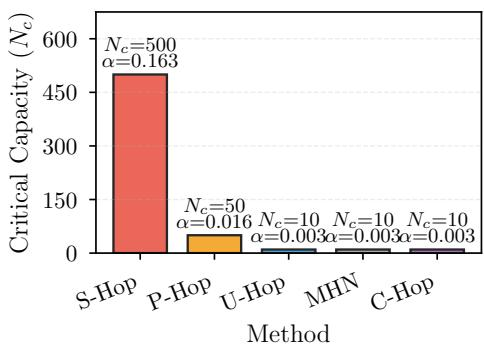  
Figure 8: Second admissible kernel on CIFAR-10: P-Hop and S-Hop retrieval loads. P-Hop is plotted at $N = 5 0$ , the plotted threshold-crossing load, while S-Hop reaches the $N = 5 0 0$ endpoint. The bars mark a passing endpoint for S-Hop and a first failure for P-Hop.

Figure 8 reports the retrieval-load comparison with P-Hop added as a fifth method, under the protocol of Figure 36. Appendix B.6 compares the two kernels’ local-potential geometry and capacity bounds.

(a)  
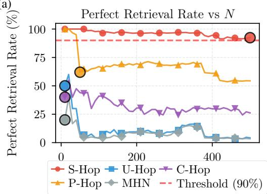  
Number of Stored Patterns (N)

(b)  
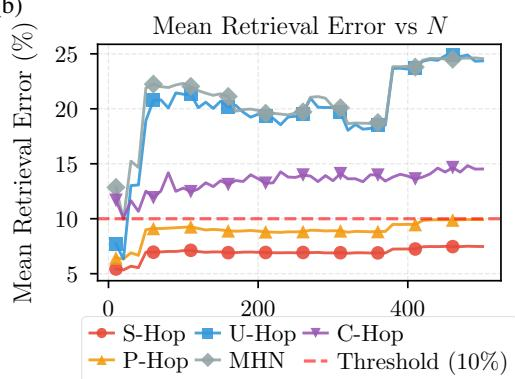  
Number of Stored Patterns (N)  
Figure 9: Second admissible kernel on CIFAR-10: P-Hop and S-Hop retrieval curves. (a) Perfect retrieval rate versus the number of stored patterns. (b) Mean retrieval error versus the number of stored patterns. P-Hop improves on the baselines, while S-Hop achieves higher retrieval success and lower error over the tested loads.

Figure 9 compares the two retrieval maps: S-Hop sustains higher retrieval success and lower error over the tested CIFAR-10 loads.

## C.3 Robustness Under the U-Hop SSD Metric

The main-text critical capacity is defined via the mean-squared-error criterion $\mathrm { M S E } < 0 . 1$ , which differs from the SSD metric reported in the U-Hop public codebase [7] and in related prior work. To check consistency under aligned thresholds, we re-evaluate all methods under the U-Hop SSD protocol, defined as

$$
\mathrm { S S D } ( \psi , \hat { \psi } ) = \sum _ { k = 1 } ^ { d } \bigl ( \mathrm { c l a m p } ( \psi _ { k } , 0 , 1 ) - \mathrm { c l a m p } ( \hat { \psi } _ { k } , 0 , 1 ) \bigr ) ^ { 2 } ,\tag{135}
$$

where ψ is the target image, $\hat { \psi }$ the retrieved output, and k the pixel-coordinate index. We evaluate this metric on $\mathrm { C I \bar { F } A R - } 1 0 ^ { \circ } ( d = 3 0 7 2 )$ with additive Gaussian noise $\sigma = 0 . 3$ and the same one-step retrieval dynamics as the main protocol. Both metrics clamp targets and outputs to [0, 1]. We define SSD-based perfect retrieval as $\mathrm { S S D } < 0 . 1 \cdot d \approx 3 0 7 $ , which by construction is equivalent at the pattern level to $\mathrm { M S E } < 0 . 1$ . We note that the U-Hop evaluation [7] reports only mean-error curves without a defined critical capacity; the load-level $9 0 \%$ criterion is introduced here. The main finding of this appendix, summarized in Figure 10, is consistency with the MSE-based sweep in Section 4. The plotted loads follow the original endpoint/crossing convention.

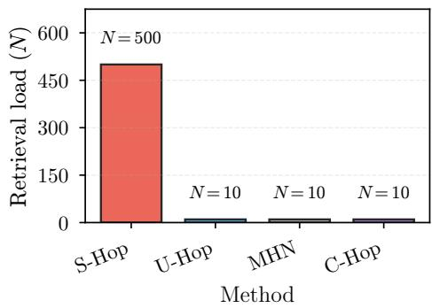  
Figure 10: Aligned SSD criterion on ${ \mathrm { C I F A R } } { \mathrm { - } } 1 0 { \mathrm { : } }$ retrieval-load summary. S-Hop passes through $\bar { N = 5 0 0 }$ under the aligned threshold $\mathrm { S S D } < 0 . 1 d .$ . Baseline bars mark threshold-crossing loads, following the original plotting convention.

(a)  
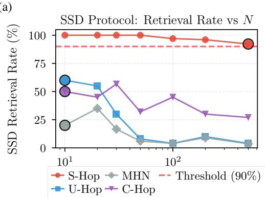  
Number of Stored Patterns (N)

(b)  
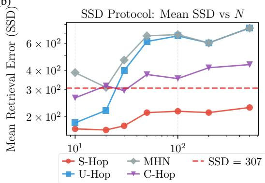  
Number of Stored Patterns (N)  
Figure 11: Aligned SSD criterion on CIFAR-10: retrieval-rate and error curves. (a) SSD-based perfect retrieval rate versus the number of stored patterns under the aligned threshold $\mathrm { S S D } < 0 . 1 \cdot d \approx 3 0 7 $ (b) Mean retrieval SSD versus the number of stored patterns. S-Hop remains below the threshold across the full range $N \in [ 1 0 , 5 0 0 ]$ , while all baselines cross it by $N \approx 3 0$

Figure 11 further illustrates that S-Hop achieves the lowest mean SSD at every N in the tested range, whereas U-Hop, MHN, and C-Hop all cross the aligned threshold well before the end of the range. The qualitative separation mirrors that of the main MSE protocol, providing a check of the aligned MSE and SSD implementations. Other retrieval criteria are evaluated in Appendix D.2.

## C.4 Alternative U-Hop Evaluation Protocol (Avg vs. Max)

For each memory set, U-Hop trains its Stage-I projection for 100 epochs and then fixes it for all queries. With an identity projection, its linear-kernel retrieval reduces to MHN. The alternative avg experiment applies PCA spectral denoising $( \sigma _ { \mathrm { P C A } } ^ { 2 } = 0 . 0 1 )$ to all methods. The legacy avg implementation averages log exp $( - t \| u _ { i } - u _ { j } \| ^ { 2 } )$ over memory pairs with $t = 2$ and appears in Table 2. The public avg objective instead takes the logarithm after averaging the exponentials; its primary comparison is given in Appendix D.5.

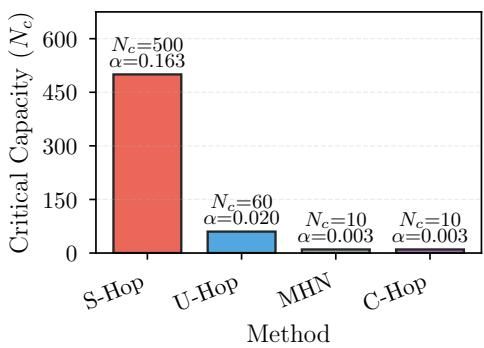  
Figure 12: Legacy pairwise-average U-Hop protocol on CIFAR-10: retrieval-load summary. With MSE < 0.1, S-Hop passes through 500; U-Hop fails at the plotted load 60 (81.7% success).

Figure 12 shows that S-Hop continues to achieve the highest critical capacity under the avg protocol. Under this protocol, U-Hop achieves 81.7% success at $N = 6 0$ . S-Hop remains above threshold through the $N = 5 0 0$ endpoint.

(a)  
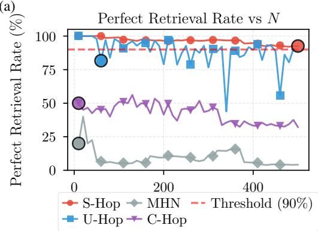  
Number of Stored Patterns (N)

(b)  
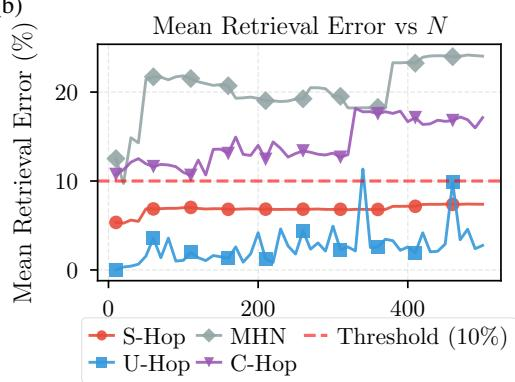  
Number of Stored Patterns (N)  
Figure 13: Legacy pairwise-average U-Hop protocol on CIFAR-10: retrieval curves. (a) Perfect retrieval rate versus the number of stored patterns. S-Hop maintains above-threshold retrieval up to $N \approx 5 0 0 .$ while U-Hop is below 90% at $N = 6 0 .$ (b) Mean retrieval error versus the number of stored patterns. U-Hop attains lower error at small N due to its learned separation loss that uniformizes memory distribution under low load [7]. Its error rises steeply as N grows; S-Hop sustains consistently low error across the full capacity range, retaining its advantage at larger loads.

Figure 13 further confirms that S-Hop maintains above-threshold retrieval through the full tested range and lower error at larger loads. The qualitative separation between S-Hop and all baseline variants closely matches that observed under the max protocol, supporting the main empirical conclusions.

## C.5 Comparison with a Centered Dot-Product Control

Recent distance-overlap dense associative memory variants [16, 34] achieve capacity gains through an energy of the form

$$
E _ { \mathrm { H } } ( \boldsymbol { x } ) = - \frac { 1 } { \beta } \log \sum _ { j = 1 } ^ { N } \exp \left( - \frac { \beta } { 2 } \| \boldsymbol { x } - \boldsymbol { \xi } _ { j } \| ^ { 2 } \right) ,\tag{136}
$$

where x is the query and $\xi _ { j }$ are memory patterns. The per-pattern norm penalty $- \frac { \beta } { 2 } \| \xi _ { j } \| ^ { 2 }$ reshapes basin volumes in a manner structurally distinct from the dot-product framework developed in this work. Our phase kernel modifies the feature embedding while the construction of [34] modifies the overlap form itself, so the two design axes are orthogonal: any admissible F from our family can in principle be composed with a distance-based overlap, and vice versa. Here we compare the centered dot-product variant H-Hop− in Figures 14–15.

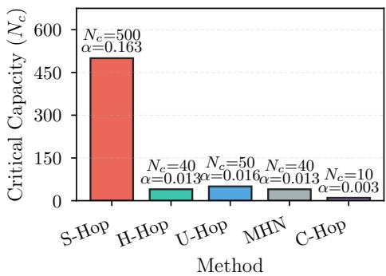  
Figure 14: Centered dot-product control on CIFAR-10: H-Hop− and S-Hop retrieval loads. All methods use pattern-space centering $\tilde { \xi } _ { j } = \xi _ { j } - \bar { \xi } , \tilde { x } = x - \bar { \xi } ,$ , where $\bar { \xi } = N ^ { - 1 } \sum _ { j } \xi _ { j }$ . H-Hop− denotes the dot-product degenerate variant of [34], obtained by removing the $\| \xi _ { j } \| ^ { 2 }$ penalty from Eq. (136) while retaining the pattern-space centering. S-Hop passes through $N = { \mathrm { 5 0 0 } } ;$ the H-Hop− bar marks $N = 4 0$ under the original plotting convention.

Figure 14 compares $\mathrm { H } { \cdot } \mathrm { H o p } ^ { - }$ with the four main methods under a centered one-step retrieval protocol. S-Hop supports larger tested loads than this dot-product variant. Figure 15 gives the corresponding retrieval and error curves.

Figure 15 further illustrates that removing the $\| \xi _ { j } \| ^ { 2 }$ penalty degrades H-Hop− toward the linear baseline, while S-Hop preserves low error throughout the full range. This pattern is compatible with the strong performance of the full distance-based method of [34], which benefits from the norm penalty that H-Hop− discards by construction, and positions our contribution as a structurally complementary axis: composing an admissible phase kernel F with a distance-based overlap is a natural direction for future work.

(a)  
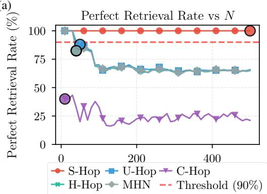  
Number of Stored Patterns (N)

(b)  
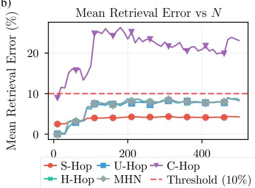  
Number of Stored Patterns (N)  
Figure 15: Centered dot-product control on CIFAR-10: H-Hop− and S-Hop retrieval curves. (a) Perfect retrieval rate versus the number of stored patterns. (b) Mean retrieval error versus the number of stored patterns. With the norm-penalty removed, H-Hop− degrades toward the linear baseline, whereas S-Hop preserves low error throughout the full range, showing the retrieval benefit of S-Hop relative to this centered dot-product control.

## C.6 Extended Ablations and Diagnostics

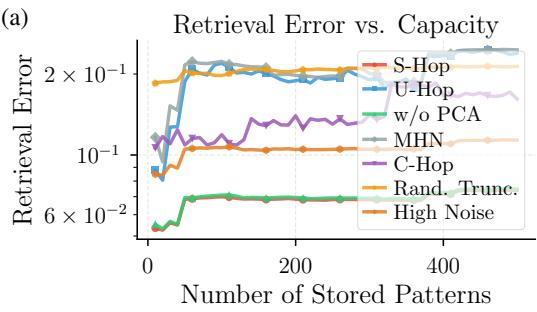

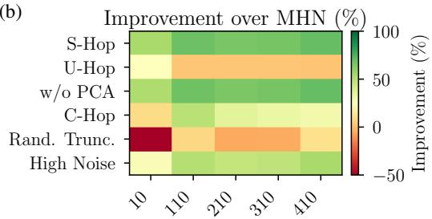  
Number of Stored Patterns  
Figure 16: CIFAR-10 kernel and preprocessing ablations: retrieval error and gains over MHN. (a) Retrieval error under increasing memory load for ablated variants and stress-test conditions, including removal of the nonlinear kernel, PCA preprocessing, cosine-kernel substitution, random truncation, and high-noise evaluation $( \sigma = 0 . 5 )$ . (b) Percentage improvement in retrieval accuracy over the MHN baseline as a function of the number of stored patterns, isolating the contributions of kernel choice and preprocessing.

Figure 16 aggregates retrieval error versus memory load for multiple ablated variants and stress tests, together with an improvement-over-baseline view. Removing the nonlinear kernel induces the largest degradation across the entire capacity range, while PCA primarily stabilizes retrieval under moderate noise and reduces error variation under noise. The random-truncation and cosine-kernel variants yield higher retrieval error than S-Hop in these comparisons, consistent with Section 4.

## C.7 Gating Wrapper: Additional Retrieval Gains

This section reports the full results for the optional gating wrapper described in the main text. The wrapper proposes a one-step MHN, U-Hop, or S-Hop update, mixes it with the current state through a gate, and updates an auxiliary gated state. Figures 17–18 show the results.

Figure 17 compares retrieval-load summaries for the gated MHN, U-Hop, and S-Hop variants. S-Hop retains the largest passing load among the gated variants, supporting the use of the phase-kernel update within this wrapper.

  
Figure 17: Gating control on CIFAR-10: retrieval-load summary. S-Hop passes through N = 500; baseline bars show the plotted threshold-crossing loads.

(a)  
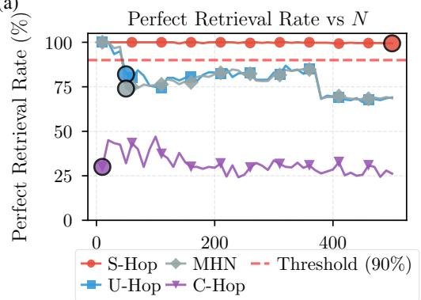  
Number of Stored Patterns (N)

(b)  
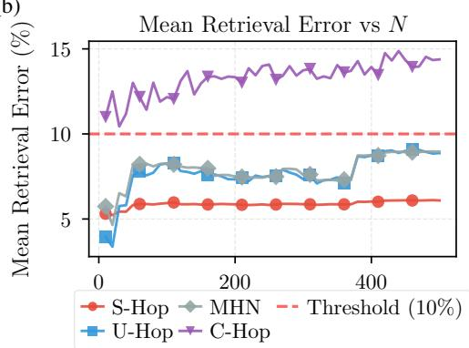  
Number of Stored Patterns (N)  
Figure 18: Gating control on CIFAR-10: retrieval-rate and error curves. (a) Perfect retrieval rate and (b) mean retrieval error versus the number of stored patterns.

Figure 18 further illustrates that gating improves retrieval robustness under increasing load, as reflected in both higher perfect retrieval rates and lower mean MSE. These curves support combining the phase-kernel update with the gating wrapper for improved retrieval in the tested settings.

## C.8 Additional Generalization: MIL

This section evaluates whether the proposed design choices transfer to a different learning setting beyond the CIFAR-10 classifier in the main paper. Figure 19 reports results on a multiple-instance learning benchmark across random seeds. The learning curves show the evolution of test accuracy, while the final comparison reports the best test accuracy across the repeated runs.

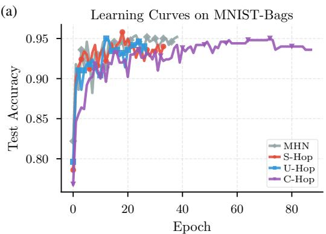

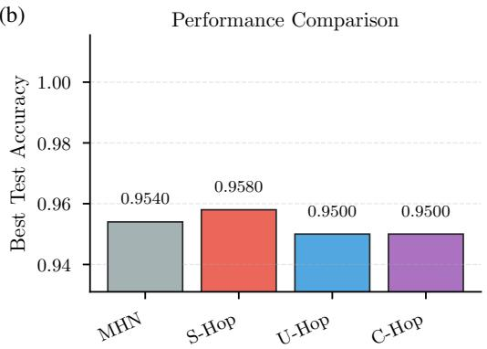  
Figure 19: Downstream generalization to multiple-instance learning: training and final performance. (a) Learning curves with mean standard deviation. (b) Best test accuracy over repeated runs.

Across alternative U-Hop evaluation modes, extended ablations, the optional gating wrapper, and MIL generalization, the empirical evidence remains consistent with improved retrieval under the stated protocols, with further gains from the tested preprocessing and gating choices.

## C.9 Energy-Shaped Classification on CIFAR-10

The classifier uses six blocks with 4 4 patches, embedding width 384, and six attention heads. The hybrid places two S-Hop blocks before four MHN blocks. Training uses AdamW with learning rate $3 \times 1 0 ^ { - 4 }$ , weight decay 0.05, batch size 128, and label smoothing 0.1. The training budget is 100 epochs, with a 10-epoch warm-up followed by cosine decay and seed 784. We record test accuracy at each epoch and the highest observed value.

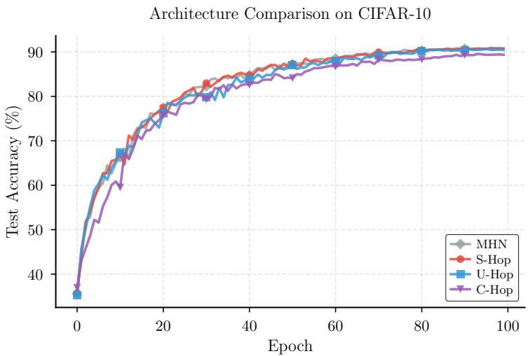  
Figure 20: Downstream CIFAR-10 classification: hybrid S-Hop/MHN architectures. Hybrid architectures combining two early S-Hop layers with four later MHN layers reach approximately 90% peak test accuracy, about 0.2 percentage points above the best baseline peak (seed 784).

To evaluate the phase-kernel update in supervised learning, we integrate S-Hop layers into a CIFAR-10 classifier by replacing the attention-based aggregation modules. A hybrid architecture with early S-Hop layers followed by standard MHN layers achieves the highest test accuracy among the compared architectures. As shown in Figure 20, this hybrid achieves test accuracy around 90%, approximately 0.2 percentage points above the best baseline peak in the 100-epoch run. The testaccuracy trajectories for all four architectures are shown in Figure 20. Figures 18–19 cover gated retrieval and MIL.

## D Additional Retrieval Analyses

This appendix examines the effects of feature scale, retrieval criterion, update count, and kernel components on the empirical retrieval load. All experiments use the stated protocol; passing sweep endpoints are reported as lower bounds.

## D.1 Scale, Centering, and Minimum-Margin Controls

Protocol. The scale controls use CIFAR-10 at $3 2 \times 3 2$ resolution $( d = 3 0 7 2 )$ , Gaussian query noise $\sigma = 0 . 3$ , one retrieval update, base $\beta = 1$ , no PCA, and $\mathrm { M S E } < 0 . 1$ success with a 90% load-level criterion. U-Hop uses the implemented max separation objective, trained for 100 epochs on the first half of each memory set and then fixed for all queries.

Three-seed comparison. The sweep over $N \in \{ 1 0 , 2 0 , 5 0 , 1 0 0 , 2 0 0 , 3 0 0 , 4 0 0 , 5 0 0 \}$ uses seeds 42, 43, 44 for every method, with a fixed memory set and shared noisy queries within each seed. Noise is added before taking the elementwise absolute value and clipping to [0, 1]. At $N = 5 0 0$ normalized logits yield 100% success for S-Hop and 90.60% for each baseline. After logit-scale matching, success is $9 1 . 4 7 \pm 0 . 7 6 \%$ for S-Hop, $3 . { \overset { \cdot } { 4 } } 0 \pm 0 . 0 0 \%$ for MHN, and $4 . 4 0 \pm 0 . 6 9 \%$ for U-Hop (mean sample standard deviation over seeds). Figure 21 shows the corresponding retrieval curves.

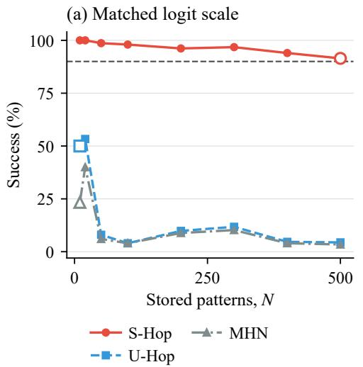

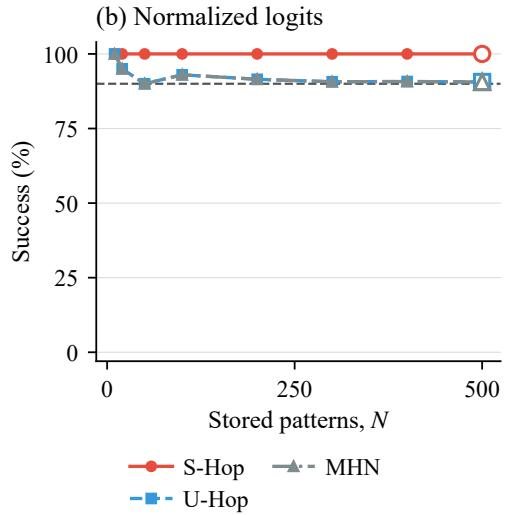  
Figure 21: Three-seed CIFAR-10 scale controls with the U-Hop max objective. Left: matched logit scale; right: normalized logits. Curves average seeds 42, 43, 44, with shared memories and noisy queries within each seed. Success means $\mathrm { M S E } < 0 . 1$ after one update at $\sigma = 0 . 3 ;$ ; dashed lines mark 90%. Outlined points mark first failures or passing sweep endpoints.

Scale diagnostics. Table 5 reports statistics from the same three-seed experiment at $N = 5 0 0$ . Logit spread and entropy are averaged over 64 calibration queries per seed; feature norms are averaged over stored memories. Normalized logits have entropy near log $5 0 0 \approx 6 . 2 1 5$ for all methods. The associated retrieval curves are shown in Figure 21.

U-Hop’s Stage-I optimization uses stochastic gradient descent (SGD) with learning rate 10. At $N = \bar { 5 } 0 0$ , the mean separation loss over the three seeds decreases from 0.10573 at initialization to

0.12867 at epoch index 90; the last objective evaluated during the 100-epoch training is 0.13142.   
The learned projection is then fixed for retrieval. Figure 35 shows the training trajectory.

Table 5: Feature and logit diagnostics at $N = 5 0 0$ , averaged over three seeds. H is softmax entropy in nats at base $\beta = 1 ; \sigma _ { z }$ is the mean within-query logit standard deviation.
<table><tr><td>Method</td><td>Mean feature norm</td><td>Raw  $\sigma _ { z }$ </td><td>Normalized  $\sigma _ { z }$ </td><td>Raw H</td><td>Normalized H</td></tr><tr><td>MHN</td><td>28.84</td><td> $1 8 0 . 3 8 $ </td><td>0.05683</td><td>0.06556</td><td>6.21306</td></tr><tr><td>U-Hop</td><td>1508.50</td><td> $4 . 8 2 1 3 \times 1 0 ^ { 5 }$ </td><td>0.06093</td><td>0</td><td>6.21283</td></tr><tr><td>S-Hop</td><td>95.63</td><td>506.83</td><td>0.00282</td><td> $4 . 0 5 \times 1 0 ^ { - 1 9 }$ </td><td>6.21460</td></tr></table>

Extended sweeps. Table 6 summarizes the extended scans in Figures 22 and 23. MHN and U-Hop results are averaged over seeds 42, 43, 44; S-Hop uses seed 42.

Table 6: CIFAR-10 scale controls: last passing load / first failing load under one-step retrieval with $\sigma = 0 . 3$ , base $\beta = 1 , \mathrm { M S E } < 0 . 1$ , and 90% success. A bound denotes a passing sweep endpoint; < 10 denotes failure at the smallest tested load. U-Hop uses the implemented max objective. S-Hop uses one seed and the baselines use three.
<table><tr><td>Control</td><td>MHN</td><td>U-Hop</td><td>S-Hop</td></tr><tr><td>Normalized logits</td><td> $8 7 0 / 8 8 0$ </td><td>880/890</td><td>≥ 5000</td></tr><tr><td>Matched logit scale</td><td> $< 1 0$ </td><td> $< 1 0$ </td><td> $7 9 0 / 8 0 0$ </td></tr><tr><td>Input centering</td><td> $5 0 0 / 5 1 0$ </td><td> $\geq 1 0 0 0$ </td><td>≥ 1000</td></tr><tr><td>Matched  $\beta \Delta _ { \mathrm { m i n } }$ </td><td> $< 1 0$ </td><td> $< 1 0$ </td><td>790/800</td></tr></table>

Normalized logits. For method $m ,$ the normalized score is

$$
z _ { m , i } ^ { \mathrm { n o r m } } ( q ) = \frac { x _ { m , i } ^ { \top } q _ { m } } { \| x _ { m , i } \| _ { 2 } \| q _ { m } \| _ { 2 } } .\tag{137}
$$

Here $x _ { m , i }$ and $q _ { m }$ are method-specific memory and query features, with raw score $z _ { m , i } ( q ) = x _ { m , i } ^ { \top } q _ { m }$ We normalize the scoring vectors and retain each method’s value aggregation and state update. The sweep tests $N = 1 \bar { 0 , } 2 0 , \ldots , 1 0 0 0$ for all methods and extends S-Hop in increments of 100 to 5000. The last passing loads are 870 for MHN and 880 for U-Hop, with first failures at 880 and 890, respectively. S-Hop passes through 5000, yielding $N _ { c } \ge 5 0 0 0$ and tested-load ratios of approximately 5.75 and 5.68, respectively (Figure 22, left).

Empirical logit-scale matching. For each memory set, 64 calibration queries estimate

$$
\sigma _ { m } = \mathbb { E } _ { q } [ \mathrm { S t d } _ { i } z _ { m , i } ( q ) ] , \qquad a _ { m } = \sigma _ { \mathrm { M H N } } / \sigma _ { m } .\tag{138}
$$

The multiplier $a _ { m }$ is applied inside softmax; the base update coefficient remains unchanged. $\operatorname { A t } \beta = 1$ this matches the empirical spread of softmax inputs. S-Hop last passes at 790 and first fails at 800; both baselines fail at the smallest tested load, 10. Both baseline loads are left-censored at 10, so the sweep resolves no finite capacity ratio (Figure 22, right). Together with the normalized-logit bounds of 5.75 and 5.68, these results quantify the controlled comparisons at their measured resolution.

Input centering. The centering control uses $F ( \psi - \bar { \psi } )$ , subtracting the memory-set mean in input/phase space before embedding and applying the same shift to queries. MHN last passes at 500 and fails at 510; S-Hop and U-Hop both pass through 1000 (Figure 23, left). Full nonlinear-feature centering, $F ( \psi ) - { \overline { { F ( \psi ) } } }$ , is a further extension involving queries, values, and dynamics. Centering only stored keys shifts all logits for each query by the same scalar, preserving the softmax weights.

Signed minimum-margin matching. The additional control computes

$$
\Delta _ { \operatorname* { m i n } , m } = \operatorname* { m i n } _ { i } \operatorname* { m i n } _ { j \neq i } \left( x _ { m , i } ^ { \top } x _ { m , i } - x _ { m , i } ^ { \top } x _ { m , j } \right)\tag{139}
$$

and uses a positive multiplier $a _ { m } = \Delta _ { \mathrm { m i n , M H N } } / \Delta _ { \mathrm { m i n } , m }$ inside softmax to match $\beta \Delta _ { \mathrm { m i n } }$ . This calibration requires nonzero margins of the same sign so that the multiplier is positive. With the same one-step MSE criterion and seed allocation as above, S-Hop passes at 790 and fails at 800, while both baselines fail at 10. Figure 23 (right) shows retrieval under this signed-margin calibration.

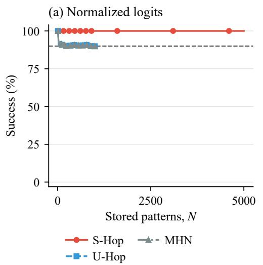

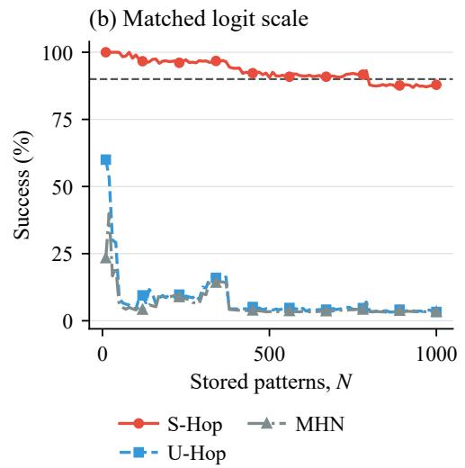  
Figure 22: Extended CIFAR-10 scale sweeps with the U-Hop max objective. Left: normalized logits; right: matched logit scale. Both use one update, $\sigma = 0 . 3 .$ , and $\mathrm { M S E } < 0 . 1$ . S-Hop uses seed 42; baselines average seeds 42, 43, 44. Dashed lines mark 90% success. With normalized logits, S-Hop passes through $\mathrm { \bar { \it { N } } } = 5 0 0 0$

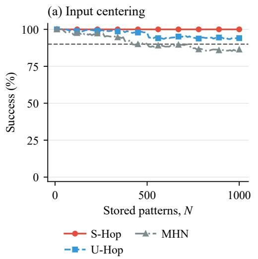

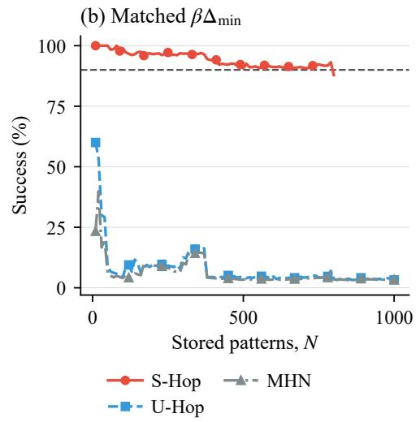  
Figure 23: CIFAR-10 geometry controls: input centering and signed minimum-margin matching. Left: $F ( \psi - \bar { \psi } )$ ; right: matched $\beta \Delta _ { \mathrm { m i n } } .$ Success means MSE $< 0 . 1$ after one update at $\sigma = 0 . 3 ;$ dashed lines mark 90%. S-Hop uses seed 42; baselines average seeds 42, 43, 44.

## D.2 Retrieval Criteria and Multiple Updates

MSE thresholds and sweep boundaries. A separate CIFAR-10 sweep uses seed 42, no PCA, one update, and $\sigma = 0 . 3$ to evaluate thresholds 0.01, 0.03, 0.05, and 0.1. It stops after two consecutive failures of the 90% criterion at $\mathrm { M S E } < 0 . 1$ . In this sweep, S-Hop last passes at 750 and first fails at 800 under $\mathrm { M S E } < 0 . 1$ ; the final tested load is 850. At the three stricter thresholds, S-Hop already fails the 90% success criterion at $N = 1 0 .$ . Figure 24 shows the success curves for all four thresholds.

Output-based identification. For output $\hat { \psi }$ and target $\psi _ { i } ,$ , cosine-threshold success means cos $( \hat { \psi } , \psi _ { i } ) \ge 0 . 9 5$ . Output-cosine top-1 means arg maxj cos $( \hat { \psi } , \psi _ { j } ) = i$ over the stored memories. At $N = 5 0 0$ , S-Hop has 91.53% MSE success, 13.4% cosine-threshold success, and 1.53% output-cosine top-1 accuracy. Figure 25 presents the two output-based identification curves; Appendix C.3 gives the corresponding SSD evaluation.

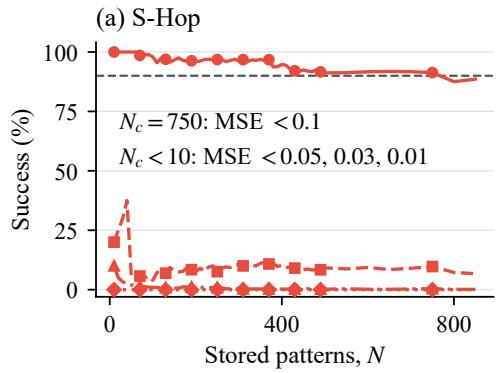

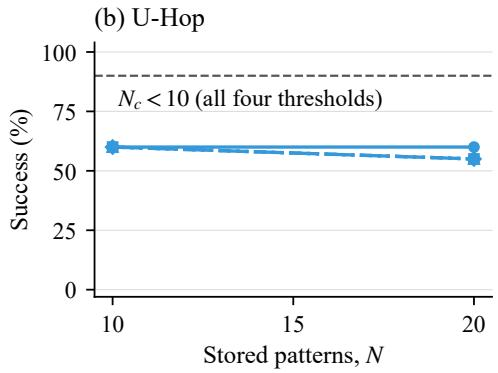

(c) MHN  
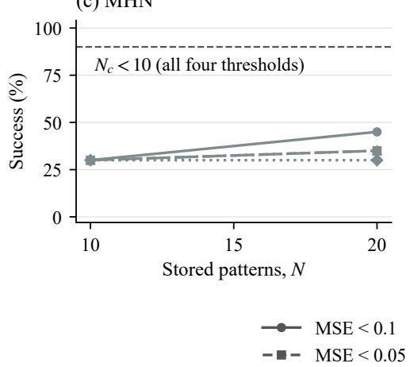

(d) C-Hop  
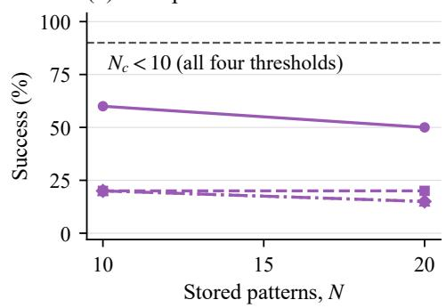  
Figure 24: CIFAR-10 criterion sensitivity: four MSE thresholds. One-step retrieval uses thresholds 0.01, 0.03, 0.05, and 0.1, with $\sigma = 0 . 3 \mathrm { . }$ , no PCA, and seed 42. Dashed lines mark 90% success. At threshold 0.1, S-Hop last passes at 750 and first fails at 800; stricter thresholds fail at the smallest tested load, 10.

Multiple updates. The common-norm experiment rescales stored inputs to a sphere whose radius is their original mean norm and iterates retrieval at $t \in \{ 0 , 1 , 2 , 5 , 1 0 , 2 0 \}$ . At N = 10, S-Hop’s mean MSE decreases from 0.04177 after one update to 0.01653 after 20, while nearest-memory accuracy changes from 100% to 90%. At N = 60, S-Hop’s mean MSE decreases from 0.05026 after one update to 0.04497 after two, then rises to 0.05836 at step 20. Nearest-memory accuracy drops from 100% to 75% and then to 15% by step 5, remaining at 15% through step 20. At step

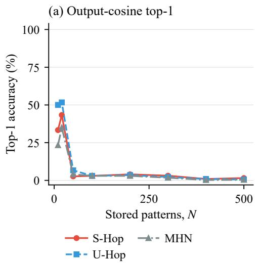

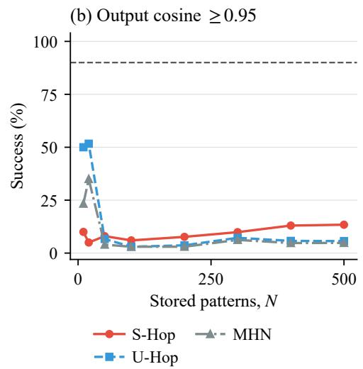  
Figure 25: CIFAR-10 output identification: cosine top-1 and cosine-threshold criteria. Retrieval uses one update at $\sigma = 0 . 3$ . Left: top-1 accuracy selects the stored memory with highest cosine similarity to the retrieved output. Right: success requires output–target cosine similarity $\geq 0 . 9 5 ;$ the dashed line marks 90% success.

20, the successive-update RMSE is 0.00250. The MSE and identification trajectories are shown in Figures 26 and 27, with numerical diagnostics in Table 7.

Table 7: S-Hop multiple-update diagnostics at common norm, CIFAR-10, N = 60 (60 queries). Nearest-memory accuracy uses Euclidean distance. The margin is the mean nearest-competitor squared distance minus target squared distance, divided by d.
<table><tr><td>Step</td><td>Mean MSE</td><td>Accuracy (%)</td><td>Mean margin</td><td>Update RMSE</td></tr><tr><td>0</td><td>0.07218</td><td>100</td><td>0.04342</td><td></td></tr><tr><td>1</td><td>0.05026</td><td>100</td><td>0.02206</td><td>0.11148</td></tr><tr><td>2</td><td>0.04497</td><td>75</td><td>0.00600</td><td>0.06249</td></tr><tr><td>5</td><td>0.04729</td><td>15</td><td>-0.02372</td><td>0.02959</td></tr><tr><td>10</td><td>0.05517</td><td>15</td><td>-0.03981</td><td>0.01019</td></tr><tr><td>20</td><td>0.05836</td><td>15</td><td>-0.04347</td><td>0.00250</td></tr></table>

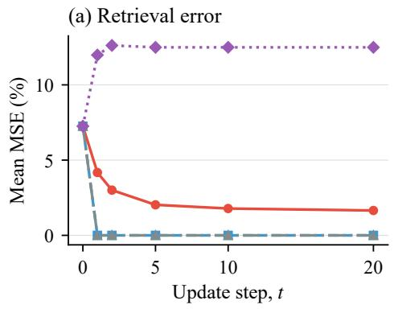

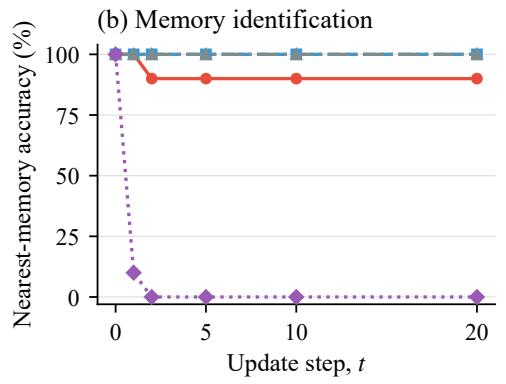

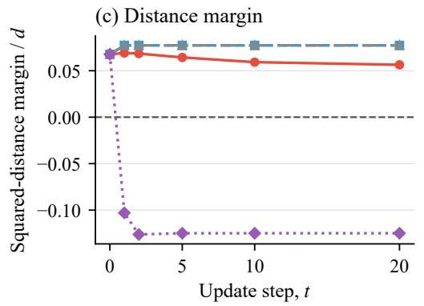

(d) Update size  
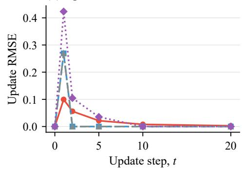  
Figure 26: Common-norm CIFAR-10 dynamics at low load $( N = 1 0 )$ . Initial query noise is $\sigma = 0 . 3$ Panels show mean MSE, Euclidean nearest-memory accuracy, the nearest-competitor minus target squared-distance margin divided by d, and successive-update RMSE at $t \in \{ 0 , \bar { 1 } , 2 , 5 , 1 0 , 2 0 \}$

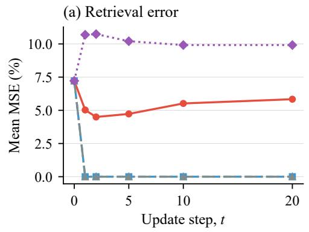

  
Figure 27: Common-norm CIFAR-10 dynamics at higher load $( N = 6 0 )$ . Panels use the four diagnostics in Figure 26, with initial noise $\sigma = 0 . 3$ . The dashed line marks zero margin; S-Hop values appear in Table 7.

## D.3 Similarity, Dynamics, Dimension, and Preprocessing

Let $\Psi = [ \psi _ { 1 } , \dots , \psi _ { N } ]$ and $s = \mathrm { s o f t m a x } ( \beta X ^ { \top } F ( \varphi ) )$ . The similarity-only variant uses $\varphi ^ { + } = \Psi s$ The joint variant uses $\varphi ^ { + } = h ^ { - 1 } ( J _ { F } ( \varphi ) ^ { \top } F ( \Psi s ) )$ , retaining raw-memory aggregation before the Jacobian/local-field transformation. Full S-Hop instead uses the embedded-memory aggregate Xs in Eq. (17). In the CIFAR-10 sweep through $\bar { N } = 5 0 0$ , similarity alone falls below 90% success at $N = 1 0$ , whereas the joint variant tracks full S-Hop and remains above threshold through 500. Figure 28 (left) shows the effect of jointly restoring the Jacobian and inverse-field operations. These arise together from the interaction-energy gradient and the CCCP minimization, respectively; the ablation measures their combined effect.

The dimension control equips U-Hop with a learned $2 d \times d$ projection. S-Hop achieves higher retrieval success than this 2d linear baseline (Figure 28, right). P-Hop and the alternative U-Hop objective are reported in Appendices C.2 and C.4 with their respective protocols.

  
Figure 28: CIFAR-10 mechanism controls: state-update components and embedding dimension. Both use one update, $\beta = 1 , \sigma = 0 . 3$ , no PCA, and seed 42. S-Hop-Sim uses phase-kernel scores with raw-memory averaging; S-Hop-Jac restores the Jacobian and inverse local field jointly. Right: U-Hop learns a $2 d \times d$ projection. Success means $\mathrm { M S E } < 0 . 1$ ; dashed lines mark 90%. Outlined points mark first failures or passing sweep endpoints.

Figure 29 compares S-Hop with and without PCA alongside kernel, truncation, and higher-noise controls across memory loads. PCA fits the memory covariance, retains min $( N , d )$ components, scales each centered component by $\lambda _ { k } / ( \lambda _ { k } + \sigma _ { \mathrm { P C A } } ^ { 2 } )$ , and reconstructs the memories with their mean restored. Here $\lambda _ { k }$ is the corresponding covariance eigenvalue and $\sigma _ { \mathrm { P C A } } ^ { 2 } = 0 . 0 1$ is the shrinkage regularizer.

  
Figure 29: CIFAR-10 preprocessing controls: PCA, random truncation, and higher query noise. “w/o PCA” removes S-Hop’s PCA preprocessing; “Rand. Trunc.” retains 1024 random input coordinates. “High Noise” uses $\sigma = 0 . 5 ;$ other curves use $\sigma = 0 . 3$ . Retrieval uses one update at $\bar { \boldsymbol { \beta } } = 1 ;$ ; the error axis is logarithmic.

## D.4 Cross-Dataset Separation and ImageNet

The cross-dataset diagnostic uses CIFAR-10 and TinyImageNet resized to $3 2 \times 3 2 .$ . It measures median nearest-neighbor squared distance per input dimension and rescales inputs to match this statistic. Figure 30 presents the retrieval curves and distance statistics before and after matching. This run uses a resampled TinyImageNet subset; the fixed-subset control below isolates the resizing effect.

Dimension and retrieval load. The original TinyImageNet subset has a retrieval-load threshold of 40 for S-Hop and 10 for each baseline, a 4 gain (Table 8). The following controls examine memory geometry at fixed dimension, complementing the theorem’s dimension scaling.

Table 8: Original TinyImageNet subset: 64 64 images, one update, $\sigma = 0 . 3 ,$ and a 90% MSE < 0.1 threshold. Loads mark the first threshold crossing. Public avg uses three-seed mean success.
<table><tr><td>Method</td><td>Retrieval load</td></tr><tr><td>MHN</td><td>10</td></tr><tr><td>U-Hop (max)</td><td>10</td></tr><tr><td>U-Hop (public avg)</td><td>10</td></tr><tr><td>C-Hop</td><td>10</td></tr><tr><td>S-Hop</td><td>40</td></tr></table>

TinyImageNet subset composition and separation. The original TinyImageNet experiment uses the first 500 images in class-sorted order, all from the goldfish class. These natural images have correlated content and varying feature norms, rather than the independent phase coordinates assumed in the capacity theorem. Both image similarity and norm differences affect the signed separation $\begin{array} { r } { \Delta _ { i } = \operatorname* { m i n } _ { j \neq i } x _ { i } ^ { \top } ( x _ { i } - x _ { j } ) } \end{array}$ : at $N = 5 0 0$ , only one of the original memories has positive $\Delta _ { i }$ . Keeping these 500 images fixed and resizing them from 64 64 to 32 32 raises mean $\mathrm { M S E } < 0 . 1$ 1 success from 50.67% to 54.40% over noise seeds 42, 43, 44. This modest improvement motivates examining subset geometry at the original resolution.

  
Figure 30: Cross-dataset separation control: CIFAR-10 and $3 2 \times 3 2$ TinyImageNet. Curves compare S-Hop before and after input-distance matching. Left: one-step $\mathrm { M S E } < 0 . 1$ success at $\sigma = 0 . 3 ,$ with the 90% threshold dashed. Right: median nearest-neighbor squared distance per input dimension.

  
Figure 31: Original TinyImageNet retrieval-load comparison. S-Hop reaches 40, versus 10 for the baselines, a 4 gain. U-Hop uses the original max objective.

The geometry-selected 500-image subset used in Figure 32 is constructed at $6 4 \times 6 4$ using cleanmemory geometry. A candidate pool contains 50 randomly sampled images from each of the 200 classes (sampling seed 20261009). Within the 1000-image band with the smallest range of squared embedding norms, greedy selection maximizes the minimum of the two directed pairwise margins. The resulting subset spans 183 classes and has $\Delta _ { \mathrm { m i n } } = 8 0 . 8 3$ , with all 500 margins positive. Selection precedes noisy-query evaluation and leaves the images, kernel, and update unchanged.

The fixed-subset comparison uses $\beta = 1 , \sigma = 0 . 3$ , one update, no PCA or normalization, and the same absolute-value and clipping transforms. Over noise seeds 20261010, 20261011, and 20261012, the original subset achieves 50.53% MSE < 0.1 success, mean MSE 0.10121, and 7.60% nearest-memory accuracy at $N = 5 0 0$ . Under these same seeds, the selected subset achieves 100% MSE-based success and 95 $. 2 7 \pm 0 . 4 6 \%$ nearest-memory accuracy (Figure 32). One update reduces query MSE from 0.06274 to 0.02697 (57.02%); removing the target memory raises MSE to 0.04476 and lowers nearest-memory accuracy to 69.00%. Nearest-memory accuracy identifies the output’s closest stored image by Euclidean distance; error bars are sample standard deviations across the three noise seeds on each fixed subset. These results isolate the effect of memory composition at the same input dimension.

(a) Reconstruction error  

(b) Retrieval at N= 500  
  
Figure 32: Geometry-selected TinyImageNet memories $( N = 5 0 0 , 6 4 \times 6 4 )$ . (a) Reconstruction error. (b) $\mathrm { M S E } < 0 . 1$ success and Euclidean nearest-memory accuracy. Bars show means and sample standard deviations across three noise seeds: one update, $\beta = 1 , \sigma = 0 . 3$ , no PCA or normalization.

ImageNet protocol. We further extend the evaluation to ImageNet-1K, using the first 500 training images in class-sorted directory order, all from the tench class. Images are resized and center-cropped to $6 4 \times 6 4$ , or resized to 256 pixels on the shorter side and center-cropped to $2 2 4 \times 2 2 4$ , then converted to RGB values in [0, 1]. The original max runs use seed 42, no $\mathbf { \bar { P } C A } , \beta = 1$ , one update, and Gaussian noise $\sigma = 0 . 3$ followed by the absolute-value and clipping transform. The sweep uses $N = 1 0 , 2 0 , \dotsc , 5 0 0$ , with one noisy query per memory. U-Hop uses the max objective for 100 epochs; the $2 2 4 \times 2 2 4$ run uses its block-diagonal projection implementation with block size 64. The high-resolution U-Hop sweep was completed using an equivalent closest-pair loss calculation that avoids the original pairwise-gradient memory allocation.

Figure 33 shows the resulting retrieval curves at $6 4 \times 6 4$ and $2 2 4 \times 2 2 4$ . S-Hop achieves 91.4% and 98.2% $\mathrm { M S E } < 0 . 1$ success at $N = 5 0 0$ , respectively, giving $N _ { c } \geq 5 0 0$ in both settings, compared with U-Hop’s largest passing load of 10. Both resolutions include all four methods. ${ \mathrm { A t ~ } } 2 2 4 \times 2 2 4 { \mathrm { . } }$ U-Hop (block) achieves $2 . 0 \%$ success at $N = 5 0 0$ . These MSE-based results at $d = 1 2 2 8 8$ and $d \ : = \ : 1 5 0 5 2 8$ , together with the fixed-resolution TinyImageNet subset control, show that input dimension alone does not explain the TinyImageNet degradation; image distribution and separation also affect retrieval.

  
Figure 33: ImageNet resolution comparison with U-Hop (max): one-step retrieval at 64 64 and $2 2 4 \times 2 2 4$ . Left and right use the same first 500 training images, seed 42, no $\mathrm { P C A } , \beta = 1 , \sigma = 0 . 3 .$ and $\mathrm { { M S E } < 0 . 1 }$ . Dashed lines mark 90% success; outlined points mark first failures or passing endpoints. S-Hop passes through $N = 5 0 0$ in both runs. U-Hop uses a dense projection at $6 4 \times 6 4$ and a block-diagonal projection (block size 64) at $2 2 4 \times 2 2 4$

## D.5 Public Average-Separation Baseline and Training Diagnostics

The public U-Hop avg objective is log mean $_ { i < j } \exp ( - 2 \| u _ { i } - u _ { j } \| _ { 2 } ^ { 2 } )$ , where $u _ { i } = W \psi _ { i } / \| W \psi _ { i } \| _ { 2 }$ and $W \in \mathbb { R } ^ { d \times d }$ . We train on the first half of each memory set using SGD with learning rate 10 for 100 epochs, starting from a standard-normal projection, and then fix W. With $W \stackrel { \_ } { = } I ,$ the implementation reproduces MHN exactly in the checked runs.

The experiment uses the first 500 CIFAR-10 training images, no PCA, seeds 42, 43, 44, and $N \in$ 10, 20, 50, 60, 100, 200, 500 . Memories and noisy queries are shared across methods within each seed; the noise transform, $\beta = 1$ , one-update budget, and $\mathrm { M S E } < 0 . 1$ criterion follow Appendix D.1. Logit matching uses the first min(64, N) queries for calibration. Runs use float32 on an RTX 5060 Laptop graphics processing unit (GPU), with TensorFloat-32 (TF32) disabled.

At $N \ = \ 5 0 0 .$ , raw-logit success is $9 2 . 0 7 \pm 0 . 4 2 \%$ for S-Hop, $4 8 . 4 0 \pm 3 . 8 3 \%$ for U-Hop, and $3 . 3 3 \pm 0 . 1 2 \%$ for MHN. Normalization yields 100%, 90.80%, and 90.60%, respectively, with zero between-seed standard deviation at this load. Logit matching yields $9 2 . 0 7 \pm 0 . 4 \dot { 2 } \% , 4 8 . \dot { 8 } 7 \pm 3 . 9 3 \%$ and $3 . 3 3 \pm 0 . 1 2 \%$ . Thus normalization substantially improves the linear baselines, while S-Hop retains higher success in the three comparisons (Figure 34). The raw-logit U-Hop curve last passes at 60 and first fails at 100 on this grid; S-Hop passes through 500.

The new MNIST, TinyImageNet, and ImageNet public avg sweeps use seeds 42, 43, 44 and $N =$ $1 0 , 2 0 , \ldots , 5 0 0$ , with fixed memories and independent projection and query generators initialized by multiplying each seed by 100000 and adding N. MNIST uses the first 500 training images; TinyImageNet and ImageNet use the subsets in Appendix D.4. ImageNet compares all four methods on shared queries, and repeats U-Hop (max) on the same grid. Runs use float32 on an RTX 5090, with TF32 disabled and a block size of 64 for the $2 2 4 \times 2 2 4$ projection. Pairwise squared distances are evaluated through their equivalent Gram-matrix expression. Load bounds use mean success over the three seeds.

On MNIST, public avg reaches $9 2 . 9 3 \pm 1 . 1 7 \%$ success at $N = 5 0 0$ . On the original TinyImageNet subset, it fails at $N = 1 0$ and reaches 3.20% at $N = 5 0 0$ . At $N = 5 0 0$ on ImageNet, public avg reaches $7 . 0 0 \pm 1 . 0 6 \%$ at $6 4 \times 6 4$ and $4 . 6 7 \pm 0 . 1 2 \%$ at 224 224; S-Hop reaches $9 1 . 4 7 \pm 0 . 1 2 \%$ and $9 8 . 5 3 \pm 0 . 1 2 \%$ , respectively. The warmed-up MNIST timing at $N = 3 0 0$ , averaged over the three seeds, is 1.24 ms per query after amortizing projection training over 256 queries, including 0.17 ms for retrieval.

  
Figure 34: CIFAR-10 scale controls with the public U-Hop avg objective. (a) Raw, (b) normalized, and (c) matched-scale logits complement the max controls in Figure 21. Lines and shading show means and sample standard deviations over seeds 42, 43, 44. Methods share memories and queries: no PCA, one update, $\beta = 1$ , and $\sigma = 0 . 3$ . Success means $\mathrm { M S E } < 0 . 1$ ; dashed lines mark 90%.

  
Figure 35: U-Hop training diagnostics: max and public avg objectives at $N = 5 0 0 .$ . (a) The max objective used for Figure 21, logged every 10 epochs through index 90. (b) The public avg objective used for Figure 34, including index 99. Both runs use 100 epochs and seeds 42, 43, 44; lines and bands show means and sample standard deviations on separate loss scales.

## D.6 Empirical Findings and Future Directions

The scale controls in Figures 21 and 22 show S-Hop’s retrieval advantage under normalization and logit matching. The component comparison in Figure 28 highlights the role of the combined similarity and state update. Figures 24–27 characterize retrieval across success criteria and update counts, and Figures 30–33 extend the evaluation across datasets and resolutions.

Future directions. First, extending the capacity analysis to correlated memory distributions would help explain the dataset and subset differences. Learned or structured embeddings that improve memory separation offer a related practical direction. Second, formally incorporating the gating wrapper into the surrogate Hopfield energy would extend the Lyapunov analysis to the gated dynamics. Third, composing admissible phase kernels with the distance-based overlaps of [16, 34] is a natural next step, combining changes to memory features with the norm penalty in the retrieval scores. Fourth, approximating the coupled square-root maps with fast polynomials could improve scalability and reduce computational overhead in applications requiring low latency.

(a)  
  
Number of Stored Patterns (N)

(b)  
  
Number of Stored Patterns (N)  
Figure 36: CIFAR-10 retrieval curves under the original one-step protocol with U-Hop (max). (a) Perfect retrieval rate under the MSE < 0.1 criterion (dots mark the first drop below 90%). (b) Mean retrieval error as a function of the number of stored patterns.

## NeurIPS Paper Checklist

The checklist is designed to encourage best practices for responsible machine learning research, addressing issues of reproducibility, transparency, research ethics, and societal impact. Do not remove the checklist: The papers not including the checklist will be desk rejected. The checklist should follow the references and follow the (optional) supplemental material. The checklist does NOT count towards the page limit.

Please read the checklist guidelines carefully for information on how to answer these questions. For each question in the checklist:

• You should answer [Yes], [No], or [N/A].

• [N/A] means either that the question is Not Applicable for that particular paper or the relevant information is Not Available.

• Please provide a short (1–2 sentence) justification right after your answer (even for [N/A]).

The checklist answers are an integral part of your paper submission. They are visible to the reviewers, area chairs, senior area chairs, and ethics reviewers. You will also be asked to include it (after eventual revisions) with the final version of your paper, and its final version will be published with the paper.

The reviewers of your paper will be asked to use the checklist as one of the factors in their evaluation. While [Yes] is generally preferable to [No], it is perfectly acceptable to answer [No] provided a proper justification is given (e.g., error bars are not reported because it would be too computationally expensive” or “we were unable to find the license for the dataset we used”). In general, answering [No] or [N/A] is not grounds for rejection. While the questions are phrased in a binary way, we acknowledge that the true answer is often more nuanced, so please just use your best judgment and write a justification to elaborate. All supporting evidence can appear either in the main paper or the supplemental material, provided in appendix. If you answer [Yes] to a question, in the justification please point to the section(s) where related material for the question can be found.

IMPORTANT, please:

• Delete this instruction block, but keep the section heading “NeurIPS Paper Checklist",

• Keep the checklist subsection headings, questions/answers and guidelines below.

• Do not modify the questions and only use the provided macros for your answers.

## 1. Claims

Question: Do the main claims made in the abstract and introduction accurately reflect the paper’s contributions and scope?

Answer: [Yes]

Justification: The abstract and introduction explicitly state the theoretical guarantees (exponential storage capacity, fixed-point convergence) and empirical evaluations (superior critical capacity and retrieval robustness), which are fully addressed in Sections 3 and 4.

Guidelines:

• The answer [N/A] means that the abstract and introduction do not include the claims made in the paper.

• The abstract and/or introduction should clearly state the claims made, including the contributions made in the paper and important assumptions and limitations. A [No] or [N/A] answer to this question will not be perceived well by the reviewers.

• The claims made should match theoretical and experimental results, and reflect how much the results can be expected to generalize to other settings.

• It is fine to include aspirational goals as motivation as long as it is clear that these goals are not attained by the paper.

## 2. Limitations

Question: Does the paper discuss the limitations of the work performed by the authors?

Answer: [Yes]

Justification: Section 6.1 states the theoretical and empirical limitations, including the sampling and margin assumptions, criterion and scale dependence, and joint component ablations. Appendix D details the controls.

Guidelines:

• The answer [N/A] means that the paper has no limitation while the answer [No] means that the paper has limitations, but those are not discussed in the paper.

• The authors are encouraged to create a separate “Limitations” section in their paper.

• The paper should point out any strong assumptions and how robust the results are to violations of these assumptions (e.g., independence assumptions, noiseless settings, model well-specification, asymptotic approximations only holding locally). The authors should reflect on how these assumptions might be violated in practice and what the implications would be.

• The authors should reflect on the scope of the claims made, e.g., if the approach was only tested on a few datasets or with a few runs. In general, empirical results often depend on implicit assumptions, which should be articulated.

• The authors should reflect on the factors that influence the performance of the approach. For example, a facial recognition algorithm may perform poorly when image resolution is low or images are taken in low lighting. Or a speech-to-text system might not be used reliably to provide closed captions for online lectures because it fails to handle technical jargon.

• The authors should discuss the computational efficiency of the proposed algorithms and how they scale with dataset size.

• If applicable, the authors should discuss possible limitations of their approach to address problems of privacy and fairness.

• While the authors might fear that complete honesty about limitations might be used by reviewers as grounds for rejection, a worse outcome might be that reviewers discover limitations that aren’t acknowledged in the paper. The authors should use their best judgment and recognize that individual actions in favor of transparency play an important role in developing norms that preserve the integrity of the community. Reviewers will be specifically instructed to not penalize honesty concerning limitations.

## 3. Theory assumptions and proofs

Question: For each theoretical result, does the paper provide the full set of assumptions and a complete (and correct) proof?

Answer: [Yes]

Justification: Complete formal proofs, including all regularity assumptions and the contraction argument, are provided in Appendix A and B.

Guidelines:

• The answer [N/A] means that the paper does not include theoretical results.

• All the theorems, formulas, and proofs in the paper should be numbered and crossreferenced.

• All assumptions should be clearly stated or referenced in the statement of any theorems.

• The proofs can either appear in the main paper or the supplemental material, but if they appear in the supplemental material, the authors are encouraged to provide a short proof sketch to provide intuition.

• Inversely, any informal proof provided in the core of the paper should be complemented by formal proofs provided in appendix or supplemental material.

• Theorems and Lemmas that the proof relies upon should be properly referenced.

## 4. Experimental result reproducibility

Question: Does the paper fully disclose all the information needed to reproduce the main experimental results of the paper to the extent that it affects the main claims and/or conclusions of the paper (regardless of whether the code and data are provided or not)?

Answer: [Yes]

Justification: Section 4 and Appendix C give the retrieval equations and baseline protocols.   
Appendix D specifies the additional control settings, seed counts, and evaluation criteria;   
code is supplied with the submission.

Guidelines:

• The answer [N/A] means that the paper does not include experiments.

• If the paper includes experiments, a [No] answer to this question will not be perceived well by the reviewers: Making the paper reproducible is important, regardless of whether the code and data are provided or not.

• If the contribution is a dataset and/or model, the authors should describe the steps taken to make their results reproducible or verifiable.

• Depending on the contribution, reproducibility can be accomplished in various ways. For example, if the contribution is a novel architecture, describing the architecture fully might suffice, or if the contribution is a specific model and empirical evaluation, it may be necessary to either make it possible for others to replicate the model with the same dataset, or provide access to the model. In general. releasing code and data is often one good way to accomplish this, but reproducibility can also be provided via detailed instructions for how to replicate the results, access to a hosted model (e.g., in the case of a large language model), releasing of a model checkpoint, or other means that are appropriate to the research performed.

• While NeurIPS does not require releasing code, the conference does require all submissions to provide some reasonable avenue for reproducibility, which may depend on the nature of the contribution. For example

(a) If the contribution is primarily a new algorithm, the paper should make it clear how to reproduce that algorithm.

(b) If the contribution is primarily a new model architecture, the paper should describe the architecture clearly and fully.

(c) If the contribution is a new model (e.g., a large language model), then there should either be a way to access this model for reproducing the results or a way to reproduce the model (e.g., with an open-source dataset or instructions for how to construct the dataset).

(d) We recognize that reproducibility may be tricky in some cases, in which case authors are welcome to describe the particular way they provide for reproducibility. In the case of closed-source models, it may be that access to the model is limited in some way (e.g., to registered users), but it should be possible for other researchers to have some path to reproducing or verifying the results.

## 5. Open access to data and code

Question: Does the paper provide open access to the data and code, with sufficient instructions to faithfully reproduce the main experimental results, as described in supplemental material?

## Answer: [Yes]

Justification: Anonymized source code, together with a README, a dependency list, and configuration files reproducing the main capacity, ablation, and MIL results in Section 4 and Appendix C, is provided in the supplemental material.

Guidelines:

• The answer [N/A] means that paper does not include experiments requiring code.

• Please see the NeurIPS code and data submission guidelines (https://neurips.cc/ public/guides/CodeSubmissionPolicy) for more details.

• While we encourage the release of code and data, we understand that this might not be possible, so [No] is an acceptable answer. Papers cannot be rejected simply for not including code, unless this is central to the contribution (e.g., for a new open-source benchmark).

• The instructions should contain the exact command and environment needed to run to reproduce the results. See the NeurIPS code and data submission guidelines (https: //neurips.cc/public/guides/CodeSubmissionPolicy) for more details.

• The authors should provide instructions on data access and preparation, including how to access the raw data, preprocessed data, intermediate data, and generated data, etc.

• The authors should provide scripts to reproduce all experimental results for the new proposed method and baselines. If only a subset of experiments are reproducible, they should state which ones are omitted from the script and why.

• At submission time, to preserve anonymity, the authors should release anonymized versions (if applicable).

• Providing as much information as possible in supplemental material (appended to the paper) is recommended, but including URLs to data and code is permitted.

## 6. Experimental setting/details

Question: Does the paper specify all the training and test details (e.g., data splits, hyperparameters, how they were chosen, type of optimizer) necessary to understand the results?

Answer: [Yes]

Justification: Experimental settings, including datasets, the alternative U-Hop evaluation protocol (max vs. avg), and retrieval criteria, are described in Section 4 and Appendix C.

Guidelines:

• The answer [N/A] means that the paper does not include experiments.

• The experimental setting should be presented in the core of the paper to a level of detail that is necessary to appreciate the results and make sense of them.

• The full details can be provided either with the code, in appendix, or as supplemental material.

## 7. Experiment statistical significance

Question: Does the paper report error bars suitably and correctly defined or other appropriate information about the statistical significance of the experiments?

Answer: [Yes]

Justification: The MIL experiment reports mean and standard deviation across repeated runs. Appendix D.1 reports mean and sample standard deviation over three seeds for the scale controls through N = 500 (Figure 21); the extended scans specify their method-specific seed counts. Appendix D.5 adds a three-seed comparison using the public average-separation objective.

## Guidelines:

• The answer [N/A] means that the paper does not include experiments.

• The authors should answer [Yes] if the results are accompanied by error bars, confidence intervals, or statistical significance tests, at least for the experiments that support the main claims of the paper.

• The factors of variability that the error bars are capturing should be clearly stated (for example, train/test split, initialization, random drawing of some parameter, or overall run with given experimental conditions).

• The method for calculating the error bars should be explained (closed form formula, call to a library function, bootstrap, etc.)

• The assumptions made should be given (e.g., Normally distributed errors).

• It should be clear whether the error bar is the standard deviation or the standard error of the mean.

• It is OK to report 1-sigma error bars, but one should state it. The authors should preferably report a 2-sigma error bar than state that they have a 96% CI, if the hypothesis of Normality of errors is not verified.

• For asymmetric distributions, the authors should be careful not to show in tables or figures symmetric error bars that would yield results that are out of range (e.g., negative error rates).

• If error bars are reported in tables or plots, the authors should explain in the text how they were calculated and reference the corresponding figures or tables in the text.

## 8. Experiments compute resources

Question: For each experiment, does the paper provide sufficient information on the computer resources (type of compute workers, memory, time of execution) needed to reproduce the experiments?

Answer: [Yes]

Justification: The original capacity, retrieval, ablation, and MIL experiments were run on a workstation equipped with two NVIDIA Tesla T4 GPUs (16 GB each). The single-T4 timing in Table 1 and Figure 5 includes training amortized over 256 queries at N = 300, as described in Section 4.4. Compute for the original experiment set, including preliminary tuning, was estimated at fewer than 50 GPU-hours; this estimate excludes the extended control sweeps. The public-average comparison in Appendix D.5 uses an NVIDIA RTX 5060 Laptop GPU (8 GB).

Guidelines:

• The answer [N/A] means that the paper does not include experiments.

• The paper should indicate the type of compute workers CPU or GPU, internal cluster, or cloud provider, including relevant memory and storage.

• The paper should provide the amount of compute required for each of the individual experimental runs as well as estimate the total compute.

• The paper should disclose whether the full research project required more compute than the experiments reported in the paper (e.g., preliminary or failed experiments that didn’t make it into the paper).

## 9. Code of ethics

Question: Does the research conducted in the paper conform, in every respect, with the NeurIPS Code of Ethics https://neurips.cc/public/EthicsGuidelines?

Answer: [Yes]

Justification: The research involves foundational theoretical and empirical evaluations in associative memory and strictly conforms to the NeurIPS Code of Ethics.

Guidelines:

• The answer [N/A] means that the authors have not reviewed the NeurIPS Code of Ethics.

• If the authors answer [No], they should explain the special circumstances that require a deviation from the Code of Ethics.

• The authors should make sure to preserve anonymity (e.g., if there is a special consideration due to laws or regulations in their jurisdiction).

## 10. Broader impacts

Question: Does the paper discuss both potential positive societal impacts and negative societal impacts of the work performed?

## Answer: [Yes]

Justification: Positive impacts. The nonlinear phase-kernel framework provides a principled route to associative memory and attention modules with provably exponential capacity and well-separated attractor basins, supporting more reliable long-context retrieval and reduced memory confusion in attention-based systems. Potential negative impacts. Because dense associative memory is mathematically equivalent to self-attention [1], capacity gains at this level can in principle propagate into Transformer-based applications with dual-use concerns (e.g., large-scale surveillance or automated disinformation). Our work is foundational and not tied to any specific deployment; we release no pretrained weights or scraped data, and the accompanying code is restricted to standard associative-memory benchmarks (MNIST, CIFAR-10, TinyImageNet, MNIST-Bags), which limits direct misuse.

Guidelines:

• The answer [N/A] means that there is no societal impact of the work performed.

• If the authors answer [N/A] or [No], they should explain why their work has no societal impact or why the paper does not address societal impact.

• Examples of negative societal impacts include potential malicious or unintended uses (e.g., disinformation, generating fake profiles, surveillance), fairness considerations (e.g., deployment of technologies that could make decisions that unfairly impact specific groups), privacy considerations, and security considerations.

• The conference expects that many papers will be foundational research and not tied to particular applications, let alone deployments. However, if there is a direct path to any negative applications, the authors should point it out. For example, it is legitimate to point out that an improvement in the quality of generative models could be used to generate Deepfakes for disinformation. On the other hand, it is not needed to point out that a generic algorithm for optimizing neural networks could enable people to train models that generate Deepfakes faster.

• The authors should consider possible harms that could arise when the technology is being used as intended and functioning correctly, harms that could arise when the technology is being used as intended but gives incorrect results, and harms following from (intentional or unintentional) misuse of the technology.

• If there are negative societal impacts, the authors could also discuss possible mitigation strategies (e.g., gated release of models, providing defenses in addition to attacks, mechanisms for monitoring misuse, mechanisms to monitor how a system learns from feedback over time, improving the efficiency and accessibility of ML).

## 11. Safeguards

Question: Does the paper describe safeguards that have been put in place for responsible release of data or models that have a high risk for misuse (e.g., pre-trained language models, image generators, or scraped datasets)?

Answer: [N/A]

Justification: The work focuses on fundamental associative memory algorithms and does not involve releasing high-risk models, generators, or scraped datasets.

Guidelines:

• The answer [N/A] means that the paper poses no such risks.

• Released models that have a high risk for misuse or dual-use should be released with necessary safeguards to allow for controlled use of the model, for example by requiring that users adhere to usage guidelines or restrictions to access the model or implementing safety filters.

• Datasets that have been scraped from the Internet could pose safety risks. The authors should describe how they avoided releasing unsafe images.

• We recognize that providing effective safeguards is challenging, and many papers do not require this, but we encourage authors to take this into account and make a best faith effort.

## 12. Licenses for existing assets

Question: Are the creators or original owners of assets (e.g., code, data, models), used in the paper, properly credited and are the license and terms of use explicitly mentioned and properly respected?

Answer: [Yes]

Justification: Standard benchmark datasets (MNIST, CIFAR-10, TinyImageNet, MNIST-Bags) and the public U-Hop codebase used in our experiments are properly cited in the text and references in Section 4 and Appendix C.

Guidelines:

• The answer [N/A] means that the paper does not use existing assets.

• The authors should cite the original paper that produced the code package or dataset.

• The authors should state which version of the asset is used and, if possible, include a URL.

• The name of the license (e.g., CC-BY 4.0) should be included for each asset.

• For scraped data from a particular source (e.g., website), the copyright and terms of service of that source should be provided.

• If assets are released, the license, copyright information, and terms of use in the package should be provided. For popular datasets, paperswithcode.com/datasets has curated licenses for some datasets. Their licensing guide can help determine the license of a dataset.

• For existing datasets that are re-packaged, both the original license and the license of the derived asset (if it has changed) should be provided.

• If this information is not available online, the authors are encouraged to reach out to the asset’s creators.

## 13. New assets

Question: Are new assets introduced in the paper well documented and is the documentation provided alongside the assets?

Answer: [Yes]

Justification: We release anonymized source code for the S-Hop and P-Hop kernels and the capacity-evaluation pipeline as supplemental material. The submission includes a README documenting environment setup and exact commands to reproduce Tables 1–2 and Figures 3– 20, a requirements.txt pinning dependency versions, and configuration files for each evaluation protocol (max/avg, MSE/SSD, with/without PCA, with/without gating). The code is released under the MIT license.

Guidelines:

• The answer [N/A] means that the paper does not release new assets.

• Researchers should communicate the details of the dataset/code/model as part of their submissions via structured templates. This includes details about training, license, limitations, etc.

• The paper should discuss whether and how consent was obtained from people whose asset is used.

• At submission time, remember to anonymize your assets (if applicable). You can either create an anonymized URL or include an anonymized zip file.

## 14. Crowdsourcing and research with human subjects

Question: For crowdsourcing experiments and research with human subjects, does the paper include the full text of instructions given to participants and screenshots, if applicable, as well as details about compensation (if any)?

Answer: [N/A]

Justification: The research does not involve crowdsourcing or human subjects.

Guidelines:

• The answer [N/A] means that the paper does not involve crowdsourcing nor research with human subjects.

• Including this information in the supplemental material is fine, but if the main contribution of the paper involves human subjects, then as much detail as possible should be included in the main paper.

• According to the NeurIPS Code of Ethics, workers involved in data collection, curation, or other labor should be paid at least the minimum wage in the country of the data collector.

## 15. Institutional review board (IRB) approvals or equivalent for research with human subjects

Question: Does the paper describe potential risks incurred by study participants, whether such risks were disclosed to the subjects, and whether Institutional Review Board (IRB) approvals (or an equivalent approval/review based on the requirements of your country or institution) were obtained?

Answer: [N/A]

Justification: The research does not involve human subjects.

Guidelines:

• The answer [N/A] means that the paper does not involve crowdsourcing nor research with human subjects.

• Depending on the country in which research is conducted, IRB approval (or equivalent) may be required for any human subjects research. If you obtained IRB approval, you should clearly state this in the paper.

• We recognize that the procedures for this may vary significantly between institutions and locations, and we expect authors to adhere to the NeurIPS Code of Ethics and the guidelines for their institution.

• For initial submissions, do not include any information that would break anonymity (if applicable), such as the institution conducting the review.

## 16. Declaration of LLM usage

Question: Does the paper describe the usage of LLMs if it is an important, original, or non-standard component of the core methods in this research? Note that if the LLM is used only for writing, editing, or formatting purposes and does not impact the core methodology, scientific rigor, or originality of the research, declaration is not required.

Answer: [N/A]

Justification: The core method development and theoretical derivations in this research do not involve LLMs as any important, original, or non-standard components.

Guidelines:

• The answer [N/A] means that the core method development in this research does not involve LLMs as any important, original, or non-standard components.

• Please refer to our LLM policy in the NeurIPS handbook for what should or should not be described.