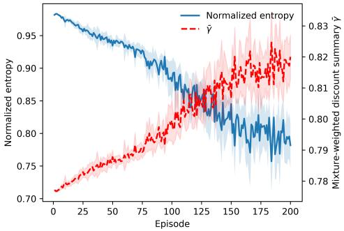
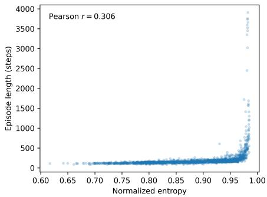
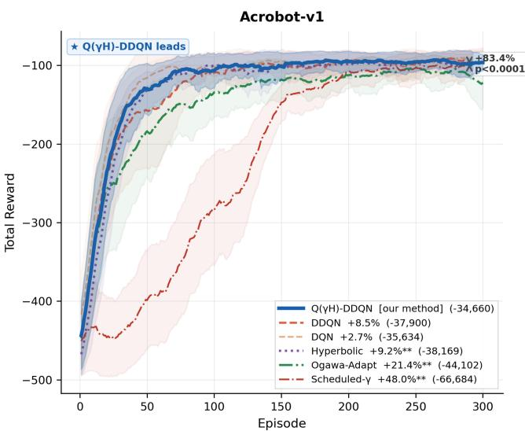

# Q(��): Entropy-Guided Horizon Mixing in Multi-Discount Q-Learning

Arwa Albelaihi1 [0000−0001−7135−5894] and Abdulrahman Altahhan1 [0000−0003−1133−7744]

School of Computer Science, University of Leeds, Leeds LS2 9JT, UK scaaalb@leeds.ac.uk, a.altahhan@leeds.ac.uk

Abstract. A fixed discount factor in Q-learning imposes a single planning horizon throughout training, despite the difering demands of early exploration and longterm credit assignment. We propose Q(��), a multi-horizon Q-learning framework that maintains multiple discount-specific heads and adaptively combines them at control time using an entropy-derived confidence signal. The resulting statedependent mixing weights shift control from shorter- to longer-horizon heads as policy confidence increases, enabling adaptive horizon mixing without modifying individual Bellman updates. Across classical control and deep reinforcementlearning benchmarks, Q(��) shows its strongest improvements on delayed-credit tasks relative to strong fixed-discount baselines. By decoupling horizon adaptation from the underlying learning updates, Q(��) provides a lightweight framework for adaptive planning-horizon control in reinforcement learning, avoiding the need for manual discount-factor selection while remaining compatible with standard value-learning methods.

Keywords: Reinforcement learning · Discount factor · Multi-horizon Q-learning · Entropy · Adaptive planning horizon

## 1 Introduction

Choosing the discount factor � in reinforcement learning is challenging. A short horizon can stabilise early learning by limiting bootstrap error propagation, but may prevent solving tasks requiring long-range credit assignment [4,15].

No single fixed � resolves this tension, and per-task tuning [7] does not address changes in the required planning horizon during training. Neuroscience evidence also suggests that dopaminergic neurons encode reward prediction errors across multiple discount time constants [9].

Recent methods address this through adaptive or multi-horizon discounting [13,1,12,11], but require modified Bellman targets, global rather than state-dependent mixing, reward decomposition, or added deep-RL infrastructure. These approaches do not provide state-dependent control-time mixing across discount-specific Q-heads while preserving their standard Q-learning updates. We propose $\mathrm { Q } ( \gamma _ { H } )$ , which maintains � heads with discounts $\gamma _ { k } \in \Gamma$ and mixes them using state-dependent confidence. Low confidence favours shorter horizons, while high confidence favours longer ones. For analysis, we define $\begin{array} { r } { \bar { \gamma } ( s ) = \sum _ { k = 1 } ^ { K } w _ { k } ( s ) \gamma _ { k } } \end{array}$ as a mixture-weighted discount summary of horizon emphasis, not the discount of an equivalent Bellman operator. Each head retains its fixed-�� Q-learning update.

Across tabular, linear, and deep RL settings, $\mathrm { Q } ( \gamma _ { H } )$ is strongest on delayed-credit tasks while remaining competitive across the other evaluated environments. Our contributions are: (i) state-dependent horizon mixing that preserves standard Q-learning updates; (ii) a deep RL extension with discount-specific heads; and (iii) controlled and ablation analyses of the entropy-guided mixing mechanism.

## 2 Related Work

$\mathrm { Q } ( \gamma _ { H } )$ builds on multi-horizon value learning, adaptive discounting, and entropy-based uncertainty signals. Unlike prior work, it performs state-dependent mixing across planning horizons only at control time, preserves standard Bellman updates, and extends to deep RL through discount-specific Q-heads.

Parallel value prediction across planning horizons is central to the GVF framework [19] and discount-indexed value learning [4,15]. Related deep-RL methods use multiple discount-indexed Q-heads [1], reward-component-specific discounts [2], multidiscount PPO advantages [12], or time-weighted horizon heads in distributional RL [11]. $\mathbf { Q } ( \gamma _ { H } )$ also uses discount-specific heads, but couples them only at action selection: it requires no reward decomposition [2], uses per-state rather than global mixing [12], and avoids distributional RL machinery [11].

Prior work has formalised transition- and state-dependent discounting $\gamma ( s , a , s ^ { \prime } )$ [22,16], used discounts to model termination or continuation values [23,18], and adapted � online using critic loss or entropy-based uncertainty [13,3]. In contrast, Q(��) does not modify Bellman targets or learn $\gamma ( s )$ directly; it performs state-dependent control-time mixing while each head keeps a standard fixed-�� update. The resulting $\begin{array} { r } { \bar { \gamma } ( s ) = \sum _ { k } w _ { k } ( s ) \gamma _ { k } } \end{array}$ is used only as a descriptive summary of the mixing weights.

Entropy is commonly used in RL as an objective [5,24], while ensembles use model diversity for uncertainty estimation and exploration [14,8], and mixture-of-experts methods use input-dependent gating [17]. In contrast, $\mathbf { Q } ( \gamma _ { H } )$ uses reference-policy entropy as a lightweight signal for decision ambiguity. Its head diversity is temporal rather than epistemic, and the gate interpolates across planning horizons rather than averaging to reduce variance. Table 1 summarises the closest comparisons.

A complementary motivation comes from neuroscience: dopaminergic neurons have been shown to encode reward prediction errors across multiple discount time constants [9]. This supports the use of parallel fixed-� estimators, while $\mathrm { Q } ( \gamma _ { H } )$ adds an adaptive aggregation mechanism through entropy-guided control-time mixing.

## 3 Method: Q(��)

## 3.1 Problem Setup

We consider a finite Markov decision process $\boldsymbol { \mathcal { M } } = ( S , \mathcal { A } , P , r , \gamma )$ with finite action space A and discount factor $\gamma \in ( 0 , 1 )$ . Standard Q-learning [21] fixes � before training, although the appropriate planning horizon may vary across states and learning stages. $\mathbf { Q } ( \gamma _ { H } )$ instead maintains � parallel Q-learning heads, each trained with a diferent fixed discount factor, and mixes their values at control time using an entropy-derived confidence signal.

Table 1. Comparison of $\mathrm { Q } ( \gamma _ { H } )$ with closely related methods. State-dep. = state-dependent mixing or adaptation. Bellman changed = whether Bellman targets are modified. Control mix = whether discount-specific heads are mixed at action selection.
<table><tr><td>Method</td><td>Multi- State- head</td><td>dep.</td><td>Gate signal</td><td>Bellman Control changed</td><td></td></tr><tr><td>Q(γH) (ours)</td><td>√</td><td>√</td><td>Entropy</td><td>No</td><td>mix √</td></tr><tr><td>Ogawa et al. [13]</td><td>×</td><td>X</td><td>Critic loss</td><td>Yes</td><td>X</td></tr><tr><td>Moghimi et al. [11]</td><td>√</td><td>X</td><td>None</td><td>No</td><td>X</td></tr><tr><td>Nafi et al. [12]</td><td>√</td><td>X</td><td>None</td><td>No</td><td>X</td></tr><tr><td>Chen et al. [2]</td><td>√</td><td>X</td><td>None</td><td>No</td><td>X</td></tr></table>

## 3.2 Multi-Horizon Q-Heads

Let $\Gamma = \{ \gamma _ { 1 } < \dots < \gamma _ { K } \}$ be a set of discount factors. For each $\gamma _ { k } , Q ( \gamma _ { H } )$ maintains an independent Q-head $\boldsymbol { Q } ^ { ( k ) } : \boldsymbol { S } \times \mathcal { A }  \mathbb { R }$ :

$$
{ Q } ^ { ( k ) } ( s , a ) \approx \\\\\\\\\mathbb { E } \left[ \sum _ { t = 0 } ^ { \infty } \gamma _ { k } ^ { t } r _ { t } \mid s _ { 0 } = s , a _ { 0 } = a \right] .\tag{1}
$$

Each head is parameterised as

$$
Q ^ { ( k ) } ( s , a ) = W _ { k } ( a , : ) ^ { \top } \phi ( s ) ,\tag{2}
$$

with its independent discount factor $\gamma _ { k }$ and Bellman targets, while sharing the same experience stream and feature representation.

## 3.3 Reference Q Construction

To compute confidence, we construct a reference Q-vector $q _ { \mathrm { r e f } } \in \mathbb { R } ^ { | \mathcal { A } | }$ from the current multi-head estimates. A simple baseline uses one fixed head:

$$
q _ { \mathrm { r e f } } = Q ^ { ( k _ { \mathrm { r e f } } ) } ( s , \cdot ) ,\tag{3}
$$

which we evaluate in the ablation study.

Our default uses all heads through a max–min aggregation:

$$
q _ { \mathrm { r e f } } ( a ) = \eta \operatorname* { m a x } _ { k } \mathcal { Q } ^ { ( k ) } ( s , a ) + ( 1 - \eta ) \operatorname* { m i n } _ { k } \mathcal { Q } ^ { ( k ) } ( s , a ) , \qquad \forall a \in \mathcal { A } ,\tag{4}
$$

where $\eta \in [ 0 , 1 ]$ balances optimistic and conservative estimates. We use $\eta = 0 . 5$ by default and assess alternatives in the ablation and sensitivity studies.

## 3.4 Entropy-Based Confidence

Given $q _ { \mathrm { r e f } }$ , we compute a Boltzmann policy with temperature $\tau > 0$

$$
\pi _ { \mathrm { r e f } } ( a \mid s ) = \frac { \exp ( q _ { \mathrm { r e f } } ( a ) / \tau ) } { \sum _ { a ^ { \prime } } \exp ( q _ { \mathrm { r e f } } ( a ^ { \prime } ) / \tau ) } .\tag{5}
$$

The normalised Shannon entropy of this policy is:

$$
H _ { n } ( s ) = - { \frac { 1 } { \log \left| { \mathcal { R } } \right| } } \sum _ { a \in { \mathcal { A } } } \pi _ { \mathrm { r e f } } ( a \mid s ) \log \pi _ { \mathrm { r e f } } ( a \mid s )\tag{6}
$$

Normalisation by log $| \mathcal { R } |$ ensures $H _ { n } ( s ) = 1$ when all actions appear equally valuable and $H _ { n } ( s ) \to 0$ when one action is clearly preferred. The agent’s confidence is then:

$$
c ( s ) = 1 - H _ { n } ( s ) .\tag{7}
$$

Thus, high entropy implies low confidence, while low entropy implies high confidence.

## 3.5 Adaptive Horizon Mixing

We map confidence $c ( s ) \in [ 0 , 1 ]$ to a distribution over the � heads using a soft proximity weighting. Each head � is assigned a fixed position on the unit interval:

$$
u _ { k } = \frac { k - 1 } { K - 1 } , \qquad k = 1 , \dots , K ,\tag{8}
$$

so that $u _ { 1 } = 0$ corresponds to the shortest-horizon head and $u _ { K } = 1$ to the longesthorizon head. Mixing weights are computed as a softmax over negative distances from the confidence value:

$$
w _ { k } ( s ) = \frac { \exp \bigl ( - \beta \left| u _ { k } - c ( s ) \right| \bigr ) } { \sum _ { j = 1 } ^ { K } \exp \bigl ( - \beta \left| u _ { j } - c ( s ) \right| \bigr ) } ,\tag{9}
$$

where $\beta$ controls selection sharpness. Low confidence gives more weight to short-horizon heads, while high confidence favours longer horizons.

The head values are aggregated for action selection using the confidence-modulated weights:

$$
Q _ { \mathrm { a g g } } ( s , a ) = \sum _ { k = 1 } ^ { K } w _ { k } ( s ) Q ^ { ( k ) } ( s , a ) .\tag{10}
$$

For analysis, we additionally define the mixture-weighted discount summary

$$
\bar { \gamma } ( s ) = \sum _ { k = 1 } ^ { K } w _ { k } ( s ) \gamma _ { k } .\tag{11}
$$

This quantity summarises whether the mixing weights emphasise shorter- or longerhorizon heads; it is not the discount factor of an equivalent Bellman operator.

## 3.6 Learning Rule

Actions are selected �-greedily with respect to $Q _ { \mathrm { a g g } }$ . After observing $( s , a , r , s ^ { \prime } )$ , each head is updated independently:

$$
\delta _ { k } = r + \mathbf { 1 } _ { \{ s ^ { \prime } \notin \mathcal { T } \} } \gamma _ { k } \operatorname* { m a x } _ { a ^ { \prime } } Q ^ { ( k ) } ( s ^ { \prime } , a ^ { \prime } ) - Q ^ { ( k ) } ( s , a ) .\tag{12}
$$

$$
W _ { k } ( a , : ) \longleftarrow W _ { k } ( a , : ) + \alpha \delta _ { k } \phi ( s ) .\tag{13}
$$

The mixing weights afect only action selection; each head keeps its own standard fixed- $\gamma _ { k }$ Q-learning update. Algorithm 1 summarises the full procedure.

Algorithm 1 ${ \mathrm { Q } } ( \gamma _ { H } ) { \mathrm { : } }$ Entropy-Guided Horizon Mixing   
Require: $\Gamma = \{ \gamma _ { 1 } , \dots , \gamma _ { K } \} , \alpha , \tau , \beta , \eta , \varepsilon$   
1: Initialise $W _ { k } \gets \mathbf { 0 }$ for all �; set $u _ { k } \gets ( k - 1 ) / ( K - 1 )$   
2: for each episode do   
3: Observe initial state �   
4: while � not terminal do   
5: Compute $Q ^ { ( k ) } ( s , \cdot ) \gets W _ { k } \phi ( s )$ for all �   
6: Build reference: $q _ { \mathrm { r e f } } ( a )  \eta$ max� $Q ^ { ( k ) } ( s , a ) + ( 1 - \eta )$ min� $Q ^ { ( k ) } ( s , a )$   
7: Derive $\pi _ { \mathrm { r e f } } ( \cdot \mid s )$ from $q _ { \mathrm { r e f } }$ via softmax with �; compute entropy $H _ { n } ( s )$   
8: Set $c ( s ) \gets 1 - H _ { n } ( s ) ;$ compute weights $w _ { k } ( s )$ via softmax over $\left| u _ { k } - c ( s ) \right|$   
9: $\begin{array} { r } { \boldsymbol { Q } _ { \mathrm { a g g } } ( \boldsymbol { s } , \cdot ) \gets \sum _ { k } w _ { k } ( \boldsymbol { s } ) \boldsymbol { Q } ^ { ( k ) } ( \boldsymbol { s } , \cdot ) } \end{array}$   
10: Select � �-greedily w.r.t. $Q _ { \mathrm { a g g } } ( s , \cdot ) ;$ execute; observe $r , s ^ { \prime }$   
11: $\begin{array} { r } { \delta _ { k } = r + \mathbf { 1 } _ { \left\{ s ^ { \prime } \notin \mathcal { T } \right\} } \dot { \gamma } _ { k } \operatorname* { m a x } _ { a ^ { \prime } } \tilde { Q } ^ { \left( k \right) } ( s ^ { \prime } , a ^ { \prime } ) - Q ^ { ( k ) } ( s , a ) } \end{array}$ for all �   
12: $W _ { k } ( a , : ) \longleftarrow W _ { k } ( a , : ) + \alpha \delta _ { k } \phi ( s )$ for all �   
13: $s \gets s ^ { \prime }$   
14: end while   
15: Decay �   
16: end for

## 3.7 Complexity and Practical Considerations

Each head in $\mathrm { Q } ( \gamma _ { H } )$ uses a standard of-policy Q-learning update under its own Bellman operator, where suficient exploration is the key practical requirement [21,20]. The mixing weights are bounded, non-negative, and sum to one, so $Q _ { \mathrm { a g g } }$ is a well-defined convex combination of the heads:

$$
Q _ { \mathrm { a g g } } ( s , a ) = \sum _ { k } w _ { k } ( s ) Q ^ { ( k ) } ( s , a ) .
$$

Thus, state-dependent mixing afects action selection but not the individual Bellman targets.

The overhead of $\mathrm { Q } ( \gamma _ { H } )$ is linear in the number of heads �. Maintaining � heads requires $O ( K | \mathcal { A } | d )$ memory, and dense linear evaluation and updates cost $O ( K | \mathcal { A } | d )$ per step. The reference, entropy, and weighting computations add only $O ( K | \mathcal { A } | )$ operations. In tabular and linear settings, no replay bufer, target network, or neural component is required. In the deep-RL extension, the same confidence-gated mixing is implemented on top of standard DQN and DDQN machinery using discount-specific output heads.

## 4 Experiments

We evaluate $\mathrm { Q } ( \gamma _ { H } )$ in tabular/linear and deep-RL settings. The tabular/linear suite contains eight benchmarks spanning delayed-credit, navigation, stochastic, and risk-sensitive tasks. The deep learning setting evaluates CartPole-v1, Acrobot-v1, and MountainCar-v0 using a shared-trunk multi-head DDQN architecture with one head per $\gamma \in \Gamma$ . Table 2 summarises all environments.

In the tabular and linear settings, we compare $\mathrm { Q } ( \gamma _ { H } )$ with Q-learning, SARSA, Expected SARSA, and Double Q-learning. Each baseline uses an oracle discount $\gamma ^ { * }$ selected post hoc from Γ using best performance, while $\mathrm { Q } ( \gamma _ { H } )$ uses all discounts in Γ and adapts its horizon mixture online.

Table 2. Experimental environments used in evaluations. TC denotes tile coding, IHT denotes index hash table, and FC denotes a fully connected neural network.
<table><tr><td>Environment</td><td>Type</td><td>|A|</td><td>Repr.</td><td>Key challenge</td></tr><tr><td>Tabular / linear</td><td></td><td></td><td></td><td></td></tr><tr><td>MountainCar</td><td>Continuous</td><td>3</td><td>TC (IHT 2048)</td><td>Delayed credit</td></tr><tr><td>Acrobot</td><td>Continuous</td><td>3</td><td>TC (IHT 4096)</td><td>Delayed credit</td></tr><tr><td>LunarLander</td><td>Continuous</td><td>4</td><td>TC (IHT 8192)</td><td>Dense reward</td></tr><tr><td>Gridworld</td><td>Navigation</td><td>4</td><td>Tabular</td><td>Deterministic</td></tr><tr><td>WindyGridworld</td><td>Navigation</td><td>8</td><td>Tabular</td><td>Stochastic wind</td></tr><tr><td>CliffWalking</td><td>Navigation</td><td>4</td><td>Tabular</td><td>Cliff penalty</td></tr><tr><td>Stoch. CliffWalking</td><td>Navigation</td><td>4</td><td>Tabular</td><td>Slip p=0.10</td></tr><tr><td>FrozenLake-8×8</td><td>Stoch. nav.</td><td>4</td><td>One-hot</td><td>Slippery, sparse</td></tr><tr><td colspan="5">Deep learning (normalised state)</td></tr><tr><td>CartPole-v1</td><td>Control</td><td>2</td><td>FC [128, 128, 64]</td><td>Easy baseline</td></tr><tr><td>Acrobot-v1</td><td>Control</td><td>3</td><td>FC [128, 128, 64]</td><td>Delayed credit</td></tr><tr><td>MountainCar-v0</td><td>Control</td><td>3</td><td>FC [128, 128, 64]</td><td>Hard exploration</td></tr></table>

In the deep-RL setting, we compare Deep Q(�H) against five baselines: DDQN [6] and DQN [10] (single-head, fixed �); Hyperbolic DQN [4] (� heads with hyperbolic spacing $\gamma _ { k } { = } 1 / ( 1 { + } k h )$ , uniform mixing, no confidence gate); Ogawa-Adapt [13] (single � adjusted by a loss-based PI controller); and Scheduled-� (� grown linearly from 0.80 to 0.99, no learned signal).

Table 3 lists all hyperparameters. Shared parameters are fixed across environments and both settings. Unless otherwise stated, experiments use $N { = } 1 0$ seeds. For MountainCar, the default $\mathrm { Q } ( \gamma _ { H } )$ configuration uses the same 10 canonical runs wherever the identical setting appears; alternative configurations use separate 10-seed runs, with 20-seed results reported where stated. We report EarlyMean (first 50 episodes), TailMean (last 50 episodes), and AUC (full run). Episode length is the performance metric (lower is better) except for LunarLander (return, higher is better).

## 4.1 Main Results

Table 4 shows that ${ \bf Q } ( \gamma _ { H } )$ is strongest on delayed-credit tasks. It achieves the best mean AUC on MountainCar and Acrobot, with reductions of 6.0% and 2.1%, respectively, relative to the next-best fixed-� baselines. Across the remaining environments, $\mathrm { Q } ( \gamma _ { H } )$ remains competitive and often improves early learning, although fixed-� or on-policy baselines can perform better when one horizon is suficient or risk-sensitive behaviour is required.

Table 5 extends the comparison to deep RL. Deep Q(�H)-DDQN achieves the best AUC on all three environments. On Acrobot-v1 and MountainCar-v0, it outperforms DDQN by 8.5% and 7.0%, respectively. The largest margins are against adaptive baselines: Scheduled-� is outperformed by 48.0% on Acrobot $( p { < } 0 . 0 0 0 1 )$ and 7.5% on

Table 3. Default hyperparameters used in the experiments.
<table><tr><td>Parameter</td><td>Symbol</td><td>Value</td><td>Notes</td></tr><tr><td colspan="4">Shared (tabular/linear &amp; deep)</td></tr><tr><td>Initial exploration</td><td> $\varepsilon _ { 0 }$ </td><td>0.10</td><td>ε-greedy</td></tr><tr><td>Exploration decay</td><td> $\delta _ { \varepsilon }$ </td><td>0.985</td><td>Per-episode</td></tr><tr><td>Min. exploration</td><td> $\varepsilon _ { \mathrm { { m i n } } }$ </td><td>0.05</td><td></td></tr><tr><td colspan="4">Tabular/linear only</td></tr><tr><td>Discount set</td><td>Γ</td><td>{0.70, 0.80, 0.90,0.97,0.99}</td><td>K = 5 heads</td></tr><tr><td>Learning rate</td><td>α</td><td>0.025</td><td>TD step size</td></tr><tr><td>Episodes</td><td> $T$ </td><td>200</td><td></td></tr><tr><td>Max steps</td><td>max_t</td><td>5,000</td><td></td></tr><tr><td>Temperature</td><td>T</td><td>0.25</td><td></td></tr><tr><td>Sharpness</td><td> $\beta$ </td><td>3.0</td><td></td></tr><tr><td>Mixing</td><td>η</td><td>0.5</td><td></td></tr><tr><td colspan="4">Deep learning only</td></tr><tr><td>Discount set</td><td>Γ</td><td>{0.90, 0.95, 0.99}</td><td>K = 3 heads</td></tr><tr><td>Learning rate</td><td>α</td><td>10⁻4</td><td>Adam optimiser</td></tr><tr><td>Episodes</td><td>T</td><td>300</td><td></td></tr><tr><td>Replay buffer</td><td></td><td>50,000</td><td>Uniform sampling</td></tr><tr><td>Batch size</td><td></td><td>64</td><td></td></tr><tr><td>Target sync</td><td></td><td>Every 100 steps</td><td>Hard update</td></tr><tr><td>Entropy temp.</td><td>T</td><td>0.1</td><td>Sharper than tabular</td></tr><tr><td>Entropy warmup</td><td></td><td>200 steps</td><td></td></tr><tr><td>Network</td><td></td><td>FC [128, 128,64]</td><td>Shared trunk</td></tr><tr><td></td><td></td><td></td><td></td></tr></table>

MountainCar $( p { = } 0 . 0 0 0 7 )$ , while Ogawa-Adapt is outperformed by 21.4% $\scriptstyle ( p = 0 . 0 0 2 9 )$ and 7.6% (�=0.0008), respectively. Within these classic-control tasks, these results support the benefit of confidence-guided horizon mixing.

## 4.2 Mechanism Analysis

Figure 1 examines the internal mixing signals on MountainCar. As training progresses, normalised entropy decreases from 0.960 to 0.800, while �¯ increases from 0.782 to 0.816, indicating a shift in mixing weight toward longer-horizon heads. The entropy– episode length relationship shows a positive association $( r = 0 . 3 0 6 )$ , with higher entropy associated with longer episodes and poorer performance, consistent with its role as a lightweight confidence signal for horizon mixing.

To examine state dependence directly, we evaluated the learned gate over the MountainCar position–velocity state space using the same 10 canonical training seeds. In the 10-seed mean state-space evaluation, $H _ { n }$ ranged from 0.042 to 1.000 and $\bar { \gamma }$ from 0.773 to 0.951. The weights of the $\gamma = 0 . 7 0$ and $\gamma = 0 . 9 9$ heads ranged from 0.031–0.540 and 0.027–0.479, respectively, showing that the learned horizon mixture varies substantially across states.

Table 4. Q(��) vs. oracle-tuned fixed-� baselines. Values are means over 10 seeds. Steps ↓ except LunarLander return ↑.
<table><tr><td>Environment</td><td>Method</td><td>γ* Early</td><td>Tail</td><td>AUC</td><td></td></tr><tr><td colspan="6">Delayed-credit environments</td></tr><tr><td rowspan="5">MountainCar</td><td>Q(γH)</td><td></td><td>366.36</td><td>136.45</td><td>203.58</td></tr><tr><td>Q-Learning</td><td>0.97</td><td>402.42</td><td>136.16</td><td>217.12</td></tr><tr><td>SARSA</td><td>0.97</td><td>388.81</td><td>143.95</td><td>216.51</td></tr><tr><td>Exp. SARSA 0.97</td><td></td><td>401.04</td><td>139.79</td><td>218.13</td></tr><tr><td>Double Q</td><td>0.97</td><td>580.43</td><td>146.54</td><td>280.95</td></tr><tr><td rowspan="5">Acrobot</td><td>Q(γH)</td><td></td><td>602.97</td><td>127.88</td><td>192.78</td></tr><tr><td>Q-Learning</td><td>0.97</td><td>535.94</td><td>144.53</td><td>200.92</td></tr><tr><td>SARSA</td><td>0.97</td><td>543.22</td><td>144.99</td><td>200.32</td></tr><tr><td>Exp. SARSA 0.99</td><td></td><td>521.68</td><td>143.68</td><td>196.96</td></tr><tr><td>Double Q</td><td>0.97</td><td>636.53</td><td>163.37</td><td>228.16</td></tr><tr><td colspan="2">General environments</td><td></td><td></td><td></td><td></td></tr><tr><td rowspan="4">Gridworld</td><td>Q(γH)</td><td></td><td>65.88</td><td>19.60</td><td>37.60</td></tr><tr><td>Q-Learning</td><td>0.99</td><td>66.14</td><td>19.74</td><td>36.96</td></tr><tr><td>SARSA</td><td>0.97</td><td>68.68</td><td>19.32</td><td>37.16</td></tr><tr><td>Exp. SARSA 0.97</td><td></td><td>66.16</td><td>19.96</td><td>36.98</td></tr><tr><td rowspan="5">WindyGridworld SARSA</td><td>Double Q</td><td>0.99</td><td>77.70</td><td>31.74</td><td>48.90</td></tr><tr><td>Q(γH)</td><td></td><td>319.23</td><td>93.78</td><td>162.93</td></tr><tr><td>Q-Learning</td><td>0.70</td><td>369.04</td><td>68.37</td><td>160.50</td></tr><tr><td></td><td>0.80</td><td>347.49</td><td>73.59</td><td>162.65</td></tr><tr><td>Exp. SARSA 0.80</td><td></td><td>354.09</td><td>72.73</td><td>163.10</td></tr><tr><td rowspan="5">FrozenLake</td><td>Double Q Q(γH)</td><td>0.70</td><td>594.94</td><td>108.61</td><td>268.34</td></tr><tr><td></td><td></td><td>197.40</td><td>22.34 22.16</td><td>76.70 76.60</td></tr><tr><td>Q-Learning SARSA</td><td>0.97</td><td>197.72</td><td>21.02</td><td></td></tr><tr><td>Exp. SARSA 0.80</td><td>0.99</td><td>198.22 197.97</td><td></td><td>77.13</td></tr><tr><td>Double Q</td><td></td><td>198.43</td><td>21.36 25.90</td><td>72.80 82.24</td></tr><tr><td rowspan="5">LunarLander ↑</td><td>Q(γH)</td><td>0.80</td><td></td><td></td><td>-122.56</td></tr><tr><td></td><td></td><td>-162.43</td><td>-83.53</td><td></td></tr><tr><td>Q-Learning</td><td>0.99</td><td>-164.36</td><td>-74.74</td><td>-116.09</td></tr><tr><td>SARSA</td><td>0.99</td><td></td><td>9-168.46-102.92-137.53</td><td></td></tr><tr><td>Exp. SARSA Double Q</td><td>0.99</td><td>-166.03 0.99-171.01</td><td>-105.40-138.27 -93.53</td><td>-130.96</td></tr><tr><td colspan="6">Risk-sensitive environments</td></tr><tr><td rowspan="5">CliffWalking</td><td>Q(γH)</td><td></td><td></td><td></td><td>58.29</td></tr><tr><td>Q-Learning</td><td></td><td>128.06 118.57</td><td>24.29 24.31</td><td>55.17</td></tr><tr><td>SARSA</td><td>0.99 0.97</td><td>120.60</td><td>25.05</td><td>57.03</td></tr><tr><td>Exp. SARSA 0.70</td><td></td><td>131.43</td><td>24.30</td><td>59.42</td></tr><tr><td>Double Q</td><td>0.99</td><td>159.47</td><td>48.80</td><td>88.31</td></tr><tr><td rowspan="5">Stoch. Cliff</td><td>Q(γH)</td><td></td><td>130.81</td><td>29.04</td><td>61.85</td></tr><tr><td>Q-Learning</td><td>0.70</td><td>148.85</td><td>27.82</td><td>68.94</td></tr><tr><td>SARSA</td><td>0.99</td><td>122.11</td><td>27.64</td><td>58.74</td></tr><tr><td>Exp. SARSA 0.80</td><td></td><td>130.94</td><td>27.34</td><td>61.85</td></tr><tr><td>Double Q</td><td>0.97</td><td>145.96</td><td>39.64</td><td>79.14</td></tr></table>

  
Fig. 1. Mechanism analysis on MountainCar using the same 10 canonical training seeds. Left: normalised entropy decreases while $\bar { \gamma }$ increases; shaded bands denote 95% confidence intervals across seeds. Right: normalised entropy versus episode length across all seed–episode observations $( N = 2 { , } 0 0 0$ , Pearson $r = 0 . 3 0 6 )$ ).

Table 5. Deep Q(�H)-DDQN vs. all baselines (10 seeds, 300 episodes). AUC ↑ higher is better. Gain is computed as $1 0 0 \times \left( \mathrm { A U C } _ { Q ( \gamma H ) } - \mathrm { A U C _ { b a s e } } \right) / | \mathrm { A U C _ { b a s e } } | ;$ ; positive values indicate that Q(�H)-DDQN performs better. $^ { * } p < 0 . 0 5 , ^ { * * } p < 0 . 0 1 , ^ { * * * } p < 0 . 0 0 1$ (paired �-test, 10 seeds). Bold = best per column.
<table><tr><td rowspan="2">Method</td><td colspan="2">CartPole-v1 ↑</td><td colspan="2">Acrobot-v1 ↑</td><td colspan="2">MountainCar-v0 ↑</td></tr><tr><td>AUC</td><td>Gain</td><td>AUC</td><td>Gain</td><td>AUC</td><td>Gain</td></tr><tr><td>Q(γH)-DDQN</td><td>40,476</td><td></td><td>-34,660</td><td></td><td>-55,185</td><td></td></tr><tr><td>Q(γH)-DQN</td><td>38,804</td><td>+4.3%</td><td>-40,242</td><td>+13.9%</td><td>-58,312</td><td>+5.4%*</td></tr><tr><td>DDQN</td><td>38,084</td><td>+6.3%</td><td>-37,900</td><td>+8.5%</td><td>-59,314</td><td> $+ 7 . 0 \% ^ { * * }$ </td></tr><tr><td>DQN</td><td>26,851</td><td>+50.7%</td><td>-35,634</td><td>+2.7%</td><td>-59,112</td><td>+6.6%**</td></tr><tr><td>Hyperbolic [4]</td><td>34,616</td><td>+16.9%</td><td>-38,169</td><td>+9.2%**</td><td>-58,025</td><td>+4.9%*</td></tr><tr><td>Ogawa-Adapt [13]</td><td>36,999</td><td>+9.4%</td><td>-44,102</td><td>+21.4%**</td><td>-59,702</td><td>+7.6%**</td></tr><tr><td>Scheduled-γ</td><td>40,226</td><td>+0.6%</td><td>-66,684</td><td>+48.0%***</td><td>-59,638</td><td>+7.5%**</td></tr></table>

## 4.3 Head Disagreement as Uncertainty Proxy

We also measure head disagreement as an independent value-side diagnostic:

$$
d ( s , a ) = \operatorname* { m a x } _ { k } \mathcal { Q } ^ { ( k ) } ( s , a ) - \operatorname* { m i n } _ { k } \mathcal { Q } ^ { ( k ) } ( s , a ) .\tag{14}
$$

Table 6 shows that disagreement increases during learning while entropy decreases and $\bar { \gamma }$ increases. The negative disagreement–entropy correlations $( r = - 0 . 8 8 3$ on MountainCar and $r = - 0 . 9 6 9$ on Acrobot) are consistent with increasingly decisive reference policies as horizon-specific value estimates separate. Positive disagreement– $- \bar { \gamma }$ correlations indicate a concurrent shift in mixing weight toward longer-horizon heads.

## 4.4 Ablation Study

We analyse the contribution of the mixing gate, reference construction, gating signal, and number of heads.

  
Fig. 2. Learning curves on Acrobot-v1 (10 seeds, 300 episodes, shaded = 95% CI, reward ↑). Q(�H)-DDQN (solid blue) converges faster and achieves the best cumulative reward (−34,660). It outperforms Scheduled-� by 48.0% (�<0.001), Ogawa-Adapt by 21.4% $( p { < } 0 . 0 1 )$ , and DDQN by 8.5%. The annotation marks the gain over Scheduled-� relative to the episode-wise peak gap. Since Acrobot assigns −1 per timestep, values closer to zero indicate faster task completion.

To isolate the efect of entropy-guided mixing from the general benefit of maintaining multiple heads, we compare $\mathrm { Q } ( \gamma _ { H } )$ with a parameter-matched uniform multi-head baseline using the same five discounts, representation, training procedure, and seeds, but fixed weights $w _ { k } = 1 / K . \mathrm { Q } ( \gamma _ { H } )$ improves EarlyMean from 397.63 to 366.36, TailMean from 141.83 to 136.45, and AUC from 216.50 to 203.58. Paired �-tests show significant diferences for EarlyMean $( p < 0 . 0 0 1 )$ , TailMean $( p = 0 . 0 0 7 )$ , and AUC $( p < 0 . 0 0 1 )$ ). These results show that entropy-guided mixing improves both learning eficiency and final performance beyond the general benefit of maintaining multiple discount-specific heads.

We compare fixed-head and aggregated reference constructions on MountainCar. As shown in Table 7, MaxMin linear achieves the best EarlyMean, TailMean, and AUC. Mean Q and Max Q also outperform the best fixed-head variant in AUC, whereas the pessimistic Min Q construction does not. MaxMin linear improves over the best fixed-head variant by 2.3% AUC.

We compare three confidence signals on MountainCar using the MaxMin linear reference: entropy $c ( s ) = 1 - H _ { n } ( s )$ , variance $c ( s ) = 1 / ( 1 + v ( s ) )$ , and disagreement $c ( s ) = 1 / ( 1 + d ( s ) )$ , where �(�) and $d ( s )$ are the mean Q-value variance and range across heads, respectively.

Table 8 shows similar performance across the three signals, with AUC spanning 203.58–206.41, suggesting that the mechanism is not tied to one gating signal. Entropy is retained as the default as a bounded measure of action ambiguity; its scale sensitivity is examined in the sensitivity analysis.

Table 6. Signal dynamics and correlations on delayed-credit tasks (10 seeds). Pearson � is computed episode-wise over 200 episodes.
<table><tr><td>MountainCar</td><td>Acrobot</td><td></td></tr><tr><td>Signal dynamics (first 50 → last 50 episodes)</td><td></td><td rowspan="3"> $1 . 0 3  8 . 1 5$ </td></tr><tr><td>Mean head disagreement Normalised entropy  $H _ { n }$ </td><td> $1 5 . 5 3  2 7 . 7 7$   $0 . 9 6 0  0 . 8 0 0$   $0 . 9 6 9  0 . 8 7 8$ </td></tr><tr><td colspan="2">Discount summary  $\bar { \gamma }$   $0 . 7 8 2  0 . 8 1 6$   $0 . 7 8 0 \to 0 . 8 0 0$ </td></tr><tr><td>Pearson r (episode-wise, 200 episodes)</td><td></td><td></td></tr><tr><td> $\mathrm { D i s a g r e e m e n t }  H _ { n }$ </td><td>-0.883</td><td>-0.969</td></tr><tr><td> $\mathrm { D i s a g r e e m e n t }  \mathrm { s t e p s }$ </td><td>-0.608</td><td>-0.318</td></tr><tr><td>Disagreement → γ</td><td>+0.888</td><td>+0.970</td></tr></table>

Table 7. Reference construction comparison on MountainCar (10 seeds, steps ↓). Final $\bar { \gamma }$ and $H _ { n }$ are means over the last 50 episodes.
<table><tr><td>Method</td><td>Type</td><td>Early ↓</td><td>Tail↓</td><td>AUC↓</td><td> $\bar { \gamma }$ </td><td> $H _ { n }$ </td></tr><tr><td>MaxMin linear</td><td>Aggregated</td><td>366.36</td><td>136.45</td><td>203.58</td><td>0.816</td><td>0.800</td></tr><tr><td>Mean Q</td><td>Aggregated</td><td>373.1</td><td>137.7</td><td>206.4</td><td>0.802</td><td>0.863</td></tr><tr><td>Max Q optimistic</td><td>Aggregated</td><td>370.7</td><td>138.9</td><td>206.8</td><td>0.789</td><td>0.926</td></tr><tr><td>Fixed middle</td><td>Fixed head</td><td>379.1</td><td>139.9</td><td>208.3</td><td>0.798</td><td>0.882</td></tr><tr><td>Fixed short</td><td>Fixed head</td><td>375.4</td><td>139.2</td><td>208.5</td><td>0.789</td><td>0.924</td></tr><tr><td>Min Q pessimistic</td><td>Aggregated</td><td>379.1</td><td>140.7</td><td>209.0</td><td>0.842</td><td>0.670</td></tr><tr><td>Fixed long</td><td>Fixed head</td><td>383.7</td><td>140.5</td><td>211.6</td><td>0.844</td><td>0.658</td></tr></table>

Table 9 compares the default $K = 5$ setting with a smaller $K = 3$ variant on MountainCar. In the 10-seed comparison, $K = 5$ achieves slightly lower EarlyMean, TailMean, and AUC than $K = 3$ , although the diferences in EarlyMean and AUC are small. In the separate 20-seed analysis, $K = 3$ performs marginally better. Overall, the small diferences between the two configurations suggest limited sensitivity to the number of heads in this setting. Both configurations increase $\bar { \gamma }$ over training, indicating a shift in mixing weight toward longer-horizon heads. We retain $K = 5$ as the default to provide finer horizon granularity.

## 4.5 Sensitivity Analysis

Table 10 summarises sensitivity on MountainCar. $\mathrm { Q } ( \gamma _ { H } )$ is most sensitive to the sharpness parameter $\beta \colon$ too small a value spreads weight too difusely and slows early learning. It is less sensitive to � and $\eta ,$ with robust performance for $\tau \in [ 0 . 2 5 , 0 . 5 0 ]$ and $\eta \in [ 0 . 5 , 0 . 9 ]$ We therefore use $\beta = 3 . 0 , \tau = 0 . 2 5$ , and $\eta = 0 . 5$ as defaults.

Table 8. Gating signal ablation on MountainCar (10 seeds, MaxMin linear reference, steps ↓). Best value per column in bold.
<table><tr><td>Signal</td><td>Early ↓</td><td>Tail ↓</td><td>AUC↓</td><td>γ first 50</td><td>γ last 50</td></tr><tr><td>Entropy</td><td>366.36</td><td>136.45</td><td>203.58</td><td>0.782</td><td>0.816</td></tr><tr><td>Variance</td><td>372.79</td><td>138.70</td><td>205.25</td><td>0.795</td><td>0.784</td></tr><tr><td>Disagreement</td><td>375.35</td><td>138.47</td><td>206.41</td><td>0.796</td><td>0.787</td></tr></table>

Table 9. Head count ablation on MountainCar (steps ↓), 10 and 20 seeds. Best value per column in bold.
<table><tr><td>Seeds</td><td>Config</td><td>Early ↓</td><td>Tail ↓</td><td>AUC↓</td><td>γ first/last 50</td></tr><tr><td rowspan="2">10</td><td>K=3</td><td>367.20</td><td>139.39</td><td>204.16</td><td>0.755 / 0.790</td></tr><tr><td>K=5</td><td>366.36</td><td>136.45</td><td>203.58</td><td>0.782 / 0.816</td></tr><tr><td rowspan="2">20</td><td>K=3</td><td>367.36</td><td>139.94</td><td>204.62</td><td>0.755 / 0.790</td></tr><tr><td> ${ \mathrm { K } } { = } 5$ </td><td>370.36</td><td>140.60</td><td>205.60</td><td>0.780 / 0.811</td></tr></table>

## 5 Discussion and Limitations

The results show a task-dependent pattern across tabular, linear, and deep settings: Q(��) is most useful when the planning horizon is dificult to fix in advance.

The strongest gains occur in MountainCar and Acrobot, where short horizons support stable early learning but longer horizons are needed for delayed credit assignment. Q(��) addresses this trade-of by shifting control from shorter- to longer-horizon heads as confidence increases, producing a gradual shift in horizon emphasis within a single run.

When a single fixed discount is already efective, as in CartPole and LunarLander, horizon mixing provides limited benefit. In the clif environments, SARSA remains competitive because its on-policy updates encourage safer behaviour near hazardous states; horizon mixing does not remove this on-policy advantage.

The deep Q(�H) results demonstrate that the same control-time mixing mechanism can be applied with neural function approximation, with the largest gains on MountainCarv0 and Acrobot-v1 and little improvement on CartPole-v1. However, the current deep-RL evaluation is limited to three classic discrete-action control tasks and a shared-trunk multi-head architecture, so these results establish applicability rather than broad deep-RL generality. Further work should evaluate larger benchmark suites, separate-head architectures, continuous-action actor–critic variants, and the theoretical properties of the coupled multi-head system.

The tabular and linear experiments isolate the horizon-mixing mechanism without replay bufers, target networks, or neural optimisation efects. The comparison is conservative because fixed-� baselines use oracle-selected $\gamma ^ { * } .$ , whereas $\mathrm { Q } ( \gamma _ { H } )$ adapts its horizon mixture online. In the deep setting, DDQN uses $\gamma = 0 . 9 9$ , the strongest fixed discount considered.

The mechanism analyses make horizon mixing observable through the joint evolution of confidence, $\bar { \gamma } ,$ , and head disagreement, while the state-wise analysis confirms that the learned mixture also varies across the MountainCar state space. Here, �¯ is used only as a descriptive summary of the relative weight assigned to shorter- and longer-horizon heads.

Table 10. Sensitivity analysis on MountainCar (10 seeds, steps ↓). Robust ranges are determined from the corresponding AUC results. Best value per block in bold.
<table><tr><td>Param</td><td>Value</td><td>Early↓</td><td> $\mathbf { T a i l } \downarrow$ </td><td>Default</td><td>Robust range</td><td>Sensitivity</td></tr><tr><td rowspan="3">β</td><td>3.0</td><td>366.36</td><td>136.45</td><td rowspan="3">3.0</td><td rowspan="3">[1.5, 3.0]</td><td rowspan="3">Moderate</td></tr><tr><td>1.5</td><td>388.69</td><td>140.0</td></tr><tr><td>0.5</td><td>403.03</td><td>141.9</td></tr><tr><td rowspan="3">T</td><td>0.25</td><td>366.36</td><td>136.45</td><td rowspan="3">0.25</td><td rowspan="3">[0.25, 0.50]</td><td rowspan="3">Low</td></tr><tr><td>0.50</td><td>368.12</td><td>137.8</td></tr><tr><td>0.10</td><td>369.92</td><td>140.1</td></tr><tr><td rowspan="5">η</td><td>0.5</td><td>366.36</td><td>136.45</td><td rowspan="5">0.5</td><td rowspan="5"></td><td></td></tr><tr><td>0.7</td><td>368.84</td><td>138.33</td><td></td></tr><tr><td>0.9</td><td>373.02</td><td>137.21</td><td>[0.5, 0.9] Low-moderate</td></tr><tr><td>0.3</td><td>374.86</td><td>140.68</td><td></td></tr><tr><td>0.1</td><td>377.00</td><td>139.70</td><td></td></tr></table>

This pattern is also consistent with neuroscience evidence that reward prediction errors are represented across multiple discount timescales [9], although we make no claim of mechanistic correspondence.

A limitation of the current entropy gate is its sensitivity to reward and Q-value scale under a fixed Softmax temperature. The reward-scaling experiment shows that this sensitivity can materially afect performance at large scale changes. Scale-adaptive temperatures or normalised confidence signals are therefore important directions for future work.

## 6 Conclusion

We introduced $\mathbf { Q } ( \gamma _ { H } )$ , a multi-horizon Q-learning framework that avoids choosing a single fixed discount factor by maintaining discount-specific Q-heads and mixing them at control time using a state-dependent confidence signal. The resulting mixing weights adapt horizon emphasis during training while each head retains a standard $\mathrm { f i x e d } { \cdot } \gamma _ { k }$ Q-learning update. For analysis, $\begin{array} { r } { \bar { \gamma } ( s ) = \sum _ { k } w _ { k } ( s ) \gamma _ { k } } \end{array}$ provides a descriptive summary of this horizon mixture.

Across eight tabular and linear benchmarks, Q(��) is most efective on delayed-credit tasks, achieving the best mean AUC on MountainCar and Acrobot against oracle-tuned fixed-discount baselines. Mechanism and ablation analyses show state-dependent horizon mixing and improved learning eficiency from the entropy-guided gate, while sensitivity analysis identifies reward/Q-value scale as a limitation of the current fixed-temperature confidence signal.

The deep-RL extension, Deep $\mathrm { Q } ( \gamma \mathrm { H } )$ , shows the same qualitative pattern across the three evaluated classic-control tasks, with the largest gains on MountainCar-v0 and

Acrobot-v1 and little improvement on CartPole-v1. Overall, the results suggest that adaptive horizon mixing is a lightweight and interpretable alternative to manual selection of a single discount factor, especially when delayed credit assignment makes horizon choice dificult. Future work will examine larger benchmarks, continuous-action settings, alternative multi-head architectures, and scale-robust confidence mechanisms.

Disclosure of Interests. The authors have no competing interests to declare.

## References

1. Ali, R.F., Duong, K., Nafi, N.M., Hsu, W.: Multi-horizon learning in procedurally-generated environments for of-policy reinforcement learning (student abstract). In: Proceedings of the AAAI Conference on Artificial Intelligence. vol. 37, pp. 16150–16151 (2023)

2. Chen, P., Liu, Q., Li, Y., Yan, K., Ma, S.: Multi-discounting reinforcement learning based on reward decomposition. IEEE Transactions on Emerging Topics in Computing 14(1), 1–14 (2026)

3. Cho, H., Kim, H.: Entropy-guided distributional reinforcement learning with controlling uncertainty in robotic tasks. Applied Sciences 15(5), 2773 (2025)

4. Fedus, W., Gelada, C., Bengio, Y., Bellemare, M.G., Larochelle, H.: Hyperbolic discounting and learning over multiple horizons. arXiv preprint arXiv:1902.06865 (2019)

5. Haarnoja, T., Zhou, A., Hartikainen, K., Tucker, G., Ha, S., Tan, J., Kumar, V., Zhu, H., Gupta, A., Abbeel, P., et al.: Soft actor-critic algorithms and applications. arXiv preprint arXiv:1812.05905 (2018)

6. Hasselt, H.v., Guez, A., Silver, D.: Deep reinforcement learning with double q-learning. Proceedings of the AAAI Conference on Artificial Intelligence 30(1), 2094–2100 (2016)

7. Henderson, P., Islam, R., Bachman, P., Pineau, J., Precup, D., Meger, D.: Deep reinforcement learning that matters. In: Proceedings of the AAAI conference on artificial intelligence. vol. 32 (2018)

8. Lakshminarayanan, B., Pritzel, A., Blundell, C.: Simple and scalable predictive uncertainty estimation using deep ensembles. In: Advances in Neural Information Processing Systems. vol. 30 (2017)

9. Masset, P., Tano, P., Kim, H.R., Malik, A.N., Pouget, A., Uchida, N.: Multi-timescale reinforcement learning in the brain. Nature (2025). https://doi.org/10.1038/ s41586-025-08929-9

10. Mnih, V., Kavukcuoglu, K., Silver, D., Rusu, A.A., Veness, J., Bellemare, M.G., Graves, A., Riedmiller, M., Fidjeland, A.K., Ostrovski, G., et al.: Human-level control through deep reinforcement learning. nature 518(7540), 529–533 (2015)

11. Moghimi, M., Coache, A., Ku, H.: Decoupling time and risk: Risk-sensitive reinforcement learning with general discounting. arXiv preprint arXiv:2602.04131 (2026)

12. Nafi, N.M., Ali, R.F., Hsu, W., Duong, K., Vick, M.: Policy optimization using horizon regularized advantage to improve generalization in reinforcement learning. In: Proceedings of the 23rd International Conference on Autonomous Agents and Multi-Agent Systems (AAMAS) (2024)

13. Ogawa, K., et al.: Adaptive discount factor for accelerating policy learning considering long-term returns in reinforcement learning with non-stationary environments. Journal of Computational Science (2026)

14. Osband, I., Blundell, C., Pritzel, A., Van Roy, B.: Deep exploration via bootstrapped dqn. Advances in neural information processing systems 29 (2016)

15. Romof, J., Henderson, P., Touati, A., Brunskill, E., Pineau, J., Ollivier, Y.: Separating value functions across time-scales. In: International Conference on Machine Learning. pp. 5468–5477. PMLR (2019)

16. Sharma, A., Gupta, R., Lakshmanan, K., Gupta, A.: Transition based discount factor for model free algorithms in reinforcement learning. Symmetry 13(7) (2021). https://doi.org/10. 3390/sym13071197, https://www.mdpi.com/2073-8994/13/7/1197

17. Shazeer, N., Mirhoseini, A., Maziarz, K., Davis, A., Le, Q., Hinton, G., Dean, J.: Outrageously large neural networks: The sparsely-gated mixture-of-experts layer. arXiv preprint arXiv:1701.06538 (2017)

18. Stachurski, J., Zhang, J.: Dynamic programming with state-dependent discounting. Journal of Economic Theory 192, 105190 (2021)

19. Sutton, R.S., Modayil, J., Delp, M., Degris, T., Pilarski, P.M., White, A., Precup, D.: Horde: A scalable real-time architecture for learning knowledge from unsupervised sensorimotor interaction. In: The 10th International Conference on Autonomous Agents and Multiagent Systems-Volume 2. pp. 761–768 (2011)

20. Tsitsiklis, J.N.: Asynchronous stochastic approximation and q-learning. Machine Learning 16(3), 185–202 (1994)

21. Watkins, C.J.C.H., Dayan, P.: Q-learning. Machine Learning 8(3–4), 279–292 (1992)

22. White, M.: Unifying task specification in reinforcement learning. In: International Conference on Machine Learning. pp. 3742–3750. PMLR (2017)

23. Yoshida, N., Uchibe, E., Doya, K.: Reinforcement learning with state-dependent discount factor. In: 2013 IEEE third joint international conference on development and learning and epigenetic robotics (ICDL). pp. 1–6. IEEE (2013)

24. Ziebart, B.D., Maas, A., Bagnell, J.A., Dey, A.K.: Maximum entropy inverse reinforcement learning. In: Proceedings of the 23rd AAAI Conference on Artificial Intelligence. pp. 1433– 1438 (2008)