# RDL-Bench: A Benchmark for Task-Aware Question Answering over Relational Databases

Yao Cheng

College of Computing and Data Science

Nanyang Technological University

Singapore

yao.cheng@ntu.edu.sg

Siqiang Luo

College of Computing and Data Science

Nanyang Technological University

Singapore

siqiang.luo@ntu.edu.sg

Abstract—Relational databases (RDBs) remain the primary infrastructure for storing and managing structured data across enterprise and scientific domains. Natural-language (NL) interfaces to RDBs aim to let users ask questions without writing SQL, but real user needs go beyond SQL-style lookup: some questions require reasoning over the observable database state, while others require predictive inference from historical relational records under temporal constraints. Existing benchmarks address these goals in isolation. To address this gap, we introduce RDL-Bench, a benchmark for task-aware question answering (QA) over real RDBs. RDL-Bench organizes diverse user questions into reasoning-oriented questions, whose answers are determined by the current database state, and prediction-oriented questions, whose answers depend on future outcomes under temporal constraints. Each instance contains an NL question, task metadata, schema information, temporal context, either executable evidence or target-construction logic, and denotation-level ground truth. RDL-Bench supports two evaluation settings: native solvers under their intended capabilities, and task-aware modular systems where a router dispatches each question to an appropriate execution module. Experiments across seven domains yield several key findings. Current reasoning methods achieve at most 0.49 macroaverage denotation score, with context augmentation providing no consistent improvement, revealing that schema grounding, relational composition, and answer normalization remain jointly unsolved. LLM predictive competitiveness is format-driven and collapses on scalar regression, showing that binary predictive QA overestimates LLM relational understanding. Task-aware routing exposes a capability threshold: large LLMs route reliably while small LLMs develop systematic bias that degrades end-toend performance below random baseline. Datasets and code are available at https://github.com/cy623/RDL-Bench.

Index Terms—relational databases, relational deep learning, question answering

## I. INTRODUCTION

Relational databases (RDBs) remain the core infrastructure for storing and managing structured data in domains such as finance, healthcare, e-commerce, transportation, social platforms, and public services [7], [38]. As natural-language (NL) interfaces to RDBs mature, users increasingly expect to ask diverse questions over the same database without writing Structured Query Language (SQL). These questions go beyond SQL-style lookup. Some ask what is true in the current database state, such as factual retrieval, analytical aggregation, or multi-hop relational reasoning. Others ask what is likely to happen in the future, such as future counts, labels, scores, or rankings inferred from historical relational records. For example, a user may ask which cities had the most customers in a given period, or whether a seller is likely to receive low ratings next month. Both are NL questions over relational data, but answering them requires different forms of database grounding, temporal reasoning, and task execution.

Current-state query answering and future-oriented prediction are studied in text-to-SQL [19], [44] and relationallearning benchmarks [30], respectively. This motivates the problem of task-aware relational QA, where a system must not only produce an answer but also identify the appropriate execution mechanism from the question alone. In realistic user-facing settings, users do not pre-declare whether a question should be answered by querying the observable database state or by making a future-oriented prediction. Moreover, the same user may ask both types of questions in sequence over the same database. A practical relational QA system must therefore understand the user intent, ground the question in the schema and temporal context, identify the capability required to answer it, and invoke an appropriate execution mechanism. The key challenge is thus not only producing an answer, but also deciding how the question should be answered.

Existing benchmarks cover important parts of this broader goal, but mostly in isolation. Table question answering (Table QA) and text-to-SQL benchmarks evaluate NL access to structured data, typically by answering questions over existing database states or generating executable SQL queries [19], [27], [44], [45]. Recent complex analytical QA benchmarks further stress reasoning over structured databases, including nested queries, time-series analysis, and computations over aggregate results [26]. In parallel, relational deep learning (RDL) benchmarks such as RelBench [30] evaluate supervised prediction over relational databases. However, these benchmark families do not provide a unified user-facing workload in which NL questions over the same type of relational data may require either current-state reasoning or future-oriented prediction. In these settings, the required capability is typically specified in advance, leaving the system-level impact of inferring task requirements outside the evaluation.

To address the above gap, we introduce RDL-Bench, a benchmark for task-aware QA over real multi-table RDBs. Figure 1 summarizes the benchmark space considered in this work. RDL-Bench is built around a unified NL interface: each instance is formulated as a user question over an RDB and evaluated against ground truth. To support task-aware evaluation, each instance further includes task metadata, schema information, temporal context, and either executable evidence or target-construction logic.

RDL-Bench covers the core capabilities required by practical relational QA systems. For reasoning-oriented questions, answers are determined by the observable database state, and ground truth is obtained by executing validated SQL queries. For prediction-oriented questions, answers depend on outcomes after a reference time $t _ { \mathrm { r e f } } ;$ the input context is restricted to records observed before $t _ { \mathrm { r e f } }$ , and labels are constructed under strict temporal constraints to avoid information leakage. This design enables RDL-Bench to evaluate whether a system can understand the user question, identify the required capability, invoke the appropriate execution mechanism, and produce the correct answer.

RDL-Bench supports two evaluation settings. The first setting measures native solvers under their intended capabilities, including large language model (LLM)-based and text-to-SQL methods for reasoning-oriented questions, as well as tabular and graph-based RDL models for prediction-oriented questions. The second setting assesses task-aware modular QA systems, where a router predicts the required task route and dispatches the question to either a reasoning module or a prediction module. By comparing an LLM-based router with an oracle router that uses ground-truth task metadata, RDL-Bench separates execution errors from routing errors and quantifies the system-level gap caused by imperfect task understanding. Routing thus serves as a system-level diagnostic within the unified QA workload. In summary, our contributions are as follows:

• We introduce RDL-Bench, a benchmark for task-aware QA over real multi-table RDBs under a unified NL interface.

• We define an NL workload covering both current-state reasoning and future-oriented prediction, organized under a shared instance schema with task metadata, temporal context, and denotation-level ground truth.

• We introduce a two-level evaluation protocol measuring native solver performance and modular QA performance, including the routing-induced gap between an LLMbased router and an oracle router, across seven domains.

Key Findings. Experiments across seven real-world domains yield the following findings:

• Relational reasoning remains limited by denotation alignment. The best seven-domain native reasoning macro-average is 0.49, with performance varying across domains and answer forms. Current methods struggle to align user intent, schema grounding, relational composition, and answer normalization.

• More relational context is not always sufficient. Twohop context helps in some domains but does not consistently improve over schema-only prompting, indicating that more local records alone do not resolve query planning and answer-form errors.

• LLM predictive performance is format-driven. LLMs can be competitive on Boolean prediction from schema and historical statistics but remain unstable on scalar regression, showing that Boolean predictive QA can overestimate relational understanding.

• Routing separates schema grounding from capability understanding. Strong LLMs route accurately, whereas Llama8B can identify relevant tables yet fail to distinguish reasoning from prediction. Routing requires recognizing the execution capability implied by the question.

## II. RELATED WORK

## A. Question Answering over Structured Data

Question answering over structured data has been studied through Table QA, semantic parsing, and NL interfaces to databases. WikiTableQuestions [27] introduced complex QA over semi-structured Wikipedia tables, requiring compositional operations such as comparison, aggregation, and arithmetic reasoning [5]. WikiSQL [42], [45] provided a large-scale dataset of NL questions paired with SQL queries over single tables. Spider [44] advanced the field with a complex crossdomain text-to-SQL benchmark over multi-table databases. BIRD [19] further emphasizes large-scale database-grounded text-to-SQL with realistic database values, external knowledge, and SQL efficiency. Conversational database QA has been studied in CoSQL [43], which focuses on multi-turn interactions grounded in SQL queries. STARQA [26] is the most closely related work, studying complex analytical reasoning over structured databases via Text2SQLCode, which combines SQL-based retrieval with Python-based post-processing. However, all these benchmarks restrict questions to those whose answers are determined by the current database state, and none evaluates whether a system can recognize the required capability and route accordingly. Table-Augmented Generation (TAG) [2] combines database execution with language-model reasoning to answer questions requiring semantic interpretation or world knowledge beyond conventional text-to-SQL. RDL-Bench complements this direction by evaluating currentstate reasoning and future-oriented prediction under a shared NL interface, with explicit temporal constraints for predictive tasks and separate evaluation of native solvers and task-aware QA systems.

## B. Text-to-SQL Methods

Text-to-SQL methods translate NL questions into executable SQL queries [12], [45]. RAT-SQL [41] introduced relation-aware schema encoding, and RESDSQL [18] decoupled schema linking from SQL skeleton parsing to improve robustness on complex queries. With the emergence of LLMs, prompting-based methods such as DIN-SQL [28] and C3 [8] have shown strong performance by decomposing SQL generation or improving zero-shot prompting. These methods are effective when the answer can be derived by executing SQL over an existing database snapshot, but are not designed for future-oriented prediction. RDL-Bench evaluates these methods as native solvers for reasoning-oriented questions and characterizes their cross-domain limitations.

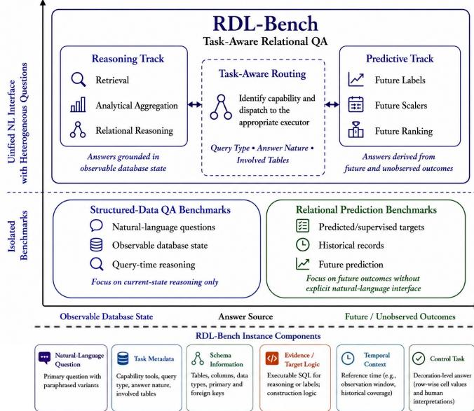  
Fig. 1. Overview of RDL-Bench in the relational QA landscape. RDL-Bench places current-state reasoning and future-oriented prediction under a shared NL interface and evaluates both native solvers and task-aware modular systems. Each instance contains six components: NL question, task metadata, schema information, evidence or target-construction logic, temporal context, and denotation-level ground truth.

TABLE I  
COMPARISON OF RELATED BENCHMARKS.
<table><tr><td>Benchmark</td><td>Reasoning</td><td>Predictive</td><td>Routing</td><td>Multi-table</td></tr><tr><td>WikiTableQ [27]</td><td>√</td><td>X</td><td>x</td><td>x</td></tr><tr><td>Spider [44]</td><td>√</td><td>X</td><td>x</td><td>√</td></tr><tr><td>BIRD [19]</td><td>√</td><td>x</td><td>x</td><td>√</td></tr><tr><td>STARQA [26]</td><td>√</td><td>X</td><td>X</td><td>√</td></tr><tr><td>RelBench [30]</td><td>x</td><td>√</td><td>x</td><td>√</td></tr><tr><td>RDL-Bench</td><td>√</td><td>√</td><td>√</td><td>√</td></tr></table>

## C. Relational Deep Learning and Predictive Modeling

Different from graph neural networks [20]–[24], [33]– [37], RDL studies predictive modeling over relational data with multiple entity types, relations, and temporal dependencies [31]. A common approach transforms relational data into entity-level features for tabular learning methods such as XGBoost [3] and LightGBM [17]. Graph-based methods model relational structure directly: GraphSAGE [13] learns inductive node representations, while heterogeneous graph models such as HGT [14] handle multiple node and edge types. RelBench [30] provides standardized evaluation for supervised prediction over relational databases, focusing on Predictive Track defined over relational structure and temporal information. RDL-Bench extends this line of work by expressing Predictive Track as NL user questions and evaluating them jointly with reasoning-oriented questions under a unified QA framework.

## D. Positioning RDL-Bench

Table I summarizes representative benchmarks and their coverage across key dimensions. Structured-data QA benchmarks provide NL interfaces and evaluate current-state reasoning, but do not support Predictive Track or routing evaluation. RDL benchmarks such as RelBench target future-oriented prediction over relational structure, but without a user-facing NL interface or routing component. RDL-Bench brings currentstate query answering and future-oriented prediction into a shared NL workload with a common instance schema. Its twolevel evaluation distinguishes native solver quality from endto-end task-aware QA performance, with routing serving as a system-level diagnostic of errors in inferring the required capability.

## III. PRELIMINARIES AND PROBLEM DEFINITION

We study QA over RDBs. Given an NL question over an RDB, the goal is to produce the correct answer by identifying the capability required by the question and invoking an appropriate execution mechanism. RDL-Bench does not assume that a single model family must solve all question types. Instead, it evaluates both native solvers under their intended capabilities and modular systems that route heterogeneous user questions to specialized execution modules.

## A. Relational Databases and QA Instances

Let $D = \{ T _ { 1 } , T _ { 2 } , \dots , T _ { K } \}$ denote an RDB with K tables, and let S denote its schema. The schema S specifies table names, attributes, data types, primary keys, and foreign-key relations. For a table $T _ { i } \in D $ , each tuple $\tau \in T _ { i }$ contains a set of attribute values. When available, a tuple may be associated with an event timestamp t(τ). A benchmark instance is represented as:

$$
x = ( D , S , q , t _ { \mathrm { r e f } } , a ) ,\tag{1}
$$

where $q$ is an NL user question, $t _ { \mathrm { r e f } }$ is an optional reference time, and a denotes task metadata such as question type, answer form, target entity, prediction horizon, or involved schema components. The target answer is denoted by y. For non-temporal reasoning questions, $t _ { \mathrm { r e f } }$ may be absent. For predictive questions, $t _ { \mathrm { r e f } }$ defines the boundary between observable context and future target outcomes.

We denote the observable database context by $D _ { \mathrm { c t x } }$ . For reasoning-oriented questions, $D _ { \mathrm { c t x } }$ is the database snapshot used to answer the question. For prediction-oriented questions, $D _ { \mathrm { c t x } }$ contains only tuples satisfying $t ( \tau ) \ \leq \ t _ { \mathrm { r e f } }$ , while the target answer y is constructed from records after $t _ { \mathrm { r e f } }$ according to the task metadata a. This separation prevents temporal leakage in predictive evaluation.

## B. Capability Tracks

RDL-Bench organizes questions into two capability tracks according to how their answers are determined.

a) Reasoning Track: The Reasoning Track contains questions whose answers are determined by the observable database state. It includes factual retrieval, analytical aggregation, and multi-hop relational reasoning. Such questions can typically be answered through symbolic execution over $D _ { \mathrm { c t x } } \colon$

$$
\begin{array} { r } { y = \operatorname { E x e c } ( D _ { \mathrm { c t x } } , s _ { q } ) , } \end{array}\tag{2}
$$

TABLE II  
STATISTICS OF THE SEVEN DOMAINS IN RDL-BENCH. DIVERSITY IS REFLECTED IN THE VARYING NUMBER OF TABLES, RELATIONAL DEPTH, AND THE PRESENCE OF TEMPORAL EVENT STREAMS.
<table><tr><td>Name</td><td>Domain</td><td># Tables</td><td>#Rows</td><td>Temporal</td><td>Source</td></tr><tr><td>Olist</td><td>E-commerce</td><td>9</td><td>100,000</td><td>Yes</td><td>https://www.kaggle.com/datasets/olistbr/brazilian-ecommerce/data</td></tr><tr><td>Financial</td><td>Financial</td><td>8</td><td>1,090,086</td><td>Yes</td><td>https://web.archive.org/web/20180506061559/http://lisp.vse.cz/pkdd99/Challenge/chall.htm</td></tr><tr><td>NCAA</td><td>Sports</td><td>9</td><td>201,555</td><td>Yes</td><td>https://www.kaggle.com/c/march-machine-learning-mania-2015/data</td></tr><tr><td>Hepatitis</td><td>Medicine</td><td>7</td><td>12,927</td><td>No</td><td>https://www.cs.sfu.ca/~oschulte/jbn/dataset.html</td></tr><tr><td>Airline</td><td>Retail</td><td>19</td><td>448,156</td><td>Yes Yes</td><td>https://www.transtats.bts.gov</td></tr><tr><td>Stats Dallas</td><td>Social Network Government</td><td>83</td><td>1,027,838</td><td>Yes</td><td>https://archive.org/details/stackexchange</td></tr><tr><td></td><td></td><td></td><td>812</td><td></td><td>https://www.dallasopendata.com/Public-Safety/Dallas-Police-Officer-Involved-Shootings/4gmt-jyx2/about_data</td></tr></table>

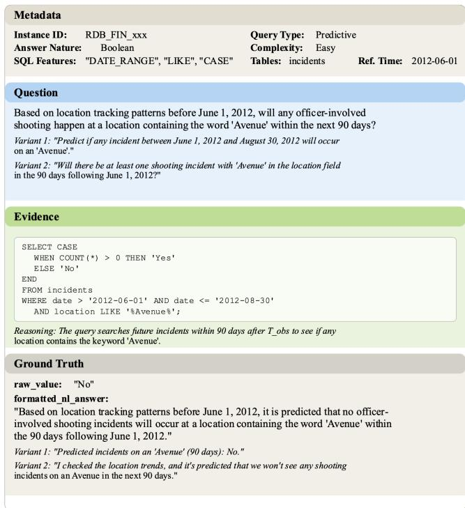  
Fig. 2. Example of a predictive instance.

where $s _ { q }$ denotes an executable query or program corresponding to the NL question $q ,$ and Exec denotes executing $s _ { q }$ over $D _ { \mathrm { c t x } }$ to obtain the answer.

b) Predictive Track: The Predictive Track contains questions whose answers depend on unobserved outcomes. Given the observable context $D _ { \mathrm { c t x } }$ before $t _ { \mathrm { r e f } }$ , the system must estimate a target constructed from records after $t _ { \mathrm { r e f } }$

$$
y = h ( D _ { > t _ { \mathrm { r e f } } } , a ) ,\tag{3}
$$

where $h ( \cdot )$ defines the task-specific target construction, such as a future label, score, scalar value, count, or ranking. Unlike reasoning-oriented questions, predictive questions cannot be answered by directly querying $D _ { \mathrm { c t x } } ;$ they require models that generalize from historical relational patterns.

## C. Task-Aware Relational QA

A task-aware relational QA system consists of a router and a set of execution modules. Given a question q and schema S, the router predicts a structured route:

$$
z = g ( q , S ) ,\tag{4}
$$

where z includes both the capability track and fine-grained routing metadata, such as the query type, answer form, target entity, and relevant schema components.

Routing involves both coarse-grained and fine-grained decisions. At the coarse level, the router determines whether the question belongs to the Reasoning Track or the Predictive Track. At the fine-grained level, it identifies the expected answer form and the schema components or target definition required by the execution module. These decisions determine which module is invoked and how its output should be interpreted. Routing errors may cause downstream failures even when the execution modules themselves are strong.

The system selects an execution module $m _ { z }$ from a module set M and produces the final answer:

$$
\hat { y } = m _ { z } ( D _ { \mathrm { c t x } } , S , q , z ) .\tag{5}
$$

In RDL-Bench, reasoning modules include LLM-based and text-to-SQL methods that generate executable queries, while predictive modules include tabular and graph-based RDL models trained on temporally valid historical data. This formulation separates routing errors from execution errors.

## D. Evaluation Objective

RDL-Bench evaluates denotation-level correctness between the predicted answer yˆ and the ground-truth answer $y .$ Because answer formats differ across question types, the loss function is type-aware:

$$
\mathcal { L } ( \hat { y } , y ; a ) ,\tag{6}
$$

where the task metadata a determines the evaluator used for the instance, such as exact match for scalar answers, execution-based correctness for executable queries, or taskspecific metrics for predictive outputs.

The overall objective is to minimize the expected task loss over heterogeneous relational QA instances:

$$
\mathcal { I } = \mathbb { E } _ { ( x , y ) \sim \mathcal { P } } \left[ \mathcal { L } ( \hat { y } , y ; a ) \right] ,\tag{7}
$$

where P denotes the benchmark distribution over databases, schemas, questions, capability tracks, task metadata, and answer types.

For native solvers, the route z is fixed by the capability track being evaluated. For task-aware modular systems, z is predicted by the router. This distinction allows RDL-Bench to measure both capability-specific execution performance and end-to-end task-aware QA performance.

## IV. DATASET CONSTRUCTION

RDL-Bench is constructed to support systematic evaluation of task-aware QA over real RDBs. The benchmark follows three design principles that directly enable the experimental analyses in Section V. First, realism: all questions are grounded in real multi-table RDBs with non-trivial schemas and foreign-key structures, ensuring that schema grounding and relational composition are genuinely required. Second, consistency: all instances share a unified JSON schema across domains and task types, enabling fair cross-domain and crosstype comparisons. Third, verifiability: each instance is associated with executable evidence or temporally grounded targetconstruction logic, enabling denotation-level evaluation.

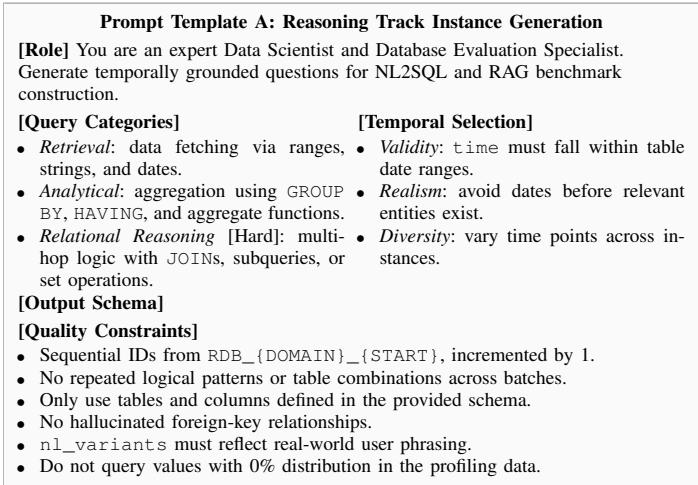

Fig. 3. Generation prompt template for Reasoning task instances.  
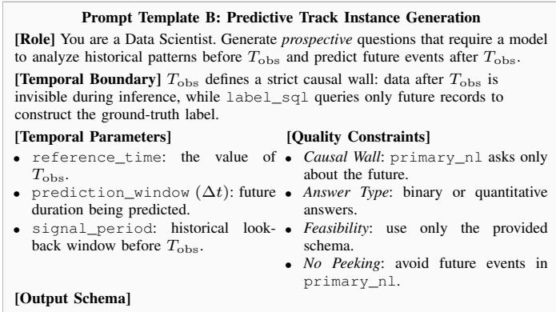  
Fig. 4. Generation prompt template for Predictive task instances.

## A. Domains and Data Sources

RDL-Bench is built from seven real-world RDBs spanning e-commerce, finance, sports, healthcare, transportation, social platforms, and government. The selected databases vary in schema size, number of tables, relational depth, temporal coverage, and entity distributions. Each database contains multiple interrelated tables with realistic schema designs, including primary keys, foreign-key relations, temporal attributes, and domain-specific entity types. This diversity is important for evaluating relational QA under heterogeneous database workloads. A system must process unseen schemas, identify taskrelevant tables and attributes, and handle different relational structures across domains. Summary statistics of the databases are reported in Table II.

## B. Task Taxonomy

RDL-Bench organizes instances according to the capability required to answer the question.

a) Reasoning-oriented questions: Reasoning-oriented questions are answered from the observable database state. They include three task categories.

• Retrieval. Retrieval tasks require selecting records or attributes that satisfy explicit conditions. They typically involve filtering, projection, and simple joins.

• Analytical. Analytical tasks require aggregation, comparison, or ranking over relational data. Common operations include GROUP BY, COUNT, COUNT DISTINCT, AVG, ORDER BY, and LIMIT.

• Relational reasoning. Relational Reasoning Track require relational composition across multiple tables or conditions. They may involve multiple joins, nested queries, set operations, or indirect constraints.

b) Prediction-oriented questions: Prediction-oriented questions ask about future outcomes. Each predictive instance is associated with a reference time $t _ { \mathrm { r e f } }$ and, when applicable, a prediction window $\Delta t .$ The observable context contains only records available before $t _ { \mathrm { r e f } } .$ , while the target answer is derived from records after $t _ { \mathrm { r e f } }$ . This setting evaluates whether a predictive model can estimate future labels, scores, scalar values, counts, or rankings from historical relational context.

## C. Unified Instance Schema

Despite differences across domains and task types, all benchmark instances are represented using a shared JSONbased schema. Each instance corresponds to an NL user question over an RDB and contains six logical components: the question, task metadata, schema information, evidence or target-construction logic, temporal context, and denotationlevel ground truth. Figure 2 shows an example.

a) Question: The question component contains a primary NL question and multiple paraphrased variants. These variants support evaluation under linguistic variation while preserving the same underlying relational task.

b) Task metadata: The metadata component specifies the task type, answer form, complexity level, SQL features, involved tables, and reference time when applicable. The query\_type field identifies whether the instance is retrieval, analytical, relational reasoning, or predictive. The answer\_nature field specifies the expected answer form, such as scalar, set, boolean, tuple collection, or ranking. The complexity fields record structural properties of the task, including required SQL operators and tables involved.

c) Schema information: The schema component records the database schema relevant, including table names, attributes, data types, primary keys, and foreign-key relations. This information supports schema grounding and allows systems to identify the database elements required by the question.

d) Evidence: For reasoning-oriented questions, this component contains a validated SQL query and a short description of the corresponding relational operations. For predictionoriented questions, it specifies the target construction logic, reference time, prediction window, and label-generation rule used to derive the answer from future records.

e) Temporal context: The temporal context specifies the time range relevant to the instance. For prediction-oriented questions, it defines the observable context before $t _ { \mathrm { r e f } }$ and the future window used for target construction. For reasoningoriented questions, temporal information is included when the question itself contains temporal constraints.

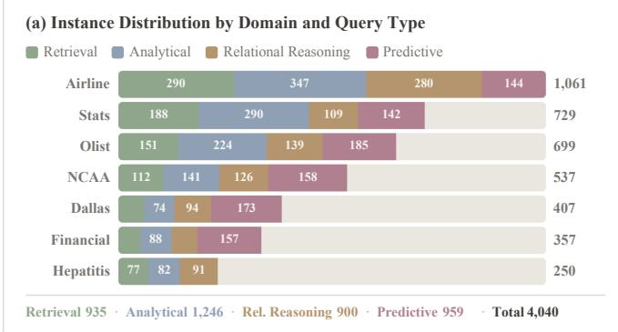

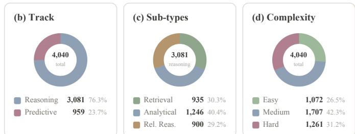  
Fig. 5. Dataset statistics of RDL-Bench. (a) Instance distribution by domain and query type. (b) Track distribution. (c) Reasoning sub-type breakdown. (d) Complexity distribution.

f) Ground truth: The ground-truth component stores the denotation-level answer in raw\_value. Depending on the task, the raw value may be a scalar, set, boolean, tuple collection, or ranking. For readability, each instance also includes a formatted NL answer and optional answer variants. These formatted answers are used for human interpretation and auxiliary analysis, while primary evaluation is based on raw\_value.

## D. Instance Generation

We construct benchmark instances through a structured model-assisted pipeline using Claude Sonnet 4.6 as the generation model. The pipeline uses task-specific prompt templates for reasoning-oriented and prediction-oriented questions, as shown in Figures 3 and 4. The reasoning prompt generates question-SQL pairs with optional temporal constraints. The prediction prompt generates future-oriented questions and enforces a causal boundary at $t _ { \mathrm { r e f } } \colon$ input context is restricted to records before $t _ { \mathrm { r e f } } .$ , while ground-truth labels are derived only from records after $t _ { \mathrm { r e f } }$ . The generated instances are then validated and normalized into the shared instance schema. Validation combines automatic checks with instance-by-instance manual review, as detailed in Section IV-F.

a) Schema and data profiling: For each database, we build a structured schema and profiling file. The schema records table definitions, attributes, data types, primary and foreign key relations. The data profile records row counts, value distributions, cardinalities, null ratios, representative values, and temporal coverage. These profiles constrain instance generation and ensure that generated questions refer to valid tables, columns, relationships, and realistic values.

b) Candidate generation: Given the schema and data profiles, we generate candidate instances in structured JSON format. Instances are generated separately for retrieval, analytical, relational reasoning, and predictive questions to improve coverage across task types. For reasoning-oriented questions, each candidate includes an NL question, task metadata, SQL evidence, and ground-truth fields. For prediction-oriented questions, each candidate includes an NL question, task metadata, a reference time, an observable context definition, targetconstruction logic, and ground-truth fields.

c) Temporal handling: For prediction-oriented questions, $t _ { \mathrm { r e f } }$ is mandatory and defines the context–target boundary described above. For reasoning-oriented questions, temporal conditions are included only when required by the question. All selected time ranges must fall within the temporal coverage of the corresponding database.

## E. Ground-Truth Construction

For reasoning-oriented questions, the model-generated SQL is automatically checked and manually inspected for NL–SQL alignment, with corrections made when necessary. We then execute the validated query against the corresponding database to obtain the denotation-level answer. The result is stored as raw\_value and normalized according to the answer type. For large set-valued outputs, we store the complete denotation for evaluation and may include truncated examples for display.

For prediction-oriented questions, labels are constructed by applying the validated target-construction logic to future records relative to $t _ { \mathrm { r e f } } .$ . The input features or relational context are derived only from records before $t _ { \mathrm { r e f } }$ . This separation prevents temporal leakage. After constructing the structured answer, we generate a canonical formatted NL answer and optional stylistic variants. These answers provide humanreadable references.

## F. Quality Control

All candidate instances undergo automatic and manual verification to check semantic alignment and temporal validity. Automatic validation checks schema validity, SQL executability, answer consistency, temporal constraints, metadata consistency, and output formatting. For reasoning-oriented questions, the stored raw\_value must match the SQL execution result. For prediction-oriented questions, the target-construction logic must respect $t _ { \mathrm { r e f } }$ and exclude future information from the observable context. One database researcher manually inspects every candidate instance for semantic correctness and ambiguity. We check whether the NL question matches the intended relational operation, whether the SQL query or target-construction logic implements the question correctly, and whether the formatted answer faithfully describes the raw value. Instances with ambiguous wording, invalid joins, unrealistic values, temporal leakage, trivial outputs, or inconsistent answers are revised or removed. Manual verification resulted in the revision or removal of 382 instances. The final benchmark contains 4,040 validated instances. Summary statistics of the final benchmark are reported in Figure 5. 1

TABLE III  
BASELINE METHODS IN RDL-BENCH.
<table><tr><td>Family</td><td>Method</td><td>Reasoning</td><td>Predictive</td><td>Input</td><td>Role</td></tr><tr><td rowspan="4">LLM-based</td><td>LLM-Schema</td><td>√</td><td></td><td>Question, schema</td><td>Schema-only reasoning solver</td></tr><tr><td>LLM-2Hop</td><td>√</td><td></td><td>Question, schema, 2-hop subgraph</td><td>Context-augmented reasoning solver</td></tr><tr><td>LLM-only</td><td></td><td></td><td>Schema, profiling statistics</td><td>Data-blind predictive reference</td></tr><tr><td>LLM-GraphCtx</td><td></td><td></td><td>Schema, time-filtered 2-hop subgraph</td><td>Graph-context predictive reference</td></tr><tr><td rowspan="5">Text-to-SQL</td><td>DIN-SQL [28]</td><td>√</td><td></td><td>Question, schema</td><td>Prompting-based SQL parser</td></tr><tr><td>C3 [8]</td><td>√</td><td></td><td>Question, schema</td><td>Zero-shot SQL parser</td></tr><tr><td>RESDSQL [18]</td><td>√</td><td></td><td>Question, schema</td><td>Fine-tuned SQL parser</td></tr><tr><td>CHESS [39]</td><td>√</td><td></td><td>Question, schema, database</td><td>Multi-agent SQL synthesis</td></tr><tr><td>XiYanSQL-32B [25]</td><td>√</td><td></td><td>Question, schema</td><td>Specialized SQL generation model</td></tr><tr><td rowspan="2">Tabular</td><td>XGBoost [3]</td><td></td><td></td><td>Aggregated entity features</td><td>Tabular predictive solver</td></tr><tr><td>LightGBM [17]</td><td></td><td></td><td>Aggregated entity features</td><td>Tabular predictive solver</td></tr><tr><td rowspan="4">Graph / RDL</td><td>GraphSAGE [13]</td><td></td><td>√</td><td>Relational graph</td><td>Inductive graph baseline</td></tr><tr><td>RelGNN [4]</td><td></td><td>√</td><td>Relational graph</td><td>Relational GNN</td></tr><tr><td>RelGT [9]</td><td></td><td>√</td><td>Relational graph</td><td>Relational graph transformer</td></tr><tr><td>StructOpt-RDL [6]</td><td></td><td>√</td><td>Relational graph</td><td>Structure-optimized solver</td></tr><tr><td rowspan="2">Task-Aware</td><td>LLM-Router + Modules</td><td>√</td><td>√</td><td>Question, schema</td><td>Task-aware modular system</td></tr><tr><td>Oracle-Router + Modules</td><td>L</td><td>√</td><td>Ground-truth metadata</td><td>Routing upper bound</td></tr></table>

Prompt for LLM-Schema   
Input: question, database schema.   
You are given a relational database schema and a natural  
language question.   
Generate an executable SQL query that answers the question   
using only the provided schema. Then return the final answer.   
Database schema: {schema}   
Question: {question}   
Output format:   
SQL: {sql}   
Answer: {answer}  
Fig. 6. Prompt template for LLM-Schema. This baseline evaluates schemaonly reasoning over the observable database state.

Prompt for LLM-2Hop   
Input: question, schema, retrieved two-hop relational context.   
You are given a natural-language question, the database   
schema, and a two-hop relational context retrieved from tables   
relevant to the question.   
Use the schema and the local relational context to generate   
an executable SQL query and answer the question.   
Do not use tables or columns that are not provided.   
Database schema: {schema}   
Two-hop relational context: {two\_hop\_context}   
Question: {question}   
Output format:   
SQL: {sql}   
Answer: {answer}  
Fig. 7. Prompt template for LLM-2Hop. This baseline augments schema-only reasoning with local relational context.

## V. EXPERIMENTS AND ANALYSIS

We use RDL-Bench to analyze the capability boundaries of current relational QA methods. The goal is not only to compare solvers, but also to understand which parts of taskaware relational QA remain unsolved. We therefore evaluate methods at two levels. The native-solver setting evaluates each method on the capability tracks matching its intended interface, isolating execution performance. The modular-QA setting evaluates whether a router can infer the required capability from the natural-language question and dispatch it to the appropriate execution module, exposing system-level routing errors.

The analysis is organized around four research questions. RQ1 asks why current methods still fail on denotation-level relational reasoning. RQ2 asks whether LLMs actually perform relational prediction or mainly exploit task-format priors. RQ3 asks what information task-aware routing must recover beyond schema grounding. RQ4 asks how difficulty, answer type, and domain properties explain the observed failure modes.

## A. Experimental Setup

a) Baselines: Table III summarizes baseline applicability and key characteristics. We evaluate four categories of models.

• LLM-based Agents. Claude Sonnet 4.6 [1], Qwen2.5- 32B-Instruct [40], and Llama-3.1-8B-Instruct [11] represent closed-source large, open-source large, and opensource small LLMs respectively, spanning a wide capability range. We define the LLM-based reference configurations for this benchmark to isolate schema-only reasoning, local relational context, aggregate historical signal, and task-aware routing under a shared NL interface. On the Reasoning Track, LLM-Schema prompts each model to generate SQL directly from the question and full database schema, while LLM-2Hop augments the schema with a retrieved two-hop relational context to reduce schema grounding difficulty. On the Predictive Track, LLM-only provides each model with only the schema and aggregate profiling statistics over $D _ { \mathrm { c t x } }$ , serving as a data-blind reference that tests whether statistical priors alone provide predictive signal. LLM-GraphCtx extends LLM-only by providing a time-filtered two-hop relational subgraph constructed from $D _ { \mathrm { c t x } } ,$ i.e., only records with $t ( \tau ) \ \leq \ t _ { \mathrm { r e f } }$ are included. This baseline tests whether access to raw relational records, rather than aggregate statistics alone, provides additional predictive signal for LLMs, while strictly respecting the temporal boundary.

• Text-to-SQL Models. DIN-SQL [28] decomposes complex SQL generation into sub-problems via chain-ofthought prompting and self-correction, achieving strong performance on multi-table queries. C3 [8] improves zero-shot SQL generation through calibration and consistency checking, without task-specific fine-tuning. RESD-SQL [18] decouples schema linking from SQL skeleton parsing via a two-stage pipeline, and is fine-tuned on the RDL-Bench training split. We additionally evaluate CHESS [39], a multi-agent SQL synthesis framework, and XiYanSQL-QwenCoder-32B [25], a model specialized for SQL generation, on Olist, NCAA, Financial, and Hepatitis.

TABLE IV  
NATIVE REASONING TRACK RESULTS BY DOMAIN. EACH DOMAIN SCORE AVERAGES PER-INSTANCE SCORES USING NORMALIZED EM FOR SCALAR, SET-F1 FOR SET, ACCURACY FOR BOOLEAN, AND NDCG@5 FOR RANKING ANSWERS. ALL SCORES ARE IN [0, 1], HIGHER IS BETTER. THE FINAL COLUMN REPORTS THE UNWEIGHTED MEAN OVER THE SEVEN DOMAINS.
<table><tr><td>Family</td><td>Method</td><td>Olist</td><td>Financial</td><td>NCAA</td><td>Hepatitis</td><td>Airline</td><td>Stats</td><td>Dallas</td><td>Avg.</td></tr><tr><td rowspan="6">LLM-based</td><td>Claude-Schema</td><td>0.65</td><td>0.45</td><td>0.49</td><td>0.50</td><td>0.47</td><td>0.42</td><td>0.44</td><td>0.49</td></tr><tr><td>Claude-2Hop</td><td>0.64</td><td>0.47</td><td>0.44</td><td>0.41</td><td>0.48</td><td>0.43</td><td>0.43</td><td>0.47</td></tr><tr><td>Qwen32B-Schema</td><td>0.57</td><td>0.48</td><td>0.51</td><td>0.41</td><td>0.46</td><td>0.42</td><td>0.43</td><td>0.47</td></tr><tr><td>Qwen32B-2Hop</td><td>0.58</td><td>0.40</td><td>0.46</td><td>0.41</td><td>0.36</td><td>0.45</td><td>0.31</td><td>0.42</td></tr><tr><td>Llama8B-Schema</td><td>0.38</td><td>0.32</td><td>0.31</td><td>0.37</td><td>0.35</td><td>0.34</td><td>0.21</td><td>0.33</td></tr><tr><td>Llama8B-2Hop</td><td>0.37</td><td>0.35</td><td>0.48</td><td>0.41</td><td>0.36</td><td>0.34</td><td>0.21</td><td>0.36</td></tr><tr><td rowspan="5">Text-to-SQL</td><td>DIN-SQL</td><td>0.48</td><td>0.42</td><td>0.66</td><td>0.23</td><td>0.49</td><td>0.46</td><td>0.16</td><td>0.41</td></tr><tr><td>C3</td><td>0.58</td><td>0.33</td><td>0.50</td><td>0.31</td><td>0.41</td><td>0.42</td><td>0.18</td><td>0.39</td></tr><tr><td>RESDSQL</td><td>0.25±0.04</td><td>0.31±0.02</td><td>0.52±0.03</td><td>0.28±0.01</td><td>0.36±0.03</td><td>0.30±0.02</td><td>0.15±0.01</td><td>0.31±0.01</td></tr><tr><td>XiYanSQL-32B</td><td>0.55</td><td>0.47</td><td>0.70</td><td>0.51</td><td>0.48</td><td>0.48</td><td>0.36</td><td>0.51</td></tr><tr><td>CHESS</td><td>0.56</td><td>0.47</td><td>0.72</td><td>0.55</td><td>0.53</td><td>0.50</td><td>0.41</td><td>0.53</td></tr></table>

• Tabular and Graph-based RDL Models. XGBoost [3] and LightGBM [17] operate on flattened entity-level feature vectors aggregated from $D _ { \mathrm { c t x } } .$ representing the standard tabular learning approach for relational prediction. GraphSAGE [13] models relational structure directly via inductive neighborhood aggregation, serving as a general graph baseline. RelGNN [4] extends message passing with composite relational operators designed specifically for multi-table RDB structure. RelGT [9] applies a graph transformer architecture to heterogeneous relational graphs, capturing long-range dependencies across tables. StructOpt-RDL [6] optimizes the relational graph structure through information filtering and structural injection before message passing.

• Task-Aware Systems. LLM-Router instantiates each LLM as a router that predicts z={track, query\_type, answer\_nature, tables\_involved} from the question and schema alone, without access to ground-truth metadata. Oracle-Router uses ground-truth instance metadata to always select the correct track and execution module, providing a routing upper bound that isolates execution performance from routing errors.

## b) Implementation Details:

• LLM Configuration. All LLM-based components use 3-shot in-context learning with examples drawn from the training partition. LLM-2Hop retrieves candidate tables via BM25 matching between question tokens and column descriptions, expands along foreign-key edges up to two hops, and includes up to three representative rows per table as compact record samples. LLM-only receives the schema and a data profiling summary computed exclusively over $D _ { c t x } ,$ covering row counts, value distributions, and temporal coverage up to $t _ { \mathrm { r e f } } ;$ no statistics beyond $t _ { \mathrm { r e f } }$ are exposed. LLM-Router requires structured JSON output z; responses that fail to parse default to the Reasoning Track. Figures 6 and Figure 7 show the prompt templates used for LLM-based baselines. Figure 8 shows the prompt templates used for LLM-Router. For each LLM-based component, the same prompt template is used across Claude, Qwen32B, and Llama8B under deterministic decoding.

• Reasoning Solver Implementation. All generated SQL is executed via DuckDB; non-executable queries are marked incorrect. DIN-SQL and C3 use few-shot prompting. RESDSQL is fine-tuned on the training partition with early stopping on the validation partition.

• Predictive Solver Implementation. For trained predictive baselines, each Predictive Track instance is instantiated as an entity-level supervised task using the oracle task specification from the benchmark metadata. For each predictive template, we sample up to $n = 5 { , } 0 0 0$ anchor entities and split them into 60% training, 20% validation, and 20% test examples within the template. All features are computed exclusively from $D _ { \mathrm { c t x } } ,$ and no records after $t _ { \mathrm { r e f } }$ are used for feature construction. Tabular models construct entity-level feature vectors using aggregate statistics over related tables, including counts, sums, means, extrema, categorical frequencies, distinct counts, and recency-based features. XGBoost and LightGBM are trained separately for each instantiated predictive template with validation-based model selection. Graphbased models convert $D _ { \mathrm { c t x } }$ into a heterogeneous relational graph, where each tuple is represented as a node and foreign-key relations are represented as typed edges. Anchor entities are mapped to their corresponding tuple nodes and serve as supervised prediction nodes. Labels are generated from future records according to the targetconstruction logic. GraphSAGE, RelGNN, and RelGT perform k = 2 hop message passing and attach a taskspecific classification or regression head to the anchornode representation. All neural predictive models are trained with early stopping on the validation split.

TABLE V  
REASONING TRACK PERFORMANCE BY ANSWER TYPE. PRIMARY AND SECONDARY METRICS ARE REPORTED FOR EACH ANSWER TYPE. ALL METRICS EXCEPT NMAE ARE IN [0, 1], HIGHER IS BETTER. AUROC IS NOT APPLICABLE (–) FOR LLM-BASED METHODS AS THEY OUTPUT DISCRETE YES/NO WITHOUT CONFIDENCE SCORES.
<table><tr><td colspan="2"></td><td colspan="2">Scalar</td><td colspan="2">Set</td><td colspan="2">Boolean</td><td colspan="2">Ranking</td></tr><tr><td>Family</td><td>Method</td><td>EM↑</td><td>nMAE↓</td><td>F1↑</td><td>EM↑</td><td>Acc↑</td><td>AUROC↑</td><td>NDCG@5↑</td><td>ρ↑</td></tr><tr><td rowspan="7">LLM-based</td><td>Claude-Schema</td><td>0.76</td><td>0.51</td><td>0.62</td><td>0.41</td><td>0.83</td><td></td><td>0.01</td><td>0.01</td></tr><tr><td>Claude-2Hop</td><td>0.81</td><td>0.43</td><td>0.52</td><td>0.35</td><td>0.80</td><td></td><td>0.05</td><td>0.04</td></tr><tr><td>Qwen32B-Schema</td><td>0.76</td><td>0.10</td><td>0.32</td><td>0.19</td><td>0.66</td><td></td><td>0.03</td><td>0.02</td></tr><tr><td>Qwen32B-2Hop</td><td>0.76</td><td>0.94</td><td>0.32</td><td>0.20</td><td>0.65</td><td></td><td>0.05</td><td>0.04</td></tr><tr><td>Llama8B-Schema</td><td>0.61</td><td>1.18</td><td>0.26</td><td>0.14</td><td>0.50</td><td>一</td><td>0.03</td><td>0.02</td></tr><tr><td>Llama8B-2Hop</td><td>0.61</td><td>6.50</td><td>0.26</td><td>0.15</td><td>0.50</td><td></td><td>0.05</td><td>0.04</td></tr><tr><td>DIN-SQL</td><td>0.79</td><td>0.07</td><td>0.31</td><td>0.18</td><td>0.53</td><td>0.61</td><td>0.01</td><td>0.01</td></tr><tr><td rowspan="3">Text-to-SQL</td><td>C3</td><td>0.75</td><td>0.01</td><td>0.83</td><td>0.65</td><td>0.55</td><td>0.54</td><td>0.03</td><td>0.02</td></tr><tr><td>RESDSQL</td><td>0.74 ± 0.02</td><td>0.28 ± 0.03</td><td>0.70 ± 0.02</td><td>0.52 ± 0.02</td><td>0.41 ± 0.02</td><td>0.49 ± 0.03</td><td>0.01 ± 0.01</td><td>0.01 ± 0.01</td></tr></table>

• Task-Aware System Implementation. The execution modules are fixed as the best-performing native solvers from each track on the validation split. Oracle-Router uses ground-truth query\_type to determine the capability track.

• Environment. All SQL execution and data preparation use DuckDB. Neural models are implemented in PyTorch and trained on NVIDIA A30 GPUs. All results are averaged over five independent runs with different seeds.

c) Metrics: We evaluate answers against the denotationlevel ground truth stored in raw\_value and routing decisions against ground-truth task metadata. Results are reported separately for reasoning, prediction, and routing.

• Reasoning metrics. For reasoning-oriented questions, metrics are selected according to the answer type [16], [27], [29]. For scalar answers, we use normalized exact match (EM) with a tolerance margin, and additionally report nMAE to quantify prediction error magnitude. For set-valued answers, we report Set-F1 as the primary metric and Set-EM as a stricter exact-match criterion. For boolean answers, we report Accuracy. For ranking answers, we report NDCG@5. Denotation-level answer correctness is the primary criterion throughout.

In Table IV, each instance is scored using the primary metric for its answer type, with scores in [0, 1]. We average these scores within each domain and report the unweighted mean over the seven domains in the final column. This aggregation summarizes workload performance, while the underlying metrics measure different aspects of answer quality. Table V reports results separately by answer type.

• Predictive metrics. For the Predictive Track, classification and regression are evaluated separately [10], [15]. For binary classification tasks, we report Accuracy for all methods, because LLM-based predictors output discrete Yes/No answers without calibrated confidence scores. This keeps LLM-based and RDL predictors comparable under the same answer-level criterion. For scalar regression tasks, all methods are evaluated with nMAE.

• Routing metrics. For task-aware routing, we report Track Accuracy, Query-Type Macro-F1, Answer-Nature Accuracy, Table-F1, and Module Accuracy [32]. Track Accuracy measures whether the router correctly predicts the required capability track. Query-Type Macro-F1 evaluates fine-grained query-type prediction. Answer-Nature Accuracy measures whether the router predicts the expected answer form. Table-F1 evaluates schema grounding by comparing predicted and ground-truth involved tables. Module Accuracy measures whether the predicted route selects the correct execution module.

Input: questi schema.   
You are given a natural-language question over a relational   
database and the database schema.   
Decide which capability is required to answer the question.   
Use Reasoning if the answer can be derived from the   
observable database state.   
Use Predictive if the question asks for a future or   
unobserved outcome beyond the observable database state.   
Also identify the query type, answer nature, and involved   
tables.   
Database schema: {schema}   
Question: {question}   
Output format:   
{ "track": "Reasoning" or "Predictive",   
"query\_type": {query\_type},   
"answer\_nature": {answer\_nature},   
"tables": [{tables}] }  
Fig. 8. Prompt template for LLM-Router. This setting evaluates whether an LLM can recover task route metadata from a natural-language question.

## B. RQ1: Native Reasoning over Observable Database States

Table IV reports native Reasoning Track performance across seven domains. The best macro-average is 0.49 (Claude-Schema), confirming that denotation-level relational reasoning remains far from saturated for all evaluated methods. For Claude-Schema, 94.7% of outputs yield executable SQL; among these executable queries, only 52.1% return the exact gold denotation. The error audit identifies failures in schema grounding, joins, filters, aggregations, and relational composition. These results indicate that semantic alignment remains a substantial bottleneck even when SQL execution succeeds.

Solver advantages vary across domains. DIN-SQL outperforms all LLM-based methods on NCAA, Airline, and Stats, but drops to 0.16 on Dallas, showing that its decompositionbased pipeline is not uniformly effective across database workloads. CHESS and XiYanSQL-32B improve over DIN-SQL on all four domains evaluated for these two methods. CHESS achieves the highest reported scores on NCAA (0.72) and Hepatitis (0.55), while Claude-Schema remains strongest on Olist (0.65) and Qwen32B-Schema on Financial (0.48). Including these newer systems therefore strengthens the SQL baselines while preserving the domain-dependent pattern of solver advantages. RESDSQL obtains the lowest macroaverage among the solvers evaluated on all seven domains despite fine-tuning on the RDL-Bench training split, suggesting that supervised schema-linking and SQL-skeleton parsing do not transfer robustly to this heterogeneous relational QA setting. Context augmentation provides no consistent benefit: Claude-2Hop and Qwen32B-2Hop both improve on some domains but degrade on others, with macro-averages below their Schema-only counterparts. Retrieved context helps value grounding but introduces distractors when the challenge lies in query planning or relational composition.

TABLE VI  
NATIVE PREDICTIVE TRACK CLASSIFICATION RESULTS BY DOMAIN. EACH CELL REPORTS ACCURACY OVER BOOLEAN PREDICTIVE TASKS INSTANCES THE FINAL COLUMN REPORTS THE UNWEIGHTED MACRO AVERAGE OVER THE SIX TEMPORAL DOMAINS. HIGHER IS BETTER.
<table><tr><td>Family</td><td>Method</td><td>Olist</td><td>Financial</td><td>NCAA</td><td>Airline</td><td>Stats</td><td>Dallas</td><td>Macro Avg.</td></tr><tr><td rowspan="7">LLM-based</td><td>Claude-only</td><td>0.88</td><td>0.72</td><td>0.61</td><td>0.52</td><td>0.91</td><td>0.63</td><td>0.71</td></tr><tr><td>Qwen32B-only</td><td>0.66</td><td>0.64</td><td>0.51</td><td>0.54</td><td>0.59</td><td>0.57</td><td>0.59</td></tr><tr><td>Llama8B-only</td><td>0.74</td><td>0.53</td><td>0.50</td><td>0.44</td><td>0.60</td><td>0.58</td><td>0.57</td></tr><tr><td>Claude-GraphCtx</td><td>0.89</td><td>0.74</td><td>0.65</td><td>0.55</td><td>0.92</td><td>0.67</td><td>0.74</td></tr><tr><td>Qwen32B-GraphCtx</td><td>0.68</td><td>0.66</td><td>0.55</td><td>0.56</td><td>0.61</td><td>0.61</td><td>0.61</td></tr><tr><td>Llama8B-GraphCtx</td><td>0.75</td><td>0.55</td><td>0.53</td><td>0.46</td><td>0.61</td><td>0.62</td><td>0.59</td></tr><tr><td>XGBoost</td><td> $0 . 7 8 \pm 0 . 0 2$ </td><td> $0 . 5 3 \pm 0 . 0 3$ </td><td> $0 . 5 4 \pm 0 . 0 1$ </td><td> $0 . 5 3 \pm 0 . 0 2$ </td><td> $0 . 5 5 \pm 0 . 0 2$ </td><td> $0 . 7 0 \pm 0 . 0 1$ </td><td>0.60</td></tr><tr><td rowspan="4">Tabular</td><td>LightGBM</td><td> $0 . 7 8 \pm 0 . 0 2$ </td><td> $0 . 5 8 \pm 0 . 0 3$ </td><td> $0 . 5 8 \pm 0 . 0 1$ </td><td> $0 . 4 1 \pm 0 . 0 2$ </td><td> $0 . 6 6 \pm 0 . 0 3$ </td><td> $0 . 8 0 \pm 0 . 0 2$ </td><td>0.63</td></tr><tr><td>GraphSAGE</td><td> $0 . 5 5 \pm 0 . 0 2$ </td><td> $0 . 8 6 \pm 0 . 0 2$ </td><td> ${ \bf 0 . 7 5 \pm 0 . 0 2 }$ </td><td> $0 . 7 1 \pm 0 . 0 2$ </td><td> $0 . 5 7 \pm 0 . 0 4$ </td><td> $0 . 8 6 \pm 0 . 0 3$ </td><td>0.72</td></tr><tr><td>RelGNN</td><td> $0 . 8 5 \pm 0 . 0 2$ </td><td> $\mathbf { 0 . 9 3 \pm 0 . 0 1 }$ </td><td> $0 . 5 2 \pm 0 . 0 1$ </td><td> $0 . 6 4 \pm 0 . 0 1$ </td><td> $0 . 6 2 \pm 0 . 0 1$ </td><td> ${ \bf 0 . 9 4 \pm 0 . 0 2 }$ </td><td>0.75</td></tr><tr><td>RelGT</td><td> $0 . 6 5 \pm 0 . 0 2$ </td><td> $0 . 9 2 \pm 0 . 0 1$ </td><td> $0 . 6 2 \pm 0 . 0 1$ </td><td> $0 . 6 4 \pm 0 . 0 1$ </td><td> $0 . 6 5 \pm 0 . 0 1$ </td><td> $0 . 9 3 \pm 0 . 0 2$ </td><td>0.73</td></tr><tr><td>RDL</td><td>StructOpt-RDL</td><td> $0 . 8 6 \pm 0 . 0 1$ </td><td> $0 . 9 1 \pm 0 . 0 1$ </td><td> $0 . 7 3 \pm 0 . 0 1$ </td><td> ${ \bf 0 . 7 2 \pm 0 . 0 1 }$ </td><td> $0 . 7 3 \pm 0 . 0 1$ </td><td> $0 . 6 4 \pm 0 . 0 2$ </td><td>0.77</td></tr></table>

TABLE VII

NATIVE PREDICTIVE TRACK REGRESSION RESULTS BY DOMAIN. EACH CELL REPORTS NMAE OVER SCALAR PREDICTIVE TRACK INSTANCES INSTANTIATED AS ENTITY-LEVEL REGRESSION TASKS. THE FINAL COLUMN REPORTS THE UNWEIGHTED MACRO AVERAGE OVER THE SIX TEMPORAL DOMAINS. LOWER IS BETTER.
<table><tr><td>Family</td><td>Method</td><td>Olist</td><td>Financial</td><td>NCAA</td><td>Airline</td><td>Stats</td><td>Dallas</td><td>Macro Avg.</td></tr><tr><td rowspan="7">LLM-based</td><td>Claude-only</td><td>0.99</td><td>0.97</td><td>11.07</td><td>0.66</td><td>1.43</td><td>1.11</td><td>2.70</td></tr><tr><td>Qwen32B-only</td><td>1.08</td><td>3.35</td><td>0.47</td><td>1.05</td><td>1.61</td><td>1.15</td><td>1.45</td></tr><tr><td>Llama8B-only</td><td>0.94</td><td>1.00</td><td>0.56</td><td>50.04</td><td>1.88</td><td>0.94</td><td>9.23</td></tr><tr><td>Claude-GraphCtx</td><td>0.97</td><td>0.94</td><td>10.21</td><td>0.69</td><td>1.38</td><td>1.05</td><td>2.54</td></tr><tr><td>Qwen32B-GraphCtx</td><td>1.05</td><td>3.10</td><td>0.48</td><td>1.02</td><td>1.55</td><td>1.10</td><td>1.38</td></tr><tr><td>Llama8B-GraphCtx</td><td>0.92</td><td>0.98</td><td>0.54</td><td>48.73</td><td>1.82</td><td>0.91</td><td>8.98</td></tr><tr><td>XGBoost</td><td> $1 . 0 9 \pm 0 . 0 4$ </td><td> $0 . 9 1 \pm 0 . 0 3$ </td><td> $0 . 9 9 \pm 0 . 0 3$ </td><td> $1 1 . 3 1 \pm 0 . 0 6$ </td><td> $0 . 4 4 \pm 0 . 0 3$ </td><td> ${ \bf 0 . 4 8 \pm 0 . 0 3 }$ </td><td>2.54</td></tr><tr><td rowspan="2">Tabular</td><td>LightGBM</td><td> $1 . 0 0 \pm 0 . 0 6$ </td><td> $0 . 9 2 \pm 0 . 0 4$ </td><td> $0 . 9 9 \pm 0 . 0 3$ </td><td> $1 1 . 0 4 \pm 0 . 0 7$ </td><td> $1 . 4 4 \pm 0 . 0 4$ </td><td> $0 . 6 6 \pm 0 . 0 4$ </td><td>2.67</td></tr><tr><td>GraphSAGE</td><td> $0 . 8 0 \pm 0 . 0 4$ </td><td> $0 . 7 2 \pm 0 . 0 2$ </td><td> $0 . 9 8 \pm 0 . 0 2$ </td><td> $0 . 7 1 \pm 0 . 0 4$ </td><td> $0 . 9 2 \pm 0 . 0 4$ </td><td> $0 . 5 5 \pm 0 . 0 5$ </td><td>0.78</td></tr><tr><td rowspan="3">RDL</td><td>RelGNN</td><td> $1 . 0 0 \pm 0 . 0 5$ </td><td> $0 . 8 9 \pm 0 . 0 3$ </td><td> $1 . 0 0 \pm 0 . 0 2$ </td><td> $0 . 6 6 \pm 0 . 0 4$ </td><td> $\mathbf { 0 . 3 0 \pm 0 . 0 6 }$ </td><td> $0 . 5 0 \pm 0 . 0 5$ </td><td>0.73</td></tr><tr><td>RelGT</td><td> ${ \bf 0 . 7 9 \pm 0 . 0 4 }$ </td><td> ${ \bf 0 . 6 4 \pm 0 . 0 2 }$ </td><td> $0 . 9 7 \pm 0 . 0 4$ </td><td> $0 . 8 1 \pm 0 . 0 3$ </td><td> $0 . 8 8 \pm 0 . 0 6$ </td><td> $0 . 6 7 \pm 0 . 0 5$ </td><td>0.79</td></tr><tr><td>StructOpt-RDL</td><td> $0 . 8 2 \pm 0 . 0 3$ </td><td> $0 . 9 6 \pm 0 . 0 2$ </td><td> $0 . 9 8 \pm 0 . 0 2$ </td><td> $0 . 7 4 \pm 0 . 0 3$ </td><td> $0 . 6 3 \pm 0 . 0 3$ </td><td> $0 . 5 2 \pm 0 . 0 3$ </td><td>0.78</td></tr></table>

TABLE VIII

CROSS-GENERATOR REASONING EVALUATION ON OLIST AND NCAA. ROWS DENOTE QUESTION GENERATORS AND COLUMNS DENOTE SOLVERS. HIGHER SCORES ARE BETTER.
<table><tr><td>Generator</td><td>Claude-Schema</td><td>Qwen32B-Schema</td></tr><tr><td>Claude</td><td>0.57</td><td>0.54</td></tr><tr><td>Qwen</td><td>0.58</td><td>0.51</td></tr></table>

ordered relational outputs require a level of comparison and sorting that no current method reliably provides. C3 achieves strong Set performance (F1: 0.83, EM: 0.65), while its Boolean accuracy is close to that of DIN-SQL (0.55 vs. 0.53). Its large advantage on set-valued answers therefore does not translate into a comparable advantage on Boolean questions, highlighting the answer-type-specific strengths of specialized SQL generation.

Generator sensitivity. To test generator-specific bias, we generated 100 additional Reasoning questions with Qwen2.5- 32B-Instruct, with 50 each for Olist and NCAA, using the same schema/profiling inputs, prompt, validation protocol, and matched task distributions. Table VIII shows that Claude-Schema remains ahead on both Claude-generated questions (0.57 vs. 0.54) and Qwen-generated questions (0.58 vs. 0.51). This preliminary two-domain comparison provides no evidence of a Claude-specific home-field advantage.

Table V further shows that aggregate domain scores mask substantial variation across answer forms. Scalar answers are relatively tractable (Claude-2Hop: 0.81 EM), while Ranking answers are near zero for almost all methods, indicating that

Finding. The bottleneck is not missing context or SQL expressiveness, but the joint difficulty of schema grounding, relational composition, and answer normalization. Current methods trade off across answer types rather than jointly improving.

## C. RQ2: Predictive QA over Future Outcomes

Tables VI and VII reveal sharply different behavior across Boolean and scalar settings. On Boolean prediction, Claudeonly achieves 0.71 macro-average Accuracy using only schema and aggregate statistics, competitive with trained tabular models. Claude-GraphCtx provides marginal additional gain (0.74), indicating that raw relational records offer limited signal beyond aggregate profiling for binary decisions. This competitiveness is format-driven: binary questions reduce relational prediction to a coarse polarity judgment that LLMs can approximate from statistical priors without learning.

TABLE IX  
ROUTING DIAGNOSIS RESULTS ON ALL TEST INSTANCES. HIGHER IS BETTER.
<table><tr><td>Router</td><td>Track Acc.</td><td>QType F1</td><td>Ans. Acc.</td><td>Table F1</td><td>Module Acc.</td></tr><tr><td>Random-Router</td><td>0.49</td><td>0.46</td><td>0.49</td><td>0.00</td><td>0.49</td></tr><tr><td>Llama8B-Router</td><td>0.29</td><td>0.25</td><td>0.29</td><td>0.78</td><td>0.29</td></tr><tr><td>Qwen32B-Router</td><td>0.95</td><td>0.93</td><td>0.95</td><td>0.91</td><td>0.95</td></tr><tr><td>Claude-Router</td><td>0.97</td><td>0.96</td><td>0.97</td><td>0.94</td><td>0.97</td></tr><tr><td>Oracle-Router</td><td>1.00</td><td>1.00</td><td>1.00</td><td>1.00</td><td>1.00</td></tr></table>

TABLE X

END-TO-END MODULAR QA RESULTS WITH FIXED EXECUTION MODULES.
<table><tr><td>System</td><td>Reasoning↑</td><td>Bool. Acc ↑</td><td>Scalar nMAE↓</td><td>Track Acc.↑</td></tr><tr><td>Random-Router</td><td>0.20</td><td>0.43</td><td>1.06</td><td>0.49</td></tr><tr><td>Llama8B-Router</td><td>0.03</td><td>0.43</td><td>1.91</td><td>0.29</td></tr><tr><td>Qwen32B-Router</td><td>0.44</td><td>0.72</td><td>1.10</td><td>0.95</td></tr><tr><td>Claude-Router</td><td>0.44</td><td>0.84</td><td>0.98</td><td>0.97</td></tr><tr><td>Oracle-Router</td><td>0.44</td><td>0.87</td><td>0.91</td><td>1.00</td></tr></table>

Scalar regression exposes this limitation directly. LLMbased methods show high nMAE and severe cross-domain instability, with Llama8B-only reaching 50.04 on Airline. LLM-GraphCtx provides only marginal improvement over LLM-only, showing that additional local records alone do not close the numerical estimation gap. Graph-based models achieve stronger aggregate regression performance, with RelGNN obtaining the best macro-average nMAE of 0.73. These models use entity-level supervision to learn task-specific predictive mappings from relational histories, whereas the LLM references estimate outcomes directly from prompted summaries or local records.

Finding. LLMs can exploit coarse historical priors for Boolean prediction but remain unstable on scalar regression. Trained relational models achieve stronger aggregate regression performance, highlighting the value of task-specific learning over relational histories for numerical prediction.

## D. RQ3: Task-Aware Routing and End-to-End QA

Table IX evaluates routing as a system-level diagnostic of capability understanding within the unified NL workload. Claude-Router and Qwen32B-Router achieve Track Accuracy of 0.97 and 0.95, respectively, closely approaching the Oracle upper bound. Llama8B-Router falls to 0.29, below the Random-Router baseline of 0.49. A critical observation is that table grounding and capability identification are separable skills. Llama8B-Router achieves Table-F1 of 0.78 while failing on Track Accuracy (0.29), showing that a model can correctly identify relevant schema components yet fail to determine whether the question requires reasoning or future-oriented prediction. This dissociation reveals that task-aware routing is not reducible to schema linking; it requires understanding the temporal and predictive intent implied by the question.

Table X compares end-to-end QA performance with fixed execution modules and different routers. Llama8B-Router drops to a Reasoning score of 0.03, compared to 0.44 for Claude-Router and Oracle-Router. Because the execution modules are fixed, this gap reveals the system-level impact of incorrect capability selection. A track-routing error can send a future-oriented question to a current-state query solver, or a current-state question to a predictive model. The resulting failure is a mismatch between the question’s required capability and the invoked execution mechanism. The residual gap between Claude-Router and Oracle-Router is concentrated in the Predictive Track (Bool. Acc.: 0.84 vs. 0.87; Scalar nMAE: 0.98 vs. 0.91). Thus, even near-oracle Track Accuracy can leave measurable gaps in end-to-end predictive QA.

Finding. Routing diagnoses whether schema grounding is accompanied by correct execution-capability selection. Strong LLMs approach oracle routing, while the Llama8B results show that identifying relevant tables alone does not ensure effective task-aware QA. Comparing learned and oracle routing exposes the performance gap caused by capability-selection errors under fixed execution modules.

## E. RQ4: Diagnostic Analysis

Figures 9, 10, and 11 provide diagnostic breakdowns that explain why aggregate scores alone are insufficient.

a) Difficulty: Annotated difficulty is useful but not monotonic. For Reasoning Track, Text-to-SQL methods degrade sharply on Hard instances while LLM-based methods remain relatively stable, suggesting that SQL decomposition fails on complex multi-hop conditions whereas LLMs maintain broader compositional coverage at the cost of lower peak performance. For Predictive Track, difficulty trends are less regular, particularly for scalar regression, where performance depends on temporal signal strength and label distribution rather than structural complexity alone.

b) Query type: Figure 10 shows that query-type performance varies across methods and LLM backbones. DIN-SQL with Claude achieves the highest Analytical score (0.490) but drops sharply on Relational Reasoning (0.253), revealing that decomposition-based SQL generation handles aggregation well but struggles with nested multi-table composition. On the Predictive Track, graph and RDL models are generally more reliable than LLM-based methods, especially for scalar regression, but classification results show that LLMs can remain competitive on some Boolean tasks.

Finding. Failure modes are heterogeneous across difficulty levels and query types. Text-to-SQL methods fail on structural complexity; LLM-based methods fail on compositional depth; predictive methods fail when temporal signal is weak or label distributions are irregular. No single improvement addresses all dimensions simultaneously.

## F. Efficiency Analysis

Table XI reports average runtime for representative solver families. Predictive solvers are substantially cheaper than LLM-based reasoning pipelines, with tabular methods being the fastest. Graph and RDL methods add moderate overhead from graph construction and message passing, while remaining much cheaper than multi-call LLM-based SQL pipelines.

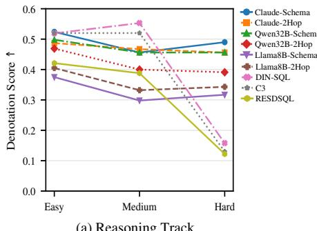  
-#'#30/+/)-#'#30/-#'#30/+/) 2 %,-#'#30/+/ 2#%,-#'#30/+/) 2

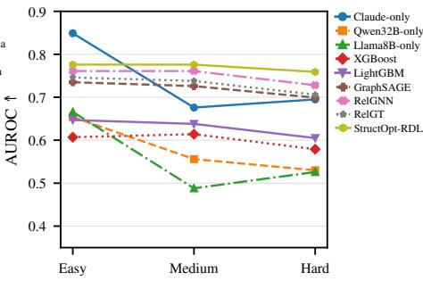  
-\$2'&+%4+6'-#33+(+%#-\$2'&+%4+6'-#33-\$2'&+%4+6' -#33+( %#4+0/-#33+(+%#4+0/2'& %4+6'-#33+( %#4+0/-\$2'&+%4+6'-#33+( %#4+0/

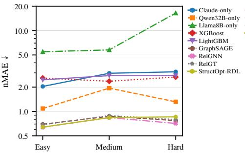  
-%2'&+%4+6'')2'33+0/2'&+%4+6'')2'33+0/+6'')2'33+0/&+%4+6 ')2'33+0/2'&+%4+6  )2'33+0/

-#5&'%\*'.# -#.#01 -#5&'0/-8 2#1\* -#5&'0/-8 2#1\*-#5&'%\*'.# -#.#01 -#5&'0/-8 2#1\* -#5&'0/-8 2#1\*-#5&'%\*'.# -#.#01 -#5&'0/-8 2#1\* -#5&'0/-8 2#1\*-#5&'%\*'.# -#.#01 -#5&'0/-8 2#1\* -#5&'0/-8 2#1\*-#5&'%\*'.# - .#01 -#5&'0/-8 2#1\* -#5&'0/-8 2#1\*-#5& %\* .# -#.#01 - -8 2#1\* -#5&'0/-8 2#1\*Fig. 9. Performance trends across difficulty levels. Panel (a) reports Reasoning Track denotation scores, where higher is better. Panel (b) reports Predictive -#5&'01  7'/	0/-8 '-7'/	%\*'.# 	 -#.#0/-8 '- 7'/	%\*'.# 	 -#.#0/-8 '- -#.#0/-7'/	%\*'.# 	 -#.#0/-8 '- -#.#0/-8 '- -#5&'01  7'/	0/-8 '- 7'/	Classification AUROC, where higher is better. Panel (c) reports Predictive Regression nMAE, where lower is better.  
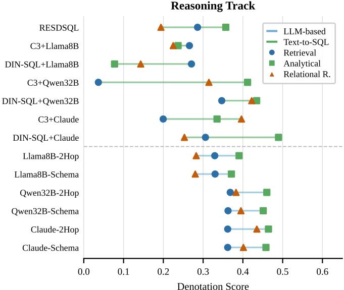

Fig. 10. Reasoning Track performance by query type. Predictive Track  
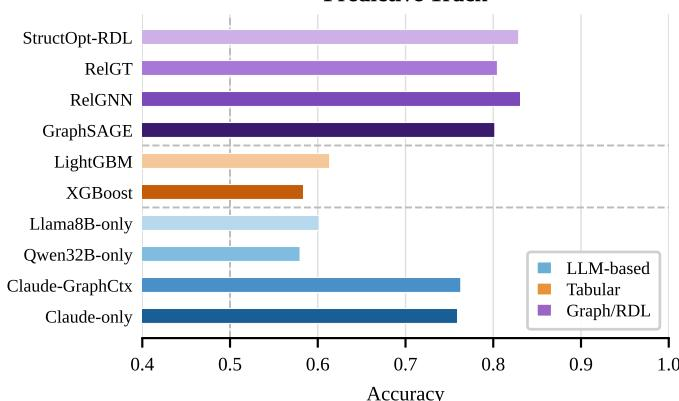  
Fig. 11. Predictive Track performance (Accuracy) by method.

Among LLM methods, runtime depends strongly on model size and prompting strategy; multi-stage Text-to-SQL pipelines such as C3 are especially expensive. These results highlight the practical importance of task-aware routing: a system should invoke expensive reasoning modules only when they are required, and use trained predictive modules for future-oriented prediction.

## VI. CONCLUSION AND FUTURE WORK

RDL-Bench is a benchmark for task-aware question answering over relational databases, covering current-state reasoning and future-oriented prediction under a unified natural-

## +)\*4)\*4+)\*4TABLE XI

LLM-BASED ROUTING AND REASONING PIPELINES ARE REPORTED IN MINUTES OVER SEVEN DOMAINS. LOWER IS BETTER.
<table><tr><td>Family</td><td>Method</td><td>Avg. Runtime</td></tr><tr><td rowspan="6">Predictive</td><td>XGBoost</td><td>28.3s</td></tr><tr><td>LightGBM</td><td>25.2s</td></tr><tr><td>GraphSAGE</td><td>35.0s</td></tr><tr><td>RelGNN</td><td>34.4s</td></tr><tr><td>RelGT</td><td>34.8s</td></tr><tr><td>StructOpt-RDL</td><td>29.1s</td></tr><tr><td rowspan="3">Router</td><td>Claude-Router</td><td>14.7m</td></tr><tr><td>Qwen32B-Router</td><td>45.0m</td></tr><tr><td>Llama8B-Router</td><td>12.6m</td></tr><tr><td rowspan="5">Reasoning</td><td>Claude-Schema+2Hop</td><td>4.0m</td></tr><tr><td>Qwen32B-Schema+2Hop</td><td>15.1m</td></tr><tr><td>Llama8B-Schema+2Hop</td><td>5.9m</td></tr><tr><td>Claude-DIN-SQL</td><td>18.3m</td></tr><tr><td>Claude-C3</td><td>113.7m</td></tr></table>

language interface across seven real-world domains. Our twolevel evaluation characterizes native solver performance and the system-level impact of routing errors. Denotation-level reasoning remains far from saturated, with the best method reaching 0.49 macro-average; context augmentation and SQL specialization each address partial failure modes but do not jointly solve schema grounding, relational composition, and answer normalization. LLM predictive competitiveness is an artifact of binary task format and collapses on scalar regression, showing that Boolean predictive QA alone cannot reveal the limits of relational understanding. Task-aware routing exposes a capability threshold: large LLMs route reliably, while small LLMs develop systematic bias that degrades endto-end performance below random, and this degradation is disproportionately concentrated in predictive tasks where module mismatch produces fundamentally wrong answer types.

These findings suggest several open problems for the community. Relational reasoning methods that jointly address schema grounding, multi-hop composition, and answer-form control remain absent. Predictive QA beyond binary classification, including ranking, set-valued prediction, and scalar regression under weak temporal signal, is largely unsolved. The Llama8B results motivate lightweight routers that combine schema grounding with reliable capability selection. Multi-turn relational QA, where follow-up questions depend on previous answers or evolving temporal assumptions, represents a natural extension that RDL-Bench is designed to support.

## ACKNOWLEDGEMENTS

This research / project is supported by the National Research Foundation, Singapore, under its Frontier CRP Grant (NRF-F-CRP-2024-0005), and under its AI Singapore Programme (AISG Award No: AISG3-RP-2024-034). This research is also supported by Singapore MOE AcRF Tier-2 Award (MOE-T2EP20224-0005) and NTU SUG-NAP. Any opinions, findings, and conclusions or recommendations expressed in this material are those of the author(s) and do not reflect the views of the National Research Foundation, Singapore.

## AI-GENERATED CONTENT ACKNOWLEDGEMENT

During the preparation of this manuscript, the authors used Claude and GPT writing tools to improve language clarity, polish phrasing, and refine presentation. Claude and GPT assist with code implementation and the code has been carefully verified by the authors. The research ideas, benchmark design, experimental setup, analysis, and conclusions were developed and verified by the authors.

## REFERENCES

[1] Y. Bai, S. Kadavath, S. Kundu, A. Askell, J. Kernion, A. Jones, A. Chen, A. Goldie, A. Mirhoseini, C. McKinnon, et al. Constitutional ai: Harmlessness from ai feedback. arXiv preprint arXiv:2212.08073, 2022.

[2] A. Biswal, L. Patel, S. Jha, A. Kamsetty, S. Liu, J. E. Gonzalez, C. Guestrin, and M. Zaharia. Text2sql is not enough: Unifying ai and databases with tag. arXiv preprint arXiv:2408.14717, 2024.

[3] T. Chen and C. Guestrin. Xgboost: A scalable tree boosting system. In Proceedings of the 22nd acm sigkdd international conference on knowledge discovery and data mining, pages 785–794, 2016.

[4] T. Chen, C. Kanatsoulis, and J. Leskovec. Relgnn: Composite message passing for relational deep learning. arXiv preprint arXiv:2502.06784, 2025.

[5] W. Chen, H. Wang, J. Chen, Y. Zhang, H. Wang, S. Li, X. Zhou, and W. Y. Wang. Tabfact: A large-scale dataset for table-based fact verification. arXiv preprint arXiv:1909.02164, 2019.

[6] Y. Cheng and S. Luo. What makes a desired graph for relational deep learning? https://arxiv.org/abs/2606.08491, 2026.

[7] E. F. Codd. A relational model of data for large shared data banks. Communications of the ACM, 13(6):377–387, 1970.

[8] X. Dong, C. Zhang, Y. Ge, Y. Mao, Y. Gao, J. Lin, D. Lou, et al. C3: Zero-shot text-to-sql with chatgpt. arXiv preprint arXiv:2307.07306, 2023.

[9] V. P. Dwivedi, S. Jaladi, Y. Shen, F. López, C. I. Kanatsoulis, R. Puri, M. Fey, and J. Leskovec. Relational graph transformer. arXiv preprint arXiv:2505.10960, 2025.

[10] T. Fawcett. An introduction to roc analysis. Pattern recognition letters, 27(8):861–874, 2006.

[11] A. Grattafiori, A. Dubey, A. Jauhri, A. Pandey, A. Kadian, A. Al-Dahle, A. Letman, A. Mathur, A. Schelten, A. Vaughan, et al. The llama 3 herd of models. arXiv preprint arXiv:2407.21783, 2024.

[12] J. Guo, Z. Zhan, Y. Gao, Y. Xiao, J.-G. Lou, T. Liu, and D. Zhang. Towards complex text-to-sql in cross-domain database with intermediate representation. In Proceedings of the 57th annual meeting of the association for computational linguistics, pages 4524–4535, 2019.

[13] W. L. Hamilton, R. Ying, and J. Leskovec. Inductive representation learning on large graphs. In NIPS, 2017.

[14] Z. Hu, Y. Dong, K. Wang, and Y. Sun. Heterogeneous graph transformer. In Proceedings of the web conference 2020, pages 2704–2710, 2020.

[15] R. J. Hyndman and A. B. Koehler. Another look at measures of forecast accuracy. International journal of forecasting, 22(4):679–688, 2006.

[16] K. Järvelin and J. Kekäläinen. Cumulated gain-based evaluation of ir techniques. ACM Transactions on Information Systems (TOIS), 20(4):422–446, 2002.

[17] G. Ke, Q. Meng, T. Finley, T. Wang, W. Chen, W. Ma, Q. Ye, and T.- Y. Liu. Lightgbm: A highly efficient gradient boosting decision tree. Advances in neural information processing systems, 30, 2017.

[18] H. Li, J. Zhang, C. Li, and H. Chen. Resdsql: Decoupling schema linking and skeleton parsing for text-to-sql. In Proceedings of the AAAI Conference on Artificial Intelligence, volume 37, pages 13067–13075, 2023.

[19] J. Li, B. Hui, G. Qu, J. Yang, B. Li, B. Li, B. Wang, B. Qin, R. Geng, N. Huo, et al. Can llm already serve as a database interface? a big bench for large-scale database grounded text-to-sqls. Advances in Neural Information Processing Systems, 36:42330–42357, 2023.

[20] C. Liu, H. Sun, A. N. Zehmakan, and Z. Zhang. Efficient edge rewiring strategies for enhancing pagerank fairness. Theoretical Computer Science, 1067:115765, 2026.

[21] C. Liu, Z. Xie, A. N. Zehmakan, and Z. Zhang. Efficient algorithms for computing random walk centrality. IEEE Transactions on Knowledge and Data Engineering, 38(1):235–247, 2026.

[22] C. Liu, A. N. Zehmakan, and Z. Zhang. Fast query of biharmonic distance in networks. In Proceedings of the 30th ACM SIGKDD Conference on Knowledge Discovery and Data Mining, pages 1887– 1897. Association for Computing Machinery, 2024.

[23] C. Liu, X. Zhou, A. N. Zehmakan, and Z. Zhang. Promoting fairness in information access within social networks, 2025.

[24] C. Liu, X. Zhou, B. Zhang, A. N. Zehmakan, and Z. Zhang. Fast estimation of pairwise biharmonic distance on graphs. Proceedings of the ACM on Management of Data, 4(2):27, 2026.

[25] Y. Liu, Y. Zhu, Y. Gao, Z. Luo, X. Li, X. Shi, Y. Hong, J. Gao, Y. Li, B. Ding, et al. Xiyan-sql: A novel multi-generator framework for textto-sql. IEEE Transactions on Knowledge and Data Engineering, 2026.

[26] M. Maddela, L. Xie, D. Preo¸tiuc-Pietro, et al. Starqa: A question answering dataset for complex analytical reasoning over structured databases. In Proceedings ofthe 2025 Conference on Empirical Methods in Natural Language Processing, pages 34475–34487, 2025.

[27] P. Pasupat and P. Liang. Compositional semantic parsing on semistructured tables. In Proceedings of the 53rd Annual Meeting of the Association for Computational Linguistics and the 7th International Joint Conference on Natural Language Processing (Volume 1: Long Papers), pages 1470–1480, 2015.

[28] M. Pourreza and D. Rafiei. Din-sql: Decomposed in-context learning of text-to-sql with self-correction. Advances in neural information processing systems, 36:36339–36348, 2023.

[29] P. Rajpurkar, J. Zhang, K. Lopyrev, and P. Liang. Squad: 100,000+ questions for machine comprehension of text. In Proceedings of the 2016 conference on empirical methods in natural language processing, pages 2383–2392, 2016.

[30] J. Robinson, R. Ranjan, W. Hu, K. Huang, J. Han, A. Dobles, M. Fey, J. E. Lenssen, Y. Yuan, Z. Zhang, et al. Relbench: A benchmark for deep learning on relational databases. Advances in Neural Information Processing Systems, 37:21330–21341, 2024.

[31] E. Rossi, B. Chamberlain, F. Frasca, D. Eynard, F. Monti, and M. Bronstein. Temporal graph networks for deep learning on dynamic graphs. arXiv preprint arXiv:2006.10637, 2020.

[32] M. Sokolova and G. Lapalme. A systematic analysis of performance measures for classification tasks. Information processing & management, 45(4):427–437, 2009.

[33] Y. Song, X. Chen, W. Lin, J. Li, C. Zhang, Y. Zhou, L. Chen, and J. Tang. Efficient graph embedding generation and update for large-scale temporal graph. Proceedings of the VLDB Endowment, 18(4):929–942, 2024.

[34] Y. Song, D. Lai, Z. Chong, and Z. Pan. Dynamic network embedding by time-relaxed temporal random walk. In International Conference on Neural Information Processing, pages 426–437. Springer International Publishing Cham, 2021.

[35] Y. Song, X. Tao, Z. Yang, Y. Luo, and J. Tang. Ehrag: Bridging semantic gaps in lightweight graphrag via hybrid hypergraph construction and retrieval. In Findings of the Association for Computational Linguistics: ACL 2026, pages 24638–24652, 2026.

[36] Y. Song, R. Yang, and J. Tang. Signed proximity matters in graph-based recommendation. In Proceedings of the 32nd ACM SIGKDD Conference on Knowledge Discovery and Data Mining V. 1, pages 1321–1332, 2026.

[37] Y. Song, F. Yu, Y. Luo, X. Tao, S. Qiu, K. Han, and J. Tang. Mitigating structural overfitting: A distribution-aware rectification framework for missing feature imputation. In Proceedings of the 49th International ACM SIGIR Conference on Research and Development in Information Retrieval, pages 1644–1655, 2026.

[38] M. Stonebraker. Sql databases v. nosql databases. Communications of the ACM, 53(4):10–11, 2010.

[39] S. Talaei, M. Pourreza, Y.-C. Chang, A. Mirhoseini, and A. Saberi. Chess: Contextual harnessing for efficient sql synthesis. arXiv preprint arXiv:2405.16755, 2024.

[40] Q. Team. Qwen2.5: A party of foundation models, September 2024.

[41] B. Wang, R. Shin, X. Liu, O. Polozov, and M. Richardson. Rat-sql: Relation-aware schema encoding and linking for text-to-sql parsers. In Proceedings of the 58th annual meeting of the association for computational linguistics, pages 7567–7578, 2020.

[42] X. Xu, C. Liu, and D. Song. Sqlnet: Generating structured queries from natural language without reinforcement learning. arXiv preprint arXiv:1711.04436, 2017.

[43] T. Yu, R. Zhang, H. Er, S. Li, E. Xue, B. Pang, X. V. Lin, Y. C. Tan, T. Shi, Z. Li, et al. Cosql: A conversational text-to-sql challenge towards cross-domain natural language interfaces to databases. In Proceedings of the 2019 conference on empirical methods in natural language processing and the 9th international joint conference on natural language processing (EMNLP-IJCNLP), pages 1962–1979, 2019.

[44] T. Yu, R. Zhang, K. Yang, M. Yasunaga, D. Wang, Z. Li, J. Ma, I. Li, Q. Yao, S. Roman, et al. Spider: A large-scale human-labeled dataset for complex and cross-domain semantic parsing and text-to-sql task. In Proceedings of the 2018 conference on empirical methods in natural language processing, pages 3911–3921, 2018.

[45] V. Zhong, C. Xiong, and R. Socher. Seq2sql: Generating structured queries from natural language using reinforcement learning. CoRR, abs/1709.00103, 2017.