# RETHINKING SUCCESSIVE REJECTS ALGORITHMS

Mohamed Khair   
Mohamed bin Zayed University   
of Artificial Intelligence   
mohamed.khair@mbzuai.ac.ae   
Junpei Komiyama   
Mohamed bin Zayed University   
of Artificial Intelligence   
RIKEN AIP   
junpei@komiyama.info

## ABSTRACT

In the best-arm identification problem, an algorithm adaptively selects arms to find the arm of the largest mean reward. Successive Rejects (SR) is a simple fixed-budget best-arm identification algorithm that eliminates one candidate arm at each phase. At first glance, SR seems to have limited adaptivity, since it follows predetermined phase lengths. However, for Gaussian arms with common variance, SR’s worst-instance error exponent normalized by the popular complexity measure $H _ { 1 } ( P )$ is optimal up to a constant factor, which partly explains why SR’s performance is competitive compared with state-of-the-art adaptive sampling algorithms. In this paper, we extend the framework of SR by optimizing its predefined schedule of phase lengths. We formulate phase-schedule design as an optimization problem for the normalized error exponent. Then, we introduce a version of SR with the optimized schedule, which we call $H _ { 1 }$ -balanced Successive Rejects (H<sub>1</sub>-SR). This schedule is optimal within the class of SR-type algorithms with deterministic equal-count schedules. For Gaussian arms with common variance, $H _ { \mathrm { 1 } } – \mathbf { S } \mathbf { R }$ achieves at least 11/12 of the optimal normalized rate over all adaptive algorithms for every $K \geq 2 .$ , and this approximation ratio converges to one as $1 - \mathsf { \bar { O } } ( 1 / \log K )$ as $K  \infty$ . This is a significant improvement over original SR, whose corresponding fraction of the optimal normalized rate converges to $1 / 4 .$ Finally, experiments on ten synthetic instances and two dataset-derived Gaussian benchmarks compare the optimized schedule with original SR at finite horizons. They show substantial gains on many instances while also exposing a regime in which more aggressive early elimination is costly.

## 1 INTRODUCTION

Best-arm identification asks how to use noisy measurements to select the alternative with the largest mean. The forecaster, who follows an algorithm, adaptively chooses which arm to measure and, after a prescribed budget of T observations, outputs a final recommendation: its estimate of the best arm.

Successive Rejects (SR; Audibert et al., 2010) is a particularly simple elimination algorithm that involves K − 1 phases. Each phase gives the same number of additional samples to every remaining arm, then eliminates the arm with the smallest cumulative empirical mean. The phase lengths are fixed in advance. Sequential Halving (SH; Karnin et al., 2013) uses a similar design but eliminates approximately half the remaining arms in each phase. These methods show that simple elimination can achieve an exponentially small probability of error. The multiplicative constant in the exponential rate, however, determines how much budget is needed when small error probabilities matter.

The two methods also differ in how they use observations. Original SH ranks arms using samples collected in the current phase, whereas SR retains earlier samples in each surviving arm’s empirical mean. This distinction can affect finite-budget performance. SR remains a competitive benchmark alongside more recent algorithms such as Continuous Rejects (Wang et al., 2023) and Almost Tracking (Komiyama et al., 2026). Its continued relevance raises two questions: how close is its error rate to the best attainable rate, and can a small change to its schedule close the remaining gap?

The limited adaptivity of SR makes its performance gap particularly intriguing. Once the rejection rule is fixed—sample all surviving arms equally and eliminate an arm with the smallest cumulative empirical mean—the only remaining design choice is the clock: how many observations should each surviving arm have when each elimination takes place. Original SR makes one particular choice. It is not immediate whether that choice is well matched to the statistical difficulty of avoiding an erroneous elimination.

We therefore study the phase schedule itself as an optimization variable. Our argument proceeds from the outside in. We first place an information bound on the $H _ { 1 }$ -normalized rate of an arbitrary adaptive algorithm, where the $H _ { 1 }$ is a popularly used complexity measure of the instance. We then restrict attention to the class of SR-type algorithms with deterministic equal-count schedules, which is a subset of all adaptive algorithms that includes the original SR, and ask for the best schedule in that class. A sharp analysis of the event that the true best arm is simultaneously below all surviving competitors turns the statistical problem into a small deterministic balancing problem. Solving it produces the phase schedule; the algorithm is a consequence of that optimization.

## 1.1 HOW SHOULD WE COMPARE IDENTIFICATION ALGORITHMS?

An algorithm can work well when one arm is clearly better and struggle when several arms have nearly equal means. Comparing raw error probabilities across such instances confounds algorithm quality with problem difficulty. We therefore account for the gaps between arm means before comparing how quickly errors decrease with the budget. Following Komiyama et al. (2022; 2026), we compare the worst-instance exponential rate after normalization by an instance complexity. We use $H _ { 1 }$ , the sum of inverse squared gaps to the best arm, as a complexity measure that we normalize the error rate. A larger normalized rate means a stronger guarantee relative to this measure of difficulty.

Our benchmark is the best such rate over all adaptive algorithms, not just elimination methods. The algorithm does not know the true gaps; $H _ { 1 }$ is used to evaluate it, not as an input. This criterion does not require matching a gap-informed oracle on every instance (Degenne, 2023). We give the formal definition in Section 2.1.

Our algorithm can be used to the best-arm identification with sub-Gaussian rewards, including rewards supported in [0, 1] (or any finite region). Our optimality is for Gaussian rewards as we provides the error rate lower bound to that case.

## 1.2 CONTRIBUTIONS

The contributions follow the same progression as the analysis.

• An explicit characterization of the best rate for any adaptive algorithm. For Gaussian arms we derive an explicit upper bound $R _ { K } ^ { \star } \le 1 / ( \sigma ^ { 2 } \bar { B } _ { K } )$ on the best $H _ { 1 }$ -normalized rate attainable by arbitrary adaptive algorithms.

• Optimization within the class of SR-type algorithms. We characterize the worst-instance rate of deterministic equal-count successive-rejection schedules. Its unique solution gives us $H _ { \mathrm { 1 } } – \mathbf { S } \mathbf { R }$ algorithm, that achieves the matching rate.

• Comparison with all algorithms and with original SR. The optimized schedule satisfies $R _ { H _ { 1 } - \bar { \mathbf { S } } \mathbf { R } } / R _ { K } ^ { \star } \geq B _ { K } / D _ { K } \geq 1 1 / 1 2$ for every K, with $B _ { K } / D _ { K } \stackrel { - } { = } 1 { - } O ( 1 / \log K )$ , whereas original SR satisfies $R _ { \mathrm { S R } } / R _ { K } ^ { \star }  1 / 4$ as $K  \infty$ . Figure 1 illustrates the difference between SR and $H _ { \mathrm { 1 } } – \mathbf { S } \mathbf { R }$ in terms of budget allocation across phases.

• Finite-budget experiments. On ten synthetic and two dataset-derived Gaussian benchmarks we compare $H _ { \mathrm { 1 } } – \mathbf { S } \mathbf { R }$ with original SR. The experiments show that $H _ { \mathrm { 1 } } – \mathbf { S } \mathbf { R }$ often improves terminal error, while a deliberately highlighted failure case shows why the asymptotic worst-instance guarantee should not be read as pointwise finite-budget dominance.

## 1.3 RELATED WORK

Elimination algorithms Beyond SR (Audibert et al., 2010) and Sequential Halving (Karnin et al., 2013; Zhao et al., 2023), Shahrampour et al. (2017) study general sequential-elimination schedules, including nonlinear cumulative phase lengths. However, they have not characterized the optimal scheduling of the phase lengths. Wang et al. (2023) develop a large-deviation analysis of adaptive identification and introduce Continuous Rejects, which dynamically chooses the phase lengths.

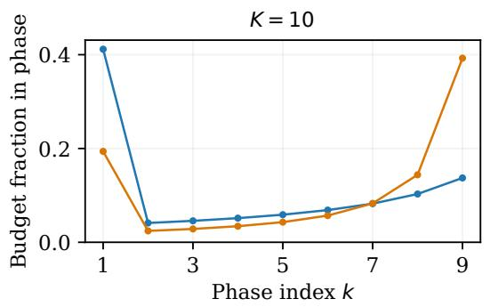

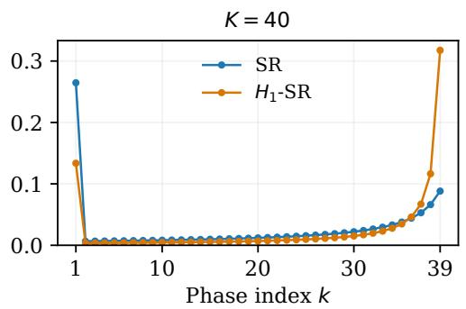  
Figure 1: Fraction of the total budget spent in each phase, for the original SR and our $H _ { \mathrm { 1 } } – \mathbf { S } \mathbf { R }$ . Each phase includes all pulls of its surviving arms, not a cumulative per-arm count. Both methods spend the same total budget and eliminate one arm per phase; $H _ { 1 }  – \bar { \bf S } \bar { \bf R }$ spends more of the budget in the final phases.

Barrier et al. (2023) consider fixed-budget identification problems for a class of reward distributions bounded on [0, 1] and consider the SR algorithm therein.

Minimax rates and implementable algorithms. Audibert et al. (2010); Carpentier & Locatelli (2016) show that there is an $O ( \log K )$ gap in the complexity of identifying the best arm between the fixed-budget setting (considered in this paper) and fixed-confidence settings, in which the algorithm can choose when to stop sampling. A notable difference that subsequent research disclosed is that optimization in these two settings is fundamentally different. Namely, the fixed-confidence setting allows a uniformly good algorithm. Namely, there exist several algorithms such as Track and Stop (Garivier & Kaufmann, 2016) and Top-two Thompson Sampling (Russo, 2020; Jourdan et al., 2023; Bandyopadhyay et al., 2024) that achieve this property, meaning they perform optimally on all problem instances, whereas in the fixed-budget setting, no such uniformly good algorithm exists (Komiyama et al., 2022; Wang et al., 2023; Degenne, 2023; Wang et al., 2024). Therefore, the latter setting is closer to traditional statistical decision theory<sup>1</sup> (Jennison et al., 1982), where the optimality depends on the choice of the complexity measure $H ( P )$ , such as admissibility (Imbens et al., 2025) and minimax optimality (Komiyama et al., 2022). In particular, Komiyama et al. (2022) formulate minimax rates given a complexity measure $H ( P )$ , and introduce the delayed optimal tracking (DOT) algorithm. However, DOT is almost impossible to implement in practice as it needs to solve a dynamic program with a long horizon. Later on, Komiyama et al. (2026) proposed a practical algorithm called simple tracking that does not require the information on the horizon T, and its version called almost tracking, which has a provable constant-factor rate guarantee. However, its constant on top of the rate guarantee is impractically large.

Our main results start from a more practical viewpoint. Starting from the popularly used SR algorithm, we improve its performance without introducing additional complexity into the algorithm. Our main algorithm, $H _ { \mathrm { 1 } } { \cdot } S { \mathrm { R } }$ , significantly improves the practical performance of SR, and we derive nearly minimax rate guarantees for the most popularly used complexity measure $H _ { 1 } ( P )$

## 2 FROM ARBITRARY ADAPTIVE ALGORITHMS TO AN OPTIMIZED REJECTION SCHEDULE

## 2.1 MODEL AND PERFORMANCE CRITERION

We follow the notation of Komiyama et al. (2026). There are $K \geq 2$ arms with unknown means $\pmb { P } = ( P _ { 1 } , \dots , P _ { K } )$ . At round t, algorithm A chooses $I ( t ) \in [ K ]$ from the history up to round t − 1,

then observes a fresh reward $X ( t )$ from that arm. Write

$$
N _ { i } ( t ) = \sum _ { u = 1 } ^ { t } \mathbf { 1 } \{ I ( u ) = i \} , \qquad Q _ { i } ( t ) = { \frac { \sum _ { u = 1 } ^ { t } X ( u ) \mathbf { 1 } \{ I ( u ) = i \} } { N _ { i } ( t ) } } \quad ( N _ { i } ( t ) > 0 ) .\tag{1}
$$

Thus $P _ { i }$ is a true mean and $Q _ { i } ( t )$ is an empirical mean; write $Q ( t ) = ( Q _ { 1 } ( t ) , \ldots , Q _ { K } ( t ) )$ once all arms have been sampled. After the known horizon T, the algorithm recommends ${ \cal J } ( T )$

Assume a unique best arm and define

$$
i ^ { \star } = i ^ { \star } ( P ) = \underset { i \in [ \mathsf { K } ] } { \operatorname { a r g m a x } } P _ { i } , \qquad P ^ { \star } = \underset { i } { \operatorname* { m a x } } P _ { i } , \qquad \Delta _ { i } = P ^ { \star } - P _ { i } > 0 \quad ( i \neq i ^ { \star } ) .
$$

Parenthesized subscripts denote true ranks: $P _ { ( 1 ) } > P _ { ( 2 ) } \ge \cdots \ge P _ { ( K ) }$ . The unique-best assumption makes the target recommendation unambiguous and ensures that every suboptimal gap is strictly positive. For the exact-rate and minimax analysis, observations from arm i are independent draws from $N ( P _ { i } , \sigma ^ { 2 } )$ , with a common variance $\sigma ^ { 2 } > 0$ , and the reward streams are independent across arms.

We evaluate an algorithm through four quantities:

$$
\mathrm { P o E } _ { A } ( \pmb { P } ) = \mathbb { P } _ { \pmb { P } } ^ { \mathcal { A } } ( J ( T ) \neq i ^ { \star } ( \pmb { P } ) ) , \qquad \qquad H _ { 1 } ( \pmb { P } ) = \sum _ { i \neq i ^ { \star } ( \pmb { P } ) } \Delta _ { i } ^ { - 2 } ,
$$

$$
E _ { A } ( \pmb { P } ) = \operatorname* { l i m i n f } _ { T  \infty } \frac { 1 } { T } \log \frac { 1 } { \mathrm { P o E } _ { A } ( \pmb { P } ) } , \qquad \qquad \mathcal { R } _ { A } = \operatorname* { i n f } _ { P : \mathrm { u n i q u e } \mathrm { b e s t } } H _ { 1 } ( \pmb { P } ) E _ { A } ( \pmb { P } ) .\tag{2}
$$

Here $\mathrm { P o E } _ { \mathcal { A } } ( P )$ is the probability of recommending a suboptimal arm after T observations; as in Komiyama et al. (2022), its dependence on $T$ is implicit. The complexity $H _ { 1 } ( P )$ increases when competitors approach the best arm, reflecting the greater difficulty of distinguishing their means. The exponent $\bar { \boldsymbol { E } } _ { A } ( \boldsymbol { P } )$ measures the asymptotic decrease of error with budget: when a rate limit exists, the error behaves as $\exp \{ - T \bar { E _ { A } } ( \bar { P } ) + o ( T ) \}$ . Finally, $R _ { \mathcal { A } }$ is the smallest $H _ { 1 }$ -normalized exponent over all unique-best instances. It measures the algorithm’s worst-instance guarantee after accounting for this complexity.

Let $\mathfrak { A } _ { K }$ denote the class of all adaptive algorithm families in this model, including randomized and horizon-dependent ones. For each horizon $T ,$ , arm selections may depend on the past observations and internal randomness, and the final recommendation may depend on the full observed history and internal randomness. These rules may depend on $K$ and ${ \dot { T } } ,$ , but not on the unknown means. Our ideal objective is to attain the $H _ { 1 }$ -minimax rate $R _ { K } ^ { \star } = \operatorname* { s u p } _ { \cal A \in mathfrak { A } _ { K } } R _ { \cal A }$ , or to guarantee a large fraction of it with a practical algorithm. We determine SR’s normalized rate and improve it by changing only its phase lengths.

We exclusively consider $H _ { 1 }$ here. Appendix I relates this convention to the other complexities studied in the literature (Audibert et al., 2010; Garivier & Kaufmann, 2016; Komiyama et al., 2022).

For the finite-budget upper bound, we also allow independent rewards with a common sub-Gaussian variance proxy $\sigma ^ { 2 } \colon$ every centered reward has moment generating function at most $e ^ { \lambda ^ { 2 } \sigma ^ { 2 } / 2 }$ for all $\lambda \in \mathbb { R }$ . In particular, our algorithm also has error rate guarantees under any rewards supported in $[ 0 , 1 ]$ by setting $\sigma ^ { 2 } = 1 / 4$ in the analysis. For these extensions, the error probability depends on the full reward law $^ { \mathrm { { \sc } } } \mathbf { S } ,$ and could be the case that we can further improve the bounds when we have additional knowledge about the reward distributions.

## 2.2 AN INFORMATION BOUND FOR EVERY ADAPTIVE ALGORITHM

We first describe the possible achievable rates for any adaptive algorithm, including not only SRtype algorithms, but also Continuous Rejects (Wang et al., 2023) and Simple Tracking (Komiyama et al., 2026). Namely, let

$$
h _ { m } = \sum _ { j = 1 } ^ { m } j ^ { - 1 } , \qquad B _ { K } = \left\{ { 8 , \atop 4 3 / 7 + 2 h _ { K - 1 } , } \right.
$$

The constant $B _ { K }$ is an inverse-rate information constraint.

Theorem 1 (Rate upper bound). For Gaussian arms and the criterion in (2), $R _ { K } ^ { \star } \le 1 / ( \sigma ^ { 2 } B _ { K } )$

The proof is deferred to Appendix E, which gives the full change-of-measure argument and derives the explicit constant $B _ { K }$ from a single limiting allocation constrained by a hierarchy of Gaussian alternatives. The theorem is a worst-instance asymptotic restriction; it is not a finite-budget lower bound for every individual instance.

## 2.3 THE CLASS OF SR-TYPE ALGORITHMS

We now focus on the class of SR-type algorithms. We consider all deterministic schedules $( \mathrm { i e . }$ , the phase lengths are fixed in advance) and we preserve SR’s sampling and rejection rules. Let $\operatorname { \dot { \mathfrak { A } } } _ { K } ^ { \operatorname { S R } } \subseteq$ $\mathfrak { A } _ { K }$ be the class of SR-type algorithms that sample every surviving arm to the same predetermined cumulative count, reject one arm with a smallest empirical mean, and recommend the last survivor. With s arms remaining, denote the cumulative count by $m _ { s } ( T )$ . The counts are positive integers satisfying

$$
m _ { K } ( T ) \leq \cdots \leq m _ { 2 } ( T ) , \qquad 2 m _ { 2 } ( T ) + \sum _ { s = 3 } ^ { K } m _ { s } ( T ) \leq T .
$$

The budget counts each rejected arm at its final sample count and both finalists at $m _ { 2 } ( T )$ . Tie breaking in elimination is fixed.

In summary, an algorithm in $\mathfrak { A } _ { K } ^ { \mathrm { S R } }$ is characterized by the choice of the deterministic schedule $( m _ { K } ( T ) , \dot { \ldots } , m _ { 2 } ( \bar { T } ) )$ . For example, as we discussed in Section 2.3, the original version of SR (Audibert et al., 2010) corresponds to $m _ { s } / T \propto 1 / s$ . We next relate the deterministic schedule to the algorithm’s performance (i.e., error rate $R _ { \mathcal { A } } )$

The rest of this section shows how the deterministic schedule $( m _ { K } ( T ) , \dots , m _ { 2 } ( T ) )$ can be optimized.

## 2.4 HOW THE DETERMINISTIC SCHEDULE CONTROLS PERFORMANCE

Consider a phase with s surviving arms, while the true best arm is still active. Rejecting it requires its empirical mean to be no larger than those of all $s - 1$ competitors at once. To analyze this event without conditioning on survival, fix a deterministic candidate set $A = \{ i ^ { \star } , i _ { 1 } , . . . , i _ { s - 1 } \}$ containing the true best. Define its true gaps and complexity by

$$
\delta _ { j } = P _ { i ^ { \star } } - P _ { i _ { j } } > 0 , \qquad H _ { A } = \sum _ { j = 1 } ^ { s - 1 } \delta _ { j } ^ { - 2 } ,
$$

that is, $\delta _ { j } = \Delta _ { i _ { j } }$ . For the proof, let $\overline { { Q } } _ { i , m }$ be the mean of the first m rewards in arm $i \mathrm { \ ' } _ { \mathrm { s } }$ potential independent sequence. This is an equivalent way to construct the sequential observations, not an extra observation available to the algorithm. At any deterministic common count $m$ , the empirical means of the arms in A are represented by $\overline { { Q } } _ { i , m }$

We now relate the deterministic schedule to the SR-type algorithm’s error exponent through concentration inequalities. Namely, for Gaussian rewards with variance $\sigma ^ { 2 }$ , the probability that an arm’s empirical mean falls below a fixed threshold $q < P _ { i }$ satisfies

$$
\mathbb { P } \big ( \overline { { Q } } _ { i , m } \le q \big ) \le \exp \big ( - m \operatorname { K L } \big ( N ( q , \sigma ^ { 2 } ) \| N ( P _ { i } , \sigma ^ { 2 } ) \big ) \big ) = \exp \left( - \frac { m ( q - P _ { i } ) ^ { 2 } } { 2 \sigma ^ { 2 } } \right) .\tag{3}
$$

After subtracting $P ^ { \star }$ , the true mean vector on A is $p _ { A } = ( 0 , - \delta _ { 1 } , \ldots , - \delta _ { s - 1 } )$ . A necessary condition for rejecting the best arm is that the shifted empirical vector belongs to $\mathcal { C } _ { A } = \{ q \in \mathbb { R } ^ { s }$ $q _ { 0 } \leq q _ { j } , 1 \leq j < s \}$ . This is a closed convex polyhedral cone, the intersection of the half-spaces $q _ { 0 } - q _ { j } \le 0$ . It contains exactly the vectors in which the true best arm has a smallest empirical mean, allowing ties. The quantity $d _ { A }$ is the smallest Euclidean displacement of the whole mean vector that makes the true best arm empirically worst:

$$
d _ { A } ^ { 2 } = \operatorname* { i n f } _ { q \in \mathcal { C } _ { A } } \| q - p _ { A } \| ^ { 2 } = \operatorname* { m i n } _ { u \geq 0 } \left\{ u ^ { 2 } + \sum _ { j = 1 } ^ { s - 1 } ( \delta _ { j } - u ) _ { + } ^ { 2 } \right\} \geq \frac { ( s - 1 ) ^ { 2 } } { s H _ { A } } .\tag{4}
$$

Here $( x ) _ { + } = \operatorname* { m a x } \{ x , 0 \}$ and u is the downward displacement of the best-arm empirical mean from $0 : 0 - u$ . For this fixed coordinate, the nearest feasible competitor mean is max $\langle - \delta _ { j } , - u \rangle$ , requiring an upward displacement $( \delta _ { j } - u ) _ { + }$ . Summing these squared displacements and minimizing over u gives the middle expression. The inequality is tight when the gaps in A are equal. Projection onto this cone and a sub-Gaussian Chernoff bound, which gives a finite-sample guarantee with the same quadratic structure in the exponent as (3), give

$$
\mathbb { P } \big ( \overline { { Q } } _ { i ^ { \star } , m } \leq \overline { { Q } } _ { i , m } \mathrm { ~ f o r ~ e v e r y ~ } i \in A \setminus \{ i ^ { \star } \} \big ) \leq \exp \left( - \frac { m ( s - 1 ) ^ { 2 } } { 2 s \sigma ^ { 2 } H _ { A } } \right) .\tag{5}
$$

Appendix B proves both the projection step and the sharp inverse-gap inequality. The large-deviation analysis of SR in (Wang et al., 2023; Komiyama et al., 2026) identifies the cost of such misleading empirical means. Here we bound that cost, at the end of a phase $K + 1 - s$ where s arms remains, sharply in terms of $H _ { A }$ . Since $H _ { A } \leq H _ { 1 }$ , (5) also yields an upper bound in terms of $H _ { 1 }$ that is uniform over all such sets A. The analysis is enabled by the fact that an SR-type algorithm conducts uniform exploration at each phase, which is much more simpler than the design of algorithms appearing in (Wang et al., 2023; Komiyama et al., 2026).

The bound (5) is the key design input. Its coefficient depends only on the number s of surviving arms. The next subsection packages this coefficient into a convenient quantity and asks how to choose all checkpoint counts so that no active-set size becomes the bottleneck.

## 2.5 A SMALL BALANCING PROBLEM WITH AN EXPLICIT SOLUTION

The simultaneous-rejection bound in Section 2.4 identifies

$$
a _ { s } = { \frac { 2 s } { ( s - 1 ) ^ { 2 } } } , \qquad 2 \leq s \leq K ,
$$

as the information requirement associated with the checkpoint having s surviving arms. Recall that $m _ { s } ( T )$ is the cumulative count per surviving arm at the checkpoint with s arms. An SR-type algorithm is characterized by $( m _ { s } ( T ) ) _ { 2 \leq s \leq K }$ . Since this is a vector sequence of $_ T$ , we take the limit as $T \to \infty$ . When the limits exist,

$$
q _ { s } = \operatorname* { l i m } _ { T \to \infty } \frac { m _ { s } ( T ) } { T } , \qquad 2 \leq s \leq K .
$$

Thus $q _ { s }$ is a cumulative per-arm fraction, not the fraction spent in that phase. For schedules without full limi ${ \mathrm { t s } } , { } ^ { 2 }$ Appendix D uses the same notation for limits along a common subsequence. Since the error exponent is determined by the worst phase, the guaranteed normalized exponent is min<sub>s</sub> $q _ { s } / ( \sigma ^ { 2 } a _ { s } )$ . Maximizing this among the class of limit fractions $\left( q _ { 2 } , \dots , q _ { K } \right)$ gives

$$
\operatorname* { m a x } _ { 0 \le q _ { K } \le \cdots \le q _ { 2 } } \operatorname* { m i n } _ { 2 \le s \le K } \frac { q _ { s } } { a _ { s } } .\tag{6}
$$

Define the normalizing constant

$$
D _ { K } : = 2 a _ { 2 } + \sum _ { s = 3 } ^ { K } a _ { s } = 4 + 2 h _ { K - 1 } + 2 h _ { K - 1 } ^ { ( 2 ) } , \qquad h _ { m } ^ { ( 2 ) } = \sum _ { j = 1 } ^ { m } j ^ { - 2 } .\tag{7}
$$

The optimal limit fractions are given by $q _ { s }$ such that (6) holds, is achieved by the following: Proposition 2 (Information balancing). The value of (6) is $1 / D _ { K }$ , and its unique optimizer is $q _ { s } =$ $a _ { s } / D _ { K }$ for all s.

Proof. If the minimum is at least v, every $q _ { s } \geq v a _ { s }$ . The budget gives $\begin{array} { r } { 1 \geq v ( 2 a _ { 2 } + \sum _ { s = 3 } ^ { K } a _ { s } ) = } \end{array}$ $v D _ { K }$ . Equality is feasible because $a _ { \varepsilon }$ decreases with $s ,$ and equality in the budget forces equality in every coordinate lower bound. □

```tcl
Algorithm 1 $H _ { 1 }$ -balanced Successive Rejects $( H _ { 1 }  – \mathbf { S } \mathbf { R } )$
Require: Number of arms $\overline { { K \geq 2 ; } }$ horizon $\overline { { T \geq K } }$ ; fixed tie-breaking order
1: $A _ { 1 } \gets [ K ] , n _ { 0 } \gets 0 ;$ compute $D _ { K }$ from (7)
2: for $k \doteq 1 , \ldots , K - 1$ do
3: $s  K + 1 - k ; n _ { k }  1 + \lfloor ( T - K ) a _ { s } / D _ { K } \rfloor$
4: Pull each $i \in A _ { k }$ exactly $n _ { k } - n _ { k - 1 }$ additional times
5: Let $t _ { k }$ be the current round; $j _ { k } \gets \arg \operatorname* { m i n } _ { i \in A _ { k } } Q _ { i } ( t _ { k } )$
6: $A _ { k + 1 }  A _ { k } \setminus \{ j _ { k } \}$
7: end for
8: Set ${ \cal J } ( T )$ to the unique element of $A _ { K }$
9: If fewer than T pulls were used, pad the budget and ignore those observations
10: return ${ \cal J } ( T )$
```

## 2.6 THE RESULTING ALGORITHM AND ITS GUARANTEE

Proposition 2 determines the asymptotically balanced checkpoint fractions. We implement those fractions at finite horizon by integer rounding. For $T \geq K$ , let $A _ { 1 } = [ K ]$ and $n _ { 0 } = 0$ . In phase $k \in \{ 1 , \ldots , K - 1 \}$ , the active set has size $s \bar { = } K + 1 - k$ . Set

$$
n _ { k } = 1 + \left\lfloor { \frac { T - K } { D _ { K } } } a _ { K + 1 - k } \right\rfloor .\tag{8}
$$

The checkpoint $n _ { k }$ is the cumulative sample count per surviving arm, not the global time. Each arm in $A _ { k }$ receives $n _ { k } - n _ { k - 1 }$ additional samples. At the resulting global round $t _ { k }$ , all active arms satisfy $N _ { i } ( t _ { k } ) = n _ { k }$ , and an arm minimizing the empirical mean $Q _ { i } ( t _ { k } )$ is removed. The phase therefore uses $( K + 1 - k ) ( n _ { k } - n _ { k - 1 } )$ pulls. Algorithm 1 summarizes the procedure.

The following algorithm bounds the probability of error for Algorithm 1.

Theorem 3 (Finite-budget error upper bound). For every $T \geq K$ and every unique-best instance with independent $\sigma ^ { 2 }$ -sub-Gaussian arm rewards,

$$
\mathrm { P o E } _ { H _ { 1 } \cdot \mathrm { S R } } ( P ) \leq \operatorname* { m i n } \left\{ 1 , ( 2 ^ { K - 1 } - 1 ) \exp \left( - \frac { T - K } { \sigma ^ { 2 } D _ { K } H _ { 1 } ( P ) } \right) \right\} .\tag{9}
$$

Consequently, at every fixed instance the error exponent is at least $1 / ( \sigma ^ { 2 } D _ { K } H _ { 1 } ( { \cal P } ) )$ . This gives $R _ { H _ { 1 } - \mathrm { S R } } \geq 1 \dot { / } ( \sigma ^ { 2 } D _ { K } )$

In the Gaussian model, the asymptotic rate guarantee is tight: Theorem 4 below provides the matching upper bound, yielding $R _ { H _ { 1 } \mathrm { - } \mathrm { S R } } = 1 / ( \sigma ^ { 2 } \bar { D } _ { K } )$ .

## 2.7 CLASS OPTIMALITY AND COMPARISON WITH ANY ALGORITHM

Since $H _ { \mathrm { 1 } } – \mathbf { S } \mathbf { R }$ is designed to optimize the allocation of pulls across arms in a successive rejects framework, it achieves the best possible error exponent within this class of algorithms.

Theorem 4 (Optimal clock within the class of SR-type algorithms). For Gaussian arms, $\mathrm { s u p } _ { A \in \mathfrak { A } _ { K } ^ { \mathrm { S R } } } R _ { A } \overset { - } = 1 / ( \sigma ^ { 2 } D _ { K } )$ , attained by $H _ { \mathrm { 1 } } { \mathrm { - } } S { \mathrm { R } }$

The upper bound is enforced by a different hard instance at each checkpoint. Consider s arms with small gaps and $K - s$ arms with much lower means. With high probability the latter are removed first, leaving the difficult comparison to the s-arm checkpoint. Too few samples at that checkpoint make best-arm rejection too likely. Applying this argument to every s yields simultaneous lower requirements on the counts; their sum exhausts the budget at the proposed schedule. Appendix D makes this argument precise.

This theorem identifies the best rate within $\mathfrak { A } _ { K } ^ { \mathrm { S R } }$ . Combining it with the bound for arbitrary adaptive algorithms gives a separate comparison with the unrestricted optimum.

Corollary 5 (Uniform approximation and leading constant). For Gaussian arms and every fixed $K \geq 2 ,$

$$
\frac { 1 } { \sigma ^ { 2 } D _ { K } } \leq R _ { K } ^ { \star } \leq \frac { 1 } { \sigma ^ { 2 } B _ { K } } , \qquad \frac { R _ { H _ { 1 } \cdot \mathrm { S R } } } { R _ { K } ^ { \star } } \geq \frac { B _ { K } } { D _ { K } } \geq \frac { 1 1 } { 1 2 } .\tag{10}
$$

Moreover $B _ { K } / D _ { K } = 1 - O ( 1 / \log K )$ . As $K  \infty$ after thefixed-K horizon limit, $R _ { H _ { 1 } - \mathrm { S R } } / R _ { K } ^ { \star } $ 1 and $R _ { K } ^ { \star } \sim \mathrm { i } / ( 2 \sigma ^ { 2 } \log K )$

Corollary 5 shows that $H _ { \mathrm { 1 } } – \mathbf { S } \mathbf { R }$ is very close to the optimal rate attainable by any algorithm, which is somewhat surprising given the fact that it determines the length of the schedule beforehand and does not revisit the arms once they are eliminated.

## 3 $H _ { \mathrm { 1 } } { \cdot } S { \mathrm { R } }$ VERSUS ORIGINAL SUCCESSIVE REJECTS

## 3.1 SHARP NORMALIZED-RATE COMPARISON

For $T > K$ , original SR uses

$$
n _ { k } ^ { \mathrm { S R } } = \left\lceil \frac { T - K } { \overline { { \log } } ( K ) ( K + 1 - k ) } \right\rceil , \qquad \overline { { \log } } ( K ) = \frac { 1 } { 2 } + \sum _ { i = 2 } ^ { K } \frac { 1 } { i } .\tag{11}
$$

Theorem 6 (Sharp normalized original-SR comparison). For Gaussian arms under (2), $R _ { \mathrm { S R } } ~ =$ $1 / ( 8 \sigma ^ { 2 } \overline { { \log } } ( K ) )$ ). For $T > K$

$$
\mathrm { P o E } _ { \mathrm { S R } } ( { \cal P } ) \leq \operatorname* { m i n } \left\{ 1 , \frac { K ( K - 1 ) } { 4 } \exp \left( - \frac { T - K } { 8 \sigma ^ { 2 } \overline { { { \log } } } ( K ) H _ { 1 } ( { \cal P } ) } \right) \right\} .
$$

Consequently,

$$
{ \frac { R _ { \mathrm { S R } } } { R _ { K } ^ { \star } } } \geq { \frac { B _ { K } } { 8 { \overline { { \log } } } ( K ) } } \geq { \frac { 1 } { 4 } } .
$$

$$
\frac { R _ { H _ { 1 } \mathrm { { - } S R } } } { R _ { \mathrm { S R } } } = \frac { 8 \overline { { { \log } } } ( K ) } { D _ { K } } \longrightarrow 4 , \qquad \frac { R _ { \mathrm { S R } } } { R _ { K } ^ { \star } } \longrightarrow \frac { 1 } { 4 } .\tag{12}
$$

Theorem 6 shows that, for $K \ge 3 , H _ { 1 } { \cdot } \mathrm { S R }$ achieves a strictly better worst-instance normalized exponent compared to the original SR algorithm, and it is by 4 for large K.

For general $\sigma ^ { 2 } .$ -sub-Gaussian arms, the displayed finite-budget bound remains valid with prefactor $K ( \check { K } - 1 ) / 2$ instead of $K ( K - 1 ) / 4$ . The smaller Gaussian prefactor uses an additional one-half tail factor; the exact-rate and minimax comparisons in the theorem are Gaussian.

The exact error exponent of original SR is established in prior work (Wang et al., 2024; Komiyama et al., 2026). Appendix F gives the short self-contained argument needed for the $H _ { 1 }$ normalization used here.

## 3.2 INTUITION ON THE RATIO

Recall that $m _ { s } ( T )$ is the cumulative number of samples per surviving arm at the phase with s arms remaining. Ignoring integer rounding, the two schedules satisfy

Original SR:

$$
m _ { s } ( T ) \approx \frac { T } { s \mathrm { l o g } ( \cal K ) } , \qquad H _ { 1 } \mathrm { - } \mathrm { S R } : \quad m _ { s } ( T ) \approx \frac { T } { D _ { K } } \frac { 2 s } { ( s - 1 ) ^ { 2 } } .
$$

Their ratio is therefore

$$
\frac { m _ { s } ^ { H _ { 1 } \cdot \mathrm { S R } } ( T ) } { m _ { s } ^ { \mathrm { S R } } ( T ) } \longrightarrow \frac { 2 \overline { { { \log } } } ( K ) } { D _ { K } } \left( \frac { s } { s - 1 } \right) ^ { 2 } \qquad ( T \to \infty ) .
$$

The ratio increases as fewer arms remain: $H _ { \mathrm { 1 } } – \mathbf { S } \mathbf { R }$ spends less before early eliminations and more on the final comparisons (Figure 1). Since $2 \overline { { \log } } ( K ) / D _ { K }  1$ , the final-two ratio tends to 4, matching the large-K rate improvement in Theorem 6.

## 4 NUMERICAL EXPERIMENTS

The theory compares worst-instance normalized asymptotic exponents and does not imply pointwise finite-budget dominance. We therefore compare $H _ { \mathrm { 1 } } { \mathrm { - } } S { \mathrm { R } }$ with original SR on twelve fixed-horizon Gaussian problems: ten synthetic instances with $K = 4 0 ,$ , a MovieLens 1M-derived instance with $K = 3 1$ , and an Open Bandit-derived instance with $K = 8 0$ . The synthetic configurations follow Komiyama et al. (2026) and are listed in Appendix A; the other two instances use means derived from MovieLens 1M (Harper & Konstan, 2015) and Open Bandit (Saito et al., 2021). Rewards are unit-variance Gaussian. Each cell uses 10,000 repetitions at the configured horizon T.

Our primary empirical quantity is the ratio $\widehat { \mathrm { P o E } } _ { H _ { 1 } - \mathrm { S R } } / \widehat { \mathrm { P o E } } _ { \mathrm { S R } } .$ : values below one favor $H _ { \mathrm { 1 } } { \cdot } S { \mathrm { R } }$ and values above one favor SR. Paired terminal comparisons use two-sided exact McNemar tests with Holm correction over the twelve predeclared comparisons at family-wise level 0.05.

Table 1: Terminal error (%) over 10,000 repetitions. Ratio $= \widehat { \mathrm { P o E } } _ { H _ { 1 } \mathrm { - S R } } / \widehat { \mathrm { P o E } } _ { \mathrm { S R } }$ ; boldface marks a Holm-corrected supported improvement.
<table><tr><td colspan="6">Terminal</td></tr><tr><td>Instance</td><td>K</td><td> $T$ </td><td> $\widehat { \mathrm { P o E } }$   $H _ { \mathrm { 1 } } { \mathrm { - } } S \mathbf { R }$ </td><td>(%) SR</td><td>Ratio</td><td>Supported</td></tr><tr><td>Synthetic 1</td><td>40</td><td>6,000</td><td>9.92</td><td>18.05</td><td>0.550</td><td> $H _ { \mathrm { 1 } } { \mathrm { - } } { \mathrm { S R } }$ </td></tr><tr><td>Synthetic 2</td><td>40</td><td>1,000</td><td>1.37</td><td>4.61</td><td>0.297</td><td> $H _ { \mathrm { 1 } } { \mathrm { - } } { \mathrm { S R } }$ </td></tr><tr><td>Synthetic 3</td><td>40</td><td>4,000</td><td>7.72</td><td>7.45</td><td>1.036</td><td></td></tr><tr><td>Synthetic 4</td><td>40</td><td>4,500</td><td>9.88</td><td>14.56</td><td>0.679</td><td> $H _ { \mathrm { 1 } } { \mathrm { - } } S \mathbf { R }$ </td></tr><tr><td>Synthetic 5</td><td>40</td><td>25,000</td><td>9.47</td><td>13.73</td><td>0.690</td><td> $H _ { \mathrm { 1 } } { \mathrm { - } } S \mathbf { R }$ </td></tr><tr><td>Synthetic 6</td><td>40</td><td>5,000</td><td>5.54</td><td>11.30</td><td>0.490</td><td> $H _ { \mathrm { 1 } } { \mathrm { - } } { \mathrm { S R } }$ </td></tr><tr><td>Synthetic 7</td><td>40</td><td>8,000</td><td>15.88</td><td>4.98</td><td>3.189</td><td>SR</td></tr><tr><td>Synthetic 8</td><td>40</td><td>2,000</td><td>2.01</td><td>4.17</td><td>0.482</td><td> $H _ { \mathrm { 1 } } { \mathrm { - } } { \mathrm { S R } }$ </td></tr><tr><td>Synthetic 9</td><td>40</td><td>1,500</td><td>1.76</td><td>5.08</td><td>0.346</td><td> $H _ { \mathrm { 1 } } { \mathrm { - } } { \mathrm { S R } }$ </td></tr><tr><td>Synthetic 10</td><td>40</td><td>2,500</td><td>7.03</td><td>12.36</td><td>0.569</td><td> $H _ { \mathrm { 1 } } { \mathrm { - } } { \mathrm { S R } }$ </td></tr><tr><td>MovieLens 1M</td><td>31</td><td>10,000</td><td>18.27</td><td>24.87</td><td>0.735</td><td> $H _ { \mathrm { 1 } } { \mathrm { - } } { \mathrm { S R } }$ </td></tr><tr><td>Open Bandit</td><td>80</td><td>3,000</td><td>9.37</td><td>10.27</td><td>0.912</td><td></td></tr></table>

$H _ { \mathrm { 1 } } – \mathbf { S } \mathbf { R }$ has lower empirical terminal error on ten of twelve instances; after Holm correction, nine comparisons support $\bar { H } _ { \mathrm { 1 } } { - } \mathbf { S } \mathbf { R }$ , one supports SR, and two are inconclusive. MovieLens has ratio 0.735, whereas synthetic instance 7 has ratio 3.189. In that instance, $H _ { \mathrm { 1 } } { \cdot } S { \mathrm { R } }$ uses $2 7$ observations per arm before the first elimination versus 53 for SR, but 2023 versus 1054 at the final-two checkpoint. This illustrates the finite-budget early/late allocation tradeoff. Appendix $\mathbf { A }$ visualizes all trajectories. Regarding the synthetic instance 7, Appendix H defines dominance and discusses this tradeoff in relation to the worst-instance rate guarantee.

## 5 CONCLUSION AND LIMITATIONS

Optimizing the deterministic SR checkpoints yields $H _ { \mathrm { 1 } } – \mathbf { S } \mathbf { R }$ , which is optimal within this class of SR-type algorithms and achieves at least $1 1 / \dot { 1 } 2$ of the optimal Gaussian $H _ { 1 }$ -normalized rate for every fixed $K ,$ with the certified fraction tending to one as $K$ grows; original SR approaches $1 / 4$ Experiments show substantial finite-budget gains on many instances but also a clear non-dominance case. The finite-budget bound extends to independent sub-Gaussian rewards; matching optimality beyond the Gaussian setting and the early/late elimination tradeoff remain open.

## ACKNOWLEDGMENTS

J. Komiyama was supported by the MBZUAI Start-up fund [BF0121]

## REFERENCES

Jean-Yves Audibert, Sébastien Bubeck, and Rémi Munos. Best arm identification in multi-armed bandits. In Proceedings of the 23rd Conference on Learning Theory, pp. 41–53, 2010. URL

https://www.learningtheory.org/colt2010/papers/59Audibert.pdf.

Agniv Bandyopadhyay, Sandeep Juneja, and Shubhada Agrawal. Optimal top-two method for best arm identification and fluid analysis. In Advances in Neural Information Processing Systems, volume 37, 2024.

Antoine Barrier, Aurélien Garivier, and Gilles Stoltz. On best-arm identification with a fixed budget in non-parametric multi-armed bandits. In Proceedings of the 34th International Conference on Algorithmic Learning Theory, volume 201 of Proceedings of Machine Learning Research, pp. 136–181. PMLR, 2023. URL https://proceedings.mlr.press/v201/barrier23a.html.

Alexandra Carpentier and Andrea Locatelli. Tight (lower) bounds for the fixed budget best arm identification bandit problem. In 29th Annual Conference on Learning Theory, volume 49 of Proceedings of Machine Learning Research, pp. 590–604. PMLR, 2016. URL https://proceeding s.mlr.press/v49/carpentier16.html.

Rémy Degenne. On the existence of a complexity in fixed budget bandit identification. In Proceedings of the 36th Conference on Learning Theory, volume 195 of Proceedings of Machine Learning Research, pp. 1131–1154. PMLR, 2023. URL https://proceedings.mlr.press/v195/deg enne23a.html.

Aurélien Garivier and Emilie Kaufmann. Optimal best arm identification with fixed confidence. In 29th Annual Conference on Learning Theory, volume 49 of Proceedings of Machine Learning Research, pp. 998–1027. PMLR, 2016. URL https://proceedings.mlr.press/v49/garivier16a.html.

F. Maxwell Harper and Joseph A. Konstan. The movielens datasets: History and context. ACM Transactions on Interactive Intelligent Systems, 5(4):19:1–19:19, 2015. doi: 10.1145/2827872.

Guido Imbens, Chao Qin, and Stefan Wager. Admissibility of completely randomized trials: A large-deviation approach, 2025. URL https://arxiv.org/abs/2506.05329. Preprint.

Christopher Jennison, Iain M. Johnstone, and Bruce W. Turnbull. Asymptotically optimal procedures for sequential adaptive selection of the best of several normal means. In Statistical Decision Theory and Related Topics III, volume 2, pp. 55–86. Academic Press, 1982.

Marc Jourdan, Rémy Degenne, and Emilie Kaufmann. An ε-best-arm identification algorithm for fixed-confidence and beyond. In Advances in Neural Information Processing Systems, volume 36, 2023.

Zohar Karnin, Tomer Koren, and Oren Somekh. Almost optimal exploration in multi-armed bandits. In Proceedings of the 30th International Conference on Machine Learning, volume 28 of Proceedings of Machine Learning Research, pp. 1238–1246. PMLR, 2013. URL https: //proceedings.mlr.press/v28/karnin13.html.

Junpei Komiyama, Taira Tsuchiya, and Junya Honda. Minimax optimal algorithms for fixed-budget best arm identification. In Advances in Neural Information Processing Systems, volume 35, pp. 10393–10404, 2022. URL https://papers.neurips.cc/paper\_files/paper/2022/hash/43c18853329c7 504996b255252b6cb1f-Abstract-Conference.html.

Junpei Komiyama, Kyoungseok Jang, and Junya Honda. Rate-optimal design for anytime best arm identification. In Proceedings of the 29th International Conference on Artificial Intelligence and Statistics, volume 300 of Proceedings ofMachine Learning Research, pp. 748–756. PMLR, 2026. URL https://proceedings.mlr.press/v300/komiyama26a.html.

Daniel Russo. Simple bayesian algorithms for best-arm identification. Operations Research, 68(6): 1625–1647, 2020. doi: 10.1287/opre.2019.1911.

Yuta Saito, Shunsuke Aihara, Megumi Matsutani, and Yusuke Narita. Open bandit dataset and pipeline: Towards realistic and reproducible off-policy evaluation. In Advances in Neural Information Processing Systems Datasets and Benchmarks Track, 2021.

Shahin Shahrampour, Mohammad Noshad, and Vahid Tarokh. On sequential elimination algorithms for best-arm identification in multi-armed bandits. IEEE Transactions on Signal Processing, 65 (16):4281–4292, 2017. doi: 10.1109/TSP.2017.2706192. URL https://arxiv.org/abs/1609.02606.

Po-An Wang, Ruo-Chun Tzeng, and Alexandre Proutiere. Best arm identification with fixed budget: A large deviation perspective. In Advances in Neural Information Processing Systems, volume 36, pp. 16804–16815, 2023. URL https://proceedings.neurips.cc/paper\_files/paper/2023/hash/364d5 65b4b726c607aa40e1632045873-Abstract-Conference.html.

Po-An Wang, Kaito Ariu, and Alexandre Proutiere. On universally optimal algorithms for A/B testing. In Proceedings of the 41st International Conference on Machine Learning, volume 235 of Proceedings ofMachine Learning Research, pp. 50065–50091. PMLR, 2024.

Yao Zhao, Connor Stephens, Csaba Szepesvári, and Kwang-Sung Jun. Revisiting simple regret: Fast rates for returning a good arm. In Proceedings of the 40th International Conference on Machine Learning, volume 202 of Proceedings ofMachine Learning Research, pp. 42110–42158. PMLR, 2023.

## A EXPERIMENTAL INSTANCES AND TRAJECTORY PLOTS

The synthetic configurations follow the benchmark family used by Komiyama et al. (2026). All ten use $\dot { K } = 4 0$ independent Gaussian arms with unit variance. With arms indexed by $i \in \{ 1 , \ldots , 4 0 \}$ the means used in our experiments are

Instance 1: $P _ { i } = 1 - 0 . 0 5 ( i - 1 )$

Instance 2: $P _ { i } = 1 0 \left( \frac { i - 1 } { 3 9 } \right) ^ { 0 . 8 }$

Instance 3: $P _ { i } = 1 - { \frac { \sqrt { i - 1 } } { 1 0 } } ,$

Instance 4: $( P _ { 1 } , \dots , P _ { 4 0 } ) = ( 1 , 0 . 9 , 0 . 9 , 0 . 9 , 0 . 9 , 0 , \dots , 0 )$ 35

Instance 5: $P _ { 1 } = \sin \left( \frac { 3 9 \pi } { 8 0 } \right) , \quad P _ { i } = \sin \left( \frac { 9 \pi ( 4 0 - i - 1 ) } { 8 0 0 } \right) , 2 \le i \le 4 0 ,$

Instance 6: $P _ { i } = 0 . 7 5 3 ^ { - i / 1 0 }$

Instance 7: $( P _ { 1 } , \dots , P _ { 4 0 } ) = ( 1 , \underbrace { 0 . 8 , \dots , 0 . 8 } _ { 3 9 } ) ,$

Instance 8: $( P _ { 1 } , \underbrace { \phantom { - } } _ { 3 } , \underbrace { \phantom { - } } _ { 3 } , \underbrace { 0 . 8 , 0 . 8 , 0 . 8 } _ { 3 } , \underbrace { 0 . 5 , \dots , 0 . 5 } _ { 6 } , \underbrace { 0 . 2 , \dots , 0 . 2 } _ { 1 0 } , \underbrace { 0 , \dots , 0 } _ { 2 0 } ) ,$

Instance 9: $( P _ { 1 } , \dots , P _ { 4 0 } ) = ( 1 , 0 . 8 , 0 . 8 , \underbrace { 0 , \dots , 0 } _ { 3 7 } ) ,$

Instance 10: $( P _ { 1 } , \ldots , P _ { 4 0 } ) = ( 1 , 0 . 9 , 0 . 8 5 , 0 . 8 , \underbrace { 0 , \ldots , 0 } _ { 3 6 } ) .$

For Instances 5 and 8, the displayed definitions state explicitly the configurations used in our experiments. The two additional problems are Gaussian instances whose means are derived from MovieLens 1M and Open Bandit, as described in Section 4.

## A.1 TRAJECTORY PLOTS

Figures 2 and 3 report the empirical probability of error along the trajectories configured for their terminal horizons. The blue curve is $H _ { \mathrm { 1 } } – \mathbf { S } \mathbf { R }$ and the orange curve is original SR; shading gives pointwise exact 95% binomial intervals and the vertical axis is logarithmic. A point at $t < T$ is an intermediate recommendation from the same T-configured run, not a separate run retuned to horizon t, so these curves do not constitute anytime guarantees.

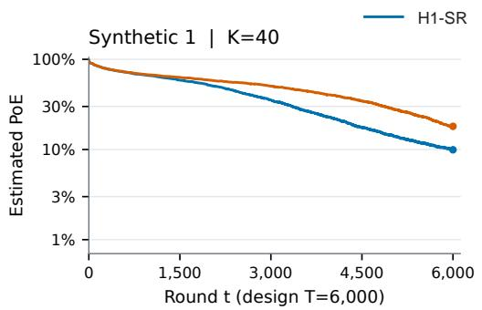

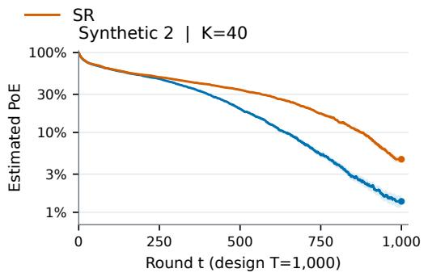

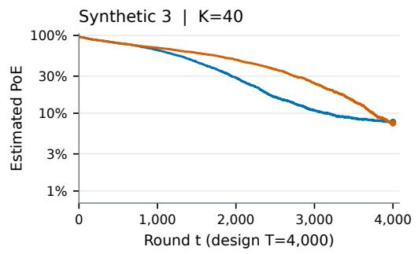

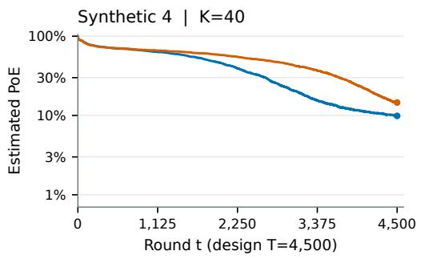

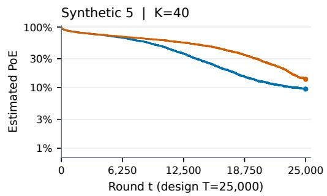

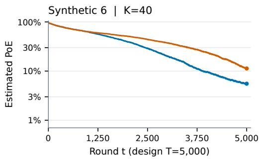  
Figure 2: Trajectory comparisons for synthetic instances 1–6. The terminal points correspond to the fixed-horizon results in Table 1.

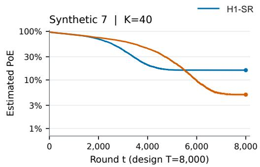

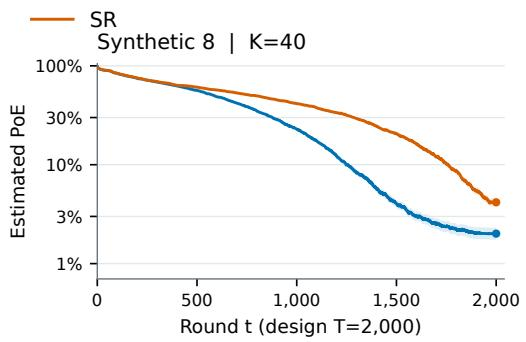

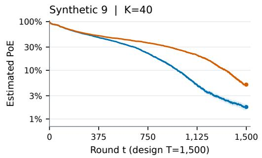

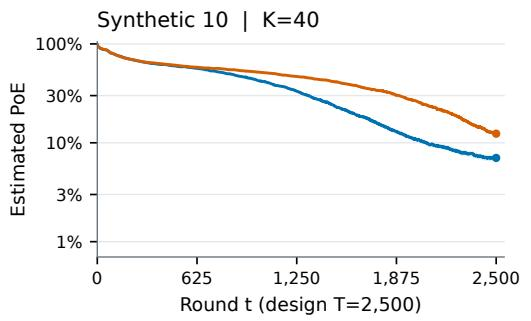

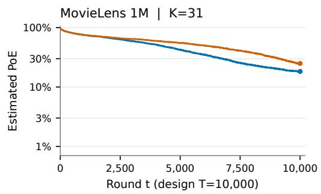

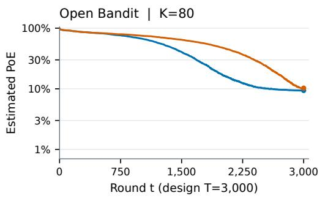  
Figure 3: Trajectory comparisons for synthetic instances 7–10, MovieLens 1M, and Open Bandit. Synthetic instance 7 illustrates the finite-budget cost of allocating less sampling effort before early irreversible eliminations.

## B JOINT REJECTION BOUNDS AND GAUSSIAN SHARPNESS

For the proofs, we use the equivalent construction in which each arm has an independent stream of potential rewards. Its first m rewards define the sample mean $\overline { { Q } } _ { i , m }$ , even on paths where the algorithm does not actually collect all of them. At a deterministic count these sample means have their unconditional laws; we never condition those laws on survival. This construction does not change the sequential observation model in the main text.

Lemma 7 (A fixed-subset rejection bound). Suppose independent rewards from every arm are $\sigma ^ { 2 }$ sub-Gaussian. Fix a deterministic set $A = \{ i ^ { \star } , i _ { 1 } , . . . , i _ { s - 1 } \}$ of $s \geq 2$ arms containing the true best arm. Define its true gaps by $\delta _ { j } = P _ { i ^ { \star } } - P _ { i _ { j } } > 0 ,$ , and put $\begin{array} { r } { H _ { A } = \sum _ { j = 1 } ^ { s - 1 } \delta _ { j } ^ { - 2 } } \end{array}$ . At a common deterministic count $m \geq 1 ,$ , the probability that the best arm has the smallest sample mean in this set is at most

$$
\exp \left\{ - \frac { m ( s - 1 ) ^ { 2 } } { 2 s \sigma ^ { 2 } H _ { A } } \right\} .\tag{13}
$$

Proof. Translate the best mean to zero and write $\nu = ( 0 , - \delta _ { 1 } , \ldots , - \delta _ { s - 1 } )$ . Let X be the vector of shifted sample means, so that $\mathbb { E } X = \nu .$ . The joint rejection event is the cone

$$
{ \mathcal { C } } = \{ x \in \mathbb { R } ^ { s } : x _ { 0 } \leq x _ { j } { \mathrm { ~ f o r ~ } } 1 \leq j < s \} .
$$

Let $x ^ { \circ }$ be the Euclidean projection of ν onto ${ \mathcal { C } } ,$ , and set $v = x ^ { \circ } - \nu$ . The projection inequality gives $v ^ { \top } ( x - \nu ) \geq \| v \| ^ { 2 }$ for every $x \in { \mathcal { C } }$ . Independence and the sub-Gaussian assumption give, for every $\lambda \in \mathbb { R } ,$

$$
\mathbb { E } \exp \{ \lambda v ^ { \top } ( X - \nu ) \} \leq \exp \left\{ \frac { \lambda ^ { 2 } \sigma ^ { 2 } \left\| v \right\| ^ { 2 } } { 2 m } \right\} .
$$

Applying the Chernoff bound at $\lambda = m / \sigma ^ { 2 }$ therefore implies

$$
\mathbb { P } ( X \in \mathcal { C } ) \leq \exp \left\{ - \frac { m \ \mathrm { d i s t } ( \nu , \mathcal { C } ) ^ { 2 } } { 2 \sigma ^ { 2 } } \right\} .\tag{14}
$$

For a proposed first coordinate $- u .$ , the closest feasible competitor coordinate is ma $\mathfrak { c } \{ - \delta _ { j } , - { u } \}$ Values $u < 0$ cannot improve on $u = 0$ . Consequently,

$$
\operatorname { d i s t } ( \nu , \mathcal { C } ) ^ { 2 } = \operatorname* { m i n } _ { u \geq 0 } \left\{ u ^ { 2 } + \sum _ { j = 1 } ^ { s - 1 } ( \delta _ { j } - u ) _ { + } ^ { 2 } \right\} .
$$

For any $u \geq 0$ , put $d _ { j } = ( \delta _ { j } - u ) .$ <sub>+</sub> and $\begin{array} { r } { V = u ^ { 2 } + \sum _ { j } d _ { j } ^ { 2 } } \end{array}$ . Since $\delta _ { j } \leq u + d _ { j }$ , Cauchy–Schwarz gives

$$
s - 1 \leq u \sum _ { j } \delta _ { j } ^ { - 1 } + \sum _ { j } d _ { j } \delta _ { j } ^ { - 1 }
$$

$$
\leq \sqrt { V } \sqrt { \left( \sum _ { j } \delta _ { j } ^ { - 1 } \right) ^ { 2 } + H _ { A } } \leq \sqrt { s H _ { A } V } .
$$

For the second inequality, apply Cauchy–Schwarz to the vectors

$$
a = ( u , d _ { 1 } , \ldots , d _ { s - 1 } ) , \qquad b = \left( \sum _ { j } \delta _ { j } ^ { - 1 } , \delta _ { 1 } ^ { - 1 } , \ldots , \delta _ { s - 1 } ^ { - 1 } \right) .
$$

Their inner product is u $\textstyle \sum _ { j } \delta _ { j } ^ { - 1 } + \sum _ { j } d _ { j } \delta _ { j } ^ { - 1 }$ , while $\left\| a \right\| ^ { 2 } = V$ and $\begin{array} { r } { \left\| b \right\| ^ { 2 } = ( \sum _ { j } \delta _ { j } ^ { - 1 } ) ^ { 2 } + H _ { A } \colon } \end{array}$ ; hence $a ^ { \top } b \leq \left\| a \right\| \left\| b \right\|$ gives the stated bound. The last inequality uses $\begin{array} { r } { ( \sum _ { j } \delta _ { j } ^ { - 1 } ) ^ { 2 } \leq \bar { ( } s - 1 ) H _ { A } } \end{array}$ , again by Cauchy–Schwarz. Thus dist $( \nu , \mathcal { C } ) ^ { 2 } \geq ( s - 1 ) ^ { 2 } / ( s H _ { A } )$ . Together with (14), this proves (13), and hence (5).

The error upper bound alone does not establish an exact exponent. The following Gaussian lower bound is used in the hard instances of Appendices C and D.

Lemma 8 (Exact Gaussian rejection exponent). With Gaussian rewards of common variance $\sigma ^ { 2 }$ the rejection probability for a fixed set satisfies

$$
\operatorname* { l i m } _ { m \to \infty } - \frac { 1 } { m } \log \mathbb { P } ( X \in \mathcal { C } ) = \frac { \operatorname { d i s t } ( \nu , \mathcal { C } ) ^ { 2 } } { 2 \sigma ^ { 2 } } .
$$

For equal gaps ∆, this limit is $( s - 1 ) \Delta ^ { 2 } / ( 2 s \sigma ^ { 2 } )$

Proof. Here $X \sim \mathit { N } ( \nu , \sigma ^ { 2 } I _ { s } / m )$ Choose interior points $y _ { \varepsilon } \in \mathcal { C }$ converging to $x ^ { \circ }$ and a ball $B ( y _ { \varepsilon } , r )$ contained in C. Integrating the Gaussian density over that ball yields

$$
\begin{array} { r l } & { \mathbb { P } ( X \in \mathcal { C } ) \geq \operatorname { v o l } ( B ( y _ { \varepsilon } , r ) ) \left( \displaystyle \frac { m } { 2 \pi \sigma ^ { 2 } } \right) ^ { s / 2 } } \\ & { \qquad \times \exp \left\{ - \displaystyle \frac { m } { 2 \sigma ^ { 2 } } \operatorname* { s u p } _ { x \in B ( y _ { \varepsilon } , r ) } \left\| x - \nu \right\| ^ { 2 } \right\} . } \end{array}
$$

Take the upper limit of $- m ^ { - 1 }$ log of the probability, then let $r \downarrow 0$ and $\varepsilon \downarrow 0$ . Combining the result with (14) proves

$$
\operatorname* { l i m } _ { m \to \infty } - \frac { 1 } { m } \log \mathbb { P } ( X \in \mathcal { C } ) = \frac { \operatorname { d i s t } ( \nu , \mathcal { C } ) ^ { 2 } } { 2 \sigma ^ { 2 } } .\tag{15}
$$

For equal gaps, the minimizer has every coordinate equal $\mathrm { t o } - ( s - 1 ) \Delta / s$ , and its squared distance is $( s \bar { - } 1 ) \bar { \Delta ^ { 2 } } / s$ . Interior points can be obtained by moving its first coordinate down by ε and all other coordinates up by ε. This proves the claimed equal-gap rate. Ties have probability zero.

## C THE BALANCED CLOCK AND ITS GAUSSIAN WORST-INSTANCE RATE

Budget feasibility and phase balancing. The coefficients $a _ { s } = 2 s / ( s - 1 ) ^ { 2 }$ strictly decrease with $s \geq 2$ . For example, their continuous extension has derivative $- 2 ( \dot { s } + 1 ) / ( s - 1 ) ^ { 3 } < 0$ . Thus the checkpoints in $( 8 )$ are nondecreasing across successive rejection phases. Summing each rejected arm’s final cumulative count and the counts of both finalists gives

$$
\begin{array} { r l r } {  { \mathrm { n u m b e r ~ o f ~ o b s e r v a t i o n s ~ u s e d } = 2 n _ { K - 1 } + \displaystyle \sum _ { k = 1 } ^ { K - 2 } n _ { k } } } \\ & { } & \\ & { } & { \leq K + \frac { T - K } { D _ { K } } ( 2 a _ { 2 } + \displaystyle \sum _ { s = 3 } ^ { K } a _ { s } ) = T . } \end{array}
$$

This calculation includes $T = K$ . Any remaining observations are taken after the recommendation is stored and do not affect it.

As in Section 2.5, $m _ { s } ( T )$ is the cumulative per-arm count at the s-arm checkpoint and $q _ { s } =$ $\mathrm { l i m } _ { T  \infty } m _ { s } ( T ) / T$ , whenever the limit exists. For $H _ { \mathrm { 1 } } – \mathbf { S } \mathbf { R }$ $m _ { s } ( T ) = n _ { K + 1 - s }$ and $q _ { s } = a _ { s } / D _ { K }$ For any such limiting schedule the budget constraint is

$$
2 q _ { 2 } + \sum _ { s = 3 } ^ { K } q _ { s } \leq 1 .\tag{16}
$$

$\begin{array} { r } { \operatorname { I f } \gamma = \operatorname* { m i n } _ { 2 \leq s \leq K } q _ { s } / a _ { s } . } \end{array}$ , then $q _ { s } \geq \gamma a _ { s }$ for every s. Hence $\begin{array} { r } { 1 \ge \gamma ( 2 a _ { 2 } + \sum _ { s = 3 } ^ { K } a _ { s } ) = \gamma D _ { K } } \end{array}$ Equality is attained by $q _ { s } = a _ { s } / D _ { K }$ , which satisfies the required ordering. Equality also forces every coordinate to have this value. This proves the balancing assertion of Proposition 2. The statistical upper bound showing optimality beyond this max–min calculation is proved in Appendix D.

Proof of Theorem 3. If the best arm is first rejected in phase $k ,$ its active set has size $s = K + 1 - k$ For each possible deterministic active subset A of this size, the rejection event is contained in the event of Lemma 7, evaluated at the deterministic count $n _ { k }$ . The subset complexity satisfies $H _ { A } \leq$ $H _ { 1 } ( P )$ , while the rounding in (8) ensures

$$
{ \frac { n _ { k } } { a _ { s } } } \geq { \frac { T - K } { D _ { K } } } .
$$

All these subset events share the exponential bound in (9), before multiplication by its prefactor. There are

$$
\sum _ { s = 2 } ^ { K } { \binom { K - 1 } { s - 1 } } = 2 ^ { K - 1 } - 1
$$

subsets containing the best arm and at least one competitor. A union bound, and the trivial bound by one, prove the finite-budget statement. Taking the horizon limit at fixed K and a fixed instance gives only the lower bound

$$
\operatorname* { l i m i n f } _ { T \to \infty } \frac { 1 } { T } \log \frac { 1 } { \mathrm { P o E } _ { H _ { 1 } \cdot \mathrm { S R } } ( P ) } \geq \frac { 1 } { \sigma ^ { 2 } D _ { K } H _ { 1 } ( P ) } .
$$

For the Gaussian model defining the normalized rate, it follows that

$$
R _ { H _ { 1 } - \mathrm { S R } } \geq \frac { 1 } { \sigma ^ { 2 } D _ { K } } .
$$

## D OPTIMALITY WITHIN THE CLASS OF SR-TYPE ALGORITHMS

The following proof goes as following: For each $s ,$ we construct an instance that is difficult at the checkpoint with s arms remaining, and then take the worst case over s.

ProofofTheorem 4. Work in the Gaussian model and consider an algorithm A in the class of SRtype algorithms. In particular, each rejection removes an empirical worst arm; only its deterministic common checkpoints $m _ { K } ( T ) \le \cdots \le m _ { 2 } ( T )$ are allowed to change. By compactness, along a horizon subsequence all fractions $m _ { s } ( T ) / T$ converge to limits $q _ { s } ,$ . They satisfy $0 \leq q _ { K } \leq \cdots \leq q _ { 2 }$ and (16). If $R _ { \bf { \mathcal { A } } } = 0$ , the result is immediate. Otherwise fix any finite $0 < r < R _ { \ A }$

A positive rate requires $q _ { K } > 0$ . Indeed, on a fixed equal-gap Gaussian instance the first-checkpoint rejection probability is at least $c _ { 0 } e ^ { - c _ { 1 } m _ { K } ( T ) }$ for constants $c _ { 0 } , c _ { 1 } > 0$ . This follows from the Gaus sian ball bound above, uniformly over integer counts $m _ { K } ( T ) \geq 1 . \operatorname { I f } q _ { K } = 0 .$ , then $m _ { K } ( T ) = o ( T )$ along the subsequence, so the full-sequence lower error exponent is zero, contradicting $R _ { A } > 0$ This boundary case is needed before choosing the far-arm gap below.

Fix $s \in \{ 2 , \ldots , K \}$ and $\Delta > 0$ . For a fixed $M > \Delta$ , consider the instance with one best mean 0, $s - 1$ near means $- \Delta$ , and $K - s$ far means −M. Let $E _ { T }$ be the unconditioned event that all near competitors have sample means larger than the best at count $m _ { s } ( T )$ . Lemma 8 gives, along the selected subsequence,

$$
\mathbb { P } ( E _ { T } ) = \exp \{ - T I _ { s } + o ( T ) \} , \qquad I _ { s } = \frac { q _ { s } ( s - 1 ) \Delta ^ { 2 } } { 2 s \sigma ^ { 2 } } .\tag{17}
$$

Let $S _ { T }$ denote the event that all s near arms, including the best, survive to the s-arm checkpoint. If $S _ { T }$ fails, some near arm is rejected at an earlier checkpoint while a far arm remains active. Because the rejected arm is empirically worst, at that checkpoint a far sample mean is at least as large as a near sample mean. Every relevant true gap is at least $M - \Delta$ , and every checkpoint count is at least $m _ { K } ( T )$ . The Gaussian two-arm tail and a finite union over arms and earlier checkpoints yield a constant $L _ { K } < \infty$ such that

$$
\mathbb { P } ( S _ { T } ^ { c } ) \leq L _ { K } \exp \left\{ - \frac { m _ { K } ( T ) ( M - \Delta ) ^ { 2 } } { 4 \sigma ^ { 2 } } \right\} .\tag{18}
$$

For $s = K$ , the event $S _ { T }$ is certain and this bound is unnecessary. Choose M large enough that $q _ { K } ( M - \Delta ) ^ { 2 } / ( 4 \sigma ^ { 2 } ) > I _ { s }$ . On $E _ { T } \cap S _ { T }$ the best arm is rejected at the s-arm checkpoint. Thus, without any independence assumption between these events,

$$
\begin{array} { r } { \mathrm { P o E } _ { \boldsymbol { A } } ( \boldsymbol { P } ) \ge \mathbb { P } ( E _ { T } ) - \mathbb { P } ( S _ { T } ^ { c } ) = \exp \{ - T \boldsymbol { I } _ { s } + o ( T ) \} . } \end{array}
$$

The full-sequence lower exponent is no larger than the corresponding upper exponent along this subsequence. Since $H _ { 1 } ( { \pmb P } ) \stackrel {  } { = } ( s - 1 ) / \Delta ^ { 2 } \stackrel {  } { + } ( K - s ) / M ^ { 2 }$ , we obtain

$$
r \leq \left( \frac { s - 1 } { \Delta ^ { 2 } } + \frac { K - s } { M ^ { 2 } } \right) I _ { s } .
$$

Here the horizon limit has been taken with M fixed. Now let $M \to \infty$ , giving

$$
r \leq \frac { q _ { s } ( s - 1 ) ^ { 2 } } { 2 s \sigma ^ { 2 } } = \frac { q _ { s } } { \sigma ^ { 2 } a _ { s } } .
$$

This holds for every $s \in \{ 2 , \ldots , K \}$ , so

$$
r \leq \operatorname* { m i n } _ { 2 \leq s \leq K } \frac { q _ { s } } { \sigma ^ { 2 } a _ { s } } .
$$

Thus the smallest of these bounds over all checkpoints limits the rate. Equivalently, $q _ { s } \geq \sigma ^ { 2 } r a _ { s }$ for every s, and (16) implies $1 \geq \sigma ^ { 2 } r D _ { K }$ . Since this holds for every finite $0 < r < R _ { A }$ , it gives $R _ { A } \leq \dot { 1 } / ( \sigma ^ { 2 } D _ { K } )$ . Theorem 3 and Appendix C show that $H _ { \mathrm { 1 } } – \mathbf { S } \mathbf { R }$ attains this value. The proof does not assume that a schedule’s normalized checkpoints converge along the full horizon sequence.

## E A CONVERSE FOR ALL ADAPTIVE ALGORITHMS

The one-shot game-optimal bound $R ^ { \mathrm { g o } }$ in Komiyama et al. (2022; 2026) is an upper bound on attainable normalized rates for any algorithm. Our argument uses essentially the same change-ofmeasure principle. For Gaussian rewards with common variance $\sigma ^ { 2 }$ and the complexity $H _ { 1 }$ used here, our construction gives $B _ { K }$ such that

$$
R _ { K } ^ { \star } \leq R ^ { \mathrm { g o } } \leq \frac { 1 } { \sigma ^ { 2 } B _ { K } } .
$$

Thus $1 / ( \sigma ^ { 2 } B _ { K } )$ is an explicit upper bound on the one-shot game value, but not necessarily its exact value, and it is a useful simple formula. We first prove the allocation statement needed to impose several constraints on one common vector. An algorithm may choose which arm to sample using past observations, internal randomness, and the known budget T. The true arm means are unknown and are not inputs to the algorithm. Throughout this section rewards are Gaussian with the common variance $\sigma ^ { 2 }$ . We use θ for the true mean vector of a reference instance whose unique best arm is arm 1, and $_ { r }$ for the true mean vector of an alternative instance with a different best arm.

The following allocation statement follows directly from the definition of $R ^ { \mathrm { g o } }$ in Komiyama et al.   
(2022; 2026) and holds for every finite $0 < r < R ^ { \dot { \mathrm { g o } } }$ . We derive it here for completeness.

Lemma 9 (One allocation for every fixed alternative). Fix a finite r with $0 < r < R ^ { \mathrm { g o } }$ . For any fixed unique-best instance θ with best arm 1, there exists $u ( \pmb \theta )$ in the probability simplex such that, for everyfixed unique-best instance P whose best arm is not 1,

$$
r \leq \frac { H _ { 1 } ( \pmb { P } ) } { 2 \sigma ^ { 2 } } \sum _ { i = 1 } ^ { K } u _ { i } ( \pmb { \theta } ) ( \theta _ { i } - P _ { i } ) ^ { 2 } .\tag{19}
$$

Proof. Since $r < R ^ { \mathrm { g o } }$ , the definition of the one-shot game provides an allocation map $w ( \cdot )$ into the probability simplex such that

$$
r \leq H _ { 1 } ( \pmb { P } ) \sum _ { i = 1 } ^ { K } w _ { i } ( \pmb { \theta } ) \operatorname { K L } \bigl ( N ( \theta _ { i } , \sigma ^ { 2 } ) \parallel N ( P _ { i } , \sigma ^ { 2 } ) \bigr )
$$

for every unique-best reference instance $\pmb \theta$ and every unique-best alternative $_ { P }$ with a different best arm. For Gaussian distributions with common variance, the KL divergence is $( \theta _ { i } - P _ { i } ) ^ { 2 } / ( 2 \sigma ^ { 2 } )$ Setting $u ( \pmb \theta ) = w ( \pmb \theta )$ proves (19). The same allocation map works for all these pairs; in particular, $u ( \pmb \theta )$ does not depend on the alternative P . The strict inequality $r < R ^ { \mathrm { g o } }$ avoids assuming that the supremum defining the game value is attained. □

We now use this allocation statement to prove $R ^ { \mathrm { g o } } \leq 1 / ( \sigma ^ { 2 } B _ { K } )$ . We first derive constraints on a common allocation vector using Gaussian instances with gaps at different scales, then show that these constraints imply $1 \geq \sigma ^ { 2 } r \breve { B } _ { K }$ for every finite $0 < r < R ^ { \mathrm { g o } }$ . For a nonnegative vector u and $2 \leq s \leq K$ , define

$$
\Psi _ { s } ( u ) = \operatorname* { i n f } _ { z _ { i } > 0 , \ i < s } \left( \sum _ { i < s } z _ { i } ^ { - 2 } \right) \left[ u _ { s } t ^ { 2 } + \sum _ { i < s } u _ { i } ( z _ { i } - t ) ^ { 2 } \right] .\tag{20}
$$

Lemma 10 (Simultaneous prefix information constraints). For every finite r with $0 < r < R ^ { \mathrm { g o } }$ there exists one probability vector u satisfying

$$
\Psi _ { s } ( u ) \geq 2 \sigma ^ { 2 } r , \qquad 2 \leq s \leq K .\tag{21}
$$

Proof. For $0 < \varepsilon < 1$ , choose the strictly ranked reference instance

$$
\theta _ { 1 } ^ { \varepsilon } = 0 , \qquad \theta _ { j } ^ { \varepsilon } = - \sum _ { \ell = 2 } ^ { j } \varepsilon ^ { 2 \left( K - \ell + 1 \right) } , \quad j \geq 2 .
$$

Apply Lemma 9 for each fixed $\pmb { \theta } ^ { \varepsilon }$ . Along a sequence $\varepsilon \downarrow 0 ,$ extract a limit u of the resulting allocation vectors. For each $s \in \{ 2 , \ldots , K \}$ , we call the arms $\{ 1 , \ldots , s \}$ the prefix and the remaining arms $\{ s + 1 , \ldots , K \}$ the $s u f f u x$ , which is empty when $s = K$ . Put $L _ { s } = { \varepsilon } ^ { 2 ( K - s ) + 1 }$ . Then

$$
\theta _ { i } ^ { \varepsilon } / L _ { s } \to 0 \quad ( i \leq s ) , \qquad \theta _ { i } ^ { \varepsilon } / L _ { s } \to - \infty \quad ( i > s ) .
$$

For fixed positive $z _ { 1 } , \dotsc , z _ { s - 1 }$ and $t \geq 0 ,$ define

$$
P _ { s } ^ { \varepsilon } = L _ { s } t , \qquad P _ { i } ^ { \varepsilon } = L _ { s } ( t - z _ { i } ) ( i < s ) , \qquad P _ { i } ^ { \varepsilon } = \theta _ { i } ^ { \varepsilon } ( i > s ) .
$$

For sufficiently small ε, arm s is the unique best arm, and the suffix contributes asymptotically nothing to the scaled complexity:

$$
L _ { s } ^ { 2 } H _ { 1 } ( { \pmb P } ^ { \varepsilon } ) \longrightarrow \sum _ { i < s } z _ { i } ^ { - 2 } .
$$

The suffix means are unchanged, so its contribution to the quadratic information cost is exactly zero. Applying (19) and then taking $\varepsilon \downarrow 0$ yields

$$
2 \sigma ^ { 2 } r \le \left( \sum _ { i < s } z _ { i } ^ { - 2 } \right) \left[ u _ { s } t ^ { 2 } + \sum _ { i < s } u _ { i } ( z _ { i } - t ) ^ { 2 } \right] .
$$

For fixed positive z, the minimizing translation is $\begin{array} { r } { t = ( \sum _ { i < s } u _ { i } z _ { i } ) / ( \sum _ { i < s } u _ { i } ) \geq 0 } \end{array}$ whenever the denominator is positive. If all prefix coordinates vanish, the expression is zero, contradicting $r > 0$ Thus the restriction $t \geq 0$ loses no minimizing value, and taking the infimum proves (21).

The allocation map is fixed before taking $\varepsilon \downarrow 0$ . The convergent subsequence of allocation vectors is common to all the finitely many prefixes and all fixed choices of their parameters. No horizon limit is needed in this argument. □

Proof of Theorem 1. If $R ^ { \mathrm { g o } } = 0$ , the claimed bound is immediate. Otherwise fix any finite $0 < r <$ $R ^ { \mathrm { g o } }$ and use the vector in Lemma 10. Write $c = \sigma ^ { 2 } r . \operatorname { A t } s = 2$ , direct minimization gives

$$
\Psi _ { 2 } ( u ) = \frac { u _ { 1 } u _ { 2 } } { u _ { 1 } + u _ { 2 } } \leq \frac { u _ { 1 } + u _ { 2 } } { 4 } .
$$

The denominator is positive by the prefix constraint. Hence $u _ { 1 } + u _ { 2 } \geq 8 c$ . For $K = 2$ , this already gives $1 \geq c B _ { 2 }$ with $B _ { 2 } = 8$ . Now suppose $K \geq 3$ . For $s \geq 3 ,$ , choose $z _ { i } = 1$ in (20) and minimize over t. With $\begin{array} { r } { C _ { s } = \sum _ { i < s } u _ { i } } \end{array}$ , this gives

$$
\Psi _ { s } ( u ) \leq ( s - 1 ) \frac { C _ { s } u _ { s } } { C _ { s } + u _ { s } } \leq ( s - 1 ) u _ { s } .
$$

Thus $u _ { s } \geq 2 c / ( s - 1 )$ . To retain the coupling between the first three arms, put $C = u _ { 1 } + u _ { 2 } \geq 8 c .$ The same inequality at $s = 3$ , before discarding its denominator, gives

$$
{ \frac { C u _ { 3 } } { C + u _ { 3 } } } \geq c , \qquad u _ { 3 } \geq { \frac { c C } { C - c } } .
$$

The function $C \mapsto C ^ { 2 } / ( C - c )$ is increasing for $C \geq 8 c$ , since its derivative is $C ( C - 2 c ) / ( C - c ) ^ { 2 } >$ 0. Consequently,

$$
u _ { 1 } + u _ { 2 } + u _ { 3 } \geq \frac { C ^ { 2 } } { C - c } \geq \frac { 6 4 c } { 7 } .
$$

Combining this with the individual bounds for $s \geq 4$ yields

$$
1 = \sum _ { i } u _ { i } \geq c \left( { \frac { 6 4 } { 7 } } + 2 \sum _ { s = 4 } ^ { K } { \frac { 1 } { s - 1 } } \right) = c \left( { \frac { 4 3 } { 7 } } + 2 h _ { K - 1 } \right) = \sigma ^ { 2 } r B _ { K } .
$$

An empty sum is zero, so this includes $K \ : = \ : 3$ . Because the inequality holds for every finite $0 < r < R ^ { \mathrm { g o } }$ , it implies $R ^ { \mathrm { g o } } \leq 1 / ( \sigma ^ { 2 } B _ { K } )$ , including ruling out an infinite game value. Combining this with the bound $R _ { K } ^ { \star } \leq R ^ { \mathrm { g o } }$ from Komiyama et al. (2022; 2026) proves the theorem. □

## F THE EXACT EXPONENT OF ORIGINAL SUCCESSIVE REJECTS

The exact error exponent of original SR is established in prior work by Wang et al. (2024) and was rediscovered by Komiyama et al. (2026). Here, we will re-derive it for completeness.

ProofofTheorem 6. We first work with Gaussian rewards and prove the finite-budget bound for $T > K$ . At phase $k ,$ put $s = K + 1 - k .$ . If the true best is rejected, at least one true rank $r \in \{ s , \ldots , K \}$ remains active and has a sample mean no smaller than the best. Indeed, among s active arms there must be one of those $K - s + 1$ ranks, since only $s - 1$ arms have better true ranks. For a deterministic common count $m _ { : }$

$$
\mathbb { P } \{ \overline { { Q } } _ { ( r ) , m } \geq \overline { { Q } } _ { i ^ { \star } , m } \} = \Phi \left( - \Delta _ { ( r ) } \sqrt { \frac { m } { 2 \sigma ^ { 2 } } } \right) \leq \frac { 1 } { 2 } \exp \left\{ - \frac { m \Delta _ { ( r ) } ^ { 2 } } { 4 \sigma ^ { 2 } } \right\} .
$$

Here Φ is the standard normal distribution function; the displayed tail inequality follows, for example, by applying the Gaussian density shift to its integral over the positive half-line. The SR checkpoint satisfies $n _ { k } ^ { \mathrm { S R } } \geq ( T - K ) / ( s \overline { { \log } } ( K ) )$ . Also $H _ { 1 } ( P ) \geq ( s - 1 ) / \Delta _ { ( s ) } ^ { 2 }$ and $\Delta _ { ( r ) } \geq \Delta _ { ( s ) }$ Therefore

$$
n _ { k } ^ { \mathrm { S R } } \Delta _ { ( r ) } ^ { 2 } \geq \frac { T - K } { \overline { { \log } } ( K ) H _ { 1 } ( P ) } \frac { s - 1 } { s } \geq \frac { T - K } { 2 \overline { { \log } } ( K ) H _ { 1 } ( P ) } .
$$

At phase $k ,$ , there are k possible ranks $r \in \{ K + 1 - k , \ldots , K \}$ to consider. Summing over all phases gives $\textstyle \sum _ { k = 1 } ^ { K - 1 } k = K ( K - 1 ) / 2$ events in the union bound. The union bound proves the asserted prefactor $\bar { K } ( K - 1 ) / 4$ and exponent, with a further minimum with one if necessary. The explicit one-sample-per-arm convention at $T = K$ removes the zero-count endpoint of the original checkpoint formula and does not affect any asymptotic claim.

For independent $\sigma ^ { 2 }$ -sub-Gaussian rewards, the difference of the two sample means instead has variance proxy $2 \sigma ^ { 2 } / m$ . The Chernoff bound gives

$$
\mathbb { P } \{ \overline { { Q } } _ { ( r ) , m } \geq \overline { { Q } } _ { i ^ { \star } , m } \} \leq \exp \left\{ - \frac { m \Delta _ { ( r ) } ^ { 2 } } { 4 \sigma ^ { 2 } } \right\} .
$$

The same union bound over phases and ranks therefore proves the same finite-budget exponential term with prefactor $K ( K - \bar { 1 } ) / 2$ , rather than $K ( K - 1 ) { \bar { / } } 4$ . The additional factor $1 { \bar { / 2 } }$ per pairwise event above is Gaussian-specific.

To prove Gaussian sharpness, first let $K \geq 3$ and consider the fixed instance

$$
\pmb { P } ^ { ( M ) } = ( 0 , - 1 , - M , \ldots , - M ) , \qquad M > 1 .
$$

Write $m = n _ { K - 1 } ^ { \mathrm { S R } }$ and define the unconditioned final reversal event $E _ { T } = \{ \overline { { { Q } } } _ { 2 , m } \geq \overline { { { Q } } } _ { 1 , m } \}$ . Since $m / T \to 1 / ( 2 \overline { { \log } } ( K ) )$ , the normal-tail exponent gives

$$
\mathbb { P } ( E _ { T } ) = \exp \left\{ - \frac { T } { 8 \sigma ^ { 2 } \overline { { \log } } ( K ) } + o ( T ) \right\} .\tag{22}
$$

Let $S _ { T }$ be the event that arms 1 and 2 both reach the final phase. If either is removed earlier, a far arm must then have a sample mean at least as large. The smallest relevant gap is $M - 1$ and the smallest checkpoint fraction tends to $1 / ( K { \overline { { \log } } } ( K ) )$ . A finite union bound consequently gives

$$
\mathbb { P } ( S _ { T } ^ { c } ) \le \exp \left\{ - \frac { T ( M - 1 ) ^ { 2 } } { 4 \sigma ^ { 2 } K \overline { { \log } } ( K ) } + o ( T ) \right\} .\tag{23}
$$

Choose fixed M such that $( M - 1 ) ^ { 2 } > K / 2$ . The exponent in (23) is strictly larger than the exponent in (22). On $S _ { T } \cap E _ { T } , \mathrm { S R }$ rejects arm 1 in its final phase. Hence

$$
\mathrm { P o E } _ { \mathrm { S R } } ( P ^ { ( M ) } ) \ge \mathbb { P } ( E _ { T } ) - \mathbb { P } ( S _ { T } ^ { c } ) = \exp \left\{ - \frac { T } { 8 \sigma ^ { 2 } \overline { { \log } } ( K ) } + o ( T ) \right\} .
$$

Since $H _ { 1 } ( { \pmb P } ^ { ( M ) } ) = 1 + ( K - 2 ) / M ^ { 2 }$ , first taking $T \to \infty$ for this fixed instance and then $M \to \infty$ proves

$$
R \mathrm { { s R } } \leq { \frac { 1 } { 8 \sigma ^ { 2 } { \overline { { \log } } } ( K ) } } .
$$

For $K = 2 ,$ the same upper bound follows directly from the final two-arm Gaussian comparison.   
The finite-budget guarantee supplies the reverse inequality for every K, proving exact equality.

## G UNIFORM FACTORS AND THE LARGE-ARM LIMIT

Proof of Corollary 5. Theorems 3 and 1 immediately imply

$$
\frac { R _ { H _ { 1 } - \mathrm { S R } } } { R _ { K } ^ { \star } } \geq \frac { B _ { K } } { D _ { K } } .
$$

For $K = 2 , B _ { 2 } = D _ { 2 } = 8$ and the algorithm is optimal. We use $1 1 / 1 2$ as a convenient rational lower bound, rather than as the exact minimum of $\bar { B _ { K } } / D _ { K }$ that is a bit involved. Since $D _ { K } > 0 ,$ it suffices to show that $1 2 B _ { K } - 1 1 D _ { K } \ge 0$ for every K. For $K \geq 3 .$ , put $m = K - 1$ and define

$$
G _ { m } = 1 2 B _ { K } - 1 1 D _ { K } = \frac { 2 0 8 } { 7 } + 2 h _ { m } - 2 2 h _ { m } ^ { ( 2 ) } .
$$

For $m \geq 3 ,$ , its successive differences are

$$
G _ { m } - G _ { m - 1 } = \frac { 2 ( m - 1 1 ) } { m ^ { 2 } } .
$$

Thus, over the integers $m \geq 2 .$ , the minimum is attained at $m = 1 0$ and $m = 1 1$ . Exact arithmetic gives

$$
G _ { 1 0 } = G _ { 1 1 } = \frac { 1 8 7 6 3 3 } { 1 2 7 0 0 8 } > 0 .
$$

It follows that $B _ { K } / D _ { K } > 1 1 / 1 2$ for every $K \geq 3 ,$ proving the uniform factor.

The exact SR rate and the all-algorithm sandwich give

$$
\frac { B _ { K } } { 8 \log ( K ) } \leq \frac { R _ { \mathrm { S R } } } { R _ { K } ^ { \star } } \leq \frac { D _ { K } } { 8 \log ( K ) } .
$$

Moreover,

$$
\frac { B _ { K } } { 8 \overline { { \log } } ( K ) } \geq \frac { 1 } { 4 } + \frac { 7 - 2 / K } { 8 \overline { { \log } } ( K ) } > \frac { 1 } { 4 } ,
$$

because $B _ { K } \geq 6 + 2 h _ { K - 1 }$ and $\overline { { \log } } ( K ) = h _ { K - 1 } + 1 / K - 1 / 2$ . Since $h _ { K - 1 } = \log K + O ( 1 )$ and $h _ { K - 1 } ^ { ( 2 ) } = { \cal O } ( 1 )$ , both $B _ { K }$ and $D _ { K }$ equal 2 log $K + O ( 1 )$ , whereas $8 \overline { { \log } } ( K ) = 8 \log K + O ( 1 )$ . More precisely, for $K \geq 3$

$$
D _ { K } - B _ { K } = 2 h _ { K - 1 } ^ { ( 2 ) } - \frac { 1 5 } { 7 } = O ( 1 ) .
$$

Using $h _ { K - 1 } = \log K + \gamma + O ( K ^ { - 1 } )$ and $h _ { K - 1 } ^ { ( 2 ) } = \pi ^ { 2 } / 6 + { \cal O } ( K ^ { - 1 } )$ , where $\gamma$ is Euler’s constant, also gives the first-order expansion

$$
\frac { B _ { K } } { D _ { K } } = 1 - \frac { \pi ^ { 2 } / 6 - 1 5 / 1 4 } { \log K } + O \bigl ( ( \log K ) ^ { - 2 } \bigr ) .
$$

Since the achieved rate cannot exceed the all-algorithm optimum,

$$
0 \leq 1 - \frac { R _ { H _ { 1 } \cdot \mathrm { { S R } } } } { R _ { K } ^ { \star } } \leq \frac { D _ { K } - B _ { K } } { D _ { K } } = O \left( \frac { 1 } { \log K } \right) .
$$

The preceding bounds also give

$$
\frac { R _ { H _ { 1 } \mathrm { - } \mathrm { S R } } } { R _ { K } ^ { \star } } \longrightarrow 1 , \qquad \frac { R _ { \mathrm { S R } } } { R _ { K } ^ { \star } } \longrightarrow \frac { 1 } { 4 } .
$$

The exact improvement of the balanced rate over SR is $8 \overline { { \log } } ( K ) / D _ { K } \to 4$ . These are limits of fixed-K asymptotic error exponents: the horizon limit is taken first. In particular, no claim about discarding a $\bar { K } .$ -dependent finite-budget prefactor when K grows with $T$ is needed. □

## H NON-DOMINANCE OF $H _ { \mathrm { 1 } } – \mathbf { S } \mathbf { R }$ OVER ORIGINAL SR

At a fixed budget $T ,$ , we say that an algorithm A dominates another algorithm $\mathcal { A } ^ { \prime } \mathrm { i f }$

$$
\mathrm { P o E } _ { \mathcal { A } } ( P ) \leq \mathrm { P o E } _ { \mathcal { A } ^ { \prime } } ( P ) \quad \mathrm { f o r e v e r y u n i q u e - b e s t i n s t a n c e } P ,
$$

with strict inequality for at least one instance. Both probabilities are evaluated at the same budget and under the same true reward distributions.

The optimality of $H _ { \mathrm { 1 } } – \mathbf { S } \mathbf { R }$ concerns the worst-instance normalized asymptotic rate $R _ { \mathcal { A } }$ . Maximizing this criterion can involve tradeoffs between performance on different instances P and $P ^ { \prime }$ . It does not imply dominance over original SR at a fixed budget.

Synthetic instance 7 illustrates this distinction. It has one best arm with mean 1 and 39 competitors with mean 0.8, all with unit-variance Gaussian rewards. In this case, the first elimination matters most to the probability of correctly identifying the best arm. At $\boldsymbol { T } = 8 0 0 0 , H _ { 1 } { \cdot } \mathrm { S R }$ takes $2 7$ observations per arm before the first elimination, compared with 53 for original SR. In other words, $H _ { \mathrm { 1 } } – \mathbf { S } \mathbf { R }$ allocates fewer samples before early eliminations. As a result, SR outperforms $H _ { \mathrm { 1 } } – \mathbf { S } \mathbf { R }$ in this instance.

This provides empirical evidence against finite-budget dominance by $H _ { \mathrm { 1 } } { \mathrm { - } } S \mathbf { R }$ , despite its better worst-instance normalized asymptotic rate. Such tradeoffs across underlying distributions are common in statistical decision theory (Jennison et al., 1982): a procedure can perform better on some distributions and worse on others, so neither procedure dominates the other.

This differs from fixed-confidence best-arm identification, where algorithms such as Track-and-Stop can attain the instance-dependent lower bound on expected sample complexity asymptotically as $\delta  0$ (Garivier & Kaufmann, 2016). Such algorithms are asymptotically optimal on each instance, so attaining the optimal leading-order sample complexity on one instance does not require sacrificing it on another. In contrast, our optimality guarantee concerns the worst-instance normalized asymptotic rate. Within the class of SR-type algorithms, improving performance on some instances can come at the cost of worse performance on others.

## I THE INVERSE-GAP COMPLEXITY MEASURES

Our complexity is the sum over suboptimal arms only:

$$
H _ { 1 } ( P ) = \sum _ { i \neq i ^ { \star } } \Delta _ { i } ^ { - 2 } .
$$

In the original SR paper, Audibert et al. (2010) assign the best arm the artificial gap $\Delta _ { ( 2 ) }$ and include its inverse square in their complexity. Writing their complexity as $H _ { 1 } ^ { \mathrm { S R } }$ , we have

$$
H _ { 1 } ^ { \mathrm { S R } } = H _ { 1 } + \Delta _ { ( 2 ) } ^ { - 2 } , \qquad \frac { K } { K - 1 } H _ { 1 } \leq H _ { 1 } ^ { \mathrm { S R } } \leq 2 H _ { 1 } .
$$

Indeed, ${ \Delta } _ { ( 2 ) } ^ { - 2 }$ is the largest of the $K - 1$ terms in $H _ { 1 }$ , so it lies between $H _ { 1 } / ( K - 1 )$ and $H _ { 1 }$