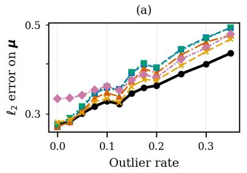
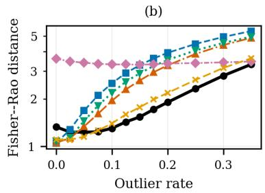
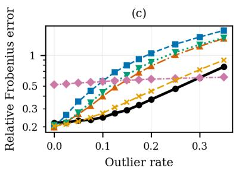

# Robust Covariance Estimation for Entry-wise Contaminated and Partially Observed Data via Expectation Maximization Algorithm

Matys Savidan+ , Mohammed Nabil El Korso‡

## Abstract

Robust covariance estimation under entry-wise contamination and missing data is challenging in various signal processing applications. Under the Student-t model, observation-level reweighting induces a uniform attenuation across samples, which can lead to cumulative information loss even when most coordinates remain informative. The alternative Student-t model enables coordinate-wise robustness, but its E-step is not available in closed form. We extend inference for the Student-t model to incomplete observations through a stochastic approximation EM (SAEM) algorithm operating on a reduced latent space: stochastic updates of the coordinate-wise scales are combined with Rao–Blackwellized Gaussian conditional moments, which avoids explicit sampling of latent Gaussian variables while preserving a likelihood-based framework. Experiments on synthetic and real sensor data show a lower Fisher–Rao error than Gaussian, Student-t, imputation-based and detect-then-estimate estimators at moderate to high outlier rates under diffuse contamination. The code is available here.

## I. INTRODUCTION

Likelihood-based covariance estimation in the presence of latent variables or missing data is commonly addressed using the expectation–maximization (EM) algorithm [1], whose efficiency relies on the conditionally Gaussian structure of the augmented model. However, Gaussian models are inherently sensitive to model misspecification and data corruption [2], [3]. In such settings, robustness mechanisms that discard entire observations can lead to a significant loss of information.

A widely used robust alternative is based on the multivariate Student-t distribution, which admits a latent scale representation [4] and can therefore be handled within an EM framework [5], [6]. By introducing an observationlevel scale variable, this model provides robustness to outliers and heavy-tailed noise [7], [8]. In the presence of entry-wise contamination, where individual entries are corrupted independently [9], [10], the classical Student-t model applies observation-level attenuation, whereby a single corrupted coordinate affects the weight of the entire observation, resulting in the loss of statistical information.

To address such contamination, Finegold and Drton [11] introduced the so-called alternative multivariate Studentt∗ distribution, which associates an independent latent scale variable with each coordinate. This formulation enables localized robustness by selectively down-weighting corrupted entries. Such contamination commonly arises in signal processing applications such as source localization with partially corrupted subarrays or radio interferometry affected by localized radio-frequency interference [12], [13].

However, the increased flexibility of the Student-t∗ model comes at the cost of a much more intricate latent structure. The scales are independent a priori but coupled a posteriori, so that the E-step is not available in closed form, which precludes a standard EM [14], [15], [16]. Likelihood-based inference remains possible through a Monte Carlo approximation of the E-step, but this limitation becomes critical in the presence of missing observations, a common scenario arising from sensor failures or outages, for which no likelihood-based EM or SAEM inference procedure is currently available for the Student-t∗ model [17], [18].

A closely related problem is addressed by Lounici and Pacreau [19], who combine an inverse-probability debiased moment estimator, which requires no imputation, with an external entry-wise detection step. Their approach takes a hard decision per entry, whereas ours never does: corrupted entries are down-weighted continuously, with weights inferred jointly with the parameters, and no detection threshold is needed. Section V compares the two and locates the contamination regime in which each is preferable.

This letter extends likelihood-based inference for the Student-t∗ model to incomplete observations through a SAEM procedure [20], [21] in which stochastic approximation is restricted to the coordinate-wise scales, the latent Gaussian components being integrated out analytically. To our knowledge, it is the first likelihood-based EM-type procedure for the Student-t∗ model that accommodates missing entries. The Student-t∗ model and the Monte Carlo E-step are due to [11]. New here are the extension to incomplete observations through a nested expectation, the Rao–Blackwellization of the Gaussian moments, the stochastic approximation of the scale statistics, the estimation of the degrees of freedom from observed entries only, and an explicit ECM maximization step.

## II. ALTERNATIVE STUDENT-t∗ HIERARCHICAL MODEL

We consider the alternative multivariate Student-t∗ distribution introduced by [11], which provides coordinatewise robustness through a hierarchical formulation.

Let $i = 1 , \ldots , n$ index independent observations and $j = 1 , \dotsc , p$ denote the coordinates. The model is defined hierarchically as follows: for each observation i, we introduce a latent Gaussian random vector

$$
\begin{array} { r } { \pmb { x } _ { i } \sim \mathcal { N } _ { p } ( \mathbf { 0 } , \pmb { \Sigma } ) , } \end{array}
$$

where $\ b { \Sigma } \in \mathbb { R } ^ { p \times p }$ is a positive definite covariance matrix. Then, we associate an independent positive latent scale variable with each coordinate,

$$
\tau _ { i j } \sim \Gamma \left( { \frac { \nu } { 2 } } , { \frac { \nu } { 2 } } \right) , \qquad j = 1 , \dots , p , i = 1 , \dots , n ,
$$

The variables $\tau _ { i j }$ are assumed independent. Finally, the observed data vector $\mathbf { y } _ { i } \in \mathbb { R } ^ { p }$ is defined component-wise by

$$
Y _ { i j } = \mu _ { j } + \frac { X _ { i j } } { \sqrt { \tau _ { i j } } } , \qquad j = 1 , \dots , p ,\tag{1}
$$

where $\pmb { \mu } = ( \mu _ { 1 } , \ldots , \mu _ { p } ) ^ { \top } \in \mathbb { R } ^ { p }$ is a location parameter. Missing observations may occur in the components of $\mathbf { \mathit { y } } _ { i } ,$ while the latent variables $\mathbf { \Delta } _ { \mathbf { \mathcal { X } } _ { i } }$ and the collection $\{ \tau _ { i j } \} _ { i , j }$ remain unobserved. We denote ${ \pmb y } _ { i } \sim t _ { p , \nu } ^ { * } ( { \pmb \mu } , { \pmb \Sigma } )$ . The parameter of interest, commonly considered in signal processing applications [8], [7], is the covariance matrix Σ of the latent Gaussian signal ${ \mathbf { x } } _ { i } ,$ which describes its underlying correlation structure independently of random amplitude variations [22]. The observed data are affected by an additional random scaling factor, so that their covariance reflects both the signal structure and these amplitude fluctuations. For example, in radar processing, Σ characterizes the spatial correlations of the signal received by the different antennas, while random variations in target or clutter power change the observed covariance. We therefore estimate the underlying covariance matrix rather than the covariance of the scaled observations.

## III. ROBUST INFERENCE WITH INCOMPLETE OBSERVATIONS

## A. Latent structure and complete-data likelihood

For each observation $i ,$ let $\mathcal { O } _ { i }$ and $\mathcal { M } _ { i }$ denote the sets of observed and missing coordinates. The available data consist of $\boldsymbol { Y _ { \mathcal { O } } } = \{ Y _ { \mathcal { O } _ { i } } \} _ { i = 1 } ^ { n }$ . Conditional on the scales $\tau ,$ the Gaussian vector $\mathbf { \Delta } _ { \mathbf { \mathcal { X } } _ { i } }$ is fully determined on the observed subset $\mathcal { O } _ { i } ~ ( \mathrm { c f . ~ ( 1 ) } )$ , but remains latent on $\mathcal { M } _ { i }$ . Consequently, the complete data involve the observed entries, the missing values $\mathbf { Y } _ { \mathcal { M } }$ , and the scale variables $\tau .$ Assuming an ignorable missingness mechanism, the complete-data log-likelihood $\ell _ { c } ( \pmb \theta )$ , with $\pmb \theta = ( \mu , \pmb \Sigma , \nu )$ , reads

$$
\begin{array} { r l } & { \ell _ { c } ( \pmb \theta ) = \displaystyle \log p ( \pmb Y _ { \mathscr { O } } , \pmb Y _ { \mathscr { M } } , \tau \pmb \theta ) } \\ & { \qquad = \displaystyle \sum _ { i = 1 } ^ { n } \bigg [ - \frac { 1 } { 2 } \ln | \pmb \Sigma | - \frac { 1 } { 2 } ( D ( \tau _ { i } ) ^ { 1 / 2 } ( \pmb y _ { i } - \pmb \mu ) ) ^ { \top } \pmb \Sigma ^ { - 1 } ( D ( \tau _ { i } ) ^ { 1 / 2 } ( \pmb y _ { i } - \pmb \mu ) ) } \\ & { \qquad + \displaystyle \sum _ { j = 1 } ^ { p } \left( \frac { \nu } { 2 } \ln \frac { \nu } { 2 } - \ln \Gamma \Big ( \frac { \nu } { 2 } \Big ) + \left( \frac { \nu } { 2 } - 1 \right) \ln \tau _ { i j } - \frac { \nu } { 2 } \tau _ { i j } \right) + \frac { 1 } { 2 } \sum _ { j = 1 } ^ { p } \ln \tau _ { i j } \bigg ] + \mathrm { c o n s t } , } \end{array}\tag{2}
$$

in which $D ( \pmb { \tau } _ { i } ) = \mathrm { d i a g } ( \tau _ { i 1 } , \dots , \tau _ { i p } )$ , the latent vector can be rewritten as $\pmb { x } _ { i } = D ( \pmb { \tau } _ { i } ) ^ { 1 / 2 } ( \pmb { y } _ { i } - \pmb { \mu } )$ , and the constant does not depend on θ.

## B. EM formulation and sufficient statistics

Inference relies on maximizing the observed-data log-likelihood $\ell ( \pmb \theta ) = \log p ( \pmb Y _ { O } | \pmb \theta )$ . This is addressed via the EM algorithm by iteratively maximizing the surrogate function $Q ( \pmb \theta \mid \pmb \theta ^ { ( k ) } )$ . Exploiting the hierarchical structure, the expectation step decomposes as:

$$
\begin{array} { r l } & { Q ( \pmb { \theta } \mid \pmb { \theta } ^ { ( k ) } ) = \mathbb { E } _ { \pmb { \tau } , \pmb { Y } _ { \mathcal { M } } \mid \pmb { Y } _ { \mathcal { O } } , \pmb { \theta } ^ { ( k ) } } \big [ \ell _ { c } ( \pmb { \theta } ) \big ] } \\ & { \qquad = \mathbb { E } _ { \pmb { \tau } \mid \pmb { Y } _ { \mathcal { O } } , \pmb { \theta } ^ { ( k ) } } \bigg [ \mathbb { E } _ { \pmb { Y } _ { \mathcal { M } } \mid \pmb { Y } _ { \mathcal { O } } , \pmb { \tau } , \pmb { \theta } ^ { ( k ) } } \big [ \ell _ { c } ( \pmb { \theta } ) \big ] \bigg ] . } \end{array}\tag{3}
$$

The inner expectation over missing data is analytically tractable conditional on $\boldsymbol { \tau } ;$ the outer one is over the scales. Let $\mathbb { E } [ \cdot ]$ denote expectation with respect to $p ( \tau , Y _ { \mathcal { M } } \mid Y _ { \mathcal { O } } , \theta ^ { ( k ) } )$ . Maximizing (3) relies on the conditional expectations

of the sufficient statistics:

$$
\bar { S } _ { \Sigma } = \frac { 1 } { n } \sum _ { i = 1 } ^ { n } \mathbb { E } \big [ { \pmb x } _ { i } { \pmb x } _ { i } ^ { \top } \big ] ,\tag{4}
$$

$$
\bar { S } _ { \mu , 1 } = \sum _ { i = 1 } ^ { n } \mathbb { E } [ W _ { i } y _ { i } ] , \quad \bar { S } _ { \mu , 2 } = \sum _ { i = 1 } ^ { n } \mathbb { E } [ W _ { i } ] ,\tag{5}
$$

$$
\bar { S } _ { \tau } = \sum _ { i = 1 } ^ { n } \sum _ { j = 1 } ^ { p } \mathbb { E } [ \tau _ { i j } ] , \quad \bar { S } _ { \log \tau } = \sum _ { i = 1 } ^ { n } \sum _ { j = 1 } ^ { p } \mathbb { E } [ \log \tau _ { i j } ] ,\tag{6}
$$

where $W _ { i } = D ( \tau _ { i } ) ^ { 1 / 2 } \Sigma ^ { - 1 } D ( \tau _ { i } ) ^ { 1 / 2 }$

Evaluating these expectations is non-trivial. The inner expectation over $\mathbf { Y } _ { \mathcal { M } }$ admits a closed form via Gaussian conditioning identities (since $\mathbf { \Delta } _ { \mathbf { \mathcal { X } } _ { i } }$ is Gaussian given $\tau _ { i } )$ , but the posterior of $\tau _ { i }$ does not [11]: the $\tau _ { i j }$ are independent a priori but coupled a posteriori through non diagonal $\Sigma _ { \mathcal { O } _ { i } \mathcal { O } _ { i } } ^ { - 1 }$ , which rules out a factorization, and the integral is p-dimensional, so that numerical quadrature is impractical. The E-step therefore has no closed form. Direct maximization of ℓ does not avoid it: by Fisher’s identity, $\nabla \ell ( \pmb \theta ) = \mathbb { E } [ \nabla \ell _ { c } ( \pmb \theta ) \mid \mathbf { Y } _ { O } ]$ , so a gradient method needs the same posterior expectation. This motivates the use of the Stochastic Approximation EM (SAEM) described in Section IV.

## IV. STOCHASTIC APPROXIMATION EM ALGORITHM

## A. Rao–Blackwellized Gaussian Moments

Rather than sampling $\mathbf { x } _ { i } .$ , we compute its conditional moments analytically, which gives a Rao–Blackwellized implementation: conditionally on $\tau _ { i }$ and $Y _ { i , O _ { i } }$

$$
\mathbf { x } _ { i } \mid Y _ { i , O _ { i } } , \pmb { \tau } _ { i } \sim \mathcal { N } ( \mathbf { m } _ { i } , \mathbf { C } _ { i } ) ,\tag{7}
$$

with

$$
\mathbf { m } _ { i } = \pmb { \Sigma } _ { : , O _ { i } } \pmb { \Sigma } _ { O _ { i } O _ { i } } ^ { - 1 } \mathbf { D } ( \pmb { \tau } _ { i , O _ { i } } ) ^ { 1 / 2 } ( \mathbf { y } _ { i , O _ { i } } - \pmb { \mu } _ { O _ { i } } )\tag{8}
$$

$$
\mathbf { C } _ { i } = \boldsymbol { \Sigma } - \boldsymbol { \Sigma } _ { : , O _ { i } } \boldsymbol { \Sigma } _ { O _ { i } O _ { i } } ^ { - 1 } \boldsymbol { \Sigma } _ { O _ { i } , : } .\tag{9}
$$

When all coordinates are observed, $\mathbf { C } _ { i } = \mathbf { 0 }$ and $\mathbf { m } _ { i } = \mathbf { x } _ { i } .$ the Rao–Blackwellization is then void and the method reduces to a SAEM for the same model. These expressions give exactly all Gaussian-related conditional moments required for the sufficient statistics of $( \mu , \Sigma )$

$$
\bar { S } _ { \Sigma } = \frac { 1 } { n } \sum _ { i = 1 } ^ { n } \mathbb { E } _ { \tau } \Big [ \pmb { C } _ { i } + \pmb { m } _ { i } \pmb { m } _ { i } ^ { \top } \Big ] ,\tag{10}
$$

$$
\bar { S } _ { \mu , 1 } = \sum _ { i = 1 } ^ { n } \mathbb { E } _ { \tau } \left[ W _ { i } \big ( \pmb { \mu } + D ( \pmb { \tau } _ { i } ) ^ { - 1 / 2 } \pmb { m } _ { i } \big ) \right] .\tag{11}
$$

## B. Sampling of the scale variables

At each iteration, for observed coordinates $( j \in O _ { i } ) , \tau _ { i j }$ is updated coordinate-wise by a Metropolis–Hastings step targeting its full conditional distribution given $\tau _ { i , - j }$ and the observed data $\scriptstyle { y \_ { \lambda } }$

$$
\pi ( \tau _ { i j } \mid \tau _ { i , - j } , y _ { \mathcal { O } _ { i } } ) \propto p ( \tau _ { i j } \mid \nu ) p ( y _ { \mathcal { O } _ { i } } \mid \tau _ { i } ) .
$$

Since $y _ { \mathcal { O } _ { i } } \mid \tau _ { i }$ is Gaussian with mean $\pmb { \mu } _ { \mathcal { O } _ { i } }$ and covariance $D ^ { - 1 / 2 } \Sigma _ { \mathcal { O } _ { i } \mathcal { O } _ { i } } D ^ { - 1 / 2 } , D = D ( \pmb { \tau } _ { i , \mathcal { O } _ { i } } ) ,$

$$
\begin{array} { r } { \log p ( \pmb { y } _ { \mathcal { O } _ { i } } \mid \pmb { \tau } _ { i } ) = - \frac { 1 } { 2 } \log | \pmb { \Sigma } _ { \mathcal { O } _ { i } \mathcal { O } _ { i } } | + \frac { 1 } { 2 } \displaystyle \sum _ { j \in \mathcal { O } _ { i } } \log \tau _ { i j } - \frac { 1 } { 2 } \pmb { v } _ { i } ^ { \top } \pmb { \Sigma } _ { \mathcal { O } _ { i } \mathcal { O } _ { i } } ^ { - 1 } \pmb { v } _ { i } + \mathrm { c o n s t } , } \end{array}\tag{12}
$$

with ${ \pmb v } _ { i } = D ( { \pmb \tau } _ { i , \mathcal { O } _ { i } } ) ^ { 1 / 2 } ( { \pmb y } _ { i , \mathcal { O } _ { i } } - { \pmb \mu } _ { \mathcal { O } _ { i } } )$ . A log-normal random walk proposal is used, $\tau _ { i j } ^ { \prime } = \tau _ { i j } \exp ( \eta ) , \eta \sim \mathcal { N } ( 0 , s _ { p } ^ { 2 } )$ with acceptance probability α = min $\left( 1 , \pi ( \tau _ { i j } ^ { \prime } ) \tau _ { i j } ^ { \prime } / ( \pi ( \tau _ { i j } ) \tau _ { i j } ) \right)$ . The proposal scale $s _ { p }$ is adapted by a Robbins– Monro recursion on log $s _ { p }$ during burn-in, targeting a 40% acceptance rate (about 44% in our experiments), and is then frozen so that the chain keeps the correct invariant distribution. For missing coordinates $( j \in M _ { i } )$ , the likelihood does not depend on $\tau _ { i j }$ and the update reduces to sampling from the Gamma prior.

## C. Stochastic Approximation and Parameter Updates

At iteration k, Eτ[·] is replaced by the Monte Carlo sample $\tau ^ { ( k ) }$ , yielding empirical statistics ${ \hat { \mathbf { S } } } ^ { ( k ) }$ , and the sufficient statistics are updated by

$$
\mathbf { S } ^ { ( k ) } = ( 1 - \gamma _ { k } ) \mathbf { S } ^ { ( k - 1 ) } + \gamma _ { k } \hat { \mathbf { S } } ^ { ( k ) } ,\tag{13}
$$

where $\left( \gamma _ { k } \right)$ is a decreasing sequence of step sizes.

1) Maximization step as an ECM procedure: Since $\pmb { \mu }$ and Σ are not decoupled $( { \pmb x } _ { i }$ depends on $\pmb { \mu }$ and $W _ { i }$ on Σ), we adopt a block coordinate ascent approach, namely an Expectation Conditional Maximization (ECM) step [23]: each conditional maximizer is exact when the other parameter is held fixed.

CM1 (location). With $\pmb { \Sigma } ^ { ( k ) }$ fixed, $\pmb { \mu }$ is updated by weighted least squares,

$$
\boldsymbol { \mu } ^ { ( k + 1 ) } = \left( \mathbf { S } _ { \boldsymbol { \mu } , 2 } ^ { ( k ) } \right) ^ { - 1 } \mathbf { S } _ { \boldsymbol { \mu } , 1 } ^ { ( k ) } ,\tag{14}
$$

where $\mathbf { S } _ { \mu , 1 } ^ { ( k ) } , \mathbf { S } _ { \mu , 2 } ^ { ( k ) }$ follow (13) from the sampled $\tau ^ { ( k ) }$ using (5) and (11).

CM2 (covariance). The moments $\mathbf { m } _ { i } ^ { ( k ) } , \mathbf { C } _ { i } ^ { ( k ) }$ are recomputed at $\mu ^ { ( k + 1 ) }$ (at negligible cost, $\Sigma _ { \mathcal { O } _ { i } \mathcal { O } _ { i } } ^ { - 1 }$ being unchanged), giving the Monte Carlo estimate

$$
\hat { \mathbf { S } } _ { \Sigma } ^ { ( k ) } = \frac { 1 } { n } \sum _ { i = 1 } ^ { n } \left( \mathbf { C } _ { i } ^ { ( k ) } + \mathbf { m } _ { i } ^ { ( k ) } \mathbf { m } _ { i } ^ { ( k ) } \right) ,\tag{15}
$$

and, after (13), $\boldsymbol { \Sigma } ^ { ( k + 1 ) } = \mathbf { S } _ { \Sigma } ^ { ( k ) }$ . Each step is an exact conditional maximizer, so the maximization is a generalized EM step.

2) Degrees of Freedom: The parameter ν is updated by solving

$$
\log ( \nu / 2 ) - \psi ( \nu / 2 ) + 1 + \frac { 1 } { N } \big ( S _ { \ln \tau } ^ { ( k ) } - S _ { \tau } ^ { ( k ) } \big ) = 0 ,\tag{16}
$$

where $\begin{array} { r } { N = \sum _ { i } | O _ { i } | . \ S _ { \tau } ^ { ( k ) } } \end{array}$ and $S _ { \ln \tau } ^ { ( k ) }$ follow (13) and use observed entries only, as scales of missing coordinates are sampled from the prior and carry no information on ν.

Algorithm. Parameters are initialized coordinate-wise using classical estimators: median and nanvar. As $\mu , \Sigma$ are frozen during the simulation step, $\pmb { \Sigma } _ { \mathcal { O } _ { i } \mathcal { O } _ { i } } ^ { - 1 }$ is computed once per observation and a single-entry proposal updates $\pmb { v } _ { i } ^ { \top } \pmb { \Sigma } _ { \mathcal { O } _ { i } \mathcal { O } _ { i } } ^ { - 1 } \pmb { v } _ { i }$ in $O ( 1 )$ : the cost per iteration is $O ( n p ^ { 3 } + K n p ^ { 2 } )$ for K sweeps.

1: Initialize $\pmb { \mu } ^ { ( 0 ) } , \pmb { \Sigma } ^ { ( 0 ) } , \pmb { \tau } ^ { ( 0 ) } , \pmb { \nu } ^ { ( 0 ) }$   
2: for $k = 1 , \ldots , K _ { m a x }$ do   
3: γ ← (k − K )−α if $k > K _ { b u r n }$ else 1   
4: Simulation: draw $\tau _ { i j } ^ { ( k ) } \sim p ( \tau _ { i j } \mid y _ { \mathcal { O } _ { i } } , \theta ^ { ( k - 1 ) } )$ via MH, $\forall i , j \in { \mathcal { O } } _ { i }$   
5: Rao–Blackwellization: compute $\mathbf { n } _ { i } ^ { ( k ) } , \mathbf { C } _ { i } ^ { ( k ) }$ via (8)–(9), ∀i   
6: SA and CM1: update $\mathbf { S } _ { \mu } ^ { ( k ) } , \mathbf { S } _ { \nu } ^ { ( k ) }$ via (13); $\mu ^ { ( k + 1 ) } $ Solve (14)   
7: CM2: recompute m $\mathbf { \Lambda } _ { \cdot i } ^ { ( k ) } , \mathbf { C } _ { i } ^ { ( k ) }$ at $\mu ^ { ( k + 1 ) }$ ; update $\mathbf { S } _ { \Sigma } ^ { ( k ) }$ Σ   
8: ν(k+1) ← Solve (16)   
9: end for

  
Fig. 1. (a) $\ell _ { 2 }$ estimation error of the mean vector µ, (b) Fisher–Rao distance and (c) relative Frobenius error of the estimated covariance matrix Σ versus outlier rate $( n = 5 0 0 , p = 2 0 , s = 2 . 5 $ , 10% missing entries, 20 replications). Compared methods: SAEM (proposed), Gaussian EM [1], Student-t EM [5], mean imputation + SCM [24], MICE + Tyler [25], [26], filter + debiased [19].

## V. RESULTS

## A. Synthetic data

Synthetic data are generated from a multivariate Gaussian distribution with sample size $n = 5 0 0$ and dimension $p = 2 0$ . Each replication draws its own ground-truth covariance Σ, shared by all outlier rates and estimators (common random numbers), so that comparisons are paired. Missing entries are introduced uniformly at random, and contamination follows the independent contamination model [9]: each entry is independently replaced, with probability equal to the outlier rate, by a draw from $\mathcal { N } ( \mu _ { j } , s ^ { 2 } \sigma _ { j } ^ { 2 } )$ , where $\sigma _ { j }$ is the marginal standard deviation of coordinate $j$ and s a scale factor, resulting in localized outliers. We take $s = 2 . 5$ (diffuse contamination, outliers within the bulk) and average over 20 replications.

The proposed SAEM is compared with a Gaussian EM estimator [1], [24], the classical multivariate Student-t EM [5], [27] based on observation-level down-weighting, and covariance estimators built from mean or MICE imputation [24], [25] followed by the sample covariance or Tyler’s estimator [26] (trace-normalized, hence not estimating the scale). A detect-then-estimate pipeline in the spirit of [19] is also considered: a univariate filter (median and MAD [28], 3σ) turns flagged entries into missing values, followed by a debiased moment estimator [29], [19]. Performance is assessed using the relative $\ell _ { 2 }$ error for the mean estimate and the Frobenius and Fisher–Rao distances for the covariance matrix, the latter capturing geometric distortions beyond entrywise discrepancies: $d _ { \mathrm { F R } } ^ { 2 } =$ $\textstyle \sum _ { i } \log ^ { 2 } \lambda _ { i } ,$ with $\lambda _ { i }$ the eigenvalues of $\pmb { \Sigma } ^ { - 1 } \hat { \mathbf { \Sigma } }$ . It splits into a scale term $p ( \log c ^ { \star } ) ^ { 2 }$ , where $c ^ { \star } = ( \operatorname* { d e t } \hat { \Sigma } / \operatorname* { d e t } \Sigma ) ^ { 1 / p }$ is the overall scale factor of the estimate $( c ^ { \star } = 1$ for a correctly scaled estimate), and a shape term.

Above about 8% outliers, SAEM has the lowest Fisher–Rao distance of all estimators, detection included, and its gap with the Gaussian and Student-t EM widens with the outlier rate (Fig. 1(b)). The relative Frobenius error shows the same ranking from about 7% up to about 30% outliers, beyond which the trace-normalized MICE + Tyler, whose error is almost constant, becomes better (Fig. 1(c)), and the error on the mean is the lowest from about 10% outliers (Fig. 1(a)). A similar ranking is observed with 20% missing entries. At lower outlier rates, the detector has a lower Fisher–Rao distance (below about 7%), as have the Gaussian and Student-t EM without contamination: SAEM pays the usual price of robustness.

The Fisher–Rao distance of SAEM is not monotone: the slight decrease at low outlier rates is due to a scalecalibration bias that changes sign (the scale factor $c ^ { \star }$ equals one at about 9% outliers), whereas the shape component increases with the outlier rate. The estimated $\hat { \nu }$ falls from 13.8 without contamination to 5–7 for 10–35% outliers, against 13–18 for the Student-t EM, which cannot attribute the corruption to single entries: the tail parameter is an interpretable indicator of contamination. The likelihood formulation also requires no detection threshold, provides the conditional distribution of the missing entries as a by-product, and handles missing data jointly with the contamination: applying the same algorithm to mean- or MICE-imputed data instead of the incomplete data increases the Fisher–Rao distance at every missing rate (at 20% missing entries: 2.43 and 2.67 against 1.44), since single imputation discards the conditional covariance $\mathbf { C } _ { i }$

The contamination magnitude s determines whether detection can solve the problem. For large, separable outliers $( s = 1 0 )$ , the filter flags most corrupted entries and the detect-then-estimate pipeline outperforms all likelihoodbased estimators; the regime in which a threshold-free approach is relevant is diffuse contamination: at $s = 2 . 5$ the filter flags 1.9% of the entries whereas $9 \%$ are corrupted, and SAEM has the lower distance. With 10% outliers and 10% missing entries, the sign of the paired difference between SAEM and the pipeline changes at $s \approx 3 . 6$ consistently with the dependence of [19] on the success of the filtering step. At constant $n / [ p ( p + 1 ) / 2 ] = 2 . 3 8$ SAEM keeps the lowest distance for $p$ from 20 to 60, at a runtime comparable to that of the Student-t EM for $p = 2 0$ and about five times larger for $p = 6 0$

## B. Real Data

We further evaluate the proposed approach on real temperature measurements from the Intel Berkeley Research Lab dataset [30]. A subset of five sensors with the most complete recordings is selected $( n = 1 0 0 0$ , condition number 60 of the clean covariance, a criterion fixed beforehand) and arranged into a multivariate time series, with additional entry-wise contamination $( s = 2 . 5 )$ and missing entries (10%) introduced following the same protocol as in the synthetic experiments (semi-synthetic; reference: empirical covariance of the clean data; 10 draws).

Table I shows that SAEM has the lowest distance at 5% and 10% outliers (about half of the next best), whereas the Student-t EM is the best at 15%, and the Gaussian EM without contamination, as expected since the reference is the clean empirical covariance. The advantage of the Student-t EM at 15% is plausibly due to the small dimension: with $p = 5$ an observation remains fully uncorrupted with probability $0 . 8 5 ^ { 5 } \approx 4 4 \%$ (against 4% for $p = 2 0 )$ , so that observation-level down-weighting discards little clean information, whereas the benefit of entry-wise scale grows with p. The relative Frobenius error and the error on the mean do not favour SAEM on these data. The same ranking is obtained with 20% missing entries; this and further experiments are available in the repository.

TABLE I  
FISHER–RAO DISTANCE ON REAL TEMPERATURE DATA $( n = 1 0 0 0 .$ , p = 5, s = 2.5, 10% MISSING).
<table><tr><td>Outlier rate</td><td>5%</td><td>10%</td><td>15%</td></tr><tr><td>Gaussian EM</td><td>2.243</td><td>3.142</td><td>3.776</td></tr><tr><td>Student-t EM</td><td>4.363</td><td>2.573</td><td>1.010</td></tr><tr><td>Filter + debiased</td><td>1.638</td><td>2.373</td><td>2.905</td></tr><tr><td> $\mathbf { M I C E } + \mathbf { T y l e r }$ </td><td>2.535</td><td>1.9882.187</td><td></td></tr><tr><td>Mean imp. + SCM</td><td>2.313</td><td>3.093</td><td>3.672</td></tr><tr><td>SAEM (proposed)</td><td>0.792</td><td>0.824</td><td>1.528</td></tr></table>

## VI. CONCLUSION

This letter introduced a likelihood-based SAEM framework for robust covariance estimation under entry-wise contamination and missing data, combining coordinate-wise scale modeling with Rao–Blackwellized Gaussian updates and an explicit ECM maximization step. Experiments on synthetic and real data show that coordinate-wise scales give the most accurate estimates in Fisher–Rao distance when contamination is diffuse and not negligible, whereas a plain detection step remains preferable for very low contamination or for large, separable outliers. These findings highlight the benefit of coordinate-level robustness in modern sensing and signal processing applications.

## REFERENCES

[1] A. P. Dempster, N. M. Laird, and D. B. Rubin, “Maximum likelihood from incomplete data via the em algorithm,” Journal of the Royal Statistical Society, Series B, vol. 39, no. 1, pp. 1–38, 1977.

[2] J. Liu, S. Kumar, and D. P. Palomar, “Parameter estimation of heavy-tailed AR model with missing data via stochastic EM,” IEEE Transactions on Signal Processing, vol. 67, no. 8, pp. 2159–2172, 2019.

[3] A. M. Zoubir, V. Koivunen, Y. Chakhchoukh, and M. Muma, “Robust estimation in signal processing: A tutorial-style treatment of fundamental concepts,” IEEE Signal Processing Magazine, vol. 29, no. 4, pp. 61–80, Jul. 2012

[4] B. Meriaux, C. Ren, A. Breloy, M. N. El Korso, and P. Forster, “Matched and mismatched estimation of kronecker product of linearl structured scatter matrices under elliptical distributions,” IEEE Transactions on Signal Processing, vol. 69, pp. 603–616, 2021.

[5] C. Liu and D. B. Rubin, “Ml estimation of the t distribution using em and its extensions, ecm and ecme,” Statistica Sinica, vol. 5, no. 1, pp. 19–39, 1995.

[6] R. Zhou, J. Liu, S. Kumar, and D. Palomar, “Student’s t var modeling with missing data via stochastic em and gibbs sampling,” IEEE Transactions on Signal Processing, vol. 68, pp. 6198–6211, 2020.

[7] J.-P. Delmas, M. N. El Korso, F. Pascal, and S. Fortunati, Elliptically Symmetric Distributions in Signal Processing and Machine Learning Springer Nature, Dec. 2024.

[8] E. Ollila, D. E. Tyler, V. Koivunen, and H. V. Poor, “Complex elliptically symmetric distributions: Survey, new results and applications,” IEEE Transactions on Signal Processing, vol. 60, no. 11, pp. 5597–5625, Nov. 2012.

[9] F. Alqallaf, S. Van Aelst, V. J. Yohai, and R. H. Zamar, “Propagation of outliers in multivariate data,” The Annals of Statistics, vol. 37, no. 1, pp. 311–331, 2009.

[10] M. Haardt, M. Pesavento, F. Roemer, and M. N. El Korso, “Subspace methods and exploitation of special array structures,” in Academic Press Library in Signal Processing. Academic Press, 2017, vol. 3, pp. 651–717.

[11] M. Finegold and M. Drton, “Robust graphical modeling of gene networks using classical and alternative t-distributions,” The Annals of Applied Statistics, vol. 5, no. 2A, pp. 1057–1080, 2011.

[12] M. Pesavento, A. B. Gershman, and K. M. Wong, “Direction finding in partly calibrated sensor arrays composed of multiple subarrays,” IEEE Transactions on Signal Processing, vol. 50, no. 9, pp. 2103–2115, 2002.

[13] S. J. Wijnholds and A. J. Van der Veen, “Multisource self-calibration for sensor arrays,” IEEE Transactions on Signal Processing, 2009.

[14] S. J. Wijnholds, S. van der Tol, R. Nijboer, and A. J. van der Veen, “Calibration challenges for future radio telescopes,” IEEE Signal Processing Magazine, vol. 27, no. 1, pp. 30–42, 2010.

[15] J. Wang, M. N. El Korso, L. Bacharach, and P. Larzabal, “Low-rank em-based imaging for large-scale switched interferometric arrays,” IEEE Signal Processing Letters, vol. 32, pp. 41–45, 2025.

[16] Y. Gu and A. Leshem, “Robust adaptive beamforming based on interference covariance matrix reconstruction and steering vector estimation,” IEEE Transactions on Signal Processing, vol. 60, no. 7, pp. 3881–3885, 2012.

[17] V. D. Nguyen, L. T. Nguyen, K. Abed-Meraim et al., “Robust subspace tracking with missing data and outliers: Novel algorithm with convergence guarantee,” IEEE Transactions on Signal Processing, vol. 69, pp. 2070–2085, 2021.

[18] A. Hippert-Ferrer, A. Sportisse, A. Javaheri, M. N. El Korso, and D. P. Palomar, “Missing data in signal processing and machine learning: Models, methods, and modern approaches,” IEEE Signal Processing Magazine, vol. 43, no. 4, 2026.

[19] K. Lounici and G. Pacreau, “Robust covariance estimation with missing values and cell-wise contamination,” in Advances in Neural Information Processing Systems, vol. 36, 2023, pp. 72 124–72 136.

[20] E. Kuhn and M. Lavielle, “Maximum likelihood estimation in nonlinear mixed effects models,” Computational Statistics & Data Analysis, vol. 49, no. 4, pp. 1020–1038, 2005.

[21] G. J. McLachlan and T. Krishnan, The EM Algorithm and Extensions, 2nd ed. Wiley, 2008.

[22] A. Hippert-Ferrer, M. N. El Korso, A. Breloy, and G. Ginolhac, “Robust low-rank covariance matrix estimation with a general pattern of missing values,” Signal Processing, vol. 195, p. 108460, June 2022

[23] X.-L. Meng and D. B. Rubin, “Maximum likelihood estimation via the ECM algorithm: A general framework,” Biometrika, vol. 80, no. 2, pp. 267–278, 1993.

[24] R. J. A. Little and D. B. Rubin, Statistical Analysis with Missing Data, 3rd ed. Wiley, 2019.

[25] S. van Buuren and K. Groothuis-Oudshoorn, “mice: Multivariate imputation by chained equations in R,” Journal of Statistical Software, vol. 45, no. 3, pp. 1–67, 2011.

[26] D. E. Tyler, “A distribution-free M-estimator of multivariate scatter,” The Annals of Statistics, vol. 15, no. 1, pp. 234–251, 1987.

[27] R. J. A. Little, “Robust estimation of the mean and covariance matrix from data with missing values,” Journal of the Royal Statistical Society: Series C (Applied Statistics), vol. 37, no. 1, pp. 23–38, 1988.

[28] P. J. Rousseeuw and C. Croux, “Alternatives to the median absolute deviation,” Journal of the American Statistical Association, vol. 88 no. 424, pp. 1273–1283, 1993.

[29] K. Lounici, “High-dimensional covariance matrix estimation with missing observations,” Bernoulli, vol. 20, no. 3, 2014.

[30] Intel Berkeley Research Lab, “Intel lab data,” http://db.csail.mit.edu/labdata/labdata.html, 2004, accessed: 2024.