# SAME TARGET, DIFFERENT ORIGINS: ALIGNING LA-TENT ROLLOUT FOR CONSISTENT PDE EMULATION

Xinying Li 1,2,† Jing Xu 2 Wenjun Wang 1 Limei Han 1,2 Fenglei Cao 2 Ruoxi Jiang 1,2,†,∗ Yuan Qi 1,2,∗

1 Fudan University, 2 Shanghai Academy of AI for Science

† Project leader, ∗ Corresponding author {roxie jiang,qiyuan}@fudan.edu.cn

## ABSTRACT

Neural PDE solvers commonly generate multi-step predictions through autoregressive rollout, recursively applying a learned evolution operator and feeding each prediction back as input for the next step. Approximation errors can therefore propagate through the rollout, causing predictions at a shared target time to depend on their temporal origins and rollout depths. For a well-posed deterministic PDE flow, however, states at different times along the same physical trajectory should, under exact evolution, reach the same target state. To this end, we propose Align Latent Rollout (ALR), a regularization approach that promotes consistency across rollout origins through the neural PDE solver’s internal representations. A second-order Taylor analysis of latent discrepancy propagation motivates two objectives: zeroth-order latent state consistency, which aligns representations at a shared target time, and first-order latent dynamics consistency, which aligns local evolution responses to shared perturbations. ALR can be integrated into different neural PDE solvers by regularizing suitable internal representations, without modifying their backbone architectures. Experiments across multiple PDE benchmarks and neural-operator backbones show that ALR improves prediction accuracy while reducing shared-target discrepancies across rollout origins.

## 1 INTRODUCTION

Partial differential equations (PDEs) provide fundamental mathematical models for spatiotemporal systems across science and engineering. However, repeated numerical simulation can be computationally expensive, motivating data-driven surrogates that approximate solution operators. Among the existing approaches, neural operators learn mappings between function spaces and have emerged as a general framework for parametric PDE modeling (Li et al., 2020a; Lu et al., 2021; Kovachki et al., 2023). For time-dependent PDEs, neural solvers commonly approximate a discrete-time evolution and recursively apply it through autoregressive rollout (Li et al., 2020a; Brandstetter et al., 2022; Lippe et al., 2023). As each prediction is fed back as input, local approximation errors may propagate and accumulate over the rollout, degrading the prediction accuracy.

Existing approaches mitigate autoregressive error accumulation from several perspectives (Ruhling Cachay et al.¨ , 2023; List et al., 2025; Jiang et al., 2026). Autoregressive or multistep training can optimize models over recursively generated states, improving their robustness during rollout (Brandstetter et al., 2022). Solver-in-the-loop methods train learned components through repeated interaction with numerical simulation (Um et al., 2020; Kochkov et al., 2021), while iterative refinement progressively corrects predicted states (Lippe et al., 2023). Structure-aware approaches impose properties such as flow-map composition or temporally consistent latent transitions (Chen & Wu, 2023; Nayak et al., 2025). Collectively, these approaches address rollout errors through iterative correction or explicit structural constraints. However, they do not generally characterize how discrepancies induced by different rollouts propagate through the solver’s internal evolution, leaving the dependence on temporal origin only indirectly constrained.

We study autoregressive error accumulation from the perspective of consistency across temporal origins. For a well-posed deterministic PDE flow with fixed governing quantities, states sampled at different times along the same physical trajectory should, under identical governing conditions, evolve to the same state at a shared future time. We refer to this shared-target consequence of deterministic evolution as cross-origin consistency. In a learned solver, however, different temporal origins imply different rollout depths and hence different error histories, which can lead to origindependent predictions at the same target time. Standard prediction losses implicitly encourage crossorigin consistency by aligning physical outputs with the ground-truth trajectory, but do not explicitly couple the internal representations produced by different rollout origins at a shared target time. Since neural PDE solvers typically realize learned evolution through latent variables or intermediate features (Wu et al., 2022; Kontolati et al., 2024; Wang & Wang, 2024), cross-origin consistency in this representation space remains underconstrained.

Motivated by this observation, we propose Align Latent Rollout (ALR), a latent-space regularization approach that aligns latent states produced by different rollout origins at a shared target time. A second-order Taylor analysis characterizes how a shared-target latent discrepancy propagates through the learned evolution. This motivates two complementary objectives: zeroth-order latent state consistency reduces the mismatch between shared-target representations, while firstorder latent dynamics consistency aligns their local responses to perturbations. The latter addresses differences in local evolution that can persist when state alignment is imperfect. We estimate this objective using stochastic Jacobian–vector products, avoiding explicit construction of the full Jacobians. ALR operates on suitable internal representations and their induced local evolution, allowing it to be integrated into a general neural PDE solver without modifying its backbone architecture. Our main contributions are summarized as follows:

• We formulate cross-origin consistency as a principle for autoregressive PDE prediction, linking error accumulation to shared-target discrepancies across rollout origins.

• We propose ALR, a latent-space regularization approach motivated by a second-order Taylor analysis of latent discrepancy propagation. ALR introduces zeroth-order latent state consistency and first-order latent dynamics consistency to align shared-target representations and their local evolution responses to common perturbations, respectively.

• We evaluate ALR across multiple time-dependent PDE benchmarks and neural-operator backbones. Quantitative and qualitative results demonstrate improved prediction accuracy and reduced latent state and dynamics discrepancies across rollout origins.

## 2 RELATED WORK

Neural Operators for Time-Dependent PDEs. Neural operators learn function-space mappings and are widely used for time-dependent PDEs (Kovachki et al., 2023). Foundational formulations parameterize solution operators via branch-trunk decompositions or learned kernels (Lu et al., 2021; Li et al., 2020b). Spectral architectures capture global interactions in Fourier or wavelet bases, while factorized and multiscale designs improve efficiency and resolution handling (Li et al., 2020a; Gupta et al., 2021; Tran et al., 2021; Rahman et al., 2022; Wen et al., 2022). Geometry-aware and convolutional formulations extend operator learning to irregular domains and discretizations (Li et al., 2023b; Raonic et al., 2023; Serrano et al., 2023). Attention-based and latent-space architectures model heterogeneous interactions and compact spatiotemporal dynamics (Cao, 2021; Li et al., 2023a; Hao et al., 2023; Wu et al., 2023; 2024; Wang & Wang, 2024).

Autoregressive Prediction and Rollout Error Mitigation. When neural PDE solvers are applied recursively, prediction errors are fed back as inputs and may accumulate over the rollout. Datacentric strategies mitigate this effect by mixing ground-truth and predicted inputs, perturbing training states, or optimizing multistep rollouts (Ross et al., 2011; Bengio et al., 2015; Pfaff et al., 2020; Brandstetter et al., 2022). Solver-in-the-loop approaches differentiate through interactions between learned components and numerical solvers (Um et al., 2020; Kochkov et al., 2021). Other methods improve rollout behavior by controlling unstable operations, matching invariant statistics, or constraining spectral evolution (McCabe et al., 2023; Schiff et al., 2024; Li et al., 2026). Iterative refinement, trajectory-level generative modeling, and continuous latent evolution provide alternatives to direct autoregressive prediction (Lippe et al., 2023; Hu et al., 2025; Zhang et al., 2026). Despite their effectiveness, these approaches generally do not characterize how discrepancies across rollout histories propagate through learned evolution, leaving temporal-origin sensitivity largely implicit.

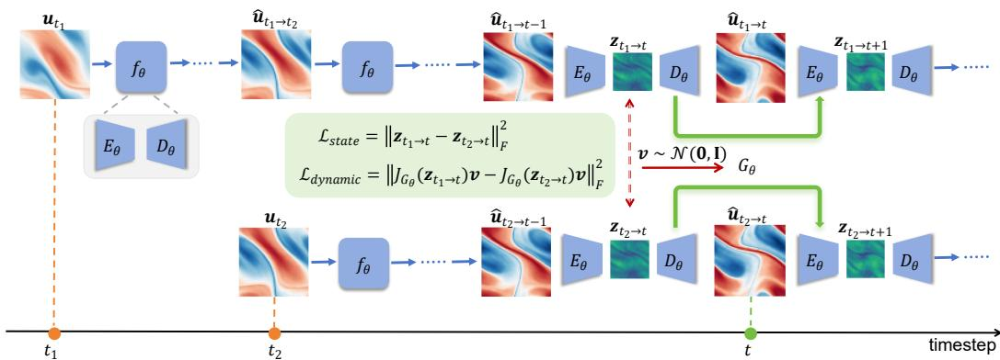  
Figure 1: Overview of Align Latent Rollout (ALR). Starting from temporal origins along the same physical trajectory, ALR aligns the latent states reached at a shared target time and further regularizes their local evolution through zeroth-order state consistency and first-order dynamics consistency.

Latent Dynamics Regularization. Latent-dynamics models encode high-dimensional observations into compact representations and learn continuous-time or approximately linear evolution in latent space (Takeishi et al., 2017; Lusch et al., 2018; Rubanova et al., 2019). Structure-preserving variants incorporate Hamiltonian, Lagrangian, symplectic, or thermodynamic constraints into learned dynamics (Greydanus et al., 2019; Cranmer et al., 2020; Zhong et al., 2019; He et al., 2025). For PDE systems, reduced-order and latent-operator models evolve compact representations to capture spatiotemporal dynamics efficiently (Wu et al., 2022; Yin et al., 2022; Regazzoni et al., 2024; Tiwari et al., 2025). Consistency-based approaches impose forward–backward agreement or temporal compatibility across multistep latent evolution (Azencot et al., 2020; Liu et al., 2026). A recent work aligns latent forecasts initialized at different times under Koopman-linear dynamics, primarily at the state level (Nayak et al., 2025). In this context, we consider consistency over suitable intermediate representations of neural PDE solvers at both shared-target states and local first-order evolution responses, without assuming a particular latent evolution structure.

## 3 METHOD

We introduce Align Latent Rollout (ALR), which regularizes latent representations obtained from different temporal origins at a shared prediction target. We first formulate cross-origin consistency in deterministic PDE evolution, then analyze the propagation of latent discrepancies to motivate the latent state and dynamics consistency objectives.

## 3.1 PROBLEM SETTING

PDE Formulation. We consider time-dependent parametric PDEs defined on a spatial domain $\Omega \subset \mathbb { R } ^ { d }$ over a time interval [0, T]. Let $\pmb { u } : \Omega \times [ 0 , T ]  \mathbb { R } ^ { d _ { u } }$ denote the solution field, and let µ denote the governing configuration, including the PDE coefficients, external forcing, and boundary data. For a fixed governing configuration $\mu ,$ we assume the PDE to be deterministic and well-posed, such that each admissible initial condition $\mathbf { \delta } \mathbf { u } _ { 0 }$ uniquely determines a forward solution trajectory:

$$
\begin{array} { r l } & { \mathcal { N } [ u ; \mu ] ( x , \tau ) = 0 , \quad \quad ( x , \tau ) \in \Omega \times ( 0 , T ] , } \\ & { \mathcal { B } [ u ; \mu ] ( x , \tau ) = 0 , \quad \quad ( x , \tau ) \in \partial \Omega \times [ 0 , T ] , } \\ & { \quad \quad u ( x , 0 ) = { \pmb u } _ { 0 } ( x ) , \quad x \in \Omega . } \end{array}\tag{1}
$$

where $\mathcal { N }$ and B denote the governing differential and boundary operators, respectively.

Neural Operator Formulation. Given a uniform temporal step $\Delta \tau$ , we denote the discrete state at index t by $\pmb { u } _ { t } : = \pmb { u } ( \cdot , t \Delta \tau )$ , for $t = 0 , \ldots , N$ . For input and output window lengths $T _ { \mathrm { i n } }$ and $T _ { \mathrm { o u t } }$ , we define input history ending at t as $U _ { t } = \left( { { \pmb u } _ { t - T _ { \mathrm { i n } } + 1 } } , \ldots , { \pmb u } _ { t } \right)$ , and future window beginning at $t + 1$ as $V _ { t + 1 } = ( \boldsymbol { u } _ { t + 1 } , \dots , \boldsymbol { u } _ { t + T _ { \mathrm { o u t } } } )$ . Under governing configuration $\mu ,$ a neural operator $f _ { \theta }$ predicts the future window from the input history:

$$
\hat { V } _ { t + 1 } = f _ { \theta } ( U _ { t } ; \pmb { \mu } )\tag{2}
$$

We omit the explicit dependence on $\pmb { \mu }$ below when the governing configuration is fixed or clear from context. For notational clarity, we present the subsequent analysis with $T _ { \mathrm { i n } } = T _ { \mathrm { o u t } } = 1$ , while the general formulation remains applicable to arbitrary temporal windows. The learned operator then defines the one-step prediction $\hat { \pmb u } _ { t + 1 } = f _ { \theta } ( { \pmb u } _ { t } )$

Autoregressive Rollout. At inference, multi-step predictions are generated autoregressively by repeatedly applying $f _ { \theta }$ and feeding each prediction back. Let $t _ { i }$ denote the rollout origin and $h \in$ $\mathbb { Z } _ { > 0 }$ the rollout horizon. Starting from $\mathbf { \Delta } \mathbf { u } _ { t _ { i } }$ , the h-step rollout prediction is defined as:

$$
\begin{array} { r } { \hat { { \boldsymbol u } } _ { t _ { i } \to t _ { i } + h } = f _ { \theta } ^ { ( h ) } ( { \boldsymbol u } _ { t _ { i } } ) , \qquad f _ { \theta } ^ { ( h ) } : = \underbrace { f _ { \theta } \circ f _ { \theta } \circ \dots \circ f _ { \theta } } _ { h \mathrm { ~ t i m e s } } . } \end{array}\tag{3}
$$

Here, the subscript $t _ { i }  t _ { i } + h$ records the rollout origin $t _ { i }$ and target time $t _ { i } + h$ , while $f _ { \theta } ^ { ( h ) }$ denotes the h-fold composition of $f _ { \theta }$ . More generally, for $t _ { i } < t _ { j } , \hat { { \boldsymbol { u } } } _ { t _ { i }  t _ { j } } = f _ { \theta } ^ { ( t _ { j } - t _ { i } ) } ( { \pmb { u } } _ { t _ { i } } )$

Although multi-step inference is autoregressive, $f _ { \theta }$ may be trained with different prediction objectives. Under one-step training, each prediction is conditioned on the ground-truth state at the preceding time step: $\hat { \mathbf { u } } _ { t - 1 \to t } = f _ { \boldsymbol \theta } ^ { ( 1 ) } ( \mathbf { u } _ { t - 1 } ) = f _ { \boldsymbol \theta } \big ( \mathbf { u } _ { t - 1 } \big )$ . In contrast, under unrolled training, the model may start from an earlier ground-truth state $\mathbf { \Delta } \mathbf { u } _ { t - k }$ and recursively feed back its predictions, yielding $\hat { \mathbf { u } } _ { t - k  t } = f _ { \theta } ^ { ( k ) } ( \mathbf { u } _ { t - k } )$ , where $k \in \mathbb { Z } _ { > 0 }$

Consequently, the same target $\mathbf { \pmb { u } } _ { t }$ can be reached from different temporal origins, e.g., by a one-step prediction from $\mathbf { \delta } \mathbf { u } _ { t - 1 }$ or a k-step rollout from $\mathbf { \Delta } \mathbf { u } _ { t - k }$ . Learned rollouts, however, may accumulate path-dependent approximation errors, producing different predictions at the same target time. This shared-target discrepancy motivates our study of consistency across temporal origins.

## 3.2 CROSS-ORIGIN CONSISTENCY IN DETERMINISTIC PDE EVOLUTION

Deterministic PDE Flow and Cross-Origin Consistency. For a fixed governing configuration, the deterministic well-posedness assumption above defines a unique forward evolution from each admissible initial state. Exact states sampled at different times along the same trajectory therefore remain compatible under forward evolution to a common target time.

Consider three states $\mathbf { } \mathbf { } u _ { t _ { 1 } } , \mathbf { } u _ { t _ { 2 } } .$ , and $\mathbf { \Delta } \mathbf { u } _ { t }$ along the same solution trajectory, where $t _ { 1 } < t _ { 2 } < t ,$ , with $t _ { 1 } , t _ { 2 }$ as temporal origins and t as the shared target time. Let $\Phi _ { t _ { 1 }  t _ { 2 } } , \Phi _ { t _ { 2 }  t } ,$ and $\Phi _ { t _ { 1 }  t }$ denote the corresponding exact evolution operators, such that ${ \pmb u } _ { t _ { 2 } } = \Phi _ { t _ { 1 }  t _ { 2 } } ( { \pmb u } _ { t _ { 1 } } )$ . By the composition of deterministic PDE evolution, advancing from $t _ { 1 }$ to t directly is equivalent to evolving through the intermediate time t : $\Phi _ { t _ { 1 }  t } = \Phi _ { t _ { 2 }  t } \circ \Phi _ { t _ { 1 }  t _ { 2 } }$ . Therefore,

$$
\Phi _ { t _ { 1 }  t } ( \pmb { u } _ { t _ { 1 } } ) = \Phi _ { t _ { 2 }  t } ( \Phi _ { t _ { 1 }  t _ { 2 } } ( \pmb { u } _ { t _ { 1 } } ) ) = \Phi _ { t _ { 2 }  t } ( \pmb { u } _ { t _ { 2 } } ) = \pmb { u } _ { t }\tag{4}
$$

We refer to this shared-target consequence as cross-origin consistency: different temporal origins along the same trajectory reach the same state at a common target time.

Cross-Origin Inconsistency in Learned Neural PDE Solvers. A learned operator $f _ { \theta }$ approximates the exact evolution but is not explicitly constrained to preserve cross-origin consistency under recursive application. Different temporal origins imply different rollout depths, along which local approximation errors may propagate differently.

Let $\hat { \pmb { u } } _ { t _ { 1 }  t }$ and $\hat { \pmb { u } } _ { t _ { 2 }  t }$ denote predictions at the shared target time t from origins $t _ { 1 } ~ < ~ t _ { 2 } ~ < ~ t$ Although both predictions correspond to the same target $\mathbf { \Delta } \mathbf { u } _ { t }$ , they may differ: $\hat { \pmb { u } } _ { t _ { 1 }  t } \neq \hat { \pmb { u } } _ { t _ { 2 }  t }$

A standard prediction loss $\mathcal { L } _ { \mathrm { p r e d } } = \ell ( \hat { \mathbf { u } } _ { t _ { i }  t } , \mathbf { u } _ { t } )$ encourages agreement with the ground-truth trajectory at the supervised physical prediction steps. However, it does not directly couple the internal representations reached from different origins, which can remain different even when their decoded predictions are close. As the learned evolution is realized through these representations, origindependent latent discrepancies may persist and affect their subsequent evolution.

Latent Representation of Learned Evolution. Learned representations organize task-relevant in formation for prediction (Bengio et al., 2013) and provide internal coordinates for modeling nonlinear dynamics (Lusch et al., 2018). Neural PDE solvers similarly encode physical fields into latent representations before decoding predictions (Wu et al., 2022; 2023; Kontolati et al., 2024; Wang & Wang, 2024). These studies suggest that latent representations can serve as internal coordinates through which neural PDE solvers realize their learned temporal evolution.

We designate a selected intermediate representation as the latent state for analysis. Specifically, we partition $f _ { \theta }$ at this layer as $f _ { \theta } = D _ { \theta } \circ E _ { \theta }$ , where $E _ { \theta }$ encodes the physical input to the latent representation and $D _ { \theta }$ decodes it to the physical prediction. This functional decomposition does not require an explicit encoder–decoder architecture and applies whenever a suitable intermediate representation is available. For a rollout originating at $t _ { i } ,$ , the prediction step reaching time t is represented as $\hat { \mathbf { u } } _ { t _ { i }  t - 1 } \xrightarrow { E _ { \theta } } \mathcal { z } _ { t _ { i }  t } \xrightarrow { D _ { \theta } } \hat { \mathbf { u } } _ { t _ { i }  t }$ , where $z _ { t _ { i }  t }$ is the selected latent representation associated with target time t along the rollout from the origin $t _ { i } .$ . Accordingly, we index the latent state by its prediction target t, although it is computed by encoding the rollout input at $t - 1$

We therefore compare representations associated with the same prediction target across different rollout histories. For two rollout origins $t _ { 1 } < t _ { 2 } < t ,$ we seek:

$$
z _ { t _ { 1 }  t } \approx z _ { t _ { 2 }  t }\tag{5}
$$

Both representations are extracted from the same layer of the shared operator, and their alignment complements physical-space supervision by constraining origin-dependent latent variation. Since different rollout histories can still induce shared-target latent discrepancies, we next analyze how these discrepancies propagate under the learned evolution.

## 3.3 ALIGN LATENT ROLLOUT

Building on the latent-space view above, ALR regularizes cross-origin discrepancies in the internal representations through which the solver realizes its learned evolution. We motivate the regulariza tion objectives by analyzing how such discrepancies propagate under the induced latent evolution.

Induced Latent Evolution. For a rollout originating at $t _ { i } ,$ one latent evolution step decodes the latent state into a physical prediction and then re-encodes that prediction: $z _ { t _ { i }  t } \xrightarrow { D _ { \theta } } \hat { { \mathbf { u } } } _ { t _ { i }  t } \xrightarrow { E _ { \theta } }$ $z _ { t _ { i }  t + 1 }$ . While $\bar { f _ { \theta } } \doteq D _ { \theta } \circ E _ { \theta }$ maps a physical input to its next prediction, composing the same mappings in the opposite order defines the induced latent evolution map $G _ { \theta } : = E _ { \theta } \circ D _ { \theta }$ , which maps latent representations across consecutive prediction targets:

$$
z _ { t _ { i }  t + 1 } = E _ { \theta } ( D _ { \theta } ( z _ { t _ { i }  t } ) ) = G _ { \theta } ( z _ { t _ { i }  t } ) .\tag{6}
$$

Taylor Analysis of Latent Discrepancy Propagation. Consider two rollouts originating at $t _ { 1 } <$ $t _ { 2 } < t$ from states on the same physical trajectory and propagated to the shared target time t. Let their shared-target representations be $z _ { t _ { 1 }  t }$ and $z _ { t _ { 2 }  t }$ , and define the cross-origin latent discrepancy as $\Delta z _ { t } : = z _ { t _ { 1 }  t } - z _ { t _ { 2 }  t }$ . Following $\mathrm { E q . } ~ 5 ,$ we seek $\Delta z _ { t } \approx \mathbf { 0 }$ . In practice, this alignment may not be exact, leaving a residual cross-origin discrepancy. We therefore analyze how $\Delta z _ { t }$ propagates through the induced latent evolution $G _ { \theta }$ to the next step:

$$
\Delta z _ { t + 1 } = z _ { t _ { 1 }  t + 1 } - z _ { t _ { 2 }  t + 1 } = G _ { \theta } ( z _ { t _ { 1 }  t } ) - G _ { \theta } ( z _ { t _ { 2 }  t } ) = G _ { \theta } ( z _ { t _ { 2 }  t } + \Delta z _ { t } ) - G _ { \theta } ( z _ { t _ { 2 }  t } )\tag{7}
$$

Assuming $G _ { \theta }$ is locally three times continuously differentiable, a second-order Taylor expansion around $z _ { t _ { 2 }  t } \mathrm { \ g i v e s } .$

$$
\Delta z _ { t + 1 } = J _ { G _ { \theta } } ( z _ { t _ { 2 }  t } ) \Delta z _ { t } + \frac { 1 } { 2 } H _ { G _ { \theta } } ( z _ { t _ { 2 }  t } ) [ \Delta z _ { t } , \Delta z _ { t } ] + O ( \| \Delta z _ { t } \| ^ { 3 } )\tag{8}
$$

where $J _ { G _ { \theta } } ( z )$ denotes the Jacobian of $G _ { \theta }$ , and $H _ { G _ { \theta } } ( z ) [ \Delta z , \Delta z ]$ its second directional derivative along $\Delta z .$ . The first term describes local linearized discrepancy propagation, while the second represents the leading correction induced by the local curvature of $G _ { \theta }$

To express this curvature correction through variation in the local linearized evolution, we expand the Jacobian at $z _ { t _ { 1 }  t }$ around $z _ { t _ { 2 }  t } \mathrm { . }$

$$
J _ { G _ { \theta } } ( z _ { t _ { 1 }  t } ) = J _ { G _ { \theta } } ( z _ { t _ { 2 }  t } + \Delta z _ { t } ) = J _ { G _ { \theta } } ( z _ { t _ { 2 }  t } ) + H _ { G _ { \theta } } ( z _ { t _ { 2 }  t } ) [ \Delta z _ { t } ] + O ( \| \Delta z _ { t } \| ^ { 2 } )\tag{9}
$$

It follows that:

$$
J _ { G _ { \theta } } ( z _ { t _ { 1 }  t } ) - J _ { G _ { \theta } } ( z _ { t _ { 2 }  t } ) = H _ { G _ { \theta } } ( z _ { t _ { 2 }  t } ) [ \Delta z _ { t } ] + O ( \| \Delta z _ { t } \| ^ { 2 } )\tag{10}
$$

Applying both sides of Eq. 10 to $\Delta z _ { t }$ yields:

$$
( J _ { G _ { \theta } } ( z _ { t _ { 1 }  t } ) - J _ { G _ { \theta } } ( z _ { t _ { 2 }  t } ) ) \Delta z _ { t } = H _ { G _ { \theta } } ( z _ { t _ { 2 }  t } ) [ \Delta z _ { t } , \Delta z _ { t } ] + O ( \| \Delta z _ { t } \| ^ { 3 } )\tag{11}
$$

Substituting this relation into Eq. 8 gives

$$
\Delta z _ { t + 1 } = J _ { G _ { \theta } } ( z _ { t _ { 2 }  t } ) \Delta z _ { t } + \frac { 1 } { 2 } ( J _ { G _ { \theta } } ( z _ { t _ { 1 }  t } ) - J _ { G _ { \theta } } ( z _ { t _ { 2 }  t } ) ) \Delta z _ { t } + O ( \| \Delta z _ { t } \| ^ { 3 } )\tag{12}
$$

In Eq. 12, the first term propagates the existing mismatch through the local Jacobian at $z _ { t _ { 2 }  t } .$ . The second term captures the leading correction induced by variation of the local Jacobian across the two shared-target representations. This decomposition motivates two complementary objectives: zerothorder state consistency reduces the latent mismatch itself, while first-order dynamics consistency regularizes cross-origin variation in the local linearized evolution.

Zeroth-Order Latent State Consistency. To reduce the shared-target latent mismatch in Eq. 12, we encourage $\Delta z _ { t } \approx \mathbf { 0 }$ by aligning the corresponding latent states:

$$
\mathcal { L } _ { \mathrm { s t a t e } } = \| z _ { t _ { 1 }  t } - z _ { t _ { 2 }  t } \| _ { F } ^ { 2 }\tag{13}
$$

where $\left\| \cdot \right\| _ { F }$ denotes the Frobenius norm. This objective directly reduces the cross-origin discrepancy between shared-target representations.

First-Order Latent Dynamics Consistency. The zeroth-order objective aligns shared-target latent states but does not explicitly constrain their subsequent local evolution. The second term in Eq. 12 involves cross-origin variation in the local Jacobian, motivating us to further align the local linearized dynamics by penalizing the full Jacobian discrepancy:

$$
\mathcal { L } _ { \mathrm { d y n a m i c } } ^ { \mathrm { f u l l } } = \| J _ { G _ { \theta } } ( z _ { t _ { 1 }  t } ) - J _ { G _ { \theta } } ( z _ { t _ { 2 }  t } ) \| _ { F } ^ { 2 } .\tag{14}
$$

This objective encourages the two shared-target representations to exhibit consistent first-order responses to latent perturbations.

Explicitly constructing full Jacobians, however, is expensive in high-dimensional latent spaces. We therefore probe the local evolution along a stochastic direction $\pmb { v } \sim \mathcal { N } ( \mathbf { 0 } , \mathbf { I } )$ using Jacobian–vector products (JVPs), where $J _ { G _ { \theta } } ( z ) \boldsymbol { v }$ represents the local linearized evolution response along v. Using the same probing direction for both representations allows us to compare their responses to a common perturbation. Since $\mathbb { E } _ { \pmb { v } } [ \pmb { v v } ^ { \top } ] = \mathbf { I } .$ , we have:

$$
\mathbb { E } _ { \pmb { v } } [ \| \big ( J _ { G _ { \theta } } ( z _ { t _ { 1 }  t } ) - J _ { G _ { \theta } } ( z _ { t _ { 2 }  t } ) \big ) \pmb { v } \| _ { F } ^ { 2 } ] = \| J _ { G _ { \theta } } ( z _ { t _ { 1 }  t } ) - J _ { G _ { \theta } } ( z _ { t _ { 2 }  t } ) \| _ { F } ^ { 2 }\tag{15}
$$

Accordingly, we optimize the Jacobian discrepancy along a single stochastic probing direction:

$$
\mathcal { L } _ { \mathrm { d y n a m i c } } = \Vert J _ { G _ { \theta } } ( z _ { t _ { 1 }  t } ) v - J _ { G _ { \theta } } ( z _ { t _ { 2 }  t } ) v \Vert _ { F } ^ { 2 } , \qquad v \sim \mathcal { N } ( \mathbf { 0 } , \mathbf { I } )\tag{16}
$$

The same probing direction is used for both origins, so the difference between the two JVPs is the action of the Jacobian difference on a common perturbation. By Eq. 15, the resulting loss is an unbiased stochastic estimator of ${ \mathcal { L } } _ { \mathrm { d y n a m i c } } ^ { \mathrm { f u l l } }$ . The probe v is resampled during training, and the required JVPs can be computed efficiently through forward-mode automatic differentiation using torch.func.jvp, without explicitly constructing the Jacobian.

Overall Training Objective. We retain the original prediction loss $\mathcal { L } _ { \mathrm { p r e d } }$ and augment it with the proposed state and dynamics consistency objectives:

$$
{ \mathcal { L } } _ { \mathrm { t o t a l } } = { \mathcal { L } } _ { \mathrm { p r e d } } + \lambda _ { \mathrm { s t a t e } } { \mathcal { L } } _ { \mathrm { s t a t e } } + \lambda _ { \mathrm { d y n a m i c } } { \mathcal { L } } _ { \mathrm { d y n a m i c } } .\tag{17}
$$

where $\lambda _ { \mathrm { s t a t e } }$ and $\lambda _ { \mathrm { d y n a m i c } }$ weight the state and dynamics regularization, respectively.

## 4 EXPERIMENT

## 4.1 EXPERIMENTAL SETUP

We use the FNO (Li et al., 2020a) as the primary backbone and evaluate it on four spatiotemporal PDE benchmarks: Navier–Stokes flows (Li et al., 2020a) with viscosities $\nu = 1 0 ^ { - 4 }$ and $\nu = \mathrm { i } 0 ^ { - 5 }$ the Shallow Water equations (Takamoto et al., 2022), and Kolmogorov Flow (Kochkov et al., 2021). The FNO backbone contains four Fourier blocks, and the output of the second block is used as the latent representation. We use a learning rate of $5 \times 1 0 ^ { - 4 }$ , a weight decay of $1 0 ^ { - 5 }$ , and a OneCycle learning-rate schedule. The prediction objective is the relative $\ell _ { 2 }$ loss, with $\lambda _ { \mathrm { s t a t e } } = \lambda _ { \mathrm { d y n a m i c } } = 0 . 1$

Cross-Origin Consistency Instantiation. Under the standard one-step training protocol, we retain the original ground-truth-conditioned prediction objective and construct cross-origin pairs using an auxiliary local autoregressive rollout. For each training trajectory, we randomly sample an origin $t _ { i }$ and roll out for at most K steps, with $K = 6$ by default and truncation near the trajectory end. Since the $h = 1$ local and reference paths share the same ground-truth input and thus yield a trivial pair, consistency is imposed for $h = 2 , \ldots , K _ { i } ,$ where $\bar { K } _ { i } = \operatorname* { m i n } ( K , \bar { N } - t _ { i } )$ . At each shared target $t _ { i } + h ,$ , we align the rollout representation $z _ { t _ { i }  t _ { i } + h }$ with the ground-truth-conditioned onestep representation $z _ { t _ { i } + h - 1  t _ { i } + h }$ using $\mathcal { L } _ { \mathrm { s t a t e } }$ and ${ \mathcal { L } } _ { \mathrm { d y n a m i c } } .$ . The auxiliary rollout is used only for consistency regularization, leaving the original prediction objective unchanged.

## 4.2 MAIN RESULTS

Table 1 reports the results on four spatiotemporal PDE benchmarks. All models are initialized from a single initial state and autoregressively evaluated for 29, 19, 20, and 20 steps on Navier–Stokes with $\bar { \nu } = 1 0 ^ { - 4 }$ , Navier–Stokes with $\nu = 1 0 ^ { - 5 }$ , Shallow Water, and Kolmogorov Flow, respectively. Compared with the FNO baseline, FNO+ALR consistently reduces the relative $\ell _ { 2 }$ error across all benchmarks, with relative improvements of 29.25%, 14.54%, 28.95%, and 31.77%, respectively. These results demonstrate the effectiveness of cross-origin consistency regularization across diverse spatiotemporal dynamics.

Table 1: Results on four spatiotemporal PDE benchmarks. Unless otherwise specified, prediction errors hereafter are reported as mean ± standard deviation of relative $\ell _ { 2 }$ error (↓). FNO is the onestep baseline, FNO+ALR augments it with cross-orgin consistency regularization, and FNO (Unroll) is an unrolled-training reference. Percentages denote relative error reductions over the FNO baseline.
<table><tr><td>Method</td><td> $\mathrm { N S } ~ ( \nu = 1 0 ^ { - 4 } )$ </td><td> $\mathrm { N S } ~ ( \nu = 1 0 ^ { - 5 } )$ </td><td>Shallow Water</td><td>Kolmogorov Flow</td></tr><tr><td>FNO</td><td> $0 . 0 9 4 7 \pm 0 . 0 0 1 2$ </td><td> $0 . 1 0 0 4 \pm 0 . 0 0 1 5$ </td><td> $0 . 0 0 3 8 \pm 0 . 0 0 0 2$ </td><td> $0 . 4 0 9 5 \pm 0 . 0 1 6 4$ </td></tr><tr><td>FNO+ALR (Ours)</td><td> $\mathbf { 0 . 0 6 7 0 \pm 0 . 0 0 0 4 }$   $\downarrow ~ 2 9 . 2 5 \%$ </td><td> $\mathbf { 0 . 0 8 5 8 \pm 0 . 0 0 0 3 }$   $\downarrow 1 4 . 5 4 \%$ </td><td> $\mathbf { 0 . 0 0 2 7 \pm 0 . 0 0 0 1 }$   $\downarrow ~ 2 8 . 9 5 \%$ </td><td> $\mathbf { 0 . 2 7 9 4 } \pm 0 . 0 0 8 9$   $\downarrow 3 1 . 7 7 \%$ </td></tr><tr><td>FNO (Unroll)</td><td> $0 . 2 1 8 4 \pm 0 . 0 0 3 5$ </td><td> $0 . 1 6 8 2 \pm 0 . 0 0 2 1$ </td><td> $0 . 0 0 3 2 \pm 0 . 0 0 0 2$ </td><td> $0 . 3 4 4 5 \pm 0 . 0 1 0 3$ </td></tr></table>

## 4.3 ABLATION STUDY

Table 2: Ablation of the zeroth-order state and first-order dynamics consistency objectives on FNO. Relative $\ell _ { 2 }$ errors (↓) are reported on Navier–Stokes (NS) with $\nu = 1 0 ^ { - 5 }$ and Shallow Water (SW).

<table><tr><td> $\mathcal { L } _ { \mathrm { s t a t e } }$ </td><td> $\mathcal { L } _ { \mathrm { d y n a m i c } }$ </td><td> $\mathrm { N S } ~ ( \nu = 1 0 ^ { - 5 } )$ </td><td>SW</td></tr><tr><td>X</td><td>X</td><td>0.1004</td><td>0.0038</td></tr><tr><td> $\checkmark$ </td><td>×</td><td>0.0961</td><td>0.0034</td></tr><tr><td> $\times$ </td><td>√</td><td>0.0887</td><td>0.0029</td></tr><tr><td> $\checkmark$ </td><td> $\checkmark$ </td><td>0.0858</td><td>0.0027</td></tr></table>

Table 3: Effect of the consistency-window length K on Navier–Stokes (NS) with $\nu =$ $1 0 ^ { - 5 }$ and Shallow Water (SW). Relative $\ell _ { 2 }$ errors (↓) are reported.
<table><tr><td>K</td><td> $\mathrm { N S } ~ ( \nu = 1 0 ^ { - 5 } )$ </td><td>SW</td></tr><tr><td>一</td><td>0.1004</td><td>0.0038</td></tr><tr><td>4</td><td>0.0893</td><td>0.0028</td></tr><tr><td>6</td><td>0.0858</td><td>0.0027</td></tr><tr><td>8</td><td>0.0851</td><td>0.0027</td></tr><tr><td>10</td><td>0.0856</td><td>0.0027</td></tr></table>

Quantitative Analysis of Consistency Objectives. Table 2 evaluates the two consistency objectives individually and jointly. On Navier– Stokes with $\nu = 1 0 ^ { - 5 } , \mathcal { L } _ { \mathrm { s t a t e } }$ reduces the error from 0.1004 to 0.0961, while $\mathcal { L } _ { \mathrm { d y n a m i c } }$ achieves a larger reduction to 0.0887; the same trend is observed on Shallow Water, where the error decreases from 0.0038 to 0.0034 and 0.0029, respectively. The larger gain from $\mathcal { L } _ { \mathrm { d y n a m i c } }$ highlights the importance of explicitly regularizing local latent evolution beyond state alignment alone. Combining both objectives yields the lowest errors of 0.0858 on Navier– Stokes and 0.0027 on Shallow Water, demonstrating the complementary roles of zeroth-order state and first-order dynamics consistency.

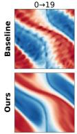

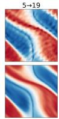

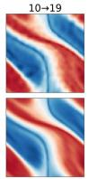

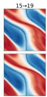

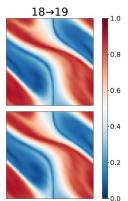  
(a) Physical Prediction �ƶ � →19

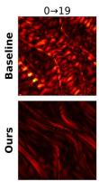

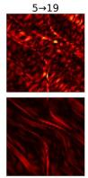

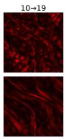

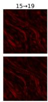

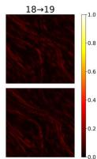  
(b) Physical Prediction Discrepancy $| \hat { \pmb { u } } _ { t _ { i }  1 9 } - { \pmb u } _ { 1 9 } |$

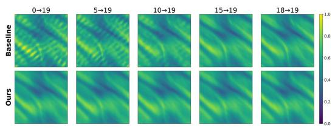  
(c) Latent State �� →19

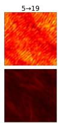

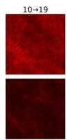

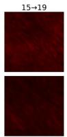

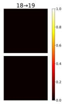  
(d) Latent State Discrepancy ห�� →19 − �18→19|

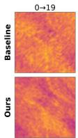

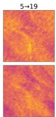

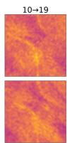  
(e) Latent Dynamic $J _ { G _ { \theta } } ( \pmb { z } _ { t _ { i }  1 9 } ) \pmb { v }$

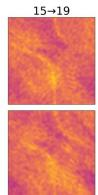

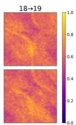

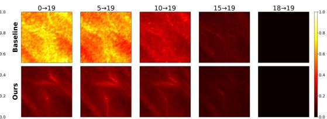  
(f) Latent Dynamic Discrepancy $| J _ { G _ { \theta } } ( \pmb { z } _ { t _ { i }  1 9 } ) \pmb { v } - J _ { G _ { \theta } } ( \pmb { z } _ { 1 8  1 9 } ) \pmb { v } |$  
Figure 2: Qualitative analysis of cross-path consistency on the Navier–Stokes benchmark $( \nu ~ =$ $1 0 ^ { - 5 } )$ . Each column corresponds to a rollout origin $t _ { i } \in \{ 0 , 5 , 1 0 , 1 5 , 1 8 \}$ , with all paths propagated to the shared target time $t = 1 9$ . The top and bottom rows of each panel show the baseline FNO and FNO+ALR, respectively. (a) Physical predictions at $t = 1 9$ . (b) Physical prediction errors relative to the ground truth. (c) Latent states at $t = 1 9$ . (d) Latent-state discrepancies relative to the groundtruth-conditioned one-step path $1 8  1 9 . ~ ( \mathrm { e } )$ Local latent dynamics represented by $J _ { G _ { \theta } } ( z _ { t _ { i }  1 9 } ) \pmb { v } .$ using the same probing direction v for all paths. (f) Corresponding latent-dynamics discrepancies relative to the same reference path. The rightmost columns in (d) and (f) are zero by construction because the reference path is compared with itself.

Qualitative Analysis of Cross-Origin Consistency. Figure 2 compares rollouts from temporal origins $t _ { i } \in \{ 0 , 5 , 1 0 , 1 5 , 1 8 \}$ to the shared target time $t = 1 9 .$ , with $t _ { i } = 1 8$ used as the one-step reference for latent-space discrepancies. Figures 2(a) and (b) show the physical predictions and their errors relative to the ground truth. For the baseline FNO, earlier origins produce increasingly distorted predictions and larger errors, whereas $\mathrm { F N O + A L }$ R maintains substantially more consistent predictions across rollout depths.

Figures 2(c) and (d) further reveal the corresponding behavior in latent space. The baseline exhibits pronounced cross-origin variation in $z _ { t _ { i } \to 1 9 }$ , particularly for earlier origins, while FNO+ALR markedly reduces the discrepancies relative to $z _ { 1 8  1 9 }$ This behavior is consistent with $\mathcal { L } _ { \mathrm { s t a t e } } ,$ which directly suppresses the shared-target latent discrepancy $\Delta z _ { t }$ . Figures 2(e) and (f) visualize the local evolution responses $J _ { G _ { \theta } } ( z _ { t _ { i }  1 9 } ) v$ under the same probing direction v. The strong origindependent variation observed in the baseline is substantially reduced by ALR, supporting the role of $\mathcal { L } _ { \mathrm { d y n a m i c } }$ in aligning the latent evolution across origins. Together, (c)–(f) provide qualitative support for our discrepancy-propagation analysis: ALR regularizes both the shared-target latent states and their local evolution, which is accompanied by the improved physical predictions in (a) and (b).

Effect of Consistency-Window Length K. The consistency-window length K controls the rollout depth used to construct cross-origin consistency pairs. As shown in Table 3, increasing K from 4 to 6 reduces the relative $\ell _ { 2 }$ error from 0.0893 to 0.0858 on Navier–Stokes and from 0.0028 to 0.0027 on Shallow Water. Further increasing K provides only marginal gains: Navier–Stokes reaches 0.0851 at $K = 8$ and 0.0856 at $K = 1 0$ , while Shallow Water remains at 0.0027. We therefore use $K = 6$ by default, which captures most of the improvement with a moderate rollout depth. Although larger $K$ increases training cost through longer auxiliary rollouts and additional JVP evaluations, inference remains unchanged from the FNO baseline.

## 4.4 GENERALIZATION ACROSS BACKBONES

We further evaluate ALR on two additional backbones, F-FNO and LSM. We follow the experimental settings in Section 4.2 and retain the same ALR hyperparameters, while selecting an appropriate intermediate representation as the latent state for each architecture. As shown in Table 4, ALR consistently improves both backbones on the two PDE benchmarks. For F-FNO, the relative $\ell _ { 2 }$ error decreases from 0.2904 to 0.2126 on Navier–Stokes and from 0.0073 to 0.0063 on Shallow Water; for LSM, it decreases from 0.2812 to 0.2188 and from 0.0021 to 0.0019, respectively. Notably, LSM explicitly models an encoder–latent processor–decoder pipeline, whereas F-FNO provides the latent state through an intermediate operator representation. The consistent improvements across these distinct architectures indicate that ALR is not tied to a specific backbone or latent-state realization.

Table 4: Generalization of ALR across neural operator backbones on Navier–Stokes (NS) and Shallow Water (SW), measured by relative $\ell _ { 2 }$ error (↓). Percentages denote relative error reductions over the corresponding backbone.
<table><tr><td>Method</td><td> $\mathrm { N S } ~ ( \nu = 1 0 ^ { - 4 } )$ </td><td>SW</td><td>Method</td><td> $\mathrm { N S } ~ ( \nu = 1 0 ^ { - 4 } )$ </td><td>SW</td></tr><tr><td>F-FNO</td><td>0.2904</td><td>0.0073</td><td>LSM</td><td>0.2812</td><td>0.0021</td></tr><tr><td>F-FNO+ALR</td><td>0.2126 (↓ 26.79%)</td><td>0.0063 (↓ 13.70%)</td><td>LSM+ALR</td><td>0.2188 (↓ 22.19%)</td><td>0.0019 (↓ 9.52%)</td></tr></table>

## 4.5 PERFORMANCE ACROSS ROLLOUT LENGTHS

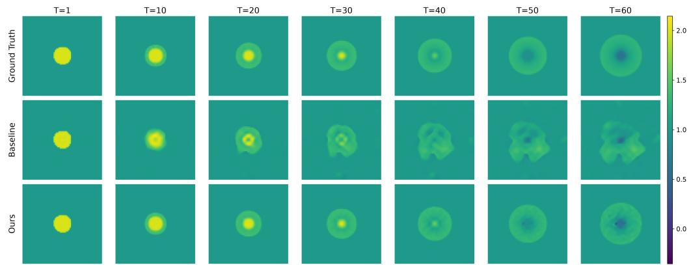  
Figure 3: Qualitative rollout prediction results on Shallow Water under the rollout-length-60 training setting. Ground truth, FNO, and FNO+ALR are shown from top to bottom at selected rollout steps $T \in \{ 1 , 1 0 , 2 0 , 3 0 , 4 0 , 5 0 , 6 0 \}$

We further evaluate FNO and FNO+ALR on Shallow Water with rollout lengths of 20, 40, and 60, with each setting trained and evaluated at the corresponding horizon. As shown in Table 5, the FNO error increases from 0.0038 at 20 steps to 0.0130 and 0.0517 at 40 and 60 steps, whereas FNO+ALR increases from 0.0027 to only 0.0035 and 0.0085. Relative to 20 steps, this corresponds to a 13.6× increase for FNO at 60 steps, compared with 3.1× for FNO+ALR. Figure 3 further visualizes the rollout-length-60 setting, where FNO+ALR maintains predictions closer to the ground truth across increasing rollout steps. Together, the quantitative and qualitative results indicate that cross-origin consistency improves the stability of autoregressive rollout as the rollout length increases.

Table 5: Autoregressive rollout performance at increasing horizons on the Shallow Water benchmark. Results are reported using relative $\ell _ { 2 }$ error (↓).
<table><tr><td>Rollout Length</td><td>20</td><td>40</td><td>60</td></tr><tr><td>FNO</td><td>0.0038</td><td>0.0130</td><td>0.0517</td></tr><tr><td>FNO+ALR</td><td>0.0027</td><td>0.0035</td><td>0.0085</td></tr></table>

## 5 CONCLUSION

We propose Align Latent Rollout (ALR), a regularization approach for improving cross-origin consistency in autoregressive neural PDE solvers. For a well-posed deterministic PDE flow, states from different temporal origins along the same physical trajectory should evolve to the same shared target state; ALR promotes this property in learned solvers by regularizing their internal representations.

A second-order analysis of latent discrepancy propagation motivates two objectives: zeroth-order latent state consistency and first-order latent dynamics consistency, which align shared-target representations and their local linearized evolution, respectively. ALR can be integrated into different neural PDE solvers without modifying their backbone architectures. Experiments across multiple PDE benchmarks and neural-operator backbones consistently show improved prediction accuracy, reduced cross-origin discrepancies, and greater stability under longer autoregressive rollouts.

## REFERENCES

Omri Azencot, N Benjamin Erichson, Vanessa Lin, and Michael Mahoney. Forecasting sequential data using consistent koopman autoencoders. In International conference on machine learning, pp. 475–485. PMLR, 2020.

Samy Bengio, Oriol Vinyals, Navdeep Jaitly, and Noam Shazeer. Scheduled sampling for sequence prediction with recurrent neural networks. Advances in neural information processing systems, 28, 2015.

Yoshua Bengio, Aaron Courville, and Pascal Vincent. Representation learning: A review and new perspectives. IEEE transactions on pattern analysis and machine intelligence, 35(8):1798–1828, 2013.

Johannes Brandstetter, Daniel Worrall, and Max Welling. Message passing neural pde solvers. arXiv preprint arXiv:2202.03376, 2022.

Shuhao Cao. Choose a transformer: Fourier or galerkin. Advances in neural information processing systems, 34:24924–24940, 2021.

Junfeng Chen and Kailiang Wu. Deep-osg: Deep learning of operators in semigroup. Journal of Computational Physics, 493:112498, 2023.

Miles Cranmer, Sam Greydanus, Stephan Hoyer, Peter Battaglia, David Spergel, and Shirley Ho. Lagrangian neural networks. arXiv preprint arXiv:2003.04630, 2020.

Samuel Greydanus, Misko Dzamba, and Jason Yosinski. Hamiltonian neural networks. Advances in neural information processing systems, 32, 2019.

Gaurav Gupta, Xiongye Xiao, and Paul Bogdan. Multiwavelet-based operator learning for differential equations. Advances in neural information processing systems, 34:24048–24062, 2021.

Zhongkai Hao, Zhengyi Wang, Hang Su, Chengyang Ying, Yinpeng Dong, Songming Liu, Ze Cheng, Jian Song, and Jun Zhu. Gnot: A general neural operator transformer for operator learning. In International conference on machine learning, pp. 12556–12569. PMLR, 2023.

Xiaolong He, Yeonjong Shin, Anthony Gruber, Sohyeon Jung, Kookjin Lee, and Youngsoo Choi. Thermodynamically consistent latent dynamics identification for parametric systems. arXiv preprint arXiv:2506.08475, 2025.

Peiyan Hu, Rui Wang, Xiang Zheng, Tao Zhang, Haodong Feng, Ruiqi Feng, Long Wei, Yue Wang, Zhi-Ming Ma, and Tailin Wu. Wavelet diffusion neural operator. In International Conference on Learning Representations, volume 2025, pp. 12291–12333, 2025.

Ruoxi Jiang, Xiao Zhang, Karan Jakhar, Peter Y Lu, Pedram Hassanzadeh, Michael Maire, and Rebecca Willett. Hierarchical implicit neural emulators. Advances in Neural Information Processing Systems, 38:73718–73751, 2026.

Dmitrii Kochkov, Jamie A Smith, Ayya Alieva, Qing Wang, Michael P Brenner, and Stephan Hoyer. Machine learning–accelerated computational fluid dynamics. Proceedings ofthe National Academy ofSciences, 118(21):e2101784118, 2021.

Katiana Kontolati, Somdatta Goswami, George Em Karniadakis, and Michael D Shields. Learning nonlinear operators in latent spaces for real-time predictions of complex dynamics in physical systems. Nature Communications, 15(1):5101, 2024.

Nikola Kovachki, Zongyi Li, Burigede Liu, Kamyar Azizzadenesheli, Kaushik Bhattacharya, Andrew Stuart, and Anima Anandkumar. Neural operator: Learning maps between function spaces with applications to pdes. Journal ofMachine Learning Research, 24(89):1–97, 2023.

Jiayi Li, Penghao Jiang, Hira Saleem, Zhaonan Wang, Piotr Koniusz, and Flora D Salim. Sgno: Spectral generator neural operators for stable long horizon pde rollouts. arXiv preprint arXiv:2602.18801, 2026.

Zijie Li, Dule Shu, and Amir Barati Farimani. Scalable transformer for pde surrogate modeling. Advances in Neural Information Processing Systems, 36:28010–28039, 2023a.

Zongyi Li, Nikola Kovachki, Kamyar Azizzadenesheli, Burigede Liu, Kaushik Bhattacharya, Andrew Stuart, and Anima Anandkumar. Fourier neural operator for parametric partial differential equations. arXiv preprint arXiv:2010.08895, 2020a.

Zongyi Li, Nikola Kovachki, Kamyar Azizzadenesheli, Burigede Liu, Kaushik Bhattacharya, Andrew Stuart, and Anima Anandkumar. Neural operator: Graph kernel network for partial differential equations. arXiv preprint arXiv:2003.03485, 2020b.

Zongyi Li, Daniel Zhengyu Huang, Burigede Liu, and Anima Anandkumar. Fourier neural operator with learned deformations for pdes on general geometries. Journal of Machine Learning Research, 24(388):1–26, 2023b.

Phillip Lippe, Bas Veeling, Paris Perdikaris, Richard Turner, and Johannes Brandstetter. Pde-refiner: Achieving accurate long rollouts with neural pde solvers. Advances in Neural Information Processing Systems, 36:67398–67433, 2023.

Bjoern List, Li-Wei Chen, Kartik Bali, and Nils Thuerey. Differentiability in unrolled training of neural physics simulators on transient dynamics. Computer Methods in Applied Mechanics and Engineering, 433:117441, 2025.

Andy Zeyi Liu, Haoran Sun, Lucas Baker, Randall Balestriero, and John Sous. Semigroup-jepa: Latent dynamics consistency for zero-shot physics generalization. arXiv preprint arXiv:2609.10464, 2026.

Lu Lu, Pengzhan Jin, Guofei Pang, Zhongqiang Zhang, and George Em Karniadakis. Learning nonlinear operators via deeponet based on the universal approximation theorem of operators. Nature machine intelligence, 3(3):218–229, 2021.

Bethany Lusch, J Nathan Kutz, and Steven L Brunton. Deep learning for universal linear embeddings of nonlinear dynamics. Nature communications, 9(1):4950, 2018.

Michael McCabe, Peter Harrington, Shashank Subramanian, and Jed Brown. Towards stability of autoregressive neural operators. arXiv preprint arXiv:2306.10619, 2023.

Indranil Nayak, Ananda Chakrabarti, Mrinal Kumar, Fernando L Teixeira, and Debdipta Goswami. Temporally consistent koopman autoencoders for forecasting dynamical systems. Scientific Reports, 15(1):22127, 2025.

Tobias Pfaff, Meire Fortunato, Alvaro Sanchez-Gonzalez, and Peter W Battaglia. Learning meshbased simulation with graph networks. arXiv preprint arXiv:2010.03409, 2020.

Md Ashiqur Rahman, Zachary E Ross, and Kamyar Azizzadenesheli. U-no: U-shaped neural operators. arXiv preprint arXiv:2204.11127, 2022.

Bogdan Raonic, Roberto Molinaro, Tim De Ryck, Tobias Rohner, Francesca Bartolucci, Rima Alaifari, Siddhartha Mishra, and Emmanuel De Bezenac. Convolutional neural operators for robust´ and accurate learning of pdes. Advances in Neural Information Processing Systems, 36:77187– 77200, 2023.

Francesco Regazzoni, Stefano Pagani, Matteo Salvador, Luca Dede’, and Alfio Quarteroni. Learning the intrinsic dynamics of spatio-temporal processes through latent dynamics networks. Nature Communications, 15(1):1834, 2024.

Stephane Ross, Geoffrey Gordon, and Drew Bagnell. A reduction of imitation learning and struc-´ tured prediction to no-regret online learning. In Proceedings of the fourteenth international conference on artificial intelligence and statistics, pp. 627–635. JMLR Workshop and Conference Proceedings, 2011.

Yulia Rubanova, Ricky TQ Chen, and David K Duvenaud. Latent ordinary differential equations for irregularly-sampled time series. Advances in neural information processing systems, 32, 2019.

Salva Ruhling Cachay, Bo Zhao, Hailey Joren, and Rose Yu. Dyffusion: A dynamics-informed dif-¨ fusion model for spatiotemporal forecasting. Advances in neural information processing systems, 36:45259–45287, 2023.

Yair Schiff, Zhong Yi Wan, Jeffrey B Parker, Stephan Hoyer, Volodymyr Kuleshov, Fei Sha, and Leonardo Zepeda-Nu´nez. Dyslim: Dynamics stable learning by invariant measure for chaotic˜ systems. arXiv preprint arXiv:2402.04467, 2024.

Louis Serrano, Lise Le Boudec, Armand Kassa¨ı Koupa¨ı, Thomas X Wang, Yuan Yin, Jean-Noel¨ Vittaut, and Patrick Gallinari. Operator learning with neural fields: Tackling pdes on general geometries. Advances in Neural Information Processing Systems, 36:70581–70611, 2023.

Makoto Takamoto, Timothy Praditia, Raphael Leiteritz, Daniel MacKinlay, Francesco Alesiani, Dirk Pfluger, and Mathias Niepert. Pdebench: An extensive benchmark for scientific machine¨ learning. Advances in neural information processing systems, 35:1596–1611, 2022.

Naoya Takeishi, Yoshinobu Kawahara, and Takehisa Yairi. Learning koopman invariant subspaces for dynamic mode decomposition. Advances in neural information processing systems, 30, 2017.

Karn Tiwari, Niladri Dutta, NM Krishnan, et al. Latent mamba operator for partial differential equations. arXiv preprint arXiv:2505.19105, 2025.

Alasdair Tran, Alexander Mathews, Lexing Xie, and Cheng Soon Ong. Factorized fourier neural operators. arXiv preprint arXiv:2111.13802, 2021.

Kiwon Um, Robert Brand, Yun Raymond Fei, Philipp Holl, and Nils Thuerey. Solver-in-the-loop: Learning from differentiable physics to interact with iterative pde-solvers. Advances in neural information processing systems, 33:6111–6122, 2020.

Tian Wang and Chuang Wang. Latent neural operator for solving forward and inverse pde problems. Advances in Neural Information Processing Systems, 37:33085–33107, 2024.

Gege Wen, Zongyi Li, Kamyar Azizzadenesheli, Anima Anandkumar, and Sally M Benson. Ufno—an enhanced fourier neural operator-based deep-learning model for multiphase flow. Advances in Water Resources, 163:104180, 2022.

Haixu Wu, Tengge Hu, Huakun Luo, Jianmin Wang, and Mingsheng Long. Solving highdimensional pdes with latent spectral models. arXiv preprint arXiv:2301.12664, 2023.

Haixu Wu, Huakun Luo, Haowen Wang, Jianmin Wang, and Mingsheng Long. Transolver: A fast transformer solver for pdes on general geometries. arXiv preprint arXiv:2402.02366, 2024.

Tailin Wu, Takashi Maruyama, and Jure Leskovec. Learning to accelerate partial differential equations via latent global evolution. Advances in Neural Information Processing Systems, 35:2240– 2253, 2022.

Yuan Yin, Matthieu Kirchmeyer, Jean-Yves Franceschi, Alain Rakotomamonjy, and Patrick Gallinari. Continuous pde dynamics forecasting with implicit neural representations. arXiv preprint arXiv:2209.14855, 2022.

Jiaquan Zhang, Caiyan Qin, Haoyu Bian, Libin Cai, Yi Lu, Chaoning Zhang, Wei Dong, Yuanfang Guo, Yang Yang, and Heng Tao Shen. Autoregression-free neural operators for time-dependent pdes. arXiv preprint arXiv:2605.25413, 2026.

Yaofeng Desmond Zhong, Biswadip Dey, and Amit Chakraborty. Symplectic ode-net: Learning hamiltonian dynamics with control. arXiv preprint arXiv:1909.12077, 2019.

## A NOTATION

We distinguish continuous physical time τ from discrete temporal indices $t , t _ { i } , t _ { j }$ . Here, $t _ { i }$ denotes a rollout origin, $t _ { j }$ a target time, and $t _ { 1 } < t _ { 2 } < t$ denote two temporal origins and a shared target time. For rollout-dependent quantities, the subscript $t _ { i } \to t _ { j }$ explicitly records the temporal origin and target.
<table><tr><td>Symbol</td><td>Definition</td></tr><tr><td> $_ { \textbf { \em x } }$ </td><td>Spatial coordinate,  $\pmb { x } \in \Omega \subset \mathbb { R } ^ { d } .$ </td></tr><tr><td> $\tau$ </td><td>Continuous physical time,  $\tau \in [ 0 , T ] .$ </td></tr><tr><td> $t , t _ { i } , t _ { j }$ </td><td>Discrete temporal indices;  $t _ { i }$  denotes a rollout origin and  $t _ { j }$  a target time. </td></tr><tr><td> $t _ { 1 } , t _ { 2 } , t$ </td><td>Two temporal origins and a shared target time satisfying  $t _ { 1 } < t _ { 2 } < t .$ </td></tr><tr><td> $N$ </td><td>Final discrete temporal index of a trajectory,  $\{ { \pmb u } _ { t } \} _ { t = 0 } ^ { N } .$ </td></tr><tr><td> $\Delta \tau$ </td><td>Temporal discretization interval, with  $\pmb { u } _ { t } = \pmb { u } ( \cdot , t \Delta \tau )$ </td></tr><tr><td> ${ \pmb u } ( { \pmb x } , \tau )$ </td><td>Continuous PDE solution field.</td></tr><tr><td> $\mathbf { \Delta } \mathbf { u } _ { t }$ </td><td>Ground-truth physical state at discrete time  $t .$ </td></tr><tr><td> $\pmb { \mu }$ </td><td>Governing configuration, including PDE coefficients, external forcing, and boundary data.</td></tr><tr><td> $\Phi _ { t _ { i } \to t _ { j } }$ </td><td>Exact PDE evolution operator from time  $t _ { i } \mathrm { ~ t o ~ } t _ { j } \colon { \boldsymbol { u } } _ { t _ { j } } = \Phi _ { t _ { i }  t _ { j } } ( { \boldsymbol { u } } _ { t _ { i } } )$ </td></tr><tr><td> $T _ { \mathrm { i n } }$ </td><td>Input temporal-window length.</td></tr><tr><td> $T _ { \mathrm { o u t } }$ </td><td>Output temporal-window length.</td></tr><tr><td> $U _ { t }$ </td><td>Input temporal window ending at t:  $U _ { t } = \left( { { \pmb u } _ { t - T _ { \mathrm { i n } } + 1 } } , \ldots , { \pmb u } _ { t } \right)$ </td></tr><tr><td> $V _ { t + 1 }$ </td><td>Output temporal window starting at  $t + 1 \colon V _ { t + 1 } = ( \boldsymbol { u } _ { t + 1 } , \ldots , \boldsymbol { u } _ { t + T _ { \mathrm { o u t } } } )$ </td></tr><tr><td> $f _ { \theta }$ </td><td>Learned one-step neural operator for PDE evolution.</td></tr><tr><td> $h$ </td><td>Autoregressive rollout horizon,  $h \in \mathbb { Z } _ { > 0 } .$ </td></tr><tr><td> $f _ { \theta } ^ { ( h ) }$ </td><td>h-fold composition of  $f _ { \theta } \colon f _ { \theta } ^ { ( h ) } = f _ { \theta } \circ \cdot \cdot \cdot \circ f _ { \theta . }$ </td></tr><tr><td> $\hat { \mathbf { { u } } } _ { t _ { i }  t _ { j } }$ </td><td>h times Autoregressive prediction at target time  $t _ { j }$  initialized from the ground-</td></tr><tr><td> $K$ </td><td> $\begin{array} { r } { \mathbf { \nabla } \mathbf { u } _ { t _ { i } } \colon \hat { \mathbf { u } } _ { t _ { i } \to t _ { j } } = f _ { \theta } ^ { ( t _ { j } - t _ { i } ) } ( \mathbf { \nabla } \mathbf { u } _ { t _ { i } } ) } \end{array}$  truth state Consistency-window length used to construct cross-origin pairs through</td></tr><tr><td></td><td>an auxiliary local autoregressive rollout.</td></tr><tr><td> $E _ { \theta }$ </td><td>Mapping from the physical input to the selected latent state.</td></tr><tr><td> $D _ { \theta }$   $z _ { t _ { i }  t _ { j } }$ </td><td>Mapping from the selected latent state to the physical prediction. Selected latent representation associated with target time</td></tr><tr><td></td><td> $t _ { j }$  along the roll- out originating at  $t _ { i } .$ </td></tr><tr><td> $G _ { \theta }$ </td><td>Induced latent evolution map,  $G _ { \theta } = E _ { \theta } \circ D _ { \theta } .$ </td></tr><tr><td> $\Delta z _ { t }$ </td><td>Cross-origin latent discrepancy at the shared target time:  $\Delta z _ { t } = z _ { t _ { 1 }  t } -$   $z _ { t _ { 2 }  t } .$ </td></tr><tr><td> $J _ { G _ { \theta } } ( z )$ </td><td>Jacobian of  $G _ { \theta }$  evaluated at latent state  $z .$ </td></tr><tr><td> $H _ { G _ { \theta } } ( z )$ </td><td>Second derivative of  $G _ { \theta }$  evaluated at latent state  $z .$ </td></tr><tr><td> $\pmb { v }$ </td><td>Stochastic probing direction for Jacobian-vector products,  $\pmb { v } \sim \mathcal { N } ( \mathbf { 0 } , \mathbf { I } )$ </td></tr><tr><td> $\ell ( \cdot , \cdot )$ </td><td>Base physical-state prediction loss.</td></tr><tr><td> $\mathcal { L } _ { \mathrm { p r e d } }$ </td><td>Original physical-state prediction objective.</td></tr><tr><td> $\mathcal { L } _ { \mathrm { s t a t e } }$ </td><td>Zeroth-order latent state consistency loss.</td></tr><tr><td>full  $L _ { \mathrm { d y n a m i c } }$ </td><td>Full-Jacobian latent dynamics consistency loss.</td></tr><tr><td> ${ \mathcal { L } } _ { \mathrm { d y n a m i c } }$ </td><td>JVP-based first-order latent dynamics consistency loss.</td></tr><tr><td> $\mathcal { L } _ { \mathrm { t o t a l } }$ </td><td>Overall training objective.</td></tr><tr><td> $\lambda _ { \mathrm { s t a t e } } , \lambda _ { \mathrm { d y n a m i c } }$ </td><td>Weights of the state and dynamics consistency objectives.</td></tr></table>

## B DATASET

## B.1 NAVIER–STOKES EQUATION

The two-dimensional Navier–Stokes equation considered in the FNO benchmark (Li et al., 2020a) describes a viscous incompressible fluid in vorticity form on the unit torus. The governing equations

are:

$$
\begin{array} { r l r } { \partial _ { t } w ( \pmb { x } , t ) + u ( \pmb { x } , t ) \cdot \nabla w ( \pmb { x } , t ) = \nu \Delta w ( \pmb { x } , t ) + f ( \pmb { x } ) , } & { \pmb { x } \in ( 0 , 1 ) ^ { 2 } , t \in ( 0 , T ] , } \\ { \nabla \cdot \pmb { u } ( \pmb { x } , t ) = 0 , } & { \pmb { x } \in ( 0 , 1 ) ^ { 2 } , t \in [ 0 , T ] , } \\ { w ( \pmb { x } , 0 ) = w _ { 0 } ( \pmb { x } ) , } & { \pmb { x } \in ( 0 , 1 ) ^ { 2 } . } \end{array}\tag{18}
$$

where ${ \pmb x } = ( x _ { 1 } , x _ { 2 } )$ denotes the spatial coordinate and t denotes time. The velocity field is represented by ${ \pmb u } ( { \pmb x } , t )$ , and $w ( { \pmb x } , t ) = \nabla \times { \pmb u } ( { \pmb x } , t )$ denotes the corresponding vorticity field. The initial vorticity is denoted by $w _ { 0 } ( { \pmb x } )$ . Here, $\nu > 0$ is the kinematic viscosity coefficient, $f ( { \pmb x } )$ is the external forcing term, $\nabla$ denotes the spatial gradient operator, and $\Delta$ denotes the Laplacian operator. The incompressibility condition is imposed through $\nabla \cdot \pmb { u } = 0$ . Periodic boundary conditions are applied on the spatial domain $( 0 , 1 ) ^ { 2 }$

## B.2 SHALLOW-WATER EQUATION

The two-dimensional shallow-water equations (SWE) considered in PDEBench (Takamoto et al., 2022) describe the evolution of free-surface flows in conservative form. The governing equations are:

$$
\begin{array} { c } { { \partial _ { t } h + \partial _ { x } ( h u ) + \partial _ { y } ( h v ) = 0 , } } \\ { { \partial _ { t } ( h u ) + \partial _ { x } \left( h u ^ { 2 } + \frac 1 2 g h ^ { 2 } \right) + \partial _ { y } ( h u v ) = - g h \partial _ { x } b , } } \\ { { \partial _ { t } ( h v ) + \partial _ { x } ( h u v ) + \partial _ { y } \left( h v ^ { 2 } + \frac 1 2 g h ^ { 2 } \right) = - g h \partial _ { y } b . } } \end{array}\tag{19}
$$

where $\pmb { x } = ( x , y )$ denotes the spatial coordinate and t denotes time. The water depth is represented by $h ( \pmb { x } , t )$ , while $\boldsymbol { u } ( \boldsymbol { x } , t )$ and $v ( \pmb { x } , t )$ denote the two velocity components of the velocity field:

$$
{ \pmb u } ( { \pmb x } , t ) = \bigg ( _ { v ( { \pmb x } , t ) } ^ { u ( { \pmb x } , t ) } \bigg ) .
$$

The quantities hu and $h v$ represent the corresponding momentum components, $b ( { \pmb x } )$ denotes the bathymetry function, and $g$ is the gravitational acceleration.

The PDEBench benchmark considers a two-dimensional radial dam-break problem on the square domain $\Omega = [ - 2 . 5 , 2 . 5 ] ^ { 2 }$ . The initial water depth is defined as:

$$
h ( \pmb { x } , 0 ) = \left\{ \begin{array} { l l } { 2 . 0 , } & { \| \pmb { x } \| _ { 2 } < r , } \\ { 1 . 0 , } & { \| \pmb { x } \| _ { 2 } \geq r , } \end{array} \right.\tag{20}
$$

where r denotes the radius of the initial circular region and is sampled from the uniform distribution U(0.3, 0.7) for each trajectory.

## B.3 KOLMOGOROV FLOW

The two-dimensional Kolmogorov flow dataset is generated from the incompressible Navier–Stokes equation in vorticity form. The governing equations are:

$$
\begin{array} { c } { \displaystyle { \partial _ { t } \omega ( { \pmb x } , t ) + { \pmb u } ( { \pmb x } , t ) \cdot \nabla \omega ( { \pmb x } , t ) = \frac { 1 } { R e } \Delta \omega ( { \pmb x } , t ) + f ( { \pmb x } , t ) , } } \\ { \displaystyle \nabla \cdot { \pmb u } ( { \pmb x } , t ) = 0 , } \\ { \displaystyle \omega ( { \pmb x } , 0 ) = \omega _ { 0 } ( { \pmb x } ) , } \end{array}\tag{21}
$$

where ${ \pmb x } = ( x _ { 1 } , x _ { 2 } )$ denotes the spatial coordinate, t denotes time, $\omega ( { \pmb x } , t )$ represents the vorticity field, and ${ \pmb u } ( { \pmb x } , t )$ denotes the corresponding velocity field. Re represents the Reynolds number, $f ( { \pmb x } , t )$ denotes the forcing term, $\nabla$ denotes the spatial gradient operator, and $\Delta$ denotes the Laplacian operator.

The forcing term is defined as:

$$
f ( \pmb { x } , t ) = - n \cos ( n x _ { 2 } ) - 0 . 1 \omega ( \pmb { x } , t ) ,\tag{22}
$$

where n controls the forcing frequency. Following the settings in previous PDE surrogate modeling studies (Li et al., 2023a), the forcing frequency is set to $n = 8$ . The additional linear drag term $- 0 . 1 \omega ( { \pmb x } , t )$ is introduced to model dissipative effects following Kochkov et al. (Kochkov et al., 2021).

The system is defined on the periodic domain $\Omega = ( 0 , 2 \pi ) ^ { 2 }$ with periodic boundary conditions in all spatial directions. The initial vorticity field $\omega _ { 0 } ( { \pmb x } )$ is sampled from a prescribed Gaussian random field following the setting of Li et al. (Li et al., 2020a).

## C BASELINE NEURAL SOLVERS

Fourier Neural Operator (FNO). We use a four-layer Fourier Neural Operator (FNO) (Li et al., 2020a) on structured two-dimensional grids. The input field and spatial coordinates are first mapped to a 64-channel feature representation through a pointwise lifting module. The backbone then applies four Fourier operator layers, each using 12 retained Fourier modes along each spatial dimension and combining a spectral convolution with a pointwise transformation. GELU activation is applied after the first three Fourier layers. The final feature representation is mapped to the physical output through a two-layer pointwise projection with an intermediate GELU activation. For ALR, we select the activated output of the second Fourier layer as the latent representation. The lifting module and the first two Fourier layers therefore form the representation-extraction part, while the remaining two Fourier layers and the output projection form the subsequent prediction mapping.

Factorized Fourier Neural Operator (F-FNO). We use the Factorized Fourier Neural Operator (F-FNO) (Tran et al., 2021) on structured two-dimensional grids. The input field and spatial coordinates are first mapped to a 64-channel feature representation through a pointwise lifting module. The lifted features are then processed by a sequence of residual factorized spectral blocks, where the Fourier transform is applied separately along the spatial dimensions. Each block updates the feature representation through a residual connection. The resulting features are mapped to the physical output through a two-layer pointwise projection with an intermediate GELU activation. For ALR, we select the feature after the second residual factorized spectral block as the latent representation. The subsequent spectral blocks and output projection retain the original F-FNO structure.

Latent Spectral Model (LSM). We use the Latent Spectral Model (LSM) (Wu et al., 2023) on structured two-dimensional grids, with base channel width 64 and eight attention heads. In our implementation, the input is first lifted to a 64-channel feature representation. The hierarchical encoder consists of an initial convolutional block followed by four downsampling stages, producing feature maps at five spatial resolutions. A neural spectral block is associated with each resolution level. The decoding path contains four upsampling stages with skip connections from the corresponding encoder levels, followed by an output convolution and a two-layer pointwise projection with a GELU activation. For ALR, we select the output of the fourth downsampling stage, immediately before the coarsest-scale neural spectral block, as the latent representation. The remaining neural spectral blocks, upsampling path, skip connections, and output projection are kept unchanged.

## D EXPERIMENT DETAILS

## D.1 DATASET CONFIGURATION

Navier–Stokes $( \nu = 1 0 ^ { - 5 } )$ . The Navier–Stokes benchmark is taken from the public dataset released with the Fourier Neural Operator (FNO) (Li et al., 2020a). It contains trajectories of the two-dimensional incompressible Navier–Stokes equations in vorticity form on a periodic spatial domain. The original numerical solutions were generated on a $2 5 6 \times 2 5 6$ uniform grid and subsequently subsampled to $6 4 \times 6 4$ for the standard FNO benchmark.

For $\nu = 1 0 ^ { - 5 }$ , the public Navier–Stokes dataset contains 1,200 trajectories, each comprising 20 temporal states on a 64 × 64 spatial grid with a single vorticity channel. The first 800 trajectories are used for training, the subsequent 200 for validation, and the final 200 for testing. The temporal history window is fixed to one physical state. Starting from the initial physical state, the solver advances autoregressively for 19 successive temporal steps to cover the remaining trajectory. No additional spatial downsampling or data normalization is applied.

Navier–Stokes $( \nu = 1 0 ^ { - 4 } )$ . The dataset is taken from the public Navier–Stokes benchmark released with FNO (Li et al., 2020a), consisting of temporal trajectories of the two-dimensional incompressible Navier–Stokes equations in vorticity form on a periodic spatial domain. For the viscosity setting $\nu = 1 0 ^ { - 4 }$ , the public Navier–Stokes dataset contains 10,000 trajectories, each comprising 30 temporal physical states of a single-channel vorticity field on a 64 × 64 spatial grid

The experiments use the first 800 trajectories for training, the subsequent 100 for validation, and the following 100 for testing. The temporal history window is fixed to one physical state. Starting from the initial physical state, the solver advances autoregressively for 29 temporal steps over the remaining trajectory. The original spatial resolution is retained without additional downsampling, and no data normalization is applied.

Shallow Water. The Shallow Water dataset is taken from the two-dimensional radial dam-break benchmark in PDEBench (Takamoto et al., 2022). The simulations are defined on a square spatial domain and describe the temporal evolution of a single-channel water-depth field h from randomized radial dam-break initial conditions. The public dataset contains 1,000 trajectories at a spatial resolution o $\mathrm { { f 1 2 8 \times 1 2 8 } }$

The first 800 trajectories are used for training, the subsequent 100 for validation, and the final 100 for testing. A spatial downsampling factor of two is applied along both spatial dimensions, resulting in a $6 4 \times 6 4$ grid, while the original temporal resolution is retained. The water-depth field is standardized using a scalar mean and standard deviation computed exclusively from the training split. The temporal history window is fixed to one physical state. The standard experimental setting uses a 20-step autoregressive rollout horizon. For the rollout-length analysis in Section 4.5, additional 40-step and 60-step settings are considered.

Kolmogorov Flow. The Kolmogorov Flow benchmark follows the two-dimensional turbulent-flow configuration considered by Kochkov et al. (Kochkov et al., 2021). The system is governed by the incompressible Navier–Stokes equations at Re = 1000 with Kolmogorov forcing, producing statistically stationary turbulent dynamics.

The data used in the experiments contain 120 trajectories, each comprising 320 temporal physical states of a single-channel scalar flow field on a $2 5 6 \times 2 5 6$ spatial grid. The first 100 trajectories are used for training, followed by 10 trajectories for validation and 10 for testing. For the reported experiments, the spatial fields are subsampled to a $1 2 8 \times 1 2 8 ~ \mathrm { g r i d }$ , while the original temporal resolution is retained. The scalar field is standardized using a mean and standard deviation computed exclusively from the training split. The temporal history window is fixed to one physical state, and the solver is evaluated over a 20-step autoregressive rollout horizon.

## D.2 TRAINING CONFIGURATION

All models are trained for 500 epochs using AdamW with a learning rate of $5 \times 1 0 ^ { - 4 }$ , weight decay $1 0 ^ { - 5 }$ , and a OneCycle learning-rate schedule. The relative $\ell _ { 2 }$ error is used as the prediction objective. A batch size of 20 is used for both Navier–Stokes and Shallow Water, while Kolmogorov Flow uses a batch size of 5 due to its higher spatial resolution. The standard experiments adopt groundtruth-conditioned one-step prediction as the primary training objective. For ALR, one temporal origin is sampled independently for each trajectory, and an auxiliary local autoregressive rollout is used only to construct cross-origin consistency pairs; no additional prediction loss is imposed on this auxiliary rollout. Unless otherwise specified, the consistency window is fixed to $K = 6$ , and valid temporal origins are sampled uniformly. The state and dynamics consistency terms are both weighted by 0.1. For the Navier–Stokes experiments, state consistency is activated after 50 epochs and dynamics consistency after 100 epochs. For Shallow Water and Kolmogorov Flow, the state consistency and latent dynamics consistency warm-up periods are 100 and 200 epochs, respectively.

## D.3 EVALUATION METRIC

We use the relative $\ell _ { 2 }$ error as the evaluation metric:

$$
\mathcal { E } _ { \mathrm { r e l } } = \frac { \| \pmb { u } - \hat { \pmb { u } } \| _ { 2 } } { \| \pmb { u } \| _ { 2 } } ,\tag{23}
$$

where u and uˆ denote the ground-truth and predicted solutions, respectively. Lower values indicate more accurate predictions.

## E COMPUTATIONAL EFFICIENCY

To assess the computational overhead of ALR, additional efficiency experiments are conducted on Navier–Stokes $( \nu = 1 0 ^ { - 5 } )$ with different consistency-window lengths K. Table 7 reports the prediction error together with the normalized training and inference time. The first row corresponds to the original FNO baseline, whose runtime is normalized to $1 . 0 0 \times ;$ all other runtime values are reported relative to this baseline.

ALR introduces additional computation only during training, where auxiliary local rollouts are constructed to optimize the cross-origin consistency objectives. Consequently, the training cost in creases with ${ \bf { \bar { \Psi } } } _ { K , \pmb { \bar { \Psi } } } ,$ from $2 . 0 4 \times$ at $K ^ { ' } = 4 \mathrm { t o } 4 . 0 4 \times$ at $\dot { K } = 1 0$ . In contrast, the auxiliary rollout and consistency objectives are removed during inference, leaving the original FNO prediction procedure unchanged. Therefore, ALR introduces no additional inference-time overhead, with the normalized inference time remaining 1.00× for all settings. In terms of accuracy, increasing K from 4 to 6 reduces the relative $\ell _ { 2 }$ error from 0.0893 to 0.0858, while further increasing K produces only marginal changes despite noticeably higher training cost. Accordingly, $K = 6$ is used as the default setting, providing a practical trade-off between prediction accuracy and training efficiency.

Table 7: Computational efficiency under different consistency-window lengths K on Navier–Stokes $( \nu = 1 0 ^ { - 5 } )$ ). Training and inference times are normalized by the FNO baseline. Lower relative $\ell _ { 2 }$ error and runtime are better.
<table><tr><td>K</td><td>Relative  $\ell _ { 2 } \downarrow$ </td><td>Training Time  $( \times ) \downarrow$ </td><td>Inference Time (×)</td></tr><tr><td>一</td><td>0.1004</td><td>1.00</td><td>1.00</td></tr><tr><td>4</td><td>0.0893</td><td>2.04</td><td>1.00</td></tr><tr><td>6</td><td>0.0858</td><td>2.66</td><td>1.00</td></tr><tr><td>8</td><td>0.0851</td><td>3.42</td><td>1.00</td></tr><tr><td>10</td><td>0.0856</td><td>4.04</td><td>1.00</td></tr></table>

## F QUALITATIVE VISUALIZATION OF AUTOREGRESSIVE ROLLOUT

Figure 4 visualizes the complete autoregressive rollout on Navier–Stokes $( \nu ~ = ~ 1 0 ^ { - 4 } )$ . Starting from the same initial physical state at $T = 0$ , both the FNO baseline and FNO+ALR are rolled out autoregressively for 29 successive temporal steps. The ground-truth trajectory is shown together with the corresponding predictions from the two models at each target time.

At the early rollout stages $( T = 1 – 8 )$ , both methods remain close to the ground-truth evolution. Visible differences begin to emerge for the FNO baseline around $T = 9 – 1 0$ , particularly near the central transition between positive and negative vorticity regions, where small phase shifts and boundary distortions start to appear. These discrepancies become more pronounced around $T = 1 3 – 1 5 .$ , as the location and curvature of the evolving structures increasingly deviate from the ground truth. At later stages $( T \geq 1 6 )$ , the accumulated rollout error leads to clearer misalignment in the large-scale flow structures and their temporal evolution. In contrast, FNO+ALR remains more closely aligned with the ground-truth trajectory across these intermediate and late rollout stages, preserving the position, shape, and evolution of the dominant vorticity structures more consistently. This qualitative comparison illustrates that the benefit of ALR becomes more apparent as the rollout depth increases, consistent with its objective of reducing the error accumulation during autoregressive evolution.

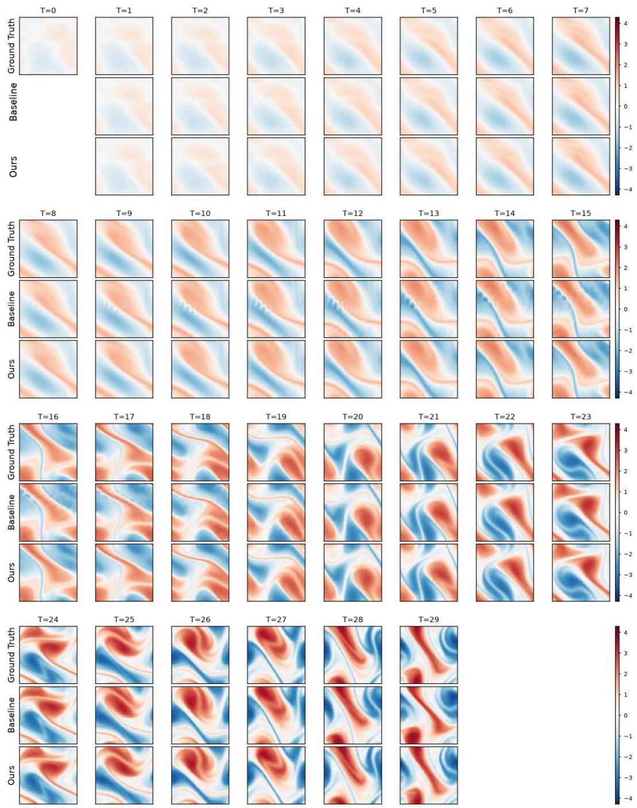  
Figure 4: Qualitative comparison of the complete 29-step autoregressive rollout on Navier–Stokes $( \nu = 1 0 ^ { - 4 } )$ . The initial physical state is shown at $T = { \dot { 0 } } .$ . For subsequent temporal steps, ground truth, FNO baseline, and FNO+ALR predictions are shown from top to bottom. All models start from the same initial state and are rolled out autoregressively over the full temporal horizon.