# Same Spectrum, Harder First-Order Training: Phase-Locking in Single- versus Multi-Qubit Re-Uploading Circuits

Michael Poppel 1 2 David Bucher 2 Maximilian Zorn 1 Markus Baumann 1 Sebastian Wolckert¨ 1 Claudia Linnhoff-Popien 1 Philipp Altmann 1 Jonas Stein 1

## Abstract

Angle-encoded variational quantum circuits implement truncated Fourier series. For onedimensional inputs, a single-qubit re-uploading (serial) circuit represents every function that a multi-qubit circuit with the same encoding budget E can; we find that this exchange of width for depth is not free in first-order training. Because its state lives on the Bloch sphere, all parameters of the serial circuit move the state, at each input, along one complex direction, which we call phase-locking. We prove that this costs no Fourier direction but leaves no direction to spare: however many parameters it has, the serial circuit has at most 2E + 2 tangent directions, one more than its 2E + 1 Fourier coefficients need, while a twoqubit control with the same encoding budget and model class generically has at least 6E + 6. The cost in training is measured against this control, as the number of runs out of 100 that reach the optimum within a fixed step budget. On an exact loss with flat-spectrum targets the gap grows with E; at E = 32 the serial circuit converges in 3, 53 and 83 runs under gradient descent, Adam and Levenberg–Marquardt, the control in 99, 100 and 100. On three real-world series, at matched parameter counts, the serial circuit reaches the leastsquares optimum in at most 9 runs under Adam and in 32 to 93 under Levenberg–Marquardt, the control in at least 98 and in all 100; its held-out error is up to about 1.5 times that of the control under Adam, but no larger in the typical run under Levenberg–Marquardt.

## 1. Introduction

Variational quantum circuits (VQCs) with angle encoding implement truncated Fourier series (Schuld et al., 2021). For N qubits with L encoding layers each, the accessible spectrum depends only on the encoding budget E = NL (Holzer & Turkalj, 2024), and the serial circuit (N = 1, L = E) is complete: it realises every real trigonometric polynomial of $\deg \mathrm { r e e } \leq E$ with values in [ 1, 1] (Lemma 3.3). For one-dimensional inputs, width can therefore be exchanged for depth without loss of expressivity. In training the layout does matter: Holzer & Turkalj (2024) observe numerically that models with fewer qubits become trapped in plateaus more often on complex targets, while on simple targets fewer qubits appear advantageous. For the serial circuit we make a structural difference explicit and measure what it costs.

The state of the serial circuit lives on the Bloch sphere, so that at each input all parameters move it along one complex direction (Lemma 4.2), which we call phase-locking; all parameter derivatives of the output then share one complex factor µ(x), the envelope. Phase-locking removes no Fourier direction: the coefficient Jacobian has full row rank almost everywhere (Lemma 3.3). But it limits how many tangent directions, directions in which the parameters move the state, the circuit can offer. However many parameters it has, the serial circuit has at most one more than it has Fourier coefficients, and that one leaves the output unchanged (Corollary 4.5); the two-qubit circuits we compare have several times as many (Proposition 4.4).

We measure what this costs in training with a controlled comparison. A two-qubit ancilla control encodes on one qubit and reads out the other. It has the same encoding budget, the same chain length (number of trainable blocks linked by encoding layers) and the same model class as the serial circuit, but at each input its tangent vectors have three complex components instead of one (and, necessarily, it has a larger state space). A two-qubit parallel circuit, with three components as well but half the chain length, separates the chain length from the number of components. We train first on an exact loss with targets that both circuits represent, so that any difference is one of optimisation, and then on data. The theory establishes the structure and the experiments measure the training cost, but we claim no causal link between the two.

## Contributions.

1. The serial circuit has no direction to spare. We prove the tangent counts of the serial, ancilla and parallel circuit, phase-locking, and full row rank of the coefficient Jacobian (Sections 3 and 4). As a check, the proofs are also formalised in Lean 4, with the cited results as hypotheses (Appendix C).

2. First-order training of the serial circuit is harder. We show empirically that the serial circuit reaches its optimum less often than the control: on an exact loss under gradient descent, Adam and Levenberg– Marquardt, by a margin that grows with E on flat targets and that neither the conditioning at initialisation nor a poor starting point accounts for (Section 5); and on data at matched parameter counts, including three real-world series, where its held-out error under Adam is up to about 1.5 times that of the control and under Levenberg–Marquardt the typical run predicts as well as the control (Section 6).

## 2. Related work

Beyond the spectrum (Section 1), the multiplicity with which each frequency arises also depends only on E (Paul et al., 2026, Eq. (30)), whereas which coefficients are realised depends on the trainable gates (Wiedmann et al., 2025); for Pauli readouts and commuting two-qubit entanglers, Oh et al. (2026) derive where local and entangling gates must be placed for a given coefficient to be reachable. The statistics of the coefficients over random parameters are well studied (Mhiri et al., 2025; Barthe & Perez-Salinas´ , 2024; Strobl et al., 2026; Duffy & Jastrzebski, 2026), and Duffy & Jastrzebski (2026) also observe that low-entanglement circuits converge more slowly. We fix two circuit families with the same spectrum and compare their training.

A single qubit with repeated encoding is universal for univariate functions (Perez-Salinas et al.´ , 2021; Yu et al., 2022), and the same circuits appear as generalised quantum signal processing (Motlagh & Wiebe, 2024). There, finding the phases of a prescribed polynomial is a known numerical problem: Dong et al. (2021) observe that from random phases most runs end in local minima, the more so the higher the degree, and start instead from a structured point, whose landscape Wang et al. (2022) analyse. We start from Haar-random gates and compare with two-qubit circuits of the same spectrum. Closest to our setting, Wang & Liu (2026) treat random-phase QSP as a learning model: every phase derivative of the output $g$ is the projection of one input-dependent vector c, with $\mathbf { \| } \boldsymbol { c } \| ^ { 2 } = \mathbf { \bar { 1 } } - g ^ { 2 }$ , onto a gate-dependent axis, which gives them the statistics of the tangent kernel. Our envelope is the counterpart for an expectation value, with $| \mu ( x ) | ^ { 2 } = 1 - f ( x ) ^ { 2 } $ ; we use it at the level of the Fourier coefficients and compare with multi-qubit circuits of the same spectrum.

Limits to training have mostly been studied as barren plateaus, gradients that vanish exponentially as the number of qubits grows (McClean et al., 2018; Cerezo et al., 2021); our circuits have one or two qubits, and the cost we measure arises at fixed width. Overparameterisation theory (Larocca et al., 2023) characterises trainability through the rank of the quantum Fisher information at a fixed input, at most $2 ( 2 ^ { N } - 1 )$ for an N-qubit pure state; Proposition 4.4 counts how these directions accumulate over the inputs. Our gradient descent is the Riemannian gradient descent of Wiersema & Killoran (2023) on $\operatorname { S U } ( p )$ , applied to each gate rather than to the whole circuit. The “Fourier locking” of Topel (2026) is a different phenomenon, an optimisation trap of trainable encoding weights; our encodings are fixed.

## 3. Background

Table 1 in the appendix collects the notation.

Definition 3.1 (VQC with angle encoding). An L-layer VQC on N qubits applies encoding layers $S ( x )$ interleaved with $L + 1$ blocks of trainable gates $\dot { W } ^ { ( 0 ) } , \dots , W ^ { ( L ) }$

$$
U ( x ) = W ^ { ( L ) } S ( x ) W ^ { ( L - 1 ) } \cdot \cdot \cdot S ( x ) W ^ { ( 0 ) } ,
$$

and outputs $f ( x ) = \langle 0 | U ( x ) ^ { \dagger } M U ( x ) | 0 \rangle$ . Each block is a product of one or more general $\mathrm { S U } ( 2 ^ { N } )$ gates, $S ( x )$ applies a Pauli rotation by the angle x to each encoded qubit, and M is a non-identity Pauli word.

Because the blocks range over all of $\mathrm { S U } ( 2 ^ { N } )$ , they absorb fixed unitaries next to them. A different axis of rotation, a different Pauli word or a different initial state therefore gives the same model class, leaves every statement for almost all gates unchanged, and maps runs of gradient descent and Levenberg–Marquardt onto each other, and, for a change of axis or of Pauli word, runs of Adam as well (Appendix B). We therefore take $R _ { X } ( x ) = e ^ { - i x X / 2 } , M = Z$ on the last qubit and the initial state 0 .

Parameters. A gate G is varied along the curves $s \mapsto$ $G e ^ { i s Q }$ , one for each non-identity Pauli word $Q$ on the qubits it acts on (3 for a gate in ${ \mathrm { S U } } ( 2 )$ , 15 for a gate in ${ \mathrm { S U } } ( 4 ) )$ these are its Lie-algebra coordinates. The vector $\pmb \theta \in \mathbb { R } ^ { P }$ collects the coordinates of all gates, and derivatives with respect to θ are taken at $\pmb \theta = 0$ , that is, at the current gates (Appendix $\mathbf { A } )$ . We write $f _ { \theta }$ when the dependence on the parameters matters.

Three circuits. We compare three instances with the same encoding budget E (Figure 1a). The serial circuit has one qubit and $L = E$ layers. The ancilla circuit has two qubits, the encoding on qubit 0 only, $L = E$ layers and the readout Z on qubit 1: it has the serial circuit’s encoding budget, number of blocks and model class (Lemma 3.3), but a four-dimensional state space, and each of its gates has 15 parameters instead of 3. The parallel circuit has two qubits, both encoded, and $L = E / 2$ layers, so half as many blocks.

Theorem 3.1 (Fourier representation (Schuld et al., 2021); spectral invariance (Holzer & Turkalj, 2024)). $f _ { \pmb \theta } ( x ) =$ $\begin{array} { r } { \sum _ { | \omega | \le E } c _ { \omega } ( \pmb { \theta } ) e ^ { i \omega x } } \end{array}$ with $c _ { - \omega } = \overline { { c _ { \omega } } } ,$ , where E is the total number of encoding gates. When every encoding gate is a Pauli rotation by the angle x, as here, the spectrum is $\{ - E , \ldots , E \}$ and depends only on E.

Since f is real, $c _ { - \omega } = \overline { { c _ { \omega } } }$ and $c _ { 0 }$ is real, so f is determined by $2 E + 1$ real numbers, the dimension of the space of real trigonometric polynomials of degree $\leq E$ . We collect them in a real vector, so that its Jacobian is a real matrix.

Definition 3.2 (Coefficient and data Jacobians). Let $\tilde { \mathbf { c } } =$ $( \operatorname { R e } c _ { 0 } , \operatorname { R e } c _ { 1 } , \operatorname { I m } c _ { 1 } , \ldots , \operatorname { R e } c _ { E } , \operatorname { I m } c _ { E } ) ^ { \top } \ \in \ \mathbb { R } ^ { 2 E + 1 }$ . The coefficient Jacobian is $J = \partial \tilde { \mathbf { c } } / \partial \pmb { \theta } \in \mathbb { R } ^ { ( 2 E + 1 ) \times P }$ . The data Jacobian at inputs $x _ { 1 } , \ldots , x _ { n }$ is $( \mathbf { J } _ { \mathrm { d a t a } } ) _ { i j } = \partial f _ { \pmb { \theta } } ( x _ { i } ) / \partial \theta _ { j }$

The theory concerns $^ { J , }$ which depends only on the circuit; a loss on data sees $\mathbf { J } _ { \mathrm { { d a t a } } }$ . The two differ by a factor that depends only on the inputs:

Lemma 3.2 (From J to data). $\mathbf { J } _ { \mathrm { { d a t a } } } ~ = ~ B J$ with the real Fourier design matrix $B \ \in \ \mathbb { R } ^ { n \times ( 2 E + 1 ) }$ of the inputs (columns 1, 2 cos kx, 2 sin kx, $k = 1 , \ldots , E )$ . On the $n = 2 E + 1$ equispaced points $o f \left[ - \pi , \pi \right)$ $B ^ { \top } B =$ $\mathrm { d i a g } ( n , 2 n , \ldots , 2 n )$ , so the singular values of B lie between $\sqrt { n }$ and $\sqrt { 2 n }$ , and the largest and smallest singular values of $\mathbf { J } _ { \mathrm { { d a t a } } }$ are those of J up to factors in $[ { \sqrt { n } } , { \sqrt { 2 n } } ]$

The proof is in Appendix B. Section 5 trains on these points, so the conditioning measured there is that of J up to a factor ${ \sqrt { 2 } } ;$ ; on other inputs it is that of J only up to the conditioning of B.

Model class and full row rank. The serial and the ancilla circuit represent the same functions, and neither loses a Fourier direction generically.

Lemma 3.3 (Model class and full row rank). Let $\mathcal { F } _ { E }$ be the set of real trigonometric polynomials of degree $\leq E$ with $\| f \| _ { \infty } \leq 1$ . (i) The serial circuit with $L = E$ and the ancilla circuit with $L = E$ both have model class exactly $\mathcal { F } _ { E } ,$ , for any number of gates per block; for the serial circuit this rests on known single-qubit results (Yu et al., 2022; Motlagh & Wiebe, 2024). (ii) For both, rank $J = 2 E + 1$ for almost every choice of gates (with respect to the Haar measure, the uniform distribution, on each gate).

(a) Chain length at fixed $E = 4$

$$
N { = } 1 , ~ L { = } 4 \colon
$$

$$
| 0 \rangle - [ W ^ { ( 0 ) } ] - [ \overline { { { S ( x ) } } } ] - [ W ^ { ( 1 ) } ] - [ \overline { { { S ( x ) } } } ] - [ W ^ { ( 2 ) } ] - [ \overline { { { S ( x ) } } } ] - [ \overline { { { S ( x ) } } } ] - [ W ^ { ( 3 ) } ] - [ \overline { { { S ( x ) } } } ] - [ W ^ { ( 4 ) } ] - [ \overline { { { \mathcal { A } } } } ]
$$

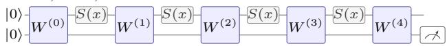

$$
N { = } 2 , \ L { = } 2 { : }
$$

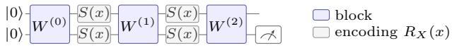

(b) Phase-locking: one complex direction against three

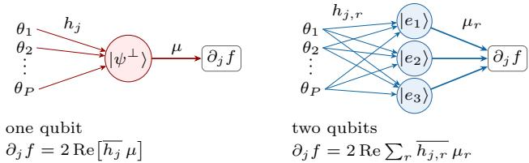  
Figure 1. (a) Chain length at $E = 4 \div$ the number $L + 1$ of blocks, all of which enter every term of every Fourier coefficient (Lemma 4.1). (b) Phase-locking. At each input, every parameter of the serial circuit moves the state along the one vector $| \psi ^ { \bot } \rangle$ (Lemma 4.2); on two qubits, in the ancilla and the parallel circuit alike, it moves it along three orthogonal vectors (Remark 4.3). Symbols as in Lemma 4.2 and Remark 4.3.

The proof is in Appendix B: (i) by the Fejer–Riesz fac-´ torisation and generalised quantum signal processing, the ancilla circuit containing the serial one and obeying the same bounds; (ii) by Sard’s theorem, which gives one point of full rank, and the fact that rank loss is the zero set of a polynomial in the gate entries (Lemma 4.1). A difference between the two circuits in training is therefore not a difference in what they can represent or in which directions exist. The lemma covers the pair that we compare throughout. The parallel circuit serves as a reference for the chain length; for it we have not proved either part, and the comparison does not depend on it. Its runs in Section 5.2 reach every target used there.

## 4. Tangent structure of single- and multi-qubit circuits

This section establishes how the serial circuit differs in structure from two-qubit circuits with the same spectrum: in the length of the chain of blocks (Section 4.1) and in the directions along which the parameters move the state (Section 4.2), and counts the tangent directions that this leaves over all inputs (Section 4.3). All results are statements about structure and counts. Whether these differences matter for training is not derived here; it is measured in Sections 5 and 6.

## 4.1. Polynomial structure and chain length

Lemma 4.1 (Polynomial structure). For any circuit of Definition 3.1, each Fourier coefficient is a sum over pairs of index paths,

$$
c _ { \omega } = \sum _ { p , p ^ { \prime } } \gamma _ { \omega } ( p , p ^ { \prime } ) \prod _ { \ell = 0 } ^ { L } W _ { p _ { \ell } } ^ { ( \ell ) } \overline { { W _ { p _ { \ell } ^ { \prime } } ^ { ( \ell ) } } } ,
$$

where a path $p = ( p _ { 0 } , \dotsc \dotsc , p _ { L } )$ selects one matrix entry $W _ { p \ell } ^ { ( \ell ) }$ ofevery block, and the numbers $\gamma _ { \omega } ( p , p ^ { \prime } )$ depend on the encoding layer S, the observable M, the initial state and ω, but not on the blocks. Every monomial of $c _ { \omega }$ therefore contains exactly one entry and one conjugated entry ofeach ofthe L + 1 blocks.

The lemma follows by multiplying out the matrix product (Appendix B); we state it because two later arguments use its form. It makes every $c _ { \omega }$ a polynomial in the real and imaginary parts of the gate entries, on which the “almost every choice of gates” statement of Lemma 3.3(ii) rests. And it fixes what we call the length of the chain, the number $L + 1$ of blocks: every term of every coefficient contains all of them. This is a property of the expansion, not a claim that every $c _ { \omega }$ depends on every block. At fixed E the chain has $L + 1 = E + 1$ blocks for the serial circuit and $E / N + 1$ for a parallel circuit encoding on all N qubits (Figure 1a). Chain length is therefore a second difference between serial and parallel circuits besides the tangent structure below; the ancilla circuit removes it.

## 4.2. Phase-locking: one complex direction for all parameters

Lemma 4.2 (Serial phase-locking). Let $N = 1 , M = Z$ and $| \psi ( x , \pmb \theta ) \rangle = U | 0 \rangle = \psi _ { 0 } | 0 \rangle + \psi _ { 1 } | 1 \rangle$ , and let $| \psi ^ { \bot } \rangle =$ $\overline { { \psi _ { 1 } } } \left| 0 \right. - \overline { { \psi _ { 0 } } } \left| 1 \right.$ , a unit vector orthogonal to $| \psi \rangle$ . Thenfor every parameter $\theta _ { j } .$

(i) $( I - | \psi \rangle \langle \psi | ) | \partial _ { j } \psi \rangle = h _ { j } | \psi ^ { \perp } \rangle$ with $h _ { j } ( x ) = \langle \psi ^ { \perp } | \partial _ { j } \psi \rangle$ All tangent vectors, the components $( I - | \psi \rangle \langle \psi | ) | \partial _ { j } \psi \rangle$ of the derivatives orthogonal to the state, are complex multiples of the one vector $| \psi ^ { \perp } \rangle$

(ii) With $\mu ( x ) = \langle \psi ^ { \perp } | M | \psi \rangle$ , which is the same for all $j ,$

$$
\begin{array} { r } { \partial _ { j } f ( x ) = 2 \operatorname { R e } \left[ \overline { { h _ { j } ( x ) } } \mu ( x ) \right] . } \end{array}\tag{1}
$$

We call $\mu$ the envelope.

(iii) $h _ { j }$ is determined by the sub-circuit up to the gate containing $\theta _ { j }$ and is a trigonometric polynomial of degree at most the number of encoding layers preceding that gate; $\mu$ is a trigonometric polynomial of degree at most $L .$

Proof sketch. Let $T$ be the map $( v _ { 0 } , v _ { 1 } ) \mapsto ( \overline { { v _ { 1 } } } , - \overline { { v _ { 0 } } } )$ on $\mathbb { C } ^ { 2 }$ , so that $| \psi ^ { \perp } \rangle ~ = ~ T | \psi \rangle$ . (i), (ii): $\{ | \psi \rangle , | \psi ^ { \perp } \rangle \}$ is an orthonormal basis, so $| \partial _ { j } \psi \rangle ~ = ~ \lambda _ { j } | \psi \rangle ~ + ~ h _ { j } | \psi ^ { \perp } \rangle$ , and $\lambda _ { j } \in i \mathbb { R }$ because $\langle \psi | \psi \rangle \stackrel { \cdot } { = } 1$ . The $\lambda _ { j }$ term drops out of $\bar { \partial _ { j } f } = 2 \mathrm { R e } \langle \partial _ { j } \psi | M | \psi \rangle$ because $\langle \psi | \dot { M } | \psi \rangle$ is real. (iii): $T$ commutes with every element of ${ \mathrm { S U } } ( 2 )$ , so the circuit after the gate carrying $\theta _ { j }$ cancels in $\langle T \psi | \partial _ { j } \psi \rangle$ , and $h _ { j }$ is an inner product computed right after that gate. Full proof in Appendix B. □

Any unit vector orthogonal to $| \psi \rangle$ is $e ^ { i \alpha } | \psi ^ { \perp } \rangle$ for some phase α. For (i) and (ii) the choice is immaterial: with $e ^ { i \alpha ( x ) } | \psi ^ { \perp } \rangle$ in place of $| \psi ^ { \perp } \rangle$ , both $h _ { j }$ and $\mu$ are multiplied by $e ^ { - i \alpha ( x ) }$ and the vector $h _ { j } | \psi ^ { \perp } \rangle$ and the product $\overline { { h _ { j } } } \mu$ are the same as before. For (iii) it matters: the statement is about this particular $| \psi ^ { \perp } \rangle$ , and an x-dependent phase moves the frequencies (the phase $e ^ { i x }$ shifts every frequency of $h _ { j }$ and $\mu$ by one), so the degree bounds need not hold. Statements (i) and (ii) use only that $| \psi \rangle$ is a normalised state that depends differentiably on $\theta _ { j }$ , so they hold for any parameterisation. Statement (iii) is proved for a parameter that enters exactly one gate, as every Lie-algebra coordinate does (Appendix $\mathrm { A } )$ . Geometrically, $\mu$ is the direction of steepest ascent of f on the Bloch sphere, written in the basis $| \psi ^ { \perp } \rangle$ , and (ii) is the component of the motion $h _ { j }$ along it; its length, $| \mu | = { \sqrt { 1 - f ^ { 2 } } }$ (Remark 4.3(ii)), measures how steep the ascent is.

Parts (i) and (ii) restate that the vectors orthogonal to ψ form one complex dimension, the tangent space of the Bloch sphere at $| \psi \rangle$ ; part (iii) adds where each $h _ { j }$ comes from and what its degree is. The results below use the lemma through the factorisation of Eq. (2).

Remark 4.3 (More than one qubit). On N qubits $| \psi \rangle$ is a unit vector in $\mathbb { C } ^ { d } , d = 2 ^ { N }$ , and the vectors orthogonal to it form a space of $d - 1$ complex dimensions (one for $N = 1$ three for $N = 2 )$ . Let $| e _ { 1 } \rangle , \dots , | e _ { d - 1 } \rangle$ be an orthonormal basis of that space and M Hermitian.

$\begin{array} { r } { \mathrm { ( i ) } \left( I - | \psi \rangle \langle \psi | \right) | \partial _ { j } \psi \rangle = \sum _ { r } h _ { j , r } | e _ { r } \rangle } \end{array}$ with $h _ { j , r } = \langle e _ { r } | \partial _ { j } \psi \rangle$ A tangent vector is given by $d - 1$ complex numbers, no longer by one (Figure 1b).

(ii) $\begin{array} { r } { \partial _ { j } f = 2 \operatorname { R e } \sum _ { r } \overline { { h _ { j , r } } } \mu _ { r } } \end{array}$ with $\mu _ { r } = \langle e _ { r } | M | \psi \rangle$ , the same for all $j .$ We call the $\mu _ { r }$ envelopes; if $M ^ { 2 } \ = \ I$ , then $\begin{array} { r } { \sum _ { r } | \mu _ { r } | ^ { 2 } = 1 - f ^ { 2 } } \end{array}$

(iii) How many envelopes are non-zero depends on the basis: $\mu _ { r } = \langle e _ { r } | ( M - f ) | \psi \rangle$ , so in a basis in which $( M - f ) | \psi \rangle$ is a multiple of $| e _ { 1 } \rangle , \mu _ { r } = 0$ for $r \geq 2$ and the gradient at $x$ depends on $h _ { j , 1 } ( x )$ only. What does not depend on the basis is the dimension of the real span of the tangentcoefficient functions $x \mapsto \left( h _ { j , r } ( x ) \right)$ r over all parameters, which Proposition 4.4 counts: a change of basis multiplies all of them by one unitary matrix $V ( x )$

The factored Jacobian. In matrix form, Lemma 4.2 says that every column of the coefficient Jacobian is the same linear map applied to the Fourier coefficients of one $h _ { j }$

$$
J = A _ { \mu } H ,\tag{2}
$$

where $\begin{array} { r } { H \in \mathbb { R } ^ { 2 ( 2 L + 1 ) \times P } } \end{array}$ collects the real and imaginary parts of the Fourier coefficients of the $h _ { j } .$ and $\begin{array} { r c l } { \bar { A _ { \mu } } } & { \in } & { \mathbb { R } ^ { ( 2 L + 1 ) \times 2 ( 2 L + 1 ) } } \end{array}$ is the real-linear map $h \mapsto$ Fourier coefficients of $2 \mathrm { R e } [ \bar { h } \mu ]$ up to degree $L )$ , determined by the envelope alone (Appendix B). Each parameter contributes one column of H; all parameters share $A _ { \mu }$

## 4.3. Tangent count and spare directions

Phase-locking costs the serial circuit no Fourier direction: its coefficient Jacobian has full row rank almost everywhere (Lemma 3.3). What it limits is the number of directions. It is a statement at one input; a function is fitted over all inputs, so the question is how many independent directions the parameters offer over all inputs together, compared with the $2 E + 1$ Fourier coefficients they have to control. To count them we need, at every input, a basis of the vectors orthogonal to $| \psi ( x ) \rangle$ in which to write the tangent vectors (Remark 4.3). We use $e _ { r } ( x ) = U ( x ) | r \rangle , r = 1 , \dots , 2 ^ { N } - 1 ;$ the circuit applied to the other computational basis states, which are orthonormal and orthogonal to $| \psi ( x ) \rangle = U ( x ) | 0 \rangle$ because $U ( x )$ is unitary. For $N = 1$ this is $- | \psi ^ { \perp } \rangle$ , the vector of Lemma 4.2 up to sign. Parameter $j$ then has the tangent-coefficientfunction $h _ { j } ( x ) = ( \langle e _ { r } ( x ) | \partial _ { j } \psi ( x ) \rangle ) _ { r } \in$ $\mathbb { C } ^ { 2 ^ { N } - 1 }$ , a vector of trigonometric polynomials of degree $\leq E$ The number of tangent directions of a circuit is the dimension of the real span of these functions over all parameters; by Remark $4 . 3 ( \mathrm { i i i } )$ it does not depend on the choice of the basis. For the serial circuit it is the rank of the matrix H of Eq. (2).

Proposition 4.4 (Tangent count). Let  be the real span ofthe tangent-coefficientfunctions $h _ { j }$ over all Lie-algebra coordinates j. For any number of gates per block: (i) For the serial circuit, dim $\tau \leq 2 ( E + 1 )$ for every choice of gates, with equality for almost every choice. (ii) For the ancilla circuit, dim $\mathcal { T } \geq 6 ( E + 1 )$ for almost every choice of gates. (iii) For the parallel circuit on two qubits, dim $\tau \leq 5 E + 6$ for every choice of gates, with equality for almost every choice.

These counts are the directions at one input, accumulated over the blocks. At one input the state can move in $2 ( d - 1 )$ real directions: two on one qubit, the one complex direction of Lemma $4 . 2 ,$ and six on two qubits (Remark 4.3). Every one of the $E + 1$ blocks of the serial and of the ancilla circuit contributes these directions once, each block at a new frequency, which gives the $2 ( E + 1 )$ of (i) and the $6 ( E + 1 )$ of (ii). The parallel circuit has $E / 2 + 1$ blocks, and each after the first contributes ten.

A tangent direction can leave f unchanged to first order:

it then moves the state without changing the output. Our circuits have such directions of one trivial kind, the readout rotations: rotations of the final state that commute with the readout M and are therefore invisible to it; they span at most one dimension on a single qubit and at most seven on two (Appendix B). We call every further dimension of directions that leave f unchanged spare. Spare directions do not lower the loss by themselves; they are room to change how a function is realised without changing the function.

Corollary 4.5 (No spare tangent direction in the serial circuit). For the serial circuit with $M = Z$ and any number ofgates per block, with $h _ { j }$ and $\mu$ taken in the same basis:

(i) Rotating the state about the readout axis, $| \psi \rangle \mapsto e ^ { i s Z } | \psi \rangle$ is a motion ofthe last gate. Its tangent-coefficientfunction is $i \mu ,$ , which lies in  , and it leaves f unchanged.

(ii) At every choice of gates at which J has full row rank, hence at almost every choice (Lemma 3.3), a vector $\dot { \pmb { \theta } } \in \mathbb { R } ^ { P }$ satisfies $J { \dot { \pmb \theta } } = 0$ if and only $i f \textstyle \sum _ { j } { \dot { \theta } } _ { j } h _ { j } = \lambda i \mu$ for some $\lambda \in \mathbb { R } .$ the rotation of(i) is the only tangent direction that leaves f unchanged tofirst order. The $" i f "$ part holdsfor every choice of gates.

(iii) For almost every target $f ^ { \ast } \in \mathcal { F } _ { E }$ (Lebesgue measure on its coefficient vector $\tilde { \mathbf { c } } ) ,$ , (ii) applies at every choice of gates with $f _ { \pmb { \theta } } = f ^ { * }$

The proof is in Appendix B. Here $J { \dot { \boldsymbol { \theta } } } = 0$ says that the direction $\dot { \pmb \theta }$ changes no Fourier coefficient of $f ,$ , hence not $f ,$ to first order.

Generically the serial circuit thus has no spare tangent direction: of its $2 E + 2$ directions, $2 E + 1$ change the Fourier coefficients and the last one is the readout rotation. The two-qubit circuits generically have at least $3 E - 2$ (parallel) and 4 $E - 2$ (ancilla) spare directions: their $5 E + 6$ and at least $6 E + 6$ tangent directions, less the at most $2 E + 1$ that change the Fourier coefficients and the at most seven readout rotations. The ancilla control has more than the parallel circuit because it has twice as many blocks; in our numerical checks its bound in Proposition 4.4 is attained, dim $\mathcal { T } = 6 ( E + 1 )$ (Table 3).

## 5. First-order training on an exact loss

The serial circuit and the ancilla control represent the same functions but differ in structure: the serial circuit has no spare tangent direction, the control at least $4 E - 2$ . We now measure whether this difference shows in training: first with the target function given exactly, so that neither sampling nor noise enters and any difference is one of optimisation alone (this section), then on sampled data (Section 6).

Loss and targets. The target is a function $f ^ { * } ,$ , not a data set. The loss is the relative $L ^ { 2 }$ error on the circle, $\| f _ { \pmb \theta } - f ^ { * } \| ^ { 2 } / \mathrm { V a r } ( f ^ { * } )$ ; its numerator equals the mean squared error on $2 E + 1$ equispaced points, so it is computed exactly. Targets are random real trigonometric polynomials of degree $E ,$ scaled to sup $| f ^ { * } | = 0 . 9$ , of two kinds: $\scriptstyle { \mathit { f l a t } } ,$ , with coefficients of the same variance at every frequency, and $1 / k$ with coefficients whose standard deviation falls as $1 / k$ with the frequency $k ,$ as for smoother functions. We use both to see whether the comparison depends on the spectrum of the target. By Lemma 3.3 the serial and the ancilla circuit represent every such target exactly. Their optimal loss is therefore zero, and a run that ends above it has missed a solution that exists.

Circuits. We compare the serial and the ancilla circuit and, for reference, the parallel circuit on two qubits $( L = E / 2 )$ , for $E \in \{ 8 , 1 2 , 1 6 , 2 4 , 3 2 \}$ . A configuration is a target family together with a value of E. Every circuit has 100 runs in every configuration, each with its own target and its own Haar-random initial gates. The targets are the same for the three circuits, and the three optimisers start from the same initial gates. Every block holds one general $\mathrm { S U } ( 2 ^ { N } )$ gate, so that the circuits differ in their numbers of parameters: $3 ( E + 1 )$ $1 5 ( E + 1 )$ and $1 5 ( E / 2 + 1 )$ for the serial, ancilla and parallel circuit. This section does not match them by experiment. For gradient descent we rely on an argument instead: in each of the three circuits, further gates in a block add no tangent directions (proof of Proposition 4.4) and, to first order in the step size, only rescale the step (Lemma B.2), which the line search absorbs. The argument does not cover Levenberg–Marquardt or Adam. Under Adam the comparison is therefore repeated at matched parameter counts: on the targets of this section in Appendix D (Figure 6), and on other targets in Section 6.

Optimisers. The experiments proceed in three steps. We start with gradient descent, the plainest first-order method: its step is the gradient itself, without memory or rescaling, so that any effect of the tangent structure on training shows here most directly. An Armijo line search (Nocedal & Wright, 2006, Ch. 3) takes the place of the learning rate, so that no learning rate has to be tuned (Section 5.1). Along these runs the Jacobian of the serial circuit stays poorly conditioned more often than that of the control. We therefore add Levenberg–Marquardt (Nocedal & Wright, 2006, Ch. 10), a second-order method that poor conditioning does not slow down, to see what remains of the difference (Section 5.2). Finally Adam (Kingma & Ba, 2014), with a tuned learning rate, shows whether the difference persists under a commonly used adaptive method (Section 5.3). In all three the variables are the gates themselves: an update multiplies every gate by a unitary close to the identity, so that no parameterisation of the gates by angles, and none of its singular points, enters (Appendix A). Gradient descent and Adam have a budget of 50,000 steps, Levenberg–Marquardt

of 2,000 iterations.

Convergence. A run converges if its final loss, which is relative to the target variance, is at most $1 0 ^ { - 6 }$ , the criterion of Section 6. Figure 2 shows the share of converged runs of each circuit, with a 95% Wilson interval (Wilson, 1927) for each share. To compare two circuits we use the difference of their shares, ancilla minus serial, with a 95% interval for the difference (Newcombe, 1998), and call the difference significant if this interval excludes zero: the counts are then not compatible, at the 5% level, with equal chances of convergence for the two circuits. Table 12 in Appendix D gives the counts, the differences and their intervals for both target families and the three optimisers. The comparison does not depend on the threshold: at $1 0 ^ { - 4 }$ and at $1 0 ^ { - 8 }$ the same differences are significant as at $1 0 ^ { - 6 }$ , for each of the three optimisers (Table 13). $\mathrm { \ A t \ 1 0 ^ { - 1 0 } }$ this still holds for gradient descent and Levenberg–Marquardt, but not for Adam: a run of Adam that has found the solution does not go on to machine precision but ends at a loss between about $\bar { 1 } 0 ^ { - 1 2 }$ and $1 0 ^ { - 8 }$ , so that a threshold of $1 0 ^ { - 1 0 }$ also rejects many runs that have converged (Appendix D).

## 5.1. Gradient descent

Within the budget, gradient descent converges less often for the serial circuit than for the ancilla circuit, and the gap grows with E (Figure 2, left): on flat targets the serial circuit converges in 65 of 100 runs at $E = 1 6$ and in 3 at $E = 3 2$ , the ancilla circuit in 100 and 99. On $1 / k$ targets every circuit is slower, and at $E \geq 2 4$ gradient descent converges in at most 16 of 100 runs of any circuit (Figure 7 in Appendix D). The difference is significant in nine of the ten configurations (Table 12). The parallel circuit, at half the chain length, stays within five runs of the ancilla circuit in every configuration (Table 13).

These counts are relative to the budget (Table 14). The serial circuit is slower throughout, and its counts were still rising when the budget ended: at $E = 2 4$ on flat targets, 18 of the 24 runs that converge do so after step 27,000. Whether the serial runs that are left would converge with more steps or are stuck, these counts cannot tell. Levenberg–Marquardt, started from the same points, converges in most of them (Section 5.2).

## 5.2. Conditioning and Levenberg–Marquardt

Along gradient descent the loss falls after the Jacobian has become better conditioned, and in the serial circuit this happens less often. We measure conditioning by $\kappa _ { J } =$ $\sigma _ { 2 E + 1 } / \sigma _ { 1 }$ , the smallest singular value of the Jacobian of the grid values $\mathbf { J } _ { \mathrm { { d a t a } } }$ relative to the largest, which is that of J up to a factor $\sqrt { 2 }$ (Lemma 3.2): on a squared loss, gradient descent makes progress at a rate that is bounded below by the smallest singular value (Liu et al., 2021, Theorem 1) (Appendix A gives the inequality for our loss), and the largest sets the scale of the step. Equivalently, $\kappa _ { J } ^ { 2 }$ is the ratio of the smallest to the largest eigenvalue of the tangent kernel $\mathbf { J } _ { \mathrm { { d a t a } } } \mathbf { J } _ { \mathrm { { d a t a } } } ^ { \top }$ on the grid, the matrix whose conditioning that theorem uses. worse conditioned than the two-qubit circuits at every E (Figure 5a in Appendix D), but this does not account for the difference in convergence: configurations of different circuits with matched initial $\kappa _ { J }$ still differ, and within a configuration the initial $\kappa _ { J }$ does not predict which runs converge (Appendix D). What differs is the course of training. In nearly every run in which the order can be observed, $\kappa _ { J }$ rises above $1 0 ^ { - 4 }$ before the loss falls to $1 0 ^ { - 4 }$ , and $\kappa _ { J }$ never rises above this level in 465 of the 1,000 serial runs, against 127 of the ancilla runs (Figure 5b, Table 2). This is a description and not a mechanism: the solutions found are well conditioned, so that part of the order is automatic. It suggests a test, however. If poor conditioning is what holds gradient descent back, a method that it does not slow down should remove the difference.

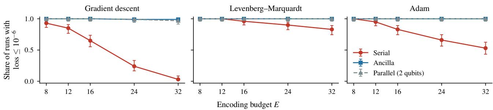  
Figure 2. Share of converged runs (final loss $\leq 1 0 ^ { - 6 } )$ against the encoding budget E, for flat targets and the three optimisers. Bars: 95% Wilson intervals; 100 runs per point.

Levenberg–Marquardt removes most of the difference between the circuits, but not all of it (Figure 2, middle; Figure 7 for 1/k targets). It uses the same Jacobian as gradient descent but rescales its singular directions, so that poor conditioning alone does not slow it down. Started from the same points, it converges in all 2,000 runs of the two-qubit circuits and in 923 of the 1,000 serial runs: in 377 of the 378 in which gradient descent converges, and in 546 of the 622 in which it does not. For most serial runs that fail under gradient descent, the starting point therefore does not preclude convergence. For the parallel circuit, which Lemma 3.3 does not cover, the result has a second use: all of its runs end below a loss of $1 0 ^ { - 1 0 }$ , so that it, too, represents every target used here to that accuracy.

A difference remains at large E: at $E \geq 2 4$ the serial circuit converges in 73 to 90 of 100 runs and the ancilla circuit in all, and the difference is significant in these four configurations. At $E \leq 1 6$ at most four of 100 serial runs fail, and the difference is not significant (Table 12).

Most of the 77 serial runs that do not converge end where the Jacobian has lost rank, as far as the computation resolves it. This is the only kind of point at which a run can come to rest above the optimum: at a stationary point where J has full row rank, the model is a least-squares fit of the target (Lemma B.3 in Appendix B), and here that fit is the target itself. Lemma 3.3 makes points without full row rank non-generic, but it does not keep optimisation away from them. In the serial circuit there is no margin against this: J has full row rank only where the circuit has all $2 E + 2$ tangent directions (proof of Corollary 4.5(ii)), so that the loss of any tangent direction costs a Fourier direction. In 53 of the 77 runs J has singular values below $1 0 ^ { - 8 } \sigma _ { 1 }$ at the end point, and at least 99% of the squared residual lies in the corresponding directions (Table 4); at the 623 converged end points of the same configurations no singular value is below $1 0 ^ { - 3 . 7 } \sigma _ { 1 }$ . The other 24 runs do not end at a point of this form, and Levenberg–Marquardt hardly moves along directions with singular values this small, so that exact rank loss cannot be told from near loss (Appendix A).

## 5.3. Adam

The difference persists under Adam, the optimiser of Section 6, and it is clearest where gradient descent could not show it (Figure 2, right; Figure 7 for 1/k targets). On $1 / k$ targets at $E = 2 4$ and 32, where gradient descent converges in at most 16 of 100 runs of any circuit, Adam brings the ancilla circuit to convergence in 100 and 97 runs and the parallel circuit in 100 and 93, but the serial circuit in 23 and 9. Elsewhere, too, the serial circuit falls behind as E grows, while the ancilla circuit converges in every run of nine configurations. The difference is significant in nine of ten; in the tenth, $E = 8$ on flat targets, every run of every circuit converges (Table 12). For the serial circuit the counts of Adam lie between those of the other two optimisers in every configuration: above gradient descent, and at most at the level of Levenberg–Marquardt. Most failures are not failures of the starting point: of the 327 serial runs in which Adam does not converge, Levenberg–Marquardt converges in 275 from the same initial gates, and Adam converges in

25 of the 77 in which Levenberg–Marquardt does not. The learning rate does not account for the difference: neither extending the grid of rates downwards nor one common rate for all circuits changes which differences are significant (Appendix D, Table 15). Nor do the unequal parameter counts: with the counts matched, in the setup of Section 6, the serial circuit reaches the least-squares optimum on flat targets less often at every E, in 36 of 100 runs at $E = 3 2$ and the control in every run (Appendix D, Figure 6).

## 6. Training on data

Setup. We now train on data as in practice. Every task has 200 training and 100 test points on $[ - \pi , \pi )$ . The optimiser is full-batch Adam, the one in common use, with a cosine schedule and a learning rate tuned per circuit and configuration on separate targets. Parameter counts are matched across architectures (serial circuits with five SU(2) gates per block, ancilla circuits with one SU(4) gate per block, both with 15 parameters per block; parallel circuits with two SU(4) gates per block at half the chain length): the argument of Section 5 on the number of gates per block covers gradient descent only. The match equalises the number of optimiser coordinates, not of independent directions: the five gates of a serial block span only the three directions of su(2) (Proposition 4.4), and no single-qubit circuit matches the two-qubit circuits in the latter. As a reference, the same initial gates are also trained with Levenberg–Marquardt, in every configuration (Table 8). Two checks of the protocol, a wider grid of learning rates and a fourfold step budget on a subset, leave the serial circuit behind the control in every configuration tested (Appendix D, Tables 10 and 11).

Targets. There are two kinds. Poisson-kernel targets are sums of three Poisson kernels: smooth functions with Fourier coefficients at every frequency, which no circuit of degree E represents. The second kind are three real-world time series, described below. The flat targets of Section 5 are trained in the same setup in Appendix D, where they repeat the comparison of Section 5.3 at matched parameter counts.

Measures. On these targets no circuit of degree E reaches a training loss of zero, and the lowest loss it can reach differs from target to target. We therefore measure optimisation by the excess training loss over the least-squares fit of degree E, which the serial and ancilla model classes contain (Appendix A), relative to the variance of the training values. A run reaches the optimum if this excess is at most $1 0 ^ { - 6 }$ the criterion of Section 5. Prediction is measured by the held-out error $1 - R ^ { 2 }$ on the test points. Part of this error is common to all circuits of degree E; besides its value we therefore report the ratio serial over ancilla on the same target.

Poisson-kernel targets. The serial circuit reaches the optimum less often than the ancilla control at every E, and the difference is significant in each case (Figure 3a; Table 5 in Appendix D): the serial circuit falls from 77 of 100 runs at $E = 8 \mathrm { t o } \ .$ 1 at $E = 3 2$ , the control from 100 to 24. The parallel circuit, at half the chain length, stays within four runs of the control except at $E = 2 4$ , where it reaches the optimum in 37 runs against 62. The shortfall reaches the test points (Figure 3b): from E = 16 on, the held-out error of the serial circuit exceeds that of the control on the same target by a median factor between 1.3 and 1.6. Levenberg–Marquardt narrows the difference in training without removing it: from the same initial gates it brings both two-qubit circuits to the optimum in every run and the serial circuit in 94, 79 and 72 runs at $E = 1 6$ , 24 and 32, a significant difference at each (Table 8).

Real-world data. Circuits were run on three real-world time series, and all three are reported. The first was the monthly temperatures at Nottingham (nottem) (Anderson, 1976). On it the serial circuit rarely reaches the optimum, but its held-out error is within 1% of that of the control (Figure 4). How much a shortfall from the training optimum costs on the test points depends on how well that optimum predicts, and on whether what the serial circuit misses carries predictive value. For the temperatures the least-squares fit of degree 32 explains 87% of the held-out variance, less than the fit of degree 24. We therefore chose two further series by a screen, fixed before any circuit was run on them (Appendix A, Table 9): from the 25 distinct univariate series of at least 240 values in Rdatasets (Arel-Bundock, 2026), those whose least-squares fit still improves on held-out points up to degree 32 and explains at least 95% of the held-out variance, a threshold set with the temperatures in view. Two series pass, weekly US gasoline prices (gasprice) and daily IBM closing prices (ibmclose); the temperatures do not. The task is to fit each series on random points of its window, not to forecast it.

On all three the serial circuit rarely reaches the optimum within the budget, in at most 9 of 100 runs, while the ancilla and the parallel circuit reach it in at least 96 (Figure 4a, Table 6). The size of this difference depends on the budget, its sign does not: with four times as many steps the serial circuit stays behind the control in all seven configurations tested, but on ibmclose it then reaches the optimum in 18 of 30 runs instead of none (Table 11). Levenberg–Marquardt from the same initial gates narrows the difference without closing it: the serial circuit reaches the optimum in 32 to 93 of 100 runs, both two-qubit circuits in all, and the difference is significant in all six configurations (Table 8). On the test points (Figure 4b) the cost ranges from a factor of 1.49 in held-out error on gasprice at $E = 3 2$ , where all 100 serial runs are worse than the control, to none on the temperatures (Table 6). It is not one-sided: on ibmclose and on the temperatures at $E = 3 2 , 3 0$ and 61 of 100 serial runs have a lower held-out error than the control, which is consistent with stopping short of the optimum acting as regularisation. Under Levenberg–Marquardt the typical run of the serial circuit predicts as well as the control: the median ratio of the held-out errors is between 1.00 and 1.01 on every series and on every Poisson-kernel configuration (open diamonds in Figures 3b and 4b). The cost remains in the runs that stop short of the optimum: on gasprice and ibmclose, 7 to 42 of 100 serial runs are more than 5% worse than the paired control run, and on Poisson-kernel targets at $E \geq 2 4$ about one in five (Table 7). Counted in restarts, one run of the serial circuit at the optimum takes on average 1.1 to 3.1 runs under Levenberg–Marquardt and 11 to 100 under Adam, where in three of the six configurations none of 100 runs reaches it; the control needs about one.

Serial Parallel (2 qubits)   
Ancilla Levenberg–Marquardt

(a) Runs at the optimum  
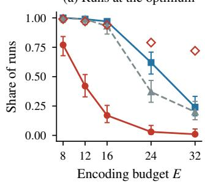

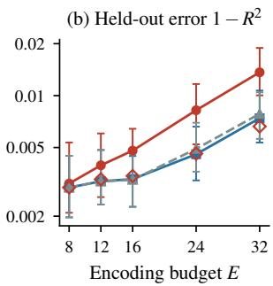  
Figure 3. Poisson-kernel targets, Adam at matched parameter counts. (a) Share of runs that reach the least-squares optimum; open diamonds: Levenberg–Marquardt on the same runs of the serial circuit (both two-qubit circuits reach the optimum in every run under it). Bars: 95% Wilson intervals; 100 runs per point. (b) Held-out error $1 - R ^ { 2 }$ : median over runs, bars from the lower to the upper quartile; open diamonds: median of the serial circuit under Levenberg–Marquardt.

H H Serial Parallel (2 qubits)   
Ancilla Levenberg–Marquardt

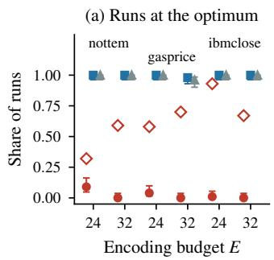

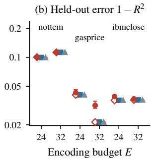  
Figure 4. Real-world series, Adam at matched parameter counts; panels as in Figure 3, 100 runs per point.

## 7. Discussion and conclusion

The serial circuit and the ancilla control represent the same functions, both without a structural loss of Fourier directions, yet within the budgets we used first-order methods reach the optimum of the serial circuit less often, by a margin that grows with $E ;$ Levenberg–Marquardt narrows it without closing it at large $E$ or on the real-world series. What separates the circuits structurally is proved: tangent vectors with one complex component at each input against three, and with it $2 E + 2$ tangent directions, none of them spare, against at least $6 E + 6$ . What separates them in training is measured. The conditioning of $J$ at initialisation does not explain $\mathrm { i t , }$ and a failed run is not the mark of a bad starting point: most serial runs that fail under gradient descent or Adam converge under Levenberg–Marquardt from the same initial gates. Along gradient descent the loss falls after $\kappa _ { J }$ has recovered in nearly every run in which the order can be observed, and in the serial circuit $\kappa _ { J }$ recovers less often (Section 5.2). We do not show that phase-locking causes the training cost; since it is a property of the two-dimensional state space, its effect cannot be separated from that of the dimension of the state space.

Limitations. All results are for one-dimensional inputs. With two inputs a single qubit no longer represents every trigonometric polynomial of its spectrum (for $E \geq 2$ its $3 ( 2 E + 1 )$ gate parameters fall short of the $( 2 E + 1 ) ^ { 2 }$ coefficients), although it approximates every continuous function as the number of encoding gates grows (Perez-Salinas et al.´ , 2025); expressivity and training would have to be separated anew. Results are for Haar-random initial gates and noise-free statevector simulation in double precision, which from $E = 2 4$ on no longer resolves the initial conditioning of the serial circuit. Convergence is measured within fixed step budgets and one learning-rate schedule: under gradient descent the serial counts were still rising when the budget ended, and a fourfold budget, tested on a subset, changed the size of the deficit but not its sign. Normalised gradient descent (Suzuki et al., 2021) and optimisers driven by SPSA gradient estimates (Wiedmann et al., 2023) were not tested; Adam, normalised coordinate by coordinate, is the closest of our three. Levenberg–Marquardt was run on exact expectation values; under shot noise its linear solve may need stronger damping, which we did not test. Budgets are counted in steps, not in cost: a general two-qubit gate is costlier to implement, and gate noise, which we do not model, would likely affect the two-qubit circuits more. Whether the shortfall in training costs held-out accuracy depends on the target: two of the three real-world series were selected for needing frequencies up to 32, and on the third, chosen before the screen, there is no cost; a target that a low degree fits as well needs only a low encoding budget, at which the difference is smaller. All targets use the full band of the model; encoding budgets above the degree of the target and hardware-native parameterisations of the gates were not studied. The tangent count is proved for the three circuits we compare only, and for the ancilla circuit as a lower bound, which our numerical checks find attained (Table 3).

Conclusion. For one-dimensional inputs, width can be exchanged for depth without losing expressivity, but not without cost in first-order training: the serial circuit, whose parameters share one complex direction at each input, has no tangent direction to spare, and first-order optimisers find its optimum less reliably than that of a two-qubit circuit representing exactly the same functions. In practice the cost matters most under the first-order optimisers in common use, where it reaches the held-out error. A second qubit avoids it, at the price of two-qubit gates; Levenberg–Marquardt, at the price of a linear solve per step, removes it from the typical run but not from every run. Whether the additional directions of the two-qubit circuits are what lets their conditioning recover along the path remains open: the structure we prove is a candidate explanation, not a demonstrated one.

## Acknowledgments

This work has been supported by the LMU Sustainability Fund (EfOiE), the BMFTR (QuCUN, QuaRDS, CAQAO), the Munich Quantum Valley (K5, K7), and the Bavarian StMWi (6GQT). The sole responsibility for the report’s contents lies with the authors.

## References

Absil, P.-A., Mahony, R., and Sepulchre, R. Optimization Algorithms on Matrix Manifolds. Princeton University Press, Princeton, NJ, 2008.

Anderson, O. D. Time Series Analysis and Forecasting: The Box–Jenkins Approach. Butterworths, London, 1976.

Arel-Bundock, V. Rdatasets: A collection of datasets originally distributed in R packages. https://github. com/vincentarelbundock/Rdatasets, 2026. Commit 1dcc2bf, 15 June 2026.

Armijo, L. Minimization of functions having Lipschitz continuous first partial derivatives. Pacific Journal of Mathematics, 16(1):1–3, 1966.

Barthe, A. and Perez-Salinas, A. Gradients and fre-´ quency profiles of quantum re-uploading models. Quantum, 8:1523, November 2024. ISSN 2521-327X. doi: 10.22331/q-2024-11-14-1523. URL http://dx.doi. org/10.22331/q-2024-11-14-1523.

Box, G. E. P. and Jenkins, G. M. Time Series Analysis: Forecasting and Control. Holden-Day, San Francisco, 1970.

Bradbury, J., Frostig, R., Hawkins, P., Johnson, M. J., Katariya, Y., Leary, C., Maclaurin, D., Necula, G., Paszke, A., VanderPlas, J., Wanderman-Milne, S., and Zhang, Q. JAX: composable transformations of Python+NumPy programs. http://github.com/jax-ml/jax, 2018.

Caceres Rossi, R. timeSeriesDataSets: Time Series Data Sets for R, 2024. URL https://github.com/ lightbluetitan/timeseriesdatasets\_R. R package version 0.1.0.

Cerezo, M., Sone, A., Volkoff, T., Cincio, L., and Coles, P. J. Cost function dependent barren plateaus in shallow parametrized quantum circuits. Nature Communications, 12(1):1791, 2021. doi: 10.1038/s41467-021-21728-w.

Dong, Y., Meng, X., Whaley, K. B., and Lin, L. Efficient phase-factor evaluation in quantum signal processing. Physical Review A, 103(4), April 2021. ISSN 2469-9934. doi: 10.1103/physreva.103.042419. URL http://dx. doi.org/10.1103/PhysRevA.103.042419.

Duffy, C. and Jastrzebski, M. Spectral bias in variational quantum machine learning, 2026. URL https: //arxiv.org/abs/2506.22555.

Fejer, L. ´ Uber trigonometrische Polynome. ¨ Journal fur die¨ reine und angewandte Mathematik, 146:53–82, 1916.

Golub, G. H. and Van Loan, C. F. Matrix Computations. Johns Hopkins University Press, Baltimore, MD, 4th edition, 2013.

Holzer, P. and Turkalj, I. Spectral invariance and maximality properties of the frequency spectrum of quantum neural networks. arXiv preprint arXiv:2402.14515, 2024.

Kingma, D. P. and Ba, J. Adam: A method for stochastic optimization. arXiv preprint arXiv:1412.6980, 2014.

Knapp, A. W. Lie Groups Beyond an Introduction. Books by Independent Authors. Anthony W. Knapp, 2023. ISBN 9798989504206. doi: 10.3792/euclid/9798989504206. Published via Project Euclid.

Koenker, R. quantreg: Quantile Regression, 2026. URL https://CRAN.R-project.org/package= quantreg. R package version 6.1.

Krantz, S. G. and Parks, H. R. A Primer ofReal Analytic Functions. Birkhauser Advanced Texts Basler Lehrb¨ ucher.¨ Birkhauser, Boston, MA, 2 edition, 2002. ISBN 978-0-¨ 8176-4264-8. doi: 10.1007/978-0-8176-8134-0.

Larocca, M., Ju, N., Garc´ıa-Mart´ın, D., Coles, P. J., and Cerezo, M. Theory of overparametrization in quantum neural networks. Nature Computational Science, 3(6): 542–551, 2023. doi: 10.1038/s43588-023-00467-6.

Levenberg, K. A method for the solution of certain nonlinear problems in least squares. Quarterly of Applied Mathematics, 2(2):164–168, 1944.

Liu, C., Zhu, L., and Belkin, M. Loss landscapes and optimization in over-parameterized non-linear systems and neural networks, 2021. URL https://arxiv. org/abs/2003.00307.

Marquardt, D. W. An algorithm for least-squares estimation of nonlinear parameters. Journal of the Society for Industrial and Applied Mathematics, 11(2):431–441, 1963.

McClean, J. R., Boixo, S., Smelyanskiy, V. N., Babbush, R., and Neven, H. Barren plateaus in quantum neural network training landscapes. Nature Communications, 9 (1):4812, 2018. doi: 10.1038/s41467-018-07090-4.

Mezzadri, F. How to generate random matrices from the classical compact groups. Notices of the American Mathematical Society, 54(5):592–604, 2007.

Mhiri, H., Monbroussou, L., Herrero-Gonzalez, M., Thabet, S., Kashefi, E., and Landman, J. Constrained and vanishing expressivity of quantum fourier models. Quantum, 9:1847, Sept 2025. ISSN 2521-327X. doi: 10.22331/q-2025-09-03-1847. URL http://dx.doi. org/10.22331/q-2025-09-03-1847.

Mityagin, B. S. The zero set of a real analytic function. Mathematical Notes, 107(3):529– 530, Mar 2020. ISSN 1573-8876. doi: 10.1134/ S0001434620030189. URL https://doi.org/10. 1134/S0001434620030189.

Motlagh, D. and Wiebe, N. Generalized quantum signal processing. PRX Quantum, 5:020368, Jun 2024. doi: 10.1103/PRXQuantum.5.020368. URL https://link.aps.org/doi/10.1103/ PRXQuantum.5.020368.

Newcombe, R. G. Interval estimation for the difference between independent proportions: comparison of eleven methods. Statistics in Medicine, 17(8):873–890, 1998. doi: 10.1002/(sici)1097-0258(19980430)17:8 873:: aid-sim779 3.0.co;2-i. URL https://doi.org/ 10.1002/(sici)1097-0258(19980430)17: 8<873::aid-sim779>3.0.co;2-i.

Nocedal, J. and Wright, S. J. Numerical Optimization. Springer Series in Operations Research and Financial Engineering. Springer, New York, NY, 2nd edition, 2006. doi: 10.1007/978-0-387-40065-5.

Oh, S., Im, C., Kim, D., Park, S., Aggarwal, V., Heidari, M., and Kim, J. Fourier-geometric circuit design for gate and entanglement placement in quantum neural networks, 2026. URL https://arxiv.org/abs/ 2609.35489.

Paul, F., Jeevanesan, B., and Jung, P. Asymptotics for frequency redundancies in quantum machine learning models, 2026.

Perez-Salinas, A., Yaghubi Rad, M., Barthe, A., and Dunjko,´ V. Universal approximation of continuous functions with minimal quantum circuits. Physical Review Research, 2025. doi: 10.1103/t49h-jmty. arXiv:2411.19152.

Perez-Salinas, A., L´ opez-N´ u´nez, D., Garc˜ ´ıa-Saez, A.,´ Forn-D´ıaz, P., and Latorre, J. I. One qubit as a universal approximant. Physical Review A, 104(1), July 2021. ISSN 2469-9934. doi: 10.1103/physreva.104. 012405. URL http://dx.doi.org/10.1103/ PhysRevA.104.012405.

Riesz, F. Uber ein Problem des Herrn Carath ¨ eodory. ´ Journal fur die reine und angewandte Mathematik¨ , 146:83–87, 1916.

Sard, A. The measure of the critical values of differentiable maps. Bulletin of the American Mathematical Society, 48(12):883–890, 1942. doi: 10.1090/S0002-9904-1942-07811-6. URL https://portal.mardi4nfdi.de/wiki/ Publication:5845772.

Schuld, M., Sweke, R., and Meyer, J. J. Effect of data encoding on the expressive power of variational quantummachine-learning models. Physical Review A, 103(3): 032430, 2021. doi: 10.1103/PhysRevA.103.032430.

Strobl, M., Sahin, M. E., van der Horst, L., Kuehn, E., Streit, A., and Jaderberg, B. Fourier fingerprints of ansatzes in quantum machine learning. Quantum Science and Technology, 11(4):045008, 2026. doi: 10.1088/2058-9565/ ae8df8.

Suzuki, Y., Yano, H., Raymond, R., and Yamamoto, N. Normalized gradient descent for variational quantum algorithms. arXiv preprint arXiv:2106.10981, 2021.

Topel, S. Overcoming Fourier locking in quantum data re-uploading classifiers via spectral homotopy, 2026.

Vatan, F. and Williams, C. Optimal quantum circuits for general two-qubit gates. Physical Review A, 69(3):032315, 2004.

Wang, J. and Liu, J. Representation learning with quantum signal processing, 2026.

Wang, J., Dong, Y., and Lin, L. On the energy landscape of symmetric quantum signal processing. Quantum, 6:850, 2022. doi: 10.22331/q-2022-11-03-850.

Wiedmann, M., Holle, M., Periyasamy, M., Meyer, N.,¨ Ufrecht, C., Scherer, D. D., Plinge, A., and Mutschler, C. An empirical comparison of optimizers for quantum machine learning with SPSA-based gradients. In 2023 IEEE International Conference on Quantum Computing and Engineering (QCE), 2023. doi: 10.1109/QCE57702. 2023.00058.

Wiedmann, M., Periyasamy, M., and Scherer, D. D. Fourier analysis of variational quantum circuits for supervised learning. In 2025 IEEE International Conference on Quantum Computing and Engineering (QCE), volume 1, pp. 1785–1795. IEEE, 2025.

Wiersema, R. and Killoran, N. Optimizing quantum circuits with Riemannian gradient flow. Physical Review A, 107 (6):062421, 2023. doi: 10.1103/PhysRevA.107.062421.

Wilson, E. B. Probable inference, the law of succession, and statistical inference. Journal of the American Statistical Association, 22(158):209–212, 1927. doi: 10.1080/01621459.1927.10502953.

Yu, Z., Yao, H., Li, M., and Wang, X. Power and limitations of single-qubit native quantum neural networks. In Oh, A. H., Agarwal, A., Belgrave, D., and Cho, K. (eds.), Advances in Neural Information Processing Systems, 2022. URL https://openreview.net/ forum?id=XNjCGDr8N-W.

## Overview of the appendices and the code

Appendix A gives the experimental protocol, Appendix B the proofs, Appendix C the Lean formalisation and Appendix D further results; Table 1 collects the notation. The repository https://github.com/mpoppel/PhaseLocking contains the simulation code, the result files behind every figure and table, the scripts that regenerate them, and a Lean 4/Mathlib formalisation of the lemmas, propositions, remarks and corollaries of Sections 3 and 4 and Appendix B; results cited from the literature enter there as explicit hypotheses (Appendix C).

Table 1. Notation of the paper.
<table><tr><td> $N , L$ </td><td>number of qubits; number of encoding layers</td></tr><tr><td> $E$ </td><td>encoding budget, the number of encoding gates (N L if all qubits are encoded; L for the ancilla circuit)</td></tr><tr><td> $\theta , P$ </td><td>Lie-algebra coordinates of all gates; their number</td></tr><tr><td> $S ( x )$ </td><td>encoding layer,  $R _ { X } ( x )$  on the encoded qubits</td></tr><tr><td> $\dot { W } ^ { ( \ell ) }$ </td><td>block of trainable gates,  $\ell = 0 , \ldots , L$ </td></tr><tr><td> $M$ </td><td>observable, Z on the last qubit</td></tr><tr><td> $J$   $\kappa _ { J }$ </td><td>coefficient Jacobian  ${ \partial \tilde { \mathbf { c } } } / { \partial \bar { \mathbf { \theta } } }$ </td></tr><tr><td> $\mu ( x )$ </td><td> $\sigma _ { ^ { 2 E + 1 } } / \sigma _ { ^ { 1 } }$  of  $\mathbf { J } _ { \mathrm { d a t a } }$  on the grid of Section 5</td></tr><tr><td></td><td>serial envelope  $\langle \psi ^ { \bot } | M | \psi \rangle$ </td></tr></table>

## A. Experimental details

Code. The repository contains the library phaselock core.py (circuits, targets, optimisers, statistics); two notebooks that run the experiments and write their results to CSV files, nb1 geometry for the exact loss (Section 5: the three optimisers, conditioning along gradient descent, end points of Levenberg–Marquardt) and nb2 practice for the data (Section 6: learning-rate tuning, evaluation, Levenberg–Marquardt on the same runs, and the checks of learning rate and step budget); the script screen realdata.py for the screen of real-world series; and the result files themselves. The notebook figures and the scripts tables exact.py and tables data.py make all figures and tables from the result files alone; they run no circuit. Simulation is exact statevector simulation in float64 with JAX (Bradbury et al., 2018), version 0.6.2, on the CPU of a laptop (Apple MacBook Pro, M2, 16 GB memory).

Architectures. All circuits have the form $W ^ { ( L ) } S ( x ) W ^ { ( L - 1 ) } \cdot \cdot \cdot S ( x ) W ^ { ( 0 ) } | 0 \rangle$ with $S ( x ) = \bigotimes _ { w } R _ { X } ( x ) ^ { e _ { w } } , e _ { w } \in \{ 0 , 1 \}$ and readout $Z ;$ on two qubits, numbered 0 and 1, the readout is on qubit 1. Serial: $N = 1 , L = E .$ . Ancilla: $N = 2$ encoding on qubit 0 only $( e = ( 1 , 0 ) ) , L = E$ . Parallel: $N = 2 ,$ , encoding on both qubits, $L = E / 2$ . Each block is a product of one or more general $\dot { \mathrm { S U } } ( 2 ^ { N } )$ gates. At initialisation every gate is drawn independently from the Haar measure, the uniform distribution on $\mathrm { S U } ( 2 ^ { N } )$ , by the QR method of Mezzadri (2007) followed by division by a $2 ^ { N }$ -th root of the determinant.

Parameterisation. Each trainable gate is stored as a matrix $G \in \mathrm { S U } ( 2 ^ { N } )$ , not as a product of rotations with angles, and can be compiled into native gates after training (three rotations for SU(2); at most three CNOT gates and single-qubit rotations for SU(4) (Vatan & Williams, 2004)). Its coordinates are those of Section 3: the derivative along $G \exp ( i { \pmb \theta } \cdot { \bf P } )$ with P the $4 ^ { N } - 1$ non-identity Pauli words, is computed at $\theta = 0$ by automatic differentiation, and an update multiplies the gate by $\exp ( i \pmb \theta \cdot \mathbf { P } )$ , evaluated by eigendecomposition of the Hermitian generator. Gradient descent in these coordinates is Riemannian steepest descent on $\mathrm { S U } ( 2 ^ { N } )$ with its bi-invariant metric (Absil et al., 2008; Wiersema & Killoran, 2023). On hardware, the gradient in these coordinates can be estimated with the parameter-shift rule, since every Pauli word has eigenvalues 1 (Wiersema & Killoran, 2023); the gate is updated classically and compiled again after each step. The choice does not change what a circuit can represent: angles that cover $\mathrm { S U } ( 2 ^ { N } )$ and these coordinates reach the same gates, and where such angles are regular they span the same tangent directions, so that the counts of Section 4 hold for them as well. The two differ where angles are singular, as Euler angles are where two of them act alike: there a direction is lost, and nearby directions are distorted. Our coordinates offer every direction at every gate at the same scale, so that a difference between circuits cannot stem from such points. Optimiser trajectories do depend on the coordinates, and training with angles was not studied.

Exact loss (Section 5). The loss is $\mathcal { L } = \| f - f ^ { * } \| _ { L ^ { 2 } ( S ^ { 1 } ) } ^ { 2 } \big / \mathrm { V a r } _ { S ^ { 1 } } \big ( f ^ { * } \big )$ , evaluated on the $2 E + 1$ equispaced points of $[ - \pi , \pi )$ ; since $( f - f ^ { * } ) ^ { 2 }$ has degree  2E, this grid average equals the integral over the circle exactly. Targets: flat $( c _ { 0 } , a _ { k } , b _ { k } \sim \mathcal { N } ( 0 , 1 ) )$ and $1 / k \ ( a _ { k } , b _ { k } \sim { \mathcal { N } } ( 0 , 1 ) / k )$ random real trigonometric polynomials of degree E, shifted and scaled so that sup $| f ^ { * } | = 0 . 9$ on a grid of 8192 points; they lie strictly inside the serial and ancilla model classes. $E \in \{ 8 , 1 2 , 1 6 , 2 4 , 3 2 \}$ ; 100 runs per circuit and configuration, each with its own target and initialisation; the targets are the same for the three circuits.

Optimisers (exact loss). Gradient descent: Riemannian steepest descent (Absil et al., 2008, Ch. 4) with Armijo back tracking (Armijo, 1966) (constant $1 0 ^ { - 4 } ;$ the first trial step doubles the previous accepted step; halving on rejection; initia step $1 / \lambda _ { \mathrm { m a x } }$ of the Gauss–Newton matrix at initialisation); budget 50,000 steps. Levenberg–Marquardt (Levenberg, 1944; Marquardt, 1963): steps $- \mathbf { V } \mathrm { d i a g } \big ( s _ { i } / ( s _ { i } ^ { 2 } + \lambda s _ { 1 } ^ { 2 } ) \big ) \mathbf { U } ^ { \top } \mathbf { r }$ from the singular value decomposition $\mathbf { J } _ { \mathrm { d a t a } } = \mathbf { U } \mathrm { d i a g } ( s ) \mathbf { V } ^ { \top }$ λ multiplied by 0.3 on acceptance and by 5 on rejection (initial value $1 0 ^ { - 3 }$ , clipped to $[ 1 0 ^ { - 1 5 } , 1 0 ^ { 8 } ] )$ , 2,000 iterations. Adam (Kingma & Ba, 2014): $\beta _ { 1 } = 0 . 9 , \beta _ { 2 } = 0 . 9 9 9 , { \epsilon } = 1 0 ^ { - 1 2 }$ , cosine schedule from the peak rate to $1 / 1 0 0$ of it, budget 50,000 steps; peak rate from $\{ 1 0 ^ { - 3 } , 3 \cdot 1 0 ^ { - 3 } , 1 0 ^ { - 2 } , 3 \cdot 1 0 ^ { - 2 } , 1 0 ^ { - 1 } \}$ , selected on 5 separate targets by the tuning score, the 75th percentile of the final $\log _ { 1 0 }$ loss: the selected rate is the centre of the near-best rates, those whose score is within 0.25 of the best. Gradient descent and Levenberg–Marquardt stop updating a run once its loss is below $1 0 ^ { - 1 4 }$ . Adam always runs the full schedule, and every run is scored at its end, in tuning and in evaluation.

Reported quantities (exact loss). Convergence: a run converges if its final loss is at most $1 0 ^ { - 6 }$ . We report the share of converged runs per circuit with a 95% Wilson interval (Wilson, 1927), and the difference of two shares with Newcombe’s hybrid score interval (Newcombe, 1998); a difference is significant if this interval excludes zero. Table 13 gives the counts at $1 0 ^ { - 4 } , 1 0 ^ { - 6 } , 1 0 ^ { - 8 }$ and $1 0 ^ { - 1 0 }$ . Budget: for gradient descent, whose loss decreases monotonically under the line search, the number of runs with loss $\leq 1 0 ^ { - 6 }$ after 7,500, 14,500, 27,000 and 50,000 steps (Table 14).

Conditioning: for the loss of Section 5, with $n = 2 E + 1$ grid points, residual r and $\begin{array} { r } { V = \mathrm { V a r } ( f ^ { * } ) , \nabla \mathcal { L } = \frac { 2 } { n V } \mathbf { J } _ { \mathrm { d a t a } } ^ { \top } \mathbf { r } } \end{array}$ and $\| \mathbf { r } \| ^ { 2 } = n V { \mathcal { L } } .$ , so that $\begin{array} { r } { \| \nabla \mathcal { L } \| ^ { 2 } \geq \frac { 4 } { n V } \sigma _ { \operatorname* { m i n } } ( \mathbf { J } _ { \mathrm { d a t a } } ) ^ { 2 } \mathcal { L } \geq \frac { 4 } { V } \sigma _ { 2 E + 1 } ( J ) ^ { 2 } \mathcal { L } } \end{array}$ by Lemma 3.2; this is the inequality of Liu et al. (2021, Theorem 1) for our loss, and under gradient flow it bounds the rate of decrease of the loss from below. We record $\kappa _ { J }$ at initialisation and at 14 checkpoints along gradient descent, spaced geometrically from step 500 to step 50,000, and the loss at every step. Computed singular values carry absolute errors of order $\varepsilon \sigma _ { 1 } , \varepsilon \approx \mathrm { { 1 . 1 \times 1 0 ^ { - 1 6 } } }$ (Golub & Van Loan, 2013, Sec. 8.6), so that values of $\kappa _ { J }$ below about $1 0 ^ { - 1 \bar { 5 } }$ are not resolved.

End points of Levenberg–Marquardt (Table 4): for every configuration with a run above $1 0 ^ { - 6 }$ (seven, all serial; no Levenberg–Marquardt run ends between $1 0 ^ { - 1 0 }$ and $1 0 ^ { - 6 } )$ , at the end point and at the initial point of each of its 100 runs, the singular values $\sigma _ { i }$ of J; at the end point also the relative gradient $\| \mathbf { J } _ { \mathrm { d a t a } } ^ { \top } \mathbf { r } \| / ( \sigma _ { 1 } \| \mathbf { r } \| )$ and the share of $\| \mathbf { r } \| ^ { 2 }$ in the left-singular directions with $\sigma _ { i } \le 1 0 ^ { - 8 } \sigma _ { 1 }$ . A run has stalled if its loss fell by less than 1% over the last quarter of the iterations. The tolerance $1 0 ^ { - 8 }$ is that of the optimiser: with $\lambda \ge 1 0 ^ { - 1 5 }$ the step along a direction with $\sigma _ { i } \le 1 0 ^ { - 8 } \sigma _ { 1 }$ is at most 0.09 of the Gauss–Newton step, so that exact rank loss cannot be told from near rank loss.

Adam. Converged runs of Adam end not at machine precision but at a level that depends on the learning rate (Appendix D). The threshold $1 0 ^ { - 8 }$ , which we had fixed before the runs, touches the upper end of these levels for the two-qubit circuits; we therefore report $1 0 ^ { - 6 }$ . Two checks of the learning rate apply to every circuit alike (Table 15). Bracketing: if the near-best rates include the smallest rate of the grid, the rates $3 \cdot 1 0 ^ { - 4 }$ and $1 0 ^ { - 4 }$ are added (if they include the largest, 0.3), the rate is selected again on the same tuning targets, and if it changes, the 100 runs are repeated with the new rate. Common rate: all configurations at the rate $1 0 ^ { - 3 }$

Training on data (Section 6). 300 equispaced points of $[ - \pi , \pi )$ with one fixed random 200/100 train/test split. Targets: flat as above (sup $| f ^ { * } | = 0 . 9 ;$ ; reported in Appendix D) and Poisson-kernel, a sum of three Poisson kernels with random centres, signs and weights and Fourier coefficients decaying as $r ^ { | k | }$ with $r ^ { E } = 0 . 0 5 ( \operatorname* { s u p } | f ^ { * } | = 0 . 8 )$ , which is not representable at degree $E ; E \in \{ 8 , 1 2 , 1 6 , 2 4 , 3 2 \}$ . Real data: monthly mean air temperatures at Nottingham, 1920–1939 (the nottem data set distributed with R; Series R of Anderson, 1976), the whole series of 240 values mapped $\mathrm { t o } [ - \pi , \pi )$ one fixed random 180/60 split, centred on the training mean and scaled so that the degree-E least-squares fit has $\operatorname* { s u p } = 0 . 9 ;$ $E \in \{ 2 4 , 3 2 \}$ . Screened series (gasprice, weekly US gasoline prices from 1990 to 2003, from the R package quantreg (Koenker, 2026); ibmclose, daily IBM closing prices, Series B of Box & Jenkins (1970), taken from the R package timeSeriesDataSets (Caceres Rossi, 2024)): the last 300 values with an affine trend removed, mapped to $[ - \pi , \pi )$ one fixed random 200/100 split, centred and scaled as for the temperatures; $E \in \{ 2 4 , 3 2 \}$ ; learning-rate grid extended downwards by $3 \cdot 1 0 ^ { - 4 } $ . Circuits at matched parameter counts: serial with five gates per block (15 parameters per block), ancilla with one (15), parallel with two (30, at half the chain length). Full-batch Adam as above with 20,000 steps, peak rate tuned per circuit and configuration on 5 separate targets (for the real-world series: 5 separate initialisations) by the 75th percentile of the $\log _ { 1 0 }$ excess training loss, with the selection rule of the exact loss; 100 runs per circuit and configuration (real-world series: 100 initialisations). Levenberg–Marquardt as on the exact loss (2,000 iterations), from the same data and initial gates, in every configuration.

Screening of real-world series. The screen (screen realdata.py in the repository) was fixed before any circuit was run on a new series. Candidates: every univariate, regularly sampled time series in Rdatasets (Arel-Bundock, 2026) with at least 240 values. At the commit of the archive that we cite (3,648 data sets) these are 30 series; three have a window identical to that of another candidate and two have missing values in the window, which leaves 25. For each, the last $\operatorname* { m i n } ( n , 3 0 0 )$ values, affine trend removed, scaled to max $| y | = 0 . 8$ , on the grid $x _ { k } = - \pi + 2 \pi k / n ;$ least-squares fits of degree $E \in \{ 4 , 8 , 1 2 , 1 6 , 2 4 , 3 2 \}$ on a random two thirds of the points, held-out $R ^ { 2 }$ on the rest, median over five splits. A series passes if $R _ { 3 2 } ^ { 2 } - R _ { 1 6 } ^ { 2 } \geq 0 . 0 2 , R _ { 3 2 } ^ { 2 } \geq R _ { 2 4 } ^ { 2 } - 0 . 0 0 5 , R _ { 3 2 } ^ { 2 } \geq 0 . 9 5$ , and the degree-32 fit has supremum at most 1, so that it lies in the serial and ancilla model classes; circuits are run on every passing series (at most three, by the gain $R _ { 3 2 } ^ { 2 } - R _ { 1 6 } ^ { 2 } )$ . The threshold 0.95 was set after seeing the temperature series, which was part of the design before the screen; no other series influenced the criteria. Table 9 lists all screened series. Three series have $R _ { 3 2 } ^ { 2 } \geq 0 . 9 5$ : the two that pass and boot/wool, which fails on the gain (0.017). The temperatures fail on two criteria $( R _ { 3 2 } ^ { 2 } = 0 . 8 6 8$ , below 0.95 and below $R _ { 2 4 } ^ { 2 } - 0 . 0 0 5 = 0 . 8 7 6 )$

Measures (data). The reference is the least-squares fit over real trigonometric polynomials of degree $\leq E$ on the training points, with training loss $L _ { \mathrm { L S } }$ . For every target its supremum is below 1, so it is the best fit within the serial and ancilla model classes, and $L _ { \mathrm { L S } }$ is a lower bound on the training loss of the parallel circuit. Excess training loss: $( L _ { \mathrm { t r a i n } } - L _ { \mathrm { L S } } ) / \mathrm { V a r } ( y _ { \mathrm { t r a i n } } )$ on a $\log _ { 1 0 }$ scale floored at 16. A run reaches the optimum if its excess training loss is at most $1 0 ^ { - 6 }$ . This threshold was set after the step-budget runs, in place of the $1 0 ^ { - 1 5 }$ used at first: the level at which converged runs end depends on the optimiser and its schedule (Appendix D), and a threshold near double precision counts some converged runs as failures. Shares with Wilson intervals, differences with Newcombe’s interval. Test $R ^ { 2 }$ on the held-out points. Held-out error: $1 - R ^ { 2 }$ , compared as the ratio serial over ancilla for runs with the same run index (the same target; for real-world series the same data, so that the pairing is arbitrary there and the share of pairs in which the serial run is worse estimates the probability that a serial run is worse than an independent ancilla run).

Learning-rate bracketing (data). This check was added after the main experiment; its rule was fixed before the additional runs and is the same for every circuit. It tests whether the selected rate is limited by the edge of the grid. If the near-best rates include the smallest rate of the grid, the next two smaller rates of the sequence $1 0 ^ { - k } , 3 \cdot 1 0 ^ { - k }$ are added (below $1 0 ^ { - 3 }$ $3 \cdot 1 0 ^ { - 4 } \mathrm { a n d } 1 0 ^ { - 4 } )$ ; if they include the largest, the next larger rate, 0.3, is added. The rate is then selected again on the same tuning runs, and if the selection changes, the 100 evaluation runs are repeated with the new rate, from the same targets and initial gates. A configuration whose best tuning score is at the floor of 16 is not extended, since no rate can score better.

Step budget (data). This check, too, was added after the main experiment. It tests whether the shortfall of the serial circui is a matter of the step budget. It covers seven configurations, serial and ancilla circuits on flat and Poisson-kernel targets a $E \in \{ 1 2 , 2 4 \}$ and on the three real-world series at $E = 2 4$ , and the first 30 evaluation runs of each, with the same data and initial gates as in the main experiment. Each run takes 80,000 steps instead of 20,000, at the peak rate selected in the main experiment, which is not tuned again. Under the held schedule, which Section 6 reports, the rate stays at its peak for 60,000 steps and then follows the cosine decay of the main experiment over the last 20,000, so that only the time at the peak rate grows. Under the stretched schedule the same decay is spread over all 80,000 steps.

Seeds. Every target and every initialisation has its own seed. The seed of a target depends on the target family, E and the run index; the seed of an initialisation depends on these and on the circuit. Neither depends on the optimiser, so that all circuits are trained on the same targets and all optimisers start from the same initial gates. Tuning uses run indices that do not occur in evaluation, so that no tuning target or initialisation is evaluated.

## B. Proofs

Generality of Definition 3.1. Let $d = 2 ^ { N }$ and let a circuit have the encoding layer $S ^ { \prime } ( x ) = V S ( x ) V ^ { \dagger }$ , the observable $M ^ { \prime } = V _ { M } M V _ { M } ^ { \dagger }$ and the initial state $V _ { 0 } | 0 \rangle$ , with fixed $V , V _ { M } , V _ { 0 } \in \mathrm { S U } ( d )$ ; this covers every encoding generator and every observable that has the eigenvalues, including multiplicities, of ours, and every initial state. With blocks $W ^ { ( \ell ) }$ its output is the output of the circuit of Definition 3.1 with the blocks $\tilde { W } ^ { ( L ) } = V _ { M } ^ { \dagger } W ^ { ( L ) } V , \tilde { W } ^ { ( \ell ) } = V ^ { \dagger } W ^ { ( \ell ) } V$ for $0 < \ell < L$ and $\tilde { W } ^ { ( 0 ) } = V ^ { \dagger } W ^ { ( 0 ) } V _ { 0 } \left( L \geq 1 \right)$ . The map $W \mapsto { \tilde { W } }$ is a bijection of $\mathrm { S U } ( d ) ^ { L + 1 }$ composed of left and right translations, which preserve Haar measure; with several gates per block it acts on the first and the last gate of each block. The model classes therefore agree. A block $\tilde { W } = A W B$ satisfies $\tilde { W } \exp ( i \theta \cdot { \bf P } ) = A W \exp ( i ( R \theta ) \cdot { \bf P } ) B$ , with R the orthogonal map of conjugation by B (as in the proof of Lemma B.2), so the Lie-algebra coordinates of the two circuits differ by orthogonal maps. Hence every statement that holds for all or for almost all gates carries over: the Fourier coefficients agree as functions of the gates, so that $J$ is multiplied on the right by an orthogonal matrix and keeps its rank, and the state of the circuit is $V _ { M }$ times that of the circuit with blocks $\tilde { W } ,$ , so that the tangent vectors are moved by the fixed unitary $V _ { M }$ and the dimension of their span is unchanged. A statement that names $Z , \left| 0 \right.$ or $R _ { X }$ carries over in translated form: the rotation $e ^ { i s Z }$ of the last block $\tilde { W } ^ { ( L ) }$ in Corollary $4 . 5 ( \mathrm { i } )$ is the rotation $e ^ { i s M ^ { \prime } }$ of $W ^ { ( L ) }$ , and for $N = 1$ Lemma 4.2(iii) holds because $T$ commutes with $V _ { M } \in \mathrm { S U } ( 2 )$ , so that $\mu$ is that of the circuit with blocks W˜ and each $h _ { j }$ is a real combination of the functions of the coordinates of the same gate there. Gradient-descent and Levenberg–Marquardt steps are equivariant under such maps, so that the runs of the two circuits correspond. Adam normalises coordinate by coordinate: its runs correspond if every $R$ is a signed permutation, which holds when $V$ and $V _ { 0 }$ map Pauli words to Pauli words up to sign (for instance between $R _ { X } , R _ { Y }$ and $R _ { Z }$ encodings); otherwise they correspond to Adam in a rotated basis of the Lie algebra. □

Proof of Lemma 3.2. $\begin{array} { r } { f = c _ { 0 } + \sum _ { k = 1 } ^ { E } 2 ( \mathrm { R e } c _ { k } } \end{array}$ cos $k x - \operatorname { I m } c _ { k }$ sin kx), so the vector of outputs at the inputs is $B \tilde { \mathbf { c } } .$ , with B the matrix of the functions $1 , 2$ cos $k x , - 2$ sin kx at the inputs. B does not depend on $\theta ,$ hence $\mathbf { J } _ { \mathrm { { d a t a } } } = B J$ . On the $n = 2 E + 1$ equispaced points $x _ { 1 } , \ldots , x _ { n }$ the columns are orthogonal: the product of two different columns is a combination of cos mx and sin mx with $0 < m \le 2 E$ , and $\textstyle \sum _ { i } e ^ { i m x _ { i } } = 0$ for $0 < | m | < n$ . The squared norms are n for the constant column and 2n for the others. B is then square with $B ^ { \top } B = \mathrm { d i a g } ( n , 2 n , \dots , 2 n )$ , hence invertible, and $B B ^ { \top }$ has the same eigenvalues, so that $n \| y \| ^ { 2 } \leq \| B ^ { \top } y \| ^ { 2 } \leq 2 n \| y \| ^ { 2 }$ for every $y \in \mathbb { R } ^ { n }$ . Since $\mathbf { J } _ { \mathrm { d a t a } } ^ { \top } \dot { y } = J ^ { \top } ( B ^ { \top } y )$ and $B ^ { \top }$ is onto, the largest and the smallest value of $\| \mathbf { J } _ { \mathrm { d a t a } } ^ { \top } y \|$ over unit $y$ are those of $\| J ^ { \top } z \|$ over unit $\bar { z } \in \mathbb { R } ^ { 2 E + 1 }$ up to factors in $[ { \sqrt { n } } , { \sqrt { 2 n } } ]$ . These values are the largest and the $( 2 E + 1 )$ -th singular value of $\mathbf { J } _ { \mathrm { { d a t a } } }$ and of $J$ □

Lemma B.1 (Genericity). Let a circuit ofDefinition 3.1 have m gates, and let $J ( G )$ be its coefficient Jacobian at the gates $G = ( G _ { 1 } , \dots , G _ { m } ) \in { \mathcal { G } } = \operatorname { S U } ( d ) ^ { m }$ . Ifrank $J = 2 E + 1$ at one point of , then it holds outside a set ofmeasure zerofor the Haar measure of , the product ofthe Haar measures ofthe gates.

Proof. By Lemma 4.1 every $c _ { \omega }$ , and hence every entry of c˜, is a polynomial in the real and imaginary parts of the gate entries. The entry of J for the coordinate of $G _ { i }$ with Pauli word $P$ is the derivative at $s = 0$ along $s \mapsto G _ { i } e ^ { i s P }$ ; this curve has the velocity $i G _ { i } P$ , as has $s \mapsto G _ { i } ( I + i s P )$ , so the entry is the derivative of that polynomial along the second curve, again a polynomial in the gate entries. rank $J < 2 E + 1$ if and only if $\Delta = \operatorname* { d e t } ( J J ^ { \top } ) = 0$ , and by assumption $\Delta$ is nonzero at one point. A polynomial is real-analytic on the connected real-analytic manifold . By the identity theorem (Krantz & Parks, 2002), applied in charts and extended by connectedness, $\Delta$ does not vanish identically on any open subset of ${ \mathcal { G } } .$ So in every real-analytic chart on a connected domain of $\mathbb { R } ^ { D }$ (exponential charts, for instance) it is a real-analytic function that is not identically zero, and its zero set there has Lebesgue measure zero (Mityagin, 2020). Finitely many such charts cover the compact ${ \mathcal { G } } ,$ , and Haar measure is given by a nowhere-vanishing smooth form, so its null sets are the sets that are null in every chart (Knapp, 2023, Thm. 8.21 and (8.25)); hence the zero set of $\Delta$ has Haar measure zero. The argument uses of $\Delta$ only that it is a polynomial in the real and imaginary parts of the gate entries that is nonzero at one point, and the proof o Proposition 4.4 applies it to another such polynomial. In the Lean project this null-set property of polynomials enters as a hypothesis (Appendix C). □

Proof of Lemma 3.3. (i), serial. Every real trigonometric polynomial $f$ of degree $\leq L$ with $\| f \| _ { \infty } \leq 1$ is realised by $L + 1$ elements of SU(2). By the Fejer–Riesz theorem (´ Fejer´ , 1916; Riesz, 1916), $( 1 + f ) / 2 = | p | ^ { 2 }$ and $( 1 - f ) / 2 = | q | ^ { 2 }$ on the circle for polynomials $p , q$ of degree $\leq L \mathrm { i n } e ^ { i x }$ , so that $| p | ^ { 2 } + | q | ^ { 2 } = 1$ . By Theorem 3 of Motlagh & Wiebe (2024), such a pair is the first column of a circuit of $L + 1$ rotations in $\mathrm { U } ( 2 )$ interleaved with L copies of their signal $\mathrm { d i a g } ( e ^ { i x } , 1 )$ Each rotation is a constant phase times an element of ${ \mathrm { S U } } ( 2 )$ , and, with the Hadamard matrix $H$

$$
\mathrm { d i a g } ( e ^ { i x } , 1 ) = - ( i X ) \mathrm { d i a g } ( 1 , e ^ { i x } ) ( i X ) , \qquad \mathrm { d i a g } ( 1 , e ^ { i x } ) = - e ^ { i x / 2 } ( i H ) R _ { X } ( x ) ( i H ) ,
$$

with $i X , i H \in \mathrm { S U } ( 2 )$ (det $H = - 1 )$ . The factors iX and iH are absorbed into the neighbouring gates, so the circuit is a serial circuit times a global phase $e ^ { i ( \alpha + L x / 2 ) }$ with constant α. A global phase cancels in $f ,$ even where it depends on x. The serial circuit therefore prepares $p ( e ^ { i x } ) | 0 \rangle + q ( e ^ { i x } ) | 1 \rangle$ up to that phase, and its output is $| p | ^ { 2 } - | q | ^ { 2 } = f$ . Conversely every serial output has degree $\leq L$ and $| f | \leq \| Z \| = 1 . \operatorname { A }$ block of several gates realises exactly ${ \mathrm { S U } } ( 2 )$ (set all but one gate to the identity), so the class does not depend on the number of gates per block. (i), ancilla. Choosing $W ^ { ( \ell ) } = V _ { \ell } \otimes I$ for $\ell < L$ and $\dot { W ^ { ( L ) } } = e ^ { i \pi / 4 } \mathrm { S W A P } \left( V _ { L } \otimes \bar { I } \right) \in \mathrm { S U ( 4 ) }$ keeps qubit 1 in 0 until the last block, which moves the serial state onto qubit 1; the output is the serial output. Conversely, the ancilla output has degree $\leq E$ (Theorem 3.1) and modulus $\leq \| M \| = 1$ . Blocks of several gates realise exactly ${ \mathrm { S U } } ( 4 )$ . (ii). Parameterise every serial gate by Euler angles, $R _ { Z } R _ { Y } R _ { Z }$ which is surjective onto ${ \mathrm { S U } } ( 2 )$ . The map $F$ from the angles to c˜ is smooth, and by (i) its image is $\mathcal { F } _ { E }$ , which contains the open set $\begin{array} { r } { \left\{ \left| c _ { 0 } \right| + 2 \sum _ { k > 1 } \left| c _ { k } \right| < 1 \right\} } \end{array}$ . If rank $d F < 2 E + 1$ everywhere, the image would consist of critical values, which have measure zero by Sard’s theorem (Sard, 1942); a contradiction. Every Euler-angle direction moves a gate $G _ { i }$ with velocity $G _ { i } \left( i \mathbf { t } \cdot \mathbf { P } \right)$ for some real vector t, since $G _ { i } ^ { - 1 } \partial G _ { i }$ is anti-Hermitian and traceless. So $d F$ at the angles is J in Lie-algebra coordinates at the corresponding gates times a real matrix, and rank $J \ge \mathrm { r a n k } d F = 2 E + 1$ there; J has only $2 E + 1$ rows, so rank $J = 2 E + 1$ . For the ancilla circuit, the columns of J for Pauli words $P \otimes I$ on the embedded blocks of (i), with every other gate of a block the identity, are the columns of the serial $^ { J , }$ so the embedding of a serial full-rank point is a full-rank point. For both circuits Lemma B.1 extends the full-rank point to almost every choice of gates. □

Proof of Lemma 4.1. Write $p _ { \ell } = ( a _ { \ell } , b _ { \ell } )$ for the row and column of the entry that a path selects in block ℓ, and $\beta , \beta ^ { \prime } \in \{ 0 , \ldots , d - 1 \}$ for computational basis states. Multiplying out $U | 0 \rangle$

$$
\langle \beta | U | 0 \rangle = \sum _ { p } s _ { \beta } ( p ; x ) \prod _ { \ell = 0 } ^ { L } W _ { p _ { \ell } } ^ { ( \ell ) } , \qquad s _ { \beta } ( p ; x ) = \delta _ { a _ { L } \beta } \delta _ { b _ { 0 } 0 } \prod _ { \ell = 1 } ^ { L } S ( x ) _ { b _ { \ell } a _ { \ell - 1 } } ,
$$

so every term contains exactly one entry of each block, and $s _ { \beta }$ does not depend on the blocks. Since $\begin{array} { r l } { f } & { { } = } \end{array}$ $\begin{array} { r } { \sum _ { \beta , \beta ^ { \prime } } \overline { { \langle \beta | U | 0 \rangle } } M _ { \beta \beta ^ { \prime } } \langle \beta ^ { \prime } | U | 0 \rangle } \end{array}$ ，

$$
f ( x ) = \sum _ { p , p ^ { \prime } } \Gamma ( p , p ^ { \prime } ; x ) \prod _ { \ell = 0 } ^ { L } W _ { p _ { \ell } } ^ { ( \ell ) } \overline { { W _ { p _ { \ell } ^ { \prime } } ^ { ( \ell ) } } } , \qquad \Gamma ( p , p ^ { \prime } ; x ) = \sum _ { \beta , \beta ^ { \prime } } \overline { { s _ { \beta } ( p ^ { \prime } ; x ) } } M _ { \beta \beta ^ { \prime } } s _ { \beta ^ { \prime } } ( p ; x ) .
$$

Every entry of a Pauli rotation by the angle x is a combination of $e ^ { i x / 2 }$ and $e ^ { - i x / 2 }$ , so every entry of $S ( x )$ is a combination of exponentials whose exponent is a sum of one term $\pm \frac { 1 } { 2 }$ per encoded qubit. $\Gamma ( p , p ^ { \prime } ; \cdot )$ multiplies $L$ entries of $S ( x )$ and L conjugated entries, which together contain 2E such terms. It is therefore a finite sum of exponentials $e ^ { i \nu x }$ , and each ν is a sum of $2 E \mathrm { t e r m s } \pm \frac { 1 } { 2 }$ , hence an integer with $| \nu | \le E . \operatorname { L e t } \gamma _ { \omega } ( p , p ^ { \prime } )$ be the coefficient of $e ^ { i \omega x }$ in $\Gamma ( p , p ^ { \prime } ; \cdot )$ . It depends on $S , M$ , the initial state (through $\delta _ { b _ { 0 } 0 } )$ and ω only. The blocks do not depend on x, so comparing coefficients of $e ^ { i \omega x }$ with Theorem 3.1 gives the formula for $c _ { \omega }$ . Each summand contains exactly one entry and one conjugated entry of each block; collecting equal monomials changes their coefficients, not this form. With several gates per block, each block entry is a polynomial in the entries of its gates, so every $c _ { \omega }$ is a polynomial in the real and imaginary parts of the gate entries.

Proof of Lemma 4.2. Let $T$ be the map $( v _ { 0 } , v _ { 1 } ) \mapsto ( { \overline { { v _ { 1 } } } } , - { \overline { { v _ { 0 } } } } ) \operatorname { o n } \mathbb { C } ^ { 2 }$ , that is, $T = i \sigma _ { y } \mathcal { C }$ with  the complex conjugation in the computational basis; then $| \psi ^ { \bot } \rangle = \dot { T } | \psi \rangle$ . T is anti-unitary with $\langle v | T v \rangle = 0$ and $\| T v \| = \| v \| . ( i ) \left\{ | \psi \rangle , T | \psi \rangle \right\}$ is an orthonormal basis of $\mathbb { C } ^ { 2 } , \mathbf { s o } | \partial _ { j } \psi \rangle = \lambda _ { j } | \psi \rangle + h _ { j } T | \psi \rangle$ with $\lambda _ { j } = \langle \psi | \partial _ { j } \psi \rangle$ and $h _ { j } = \langle T \psi | \partial _ { j } \psi \rangle ;$ applying $I - | \psi \rangle \langle \psi |$ gives (i). Differentiating $\langle \psi | \psi \rangle = 1$ gives Re $\lambda _ { j } = 0 . \ ( i \dot { \iota } ) \ \partial _ { j } f = \mathsf { 2 R e } \langle \partial _ { j } \check { \psi } | M | \psi \rangle \ = 2 \operatorname { R e } \big [ \bar { \lambda } _ { j } \langle \check { \psi } | M | \psi \rangle + \bar { h } _ { j } \langle T \psi | M | \psi \rangle \big ]$ The first term is imaginary times real, so its real part vanishes; this gives Eq. (1) with $\bar { \mu } = \langle T \psi | M | \psi \rangle$ , independent of $\boldsymbol { j } , \mathsf { \Pi } ( i i i )$ , locality. Let $G _ { j }$ be the gate that carries $\theta _ { j } , \mid \phi _ { j } \rangle$ the state right after it and $D _ { j } ( x )$ the downstream circuit (later gates and encoding layers), so $| \psi \rangle = D _ { j } | \phi _ { j } \rangle$ and $| \dot { \partial } _ { j } \psi \rangle = D _ { j } \Omega _ { j } | \phi _ { j } \rangle$ with $\Omega _ { j } = \mathsf { \bar { ( ) } } \mathsf { \bar { ( ) } } _ { j } \mathsf { \bar { G } } _ { j } ^ { - 1 }$ , which does not depend on x. Every $D \in \mathrm { S U } ( 2 )$ satisfies $\sigma _ { y } \bar { D } \sigma _ { y } = D , \mathrm { i . e . } \ T D = D T ;$ ; since $R _ { X } ( x ) \ \in \ \mathrm { S U } ( 2 )$ , so is $D _ { j } ( x )$ , and $h _ { j } = \langle T D _ { j } \phi _ { j } | D _ { j } \Omega _ { j } \phi _ { j } \rangle = \langle D _ { j } T \phi _ { j } | D _ { j } \Omega _ { j } \phi _ { j } \rangle = \langle T \phi _ { j } | \Omega _ { j } \phi _ { j } \rangle$ . (iii), degree. If ℓ encoding layers precede $G _ { j }$ , each amplitude of $| \phi _ { j } \rangle$ is $\scriptstyle \sum _ { | k | \leq \ell , k \equiv \ell }$ (mod $_ { 2 ) } \dot { \xi } _ { k } \dot { e } ^ { i k x / 2 }$ (induction: every entry of $R _ { X } ( x )$ is a combination of $e ^ { \pm i x / 2 }$ , and the gates do not depend on x), and so is each amplitude of $\Omega _ { j } | \phi _ { j } \rangle$ . The pairing $\langle T u | w \rangle = u _ { 1 } w _ { 0 } - u _ { 0 } w _ { 1 }$ is bilinear (no conjugation), so $\langle T \phi _ { j } | \Omega _ { j } \phi _ { j } \rangle$ has exponents $( k + k ^ { \prime } ) / 2$ with $\bar { k } \equiv k ^ { \prime }$ (mod 2), integers with $| k + k ^ { \prime } | / 2 \leq \ell .$ . The same argument with $\ell = L$ and M in place of $\Omega _ { j }$ applies to $\mu = \langle T \psi | M \psi \rangle$ □

The choice of $| \psi ^ { \perp } \rangle$ (statements after Lemma 4.2). The orthogonal complement of $| \psi \rangle$ in $\mathbb { C } ^ { 2 }$ has dimension one, so its unit vectors are $e ^ { i \alpha } | \psi ^ { \perp } \rangle$ . Let $| \chi \rangle = e ^ { i \alpha } | \psi ^ { \perp } \rangle$ with real $\alpha ( x )$ , and let $h _ { j } ^ { \prime } = \langle \chi | \partial _ { j } \dot { \psi } \rangle$ and $\mu ^ { \prime } = \langle \chi | M | \psi \rangle$ . Since $\langle \chi | w \rangle = e ^ { - i \alpha } \langle \psi ^ { \perp } | w \rangle$ for every w, $h _ { j } ^ { \prime } = e ^ { - i \alpha } h _ { j }$ and $\mu ^ { \prime } = e ^ { - i \alpha } \mu .$ hence $h _ { j } ^ { \prime } | \chi \rangle = h _ { j } | \psi ^ { \perp } \rangle$ and $\overline { { h _ { i } ^ { \prime } } } \mu ^ { \prime } = \overline { { h _ { j } } } \mu \colon$ (i) and (ii) hold with $| \chi \rangle$ in place of $| \psi ^ { \perp } \rangle$ . Steps (i) and (ii) above use the gates nowhere, only $\langle \psi | \psi \rangle = 1$ and the derivative $| \partial _ { j } \psi \rangle$ , so they hold for any differentiable parameterisation.

Proof of $\mathbf { E q } . \mathbf { \Gamma } ( 2 )$ . By Lemma 4.2, $\begin{array} { r } { h _ { j } \ = \ \sum _ { | k | \leq L } a _ { j k } e ^ { i k x } } \end{array}$ and $\begin{array} { r } { \mu = \sum _ { | k | \leq L } b _ { k } e ^ { i k x } ; } \end{array}$ ; set $a _ { j k } = b _ { k } = 0$ for $| k | > L$ Expanding $2 \mathrm { R e } [ \bar { h } _ { j } \mu ] = \bar { h } _ { j } \mu + h _ { j } \bar { \mu }$ gives the Fourier coefficients of $\begin{array} { r } { \partial _ { j } f , \partial _ { j } c _ { m } = \sum _ { k } \bigl ( \bar { a } _ { j k } b _ { k + m } + \bar { b } _ { k } a _ { j , k + m } \bigr ) } \end{array}$ , which are real-linear in $\mathbf { a } _ { j }$ and depend otherwise only on b. They vanish for $| m | > L$ , since $f$ has degree $\leq L .$ , and the real representation of $( \partial _ { j } c _ { 0 } , \ldots , \partial _ { j } c _ { L } )$ is column $j$ of J. Writing $A _ { \mu }$ for this real-linear map from $\mathbb { C } ^ { 2 L + 1 } \cong \mathbb { R } ^ { 2 ( 2 L + 1 ) } \mathrm { t o } \mathbb { R } ^ { 2 L + 1 }$ and H for the matrix of stacked real and imaginary parts of the $\mathbf { a } _ { j }$ gives $J = A _ { \mu } H$ □

Proof of Remark 4.3. ψ and the $\left| e _ { r } \right.$ form an orthonormal basis of $\mathbb { C } ^ { d } .$ , so $\begin{array} { r } { | \partial _ { j } \psi \rangle = \lambda _ { j } | \psi \rangle + \sum _ { r } h _ { j , r } | e _ { r } \rangle } \end{array}$ with $h _ { j , r } = \langle e _ { r } | \partial _ { j } \psi \rangle$ ; applying $I - | \psi \rangle \langle \psi |$ gives (i). As in $( \mathrm { i } ) { - } ( \mathrm { i } \mathrm { i } )$ of the proof of Lemma 4.2, Re $\lambda _ { j } = 0$ and $\langle \psi | M | \psi \rangle \in \mathbb { R }$ so $\begin{array} { r } { \partial _ { j } f = 2 \mathrm { R e } \sum _ { r } \overline { { h _ { j , r } } } \langle e _ { r } | M | \psi \rangle } \end{array}$ , the formula of (ii). Norm. $\begin{array} { r } { \sum _ { r } | \mu _ { r } | ^ { 2 } = \| M \psi \| ^ { 2 } - | \langle \psi | M | \psi \rangle | ^ { 2 } = 1 - f ^ { 2 } } \end{array}$ by Parseval’s identity in the basis $\{ | \psi \rangle , | e _ { r } \rangle \}$ , using $M ^ { 2 } = I$ and $M = M ^ { \dagger } .$ Adapted basis. Since $\langle e _ { r } | \psi \rangle = 0 , \mu _ { r } = \langle e _ { r } | ( M - f ) | \psi \rangle$ Since also $\langle \psi | ( M - f ) | \psi \rangle = 0$ , the vector $( M - f ) | \psi \rangle$ lies in $| \psi \rangle ^ { \perp }$ , so a basis with $| e _ { 1 } \rangle$ along it exists; in such a basis it is orthogonal to $\left| e _ { r } \right.$ for $r \geq 2$ , and only the term $r = 1$ of (ii) remains. Invariance. Two orthonormal bases of $| \psi ( x ) \rangle ^ { \perp }$ differ by a unitary matrix $V ( x )$ , and $g \mapsto V ( \cdot ) g ( \cdot )$ is an invertible real-linear map on functions with values in $\mathbb { C } ^ { d - 1 }$ , so it preserves the dimension of real spans. □

Proof of Proposition 4.4. Let $d = 2 ^ { N }$ and let $V _ { \ell } ( x ) = W ^ { ( \ell ) } S ( x ) W ^ { ( \ell - 1 ) } \cdot \cdot \cdot S ( x ) W ^ { ( 0 ) }$ be the circuit up to block $\ell ,$ so that $U = W ^ { ( L ) } S \cdot \cdot \cdot S V _ { \ell }$ . A Lie-algebra coordinate of a gate in block ℓ moves the state by $U ( x ) i V _ { \ell } ( x ) ^ { \dagger } \Lambda V _ { \ell } ( x ) | 0 \rangle$ for a traceless Hermitian Λ: if $A ( x )$ is the circuit up to that gate, exclusive, the coordinate with Pauli word $P$ moves the state by $U i A ^ { \dagger } P A | 0 \rangle$ , and $A = C ^ { \dagger } V _ { \ell }$ with C the product of the gate and of the gates of the block after it, so that $\Lambda = C P C ^ { \dagger }$ We take the tangent-coefficient functions in the orthonormal basis $e _ { r } ( x ) = U ( x ) | r \rangle , r = 1 , \ldots , d - 1$ , of $| \psi ( x ) \rangle ^ { \perp } ;$ by Remark 4.3(iii) the dimension of their span does not depend on this choice. For the serial circuit $U | 1 \rangle = - T | \psi \rangle = - | \psi ^ { \perp } \rangle$ In this basis the function of the coordinate is $h ( x ) = i \pi ( V _ { \ell } ( x ) ^ { \dagger } \Lambda V _ { \ell } ( x ) | 0 \rangle )$ ) with $\pi ( v ) = ( \langle r | v \rangle ) _ { r \geq 1 }$ for a vector $v ,$ and the Pauli words of the last gate of block ℓ give all traceless Hermitian Λ, so that the span of the functions of block ℓ does not depend on the number of gates per block. Let $\mathcal { T } _ { \ell }$ be the span of the functions of blocks $0 , \ldots , \ell .$ The functions of block ℓ have degree $\leq \ell$ when one qubit is encoded and $\leq 2 \ell$ for the parallel circuit, in which each encoding layer shifts frequencies by up to 1.

Upper bounds. The argument holds for any encoding layer $\begin{array} { r } { S ( x ) = \sum _ { a } e ^ { - i a x / 2 } \Pi _ { a } } \end{array}$ , with $\Pi _ { a }$ the spectral projections of the encoding generator (multiplicities $m _ { a } )$ . Block 0 gives constant functions, dim $\begin{array} { r } { \mathcal { T } _ { 0 } \leq 2 ( d - 1 ) } \end{array}$ . For $\ell \geq 1 , V _ { \ell } = W ^ { ( \ell ) } S V _ { \ell - 1 } ;$ with $K = W ^ { ( \ell ) \dagger } \Lambda W ^ { ( \ell ) }$

$$
S ^ { \dagger } K S = \sum _ { a , b } e ^ { i ( a - b ) x / 2 } \Pi _ { a } K \Pi _ { b } .
$$

The block-diagonal part $\begin{array} { r } { K _ { 0 } = \sum _ { a } \Pi _ { a } K \Pi _ { a } } \end{array}$ commutes with $S ,$ so its contribution $i \pi ( V _ { \ell - 1 } ^ { \dagger } K _ { 0 } V _ { \ell - 1 } | 0 \rangle )$ is a function of block $\ell - 1 ( K _ { 0 }$ is Hermitian with tr $K _ { 0 } = \mathrm { t r } K = 0 )$ . The rest depends real-linearly on the off-diagonal blocks of a Hermitian K, of real dimension $d ^ { 2 } - \textstyle \sum _ { a } m _ { a } ^ { 2 }$ . Hence dim $\begin{array} { r } { { \mathcal T } _ { \ell } / { \mathcal T } _ { \ell - 1 } \leq d ^ { \bar { 2 } } - \sum _ { a } m _ { a } ^ { 2 } . } \end{array}$ : this is 2 for the serial circuit $( m = ( 1 , 1 ) )$ ), giving dim ${ \mathcal { T } } \leq 2 + 2 L = 2 ( E + 1 )$ ), and $1 6 - ( 1 + 4 + 1 ) = 1 0$ for the parallel circuit on two qubits $( m = ( 1 , 2 , 1 ) )$ , giving dim $\mathcal { T } \leq 6 + 1 0 L = 5 E + 6$ with $L = E / 2$ . For one encoded qubit, $S ( x ) = e ^ { - i x / 2 } \Pi _ { + } + e ^ { i x / 2 } \Pi .$ with $\Pi _ { \pm }$ the projections onto the 1 eigenspaces of X on that qubit (rank $d / 2$ each), and the off-diagonal part is $K _ { + } = \Pi _ { + } K \Pi _ { - }$ and its adjoint.

Lower bounds (one encoded qubit, thefirst tensorfactor: the serial and the ancilla circuit). For $\ell \geq 1$ the coefficients of $h$ at $ e ^ { \pm i \ell x }$ come only from the $K _ { + }$ terms. With $B _ { \pm } \stackrel { \cdot } { = } W ^ { ( \ell - 1 ) } \Pi _ { \pm } W ^ { ( \ell - 2 ) } \cdot \cdot \cdot \Pi _ { \pm } W ^ { ( 0 ) }$ the extreme coefficients of $V _ { \ell - 1 }$ , and writing $K _ { + } = | + \rangle \langle - | \otimes Q$ with $Q \in \mathbb { C } ^ { d / 2 \times d / 2 }$ , they are

$$
i \pi \big ( B _ { + } ^ { \dagger } ( | + \rangle \otimes Q u ) \big ) \mathrm { ~ a t ~ } e ^ { i \ell x } , \qquad i \pi \big ( B _ { - } ^ { \dagger } ( | - \rangle \otimes Q ^ { \dagger } w ) \big ) \mathrm { ~ a t ~ } e ^ { - i \ell x } ,
$$

with $u = ( \langle - | \otimes \mathcal { N } ) B _ { - } | 0 \rangle$ and $w = ( \langle + | \otimes \mathcal { N } \rangle B _ { + } | 0 \rangle$ . Functions in $\mathcal { T } _ { \ell - 1 }$ have degree $\leq \ell - 1$ , so dim $\mathcal { T } _ { \ell } / \mathcal { T } _ { \ell - 1 }$ is at least the real rank of $Q \mapsto ( Q u , Q ^ { \dagger } w )$ whenever $u , w \ne 0$ and $z \mapsto \pi ( B _ { \pm } ^ { \dagger } ( \mid \pm \rangle \otimes z ) )$ are injective. That rank is $d ^ { 2 } / 2 - 2 ( d / 2 - 1 ) ^ { 2 } = 2 ( d - 1 )$ , its kernel being $\{ Q u = 0 , Q ^ { \dagger } w = 0 \}$ . Together with dim $\mathcal { T } _ { 0 } = 2 ( d - 1 )$ , which holds at every choice of gates (block 0 gives the constants $i \pi ( W ^ { ( 0 ) \dagger } \Lambda W ^ { ( 0 ) } | 0 \rangle )$ ), and $\Lambda = W ^ { ( 0 ) } ( | v \rangle \langle 0 | + | 0 \rangle \langle v | ) W ^ { ( 0 ) \dagger }$ gives iv for every $v \perp | 0 \rangle )$ , this gives dim $\mathcal { T } \geq 2 ( d - 1 ) ( L + 1 ) ,$ ). At identity gates all conditions hold: $B _ { \pm } = \mathcal { k }$ for $\ell = 1$ and $B _ { \pm } = \Pi _ { \pm }$ for $\ell \geq 2$ , u and w are 0 up to the factor $2 ^ { - 1 / 2 }$ , and $| \pm \rangle \otimes z$ keeps z in the coordinates $| 1 \rangle \otimes z$ , which $\pi$ retains. Since the $h _ { j }$ have $\mathrm { d e g r e e } \leq E ,$ , they are determined by their values on $2 E + 1$ equispaced points (the discrete Fourier transform on these points is invertible), so dim is the rank of their real samples there, and dim $\mathcal { T } < k$ is the vanishing of a polynomia in the real and imaginary parts of the gate entries (the sum of squares of all k k minors) that is nonzero at the identity; the exception set is Haar-null as in Lemma B.1. With $L = E$ this is (ii) for $d = 4$ and, with the upper bound, (i) for $d = 2$

(iii). For the parallel circuit on two qubits, $S ( x ) = R _ { X } ( x ) \otimes R _ { X } ( x )$ , and at identity gates $V _ { \ell } ( x ) = S ( \ell x )$ , so the function of block ℓ and Pauli word $P$ is $g _ { P } ( \ell x )$ with $g _ { P } ( \theta ) = i \pi ( S ( \theta ) ^ { \dagger } P S ( \theta ) | 0 \rangle )$ , the same $g _ { P }$ for every block. Conjugation by $R _ { X }$ rotates $Y$ and $Z$ and fixes ⊮ and X on each qubit, so the eight words with exactly one factor in $\{ Y , Z \}$ and the other in $\{ \nVdash , X \}$ (group A) have Fourier coefficients only at θ-frequencies 1, and the words $Y Y , Y Z$ (group B) at 2 and 0. A direct computation gives: the coefficient vectors at $( \pm 1 )$ of group A are linearly independent (real rank 8), those at $( \pm 2 )$ of group B are independent (rank 2), and the two spans meet only in 0 (joint rank 10). Part (iii) is also proved in the Lean file (parallel2 tangent rank generic; Appendix C). Take a vanishing real combination of the functions of group A and B in blocks $1 , \ldots , L$ and of six block-0 words with independent constant vectors $( X I , I X , Y I , I Y , X Y , Y Y )$ . Its coefficient at the frequency pair k is the group-A part of block k (if $k \leq L )$ plus the group-B part of block $k / 2$ (if k is even); both vanish since their spans meet only in 0, so all coefficients in blocks $\ell \geq 1$ vanish, and then those of block 0. Hence dim $\tau \geq 6 + 1 0 L$ at identity gates, and almost everywhere by the same polynomial argument as above. With the upper bound this is (iii). □

Proof of Corollary 4.5. We use the basis $| \psi ^ { \bot } \rangle = T | \psi \rangle$ of Lemma $4 . 2 ;$ in the basis $- | \psi ^ { \perp } \rangle$ of Proposition 4.4 all $h _ { j }$ and $\mu$ change sign, and the statements are the same. (i) Let G be the last gate. It is the leftmost factor of the circuit, so along $s \mapsto e ^ { i \bar { s } Z } G$ the state is $e ^ { i s Z } | \psi \rangle$ , with tangent vector $i Z \vert \psi \rangle$ at $s = 0 ;$ hence $h = \langle T \psi | i Z \psi \rangle = i \mu$ . Since $e ^ { i s Z }$ commutes with $Z , f$ is the same for every s. Moreover $\bar { e } ^ { i s Z } G = G \exp ( i s G ^ { \dagger } Z G )$ , and $G ^ { \dagger } Z G$ is Hermitian and traceless, hence $\textstyle \sum _ { a } t _ { a } P _ { a }$ with real $t _ { a }$ and $P _ { a }$ the Pauli words. The state is linear in each gate, so the tangent-coefficient function is real-linear in the Lie-algebra direction, and $\begin{array} { r } { i \mu = \sum _ { a } t _ { a } h _ { ( a ) } } \end{array}$ with $h _ { ( a ) }$ the functions of the three coordinates of the last gate; thus iµ $\in \mathcal { T }$ (ii) By Eq. (1) and linearity, $\begin{array} { r } { \sum _ { j } \dot { \theta } _ { j } \partial _ { j } f = 2 \operatorname { R e } [ \bar { h } \mu ] } \end{array}$ for $\begin{array} { r } { h = \sum _ { j } \dot { \theta } _ { j } h _ { j } } \end{array}$ , and $J \dot { \boldsymbol { \theta } }$ holds its Fourier coefficients (Eq. (2)). For $h = \lambda i \mu$ this function is $2 \operatorname { R e } [ - i \lambda | \mu | ^ { 2 } ] = 0$ , for every choice of gates. Conversely, the real-linear map Φ $: T \to \mathbb { R } ^ { 2 E + 1 }$ that sends h to the Fourier coefficients of $2 \mathrm { R e } [ \bar { h } \mu ]$ has the column space of J as its image. If rank $J = 2 E + 1$ , then Φ is onto, and since dim $\tau \leq 2 E + 2$ for every choice of gates (Proposition $4 . 4 ( \mathrm { i } ) )$ , dim ker $\Phi \le 1$ . The kernel contains $i \mu$ by (i), and $\mu \not \equiv 0$ because $J \neq 0$ . Hence ker $\Phi = \mathbb { R } i \mu$ (and dim $\tau = 2 E + 2$ at such gates). (iii) Let $F$ be the smooth map from the Euler angles of all gates to ${ \tilde { \mathbf { c } } } ,$ as in the proof of Lemma 3.3. By Sard’s theorem (Sard, 1942) its critical values have measure zero. Let $f ^ { \ast } \in \mathcal { F } _ { E }$ not be one of them, and let gates give $f _ { \theta } = f ^ { * }$ . The Euler angles are onto SU(2), so these gates have angles, at which rank $d F = 2 E + 1 ;$ since $d F$ is J at these gates times a real matrix, rank $J = 2 E + 1$ , and (ii) applies. □

Readout rotations and spare directions. For a traceless Hermitian Λ that commutes with M, the curve $s \mapsto e ^ { i s \Lambda } G$ of the last gate G rotates the final state by $e ^ { i s \Lambda }$ and leaves $f$ unchanged, by the argument for part (i) of Corollary $4 . 5 .$ . For $M = Z$ on one qubit these Λ form a real space of dimension 1, for $M = Z$ on one of two qubits of dimension $2 ^ { 2 } + 2 ^ { 2 } - 1 = 7 ;$ the tangent-coefficient function depends real-linearly on $\Lambda ,$ , so the tangent directions of this kind span at most one and at most seven dimensions. The directions that leave $f$ unchanged to first order form a space of dimension dim $\mathcal { T } -$ rank $J ,$ and rank $J \leq 2 E + 1$ . The number of spare directions, the dimension of this space beyond the readout rotations, is therefore zero for the serial circuit wherever J has full row rank (Corollary 4.5(ii)), at least $( 5 E + 6 ) - ( 2 E + 1 ) - 7 = 3 E - 2$ for the parallel circuit wherever part (iii) of Proposition 4.4 holds with equality, and at least $( 6 E + 6 ) - ( 2 E + 1 ) - 7 = 4 E - 2$ for the ancilla circuit wherever its part (ii) holds. □

Lemma B.2 (Stacked gates rescale the Riemannian step). Let a block be a product $W = G _ { t } \cdot \cdot \cdot G _ { 1 }$ oft gates in $\mathrm { S U } ( d )$ , and update every gate by a right-trivialised gradient step $G _ { i } \gets G _ { i } \exp ( - i \eta \mathbf { g } _ { i } \cdot \mathbf { P } )$ (or any update with the samefirst-order term), where $\mathbf { g } _ { i }$ is the gradient of the loss with respect to the coordinates $\theta _ { i }$ of the perturbation $G _ { i } \exp ( i \pmb { \theta } _ { i } \cdot \mathbf { P } )$ and P is an orthogonal basis of the traceless Hermitian matrices, each of squared norm d, tr $\left( P _ { a } P _ { b } \right) = d \delta _ { a b }$ (for example the non-identity Pauli words). Then the block moves as $W \exp ( - i t \eta \mathbf { g } \cdot \mathbf { P } )$ to first order in η, where g is the gradient with respect to the perturbation W exp(iθ  P) of the block itself.

Proof. Write $B _ { i } = G _ { i - 1 } \cdot \cdot \cdot G _ { 1 } \left( B _ { 1 } = I \right)$ . Perturbing gate i gives $G _ { t } \cdot \cdot \cdot G _ { i } e ^ { i \Lambda _ { i } } G _ { i - 1 } \cdot \cdot \cdot G _ { 1 } = W \exp \bigl ( i B _ { i } ^ { \dagger } \Lambda _ { i } B _ { i } \bigr )$ . With $\Lambda _ { i } = \mathbf { \boldsymbol { \theta } } _ { i } \cdot \mathbf { P }$ define $R _ { i } \pmb \theta _ { i }$ by $B _ { i } ^ { \dagger } ( \pmb { \theta } _ { i } \cdot \mathbf { P } ) B _ { i } = \left( R _ { i } \pmb { \theta } _ { i } \right)$ P. Conjugation by a unitary preserves the traceless Hermitian matrices and the inner product $\operatorname { t r } ( A ^ { \dagger } B )$ , in which P is orthogonal with equal norms, so $R _ { i }$ is orthogonal. By the chain rule $\mathbf { g } _ { i } = R _ { i } ^ { \top }$ g.

After the update of every gate by ηgi, the block changes, to first order in $\eta ,$ by $W \left( i \textstyle \sum _ { i } ( R _ { i } ( - \eta \mathbf { g } _ { i } ) ) \cdot \mathbf { P } \right) = W \left( - i t \eta \mathbf { g } \cdot \mathbf { P } \right)$ (product rule), since $R _ { i } R _ { i } ^ { \top } = I$

To first order in the step size, the number of gates in a block therefore acts under Riemannian gradient descent as a factor on the step, which a line search can absorb. The argument does not extend to Adam, whose coordinate-wise normalisation is not invariant under the orthogonal maps $R _ { i }$

Lemma B.3 (Stationary points). Let $\begin{array} { r } { \mathcal { L } ( \pmb { \theta } ) = \frac { 1 } { n } \sum _ { i = 1 } ^ { n } ( f _ { \pmb { \theta } } ( x _ { i } ) - y _ { i } ) ^ { 2 } } \end{array}$ and let B be the design matrix ofthe inputs (Lemma 3.2). $H J ( \pmb \theta )$ hasfull row rank and $\nabla { \mathcal { L } } ( \theta ) = 0 ,$ , then $f _ { \theta }$ is a least-squaresfit ofthe data among all real trigonometric polynomials of degree $\leq E$

Proof. $\begin{array} { r } { \nabla \mathcal { L } = \frac { 2 } { n } \mathbf { J } _ { \mathrm { d a t a } } ^ { \top } \mathbf { r } = \frac { 2 } { n } J ^ { \top } B ^ { \top } \mathbf { r } } \end{array}$ with the residual $\mathbf { r } = B \tilde { \mathbf { c } } - \mathbf { y }$ . Full row rank of J gives $B ^ { \top } { \bf r } = 0$ , the normal equations of least squares over the column space of $B ,$ , which consists of the values at the inputs of the real trigonometric polynomials of degree $\leq E$ □

If the least-squares fit lies in the model class and the loss is above its optimum, a stationary point is therefore a point where J is rank-deficient, with $B ^ { \top }$ r in its left null space. We use the lemma in Section 5.2.

## C. Lean formalisation

Every lemma, proposition, remark and corollary of Sections 3–4 and Appendix B is stated and proved in Lean 4 (v4.28.0) with Mathlib (commit pinned in lake-manifest.json), in the Lean project of the repository, built with lake build. The proofs were developed with the automated prover Aristotle and are checked by the Lean kernel. The project contains no sorry; #print axioms reports only propext, Classical.choice and Quot.sound. Circuits are formalised at the level of gates, as in the paper, and J is the derivative of c˜ in Lie-algebra coordinates at the current gates. The README of the project maps each result to its Lean theorems and states the conventions of the file.

Cited results. They enter as explicit hypotheses of the theorems that use them, never as axioms: the Fejer–Riesz´ factorisation (Fejer´ , 1916; Riesz, 1916); Theorem 3 of Motlagh & Wiebe (2024); Sard’s theorem (Sard, 1942) for smooth maps $\mathbb { R } ^ { n } \to \mathbb { R } ^ { m }$ ; and that the zero set on $\operatorname { S U } ( d ) ^ { m }$ of a polynomial in the real and imaginary parts of the entries that is nonzero at one point is null. For Haar measure the last one follows from Mityagin (2020), which covers connected open domains of $\mathbb { R } ^ { D }$ , applied in charts, together with the identity theorem for real-analytic functions and the smooth density of Haar measure in charts. Theorem 3.1 is cited and not formalised; its serial and ancilla cases are proved.

Statements made in running text. Formalised are: that parts (i) and (ii) of Lemma 4.2 do not depend on the phase of $| \psi ^ { \perp } \rangle$ ; for the generality of Definition 3.1, the equality of the outputs, that the state is $V _ { M }$ times that of the circuit with blocks $\tilde { W }$ , that the gates stay in $\mathrm { S U } ( d )$ , and that the map of the gates is a bijection; and the counts of readout rotations and of spare directions (paragraph Readout rotations and spare directions of Appendix B). Not formalised are: that the degree bounds of Lemma 4.2(iii) can fail for another phase; that an encoding generator or an observable with the same eigenvalues differs from ours by a unitary; that translations preserve Haar measure; that J and the span of the tangent vectors carry over under the change of frame, and the translated forms of Corollary 4.5(i) and Lemma 4.2(iii); the correspondence of the optimiser runs; and, on two qubits, that a readout rotation leaves $f$ unchanged beyond first order. For the parallel circuit the project has no coefficient Jacobian; there a direction leaves $f$ unchanged to first order when the combination of the functions $\partial _ { j } f$ vanishes, and these functions span at most $2 E + 1$ dimensions. The Pauli-word instances of Lemma B.2 are proved for one and two qubits, the cases used in this paper. Lemma B.1 is proved with the polynomiality of det $( J J ^ { \top } )$ as a hypothesis, which the paper derives from Lemma 4.1; the hypothesis is discharged for the serial and the ancilla circuit, the circuits to which the lemma is applied. Theorem 3 of Motlagh & Wiebe (2024) enters in its authors’ convention, and the conversion of the proof of Lemma 3.3(i) is proved.

## D. Additional results

Conditioning along gradient descent (Section 5.2). The bound that motivates $\kappa _ { J }$ (Appendix $\mathbf { A } ,$ Conditioning) is one-sided: a well-conditioned Jacobian guarantees progress, a poorly conditioned one does not exclude it.

At initialisation the Jacobian of the serial circuit is worse conditioned than that of the two-qubit circuits at every E (Figure 5a): the median $\kappa _ { J }$ is $1 0 ^ { - 4 . 5 } , 1 0 ^ { - 7 . 1 }$ and $1 0 ^ { - 1 1 . 6 }$ at $E = 8$ , 12, 16 (flat targets) against $1 0 ^ { - 2 . \bar { 8 } } , 1 0 ^ { - 4 . 2 }$ and $1 0 ^ { - 5 . 7 }$ for the ancilla circuit. From $E = 2 4$ on the serial median $( 1 0 ^ { - 1 6 . 2 } , 1 0 ^ { - 1 7 . 0 } )$ is at the resolution of double precision and says only that $\kappa _ { J }$ is below about $1 0 ^ { - 1 5 }$

Initial conditioning does not accountfor the difference in convergence. We compare, per configuration, the median $\log _ { 1 0 } \kappa _ { J }$ at initialisation with the share of runs that converge under gradient descent, and, within a configuration with at least five converged and five other runs, the initial $\kappa _ { J }$ of each run with its outcome (area under the ROC curve, with a bootstrap interval from 1,000 resamples). Configurations of different circuits whose median initial $\kappa _ { J }$ agree within half a decade still differ: the serial circuit at $E = 8$ and the ancilla circuit at $E = 1 2 ( 1 0 ^ { - 4 . 5 }$ and $1 0 ^ { - 4 . 2 } )$ converge under gradient descent in $^ { 9 3 }$ and 100 of 100 runs on flat targets and in 71 and 99 on $1 / k$ targets, and the serial circuit at $E = 1 6$ and the ancilla circuit at $E = 3 2 ( \mathrm { b o t h 1 0 ^ { - 1 1 . 6 } }$ , flat targets) in 65 and 99. In all five such pairs that involve the serial circuit the difference in convergence is significant, although the two-qubit circuit has the larger E. Within a configuration, the initial $\kappa _ { J }$ of a run does not predict whether it converges: in the eleven configurations with at least five runs of each kind the area under the ROC curve lies between 0.40 and 0.65, and every interval contains 0.5.

Along training the two quantities are ordered (Figure 5b, Table 2). We compare two events in each run: $\kappa _ { J }$ rises above a threshold $( 1 0 ^ { - 4 }$ in the text; $1 0 ^ { - 2 }$ and $1 0 ^ { - 3 }$ in the table), seen at the first checkpoint at which it does, and the loss falls to $1 0 ^ { - 4 }$ , seen at the step at which it does. A run that reaches this loss is counted as above at start if $\kappa _ { J }$ exceeds the threshold at initialisation, as $\kappa _ { J }$ first if it exceeds it at a checkpoint before the loss step, as same interval if it first exceeds it at the first checkpoint at or after the loss step, as lossfirst if it first exceeds it later, and as never above otherwise; an excursion of $\kappa _ { J }$ between two checkpoints is not seen. The two levels are unrelated. The loss level lies before the convergence threshold: the loss decreases monotonically, so that whatever precedes a loss of $1 0 ^ { - 4 }$ also precedes convergence. Of the runs that start with $\kappa _ { J } \leq 1 0 ^ { - 4 }$ and reach this loss (551 ancilla, 598 parallel, 330 serial), $\kappa _ { J }$ had risen above its level at an earlier checkpoint in 544, 586 and 322; in all but one of the others the two events fall between the same two checkpoints. Conversely, of the 735 runs in which $\kappa _ { J }$ exceeds $1 0 ^ { - 4 }$ at no checkpoint, one reaches a loss of $1 0 ^ { - 4 }$ . The serial circuit stays ill-conditioned more often: $\kappa _ { J }$ never exceeds $1 0 ^ { - 4 }$ in 465 of its 1,000 runs, against 127 for the ancilla circuit, and for the matched pair above (serial $E = 1 6$ , ancilla $E = 3 2$ , flat targets) in 27 against 0 of 100. This is a description and not a mechanism. The minimisers found are well conditioned $( \kappa _ { J }$ between $1 0 ^ { - 2 . 3 }$ and $1 0 ^ { - 0 . 6 }$ at the end of every converged run), so that a low loss goes with a recovered $\kappa _ { J }$ to some extent by itself, and for higher thresholds of $\kappa _ { J }$ the order is less clear: at $1 0 ^ { - 2 }$ the two events fall into the same checkpoint interval in about 40% of the corresponding runs and the loss comes first in 6 to 10%.

(a) Conditioning at initialisation  
(b) Medians over runs, flat targets, $E = 1 6$  
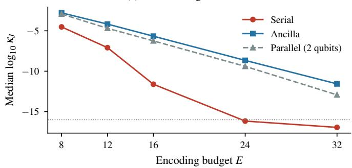

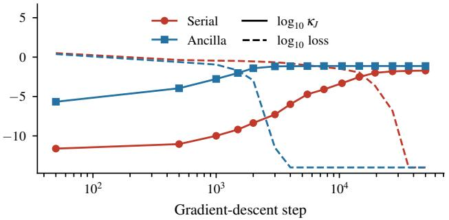  
Figure 5. (a) Median $\log _ { 1 0 } \kappa _ { J }$ at initialisation against $E ,$ flat targets; the dotted line marks double precision. (b) Median $\log _ { 1 0 } \kappa _ { J }$ (solid) and median $\log _ { 1 0 }$ loss (dashed) along gradient descent, flat targets, $E = 1 6$

Adam on the exact loss (Sections 5 and 5.3). Converged runs end at a level that falls with the learning rate: for the ancilla circuit the median final loss of the runs below $1 0 ^ { - 6 }$ is $\bar { 1 0 } ^ { - 9 . 6 }$ at the rate $1 0 ^ { - 3 }$ (5% and 95% quantiles $1 0 ^ { - 1 1 . 8 }$ and $1 0 ^ { - 8 . 2 } )$ and $1 0 ^ { - 1 1 . 8 } \mathrm { a t } 1 0 ^ { - 4 }$ . A threshold of $1 0 ^ { - 1 0 }$ therefore cuts through the converged runs: at $E = 8$ on flat targets, 77 seria and 54 ancilla runs lie below it, although all 200 are below $1 0 ^ { - 6 }$ . Up to 7 of 100 runs per configuration lie between $1 0 ^ { - 8 }$ and $1 0 ^ { - 6 } \ i$ ; under either threshold the same nine of ten differences are significant. On the original grid of rates, 25 of the 30 configurations were tuned to its smallest rate. Bracketing applied to 27 configurations and changed 23 selections; in 21 the near-best rates still include an end of the extended grid, in 18 of them two-qubit circuits at its smallest rate (Table 15).

Table 2. Gradient descent on the exact loss: order of the events ${ } ^ { * } \kappa _ { J }$ exceeds the threshold” (seen at checkpoints) and $^ { \mathrm { \left. } } \mathrm { l o s s } \leq 1 0 ^ { - 4 \mathrm { \right. } }$ (seen at every step); numbers of runs, pooled over target families and E (1,000 runs per circuit). Categories as defined in the text.
<table><tr><td></td><td></td><td colspan="5">loss reaches  $1 0 ^ { - 4 }$ </td><td colspan="2">loss does not reach  $1 0 ^ { - 4 }$ </td></tr><tr><td>threshold</td><td>circuit</td><td>above at start</td><td> $\kappa _ { J }$  first</td><td>same interval</td><td>loss first</td><td>never above</td><td>above later</td><td>never above</td></tr><tr><td> $1 0 ^ { - 2 }$ </td><td>serial</td><td>4</td><td>189</td><td>175</td><td>3</td><td>35</td><td>1</td><td>593</td></tr><tr><td></td><td>ancilla</td><td>12</td><td>432</td><td>330</td><td>10</td><td>38</td><td>2</td><td>176</td></tr><tr><td></td><td>parallel</td><td>8</td><td>447</td><td>305</td><td>14</td><td>36</td><td>0</td><td>190</td></tr><tr><td> $1 0 ^ { - 3 }$ </td><td>serial</td><td>36</td><td>330</td><td>38</td><td>0</td><td>2</td><td>50</td><td>544</td></tr><tr><td></td><td>ancilla</td><td>142</td><td>588</td><td>90</td><td>0</td><td>2</td><td>21</td><td>157</td></tr><tr><td></td><td>parallel</td><td>102</td><td>631</td><td>75</td><td>0</td><td>2</td><td>15</td><td>175</td></tr><tr><td> $1 0 ^ { - 4 }$ </td><td>serial</td><td>76</td><td>322</td><td>7</td><td>0</td><td>1</td><td>130</td><td>464</td></tr><tr><td></td><td>ancilla</td><td>271</td><td>544</td><td>7</td><td>0</td><td>0</td><td>51</td><td>127</td></tr><tr><td></td><td>parallel</td><td>212</td><td>586</td><td>12</td><td>0</td><td>0</td><td>47</td><td>143</td></tr></table>

Table 3. Tangent directions added by every layer after the first (exact numerical rank at random gates) for the three circuits of this paper, against the upper bound $d ^ { 2 } - \textstyle \sum _ { a } { \dot { m } } _ { a } ^ { 2 }$ of Appendix B, with $m _ { a }$ the multiplicities of the eigenvalues of the encoding generator. Rows marked ∗ are proved, the row marked † is proved as a lower bound (Proposition 4.4).
<table><tr><td>circuit</td><td>qubits</td><td>encoded</td><td> $( m _ { a } )$ </td><td>per layer</td><td>upper bound</td></tr><tr><td> $\mathrm { s e r i a l } ^ { \ast }$ </td><td>1</td><td>1</td><td>(1,1)</td><td>2</td><td>2</td></tr><tr><td> $\mathrm { \ a n c i l l a ^ { \dagger } }$ </td><td>2</td><td>1</td><td>(2,2)</td><td>6</td><td>8</td></tr><tr><td> $\mathrm { \ p a r a l l e l { \Sigma } } ^ { * }$ </td><td>2</td><td>2</td><td>(1,2,1)</td><td>10</td><td>10</td></tr></table>

Checks on data (Section 6). End levels and threshold. Under the schedule of the main experiment Adam leaves 3,255 of the 4,800 evaluation runs below $1 0 ^ { - 1 5 }$ ; with the same decay spread over four times as many steps, every converged ancilla run ends between $1 0 ^ { - 1 0 }$ and $1 0 ^ { - 6 } ;$ ; Levenberg–Marquardt leaves its converged runs between $1 0 ^ { - 1 6 }$ and $1 0 ^ { - 1 4 }$ . For every threshold from $1 0 ^ { - 4 } \mathrm { t o } 1 0 ^ { - 1 5 }$ , the difference in the share of runs at the optimum between the ancilla and the serial circuit is positive with a 95% interval that excludes zero in all 16 configurations. Learning-rate bracketing (Table 10). 30 of the 48 configurations have their best tuning score at the floor and are not extended; in 26 of them the near-best rates include an end of the grid. Of the other 18, nine were extended and four selections changed; no share of runs at the optimum changes by more than 0.02. In the ten configurations with $E \geq$ 16 in which most serial runs fail, no rate, the added ones included, brings the tuning score of the serial circuit below $1 0 ^ { - 4 . 2 }$ . Five tuning runs cannot separate rates when fewer than about a quarter of the runs fail: for the serial circuit on flat targets at $E \leq 1 6$ the tuning score is at the floor for at least three rates of the grid, while 0.05 to 0.16 of its evaluation runs fail at the selected rate. Step budget (Table 11). Under the stretched schedule converged runs end higher, at a level that appears to rise with the peak rate, so that shares at a fixed threshold are less comparable between configurations. Under both schedules the serial circuit reaches the optimum less often than the control in all seven configurations; under the held schedule the difference ranges from 0.20 to 0.97 with every interval excluding zero. Its size depends on the budget, and not in one direction: on ibmclose the serial circuit reaches the optimum in 18 of 30 runs instead of none, on flat targets at $E = 2 4$ and on the temperatures less often than with 20,000 steps (15 instead of 22, and 1 instead of 6).

Flat targets at matched parameter counts (Sections 5.3 and 6). The flat targets of Section 5, trained in the setup of Section 6: 200 sampled training points, Adam with 20,000 steps and a tuned learning rate, and parameter counts matched (five gates per block in the serial circuit). The serial circuit reaches the optimum in 95, 87, 84, 60 and 36 of 100 runs at $E = 8 , 1 2 , 1 6 , 2 4 , 3 2$ , the ancilla and the parallel circuit in every run (Figure 6, Table 5). The difference to the ancilla control is significant at every E; at $E = 8$ the lower end of the interval is 0.003. The setup differs from that of Section 5.3 in more than the parameter counts (sampled points, a shorter budget), so that the counts of the two sections are not to be compared with each other; what the runs show is that the difference between the circuits is there at matched counts. Levenberg–Marquardt from the same initial gates brings the serial circuit to the optimum in 98, 100, 96, 94 and 82 runs at $E = 8 \mathrm { t o } 3 2$ , both two-qubit circuits in all (Table 8). These targets are also part of the step-budget check (Table 11).

Table 4. Serial Levenberg–Marquardt runs with final loss above $1 0 ^ { - 6 }$ (the two-qubit circuits have none). Stalled: the loss fell by less than 1% over the last quarter of the iterations. Middle block: runs with at least one and with exactly two singular values $\sigma _ { i } \le 1 0 ^ { - 8 } \sigma _ { 1 }$ at the end point, and runs in which the corresponding left-singular directions carry at least 0.99 of the squared residual. Then medians of the $\log _ { 1 0 }$ relative gradient at the failed end points and of log $_ { 1 0 } \sigma _ { \mathrm { m i n } } / \sigma _ { 1 }$ at the failed end points, the converged end points and the initial points of the configuration. $n _ { \mathrm { { i n i t } } } ;$ median number of singular values $\leq 1 0 ^ { - 8 } \sigma _ { 1 }$ at the initial points.
<table><tr><td></td><td></td><td></td><td></td><td colspan="3"> $\sigma _ { i } \le 1 0 ^ { - 8 } \sigma _ { 1 }$  at the end point</td><td></td><td colspan="3"> $\log _ { 1 0 } \sigma _ { \mathrm { m i n } } / \sigma _ { 1 }$ </td><td></td></tr><tr><td>targets</td><td>E</td><td>failed</td><td>stalled</td><td>any</td><td>two</td><td> $\mathrm { s h a r e } \geq 0 . 9 9$ </td><td> $\mathrm { l o g } _ { 1 0 } \mathrm { g r a d i e n t }$ </td><td>failed</td><td>converged</td><td>initial</td><td> $n _ { \mathrm { i n i t } }$ </td></tr><tr><td>flat</td><td>16</td><td>4</td><td>4</td><td>3</td><td>3</td><td>3</td><td>-6.0</td><td>-9.4</td><td>-1.5</td><td>-11.6</td><td>2</td></tr><tr><td>flat</td><td>24</td><td>10</td><td>10</td><td>9</td><td>9</td><td>9</td><td>-7.4</td><td>-11.2</td><td>-1.8</td><td>-16.2</td><td>8</td></tr><tr><td>flat</td><td>32</td><td>17</td><td>17</td><td>15</td><td>14</td><td>15</td><td>-6.8</td><td>-10.9</td><td>-2.0</td><td>-17.0</td><td>16</td></tr><tr><td> $1 / k$ </td><td>12</td><td>1</td><td>1</td><td>1</td><td>1</td><td>1</td><td>-10.9</td><td>-13.0</td><td>-1.9</td><td>-7.9</td><td>0.5</td></tr><tr><td> $1 / k$ </td><td>16</td><td>4</td><td>4</td><td>3</td><td>3</td><td>3</td><td>-8.6</td><td>-10.7</td><td>-2.2</td><td>-10.8</td><td>2</td></tr><tr><td> $1 / k$ </td><td>24</td><td>14</td><td>13</td><td>9</td><td>9</td><td>9</td><td>-5.7</td><td>-9.2</td><td>-2.6</td><td>-16.2</td><td>8</td></tr><tr><td> $1 / k$ </td><td>32</td><td>27</td><td>24</td><td>16</td><td>14</td><td>13</td><td>-5.2</td><td>-8.4</td><td>-2.7</td><td>-17.0</td><td>16</td></tr><tr><td>all</td><td></td><td>77</td><td>73</td><td>56</td><td>53</td><td>53</td><td></td><td></td><td></td><td></td><td></td></tr></table>

Table 5. Synthetic targets, full-batch Adam, 100 runs per cell. Runs at the optimum: share with excess training loss at most $1 0 ^ { - 6 }$ of the variance. Ancilla−serial: difference of these shares with a 95% Newcombe interval. Held-out error: median and 10%/90% quantiles of $( 1 - R _ { \mathrm { s e r i a l } } ^ { 2 } ) / ( 1 - R _ { \mathrm { a n c i l l a } } ^ { 2 } )$ over runs on the same target; for flat targets the ancilla error is at the double-precision floor and the ratio is not shown.
<table><tr><td rowspan="2">target</td><td rowspan="2">E</td><td colspan="3">runs at the optimum</td><td rowspan="2">ancilla—serial difference [95%]</td><td colspan="2">median test  $R ^ { 2 }$ </td><td rowspan="2">held-out error serial/ancilla</td></tr><tr><td>serial</td><td>ancilla</td><td>par. 2</td><td>serial</td><td>ancilla</td></tr><tr><td>flat</td><td>8</td><td>0.95</td><td>1.00</td><td>1.00</td><td>+0.05 [+0.00, +0.11]</td><td>1.0000</td><td>1.0000</td><td></td></tr><tr><td>flat</td><td>12</td><td>0.87</td><td>1.00</td><td>1.00</td><td>+0.13 [+0.07, +0.21]</td><td>1.0000</td><td>1.0000</td><td></td></tr><tr><td>flat</td><td>16</td><td>0.84</td><td>1.00</td><td>1.00</td><td>+0.16 [+0.09, +0.24]</td><td>1.0000</td><td>1.0000</td><td></td></tr><tr><td>flat</td><td>24</td><td>0.60</td><td>1.00</td><td>1.00</td><td>+0.40 [+0.30, +0.50]</td><td>1.0000</td><td>1.0000</td><td></td></tr><tr><td>flat</td><td>32</td><td>0.36</td><td>1.00</td><td>1.00</td><td>+0.64 [+0.54, +0.73]</td><td>0.9783</td><td>1.0000</td><td></td></tr><tr><td>Poisson kernel</td><td>8</td><td>0.77</td><td>1.00</td><td>1.00</td><td>+0.23 [+0.15, +0.32]</td><td>0.9969</td><td>0.9971</td><td>1.00 [1.00, 1.19]</td></tr><tr><td>Poisson kernel</td><td>12</td><td>0.42</td><td>0.99</td><td>0.99</td><td>+0.57 [+0.46, +0.66]</td><td>0.9961</td><td>0.9968</td><td>1.01 [1.00, 1.91]</td></tr><tr><td>Poisson kernel</td><td>16</td><td>0.17</td><td>0.97</td><td>0.93</td><td>+0.80 [+0.70, +0.86]</td><td>0.9952</td><td>0.9967</td><td>1.29 [1.00, 2.33]</td></tr><tr><td>Poisson kernel</td><td>24</td><td>0.03</td><td>0.62</td><td>0.37</td><td>+0.59 [+0.48, +0.68]</td><td>0.9918</td><td>0.9954</td><td>1.57 [1.02, 3.70]</td></tr><tr><td>Poisson kernel</td><td>32</td><td>0.01</td><td>0.24</td><td>0.20</td><td>+0.23 [+0.14, +0.32]</td><td>0.9864</td><td>0.9926</td><td>1.61 [1.01, 3.48]</td></tr></table>

Table 6. Real-world series, full-batch Adam, 100 initialisations per architecture on the same data. Runs at the optimum as in Table 5. Held-out error ratio paired by run index; last column: share of serial runs with higher held-out error than the paired ancilla run.
<table><tr><td rowspan="2">series</td><td rowspan="2">E</td><td colspan="3">runs at the optimum</td><td colspan="2">median test  $R ^ { 2 }$ </td><td rowspan="2">held-out error serial/ancilla [10%, 90%]</td><td rowspan="2">serial runs worse</td></tr><tr><td>serial</td><td>ancilla</td><td>par. 2</td><td>serial</td><td>ancilla</td></tr><tr><td> ${ \tt g a s p r i c e }$ </td><td>24</td><td>0.04</td><td>1.00</td><td>1.00</td><td>0.9569</td><td>0.9591</td><td>1.05 [1.00, 1.15]</td><td>0.92</td></tr><tr><td> ${ \tt g a s p r i c e }$ </td><td>32</td><td>0.00</td><td>0.98</td><td>0.96</td><td>0.9682</td><td>0.9786</td><td>1.49 [1.30, 1.83]</td><td>1.00</td></tr><tr><td>ibmclose</td><td>24</td><td>0.01</td><td>1.00</td><td>1.00</td><td>0.9607</td><td>0.9641</td><td>1.09 [1.04, 1.14]</td><td>0.97</td></tr><tr><td>ibmclose</td><td>32</td><td>0.00</td><td>1.00</td><td>1.00</td><td>0.9629</td><td>0.9638</td><td>1.03 [0.97, 1.09]</td><td>0.70</td></tr><tr><td>nottem</td><td>24</td><td>0.09</td><td>1.00</td><td>1.00</td><td>0.8995</td><td>0.9004</td><td>1.01 [0.97, 1.02]</td><td>0.71</td></tr><tr><td>nottem</td><td>32</td><td>0.00</td><td>1.00</td><td>1.00</td><td>0.8879</td><td>0.8873</td><td>0.99 [0.96, 1.03]</td><td>0.39</td></tr></table>

Table 7. Held-out error of the serial circuit relative to the control under Adam and under Levenberg–Marquardt (same data and initial gates): share of serial runs at the optimum; ratio of the held-out errors $( 1 - R ^ { 2 } )$ , serial over ancilla, paired by run index (for the real series the data are the same and the pairing is arbitrary), median and 10% and 90% quantiles; share of serial runs more than 5% worse than the paired control run. 100 runs per cell.
<table><tr><td></td><td></td><td colspan="3">Adam</td><td colspan="3">Levenberg-Marquardt</td></tr><tr><td>target</td><td>E</td><td>at optimum</td><td>error ratio [10%, 90%]</td><td>&gt; 5% worse</td><td>at optimum</td><td>error ratio [10%, 90%]</td><td>&gt; 5% worse</td></tr><tr><td>Poisson kernel</td><td>8</td><td>0.77</td><td>1.00 [1.00, 1.19]</td><td>0.17</td><td>0.99</td><td>1.00 [1.00, 1.00]</td><td>0.01</td></tr><tr><td>Poisson kernel</td><td>12</td><td>0.42</td><td>1.01 [1.00, 1.91]</td><td>0.43</td><td>0.97</td><td>1.00 [1.00, 1.00]</td><td>0.03</td></tr><tr><td>Poisson kernel</td><td>16</td><td>0.17</td><td>1.29 [1.00, 2.33]</td><td>0.71</td><td>0.94</td><td>1.00 [1.00, 1.00]</td><td>0.06</td></tr><tr><td>Poisson kernel</td><td>24</td><td>0.03</td><td>1.57 [1.02, 3.70]</td><td>0.83</td><td>0.79</td><td>1.00 [1.00, 1.30]</td><td>0.19</td></tr><tr><td>Poisson kernel</td><td>32</td><td>0.01</td><td>1.61 [1.01, 3.48]</td><td>0.83</td><td>0.72</td><td>1.00 [1.00, 1.16]</td><td>0.18</td></tr><tr><td>gasprice</td><td>24</td><td>0.04</td><td>1.05 [1.00, 1.15]</td><td>0.55</td><td>0.58</td><td>1.00 [1.00, 1.12]</td><td>0.42</td></tr><tr><td>gasprice</td><td>32</td><td>0.00</td><td>1.49 [1.30, 1.83]</td><td>1.00</td><td>0.70</td><td>1.00 [1.00, 1.38]</td><td>0.22</td></tr><tr><td>ibmclose</td><td>24</td><td>0.01</td><td>1.09 [1.04, 1.14]</td><td>0.85</td><td>0.93</td><td>1.00 [1.00, 1.00]</td><td>0.07</td></tr><tr><td>ibmclose</td><td>32</td><td>0.00</td><td>1.03 [0.97, 1.09]</td><td>0.36</td><td>0.67</td><td>1.00 [1.00, 1.11]</td><td>0.33</td></tr><tr><td>nottem</td><td>24</td><td>0.09</td><td>1.01 [0.97, 1.02]</td><td>0.00</td><td>0.32</td><td>1.01 [0.97, 1.02]</td><td>0.00</td></tr><tr><td>nottem</td><td>32</td><td>0.00</td><td>0.99 [0.96, 1.03]</td><td>0.03</td><td>0.59</td><td>1.00 [1.00, 1.01]</td><td>0.00</td></tr></table>

Table 8. Training on data, Levenberg–Marquardt from the same data and initial gates as Adam: share of runs at the optimum (excess training loss at most 10−6) under both optimisers, 100 runs per cell, and the difference ancilla minus serial under Levenberg–Marquard with a 95% Newcombe interval.
<table><tr><td></td><td></td><td colspan="3">Adam</td><td colspan="3">Levenberg-Marquardt</td><td>ancilla—serial</td></tr><tr><td>target</td><td>E</td><td>serial</td><td>ancilla</td><td>par. 2</td><td>serial</td><td>ancilla</td><td>par. 2</td><td>Levenberg-Marquardt [95%]</td></tr><tr><td>flat</td><td>8</td><td>0.95</td><td>1.00</td><td>1.00</td><td>0.98</td><td>1.00</td><td>1.00</td><td>+0.02 [-0.02, +0.07]</td></tr><tr><td>flat</td><td>12</td><td>0.87</td><td>1.00</td><td>1.00</td><td>1.00</td><td>1.00</td><td>1.00</td><td>+0.00 [-0.04, +0.04]</td></tr><tr><td>flat</td><td>16</td><td>0.84</td><td>1.00</td><td>1.00</td><td>0.96</td><td>1.00</td><td>1.00</td><td>+0.04 [-0.00, +0.10]</td></tr><tr><td>flat</td><td>24</td><td>0.60</td><td>1.00</td><td>1.00</td><td>0.94</td><td>1.00</td><td>1.00</td><td>+0.06 [+0.01, +0.12]</td></tr><tr><td>flat</td><td>32</td><td>0.36</td><td>1.00</td><td>1.00</td><td>0.82</td><td>1.00</td><td>1.00</td><td>+0.18 [+0.11, +0.27]</td></tr><tr><td>Poisson kernel</td><td>8</td><td>0.77</td><td>1.00</td><td>1.00</td><td>0.99</td><td>1.00</td><td>1.00</td><td>+0.01 [-0.03, +0.05]</td></tr><tr><td>Poisson kernel</td><td>12</td><td>0.42</td><td>0.99</td><td>0.99</td><td>0.97</td><td>1.00</td><td>1.00</td><td>+0.03 [-0.01, +0.08]</td></tr><tr><td>Poisson kernel</td><td>16</td><td>0.17</td><td>0.97</td><td>0.93</td><td>0.94</td><td>1.00</td><td>1.00</td><td>+0.06 [+0.01, +0.12]</td></tr><tr><td>Poisson kernel</td><td>24</td><td>0.03</td><td>0.62</td><td>0.37</td><td>0.79</td><td>1.00</td><td>1.00</td><td>+0.21 [+0.13, +0.30]</td></tr><tr><td>Poisson kernel</td><td>32</td><td>0.01</td><td>0.24</td><td>0.20</td><td>0.72</td><td>1.00</td><td>1.00</td><td>+0.28 [+0.19, +0.37]</td></tr><tr><td>gasprice</td><td>24</td><td>0.04</td><td>1.00</td><td>1.00</td><td>0.58</td><td>1.00</td><td>1.00</td><td>+0.42 [+0.32, +0.52]</td></tr><tr><td>gasprice</td><td>32</td><td>0.00</td><td>0.98</td><td>0.96</td><td>0.70</td><td>1.00</td><td>1.00</td><td>+0.30 [+0.21, +0.40]</td></tr><tr><td>ibmclose</td><td>24</td><td>0.01</td><td>1.00</td><td>1.00</td><td>0.93</td><td>1.00</td><td>1.00</td><td>+0.07 [+0.02, +0.14]</td></tr><tr><td>ibmclose</td><td>32</td><td>0.00</td><td>1.00</td><td>1.00</td><td>0.67</td><td>1.00</td><td>1.00</td><td>+0.33 [+0.24, +0.43]</td></tr><tr><td>nottem</td><td>24</td><td>0.09</td><td>1.00</td><td>1.00</td><td>0.32</td><td>1.00</td><td>1.00</td><td>+0.68 [+0.58, +0.76]</td></tr><tr><td>nottem</td><td>32</td><td>0.00</td><td>1.00</td><td>1.00</td><td>0.59</td><td>1.00</td><td>1.00</td><td>+0.41 [+0.31, +0.51]</td></tr></table>

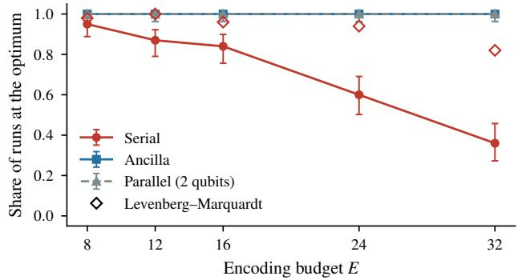  
Figure 6. Flat targets in the setup of Section 6 (Adam at matched parameter counts): share of runs that reach the least-squares optimum; open diamonds: Levenberg–Marquardt on the same runs of the serial circuit (both two-qubit circuits reach the optimum in every run unde it). Bars: 95% Wilson intervals; 100 runs per point.

Table 9. Screening of real-world series (Appendix A): median held-out $R ^ { 2 }$ of the least-squares fit of degree E over five random splits, the gain from E = 16 to 32, and the supremum of the degree-32 fit. Duplicates and series with missing values omitted.
<table><tr><td>series (Rdatasets)</td><td>length</td><td> $R _ { 1 6 } ^ { 2 }$ </td><td> $R _ { 2 4 } ^ { 2 }$ </td><td> $R _ { 3 2 } ^ { 2 }$ </td><td> $R _ { 3 2 } ^ { 2 } - R _ { 1 6 } ^ { 2 }$ </td><td>sup |.f32|</td><td>passes</td></tr><tr><td>AER/DJFranses</td><td>770</td><td>0.762</td><td>0.822</td><td>0.858</td><td>+0.096</td><td>0.76</td><td></td></tr><tr><td>AER/DutchSales</td><td>425</td><td>0.271</td><td>0.168</td><td>0.020</td><td>-0.251</td><td>0.46</td><td></td></tr><tr><td>AER/MarkDollar</td><td>518</td><td>-0.057</td><td>-0.089</td><td>-0.283</td><td>-0.226</td><td>0.31</td><td></td></tr><tr><td>AER/MarkPound</td><td>1974</td><td>-0.137</td><td>-0.245</td><td>-0.525</td><td>-0.388</td><td>0.15</td><td></td></tr><tr><td>CardioDataSets/cv_mortality-ts</td><td>508</td><td>0.600</td><td>0.594</td><td>0.544</td><td>-0.056</td><td>0.75</td><td></td></tr><tr><td>DAAG/mdbAVtJtoD</td><td>867</td><td>-0.347</td><td>-0.596</td><td>0.670</td><td>+1.017</td><td>0.51</td><td></td></tr><tr><td>boot/manaus</td><td>1080</td><td>0.377</td><td>0.474</td><td>0.620</td><td>+0.242</td><td>0.57</td><td></td></tr><tr><td>boot/wool</td><td>309</td><td>0.939</td><td>0.950</td><td>0.957</td><td>+0.017</td><td>0.74</td><td></td></tr><tr><td>datasets/nottem</td><td>240</td><td>-0.529</td><td>0.881</td><td>0.868</td><td>+1.397</td><td>0.72</td><td></td></tr><tr><td>datasets/sunspot.m2014</td><td>3177</td><td>0.874</td><td>0.873</td><td>0.870</td><td>-0.004</td><td>0.56</td><td></td></tr><tr><td>datasets/sunspot.month</td><td>3310</td><td>0.846</td><td>0.844</td><td>0.850</td><td>+0.004</td><td>0.67</td><td></td></tr><tr><td>datasets/sunspot.year</td><td>289</td><td>-0.012</td><td>-0.077</td><td>0.687</td><td>+0.699</td><td>0.71</td><td></td></tr><tr><td>datasets/sunspots</td><td>2820</td><td>0.816</td><td>0.837</td><td>0.833</td><td>+0.017</td><td>0.65</td><td></td></tr><tr><td>datasets/treering</td><td>7980</td><td>0.022</td><td>0.103</td><td>0.004</td><td>-0.018</td><td>0.33</td><td></td></tr><tr><td>forecast/gas</td><td>476</td><td>-0.079</td><td>-0.226</td><td>0.844</td><td>+0.923</td><td>0.64</td><td></td></tr><tr><td>fpp2/auscafe</td><td>426</td><td>0.590</td><td>0.545</td><td>0.624</td><td>+0.034</td><td>0.47</td><td></td></tr><tr><td>fpp2/gasoline</td><td>1355</td><td>0.402</td><td>0.465</td><td>0.430</td><td>+0.029</td><td>0.52</td><td></td></tr><tr><td>fpp2/goog</td><td>1000</td><td>0.816</td><td>0.867</td><td>0.878</td><td>+0.062</td><td>0.66</td><td></td></tr><tr><td>fpp2/hyndsight</td><td>365</td><td>-0.118</td><td>-0.215</td><td>-0.595</td><td>-0.477</td><td>0.33</td><td></td></tr><tr><td>fpp2/usmelec</td><td>486</td><td>-0.252</td><td>-0.483</td><td>-0.097</td><td>+0.155</td><td>0.48</td><td></td></tr><tr><td>quantreg/MelTemp</td><td>3650</td><td>0.456</td><td>0.418</td><td>0.583</td><td>+0.127</td><td>0.72</td><td></td></tr><tr><td>quantreg/gasprice</td><td>695</td><td>0.893</td><td>0.955</td><td>0.981</td><td>+0.088</td><td>0.75</td><td>yes</td></tr><tr><td>timeSeriesDataSets/co2_ts</td><td>468</td><td>-0.245</td><td>-0.526</td><td>0.878</td><td>+1.123</td><td>0.72</td><td></td></tr><tr><td>timeSeriesDataSets/elec_ts</td><td>476</td><td>-0.189</td><td>-0.306</td><td>0.553</td><td>+0.742</td><td>0.60</td><td></td></tr><tr><td>timeSeriesDataSets/ibmclose_ts</td><td>369</td><td>0.920</td><td>0.949</td><td>0.962</td><td>+0.043</td><td>0.68</td><td>yes</td></tr></table>

Table 10. Training on data, learning-rate bracketing (Appendix A): peak rate before and after the extension of the grid (∗: best tuning score at the floor, not extended; †: near-best rates still include an end of the extended grid), and share of runs at the optimum for the seria and the ancilla circuit under the tuned and under the bracketed rates.
<table><tr><td rowspan="2"></td><td rowspan="2">E</td><td colspan="3">peak rate (tuned → bracketed)</td><td rowspan="2"></td><td colspan="3">runs at the optimum, serial | ancilla</td></tr><tr><td>serial</td><td>ancilla</td><td>par. 2</td><td>tuned</td><td>bracketed</td><td></td></tr><tr><td>target flat</td><td>8</td><td>0.03*</td><td>0.01*</td><td>0.01*</td><td>0.95</td><td>1.00</td><td></td><td>0.95 | 1.00</td></tr><tr><td>flat</td><td>12</td><td>0.01*</td><td>0.01*</td><td>0.01*</td><td>0.87</td><td>1.00</td><td>0.87</td><td>1.00</td></tr><tr><td>flat</td><td>16</td><td>0.01*</td><td>0.01*</td><td>0.01*</td><td>0.84</td><td>1.00</td><td>0.84</td><td>1.00</td></tr><tr><td>flat</td><td>24</td><td>0.03*</td><td>0.01*</td><td>0.01*</td><td>0.60</td><td>1.00</td><td>0.60</td><td>1.00</td></tr><tr><td>flat</td><td>32</td><td>0.03</td><td>0.01*</td><td>0.01*</td><td>0.36</td><td>1.00</td><td>0.36</td><td>1.00</td></tr><tr><td>Poisson kernel</td><td>8</td><td>0.003*</td><td>0.01*</td><td>0.01*</td><td>0.77</td><td>1.00</td><td>0.77</td><td>1.00</td></tr><tr><td>Poisson kernel</td><td>12</td><td>0.003</td><td>0.01*</td><td>0.01*</td><td>0.42</td><td>0.99</td><td>0.42</td><td>0.99</td></tr><tr><td>Poisson kernel</td><td>16</td><td>0.003</td><td>0.003*</td><td>0.003*</td><td>0.17</td><td>0.97</td><td>0.17</td><td>0.97</td></tr><tr><td>Poisson kernel</td><td>24</td><td>0.01</td><td>0.01</td><td>0.001</td><td>0.03</td><td>0.62</td><td>0.03</td><td>0.62</td></tr><tr><td>Poisson kernel</td><td>32</td><td>0.003→0.001</td><td>0.003</td><td>0.003</td><td>0.01</td><td>0.24</td><td>0.00</td><td>0.24</td></tr><tr><td>gasprice</td><td>24</td><td>0.003→0.01†</td><td>0.003*</td><td>0.003*</td><td>0.04</td><td>1.00</td><td>0.02</td><td>1.00</td></tr><tr><td>gasprice</td><td>32</td><td>0.003</td><td>0.003*</td><td>0.003</td><td>0.00</td><td>0.98</td><td>0.00</td><td>0.98</td></tr><tr><td>ibmclose</td><td>24</td><td>0.001</td><td>0.003*</td><td>0.003*</td><td>0.01</td><td>1.00</td><td>0.01</td><td>1.00</td></tr><tr><td>ibmclose</td><td>32</td><td>0.001</td><td>0.003*</td><td>0.001*</td><td>0.00</td><td>1.00</td><td>0.00</td><td>|1.00</td></tr><tr><td>nottem</td><td>24</td><td>0.01</td><td>0.01†</td><td>0.01*</td><td>0.09</td><td>1.00</td><td>0.09 | 1.00</td><td></td></tr><tr><td>nottem</td><td>32</td><td>0.003→0.001†</td><td>0.01→0.003</td><td>0.01*</td><td>0.00</td><td>1.00</td><td>0.00 | 1.00</td><td></td></tr></table>

Table 11. Training on data, step budget (Appendix A): runs at the optimum out of 30, serial | ancilla, for the main experiment (1×, 20,000 steps) and for 80,000 steps with the additional steps at the peak rate (4× held) or with the decay spread over the whole run (4× stretched); last column: ancilla minus serial under the held schedule, with a 95% Newcombe interval. Same data and initialisations in all three columns.
<table><tr><td rowspan="2">target</td><td rowspan="2">E</td><td colspan="6">runs at the optimum, serial | ancilla</td><td rowspan="2">ancilla—serial [95%] 4× held</td></tr><tr><td colspan="2">1×</td><td colspan="2">4× held</td><td colspan="2">4× stretched</td></tr><tr><td>flat</td><td>12</td><td>23/30</td><td>30/30</td><td>24/30</td><td>30/30</td><td>21/30</td><td>30/30</td><td>+0.20 [+0.05, +0.37]</td></tr><tr><td>flat</td><td>24</td><td>22/30</td><td>30/30</td><td>15/30</td><td>30/30</td><td>15/30</td><td>30/30</td><td>+0.50 [+0.30, +0.67]</td></tr><tr><td>Poisson kernel</td><td>12</td><td>14/30</td><td>30/30</td><td>20/30</td><td>30/30</td><td>21/30</td><td>30/30</td><td>+0.33 [+0.15, +0.51]</td></tr><tr><td>Poisson kernel</td><td>24</td><td>1/30</td><td>17/30</td><td>0/30</td><td>28/30</td><td>3/30</td><td>30/30</td><td>+0.93 [+0.75, +0.98]</td></tr><tr><td>nottem</td><td>24</td><td>6/30</td><td>30/30</td><td>1/30</td><td>30/30</td><td>3/30</td><td>30/30</td><td>+0.97 [+0.79, +0.99]</td></tr><tr><td>gasprice</td><td>24</td><td>2/30</td><td>30/30</td><td>7/30</td><td>30/30</td><td>7/30</td><td>30/30</td><td>+0.77 [+0.56, +0.88]</td></tr><tr><td>ibmclose</td><td>24</td><td>0/30</td><td>30/30</td><td>18/30</td><td>|30/30</td><td>17/30</td><td>|30/30</td><td>+0.40 [+0.21, +0.58]</td></tr></table>

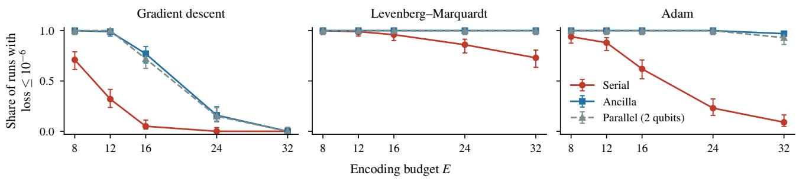  
Figure 7. Share of converged runs (final loss $\leq 1 0 ^ { - 6 } )$ against the encoding budget E, for $1 / k$ targets and the three optimisers. Bars: 95% Wilson intervals; 100 runs per point.

Table 12. Exact loss: runs out of 100 with final loss $\leq 1 0 ^ { - 6 }$ , serial | ancilla, and the difference of the shares (ancilla minus serial) with a 95% Newcombe interval, per target family, encoding budget and optimiser. ∗: neither circuit converges in half of the runs.
<table><tr><td></td><td></td><td colspan="3">gradient descent</td><td colspan="3">Levenberg-Marquardt</td><td colspan="3">Adam</td></tr><tr><td>targets</td><td>E</td><td>runs</td><td></td><td>difference [95%]</td><td>runs</td><td></td><td>difference [95%]</td><td>runs</td><td></td><td>difference [95%]</td></tr><tr><td>flat</td><td>8</td><td>93</td><td>100</td><td>+0.07 [+0.02, +0.14]</td><td></td><td>100 | 100</td><td>+0.00 [−0.04, +0.04]</td><td>100 | 100</td><td></td><td>+0.00 [-0.04, +0.04]</td></tr><tr><td></td><td>12</td><td>85</td><td>100</td><td>+0.15 [+0.08, +0.23]</td><td></td><td>100 | 100</td><td>+0.00 [-0.04, +0.04]</td><td>95</td><td>100</td><td>+0.05 [+0.00, +0.11]</td></tr><tr><td></td><td>16</td><td>65</td><td>100</td><td>+0.35 [+0.26, +0.45]</td><td>96 |100</td><td></td><td>+0.04[−0.00, +0.10]</td><td>83</td><td>100</td><td>+0.17[+0.10, +0.26]</td></tr><tr><td></td><td>24</td><td></td><td>24| 99</td><td>+0.75 [+0.65, +0.82]</td><td>90 </td><td>100</td><td>+0.10 [+0.04, +0.17]</td><td>66</td><td>100</td><td>+0.34[+0.25, +0.44]</td></tr><tr><td></td><td>32</td><td></td><td>3|99</td><td>+0.96 [+0.89, +0.98]</td><td>83</td><td>100</td><td>+0.17[+0.10, +0.26]</td><td>53</td><td>100</td><td>+0.47 [+0.37, +0.57]</td></tr><tr><td>1/k</td><td>8</td><td></td><td>71 | 100</td><td>+0.29 [+0.20, +0.39]</td><td></td><td>100 | 100</td><td>+0.00 [-0.04, +0.04]</td><td>94|</td><td>|100</td><td>+0.06 [+0.01, +0.12]</td></tr><tr><td></td><td>12</td><td></td><td>32|99</td><td>+0.67[+0.56, +0.75]</td><td>99</td><td>100</td><td>+0.01[-0.03, +0.05]</td><td>88</td><td>100</td><td>+0.12[+0.06, +0.20]</td></tr><tr><td></td><td>16</td><td></td><td>5|77</td><td>+0.72 [+0.61, +0.80]</td><td>96</td><td>100</td><td>+0.04[-0.00, +0.10]</td><td>62</td><td>100</td><td>+0.38 [+0.28, +0.48]</td></tr><tr><td></td><td>24</td><td></td><td>0 | 16</td><td>+0.16 [+0.09, +0.24]*</td><td>86</td><td>100</td><td>+0.14[+0.07, +0.22]</td><td>23</td><td>100</td><td>+0.77 [+0.67, +0.84]</td></tr><tr><td></td><td>32</td><td></td><td>0|0</td><td> $+ 0 . 0 0 \left[ - 0 . 0 4 , + 0 . 0 4 \right] ^ { \ast }$ </td><td></td><td>73 | 100</td><td>+0.27 [+0.18, +0.36]</td><td>9</td><td>97</td><td>+0.88 [+0.79, +0.93]</td></tr></table>

Table 13. Exact loss: runs out of 100 with final loss at or below the threshold, serial | ancilla | parallel. The threshold of the main text is $1 0 ^ { - 6 }$ . GD: gradient descent; LM: Levenberg–Marquardt. For Adam, $1 0 ^ { \overset { \cdot } { - } 1 0 }$ lies within the range at which converged runs end (Appendix A).
<table><tr><td>optimiser</td><td>targets</td><td>threshold</td><td colspan="3"> $E = 8$ </td><td colspan="3"> $E = 1 2$ </td><td colspan="3"> $E = 1 6$ </td><td colspan="3"> $E = 2 4$ </td><td colspan="3"></td><td colspan="3"> $E = 3 2$ </td></tr><tr><td>GD</td><td>flat</td><td> $1 0 ^ { - 4 }$ </td><td>93|</td><td>|100</td><td>100</td><td></td><td>86 | 100 </td><td></td><td>|100</td><td>65</td><td>100</td><td>100</td><td></td><td>27 | 100</td><td></td><td>100</td><td></td><td>3 | 100 |</td><td></td><td>99</td></tr><tr><td></td><td></td><td> $1 0 ^ { - 6 }$ </td><td>93</td><td>100</td><td>100</td><td></td><td>85</td><td>100</td><td>100</td><td>65</td><td>100</td><td>100</td><td></td><td>24|</td><td>|99</td><td>99</td><td></td><td>3|99</td><td></td><td>97</td></tr><tr><td></td><td></td><td> $1 0 ^ { - 8 }$ </td><td>92</td><td>100</td><td></td><td>100</td><td>83</td><td>100</td><td>| 100</td><td>63</td><td>100 </td><td></td><td>100</td><td>21</td><td>99</td><td>99</td><td></td><td>1 | 98</td><td></td><td>97</td></tr><tr><td></td><td></td><td> $1 0 ^ { - 1 0 }$ </td><td>92</td><td>100</td><td></td><td>100</td><td>83 | 100 </td><td></td><td>100</td><td>62</td><td>100</td><td>100</td><td></td><td>19</td><td>99</td><td>99</td><td></td><td>1 | 98</td><td></td><td>95</td></tr><tr><td></td><td> $1 / k$ </td><td> $1 0 ^ { - 4 }$ </td><td></td><td>78 | 100 |</td><td>|100</td><td></td><td></td><td></td><td>43 | 100 | 100</td><td></td><td></td><td>11 | 93 | 87</td><td></td><td>0 | 29 | 24</td><td></td><td></td><td></td><td></td><td>0|0|0</td><td></td></tr><tr><td></td><td></td><td> $1 0 ^ { - 6 }$ </td><td>71</td><td>100</td><td></td><td>100</td><td></td><td>32 | 99 |</td><td>100</td><td></td><td></td><td>5|77|72</td><td></td><td>0 | 16 </td><td></td><td>15</td><td></td><td>0</td><td>0 0</td><td></td></tr><tr><td></td><td></td><td> $1 0 ^ { - 8 }$ </td><td>68</td><td>100</td><td></td><td>100</td><td>29</td><td>96</td><td>|97</td><td></td><td></td><td>4|72|66</td><td></td><td>0 | 14 | 12</td><td></td><td></td><td></td><td>0</td><td>0 0</td><td></td></tr><tr><td>LM</td><td></td><td> $1 0 ^ { - 1 0 }$ </td><td>63</td><td>100</td><td></td><td>100</td><td>27 </td><td></td><td> 94 | 96</td><td></td><td>3 | 69 |60</td><td></td><td></td><td>0 | 13 | 12</td><td></td><td></td><td></td><td>o|o</td><td>0</td><td></td></tr><tr><td></td><td>flat</td><td> $1 0 ^ { - 4 }$ </td><td>100 |</td><td>100</td><td></td><td>|100</td><td>100</td><td>100|</td><td>|100</td><td>96</td><td>100</td><td>100</td><td></td><td>90| 100</td><td></td><td>100</td><td>83|</td><td>100</td><td></td><td>100</td></tr><tr><td></td><td></td><td> $1 0 ^ { - 6 }$ </td><td>100 </td><td>100</td><td></td><td>100</td><td>100</td><td>100</td><td>100</td><td>96</td><td>100 </td><td>100</td><td></td><td>90 </td><td>100</td><td>100</td><td></td><td>83 100</td><td></td><td>100</td></tr><tr><td></td><td></td><td> $1 0 ^ { - 8 }$ </td><td>100 </td><td> 100</td><td></td><td>100</td><td>100</td><td>100</td><td>100</td><td>96</td><td>100 </td><td>100</td><td></td><td>90 | 100 </td><td></td><td>100</td><td></td><td>83</td><td> 100</td><td>100</td></tr><tr><td></td><td></td><td> $1 0 ^ { - 1 0 }$ </td><td></td><td>100 | 100 </td><td></td><td>100</td><td></td><td></td><td>100 | 100 | 100</td><td></td><td></td><td>96 | 100 | 100</td><td></td><td>90 | 100 </td><td></td><td>100</td><td></td><td>83 | 100 </td><td></td><td> 100</td></tr><tr><td></td><td> $1 / k$ </td><td> $1 0 ^ { - 4 }$ </td><td></td><td>100 | 100 |</td><td></td><td>|100</td><td></td><td>99 | 100 |</td><td>|100</td><td></td><td></td><td>96 | 100 | 100</td><td></td><td>91 | 100 |</td><td></td><td>100</td><td></td><td>75 | 100 | </td><td></td><td>100</td></tr><tr><td></td><td></td><td> $1 0 ^ { - 6 }$ </td><td>100 </td><td> 100</td><td></td><td>100</td><td></td><td></td><td>99 | 100 | 100</td><td>96</td><td></td><td> 100 | 100</td><td></td><td>86 | 100</td><td></td><td>100</td><td></td><td>73 | 100 </td><td></td><td> 100</td></tr><tr><td></td><td></td><td> $1 0 ^ { - 8 }$ </td><td>100 </td><td>100</td><td></td><td>100</td><td>99 </td><td>| 100</td><td>| 100</td><td>96</td><td>100</td><td></td><td>100</td><td>86</td><td>100</td><td>100</td><td></td><td>73  100 </td><td></td><td>100</td></tr><tr><td></td><td></td><td> $1 0 ^ { - 1 0 }$ </td><td>100 </td><td> 100 </td><td></td><td>100</td><td></td><td>99 | 100 </td><td>100</td><td>96</td><td> 100 </td><td>100</td><td></td><td>86 | 100 </td><td></td><td>100</td><td></td><td>73 | 100 </td><td></td><td>100</td></tr><tr><td>Adam</td><td>flat</td><td> $1 0 ^ { - 4 }$ </td><td></td><td>100| |100 |</td><td></td><td>|100</td><td>95 | 100 </td><td></td><td>|100</td><td>83|</td><td></td><td> 100 | 100</td><td></td><td>66 | 100 |</td><td></td><td>100</td><td></td><td>54 | 100 |</td><td></td><td>100</td></tr><tr><td></td><td></td><td> $1 0 ^ { - 6 }$ </td><td></td><td>100 100</td><td></td><td>100</td><td>95</td><td>100</td><td>100</td><td>83</td><td>100</td><td>100</td><td></td><td>66</td><td> 100</td><td>100</td><td></td><td>53 | 100</td><td></td><td>100</td></tr><tr><td></td><td></td><td> $1 0 ^ { - 8 }$ </td><td></td><td>98 | 100</td><td></td><td>100</td><td></td><td>95 | 100</td><td>100</td><td></td><td></td><td>83 | 98 |100</td><td></td><td>66 | 94|100</td><td></td><td></td><td></td><td>47 |93</td><td></td><td>100</td></tr><tr><td></td><td></td><td> $1 0 ^ { - 1 0 }$ </td><td></td><td>77 | 54</td><td>78</td><td></td><td>76 | 43</td><td></td><td>69</td><td></td><td></td><td>61 | 37 | 70</td><td></td><td>45 | 18 |</td><td></td><td>45</td><td></td><td></td><td>22| 7 | 37</td><td></td></tr><tr><td></td><td> $1 / k$ </td><td> $1 0 ^ { - 4 }$ </td><td></td><td>94| 100</td><td></td><td>100</td><td>88 | 100 </td></table>

Table 14. Gradient descent on the exact loss: runs out of 100 with loss $\leq 1 0 ^ { - 6 }$ after 7,500, 14,500, 27,000 and all 50,000 steps. These are four of the checkpoints at which the loss was recorded (Appendix A), each about twice the one before.
<table><tr><td></td><td></td><td colspan="4">serial</td><td colspan="4">ancilla</td></tr><tr><td>targets</td><td>E</td><td> $7 { , } 5 0 0$ </td><td> $1 4 { , } 5 0 0$ </td><td>27,000</td><td>50,000</td><td> $^ { 7 , 5 0 0 }$ </td><td> $1 4 { , } 5 0 0$ </td><td>27,000</td><td> $5 0 { , } 0 0 0$ </td></tr><tr><td>flat</td><td>8</td><td>74</td><td>86</td><td>90</td><td>93</td><td>100</td><td>100</td><td>100</td><td>100</td></tr><tr><td></td><td>12</td><td>51</td><td>74</td><td>80</td><td>85</td><td>100</td><td>100</td><td>100</td><td>100</td></tr><tr><td></td><td>16</td><td>16</td><td>34</td><td>55</td><td>65</td><td>97</td><td>100</td><td>100</td><td>100</td></tr><tr><td></td><td>24</td><td>0</td><td>3</td><td>6</td><td>24</td><td>51</td><td>92</td><td>98</td><td>99</td></tr><tr><td></td><td>32</td><td>0</td><td>0</td><td>0</td><td>3</td><td>1</td><td>46</td><td>94</td><td>99</td></tr><tr><td> $1 / k$ </td><td>8</td><td>26</td><td>40</td><td>52</td><td>71</td><td>94</td><td>97</td><td>100</td><td>100</td></tr><tr><td></td><td>12</td><td>1</td><td>5</td><td>13</td><td>32</td><td>46</td><td>78</td><td>92</td><td>99</td></tr><tr><td></td><td>16</td><td>0</td><td>0</td><td>0</td><td>5</td><td>5</td><td>18</td><td>53</td><td>77</td></tr><tr><td></td><td>24</td><td>0</td><td>0</td><td>0</td><td>0</td><td>0</td><td>0</td><td>5</td><td>16</td></tr><tr><td></td><td>32</td><td>0</td><td>0</td><td>0</td><td>0</td><td>0</td><td>0</td><td>0</td><td>0</td></tr></table>

Table 15. Adam on the exact loss, serial | ancilla | parallel: peak learning rate and runs out of 100 with final loss $\leq 1 0 ^ { - 6 }$ under the tuned rate (main text), under the rate selected after the extension of the grid (†: near-best rates still include an end of the extended grid), and under the common rate $1 0 ^ { - 3 }$
<table><tr><td></td><td></td><td colspan="5">tuned</td><td colspan="5">bracketed</td><td colspan="3">common</td></tr><tr><td>targets</td><td>E</td><td colspan="2"> $\mathrm { r a t e } ( 1 0 ^ { - 3 } )$ </td><td colspan="3"></td><td colspan="2"> $\mathrm { r a t e } ( 1 0 ^ { - 3 } )$ </td><td colspan="3">runs</td><td colspan="3">runs</td></tr><tr><td>flat</td><td>8</td><td>3 |1 |1</td><td></td><td></td><td>100 | 100 | 100</td><td></td><td></td><td></td><td> $3 \mid 0 . 1 ^ { \dag } \mid 0 . 1 ^ { \dag }$ </td><td></td><td>100 | 100 | 100</td><td></td><td></td><td></td><td>99 | 100 | 100</td></tr><tr><td></td><td>12</td><td>1 |1 |1</td><td></td><td></td><td>95 | 100 | 100</td><td></td><td></td><td></td><td> $0 . 1 ^ { \dagger } \mid 0 . 1 ^ { \dagger } \mid 0 . 1 ^ { \dagger }$ </td><td></td><td>82 | 100 | 100</td><td></td><td></td><td></td><td>95 | 100 | 100</td></tr><tr><td></td><td>16</td><td>111</td><td></td><td></td><td>83 | 100 | 100</td><td></td><td></td><td></td><td> $0 . 3 \mid 0 . 3 \mid 0 . 1 ^ { \dag }$ </td><td></td><td>81 | 100 | 100</td><td></td><td></td><td></td><td>83 | 100 | 100</td></tr><tr><td></td><td>24</td><td>1 |1 |1</td><td></td><td></td><td>66 | 100 | 100</td><td></td><td></td><td></td><td> $0 . 3 \mid 0 . 1 ^ { \dag } \mid 0 . 1 ^ { \dag }$ </td><td></td><td>66 | 100 | 100</td><td></td><td></td><td></td><td>66 | 100 | 100</td></tr><tr><td></td><td>32</td><td>3|1 |1</td><td></td><td></td><td>53 | 100 </td><td>100</td><td></td><td></td><td> $3 \mid 0 . 1 ^ { \dag } \mid 0 . 1 ^ { \dag }$ </td><td></td><td>53 | 100 | 1</td><td>100</td><td></td><td></td><td>51 | 100 | 100</td></tr><tr><td>1/k</td><td>8</td><td>1|1|1</td><td></td><td></td><td></td><td>94 | 100 | 100</td><td></td><td></td><td> $1 \mid 0 . 1 ^ { \dag } \mid 0 . 1 ^ { \dag }$ </td><td></td><td></td><td>94 | 100 | 100</td><td></td><td></td><td>94 | 100 | 100</td></tr><tr><td></td><td>12</td><td>1 |1 |1</td><td></td><td></td><td>88|</td><td>100 100</td><td></td><td></td><td> $0 . 3 \mid 0 . 1 ^ { \dag } \mid 0 . 1 ^ { \dag }$ </td><td></td><td>86 | 100</td><td>100</td><td></td><td></td><td>88 | 100 | 100</td></tr><tr><td></td><td>16</td><td>1 |1 |1</td><td></td><td></td><td>62 | 100 | 100</td><td></td><td></td><td></td><td> $1 | \dot { 0 } . 1 ^ { \dagger } | \dot { 0 } . 1 ^ { \dagger }$ </td><td></td><td></td><td>62 | 100 | 100</td><td></td><td></td><td>62 | 100 | 100</td></tr><tr><td></td><td>24</td><td>10 | 1 | 3</td><td></td><td></td><td>23 | 100 | 100</td><td></td><td></td><td></td><td> $1 \dot { 0 } ^ { \dag } \mid 0 . \dot { 1 } ^ { \dag } \mid 3$ </td><td></td><td></td><td>23 | 100 | 100</td><td></td><td></td><td>29 | 100 | 100</td></tr><tr><td></td><td>32</td><td>10 | 1 |1</td><td></td><td></td><td>9 | 97 | 93</td><td></td><td></td><td></td><td> $1 0 ^ { \dag } \mid \dot { 0 } . 1 ^ { \dag } \mid \dot { 0 } . 1 ^ { \dag }$ </td><td></td><td>9 | 96 | 80</td><td></td><td></td><td>3 | 97 | 93</td><td></td></tr></table>