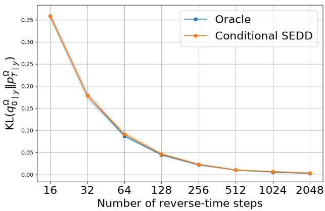
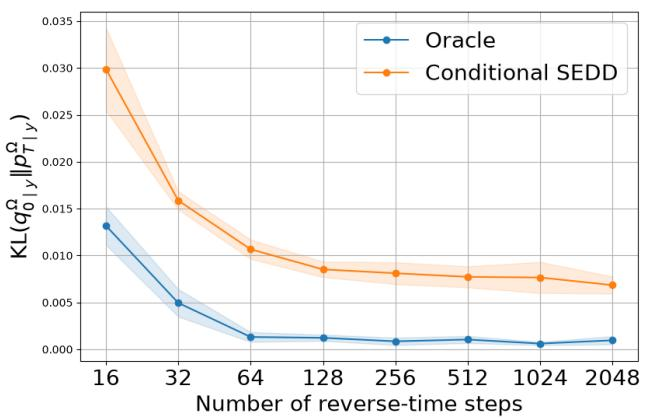
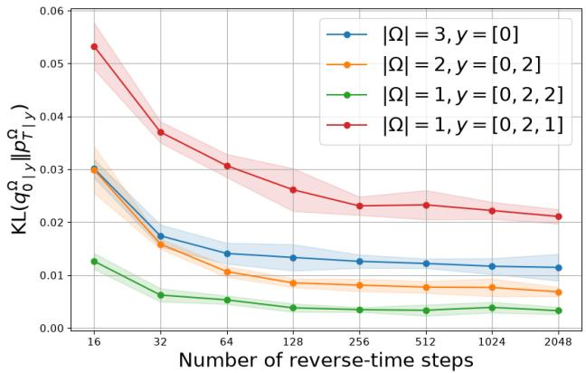
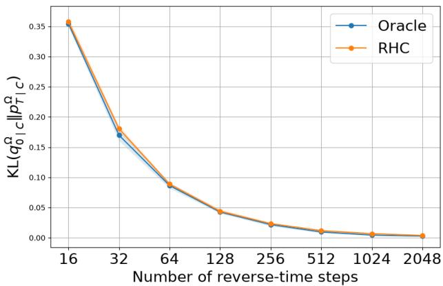

# Score Mismatch and Set-Constrained Sampling in Zero-Shot Conditional Discrete Diffusion

Renxiang Huang†, Yuchen Liang†, Yingbin Liang, Ness Shroff, and Lifeng Lai

## Abstract

Discrete diffusion models have become a powerful framework for modeling complex discrete distri butions across a range of applications. While theoretical convergence guarantees depend on consistency between the target and training distributions, such a case rarely holds in practice, making score mismatch a central challenge in discrete diffusion sampling. This is particularly relevant to zero-shot conditional generation, where a model trained on the unconditional distribution is directly reused at inference time to sample from a conditional target distribution. In this paper, we provide the first theoretical analysis for score-mismatched discrete diffusion models and derive a general KL divergence upper bound that clearly identifies the additional bias caused by such a mismatch. Our analysis covers partial-observation constraints, including text infilling, sentence completion, and more general coordinatewise set constraints. Specifically, we analyze the classical Conditional SEDD sampler and show that it can incur a bias term that scales with the dimension, vocabulary size, and compatibility. Based on this analysis, we propose a Randomized Hard Clamping (RHC) sampler for coordinatewise set constraints. We show that the assignment probabilities can be expressed exactly by the unconditional scores with absorbing rate. Finally, numerical and real-data experiments demonstrate the effectiveness of the proposed RHC sampler.

## Index Terms

Convergence analysis, discrete diffusion, score mismatch, set constraints, zero-shot conditional generation.

## I. INTRODUCTION

In recent years, diffusion model has become one of the core paradigms in generative modeling and has achieved impressive success in image, audio, and text generation. Compared with the classical autoregressive (AR) models, diffusion models model the complex data distribution through gradual denoising, demonstrating the notable advantages in generation quality, stability, and flexibility [1], [2]. For discrete data such as text sequences, discrete diffusion models extend this denoising principle to the discrete case by defining the noising and denoising processes directly on the discrete state space [3], [4].

In an idealized setting, diffusion models are trained and evaluated on the same underlying distribution. However, in practice, this assumption often fails, as discrepancies between the training and target distributions can arise due to factors such as privacy constraints, computational limitations, and mismatches between the training setup and the intended sampling task [5]–[7]. A representative example is conditional generation, where part of the data is observed and the goal is to infer the unobserved part. Many tasks involving discrete data fall into this category, including sequence completion and text infilling [8]–[11]. Such tasks include generating the subsequent content based on the given prefix and filling the missing content while preserving the context. We refer to conditioning on fixed values as sampling “under fixed observations.” More generally, each constrained coordinate may admit several candidate values, which leads to sampling under the coordinate wise set constraints. We call a feasible combination of values an “assignment”. For example, in text rewriting and lexical simplification, each position of the word can be associated with a set of candidate replacements [12], [13]. Fixed observations are recovered when each set contains a single value. Compared to AR models, diffusion models are more naturally suited to these tasks, as they do not rely on a fixed generation order and can flexibly handle partially observed inputs.

Within conditional sampling, one solution is to train a dedicated conditional diffusion model or adapt a pretrained model for each task, such as predictor-free guidance [14] and inferencetime alignment methods [15]. However, such approaches may be costly because they require additional training of a new conditional model beyond unconditional pretraining. In comparison, zero-shot conditional generation does not require such an additional conditional model, since it directly uses the given condition at inference time to build a conditional sampler [9], [10]. The core challenge for zero-shot conditional samplers is the inherent mismatch between the pretrained unconditional model and the conditional model needed in the inference process. In diffusion sampling, this discrepancy manifests in the score function, a phenomenon known as score mismatch [7].

Among all zero-shot conditional samplers, the Conditional SEDD method [9] is particularly relevant to this paper. At each diffusion sampling step, Conditional SEDD enforces the fixed observations by setting the corresponding components of the current sample to their observed values, an operation we refer to as “hard clamping.” Although this method is straightforward to implement in practice, we will show that it is not generally equivalent to the true conditional reverse process, thereby introducing bias. Moreover, this approach still lacks any theoretical justifications. This naturally raises the first question studied in this paper:

Question 1: Can we characterize the bias induced by score-mismatched discrete diffusion models?

Moving from fixed observations to set constraints introduces another challenge, that is, how to allocate sampling probabilities to each feasible assignment. Once an assignment is selected, the fixed-observation sampler can be reused to generate the remaining contents. After understanding the construction of the assignment distribution, in order to make the fixed-observation sampler better aligned with the target distribution given set constraints while preserving the main advantage of the zero-shot approach, the second question arises:

Question 2: Can we design a novel method that extends the fixed-observation sampler to the set constraints setting, while explicitly controlling the additional approximation error?

In this paper, we answer both questions affirmatively.

## A. Our Contributions

Overall, our analysis focuses on how mismatched scores interfere with the reverse rate matrix, thereby introducing bias into the sampling process for both general and zero-shot conditional samplers. This analysis provides the convergence guarantee for each assignment in set constraints. Based on the mixture representation of the assignments, we further extend the analysis from fixed observations to general set constraints. The detailed contributions of this paper are:

Theoretical Guarantees on General Score-Mismatched Discrete Diffusion Models: Upon characterizing the score mismatch for discrete diffusion models, we provide the first non asymptotic convergence upper bound in KL-divergence between the target (mismatched) and the sampling distributions. Beyond the intrinsic sampling error when there is no mismatch, our theory characterizes a bias term induced by the score mismatch that arises from using the score of the training distribution to sample from a target (mismatched) distribution. Unlike the analysis in the continuous diffusion setting where the mismatch is expressed through the perturbation in the reverse Gaussian mean [7], the mismatch for our setting perturbs the reverse rate matrix of the continuous time Markov chain (CTMC). Moreover, the Bregman divergence term associated with score entropy differs from the usual $L ^ { 2 }$ error for the continuous setting, introducing additional complications in the analysis.

Bias Characterization of Conditional SEDD: Based on the general score mismatch analysis, we further provide the first theoretical guarantees for the classical Conditional SEDD algorithm [9] under a fixed observation. By comparing the hard clamp score with the true conditional score, we reveal that the effect of hard clamping depends on the diffusion process. Under the absorbing rate, these two scores are identical on unobserved coordinates given the fixed non-MASK observation, and thus the convergence bound does not contain an additional scoremismatch bias term. Under the uniform rate, the hard clamping can introduce score mismatch over unobserved coordinates. With the assumption of condition compatibility, we bound this bias and characterize the dependence on the unobserved coordinates, vocabulary size, and compatibility parameter.

Randomized Hard Clamping (RHC) for Set Constraints: We propose a Randomized Hard Clamping (RHC) sampler for the set-constraint setting. In particular, we consider the setting where each constrained index in Ω¯ admits several candidate values from the admissible sets rather than a single fixed value. As a result, the target conditional distribution admits an exact mixture representation according to the assignments. We further show that the exact assignment distribution can be reconstructed based on the unconditional score for absorbing-rate CTMCs. As a result, the proposed RHC sampler achieves zero-shot generation with a pretrained unconditional discrete diffusion model. The numerical simulations and real-data experiments further support our theoretical results and validate the practical effectiveness of the proposed RHC sampler.

## B. Related Works

In this section, we focus on related works for convergence analyses and conditional generation for discrete diffusion models. Other related works on conditional continuous diffusion are provided in Appendix I.

Score-matched Discrete Diffusion Model: The existing discrete diffusion analysis focuses on the score-matched setting, that is, the target distribution is consistent with the training distribution. In particular, several recent works have established non-asymptotic convergence guarantees under different noise and sampling schemes [16]–[20]. However, these results cannot be directly applied when the target distribution differs from the training distribution, as in the zero-shot conditional generation.

Guided Discrete Diffusion Model: Recent works have studied guidance mechanisms in discrete diffusion. [14] proposed predictor guidance and predictor-free guidance applicable to CTMC-based discrete diffusion. Their method realized the guidance through scaling the rate matrix. [21] directly derived the classifier-based and classifier-free guidance rules by reweighting the transition kernel in discrete diffusion.

For conditional sampling at large, there are several strands of work. [22] proposed a discrete training-free guidance framework. [23] extended the training-free guidance to multimodal data. [24] pointed out that the bias exists in common discrete guidance methods and adopted Sequential Monte Carlo for debiasing. In addition, [25] studied reward optimization in the discrete diffusion. Similarly, [26] proposed soft value-based decoding, which introduced the soft value function to guide the model to approximate the optimal policy to implement conditional generation.

These studies focus on how to incorporate conditional information into the sampling process. Our work provides a general convergence framework to explicitly quantify the additional sampling error introduced by the mismatch.

Zero-Shot Discrete Diffusion Model: Zero-shot sampling has recently been explored in the discrete diffusion model. SEDD and RADD support zero-shot text infilling by fixing the prompt at each sampling step instead of retraining for the condition [9], [27]. A discrete diffusion model based on heat bath dynamics, developed by [10], reported good performance in zero-shot tasks, such as text and image infilling. [28] proposed a training-free method to calibrate the confidence of the sequence length to allow the adaptive length of the generated sequence. [29] proposed a plug-and-play posterior sampling method based on split Gibbs sampling. Their method introduces external conditions through the likelihood or reward guidance. Finally, note that all the works mentioned above focused mainly on algorithmic design and empirical performance, but did not characterize the theoretical performance introduced by modifications to the sampling process.

Our work establishes non-asymptotic convergence guarantees to quantify how the score mismatch affects the convergence of zero-shot conditional sampling with absorbing and uniform rates. This framework further supports the analysis for set constraints.

Constrained Diffusion Models: There are several studies regarding the explicit constraint for diffusion models. In continuous diffusion, [30] formulate the sampling process as an optimization problem to guide the generation result to satisfy the constraints. Using a similar idea, [31] introduced Constrained Discrete Diffusion. They incorporated differentiable projection and the augmented Lagrangian method into the sampling process so that the generated samples satisfy the conditional constraints. On the application side, [32] proposed a constrained decoding method applicable to the diffusion language model, which aims to make the generation result conform to the context-free grammar.

For set constraints, our RHC uses the unconditional score to assign probabilities to feasible values. The convergence guarantee separates the assignment distribution error and the sampling error.

## II. PROBLEM SETUP

In this section, we first review the basic concepts of score-matched discrete diffusion models. Then we extend it to general score-mismatched discrete diffusion models. Finally, we specialize this framework to conditional generation problems and zero-shot methods.

## A. (Score-matched) Discrete Diffusion Models

We consider the diffusion model defined on the discrete state space $\mathcal { X } = [ S ] ^ { d }$ , where d denotes the length or dimensions of the sequence and S denotes the number of possible values for each dimension. Let $q _ { 0 }$ be the training data distribution and $x _ { 0 } \sim q _ { 0 }$ be a data sample. The training distribution has full support on the clean state space. The basic pipeline of the discrete diffusion model is to first gradually perturb the data distribution into a simple stationary distribution, and then learn the corresponding reverse process for denoising.

Forward process: Let $T$ be the time horizon and $q _ { t }$ be the marginal distribution for $0 < t < T$ The forward process can be expressed as a CTMC with the transition probability in a small time interval $[ t - d t , t ]$ given by

$$
q _ { t | t - d t } ( y | x ) = \mathbb { 1 } _ { y = x } + Q _ { t } ( x , y ) d t + o ( d t ) ,
$$

where $\mathbb { 1 } _ { y = x }$ denotes the indicator function that equals 1 only when $y = x$ and 0 otherwise, and $Q _ { t } ~ \in ~ \mathbb { R } ^ { S ^ { d } \times S ^ { d } }$ refers to the rate matrix of the CTMC. The rate matrix $Q _ { t }$ controls the instantaneous rate of the state transition. A valid rate matrix $Q _ { t }$ should satisfy the following requirements: $Q _ { t } ( x , y ) \geq 0$ for $x \neq y , Q _ { t } ( x , x ) \leq 0$ and also $\begin{array} { r } { Q _ { t } ( x , x ) = - \sum _ { u \neq x } Q _ { t } ( x , y ) } \end{array}$ . To simplify the computation, a common assumption is that the forward propagation of each token $x ^ { i } \in [ S ]$ is independent [4], [9], [16], [17]. This independence is also reflected in the rate matrix $Q _ { t }$ , that is, for $x \neq y$ only at one index i, $Q _ { t } ( x , \bar { y } ) = Q _ { t } ^ { \mathrm { t o k e n } } ( x ^ { i } , y ^ { i } )$ . Here, $Q _ { t } ^ { \mathrm { t o k e n } } \in \mathbb { R } ^ { S \times S }$ is the rate matrix of each token. In this work, we focus on the time-homogeneous case, which means that the rate matrix $Q _ { t }$ is independent of time t during the entire forward process, i.e., $Q _ { t } \equiv Q , \ Q _ { t } ^ { \mathrm { t o k e n } } \equiv Q ^ { \mathrm { t o k e n } }$

There are two widely studied rate matrices in previous research. The first one is the absorbing rate matrix [4], [9], [16], [27]. An absorbing rate matrix will cause all tokens to enter a MASK state at the terminal time point. Given $\mathbf { M A S K } \in [ S ]$ , the absorbing rate matrix for one token is defined as

$$
\begin{array} { r } { Q ^ { \mathrm { t o k e n } } = \mathbf { 1 } _ { S } e _ { \mathrm { M A S K } } ^ { \top } - I _ { S } , } \end{array}\tag{1}
$$

where ${ \bf 1 } _ { S }$ is a vector of ones with a length of $S , e _ { \mathrm { M A S K } }$ is a unit vector where the element is 1 only at the MASK position, and $I _ { S }$ is an identity matrix with a size of $S \times S . \mathrm { B y }$ this definition, for all $x \in [ S ] , x \neq \mathbf { M A S K }$ , the diagonal elements satisfy $Q _ { t } ^ { \mathrm { t o k e n } } ( x , x ) = - 1$ and the elements in the column of MASK state satisfy $\bar { Q } _ { t } ^ { \mathrm { t o k e n } } ( x , \mathbf { M A S K } ) = 1$ . For the other cases, the elements in Qtokent will be 0. Based on this definition, we can have $\begin{array} { r } { Q ( x , x ) = - \sum _ { u \ne x } Q ( x , y ) = - ( d - m ( \bar { x } ) ) } \end{array}$ where $m ( x )$ is defined as the number of MASK tokens in x. Here, we also emphasize that the clean data do not contain the MASK token throughout the subsequent analysis, whereas the diffusion state space includes MASK.

The second one is the uniform rate matrix [4], [17], [18]. A uniform rate matrix will cause all tokens to be distributed uniformly at the terminal time point. The token-wise rate matrix is defined as

$$
{ \cal Q } ^ { \mathrm { t o k e n } } = \frac { 1 } { S } { \bf 1 } _ { S } { \bf 1 } _ { S } ^ { \top } - I _ { S } .\tag{2}
$$

This ensures that $Q$ satisfies the requirements of a valid rate matrix. Hence, we can derive $\begin{array} { r } { Q ( x , x ) = - \sum _ { y \neq x } \dot { Q } ( x , y ) = - d \frac { S - 1 } { S } } \end{array}$

Reverse process: Given a forward CTMC, the time-reverse process is also a CTMC and can be described by the time-reverse process $\overleftarrow { q } _ { \textit { t } } = q _ { T - t }$ . The reverse rate matrix $\overleftarrow { Q } _ { t } ( x , y )$ for $x \neq y$ satisfies [4, Proposition 1]

$$
\overleftarrow { Q } _ { t } ( x , y ) = Q _ { T - t } ( y , x ) \frac { q _ { T - t } ( y ) } { q _ { T - t } ( x ) } .\tag{3}
$$

Similarly, for the reverse rate matrix, we also have $ { } ( \overline { { Q } } _ { t } ( x , y ) \geq 0$ for $x \neq y , \overleftarrow { Q } _ { t } ( x , x ) \leq 0$ , and $\begin{array} { r } { \overleftarrow { Q } _ { t } ( x , x ) = - \sum _ { y \neq x } \overleftarrow { Q } _ { t } ( x , y ) } \end{array}$ . Define $\begin{array} { r } { s _ { t } ( y , x ) : = \frac { q _ { t } ( y ) } { q _ { t } ( x ) } } \end{array}$ as the score function in discrete diffusion. Different from the score function $\nabla \log q _ { t } ( x )$ in continuous diffusion, the discrete score measures the probability ratio of state y relative to the state x at time point t. Thus, the reverse rate matrix can be written as $\overleftarrow { Q } _ { t } ( x , y ) = Q _ { T - t } ( y , x ) s _ { T - t } ( y , x )$ . Since the true score function $\begin{array} { r } { s _ { t } ( y , x ) = \frac { q _ { t } ( y ) } { q _ { t } ( x ) } } \end{array}$ is inaccessible, we train a neural network to learn this approximation $\hat { s } _ { t } \approx s _ { t }$

Training Objective: Since the true distribution $q _ { t }$ cannot generally be obtained explicitly, one can introduce an approximation $\hat { s } _ { t }$ to approach the true score $s _ { t }$ such that $\hat { Q } _ { t } ( \bar { x } , y ) \ \stackrel { \cdot } { = }$ $Q _ { T - t } ( y , x ) \hat { s } _ { T - t } ( y , x )$ . According to [9], a natural training objective is to minimize the score entropy loss:

$$
\mathcal { L } _ { S E } = \mathbb { E } _ { x t \sim \overleftarrow { q } _ { t } } \left[ \sum _ { y \neq x _ { t } } \left( \hat { Q } _ { t } ( x _ { t } , y ) - \overleftarrow { Q } _ { t } ( x _ { t } , y ) + \overleftarrow { Q } _ { t } ( x _ { t } , y ) \log { \frac { \overleftarrow { Q } _ { t } ( x _ { t } , y ) } { \hat { Q } _ { t } ( x _ { t } , y ) } } \right) \right] .\tag{4}
$$

In this work, we focus on two practical samplers, τ -leaping [4] and uniformization [33]. $\tau -$ leaping is a time-discretized sampling method. With early-stopping, given the discrete time grids $0 = t _ { 0 } < t _ { 1 } < \cdots < t _ { N } = T - \delta$ , the reverse rate matrix in each time interval $[ t _ { k } , t _ { k + 1 } )$ will be frozen as $\hat { Q } _ { t _ { k } }$ . Given the current state $\boldsymbol { x } _ { t _ { k } }$ , the number of the state transitions in $[ t _ { k } , t _ { k + 1 } )$ follows a Poisson distribution with rate $\hat { Q } _ { t _ { k } } \big ( \ddot { x _ { t _ { k } } } , x _ { t _ { k } } ^ { - i } + s \cdot e ^ { i } \big ) ( t _ { k + 1 } - t _ { k } )$ , where $e ^ { i }$ is a unit vector with 1 only at the i-th position. The update rule is thus given by

$$
x _ { t _ { k + 1 } } = x _ { t _ { k } } + \sum _ { i = 1 } ^ { d } \sum _ { s = 1 } ^ { S } ( s - x _ { t _ { k } } ^ { i } ) \mathrm { P o i s } ( \hat { Q } _ { t _ { k } } ( x _ { t _ { k } } , x _ { t _ { k } } ^ { - i } + s \cdot e ^ { i } ) ( t _ { k + 1 } - t _ { k } ) ) \cdot e ^ { i } .\tag{5}
$$

In particular, for τ -leaping, one update includes all possible transitions during $[ t _ { k } , t _ { k + 1 } )$ . For discrete state spaces, τ -leaping may suffer from an out-of-boundary issue. One can handle this issue by clipping in practice [19, Remark A.13]. The final convergence is not affected when the time step is sufficiently small [19, Proposition A.14]. On the other hand, uniformization is a continuous-time sampling method [33]. For $t \in \left[ t _ { k } , t _ { k + 1 } \right)$ , let the rate $\lambda _ { k }$ satisfy $\lambda _ { k } \ \geq$ $\textstyle \operatorname* { s u p } _ { x \in [ S ] ^ { d } } \sum _ { y \neq x } { \hat { Q } } _ { t } ( x , y )$ , then the transition from the current state x to $y$ will occur with a probability of $\hat { Q } _ { t } ( x , y ) / \lambda _ { k }$ . Notably, the uniformization has been proven to exactly simulate the time-inhomogeneous CTMC [18], [19].

## B. Score Mismatch in Discrete Diffusion Models

For the score-mismatched setting, the target distribution that we expect to sample from is not $q _ { 0 }$ used for training, but another distribution $\tilde { q } _ { 0 }$ . With the same forward rate matrix $Q _ { t }$ , the corresponding forward marginal distribution is $\tilde { q } _ { t } ~ ( t > 0 )$ and the time-reverse distribution is $\overleftarrow { \tilde { q } } _ { \ t } = \tilde { q } _ { T - t }$ . The reverse rate matrix $\overleftarrow { \tilde { Q } } _ { t }$ corresponding to the target distribution is given by

$$
\overleftarrow { \tilde { Q } } _ { t } ( x , y ) = Q _ { T - t } ( y , x ) \frac { \tilde { q } _ { T - t } ( y ) } { \tilde { q } _ { T - t } ( x ) } = : Q _ { T - t } ( y , x ) \tilde { s } _ { T - t } ( y , x ) .
$$

To quantify the deviation resulting from the inconsistency between the target score $\tilde { s } _ { t }$ and training score $s _ { t } ,$ we introduce the score mismatch $\Delta _ { t }$ as follows:

Definition 1 (Discrete Score Mismatch). Given the target distribution $\tilde { q } _ { 0 }$ and the corresponding forward process $\tilde { q } _ { t } ,$ , the score mismatch $\Delta _ { t } ( y , x )$ between $\tilde { s } _ { t }$ and $s _ { t }$ is defined as

$$
\Delta _ { t } ( y , x ) : = \frac { \tilde { s } _ { T - t } ( y , x ) } { s _ { T - t } ( y , x ) } - 1 = \left( \frac { \tilde { q } _ { T - t } ( y ) } { \tilde { q } _ { T - t } ( x ) } \right) \Big / \left( \frac { q _ { T - t } ( y ) } { q _ { T - t } ( x ) } \right) - 1 , \quad \forall x \neq y ,
$$

where $\Delta _ { t } ( y , x ) \ge - 1$ for $y \ne , x$ and $\Delta _ { t } ( x , x ) = 0$ . Hence, for $x \neq y$ , we have $\overleftarrow { \tilde { Q } } _ { t } ( x , y ) =$ $\overleftarrow { Q } _ { t } ( x , y ) ( 1 + \Delta _ { t } ( y , x ) )$ , where $\begin{array} { r } { \stackrel { \bf \tilde { Q } } { \boldsymbol Q } \left( x , x \right) = - \sum _ { y \neq x } \stackrel { \bf \tilde { Q } } { \boldsymbol Q } \left( x , y \right) } \end{array}$

The score mismatch is naturally a distortion of the original reverse jump rate. This is an important difference from the additive score mismatch, which is typical for continuous diffusion models [7]. For the continuous models, the score mismatch can be expressed as an additive perturbation in the Gaussian reverse mean, that is, the difference between the posterior means. In contrast, for discrete diffusion models, the reverse process is driven by the rate matrix, where the change of the target distribution will result in a modification of these ratios rather than an additive perturbation. This motivates defining score mismatch also in terms of a ratio.

## C. Zero-Shot Conditional Sampling under Fixed Observations

In the above general score mismatch setting, the target distribution $\tilde { q } _ { 0 }$ differs from the training distribution $q _ { 0 }$ . A crucial scenario of this setting is conditional generation, such as text infilling [9], [27]. For this scenario, we do not aim to sample from the unconditional distribution $q _ { 0 } ;$ instead, our goal is to complete the unobserved parts of a sequence given the condition of observing the partial sequence. More specifically, let $x _ { 0 } \in [ S ] ^ { d }$ be divided into two parts: $x _ { 0 } =$ $[ x _ { 0 } ^ { \Omega } , x _ { 0 } ^ { \bar { \Omega } } ]$ , where $\Omega$ refers to the set of unobserved indices that need to be filled and $\bar { \Omega }$ refers to the observed indices. Given a non-MASK observation $y \in [ S ] ^ { | \bar { \Omega } | }$ , the target distribution is the conditional distribution of the unobserved coordinates given the observation $y \colon$

$$
\tilde { q } _ { 0 } = q _ { 0 | y } ^ { \Omega } = q _ { 0 } ( x _ { 0 } ^ { \Omega } | x _ { 0 } ^ { \bar { \Omega } } = y ) .
$$

In the zero-shot setting, our goal is to sample from the conditional target using a pretrained unconditional discrete diffusion without any additional training for the given observations.

## D. Zero-Shot Conditional Sampling under Set Constraints

More generally, $\bar { \Omega }$ can refer to constrained coordinates, where each coordinate in $\bar { \Omega }$ may accept multiple feasible values. For each coordinate $m \in { \bar { \Omega } } .$ , given the nonempty set $A _ { m } \subseteq [ S ] \backslash { \mathrm { M A S K } }$ we define the set constraints as $C = \{ x _ { 0 } ^ { m } \in A _ { m } , m \in \bar { \Omega } \}$ and the feasible set as $\textstyle A = \prod _ { m \in { \bar { \Omega } } } A _ { m }$ then equivalently, $C = \{ x _ { 0 } ^ { \bar { \Omega } } \in A \}$ . Then, the corresponding target distribution should be the conditional marginal given by

$$
\tilde { q } _ { 0 } = q _ { 0 | C } ^ { \Omega } = q _ { 0 } ( x _ { 0 } ^ { \Omega } | C ) ,
$$

and the fixed observation will be recovered if $A _ { m } = \{ y _ { m } \}$ for each $m \in \bar { \Omega }$ . We extend the same zero-shot setting to these set constraints, aiming to sample from $q _ { 0 | C } ^ { \Omega }$ using a pretrained unconditional discrete diffusion without any additional training for the specified constraints.

## III. GUARANTEES FOR GENERAL SCORE-MISMATCHED DISCRETE DIFFUSION MODELS

In this section, we present the results for the convergence analysis of general score-mismatched discrete diffusion model for a general target distribution $\tilde { q } _ { 0 }$ . We first analyze the τ -leaping sampler and adopt the following two assumptions, which are commonly used in previous studies for the score-matched discrete diffusion models [16], [17], [19].

Assumption III.1. (Score Estimation Error). The score estimation $\hat { s } _ { T - t _ { k } }$ satisfies

$$
\sum _ { k = 0 } ^ { N - 1 } ( t _ { k + 1 } - t _ { k } ) \tilde { \mathcal { L } } _ { S E } \big ( \hat { s } _ { T - t _ { k } } \big ) \leq \varepsilon _ { \mathrm { s c o r e } } ,
$$

where

$$
\tilde { \mathcal { L } } _ { S E } : = \mathbb { E } _ { x _ { t _ { k } } \sim \overleftarrow { \overline { { q } } } _ { t _ { k } } } \left[ \sum _ { y \neq x _ { t _ { k } } } \left( \hat { Q } _ { t _ { k } } ( x _ { t _ { k } } , y ) - \overleftarrow { \overline { { Q } } } _ { t _ { k } } ( x _ { t _ { k } } , y ) + \overleftarrow { \overline { { Q } } } _ { t _ { k } } ( x _ { t _ { k } } , y ) \log { \frac { \overleftarrow { \overline { { Q } } } _ { t _ { k } } ( x _ { t _ { k } } , y ) } { \hat { Q } _ { t _ { k } } ( x _ { t _ { k } } , y ) } } \right) \right] .
$$

Theorem III.1 measures the average estimation error of the score function along the reverse trajectory. This estimation error form is commonly used when there is no mismatch [16], [17], [19]. Under the score-mismatched setting, the only difference is in the distribution over which the loss is evaluated: here it is evaluated over the induced target process rather than the training process. This assumption holds when the target $\tilde { q } _ { t }$ is close to $q _ { t } ,$ , which is also the scenario of typical interest. For zero-shot generation discussed in Sections II-C and II-D, the scores used do not involve additional conditional training, but it is still assumed that the pretrained model with hard clamp score defined in (6) has sufficient estimation accuracy under the true conditional distribution. Note that such a mismatched loss evaluation has also been used for mismatched continuous diffusion models [7].

Assumption III.2. (Bounded Score Estimates) There exists $M > 0$ such that $\forall x , y \in [ S ] ^ { d }$ , the score estimation $\hat { s } _ { T - t } ( y , x )$ satisfies $M ^ { - 1 } \leq \hat { s } _ { T - t } ( y , x ) \leq M$

Theorem III.2 is a typical assumption commonly used in the literature [16], [17], [19]. It is also mild as we will later show that the dependence on M is only logarithmic.

## A. Absorbing-Rate CTMCs with τ -leaping

The following theorem provides an upper bound for the KL-divergence between the target distribution $\tilde { q } _ { 0 }$ and the sampling distribution $p _ { T }$ with early-stopping. The result is the first convergence guarantee for the score mismatched discrete diffusion in the CTMC framework.

Theorem III.3. Under Theorems III.1 and III.2, taking the time-steps $t _ { k + 1 } - t _ { k } = c \operatorname* { m i n } \{ 1 , T -$ $t _ { k } \}$ , and with the absorbing-rate CTMC and the τ -leaping sampler, we have

$$
\begin{array} { r l r } {  { \mathrm { K L } ( \widetilde { q } _ { \delta } | | p _ { T - \delta } ) \lesssim \mathcal { E } _ { \mathrm { o r a c l e } } + ( 1 + T + \log M \delta ^ { - 1 } ) } } \\ & { } & { \cdot \sum _ { k = 0 } ^ { N - 1 } ( t _ { k + 1 } - t _ { k } ) ( T - t _ { k } ) ^ { - 1 } \mathbb { E } _ { x _ { t _ { k } } \sim \widetilde { \widetilde { q } } _ { t _ { k } } } [ \sum _ { y \neq x _ { t _ { k } } } Q ( y , x _ { t _ { k } } ) | \Delta _ { t _ { k } } ( y , x _ { t _ { k } } ) | ] , } \end{array}
$$

where $\mathcal { E } _ { \mathrm { o r a c l e } }$ is the sampling error from the score-matched sampling, including the initialization, discretization, and score estimation errors. To ensure a finite KL divergence, the oracle bound uses a surrogate initialization distribution [16, Theorem $I J .$

Theorem III.3 indicates that with the absorbing-rate CTMC and τ-leaping sampler,1 the final KL divergence can be divided into two terms. The first term, $\mathcal { E } _ { \mathrm { o r a c l e } }$ , is the intrinsic sampling error without any score mismatch. For example, under the setting and assumptions of [16, Theorems 1 and 2], the absorbing-rate analysis of τ-leaping gives the following upper bound of oracle error:

$$
\mathcal { E } _ { \mathrm { o r a c l e } } \lesssim d e ^ { - T } + \varepsilon _ { \mathrm { s c o r e } } + d ( 1 + T + \log M \delta ^ { - 1 } ) \frac { ( T + \log \delta ^ { - 1 } ) ^ { 2 } } { N } ,
$$

which yields an explicit bound for Theorem III.3. This term allows sharper bounds on the same oracle contributions without changing the score-mismatch argument as long as the same sampling setting is applied. The second term is an additional bias term introduced by the score mismatch at each reverse sampling step. Such a bias will gradually accumulate and finally impact the KL divergence between the target distribution and the sampling distribution. If $\Delta _ { t } ( y , x ) = 0 .$ , that is, the target distribution and the training distribution are matched, the bias term will also disappear. The proof is provided in Appendix II.

To showcase the generality of Theorem III.3, we would later apply it to analyze the Conditional SEDD sampler in Section IV-A and the RHC sampler in Section V.

Under additional assumptions on the score mismatch, we can further characterize the sum in Theorem III.3 and make the parameter dependence of the resulting bias explicit, as follows.

Corollary III.4. Under the same setting and assumptions as in Theorem III.3, when $| \Delta _ { t } ( y , x _ { t } ) | \lesssim$ 1 , we further have

$$
\begin{array} { r } { \mathrm { K L } ( \tilde { q } _ { \delta } | | p _ { T - \delta } ) \lesssim \mathcal { E } _ { \mathrm { o r a c l e } } + d S ( 1 + T + \log M \delta ^ { - 1 } ) ( T + \log \delta ^ { - 1 } ) . } \end{array}
$$

This corollary shows that, when $| \Delta _ { t } ( y , x ) |$ is uniformly upper-bounded by a constant, the bias term shows an explicit dependence on the dimension d and the vocabulary size S. Such a uniformly bounded condition is rather mild. Consider a target shift example, where the ratio $\frac { \tilde { q } _ { 0 } } { q _ { 0 } }$ is bounded by constants that are independent of $d , S ,$ and t. Since the same forward process is applied to both the target and training distributions, the score mismatch admits $| \Delta _ { t } ( y , x _ { t } ) | \lesssim 1$ See the detailed proof of Theorem III.4 in Appendix III.

## B. Extension to Uniform-Rate CTMCs

Using similar analysis techniques, we can also extend the result of Theorem III.3 to the uniform-rate CTMC case.

Corollary III.5. Under Theorems III.1 and III.2, taking the time step ${ t _ { k + 1 } } - { t _ { k } } = c \operatorname* { m i n } \{ 1 , T - { t _ { k } } \}$ , with the uniform-rate CTMC and the τ -leaping sampler, we have

$$
\begin{array} { r l } & { \mathrm { K L } ( \widetilde { q } _ { \delta } | | p _ { T - \delta } ) \lesssim \mathcal { E } _ { \mathrm { o r a c l e } } ^ { \mathrm { u n i } } + S ( 1 + \log M S \delta ^ { - 1 } ) \displaystyle \sum _ { k = 0 } ^ { N - 1 } ( t _ { k + 1 } - t _ { k } ) \operatorname* { m a x } \{ 1 , ( T - t _ { k } ) ^ { - 1 } \} } \\ & { \qquad \cdot \mathbb { E } _ { x _ { t _ { k } } \sim \widetilde { \widetilde { q } } _ { t _ { k } } } \left[ \displaystyle \sum _ { y \neq x _ { t _ { k } } } Q ( y , x _ { t _ { k } } ) | \Delta _ { t _ { k } } ( y , x _ { t _ { k } } ) | \right] , } \end{array}
$$

where $\mathcal { E } _ { \mathrm { o r a c l e } } ^ { \mathrm { u n i } }$ is the sampling error from the score-matched sampling with uniform rate.

Theorem III.5 illustrates that, similar to the absorbing-rate CTMC case, the final KL divergence for the uniform-rate CTMC case can also be decomposed into the oracle error $\mathcal { E } _ { \mathrm { o r a c l e } } ^ { \mathrm { u n i } }$ and an additional bias term induced by the score mismatch. This also highlights the fact that our method does not rely on a specific rate matrix but rather it reflects a general mechanism when there is score mismatch. $\mathbf { A } \mathbf { s }$ in Theorem III.3, $\mathcal { E } _ { \mathrm { o r a c l e } } ^ { \mathrm { u n i } }$ can be bounded by other applicable scorematched analyses of uniform rate and τ-leaping sampler, such as [17, Theorem 2]. Compared to the absorbing-rate CTMC, the bias for the uniform-rate CTMC is worse by O(S). This arises because the uniform rate allows the token transition to other S−1 states and thus the upper-bound of score function under the uniform rate shows a dependence on S. A similar phenomenon has

been observed for the oracle error in score-matched discrete diffusion models [16], [17], [19].   
The proof of Theorem III.5 is given in Appendix IV.

## C. Extension to Uniformization Sampling

After establishing the convergence results for the τ -leaping sampler, we now focus on the score-mismatch analysis of the uniformization sampler. To establish the corresponding convergence guarantee, we introduce the following continuous-time integral version of the score estimation error assumption:

Assumption III.6. (Integrated Score Estimation Error) The $\hat { s } _ { T - t }$ satisfies

$$
\int _ { 0 } ^ { T - \delta } \tilde { \mathcal { L } } _ { S E } \big ( \hat { s } _ { T - t } \big ) \mathrm { d } t \leq \varepsilon _ { \mathrm { s c o r e } } ^ { \prime } .
$$

Here, we clarify the distinction between Theorems III.1 and III.6. Theorem III.1 indicates that the score estimation error manifests as the accumulation of the score entropy over the discrete time grid. This controls the estimation error at the selected discrete time points $t _ { k } .$ , which is generally appropriate for analyzing the sampling methods based on the time discretization, for example, the τ-leaping sampler [4], [19]. In contrast, Theorem III.6 requires controlling the score estimation error throughout the continuous time horizon, which is applicable to the analysis of the continuous-time sampling methods, for example, the uniformization sampler [18], [33].

Corollary III.7. Under Theorems III.2 and III.6, with absorbing rate and uniformization sampler, we have

$$
\begin{array} { r l r } { \left. { \mathrm { K L } ( \widetilde { q } _ { \delta } | | p _ { T - \delta } ) \lesssim \mathcal { E } _ { \mathrm { o r a c l e } } ^ { \prime } } } \\ & { } & { + \left( 1 + T + \log M \delta ^ { - 1 } \right) \int _ { 0 } ^ { T - \delta } ( T - t ) ^ { - 1 } \mathbb { E } _ { x _ { t } \sim \widetilde { q } _ { t } } \left[ \sum _ { y \neq x _ { t } } Q ( y , x _ { t } ) | \Delta _ { t } \right| \right] \mathrm { d } t , } \end{array}
$$

where $\mathcal { E } _ { \mathrm { o r a c l e } } ^ { \prime }$ is the sampling error from the score-matched sampling with uniformization sampler.

The uniformization sampler has been demonstrated to exactly simulate the sampling process without inducing time discretization error [19]. This property is also reflected in the accumulation way of score mismatch. Theorem III.7 indicates that the local score mismatch in reverse dynamics will gradually accumulate in the form of a continuous-time integral over time and eventually impact the KL divergence between the target distribution and the generated distribution. Similarly, $\mathcal { E } _ { \mathrm { o r a c l e } } ^ { \prime }$ can incorporate the bounds of score-matched initialization and score estimation errors. [16, Theorem 3] provides a concrete instance. The proof is given in Appendix V.

## IV. GUARANTEES FOR ZERO-SHOT CONDITIONAL DISCRETE DIFFUSION SAMPLERS UNDER FIXED OBSERVATIONS

In this section, to showcase the applicability of our score-mismatch framework, we utilize our general convergence analysis in Section III to study the conditional zero-shot discrete diffusion model under fixed observations introduced in Section II-C. Specifically, we analyze one popular conditional zero-shot discrete diffusion sampler in the literature: the Conditional SEDD sampler [9] (see Algorithm 2). This sampler has demonstrated empirical effectiveness in text infilling without requiring additional conditional training. However, a theoretical understanding of this sampler remains lacking, particularly regarding how hard clamping at each diffusion step affects the final sampling error.

Let $\bar { \Omega } \subseteq [ d ]$ denote the set of observed coordinates, and let $\Omega = [ d ] \backslash \bar { \Omega }$ denote the set of unobserved coordinates to be generated. The algorithm directly performs hard clamps on the observed coordinates Ω¯ during each step of the reverse sampling process (which corresponds to a per-step hard projection in view of constrained sampling). We focus on the sampling accuracy over the unobserved coordinates Ω, given a fixed non-MASK observation $y .$ Specifically, for xˆ and x differing only at a coordinate $k \in \Omega$ , at each time-step t, the hard clamp mechanism uses

$$
s _ { t | y } ^ { \mathrm { h a r d - c l a m p } } ( \hat { x } _ { t } , x _ { t } ) = \frac { q _ { t } ( \hat { x } _ { t } ^ { \Omega } | x _ { t } ^ { \bar { \Omega } } = y ) } { q _ { t } ( x _ { t } ^ { \Omega } | x _ { t } ^ { \bar { \Omega } } = y ) } = \frac { q _ { t } ( \hat { x } _ { t } ^ { \Omega } , x _ { t } ^ { \bar { \Omega } } = y ) } { q _ { t } ( x _ { t } ^ { \Omega } , x _ { t } ^ { \bar { \Omega } } = y ) } .\tag{6}
$$

Although this method always satisfies the observation constraints, it may introduce bias on the unobserved space. This is because the hard clamp condition is enforced on the diffusion intermediate state $x _ { t } ^ { \bar { \Omega } } = y$ , whereas the true condition is enforced on the clean data $x _ { 0 } ^ { \bar { \Omega } } = y$ Indeed, the true conditional score function at time t should be

$$
s _ { t | y } ( \hat { x } _ { t } , x _ { t } ) = \frac { q _ { t } ( \hat { x } _ { t } ^ { \Omega } | x _ { 0 } ^ { \bar { \Omega } } = y ) } { q _ { t } ( x _ { t } ^ { \Omega } | x _ { 0 } ^ { \bar { \Omega } } = y ) } .\tag{7}
$$

We further provide an example in Appendix IX to illustrate the difference. From Definition 1, the score mismatch for this case is given as follows.

Definition 2. For a fixed prompt $x _ { 0 } ^ { \bar { \Omega } } \ = y$ , let ${ \hat { x } } \neq x$ only at index $k \in \Omega$ . Given the true conditional score $s _ { t | y } ( \hat { x } , x )$ in (7), hard clamp score $s _ { t | y } ^ { \mathrm { h a r d - c l a i m p } } ( \hat { x } , x )$ in (6), the score mismatch $\Delta _ { t | y } ( \hat { x } , x )$ can be defined as

$$
\begin{array} { r } { 1 + \Delta _ { t | y } ( \hat { x } , x ) = \frac { s _ { T - t | y } ( \hat { x } , x ) } { s _ { T - t | y } ^ { \mathrm { h a r d - c l a m p } } ( \hat { x } , x ) } . } \end{array}
$$

We measure the conditional sampling error through the discrepancy between the true conditional target and generated distribution on the unobserved coordinates Ω.

## A. Conditional SEDD under Fixed Observations with Absorbing Rate

The following theorem characterizes the theoretical performance of the Conditional SEDD sampler with the absorbing-rate CTMC.

Theorem IV.1. Under Theorems III.1 and III.2, taking the time step $t _ { k + 1 } - t _ { k } = c$ c min $\{ 1 , T - t _ { k } \}$ with the absorbing-rate CTMC and using τ-leaping sampler, Conditional SEDD achieves

$$
\mathrm { K L } ( q _ { \delta | y } ^ { \Omega } | | p _ { T - \delta | y } ^ { \Omega } ) \lesssim \mathcal { E } _ { \mathrm { o r a c l e } } ,
$$

where $q _ { \delta \vert y } ^ { \Omega }$ denotes the target distribution on Ω given the condition $x _ { 0 } ^ { \bar { \Omega } } = y$ and $p _ { T - \delta | y } ^ { \Omega }$ denotes the generated distribution of the Conditional SEDD on $\Omega$

Theorem IV.1 shows that Conditional SEDD does not introduce additional score-mismatch bias term in the convergence bound on the unobserved coordinates Ω. This is due to the special structure of absorbing rate matrix. Given a fixed non-MASK observation $y ,$ observing $x _ { t } ^ { \hat { \Omega } } = y$ at time t implies that the initial constrained coordinates are equal to $y$ at time 0 and remain unchanged. Therefore, the common factor regarding the transition over Ω¯ will be canceled in the score ratio, and the hard clamp score coincides with the true conditional score, as established in (21). Consequently, this KL upper bound only contains the oracle error $\mathcal { E } _ { \mathrm { o r a c l e } } ,$ which is introduced by initialization, score estimation, and time discretization. Under the stated assumptions, using unconditional score for conditional generation will achieve no extra score-mismatch bias. The proof is provided in Appendix VI.

## B. Conditional SEDD under Fixed Observations with Uniform Rate

In this section, we provide the convergence analysis for Conditional SEDD with the uniform rate in Theorem IV.3. Unlike absorbing rate, uniform-rate CTMC assigns non-zero probabilities between the different clean tokens. Thus, conditioning $x _ { t } ^ { \bar { \Omega } } = y$ at time t does not directly imply $x _ { 0 } ^ { \bar { \Omega } } = y$ . The hard clamp score used by Conditional SEDD will be influenced by the contributions of different clean observations. An example is provided in Appendix IX to illustrate this. This distinction can introduce score mismatch to the unobserved coordinates Ω. Under the setting with the uniform rate, we first employ the following assumption to control this variation:

Assumption IV.2. For the fixed observation $y \in [ S ] ^ { | \bar { \Omega } | }$ , there exists a constant $0 < \gamma < 1$ such that

$$
q _ { 0 } ( x _ { 0 } ^ { \bar { \Omega } } = y | x _ { 0 } ^ { \Omega } ) \geq \gamma , \quad \forall x _ { 0 } ^ { \Omega } \in \mathrm { s u p p } ( q _ { 0 } ^ { \Omega } )
$$

Theorem IV.2 requires that, given any unobserved part $x _ { 0 } ^ { \Omega } .$ , the likelihood of the fixed observation $y$ always has a positive lower bound $\gamma$ . Intuitively, this assumption quantifies the compatibility between the fixed observation y and all possible completions. Specifically, if there exists a completion $x _ { 0 } ^ { \Omega }$ such that $q _ { 0 } ( x _ { 0 } ^ { \bar { \Omega } } = y | x _ { 0 } ^ { \Omega } ) = 0$ , this completion has zero probability and is excluded from the target. In text generation tasks constrained by context, this assumption therefore allows the context to prefer some completions but requires other completions to remain possible. Such a uniform positive lower bound exists for a finite-state distribution with full support. For example, in structured text generation, $y$ can represent the commonly used conventional expressions such that $\gamma$ is non-negligible. With Theorem IV.2, we now provide the convergence result of Conditional SEDD with uniform-rate CTMC, as follows.

Theorem IV.3. Under Theorems III.1, III.2 and IV.2, taking the time step $t _ { k + 1 } - t _ { k } = c \operatorname* { m i n } \{ 1 , T -$ $t _ { k } \}$ , with uniform rate and τ -leaping sampler, Conditional SEDD achieves

$$
\begin{array} { r l } & { K L ( q _ { \delta | y } ^ { \Omega } | | p _ { T - \delta | y } ^ { \Omega } ) \lesssim \mathcal { E } _ { \mathrm { o r a c l e } } ^ { \mathrm { u n i } } } \\ & { \qquad + | \Omega | S ^ { 2 } ( 1 + \log M S \delta ^ { - 1 } ) \left( \displaystyle \frac { 1 } { \gamma } - \gamma \right) \left( \log \displaystyle \frac { T + S \gamma } { 1 + S \gamma } + \displaystyle \frac { 1 } { S \gamma } \log \displaystyle \frac { \delta + S \gamma } { \delta ( 1 + S \gamma ) } \right) , } \end{array}
$$

where |Ω| is the number of unobserved coordinates.

Theorem IV.3 bounds the conditional sampling error in two parts. The first term is $\mathcal { E } _ { \mathrm { o r a c l e } } ^ { \mathrm { u n i } } ,$ which again refers to the intrinsic error for the corresponding score-matched process. The second term refers to the additional bias induced by score mismatch, which reflects the cost of infilling. In contrast, in the absorbing rate case, Conditional SEDD achieves exact score matching on $\Omega ,$ , as established in Theorem IV.1, whereas Theorem IV.3 indicates that the uniform-rate Conditional SEDD accumulates the score mismatch over the unobserved coordinates Ω. Taken together, Theorems IV.1 and IV.3 suggest that the effect of the hard clamp mechanism depends on the choice of the rate matrix employed during the diffusion processes. The proof of Theorem IV.3 is given in Appendix VII.

For a fixed $\gamma ,$ the bias term is linearly dependent on the size of $\Omega ,$ which means that the conditional bias will increase by the number of positions to be completed. In contrast, when |Ω| is small, the bias will concentrate only on a small number of incomplete indices. The parameter $\gamma$ describes the compatibility of the context constraint according to the Bayes rule $\begin{array} { r } { q _ { 0 } ( x _ { 0 } ^ { \Omega } | x _ { 0 } ^ { \bar { \Omega } } = y ) = \frac { q _ { 0 } ( X _ { 0 } ^ { \bar { \Omega } } = y | x _ { 0 } ^ { \Omega } ) q _ { 0 } ( x _ { 0 } ^ { \Omega } ) } { q _ { 0 } ( x ^ { \bar { \Omega } } = y ) } } \end{array}$ . When $\gamma  1$ , the bias term will disappear, which means that the specific context is applicable for any completion, and will not provide any additional information. In contrast, as $\gamma  0$ , the upper bound of the entire error diverges, which may occur when the context almost determines the unique missing content.

It is notable that for a fixed sequence length, increasing or decreasing the number of observed coordinates will change |Ω| while imposing different condition constraints and the corresponding compatibilities. Hence, the parameters |Ω| and $\gamma$ jointly determine the error deterioration from two distinct perspectives. |Ω| characterizes the number of unknown contents to be generated, while $\gamma$ quantifies the compatibility of the given observation with the unknown content by providing a uniform lower bound on the likelihood. Moreover, with the remaining parameters fixed, the additional score-mismatch term does not decrease as the number of reverse steps N increases. The experiments in Figures 2 and 3 further illustrate the effects of |Ω| and $\gamma$ on the sampling accuracy.

## V. RANDOMIZED HARD CLAMPING UNDER SET CONSTRAINTS

Section IV characterizes the convergence error induced by the score mismatch for the Conditional SEDD sampler under a specific constraint $x ^ { \bar { \Omega } } = y$ . In this section, we turn to the more general set constraints introduced in Section II-D, where each constrained index is required to lie in an admissible set rather than to take a single fixed value. Such constraints support controlled text generation while maintaining the flexibility of text. Under this setting, Ω¯ denotes the set of constrained coordinates. Different from the singleton constraint, the set constraint contains multiple feasible assignment values $a \in A$ . Since we can generate the remaining coordinates while hard clamping the selected assignment a, the additional task is to select these assignments such that the target distribution satisfies the set constraints.

## A. Assignment distribution and RHC Sampler

The key observation is that the corresponding target conditional distribution can be expressed by the mixture of the conditional distribution with distinct fixed observations. That is, for any time t, let $v ( a ) : = q _ { 0 } ( x _ { 0 } ^ { \bar { \Omega } } = a | C )$ denote the target assignment distribution over A, we have

$$
q _ { t } ( x ^ { \Omega } | C ) = \sum _ { a \in A } v ( a ) q _ { t } ( x ^ { \Omega } | x _ { 0 } ^ { \bar { \Omega } } = a ) , \quad a \in A .\tag{8}
$$

Each mixture component corresponds to a fixed-observation problem. Thus, set-constrained sampling naturally involves two steps: selecting an assignment $a \sim v$ and generating the remaining coordinates given by the assignment a.

To construct the assignment distribution using a pretrained unconditional model, we first show that $v ( a )$ admits an exact expression in terms of the unconditional score under the absorbing rate in the following proposition.

Proposition V.1. Let $\bar { \Omega } = \{ m _ { 1 } , . . . , m _ { | \bar { \Omega } | } \} , 1 \leq j \leq | \bar { \Omega } |$ , then define an all-mask state $z _ { a } ^ { ( 0 ) } =$ $[ \mathrm { M A S K } ] ^ { d }$ and $z _ { a } ^ { ( j ) }$ is obtained from $z _ { a } ^ { ( j - 1 ) }$ by changing the $m _ { j } – t h$ coordinate from MASK to $a ^ { m _ { j } }$ . For each $a \in A$ , with absorbing rate, and the unconditional score $s _ { t } ( y , x )$ , then, for any $t > 0$ , we have

$$
v ( a ) = q _ { 0 } ( x _ { 0 } ^ { \bar { \Omega } } = a | C ) = \frac { \prod _ { j = 1 } ^ { | \bar { \Omega } | } s _ { t } ( z _ { a } ^ { ( j ) } , z _ { a } ^ { ( j - 1 ) } ) } { \sum _ { b \in { \cal A } } \prod _ { j = 1 } ^ { | \bar { \Omega } | } s _ { t } ( z _ { b } ^ { ( j ) } , z _ { b } ^ { ( j - 1 ) } ) } ,
$$

where |Ω¯| refers to the number of the constrained coordinates.

Proposition V.1 reveals the main mechanism of achieving zero-shot sampling for the setting of set constraints. Interestingly, although the definition of v is based on the unknown true data distribution $q _ { 0 } , q _ { 0 } ( x _ { 0 } ^ { \bar { \Omega } } = a | C )$ can be exactly recovered using the unconditional scores $s _ { t } ( y , x )$ under the CTMC with absorbing rate. Moreover, although the individual scores depend on the diffusion time t, this identity holds for any $t > 0$ . The proof is provided in Appendix XII. Under the uniform rate, the reconstruction of the assignments distribution requires additional marginalization and inversion of the forward transition kernels. We discuss the computational and numerical challenges in Appendix XI.

To obtain computable assignment probabilities, for any chosen time t, we replace the exact score in Theorem V.1 with the learned scores, yielding an approximation w to the target assignment distribution v:

$$
w ( a ) = \frac { \prod _ { j = 1 } ^ { | \bar { \Omega } | } \hat { s } _ { t } ( z _ { a } ^ { ( j ) } , z _ { a } ^ { ( j - 1 ) } ) } { \sum _ { b \in { \cal A } } \prod _ { j = 1 } ^ { | \bar { \Omega } | } \hat { s } _ { t } ( z _ { b } ^ { ( j ) } , z _ { b } ^ { ( j - 1 ) } ) } .\tag{9}
$$

Consequently, motivated by the mixture representation in (8), we propose Randomized Hard Clamping (RHC) method shown in Algorithm 1. In particular, RHC first samples one constraint value a from a specified assignment distribution $w ( a )$ , then hard clamps the constrained coordinates to a throughout the reverse sampling process and generates the remaining coordinates using pretrained unconditional scores. Therefore, let $p _ { T - t } ^ { \mathrm { H C } } ( x ^ { \bar { \Omega } } | x _ { 0 } ^ { \bar { \Omega } } = a )$ denote the corresponding distribution on Ω for one specific value a during the reverse process. We define

$$
p _ { T - t } ^ { \mathrm { R H C } } ( x ^ { \Omega } | C ) : = \sum _ { a \in A } w ( a ) p _ { T - t } ^ { \mathrm { H C } } ( x ^ { \Omega } | x _ { 0 } ^ { \bar { \Omega } } = a ) , \quad \forall t \in [ 0 , T ] .\tag{10}
$$

Algorithm 1: Randomized Hard Clamping (RHC) Sampler   
Input: Initial sample $x _ { 0 } \sim p _ { 0 } .$ constrained coordinates Ω¯, constraint sets C on $\bar { \Omega } ,$ time   
grid $0 = t _ { 0 } < t _ { 1 } < . . . < t _ { N } = T - \delta _ { }$ , a learned unconditional score $\hat { s } _ { T - t _ { n } }$   
1 Compute w over A using (9)   
2 Sample $a \sim w ,$ , set $x _ { 0 } ^ { \bar { \Omega } } = a$   
3 for $n = 0$ to N − 1 do   
4 for ${ \hat { x } } \neq x$ only at index $k \in \Omega$ do   
5 $s _ { T - t _ { n } | a } ^ { \mathrm { H C } } ( \hat { x } , x ) = \hat { s } _ { T - t _ { n } } \left( [ \hat { x } ^ { \Omega } , a ] , [ x ^ { \Omega } , a ] \right) \mathrm { , }$   
6 where $[ \cdot , a ]$ refers to the whole sequence with $x ^ { { \bar { \Omega } } } = a .$   
$Q _ { t _ { n } | a } ^ { \mathrm { H C } } ( x , \bar { x } ) = Q _ { T - t _ { n } } ( \hat { x } , x ) s _ { T - t _ { n } | a } ^ { \mathrm { H C } } ( \hat { x } , x )$   
7 end   
8 Draw $x _ { t _ { n + 1 } }$ using $Q _ { t _ { n } | a } ^ { \mathrm { H C } }$ (e.g., with τ -leaping in (5))   
9 Set $x _ { t _ { n + 1 } } ^ { \bar { \Omega } } = a$   
10 end

B. Convergence Guarantee for RHC

To establish the convergence guarantee of RHC, we need to control both the assignment distribution error and the sampling error for each selected assignment (see Theorem VIII.1). For the latter, we can reuse the convergence analysis for the preceding fixed-observation sampler for each component in (10), since each assignment $a \in A$ corresponds to a reverse sampling process with hard clamping. To control the assignment distribution error introduced by constructing $w ( a )$ from the estimated unconditional score, we employ the following assumption:

Assumption V.2. For any $t \in [ \delta , T ]$ , let w be the assignment distribution constructed from (9). For $\forall a \in A$ and $1 \leq j \leq | \bar { \Omega } |$ , the score estimation $\hat { s } _ { t }$ satisfies

$$
\frac { 1 } { 2 } \big ( \mathbb { E } _ { a \sim v } + \mathbb { E } _ { a \sim w } \big ) \sum _ { j = 1 } ^ { | \Omega | } \left[ \frac { \hat { s } _ { t } \big ( z _ { a } ^ { ( j ) } , z _ { a } ^ { ( j - 1 ) } \big ) } { s _ { t } \big ( z _ { a } ^ { ( j ) } , z _ { a } ^ { ( j - 1 ) } \big ) } - 1 - \log { \frac { \hat { s } _ { t } \big ( z _ { a } ^ { ( j ) } , z _ { a } ^ { ( j - 1 ) } \big ) } { s _ { t } \big ( z _ { a } ^ { ( j ) } , z _ { a } ^ { ( j - 1 ) } \big ) } } \right] \leq \varepsilon _ { \mathrm { s c o r e } } ^ { \mathrm { p a t h } } .
$$

This assumption controls the accuracy of the score estimation along the paths that construct the assignment distribution $w .$ . Since the assignment probabilities are calculated by the product of the scores, it is natural to measure the error by the ratios $\frac { \hat { s } _ { t } } { s _ { t } }$ . The expectations under v and $w$ measure the estimation error along the construction paths under the target assignment distribution and the estimated distribution, respectively. This assumption therefore complements Theorem III.1 regarding the required path. The averaging on both $v$ and $w$ is motivated by the symmetric KL used in the proof. Specifically, symmetric KL allows us to cancel the normalization terms in product of scores (see (27)). Moreover, the loss achieves the optimum at the exact score, consistent with the consistency of the score entropy in [9, Proposition 3.2]. With exact unconditional scores, the error vanishes and the construction recovers $v = w$

Combining the score representation in Theorem V.1 with the KL bound in Theorem VIII.1, we can now provide an upper bound on the KL divergence of the RHC sampling with the corresponding target distribution under the set constraints setting.

Theorem V.3. For any $t \in [ \delta , T ]$ , let $w ( a )$ be constructed by estimated unconditional scores as (9). Under Theorems III.1, III.2 and V.2, taking the time step ${ t _ { k + 1 } } - { t _ { k } } = c \operatorname* { m i n } \{ 1 , T - { t _ { k } } \}$ , with absorbing rate and τ -leaping sampler, we have

$$
\begin{array} { r } { \mathrm { K L } ( q _ { \delta | C } ^ { \Omega } | | p _ { T - \delta | C } ^ { \Omega , \mathrm { R H C } } ) \lesssim \mathcal { E } _ { \mathrm { o r a c l e } } + \sqrt { | \bar { \Omega } | \varepsilon _ { \mathrm { s c o r e } } ^ { \mathrm { p a t h } } } , } \end{array}
$$

where $\mathcal { E } _ { \mathrm { o r a c l e } }$ is a common upper bound on the initialization, score estimation, and discretization errors for the fixed-observation sampling for each $a \in A$ and |Ω¯| refers to the number of the constrained coordinates.

Theorem V.3 indicates that extending a fixed observation to set constraints will not alter the primary form of the convergence results. The additional term is $\sqrt { | \bar { \Omega } | \varepsilon _ { \mathrm { s c o r e } } ^ { \mathrm { p a t h } } }$ , which is induced by approximating the distribution v by w based on the estimated score $\hat { s } _ { t }$ . Hence, we focus on the dependence on the score estimation error $\varepsilon _ { \mathrm { s c o r e } } ^ { \mathrm { p a t h } }$ . If the score is further trained, the additional bound will decrease and vanish as $\varepsilon _ { \mathrm { s c o r e } } ^ { \mathrm { p a t h } }  \widetilde { 0 }$ . In particular, with exact unconditional scores, the construction yields $w = v$ , and the assignment distribution error vanishes. Moreover, with other parameters fixed, this additional cost exhibits a square-root dependence on the number of constrained coordinates |Ω¯| and does not introduce an explicit dependence on the size of the feasible sequence set $\begin{array} { r } { | A | = \prod _ { m \in \bar { \Omega } } \left| A _ { m } \right| } \end{array}$ , although the number of feasible sequences may grow combinatorially with the number of constrained values. The proof is given in Appendix VIII.

## VI. EXPERIMENT RESULTS

In this section, we provide experiment results to validate the results obtained in this paper.

## A. Conditional SEDD under Fixed Observation

In our simulation, we conduct numerical experiments on a finite data distribution $q _ { 0 }$ under a fixed observation $x _ { 0 } ^ { \bar { \Omega } } = y$ . The data distribution is constructed using normalized exponential weights, resulting in a non-uniform distribution with coordinate dependencies. Upon choosing a data distribution, we estimate the corresponding KL divergence between the target distribution and the sampling distribution from the samples. More details about our settings can be found in Appendix X-A.

To verify our theory, we first compare Conditional SEDD in [9] with the oracle sampler under absorbing and uniform rates. The oracle sampler uses the true conditional score $s _ { t \vert y }$ of the corresponding target distribution. Figures 1 and 2 show the comparison of the KL divergence of Conditional SEDD and the oracle sampler. Next, to further explore the effects of |Ω| and γ for uniform-rate Conditional SEDD, we compare the performance of Conditional SEDD with different numbers of free coordinates. The results are reported in Figure 3.

  
Fig. 1. Comparison of the Conditional SEDD and Oracle with fixed observation under absorbing rate in terms of the final KL divergence between the target and sampling conditional distributions.

Figure 1 shows that the Conditional SEDD is closely aligned with the oracle sampler under the absorbing rate. Both errors decrease as the number of reverse time steps increases. This observation is consistent with Theorem IV.1, where the hard-clamped score coincides with the true conditional score on Ω. Thus, Conditional SEDD introduces no additional structural scoremismatch bias for the generated results.

Under the uniform rate, Figure 2 shows a different phenomenon. Although the KL divergences of both samplers gradually decrease, the Conditional SEDD is stuck on an irreducible plateau for a large number of steps, and the oracle sampler achieves a smaller KL divergence. This observation is consistent with the score mismatch issue in Theorem IV.3, where Conditional SEDD introduces an additional bias term. Thus, these results illustrate that the mismatch be tween Conditional SEDD and the oracle sampler will not be eliminated even with a finer time discretization.

Figure 3 illustrates the trends of the KL divergence of uniform-rate Conditional SEDD with different fixed observations and numbers of unobserved coordinates. For $y = [ 0 ] , [ 0 , 2 ]$ , and [0, 2, 2], the KL divergence increases with the larger size of the unobserved set. However, with $y = [ 0 , 2 , 1 ]$ , the KL divergence is the worst among the four settings. The different trends across these settings do not contradict the theoretical bound in Theorem IV.3, since the upper bound depends on both the number of free coordinates |Ω| and the condition compatibility parameter γ in Theorem IV.2. As the condition changes from $y = [ 0 , 2 , 2 ]$ to [0, 2, 1], we observe a significant increase in KL divergence, which is consistent with Theorem IV.3 that a smaller $\gamma$ will deteriorate the sampling error.

Fig. 2. Comparison of the Conditional SEDD and Oracle with fixed observation under uniform rate in terms of the final KL divergence between the target and sampling conditional distributions.  
  
Fig. 3. Comparison of Conditional SEDD with different numbers of free coordinates under the uniform rate in terms of the final KL divergence between the target and sampling conditional distributions. The different sizes of Ω are 1, 2, 3.

## B. RHC under Set Constraints

a) Synthetic Experiments: For the synthetic experiments, we use the same distribution above and impose the set constraints. We compare our RHC in Algorithm 1 with the oracle sampler under absorbing-rate CTMC. The assignment probabilities $w ( a )$ are computed from the exact unconditional scores.

Figure 4 shows the comparison of the KL divergence of the oracle sampler and RHC. We evaluate the KL divergence on the generated coordinates without early stopping. In this experiment, since the assignment distribution can be calculated from the data distribution, there is no approximation error in the assignment distribution. In particular, $w = v$ and $\varepsilon _ { \mathrm { s c o r e } } ^ { \mathrm { p a t h } } = 0$ Therefore, the bound in Theorem V.3 reduces to $\mathcal { E } _ { \mathrm { o r a c l e } }$ . As shown in Figure 4, the KL divergence of both methods decreases as the number of steps increases, and RHC achieves sampling errors comparable to those of the oracle sampler. This result demonstrates the performance of RHC with the ideal constructions of the assignment distribution and the exact unconditional scores, corroborating the results in Theorem V.3. Moreover, hard clamping in RHC introduces no score mismatch for each assignment in this experiment with the absorbing rate.

  
Fig. 4. Comparison of the RHC and Oracle in terms of the final KL divergence between the target and sampling conditional distributions.

b) Text Experiments: Beyond synthetic data, we also conduct a series of text infilling experiments with coordinatewise set constraints to validate the effectiveness of our RHC sampler. In our experiments, several positions in the sequence are selected as the constrained coordinates, where multiple candidate tokens are included (see the detailed list in Table II). The sampler is required to select a feasible assignment for these positions in the different scenarios and generate the remaining tokens.

We compare RHC with a uniform-assignment baseline. Different from RHC that selects assignments using the assignment distributions calculated from the trained unconditional scores, the baseline method samples the feasible assignments independently and uniformly. Detailed settings are shown in Appendix X-B. We report the generative perplexity, which is widely used to evaluate the quality of the generated text [9], [21], [27], [34], of the proposed RHC sampler and the baseline sampler in Table I.

TABLE I  
SUMMARY OF PERPLEXITY IN TRANSPORTATION, STUDY, GAME, COOKING, PROJECT AND WEATHER. THE RESULTS INCLUDE THE MEAN ± STANDARD DEVIATION AND TOTAL GENERATION TIME OF FIVE INDEPENDENT TRIALS.
<table><tr><td>Sampler</td><td>Transportation</td><td>Study</td><td>Game</td></tr><tr><td>Uniform Assignment RHC</td><td> $1 0 0 . 6 1 { \pm } 1 . 7 2 \ ( 1 6 1 0 \ \mathrm { s } )$  61.01±1.53 (1660 s)</td><td> $9 9 . 5 4 \pm 1 . 4 4$  (1611 s)  $6 2 . 8 2 { \pm } 1 . 0 8 $  (1664 s)</td><td> $1 0 3 . 3 5 { \pm } 1 . 5 2 $  (1605 s)  $6 9 . 5 7 { \scriptstyle \pm 0 . 7 5 }$  (1659 s)</td></tr><tr><td>Sampler</td><td>Cooking</td><td>Project</td><td>Weather</td></tr><tr><td>Uniform Assignment 135.37±0.76 (1601 s)</td><td></td><td>98.26±2.66 (1606 s)</td><td> $9 1 . 2 2 { \pm } 1 . 3 1 $ </td></tr><tr><td>RHC</td><td> $1 1 6 . 8 2 { \pm } 2 . 0 6$  (1655 s)</td><td> $7 7 . 4 8 { \pm } 1 . 3 5 $  (1660 s)</td><td>(1600 s)  $6 5 . 2 0 { \pm } 1 . 2 7 $  (1650 s)</td></tr></table>

Table I summarizes the results of the perplexity in the six different constraint scenarios. The construction of the assignment distribution takes 50 ∼ 54 seconds per scenario, and the distribution can be reused among independent trials for each scenario. Compared with the uniform-assignment baseline, RHC consistently achieves lower perplexity across all evaluated scenarios. Meanwhile, the total generation time for RHC increases only by $3 . 1 \% \sim \ 3 . 4 \%$

Hence, the experiments demonstrate that our RHC sampler can effectively satisfy the desired set constraints without compromising the fluency of conditional generation. Tables III and IV provide several generated results for reference.

## VII. CONCLUSION

In this paper, we have provided the convergence guarantees for the general score-mismatched discrete diffusion model. Based on the general results, we have further studied the zero-shot conditional generation. Our analysis characterizes the bias of Conditional SEDD under the fixed observations. We have shown that the hard clamp score coincides with the true conditional score under the absorbing rate case but not under the uniform rate case. We have derived an additional score-mismatched bias term in the KL upper bound under the uniform rate. To further extend conditional sampling to coordinate-wise set constraints, we have designed a novel Randomized Hard Clamping sampler with an absorbing rate. A natural direction for future work is to extend the current analysis and samplers to more general multimodal data and more complex constraint information.

## REFERENCES

[1] J. Sohl-Dickstein, E. Weiss, N. Maheswaranathan, and S. Ganguli, “Deep unsupervised learning using nonequilibrium thermodynamics,” in International conference on machine learning. pmlr, 2015, pp. 2256–2265.

[2] J. Ho, A. Jain, and P. Abbeel, “Denoising diffusion probabilistic models,” Advances in neural information processing systems, vol. 33, pp. 6840–6851, 2020.

[3] J. Austin, D. D. Johnson, J. Ho, D. Tarlow, and R. Van Den Berg, “Structured denoising diffusion models in discrete state-spaces,” Advances in neural information processing systems, vol. 34, pp. 17 981–17 993, 2021.

[4] A. Campbell, J. Benton, V. D. Bortoli, T. Rainforth, G. Deligiannidis, and A. Doucet, “A continuous time framework for discrete denoising models,” in Advances in Neural Information Processing Systems, 2022.

[5] Y. Yeganeh, A. Farshad, I. Charisiadis, M. Hasny, M. Hartenberger, B. Ommer, N. Navab, and E. Adeli, “Latent drifting in diffusion models for counterfactual medical image synthesis,” in Proceedings of the IEEE/CVF Conference on Computer Vision and Pattern Recognition (CVPR), 2025.

[6] X. Han, C. Shan, Y. Shen, C. Xu, H. Yang, X. Li, and D. Li, “Training-free multi-objective diffusion model for 3d molecule generation,” in The Twelfth International Conference on Learning Representations, 2024. [Online]. Available: https://openreview.net/forum?id=X41c4uB4k0

[7] Y. Liang, P. Ju, Y. Liang, and N. Shroff, “Theory on score-mismatched diffusion models and zero-shot conditional samplers,” in The Thirteenth International Conference on Learning Representations, 2025. [Online]. Available: https://openreview.net/forum?id=nWT6LxbuGi

[8] Z. Wu, L. Zheng, Z. Xie, J. Ye, J. Gao, S. Gong, Y. Feng, Z. Li, W. Bi, G. Zhou, and L. Kong, “Dreamon: Diffusion language models for code infilling beyond fixed-size canvas,” in The Fourteenth International Conference on Learning Representations, 2026. [Online]. Available: https://openreview.net/forum?id=EQTPmqukiU

[9] A. Lou, C. Meng, and S. Ermon, “Discrete diffusion modeling by estimating the ratios of the data distribution,” in Proceedings of the 41st International Conference on Machine Learning, ser. Proceedings of Machine Learning Research, vol. 235, 2024, pp. 32 819–32 848.

[10] H. Varma, D. M. Nagaraj, and K. Shanmugam, “Glauber generative model: Discrete diffusion models via binary classification,” in The Thirteenth International Conference on Learning Representations, 2025. [Online]. Available: https://openreview.net/forum?id=HyjIEf90Tn

[11] A. Zhang, A. Sivakumar, C.-W. Tang, and C. Thomas, “Flexible-length text infilling for discrete diffusion models,” in Proceedings of the 2025 Conference on Empirical Methods in Natural Language Processing, C. Christodoulopoulos, T. Chakraborty, C. Rose, and V. Peng, Eds. Suzhou, China: Association for Computational Linguistics, Nov. 2025, pp. 31 344–31 359. [Online]. Available: https://aclanthology.org/2025.emnlp-main.1597/

[12] D. Helbig, E. Troiano, and R. Klinger, “Challenges in emotion style transfer: An exploration with a lexical substitution pipeline,” in Proceedings of the Eighth International Workshop on Natural Language Processing for Social Media, L.-W. Ku and C.-T. Li, Eds. Online: Association for Computational Linguistics, Jul. 2020, pp. 41–50. [Online]. Available: https://aclanthology.org/2020.socialnlp-1.6/

[13] J. Qiang, Y. Li, Y. Zhu, Y. Yuan, and X. Wu, “Lexical simplification with pretrained encoders,” in Proceedings of the AAAI conference on artificial intelligence, vol. 34, no. 05, 2020, pp. 8649–8656.

[14] H. Nisonoff, J. Xiong, S. Allenspach, and J. Listgarten, “Unlocking guidance for discrete state-space diffusion and flow models,” in The Thirteenth International Conference on Learning Representations, 2025. [Online]. Available: https://openreview.net/forum?id=XsgHl54yO7

[15] M. Uehara, Y. Zhao, C. Wang, X. Li, A. Regev, S. Levine, and T. Biancalani, “Inference-time alignment in diffusion models with reward-guided generation: Tutorial and review,” arXiv preprint arXiv:2501.09685, 2025.

[16] Y. Liang, R. Huang, L. Lai, N. Shroff, and Y. Liang, “Absorb and converge: Provable convergence guarantee for absorbing discrete diffusion models,” in The Thirty-ninth Annual Conference on Neural Information Processing Systems, 2025. [Online]. Available: https://openreview.net/forum?id=VsZzTSyk5p

[17] Y. Liang, Y. Liang, L. Lai, and N. Shroff, “Discrete diffusion models: Novel analysis and new sampler guarantees,” in The Thirty-ninth Annual Conference on Neural Information Processing Systems, 2025. [Online]. Available: https://openreview.net/forum?id=fDl6RolijS

[18] H. Chen and L. Ying, “Convergence analysis of discrete diffusion model: Exact implementation through uniformization,” Journal of Machine Learning, vol. 4, no. 2, pp. 108–127, 2025.

[19] Y. Ren, H. Chen, G. M. Rotskoff, and L. Ying, “How discrete and continuous diffusion meet: Comprehensive analysis of discrete diffusion models via a stochastic integral framework,” in The Thirteenth International Conference on Learning Representations, 2025.

[20] Z. Zhang, Z. Chen, and Q. Gu, “Convergence of score-based discrete diffusion models: A discrete-time analysis,” in The Thirteenth International Conference on Learning Representations, 2025. [Online]. Available: https://openreview.net/forum?id=pq1WUegkza

[21] Y. Schiff, S. S. Sahoo, H. Phung, G. Wang, S. Boshar, H. Dalla-torre, B. P. de Almeida, A. M. Rush, T. PIERROT, and V. Kuleshov, “Simple guidance mechanisms for discrete diffusion models,” in The Thirteenth International Conference on Learning Representations, 2025. [Online]. Available: https://openreview.net/forum?id=i5MrJ6g5G1

[22] T. J. Kerby and K. R. Moon, “Training-free guidance for discrete diffusion models for molecular generation,” arXiv preprint arXiv:2409.07359, 2024.

[23] H. Lin, S. Li, H. Ye, Y. Yang, S. Ermon, Y. Liang, and J. Ma, “TFG-flow: Training-free guidance in multimodal generative flow,” in The Thirteenth International Conference on Learning Representations, 2025. [Online]. Available: https://openreview.net/forum?id=GK5ni7tIHp

[24] L. C. Kit, P. Jeha, J. Frellsen, P. Lio, M. S. Albergo, and F. Vargas, “Debiasing guidance for discrete diffusion with sequential monte carlo,” in Frontiers in Probabilistic Inference: Learning meets Sampling, 2025. [Online]. Available: https://openreview.net/forum?id=vg0dOu3w9g

[25] C. Wang, M. Uehara, Y. He, A. Wang, A. Lal, T. Jaakkola, S. Levine, A. Regev, H. Wang, and T. Biancalani, “Fine-tuning discrete diffusion models via reward optimization with applications to DNA and protein design,” in International Conference on Learning Representations, Y. Yue, A. Garg, N. Peng, F. Sha, and R. Yu, Eds., vol. 2025, 2025, pp. 47 871–47 899. [Online]. Available: https://proceedings.iclr.cc/paper\_files/paper/2025/file/ 771e09dd204ea339da0d8114c48afd21-Paper-Conference.pdf

[26] X. Li, Y. Zhao, C. Wang, G. Scalia, G. Eraslan, S. Nair, T. Biancalani, S. Ji, A. Regev, S. Levine, and M. Uehara, “Derivative-free guidance in continuous and discrete diffusion models with soft value-based decoding,” in The Thirty-ninth Annual Conference on Neural Information Processing Systems, 2025. [Online]. Available: https://openreview.net/forum?id=6QbbaEGkO7

[27] J. Ou, S. Nie, K. Xue, F. Zhu, J. Sun, Z. Li, and C. Li, “Your absorbing discrete diffusion secretly models the conditional distributions of clean data,” in International Conference on Learning Representations, Y. Yue, A. Garg, N. Peng, F. Sha, and R. Yu, Eds., vol. 2025, 2025, pp. 64 972–65 009. [Online]. Available: https://proceedings.iclr.cc/paper\_files/paper/2025/file/a365e37c18fb91af547a2f0012a89e98-Paper-Conference.pdf

[28] H. Liu, Z. Yang, and B. Su, “Training-free length discovery for diffusion language model infilling,” in ICLR 2026 2nd Workshop on Deep Generative Model in Machine Learning: Theory, Principle and Efficacy, 2026. [Online]. Available: https://openreview.net/forum?id=Hl8w6DC9VY

[29] W. Chu, Z. Wu, Y. Chen, Y. Song, and Y. Yue, “Split gibbs discrete diffusion posterior sampling,” in The Thirty-ninth Annual Conference on Neural Information Processing Systems, 2025. [Online]. Available: https://openreview.net/forum?id=U7ab14f4YQ

[30] J. K. Christopher, S. Baek, and F. Fioretto, “Constrained synthesis with projected diffusion models,” in The Thirty-eighth Annual Conference on Neural Information Processing Systems, 2024. [Online]. Available: https://openreview.net/forum?id=FsdB3I9Y24

[31] M. Cardei, J. K. Christopher, B. Kailkhura, T. Hartvigsen, and F. Fioretto, “Constrained discrete diffusion,” in The Thirty-ninth Annual Conference on Neural Information Processing Systems, 2025. [Online]. Available: https://openreview.net/forum?id=Es4s9dtCjR

[32] N. Mündler, J. Dekoninck, and M. Vechev, “Constrained decoding of diffusion LLMs with context-free grammars,” in The Fourteenth International Conference on Learning Representations, 2026. [Online]. Available: https://openreview.net/forum?id=7Sph4KyeYO

[33] N. M. Van Dijk, “Uniformization for nonhomogeneous markov chains,” Operations research letters, vol. 12, no. 5, pp. 283–291, 1992.

[34] S. S. Sahoo, M. Arriola, Y. Schiff, A. Gokaslan, E. Marroquin, J. T. Chiu, A. Rush, and V. Kuleshov, “Simple and effective masked diffusion language models,” in Advances in Neural Information Processing Systems, A. Globerson, L. Mackey, D. Belgrave, A. Fan, U. Paquet, J. Tomczak, and C. Zhang, Eds., vol. 37. Curran

Associates, Inc., 2024, pp. 130 136–130 184. [Online]. Available: https://proceedings.neurips.cc/paper\_files/paper/2024/ file/eb0b13cc515724ab8015bc978fdde0ad-Paper-Conference.pdf

[35] P. Dhariwal and A. Q. Nichol, “Diffusion models beat GANs on image synthesis,” in Advances in Neural Information Processing Systems, A. Beygelzimer, Y. Dauphin, P. Liang, and J. W. Vaughan, Eds., 2021. [Online]. Available: https://openreview.net/forum?id=AAWuCvzaVt

[36] J. Ho and T. Salimans, “Classifier-free diffusion guidance,” in NeurIPS 2021 Workshop on Deep Generative Models and Downstream Applications, 2021. [Online]. Available: https://openreview.net/forum?id=qw8AKxfYbI

[37] A. Radford, J. W. Kim, C. Hallacy, A. Ramesh, G. Goh, S. Agarwal, G. Sastry, A. Askell, P. Mishkin, J. Clark et al., “Learning transferable visual models from natural language supervision,” in International conference on machine learning. PmLR, 2021, pp. 8748–8763.

[38] A. Q. Nichol, P. Dhariwal, A. Ramesh, P. Shyam, P. Mishkin, B. Mcgrew, I. Sutskever, and M. Chen, “GLIDE: Towards photorealistic image generation and editing with text-guided diffusion models,” in Proceedings of the 39th International Conference on Machine Learning, ser. Proceedings of Machine Learning Research, K. Chaudhuri, S. Jegelka, L. Song, C. Szepesvari, G. Niu, and S. Sabato, Eds., vol. 162. PMLR, 17–23 Jul 2022, pp. 16 784–16 804. [Online]. Available: https://proceedings.mlr.press/v162/nichol22a.html

[39] O. Avrahami, D. Lischinski, and O. Fried, “Blended diffusion for text-driven editing of natural images,” in 2022 IEEE/CVF Conference on Computer Vision and Pattern Recognition (CVPR), 2022, pp. 18 187–18 197.

[40] C. Meng, Y. He, Y. Song, J. Song, J. Wu, J.-Y. Zhu, and S. Ermon, “SDEdit: Guided image synthesis and editing with stochastic differential equations,” in International Conference on Learning Representations, 2022. [Online]. Available: https://openreview.net/forum?id=aBsCjcPu\_tE

[41] A. Lugmayr, M. Danelljan, A. Romero, F. Yu, R. Timofte, and L. Van Gool, “Repaint: Inpainting using denoising diffusion probabilistic models,” in Proceedings of the IEEE/CVF conference on computer vision and pattern recognition, 2022, pp. 11 461–11 471.

[42] L. Rout, A. Parulekar, C. Caramanis, and S. Shakkottai, “A theoretical justification for image inpainting using denoising diffusion probabilistic models,” arXiv preprint arXiv:2302.01217, 2023.

[43] J. Choi, S. Kim, Y. Jeong, Y. Gwon, and S. Yoon, “Ilvr: Conditioning method for denoising diffusion probabilistic models,” in Proceedings of the IEEE/CVF International Conference on Computer Vision (ICCV), October 2021, pp. 14 367–14 376.

[44] B. Kawar, M. Elad, S. Ermon, and J. Song, “Denoising diffusion restoration models,” in Advances in Neural Information Processing Systems, A. H. Oh, A. Agarwal, D. Belgrave, and K. Cho, Eds., 2022. [Online]. Available: https://openreview.net/forum?id=kxXvopt9pWK

[45] H. Chung, J. Kim, M. T. Mccann, M. L. Klasky, and J. C. Ye, “Diffusion posterior sampling for general noisy inverse problems,” in The Eleventh International Conference on Learning Representations, 2023. [Online]. Available: https://openreview.net/forum?id=OnD9zGAGT0k

[46] Y. Wang, J. Yu, and J. Zhang, “Zero-shot image restoration using denoising diffusion null-space model,” in The Eleventh International Conference on Learning Representations, 2023. [Online]. Available: https://openreview.net/forum? id=mRieQgMtNTQ

[47] C. Saharia, W. Chan, H. Chang, C. Lee, J. Ho, T. Salimans, D. Fleet, and M. Norouzi, “Palette: Image-to-image diffusion models,” in ACM SIGGRAPH 2022 conference proceedings, 2022, pp. 1–10.

[48] L. Zhang, A. Rao, and M. Agrawala, “Adding conditional control to text-to-image diffusion models,” in Proceedings of the IEEE/CVF international conference on computer vision, 2023, pp. 3836–3847.

[49] T. Brooks, A. Holynski, and A. A. Efros, “Instructpix2pix: Learning to follow image editing instructions,” in Proceedings of the IEEE/CVF conference on computer vision and pattern recognition, 2023, pp. 18 392–18 402.

[50] A. Radford, J. Wu, R. Child, D. Luan, D. Amodei, and I. Sutskever, “Language models are unsupervised multitask learners,” OpenAI blog, 2019.

## Appendix

Appendix I: Related Works 22   
Appendix II: Proof of Theorem III.3 23   
Appendix III: Proof of Theorem III.4 26   
Appendix IV: Proof of Theorem III.5 27   
Appendix V: Proof of Theorem III.7 28   
Appendix VI: Proof of Theorem IV.1 29   
Appendix VII: Proof of Theorem IV.3 30   
Appendix VIII: Proof of Theorem V.3 33   
Appendix IX: Difference between Hard Clamp Score and True Conditional Score 35   
Appendix X: Detailed Settings of Experiments 37   
X-A Conditional SEDD under Fixed Observations 37   
X-B RHC under Set Constraints 37   
Appendix XI: Discussion of RHC with Uniform Rate 38   
Appendix XII: Proof of Theorem V.1 39   
Appendix XIII: Proof of Theorem XI.1 40   
Appendix XIV: Proof of Supporting Lemmas 41   
XIV-A Proof of Theorem VII.1 . 41   
XIV-B Proof of Theorem VIII.1 42

## APPENDIX I RELATED WORKS

## Conditional Continuous Diffusion Model

There exists sufficient research that focuses on the conditional generation related to the continuous diffusion model. These studies are primarily divided into two fields. One field focuses mainly on the guidance mechanism. For example, [35] proposed classifier guidance, which utilized an external classifier to modify the score function to inject conditional information into the diffusion model. [36] introduced classifier-free guidance, which combined an unconditional diffusion and a conditional diffusion to achieve conditional generation and eliminate the classifier. [37] introduced the CLIP model to measure the similarity between images and text, which can therefore be used as external guidance in diffusion models. [38] further studied the guidance mechanism in text-to-image generation and compared CLIP guidance and classifier-free guidance. [39] modified the score function for the image editing area through the CLIP guidance and used the unconditional diffusion for the non-editing area.

Another field is based on the unconditional diffusion without extra training. SDEdit [40] realized the image synthesis and editing by noising and denoising the user input. This method was trained on unlabeled data without retraining on the new input or tasks. RePaint [41] fixed the noised pixels to constrain the sampling process and achieve conditional generation. [42] theoretically analyzed the RePaint [41] and proposed RePaint+ to correct the bias induced by RePaint [41]. [43] proposed the ILVR method to implement image generation given reference images. This method refined the latent variables in the unconditional process to approximate the conditional process. DDRM in [44] solved the linear inverse problem by the posterior sampling based on a pretrained diffusion model, and further DPS in [45] extended the posterior sampling method to the general inverse problem. DDNM and DDNM+ [46] are also well-known zeroshot frameworks that only rely on the pretrained diffusion model. For the theoretical works, [7] provided the theoretical guarantee of the zero-shot conditional diffusion model by introducing the score mismatch concept under the continuous state cases.

In addition, [47]–[49] designed the specialized conditional frameworks in the diffusion model to implement the conditional generation rather than to solely control the inference process.

## APPENDIX II PROOF OF THEOREM III.3

First, we decompose the KL divergence according to [17, Theorem 1], as

$$
\begin{array} { r l } & { \mathrm { K L } ( \overleftarrow { \tilde { q } } _ { t s } \| p _ { t _ { N } } ) } \\ & { \leq \mathrm { K L } ( \overleftarrow { \tilde { q } } _ { 0 } \| p _ { 0 } ) } \\ & { \qquad + \displaystyle \sum _ { k = 0 } ^ { N - 1 } \int _ { t _ { k } } ^ { t _ { k + 1 } } \mathbb { E } _ { x t \sim \overleftarrow { \tilde { q } } _ { t } } \left[ \sum _ { y \neq x _ { t } } \left( \overleftarrow { Q } _ { t } ( x _ { t } , y ) - \overleftarrow { \tilde { Q } } _ { t } ( x _ { t } , y ) + \overleftarrow { \tilde { Q } } _ { t } ( x _ { t } , y ) \log \frac { \overleftarrow { \tilde { Q } } _ { t } ( x _ { t } , y ) } { \overleftarrow { Q } _ { t } ( x _ { t } , y ) } \right) \right] \mathrm { d } t . } \end{array}
$$

We define $\begin{array} { r } { \tilde { g } _ { t } ( x _ { t } ) : = \sum _ { y \neq x _ { t } } \hat { Q } _ { t } ( x _ { t } , y ) - \overleftarrow { \tilde { Q } } _ { t } ( x _ { t } , y ) + \overleftarrow { \tilde { Q } } _ { t } ( x _ { t } , y ) \log \frac { \overleftarrow { \tilde { Q } } _ { t } ( x _ { t } , y ) } { \hat { Q } _ { t } ( x _ { t } , y ) } } \end{array}$ and we have $\hat { Q } _ { t } ( x _ { t _ { k } } , y ) =$ $\hat { Q } _ { t _ { k } } ( x _ { t _ { k } } , y )$ for τ-leaping. Then, the KL divergence can be rewritten as

$$
\begin{array} { r l } & { \mathrm { K L } ( \widetilde { \check { q } } _ { T } \| p _ { T } ) } \\ & { \leq \underbracket { \mathrm { K L } ( \widetilde { \check { q } } _ { 0 } \| p _ { 0 } ) } _ { \mathrm { m i t i a l i z a t i o n ~ e r r o r } } + \underbracket { \sum _ { k = 0 } ^ { N - 1 } ( t _ { k + 1 } - t _ { k } ) \mathbb { E } _ { x _ { t _ { k } } \sim \widetilde { \check { q } } _ { t _ { k } } } [ \widetilde { g } _ { t _ { k } } ( x _ { t _ { k } } ) ] } _ { \mathrm { E s t i m a t i o n ~ c r o r } } } \\ & { + \underbracket { \sum _ { k = 0 } ^ { N - 1 } \int _ { t _ { k } } ^ { t _ { k + 1 } } \Big ( \mathbb { E } _ { x _ { t } \sim \widetilde { \check { q } } _ { t } , x _ { t _ { k } } \sim \widetilde { \check { q } } _ { t _ { k } } } [ \widetilde { g } _ { t } ( x _ { t } ) - \widetilde { g } _ { t } ( x _ { t _ { k } } ) ] + \mathbb { E } _ { x _ { t _ { k } } \sim \widetilde { \check { q } } _ { t _ { k } } } [ \widetilde { g } _ { t } ( x _ { t _ { k } } ) - \widetilde { g } _ { t _ { k } } ( x _ { t _ { k } } ) ] \Big ) \mathrm { d } t } _ { x _ { t _ { k } } \sim \widetilde { \check { q } } _ { t _ { k } } } . } \end{array}\tag{11}
$$

Since $\tilde { q } _ { t }$ evolves under the same absorbing rate generator, the initialization error and the discretization error can be controlled by the existing convergence analyses for τ-leaping (cf. [16, Theorem 2]). These two errors, together with the score estimation error $\varepsilon _ { \mathrm { s c o r e } }$ controlled by Theorem III.1, constitute the oracle error $\mathcal { E } _ { \mathrm { o r a c l e } }$ as follows:

$$
\mathcal { E } _ { \mathrm { o r a c l e } } : = \mathcal { E } _ { \mathrm { i n i t } } + \mathcal { E } _ { \mathrm { d i s c } } + \varepsilon _ { \mathrm { s c o r e } } ,
$$

where ${ \mathcal { E } } _ { \mathrm { i n i t } }$ and $\mathcal { E } _ { \mathrm { d i s c } }$ refer to the upper bounds of the initialization and discretization errors, respectively.

Substituting these contributions into (11) gives

$$
\begin{array} { r l } & { { \displaystyle { \bf K } { \bf L } \big ( \tilde { q } _ { \delta } \| p _ { T - \delta } \big ) \lesssim \mathcal { E } _ { \mathrm { i n i t } } + \mathcal { E } _ { \mathrm { d i s c } } + \sum _ { k = 0 } ^ { N - 1 } ( t _ { k + 1 } - t _ { k } ) \mathbb { E } _ { x _ { t _ { k } } \sim \overleftarrow { \tilde { q } } _ { t _ { k } } } \big [ \tilde { g } _ { t _ { k } } ( x _ { t _ { k } } ) \big ] } } \\ & { \quad \quad \quad \quad \quad = \mathcal { E } _ { \mathrm { o r a c l e } } + \sum _ { k = 0 } ^ { N - 1 } ( t _ { k + 1 } - t _ { k } ) \mathbb { E } _ { x _ { t _ { k } } \sim \overleftarrow { \tilde { q } } _ { t _ { k } } } \big [ \tilde { g } _ { t _ { k } } ( x _ { t _ { k } } ) \big ] - \varepsilon _ { \mathrm { s c o r e } } . } \end{array}\tag{12}
$$

This representation isolates the oracle sampling error. Subtracting $\varepsilon _ { \mathrm { s c o r e } }$ is because the score estimation error is already included in $\mathcal { E } _ { \mathrm { o r a c l e } }$ . It remains to quantify the contribution of the score mismatch by bounding the difference between the second term and the score estimation error controlled by Theorem III.1.

We now focus on $\begin{array} { r l r } {  { \sum _ { k = 0 } ^ { N - 1 } ( t _ { k + 1 } - t _ { k } ) \mathbb { E } _ { \boldsymbol { x } _ { t _ { k } } \sim \overleftarrow { \tilde { \boldsymbol { q } } } _ { \boldsymbol { t } _ { k } } } [ \tilde { g } _ { t _ { k } } ( \boldsymbol { x } _ { t _ { k } } ) ] } } \end{array}$ . Here we note a useful relationship given Definition 1:

$$
\overleftarrow { \tilde { Q } } _ { t _ { k } } ( x _ { t _ { k } } , y ) = \overleftarrow { Q } _ { t _ { k } } ( x _ { t _ { k } } , y ) ( 1 + \Delta _ { t _ { k } } ( y , x _ { t _ { k } } ) ) .
$$

The substitution of the target distribution will result in the perturbation of the score function, consequently manifested as a multiplicative correction to the original rate matrix by the score mismatch. For notational simplicity, we write $\Delta _ { t } ( y , x )$ as $\Delta _ { t }$ . Thus,

$$
\begin{array} { r l } { \zeta _ { 4 } \log _ { 1 } 1 = } &  \displaystyle \sum _ { j = 0 } ^ { N } \Bigg ( \zeta _ { 4 } \zeta _ { 4 } \zeta _ { 4 } \zeta _ { 4 } \zeta _ { 4 } \zeta _ { 4 } \zeta _ { 4 } \zeta _ { 4 } \zeta _ { 4 } \zeta _ { 4 } \zeta _ { 4 } \zeta _ { 4 } \zeta _ { 4 } \zeta _ { 4 } \zeta _ { 4 } \zeta _ { 4 } \zeta _ { 4 } \zeta _ { 4 } \zeta _ { 4 } \zeta _ { 4 } \zeta _ { 4 } \zeta _ { 4 } \zeta _ { 4 } \zeta _ { 4 } \zeta _ { 4 } \zeta _ { 4 } \zeta _ { 4 } \zeta _ { 4 } \zeta _ { 4 } \zeta _ { 4 } \zeta _ { 4 } \zeta _ { 4 } \zeta _ { 4 } \zeta _ { 4 } \zeta _ { 4 } \zeta _ { 4 } \zeta _ { 4 } \zeta _ { 4 } \zeta _ { 4 } \zeta _ { 4 } \zeta _ { 4 } \zeta _ { 4 } \zeta _ { 4 } \zeta _ { 4 } \zeta _ { 4 } \zeta _ { 4 } \zeta _ { 4 } \zeta _ { 4 } \zeta _ { 4 } \zeta _ { 4 } \zeta _ { 4 } \zeta _ { 4 } \zeta _ { 4 } \zeta _ { 4 } \zeta _ { 4 } \zeta _ { 4 } \zeta _ { 4 } \zeta _ { 4 } \zeta _ { 4 } \zeta _ { 4 } \zeta _ { 4 } \zeta _ { 4 } \zeta _ { 4 } \zeta _ { 4 } \zeta _ { 4 } \zeta _ { 4 } \zeta _ { 4 } \zeta _ { 4 } \zeta _ { 4 } \zeta _ { 4 } \zeta _ { 4 } \zeta _ { 4 } \zeta _ { 4 } \zeta _ { 4 } \zeta _ { 4 } \zeta _ { 4 } \zeta _ { 4 } \zeta _ { 4 } \zeta _ { 4 } \zeta _ { 4 } \zeta _ { 4 } \zeta _ { 4 } \zeta _ { 4 } \zeta _ { 4 } \zeta _ { 4 } \zeta _ { 4 } \zeta _ { 4 } \zeta _ { 4 } \zeta _ { 4 } \zeta _ { 4 } \zeta _ { 4 } \zeta _ { 4 } \zeta _ { 4 } \zeta _ { 4 } \zeta _ { 4 } \zeta _ { 4 } \zeta _ { 4 } \zeta _  4  \end{array}
$$

$$
\begin{array} { r l } & { \quad + \frac { 1 } { 2 } \sqrt { \kappa } _ { 3 } \sqrt { \kappa } _ { 2 } \kappa _ { 3 } \kappa _ { 4 } } \\ & { = \frac { 1 } { \kappa _ { 1 } \kappa _ { 2 } \kappa _ { 3 } \kappa _ { 4 } } \frac { \partial } { \partial \kappa _ { 3 } } \frac { \partial } { \partial \kappa _ { 4 } } \frac { \partial } { \partial \kappa _ { 5 } } \frac { \partial } { \partial \kappa _ { 5 } } \Bigg | } \\ & { \quad - \sum _ { s = 1 } \Bigg [ \kappa _ { 1 } \kappa _ { 2 } \kappa _ { 3 } \kappa _ { 3 } \kappa _ { 4 } \kappa _ { 5 } \frac { \partial } { \partial \kappa _ { 6 } } \frac { \partial } { \partial \kappa _ { 7 } } \frac { \partial } { \partial \kappa _ { 7 } } \Bigg ] } \\ & { \quad + \frac { 1 } { 2 } \Bigg ( \kappa _ { 1 } \kappa _ { 3 } \kappa _ { 3 } \kappa _ { 5 } - \kappa _ { 2 } \kappa _ { 3 } \kappa _ { 4 } \kappa _ { 5 } \kappa _ { 6 } \kappa _ { 6 } \kappa _ { 7 } \kappa _ { 1 } \kappa _ { 2 } \kappa _ { 3 } } \\ & { \quad + \kappa _ { 2 } \kappa _ { 3 } \kappa _ { 5 } \kappa _ { 5 } \kappa _ { 7 } \kappa _ { 5 } \Bigg ) \Bigg | } \\ & { \quad + \frac { 1 } { 2 } \Bigg ( \kappa _ { 1 } \kappa _ { 1 } \kappa _ { 4 } \kappa _ { 5 } \kappa _ { 6 } \kappa _ { 7 } \kappa _ { 7 } \kappa _ { 1 } \kappa _ { 3 } \Bigg ) \Bigg [ \kappa _ { 1 } \kappa _ { 2 } \kappa _ { 3 } \kappa _ { 3 } \kappa _ { 4 } \kappa _ { 5 } \Bigg ] } \\ &  \quad - \frac { 1 } { 2 } \Bigg [ \kappa _ { 1 } \kappa _ { 2 } \kappa _ { 3 } \kappa _ { 5 } \kappa _ { 7 } \Bigg ] \Bigg ( \kappa _ { 1 } \kappa _ { 3 } \kappa _ { 3 } \kappa _ { 5 } \Bigg ) \Bigg [ \kappa _ { 2 } \kappa _ { 3 } \kappa _ { 4 } \kappa _ { 7 } \end{array}
$$

where (i) holds since $\forall x > - 1$ , we have $\log ( 1 + x ) \leq x$ and hence $( 1 + x ) \log ( 1 + x ) - x \leq x ^ { 2 }$ (ii) is because of the following. Since from [16, Lemma 1], we have a general bound for all score functions under the absorbing rate when $Q ( y , x ) > 0$ and $q _ { t } ( y ) > 0$ , which is $0 \le$ $s _ { T - t _ { k } } ( y , x _ { t _ { k } } ) , \tilde { s } _ { T - t _ { k } } ( y , x _ { t _ { k } } ) \leq ( T - t _ { k } ) ^ { - 1 }$ , then $\lvert \tilde { s } _ { T - t _ { k } } ( y , x _ { t _ { k } } ) - s _ { T - t _ { k } } ( y , x _ { t _ { k } } ) \rvert \leq ( T - t _ { k } ) ^ { - 1 }$ . (iii) holds since

$$
\begin{array} { r l } & { \quad s _ { T - t _ { k } } ( y , x _ { t _ { k } } ) \left| \log \frac { s _ { T - t _ { k } } ( y , x _ { t _ { k } } ) } { \hat { s } _ { T - t _ { k } } ( y , x _ { t _ { k } } ) } \right| } \\ & { = ( T - t _ { k } ) ^ { - 1 } s _ { T - t _ { k } } ( y , x _ { t _ { k } } ) ( T - t _ { k } ) \left| \log ( s _ { T - t _ { k } } ( y , x _ { t _ { k } } ) ( T - t _ { k } ) ) - \log ( T - t _ { k } ) - \log \hat { s } _ { T - t _ { k } } ( y , x _ { t _ { k } } ) \right| } \\ & { { \lesssim } ( T - t _ { k } ) ^ { - 1 } ( 1 + T + \log M \delta ^ { - 1 } ) , } \end{array}
$$

where $s _ { T - t _ { k } } ( y , x _ { t _ { k } } ) ( T - t _ { k } ) \left| \log ( s _ { T - t _ { k } } ( y , x _ { t _ { k } } ) ( T - t _ { k } ) ) \right| \lesssim 1 \mathrm { ~ f o r ~ } 0 \leq s _ { T - t _ { k } } ( y , x _ { t _ { k } } ) ( T - t _ { k } ) \leq 1$ Hence, taking the expectation yields

$$
\begin{array} { r l } & { \mathbb { E } _ { x _ { t _ { k } } \sim \overleftarrow { \bar { q } } _ { t _ { k } } } \big [ \widehat { g } _ { t _ { k } } ( x _ { t _ { k } } ) \big ] } \\ & { \lesssim \mathbb { E } _ { x _ { t _ { k } } \sim \overleftarrow { \bar { q } } _ { t _ { k } } } \left[ \displaystyle \sum _ { y \neq x _ { t _ { k } } } \left( \widehat { Q } _ { t _ { k } } ( x _ { t _ { k } } , y ) - \overleftarrow { Q } _ { t _ { k } } ( x _ { t _ { k } } , y ) + \overleftarrow { Q } _ { t _ { k } } ( x _ { t _ { k } } , y ) \log \frac { \overleftarrow { Q } _ { t _ { k } } ( x _ { t _ { k } } , y ) } { \widehat { Q } _ { t _ { k } } ( x _ { t _ { k } } , y ) } \right) \right] } \\ & { \qquad + ( T - t _ { k } ) ^ { - 1 } ( 1 + T + \log M \delta ^ { - 1 } ) \mathbb { E } _ { x _ { t _ { k } } \sim \overleftarrow { \bar { q } } _ { t _ { k } } } \left[ \displaystyle \sum _ { y \neq x _ { t _ { k } } } Q ( y , x _ { t _ { k } } ) | \Delta _ { t _ { k } } | \right] . } \end{array}\tag{13}
$$

The first term is controlled directly by Theorem III.1:

$$
\begin{array} { r l } & { \displaystyle \sum _ { k = 0 } ^ { N - 1 } ( t _ { k + 1 } - t _ { k } ) \cdot } \\ & { \displaystyle \mathbb { E } _ { x _ { t _ { k } } \sim \widetilde { \mathcal { G } } _ { t _ { k } } } \left[ \displaystyle \sum _ { y \neq x _ { t _ { k } } } \left( \hat { Q } _ { t _ { k } } ( x _ { t _ { k } } , y ) - \overleftarrow { Q } _ { t _ { k } } ( x _ { t _ { k } } , y ) + \overleftarrow { Q } _ { t _ { k } } ( x _ { t _ { k } } , y ) \log \frac { \overleftarrow { Q } _ { t _ { k } } ( x _ { t _ { k } } , y ) } { \hat { Q } _ { t _ { k } } ( x _ { t _ { k } } , y ) } \right) \right] \leq \varepsilon _ { \mathrm { s c o r e } } . } \end{array}\tag{14}
$$

Finally, combining the preceding difference $\begin{array} { r } { \sum _ { k = 0 } ^ { N - 1 } ( t _ { k + 1 } - t _ { k } ) \mathbb { E } _ { x _ { t _ { k } } \sim \stackrel {  } { \tilde { q } } _ { t _ { k } } } [ \tilde { g } _ { t _ { k } } ( x _ { t _ { k } } ) ] - \varepsilon _ { \mathrm { s c o r e } } } \end{array}$ with (13) and (14), we obtain

$$
\sum _ { k = 0 } ^ { N - 1 } ( t _ { k + 1 } - t _ { k } ) \mathbb { E } _ { x _ { t _ { k } } \sim \overleftarrow { \tilde { q } } _ { t _ { k } } } [ \tilde { g } _ { t _ { k } } ( x _ { t _ { k } } ) ] - \varepsilon _ { \mathrm { s c o r e } }
$$

$$
\lesssim ( 1 + T + \log M \delta ^ { - 1 } ) \sum _ { k = 0 } ^ { N - 1 } ( t _ { k + 1 } - t _ { k } ) ( T - t _ { k } ) ^ { - 1 } \mathbb { E } _ { x _ { t _ { k } } \sim \overleftarrow { \overline { { q } } } _ { t _ { k } } } \left[ \sum _ { y \neq x _ { t _ { k } } } Q ( y , x _ { t _ { k } } ) | \Delta _ { t _ { k } } | \right] .\tag{15}
$$

Substituting (15) into (12) yields

$$
\mathrm { K L } ( \tilde { q } _ { \delta } | | p _ { T - \delta } ) \lesssim \mathcal { E } _ { \mathrm { o r a c l e } } + ( 1 + T + \log M \delta ^ { - 1 } )  \\ { \cdot \sum _ { k = 0 } ^ { N - 1 } ( t _ { k + 1 } - t _ { k } ) ( T - t _ { k } ) ^ { - 1 } \mathbb { E } _ { x _ { t _ { k } } \sim \tilde { \overline { { q } } } _ { t _ { k } } } \left[ \sum _ { y \neq x _ { t _ { k } } } Q ( y , x _ { t _ { k } } ) | \Delta _ { t _ { k } } \right] \Bigg ] , }
$$

This completes the proof.

## APPENDIX III PROOF OF THEOREM III.4

Starting from Definition 1, for all $x _ { t } \neq y .$ , we have

$$
\begin{array} { r l } & { \Delta _ { t } ( y , x _ { t } ) = \frac { \widetilde { S } _ { T - t } ( y , x _ { t } ) } { s _ { T - t } ( y , x _ { t } ) } - 1 } \\ & { \qquad = \left( \frac { \widetilde { q } _ { T - t } ( y ) } { \widetilde { q } _ { T - t } ( x _ { t } ) } \right) \bigg / \left( \frac { q _ { T - t } ( y ) } { q _ { T - t } ( x _ { t } ) } \right) - 1 } \\ & { \qquad = \left( \frac { \widetilde { q } _ { T - t } ( y ) } { q _ { T - t } ( y ) } \right) \bigg / \left( \frac { \widetilde { q } _ { T - t } ( x _ { t } ) } { q _ { T - t } ( x _ { t } ) } \right) - 1 . } \end{array}\tag{16}
$$

Suppose that there exist two universal constants $C _ { 1 }$ and $C _ { 2 }$ satisfying $0 < C _ { 1 } \le C _ { 2 } < \infty$ , such that $\begin{array} { r } { C _ { 1 } \le \frac { \tilde { q } _ { 0 } ( x _ { 0 } ) } { q _ { 0 } ( x _ { 0 } ) } \le C _ { 2 } } \end{array}$ for all $x _ { 0 }$ , then we can have

$$
\tilde { q } _ { t } ( x ) = \sum _ { x _ { 0 } } \tilde { q } _ { t | 0 } ( x | x _ { 0 } ) \tilde { q } _ { 0 } ( x _ { 0 } ) = \sum _ { x _ { 0 } } \tilde { q } _ { t | 0 } ( x | x _ { 0 } ) q _ { 0 } ( x _ { 0 } ) \frac { \tilde { q } _ { 0 } ( x _ { 0 } ) } { q _ { 0 } ( x _ { 0 } ) } .
$$

Hence,

$$
C _ { 1 } \sum _ { x _ { 0 } } \tilde { q } _ { t | 0 } ( x | x _ { 0 } ) q _ { 0 } ( x _ { 0 } ) \le \tilde { q } _ { t } ( x ) \le C _ { 2 } \sum _ { x _ { 0 } } \tilde { q } _ { t | 0 } ( x | x _ { 0 } ) q _ { 0 } ( x _ { 0 } ) .
$$

Since $q _ { 0 }$ and $\tilde { q } _ { 0 }$ share the same forward kernel, then

$$
C _ { 1 } q _ { t } ( x ) \leq \tilde { q } _ { t } ( x ) \leq C _ { 2 } q _ { t } ( x ) .
$$

Based on this, we can obtain

$$
C _ { 1 } \leq \frac { \tilde { q } _ { t } ( x ) } { q _ { t } ( x ) } \leq C _ { 2 } .\tag{17}
$$

Plugging (17) back to (16), we have

$$
| \Delta _ { t } | \leq \frac { C _ { 2 } } { C _ { 1 } } - 1 ,
$$

which implies that $| \Delta _ { t } | \lesssim 1$ . Thus, we further have

$$
\begin{array} { r l } & { \quad ( 1 + T + \log M \delta ^ { - 1 } ) \displaystyle \sum _ { k = 0 } ^ { N - 1 } ( t _ { k + 1 } - t _ { k } ) ( T - t _ { k } ) ^ { - 1 } \mathbb { E } _ { x _ { t _ { k } } \sim \widetilde { \overline { { q } } } _ { t _ { k } } } \left[ \displaystyle \sum _ { y \neq x _ { t _ { k } } } Q ( y , x _ { t _ { k } } ) | \Delta _ { t _ { k } } \right] } \\ & { \stackrel { ( i ) } { \lesssim } d ( S - 1 ) ( 1 + T + \log M \delta ^ { - 1 } ) \displaystyle \sum _ { k = 0 } ^ { N - 1 } ( t _ { k + 1 } - t _ { k } ) ( T - t _ { k } ) ^ { - 1 } } \end{array}
$$

$$
\stackrel { ( i i ) } { \lesssim } d S ( 1 + T + \log M \delta ^ { - 1 } ) ( T + \log \delta ^ { - 1 } ) ,
$$

where (i) holds because we have $\begin{array} { r } { \sum _ { y \neq x } Q ( y , x ) = m ( x ) ( S - 1 ) \leq d ( S - 1 ) } \end{array}$ with the absorbing rate and $m ( x )$ is the number of tokens at MASK state in x. (ii) holds since $\begin{array} { r } { \sum _ { k = 0 } ^ { N - 1 } ( t _ { k + 1 } - } \end{array}$ $t _ { k } ) ( T - t _ { k } ) \dot { \bar { \bf \Phi } } ^ { 1 } \leq T + \log \delta \bar { \bf \Phi } ^ { - 1 }$ with early stopping. Now, the proof is complete.

## APPENDIX IV PROOF OF THEOREM III.5

With most of the proof similar to Theorem III.3, we use the corresponding score-matched convergence result for uniform-rate τ-leaping to control $\mathcal { E } _ { \mathrm { o r a c l e } } ^ { \mathrm { u n i } } ,$ thus it remains to replace the applicable bounds of the score function and rate matrix in the bias term (12) by the corresponding counterparts.

Starting from $\tilde { g } _ { t _ { k } } ( \boldsymbol { x } _ { t _ { k } } )$ , we can bound it as follows:

$$
\begin{array} { r l } { \check { g } _ { t _ { k } } ( x _ { t _ { k } } ) \leq \displaystyle \sum _ { y y ^ { \alpha _ { k } } } \bigg [ \hat { Q } _ { t _ { k } } ( x _ { t _ { k } } , y ) - \overleftarrow { Q } _ { t _ { k } } ( x _ { t _ { k } } , y ) + \overleftarrow { Q } _ { t _ { k } } ( x _ { t _ { k } } , y ) \mathrm { l o g ~ } \overline { { \frac { Q } { \hat { Q } } _ { t _ { k } } ( x _ { t _ { k } } , y ) } } } \\ & { \qquad + Q ( y , x _ { t _ { k } } ) ( \hat { s } _ { t - i , k } ( y , x _ { t _ { k } } ) - s _ { t - k _ { k } } ( y , x _ { t _ { k } } ) ) \Delta _ { i _ { k } } } \\ & { \qquad + Q ( y , x _ { t _ { k } } ) \Delta _ { t _ { k } } s _ { T - t _ { k } } ( y , x _ { t _ { k } } ) \mathrm { l o g ~ } \frac { s _ { T - t _ { k } } ( y , x _ { t _ { k } } ) } { \hat { s } _ { T - t _ { k } } ( y , x _ { t _ { k } } ) } \bigg ] } \\ & { \stackrel { ( ) } { \lesssim } \displaystyle \sum _ { y y ^ { \alpha _ { k } } } \bigg [ \hat { Q } _ { t _ { k } } ( x _ { t _ { k } } , y ) - \overleftarrow { Q } _ { t _ { k } } ( x _ { t _ { k } } , y ) + \overleftarrow { Q } _ { t _ { k } } ( x _ { t _ { k } } , y ) \mathrm { l o g ~ } \overline { { Q } } _ { t _ { k } } ( x _ { t _ { k } } , y ) } \\ &  \qquad + Q ( y , x _ { t _ { k } } ) | \Delta _ { t _ { k } } | S \mathrm { m a x } \{ 1 , ( T - t _ { k } ) ^ { - 1 } \} \bigg ( 1 + \bigg \vert \log \frac { s _ { T - t _ { k } } ( y , x _ { t _ { k } } ) } { \hat { s } _ { T - t _ { k } } ( y , x _ { t _ { k } } ) } \bigg \vert \bigg ) \bigg ]  \end{array}
$$

$$
\begin{array} { c } { \overset { ( i i ) } { \lesssim } \displaystyle \sum _ { y \neq x _ { t _ { k } } } \bigg [ \hat { Q } _ { t _ { k } } ( x _ { t _ { k } } , y ) - \overleftarrow { Q } _ { t _ { k } } ( x _ { t _ { k } } , y ) + \overleftarrow { Q } _ { t _ { k } } ( x _ { t _ { k } } , y ) \log { \frac { \overleftarrow { Q } _ { t _ { k } } ( x _ { t _ { k } } , y ) } { \hat { Q } _ { t _ { k } } ( x _ { t _ { k } } , y ) } } } \\ { + Q ( y , x _ { t _ { k } } ) | \Delta _ { t _ { k } } | S \operatorname* { m a x } \{ 1 , ( T - t _ { k } ) ^ { - 1 } \} ( 1 + \log M S \delta ^ { - 1 } ) \bigg ] , } \end{array}
$$

where (i) follows from $\begin{array} { r } { \frac { 1 } { S \operatorname* { m a x } \{ 1 , ( T - t _ { k } ) ^ { - 1 } \} } \lesssim s _ { T - t _ { k } } ( y , x _ { t _ { k } } ) , \tilde { s } _ { T - t _ { k } } ( y , x _ { t _ { k } } ) \lesssim S \operatorname* { m a x } \{ 1 , ( T - t _ { k } ) ^ { - 1 } \} } \end{array}$ given in [17, Lemma 2]. (ii) holds since $\begin{array} { r } { \left| \log \frac { s _ { T - t _ { k } } ( y , x _ { t _ { k } } ) } { \hat { s } _ { T - t _ { k } } ( y , x _ { t _ { k } } ) } \right| \ \lesssim \ \log S + \log \delta ^ { - 1 } + \log M } \end{array}$ with $M ^ { - 1 } \le \hat { s } _ { T - t _ { k } } ( y , x _ { t _ { k } } ) \le M$ from Theorem III.2.

Hence, with Theorem III.1, taking the expectation and summing over the time steps, we can derive the bias term as follows:

$$
\begin{array} { r l } { \left. { \sum _ { k = 0 } ^ { N - 1 } ( t _ { k + 1 } - t _ { k } ) \mathbb { E } _ { x _ { t _ { k } } \sim \overleftarrow { \varphi } _ { t _ { k } } } [ \tilde { g } _ { t _ { k } } ( x _ { t _ { k } } ) ] - \varepsilon _ { \mathrm { s c o r e } } } } \\ & { \lesssim S ( 1 + \log M S \delta ^ { - 1 } ) \sum _ { k = 0 } ^ { N - 1 } ( t _ { k + 1 } - t _ { k } ) \operatorname* { m a x } \{ 1 , ( T - t _ { k } ) ^ { - 1 } \} \mathbb { E } _ { x _ { t _ { k } } \sim \overleftarrow { \tilde { \varphi } } _ { t _ { k } } } \left[ \sum _ { y \neq x _ { t _ { k } } } Q ( y , x _ { t _ { k } } ) | \Delta _ { t _ { k } } \right] \right] . } \end{array}
$$

Now, the proof is complete.

## APPENDIX V PROOF OF THEOREM III.7

The uniformization sampler has been proved to achieve no discretization error [18]. According to [17, Corollary 1] and [16, Theorem 3], the KL divergence can be decomposed into

$$
\begin{array} { r l } & { \mathrm { K L } ( \overleftarrow { \tilde { q } } _ { T - \delta } \lVert p _ { T - \delta } ) \leq \mathrm { K L } ( \overleftarrow { \tilde { q } } _ { 0 } \lVert p _ { 0 } ) } \\ & { \qquad + \mathbb { E } _ { x _ { 0 : T - \delta } \sim \overleftarrow { \tilde { q } } _ { 0 : T - \delta } } \left[ \int _ { 0 } ^ { T - \delta } \sum _ { y \neq x _ { t } } \right. } \\ & { \qquad \left. \left( \hat { Q } _ { t } ( x _ { t } , y ) - \overleftarrow { \tilde { Q } } _ { t } ( x _ { t } , y ) + \overleftarrow { \tilde { Q } } _ { t } ( x _ { t } , y ) \log \frac { \overleftarrow { \tilde { Q } } _ { t } ( x _ { t } , y ) } { \hat { Q } _ { t } ( x _ { t } , y ) } \right) \mathrm { d } t \right] . } \end{array}
$$

Also, we define $\begin{array} { r } { \tilde { g } _ { t } ( x _ { t } ) = \sum _ { y \ne x _ { t } } \hat { Q } _ { t } ( x _ { t } , y ) - \overleftarrow { \tilde { Q } } _ { t } ( x _ { t } , y ) + \overleftarrow { \tilde { Q } } _ { t } ( x _ { t } , y ) \log \frac { \overleftarrow { \tilde { Q } } _ { t } ( x _ { t } , y ) } { \hat { Q } _ { t } ( x _ { t } , y ) } } \end{array}$ and similarly have

$$
\begin{array} { l } { \displaystyle \tilde { g } _ { t } ( x _ { t } ) \lesssim \sum _ { y \neq x _ { t } } \biggl [ \hat { Q } _ { t } ( x _ { t } , y ) - \overleftarrow { Q } _ { t } ( x _ { t } , y ) + \overleftarrow { Q } _ { t } ( x _ { t } , y ) \log \frac { \overleftarrow { Q } _ { t } ( x _ { t } , y ) } { \hat { Q } _ { t } ( x _ { t } , y ) } } \\ { \displaystyle + Q ( y , x _ { t } ) | \Delta _ { t } | ( T - t ) ^ { - 1 } ( 1 + T + \log M \delta ^ { - 1 } ) \biggr ] . } \end{array}
$$

Given Theorem III.6, the estimation error can be upper-bounded by

$$
\mathbb { E } _ { x _ { 0 : T - \delta } \sim \stackrel {  } { \tilde { q } } _ { 0 : T - \delta } } [ \int _ { 0 } ^ { T - \delta } \sum _ { y \neq x _ { t } } ( \hat { Q } _ { t } ( x _ { t } , y ) - \overleftarrow { Q } _ { t } ( x _ { t } , y ) + \overleftarrow { Q } _ { t } ( x _ { t } , y ) \log \frac { \overleftarrow { Q } _ { t } ( x _ { t } , y ) } { \hat { Q } _ { t } ( x _ { t } , y ) } ) \mathrm { d } t ] \lesssim \varepsilon _ { \mathrm { s c o r r } } ^ { \prime } .\tag{18}
$$

Next, we consider the bias term. According to Fubini’s theorem, we can exchange the integral and expectation, then under the absorbing rate,

$$
\begin{array} { r l } & { \displaystyle \int _ { 0 } ^ { T - \delta } \mathbb { E } _ { x _ { t } \sim \overleftarrow { \tilde { q } } _ { t } } \left[ \sum _ { y \neq x _ { t } } \left( Q ( y , x _ { t } ) | \Delta _ { t } | ( T - t ) ^ { - 1 } ( 1 + T + \log M \delta ^ { - 1 } ) \right) \right] \mathrm { d } t } \\ & { \displaystyle = ( 1 + T + \log M \delta ^ { - 1 } ) \int _ { 0 } ^ { T - \delta } ( T - t ) ^ { - 1 } \mathbb { E } _ { x _ { t } \sim \overleftarrow { \tilde { q } } _ { t } } \left[ \sum _ { y \neq x _ { t } } Q ( y , x _ { t } ) | \Delta _ { t } | \right] \mathrm { d } t . } \end{array}
$$

Now, combining the initialization error and the estimation error in (18) as $\mathcal { E } _ { \mathrm { o r a c l e } } ^ { \prime } ,$ , we complete the proof of Theorem III.7.

## APPENDIX VI PROOF OF THEOREM IV.1

We first begin with the true conditional score. Given $x _ { 0 } ^ { \bar { \Omega } } = y$ , we have

$$
\begin{array} { l } { \displaystyle q _ { t } ( x _ { t } ^ { \Omega } | x _ { 0 } ^ { \Omega } = y ) = \sum _ { x _ { 0 } ^ { \Omega } } q _ { t } ( x _ { t } ^ { \Omega } , x _ { 0 } ^ { \Omega } | x _ { 0 } ^ { \Omega } = y ) } \\ { \displaystyle \quad = \sum _ { x _ { 0 } ^ { \Omega } } q _ { t } \mathrm { i } ( x _ { t } ^ { \Omega } | x _ { 0 } ^ { \Omega } , x _ { 0 } ^ { \Omega } = y ) q _ { 0 } ( x _ { 0 } ^ { \Omega } | x _ { 0 } ^ { \Omega } = y ) } \\ { \displaystyle \quad = \sum _ { x _ { 0 } ^ { \Omega } } q _ { t } \mathrm { i } ( x _ { t } ^ { \Omega } | x _ { 0 } ^ { \Omega } ) q _ { 0 } ( x _ { 0 } ^ { \Omega } | x _ { 0 } ^ { \Omega } = y ) } \\ { \displaystyle \quad = \sum _ { x _ { 0 } ^ { \Omega } } \prod _ { i \in \Omega } q _ { t } \mathrm { i } ( x _ { t } ^ { i } | x _ { 0 } ^ { i } ) q _ { 0 } ( x _ { 0 } ^ { \Omega } | x _ { 0 } ^ { \Omega } = y ) . } \end{array}\tag{19}
$$

Recall that Ω refers to the set of unobserved indices that need to be filled and $\bar { \Omega }$ refers to the observed indices. Given $\hat { x } _ { t } \neq x _ { t }$ only at index $k ,$ we only need to discuss the case where $k \in \Omega$

If $k \in \Omega$ , with (19), the true conditional score can be expressed as

$$
s _ { T - t | y } ( \hat { x } , x ) = \frac { \sum _ { x _ { 0 } ^ { \Omega } } q _ { T - t | 0 } ( \hat { x } ^ { k } | x _ { 0 } ^ { k } ) \prod _ { i \in \Omega \backslash \{ k \} } q _ { T - t | 0 } ( x ^ { i } | x _ { 0 } ^ { i } ) q _ { 0 } ( x _ { 0 } ^ { \Omega } | x _ { 0 } ^ { \overline { { \Omega } } } = y ) } { \sum _ { x _ { 0 } ^ { \Omega } } q _ { T - t | 0 } ( x ^ { k } | x _ { 0 } ^ { k } ) \prod _ { i \in \Omega \backslash \{ k \} } q _ { T - t | 0 } ( x ^ { i } | x _ { 0 } ^ { i } ) q _ { 0 } ( x _ { 0 } ^ { \Omega } | x _ { 0 } ^ { \overline { { \Omega } } } = y ) } .\tag{20}
$$

Recall that in (6), since we have $\begin{array} { r } { q _ { T - t } ( x ^ { \Omega } | x ^ { \bar { \Omega } } = y ) = \frac { q _ { T - t } ( x ^ { \Omega } , x ^ { \bar { \Omega } } = y ) } { q _ { T - t } ( x ^ { \bar { \Omega } } = y ) } } \end{array}$ , the hard clamp score can be rewritten as $\begin{array} { r } { \frac { q _ { T - t } ( \hat { x } ^ { \Omega } , x ^ { \bar { \Omega } } = y ) } { q _ { T - t } ( x ^ { \Omega } , x ^ { \bar { \Omega } } = y ) } } \end{array}$ by Bayes’ rule. Also, from Definition 2, the score mismatch is

$$
1 + \Delta _ { t | y } = \frac { q _ { T - t } ( \hat { x } ^ { \Omega } | x _ { 0 } ^ { \bar { \Omega } } = y ) } { q _ { T - t } ( x ^ { \Omega } | x _ { 0 } ^ { \bar { \Omega } } = y ) } \bigg / \frac { q _ { T - t } ( \hat { x } ^ { \Omega } , x ^ { \bar { \Omega } } = y ) } { q _ { T - t } ( x ^ { \Omega } , x ^ { \bar { \Omega } } = y ) } .
$$

Here, for simplicity of notation, we write $\Delta _ { t | y } ( \hat { x } , x )$ as $\Delta _ { t \mid y }$ in the following. To bound the above score mismatch, we first rewrite the joint distribution,

$$
\begin{array} { r l } {  { q _ { T - t } ( x ^ { \Omega } , x ^ { \bar { \Omega } } = y ) } } \\ & { = \sum _ { x _ { 0 } } q _ { T - t \mid 0 } ( x ^ { \Omega } , x ^ { \bar { \Omega } } = y \vert x _ { 0 } ) q _ { 0 } ( x _ { 0 } ) } \\ & { = \sum _ { x _ { 0 } } \prod _ { i \in \Omega } q _ { T - t \mid 0 } ( x ^ { i } \vert x _ { 0 } ^ { i } ) \prod _ { j \in \bar { \Omega } } q _ { T - t \mid 0 } ( y ^ { j } \vert x _ { 0 } ^ { j } ) q _ { 0 } ( x _ { 0 } ) } \end{array}
$$

$$
\begin{array} { l } { \displaystyle = \sum _ { x _ { 0 } ^ { 0 } } \sum _ { x _ { 0 } ^ { 0 } } \prod _ { i \in \Omega } q _ { T - t | 0 } ( x ^ { i } | x _ { 0 } ^ { i } ) \prod _ { j \in \Omega } q _ { T - t | 0 } ( y ^ { j } | x _ { 0 } ^ { j } ) q _ { 0 } ( x _ { 0 } ^ { \Omega } , x _ { 0 } ^ { \Omega } ) } \\ { \displaystyle = \sum _ { x _ { 0 } ^ { 0 } } \prod _ { i \in \Omega } q _ { T - t | 0 } ( x ^ { i } | x _ { 0 } ^ { i } ) \prod _ { j \in \Omega } q _ { T - t | 0 } ( y ^ { j } | y ^ { j } ) q _ { 0 } ( x _ { 0 } ^ { \Omega } , x _ { 0 } ^ { \bar { \Omega } } = y ) } \\ { \displaystyle = \sum _ { x _ { 0 } ^ { 0 } } \prod _ { i \in \Omega } q _ { T - t | 0 } ( x ^ { i } | x _ { 0 } ^ { i } ) \prod _ { j \in \Omega } q _ { T - t | 0 } ( y ^ { j } | y ^ { j } ) q _ { 0 } ( x _ { 0 } ^ { \Omega } | x _ { 0 } ^ { \bar { \Omega } } = y ) q _ { 0 } ( x _ { 0 } ^ { \bar { \Omega } } = y ) } \\ { \displaystyle = \prod _ { j \in \Omega } q _ { T - t | 0 } ( y ^ { j } | y ^ { j } ) q _ { 0 } ( x _ { 0 } ^ { \bar { \Omega } } = y ) \sum _ { x _ { 0 } ^ { 0 } } \prod _ { i \in \Omega } q _ { T - t | 0 } ( x ^ { i } | x _ { 0 } ^ { i } ) q _ { 0 } ( x _ { 0 } ^ { \Omega } | x _ { 0 } ^ { \bar { \Omega } } = y ) . } \end{array}
$$

Here, we explain (i) as follows: in a forward CTMC with absorbing rate, the state transitions are accepted only from non-MASK to MASK. Since there is no mask in the data and the state $x _ { T - t } ^ { \bar { \Omega } } = \bar { y }$ contains no mask tokens, the state $x _ { 0 } ^ { \bar { \Omega } }$ must also be $y .$

Then, the hard clamp score in (6) will be

$$
\begin{array} { r l } { s _ { T - \mathrm { t } | \mathcal { H } } ^ { \mathrm { n q L } \setminus \mathrm { l a m p } } ( \hat { x } , x ) = \frac { q _ { T - \mathrm { t } } ( \hat { x } ^ { \Omega } | x ^ { \Omega } | ^ { \Omega } = y ) } { q _ { T - \mathrm { t } } ( x ^ { \Omega } | x ^ { \Omega } ) } } \\ & { = \frac { q _ { T - \mathrm { t } } ( \hat { x } ^ { \Omega } , x ^ { \Omega } = y ) } { q _ { T - \mathrm { t } } ( x ^ { \Omega } , x ^ { \Omega } = y ) } } \\ & { - \frac { \prod _ { j \in \Omega } q _ { T - \mathrm { t } | \mathcal { H } } ( y ^ { \Omega } | y ^ { \Omega } ) q _ { 0 } ( x _ { 0 } ^ { \Omega } = y ) \sum _ { z _ { 0 } ^ { \Omega } } \prod _ { i \in \Omega } q _ { T - \mathrm { t } | 0 } ( \hat { x } ^ { \Omega } | x _ { 0 } ^ { \Omega } ) q _ { 0 } ( x _ { 0 } ^ { \Omega } | x _ { 0 } ^ { \Omega } = y ) } { \prod _ { j \in \Omega } q _ { T - \mathrm { t } | \mathcal { H } } ( y ^ { \Omega } | y ^ { \Omega } ) q _ { 0 } ( x _ { 0 } ^ { \Omega } = y ) } } \\ & { - \frac { \prod _ { j \in \Omega } q _ { T - \mathrm { t } | \mathcal { H } } ( y ^ { \Omega } | y ^ { \Omega } ) q _ { 0 } ( x _ { 0 } ^ { \Omega } = y ) \sum _ { z _ { 0 } ^ { \Omega } } \prod _ { i \in \Omega } q _ { T - \mathrm { t } | 0 } ( x ^ { \Omega } | x _ { 0 } ^ { \Omega } ) q _ { 0 } ( x _ { 0 } ^ { \Omega } | x _ { 0 } ^ { \Omega } = y ) } { \prod _ { i \in \Omega } q _ { T - \mathrm { t } | \mathcal { H } } ( x ^ { \Omega } ) q _ { 0 } ( x _ { 0 } ^ { \Omega } | x _ { 0 } ^ { \Omega } = y ) } } \\ &  - \frac  \sum _ { x _ { 0 } ^ { \Omega } } \end{array}\tag{21}
$$

(i) holds since we have already derived the true score in (20). The hard clamp score is identical to the true conditional score, and thus we conclude that for $k \in \Omega$

$$
\begin{array} { r } { \Delta _ { t \mid y } = 0 . } \end{array}\tag{22}
$$

Applying Theorem III.3 yields the following claimed bound:

$$
\mathrm { K L } ( q _ { \delta | y } ^ { \Omega } | | p _ { T - \delta | y } ^ { \Omega } ) \lesssim \mathcal { E } _ { \mathrm { o r a c l e } } .
$$

$$
\begin{array} { c } { { \sf A P P E N D I X ~ V I I } } \\ { { \sf P R O O F ~ O F ~ T H E O R E M ~ I V . 3 } } \end{array}
$$

In this section, we present the proof of Theorem IV.3. If $k \in \Omega$ , the hard clamp score with the uniform rate is

$$
\begin{array} { r l } & { s _ { T - t | \boldsymbol { y } } ^ { \mathrm { h a r d - l a m p } } ( \boldsymbol { \hat { x } } , \boldsymbol { x } ) } \\ & { = \frac { Q _ { T - t } ( \boldsymbol { \hat { x } } ^ { \Omega } | \boldsymbol { x } ^ { \Omega } = \boldsymbol { y } ) } { { q _ { T - t } } ( \boldsymbol { x } ^ { \Omega } | \boldsymbol { x } ^ { \Omega } = \boldsymbol { y } ) } } \\ & { = \frac { \sum _ { x _ { 0 } ^ { \Omega } } \sum _ { x _ { 0 } ^ { \Omega } } q _ { T - t | 0 } ( \boldsymbol { \hat { x } } ^ { k } | \boldsymbol { x } _ { 0 } ^ { k } ) \prod _ { i \in \Omega \backslash \{ k \} } q _ { T - t | 0 } ( \boldsymbol { x } ^ { i } | \boldsymbol { x } _ { 0 } ^ { i } ) \prod _ { j \in \bar { \Omega } } q _ { T - t | 0 } ( \boldsymbol { y } ^ { j } | \boldsymbol { x } _ { 0 } ^ { j } ) q _ { 0 } ( \boldsymbol { x } _ { 0 } ^ { \Omega } , \boldsymbol { x } _ { 0 } ^ { \bar { \Omega } } ) } { \sum _ { x _ { 0 } ^ { \Omega } } \sum _ { x _ { 0 } ^ { \Omega } } q _ { T - t | 0 } ( \boldsymbol { x } ^ { k } | \boldsymbol { x } _ { 0 } ^ { k } ) \prod _ { i \in \Omega \backslash \{ k \} } q _ { T - t | 0 } ( \boldsymbol { x } ^ { i } | \boldsymbol { x } _ { 0 } ^ { i } ) \prod _ { j \in \bar { \Omega } } q _ { T - t | 0 } ( \boldsymbol { y } ^ { j } | \boldsymbol { x } _ { 0 } ^ { j } ) q _ { 0 } ( \boldsymbol { x } _ { 0 } ^ { \Omega } , \boldsymbol { x } _ { 0 } ^ { \bar { \Omega } } ) } } \end{array}
$$

$$
\begin{array} { r l } & { = \frac { \sum _ { z _ { 0 } } q ^ { q } T - t \left[ \left( \partial ^ { \vec { x } } \vec { x } ^ { \vec { y } } \right) \right] } { \sum _ { z _ { 0 } } q } \prod _ { i \in \Omega _ { i } \setminus \{ k \} } \vec { q } T - \tau \{ ( \partial ^ { \vec { x } } \vec { x } ^ { \vec { y } } ) \sum _ { z _ { 0 } ^ { \vec { z } } } \prod _ { j \in \Omega } \vec { q } T - t \left( \partial ^ { \vec { y } } \vec { j } \vec { x } ^ { \vec { y } } \right) q _ { 0 } \left( \alpha _ { 0 } ^ { ( 0 ) } , x _ { 0 } ^ { \vec { 0 } } \right) } { \prod _ { i \in \Omega _ { i } \setminus \{ i \} } q }  \\ & { \overset { \mathrm { c o l l } } { \sum _ { z _ { 0 } } q } T - t \left[ \left( \partial ^ { \vec { x } } \vec { x } ^ { \vec { y } } \right) \right] \prod _ { i \in \Omega _ { i } \setminus \{ k \} } \vec { q } T - \tau \{ ( \partial ^ { \vec { x } } \vec { x } ^ { \vec { y } } ) \sum _ { z _ { 0 } ^ { \vec { z } } } \prod _ { j \in \Omega } \vec { q } \left( \vec { x } ^ { \vec { y } } ; \vec { x } _ { 0 } ^ { \vec { z } } \right) q _ { 0 } \left( \alpha _ { 0 } ^ { ( 0 ) } , x _ { 0 } ^ { \vec { 0 } } \right) } { \prod _ { i \in \Omega _ { i } \setminus \{ i \} } q }  \\ &  \overset { \mathrm { c o l l } } { = } \Big ( \frac { 1 } { S } + \frac { 1 } { S } - \epsilon ^ { - ( T - t ) } \Big ) \sum _ { z _ { 0 } , z _ { 0 } ^ { \vec { z } } , x _ { 0 } ^ { \vec { z } } \in \mathcal { K } } \tau \left( x _ { 0 } ^ { ( 0 ) } \right) + \Big ( \frac { 1 } { S } + \frac { S } { S } - \epsilon ^ { - ( T - t ) } \Big ) \sum _  x _  0 \end{array}
$$

where $\begin{array} { r } { \pi ( x _ { 0 } ^ { \Omega } ) : = \prod _ { i \in \Omega \backslash \{ k \} } q _ { T - t | 0 } ( x ^ { i } | x _ { 0 } ^ { i } ) \sum _ { x _ { 0 } ^ { \bar { \Omega } } } \prod _ { j \in \bar { \Omega } } q _ { T - t | 0 } ( y ^ { j } | x _ { 0 } ^ { j } ) q _ { 0 } ( x _ { 0 } ^ { \Omega } , x _ { 0 } ^ { \Omega } ) } \end{array}$ , and (i) holds because the transition kernel is given by $q _ { t | 0 } ( x ^ { i } | x _ { 0 } ^ { i } ) = ( 1 - e ^ { - t } ) / S$ when $x ^ { i } \neq x _ { 0 } ^ { i } ; ( 1 + ( S - 1 ) e ^ { - t } ) / S$ otherwise.

With (20), the true conditional score is

$$
\begin{array} { r l } & { \quad \mathcal { S } _ { \tau - 1 } ( \tilde { \mathcal { L } } _ { 1 } ^ { \tau } , \boldsymbol { X } ) } \\ & { = \sum _ { i = 1 } ^ { n _ { 0 } } \mathcal { G } _ { \tau - i } ( \tilde { \Delta } ^ { t } , \boldsymbol { X } _ { i } ^ { t } ) \prod _ { \le t \in \mathcal { N } _ { i } ( \pmb { X } _ { i } ^ { t } ) \cap \Omega } [ \sum _ { i = 1 } ^ { n _ { 0 } } ( \boldsymbol { X } _ { i } ^ { 0 } ) \chi _ { 0 } ^ { 0 } \partial _ { t } \Delta _ { \tau } ^ { t } \hat { \mathcal { A } } _ { 0 } ^ { \tau } = \mathcal { Y } ] } \\ & { \quad \sum _ { i = 1 } ^ { n _ { 0 } } \mathcal { G } _ { \tau - i } ( \tilde { \Delta } ^ { t } , \boldsymbol { X } _ { i } ^ { t } ) \prod _ { \le t \in \mathcal { N } _ { i } ( \pmb { X } _ { i } ^ { t } ) \cap \Omega } [ \boldsymbol { C } ( \boldsymbol { X } _ { i } ^ { 0 } ) | \boldsymbol { C } _ { \eta } ^ { 0 } \chi _ { 0 } ^ { 1 } \chi _ { 0 } ^ { 1 } \chi _ { 0 } ^ { 1 } | ^ { 2 } ] } \\ &  = \sum _ { i = 1 } ^ { n _ { 0 } } \mathcal { G } _ { \tau } \partial _ { t } ^ { 2 } \Delta _ { \tau } ^ { t } ( \boldsymbol { X } _ { i } ^ { 0 } ) \Delta _ { \tau } ^ { t } ( \tau ^ { 3 } ) \eta _ { \mathrm { r o c } } ( \tilde { \Delta } ^ { t } ) \prod _ { \le s _ { i } \in \mathcal { N } _ { i } ^ { t } } \sum _ { s _ { i } = 1 } ^ { n _ { 0 } } \mathcal { G } _ { \tau - i } ^ { 1 } | \begin{array} { l l } { \nabla _ { \mathcal { X } } ^ { 0 } } & { \chi _ { 0 } ^ { 1 } } \\  - \sum _ { s _ { i } \in \mathcal { N } _ { i } ^ { t } }  \end{array} \end{array}
$$

where we define $\begin{array} { r } { \pi _ { \mathrm { t r u e } } ( x _ { 0 } ^ { \Omega } ) : = \prod _ { i \in \Omega \backslash \{ k \} } q _ { T - t | 0 } ( x ^ { i } | x _ { 0 } ^ { i } ) q _ { 0 } ( x _ { 0 } ^ { \Omega } , x _ { 0 } ^ { \bar { \Omega } } = y ) } \end{array}$

The above two expressions show that the hard clamp score and the true conditional score can be reformulated in the same form using $\pi ( x _ { 0 } ^ { \Omega } )$ and $\pi _ { \mathrm { t r u e } } ( x _ { 0 } ^ { \Omega } )$ , respectively. To upper bound the score mismatch, we first establish a comparison between $\pi ( x _ { 0 } ^ { \Omega } )$ and $\pi _ { \mathrm { t r u e } } ( x _ { 0 } ^ { \Omega } )$ in the following lemma.

Lemma VII.1. With Theorem IV.2, we have

$$
\left( \frac { 1 } { S } + \frac { S - 1 } { S } e ^ { - ( T - t ) } \right) ^ { | \bar { \Omega } | } \pi _ { \mathrm { t r u e } } ( x _ { 0 } ^ { \Omega } ) \leq \pi ( x _ { 0 } ^ { \Omega } ) \leq \left( \frac { 1 } { S } + \frac { S - 1 } { S } e ^ { - ( T - t ) } \right) ^ { | \bar { \Omega } | } \frac { 1 } { \gamma } \pi _ { \mathrm { t r u e } } ( x _ { 0 } ^ { \Omega } ) .
$$

Proof. See Appendix XIV-A.

Thus, with Theorem VII.1, for $x _ { 0 } ^ { \Omega }$ with $x _ { 0 } ^ { k } = x ^ { k }$ , we can derive

$$
\begin{array} { r l } { \displaystyle \left( \frac { 1 } { S } + \frac { S - 1 } { S } e ^ { - ( T - t ) } \right) ^ { | \Omega | } \sum _ { x _ { 0 } ^ { \Omega } : x _ { 0 } ^ { k } = x ^ { k } } \pi _ { \mathrm { t r u c } } ( x _ { 0 } ^ { \Omega } ) \leq \sum _ { x _ { 0 } ^ { \Omega } : x _ { 0 } ^ { k } = x ^ { k } } \pi ( x _ { 0 } ^ { \Omega } ) } & { } \\ { \displaystyle \leq \left( \frac { 1 } { S } + \frac { S - 1 } { S } e ^ { - ( T - t ) } \right) ^ { | \bar { \Omega } | } \frac { 1 } { \gamma } \sum _ { x _ { 0 } ^ { \Omega } : x _ { 0 } ^ { k } = x ^ { k } } \pi _ { \mathrm { t r u c } } ( x _ { 0 } ^ { \Omega } ) . } & { } \end{array}\tag{23}
$$

Similarly, for all $x _ { 0 } ^ { \Omega }$ , we can derive

$$
\begin{array} { r l r } {  { ( \frac { 1 } { S } + \frac { S - 1 } { S } e ^ { - ( T - t ) } ) ^ { | \widetilde { \Omega } | } \sum _ { x _ { 0 } ^ { \Omega } } \pi _ { \mathrm { t u e } } ( x _ { 0 } ^ { \Omega } ) \le \sum _ { x _ { 0 } ^ { \Omega } } \pi ( x _ { 0 } ^ { \Omega } ) } } \\ & { } & { \le ( \displaystyle \frac { 1 } { S } + \frac { S - 1 } { S } e ^ { - ( T - t ) } ) ^ { | \widetilde { \Omega } | } \frac { 1 } { \gamma } \sum _ { x _ { 0 } ^ { \Omega } } \pi _ { \mathrm { t u e } } ( x _ { 0 } ^ { \Omega } ) . } \end{array}\tag{24}
$$

Taking the ratio of (23) and (24), we have

$$
\gamma \frac { \sum _ { x _ { 0 } ^ { \Omega } : x _ { 0 } ^ { k } = x ^ { k } } \pi _ { \mathrm { t r u e } } ( x _ { 0 } ^ { \Omega } ) } { \sum _ { x _ { 0 } ^ { \Omega } } \pi _ { \mathrm { t r u e } } ( x _ { 0 } ^ { \Omega } ) } \leq \frac { \sum _ { x _ { 0 } ^ { \Omega } : x _ { 0 } ^ { k } = x ^ { k } } \pi ( x _ { 0 } ^ { \Omega } ) } { \sum _ { x _ { 0 } ^ { \Omega } } \pi ( x _ { 0 } ^ { \Omega } ) } \leq \frac { 1 } { \gamma } \frac { \sum _ { x _ { 0 } ^ { \Omega } : x _ { 0 } ^ { k } = x ^ { k } } \pi _ { \mathrm { t r u e } } ( x _ { 0 } ^ { \Omega } ) } { \sum _ { x _ { 0 } ^ { \Omega } } \pi _ { \mathrm { t r u e } } ( x _ { 0 } ^ { \Omega } ) } .\tag{25}
$$

Define

$$
\hat { f } _ { \mathrm { t r u e } } : = \frac { \sum _ { x _ { 0 } ^ { \Omega } : x _ { 0 } ^ { k } = \hat { x } ^ { k } } \pi _ { \mathrm { t r u e } } ( x _ { 0 } ^ { \Omega } ) } { \sum _ { x _ { 0 } ^ { \Omega } } \pi _ { \mathrm { t r u e } } ( x _ { 0 } ^ { \Omega } ) } , \quad f _ { \mathrm { t r u e } } : = \frac { \sum _ { x _ { 0 } ^ { \Omega } : x _ { 0 } ^ { k } = x ^ { k } } \pi _ { \mathrm { t r u e } } ( x _ { 0 } ^ { \Omega } ) } { \sum _ { x _ { 0 } ^ { \Omega } } \pi _ { \mathrm { t r u e } } ( x _ { 0 } ^ { \Omega } ) } ,
$$

and

$$
\hat { f } : = \frac { \sum _ { x _ { 0 } ^ { \Omega } : x _ { 0 } ^ { k } = \hat { x } ^ { k } } \pi ( x _ { 0 } ^ { \Omega } ) } { \sum _ { x _ { 0 } ^ { \Omega } } \pi ( x _ { 0 } ^ { \Omega } ) } , \quad f : = \frac { \sum _ { x _ { 0 } ^ { \Omega } : x _ { 0 } ^ { k } = x ^ { k } } \pi ( x _ { 0 } ^ { \Omega } ) } { \sum _ { x _ { 0 } ^ { \Omega } } \pi ( x _ { 0 } ^ { \Omega } ) } .
$$

Then, with Definition 2 and (25), we have

$$
\begin{array} { r l } { | + \Delta _ { | | | _ { \infty } } = } & { \frac { g _ { \mathrm { s } } ^ { \prime } - | \Phi _ { | | } ^ { \prime } | } { g _ { \mathrm { s } } ^ { \prime } - | \Phi _ { | | } ^ { \prime } | } ( \frac { g _ { \mathrm { s } } } { f _ { \mathrm { s } } } ) } \\ &  - \frac { ( \frac { g _ { \mathrm { s } } ^ { \prime } } { \mathrm { c } } ) ^ { 2 } + | \Phi _ { | | } ^ { \prime } | } { ( \frac { g _ { \mathrm { s } } ^ { \prime } } { f _ { \mathrm { s } } } - \frac { g _ { \mathrm { s } } ^ { \prime } - | T _ { \mathrm { s } } | ^ { 2 } } { g _ { \mathrm { s } } ^ { \prime } } ) + e ^ { - ( T - g _ { \mathrm { s } } ^ { \prime } ) } \hat { f } _ { \mathrm { m . ~ } } \cdot \frac { ( \frac { g _ { \mathrm { s } } ^ { \prime } - \frac { 1 } { 2 } g _ { \mathrm { s } } ^ { \prime } + T _ { \mathrm { s } } ^ { \prime } ) } + e ^ { - ( T - g _ { \mathrm { s } } ^ { \prime } ) } \hat { f } _ { \mathrm { m . ~ } } ^ { \prime } } { ( \frac { g _ { \mathrm { s } } ^ { \prime } } { f _ { \mathrm { s } } } - \frac { g _ { \mathrm { s } } ^ { \prime } - | T _ { \mathrm { s } } | ^ { 2 } } { g _ { \mathrm { s } } ^ { \prime } } ) + e ^ { - ( T - g _ { \mathrm { s } } ^ { \prime } ) } \hat { f } _ { \mathrm { m . ~ } } ^ { \prime } } } \\ &  \le \frac  ( \frac { g _ { \mathrm { s } } ^ { \prime } } { \mathrm { c } } ) ^ { 2 } + \frac { \mathrm { c } ^ { ( T - g _ { \mathrm { s } } ^ { \prime } ) } }  ( \frac { g _ { \mathrm { s } } ^ { \prime } } { f _ { \mathrm { s } } } - \frac  g _ { \mathrm { s } } ^ { \prime } - | \end{array}
$$

$$
= \frac { 1 + \frac { S } { e ^ { T - t } - 1 } \frac { 1 } { \gamma } } { 1 + \frac { S } { e ^ { T - t } - 1 } \gamma } ,
$$

where (i) holds since $0 ~ \leq ~ \widehat { f } _ { \mathrm { t r u e } } , f _ { \mathrm { t r u e } } ~ \leq ~ 1$ and $\begin{array}{c} \begin{array} { r c l } { G ( u ) } & { = } & { \frac { ( \frac { 1 } { S } - \frac { 1 } { S } e ^ { - ( T - t ) } ) + e ^ { - ( T - t ) } u } { ( \frac { 1 } { S } - \frac { 1 } { S } e ^ { - ( T - t ) } ) + e ^ { - ( T - t ) } \gamma u } , } \end{array} H ( v )  \end{array} =$ $\frac { ( \frac { 1 } { S } - \frac { 1 } { S } e ^ { - ( T - t ) } ) + e ^ { - ( T - t ) } \frac { 1 } { \gamma } v } { ( \frac { 1 } { \mathrm { S } } - \frac { 1 } { \mathrm { S } } e ^ { - ( T - t ) } ) + e ^ { - ( T - t ) } v }$ are monotonically increasing on [0, 1].

Applying Theorem III.5, we obtain

$$
\begin{array} { r l } & { \begin{array} { r l } & { S ( 1 ) \times \boxplus \emptyset K ^ { ( - 1 ) } \cdots \cdots \succeq \sum _ { k = 1 } ^ { n - 1 } \quad \cdot \quad \mathrm { g r i m e r ~ l } _ { 1 } , \quad \cdots \quad \forall k \in \Omega _ { n } ^ { ( k ) - 1 } \setminus \mathbb { E } _ { n } } \\ & { S ( 2 , K ) \times \mathbb { E } _ { n } \times \cdots \times \mathbb { E } _ { n } ^ { ( k ) - 1 } \sum _ { k = 1 } ^ { n - 1 } \cdots \succ \sum _ { k = 1 } ^ { n - 1 } \cdots \operatorname { g r i m e s s } _ { k } \{ 1 , G ^ { ( - k ) - 1 } , \cdots \} [ \sum _ { k = 1 } ^ { n - 1 } \cdots \frac { \rho _ { k } } { \rho _ { k } } \{ B _ { k } \geq \cdots \cdots \} ] \Delta _ { k = 1 } } \end{array} } \\ & { \begin{array} { r l } & { S ( 1 ) \times \mathbb { E } _ { n } : = \{ b , \forall k \} \cdots \times \mathbb { E } _ { n } ^ { ( k ) - 1 } } \\ & { S ( 2 , K ) \times \mathbb { E } _ { n } : = \mathbb { E } _ { n } \times \mathbb { E } _ { n } \times \mathbb { E } _ { n } \times \mathbb { E } _ { n } \times \mathbb { E } _ { n } \cdots \mathbb { E } _ { n } ^ { ( k ) - 1 } [ ( ( ( ( \frac { 1 } { \mathcal { H } } - \mathbb { E } _ { n } ^ { ( k ) - 1 } ) ^ { 2 } ) ^ { \frac { 1 } { 2 } } - \mathbb { E } _ { n } ^ { ( k ) - 1 } ) ] } \\ & { \cdots \mathbb { E } _ { n } \times \mathbb { E } _ { n } \times \mathbb { E } _ { n } \times \mathbb { E } _ { n } ] } \end{array} } \\ &  \qquad - [ \mathbb { H } \mathbb { E } _ { n } \mathbb { E } _ { 1 } + \mathbb { E } _ { \mathbb { E } _ { n } } \times \mathbb { H } _ { n } \times \mathbb { E } _ { n } ^ { ( k ) - 1 } \sum _ { k = 1 } ^  \end{array}\tag{6}
$$

where (i) holds, since the symmetry yields the corresponding upper bound of $\vert \Delta _ { t _ { k } \vert y } \vert$ and this part of the score mismatch only occurs when $k \in \Omega$

Hence, combining (26) and Theorem III.5, the proof is now complete.

## APPENDIX VIII PROOF OF THEOREM V.3

To perform the convergence analysis, we first provide the following lemma to decompose the total error into the error of distribution of assignment a and the error of the hard clamping reverse process.

Lemma VIII.1. Let $v ( a ) : = q _ { 0 } ( x _ { 0 } ^ { \bar { \Omega } } = a | C ) , a \in A$ be the target assignment distribution and w be any probability distribution on A. With the definition of $p _ { T - t } ^ { \mathrm { R H C } } ( x ^ { \Omega } | C )$ in (10), we have

$$
\begin{array} { r } { \mathrm { K L } ( q _ { \delta | C } ^ { \Omega } \| p _ { T - \delta | C } ^ { \Omega , \mathrm { R H C } } ) \leq \mathrm { K L } ( v \| w ) + \mathbb { E } _ { a \sim v } \left[ \mathrm { K L } ( q _ { \delta | a } ^ { \Omega } \| p _ { T - \delta | a } ^ { \Omega , \mathrm { H C } } ) \right] , } \end{array}
$$

where $p _ { T - \delta | C } ^ { \Omega , \mathrm { R H C } } : = p _ { T - \delta } ^ { \mathrm { R H C } } ( x ^ { \Omega } | C )$ refers to the distribution ofRHC with set constraints and $p _ { T - \delta | a } ^ { \Omega , \mathrm { H C } } : =$ $p _ { T - \delta } ^ { \mathrm { H C } } ( x ^ { \Omega } | x _ { 0 } ^ { \vec { \Omega } } = a )$ refers to the distribution that hard clamps the fixed observation to a.

Proof. See Appendix XIV-B.

Theorem VIII.1 separates the total KL divergence under the set constraints setting into two parts. The second term is controlled by the fixed-observation convergence results provided in Section $\mathrm { \Gamma } \mathrm { \Gamma } \mathrm { \Gamma } \mathrm { \mathbf { N } } { } .$ , while the first term $\mathrm { K L } ( v \| w )$ quantifies the deviation between the alternative assignment distribution $w ( a )$ and the target assignment distribution $v ( a )$ . Note that the mixture decomposition does not require an absorbing rate.

To bound $\mathrm { K L } ( v \| w )$ , we start with $\mathrm { K L } ( v \| w ) + \mathrm { K L } ( w \| v )$

$$
\begin{array} { r l } & { \quad | | \mathbf { A } | | ( \mathbf { q } ) | | < | \phi | | \mathbf { A } | | | \partial _ { t } | | \leq \phi | | } \\ & { = \sum _ { i = 1 } ^ { n } a ( | \phi | ) | \mathbf { q } _ { i } \phi _ { i } ^ { ( 1 ) } | \leq \phi | \leq \phi | \leq \phi | \leq \phi | \leq \phi | \leq \phi | \leq \phi | } \\ & { = \sum _ { i = 1 } ^ { n } ( | \phi | ( \mathbf { q } ) | \leq \phi | ) | \phi | \leq \phi | \leq \phi | \leq \phi | \leq \phi | \leq \phi | \leq \phi | \leq \phi | } \\ & { \quad - \sum _ { i = 1 } ^ { n } ( | \phi | ( \mathbf { q } ) | - \phi | ) | \phi | \leq \phi | \leq \phi | \leq \phi | \leq \phi | \leq \phi | \leq \phi | \leq \phi | \leq \phi | \leq \phi | \leq \phi | } \\ & { \quad - \sum _ { i = 1 } ^ { n } ( | \phi | ( \phi ) | - \phi | ) | \phi | \leq \phi | \leq \phi | \leq \phi | \leq \phi | \leq \phi | \leq \phi | \leq \phi | \leq \phi | \leq \phi | \leq \phi | \leq \phi | \leq \phi | \leq \phi | } \\ & { \quad - \sum _ { i = 1 } ^ { n } a ( | \phi | ) | \phi | < \phi \leq \phi | \leq \phi | \leq \phi | \leq \phi | \leq \phi | \leq \phi | \leq \phi | \leq \phi | \leq \phi | \leq \phi | \leq \phi | \leq \phi | \leq \phi | \leq \phi | \leq \phi | \leq \phi | } \\ & { \leq \sum _ { i = 1 } ^ { n } ( | \phi | ( \phi ) | - \phi | ) | \phi | \leq \phi | \leq \phi | \leq \phi | \leq \phi | \leq \phi | \leq \phi | \leq \phi | \leq \phi | \leq \phi | \leq \phi | \leq \phi | \leq \phi | \leq \phi | \leq \phi | \leq \phi | \leq \phi | \leq \phi | } \\ &  \quad - \sum _ { i = 1 } ^ { n } ( | \phi | ( \phi ) | - \phi | ) | \phi | \leq  \end{array}\tag{27}
$$

where (i) holds since $\begin{array} { r } { \sum _ { a } ( w ( a ) - v ( a ) ) = 0 . } \end{array}$

When $x \ge 1$ , let $y = \log x \geq 0$ . By the Taylor expansion for $f ( y ) = e ^ { y } ,$ , we have $e ^ { y } \geq$ $1 + y + { \textstyle { \frac { 1 } { 2 } } } y ^ { 2 }$ . Then $x \geq 1 + \log x + { \textstyle { \frac { 1 } { 2 } } } ( \log x ) ^ { 2 }$ , and thus $| \log x | \le \sqrt { 2 ( x - 1 - \log x ) }$ When $0 < x < 1$ , by the Taylor expansion for $f ( x ) = - \log x .$ , we have $- \log x \geq 1 - x +$ $\scriptstyle { \frac { 1 } { 2 } } ( x - 1 ) ^ { 2 }$ and then $| \log x | = - \log x = x - 1 - \log x + ( 1 - x ) \leq x - 1 - \log x + { \sqrt { 2 ( x - 1 - \log x ) } }$ Hence, $\forall x > 0$ , we have | log $x | \leq { \sqrt { 2 ( x - 1 - \log x ) } } + ( x - 1 - \log x )$ , then

$$
\begin{array} { r } { \left| \log \frac { \hat { s } _ { T - t } ( z _ { a } ^ { ( j ) } , z _ { a } ^ { ( j - 1 ) } ) } { s _ { T - t } ( z _ { a } ^ { ( j ) } , z _ { a } ^ { ( j - 1 ) } ) } \right| \leq \sqrt { 2 \left( \frac { \hat { s } _ { T - t } ( z _ { a } ^ { ( j ) } , z _ { a } ^ { ( j - 1 ) } ) } { s _ { T - t } ( z _ { a } ^ { ( j ) } , z _ { a } ^ { ( j - 1 ) } ) } - 1 - \log \frac { \hat { s } _ { T - t } ( z _ { a } ^ { ( j ) } , z _ { a } ^ { ( j - 1 ) } ) } { s _ { T - t } ( z _ { a } ^ { ( j ) } , z _ { a } ^ { ( j - 1 ) } ) } \right) } } \\ { + \left( \frac { \hat { s } _ { T - t } ( z _ { a } ^ { ( j ) } , z _ { a } ^ { ( j - 1 ) } ) } { s _ { T - t } ( z _ { a } ^ { ( j ) } , z _ { a } ^ { ( j - 1 ) } ) } - 1 - \log \frac { \hat { s } _ { T - t } ( z _ { a } ^ { ( j ) } , z _ { a } ^ { ( j - 1 ) } ) } { s _ { T - t } ( z _ { a } ^ { ( j ) } , z _ { a } ^ { ( j - 1 ) } ) } \right) } \end{array}
$$

Thus, we can obtain

$$
\mathrm { K L } ( v \| w ) + \mathrm { K L } ( w \| v )
$$

$$
\begin{array} { r l } & { \overset { \mathrm { ( i i ) } } { \leq } \displaystyle \sum _ { a } ( w ( a ) + v ( a ) ) \displaystyle \sum _ { j = 1 } ^ { | \Omega | } \sqrt { 2 \left( \frac { \hat { s } _ { T - t } ( z _ { a } ^ { ( j ) } , z _ { a } ^ { ( j - 1 ) } ) } { s _ { T - t } ( z _ { a } ^ { ( j ) } , z _ { a } ^ { ( j - 1 ) } ) } - 1 - \log \frac { \hat { s } _ { T - t } ( z _ { a } ^ { ( j ) } , z _ { a } ^ { ( j - 1 ) } ) } { s _ { T - t } ( z _ { a } ^ { ( j ) } , z _ { a } ^ { ( j - 1 ) } ) } \right) } + 2 \varepsilon _ { \mathrm { s c a r e } } ^ { \mathrm { p a t h } } } \\ & { \overset { \mathrm { ( i i i ) } } { \leq } \sqrt { \displaystyle \sum _ { a } \displaystyle \sum _ { j = 1 } ^ { | \Omega | } ( w ( a ) + v ( a ) ) } } \\ & { \qquad \cdot \sqrt { \displaystyle \sum _ { a } \displaystyle \sum _ { j = 1 } ^ { | \Omega | } 2 ( w ( a ) + v ( a ) ) \left( \frac { \hat { s } _ { T - t } ( z _ { a } ^ { ( j ) } , z _ { a } ^ { ( j - 1 ) } ) } { s _ { T - t } ( z _ { a } ^ { ( j ) } , z _ { a } ^ { ( j - 1 ) } ) } - 1 - \log \frac { \hat { s } _ { T - t } ( z _ { a } ^ { ( j ) } , z _ { a } ^ { ( j - 1 ) } ) } { s _ { T - t } ( z _ { a } ^ { ( j ) } , z _ { a } ^ { ( j - 1 ) } ) } \right) } + 2 \varepsilon _ { \mathrm { s c a r e } } ^ { \mathrm { p a t h } } } \\ & { \leq 2 \sqrt { 2 | \widetilde { \Omega } | \varepsilon _ { \mathrm { s c a r e } } ^ { \mathrm { p a t h } } } + 2 \varepsilon _ { \mathrm { s c a r e } } ^ { \mathrm { p a t h } } , } \end{array}
$$

where (ii) holds by Theorem V.2 and (iii) holds by the Cauchy-Schwarz inequality.

Due to the non-negativity of KL divergence, we have

$$
\begin{array} { r l r } { \mathrm { K L } ( v \| w ) \leq \mathrm { K L } ( v \| w ) + \mathrm { K L } ( w \| v ) } & { } & \\ { \leq 2 \sqrt { 2 | \bar { \Omega } | \varepsilon _ { \mathrm { s c o r e } } ^ { \mathrm { p a t h } } } + 2 \varepsilon _ { \mathrm { s c o r e } } ^ { \mathrm { p a t h } } } & \\ { \lesssim \sqrt { | \bar { \Omega } | \varepsilon _ { \mathrm { s c o r e } } ^ { \mathrm { p a t h } } } , } \end{array}
$$

where the last inequality holds since $0 \leq \varepsilon _ { \mathrm { s c o r e } } ^ { \mathrm { p a t h } } \leq 1$

From Theorem IV.1 with absorbing rate and τ-leaping, given one constraint value $a \in A .$ , we can have

$$
\begin{array} { r } { { \mathrm { K L } } ( q _ { \delta | a } ^ { \Omega } \| p _ { T - \delta | a } ^ { \Omega , \mathrm { H C } } ) \lesssim \mathcal { E } _ { \mathrm { o r a c l e } } , } \end{array}
$$

where we take $\mathcal { E } _ { \mathrm { o r a c l e } }$ as the common bound for the fixed-observation sampling on $a \in A$

Finally, combining all above together with Theorem VIII.1, we have

$$
\mathrm { K L } ( q _ { \delta | C } ^ { \Omega } | | p _ { T - \delta | C } ^ { \Omega , \mathrm { R H C } } ) \lesssim \sqrt { | \bar { \Omega } | \varepsilon _ { \mathrm { s c o r e } } ^ { \mathrm { p a t h } } } + \mathcal { E } _ { \mathrm { o r a c l e } } .
$$

## APPENDIX IX

## DIFFERENCE BETWEEN HARD CLAMP SCORE AND TRUE CONDITIONAL SCORE

The following binary example illustrates the difference between the hard clamp score and true conditional score. Consider a binary state space $[ 0 , 1 ] ^ { 2 }$ with $\Omega = \{ 1 \}$ and $\bar { \Omega } = \{ 2 \}$ . Let the clean data distribution be

$$
\begin{array} { l l } { { q _ { 0 } ( x ^ { 1 } = 0 , x ^ { 2 } = 0 ) = 0 . 4 , q _ { 0 } ( x ^ { 1 } = 1 , x ^ { 2 } = 1 ) = 0 . 4 } } \\ { { q _ { 0 } ( x ^ { 1 } = 0 , x ^ { 2 } = 1 ) = 0 . 1 , q _ { 0 } ( x ^ { 1 } = 1 , x ^ { 2 } = 0 ) = 0 . 1 . } } \end{array}
$$

Let the transition probabilities be $q _ { t | 0 } ( x _ { t } ^ { i } = 0 | x _ { 0 } ^ { i } = 0 ) = \alpha _ { t }$ and $q _ { t | 0 } ( x _ { t } ^ { i } = 0 | x _ { 0 } ^ { i } = 1 ) = \beta _ { t } .$ $i \in \{ 1 , 2 \}$ . Fix the condition $x _ { 0 } ^ { 2 } = 0$ , then

$$
\begin{array} { l } { { q _ { t } ( x _ { t } ^ { 1 } = 0 | x _ { 0 } ^ { 2 } = 0 ) = \displaystyle \sum _ { x _ { 0 } ^ { 1 } } q _ { t } ( x _ { t } ^ { 1 } = 0 , x _ { 0 } ^ { 1 } | x _ { 0 } ^ { 2 } = 0 ) } } \\ { { \ \qquad = \displaystyle \sum _ { x _ { 0 } ^ { 1 } } q _ { t | 0 } ( x _ { t } ^ { 1 } = 0 | x _ { 0 } ^ { 1 } , x _ { 0 } ^ { 2 } = 0 ) q _ { 0 } ^ { 1 } ( x _ { 0 } ^ { 1 } | x _ { 0 } ^ { 2 } = 0 ) } } \end{array}
$$

Algorithm 2: Conditional SEDD [9]   
Input: Initial sample $x _ { 0 } \sim p _ { 0 } .$ prompt coordinates Ω¯, observed value y on $\bar { \Omega } ,$ time grid   
$0 = t _ { 0 } < t _ { 1 } < . . . < t _ { N } = T - \delta ,$ , a learned unconditional score $\hat { s } _ { T - t _ { n } }$   
1 for $n = 0$ to $N - 1$ do   
2 for ${ \hat { x } } \neq x$ only at index k do   
3 if $k \in \Omega$ then   
4 $\hat { Q } _ { t _ { n } | y } ( x , \hat { x } ) = Q _ { T - t _ { n } } ( \hat { x } , x ) \hat { s } _ { T - t _ { n } } \left( [ \hat { x } ^ { \Omega } , y ] , [ x ^ { \Omega } , y ] \right) .$   
5 where $[ \cdot , y ]$ refers to the whole sequence with $x ^ { { \bar { \Omega } } } = y .$   
6 else   
7 $\hat { Q } _ { t _ { n } | y } ( x , \hat { x } ) = 0$   
8 end   
9 end   
10 Draw $x _ { t _ { n + 1 } }$ using $\hat { Q } _ { t _ { n } | y }$ (e.g., with τ -leaping in (5)).   
11 Set $x _ { t _ { n + 1 } } ^ { \bar { \Omega } } = y .$   
12 end

$$
\begin{array} { l l l } { { \displaystyle } } & { { = \sum _ { x _ { 0 } ^ { 1 } } q _ { t | 0 } ( x _ { t } ^ { 1 } = 0 | x _ { 0 } ^ { 1 } ) q _ { 0 } ^ { 1 } ( x _ { 0 } ^ { 1 } | x _ { 0 } ^ { 2 } = 0 ) } } \\ { { \displaystyle } } & { { = 0 . 8 \alpha _ { t } + 0 . 2 \beta _ { t } . } } \end{array}
$$

Similarly,

$$
\begin{array} { l } { { q _ { t } ( x _ { t } ^ { 1 } = 1 | x _ { 0 } ^ { 2 } = 0 ) = \displaystyle \sum _ { x _ { 0 } ^ { 1 } } q _ { t | 0 } ( x _ { t } ^ { 1 } = 1 | x _ { 0 } ^ { 1 } ) q _ { 0 } ^ { 1 } ( x _ { 0 } ^ { 1 } | x _ { 0 } ^ { 2 } = 0 ) } } \\ { { \ \qquad = 1 - 0 . 8 \alpha _ { t } - 0 . 2 \beta _ { t } . } } \end{array}
$$

Now, consider conditioning at the intermediate time t,

qt(x1 = 0|x2 = 0)   
qt(x = {0, 0})   
qt(x2 = 0)   
0.4qt|0(x1 = 0|x1 = 0)qt|0(x2 = 0|x2 = 0) + 0.1qt|0(x1 = 0|x1 = 0)qt|0(x2 = 0|x2 = 1)   
12 qt|0(x2t = 0|x20 = 0) + 12 qt|0(x2t = 0|x20 = 1)   
0.1qt|0(x1 = 0|x1 = 1)qt|0(x2 = 0|x2 = 0) + 0.4qt|0(x1 = 0|x1 = 1)qt|0(x2 = 0|x2 = 1)   
+   
1 qt|0(x2t = 0|x20 = 0) + 1 qt|0(x2t = 0|x20 = 1)   
0.8(α2 + β2) + 0.4αtβt   
αt + βt   
Similarly,   
qt(x1 = 1|x2 = 0)   
qt(x = {1, 0})   
qt(x2 = 0)

$$
\begin{array} { r l } & { = \frac { 0 . 4 q _ { t | 0 } ( x _ { t } ^ { 1 } = 1 | x _ { 0 } ^ { 1 } = 0 ) q _ { t | 0 } ( x _ { t } ^ { 2 } = 0 | x _ { 0 } ^ { 2 } = 0 ) + 0 . 1 q _ { t | 0 } ( x _ { t } ^ { 1 } = 1 | x _ { 0 } ^ { 1 } = 0 ) q _ { t | 0 } ( x _ { t } ^ { 2 } = 0 | x _ { 0 } ^ { 2 } = 1 ) } { \frac { 1 } { 2 } q _ { t | 0 } ( x _ { t } ^ { 2 } = 0 | x _ { 0 } ^ { 2 } = 0 ) + \frac { 1 } { 2 } q _ { t | 0 } ( x _ { t } ^ { 2 } = 0 | x _ { 0 } ^ { 2 } = 1 ) } } \\ & { \quad + \frac { 0 . 1 q _ { t | 0 } ( x _ { t } ^ { 1 } = 1 | x _ { 0 } ^ { 1 } = 1 ) q _ { t | 0 } ( x _ { t } ^ { 2 } = 0 | x _ { 0 } ^ { 2 } = 0 ) + 0 . 4 q _ { t | 0 } ( x _ { t } ^ { 1 } = 1 | x _ { 0 } ^ { 1 } = 1 ) q _ { t | 0 } ( x _ { t } ^ { 2 } = 0 | x _ { 0 } ^ { 2 } = 1 ) } { \frac { 1 } { 2 } q _ { t | 0 } ( x _ { t } ^ { 2 } = 0 | x _ { 0 } ^ { 2 } = 0 ) + \frac { 1 } { 2 } q _ { t | 0 } ( x _ { t } ^ { 2 } = 0 | x _ { 0 } ^ { 2 } = 1 ) } } \\ & { = \frac { \alpha _ { t } + \beta _ { t } - 0 . 8 ( \alpha _ { t } ^ { 2 } + \beta _ { t } ^ { 2 } ) - 0 . 4 \alpha _ { t } \beta _ { t } } { \alpha _ { t } + \beta _ { t } } . } \end{array}
$$

Choosing $x = \{ 0 , 0 \}$ and $\hat { x } = \{ 1 , 0 \}$ , with uniform rate, we can obtain

$$
s _ { t | y } ( \hat { x } , x ) = \frac { q _ { t } ( x _ { t } ^ { 1 } = 1 | x _ { 0 } ^ { 2 } = 0 ) } { q _ { t } ( x _ { t } ^ { 1 } = 0 | x _ { 0 } ^ { 2 } = 0 ) } = \frac { 1 - 0 . 8 \alpha _ { t } - 0 . 2 \beta _ { t } } { 0 . 8 \alpha _ { t } + 0 . 2 \beta _ { t } } = \frac { 1 - 0 . 6 e ^ { - t } } { 1 + 0 . 6 e ^ { - t } } ,
$$

$$
s _ { t | y } ^ { \mathrm { h a r d } \mathrm { c l a m p } } ( \hat { x } , x ) = \frac { q _ { t } ( x ^ { 1 } = 1 | x ^ { 2 } = 0 ) } { q _ { t } ( x ^ { 1 } = 0 | x ^ { 2 } = 0 ) } = \frac { \alpha _ { t } + \beta _ { t } - 0 . 8 ( \alpha _ { t } ^ { 2 } + \beta _ { t } ^ { 2 } ) - 0 . 4 \alpha _ { t } \beta _ { t } } { 0 . 8 ( \alpha _ { t } ^ { 2 } + \beta _ { t } ^ { 2 } ) + 0 . 4 \alpha _ { t } \beta _ { t } } = \frac { 1 - 0 . 6 e ^ { - 2 t } } { 1 + 0 . 6 e ^ { - 2 t } } ,
$$

since the transition probability $\begin{array} { r } { \alpha _ { t } = \frac { 1 + e ^ { - t } } { 2 } } \end{array}$ and $\begin{array} { r } { \beta _ { t } = \frac { 1 - e ^ { - t } } { 2 } } \end{array}$ for uniform rate. Obviously, the hard clamp score does not coincide with the true conditional score.

## APPENDIX X

## DETAILED SETTINGS OF EXPERIMENTS

In this section, we provide the detailed settings of the experiments in Section VI.

## A. Conditional SEDD under Fixed Observations

For synthetic data in Section VI-A, we consider a finite discrete state space $[ S ] ^ { d }$ and construct a data distribution $q _ { 0 }$ with $d = 4 , S = 4$ , where the alphabet is {0, 1, 2, 3}. In detail, $q _ { 0 }$ is constructed as a Gibbs distribution with token preferences sampled from the Gaussian distribution $\mathcal { N } ( 0 , 0 . 3 5 ^ { 2 } )$ for each position. We also consider neighbor interactions, which include a 0.9 reward for identical adjacent symbols and a 0.25 reward for consecutive adjacent symbols. In absorbing rate simulations, we extend the state space with an additional MASK state and thus $S = 5$

We label the coordinates as {1, 2, 3, 4}. The observed subset is $\bar { \Omega } = \{ 1 , 2 \}$ , and the unobserved subset is $\Omega = \{ 3 , 4 \}$ for the fixed observation in Figures 1 and 2. The observation of the first two coordinates is fixed to $y = [ 0 , 2 ]$ . For the different fixed observations and sizes of free coordinates in Figure 3, the observations are fixed to $x _ { 1 } = 0 , [ x _ { 1 } , x _ { 2 } ] = [ 0 , 2 ]$ , and $[ x _ { 1 } , x _ { 2 } , x _ { 3 } ] = [ 0 , 2 , 2 ]$ . As a comparison, we also evaluate the observation $[ x _ { 1 } , x _ { 2 } , x _ { 3 } ] = [ 0 , 2 , 1 ]$ . Changing the observed vector from [0, 2, 2] to [0, 2, 1] results in $\gamma$ decreasing from approximately 0.02 to 0.004.

The early stopping is not applied in all numerical experiments, and the time grid is set as $0 = t _ { 0 } < . . . < t _ { N } = T$ , where

$$
N \in \{ 1 6 , 3 2 , 6 4 , 1 2 8 , 2 5 6 , 5 1 2 , 1 0 2 4 , 2 0 4 8 \} , \quad T = 5 .
$$

We compare Conditional SEDD with the oracle conditional score baseline based on Monte-Carlo. At each time step and in each independent trial, we draw 10000 samples and calculate the score ratios from the estimated probabilities.

## B. RHC under Set Constraints

a) Synthetic Experiments: For synthetic experiments in Section VI-B, we employ the same distribution, time grid, and sampling setting as those in Appendix X-A. In Figure 4, we use

$A _ { 1 } = \{ 0 , 1 \}$ and $A _ { 2 } \ = \ \{ 2 , 3 \}$ so that $A = A _ { 1 } \times A _ { 2 }$ and $C = \{ x _ { 1 } \in A _ { 1 } , x _ { 2 } \in A _ { 2 } \}$ . The assignment probability of each assignment is calculated by the unconditional scores based on Theorem V.1.

b) Text Experiments: For real-data experiments in Section VI-B, perplexity is selected as the major evaluation metric to measure the fluency and rationality of the generation results. A lower perplexity indicates that the generation results align more closely with the natural language, thereby achieving a better generation quality. We evaluate the perplexity of the full sequences using the pretrained GPT-2-large [50].

In detail, we use the pretrained discrete diffusion model SEDD-small in [9] and tokenizer GPT-2 [50]. The sampler used is Tweedie τ-leaping with 1024 reverse sampling steps on a time grid from $t = 1 \ \mathrm { t o } \ 1 \bar { 0 } ^ { - 5 }$ . The sequence length is $d = 5 0$ , and the six manually constructed scenarios include transportation, study, game, cooking, project, and weather. Each scenario contains six constrained token positions. For each position, the sampler must select one token from the given feasible set. The feasible constraint sets are given in Table II. Moreover, to ensure completeness for generated sentences, we fix the prefix to “We” for transportation, cooking, and weather; “The team” for game and project; and “The student” for study. The suffix is fixed to a period (“.”) in all scenarios.

We also compare our RHC with a uniform-assignment baseline. For RHC, we use the pretrained unconditional scores to construct weights

$$
w ( a ) = \frac { \prod _ { j = 1 } ^ { | \bar { \Omega } | } \hat { s } _ { t } ( z _ { a } ^ { ( j ) } , z _ { a } ^ { ( j - 1 ) } ) } { \sum _ { b \in { \cal A } } \prod _ { j = 1 } ^ { | \bar { \Omega } | } \hat { s } _ { t } ( z _ { b } ^ { ( j ) } , z _ { b } ^ { ( j - 1 ) } ) }
$$

at time $t = 1$ . And the uniform-assignment baseline uses

$$
w _ { \mathrm { u n i } } ( a ) = \frac { 1 } { | A | } = \prod _ { m \in \bar { \Omega } } \frac { 1 } { | A _ { m } | } , a \in A .
$$

For each scenario and method, we generate 1000 sequences per trial and perform 5 independent trials. All experiments are conducted on an NVIDIA A100 GPU.

## APPENDIX XI

## DISCUSSION OF RHC WITH UNIFORM RATE

In Section V, we discuss the convergence analysis of RHC with absorbing rate. In this section, we introduce how to construct $v ( a )$ with uniform rate. We demonstrate that the exact reconstruction of $v ( a )$ still holds by the marginalization and forward transition kernel, but this construction introduces complicated computational and numerical challenges.

Recall that for uniform rate, the transition kernel is given by $q _ { t | 0 } ( x ^ { i } | x _ { 0 } ^ { i } ) = ( 1 - e ^ { - t } ) / S$ when $x ^ { i } \neq x _ { 0 } ^ { i } ; ( 1 + ( S - 1 ) e ^ { - t } ) / S$ , otherwise. Hence, the forward transition kernel is invertible.

Given a reference state $\boldsymbol { x } ^ { \mathrm { r e f } } \in [ S ] ^ { d }$ , let $1 \leq j \leq L _ { x }$ , then define a starting state $z _ { x } ^ { ( 0 ) } = x ^ { \mathrm { r e f } }$ and $z _ { x } ^ { ( j ) }$ is obtained from $z _ { x } ^ { ( j - 1 ) }$ by changing the $m _ { j } { \cdot } { \mathrm { t h } }$ coordinate. Here, $L _ { x }$ is the length of the chosen path from $z _ { x } ^ { 0 }$ to $z _ { x } ^ { L _ { x } }$ . For notational simplicity, we write $z _ { ( x ^ { \Omega } , x ^ { \bar { \Omega } } ) } ^ { ( j ) }$ as $z _ { x ^ { \bar { \Omega } } } ^ { ( j ) }$ and $L _ { ( x ^ { \Omega } , x ^ { \bar { \Omega } } ) }$ as $L _ { x ^ { \bar { \Omega } } }$ . We can have the following proposition.

Proposition XI.1. For each $a \in A ,$ , with uniform rate, and the unconditional score $s _ { t } ( y , x )$ then, for any $t > 0$ , we can have

$$
v ( a ) = q _ { 0 } ( x _ { 0 } ^ { \bar { \Omega } } = a | C ) = \frac { \sum _ { x ^ { \bar { \Omega } } } \left[ \sum _ { x ^ { \bar { \Omega } } } \prod _ { j = 1 } ^ { L _ { x ^ { \bar { \Omega } } } } s _ { t } ( z _ { x ^ { \bar { \Omega } } } ^ { ( j ) } , z _ { x ^ { \bar { \Omega } } } ^ { ( j - 1 ) } ) \right] [ ( P _ { t } ^ { - 1 } ) ^ { \otimes | \bar { \Omega } | } ] _ { x ^ { \bar { \Omega } } , a } } { \sum _ { b \in A } \sum _ { x ^ { \bar { \Omega } } } \left[ \sum _ { x ^ { \bar { \Omega } } } \prod _ { j = 1 } ^ { L _ { x ^ { \bar { \Omega } } } } s _ { t } ( z _ { x ^ { \bar { \Omega } } } ^ { ( j ) } , z _ { x ^ { \bar { \Omega } } } ^ { ( j - 1 ) } ) \right] [ ( P _ { t } ^ { - 1 } ) ^ { \otimes | \bar { \Omega } | } ] _ { x ^ { \bar { \Omega } } , b } } .
$$

Here, $P _ { t }$ is the forward transition kernel for one coordinate.

Although Theorem XI.1 provides the expression of the exact distribution $v ( a )$ , the computational cost of direct implementation may be significantly higher than that of absorbing rate. The proof is given in Appendix XIII. This reconstruction requires the summation over all states in $[ S ] ^ { d }$ and the matrix inversion uses the marginal over the entire constrained space $[ S ] ^ { \bar { \Omega } }$ . Thus, it is impractical to enumerate these vectors. By comparison, although absorbing rate may still suffer from the high computational cost caused by the feasible set A, it avoids additional marginal and matrix inversion steps.

## APPENDIX XII PROOF OF THEOREM V.1

We begin with the transition probabilities with the absorbing rate. Recall that for one coordinate k, we have

$$
q _ { t | 0 } ( x _ { t } ^ { k } | y ^ { k } ) = { \left\{ \begin{array} { l l } { 1 - e ^ { - t } } & { { \mathrm { i f ~ } } x ^ { k } = \mathbf { M A S K } , y ^ { k } \neq \mathbf { M A S K } } \\ { e ^ { - t } } & { { \mathrm { i f ~ } } x ^ { k } = y ^ { k } \neq \mathbf { M A S K } } \\ { 0 } & { { \mathrm { o t h e r w i s e } } } \end{array} \right. } .\tag{28}
$$

Then, for a specific constraint value $a \in A$ , we have

$$
q _ { t } ( x _ { t } ^ { \Omega } = [ \mathrm { M A S K } ] ^ { | \Omega | } , x _ { t } ^ { \bar { \Omega } } = a ) = e ^ { - t | \bar { \Omega } | } ( 1 - e ^ { - t } ) ^ { | \Omega | } \sum _ { x _ { 0 } ^ { \Omega } } q _ { 0 } ( x _ { 0 } ^ { \Omega } , x _ { 0 } ^ { \bar { \Omega } } = a ) .
$$

Therefore,

$$
\begin{array} { r l } & { \qquad \frac { q _ { t } ( x _ { t } ^ { \Omega } = [ \mathrm { M A S K } ] ^ { | \Omega | } , x _ { t } ^ { \bar { \Omega } } = a ) } { \sum _ { b \in A } q _ { t } ( x _ { t } ^ { \Omega } = [ \mathrm { M A S K } ] ^ { | \Omega | } , x _ { t } ^ { \bar { \Omega } } = b ) } = \frac { e ^ { - t | \bar { \Omega } | } ( 1 - e ^ { - t } ) ^ { | \Omega | } \sum _ { x _ { 0 } ^ { \Omega } } q _ { 0 } ( x _ { 0 } ^ { \Omega } , x _ { 0 } ^ { \bar { \Omega } } = a ) } { \sum _ { b \in A } e ^ { - t | \bar { \Omega } | } ( 1 - e ^ { - t } ) ^ { | \Omega | } \sum _ { x _ { 0 } ^ { \Omega } } q _ { 0 } ( x _ { 0 } ^ { \Omega } , x _ { 0 } ^ { \bar { \Omega } } = b ) } } \\ & { \qquad = \frac { \sum _ { x _ { 0 } ^ { \Omega } } q _ { 0 } ( x _ { 0 } ^ { \Omega } , x _ { 0 } ^ { \bar { \Omega } } = a ) } { \sum _ { b \in A } \sum _ { x _ { 0 } ^ { \Omega } } q _ { 0 } ( x _ { 0 } ^ { \Omega } , x _ { 0 } ^ { \bar { \Omega } } = b ) } } \\ & { \qquad = q _ { 0 } ( x _ { 0 } ^ { \bar { \Omega } } = a | C ) . } \end{array}
$$

Recall that the unconditional score is defined as $\begin{array} { r } { s _ { t } ( y , x ) : = \frac { q _ { t } ( y ) } { q _ { t } ( x ) } } \end{array}$ , then

$$
\begin{array} { r l } { \frac { q _ { t } \left( x _ { t } ^ { \Omega } = [ \mathrm { M A S K } ] ^ { | \Omega | } , x _ { t } ^ { \bar { \Omega } } = a \right) } { \sum _ { b \in A } q _ { t } \left( x _ { t } ^ { \Omega } = [ \mathrm { M A S K } ] ^ { | \Omega | } , x _ { t } ^ { \bar { \Omega } } = b \right) } = \frac { \frac { q _ { t } \left( x _ { t } ^ { \Omega } = [ \mathrm { M A S K } ] ^ { | \Omega | } , x _ { t } ^ { \bar { \Omega } } = a \right) } { q _ { t } \left( x _ { t } ^ { \Omega } = [ \mathrm { M A S K } ] ^ { | \Omega | } , x _ { t } ^ { \bar { \Omega } } = b \right) } } { \frac { \sum _ { b \in A } q _ { t } \left( x _ { t } ^ { \Omega } = [ \mathrm { M A S K } ] ^ { | \Omega | } , x _ { t } ^ { \bar { \Omega } } = b \right) } { q _ { t } \left( x _ { t } - [ \mathrm { M A S K } ] ^ { | \Omega | } , x _ { t } ^ { \bar { \Omega } } = b \right) } } } \\ { \frac { \prod _ { j = 1 } ^ { | \bar { \Omega } | } s _ { t } \left( z _ { a } ^ { ( j ) } , z _ { a } ^ { ( j - 1 ) } \right) } { \sum _ { b \in A } \prod _ { j = 1 } ^ { | \bar { \Omega } | } s _ { t } \left( z _ { b } ^ { ( j ) } , z _ { b } ^ { ( j - 1 ) } \right) } } \\ { = q _ { 0 } ( x _ { 0 } ^ { \bar { \Omega } } = a | C ) } \end{array}
$$

$$
= v ( a ) ,
$$

where for any $a \in A , z _ { a } ^ { ( 0 ) } = [ \mathrm { M A S K } ] ^ { d }$ and $z _ { a } ^ { ( j ) }$ is obtained from $z _ { a } ^ { ( j - 1 ) }$ by changing the $m _ { j } { \cdot } { \mathrm { t h } }$ coordinate from MASK to $a ^ { m _ { j } }$ . Now, we complete the proof.

## APPENDIX XIII PROOF OF THEOREM XI.1

We begin with the $q _ { t } ( x _ { t } ^ { \bar { \Omega } } = b )$ . For each $b \in [ S ] ^ { | \bar { \Omega } | }$ , we have

$$
\begin{array} { r l } { q ( x _ { t } ^ { \Omega } = b ) = \sum _ { x _ { t } ^ { \Omega } } q _ { t } ( x _ { t } ^ { \Omega } , x _ { t } ^ { \Omega } = b ) } \\ & { \quad - \frac { x _ { t } ^ { \Omega } } { x _ { t } ^ { \Omega } } } \\ & { \quad - \frac { \sum _ { x _ { t } ^ { \Omega } } } { x _ { t } ^ { \Omega } } \sum _ { x _ { t } ^ { \Omega } } q _ { t \in \mathcal { X } _ { t } ^ { \Omega } } ( x _ { t } ^ { \Omega } , x _ { t } ^ { \Omega } - b | x _ { 0 } ^ { \Omega } , x _ { 0 } ^ { \Omega } ) q _ { t } ( x _ { 0 } ^ { \Omega } , x _ { 0 } ^ { \Omega } ) } \\ & { \quad - \displaystyle \sum _ { x _ { t } ^ { \Omega } } \sum _ { x _ { 0 } ^ { \Omega } } \sum _ { x _ { t } ^ { \Omega } } q _ { t \in \mathcal { X } _ { t } ^ { \Omega } } ( x _ { t } ^ { \Omega } | x _ { 0 } ^ { \Omega } ) q _ { t \in \mathcal { X } _ { t } ^ { \Omega } } ( x _ { t } ^ { \Omega } - b | x _ { 0 } ^ { \Omega } ) q _ { 0 } ( x _ { 0 } ^ { \Omega } , x _ { 0 } ^ { \Omega } ) } \\ & { \quad = \displaystyle \sum _ { x _ { t } ^ { \Omega } } \sum _ { x _ { t } ^ { \Omega } } q _ { t 0 } ( x _ { t } ^ { \Omega } - b | x _ { 0 } ^ { \Omega } ) q _ { 0 } ( x _ { 0 } ^ { \Omega } , x _ { 0 } ^ { \Omega } ) } \\ & { \quad = \displaystyle \sum _ { x _ { t } ^ { \Omega } } q _ { t 0 } ( x _ { t } ^ { \Omega } - b | x _ { 0 } ^ { \Omega } ) q _ { 0 } ( x _ { 0 } ^ { \Omega } , x _ { 0 } ^ { \Omega } ) } \\ &  \quad = \displaystyle \sum _ { x _ { t } ^ { \Omega } } q _ { t 0 } ( x _ { t } ^ { \Omega } - b | x _ { 0 } ^ { \Omega } \end{array}
$$

Rewriting the above equation in matrix form, we have $q _ { t } ^ { \bar { \Omega } } \ = \ q _ { 0 } ^ { \bar { \Omega } } P _ { t } ^ { \otimes | \bar { \Omega } | }$ and thus $q _ { 0 } ^ { \bar { \Omega } } \ =$ $q _ { t } ^ { \bar { \Omega } } ( P _ { t } ^ { - 1 } ) ^ { \otimes | \widetilde { \Omega } | }$ |, since $P _ { t }$ is the forward transition kernel and invertible.

Now, given a reference state $x ^ { \mathrm { r e f } }$ , we denote $\begin{array} { r } { S _ { t } ( x ) : = \sum _ { x ^ { \Omega } } \prod _ { j = 1 } ^ { L _ { x } } s _ { t } ( z _ { x } ^ { ( j ) } , z _ { x } ^ { ( j - 1 ) } ) } \end{array}$ , then

$$
\begin{array} { l } { \displaystyle S _ { t } ( b ) = \sum _ { x ^ { \Omega } } ^ { L _ { b } } s _ { t } ( z _ { b } ^ { ( j ) } , z _ { b } ^ { ( j - 1 ) } ) } \\ { = \sum _ { x ^ { \Omega } } \frac { q _ { t } ( x ^ { \Omega } , x _ { t } ^ { \Omega } = b ) } { q _ { t } ( x ^ { \mathrm { e f f } } ) } } \\ { = \frac { q _ { t } ( x _ { t } ^ { \Omega } = b ) } { q _ { t } ( x ^ { \mathrm { e f f } } ) } } \\ { \displaystyle \quad - \frac { q _ { t } ( x _ { t } ^ { \Omega } = b ) } { q _ { t } ( x ^ { \mathrm { e f f } } ) } } \\ { \displaystyle \quad - \frac { \sum _ { x _ { 0 } ^ { \Omega } } q _ { t } ( 0 , ( x _ { t } ^ { \bar { \Omega } } = b | x _ { 0 } ^ { \bar { \Omega } } ) q _ { 0 } ( x _ { 0 } ^ { \bar { \Omega } } ) } { q _ { t } ( x ^ { \mathrm { e f f } } ) } . } \end{array}
$$

Again, in matrix form, we can have $\begin{array} { r } { S _ { t } = \frac { q _ { t } ^ { \bar { \Omega } } } { q _ { t } ( x ^ { \mathrm { r e f } } ) } = \frac { q _ { 0 } ^ { \bar { \Omega } } P _ { t } ^ { \otimes | \bar { \Omega } | } } { q _ { t } ( x ^ { \mathrm { r e f } } ) } } \end{array}$ , and thus $\begin{array} { r } { S _ { t } ( P _ { t } ^ { - 1 } ) ^ { \otimes | \bar { \Omega } | } = \frac { q _ { 0 } ^ { \bar { \Omega } } } { q _ { t } ( x ^ { \mathrm { r e f } } ) } } \end{array}$ Now, for a given $a \in A$

$$
\frac { q _ { 0 } ( x _ { 0 } ^ { \Omega } = a ) } { q _ { t } ( x ^ { \mathrm { r e f } } ) } = \sum _ { x ^ { \Omega } } S _ { t } ( x ^ { \bar { 0 } } ) [ ( P _ { t } ^ { - 1 } ) ^ { \otimes | \bar { \Omega } | } ] _ { x ^ { \bar { 0 } } , a } = \sum _ { x ^ { \Omega } } \left[ \sum _ { x ^ { \Omega } } ^ { L _ { x } \bar { \Omega } } \prod _ { j = 1 } ^ { L _ { x } ( z _ { x ^ { \bar { 0 } } } ^ { ( j ) } , z _ { x ^ { \bar { 0 } } } ^ { ( j - 1 ) } ) } \right] [ ( P _ { t } ^ { - 1 } ) ^ { \otimes | \bar { \Omega } | } ] _ { x ^ { \bar { 0 } } , a } .
$$

Eventually, we can conclude that

$$
v ( a ) = q _ { 0 } ( x _ { 0 } ^ { \bar { \Omega } } = a | C )
$$

$$
\begin{array} { r l } & { = \frac { q _ { 0 } ( x _ { 0 } ^ { \bar { 0 } } = a ) } { \sum _ { b \in A } q _ { 0 } ( x _ { 0 } ^ { \bar { 0 } } = b ) } } \\ & { = \frac { \sum _ { x ^ { \bar { 0 } } } \left[ \sum _ { x ^ { \bar { 0 } } } \prod _ { j = 1 } ^ { L _ { x ^ { \bar { 0 } } } } s _ { t } ( z _ { x ^ { \bar { 0 } } } ^ { ( j ) } , z _ { x ^ { \bar { 0 } } } ^ { ( j - 1 ) } ) \right] [ ( P _ { t } ^ { - 1 } ) ^ { \otimes | \bar { \Omega } | } ] _ { x ^ { \bar { 0 } } , a } } { \sum _ { b \in A } \sum _ { x ^ { \bar { 0 } } } \left[ \sum _ { x ^ { \bar { 0 } } } \prod _ { j = 1 } ^ { L _ { x ^ { \bar { 0 } } } } s _ { t } ( z _ { x ^ { \bar { 0 } } } ^ { ( j ) } , z _ { x ^ { \bar { 0 } } } ^ { ( j - 1 ) } ) \right] [ ( P _ { t } ^ { - 1 } ) ^ { \otimes | \bar { \Omega } | } ] _ { x ^ { \bar { 0 } } , b } } . } \end{array}
$$

APPENDIX XIV PROOF OF SUPPORTING LEMMAS

A. Proof of Theorem VII.1

$$
\begin{array} { r l } & { \mathrm { c s c } ^ { \prime } \mathrm { s c } ^ { \prime } \mathrm { s c } ^ { \prime } } \\ &  = \langle \mathbf { g } _ { \mathrm { i } } ^ { \prime } \mathrm { l d } _ { \mathrm { i } } ^ { \prime } \mathrm { l d } _ { \mathrm { i } } ^ { \prime } \mathrm { l d } _ { \mathrm { i } } ^ { \prime } \mathrm { l d } _ { \mathrm { i } } ^ { \prime } \mathrm { l d } _ { \mathrm { i } } ^ { \prime } \mathrm { l d } _ { \mathrm { i } } ^ { \prime } \mathrm { l d } _ { \mathrm { i } } ^ { \prime } \mathrm { l d } _ { \mathrm { i } } ^ { \prime } \mathrm { l d } _ { \mathrm { i } } ^ { \prime } \mathrm { l d } _ { \mathrm { i } } ^ { \prime } \mathrm { l d } _ { \mathrm { i } } ^ { \prime } \mathrm { l d } _ { \mathrm { i } } ^ { \prime } \mathrm { l d } _ { \mathrm { i } } ^ { \prime } \mathrm { l d } _ { \mathrm { i } } ^ { \prime } \mathrm { l d } _ { \mathrm { i } } ^ { \prime } \mathrm { l d } _ { \mathrm { i } } ^ { \prime } \mathrm { l d } _ { \mathrm { i } } ^ { \prime } \mathrm { l d } _ { \mathrm { i } } ^ { \prime } \mathrm { l d } _ { \mathrm { i } } ^ { \prime } \mathrm { l d } _ { \mathrm { i } } ^ { \prime } \mathrm { l d } _ { \mathrm { i } } ^ { \prime } \mathrm { l d } _ { \mathrm { i } } ^ { \prime } \mathrm { l d } _ { \mathrm { i } } ^ { \prime } \mathrm { l d } _ { \mathrm { i } } ^ { \prime } \mathrm { l d } _ { \mathrm { i } } ^ { \prime } \mathrm { l d } _ { \mathrm { i } } ^ { \prime } \mathrm { l d } _ { \mathrm { i } } ^ { \prime } \mathrm { l d } _ { \mathrm { i } } ^ { \prime } \mathrm { l d } _ { \mathrm { i } } ^ { \prime } \mathrm { l d } _ { \mathrm { i } } ^ { \prime } \mathrm { l d } _ { \mathrm { i } } ^ { \prime } \mathrm { l d } _ { \mathrm { i } } ^ { \prime } \mathrm { l d } _  \end{array}
$$

$$
\begin{array} { r l r } {  { \cdot [ 1 + \frac { 1 - e ^ { - ( T - t ) } } { 1 + ( S - 1 ) e ^ { - ( T - t ) } } \cdot \frac { q _ { 0 } ( x _ { 0 } ^ { \Omega } ) - q _ { 0 } ( x _ { 0 } ^ { \Omega } , y ) } { q _ { 0 } ( x _ { 0 } ^ { \Omega } , y ) } ] } } \\ & { } & { \stackrel { ( i i i ) } { = } ( \frac { 1 } { S } + \frac { S - 1 } { S } e ^ { - ( T - t ) } ) ^ { | \bar { \Omega } | } \pi _ { \mathrm { t r u e } } ( x _ { 0 } ^ { \Omega } ) [ 1 + \frac { 1 - e ^ { - ( T - t ) } } { 1 + ( S - 1 ) e ^ { - ( T - t ) } } \cdot \frac { q _ { 0 } ( x _ { 0 } ^ { \Omega } ) - q _ { 0 } ( x _ { 0 } ^ { \Omega } , y ) } { q _ { 0 } ( x _ { 0 } ^ { \Omega } , y ) } ] } \\ & { } & { = ( \frac { 1 } { S } + \frac { S - 1 } { S } e ^ { - ( T - t ) } ) ^ { | \bar { \Omega } | } \pi _ { \mathrm { t r u e } } ( x _ { 0 } ^ { \Omega } ) [ 1 + \frac { 1 - e ^ { - ( T - t ) } } { 1 + ( S - 1 ) e ^ { - ( T - t ) } } ( \frac { 1 } { q _ { 0 } ( y | x _ { 0 } ^ { \Omega } ) } - 1 ) ] . } \end{array}
$$

Here, for $( i ) , | \bar { \Omega } |$ refers to the size of the observed set $\bar { \Omega }$ and U refers to the number of unmatched tokens between $y$ and $x _ { 0 } ^ { \bar { \Omega } }$ . For (ii), we extract the case $x _ { 0 } ^ { \bar { \Omega } } = y$ , and thus U in the remaining terms is at least 1. (iii) holds since we have $\begin{array} { r } { \pi _ { \mathrm { t r u e } } ( x _ { 0 } ^ { \Omega } ) : = \breve { \prod } _ { i \in \Omega \backslash \{ k \} } q _ { T - t | 0 } ( x ^ { i } | x _ { 0 } ^ { i } ) q _ { 0 } ( x _ { 0 } ^ { \Omega } , x _ { 0 } ^ { \bar { \Omega } } = y ) } \end{array}$

With Theorem IV.2, we can immediately have

$$
\begin{array} { l } { \displaystyle \pi ( x _ { 0 } ^ { \Omega } ) \leq \left( \frac { 1 } { S } + \frac { S - 1 } { S } e ^ { - ( T - t ) } \right) ^ { | \Omega | } \left[ 1 + \operatorname* { m i n } \{ 1 , T - t \} \left( \frac { 1 } { \gamma } - 1 \right) \right] \pi _ { \mathrm { t u s } } ( x _ { 0 } ^ { \Omega } ) } \\ { \displaystyle \qquad \leq \left( \frac { 1 } { S } + \frac { S - 1 } { S } e ^ { - ( T - t ) } \right) ^ { | \Omega | } \frac { 1 } { \gamma } \pi _ { \mathrm { t r u e } } ( x _ { 0 } ^ { \Omega } ) , } \end{array}
$$

meanwhile, from (29) with $\begin{array} { r } { \left( \frac { 1 - e ^ { - ( T - t ) } } { 1 + ( S - 1 ) e ^ { - ( T - t ) } } \right) ^ { U } q _ { 0 } ( x _ { 0 } ^ { \Omega } , x _ { 0 } ^ { \bar { \Omega } } ) } \end{array}$ nonnegative,

$$
\pi ( x _ { 0 } ^ { \Omega } ) \geq \left( \frac { 1 } { S } + \frac { S - 1 } { S } e ^ { - ( T - t ) } \right) ^ { | \bar { \Omega } | } \pi _ { \mathrm { t r u e } } ( x _ { 0 } ^ { \Omega } ) .
$$

The proof is now complete.

## B. Proof of Theorem VIII.1

First, we rewrite the distribution $q _ { t } ( x ^ { \Omega } | C )$ as follows:

$$
\begin{array} { c } { { q _ { t } ( x ^ { \Omega } | C ) = \displaystyle \sum _ { a \in A } q _ { t } ( x ^ { \Omega } , x _ { 0 } ^ { \Omega } = a | C ) } } \\ { { = \displaystyle \sum _ { a \in A } q _ { t } ( x ^ { \Omega } | x _ { 0 } ^ { \bar { \Omega } } = a , C ) q _ { 0 } ( x _ { 0 } ^ { \bar { \Omega } } = a | C ) } } \\ { { \displaystyle \frac { ( i ) } { a \in A } \sum _ { a \in A } q _ { t } ( x ^ { \Omega } | x _ { 0 } ^ { \bar { \Omega } } = a ) q _ { 0 } ( x _ { 0 } ^ { \bar { \Omega } } = a | C ) } } \\ { { = \displaystyle \sum _ { a \in A } v ( a ) q _ { t } ( x ^ { \Omega } | x _ { 0 } ^ { \bar { \Omega } } = a ) , } } \end{array}
$$

where (i) holds since $\{ x _ { 0 } : x _ { 0 } ^ { \bar { \Omega } } = a \} \subseteq C$ for every $a \in A$

Then recall that $\begin{array} { r } { p _ { T - \delta } ^ { \mathrm { R H C } } ( x ^ { \Omega } | \bar { C } ) = \bar { \sum } _ { a \in A } w ( a ) p _ { T - \delta } ^ { \mathrm { H C } } ( x ^ { \Omega } | x _ { 0 } ^ { \bar { \Omega } } = a ) } \end{array}$ , and we have

$$
\begin{array} { r l } & { \mathrm { K L } ( q _ { \delta | C } ^ { \Omega } \| p _ { T - \delta | C } ^ { \Omega , R H C } ) = \displaystyle \sum _ { x ^ { \Omega } \in [ S ] ^ { | \Omega | } } q _ { \delta } ( x ^ { \Omega } | C ) \log \frac { q _ { \delta } ( x ^ { \Omega } | C ) } { p _ { T - \delta } ^ { \mathrm { R H C } } ( x ^ { \Omega } | C ) } } \\ & { \quad \quad \quad \quad = \displaystyle \sum _ { x ^ { \Omega } \in [ S ] ^ { | \Omega | } } \sum _ { a \in A } v ( a ) q _ { \delta } ( x ^ { \Omega } | x _ { 0 } ^ { \bar { \Omega } } = a ) \log \frac { \sum _ { b \in A } v ( b ) q _ { \delta } ( x ^ { \Omega } | x _ { 0 } ^ { \bar { \Omega } } = b ) } { \sum _ { b \in A } w ( b ) p _ { T - \delta } ^ { \mathrm { H C } } ( x ^ { \Omega } | x _ { 0 } ^ { \bar { \Omega } } = b ) } } \end{array}
$$

$$
\begin{array} { l } { { \displaystyle { \stackrel { \mathrm { \scriptsize ( i i ) } } { \leq } } \sum _ { a \in A } \displaystyle { \sum _ { x ^ { 0 } \in [ S ] ^ { | \Omega | } } } v ( a ) q _ { \delta } ( x ^ { \Omega } | x _ { 0 } ^ { \bar { \Omega } } = a ) \left( \log \displaystyle { \frac { v ( a ) } { w ( a ) } } + \log \displaystyle { \frac { q _ { \delta } ( x ^ { \Omega } | x _ { 0 } ^ { \bar { \Omega } } = a ) } { p _ { T - \delta } ^ { \mathrm { \scriptsize { H C } } } ( x ^ { \Omega } | x _ { 0 } ^ { \bar { \Omega } } = a ) } } \right) } \ ~ } \\ { { \displaystyle { \stackrel { \mathrm { \scriptsize ( i i i ) } } { = } } \sum _ { a \in A } v ( a ) \log \displaystyle { \frac { v ( a ) } { w ( a ) } } + \sum _ { a \in A } v ( a ) \sum _ { { \pi } ^ { \Omega } \in [ S ] ^ { | \Omega | } } q _ { \delta } ( x ^ { \Omega } | x _ { 0 } ^ { \bar { \Omega } } = a ) \log \displaystyle { \frac { q _ { \delta } ( x ^ { \Omega } | x _ { 0 } ^ { \Omega } = a ) } { p _ { T - \delta } ^ { \mathrm { \scriptsize { H C } } } ( x ^ { \Omega } | x _ { 0 } ^ { \bar { \Omega } } = a ) } } } } \\ { { \displaystyle { - \mathrm { K L } ( v \| w ) + \sum _ { a \in A } v ( a ) \mathrm { K L } ( q _ { \delta | a } ^ { \Omega } | { p } _ { T - \delta | n } ^ { \Omega \in } ) } } } \\ { { \displaystyle { \ } = \mathrm { K L } ( v \| w ) + \mathbb { E } _ { a \sim \nu } \left[ \mathrm { K L } \big ( q _ { \delta | a } ^ { \Omega } \| { p } _ { T - \delta | n } ^ { \Omega \mathrm { \scriptsize { \mathrm { \scriptsize { A } } } } } \big ) \right] , } } \end{array}
$$

where (ii) is from the log-sum inequality over the assignments $a , b \in A$ , and the following (iii) holds since $\begin{array} { r } { \sum _ { x ^ { \Omega } \in [ S ] ^ { | \Omega | } } q _ { \delta } \big ( x ^ { \Omega } | x _ { 0 } ^ { \bar { \Omega } } = a \big ) = 1 } \end{array}$ . Now, we complete the proof.

TABLE II  
SUMMARY OF SCENARIOS.
<table><tr><td>Scenario</td><td>Position</td><td>Candidate Tokens</td></tr><tr><td>Transportation</td><td>7</td><td>plane, bus, taxi, bike, train, car</td></tr><tr><td></td><td>15</td><td>fast, quick, rapid, swift, speedy, brisk</td></tr><tr><td></td><td>22</td><td>anxious, nervous, worried, tense, uneasy, afraid</td></tr><tr><td></td><td>27</td><td>but, however, yet, while</td></tr><tr><td></td><td>36</td><td>safe, secure, protected, reliable, stable, harmless</td></tr><tr><td></td><td>44</td><td>calm, relaxed, peaceful, relieved, quiet, comfortable</td></tr><tr><td>Game</td><td>7</td><td>game, match, race, tournament, contest, competition</td></tr><tr><td></td><td>15</td><td>tired, slow, weak, nervous, exhausted, weary</td></tr><tr><td></td><td>22</td><td>losing, trailing, struggling, failing, falling, slipping</td></tr><tr><td></td><td>27</td><td>but, however, yet, while</td></tr><tr><td></td><td>36</td><td>fought, scored, recovered, improved, rallied, persisted</td></tr><tr><td></td><td>44</td><td>won, succeeded, qualified, celebrated, advanced, prevailed</td></tr><tr><td>Study</td><td>7</td><td>math, science, history, English, biology, physics</td></tr><tr><td></td><td>15</td><td>anxious, nervous, worried, tense, uneasy, afraid</td></tr><tr><td></td><td>22</td><td>hard, difficult, confusing, challenging, complex, tricky</td></tr><tr><td></td><td>27</td><td>but, however, yet, while</td></tr><tr><td></td><td>36</td><td>studied, practiced, reviewed, prepared, learned, revised</td></tr><tr><td></td><td>44</td><td>confident, calm, ready, relieved, focused, hopeful</td></tr><tr><td>Cooking</td><td>6</td><td>soup, pasta, bread, rice, salad, pizza</td></tr><tr><td></td><td>13</td><td>boiled, baked, fried, grilled, roasted, smoked</td></tr><tr><td></td><td>20</td><td>fresh, warm, spicy, tasty, sweet, rich</td></tr><tr><td></td><td>25</td><td>but, however, yet, while</td></tr><tr><td></td><td>33</td><td>burned, cold, salty, bitter, raw, dry</td></tr><tr><td></td><td>42</td><td>fixed, served, shared, finished, saved, enjoyed</td></tr><tr><td>Project</td><td>6</td><td>project, system, model, product, platform, application</td></tr><tr><td></td><td>13</td><td>difficult, complex, urgent, risky, challenging, demanding</td></tr><tr><td></td><td>20</td><td>broken, delayed, blocked, unstable, failing, incomplete</td></tr><tr><td></td><td>25</td><td>but, however, yet, while</td></tr><tr><td></td><td>33</td><td>tested, fixed, improved, rebuilt, updated, repaired</td></tr><tr><td></td><td>42</td><td>successful, stable, ready, reliable, complete, finished</td></tr><tr><td>Weather</td><td>6</td><td>park, beach, forest, mountain, garden, river</td></tr><tr><td></td><td>13</td><td>sunny, warm, bright, clear, hot, pleasant</td></tr><tr><td></td><td>20</td><td>walking, hiking, running, camping, exploring, climbing</td></tr><tr><td></td><td>25</td><td>but, however, yet, while</td></tr><tr><td></td><td>33</td><td>rainy, cold, wet, cloudy, freezing, damp</td></tr><tr><td></td><td>42</td><td>returned, waited, rested, stopped, stayed, sheltered</td></tr></table>

TABLE III  
EXAMPLES OF GENERATED SENTENCES. THE BOLD TEXT SHOWS THE SELECTED CONSTRAINED POSITION.
<table><tr><td>Scenario</td><td>Generated Sentences</td></tr><tr><td rowspan="3">Transportation</td><td>We started driving together in a single car and quickly became hooked on sharing this fast driving fantasy. We were both nervous at this point, yet aware it&#x27;s important to be safe in driver jobs. We got more comfortable working on this scenario.</td></tr><tr><td>We&#x27;re looking for a car. We&#x27;ll make it quick. I&#x27;m not worried about driver hours, but confident we&#x27;ll be comfortable and safe. I&#x27;m relieved to make it in.</td></tr><tr><td>We&#x27;re waiting for the train, and it&#x27;ll be fast. It&#x27;s a tense, terrifying experience, but almost everyone is enjoying it and everything is safe. Our focus right now is staying calm and enjoy the train.</td></tr><tr><td rowspan="2">Game</td><td>The team then had a very difficult match. Our team manager made the fans nervous. The team reminded us of losing a great game, but this is it. The team rallied and scored our first goals. The team still advanced to the seventh round. The team took the field in the match. They played in a group with weak</td></tr><tr><td>European play. They ended their losing streak in the match but they went through a difficult patch. They fought a very good campaign and the team won their four home matches. The team had competed in their early race. The team had suffered to a slow start, suffering the misfortune of losing in first race, but a few hours later, the team had improved to a higher level. They had qualified for their</td></tr><tr><td rowspan="3">Study</td><td>second race. The student knew his teacher, his math, and his class. He was nervous, as he was taking a hard class with his teacher but was able to respond more quickly. He prepared for class. He knew he was ready to jump into class.</td></tr><tr><td>The student intends to study somewhere between English and Pure English. But he is afraid that he will need to be hard and competitive. And yet it is important that he is good and prepared. It is important that he is confident, quick and decisive.</td></tr><tr><td>The student really wanted to learn some English. She thought and felt a bit nervous. It might be even more challenging in the second exam but she was very confident. When the student learned some Danish and Norwegian, she was ready to access the textbooks</td></tr></table>

TABLE IV  
EXAMPLES OF GENERATED SENTENCES. THE BOLD TEXT SHOWS THE SELECTED CONSTRAINED POSITION.
<table><tr><td rowspan=1 colspan=2>Scenario  Generated Sentences</td></tr><tr><td rowspan=1 colspan=2>Cooking  We had tossed green wasabi salad at sea. The combination of roasted porkand cilantro was very spicy and fragrant, but it varied a little bit in thissalty-and-cheese dish. I enjoyed roasted pork and wasabi salad.</td></tr><tr><td rowspan=1 colspan=1></td><td rowspan=1 colspan=1>We also share the grilled cheese pizza. This improved version of the grilledcheese pizza is fortified with the sweet and savory flavours while marinatedwith the plum and the salty onion, balanced by the juicy cheese and servedwith the tart and grape sticks.</td></tr><tr><td rowspan=1 colspan=1></td><td rowspan=1 colspan=1>Weiner&#x27;s sandwich is a salad. It tastes like a’ smoked’ flavor of avocado,almost spicy, and sweet, but it does not have a’ spicy salty&#x27; flavor ofonions. It is also served with hot and fried meat rolls.</td></tr><tr><td rowspan=1 colspan=1>Project</td><td rowspan=2 colspan=1>The team first introduces a new system. The design is far more complex.The same system types are broken into primary domains, while differencesin each case have to be tested separately. Once the system is ready, newfeatures can be tested.</td></tr><tr><td rowspan=1 colspan=1></td></tr><tr><td rowspan=1 colspan=1></td><td rowspan=1 colspan=1>The team managed to rebuild the platform and then solve a few morecomplex problems. The platform was very unstable from the beginning,but soon, its stability was increased and improved. The platform was onceagain in a stable condition and also with new challenges.</td></tr><tr><td rowspan=1 colspan=1></td><td rowspan=2 colspan=1>The team working on the main project had sat for long periods with difficultproblems. Work there had been delayed for several months, but after severalmonths, the problems were fixed. The project was almost complete and wasready to be done before the holidays.</td></tr><tr><td rowspan=1 colspan=1></td></tr><tr><td rowspan=1 colspan=1>Weather</td><td rowspan=2 colspan=1>We started off easy. The forest was green, and colors were bright. I knewwhere to go hiking so I could relax while enjoying the rest. Our roadwas wet and muddy which made me worry. I stayed with a friend and abackpack.</td></tr><tr><td rowspan=1 colspan=1></td></tr><tr><td rowspan=1 colspan=1></td><td rowspan=1 colspan=1>We walk together at the dog park. It&#x27;s a pleasant experience you can holdonto while walking throughout the day, but I seemed to be getting cold andwet after a little bit of walking. I stopped at a light and started walking.</td></tr><tr><td rowspan=1 colspan=2>We decided to camp at the beach and also try to be as warm as the beach.I was camping at my first beach but the weather was real cold and belowfreezing making it harder to camp here. I stayed and took a minute to rest.</td></tr></table>