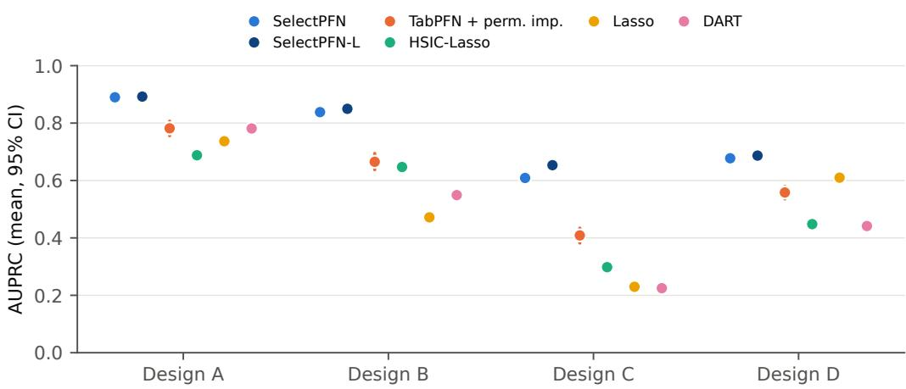
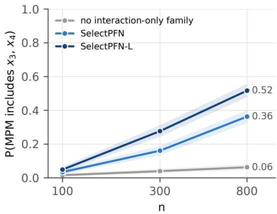
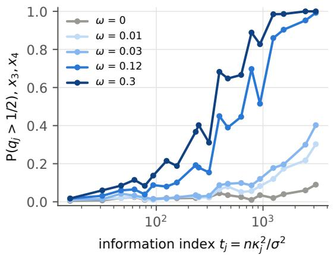
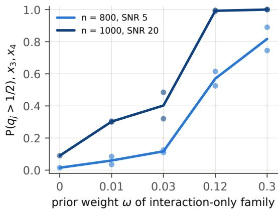
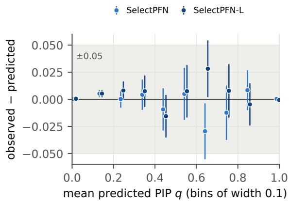
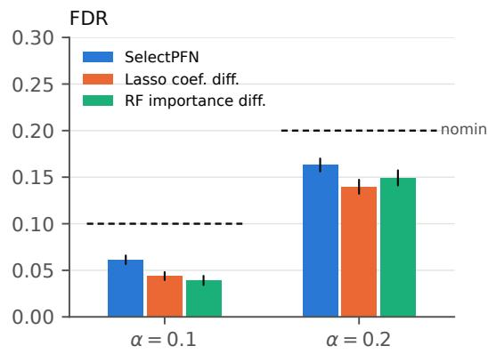
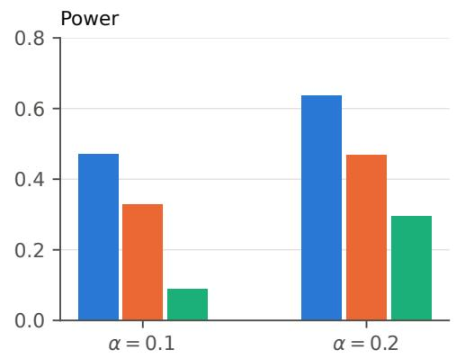
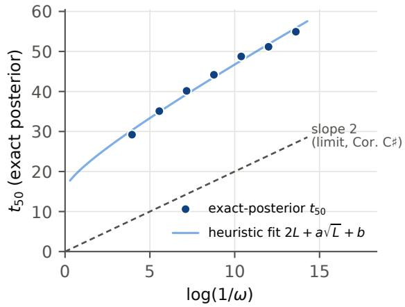

# SelectPFN: Amortized Bayesian Variable Selection for Sparse Nonlinear Regression with Prior-Data Fitted Networks

Bin Luo School of Data Science and Analytics Kennesaw State University bluo@kennesaw.edu

October 16, 2026

## Abstract

Tabular foundation models based on prior-data fitted networks (PFNs) predict on a new data set in a single forward pass, but they cannot report which inputs their predictions depend on. We propose SelectPFN, a PFN that performs Bayesian variable selection and prediction jointly for sparse nonlinear regression $Y = f ( X _ { S } ) + \varepsilon .$ , in which the response depends on a smal active set S of the p inputs, $| S | \ll p .$ Given a training set, SelectPFN returns posterior inclusion probabilities for every variable and predictive draws, each computed from a sampled subset only, so that excluded variables provably cannot afect the prediction. We show that this selectionrestricted prediction is exactly what the Bayesian model prescribes. The network is pretrained once on synthetic tasks from a meta-prior built around a group spike-and-slab sparse-input neural network and needs no data-set-specific fitting. The column-permutation equivariance of the architecture, combined with a random interleaving of original and knockof columns, yields knockof statistics with exact finite-sample false discovery rate control even when the metaprior is wrong. We also develop theory for what amortization can and cannot guarantee: a Bayes-regret bound for the amortized median probability model; a two-sided characterization showing that the information index $n \kappa _ { j } ^ { 2 } / \sigma ^ { 2 }$ (sample size times the squared signal strength of the variable, divided by the noise variance) needed to detect a variable grows like $( 2 / \lambda _ { j } ) \log ( 1 / \omega )$ where ω is the prior weight of structures able to use the variable as the truth does and $\lambda _ { j } \leq 1$ is an eficiency; and a negative result showing that average-case training does not transfer to frequentist guarantees at a fixed truth. On out-of-prior nonlinear designs with p up to 500, SelectPFN improves the area under the precision–recall curve by 0.23–0.28 over the lasso, BART, DART, LassoNet and a group-penalized sparse neural network, and by 0.16 over TabPFN with permutation importance (all Holm-adjusted $p \ < \ 1 0 ^ { - 1 0 0 } )$ , at a false discovery proportion of about 0.07, in 0.04 seconds per data set (more than 300 times faster than DART). With real covariate matrices from four public data sets the advantage persists (0.17–0.26). With real responses, it selects about two variables, of which only 11% are known nulls, against 28–60% for competing methods. The theory is also borne out: giving interaction-only structures weight in the meta-prior, as the prior-weight law prescribes, raises detection of variables that act only through an interaction from 0.06 to 0.36, and to 0.52 with a larger network; in a controlled sweep of this prior weight alone, detection rises monotonically with it while the false-selection rate stays unchanged.

Keywords: amortized inference; Bayesian variable selection; high-dimensional regression; sparse nonlinear regression; prior-data fitted networks; tabular foundation models; model-X knockofs; posterior inclusion probabilities.

## 1 Introduction

Identifying which of many candidate variables drive a response is a basic task of modern data analysis. It arises whenever the number of candidate predictors $p$ is comparable to or exceeds the sample size $n \mathrm { : }$ in genomics, where thousands of gene-expression or genotype measurements are screened for association with a disease (Golub et al., 1999; Wu et al., 2009; Guan and Stephens, 2011); in medical imaging, where voxel-level or radiomic features are related to clinical outcomes (Grosenick et al., 2013; Lambin et al., 2017); in biomedical research more broadly, where highdimensional covariates enter survival and risk models (Tibshirani, 1997); and in economics, where a few relevant controls must be chosen from many (Belloni et al., 2014). Given $D = \{ ( x _ { i } , y _ { i } ) \} _ { i = 1 } ^ { n }$ with $x _ { i } ~ \in ~ \mathbb { R } ^ { p }$ , the goal is both accurate prediction and the identification of a small subset of variables that carries the information about the response. The statistical theory of this regime is by now mature for linear models (Fan and Lv, 2008, 2010; B¨uhlmann and van de Geer, 2011; Hastie et al., 2015; Wainwright, 2019), and it has more recently been extended to nonlinear models: sparse additive models (Ravikumar et al., 2009; Meier et al., 2009), nonparametric regression with variable selection (Laferty and Wasserman, 2008; Yang and Tokdar, 2015; Jiang and Tokdar, 2021), and sparse-input neural networks (Liang et al., 2018; Sun et al., 2022; Luo and Halabi, 2025). In applications, a selection method has to meet three needs at once. It must be flexible enough to capture nonlinear and interaction efects, because a variable that acts only through an interaction carries no linear signal. It must be fast and free of expert tuning, so that it can be applied routinely and to many data sets. And it must come with guarantees on false selections, so that the selected variables can be trusted.

Existing methods meet these needs only in part (Section 2). Penalized and Bayesian selection for linear models (Tibshirani, 1996; Fan and Li, 2001; Zhang, 2010; George and McCulloch, 1993; Roˇckov´a and George, 2018) is fast and well understood, but a variable that acts only through a nonlinear or interaction efect carries no linear signal and is missed. Sparse additive models (Lin and Zhang, 2006; Ravikumar et al., 2009), Bayesian regression trees (Chipman et al., 2010; Linero, 2018) and sparse neural networks (Lemhadri et al., 2021; Luo and Halabi, 2025; Sun et al., 2022) capture such efects, but each solves a new, tuning-sensitive optimization or sampling problem for every data set, which is slow when p is large and gives no finite-sample error control. Knockofs (Barber and Cand\`es, 2015; Cand\`es et al., 2018) supply such control, but their power rests on a feature statistic that must itself be fitted to each data set. Tabular foundation models built on prior-data fitted networks (PFNs; M¨uller et al., 2022), such as TabPFN (Hollmann et al., 2023, 2025), remove per-data-set fitting altogether and predict in a single forward pass, but they use every column and cannot say which variables a prediction depends on, and the first amortized selectors (Alrawkan et al., 2026; Schiekiera et al., 2026) are restricted to linear models, and LinearPFN to few variables. What is missing is a selector for sparse nonlinear regression that is amortized, integrated with prediction, and equipped with guarantees that do not depend on how well the network was trained.

We propose SelectPFN, a PFN that performs Bayesian variable selection and prediction jointly. Selection in SelectPFN is integrated rather than post hoc: the predictor has the form $\hat { y } _ { \ast } ~ =$ $g _ { \theta } ( x _ { * , \hat { S } } , D _ { \hat { S } } )$ for a test point $x _ { * } ,$ , where $D _ { \hat { S } }$ keeps only the columns in $\hat { S } _ { ; }$ , so a variable outside the selected set $\hat { S }$ cannot influence the prediction. The network is pretrained once on synthetic regression tasks drawn from a sparse nonlinear meta-prior, built around a group spike-and-slab sparse-input neural network. For a new data set, one forward pass returns posterior inclusion probabilities (PIPs) for all variables. Subsets of variables are then drawn from these PIPs, a second pass predicts from the columns of each subset only, and the predictions are averaged over the subsets, which is Bayesian model averaging (BMA). This restriction is exactly what the Bayesian model prescribes, because given the active set the posterior predictive depends on the data only through the active columns. A knockof mode adds exact finite-sample control of the false discovery rate (FDR) that holds whatever the network has learned. Because a trained network is a fixed map from data sets to PIPs, its analysis becomes a question about amortization: what a small training loss guarantees for selection, which variables can be found at all, and what cannot be guaranteed for a fixed truth. We answer these questions and evaluate the method in extensive simulations and on real data.

## Contributions.

1. Method. We formulate amortized Bayesian variable selection for sparse nonlinear regression. SelectPFN is a two-pass PFN: a selection pass returns PIPs, and a prediction pass sees only the selected columns, which, given the active set, is exactly the Bayesian predictive (Lemma 1). Both heads are trained with strictly proper scoring rules whose population minimizers are the PIPs and the subset-conditional posterior predictive (Proposition 1). Sparsity enters through the meta-prior, a group spike-and-slab sparse-input network mixed with additive, interaction, tree, Gaussian-process and linear families, not through a penalty on network weights.

2. Exact error control. With random interleaving of original and knockof columns, the knockof statistic $W _ { j } = q _ { j } - \tilde { q } _ { j }$ , where $q _ { j }$ and $\tilde { q } _ { j }$ are the network’s inclusion probabilities for $x _ { j }$ and its knockof, yields exact finite-sample FDR control for any network weights and any meta-prior (Theorem 1).

3. Theory of amortized selection. The selection loss decomposes into a Bayes floor plus an amortization gap, which bounds the Bayes regret of the amortized median probability model. The information needed to detect a variable grows like $( 2 / \lambda _ { j } ) \log ( 1 / \omega )$ , where ω is the prior weight of structures that can use the variable as the truth does and $\lambda _ { j } \leq 1$ is an eficiency, which explains why the meta-prior must give explicit weight to interaction-only structures, as an ablation confirms. Average-case training cannot by itself deliver frequentist selection consistency (Section 4).

4. Numerical evidence. In simulations from nonlinear designs that are not part of the meta-prior, SelectPFN selects variables more accurately than fifteen penalized, Bayesian, sparse-neuralnetwork and foundation-model methods, at a fraction of their cost; its inclusion probabilities are close to an exactly enumerable posterior; and a controlled study confirms that the prior weight governs detection as the theory predicts (Section 5). The advantage carries over to real covariate matrices and real responses (Section 6).

Section 2 reviews related work. Section 3 describes the method, Section 4 develops the theory, Section 5 reports simulation studies, Section 6 analyzes real data, and Section 7 discusses extensions. Implementation details, proofs and additional results are in the appendices.

## 2 Related work

## 2.1 Penalized and Bayesian selection in linear models

Variable selection in linear models has been studied for three decades, along two complementary lines: penalized regression, which selects variables by shrinking some coeficients exactly to zero, and Bayesian variable selection, which places a prior on which variables are active and reports posterior probabilities. In the first line, the lasso (Tibshirani, 1996) estimates and selects simultaneously through an $\ell _ { 1 }$ penalty, but it shrinks large coeficients and is selection-consistent only under restrictive irrepresentability conditions (Zhao and Yu, 2006). The adaptive lasso (Zou, 2006) reweights the penalty to recover the oracle property, and the nonconvex SCAD (Fan and Li, 2001) and MCP (Zhang, 2010) penalties remove the bias directly; the elastic net (Zou and Hastie, 2005) stabilizes selection among correlated predictors, and the group lasso (Yuan and Lin, 2006) selects predefined groups of variables. When $p \gg n$ , sure independence screening (Fan and Lv, 2008) reduces the dimension before any of these is applied. The second line, Bayesian variable selection, places a prior on inclusion indicators $\gamma \in \{ 0 , 1 \} ^ { p }$ (Mitchell and Beauchamp, 1988; George and McCulloch, 1993) and reports posterior inclusion probabilities $\mathbb { P } ( \gamma _ { j } = 1 \mid D )$ , which quantify uncertainty about each variable and lead to the median probability model (Barbieri and Berger, 2004). Stochastic search over the $2 ^ { p }$ models is slow and mixes poorly, and the spike-and-slab lasso (Roˇckov´a and George, 2018) recovers fast posterior modes by optimization, at the price of the full posterior. All of these methods assume that the response is linear in the covariates: a variable that afects the response only through a nonlinear function or through an interaction with another variable can have no linear association with the response at all, and is then missed, and each analysis must be refitted and retuned for every new data set.

## 2.2 Selection in nonlinear models

To capture nonlinear and interaction efects, selection has been extended beyond linear models along three lines of increasing flexibility: sparse additive models, which allow each variable its own nonlinear efect; tree ensembles, which also capture interactions; and sparse neural networks, which can represent general nonlinear functions. Each line has penalized and Bayesian versions. In the first line, COSSO (Lin and Zhang, 2006) and sparse additive models (Ravikumar et al., 2009) fit a smooth function for each variable and set whole functions to zero, but by construction they cannot detect a variable that matters only through an interaction with another variable. Modelfree screening by distance correlation (Li et al., 2012) or HSIC (Yamada et al., 2014) relaxes the additive assumption and detects general dependence, but it only ranks variables and provides no fitted model or selected set. The second line, tree ensembles, captures interactions automatically. Random forests (Breiman, 2001) rank variables by importance scores computed after fitting, which have no probabilistic meaning; BART (Chipman et al., 2010) places a prior on a sum of trees, and DART (Linero, 2018) adds a sparsity-inducing prior on how often each variable is used for splitting, so that the posterior indicates which variables are included. The third line makes neural networks sparse in their inputs. On the penalized side, a group penalty on all outgoing weights of an input removes that input from the network: LassoNet (Lemhadri et al., 2021) does so through a hierarchical skip connection, and concave group penalties (Luo and Halabi, 2025) avoid the overshrinkage that leads the group lasso to retain unimportant variables. On the Bayesian side, spikeand-slab or horseshoe priors on the weights or hidden units give sparse Bayesian neural networks (Ghosh et al., 2019; Bai et al., 2020), with selection-consistency guarantees for spike-and-slab priors on the input layer (Liang et al., 2018; Sun et al., 2022). All three lines are flexible, but every method in them solves a new nonconvex optimization or Markov chain Monte Carlo problem for each data set, with tuning parameters chosen by cross-validation; the cost grows quickly with $p ,$ samplers over inclusion indicators mix poorly when $p \gg n$ , and none of these methods controls false selections in finite samples.

## 2.3 Finite-sample error control with knockofs

Finite-sample control of false selections is provided by the knockof framework. Fixed-design knockofs (Barber and Cand\`es, 2015) control the FDR in linear Gaussian models with $n \geq p ;$ model-X knockofs (Cand\`es et al., 2018) remove the model assumption by requiring knowledge of the covariate distribution instead, and then accept any feature statistic that is antisymmetric in swapping a variable with its knockof. Deep knockofs (Romano et al., 2020) construct knockofs for non-Gaussian covariates, DeepPINK (Lu et al., 2018) uses a neural network as the feature statistic, and derandomization (Ren et al., 2023) reduces the variability that comes from a single knockof draw. Validity in this framework does not depend on the model, but power depends entirely on the feature statistic. Flexible statistics such as DeepPINK must be trained for every data set, and no statistic computed in a single pass of a pretrained network has been available.

## 2.4 Amortized inference and prior-data fitted networks

Amortized inference replaces per-data-set computation by a network trained once on simulated data. In simulation-based inference (Cranmer et al., 2020), networks such as BayesFlow (Radev et al., 2022) learn the posterior of the parameters of a fixed simulator. Prior-data fitted networks (M¨uller et al., 2022) go further and train a transformer across data sets drawn from a meta-prior, so that one forward pass approximates the posterior predictive $p ( y _ { * } \mid x _ { * } , D )$ for a new data set D and test point $x _ { * }$ . TabPFN (Hollmann et al., 2023, 2025) showed that this approach is competitive with tuned gradient boosting on small and medium tabular problems. On the theory side, Nagler (2023) analyzed the bias and variance of PFN predictions, and Melnychuk et al. (2026) showed that the prior need not be washed out by the data. Relevance can be extracted from a PFN only after the fact, by Shapley values (Lundberg and Lee, 2017) or by a second network trained to predict attributions zero-shot (Fonseca and Stoyanovich, 2026), and Zhao et al. (2026) studied how transformers trained on sparse linear priors suppress irrelevant features internally. A PFN nevertheless attends to every column: post-hoc relevance does not restrict the prediction to the variables it reports, and it comes with neither inclusion probabilities nor error guarantees.

## 2.5 Amortized variable selection

Only very recently has selection itself been amortized. Alrawkan et al. (2026) train a classifier on simulated linear models to label predictors as active from least-squares summaries, and Maceda et al. (2026) estimate PIPs for sparse linear regression with an amortized network. LinearPFN (Schiekiera et al., 2026) is pretrained on a spike-and-slab prior over main efects and pairwise interactions and returns PIPs, coeficients and predictions in one pass, for up to $p = 3 0$ variables. PACE (Qin et al., 2026) places a frozen tabular-foundation-model column encoder in front of an existing screening statistic, so the selection rule itself is not learned. Beyond regression, amortized causal discovery (Lorch et al., 2022) learns edge probabilities for nonlinear structural models with few variables, and amortized model comparison (Radev et al., 2023) returns posterior probabilities over a small, fixed set of models. These methods are linear, limited to few variables or to a fixed set of models, or do not couple selection to prediction, and none comes with theory for the amortized posterior. SelectPFN is designed to close this gap for sparse nonlinear regression.

## 3 Method

## 3.1 Problem setup

Let $D = \{ ( x _ { i } , y _ { i } ) \} _ { i = 1 } ^ { n } , x _ { i } \in \mathbb { R } ^ { p }$ , be a training set and $x _ { * } \mathrm { ~ a ~ }$ test covariate. For $S \subseteq \{ 1 , \ldots , p \}$ write $x _ { S }$ for the subvector indexed by S and $D _ { S } = \{ ( x _ { i , S } , y _ { i } ) \} _ { i = 1 } ^ { n }$ for the data restricted to the columns in S. Let $\gamma \in \{ 0 , 1 \} ^ { p }$ be inclusion indicators and $S ( \gamma ) = \{ j : \gamma _ { j } = 1 \}$ . We consider the sparse nonlinear model

$$
y _ { i } = f \bigl ( x _ { i , S ( \gamma ) } \bigr ) + \varepsilon _ { i } , \qquad \varepsilon _ { i } \overset { \mathrm { i i d } } { \sim } P _ { \varepsilon } , \qquad | S ( \gamma ) | \ll p ,\tag{1}
$$

where f is an unknown, possibly highly nonlinear function of the active variables that may contain interactions of any order.

## 3.2 Background: prior-data fitted networks

Objective. Let Π be a prior over data-generating processes $\phi$ (for example $\phi = ( f , P _ { X } , P _ { \varepsilon } )$ , with $P _ { X }$ the law of the covariates), and let a task consist of a training set $D = \{ ( x _ { i } , y _ { i } ) \} _ { i = 1 } ^ { n }$ and a query pair $( x _ { * } , y _ { * } )$ drawn independently from $P _ { \phi }$ given $\phi \sim \Pi$ . The Bayesian posterior predictive is

$$
p ( y _ { * } \mid x _ { * } , D ) = \int p _ { \phi } ( y _ { * } \mid x _ { * } ) \Pi ( d \phi \mid D ) ,
$$

where $p _ { \phi } ( \cdot \mid x _ { * } )$ is the conditional density of $y _ { * }$ given $x _ { * }$ under $P _ { \phi }$ and $\Pi ( d \phi \mid D )$ is the posterior distribution of $\phi$ given D. It is intractable for flexible priors. A prior-data fitted network $( \mathrm { P F N } ;$ M¨uller et al., 2022) is a parametric map $g _ { \theta } ( \cdot \mid x _ { * } , D )$ from a training set and a query covariate to a probability density over $y _ { * }$ , trained by minimizing the prior-averaged log loss

$$
\begin{array} { r } { \mathcal { L } ( \theta ) = \mathbb { E } _ { \phi \sim \Pi } \mathbb { E } _ { D , ( x _ { * } , y _ { * } ) \sim P _ { \phi } } \big [ - \log g _ { \theta } ( y _ { * } \mid x _ { * } , D ) \big ] = \mathbb { E } \big [ \mathrm { K L } \big ( p ( \cdot \mid x _ { * } , D ) \| g _ { \theta } ( \cdot \mid x _ { * } , D ) \big ) \big ] + C , } \end{array}\tag{2}
$$

where the expectation in the second form is over the prior predictive law of $( x _ { * } , D )$ and $C$ does not depend on θ. The loss is therefore minimized, over all measurable maps, by $g = p ( \cdot \mid x _ { * } , D )$ . In practice (2) is minimized by stochastic gradient descent over batches of tasks drawn afresh from Π. Once trained, θ is fixed, and for a new data set the approximate posterior predictive $g _ { \theta } ( \cdot \mid x _ { * } , D )$ is computed by a single evaluation of the network; the cost of inference is paid once, in training, and amortized over all future data sets.

Architecture. The network operates on the data table. Write $N = n + m$ for the number of training and query rows, with m the number of query rows, and $p$ for the number of columns. Each cell $( i , j )$ is embedded as

$$
h _ { i j } ^ { ( 0 ) } = e _ { x } ( x _ { i j } ) + \mathbb { 1 } \{ i \leq n \} e _ { y } ( y _ { i } ) + \mathbb { 1 } \{ i > n \} e _ { \emptyset } , \qquad i \leq N , \ j \leq p ,
$$

where $e _ { x } , e _ { y } : \mathbb { R } \to \mathbb { R } ^ { d }$ are learned maps and $\boldsymbol { e } _ { \mathcal { D } } \in \mathbb { R } ^ { d }$ is a learned token marking an unknown response; one additional column of response cells is read out for prediction. For a set of tokens $\{ h _ { k } \}$ , multi-head attention (MHA) computes, for each head, $\begin{array} { r } { \mathrm { A t t n } ( h _ { k } ) = \sum _ { l } a _ { k l } W _ { V } h _ { l } } \end{array}$ with learned matrices $W _ { Q } , W _ { K } , W _ { V }$ and weights akl = softmaxl $\left( ( W _ { Q } h _ { k } ) ^ { \top } W _ { K } h _ { l } / \sqrt { d } \right)$ , and concatenates the heads. Each layer applies, with layer normalization and residual connections,

$$
h _ { i \cdot }  h _ { i \cdot } + \mathrm { M H A } _ { \mathrm { r o w } } ( h _ { i \cdot } ) , \quad \quad \mathrm { a t t e n t i o n ~ w i t h i n ~ r o w ~ } i ,
$$

$$
h _ { \cdot j } \gets h _ { \cdot j } + \mathrm { M H A } _ { \mathrm { c o l } } \big ( h _ { \cdot j } \big ) , \qquad \mathrm { a t t e n t i o n ~ w i t h i n ~ c o l u m n ~ } j , \mathrm { ~ k e y s ~ a n d ~ v a l u e s ~ f r o m ~ r o w s ~ } i \le n ,
$$

$$
h _ { i j }  h _ { i j } + \mathrm { M L P } ( h _ { i j } ) , \qquad \mathrm { c e l l - w i s e ~ f e e d - f o r w a r d ~ n e t w o r k ~ ( M L P ) , }
$$

so that each cell first combines information across the variables of its row and then across the training observations of its column. Neither operation depends on the order of the rows or of the columns, so the network is equivariant to permutations of both. The predictive density of a query row is a bar distribution: with fixed bin edges b0 $< b _ { 1 } < \cdots < b _ { M }$ and logits $z = W _ { \mathrm { o u t } } h _ { i , y }$ read from the response cell of row $i ,$

$$
g _ { \theta } ( y \mid x _ { i } , D ) = \sum _ { k = 1 } ^ { M } \frac { \mathrm { s o f t m a x } ( z ) _ { k } } { b _ { k } - b _ { k - 1 } } \mathbb { 1 } \{ b _ { k - 1 } < y \leq b _ { k } \} ,
$$

with half-normal tails beyond the outer bins (M¨uller et al., 2022). TabPFN (Hollmann et al., 2023, 2025) uses this construction with a broad prior over tabular prediction problems.

SelectPFN. SelectPFN keeps the architecture and the training principle but changes the targets. Because the inclusion indicators $\gamma$ are known for every simulated task, a second output head is trained by the log loss on $\gamma ,$ so that, by the same argument as for (2), its minimizer is the vector of posterior inclusion probabilities; and the predictive density is computed from the selected columns only. The meta-prior, the two passes and the joint objective are specified next.

## 3.3 Meta-prior

A PFN is defined by the prior over data sets on which it is trained. Each synthetic task is generated hierarchically: (i) task size $n \sim \Pi _ { n } , p \sim \Pi _ { p } ;$ (ii) active set $\gamma$ from a Beta–Bernoulli prior, $w \sim \mathrm { B e t a } ( \bar { w } \nu , ( 1 - \bar { w } ) \nu ) , \gamma _ { j } \mid w \stackrel { \mathrm { i i d } } { \sim } \mathrm { B e r n } ( w )$ , with the mean sparsity ¯w and concentration ν drawn at random; (iii) covariate rows $x _ { i } \stackrel { \mathrm { i i d } } { \sim } P _ { X }$ , collected in $X = ( x _ { 1 } , \ldots , x _ { n } ) ^ { \top }$ , from a family covering independent, autoregressive, block-equicorrelated and latent-factor dependence with non-Gaussian marginals through a Gaussian copula, independent of $( \gamma , f ) ; ( \mathrm { i v } )$ a regression function $f \mid \gamma \sim \Pi _ { f } ( \cdot \mid \gamma )$ that depends only on the active variables; (v) responses with random signal-tonoise ratio, Gaussian, $t _ { 3 }$ or heteroscedastic noise. The meta-prior is used only to simulate training tasks; SelectPFN never fits $f$ directly but learns to compute the posterior that this prior implies. The function prior $\Pi _ { f } ( \cdot \mid \gamma )$ is a mixture of families: for each task one family is drawn according to its weight, and $f$ is then drawn from that family using the active variables only. The family with the largest weight is a group spike-and-slab sparse-input neural network: a random network with first-layer weights $W \in \mathbb { R } ^ { p \times H }$ and

$$
W _ { j \cdot } = 0 \mathrm { i f } \gamma _ { j } = 0 , \qquad W _ { j \cdot } \sim N ( 0 , \sigma _ { w } ^ { 2 } I _ { H } ) \mathrm { i f } \gamma _ { j } = 1 ,\tag{3}
$$

with slab variance $\sigma _ { w } ^ { 2 } = 1 / | S ( \gamma ) |$ (Appendix A) and random depth, width, activations and deeper weights. This family belongs to the Bayesian sparse neural networks (Liang et al., 2018; Sun et al., 2022; Ghosh et al., 2019; Bai et al., 2020), but whereas those priors sparsify individual weights or hidden units, it places one spike-and-slab indicator on all outgoing weights of each input, so that inclusion is defined for variables rather than weights. It is also the Bayesian counterpart of penalized sparse-input networks that remove an input by penalizing its outgoing weights as a group (Lemhadri et al., 2021; Luo and Halabi, 2025). A random network of this kind can in principle approximate a wide range of functions, but it places little prior weight on several structures that are common in practice and that Section 4 shows a selector must be given weight to detect. The mixture therefore also contains, as separate families with their own weights, additive functions, main efects with pairwise interactions, trees and step functions, Gaussian-process draws, linear functions, and an interaction-only family in which pairs or triples of variables enter only through functions that are odd in each argument (for example $x _ { a } x _ { b } , \sin ( c x _ { a } x _ { b } )$ , tanh $\left( c x _ { a } \right)$ tanh $( c x _ { b } )$ , sign(xa) sign(xb)), so that, apart from optional weak main efects (Table 14), a variable has no marginal efect. Section 4 explains why such a family is needed, and the ablation in Section 5.4.4 confirms it. Table 14 in Appendix A lists all components and weights.

Meaning of the inclusion indicators. For $\gamma _ { j }$ to mean ${ ^ { 6 } x } _ { j }$ is used by $f ^ { \ast }$ , each active variable should have a non-negligible efect on the response. The generator therefore estimates the total efect of every active variable by Monte Carlo and redraws $f$ when one falls below a small threshold; if this repeatedly fails, the weak variables are set to zero and labelled inactive (Table 14). Even so, the data cannot always tell which variables are active. When several covariates are strongly correlated, they carry nearly the same information about the response, and the posterior naturally spreads its inclusion probability among them rather than committing to one. Because SelectPFN approximates this posterior, a group of moderate PIPs on correlated variables is best read as evidence that at least one variable of the group matters.

## 3.4 Inferential targets

The targets are the PIPs $\pi _ { j } ( D ) = \mathbb { P } ( \gamma _ { j } = 1 \mid D )$ and the joint posterior $p ( \gamma , y _ { * } \mid x _ { * } , D ) = p ( \gamma \mid$ $D ) p ( y _ { * } \mid x _ { * } , \gamma , D )$ . Predicting from the selected variables alone is justified when the covariates themselves carry no information about which function generated the response, which we state as follows.

Assumption 1. $( x _ { 1 } , \ldots , x _ { n } , x _ { * } )$ are independent of $( \gamma , f )$ ; given $( \gamma , f )$ and the covariates, the responses are conditionally independent with $p ( y ~ \vert ~ x , \gamma , f ) = p _ { \varepsilon } ( y - f ( x _ { S ( \gamma ) } ) )$ , where $p _ { \varepsilon }$ is the density of $P _ { \varepsilon } ;$ and $\Pi _ { f } ( \cdot \mid \gamma )$ does not depend on the covariates.

Assumption 1 is the standard random-design regression model of Bayesian variable selection. It holds for spike-and-slab linear regression with independent coeficient priors, for Gaussian-process priors, and for every family of our meta-prior, in all of which $f$ is drawn independently of the covariates and the noise is additive. It excludes priors that depend on the observed design, such as Zellner’s g-prior, whose covariance is proportional to $( X ^ { \top } X ) ^ { - 1 }$ , and noise whose distribution depends on inactive covariates. Small departures in our task generator are listed in Appendix A.

## 3.5 Model

SelectPFN uses the table transformer of Section 3.2, denoted $F _ { \theta }$ , with alternating row and column attention and no embedding of column identity. Because it is equivariant to column permutations, it has no notion of “variable $3 ^ { \mathfrak { s } }$ and must judge each variable from its values and their relation to the response. The same network is used in two passes.

Selection pass. The training set (with responses) is encoded; each feature’s representation is pooled across rows (mean and attention pooling, concatenated with the pooled response representation and a global token that carries log n and log p), and a head outputs $q _ { j } ( D ) = \mathrm { l o g i t } ^ { - 1 } ( s _ { \theta } ( h _ { j } ) )$ , where $h _ { j }$ is the pooled representation of column $j$ . The test covariate is not used, so q is a function of D alone, matching $\pi _ { j } ( D )$

Prediction pass. Given a subset S, the excluded columns are removed from the training data and the test covariate, and the network is applied to $( D _ { S } , x _ { * , S } )$ to produce a discretized predictive distribution over standardized y (a “bar distribution”; M¨uller et al., 2022). Because excluded columns never enter the computation,

$$
\partial g _ { \theta } ( y _ { * } \mid x _ { * , S } , D _ { S } ) / \partial x _ { * j } = 0 \quad { \mathrm { f o r ~ a l l ~ } } j \not \in S\tag{4}
$$

holds exactly. Zeroing a column instead of removing it would not guarantee this, because a zeroed column still takes part in the attention over training rows. The two passes share the backbone, with a learned pass-indicator token.

## 3.6 Training objective and procedure

Tasks. A training task $\tau = ( n , p , \gamma , \phi , D , Q )$ is drawn from the meta-prior of Section 3.3: γ are the inclusion indicators, $\phi$ the data-generating quantities of Section 3.2 other than $\gamma , D = \{ ( x _ { i } , y _ { i } ) \} _ { i = 1 } ^ { n }$ the training rows and $Q = \{ ( x _ { i } , y _ { i } ) \} _ { i = n + 1 } ^ { n + m }$ the query rows, obtained by splitting the simulated rows at random. Write $q _ { \theta } ( D ) \in ( 0 , 1 ) ^ { p }$ for the output of the selection pass and $g _ { \theta } ( \cdot \ | \ x _ { S } , D _ { S } )$ for the predictive density returned by the prediction pass on the columns in $S$ (Section 3.5). We write Π also for the induced law of $\tau$

Training kernel. The prediction pass is trained on subsets $\tilde { S }$ drawn from a kernel $K ( \cdot \mid \gamma , q )$ that mixes three sources,

$$
K ( \cdot \mid \gamma , q ) = \rho _ { 1 } \delta _ { S ( \gamma ) } + \rho _ { 2 } \mathcal { C } ( \cdot \mid S ( \gamma ) ) + ( 1 - \rho _ { 1 } - \rho _ { 2 } ) \prod _ { j = 1 } ^ { p } \mathrm { B e r n } \bigl ( \mathrm { s g } ( q _ { j } ) \bigr ) ,
$$

where $\delta _ { S ( \gamma ) }$ returns the true active set (teacher forcing); $\textstyle { \mathcal { C } } ( \cdot \mid S )$ drops each element of $S$ independently with probability 0.1 and adds a Poisson(1) number of inactive variables chosen uniformly; and the last term samples a subset from the current selection head, with sg denoting that no gradient flows through the sampling (self-sampling). The corrupted and self-sampled subsets expose the prediction pass to the imperfect subsets it receives at inference.

Objective. With per-variable and per-query averages, the training objective is

$$
L ( \theta ) = \mathbb { E } _ { \tau \sim \Pi } \Big [ \underbrace { \frac { 1 } { p } \sum _ { j = 1 } ^ { p } \ell \big ( q _ { \theta , j } ( D ) , \gamma _ { j } \big ) } _ { L _ { \mathrm { s e l } } } + \alpha \mathbb { E } _ { \tilde { S } \sim K ( \cdot | \gamma , q _ { \theta } ( D ) ) } \underbrace { \frac { 1 } { m } \sum _ { i \in Q } - \log g _ { \theta } \big ( y _ { i } \mid x _ { i , \tilde { S } } , D _ { \tilde { S } } \big ) } _ { L _ { \mathrm { p r e d } } } \Big ] ,\tag{5}
$$

where $\alpha > 0$ weights the prediction loss and $\ell ( q , \gamma ) = - \gamma \log q - ( 1 - \gamma ) \log ( 1 - q )$ is the binary log loss. Both terms are prior-averaged log losses of the form (2): the first for the labels $\gamma ,$ , the second for the query responses.

Optimization. The objective is minimized by stochastic gradient descent. At step t, a batch of $N _ { \mathrm { b } }$ tasks $\tau _ { 1 } , \ldots , \tau _ { N _ { \mathrm { b } } }$ is drawn afresh from Π, one subset $\tilde { S } _ { b } \sim K ( \cdot \mid \gamma _ { b } , q _ { \theta } ( D _ { b } ) )$ is drawn per task, and $\theta$ is updated, with learning rate $\eta _ { t } ,$ along the gradient of the Monte Carlo estimate

$$
\hat { L } _ { t } ( \theta ) = \frac { 1 } { N _ { \mathrm { b } } } \sum _ { b = 1 } ^ { N _ { \mathrm { b } } } \Big [ L _ { \mathrm { s e l } } ( \theta ; \tau _ { b } ) + \alpha L _ { \mathrm { p r e d } } ( \theta ; \tau _ { b } , \tilde { S } _ { b } ) \Big ] ,
$$

in which the sampled subsets are held fixed, as indicated by sg in the kernel. Because every batch is newly simulated, no task is seen twice, and the network can only learn a rule that maps data sets to inclusion probabilities and predictions. Self-sampling is switched on after 10% of training, when the selection head has become informative; before that the kernel uses its first two components only, renormalized. All tasks in a batch share $( n , p )$ , and the maximal number of variables increases during training (from 50 to 200 to 500). Algorithm 1 summarizes the procedure, and the optimizer settings are listed in Appendix A. After training, θ is fixed and used unchanged for every analysis in this paper.

Algorithm 1 SelectPFN training   
Require: meta-prior Π, kernel K, weight $\alpha ,$ number of steps T, batch size $N _ { \mathrm { b } } ,$ learning rates $\eta _ { t }$   
1: for $t = 1 , \dots , T$ do   
2: draw tasks $\tau _ { b } = ( n , p , \gamma _ { b } , \phi _ { b } , D _ { b } , Q _ { b } ) \sim \Pi , b = 1 , \dots , N _ { \mathrm { b } }$ ▷ new tasks at every step   
3: $q _ { b } \gets q _ { \theta } ( D _ { b } )$ ▷ selection pass on all p columns   
4: draw $\tilde { S } _ { b } \sim K ( \cdot \mid \gamma _ { b } , q _ { b } )$   
5: compute $g _ { \theta } ( y _ { i } \mid x _ { i , \tilde { S } _ { b } } , D _ { b , \tilde { S } _ { b } } )$ for $i \in Q _ { b }$ ▷ prediction pass on the columns in $\tilde { S } _ { b }$   
6: $\theta  \theta - \eta _ { t } \nabla _ { \theta } \hat { L } _ { t } ( \theta )$   
7: end for

The prediction pass sees only the selected columns. The following elementary fact, which is used in Proposition 1(b), shows that this restriction is exactly what the Bayesian model prescribes.

Lemma 1 (Selection-restricted prediction). Under Assumption 1, for every γ with $S = S ( \gamma ) , p ( y _ { * } \mid$ $x _ { * } , \gamma , D ) = p ( y _ { * } \mid x _ { * , S } , D _ { S } , \gamma )$ . Consequently $\begin{array} { r } { p ( \boldsymbol { y } _ { * } \mid \boldsymbol { x } _ { * } , D ) = \sum _ { \gamma } p ( \gamma \mid D ) p ( \boldsymbol { y } _ { * } \mid \boldsymbol { x } _ { * , S ( \gamma ) } , D _ { S ( \gamma ) } , \gamma ) _ { \mid } } \end{array}$

The proof is in Appendix B.1. The posterior over active sets depends on all columns, which is what makes selection non-trivial; given the active set, however, the predictive is exactly the Bayesian predictive computed from the active columns alone, and uncertainty about the active set is handled by averaging such predictions over the posterior of $\gamma .$ . SelectPFN implements this decomposition.

The next result shows that this objective targets the right quantities: at its population minimum, the two heads return the exact Bayesian inclusion probabilities and the exact subsetconditional predictive.

Proposition 1 (Population minimizers). Suppose both heads can represent any measurable function of their inputs, and that $\Pi _ { f } ( \cdot \mid \gamma )$ depends on γ only through $| S ( \gamma ) |$ and is exchangeable in the active variables, so that the subset-conditional predictive does not depend on the original column indices or on p. (a) The minimizer of $\mathbb { E } [ L _ { \mathrm { s e l } } ]$ is $q _ { j } ( D ) = \pi _ { j } ( D )$ . (b) Under teacher forcing, and assuming finite expected log loss, the minimizer of $\mathbb { E } [ L _ { \mathrm { p r e d } } ]$ (over predictive densities; for the bar-distribution head, its bin probabilities) is $p ( y _ { * } \mid x _ { * , S } , D _ { S } , S ( \gamma ) = S )$ , which by Lemma 1 equals $p ( y _ { * } \mid x _ { * } , \gamma , D )$ (c) For a general kernel that does not depend on $\theta ,$ the minimizer is the Bayes predictive of y∗ given the information available to the prediction pass, $( x _ { * , \tilde { S } } , D _ { \tilde { S } } , \tilde { S } )$ , and depends only on the columns in $\tilde { S } .$

The proof is in Appendix B.1. The exchangeability condition holds whenever the prior treats the active variables symmetrically, as do spike-and-slab priors with a common slab, Gaussian processes with independently and identically distributed length-scales, and every family of our meta-prior, which assigns the active variables to their roles at random. The proposition implies that any gap between SelectPFN and the exact posterior comes from finite capacity and imperfect training, not from the objective. Because the selection head is supervised directly by $\gamma ,$ no sparsity penalty on network weights and no continuous relaxation of the gates (Jang et al., 2017; Louizos et al., 2018) is needed, and both terms are proper, so α afects only how capacity is shared. Lemma 2 in Section 4 quantifies the gap between the trained network and the Bayes optimum.

Algorithm 2 SelectPFN inference   
Require: training data D, test covariates $x _ { * }$ , number of draws B   
1: $q  q _ { \theta } ( D )$ ▷ one forward pass; PIPs   
2: for $b = 1 , \dots , B$ do   
3: $\begin{array} { r } { \gamma ^ { ( b ) } \sim \prod _ { j } \mathrm { B e r n } ( q _ { j } ) , S ^ { ( b ) }  S ( \gamma ^ { ( b ) } ) } \end{array}$   
4: $y _ { * } ^ { ( b ) } \sim g _ { \theta } ( \cdot \mid x _ { * , S ^ { ( b ) } } , D _ { S ^ { ( b ) } } )$ ▷ prediction pass on the selected columns only   
5: end for   
6: return q; pairs $\begin{array} { r } { \{ ( S ^ { ( b ) } , y _ { * } ^ { ( b ) } ) \} _ { b = 1 } ^ { B } ; \thinspace \hat { p } ( y _ { * } \mid x _ { * } , D ) = B ^ { - 1 } \sum _ { b } g _ { \theta } ( y _ { * } \mid x _ { * , S ^ { ( b ) } } , D _ { S ^ { ( b ) } } ) } \end{array}$

## 3.7 Inference

After pretraining, a new data set needs no optimization (Algorithm 2). The outputs are the PIPs; paired draws, each attached to the subset that produced it, whose mixture approximates Bayesian model averaging (BMA); and a single reported model, the median probability model (MPM) $\hat { S } = \{ j : q _ { j } > 1 / 2 \}$ (Barbieri and Berger, 2004). The B subsets are drawn once per data set and shared by all test points, each prediction pass processes all test points at once, and it is cached per distinct subset; distinct subsets are few when the posterior is concentrated. The BMA samples subsets from the product of marginals; capturing posterior dependence between inclusions $( ^ { 6 6 } x _ { 3 }$ or $x _ { 4 }$ , but rarely both”) would require an autoregressive selection head (Section 7).

## 3.8 Knockof mode: exact finite-sample FDR control

PIPs are calibrated only to the extent that the meta-prior resembles the data. For a guarantee that does not depend on the prior, we combine SelectPFN with model-X knockofs (Cand\`es et al., 2018). The FDR guarantee itself is the standard one; what is new is a construction that makes a pretrained network a valid knockof statistic without per-data-set training, in contrast to neural statistics such as DeepPINK (Lu et al., 2018), which are fitted to each data set. Let $y = ( y _ { 1 } , \ldots , y _ { n } ) ^ { \top }$ and let $\tilde { X }$ be a knockof copy of X: X˜ ⊥⊥ $y \mid X$ , and swapping any subset of columns between X and $\tilde { X }$ leaves the law of $[ X , { \tilde { X } } ]$ unchanged.

Training. Exact knockofs are cheap for synthetic tasks, whose $P _ { X }$ is known (Gaussian knockofs for the latent Gaussian copula). The network receives the 2p columns $[ X , { \tilde { X } } ]$ in a random order, with responses, and the selection head is supervised with $\gamma _ { j }$ for original columns and 0 for knockof columns. No input marks which columns are knockofs.

Inference. Draw a uniformly random permutation of the 2p columns independently of the data, apply the network, map the outputs back, and set $W _ { j } = q _ { j } - \tilde { q } _ { j }$ , where $\tilde { q } _ { j }$ is the output for the knockof copy of $\boldsymbol { x } _ { j } ;$ then apply the knockof+ threshold at level αFDR (Barber and Cand\`es, 2015). Theorem 1 shows that the false discovery rate is at most $\alpha _ { \mathrm { F D R } }$ in finite samples, for any network weights and whether or not the meta-prior is correct, provided the knockofs are valid. Exact column equivariance in finite-precision arithmetic is not required: the random interleaving makes the flip-sign property hold in distribution. On real data, knockofs are constructed approximately (second-order or deep knockofs; Romano et al., 2020), and the guarantee holds to the extent that the approximation is accurate.

## 3.9 Scaling to large p

Training cost grows with the number of cells, and feature attention is quadratic in $p .$ We therefore pretrain at $p \leq p _ { \mathrm { m a x } }$ and, for larger p, (1) screen: randomly partition the variables into blocks of size at most $p _ { \mathrm { m a x } } .$ , compute q within each block, and average over R random partitions; (2) refine: run one joint pass on the top-k variables. Column equivariance means block assignment introduces no ordering artifacts. A variable that acts only through an interaction with a variable placed in another block can be missed in a single partition; repeated partitions mitigate this. This scheme is implemented but not yet validated beyond p = 500 (Section 7).

## 4 Theory

A trained PFN is a fixed function q that maps a data set to a vector of inclusion probabilities.   
Training controls only an average over the meta-prior of how far q is from the exact posterior π.   
This section asks what that average buys, and what it cannot buy. Four results answer the question.

• Section 4.1: the training loss controls the Bayes risk of the reported model.

• Section 4.2: knockof mode gives exact finite-sample FDR control whatever the network has learned.

• Section 4.3: the meta-prior’s weight on the right function class sets the sample size at which a variable is found. This explains why the meta-prior must contain interaction-only structures, as the ablation in Section 5.4.4 confirms.

• Section 4.4: frequentist selection consistency for a fixed truth requires a uniform amortization assumption that the training loss cannot certify.

Every numbered result is proved analytically in Appendix B. A few published results are used as tools and are marked cited where they enter. Numerical computations appear only as illustrations, in paragraphs labelled as such, and are never a step of a proof. Results that rest on assumptions we do not verify state those assumptions explicitly.

## Status of the assumptions.

• Knockof mode (Theorem 1) assumes only exact model-X knockofs, the standard requirement of Cand\`es et al. (2018); it assumes nothing about the network, the meta-prior or training.

• The regret bound (Proposition 2) needs no assumption for (i)–(ii); (iii) adds a standard margin condition.

• The detection theory uses Gaussian noise with known variance and a fixed covariate law (Assumption 2), the usual setting of posterior-contraction theory; the likelihood factorizes, so the covariate law cancels from the posterior of the regression function (it enters only through the definitions of the efect of a variable and of the norm); for a random covariate law this requires the regression function to be a priori independent of it. The conditions linking labels to functions hold by construction of the meta-prior, and the sieve condition is verified for most of its families. The one high-level condition is Assumption 3, a Bayes-factor bound on spurious structures. It is used only for the lower bound in terms of the informative weight: the upper bound (Theorem 2(i)) does not use it, and with the trivial partition, which counts every structure that uses a variable as informative, Assumption 3 holds trivially, so the lower bound of Corollary 1(i) holds in terms of the total prior weight of structures that use the variable; the sharper constant of Theorem 2(ii) additionally needs a clipped-gap hypothesis for that class.

• Consistency composes Bayesian selection consistency (Assumption 4), known for several priors, with uniform amortization (Assumption 5). The latter is not a convenience: Proposition 5 shows that it cannot be derived from the training loss, and identifying it is a result of this section.

Setting. A task drawn from the meta-prior Π consists of $( P _ { X } , f , \sigma , n , p )$ , labels $\gamma \in \{ 0 , 1 \} ^ { p }$ and a data set $D = ( X , y )$ . Write $P _ { D }$ for the induced law of D (the prior predictive), $\pi _ { j } ( D ) = \Pi ( \gamma _ { j } = 1 |$ $D )$ for the exact posterior inclusion probabilities, and $q ( D ) \in ( 0 , 1 ) ^ { p }$ for the output of the selection pass. The selection term of $( 5 )$ , averaged over variables, is $L _ { \mathrm { s e l } } = \mathbb { E } _ { \Pi } \big [ p ^ { - 1 } \sum _ { j } \ell ( q _ { j } ( D ) , \gamma _ { j } ) \big ]$ with $\ell ( q , \gamma ) = - \gamma \log q - ( 1 - \gamma ) \log ( 1 - q )$ . Here Π is the efective training distribution, which includes the curriculum over $( n , p )$ . Let $w ( n , p )$ be its marginal probability of size $( n , p )$ . Because $( n , p )$ is a function of $D .$ , reweighting by w leaves $\pi$ unchanged. We first relate this training loss to the exact posterior.

Lemma 2 (Bayes floor plus amortization $\mathrm { g a p } )$ . Let Ent be the Bernoulli entropy and kl the Bernoulli Kullback–Leibler divergence. Then

$$
\begin{array} { r } { L _ { \mathrm { s e l } } = \mathbb { E } \Big [ \frac { 1 } { p } \sum _ { j } \mathrm { E n t } ( \pi _ { j } ) \Big ] + \Delta , \qquad \Delta : = \mathbb { E } \Big [ \frac { 1 } { p } \sum _ { j } \mathrm { k l } ( \pi _ { j } \| q _ { j } ) \Big ] \geq 0 . } \end{array}
$$

With $\Delta _ { n , p }$ the same quantity conditional on size $\begin{array} { r } { ( n , p ) , \Delta = \sum _ { n , p } w ( n , p ) \Delta _ { n , p } \geq w ( n , p ) \Delta _ { n , p } . } \end{array}$

The first term does not depend on the network, so $\Delta$ is the part of the selection loss that training can reduce. The identity is the selection analogue of the basis of PFN training (M¨uller et al., 2022) and of supervised amortized structure learning (Lorch et al., 2022). Because the training objective is joint, the network need not minimize $L _ { \mathrm { s e l } }$ within its class. All results below are therefore stated in terms of the achieved $\Delta$ , whatever produced it. In particular, every reduction of the training loss is a reduction of the average Kullback–Leibler gap between the network and the exact posterior; the next subsection converts this gap into a guarantee for the selected model.

## 4.1 The training loss controls the Bayes risk of the reported model

Let $\mathrm { M P M } _ { q } = \{ j : q _ { j } > \frac { 1 } { 2 } \}$ and $\mathrm { M P M } _ { \pi } = \{ j : \pi _ { j } > \frac { 1 } { 2 } \}$ be the median probability models (MPMs) of $q$ and $\pi .$ . Under the per-variable Hamming loss $\begin{array} { r } { L _ { H } ^ { - } ( S , \gamma ) = p ^ { - 1 } \sum _ { j } | \mathbb { 1 } \{ j \in S \} - \gamma _ { j } | } \end{array}$ , MPMπ is the Bayes rule (see also Barbieri and Berger, 2004, for its predictive optimality). Write $e _ { j } = q _ { j } - \pi _ { j }$ and $\begin{array} { r } { m _ { j } = \pi _ { j } - \frac { 1 } { 2 } } \end{array}$ , let $\mathcal { E } _ { j }$ be the event that $q _ { j }$ and $\pi _ { j }$ lie on diferent sides of $\frac { 1 } { 2 }$ (with the value $\frac { \mathrm { 1 } } { \mathrm { 2 } }$ counted on the exclusion side), let $R ( S ) = \bar { \mathbb { E } } _ { \Pi } [ L _ { H } ( \bar { S } ( D ) , \gamma ) ]$ be the Bayes risk of a selection rule $S ,$ and let $\mathbb { E } _ { J }$ average over $D \sim P _ { D }$ and J uniform on $\{ 1 , \ldots , p \}$ . The following result bounds how much worse the network’s median probability model can be than the exact one.

Proposition 2 (Bayes regret of the amortized MPM). (i) $R ( \mathrm { M P M } _ { q } ) - R ( \mathrm { M P M } _ { \pi } ) = \mathbb { E } _ { J } \big [ | 2 \pi _ { J } -$ $1 | \Im _ { \mathcal { E } _ { J } } ]$ , and $\mathcal { E } _ { j } \subseteq \{ | m _ { j } | \leq | e _ { j } | \}$

$$
( i i ) \ R ( \mathrm { M P M \it _ q ) - R ( \mathrm { M P M \it _ \chi ) \leq 2 \mathbb { E } _ { J } \big [ | e _ { J } | \mathbb { 1 } \{ | m _ { J } | \leq | e _ { J } | \} \big ] \leq 2 \mathbb { E } _ { J } | e _ { J } | \leq \sqrt { 2 \Delta } . } }
$$

(iii) Suppose the margin condition $\mathbb { P } _ { J } ( | m _ { J } | \le t ) \le C _ { \mathrm { m } } t ^ { \alpha _ { \mathrm { m } } }$ holds for $t \in ( 0 , \textstyle { \frac { 1 } { 2 } } ]$ (this forces $C _ { \mathrm { m } } \geq$ $2 ^ { \alpha _ { \mathrm { m } } } ) _ { \mathrm { . } }$ , and let $\bar { \delta } ^ { 2 } = \mathbb { E } _ { J } e _ { J } ^ { 2 } \le \Delta / 2$ . Then the regret is at most $4 C _ { \mathrm { m } } ^ { 1 / ( 2 + \alpha _ { \mathrm { m } } ) } \bar { \delta } ^ { \overline { { 2 } } ( 1 + \alpha _ { \mathrm { m } } ) / ( 2 + \alpha _ { \mathrm { m } } ) }$

(iv) $\mathbb { P } _ { J } ( \mathcal { E } _ { J } ) \le C _ { \mathrm { m } } t ^ { \alpha _ { \mathrm { m } } } + \bar { \delta } ^ { 2 } / t ^ { 2 }$ for every $t \in ( 0 , \frac { 1 } { 2 } ]$

The margin condition in (iii) asks that few variables have a posterior inclusion probability close to $^ { \frac { 1 } { 2 } ; }$ it is the analogue for selection of the margin condition of Tsybakov (2004) in classification. It holds with $\alpha _ { \mathrm { m } } = 1$ whenever the distribution of $\pi _ { J }$ has a bounded density near ${ \frac { 1 } { 2 } } .$ , and it is mild in practice: on the exact-posterior tasks of Section 5.4.5, only $5 \%$ of variables have $| \pi _ { j } - \textstyle { \frac { 1 } { 2 } } | < 0 . 1$ Each step of the proof is classical: plug-in classification, log-loss calibration and margin conditions. What the proposition adds is the interpretation of the exact-posterior comparison in Section 5.4.5. $\mathrm { A }$ disagreement between $\mathrm { M P M } _ { q }$ and $\mathrm { M P M } _ { \pi }$ can occur only where the amortization error exceeds the distance of $\pi _ { j }$ from $\frac { 1 } { 2 }$ . Its cost, $| 2 \pi _ { j } - 1 |$ , is then at most $2 | e _ { j } |$ . Disagreements at near-ties are therefore cheap, and an exact-set-match statistic overstates their importance. On those tasks, the measured regret (0.015 per variable for the longer-trained model) is well below the refined bound (ii) (0.031). Near-ties make up 5% of variables but $4 4 \%$ of disagreements (Appendix B.3; these figures are a numerical illustration, not part of the proof). A cost-weighted version, with false-inclusion cost $c ,$ replaces the factor 2 in (i)–(ii) by $1 + c$ . We claim (iii)–(iv) only for $c = 1$ . In short, a network that is close to the exact posterior on average reports, on average, a model that is nearly as good as the exact Bayes rule, and the guarantee improves as training reduces $\Delta$

## 4.2 Exact finite-sample FDR control in knockof mode

Cand\`es et al. (2018, Section 5.2.2) already observe that the diference of Bayesian inclusion probabilities computed on $[ X , { \tilde { X } } ]$ is a valid knockof statistic when the computation is exactly equivariant to swapping columns. A trained network is not exactly equivariant in floating point. On our knockof model, relying on equivariance alone produced sign-flip deviations of order $7 \times 1 0 ^ { - 3 } ( \mathrm { A p p e n d i x B . 4 } )$ We therefore randomize the column order and prove that this restores exact validity for any map $F ,$ , whatever it has learned.

The only assumption is that exact model-X knockofs are available. This is the standard requirement of the knockof framework (Cand\`es et al., 2018): it holds when the covariate distribution is known, for example for Gaussian covariates, as in our training tasks and in the experiments of Section 5.4.7, and it is met approximately when the covariate distribution is estimated. Rows are $\mathrm { i . i . d . }$ . Let ${ \mathcal { H } } _ { 0 } = \{ j : Y \ \bot \lfloor X _ { j } \mid X _ { - j } \}$ be the null set, where $( X , Y )$ denotes a generic observation, let $\tilde { X }$ be an exact model-X knockof copy of the design matrix $X$ , and let $Z = [ X , { \tilde { X } } ]$ . The procedure in Section 3.8 has four steps.

1. Draw a permutation Σ of $\{ 1 , \ldots , 2 p \}$ uniformly at random, independently of $( Z , y )$

2. Apply the selection pass $F ( \cdot , \cdot , U )$ to the permuted table $\left( Z . , . . , y \right)$ . Here $U$ is any internal randomness, independent of $( Z , y , \Sigma )$ ; a deterministic $F$ is the case of constant $U$

3. Undo the permutation to obtain scores $Q _ { 1 } , \ldots , Q _ { 2 p }$

4. Set $W _ { j } = Q _ { j } - Q _ { j + p }$ and apply the knockof+ threshold (Barber and Cand\`es, 2015).

The procedure controls the FDR whatever the network computes, as the following theorem shows.

Theorem 1 (Exact FDR control for any network). For any F as above:

(i) for every $S \subseteq { \mathcal { H } } _ { 0 } , ( W , y ) { \stackrel { d } { = } } ( \mathrm { H i p } _ { S } W , y )$ , where $\mathrm { f i p } _ { S }$ changes the sign of the coordinates in $S ;$

(ii) conditionally on $( | W _ { j } | ) _ { j \leq p }$ and on $( W _ { j } ) _ { j \notin \mathcal { H } _ { 0 } }$ , the signs of the nonzero null statistics are i.i.d. uniform on {±1};

(iii) knockof+ at level αFDR has FDR $\le \alpha _ { \mathrm { F D R } }$ in finite samples, and the knockof filter satisfies $\mathbb { E } [ V / ( R _ { \mathrm { r e j } } + 1 / \alpha _ { \mathrm { F D R } } ) ] \leq \alpha _ { \mathrm { F D R } }$ , where V and $R _ { \mathrm { r e j } }$ are the numbers of false and total rejections.

The theorem means that a user can apply a pretrained SelectPFN of the shelf and control the false discovery rate at any chosen level without trusting the network, the meta-prior or the training: these afect only how many true variables are found.

The proof rests on a pointwise identity (Lemma 5). Swapping a null column with its knockof, while composing the random permutation with the same swap, feeds F the identical tensor. The exchangeability lemma of Cand\`es et al. (2018) and the supermartingale argument of Barber and Cand\`es (2015) are cited; the interleaving identity is ours. Validity uses no property of $F _ { ; }$ , of the meta-prior, or of training; power depends on all three. Two requirements matter in practice.

• The permutation must be drawn independently of the data and afresh for each analysis. Reusing a data-dependent permutation voids the guarantee.

• The knockofs must be exact. With estimated second-order knockofs, control is approximate.

Averaging $Q$ over several independent interleavings preserves (i)–(iii) and reduces the extra randomness (Appendix B.4).

## 4.3 Which variables are found: prior weight sets the detection threshold

We now ask, for a fixed truth $f _ { 0 }$ , how much data the exact posterior π needs before it includes a relevant variable, and how the meta-prior afects that amount. We work in an idealized regression setting.

Assumption 2 (Gaussian regression with a fixed covariate law). (a) $Y = f ( X ) + \varepsilon { \mathrm { ~ w i t h ~ } } \varepsilon \sim$ $N ( 0 , \sigma ^ { 2 } )$ and $\sigma$ known.

(b) $P _ { X }$ is known and common to all $f .$

These are the standard conditions of posterior-contraction theory for nonparametric regression (Ghosal et al., 2000; van der Vaart and van Zanten, 2008). Assumption $2 ( \mathrm { a } )$ covers any regression with Gaussian errors of known variance; heavy-tailed noise and an unknown $\sigma$ are not covered here. Assumption $2 ( \mathrm { b } )$ is mild, because the covariates are ancillary: their distribution cancels from the posterior of $f _ { : }$ , and it enters only through the definitions of $N _ { j }$ and of the norm below. Let $N _ { j } = \{ f : f ( x ) = h ( x _ { - j } ) \ P _ { X ^ { - } } { \mathrm { a . s . } } \}$ be the functions that ignore $x _ { j }$ , and $\| \cdot \|$ the $L _ { 2 } ( P _ { X } )$ norm. The conditional efect of $x _ { j }$ and the information index are

$$
\kappa _ { j } ^ { 2 } = \operatorname* { i n f } _ { h \in N _ { j } } \| f _ { 0 } - h \| ^ { 2 } = \operatorname { \mathbb { E } } \operatorname { V a r } ( f _ { 0 } ( X ) \mid X _ { - j } ) , \qquad t _ { j } = n \kappa _ { j } ^ { 2 } / \sigma ^ { 2 } .
$$

The infimum is attained at $h _ { j } ^ { * } = \mathbb { E } [ f _ { 0 } \mid X _ { - j } ]$ . Note that $\kappa _ { j } > 0$ is possible when $\operatorname { C o v } ( X _ { j } , Y ) = 0$ 2 as for $\sin ( x _ { 3 } x _ { 4 } )$ ; marginal screening then fails (Fan and Lv, 2008).

Structured priors. In this subsection Π denotes the induced prior on $f$ . Let $\begin{array} { r } { \Pi = \sum _ { k \in \mathcal { K } } w _ { k } \Pi _ { k } } \end{array}$ be a mixture over structures, where $\Pi _ { k }$ is carried by functions that use exactly the variables $V _ { k }$ (in the $P _ { X ^ { - } \mathrm { { a . s } } }$ . sense: $f \in L ( V _ { k } )$ , and $f \notin N _ { j }$ for every $j \in V _ { k }$ , where $L ( V )$ is the set of functions of $x _ { V }$ alone), and $\gamma _ { j } = \mathbb { 1 } \{ j \in V _ { k } \}$ . Write $\mathcal { K } _ { j } = \{ k : j \in V _ { k } \}$ for the structures that use $x _ { j }$ . Partition them into informative structures ${ \mathcal { K } } _ { j } ^ { I }$ , which can represent how $f _ { 0 }$ uses $x _ { j }$ , and spurious ones ${ \mathcal { K } } _ { j } ^ { S }$ Let $\begin{array} { r } { \omega _ { j } ^ { I } = \sum _ { k \in \mathcal { K } _ { i } ^ { I } } w _ { k } } \end{array}$ be the informative weight. Write $D _ { n }$ for $D$ when n varies, $P _ { f } ^ { n }$ for the law of $D _ { n }$ under $f ,$ and $P _ { 0 } ^ { n } = P _ { f _ { 0 } } ^ { n }$ . Write $\begin{array} { r } { \Lambda _ { f } = \prod _ { i } p _ { f } ( X _ { i } , Y _ { i } ) / p _ { f _ { 0 } } ( X _ { i } , Y _ { i } ) } \end{array}$ , where $p _ { f }$ is the joint density of $( X , Y )$ under Assumption 2 with regression function $f ,$ and $\begin{array} { r } { \Lambda ( k ) = \int \Lambda _ { f } d \Pi _ { k } } \end{array}$ . The lower bounds below must rule out that $x _ { j }$ is included through structures that use it in the wrong way; we state this as an assumption.

Assumption 3 (Spurious-inclusion control). There are $\tau _ { n } \geq 0$ and $\delta _ { n } \in [ 0 , 1 )$ such that, with $P _ { 0 } ^ { n }$ -probability at least $1 - \delta _ { n }$ 2

$$
\begin{array} { r } { \sum _ { k \in \mathcal { K } _ { j } ^ { S } } w _ { k } \Lambda ( k ) \le \tau _ { n } \int _ { N _ { j } } \Lambda _ { f } d \Pi . } \end{array}
$$

Assumption 3 bounds the posterior odds of $^ { 6 } x _ { j }$ included, but used the wrong $\mathrm { w a y } ^ { \mathrm { , 9 } }$ against $^ { 6 6 } x _ { j }$ excluded”. It is a nested-model Bayes-factor statement under misspecification. We do not prove it; Jiang and Tokdar (2021) handle the correctly specified Gaussian-process case. Because Assumption 3 bounds a Bayes factor by a constant, it can hold only for zero-gain spurious structures, that is, those whose support fits $f _ { 0 }$ no better than $N _ { j }$ does. Any structure that fits better must be counted as informative. Two examples satisfy it. The trivial partition ${ \ K } _ { j } ^ { S } = \emptyset$ satisfies Assumption 3 with $\tau _ { n } = \delta _ { n } = 0$ , at the price of counting every structure that uses $x _ { j }$ as informative. More interestingly, when $f _ { 0 }$ uses $x _ { j }$ only through an odd interaction and the covariates are independent, an additive term in $x _ { j }$ fits $f _ { 0 }$ no better than a function that ignores $\boldsymbol { x } _ { j } ;$ Assumption 3 then says that the Bayesian Occam factor penalizes such a useless component, which is the behaviour expected of nested Bayesian model comparison, although we do not prove it in this generality. We can now state when the exact posterior detects a variable.

Proposition 3 (Information floor and structural-weight converse). (a) (Prior-free; uses Assumption 2, $\mathbb { E } f _ { 0 } ( X ) ^ { 2 } < \infty$ and $\kappa _ { j } > 0 . { \ j }$ For any selection rule Sˆ, $P _ { 0 } ^ { n } ( j \in \hat { S } ) \leq P _ { h _ { j } ^ { * } } ^ { n } ( j \in$ $\begin{array} { r } { \hat { S } ) + \frac { 1 } { 2 } \sqrt { t _ { j } } . } \end{array}$

(b) (Uses Assumption 2 and Assumption 3 and the structured setup.) Fix $\eta > 0$ and $m _ { 4 } < \infty ,$ and let $B _ { j } = \{ f \in N _ { j } : \| f - h _ { j } ^ { * } \| \leq \eta , \ \mathbb { E } ( f _ { 0 } - f ) ^ { 4 } ( X ) \leq m _ { 4 } \}$ with $\Pi ( B _ { j } ) > 0$ . Let $k _ { j } =$ $( \kappa _ { j } + \eta ) ^ { 2 } / ( 2 \sigma ^ { 2 } )$ and $\bar { v } _ { j } = ( \kappa _ { j } + \eta ) ^ { 2 } / \sigma ^ { 2 } + m _ { 4 } / ( 4 \sigma ^ { 4 } )$ . For every $c _ { \mathrm { M } } ~ > ~ 1$ and $s > 0$ , with $P _ { 0 } ^ { n } { \cdot } p r o b a b i l i t y$ at least $1 - 1 / c _ { \mathrm { M } } - 1 / s ^ { 2 } - \delta _ { n . }$

$$
\frac { \pi _ { j } ( D _ { n } ) } { 1 - \pi _ { j } ( D _ { n } ) } \leq \tau _ { n } + \frac { c _ { \mathrm { M } } \omega _ { j } ^ { I } } { \Pi ( B _ { j } ) } \exp \big ( n \bar { k } _ { j } + s \sqrt { n \bar { v } _ { j } } \big ) .
$$

Part (a) says that no procedure, Bayesian or not, can detect $x _ { j }$ reliably unless $t _ { j }$ is of order one. Part (b) says that the exact posterior misses $x _ { j }$ while $\frac { t _ { j } } { 2 } ( 1 + \eta / \kappa _ { j } ) ^ { 2 } \lesssim \log ( 1 / \omega _ { j } ^ { I } )$ : the data must overcome the prior odds against the informative structures. With $\omega _ { j } ^ { I } = 0$ and $\tau _ { n } < 1 , x _ { j }$ is missed for every n with probability at least $1 - \delta _ { n }$ . Two further non-asymptotic statements are given in Appendix B.5: a sparsity-prior ceiling (the trivial-partition case of $\left( \mathrm { b } \right) )$ , and a detection bound based on Le Cam–Birg´e tests (cited) for sup-norm-bounded priors. Together, (a) and (b) identify two separate barriers to detection: the information in the data, which limits every method, and the prior weight of the right kind of structure, which no amount of signal can overcome when it is zero.

Part (b) suggests that the information needed for detection grows with $\log ( 1 / \omega _ { j } ^ { I } )$ . To make this precise, we vary the informative weight while keeping everything else fixed.

To isolate the role of $\omega _ { j } ^ { I }$ , fix a reference structured prior with informative weight $\omega _ { \mathrm { 0 } }$ . For $\omega \leq \omega _ { 0 }$ , let $\Pi _ { \omega }$ rescale the informative structures to total weight ω and all others to $1 - \omega _ { ; }$ , keeping proportions within each group. Vary the information index only through $n ,$ and let

$$
t _ { 5 0 } ( \omega ) = \operatorname* { i n f } \big \{ t = n \kappa _ { j } ^ { 2 } / \sigma ^ { 2 } : ~ P _ { 0 } ^ { n } \big ( \pi _ { j } ( D _ { n } ) > \frac { 1 } { 2 } \big ) \geq \frac { 1 } { 2 } \big \}
$$

be the smallest information index at which $x _ { j }$ is detected at least half of the time under $\Pi _ { \omega }$ . Let $\psi ^ { 2 } = \operatorname* { i n f } \{ \| f _ { 0 } - f \| ^ { 2 } : f \in \operatorname { s u p p } \Pi ^ { I } \}$ be the informative gap, where $\Pi ^ { I }$ is the normalized informative part of the prior and the support is taken in $L _ { 2 } ( P _ { X } )$ . Let $\lambda _ { j } = 1 - \psi ^ { 2 } / \kappa _ { j } ^ { 2 }$ be the eficiency of the informative structures.

Corollary 1 (Linear dependence on the log prior weight). (i) If $\mathbb { E } f _ { 0 } ( X ) ^ { 4 } \ < \ \infty$ , the moment condition $( M \sb { 4 } )$ holds (prior draws have finite fourth moments under $P _ { X } \colon \mathbb { E } _ { X } f ( X ) ^ { 4 } < \infty$ for $\Pi { } _ { \omega _ { 0 } } - a l m o s t$ every $f )$ , Assumption 3 holds under $\Pi _ { \omega _ { 0 } }$ with su $\mathrm { p } _ { n } \tau _ { n } < 1$ and $\begin{array} { r } { \operatorname* { s u p } _ { n } \delta _ { n } < \frac { 1 } { 2 } } \end{array}$ , and $h _ { j } ^ { * }$ lies in the $L _ { 2 } ( P _ { X } ) { - } s u p p o r t$ of $\Pi _ { \omega _ { 0 } }$ restricted to $N _ { j }$ , then lim in $\mathrm { f } _ { \omega \to 0 } t _ { 5 0 } ( \omega ) / \log ( 1 / \omega ) \geq 2$

(ii) Let $b > 0 , \ u = b ^ { 2 } / ( 2 \sigma ^ { 2 } ) , c _ { b } = ( 1 - e ^ { - u } ) / ( 4 u )$ , and let $c _ { \mathrm { T } } = 9 / 3 2$ be the constant of a cited test construction (Lemma $\it 4 )$ . Assume, under $\Pi _ { \omega _ { 0 } } \colon \mathit { \omega } ( U 1 )$ all prior draws lie in one class $\mathcal { F }$ with $\| f - f _ { 0 } \| _ { \infty } \leq b ; ( U \mathcal { Q } )$ the set $\{ f \in \mathcal { F } \cap N _ { j } : \| f - f _ { 0 } \| \ge \kappa _ { j } \}$ is covered by finitely many Hellinger balls of radius $\sqrt { c _ { b } } \kappa _ { j } / ( 4 \sigma )$ centred at densities $p _ { f }$ with f in that set; $( U { 3 } ) \ f _ { 0 }$ is approximable by the informative structures: $\Pi ^ { I }$ gives positive mass to $\{ f : \mathrm { K L } ( p _ { f _ { 0 } } \| p _ { f } ) \ \leq$ $\bar { \varepsilon } ^ { 2 } , \ \mathrm { V a r } _ { f _ { 0 } } \log ( p _ { f } / p _ { f _ { 0 } } ) \leq \bar { \varepsilon } ^ { 2 } \}$ for every $\varepsilon > 0$ . If moreover $\gamma _ { j } = 0$ implies $f \in N _ { j }$ , Π-a.s. (Assumption $\theta ( a ) )$ , then lim $\mathrm { s u p } _ { \omega \to 0 } t _ { 5 0 } ( \omega ) / \log ( 1 / \omega ) \leq 1 / ( c _ { \mathrm { T } } c _ { b } )$ , and $1 / ( c _ { \mathrm { T } } c _ { b } )  1 2 8 / 9$ as $u \to 0$

Taken together, (i) and (ii) show that the detection threshold grows linearly in $\log ( 1 / \omega )$ : for small $\omega ,$ each tenfold reduction of the informative prior weight raises the information needed for detection by roughly a constant amount. Apart from Assumption 3, the conditions of (i) hold for Gaussian-process priors with bounded kernels and for the parametric families of our meta-prior with Gaussian weights, whenever the prior restricted to $N _ { j }$ can approximate $h _ { j } ^ { * }$ . The constants in (i) and (ii) difer by a factor of about seven, and (ii) excludes Gaussian-process priors. The next theorem removes both limitations. It replaces the tests by a uniform upper bound on the integrated likelihood (Lemma 8). That bound is in the spirit of Shalizi (2009) and of the Bayesfactor asymptotics of Chatterjee et al. (2018), but is proved directly. The device that removes every sup-norm assumption is to clip both $y$ and $f$ at a level $c ,$ which can only shrink each residual. The theorem uses, besides the moment condition (M4) of Corollary 1(i), two conditions on a set A of functions and a radius $r \geq 0$ , stated in full in Appendix B.5: a clipped population gap $( \mathrm { U } ^ { \sharp } 1 )$ , that after clipping $y$ and $f$ at a large level and restricting $x$ to a large cube, every $f \in A$ has expected squared residual at least $\sigma ^ { 2 } + r ^ { 2 }$ up to an arbitrarily small tolerance; and a sieve condition $( \mathrm { U } ^ { \sharp } 2 )$ that the prior restricted to A puts all but mass $e ^ { - \beta n }$ , for some $\beta > r ^ { 2 } / \sigma ^ { 2 }$ , on sets whose clipped versions have sup-norm covering numbers on cubes of order $e ^ { o ( n ) }$ . By Lemma 10, $( \mathrm { U } ^ { \sharp } 2 )$ holds for finite mixtures of Gaussian processes with, for example, squared-exponential kernels, and of parametric families such as neural networks with Gaussian weights, linear models and randomfeature expansions, provided kernels and architectures range over finitely many values. Families whose draws are discontinuous in their parameters (trees with random split points) and Gaussian processes with continuously distributed length-scales are not covered.

Theorem 2 (Sharp detection threshold). Assume Assumption 2, $\mathbb { E } f _ { 0 } ( X ) ^ { 4 } < \infty$ and $( M \llcorner )$

(i) (Upper half; no Assumption 3, no sup-norm bound.) $I f \psi < \kappa _ { j }$ and the prior restricted to $N _ { j }$ satisfies the sieve condition $( U ^ { \sharp } { \mathcal { Q } } )$ with $A = N _ { j }$ and $r = \kappa _ { j }$ , then lim $\mathrm { s u p } _ { \omega \to 0 } t _ { 5 0 } ( \omega ) / \log ( 1 / \omega ) \leq$ $2 / \lambda _ { j }$

(ii) (Lower $h a l f . )$ Assume Assumption 3 as in Corollary $1 ( i )$ and the support condition on $h _ { j } ^ { * }$ . If $\psi = 0$ , then lim $\mathrm { i n f } _ { \omega \to 0 } t _ { 5 0 } ( \omega ) / \log ( 1 / \omega ) \geq 2$ $I f \psi > 0$ , assume in addition the clipped-gap hypothesis: the informative part is carried by a set A satisfying $( U ^ { \sharp } 1 ) - ( U ^ { \sharp } 2 )$ with $r \ : = \psi$ Then lim $\begin{array} { r } { \operatorname* { i n f } _ { \omega \to 0 } t _ { 5 0 } ( \omega ) / \log ( 1 / \omega ) \ge 2 / \lambda _ { j } ~ ( r e a d 2 / \lambda _ { j } = \infty ~ i f \psi \ge \kappa _ { j } ) } \end{array}$

Consequently, under $( i )$ $) \ a n d \ ( i i ) , \operatorname * { l i m } _ { \omega  0 } t _ { 5 0 } ( \omega ) / \log ( 1 / \omega ) = 2 / \lambda _ { j } = 2 \kappa _ { j } ^ { 2 } / ( \kappa _ { j } ^ { 2 } - \psi ^ { 2 } ) .$

The theorem identifies the constant. When the informative structures can represent how $f _ { 0 }$ uses $x _ { j } ~ ( \psi = 0 )$ , detection requires an information index of about $2 \log ( 1 / \omega )$ for small $\omega ;$ when they can only approximate it $( \psi > 0 )$ , the requirement is inflated by the factor $1 / \lambda _ { j }$ , and a variable whose efect they cannot capture better than by ignoring it $( \psi \geq \kappa _ { j } )$ is not detected once $\omega$ is small. The moment condition (M4) holds for Gaussian processes with bounded kernels, for bounded function classes, and for neural networks with Lipschitz activations when $\mathbb { E } | X | ^ { 4 } < \infty$

The log p scale as a special case. The prior-weight law contains the familiar dimension dependence of high-dimensional selection. The informative structures for $x _ { j }$ all have $\gamma _ { j } ~ = ~ 1$ , so $\omega _ { j } ^ { I } \leq \Pi ( \gamma _ { j } = 1 )$ , which equals the mean sparsity ¯w under the Beta–Bernoulli prior of Section 3.3. If the prior is calibrated so that $\bar { w } \approx | S _ { 0 } | / p$ , Proposition $\mathrm { 3 ( b ) }$ shows that the exact posterior misses $x _ { j }$ unless, up to the lower-order terms there, $t _ { j } = n \kappa _ { j } ^ { 2 } / \sigma ^ { 2 } \gtrsim 2 \log ( p / | S _ { 0 } | )$ . For a linear truth, $\kappa _ { j } ^ { 2 } = \beta _ { j } ^ { 2 } \operatorname { \mathbb { E } V a r } ( X _ { j } \mid X _ { - j } )$ , so this is the beta-min condition $n \beta _ { \mathrm { m i n } } ^ { 2 } \gtrsim \sigma ^ { 2 } \log p$ of sparse linear regression, recovered for nonlinear efects with $\kappa _ { j }$ in place of $| \beta _ { j } |$ and with an explicit constant.

The clipped-gap hypothesis requires (U♯1), which holds when the informative structures are saturated, meaning that some minimizing structure contains $\mathbb { E } [ f _ { 0 } \mid X _ { V _ { k } } ]$ in its support (Lemma 9), and $( \mathrm { U } ^ { \sharp } 2 )$ on the informative part, which holds for finite mixtures of Gaussian processes and of smooth parametric families (Lemma 10). It need not hold for restricted informative classes, and $\mathrm { A p \mathrm { - } }$ pendix B.5 gives a counterexample in which the $L _ { 2 }$ gap is not the quantity that governs the evidence. The theorem is asymptotic in ω and gives no explicit rate in $n ;$ the test-based Corollary 1(ii) remains as a non-asymptotic statement with explicit constants. For an exactly enumerable Gaussian-process toy prior with the truth sin $( x _ { 1 } x _ { 2 } ) + 0 . 8 x _ { 3 }$ , the theorem gives lim sup $t _ { 5 0 } / \log ( 1 / \omega ) \leq 2$ without Assumption 3, and limit 2 under Assumption 3 (Corollary 2).

What this predicts for SelectPFN. The theorem concerns the exact posterior, and the network approximates it. It nevertheless gives a sharp qualitative prediction. A variable that acts only through a function class carrying little meta-prior weight needs an information index of about $2 \log ( 1 / \omega _ { j } ^ { I } ) / \lambda _ { j }$ before it is detected, however strong its efect. When that class has no weight, the variable is never detected. A meta-prior in which every interacting variable also has a main efect gives odd interactions such as sin $. ( x _ { 3 } x _ { 4 } )$ , whose variables have no marginal efect, almost no informative weight; the interaction-only family of Section 3.3 gives them substantial weight. The ablation in Section 5.4.4 confirms the prediction: without the interaction-only family, $x _ { 3 } , x _ { 4 }$ in design C are included in 0.06 of the data sets at $n = 8 0 0$ (averaged over the two variables), against 0.36 for SelectPFN and 0.52 for SelectPFN-L, and in a controlled study in which only the weight of the family varies, detection rises monotonically with the weight. For the exact posterior on the toy prior, $t _ { 5 0 }$ grows linearly in $\log ( 1 / \omega )$ , with the ratio $t _ { 5 0 } / \log ( 1 / \omega )$ falling from 7.4 to 4.0 and staying above 2 (Appendix B.5; a numerical illustration).

## 4.4 What amortization can and cannot guarantee for a fixed truth

Fix a truth $P _ { 0 }$ with active set $S _ { 0 }$ and indicator $\gamma ^ { 0 }$ , and let $n  \infty ,$ , with $p = p _ { n }$ allowed to grow. Consistency of the amortized selector needs two assumptions, one about the exact posterior and one about the trained network.

Assumption 4 (Bayesian selection consistency with margin). $P _ { 0 } ^ { n } \big ( \operatorname* { m a x } _ { j } | \pi _ { j } ( D _ { n } ) - \gamma _ { j } ^ { 0 } | \leq \eta _ { n } \big ) \to 1$ for some $\eta _ { n }  0$

Assumption 5 (Uniform amortization, sign version). With $P _ { 0 } ^ { n }$ -probability tending to one, $\mathrm { s i g n } ( q _ { j } - { \textstyle \frac { 1 } { 2 } } ) = \mathrm { s i g n } ( \pi _ { j } - { \textstyle \frac { 1 } { 2 } } )$ for all $j$

Assumption 4 is known for specific priors: linear spike-and-slab models under beta-min conditions, Gaussian-process regression (Jiang and Tokdar, 2021), and sparse deep networks (Sun et al., 2022). For a mixture meta-prior it must still be verified. Assumption 5 concerns the trained network at the truth. It holds, for example, whenever the network’s inclusion probabilities stay within a fixed distance $\epsilon _ { 0 } < \frac { 1 } { 2 }$ of the exact ones on data sets that are typical under $P _ { 0 }$ , since under Assumption 4 the exact probabilities are then far from $\begin{array} { l } { { \frac { 1 } { 2 } } } \end{array}$ . Under these two assumptions, consistency of the amortized selector is immediate.

Proposition 4 (Frequentist consistency of the amortized MPM). Under Assumption $\it 4$ and $A s \mathrm { - }$ sumption 5, $P _ { 0 } ^ { n } ( \mathrm { M P M } _ { q } = S _ { 0 } )  1$

No growth condition on $p _ { n }$ is imposed beyond Assumption 4: the admissible rate is that of the exact-posterior result at hand, for linear spike-and-slab priors typically log $p _ { n } = o ( n )$ together with a beta-min condition, the scale identified after Theorem 2. Assumption 5 concerns the trained network, which is pretrained for $p ~ \leq ~ 5 0 0$ ; larger p is handled by the block-wise procedure of Section 3.9, which the proposition does not cover.

The proposition shows that an amortized selector inherits the consistency of the Bayesian procedure it approximates, provided the approximation is accurate at the truth. The composition is elementary; the content lies in Assumption 5. One might hope that a small training loss implies Assumption 5. The next result shows that it does not. The reason is that training certifies $q$ on data sets that are typical under the prior predictive $P _ { D }$ , and these can carry little P -mass near a fixed truth. The construction uses the sieve-and-test condition (Assumption $7 )$ of Appendix B.6: there are sieves ${ \mathcal { F } } _ { n }$ on which $\| f - f _ { 0 } \| _ { \infty } \leq b$ for some $b > 0$ , and radii $r _ { n } \to 0$ such that the tests of Lemma 4 separate $f _ { 0 }$ from $\{ f \in { \mathcal { F } } _ { n } : \| f - f _ { 0 } \| \geq r _ { n } \}$ with vanishing error. It is the standard condition of posterior-contraction theory (Ghosal et al., 2000), which holds for smooth parametric families and for bounded nonparametric classes with polynomial entropy (Lemma 11).

Proposition 5 (Average-case training does not transfer to a fixed truth). Work in the regression model of Assumption 2 with a joint prior on $( f , \gamma )$ , at fixed size $( n , p )$

(1) (Construction.) Assume Assumption 4, and the sieve-and-test condition (Assumption 7) of Appendix B.6. Assume $\pi _ { j } \in ( 0 , 1 )$ . Then there are events $A _ { n }$ with $P _ { 0 } ^ { n } ( A _ { n } )  1$ , and maps $q ^ { ( n ) }$ (which may depend on $f _ { 0 } )$ such that $\mathrm { M P M } _ { q ^ { ( n ) } } \ne \mathrm { M P M } _ { \pi }$ with Pn-probability tending to one, while $\Delta ( q ^ { ( n ) } ) \leq w ( n , p ) \mu _ { n } \log ( 1 / \varpi _ { n } )$ . Here $\varpi _ { n } \in ( 0 , \frac { 1 } { 2 } )$ is arbitrary, ${ \mathcal { F } } _ { n }$ and $r _ { n }$ are the sieves and radii of Assumption 7, $c _ { \mathrm { T } } = 9 / 3 2$ and $c _ { b } = ( 1 - \bar { e } ^ { - u } ) / ( 4 u )$ with $u = b ^ { 2 } / ( 2 \sigma ^ { 2 } )$ , b the sup-norm bound of Assumption 7, and $\mu _ { n } = \Pi ( \left| \left| f - f _ { 0 } \right| \right| < r _ { n } ) + \Pi ( \mathcal { F } _ { n } ^ { c } ) + 2 \epsilon$ e−cTcbnr2n/σ2. In a parametric model of dimension $d _ { \theta }$ satisfying the conditions of Lemma $1 1 ( b ) , \Delta = O ( n ^ { - d _ { \theta } / 2 + \epsilon } )$ for every $\epsilon > 0$ is compatible with failure of Assumption 5. When the prior mass of $r _ { n } - b a l l s$ around $f _ { 0 }$ decays faster than every power of n (Lemma $ { \boldsymbol { { 1 1 } } } ( a ) )$ , so does $\mu _ { n }$

(2) (Lower bound.) If $E _ { n }$ is an event on which maxj $\begin{array} { r } { | \pi _ { j } - \gamma _ { j } ^ { 0 } | \le \eta _ { n } < \frac { 1 } { 2 } } \end{array}$ and $\mathrm { M P M } _ { q } \ne \mathrm { M P M } _ { \pi }$ , then for every $\bar { \varepsilon } _ { n } > 0$ , every set $B _ { n }$ of functions $f$ with KL $\dot { \cdot } ( \dot { p _ { f _ { 0 } } } \| p _ { f } ) \leq \bar { \varepsilon } _ { n } ^ { 2 }$ and $\mathrm { V a r } _ { f _ { 0 } } \log ( p _ { f } / p _ { f _ { 0 } } ) \leq \bar { \varepsilon } _ { n } ^ { 2 }$ (as in Lemma 3), and every $C > 0$

$$
\Delta ( q ) \ge w ( n , p ) \frac { 2 ( \frac { 1 } { 2 } - \eta _ { n } ) ^ { 2 } } { p } \Pi ( B _ { n } ) e ^ { - ( 1 + C ) n \bar { \varepsilon } _ { n } ^ { 2 } } \Big ( P _ { 0 } ^ { n } ( E _ { n } ) - \frac { 1 } { C ^ { 2 } n \bar { \varepsilon } _ { n } ^ { 2 } } \Big ) .
$$

Part (2) shows that a training error below the prior-mass level $\Pi ( B _ { n } ) e ^ { - ( 1 + C ) n \bar { \varepsilon } _ { n } ^ { 2 } }$ does rule out sign flips on P0-typical data. Part (1) shows that errors only slightly above $\mu _ { n }$ do not. Assumption 5 must therefore come from structure (the architecture and its approximation properties), not from the loss alone. This is the selection analogue of the observation that the prior is not washed out in PFNs (Melnychuk et al., 2026). A constructive route to Assumption 5 for linear spike-and-slab priors at fixed $p$ is sketched in Appendix B.6. We state it as a conjecture. It needs the network to know n, which SelectPFN’s selection readout receives through its global token.

Related theory. Nagler (2023) shows that the bias of a PFN need not vanish without locality. Melnychuk et al. (2026) show that PFN treatment-efect posteriors can be frequentist-inconsistent. Frazier et al. (2024) study the concentration of neural posterior estimators, and Wakayama and Suzuki (2026) give non-asymptotic Bayes-gap bounds for in-context learning. In-context learning theory covers the Lasso (Bai et al., 2023), minimax nonparametric regression (Kim et al., 2024), and single-index targets with low-dimensional structure (Oko et al., 2024). Maceda et al. (2026) compare neural inclusion probabilities with MCMC. LinearPFN (Schiekiera et al., 2026) trains a PFN on a linear spike-and-slab prior with interactions and gives no theory. To our knowledge, none of these works gives selection guarantees for an amortized posterior, a detection threshold in terms of prior structural weight, or finite-sample FDR control for a floating-point network.

## 5 Simulation studies

We evaluate SelectPFN in simulations that address four questions: how accurately it selects variables in nonlinear models that it never saw during training, how closely its amortized inclusion probabilities track the exact Bayesian posterior, whether restricting prediction to the selected variables costs accuracy, and whether knockof mode controls the false discovery rate. Section 6 then turns to real covariate matrices and real responses.

## 5.1 Simulation setup

SelectPFN models. SelectPFN is trained on the meta-prior of Section 3.3 (Table 14) at two sizes: SelectPFN, with d = 128, 6 layers and 1.9M parameters, trained for 80k steps (4.9 GPUhours on one RTX 4090), and $S e l e c t P F N  – L .$ , with $d = 2 5 6$ , 8 layers and 9.5M parameters, trained for 120k steps (17.8 GPU-hours). Training is done once; no model is retrained or tuned for any data set below. For specific studies we also train a model on a Gaussian-process prior whose posterior can be enumerated exactly, a knockof model $( d = 2 5 6 ,$ , 8 layers) on 2p-column tables containing exact Gaussian knockofs, and the ablation models of Section 5.4.4. Implementation details are in Appendix A.

Data-generating models. None of the following designs is drawn from the meta-prior. Covariates are AR(1) Gaussian with correlation $\rho \in \{ 0 , 0 . 5 , 0 . 8 \}$ , transformed to uniform margins for design A, and the active set $S _ { 0 }$ is placed at random positions. The response is $y = f ( x _ { S _ { 0 } } ) + \varepsilon$ with Gaussian noise of variance $\sigma ^ { 2 }$ and signal-to-noise ratio $\mathrm { S N R } = \mathrm { V a r } f / \sigma ^ { 2 }$

• A (Friedman; Friedman, 1991): 10 sin $( \pi x _ { 1 } x _ { 2 } ) + 2 0 ( x _ { 3 } - { \textstyle \frac { 1 } { 2 } } ) ^ { 2 } + 1 0 x _ { 4 } + 5 x _ { 5 }$

• B (additive): $2 \sin ( 2 x _ { 1 } ) + x _ { 2 } ^ { 2 } + x _ { 3 } + e ^ { - x _ { 4 } } + | x _ { 5 } | .$

• C (interactions and a threshold): $x _ { 1 } x _ { 2 } + \sin ( x _ { 3 } x _ { 4 } ) + 1 1 \{ x _ { 5 } > 0 \} x _ { 6 }$ . Here $x _ { 3 }$ and $x _ { 4 }$ afect the response only through sin $( x _ { 3 } x _ { 4 } )$ , so neither has a marginal association with $y .$

• D (neural network): a two-hidden-layer tanh network (widths 16 and 8) on 8 inputs with a linear output, whose weights are Gaussian with variance 1/fan-in and biases $N ( 0 , 0 . 2 5 )$ drawn once and kept fixed across replicates.

• L and L10 (sparse linear): $x _ { 1 } - x _ { 2 } + x _ { 3 } - x _ { 4 } + x _ { 5 } ,$ , and $\scriptstyle \sum _ { k = 1 } ^ { 1 0 } ( - 1 ) ^ { k + 1 } \beta _ { k } x _ { k }$ with $\beta _ { k }$ equally spaced from 1 to 0.3.

• L20 and B20 $\begin{array} { r } { \mathrm { ( } | S _ { 0 } | = 2 0 ) \colon \sum _ { k = 1 } ^ { 2 0 } ( - 1 ) ^ { k + 1 } \beta _ { k } x _ { k } } \end{array}$ with $\beta _ { k }$ equally spaced from 1 to 0.3, and $\scriptstyle \sum _ { k = 1 } ^ { 2 0 } g _ { k { \bmod { 5 } } } ( x _ { k } )$ with the five centred components of design B, $g _ { 0 } ( t ) = 2 \sin ( 2 t ) , g _ { 1 } ( t ) =$ $t ^ { 2 } - \bar { 1 } , g _ { 2 } ( t ) = t , g _ { 3 } ( t ) = e ^ { - t } - e ^ { 1 / 2 }$ and $g _ { 4 } ( t ) = | t | - \sqrt { 2 / \pi }$ , each applied to four variables.

The main study crosses $n \in \{ 1 0 0 , 3 0 0 \} , p \in \{ 5 0 , 2 0 0 , 5 0 0 \}$ , the three values of $\rho$ and $\mathrm { S N R } \in \{ 1 , 5 \}$ , with 50 replicates per setting: 7,200 data sets. Further studies use the following settings.

• Support recovery: n up to 800, plus the sparse linear designs L and L10; 30 replicates.

• Low-dimensional slice: $p = 2 0$ and otherwise the main grid, so that LinearPFN, which accepts at most 30 predictors, can be compared on the same data sets.

• Exact posterior: 2,000 tasks from a Gaussian-process subset prior with $p \in \{ 6 , \ldots , 1 2 \}$ , a shared squared-exponential kernel and hyperparameters on a 27-point grid, for which the posterior is computed by enumeration (Appendix C).

• Calibration: 10,000 held-out tasks from the meta-prior, about 1.06 million variable–task pairs.

• Knockofs: $n = 3 0 0 , p \in \{ 1 0 0 , 2 0 0 \} , \rho = 0 . 5$ (Gaussian margins also for design A), SNR ∈ $\{ 1 , 5 \}$ and 200 replicates, for designs A–D and the designs L20 and B20 with $| S _ { 0 } | = 2 0$

• Ablation: design C, and for the prior-weight study design C with $p = 5 0 , \rho = 0 , n \in$ $\{ 1 0 0 , \ldots , 1 0 0 0 \}$ and $\mathrm { S N R } \in \{ 1 , 2 , 5 , 1 0 , 2 0 \}$ , 100 replicates (Section 5.4.4).

## 5.2 Evaluation metrics

• Ranking accuracy: the area under the precision–recall curve (AUPRC) of the variable scores against S0, our primary metric because active variables are few, and the area under the ROC curve (AUROC).

• Selected set: the true positive rate (TPR), the false discovery proportion (FDP), and exact recovery, $\mathbb { 1 } \{ \hat { S } = S _ { 0 } \}$ . The selected set of SelectPFN is the median probability model (MPM), $\hat { S } = \{ j : q _ { j } > \frac { 1 } { 2 } \}$ ; the other methods use their default or cross-validated rule.

• Posterior accuracy: the mean absolute diference $| q _ { j } - \pi _ { j } |$ between amortized and exact PIPs, the agreement of their MPMs, and the realized Bayes regret of Proposition 2; for calibration, the expected calibration error (ECE) and the largest deviation of the reliability curve.

• Prediction: the held-out RMSE, reported as a ratio to TabPFN fitted on all columns.

• Knockof mode: the empirical FDR and power of knockof+ at levels $\alpha _ { \mathrm { F D R } } \in \{ 0 . 1 , 0 . 2 \}$

• Computation: wall-clock time per data set.

All intervals are 95% percentile bootstrap intervals over data sets, with 2,000 bootstrap resamples. Paired comparisons use the same data sets for all methods; they are tested with the two-sided Wilcoxon signed-rank test, with Holm-adjusted p-values within each table.

## 5.3 Competing methods

We compare SelectPFN with fifteen methods that cover every family reviewed in Section 2.

• Penalized regression: the lasso, elastic net, SCAD and MCP (Tibshirani, 1996; Zou and Hastie, 2005; Fan and Li, 2001; Zhang, 2010), with penalties chosen by cross-validation.

• Model-free screening: DC-SIS (Li et al., 2012) and HSIC-Lasso (Yamada et al., 2014), which rank variables only.

• Gaussian-process regression with automatic relevance determination (GP-ARD).

• Tree ensembles: BART and DART (Chipman et al., 2010; Linero, 2018). Their PIP is the fraction of posterior draws that use a variable; DART ranks variables by this PIP and BART by its average share of splits (Bleich et al., 2014).

• Sparse neural networks: LassoNet (Lemhadri et al., 2021), a lightweight group-MCP sparseinput network† in the spirit of GCRNet (Luo and Halabi, 2025), and a sparse Bayesian network with a spike-and-slab prior on every weight†, after Sun et al. (2022).

• Foundation models: TabPFN v2 (Hollmann et al., 2025) with permutation importance, and with SHAP (Lundberg and Lee, 2017) on the low-dimensional slice.

• Amortized selection: LinearPFN (Schiekiera et al., 2026), the closest amortized competitor, on the low-dimensional slice.

† marks our own implementations: the sparse Bayesian network has no public code, and the group-MCP network is a fast, simplified version of GCRNet that fits the full benchmark at low cost; it is not tuned as in Luo and Halabi (2025). For the sparse Bayesian network the sparsity level is chosen on a validation split; at these sample sizes it still selects conservatively, so its results are best read as a lower bound for the method. PACE (Qin et al., 2026) has no public implementation. For knockof mode, the SelectPFN statistic $W _ { j } = q _ { j } - \tilde { q } _ { j }$ , with $\tilde { q } _ { j }$ the inclusion probability of the knockof of $x _ { j } .$ , is compared with the lasso coeficient-diference and random-forest importance statistics, using exact or second-order knockofs (Gaussian, with a Ledoit–Wolf covariance estimate; Ledoit and Wolf, 2004).

## 5.4 Results

## 5.4.1 Variable selection in nonlinear models

Table 1 summarizes selection over the 7,200 data sets of the main study, Table 2 gives paired comparisons, and Figure 1 breaks AUPRC down by design.

Both SelectPFN models rank variables more accurately than every competing method. SelectPFN-L reaches AUPRC 0.771, and SelectPFN 0.754, against 0.543 for the best competitor evaluated on all 7,200 data sets (LassoNet); its paired advantage over the competitors ranges from 0.16 to 0.41, with every Holm-adjusted $p < 1 0 ^ { - 1 0 0 }$ , and it is 0.16 ahead of TabPFN with permutation importance. The advantage holds in every design (Figure 1), and SelectPFN beats DART in 100% of the correlated settings and is never below it. Its selected sets are also far more reliable. The MPM of SelectPFN-L has FDP 0.070, against 0.632 for DART and 0.38–0.92 for the other methods with a selection rule (the sparse Bayesian network has a lower FDP only because it selects almost no variables), and it recovers the active set exactly in 21.5% of the data sets, against at most 1.2% for any competitor.

Table 1: Variable selection on designs A–D $( n \in \{ 1 0 0 , 3 0 0 \}$ , $p \in \{ 5 0 , 2 0 0 , 5 0 0 \}$ , $\rho \in \{ 0 , 0 . 5 , 0 . 8 \}$ $\mathrm { S N R } \in \{ 1 , 5 \}$ ; 50 replicates). TPR, FDP and exact recovery refer to each method’s selected set: the MPM for SelectPFN, cross-validated or default selection for the others. Methods with fewer than 7,200 data sets were run on a subset of replicates; compare them through the paired results in Table 2. †Our implementation. Bold: best value in each of the AUPRC, AUROC and exactrecovery columns.
<table><tr><td>Method</td><td>data sets</td><td>AUPRC</td><td>AUROC</td><td>TPR (MPM)</td><td>FDP (MPM)</td><td>exact recovery</td></tr><tr><td>SelectPFN</td><td>7200</td><td>0.754 [0.748, 0.759]</td><td>0.922 [0.919, 0.924]</td><td>0.612 [0.605, 0.619]</td><td>0.070 [0.066, 0.073]</td><td>0.192 [0.183, 0.202]</td></tr><tr><td>SelectPFN-L</td><td>7200</td><td>0.771 [0.765, 0.776]</td><td>0.929 [0.926, 0.931]</td><td>0.633 [0.625, 0.640]</td><td>0.070 [0.066, 0.073]</td><td>0.215 [0.205, 0.224]</td></tr><tr><td>DART</td><td>7200</td><td>0.499 [0.491, 0.506]</td><td>0.775 [0.771, 0.780]</td><td>0.539 [0.530, 0.547]</td><td>0.632 [0.626, 0.639]</td><td>0.012 [0.009, 0.014]</td></tr><tr><td>BART</td><td>7200</td><td>0.538 [0.530, 0.545]</td><td>0.804 [0.800, 0.808]</td><td>0.835 [0.829, 0.842]</td><td>0.916 [0.915, 0.918]</td><td>0.000 [0.000, 0.000]</td></tr><tr><td>Lasso</td><td>7200</td><td>0.512 [0.507, 0.518]</td><td>0.767 [0.764, 0.771]</td><td>0.524 [0.518, 0.531</td><td>0.648 [0.642, 0.653]</td><td>0.000 [0.000, 0.000]</td></tr><tr><td>Elastic net</td><td>7200</td><td>0.490 [0.485, 0.496]</td><td>0.769 [0.766, 0.772]</td><td>0.566 [0.560, 0.573]</td><td>0.756 [0.751, 0.762]</td><td>0.000 [0.000, 0.000]</td></tr><tr><td>SCAD</td><td>7200</td><td>0.513 [0.507, 0.519]</td><td>0.763 [0.759, 0.766]</td><td>0.500 [0.493, 0.506]</td><td>0.570 [0.563, 0.577]</td><td>0.000 [0.000, 0.001]</td></tr><tr><td>MCP</td><td>7200</td><td>0.509 [0.503, 0.515]</td><td>0.750 [0.747, 0.754]</td><td>0.451 [0.445, 0.458]</td><td>0.375 [0.368, 0.382]</td><td>0.000 [0.000, 0.001]</td></tr><tr><td>DC-SIS</td><td>7200</td><td>0.499 [0.494, 0.505]</td><td>0.834 [0.831, 0.837]</td><td></td><td></td><td></td></tr><tr><td>HSIC-Lasso</td><td>7200</td><td>0.520 [0.515, 0.526]</td><td>0.809 [0.806, 0.811]</td><td></td><td></td><td></td></tr><tr><td>GP-ARD</td><td>7200</td><td>0.503 [0.496, 0.510]</td><td>0.835 [0.832, 0.837]</td><td></td><td></td><td></td></tr><tr><td>Group-MCP NN†</td><td>7200</td><td>0.486 [0.480, 0.492]</td><td>0.763 [0.760, 0.767]</td><td>0.671 [0.665, 0.676]</td><td>0.870 [0.867, 0.873]</td><td>0.000 [0.000, 0.000]</td></tr><tr><td>LassoNet</td><td>7200</td><td>0.543 [0.536, 0.549]</td><td>0.805 [0.802, 0.808]</td><td>0.573 [0.566, 0.581]</td><td>0.628 [0.621, 0.634]</td><td>0.000 [0.000, 0.001]</td></tr><tr><td>Sparse BNN†</td><td>7200</td><td>0.358 [0.352, 0.365]</td><td>0.691 [0.687, 0.695]</td><td>0.039 [0.036, 0.041]</td><td>0.004 [0.003, 0.005]</td><td>0.000 [0.000, 0.000]</td></tr><tr><td>TabPFN + perm. imp.</td><td>1440</td><td>0.603 [0.588, 0.618]</td><td>0.809 [0.801, 0.818]</td><td></td><td></td><td></td></tr></table>

Table 2: Paired AUPRC diferences on matched data sets. Holm adjustment is over all paired comparisons in Table 15.
<table><tr><td>Comparison</td><td>matched</td><td>∆AUPRC [95% CI]</td><td></td><td>Wilcoxon p</td><td>Holm p</td></tr><tr><td>SelectPFN-L - DART</td><td></td><td>7200</td><td>0.271 [0.266, 0.277]</td><td> $< 1 0 ^ { - 3 0 0 }$ </td><td> $< 1 0 ^ { - 3 0 0 }$ </td></tr><tr><td>SelectPFN-L - BART</td><td></td><td>7200</td><td>0.233 [0.228, 0.237]</td><td> $< 1 0 ^ { - 3 0 0 }$ </td><td> $< 1 0 ^ { - 3 0 0 }$ </td></tr><tr><td>SelectPFN-L - Lasso</td><td></td><td>7200</td><td>0.259 [0.254, 0.263]</td><td> $< 1 0 ^ { - 3 0 0 }$ </td><td> $< 1 0 ^ { - 3 0 0 }$ </td></tr><tr><td>SelectPFN-L — Elastic net</td><td></td><td>7200</td><td>0.280 [0.276, 0.285]</td><td> $< 1 0 ^ { - 3 0 0 }$ </td><td> $< 1 0 ^ { - 3 0 0 }$ </td></tr><tr><td>SelectPFN-L - SCAD</td><td></td><td>7200</td><td>0.257 [0.252, 0.262]</td><td> $< 1 0 ^ { - 3 0 0 }$ </td><td> $< 1 0 ^ { - 3 0 0 }$ </td></tr><tr><td>SelectPFN-L - MCP</td><td></td><td>7200</td><td>0.261 [0.256, 0.266]</td><td> $< 1 0 ^ { - 3 0 0 }$ </td><td> $< 1 0 ^ { - 3 0 0 }$ </td></tr><tr><td> $\mathrm { S e l e c t P F N - L \mathrm { ~ - ~ } D C - S I S }$ </td><td></td><td>7200</td><td>0.271 [0.267, 0.275]</td><td> $< 1 0 ^ { - 3 0 0 }$ </td><td> $< 1 0 ^ { - 3 0 0 }$ </td></tr><tr><td> $\mathrm { S e l e c t P F N  – L \mathrm { ~ - ~ } H S I C \mathrm { - } L a s s o }$ </td><td></td><td>7200</td><td>0.250 [0.246, 0.254]</td><td> $< 1 0 ^ { - 3 0 0 }$ </td><td> $< 1 0 ^ { - 3 0 0 }$ </td></tr><tr><td> $\mathrm { S e l e c t P F N - L \mathrm { ~ - ~ } G P \mathrm { - } A R D }$ </td><td></td><td>7200</td><td>0.267 [0.262, 0.272]</td><td> $< 1 0 ^ { - 3 0 0 }$ </td><td> $< 1 0 ^ { - 3 0 0 }$ </td></tr><tr><td> $\mathrm { S e l e c t P F N \mathrm { - } L \mathrm { ~ - ~ } G r o u p \mathrm { - } M C P ~ N N ^ { \dagger } }$ </td><td></td><td>7200</td><td>0.284 [0.280, 0.289]</td><td> $< 1 0 ^ { - 3 0 0 }$ </td><td> $< 1 0 ^ { - 3 0 0 }$ </td></tr><tr><td> $\mathrm { S e l e c t P F N - L - L a s s o N e t }$ </td><td></td><td>7200</td><td>0.228 [0.224, 0.232]</td><td> $< 1 0 ^ { - 3 0 0 }$ </td><td> $< 1 0 ^ { - 3 0 0 }$ </td></tr><tr><td> ${ \mathrm { S e l e c t P F N - L } } - { \mathrm { S p a r s e ~ B N N } } ^ { \dag }$ </td><td></td><td>7200</td><td>0.412 [0.406, 0.418]</td><td> $< 1 0 ^ { - 3 0 0 }$ </td><td> $< 1 0 ^ { - 3 0 0 }$ </td></tr><tr><td></td><td> $\mathrm { S e l e c t P F N \mathrm { - } L \mathrm { ~ - ~ } T a b P F N + p e r m . \ i m p . }$ </td><td>1440</td><td>0.164 [0.156, 0.172]</td><td> $1 . 8 \times 1 0 ^ { - 1 9 0 }$ </td><td> $5 . 5 \times 1 0 ^ { - 1 9 0 }$ </td></tr><tr><td> $\mathrm { S e l e c t P F N - L \mathrm { ~ - ~ } S e l e c t P F N }$ </td><td></td><td>7200</td><td>0.017 [0.016, 0.018]</td><td> $6 . 1 \times 1 0 ^ { - 1 3 3 }$ </td><td> $6 . 1 \times 1 0 ^ { - 1 3 3 }$ </td></tr></table>

Two features of the method explain these gains. First, SelectPFN’s inclusion probabilities average over all structures in a broad nonlinear meta-prior, so a variable is credited whether it acts additively, through an interaction or through a threshold; penalized and screening methods credit mainly the efects they model. Second, the MPM thresholds posterior probabilities rather than tuning a penalty for prediction, which is why its false discovery proportion is five to thirteen times lower than those of the cross-validated competitors. The larger network adds a further +0.017 [0.016, 0.018] in AUPRC, mostly on design $\mathrm { C } ,$ whose interaction-only variables are the subject of Sections 5.4.3 and 5.4.4.

## 5.4.2 Comparison with an amortized linear selector

On the low-dimensional slice $( p = 2 0 ;$ Tables 3 and 20), every method can be compared with LinearPFN, which models main efects and pairwise products explicitly. Averaged over the four designs, SelectPFN outperforms it: AUPRC 0.916 and 0.923 for SelectPFN and SelectPFN-L, against 0.866 for LinearPFN, a paired advantage of 0.050 [0.046, 0.054] and 0.057 [0.054, 0.061]. The advantage comes from the designs that are not products of variables. On design C, where $x _ { 1 } x _ { 2 }$ and sin $( x _ { 3 } x _ { 4 } ) \approx x _ { 3 } x _ { 4 }$ near the origin suit LinearPFN’s explicit product terms, the two are comparable (0.892 for SelectPFN and 0.895 for LinearPFN), and SelectPFN-L is ahead (0.910). SelectPFN’s selected set is also more conservative (FDP 0.068–0.070, against 0.113 for LinearPFN). Among the remaining methods, TabPFN with SHAP comes closest (0.825); both SelectPFN models exceed it (Holm-adjusted $p < 1 0 ^ { - 8 4 } )$ and exceed every non-amortized method by at least 0.13 in mean AUPRC.

  
Figure 1: Mean AUPRC by design with 95% bootstrap intervals; most intervals are narrower than the markers. The two SelectPFN models are shades of one hue. Numerical values are in Table 16.

Table 3: Low-dimensional slice: $p = 2 0 ,$ , designs $\mathrm { A - D } , n \in \{ 1 0 0 , 3 0 0 \}$ , three values of $\rho ,$ two SNRs, 50 replicates (2,400 data sets; TabPFN+SHAP 20 replicates). For LinearPFN, the variable score is the maximum PIP over the variable’s main efect and all interactions involving it. Bold: best value in the AUPRC and per-design columns.
<table><tr><td>Method</td><td>data sets</td><td>AUPRC</td><td>TPR (MPM)</td><td>FDP (MPM)</td><td></td><td>A</td><td>B</td><td>C</td><td>D</td></tr><tr><td>SelectPFN</td><td>2400</td><td>0.916 [0.911, 0.920]</td><td>0.756 </td><td>[0.747, 0.766]</td><td>0.070 [0.065, 0.075]</td><td>0.956</td><td>0.934</td><td>0.892</td><td>0.881</td></tr><tr><td>SelectPFN-L</td><td>2400</td><td>0.923 [0.919, 0.927]</td><td>0.779</td><td>[0.770, 0.789]</td><td>0.068 [0.063, 0.073]</td><td>0.958</td><td>0.938</td><td>0.910</td><td>0.886</td></tr><tr><td>LinearPFN</td><td>2400</td><td>0.866 [0.861, 0.871]</td><td></td><td>0.684 [0.674, 0.693]</td><td>0.113 [0.106, 0.120]</td><td>0.891</td><td>0.802</td><td>0.895</td><td>0.876</td></tr><tr><td>TabPFN + SHAP</td><td>960</td><td>0.825 [0.815, 0.835]</td><td></td><td></td><td></td><td>0.913</td><td>0.831</td><td>0.739</td><td>0.818</td></tr><tr><td>DART</td><td>2400</td><td>0.743 [0.734, 0.751]</td><td></td><td>0.684 [0.670, 0.698]</td><td>0.397 [0.385, 0.410]</td><td>0.869</td><td>0.742</td><td>0.635</td><td>0.724</td></tr><tr><td>Lasso</td><td>2400</td><td>0.719 [0.712, 0.725]</td><td>0.632</td><td>[0.621, 0.643]</td><td>0.442 [0.433, 0.451]</td><td>0.846</td><td>0.676</td><td>0.532</td><td>0.821</td></tr><tr><td>BART</td><td>2400</td><td>0.736 [0.728, 0.744]</td><td>1.000</td><td>[1.000, 1.000]</td><td>0.700 [0.698, 0.703]</td><td>0.871</td><td>0.743</td><td>0.619</td><td>0.711</td></tr><tr><td>Group-MCP NN†</td><td>2400</td><td>0.766 [0.760, 0.772]</td><td>0.853</td><td>[0.845, 0.861]</td><td>0.574 [0.566, 0.581]</td><td>0.847</td><td>0.708</td><td>0.686</td><td>0.822</td></tr><tr><td>Sparse BNN†</td><td>2400</td><td>0.640 [0.630, 0.649]</td><td>0.286</td><td>[0.274, 0.297]</td><td>0.126 [0.117, 0.136]</td><td>0.764</td><td>0.593</td><td>0.454</td><td>0.748</td></tr></table>

## 5.4.3 Support recovery and interaction-only variables

Table 4 reports exact recovery and the false-negative rate (FNR; fraction of active variables missed) of the MPM as n grows; the full grid is in Table 18. Exact recovery improves steadily with $n ,$ and false positives are rare throughout: the false-positive rate (FPR; fraction of inactive variables selected) is $\mathrm { a t }$ most 0.012 in every design and at every $n ,$ so the remaining errors are almost all misses of weak efects.

Design C is the most demanding case, because $x _ { 3 }$ and $x _ { 4 }$ act only through sin $( x _ { 3 } x _ { 4 } )$ and have no marginal association with $y .$ Even ${ \mathrm { s o } } ,$ SelectPFN includes them in 0.36 of the data sets at $n = 8 0 0$ (averaged over $x _ { 3 }$ and $x _ { 4 } )$ , and SelectPFN-L in 0.52, with exact recovery on design C of 0.24 and 0.41. The next subsection shows that this ability comes from the interaction-only family of the meta-prior.

Table 4: Exact recovery of $S _ { 0 }$ by the MPM and its false-negative rate (FNR) (30 replicates per setting, averaged over $p \in \{ 5 0 , 2 0 0 , 5 0 0 \}$ , $\rho$ and SNR). The full grid is in Table 18.
<table><tr><td>Design</td><td>n</td><td>SelectPFN exact</td><td>SelectPFN FNR</td><td>SelectPFN-L exact</td><td>SelectPFN-L FNR</td></tr><tr><td>C</td><td>300</td><td>0.07</td><td>0.38</td><td>0.15</td><td>0.32</td></tr><tr><td>C</td><td>800</td><td>0.24</td><td>0.22</td><td>0.41</td><td>0.16</td></tr><tr><td>D</td><td>300</td><td>0.02</td><td>0.35</td><td>0.04</td><td>0.34</td></tr><tr><td>D</td><td>800</td><td>0.23</td><td>0.16</td><td>0.36</td><td>0.13</td></tr><tr><td>L10</td><td>300</td><td>0.28</td><td>0.16</td><td>0.33</td><td>0.16</td></tr><tr><td>L10</td><td>800</td><td>0.53</td><td>0.05</td><td>0.59</td><td>0.05</td></tr></table>

## 5.4.4 Ablation: what the meta-prior must contain

Theorem 2 predicts that a variable can be detected only if the meta-prior gives weight to the kind of structure through which it acts. We test this prediction with two ablations at $d = 1 2 8$

Removing the interaction-only family. We trained SelectPFN on a meta-prior without the interaction-only family and the weak-efect regime, in which every interacting variable of the pairwise family also has a main efect and the remaining families are reweighted (Table 14). This model essentially never finds the interaction-only variables of design C (Table 5, Figure 2): it includes $x _ { 3 } , x _ { 4 }$ in 0.06 of the data sets at n = 800, against 0.36 for SelectPFN, and recovers the active set of design C exactly in 0.01 of them, against 0.24. Over all designs, the interaction-only family adds +0.026 [0.024, 0.027] in AUPRC, almost entirely on design C, without lowering accuracy on the other designs.

Varying the prior weight. Because this ablation changes more than one aspect of the meta-prior, we also trained nine models for 40k steps that difer $o n l y$ in the weight $\omega \in$ $\{ 0 , 0 . 0 1 , 0 . 0 3 , 0 . 1 2 , 0 . 3 0 \}$ of the interaction-only family (two training seeds for each $\omega ~ > ~ 0 )$ and evaluated each on 3,000 data sets from design C. Detection of $x _ { 3 } , x _ { 4 }$ is summarized by the information index $t _ { j } = n \kappa _ { j } ^ { 2 } / \sigma ^ { 2 }$ of Theorem 2 and by t50, the index at which detection reaches one half (Table 6 and fig. 3).

Detection rises monotonically with the prior weight, as the theory predicts. At $n = 8 0 0$ and SNR 5, the seed-averaged detection is 0.01, 0.06, 0.12, 0.57 and 0.82 for $\omega = 0 , 0 . 0 1 , 0 . 0 3 , 0 . 1 2 , 0 . 3 0 ;$ at the largest index in the grid it is 0.09, 0.30, 0.40, 0.99 and 1.00. With $\omega = 0$ the variables are essentially never found, at any sample size or SNR, as Proposition 3(b) predicts. The threshold $t _ { 5 0 }$ lies beyond the grid for $\omega \leq 0 . 0 3$ , and falls to 536–622 at $\omega = 0 . 1 2$ and to 275–394 at $\omega = 0 . 3 0$ . The extra power costs nothing in false selections: null variables enter the MPM at a rate of 0.003–0.005 for every $\omega ,$ and AUPRC on design C rises from 0.795 to 0.895.

The trained networks’ threshold grows faster as ω falls than the logarithmic rate that Theorem 2 gives for the exact posterior. An amortized model must also learn to recognize a structure from the training tasks, and rarely generated structures are learned less well. For an amortized selector, the weight of a structure in the meta-prior therefore matters at least as much as the theory for the exact posterior indicates, and the meta-prior should give substantial weight to every structure one wants to detect, as SelectPFN’s does.

Table 5: Ablation of the interaction-only family (d = 128; main simulation study, low-dimensional slice and support-recovery study). Detection: how often the MPM includes $x _ { 3 } , x _ { 4 }$ , which act only through sin(x3x4) in design C. Bold: better of the two models.
<table><tr><td>Model (d=128)</td><td>AUPRC, all designs</td><td>AUPRC, design C</td><td>AUPRC, design  $\mathrm { C } , p { = } 2 0$ </td><td>detection of x3, x4, C, n=800</td><td>exact recovery, C, n=800</td></tr><tr><td>SelectPFN (full meta-prior)</td><td>0.754 [0.748, 0.759]</td><td>0.609</td><td>0.892</td><td>0.36</td><td>0.24</td></tr><tr><td>SelectPFN, no interaction-only family</td><td>0.728 [0.722, 0.734]</td><td>0.503</td><td>0.823</td><td>0.06</td><td>0.01</td></tr></table>

  
Figure 2: Design C: how often the MPM includes the interaction-only variables $x _ { 3 } , x _ { 4 }$ (average of the two; band: 95% bootstrap interval over data sets). Without the interaction-only family the meta-prior gives such structures no weight, and the variables are essentially never found, as Corollary 1 and Theorem 2 predict.

## 5.4.5 Accuracy of the amortized posterior

Agreement with an exact posterior. On the Gaussian-process subset prior the posterior can be enumerated, so the amortized PIPs can be compared with the exact ones (Table 7). The amortized posterior is close to the exact one and approaches it steadily as training compute grows. The mean absolute PIP error is 0.047 after 25k training steps, 0.037 after 100k steps and 0.028 for the larger model (d = 256, 8 layers), and the gap in predictive log loss to the exact posterior falls from 0.036 to 0.024 and 0.016. The selected sets agree exactly with the exact MPM on 0.820 of the tasks for the d = 128 model and on 0.846 for the larger one, and on 0.942 of the tasks without a near-tie. The remaining disagreements are cheap. Agreement is an exact-match statistic over all variables of a task, and it falls as the true support grows even though 95.8% of individual variables agree. The disagreements concentrate on near-ties: the 5% of variables with $| \pi _ { j } - \textstyle { \frac { 1 } { 2 } } | < 0 . 1$ account for 44% of them, and there the choice hardly matters for the Bayes risk. Indeed, the realized Bayes regret of the amortized MPM is 0.0095 per variable for the larger model, within the bound 0.021 of Proposition 2. DART and GP-ARD, which estimate the same quantities by per-data-set inference, are much further from the exact posterior.

Calibration. On 10,000 held-out meta-prior tasks (Table 8, Figure 4), the inclusion probabilities are very well calibrated: the ECE is 0.0005 for SelectPFN and 0.0009 for SelectPFN-L, and the reliability curve stays within ±0.05 in every stratum defined by an observable quantity $( n , p$ or the dependence type). Within strata defined by latent quantities, such as the true number of active variables, calibration is not expected even of the exact posterior, which we confirmed on the exact-posterior tasks; per-stratum results are in Table 17.

  
Figure 3: Models that difer only in the prior weight ω of the interaction-only family. Left: detection of $x _ { 3 } , x _ { 4 }$ (acting only through $\sin ( x _ { 3 } x _ { 4 } )$ in design C) against the information index $t _ { j } ,$ seeds pooled. Right: detection at two fixed $( n , \mathrm { S N R } )$ ; dots are training seeds, lines their mean.

## 5.4.6 Prediction from the selected variables

Restricting prediction to the selected variables does not cost accuracy. Over the 144 settings of the main study, the model-averaged prediction of SelectPFN is more accurate than TabPFN fitted on all p columns, with geometric-mean RMSE ratios 0.946 for SelectPFN and 0.950 for SelectPFN-L (Table 9). For SelectPFN the ratio stays below 1.05 in every setting. Discarding irrelevant columns removes noise that a model using all columns must learn to ignore, which is why selection can improve prediction at these sample sizes. Relative to an oracle that is given the true active set, predicting from the MPM costs 8.7% in RMSE, and averaging over sampled subsets reduces this to 7.3%. For SelectPFN-L, accuracy drops on design B at $n = 3 0 0$ and $\mathrm { S N R } = 5$ in the oracle-subset prediction as well, so the loss lies in the prediction pass rather than in selection; about half of it comes from extrapolation to extreme responses (Table 19). We therefore use SelectPFN (d = 128) for prediction.

## 5.4.7 False discovery rate control in knockof mode

With exact knockofs, the FDR is at or below the nominal level for every statistic and design (Table 10, Figure 5), as Theorem 1 guarantees. Among valid statistics, SelectPFN is the most powerful. On the designs with $| S _ { 0 } | = 2 0$ its power at $\alpha _ { \mathrm { F D R } } = 0 . 1$ is 0.47, against 0.33 for the lasso statistic, with FDR 0.061; at $\alpha _ { \mathrm { F D R } } = 0 . 2$ its power is 0.64, with FDR 0.163. On designs A–D at $\alpha _ { \mathrm { F D R } } = 0 . 2$ its power is 0.49, against 0.18 for the lasso statistic. With only five to eight active variables, knockof+ at $\alpha _ { \mathrm { F D R } } = 0 . 1$ cannot reach its threshold, which requires at least ten rejections, so power at that level is near zero for every statistic. With second-order knockofs the FDR rises slightly, to 0.08 at $\alpha _ { \mathrm { F D R } } = 0 . 1$ , consistent with the guarantee holding to the extent that the knockofs are valid.

Table 6: Prior-weight study on design C (p = 50, ρ = 0; 3,000 data sets per model). $t _ { 5 0 } \colon$ information index $t _ { j } = n \kappa _ { j } ^ { 2 } / \sigma ^ { 2 }$ at which detection $( q _ { j } > \frac { 1 } { 2 } )$ reaches one half, from a logistic fit in log $t _ { j }$ with a bootstrap 95% CI over data sets; “not reached”: beyond the grid; $< 5 6 \colon$ detection exceeds one half already at the smallest index. Det.: detection of $x _ { 3 } , x _ { 4 }$ at the stated (n, SNR). “Reference” models are the main models, which difer in more than ω.
<table><tr><td>Model</td><td> $t _ { 5 0 } , x _ { 3 } , x _ { 4 }$ </td><td>t50, x1, x2</td><td>det.  $x _ { 3 } , x _ { 4 } ,$  n=800, SNR 5</td><td>det. x3, x4, n=1000, SNR 20</td><td>AUPRC</td></tr><tr><td>ω = 0.00, seed 0</td><td>not reached</td><td>91 [79, 99]</td><td>0.01</td><td>0.09</td><td>0.795</td></tr><tr><td>ω = 0.01, seed 0</td><td>not reached</td><td>111 [101, 121]</td><td>0.04</td><td>0.30</td><td>0.810</td></tr><tr><td>ω = 0.01, seed 1</td><td>not reached</td><td>96 [87, 105]</td><td>0.09</td><td>0.30</td><td>0.814</td></tr><tr><td>ω = 0.03, seed 0</td><td>not reached</td><td>92 [81, 101]</td><td>0.12</td><td>0.32</td><td>0.823</td></tr><tr><td>ω = 0.03, seed 1</td><td>not reached</td><td>86 [76, 94]</td><td>0.11</td><td>0.48</td><td>0.825</td></tr><tr><td>ω = 0.12, seed 0</td><td>536 [513, 562]</td><td>60</td><td>0.61</td><td>0.99</td><td>0.870</td></tr><tr><td>ω = 0.12, seed 1</td><td>622 [591, 655]</td><td>61</td><td>0.53</td><td>0.99</td><td>0.873</td></tr><tr><td>ω = 0.30, seed 0</td><td>275 [262, 289]</td><td>&lt; 56</td><td>0.89</td><td>1.00</td><td>0.901</td></tr><tr><td>ω = 0.30, seed 1</td><td>394 [376, 415]</td><td>&lt; 56</td><td>0.74</td><td>1.00</td><td>0.888</td></tr><tr><td>no interaction-only family (reference)</td><td>not reached</td><td>86 [77, 94]</td><td>0.01</td><td>0.04</td><td>0.791</td></tr><tr><td>SelectPFN-L (reference)</td><td>158 [149, 166]</td><td>&lt; 56</td><td>0.99</td><td>1.00</td><td>0.924</td></tr><tr><td>SelectPFN (reference)</td><td>249 [236, 262]</td><td>&lt; 56</td><td>0.97</td><td>1.00</td><td>0.905</td></tr><tr><td>SelectPFN, seed 1 (reference)</td><td>405 [386, 427]</td><td>57</td><td>0.76</td><td>1.00</td><td>0.888</td></tr><tr><td>SelectPFN, seed 2 (reference)</td><td>354 [338, 373]</td><td>58</td><td>0.80</td><td>1.00</td><td>0.894</td></tr></table>

Table 7: Amortized vs. exact posterior on 2,000 Gaussian-process subset tasks. MPM agreement: exact match of $\{ j : q _ { j } > \frac { 1 } { 2 } \}$ and $\{ j : \pi _ { j } > \frac { 1 } { 2 } \}$ on a task. No near-ties: tasks with all $| \pi _ { j } - { \textstyle \frac { 1 } { 2 } } | \ge 0 . 1$ ‡Exact π plus random errors of the network’s size (sign-randomized $| q - \pi |$ , permuted within the task). NLL − exact: mean predictive negative log-likelihood minus that of the exact posterior. $^ { \ast } \mathrm { G P - }$ ARD, fitted by type-II maximum likelihood (ML-II), has no PIP; its selected set is the variables with ARD length-scale $\ell _ { j } < 5 .$ . Bold: best value in each column, excluding the reference column.
<table><tr><td>Method</td><td>mean |q − π|</td><td>MPM agreement</td><td>agreement, no near-ties</td><td>reference</td><td>NLL – exact</td></tr><tr><td>SelectPFN, d=128, 25k steps</td><td>0.047 [0.046, 0.049]</td><td>0.780 [0.762, 0.799]</td><td>0.875 [0.860, 0.891]</td><td>0.832 [0.816, 0.848]</td><td>0.036</td></tr><tr><td>SelectPFN, d=128, 100k steps</td><td>0.037 [0.036, 0.039]</td><td>0.820 [0.803, 0.837]</td><td>0.916 [0.903, 0.928]</td><td>0.861 [0.846, 0.875]</td><td>0.024</td></tr><tr><td>SelectPFN, d=256, 8 layers, 80k steps</td><td>0.028 [0.027, 0.030]</td><td>0.846 [0.831, 0.862]</td><td>0.942 [0.931, 0.953]</td><td>0.884 [0.871, 0.898]</td><td>0.016</td></tr><tr><td>DART</td><td>0.335</td><td>0.156</td><td>0.167</td><td></td><td>0.180</td></tr><tr><td>GP-ARD (ML-II)*</td><td></td><td>0.271</td><td>0.307</td><td></td><td>0.117</td></tr></table>

## 5.4.8 Computation time and robustness to training randomness

SelectPFN needs no fitting, tuning or convergence diagnostics for a new data set. At $p = 5 0 0$ its selection pass takes 0.037 s per data set for SelectPFN (0.042 s for SelectPFN-L), against 15.4 s for DART, a speed-up of $4 1 6 \times ~ ( 3 6 3 \times )$ . A model-averaged prediction over 64 sampled subsets adds 0.21 s, because predictions are cached for each distinct subset. All times were measured on one RTX 4090.

The results do not depend on a lucky training run. Over three independent training seeds of SelectPFN, the AUPRC of the main study has standard deviation 0.0033, an order of magnitude below the efect of the interaction-only family (+0.026; Table 11).

## 5.5 Summary

Across 7,200 simulated data sets from nonlinear designs that it never saw during training, SelectPFN ranks variables more accurately than every penalized, tree-based, sparse-network and foundationmodel competitor, by 0.23–0.28 in AUPRC over the established methods, and its selected sets have an FDP near 0.07 against 0.38–0.92 for the competitors (except the sparse Bayesian network, which selects almost nothing). It does so in a few hundredths of a second per data set, without tuning. Its inclusion probabilities are close to the exact Bayesian posterior and well calibrated, and their accuracy improves with training compute. Predictions that use only the selected variables are as accurate as a foundation model that sees every column. In knockof mode the FDR is controlled exactly, with the highest power among the statistics compared. Finally, the controlled prior-weight study confirms the main theoretical prediction: what the meta-prior contains determines which variables can be found, and giving weight to a structure makes the variables that use it detectable at no cost in false selections.

Table 8: Calibration of q on 10,000 held-out meta-prior tasks (equal-mass bins). The last column counts the strata, defined by n, p or the dependence type, in which the reliability curve stays within ±0.05. Max dev.: largest absolute deviation of the reliability curve from the diagonal.
<table><tr><td>Model</td><td>ECE</td><td>max dev.</td><td>AUPRC</td><td>strata within ±0.05</td></tr><tr><td>SelectPFN</td><td>0.0005</td><td>0.0034</td><td>0.691</td><td>10/10</td></tr><tr><td>SelectPFN-L</td><td>0.0009</td><td>0.0035</td><td>0.706</td><td>10/10</td></tr></table>

  
Figure 4: Reliability on held-out meta-prior tasks: observed frequency of activity minus mean q in bins of width 0.1, with 95% binomial intervals. The shaded band is ±0.05.

## 6 Real data analysis

The simulations use Gaussian or Gaussian-copula covariates. Real covariate matrices are harder: their columns are strongly dependent, often skewed, heavy-tailed or discrete, and their dependence is not of the form used in the meta-prior. We therefore evaluate SelectPFN on the design matrices of four public OpenML data sets from diferent domains: superconductivity of materials (superconduct, $p = 7 7 )$ , community crime rates (us crime, $p = 9 8 )$ , near-infrared spectra of meat samples (tecator, $p = 2 5 )$ and molecular descriptors (topo 2 1, p = 189).

## 6.1 Setup

We kept numeric columns without missing values and rows with an observed response, removed constant columns and near-duplicates $( | r | > 0 . 9 9 )$ , dropped columns that are constant in a training sample, and standardized the columns. The remaining columns are strongly dependent: the median, over columns, of the largest absolute correlation with another column ranges from 0.70 (tecator)

Table 9: Prediction on the 144 settings of the main study (geometric means of RMSE ratios over settings; 95% bootstrap interval over settings). BMA: SelectPFN’s model-averaged prediction over 64 sampled subsets; TabPFN-all: TabPFN fitted on all p columns; settings > 1.05 and worst: number of settings with BMA/TabPFN-all ratio above 1.05, and the largest such ratio. MPM/oracle subset: prediction from the MPM relative to prediction from the true active set. Oracle subset/TabPFN-S compares SelectPFN’s prediction pass with TabPFN when both are given the true active set. BMA CRPS: mean continuous ranked probability score of the BMA predictive distribution.
<table><tr><td>Model</td><td>BMA/TabPFN-all (geo-mean)</td><td>settings &gt; 1.05</td><td>worst</td><td>MPM/oracle subset</td><td>oracle subset/TabPFN-S0</td><td>BMA CRPS</td></tr><tr><td>SelectPFN</td><td>0.946 [0.936, 0.955]</td><td>0/144</td><td>1.039</td><td>1.087</td><td>0.974</td><td>1.228</td></tr><tr><td>SelectPFN-L</td><td>0.950 [0.936, 0.963]</td><td>7/144</td><td>1.229</td><td>1.087</td><td>0.981</td><td>1.216</td></tr></table>

  
Figure 5: Knockof mode: FDR (left; whiskers ±2 s.e.; dashed: nominal level) and power (right) of knockof+ with exact knockofs on the $| S _ { 0 } | = 2 0$ designs L20 and B20 $( n = 3 0 0 , p \in \{ 1 0 0 , 2 0 0 \}$ ; 1,600 data sets).

to 0.95 (topo 2 1). Two studies are run on these matrices.

• Known truth on real covariates. The response is generated from designs A–D applied to randomly chosen real columns (clipped at ±4, rank-transformed to (0, 1) for design A, with noise variance set from the empirical Varf and the SNR), with $n \in \{ 1 0 0 , 3 0 0 \} \ ( n = 1 0 0$ only for tecator), $\mathrm { S N R } \in \{ 1 , 5 \}$ and 25 replicates: 1,400 data sets. The metrics and competitors are those of Section 5.

• Real responses with known null variables. Both X and y are real, so the true active set is unknown. To create variables that are known to be irrelevant, we append min $( p , 5 0 0 - p )$ columns that are independent row permutations of real columns; they are independent of y and of all other columns, so any selected permuted column is a false selection. We record the number of selected variables, the share of permuted columns among them, and the held-out RMSE $( n \in \{ 1 0 0 , 3 0 0 \}$ , 50 replicates).

## 6.2 Results

Known truth on real covariates. SelectPFN keeps its advantage on real covariate matrices (Table 12). SelectPFN-L reaches AUPRC 0.535, against 0.365 for the best competitor (LassoNet), and it is ahead on every design and every data set. Its paired advantage over the competitors ranges from 0.17 to 0.26 (Holm-adjusted over the seven comparisons, $p \leq 8 . 0 \times 1 0 ^ { - 1 7 4 } )$ . Strong dependence makes selection harder for every method, but much less so for SelectPFN: its FDP is 0.23, against 0.74–0.92 for the competitors’ selected sets. As a Bayesian procedure, SelectPFN shares inclusion probability among near-collinear columns (Section 3.3) instead of selecting all of them, which keeps its selected sets small.

Table 10: Knockof+ FDR (standard error) and power at levels αFDR = 0.1 and 0.2 (@0.1, @0.2); reps: number of data sets. With $\left| S _ { 0 } \right| \le 8$ , knockof+ at $\alpha _ { \mathrm { F D R } } = 0 . 1$ cannot reach its threshold, so power at $\alpha _ { \mathrm { F D R } } = 0 . 1$ is near zero for every statistic. Bold: highest power within each block of designs and knockof type.
<table><tr><td>Designs</td><td>knockoffs</td><td>Statistic</td><td>FDR@0.1 (se)</td><td>power@0.1</td><td>FDR@0.2 (se)</td><td>power@0.2</td><td>reps</td></tr><tr><td>|S0| ≤ 8 (A−D)</td><td>exact</td><td>SelectPFN (knockoff mode)</td><td>0.018 (0.002)</td><td>0.04</td><td>0.148 (0.004)</td><td>0.49</td><td>3200</td></tr><tr><td>|So| | ≤ 8 (A−D)</td><td>exact</td><td>Lasso coef. diff.</td><td>0.008 (0.001)</td><td>0.01</td><td>0.086 (0.003)</td><td>0.18</td><td>3200</td></tr><tr><td>|So| ≤ 8 (A-D)</td><td>exact</td><td>RF importance diff.</td><td>0.012 (0.001)</td><td>0.02</td><td>0.126 (0.004)</td><td>0.21</td><td>3200</td></tr><tr><td>|So| ≤ 8 (A-D)</td><td>2nd-order</td><td>SelectPFN (knockoff mode)</td><td>0.015 (0.002)</td><td>0.03</td><td>0.143 (0.004)</td><td>0.48</td><td>3200</td></tr><tr><td>|So| ≤ 8 (A-D)</td><td>2nd-order</td><td>Lasso coef. diff.</td><td>0.010 (0.001)</td><td>0.02</td><td>0.094 (0.003)</td><td>0.20</td><td>3200</td></tr><tr><td>|So| | ≤ 8 (A−D)</td><td>2nd-order</td><td>RF importance diff.</td><td>0.038 (0.003)</td><td>0.05</td><td>0.234 (0.005)</td><td>0.33</td><td>3200</td></tr><tr><td>|S0| = 20 (L20, B20)</td><td>exact</td><td>SelectPFN (knockoff mode)</td><td>0.061 (0.002)</td><td>0.47</td><td>0.163 (0.004)</td><td>0.64</td><td>1600</td></tr><tr><td>|So| = 20 (L20, B20)</td><td>exact</td><td>Lasso coef. diff.</td><td>0.044 (0.002)</td><td>0.33</td><td>0.140 (0.004)</td><td>0.47</td><td>1600</td></tr><tr><td>|S0| = 20 (L20, B20)</td><td>exact</td><td>RF importance diff.</td><td>0.039 (0.002)</td><td>0.09</td><td>0.149 (0.004)</td><td>0.29</td><td>1600</td></tr><tr><td>|S0| = 20 (L20, B20)</td><td>2nd-order</td><td>SelectPFN (knockoff mode)</td><td>0.080 (0.003)</td><td>0.51</td><td>0.194 (0.004)</td><td>0.66</td><td>1600</td></tr><tr><td>|S0| = 20 (L20, B20)</td><td>2nd-order</td><td>Lasso coef. diff.</td><td>0.059 (0.003)</td><td>0.36</td><td>0.169 (0.004)</td><td>0.49</td><td>1600</td></tr><tr><td>|S0| = 20 (L20, B20)</td><td>2nd-order</td><td>RF importance diff.</td><td>0.086 (0.004)</td><td>0.17</td><td>0.230 (0.005)</td><td>0.38</td><td>1600</td></tr></table>

Table 11: Training-seed variability of SelectPFN (d = 128; seed 0 is the model reported elsewhere).
<table><tr><td>Seed</td><td>AUPRC</td><td>exact recovery</td><td>AUPRC, design C</td><td>ECE</td><td>exact recovery, C, n=800</td></tr><tr><td>0</td><td>0.754</td><td>0.192</td><td>0.609</td><td>0.0005</td><td>0.244</td></tr><tr><td>1</td><td>0.747</td><td>0.179</td><td>0.589</td><td>0.0007</td><td>0.187</td></tr><tr><td>2</td><td>0.749</td><td>0.185</td><td>0.594</td><td>0.0005</td><td>0.176</td></tr><tr><td> $\mathrm { m e a n } \pm \mathrm { S D }$ </td><td> $0 . 7 5 0 \pm 0 . 0 0 3$ </td><td> $0 . 1 8 5 \pm 0 . 0 0 7$ </td><td> $0 . 5 9 7 \pm 0 . 0 1 0$ </td><td> $0 . 0 0 1 \pm 0 . 0 0 0$ </td><td> $0 . 2 0 2 \pm 0 . 0 3 7$ </td></tr></table>

Real responses. With real responses, SelectPFN selects parsimonious models with few false selections (Table 13). SelectPFN-L selects 2.0 variables on average, and only 0.110 of them are permuted nulls. The competitors select many more variables and many more nulls: the null share is 0.276 for LassoNet (28.2 variables selected), 0.390 for the lasso and 0.499 for BART. Parsimony does not necessarily cost predictive accuracy. On superconduct, SelectPFN-L predicts better than the penalized and network competitors (RMSE 0.59 against 0.64–0.67) using 1–4 variables, against 15–35 for the lasso. Averaged over data sets its RMSE is 30–33% above that of TabPFN on all columns (22–25% for the lasso, SCAD and LassoNet); most of this diference comes from tecator, whose response is spread over many correlated spectral columns, a dense structure that the sparse meta-prior does not generate.

## 6.3 Summary

On real covariate matrices from four domains, SelectPFN identifies the variables that generate the response far more accurately than the competing methods, with gaps of 0.17–0.26 in AUPRC and an FDP a quarter to a third of theirs. With real responses it returns small models in which permuted noise variables are rare, and its predictions remain competitive where the signal is sparse.

Table 12: Known truth on real covariates: selection with real covariate matrices and responses from designs A–D on randomly chosen columns (1,400 data sets). Per-data-set columns are mean AUPRC. FDP: false discovery proportion of each method’s selected set. Bold: best value in the AUPRC and per-data-set columns.
<table><tr><td>Method</td><td>data sets</td><td>AUPRC</td><td>superconduct</td><td>us_crime</td><td>tecator</td><td>topo_2_1</td><td>FDP</td></tr><tr><td>SelectPFN</td><td>1400</td><td>0.517 [0.506, 0.530]</td><td>0.490</td><td>0.613</td><td>0.694</td><td>0.361</td><td>0.21 [0.19, 0.22]</td></tr><tr><td>SelectPFN-L</td><td>1400</td><td>0.535 [0.522, 0.547]</td><td>0.501</td><td>0.639</td><td>0.710</td><td>0.376</td><td>0.23 [0.21, 0.25]</td></tr><tr><td>LassoNet</td><td>1400</td><td>0.365 [0.354, 0.375]</td><td>0.331</td><td>0.428</td><td>0.563</td><td>0.236</td><td>0.81 [0.80, 0.82]</td></tr><tr><td>BART</td><td>1400</td><td>0.352 [0.340, 0.365]</td><td>0.332</td><td>0.423</td><td>0.537</td><td>0.210</td><td>0.92 [0.91, 0.92]</td></tr><tr><td>DART</td><td>1400</td><td>0.331 [0.318, 0.344]</td><td>0.307</td><td>0.417</td><td>0.540</td><td>0.163</td><td>0.78 [0.77, 0.79]</td></tr><tr><td>Lasso</td><td>1400</td><td>0.279 [0.269, 0.288]</td><td>0.260</td><td>0.296</td><td>0.513</td><td>0.164</td><td>0.81 [0.80, 0.82]</td></tr><tr><td>SCAD</td><td>1400</td><td>0.270 [0.261, 0.279]</td><td>0.250</td><td>0.287</td><td>0.504</td><td>0.155</td><td>0.74 [0.73, 0.75]</td></tr><tr><td>Group-MCP NN†</td><td>1400</td><td>0.310 [0.300, 0.321]</td><td>0.286</td><td>0.335</td><td>0.549</td><td>0.191</td><td>0.85 [0.85, 0.86]</td></tr><tr><td>HSIC-Lasso</td><td>1400</td><td>0.276 [0.267, 0.285]</td><td>0.252</td><td>0.301</td><td>0.510</td><td>0.158</td><td></td></tr></table>

Table 13: Real responses with appended permuted null columns (350 data sets). “Selected” is the mean size of the selected set, and the next two columns count permuted nulls in it. RMSE/TabPFN is the geometric mean, over data sets, of the held-out RMSE ratio to TabPFN fitted on all columns. Bold: lowest null share and lowest RMSE ratio.
<table><tr><td>Method</td><td>data sets</td><td>selected</td><td>permuted nulls selected</td><td>share of selection that is null</td><td>RMSE / TabPFN</td></tr><tr><td>SelectPFN</td><td>350</td><td>1.6</td><td>0.31</td><td>0.116 [0.087, 0.145]</td><td>1.325 [1.266, 1.391]</td></tr><tr><td>SelectPFN-L</td><td>350</td><td>2.0</td><td>0.22</td><td>0.110 [0.080, 0.140]</td><td>1.299 [1.239, 1.367]</td></tr><tr><td>LassoNet</td><td>350</td><td>28.2</td><td>13.06</td><td>0.276 [0.248, 0.303]</td><td>1.245 [1.205, 1.290]</td></tr><tr><td>BART</td><td>350</td><td>142.1</td><td>70.89</td><td>0.499 [0.497, 0.501]</td><td>1.361 [1.281, 1.451]</td></tr><tr><td>DART</td><td>350</td><td>20.6</td><td>8.65</td><td>0.401 [0.375, 0.425]</td><td>1.347 [1.272, 1.431]</td></tr><tr><td>Lasso</td><td>350</td><td>18.9</td><td>9.13</td><td>0.390 [0.364, 0.417]</td><td>1.225 [1.172, 1.292]</td></tr><tr><td>SCAD</td><td>350</td><td>11.6</td><td>5.43</td><td>0.317 [0.289, 0.343]</td><td>1.217 [1.177, 1.272]</td></tr><tr><td>Group-MCP NN†</td><td>350</td><td>42.4</td><td>26.81</td><td>0.602 [0.582, 0.623]</td><td>1.649 [1.508, 1.819]</td></tr></table>

## 7 Discussion

SelectPFN shows that variable selection can be amortized for a broad class of sparse nonlinear regression models. It does so without giving up the two properties that distinguish integrated selection from post-hoc importance: predictions that provably use only the selected variables, and, in knockof mode, exact finite-sample FDR control that does not depend on the meta-prior. On out-of-prior designs it recovers active sets markedly better than penalized, Bayesian-tree and sparse-neural-network methods, at a small fraction of their cost.

What the theory says about the prior. Theorem 2 turns a modelling intuition into a quantitative statement. A variable is detected once its information index exceeds about $( 2 / \lambda _ { j } ) \log ( 1 / \omega )$ where ω is the prior weight of structures that can use the variable as the truth does. Breadth of the meta-prior therefore matters, and it matters logarithmically: a structure the prior never generates (ω = 0) is essentially never found, whatever the sample size. Raising its weight from negligible to moderate shifts the detection threshold by a computable amount. Our ablations confirm this mechanism: without interaction-only structures in the meta-prior, variables that act only through an interaction are essentially never found, and in a controlled sweep of their weight detection rises monotonically with the weight, at no cost in false selections (Section 5.4.4). For a trained network the efect is even stronger than for the exact posterior, because rarely generated structures are also learned less well. It also gives a principled way to decide which families a foundation prior for selection must contain.

What amortization cannot give for free. Training minimizes an average over the prior. Proposition 5 shows that such average-case guarantees do not transfer to a fixed truth, so frequentist selection consistency of an amortized posterior requires a uniform-amortization assumption that training does not certify. Knockof mode sidesteps this for error control. For power and calibration at a fixed truth, the assumption remains the main open problem.

## Limitations.

• Exactness. The median probability model agrees exactly with that of an enumerable posterior on 0.846 of the tasks for the larger model; the remaining disagreements concentrate at near-ties, which cost little Bayes risk (Proposition 2), and agreement improves steadily with training compute (Section 5.4.5).

• Factorized selection head. Model averaging samples subsets from the product of the marginal PIPs and ignores posterior dependence between inclusions. An autoregressive selection head would remove this.

• Scale. All experiments use $p \leq 5 0 0$ . The block-wise scheme of Section 3.9 is implemented but not validated beyond that.

• Prior coverage. Like any pretrained model, SelectPFN reflects what its meta-prior contains. Dense signals, such as spectra, are not generated by the current prior (Section 6); by Theorem 2, adding dense and low-rank families is the way to cover them.

• Baselines. PACE has no public code. LinearPFN supports only $p \leq 3 0$ and is compared on a $p = 2 0$ slice. The spike-and-slab sparse neural network is our own implementation of Sun et al. (2022); with $n \leq 8 0 0$ it selects conservatively, and a tuned implementation by its authors could do better.

• Prediction at the larger size. The larger model (width d = 256 with 8 layers) improves selection but regresses in prediction on one design. About half of the regression comes from extrapolation to extreme responses, and the rest is unexplained (Section 5.4.6). We use the smaller model for prediction.

Extensions. Binary and time-to-event responses require only a diferent likelihood in the metaprior and a diferent prediction head. Test-point-specific selection and group-level inclusion for correlated blocks are natural next targets. On the theory side, the remaining open problems are spurious-inclusion control (assumption Assumption 3) for nonparametric priors, an explicit second-order term in the detection threshold, and conditions under which training provably achieves uniform amortization.

## AI Use Statement

We used generative AI tools, including coding assistants, to write and debug experiment code, run and aggregate experiments, search and summarize related literature, assist with mathematical derivations, and draft and edit the manuscript. The research question, methods, mathematical formulations, and final claims were determined by the authors. All AI-assisted code was tested; reported results were verified against experiment logs and code; mathematical derivations and proofs were independently checked by the authors; citations were checked against their sources;

and all text was reviewed by the authors. The authors take responsibility for the final content, including the text, claims, and artifacts produced with the aid of generative AI.

## References

Alrawkan, R., Boone, E., Ghanam, R., and Westveld, A. (2026). Linear models, variable selection, artificial intelligence. arXiv preprint arXiv:2604.27191.

Aronszajn, N. (1950). Theory of reproducing kernels. Transactions of the American Mathematical Society, 68(3):337–404.

Bai, J., Song, Q., and Cheng, G. (2020). Eficient variational inference for sparse deep learning with theoretical guarantee. In Advances in Neural Information Processing Systems, volume 33.

Bai, Y., Chen, F., Wang, H., Xiong, C., and Mei, S. (2023). Transformers as statisticians: Provable in-context learning with in-context algorithm selection. In Advances in Neural Information Processing Systems, volume 36.

Barber, R. F. and Cand\`es, E. J. (2015). Controlling the false discovery rate via knockofs. The Annals of Statistics, 43(5):2055–2085.

Barber, R. F., Cand\`es, E. J., and Samworth, R. J. (2020). Robust inference with knockofs. The Annals of Statistics, 48(3):1409–1431.

Barbieri, M. M. and Berger, J. O. (2004). Optimal predictive model selection. The Annals of Statistics, 32(3):870–897.

Belloni, A., Chernozhukov, V., and Hansen, C. (2014). Inference on treatment efects after selection among high-dimensional controls. The Review of Economic Studies, 81(2):608–650.

Birg´e, L. (1983). Approximation dans les espaces m´etriques et th´eorie de l’estimation. Zeitschrift f¨ur Wahrscheinlichkeitstheorie und verwandte Gebiete, 65:181–237.

Bleich, J., Kapelner, A., George, E. I., and Jensen, S. T. (2014). Variable selection for BART: An application to gene regulation. The Annals of Applied Statistics, 8(3):1750–1781.

Borell, C. (1975). The Brunn–Minkowski inequality in Gauss space. Inventiones Mathematicae, 30:207–216.

Breiman, L. (2001). Random forests. Machine Learning, 45(1):5–32.

B¨uhlmann, P. and van de Geer, S. (2011). Statistics for High-Dimensional Data: Methods, Theory and Applications. Springer, Berlin

Cand\`es, E., Fan, Y., Janson, L., and Lv, J. (2018). Panning for gold: ‘model-X’ knockofs for high dimensional controlled variable selection. Journal of the Royal Statistical Society: Series B, 80(3):551–577.

Chatterjee, D., Maitra, T., and Bhattacharya, S. (2018). A short note on almost sure convergence of Bayes factors in the general set-up. The American Statistician, 72(1):17–20.

Chipman, H. A., George, E. I., and McCulloch, R. E. (2010). BART: Bayesian additive regression trees. The Annals of Applied Statistics, 4(1):266–298.

Cranmer, K., Brehmer, J., and Louppe, G. (2020). The frontier of simulation-based inference. Proceedings of the National Academy of Sciences, 117(48):30055–30062.

Fan, J. and Li, R. (2001). Variable selection via nonconcave penalized likelihood and its oracle properties. Journal of the American Statistical Association, 96(456):1348–1360.

Fan, J. and Lv, J. (2008). Sure independence screening for ultrahigh dimensional feature space. Journal of the Royal Statistical Society: Series B, 70(5):849–911.

Fan, J. and Lv, J. (2010). A selective overview of variable selection in high dimensional feature space. Statistica Sinica, 20(1):101–148.

Fonseca, J. and Stoyanovich, J. (2026). ExplainerPFN: Towards tabular foundation models for model-free zero-shot feature importance estimations. arXiv preprint arXiv:2601.23068.

Frazier, D. T., Kelly, R., Drovandi, C., and Warne, D. J. (2024). The statistical accuracy of neural posterior and likelihood estimation. arXiv preprint arXiv:2411.12068.

Friedman, J. H. (1991). Multivariate adaptive regression splines. The Annals of Statistics, 19(1):1– 67.

George, E. I. and McCulloch, R. E. (1993). Variable selection via Gibbs sampling. Journal of the American Statistical Association, 88(423):881–889.

Ghosal, S., Ghosh, J. K., and van der Vaart, A. W. (2000). Convergence rates of posterior distributions. The Annals of Statistics, 28(2):500–531.

Ghosal, S., Lember, J., and van der Vaart, A. (2008). Nonparametric Bayesian model selection and averaging. Electronic Journal of Statistics, 2:63–89.

Ghosh, S., Yao, J., and Doshi-Velez, F. (2019). Model selection in Bayesian neural networks via horseshoe priors. Journal of Machine Learning Research, 20(182):1–46.

Golub, T. R., Slonim, D. K., Tamayo, P., Huard, C., Gaasenbeek, M., Mesirov, J. P., Coller, H., Loh, M. L., Downing, J. R., Caligiuri, M. A., Bloomfield, C. D., and Lander, E. S. (1999). Molecular classification of cancer: Class discovery and class prediction by gene expression monitoring. Science, 286(5439):531–537.

Grosenick, L., Klingenberg, B., Katovich, K., Knutson, B., and Taylor, J. E. (2013). Interpretable whole-brain prediction analysis with GraphNet. NeuroImage, 72:304–321.

Guan, Y. and Stephens, M. (2011). Bayesian variable selection regression for genome-wide association studies and other large-scale problems. The Annals of Applied Statistics, 5(3):1780–1815.

Hastie, T., Tibshirani, R., and Wainwright, M. (2015). Statistical Learning with Sparsity: The Lasso and Generalizations. CRC Press, Boca Raton, FL.

Hoefding, W. (1963). Probability inequalities for sums of bounded random variables. Journal of the American Statistical Association, 58(301):13–30.

Hollmann, N., M¨uller, S., Eggensperger, K., and Hutter, F. (2023). TabPFN: A transformer that solves small tabular classification problems in a second. In International Conference on Learning Representations.

Hollmann, N., M¨uller, S., Purucker, L., Krishnakumar, A., K¨orfer, M., Hoo, S. B., Schirrmeister, R. T., and Hutter, F. (2025). Accurate predictions on small data with a tabular foundation model. Nature, 637:319–326.

Jang, E., Gu, S., and Poole, B. (2017). Categorical reparameterization with Gumbel-softmax. In International Conference on Learning Representations.

Jiang, S. and Tokdar, S. T. (2021). Variable selection consistency of Gaussian process regression. The Annals of Statistics, 49(5):2491–2505.

Kim, J., Nakamaki, T., and Suzuki, T. (2024). Transformers are minimax optimal nonparametric in-context learners. In Advances in Neural Information Processing Systems, volume 37.

Laferty, J. and Wasserman, L. (2008). Rodeo: Sparse, greedy nonparametric regression. The Annals of Statistics, 36(1):28–63.

Lambin, P., Leijenaar, R. T. H., Deist, T. M., Peerlings, J., de Jong, E. E. C., van Timmeren, J., Sanduleanu, S., Larue, R. T. H. M., Even, A. J. G., Jochems, A., et al. (2017). Radiomics: The bridge between medical imaging and personalized medicine. Nature Reviews Clinical Oncology, 14(12):749–762.

Le Cam, L. (1986). Asymptotic Methods in Statistical Decision Theory. Springer, New York.

Ledoit, O. and Wolf, M. (2004). A well-conditioned estimator for large-dimensional covariance matrices. Journal of Multivariate Analysis, 88(2):365–411.

Lemhadri, I., Ruan, F., Abraham, L., and Tibshirani, R. (2021). LassoNet: A neural network with feature sparsity. Journal of Machine Learning Research, 22(127):1–29.

Li, R., Zhong, W., and Zhu, L. (2012). Feature screening via distance correlation learning. Journal of the American Statistical Association, 107(499):1129–1139.

Liang, F., Li, Q., and Zhou, L. (2018). Bayesian neural networks for selection of drug sensitive genes. Journal of the American Statistical Association, 113(523):955–972.

Lin, Y. and Zhang, H. H. (2006). Component selection and smoothing in multivariate nonparametric regression. The Annals of Statistics, 34(5):2272–2297.

Linero, A. R. (2018). Bayesian regression trees for high-dimensional prediction and variable selection. Journal of the American Statistical Association, 113(522):626–636.

Lorch, L., Sussex, S., Rothfuss, J., Krause, A., and Sch¨olkopf, B. (2022). Amortized inference for causal structure learning. In Advances in Neural Information Processing Systems, volume 35.

Louizos, C., Welling, M., and Kingma, D. P. (2018). Learning sparse neural networks through L0 regularization. In International Conference on Learning Representations.

Lu, Y. Y., Fan, Y., Lv, J., and Noble, W. S. (2018). DeepPINK: Reproducible feature selection in deep neural networks. In Advances in Neural Information Processing Systems, volume 31.

Lundberg, S. M. and Lee, S.-I. (2017). A unified approach to interpreting model predictions. In Advances in Neural Information Processing Systems, volume 30.

Luo, B. and Halabi, S. (2025). Sparse-input neural network using group concave regularization. Transactions on Machine Learning Research. arXiv:2307.00344.

Maceda, E., Hector, E. C., Lenzi, A., and Reich, B. J. (2026). Demonstrating the power and flexibility of variational assumptions for amortized neural posterior estimation in environmental applications. Environmetrics, 37(1):e70074.

Meier, L., van de Geer, S., and B¨uhlmann, P. (2009). High-dimensional additive modeling. The Annals of Statistics, 37(6B):3779–3821.

Melnychuk, V., Balazadeh, V., Feuerriegel, S., and Krishnan, R. G. (2026). Frequentist consistency of prior-data fitted networks for causal inference. In Proceedings of the 43rd International Conference on Machine Learning, volume 306 of Proceedings of Machine Learning Research.

Mitchell, T. J. and Beauchamp, J. J. (1988). Bayesian variable selection in linear regression. Journal of the American Statistical Association, 83(404):1023–1032.

M¨uller, S., Hollmann, N., Pineda Arango, S., Grabocka, J., and Hutter, F. (2022). Transformers can do Bayesian inference. In International Conference on Learning Representations.

Nagler, T. (2023). Statistical foundations of prior-data fitted networks. In Proceedings of the 40th International Conference on Machine Learning, volume 202 of Proceedings of Machine Learning Research, pages 25660–25676.

Oko, K., Song, Y., Suzuki, T., and Wu, D. (2024). Pretrained transformer eficiently learns lowdimensional target functions in-context. In Advances in Neural Information Processing Systems, volume 37.

Qin, Q., Li, E., Wei, T., Huang, Z., Qin, Z., Wang, W., and Sun, Y. (2026). PACE: Plug-and-play contextual embedding for feature screening with pretrained tabular foundation models. arXiv preprint arXiv:2609.23574.

Radev, S. T., D’Alessandro, M., Mertens, U. K., Voss, A., K¨othe, U., and B¨urkner, P.-C. (2023). Amortized Bayesian model comparison with evidential deep learning. IEEE Transactions on Neural Networks and Learning Systems, 34(8):4903–4917.

Radev, S. T., Mertens, U. K., Voss, A., Ardizzone, L., and K¨othe, U. (2022). BayesFlow: Learning complex stochastic models with invertible neural networks. IEEE Transactions on Neural Networks and Learning Systems, 33(4):1452–1466.

Ravikumar, P., Laferty, J., Liu, H., and Wasserman, L. (2009). Sparse additive models. Journal of the Royal Statistical Society: Series B, 71(5):1009–1030.

Ren, Z., Wei, Y., and Cand\`es, E. (2023). Derandomizing knockofs. Journal of the American Statistical Association, 118(542):948–958.

Romano, Y., Sesia, M., and Cand\`es, E. (2020). Deep knockofs. Journal of the American Statistical Association, 115(532):1861–1872.

Roˇckov´a, V. and George, E. I. (2018). The spike-and-slab LASSO. Journal of the American Statistical Association, 113(521):431–444.

Schiekiera, L., Zimmer, M., Roux, C., Arnold, M., Pokutta, S., and G¨unther, F. (2026). LinearPFN: Amortized variable selection for linear models with interactions. arXiv preprint arXiv:2610.06580.

Shalizi, C. R. (2009). Dynamics of Bayesian updating with dependent data and misspecified models. Electronic Journal of Statistics, 3:1039–1074.

Steinwart, I. and Christmann, A. (2008). Support Vector Machines. Springer, New York.

Sun, Y., Song, Q., and Liang, F. (2022). Consistent sparse deep learning: Theory and computation. Journal of the American Statistical Association, 117(540):1981–1995.

Tibshirani, R. (1996). Regression shrinkage and selection via the lasso. Journal of the Royal Statistical Society: Series B, 58(1):267–288.

Tibshirani, R. (1997). The lasso method for variable selection in the Cox model. Statistics in Medicine, 16(4):385–395.

Tsybakov, A. B. (2004). Optimal aggregation of classifiers in statistical learning. The Annals of Statistics, 32(1):135–166.

van der Vaart, A. W. and van Zanten, J. H. (2008). Reproducing kernel Hilbert spaces of Gaussian priors. In Pushing the Limits of Contemporary Statistics: Contributions in Honor of Jayanta K. Ghosh, volume 3 of IMS Collections, pages 200–222.

van der Vaart, A. W. and van Zanten, J. H. (2009). Adaptive Bayesian estimation using a Gaussian random field with inverse Gamma bandwidth. The Annals of Statistics, 37(5B):2655–2675.

Wainwright, M. J. (2019). High-Dimensional Statistics: A Non-Asymptotic Viewpoint. Cambridge University Press, Cambridge.

Wakayama, T. and Suzuki, T. (2026). In-context learning is provably Bayesian inference: A generalization theory for meta-learning. In Proceedings of the 43rd International Conference on Machine Learning, volume 306 of Proceedings of Machine Learning Research, pages 124318–124351.

Wu, T. T., Chen, Y. F., Hastie, T., Sobel, E., and Lange, K. (2009). Genome-wide association analysis by lasso penalized logistic regression. Bioinformatics, 25(6):714–721.

Yamada, M., Jitkrittum, W., Sigal, L., Xing, E. P., and Sugiyama, M. (2014). High-dimensional feature selection by feature-wise kernelized lasso. Neural Computation, 26(1):185–207.

Yang, Y. and Tokdar, S. T. (2015). Minimax-optimal nonparametric regression in high dimensions. The Annals of Statistics, 43(2):652–674.

Yuan, M. and Lin, Y. (2006). Model selection and estimation in regression with grouped variables. Journal of the Royal Statistical Society: Series B, 68(1):49–67.

Zhang, C.-H. (2010). Nearly unbiased variable selection under minimax concave penalty. The Annals of Statistics, 38(2):894–942.

Zhao, P. and Yu, B. (2006). On model selection consistency of lasso. Journal of Machine Learning Research, 7:2541–2563.

Zhao, T., Zhuang, T., Duan, S., Wang, G., Tan, Y. S., and Zhang, Q. (2026). Architecture alignment with sparse priors in tabular foundation models. arXiv preprint arXiv:2609.36883.

Zou, H. (2006). The adaptive lasso and its oracle properties. Journal of the American Statistical Association, 101(476):1418–1429.

Zou, H. and Hastie, T. (2005). Regularization and variable selection via the elastic net. Journal of the Royal Statistical Society: Series B, 67(2):301–320.

## A Implementation details

Table 14: Meta-prior of SelectPFN. $\operatorname { L U } ( a , b )$ is log-uniform on $[ a , b ]$ . The ablation model of Section 5.4.4 uses the same meta-prior without the interaction-only family, the weak-efect regime and interaction-only variables in the pairwise family, with family weights MLP 0.40, additive 0.15, pairwise 0.15, tree 0.10, GP 0.10 and linear 0.10.
<table><tr><td>Component</td><td>Distribution</td></tr><tr><td>Sample size</td><td> $N \sim \mathrm { L U } ( 5 0 , 1 0 0 0 )$  rows per task; a fraction  $n / N \sim U ( 0 . 5 , 0 . 9 )$  are training (context) rows, the remaining  $m = N - n$  are query rows</td></tr><tr><td>Dimension</td><td> $p \sim \mathrm { L U } ( 5 , p _ { \mathrm { m a x } } )$  with curriculum  $p _ { \operatorname* { m a x } } = 5 0 \to 2 0 0 \to 5 0 0$  in thirds of training</td></tr><tr><td>Sparsity</td><td>Beta−Bernoulli, w ∼ Beta(wν, (1 − ¯)ν), E|S| = w p ∼ LU(1, min(20, p/3)),  $\nu \sim \mathrm { L U } ( 2 , 5 0 ) ; | S | \leq 4 0 ;$  an empty γ is redrawn  ${ \mathrm { w . p . ~ 0 . 9 } }$ </td></tr><tr><td>Dependence</td><td>independent;  $\operatorname { A R } ( 1 )$  ; block equicorrelation; latent factor (equal weights). Active variables at random positions</td></tr><tr><td>Marginals</td><td>Gaussian copula with per-column transform: identity, uniform, log-normal skew, Tukey-h heavy tails  $( h \sim U ( 0 . 1 , 0 . 4 ) )$  , discretized; columns standardized</td></tr><tr><td>Function family</td><td>sparse-input MLP with group spike-and-slab first layer, eq. (3) (0.30); additive (0.12); additive + pairwise, with no main effect for a variable w.p. 0.3 (0.12); trees/step functions (0.10); GP with ARD kernel, length-scales LU(0.3, 2.5) (0.10); linear (0.14); interaction-only pairs/triples through functions odd in each argument (a single active variable gets a main effect), plus weak main effects w.p. 0.3 (0.12)</td></tr><tr><td>Effect sizes Effect-size check</td><td>w.p. 0.5, magnitudes  $\sim \mathrm { L U } ( 0 . 1 , 1 )$  (weak-effect regime); otherwise  $U ( 0 . 3 , 1 )$  permutation estimate of each active variable&#x27;s total effect,  $\frac { 1 } { 2 } \mathbb { E } [ ( f ( x ) ~ -$  f(x with  $x _ { j } \mathrm { \ p e r m u t e d { \rangle } } ) ^ { 2 } ] / \mathrm { V a r } f .$  , on 256 draws; redraw  $f \ { \mathrm { i f } }$  any is below the</td></tr><tr><td></td><td>threshold 0.01; after 4 failures freeze weak variables at 0 and relabel them inac- tive. GP draws skip the check</td></tr><tr><td>Noise Response</td><td> $\mathrm { S N R } = \mathrm { V a r } f / \sigma ^ { 2 } \sim \mathrm { L U } ( 0 . 2 5 , 2 0 )$  ; Gaussian (0.6),  $t _ { 3 }$  (0.2), heteroscedastic (0.2) standardized with context-set statistics</td></tr></table>

Function families. Each family builds f from the $s = | S |$ active covariates only, and is evaluated on standardized covariates. Several families use random one- and two-dimensional Fourier-feature functions,

$$
\begin{array} { r } { g _ { 1 } ( u ) = \sum _ { k = 1 } ^ { 8 } a _ { k } \cos ( \xi _ { k } u + \vartheta _ { k } ) , \qquad g _ { 2 } ( u , v ) = \sum _ { k = 1 } ^ { 1 2 } a _ { k } \cos ( \xi _ { k 1 } u + \xi _ { k 2 } v + \vartheta _ { k } ) , } \end{array}
$$

with $a _ { k } \sim N ( 0 , 1 / 8 )$ for $g _ { 1 }$ and $a _ { k } \sim N ( 0 , 1 / 1 2 )$ for $g _ { 2 } , \vartheta _ { k } \sim U ( 0 , 2 \pi )$ and frequencies $\xi \sim N ( 0 , c ^ { 2 } )$ where the bandwidth is $c \sim \mathrm { L U } ( 0 . 5 , 3 )$ for $g _ { 1 }$ and $c \sim \mathrm { L U } ( 0 . 5 , 2 )$ for $_ { g _ { 2 } ; }$ every component is centred and scaled to unit variance on a reference sample from the task’s covariate law. The overall scale of f does not matter, because the noise level is then set from Varf and the SNR. Efect magnitudes $\beta _ { j }$ are drawn as in Table 14, and $\operatorname { L U } ( a , b )$ is log-uniform. Integer ranges below are uniform.

• Sparse-input network. A fully connected network with 1–3 hidden layers of width $8 -$ 64. First-layer weights follow eq. (3): rows of inactive inputs are zero and rows of active inputs are $N ( 0 , \sigma _ { w } ^ { 2 } I _ { H } )$ with $\sigma _ { w } ^ { 2 } \ = \ 1 / s$ , H the first hidden width; deeper weights are $N ( 0 , 1 / \mathrm { f a n } { \cdot } \mathrm { i n } )$ and biases $N ( 0 , 0 . 2 5 )$ Each hidden layer draws its activation from {tanh, ReLU, sin, GELU, softplus}, and its pre-activations are standardized on the reference sample so that the network neither saturates nor collapses.

• Additive. $\begin{array} { r } { f = \sum _ { j \in S } \beta _ { j } g _ { 1 , j } ( x _ { j } ) } \end{array}$ , a sum of independent random smooth functions, one per active variable.

• Pairwise. The additive part plus 1 to s randomly chosen pairs, each entering through either a random $g _ { 2 }$ or a plain product $x _ { j } x _ { k }$ (probability $\begin{array} { l } { { \frac { 1 } { 2 } } } \end{array}$ each), with weights LU(0.5, 1.5). Each variable loses its main efect with probability 0.3 and is then given at least one interaction partner.

• Interaction-only. The active variables are split at random into pairs and occasional triples. A pair $( a , b )$ enters through a function that is odd in each argument, chosen from $x _ { a } x _ { b }$ ， sin $( c x _ { a } x _ { b } )$ , tanh $\left( c x _ { a } \right)$ tanh(cxb) and sign $( x _ { a } ) \mathrm { s i g n } ( x _ { b } )$ with $c \sim \mathrm { L U } ( 0 . 5 , 2 )$ ; a triple $( a , b , e )$ multiplies such a function of $( x _ { a } , x _ { b } )$ by $\operatorname { t a n h } ( x _ { e } )$ . (In rare cases a leftover fourth variable joins a triple without entering it; the efect-size check of Table 14 then removes it from the active set.) Group weights are $\mathrm { L U } ( 0 . 3 , 1 )$ . With probability 0.3 every variable also receives a weak main efect $g _ { 1 }$ of weight $\mathrm { L U } ( 0 . 0 5 , 0 . 3 )$ . With symmetric covariates, a variable without a main efect then has no marginal association with y. If $s = 1$ , the single variable enters through $g _ { 1 }$

• Trees and step functions. A sum of trees of depth 1–4 each. The number of trees is drawn from 1–5, and further trees are added until every active variable has been used as a split variable; thresholds are values of the split variable in the reference sample, and the $2 ^ { r }$ leaf values of a depth-r tree are $N ( 0 , 1 )$

• Gaussian process. f is drawn jointly at the task’s rows from a zero-mean Gaussian process with unit variance and squared-exponential ARD kernel on the active variables, with lengthscales LU(0.3, 2.5) drawn independently for each variable.

• Linear. $\begin{array} { r } { f = \sum _ { j \in S } \beta _ { j } x _ { j } } \end{array}$ with random signs.

Architecture. Cell encoder: each standardized value is mapped to $\mathbb { R } ^ { d }$ by a small MLP; the response embedding is added to every cell of a training (context) row, and each row also has a dedicated target cell (the response embedding, or a learned missing-response token for query rows), read by the prediction head. Backbone: pre-LayerNorm transformer layers alternating feature attention within rows and row attention within features (rows attend to context rows only), MLP ratio 4. Main models: $d = 1 2 8$ , 6 layers, 4 heads (1.9M parameters), and $d = 2 5 6$ , 8 layers, 8 heads (9.5M parameters). Selection readout: mean and attention pooling over context rows, concatenated with the pooled response column and a global token carrying (log n, log p), then an MLP. Prediction readout: 256-bin bar distribution with half-normal tails.

Training. Objective eq. (5) with $\alpha = 1$ and $( \rho _ { 1 } , \rho _ { 2 } ) = ( 0 . 4 , 0 . 3 )$ ; self-sampling after 10% of training; self-sampled subsets capped at 64 columns. AdamW, learning rate $3 \times 1 0 ^ { - 4 } , \beta = ( 0 . 9 , 0 . 9 5 )$ weight decay 0.01, 2% warm-up, cosine decay, gradient clipping at 1, bf16 autocast, gradient checkpointing for large tables. All tasks in a step share $( N , n , p )$ , and the batch size adapts to keep about $3 { - } 4 \times 1 0 ^ { 5 }$ cells per step. Tasks are generated on the fly by parallel CPU data-loader workers, so no task is seen twice. Main models: 80k steps (4.9–5.1 h, $d = 1 2 8 )$ and 120k steps (17.8 h, width $d = 2 5 6$ with 8 layers) on one RTX 4090. Knockof models: 50–60k steps on $2 p$ interleaved columns. GP-subset model (Section 5.4.5): $p \in \{ 6 , \ldots , 1 2 \}$ $n \in \{ 5 0 , \ldots , 3 0 0 \}$ training rows, 25k + 75k warm-started steps.

Relation to Assumption 1. The generator departs from Assumption 1 in minor ways. The function $f$ is rescaled to unit variance and its efect sizes are checked on reference rows drawn from the same task distribution $P _ { X }$ , so $f$ depends on the task-level parameters of $P _ { X }$ (but not on the observed rows), and columns are standardized jointly over the observed and reference rows. The noise standard deviation is set from the sample variance of $f$ over the rows of the task and the drawn SNR, so the rows are not exactly conditionally independent given the covariates; since this variance depends on the covariates only through the active columns, the likelihood still depends on the data only through $D _ { S }$ and $x _ { * , S } ,$ and the conclusion of Lemma 1 is unafected. In addition, with label relabelling after freezing switched of (the default), heteroscedastic noise can depend on a variable that was frozen and labelled inactive, and a variable whose only interaction partner was frozen remains labelled active. They afect only the training targets, not the knockof guarantee of Section 3.8, which holds for any network weights.

Exactness tests. Unit tests verify eq. (4) (the prediction is bit-identical when excluded columns are changed), invariance to padding, and column-permutation equivariance of $q .$

Software. The PyTorch implementation, task generators, trained weights and all evaluation scripts will be released publicly.

## B Proofs

Every result in this appendix is proved analytically under its stated assumptions. The proofs are self-contained except for the following published results, which are marked cited where they are used:

• the model-X exchangeability lemma and the knockof+ supermartingale argument (Cand\`es et al., 2018; Barber and Cand\`es, 2015);

• the existence of tests against convex Hellinger sets (Le Cam, 1986; Birg´e, 1983; Ghosal et al., 2008);

• a group of facts about Gaussian processes, used only to verify the hypotheses of Theorem 2 for Gaussian-process priors (Borell, 1975; van der Vaart and van Zanten, 2008, 2009; Aronszajn, 1950; Steinwart and Christmann, 2008).

Paragraphs headed Numerical illustration report computations from the accompanying code. They are not part of any proof.

## B.1 Proofs for Section 3

Proof of Lemma 1. Fix $\gamma$ and write $S = S ( \gamma )$

Step 1 (average over $f )$ . By the law of total probability, and because under Assumption 1 the response $y _ { * }$ is conditionally independent of the training responses given $( f , \gamma )$ and the covariates,

$$
p ( y _ { * } \mid x _ { * } , \gamma , D ) = \int p ( y _ { * } \mid x _ { * } , f , \gamma ) p ( f \mid \gamma , D , x _ { * } ) d f .
$$

Step 2 (the likelihood of $y _ { * }$ uses only active coordinates). Under Assumption 1, $y _ { * } = f ( x _ { * , S } ) + \varepsilon .$ so $p ( y _ { * } \mid x _ { * } , f , \gamma ) = p _ { \varepsilon } ( y _ { * } - f ( x _ { * , S } ) )$ , which does not involve $x _ { * , - S }$

Step 3 (the posterior of $f$ uses only active columns). By Bayes’ rule,

$$
p ( f \mid \gamma , D , x _ { * } ) \propto \Pi _ { f } ( f \mid \gamma ) p ( x _ { 1 } , \ldots , x _ { n } , x _ { * } ) \prod _ { i = 1 } ^ { n } p _ { \varepsilon } \bigl ( y _ { i } - f ( x _ { i , S } ) \bigr ) .
$$

By Assumption 1, the covariates are independent of $( \gamma , f )$ and $\Pi _ { f } ( \cdot \mid \gamma )$ does not depend on them, so the factor $p ( x _ { 1 } , \ldots , x _ { n } , x _ { * } )$ does not involve $f$ and cancels on normalization. The remaining factors involve the data only through $y _ { i }$ and $x _ { i , S }$ . Hence $p ( f \mid \gamma , D , x _ { * } ) = p ( f \mid \gamma , D _ { S } )$

Conclusion. Substituting Steps 2 and 3 into Step 1,

$$
p ( y _ { * } \mid x _ { * } , \gamma , D ) = \int p _ { \varepsilon } \left( y _ { * } - f ( x _ { * , S } ) \right) p ( f \mid \gamma , D _ { S } ) d f = p ( y _ { * } \mid x _ { * , S } , D _ { S } , \gamma ) ,
$$

which proves the first statement. The second follows from $\begin{array} { r } { p ( y _ { * } \mid x _ { * } , D ) = \sum _ { \gamma } p ( \gamma \mid D ) p ( y _ { * } \mid } \end{array}$ $x _ { * } , \gamma , D )$ □

Proof of Proposition 1. Step 1 (pointwise minimization). Each loss term has the form

$$
{ \mathbb E } [ \ell ( a ( Z ) , T ) ] = { \mathbb E } \big [ { \mathbb E } [ \ell ( a ( Z ) , T ) \mid Z ] \big ] ,
$$

where $Z$ is the input of a head, $T$ its target and $a ( Z )$ its output. Since each head can represent any measurable function of its input, the expected loss is minimized by minimizing the conditional expectation separately for every value z of $Z .$

Step 2 (selection head). Here $Z = D$ and $T = \gamma _ { j }$ . For fixed $D$

$$
\mathbb { E } \big [ - \gamma _ { j } \log q - ( 1 - \gamma _ { j } ) \log ( 1 - q ) \big | D \big ] = \mathrm { E n t } ( \pi _ { j } ) + \mathrm { k l } ( \pi _ { j } \| q ) ,
$$

with $\pi _ { j } = \mathbb { E } [ \gamma _ { j } \mid D ]$ . Since $\mathrm { k l } \geq 0$ with equality only at $q = \pi _ { j }$ , the minimizer is $q _ { j } ( D ) = \pi _ { j } ( D )$ which proves (a).

Step 3 (prediction head). Here $T \ = \ y _ { * }$ . For fixed $z , \ \mathbb { E } [ - \log g ( y _ { * } ) | Z = z ] =$ Ent $( p ( \cdot \ |$ $z ) ) + \mathrm { K L } ( p ( \cdot \mid z ) \parallel g )$ , which is finite by assumption and is minimized uniquely by $g = p ( y _ { * } \mid Z = z )$ For the bar-distribution head, the same argument applied to the bin of $y _ { * }$ shows that the minimizing bin probabilities are those of $p ( y _ { * } \mid Z = z )$

Step $\it 4$ (identifying the input). Under teacher forcing, $Z = \left( x _ { * , S } , D _ { S } \right)$ with $S = S ( \gamma )$ . The prediction pass sees these columns without their original indices; by the exchangeability condition, the conditional law of $y _ { * }$ given the columns does not depend on which indices they carry, so the minimizer of Step $3$ is $p ( y _ { * } \mid x _ { * , S } , D _ { S } , S ( \gamma ) = S )$ . By Lemma 1 this equals $p ( y _ { * } \mid x _ { * } , \gamma , D )$ , which proves (b). For a general kernel, $Z = ( x _ { * , \tilde { S } } , D _ { \tilde { S } } , \tilde { S } )$ ; because the kernel does not depend on $\theta ,$ the joint law of $( Z , y _ { * } )$ is fixed during minimization, and Step 3 gives the minimizer $p ( y _ { * } \mid Z )$ , which by construction depends only on the columns in ${ \tilde { S } } .$ This proves (c). □

## B.2 Two tools: an evidence lower bound and tests

Consider $Y = f ( X ) + \varepsilon , \varepsilon \sim N ( 0 , \sigma ^ { 2 } )$ , with $\sigma$ and $P _ { X }$ fixed. Write $p _ { f }$ for the density of one observation $\begin{array} { r } { ( X , Y ) , \Lambda _ { f } = \prod _ { i = 1 } ^ { n } p _ { f } ( X _ { i } , Y _ { i } ) / p _ { f _ { 0 } } ( X _ { i } , Y _ { i } ) , \Delta _ { f } = f _ { 0 } - f } \end{array}$ , and $\| \cdot \|$ for the $L _ { 2 } ( P _ { X } )$ norm. $P _ { f } ^ { n }$ is the law of n i.i.d. observations under $f , P _ { 0 } ^ { n } = P _ { f _ { 0 } } ^ { n }$ , and $\mathbb { E } _ { 0 }$ , Var0 denote expectation and variance under $P _ { 0 } ^ { n }$

Lemma 3 (Evidence lower bound). Let B be a set of functions with $\begin{array} { r } { \mathrm { K L } ( p _ { f _ { 0 } } | | p _ { f } ) ~ \le ~ \varrho ^ { 2 } } \end{array}$ and $\mathcal { V } ( p _ { f _ { 0 } } \Vert p _ { f } ) : = \mathrm { V a r } _ { f _ { 0 } } \log ( p _ { f } / p _ { f _ { 0 } } ) \le \varrho ^ { 2 }$ for all $f \in B$ , and $\Pi ( B ) > 0 ;$ we call ϱ the radius of $B$ Then for every $C > 0$

$$
P _ { 0 } ^ { n } \Big ( \int \Lambda _ { f } d \Pi < \Pi ( B ) e ^ { - ( 1 + C ) n \varrho ^ { 2 } } \Big ) \leq \frac { 1 } { C ^ { 2 } n \varrho ^ { 2 } } .
$$

Proof. Let $\Pi _ { B } = \Pi ( \cdot \cap B ) / \Pi ( B )$ and $\begin{array} { r } { Z = \int \log \Lambda _ { f } d \Pi _ { B } } \end{array}$ . By Jensen, $\begin{array} { r } { \int \Lambda _ { f } d \Pi \geq \Pi ( B ) \int \Lambda _ { f } d \Pi _ { B } \geq } \end{array}$ $\Pi ( B ) e ^ { Z }$ The observations are i.i.d., so by Fubini $\begin{array} { r } { \mathbb { E } _ { 0 } Z ~ = ~ - n \int \mathrm { K L } d \Pi _ { B } ~ \geq ~ - n \varrho ^ { 2 } } \end{array}$ . The variance of an average is at most the average of the variances (Cauchy–Schwarz), so $\mathrm { V a r } _ { 0 } Z \ \leq$ $\begin{array} { r } { \int { \mathrm { V a r } } _ { 0 } \bigl ( \log \Lambda _ { f } \bigr ) d \Pi _ { B } = n \int \mathcal { V } d \Pi _ { B } \leq n \varrho ^ { 2 } } \end{array}$ . By Chebyshev, $P _ { 0 } ^ { n } ( Z < - ( 1 + C ) n \varrho ^ { 2 } ) \le P _ { 0 } ^ { n } ( Z - \mathbb { E } _ { 0 } Z <$ $- C n \varrho ^ { 2 } ) \leq \dot { n \varrho ^ { 2 } } / ( C n \varrho ^ { 2 } ) ^ { 2 }$ □

This is the centred-variance form of Ghosal et al. (2000, Lemma 8.1). For Gaussian regression, $\log ( p _ { f } / p _ { f _ { 0 } } ) = - ( 2 \varepsilon \Delta _ { f } ( X ) + \Delta _ { f } ( X ) ^ { 2 } ) / ( 2 \sigma ^ { 2 } )$ . Hence $\mathrm { K L } = \| \Delta _ { f } \| ^ { 2 } / ( 2 \sigma ^ { 2 } )$ and

$$
\mathcal { V } = \frac { 4 \sigma ^ { 2 } \| \Delta _ { f } \| ^ { 2 } + \mathrm { V a r } ( \Delta _ { f } ( X ) ^ { 2 } ) } { 4 \sigma ^ { 4 } } \leq \frac { \| \Delta _ { f } \| ^ { 2 } } { \sigma ^ { 2 } } + \frac { \mathbb { E } \Delta _ { f } ( X ) ^ { 4 } } { 4 \sigma ^ { 4 } } ,
$$

since the cross term vanishes because $\mathbb { E } [ \varepsilon \mid X ] = 0$

Lemma 4 (Tests). Let $\mathcal { F }$ be a set of functions with $\| f - f _ { 0 } \| _ { \infty } \leq b$ , and let $c _ { b } = ( 1 - e ^ { - u } ) / ( 4 u )$ with $u = b ^ { 2 } / ( 2 \sigma ^ { 2 } )$

(a) The squared Hellinger distance $\begin{array} { r } { H ^ { 2 } ( p _ { f } , p _ { f _ { 0 } } ) = \int ( \sqrt { p _ { f } } - \sqrt { p _ { f _ { 0 } } } ) ^ { 2 } } \end{array}$ satisfies $H ^ { 2 } \geq c _ { b } \| f - f _ { 0 } \| ^ { 2 } / \sigma ^ { 2 }$ for $f \in { \mathcal { F } }$

(b) (Cited.) With $c _ { \mathrm { T } } = 9 / 3 2$ , for every $r > 0$ there are tests $\varphi _ { n } \in \{ 0 , 1 \}$ with

$$
P _ { 0 } ^ { n } \varphi _ { n } \le 2 { \mathcal { N } } _ { n } ( r ) e ^ { - c _ { \mathrm { T } } c _ { b } n r ^ { 2 } / \sigma ^ { 2 } } , \qquad \operatorname* { s u p } _ { f \in { \mathcal { F } } : \| f - f _ { 0 } \| \ge r } P _ { f } ^ { n } ( 1 - \varphi _ { n } ) \le 2 e ^ { - c _ { \mathrm { T } } c _ { b } n r ^ { 2 } / \sigma ^ { 2 } } .
$$

Here $\mathcal { N } _ { n } ( r )$ is the number of Hellinger balls of radius $\sqrt { c _ { b } } r / ( 4 \sigma )$ , with centres in the set, needed to cover $\{ f \in \mathcal { F } : \| f - f _ { 0 } \| \geq r \}$

Proof. (a) $H ^ { 2 } = 2 ( 1 - \mathbb { E } e ^ { - \Delta _ { f } ( X ) ^ { 2 } / ( 8 \sigma ^ { 2 } ) } )$ . Since $\Delta _ { f } ^ { 2 } / ( 8 \sigma ^ { 2 } ) \leq u .$ , and $1 - e ^ { - v } \geq v ( 1 - e ^ { - u } ) / u$ on [0, u] by concavity, $\begin{array} { r } { H ^ { 2 } \geq 2 \frac { 1 - e ^ { - u } } { u } \cdot \frac { \| \Delta _ { f } \| ^ { 2 } } { 8 \sigma ^ { 2 } } = c _ { b } \| \Delta _ { f } \| ^ { 2 } / \sigma ^ { 2 } } \end{array}$

(b) By $( \mathrm { a } ) , \| f - f _ { 0 } \| \geq r$ implies $H ( p _ { f } , p _ { f _ { 0 } } ) \geq \sqrt { c _ { b } } r / \sigma$ . For each cover centre $f _ { i } ,$ the Hellinger ball of radius $H ( p _ { f _ { i } } , p _ { f _ { 0 } } ) / 4$ around $p _ { f _ { i } }$ , taken over all densities, is convex, because $\tilde { p } \mapsto \int \sqrt { \tilde { p } p _ { f _ { i } } }$ is concave. By the triangle inequality its distance from $p _ { f _ { 0 } }$ is at least $\textstyle \frac { 3 } { 4 } H ( p _ { f _ { i } } , p _ { f _ { 0 } } ) \geq \frac { 3 } { 4 } \sqrt { c _ { b } } \dot { r } / \dot { \sigma }$ . For a convex set $\mathcal { P }$ of densities, there is a test with both error probabilities at most exp $\begin{array} { r } { \big ( - \frac { 1 } { 2 } n H ^ { 2 } ( p _ { f _ { 0 } } , \mathcal { P } ) \big ) } \end{array}$ (cited: Le Cam, 1986; Birg´e, 1983; Ghosal et al., 2008, Lemma 6.1). This gives the exponent $\frac { 1 } { 2 } \cdot \frac { 9 } { 1 6 } c _ { b } n r ^ { 2 } / \sigma ^ { 2 }$ , that is $c _ { \mathrm { T } } = 9 / 3 2$ . Cover balls of radius $\sqrt { c _ { b } } r / ( 4 \sigma )$ lie inside these balls. Take the maximum of the tests over the cover. Converting a randomized test $\tilde { \varphi }$ into $\begin{array} { r } { \mathbb { 1 } \{ \tilde { \varphi } \geq \frac { 1 } { 2 } \} } \end{array}$ costs a factor 2, by Markov. □

## B.3 Proofs for Section 4.1

Proof of Lemma ${ \it 2 . }$ Given $D , \ \gamma _ { j } \sim \ \mathrm { B e r n } ( \pi _ { j } )$ , so $\mathbb { E } [ \ell ( q _ { j } , \gamma _ { j } ) \mid D ] = \mathrm { E n t } ( \pi _ { j } ) + \mathrm { k l } ( \pi _ { j } \| q _ { j } )$ . Average over j and D. The decomposition over sizes is the law of total expectation. □

Proof of Proposition 2. (i) Given D, the two rules difer only on $\mathcal { E } _ { j }$ , where the posterior expected Hamming loss difers by $| 2 \pi _ { j } - 1 |$ . On $\mathcal { E } _ { j } , q _ { j }$ and $\pi _ { j }$ straddle $^ { \frac { 1 } { 2 } , }$ so $| m _ { j } | \leq | e _ { j } |$

(ii) On $\mathcal { E } _ { j } , | 2 \pi _ { j } - 1 | = 2 | m _ { j } | \leq 2 | e _ { j } |$ . Then use Pinsker’s inequality $| e _ { j } | \le \sqrt { \mathrm { k l } ( \pi _ { j } \| q _ { j } ) / 2 }$ and Jensen.

(iii) Split on $\{ | m | \leq t \}$ . The first part is at most $\bar { \delta } \sqrt { C _ { \mathrm { m } } t ^ { \alpha _ { \mathrm { m } } } }$ by Cauchy–Schwarz. The second is at most $\bar { \delta } ^ { 2 } / t$ , since on $\{ | m | > t \} \cap \{ | m | \leq | e | \}$ we have $| e | \le e ^ { 2 } / t$ . Balancing at $t ^ { * } = ( \bar { \delta } / \sqrt { C _ { \mathrm { m } } } ) ^ { 2 / ( 2 + \alpha _ { \mathrm { m } } ) }$ gives the bound. If $\begin{array} { r } { t ^ { * } > \frac { 1 } { 2 } } \end{array}$ the bound equals $4 C _ { \mathrm { m } } t ^ { { \ast } 1 + \alpha _ { \mathrm { m } } } > 2 C _ { \mathrm { m } } 2 ^ { - \alpha _ { \mathrm { m } } } \geq 2$ and is trivially true. Taking $\begin{array} { r } { t = \frac { 1 } { 2 } } \end{array}$ in the margin condition gives $C _ { \mathrm { m } } \geq 2 ^ { \alpha _ { \mathrm { m } } }$

(iv) $\mathbb { P } _ { J } ( \bar { \mathcal { E } } _ { J } ) \le \mathbb { P } _ { J } ( | m _ { J } | \le t ) + \mathbb { P } _ { J } ( | e _ { J } | > t )$ and Chebyshev.

Cost-weighted variant. With false-inclusion cost c and false-exclusion cost 1, the Bayes threshold is $c / ( 1 + c )$ . Set $m _ { j } = \pi _ { j } - c / ( 1 + c )$ . The regret weight on $\mathcal { E } _ { j }$ is $| \pi _ { j } - c ( 1 - \pi _ { j } ) | = ( 1 + c ) | m _ { j } |$ so in $( \mathrm { i } ) { - } ( \mathrm { i } )$ the factor 2 becomes $1 + c .$ We do not claim $( \mathrm { i i i } ) { - } ( \mathrm { i v } )$ for $c \neq 1$

Numerical illustration (not part of the proof). On the exact-posterior tasks of Section 5.4.5 (GP-subset prior; 17,961 variables pooled over tasks):

• The regret (i) is 0.0222 for the 25k-step model and 0.0154 for the 100k-step model.

• The refined bound (ii) is 0.041 and 0.031; $2 \mathbb { E } | e |$ is 0.094 and 0.074; and $\sqrt { 2 \Delta }$ is 0.290 and 0.242.

• Every disagreement satisfies $| m _ { j } | \leq | e _ { j } |$

• Near-ties $( | m | < 0 . 1 )$ make up $4 . 9 \%$ of variables but 36% and $4 4 \%$ of disagreements.

• The mean $| m |$ on disagreements is 0.22 and 0.18. Disagreements are enriched at near-ties but not confined to them.

Pooling variables gives a p-weighted average, whereas R and $\Delta$ weight by $1 / p$ per task; every inequality holds under either weighting.

Model averaging. The BMA samples $\begin{array} { r } { S \sim \prod _ { i } \mathrm { B e r n } ( q _ { j } ) } \end{array}$ , a product of marginals even when $q = \pi$ . In addition, the prediction pass targets the predictive under the training kernel, not the exact restricted predictive. A regret statement for the BMA would have to address both points, and we make none.

## B.4 Proofs for Section 4.2

Setting. Rows are i.i.d. and ${ \mathcal { H } } _ { 0 } = \{ j \ : \ Y \ \bot \ \bot \ X _ { j } \ | \ X _ { - j } \}$ $\tilde { X }$ is an exact model-X knockof: $[ X , \tilde { X } ] _ { \mathrm { s w a p } ( S ) } \stackrel { d } { = } [ X , \tilde { X } ]$ for all S, and $\tilde { X } \perp \perp Y \mid X$ . Let $Z = [ X , { \tilde { X } } ] \in \mathbb { R } ^ { n \times 2 p }$ , and let $\operatorname { s w } _ { S }$ be the permutation of $\{ 1 , \ldots , 2 p \}$ that exchanges j and $j + p$ for $j \in S$

## Procedure.

1. Draw Σ uniformly from the permutations of $\{ 1 , \ldots , 2 p \}$ , independently of $( Z , y )$

2. Compute $F ( Z . , \Sigma , y , U ) \in \mathbb { R } ^ { 2 p }$ . F is the trained selection pass, including the standardization of $y ,$ and the input carries no marker of which columns are knockofs. U is any internal randomness, independent of $( Z , y , \Sigma )$ , with a law that does not depend on them.

3. Map back: $Q _ { \Sigma ( k ) } = F ( Z . , \Sigma , y , U ) _ { k }$

4. Set $W _ { j } = Q _ { j } - Q _ { j + p }$ , and write $W = G ( Z , y , \Sigma , U )$

5. Select $\{ j : W _ { j } \geq T \}$ with the knockof+ threshold at level αFDR, $T = \operatorname* { m i n } \{ t \in \{ | W _ { j } | : W _ { j } \neq $ $0 \} : ( 1 + \# \{ j : W _ { j } \leq - t \} ) / \operatorname* { m a x } ( 1 , \# \{ j : W _ { j } \geq t \} ) \leq \alpha _ { \mathrm { F D R } } \} \ ( T = \infty$ if the set is empty). Zero statistics are never selected, and ties among nonzero $| W _ { j } |$ are broken by an independent uniform order.

Lemma 5 (Pointwise swap identity). For all $Z , y , S ,$ , u and permutations σ, $G ( Z _ { \cdot , \mathrm { s w } _ { S } } , y , \mathrm { s w } _ { S ^ { 0 } } \sigma , u ) =$ $\mathrm { f l i p } _ { S } G ( Z , y , \sigma , u )$

Proof. Let ${ Z ^ { \prime } = Z _ { \cdot , \mathrm { s w } _ { S } } }$ . Since $\operatorname { s w } _ { S }$ is an involution, $Z _ { \cdot , \mathrm { s w } _ { S } \sigma ( k ) } ^ { \prime } = Z _ { \cdot , \sigma ( k ) }$ . So F receives an identical input with the same u, and returns an identical output r. Then $Q _ { \mathrm { s w } _ { S } \sigma ( k ) } ^ { \prime } = r _ { k } = Q _ { \sigma ( k ) }$ , i.e. $Q ^ { \prime } = Q \circ \operatorname { s w } _ { S }$ . Hence $W _ { j } ^ { \prime } = - W _ { j }$ for $j \in S$ and $W _ { j } ^ { \prime } = W _ { j }$ otherwise. □

Proof of Theorem 1. (i) Fix $S \subseteq \mathcal { H } _ { 0 }$ . By the exchangeability lemma (Cand\`es et al., 2018, Lemma 3.2) (cited), $( Z _ { \cdot , \mathrm { s w } _ { S } } , y ) \ \stackrel { d } { = } \ ( Z , y )$ . Because $( \Sigma , U )$ is independent of $( Z , y ) , ~ ( Z _ { \cdot , \mathrm { s w } _ { S } } , y , \Sigma , U ) ~ \stackrel { d } { = }$ $( Z , y , \Sigma , U )$ . Because Σ is uniform and independent of $( Z , y , U ) , ( Z , y , \mathrm { s w } _ { S } \circ \Sigma , U ) \overset { d } { = } ( Z , y , \Sigma , U )$ Hence

$$
\begin{array} { r l } & { ( G ( Z , y , \Sigma , U ) , y ) \stackrel { d } { = } ( G ( Z _ { \cdot , \mathrm { s w } _ { S } } , y , \mathrm { s w } _ { S } \mathrm { s w } _ { S } \Sigma , U ) , y ) } \\ & { ~ } \\ & { ~ = ( \mathrm { f l i p } _ { S } G ( Z , y , \mathrm { s w } _ { S } \Sigma , U ) , y ) \stackrel { d } { = } ( \mathrm { f l i p } _ { S } G ( Z , y , \Sigma , U ) , y ) , } \end{array}
$$

where the middle equality is Lemma 5.

(ii) Let $\xi \in \{ \pm 1 \} ^ { \mathcal { H } _ { 0 } }$ be uniform and independent of everything else, and let $\xi \odot W$ flip the null coordinates with $\xi _ { j } = - 1$ . Applying (i) for each fixed ξ and mixing gives $W \overset { d } { = } \xi \odot W$ . In $\xi \odot W$ , the signs of the nonzero null coordinates are i.i.d. uniform and independent of $| W |$ and of the non-null coordinates. Equality in distribution transfers this to W.

(iii) Given (ii), the supermartingale argument of Barber and Cand\`es (2015), as used in Cand\`es et al. (2018, Theorem 3.4), applies verbatim (cited). □

## Remarks.

1. Fresh, data-independent randomization. The guarantee averages over $\Sigma ,$ so Σ must not depend on the data and must be redrawn for each analysis. In our experiments the permutation seed is the replicate index. That is independent of the data, which are seeded separately, and it varies across replicates.

2. Pair swaps $s u f f i c e$ . Draw $V \subseteq \{ 1 , \ldots , p \}$ , with each $j \in V$ independently with probability $^ { \frac 1 2 , }$ feed $Z _ { \cdot , \mathrm { s w } _ { V } }$ , and map back by swV; write $G ^ { \prime } ( Z , y , V )$ for the resulting statistic. These swaps commute and $\mathrm { s w } _ { S } \mathrm { s w } _ { S \triangle V } = \mathrm { s w } _ { V }$ , so $G ^ { \prime } ( Z . , \mathrm { s w } _ { S } , y , S \triangle V ) = \mathrm { { \mathrm { { H i p } } } } _ { S } G ^ { \prime } ( Z , y , V )$ pointwise. Also $S \triangle V$ has the same law as $V$ , independently of $( Z , y )$ . The proof of (i) goes through unchanged.

3. Derandomization. Averaging $Q$ over K i.i.d. uniform interleavings, with internal randomness $U _ { k }$ i.i.d. and independent of $\left( Z , y , \Sigma _ { 1 : K } \right)$ , preserves (i). Lemma 5 holds for each interleaving simultaneously, and $( \operatorname { s w } _ { S } \Sigma _ { k } , U _ { k } ) _ { k \leq K } \overset { d } { = } ( \Sigma _ { k } , U _ { k } ) _ { k \leq K }$ jointly and independently of $( Z , y )$ . See also derandomized knockofs (Ren et al., 2023).

4. Approximate knockofs. With estimated second-order knockofs, control is approximate (Barber et al., 2020).

Numerical illustration (not part of the proof). On the trained knockof network (bf16; 20 tables with $p \in [ 1 0 , 1 0 0 ] \rangle$ ):

• the forward pass is bit-reproducible, and under the compensating permutation of Lemma $5 ,$ max $| W ^ { \prime } - \mathrm { H i p } _ { S } W | = 0 ;$

• without interleaving, relying on equivariance alone, the deviation from an exact sign flip is $7 . 0 \times 1 0 ^ { - 3 }$

## B.5 Full statements and proofs for Section 4.3

Standing assumptions. In addition to Assumption 2, the results below use some of the following conditions.

Assumption 6 (Labels and sieve). (a) Labels to functions: $\{ \gamma _ { j } = 0 \} \subseteq \{ f \in N _ { j } \}$ Π-a.s.

(b) Functions to labels: $\{ f \in N _ { j } \} \subseteq \{ \gamma _ { j } = 0 \}$ Π-a.s.

(c) A sieve ${ \mathcal { F } } _ { n }$ with $\| f - f _ { 0 } \| _ { \infty } \leq b$ on ${ \mathcal { F } } _ { n }$

The moment condition (M4) is: ${ \mathbb E } _ { X } f ( X ) ^ { 4 } < \infty$ for $\Pi _ { \omega _ { 0 } } \mathrm { - a l m o s t }$ every $f ,$ with prior draws in $L _ { 2 } ( P _ { X } )$ , where $\Pi _ { \omega _ { 0 } }$ is the reference prior of Section 4.3. The structured setup of Section 4.3 implies Assumption $6 ( \mathrm { a } )$ and (b). Each result below uses only the conditions it names. Proposition $\mathrm { 3 ( a ) \mathrm { - } }$ (b) and Lemma 6 need only moment conditions (at most fourth moments), so unbounded truths and prior draws are allowed.

Gap between this setting and the implementation. The implementation difers from this setting in several ways:

• $\sigma$ is unknown, y is standardized, and $P _ { X }$ is random;

$4 0 \%$ of tasks have non-Gaussian noise;

• Gaussian-process and MLP prior draws are unbounded.

Standardization replaces $f _ { 0 }$ by $f _ { 0 } / \mathrm { s d } ( y )$ and $\sigma ^ { 2 }$ by $1 / ( 1 + \mathrm { S N R } )$ , where $\operatorname { s d } ( y ) = ( \operatorname { V a r } f _ { 0 } ( X ) + \sigma ^ { 2 } ) ^ { 1 / 2 }$ and $\mathrm { S N R } = \mathrm { V a r } f _ { 0 } ( X ) / \sigma ^ { 2 }$ . This leaves $t _ { j }$ invariant but changes the prior mass around the truth. In the generator, Assumption $6 ( \mathrm { a } )$ holds exactly. Assumption 6(b) holds except on an event $E _ { 4 }$ of small prior probability, created by a fallback that freezes weak variables without re-checking their partners. A flag in the generator removes this event, and Remark 1 shows how its probability $\varepsilon _ { 4 }$ enters the bounds. Numerical illustration: in about 114,000 simulated non-GP tasks, one violation was found, giving $\varepsilon _ { 4 } \approx 5 \times 1 0 ^ { - 6 }$ (approximate 95% upper bound $1 . 5 \times 1 0 ^ { - 4 } )$

Proof of Proposition $\mathcal { B } ( a )$ . Let $E ~ = ~ \{ j ~ \in ~ { \hat { S } } \}$ , and let $P _ { h _ { i } ^ { * } } ^ { n }$ be the law of n observations with regression function $h _ { j } ^ { \ast } . \quad | P _ { 0 } ^ { n } ( E ) - P _ { h _ { i } ^ { \ast } } ^ { n } ( E ) | \ \leq \ \mathrm { T V } \leq \ \sqrt { \mathrm { K L } / 2 }$ by Pinsker, and $\mathrm { K L } ( P _ { 0 } ^ { n } \| P _ { h _ { i } ^ { * } } ^ { n } ) ~ =$ $n \| f _ { 0 } - h _ { j } ^ { * } \| ^ { 2 } / ( 2 \sigma ^ { 2 } ) = t _ { j } / 2$ □

Lemma 6 (Sparsity-prior ceiling). Assume Assumption ${ \mathit { 2 } } ,$ and let $B _ { j } , \bar { k } _ { j } , \bar { v } _ { j }$ be as in Proposition ${ \mathcal { B } } ( b )$ with $\Pi ( B _ { j } ) > 0$ . For every $c _ { \mathrm { M } } > 1$ and $s > 0$ , with $P _ { 0 } ^ { n }$ -probability at least $1 - 1 / c _ { \mathrm { M } } - 1 / s ^ { 2 }$ ，

$$
\log \frac { \Pi ( N _ { j } ^ { c } \mid D _ { n } ) } { \Pi ( N _ { j } \mid D _ { n } ) } \leq \log c _ { \mathrm { M } } + \log \frac { \Pi ( N _ { j } ^ { c } ) } { \Pi ( B _ { j } ) } + n \bar { k } _ { j } + s \sqrt { n \bar { v } _ { j } } .
$$

Under Assumption 6(b), $\Pi ( \gamma _ { j } = 1 \mid D ) \le \Pi ( N _ { j } ^ { c } \mid D )$ , so $x _ { j }$ is missed whenever the right-hand side is negative.

Proof. The posterior odds equal $\textstyle \int _ { N _ { j } ^ { c } } \Lambda _ { f } d \Pi { \Big / } \int _ { N _ { j } } \Lambda _ { f } d \Pi$ . Numerator: by Fubini, $\begin{array} { r } { \mathbb { E } _ { 0 } \int _ { N _ { i } ^ { c } } \Lambda _ { f } d \Pi \le } \end{array}$ $\Pi ( N _ { j } ^ { c } )$ , so by Markov the numerator is at most $c _ { \mathrm { M } } \Pi ( N _ { i } ^ { c } )$ with probability at least $\mathit { \Pi } _ { \mathrm { 1 } \mathrm { \Pi } - \mathrm { 1 } / c _ { \mathrm { M } } }$ Denominator: $\begin{array} { r } { \int _ { N _ { i } } \geq \int _ { B _ { i } } } \end{array}$ , and Jensen with $\Pi _ { B } = \Pi ( \cdot \cap B _ { j } ) / \overline { { \Pi ( B _ { j } ) } }$ gives log $\begin{array} { r } { \int _ { B _ { j } } \Lambda _ { f } d \Pi \ge \log \Pi ( B _ { j } ) + } \end{array}$ $Z _ { n }$ with $\begin{array} { r } { Z _ { n } = \int \log \Lambda _ { f } d \Pi _ { B } } \end{array}$ . For $f \in B _ { j } , \| \Delta _ { f } \| \leq \| f _ { 0 } - h _ { j } ^ { * } \| + \| h _ { j } ^ { * } - f \| \leq \dot { \kappa _ { j } } + \eta$ and $\mathbb { E } \Delta _ { f } ^ { 4 } \le m _ { 4 }$ By the moment formulas after Lemma 3, $\mathbb { E } _ { 0 } Z _ { n } ~ \ge ~ - n \bar { k } _ { j }$ and $\begin{array} { r } { \mathrm { V a r } _ { 0 } Z _ { n } ~ \le ~ n \bar { v } _ { j } ~ } \end{array}$ Chebyshev gives $Z _ { n } \geq - n \bar { k } _ { j } - s \sqrt { n \bar { v } _ { j } }$ with probability at least $1 - 1 / s ^ { 2 }$ . Finish with a union bound. □

$\Pi ( B _ { j } ) > 0$ holds whenever $h _ { j } ^ { * }$ lies in the $L _ { 2 } ( P _ { X } )$ -support of Π restricted to $N _ { j }$ and prior draws have $\mathbb { E } ( f _ { 0 } - f ) ^ { 4 } ( X ) < \infty$ almost surely. This follows for all large $m _ { 4 }$ , by continuity of measure.

Remark 1 (When Assumption $6 ( \mathrm { b } )$ fails on a small event). Let Assumption 6(b) hold outside an event $E _ { 4 }$ with $\Pi ( E _ { 4 } ) = \varepsilon _ { 4 }$ . Then:

• Lemma 6 holds with $\Pi ( N _ { j } ^ { c } )$ replaced by $\Pi ( N _ { j } ^ { c } ) + \varepsilon _ { 4 }$ and $B _ { j }$ by $B _ { j } \setminus E _ { 4 }$ ;

• Proposition 3(b) holds with $\omega _ { j } ^ { I }$ replaced by $\omega _ { j } ^ { I } + \varepsilon _ { 4 }$ and $B _ { j }$ by $B _ { j } \backslash E _ { 4 }$ , provided Assumption 3 is restated with denominator $\mathcal { J } _ { N _ { j } \backslash E _ { 4 } } \Lambda _ { f } d \Pi$

Proof. Outside $E _ { 4 } , \{ \gamma _ { j } = 1 \} \subseteq \{ f \not \in N _ { j } \}$ and $\{ f \in N _ { j } \} \subseteq \{ \gamma _ { j } = 0 \}$ . By Fubini, $\begin{array} { r } { \mathbb { E } _ { 0 } \int _ { E _ { 4 } } \Lambda _ { f } d \Pi = \varepsilon _ { 4 } . } \end{array}$ and Markov applies to the enlarged numerator. The denominators are bounded below over $B _ { j } \setminus E _ { 4 }$ as before.

Lemma 7 (Prior-mass detection bound). Assume Assumption 2 and Assumption $6 ( a ) , ( c )$ . Let B be a set as in Lemma 3 with $\varrho = \bar { \varepsilon } _ { : }$ , let $\ell _ { \Pi } ( \bar { \varepsilon } ) = - \log \Pi ( B )$ , and let $\textstyle { \mathcal { N } } _ { n }$ be the covering number of Lemma $\mathit { 4 } ( b )$ at $r = \kappa _ { j }$ on $\mathcal { F } _ { n } \cap N _ { j }$ . For every $C > 0$

$$
\mathbb { E } _ { 0 } [ 1 - \pi _ { j } ( D _ { n } ) ] \le 2 \mathcal { N } _ { n } e ^ { - c _ { \mathrm { T } } c _ { b } t _ { j } } + \frac { 1 } { C ^ { 2 } n \bar { \varepsilon } ^ { 2 } } + e ^ { ( 1 + C ) n \bar { \varepsilon } ^ { 2 } + \ell _ { \Pi } ( \bar { \varepsilon } ) } \big ( 2 e ^ { - c _ { \mathrm { T } } c _ { b } t _ { j } } + \Pi ( \mathcal { F } _ { n } ^ { c } ) \big ) .
$$

Proof. By Assumption $6 ( \mathrm { a } ) , \ 1 - \pi _ { j } \ \leq \ \Pi ( N _ { j } \ | \ D )$ . Every $f \in N _ { i }$ satisfies $\| f - f _ { 0 } \| \ge \kappa _ { j }$ . Let $\varphi _ { n }$ be the test of Lemma $4 ( \mathrm { b } )$ for $\mathcal { F } _ { n } \cap N _ { j }$ at $r = \kappa _ { j }$ . Since $n \kappa _ { j } ^ { 2 } / \bar { \sigma } ^ { 2 } = t _ { j }$ , its errors are $P _ { 0 } ^ { n } \varphi _ { n } \leq$ $2 \mathcal { N } _ { n } e ^ { - c _ { \mathrm { T } } c _ { b } t _ { j } }$ and $\begin{array} { r } { \operatorname* { s u p } _ { f \in \mathcal { F } _ { n } \cap N _ { j } } P _ { f } ^ { n } ( 1 - \varphi _ { n } ) \ \leq \ 2 e ^ { - c _ { \mathrm { T } } c _ { b } t _ { j } } } \end{array}$ . Let G be the event of Lemma 3. Then $\Pi ( N _ { j } \mid D ) \le \varphi _ { n } + \mathbb { 1 } \mathinner { \mathfrak { g } ^ { c } } + ( 1 - \varphi _ { n } ) \mathbb { 1 } _ { \mathcal { G } } \Pi ( N _ { j } \mid D )$ . On G the denominator is at least $\Pi ( B ) e ^ { - ( 1 + C ) n \bar { \varepsilon } ^ { 2 } }$ By Fubini, the numerator satisfies $\begin{array} { r } { \mathbb { E } _ { 0 } [ ( 1 - \varphi _ { n } ) \int _ { N _ { i } } \Lambda _ { f } d \Pi ] \le \operatorname* { s u p } _ { f \in \mathcal { F } _ { n } \cap N _ { j } } P _ { f } ^ { n } ( 1 - \varphi _ { n } ) + \Pi ( \mathcal { F } _ { n } ^ { c } ) } \end{array}$ . Take expectations. □

Matching bound. If $\begin{array} { r } { \ell _ { \Pi } ^ { I } ( \hat { \varepsilon } ) : = - \log \sum _ { k \in { \cal K } _ { i } ^ { I } } ( w _ { k } / \omega _ { j } ^ { I } ) \Pi _ { k } ( B ) < \infty } \end{array}$ , then $\Pi ( B ) \geq \omega _ { j } ^ { I } e ^ { - \ell _ { \Pi } ^ { I } ( \bar { \varepsilon } ) }$ . So $\ell _ { \Pi } ( \bar { \varepsilon } ) \leq \log ( 1 / \omega _ { j } ^ { I } ) + \ell _ { \Pi } ^ { I } ( \bar { \varepsilon } )$ , and $x _ { j }$ is found once c c t exceeds $\log ( 1 / \omega _ { j } ^ { I } ) + \ell _ { \Pi } ^ { I } ( \bar { \varepsilon } ) + ( 1 + C ) n \bar { \varepsilon } ^ { 2 } + \log \mathcal { N } _ { n }$ by a margin.

Which partitions can satisfy Assumption 3. If some $k \in \mathcal { K } _ { j }$ has in $\dot { \cdot } _ { f \in \mathrm { s u p p } \Pi _ { k } } \left\| f _ { 0 } - f \right\| < \kappa _ { j } .$ its Bayes factor against $N _ { j }$ grows exponentially in n (cited: Chatterjee et al., 2018, Theorem 2). In that theorem the two models are $\Pi _ { k }$ and Π restricted to $N _ { j }$ , and the divergence rate of $f$ is $\mathrm { K L } ( p _ { f _ { 0 } } \| p _ { f } ) = \| f _ { 0 } - f \| ^ { 2 } / ( 2 \sigma ^ { 2 } )$ ; under its regularity conditions on both priors, which we do not verify here, $n ^ { - 1 }$ times the log Bayes factor converges almost surely to the diference of the smallest rates of the two priors, which is at least $\begin{array} { r } { ( \kappa _ { j } ^ { 2 } - \operatorname* { i n f } _ { f \in \mathrm { s u p p } \Pi _ { k } } \| f _ { 0 } - f \| ^ { 2 } ) / ( 2 \sigma ^ { 2 } ) > 0 } \end{array}$ . Such a structure must be placed in ${ \cal { K } } _ { j } ^ { I }$ . This happens for additive-in- $x _ { j }$ structures whenever $\mathbb { E } [ f _ { 0 } \mid X _ { V } ]$ depends on $x _ { j }$ , for example under correlated $P _ { X }$ . For $f _ { 0 } = \sin ( x _ { 1 } x _ { 2 } ) + 0 . 8 x _ { 3 }$ with $X \sim N ( 0 , I ) $ , every additive-in-x1 structure and every wrong-partner pair $( 1 , l ) , l \ne 2$ , has projection $h _ { 1 } ^ { * }$ , and so is zero-gain.

Proof of Proposition ${ \mathcal { B } } ( b )$ . Each $\Pi _ { k }$ with $k \in \mathcal { K } _ { j }$ gives zero mass to $N _ { j }$ , and each $\Pi _ { k }$ with $k \notin \mathcal { K } _ { j }$ is carried by $N _ { j }$ . Hence

$$
\frac { \pi _ { j } } { 1 - \pi _ { j } } = \frac { \sum _ { k \in \mathcal { K } _ { j } ^ { S } } w _ { k } \Lambda ( k ) } { \int _ { N _ { j } } \Lambda _ { f } d \Pi } + \frac { \sum _ { k \in \mathcal { K } _ { j } ^ { I } } w _ { k } \Lambda ( k ) } { \int _ { N _ { j } } \Lambda _ { f } d \Pi } .
$$

The first term is at most $\tau _ { n }$ on the event of Assumption 3. By Fubini, $\mathbb { E } _ { 0 } \Lambda ( k ) = 1$ for every $k ,$ so the second numerator has mean $\omega _ { j } ^ { I }$ and is at most $c _ { \mathrm { M } } \omega _ { j } ^ { I }$ with probability at least $1 - 1 / c _ { \mathrm { M } }$ . As in Lemma 6, $\begin{array} { r } { \int _ { N _ { j } } \Lambda _ { f } d \Pi \ge \Pi ( B _ { j } ) e ^ { - n \bar { k } _ { j } - s \sqrt { n \bar { v } _ { j } } } } \end{array}$ with probability at least $1 - 1 / s ^ { 2 }$ . Finish with a union bound. □

Proof of Corollary 1. Invariances. Under $\Pi _ { \omega }$ , every structure outside ${ \kappa } _ { j } ^ { I }$ has $( 1 - \omega ) / ( 1 - \omega _ { 0 } )$ times its weight under $\Pi _ { \omega _ { 0 } }$ . Hence $\Pi _ { \omega } ( B _ { j } ) \ge \Pi _ { \omega _ { 0 } } ( B _ { j } )$ for $\omega \leq \omega _ { 0 }$ . The ratio in Assumption 3 does not depend on ω, because its numerator and denominator scale by the same factor, so $\tau = \operatorname { s u p } _ { n } \tau _ { n }$ and $\delta _ { \mathrm { s p } } = \operatorname* { s u p } _ { n } \delta _ { n }$ , with $\tau _ { n } , \delta _ { n }$ as in Assumption 3, do not depend on $\omega .$

(i) Fix $\eta > 0 ;$ then $\Pi _ { \omega _ { 0 } } ( B _ { j } ) > 0$ for large $m _ { 4 }$ by the support argument after Lemma 6. Choose $c _ { \mathrm { M } }$ and s with $1 / c _ { \mathrm { M } } + 1 / s ^ { 2 } + \delta _ { \mathrm { s p } } < \frac 1 2$ Write $n \bar { k } _ { j } = { \textstyle \frac { t } { 2 } } ( 1 + \eta / \kappa _ { j } ) ^ { 2 }$ and $s { \sqrt { n { \overline { { v } } } _ { j } } } \ = \ s a { \sqrt { t } }$ with $a = \sqrt { \bar { v } _ { j } \sigma ^ { 2 } / \kappa _ { j } ^ { 2 } }$ , and let $c _ { 0 } = \log c _ { \mathrm { M } } - \log \Pi _ { \omega _ { 0 } } ( B _ { j } ) - \log ( 1 - \tau )$ . By Proposition $\mathrm { 3 ( b ) }$ , every n whose t satisfies $\begin{array} { r } { \frac { t } { 2 } ( 1 + \eta / \kappa _ { j } ) ^ { 2 } + s a \sqrt { t } < \log ( 1 / \omega ) - c _ { 0 } } \end{array}$ has $\begin{array} { r } { P _ { 0 } ^ { n } ( \pi _ { j } > \frac { 1 } { 2 } ) < \frac { 1 } { 2 } } \end{array}$ . So $t _ { 5 0 } ( \omega ) \geq T ( \omega )$ , the positive root of the corresponding equation. Since $T ( \omega ) / \log ( 1 / \omega ) \stackrel { - } { \to } 2 / \bar { ( 1 + \eta / \kappa _ { j } ) ^ { 2 } }$ , and neither $t _ { 5 0 }$ nor Assumption 3 depends on $\eta ,$ , let $\eta  0$

(ii) Precisely, assume for $\Pi _ { \omega _ { 0 } } \colon ( \mathrm { U 1 } ) \Pi ( \mathcal { F } ^ { c } ) = 0$ for a set $\mathcal { F }$ with $\| f - f _ { 0 } \| _ { \infty } \leq b ;$ (U2) the covering number $\mathcal { N }$ of Lemma $4 ( \mathrm { b } )$ at $r = \kappa _ { j } \ \mathrm { o n } \ \mathcal { F } \cap N _ { j }$ is finite; (U3) $\ell _ { \Pi } ^ { I } ( \bar { \varepsilon } ) < \infty$ for every $\bar { \varepsilon } > 0$ , with B the maximal set of Lemma 3. These hold for every $\Pi _ { \omega } ,$ since all $\Pi _ { \omega }$ share support and within-group proportions. Fix $C > 0$ and $\bar { \varepsilon } > 0$ with $\vartheta : = c _ { \mathrm { T } } c _ { b } - ( 1 + C ) \bar { \varepsilon } ^ { 2 } \sigma ^ { 2 } / \kappa _ { j } ^ { 2 } > 0$ . With $n \bar { \varepsilon } ^ { 2 } = t \bar { \varepsilon } ^ { 2 } \bar { \sigma } ^ { 2 } / \kappa _ { j } ^ { 2 }$ Lemma 7 and the matching bound give

$$
\mathbb { E } _ { 0 } [ 1 - \pi _ { j } ] \le 2 \mathcal { N } e ^ { - c _ { \mathrm { T } } c _ { b } t } + \frac { \kappa _ { j } ^ { 2 } } { C ^ { 2 } \bar { \varepsilon } ^ { 2 } \sigma ^ { 2 } t } + 2 \exp \big ( - \vartheta t + \log ( 1 / \omega ) + \ell _ { \Pi } ^ { I } ( \bar { \varepsilon } ) \big ) .
$$

By Markov, $P _ { 0 } ^ { n } ( \pi _ { j } \leq \frac { 1 } { 2 } ) \leq 2 \mathbb { E } _ { 0 } [ 1 - \pi _ { j } ]$ . Each term is at most $\textstyle { \frac { 1 } { 1 2 } }$ once $t \geq \operatorname* { m a x } \{ t _ { 1 } , t _ { 2 } , ( \log ( 1 / \omega ) +$ $\ell _ { \Pi } ^ { I } ( \bar { \varepsilon } ) + \log 2 4 ) / \vartheta \}$ , with $t _ { 1 } , t _ { 2 }$ independent of ω. Consecutive values of t difer by $\kappa _ { i } ^ { 2 } / \sigma ^ { 2 }$ . Hence lim sup $t _ { 5 0 } / \log ( 1 / \omega ) \leq 1 / \vartheta$ , and $\bar { \varepsilon } \downarrow 0$ gives $1 / ( c _ { \mathrm { T } } c _ { b } )$ . With $c _ { \mathrm { T } } = 9 / 3 2 , 1 / ( c _ { \mathrm { T } } c _ { b } ) = { \textstyle \frac { 3 2 } { 9 } } \cdot { \frac { 4 u } { 1 - e ^ { - u } } }  { \frac { 1 2 8 } { 9 } }$ as $u \to 0$ □

## B.5.1 A uniform bound on the integrated likelihood

Notation.

• For $V \subseteq \{ 1 , \ldots , p \} , L ( V ) = \{ f : f ( x ) = h ( x _ { V } ) \ P _  X ^ { - \bar { \alpha } . \bar { \bf s } . \} } \} , \mathrm { s o } \ N _ { j } = L ( \{ j \} ^ { c } ) .$

• clipc(u) = max(−c, min(c, u)), Yc = clipc(Y ), and $\mathcal { X } _ { R } = [ - R , R ] ^ { p }$

$\| g \| _ { \infty , R } = \operatorname* { s u p } _ { x \in { \mathcal { X } } _ { R } } | g ( x ) |$ |, and $\mathcal { N } ( \delta , S , \| \cdot \| _ { \infty , R } )$ is the covering number of a set $\boldsymbol { \mathcal { S } }$ of functions with centres in ${ \mathcal { S } } .$

$\begin{array} { r } { \Pi ^ { I } = \sum _ { k \in \mathcal { K } _ { i } ^ { I } } ( w _ { k } / \omega _ { j } ^ { I } ) \Pi _ { k } } \end{array}$ is the normalized informative part, which under $\Pi _ { \omega }$ does not depend on ω.

Lemma 8 (Uniform upper bound on the integrated likelihood). Assume Assumption 2. Let A be a measurable set of functions, with $( f , x ) \mapsto f ( x )$ jointly measurable, $\mu$ a measure with $\mu ( A ) \leq 1$ and $r \geq 0$ . Assume:

$( U ^ { \sharp } \varTheta$ (clipped population gap) for every $\delta _ { 0 } > 0$ there are $c , R$ with inf $_ { f \in A } \mathbb { E } \big [ \mathbb { 1 } _ { \mathcal { X } _ { R } } ( X ) ( Y _ { c } \mathrm { ~ - ~ }$ $\mathrm { c l i p } _ { c } f ( X ) ) ^ { 2 } \big ] \geq \sigma ^ { 2 } + r ^ { 2 } - \delta _ { 0 } ,$

(U♯2) (sieve) there is $\beta > r ^ { 2 } / \sigma ^ { 2 }$ such that for all $\delta ^ { \prime } > 0$ , c and R there are measurable sets ${ \mathcal { G } } _ { n }$ (possibly depending on $\delta ^ { \prime } , c , R )$ with $\mu ( A \setminus { \mathcal { G } } _ { n } ) \leq e ^ { - \beta n }$ for large n and log ${ \mathcal { N } } ( \delta ^ { \prime } , \mathrm { c l i p } _ { c } ( A \cap$ $\mathcal { G } _ { n } ) , \| \cdot \| _ { \infty , R } ) = o ( n )$

Then for every $\begin{array} { r } { \delta > 0 , P _ { 0 } ^ { n } \big ( \int _ { A } \Lambda _ { f } d \mu > 2 e ^ { - n \left( r ^ { 2 } - \delta \right) / ( 2 \sigma ^ { 2 } ) } \big ) \to 0 . } \end{array}$

Proof. Step 1 (clipping). Write $\begin{array} { r } { \| u \| _ { n } ^ { 2 } = n ^ { - 1 } \sum _ { i } u _ { i } ^ { 2 } } \end{array}$ . For Gaussian errors, $n ^ { - 1 } \log \Lambda _ { f } = - ( \| Y - f \| _ { n } ^ { 2 } -$ $\| \varepsilon \| _ { n } ^ { 2 } ) / ( 2 \sigma ^ { 2 } )$ . Since clipc is 1-Lipschitz, $( Y _ { i } - { \dot { f } } ( X _ { i } ) ) ^ { 2 } \geq ( Y _ { c , i } - \operatorname { c l i p } _ { c } f ( X _ { i } ) ) ^ { 2 }$ . Dropping the indices with $X _ { i } \notin \mathcal { X } _ { R }$ 2

$$
\begin{array} { r } { \| \boldsymbol { Y } - \boldsymbol { f } \| _ { n } ^ { 2 } \geq | \boldsymbol { Y } _ { c } - \boldsymbol { g } | _ { R } ^ { 2 } , \qquad \boldsymbol { g } = \mathrm { c l i p } _ { c } \boldsymbol { f } , \qquad | \boldsymbol { u } | _ { R } ^ { 2 } : = n ^ { - 1 } \sum _ { i } \mathbb { 1 } _ { \mathcal { X } _ { R } } ( \boldsymbol { X } _ { i } ) u _ { i } ^ { 2 } . } \end{array}
$$

Every function now involved is bounded by c, so unbounded $f _ { 0 } .$ prior draws and $P _ { X }$ are allowed. Step 2 (tolerances). Given $\delta \ > \ 0$ , choose $\delta _ { 0 } , \delta ^ { \prime } \ > \ 0$ with $\delta ^ { \prime } < \sqrt { \sigma ^ { 2 } + r ^ { 2 } - 2 \delta _ { 0 } }$ and $( \sqrt { \sigma ^ { 2 } + r ^ { 2 } - 2 \delta _ { 0 } } - \delta ^ { \prime } ) ^ { \dot { 2 } } - \sigma ^ { 2 } - \delta _ { 0 } \geq r ^ { 2 } - \delta$ Take $c , R$ from $( \mathrm { U } ^ { \sharp } 1 )$ , and ${ \mathcal { G } } _ { n }$ from $( \mathrm { U } ^ { \sharp } 2 )$ for these $\delta ^ { \prime } , c , R$

Step 3 (cover). Let $g _ { 1 } , \ldots , g _ { K _ { n } }$ be a δ′-cover of cli $) _ { c } ( A \cap { \mathcal { G } } _ { n } )$ in $\| \cdot \| _ { \infty , R }$ , with $g _ { k } = \mathrm { c l i p } _ { c } f _ { k }$ and $f _ { k } \in A \cap { \mathcal { G } } _ { n } . \ \operatorname { I f } \ \| g - g _ { k } \| _ { \infty , R } \leq \delta ^ { \prime }$ then $| g - g _ { k } | _ { R } \leq \delta ^ { \prime }$ . By the triangle inequality for the seminorm $| \cdot | _ { R } , | Y _ { c } - g | _ { R } \geq \sqrt { \hat { Q } _ { k } - \delta ^ { \prime } }$ with $\hat { Q } _ { k } = | Y _ { c } - g _ { k } | _ { R } ^ { 2 }$

Step 4 (concentration). $\hat { Q } _ { k }$ is an average of i.i.d. terms in $[ 0 , 4 c ^ { 2 } ]$ with mean at least $\sigma ^ { 2 } + r ^ { 2 } - \delta _ { 0 }$ 0 by $( \mathrm { U } ^ { \sharp } 1 )$ . Hoefding’s inequality (Hoefding, 1963) and a union bound give $P _ { 0 } ^ { n } ( \operatorname* { m i n } _ { k } \hat { Q } _ { k } < \sigma ^ { 2 } + r ^ { 2 } -$ $2 \bar { \delta } _ { 0 } \dot { ) } \leq \dot { K } _ { n } e ^ { - n \delta _ { 0 } ^ { 2 } / ( 8 c ^ { \bar { 4 } } ) }  0$ . By the law of large numbers, $P _ { 0 } ^ { n } ( \| \varepsilon \| _ { n } ^ { 2 } > \sigma ^ { 2 } + \delta _ { 0 } )  0$

Step 5 (inside the sieve). Outside these two events, Steps 1–3 and the choice in Step 2 give in $\cdot _ { f \in A \cap { \mathcal { G } } _ { n } } ( \| Y - f \| _ { n } ^ { 2 } - \| \varepsilon \| _ { n } ^ { 2 } ) \geq r ^ { 2 } - \delta .$ hence $\begin{array} { r } { \int _ { A \cap \mathcal { G } _ { n } } \Lambda _ { f } d \mu \leq e ^ { - n \left( \hat { r } ^ { 2 } - \delta \right) / \left( 2 \sigma ^ { 2 } \right) } } \end{array}$ . The integral is measurable by joint measurability of $( f , D ) \mapsto \Lambda _ { f } ( D )$ , the same standing assumption that defines the posterior. The exceptional event is defined through min Qˆ and $\| \varepsilon \| _ { n } ^ { 2 }$

Step 6 (outside the sieve). By Fubini, E0 $\begin{array} { r } { \int _ { A \setminus \mathcal { G } _ { n } } \Lambda _ { f } d \mu = \mu ( A \setminus \mathcal { G } _ { n } ) \le e ^ { - \beta n } } \end{array}$ . By Markov, $\begin{array} { r } { \int _ { A \backslash \mathcal { G } _ { n } } \Lambda _ { f } d \mu \leq e ^ { - \beta n / 2 } } \end{array}$ except on an event of probability at most $e ^ { - \beta n / 2 }$ . Since $\beta > r ^ { 2 } / \sigma ^ { 2 } , e ^ { - \beta n / 2 } \leq$ $e ^ { - \dot { n } ( r ^ { 2 } - \delta ) / ( 2 \sigma ^ { 2 } ) }$ □

Lemma 9 (The population gap is automatic for coordinate classes). Assume Assumption 2 and $\mathbb { E } f _ { 0 } ( X ) ^ { 2 } < \infty$ $I f A \subseteq L ( V )$ , then $( U ^ { \sharp } \varTheta$ holds with $r ^ { 2 } = \mathbb { E } \mathrm { V a r } ( f _ { 0 } ( X ) \mid X _ { V } )$ . In particular, $A \subseteq N _ { j }$ satisfies $( U ^ { \sharp } 1 )$ with $r ~ = ~ \kappa _ { j }$ $I f A = \textstyle \bigcup _ { k } A _ { k }$ , a finite union with $A _ { k } \subseteq L ( V _ { k } ) , ( U ^ { \sharp } \boldsymbol { \mathit { 1 } } )$ holds with $r ^ { 2 } = \operatorname* { m i n } _ { k } \mathbb { E } \mathrm { V a r } ( f _ { 0 } \mid X _ { V _ { k } } )$

Proof. Write $\mathcal { X } _ { R } = \mathcal { X } ^ { V } \times \mathcal { X } ^ { V ^ { c } }$ , with both factors cubes, and use regular conditional distributions given $X _ { V }$ . For $f \in A , \mathrm { c l i p } _ { c } f$ is a function of $x _ { V }$ , hence a constant u given $X _ { V } = x$ . So

$$
\mathbb E [ \mathbb { 1 } _ { \mathcal { X } _ { R } } ( Y _ { c } - \mathrm { c l i p } _ { c } f ) ^ { 2 } ] \geq \mathbb E [ \mathbb { 1 } _ { \mathcal { X } ^ { V } } ( X _ { V } ) _ { \mathcal { X } _ { c } , R } ( X _ { V } ) ] , \qquad \chi _ { c , R } ( x ) = \operatorname* { i n f } _ { u \in \mathbb R } \mathbb E [ \mathbb { 1 } _ { \mathcal { X } ^ { V ^ { c } } } ( X _ { V ^ { c } } ) ( Y _ { c } - u ) ^ { 2 } \mid X _ { V } = x ] ,
$$

and the right-hand side does not depend on f. The function inside the infimum is $a u ^ { 2 } - 2 b u + e _ { 2 } .$ with $a = P ( X _ { V ^ { c } } \in \mathcal { X } ^ { V ^ { c } } \mid x ) , b = \mathbb { E } [ \mathbb { 1 } _ { \mathcal { X } ^ { V ^ { c } } } Y _ { c } \mid$ x] and $e _ { 2 } = \mathbb { E } [ \mathbb { 1 } _ { \mathcal { X } ^ { V ^ { c } } } Y _ { c } ^ { 2 } \mid x ]$ . So $\chi _ { c , R } = e _ { 2 } - b ^ { 2 } / a$ with $\chi _ { c , R } = 0$ if $a = 0$ . Let $c = R \to \infty$ . Since $| Y _ { c } | \le | Y |$ and $\mathbb { E } [ Y ^ { 2 } \mid x ] < \infty { \mathrm { ~ a . s . } }$ , dominated convergence gives $a \to 1 , b \to \mathbb { E } [ Y \mid x ]$ and $e _ { 2 } \to \mathbb { E } [ Y ^ { 2 } \mid x ]$ , so $\chi _ { c , R } ( x )  \mathrm { V a r } ( Y \mid X _ { V } = x )$ Since $0 \leq \chi _ { c , R } \leq \mathbb { E } [ Y ^ { 2 } \mid X _ { V } ]$ , which is integrable, $\operatorname { \mathbb { E } } [ \mathbb { 1 } _ { \mathcal { X } ^ { V } } \chi _ { c , R } ] \to \operatorname { \mathbb { E } V a r } ( Y \mid X _ { V } ) = \sigma ^ { 2 } + \operatorname { \mathbb { E } V a r } ( f _ { 0 } \mid$ $X _ { V } )$ , using Assumption $2 ( \mathrm { a } )$ . For a finite union, take the largest of the finitely many thresholds $c _ { 0 } ( k , \delta _ { 0 } )$ □

Lemma 10 (Suficient conditions for the sieve). Each of the following implies $( U ^ { \sharp } { \mathcal { Q } } )$ , for every $\beta .$

(a) µ is carried by a measurable set F with log $\mathcal { N } ( \delta ^ { \prime } , \mathcal { F } , \| \cdot \| _ { \infty , R } ) < \infty$ for every $\delta ^ { \prime }$ and $R ;$ for example, a parametric family $\{ f _ { \theta } : \theta \in \Theta \}$ with Θ compact and $\theta \mapsto f _ { \theta }$ continuous in $\| \cdot \| _ { \infty , R }$ for every R.

(b) µ is a finite mixture $\begin{array} { r } { \sum _ { k } w _ { k } \mathrm { G P } ( 0 , k _ { k } ) , \sum _ { k } w _ { k } \le 1 } \end{array}$ , of centred Gaussian processes with continuous sample paths. A degenerate component $k _ { k } \equiv 0$ is allowed. For every R, the unit ball $\mathbb { H } _ { 1 } ^ { ( k ) }$ of the RKHS of $k _ { k }$ restricted to $\mathcal { X } _ { R }$ satisfies log $\mathcal { N } ( \epsilon , \mathbb { H } _ { 1 } ^ { ( k ) } , \| \cdot \| _ { \infty , R } ) = o ( \epsilon ^ { - 2 } )$

(c) $\mu$ is the law of fθ with $\theta \sim \nu _ { \theta }$ , for a parametric family $\{ f _ { \theta } : \theta \in \mathbb { R } ^ { d _ { \theta } } \}$ , where νθ has sub-Gaussian tails, $\nu _ { \theta } ( | \theta | > M ) \leq C _ { 0 } e ^ { - a M ^ { 2 } }$ for all $M > 0$ , and which is locally Lipschitz in θ with polynomial growth: for every R there are $L _ { R }$ and $k _ { \mathrm { g } } \geq 0$ with $\| f _ { \theta } - f _ { \theta ^ { \prime } } \| _ { \infty , R } \leq L _ { R } ( 1 +$ $| \theta | + | \theta ^ { \prime } | ) ^ { k _ { \mathrm { g } } } | \theta - \theta ^ { \prime } |$

(d) $\begin{array} { r } { \mu = \sum _ { k } w _ { k } \mu _ { k } } \end{array}$ , a finite sum with $\textstyle \sum _ { k } w _ { k } \leq 1$ , and each $\mu _ { k }$ satisfying $( a ) , ( b ) o r ( c )$

Condition (c) covers fully connected networks of fixed architecture with Gaussian weights and biases and activations ϕ satisfying $| \phi ( u ) - \phi ( v ) | \leq | u - v |$ up to a constant and $| \phi ( u ) | \leq a _ { 0 } + a _ { 1 } | u |$ (tanh, $R e L U ,$ sine, GELU, softplus), with $k _ { \mathrm { g } }$ at most the number of hidden layers $L \colon ~ b y$ induction over layers, on $\mathcal { X } _ { R }$ the ℓ-th hidden layer is bounded by $C _ { R } ( 1 + | \theta | ) ^ { \ell }$ and each partial derivative of $f _ { \boldsymbol { \theta } } ( \boldsymbol { x } )$ in θ by $C _ { R } ( 1 + | \theta | ) ^ { L }$ (almost everywhere, for $R e L U )$ , and integrating along the segment from θ to $\theta ^ { \prime }$ gives the bound. It also covers linear models and random-feature expansions with Gaussian frequencies, and random weight scales in a bounded range (the parameter is then a bounded scale mixture of Gaussians, still sub-Gaussian). With (d), it covers a spike-and-slab mixture over active sets and over finitely many architectures. Gaussian-process components are covered by (b) only for finitely many kernels, not for continuously distributed length-scales. Families whose draws are discontinuous in θ, such as trees with random split points, are not covered. For networks with unbounded activations, $( M \sb { 4 } )$ holds if $\mathbb { E } | X | ^ { 4 } < \infty$ , since for each $\theta , | f _ { \theta } ( x ) | \leq C ( \theta ) ( 1 + | x | )$ . (Cited.) The entropy condition in $( b )$ holds for squared-exponential kernels, with entropy ≲ (log $1 / \epsilon ) ^ { d + 1 }$ for d inputs (van der Vaart and van Zanten, 2009, Lemma $4 . 5 )$ . That lemma is stated on $[ 0 , 1 ] ^ { d } ;$ an afine rescaling of $\mathcal { X } _ { R }$ only changes the constant. It also holds for sums of such kernels, whose RKHS unit ball lies in the sum of the unit balls (Aronszajn, 1950), and for kernels with a finite-dimensional RKHS.

Proof. (a) Take $\mathcal { G } _ { n } = \mathcal { F }$ . Clipping is a contraction, so it does not increase covering numbers: a $\delta ^ { \prime } / 2$ -cover with arbitrary centres gives a δ′-cover with centres in the set.

(b) Fix $\delta ^ { \prime }$ , R and a component k. A degenerate component is carried by $\{ 0 \}$ ; take $\mathcal { G } _ { n } ^ { ( k ) } = \{ f$ $f | _ { \mathcal { X } _ { R } } = 0 \}$ . Otherwise write $\| \cdot \| = \| \cdot \| _ { \infty , R }$ , and view the restricted process $F$ as a Gaussian random element of the separable Banach space $C ( \mathcal { X } _ { R } )$

• Let $p _ { 0 } = P ( \| F \| \le \delta ^ { \prime } / 4 )$ . Then $p _ { 0 } > 0$ , because a centred Gaussian measure on a separable Banach space charges every ball around 0 (cited: van der Vaart and van Zanten, 2008, Lemma 5.1).

• By Borell’s inequality (cited: Borell, 1975; van der Vaart and van Zanten, 2008, Theorem 5.1), $\begin{array} { r } { P ( F \notin M \mathbb { H } _ { 1 } ^ { ( k ) } + \frac { \delta ^ { \prime } } { 4 } \mathbb { B } _ { 1 } ) \le 1 - \Phi ( \Phi ^ { - 1 } ( p _ { 0 } ) + M ) } \end{array}$ for $M > 0$ , where $\mathbb { B } _ { 1 }$ is the unit ball of $( C ( \mathcal { X } _ { R } ) , \| \cdot \| )$ and Φ the standard normal distribution function. With $M _ { n } = \sqrt { 2 \beta n } - { \Phi } ^ { - 1 } ( p _ { 0 } )$ and $1 - \Phi ( x ) \leq e ^ { - x ^ { 2 } / 2 }$ for $x \geq 0$ , this is at most $e ^ { - \beta n }$

• Let $\begin{array} { r } { \mathcal { G } _ { n } ^ { ( k ) } = \{ f : f | _ { \mathcal { X } _ { R } } \in M _ { n } \mathbb { H } _ { 1 } ^ { ( k ) } + \frac { \delta ^ { \prime } } { 4 } \mathbb { B } _ { 1 } \} } \end{array}$ and $\begin{array} { r } { \mathcal { G } _ { n } = \bigcup _ { k } \mathcal { G } _ { n } ^ { ( k ) } } \end{array}$ . Then $\mu ( \mathcal { G } _ { n } ^ { c } ) \leq e ^ { - \beta n }$ . Each ${ \mathcal G } _ { n } ^ { ( k ) }$ is closed (a compact set plus a closed ball), so ${ \mathcal { G } } _ { n }$ is measurable.

• A $\delta ^ { \prime } / 4$ -cover of $M _ { n } \mathbb { H } _ { 1 } ^ { ( k ) }$ is a $\delta ^ { \prime } / 2$ -cover of ${ \mathcal G } _ { n } ^ { ( k ) }$ . Clipping preserves this, and passing to centres in $\mathrm { c l i p } _ { c } ( A \cap { \mathcal G } _ { n } )$ doubles the radius. So log $\begin{array} { r } { \mathcal { N } ( \delta ^ { \prime } , \mathrm { c l i p } _ { c } ( A \cap \mathcal { G } _ { n } ) , \| \cdot \| ) \le \log \# \{ k \} + } \end{array}$ maxk log $\mathcal { N } ( \delta ^ { \prime } / ( 4 M _ { n } ) , \mathbb { H } _ { 1 } ^ { ( k ) } , \| \cdot \| )$

• Since $M _ { n } \asymp \sqrt { n }$ , the $o ( \epsilon ^ { - 2 } )$ hypothesis makes this $o ( n )$

(c) Let $M _ { n } ^ { 2 } = ( \beta n + \log ^ { + } C _ { 0 } ) / a$ and $\mathcal G _ { n } \ = \ \{ f _ { \theta } \ : \ \vert \theta \vert \ \leq \ M _ { n } \}$ , so $\mu ( \mathcal G _ { n } ^ { c } ) ~ \le ~ e ^ { - \beta n }$ . On the ball $\{ | \theta | \leq M _ { n } \}$ the map $\theta \mapsto f _ { \theta }$ is Lipschitz into $\| \cdot \| _ { \infty , R }$ with constant $\bar { L } _ { n } = L _ { R } ( 1 + 2 M _ { n } ) ^ { k _ { \mathrm { g } } }$ . A Euclidean $\delta ^ { \prime } / ( 4 { \bar { L } } _ { n } )$ -net of the ball, of size at most $( { 1 2 M _ { n } } { \bar { L } _ { n } } / { \delta ^ { \prime } } ) ^ { d _ { \theta } }$ , therefore gives a $\delta ^ { \prime } / 4 $ -cover of ${ \mathcal { G } } _ { n } ;$ clipping preserves it, and passing to centres in $\because \operatorname* { l i p } _ { c } ( A \cap { \mathcal { G } } _ { n } )$ doubles the radius. Hence log $\begin{array} { r } { \mathcal { N } ( \delta ^ { \prime } , \mathrm { c l i p } _ { c } ( A \cap \mathcal { G } _ { n } ) , \| \cdot \| _ { \infty , R } ) \leq d _ { \theta } \log ( 1 2 M _ { n } \bar { L } _ { n } / \delta ^ { \prime } ) = O ( \log n ) = o ( n ) } \end{array}$

(d) Let $\begin{array} { r } { \mathcal { G } _ { n } = \bigcup _ { k } \mathcal { G } _ { n } ^ { ( k ) } } \end{array}$ with ${ \mathcal G } _ { n } ^ { ( k ) }$ the sets constructed for $\mu _ { k }$ . Then $\begin{array} { r } { \mu ( A \setminus \mathcal G _ { n } ) \le \sum _ { k } w _ { k } \mu _ { k } ( \mathcal G _ { n } ^ { ( k ) c } ) \le } \end{array}$ $e ^ { - \beta { \hat { n } } }$ , and covering numbers of a finite union add, so the logarithm increases by at most log # $\{ k \}$

Full hypotheses of Theorem 2. Work in the structured setup with the parametrization $\Pi _ { \omega } ,$ and assume (M4).

• Part (i) assumes $\psi < \kappa _ { j }$ , and that $\mu = \Pi _ { \omega _ { 0 } } | _ { N _ { \mathcal { I } } }$ satisfies $( \mathrm { U } ^ { \sharp } 2 )$ with $A = N _ { j }$ and $r = \kappa _ { j } ; ( \mathrm { U } ^ { \sharp } 1 )$ then holds automatically, by Lemma 9.

• Part (ii) assumes Assumption 3 under $\Pi _ { \omega _ { 0 } }$ with $\tau = \operatorname* { s u p } _ { n } \tau _ { n } < 1$ and $\begin{array} { r } { \delta _ { \mathrm { s p } } = \operatorname* { s u p } _ { n } \delta _ { n } < \frac { 1 } { 2 } } \end{array}$ , and that $h _ { j } ^ { * }$ lies in the $L _ { 2 } ( P _ { X } ) { \mathrm { - s u p p o r t } }$ of $\Pi _ { \omega _ { 0 } } | _ { N _ { j } }$

• For $\psi > 0$ , part (ii) also assumes that $\Pi ^ { I }$ is carried by a set $A ^ { I }$ satisfying $( \mathrm { U ^ { \sharp } 1 } ) \mathrm { - } ( \mathrm { U ^ { \sharp } 2 } )$ with $r = \psi$ . If these hold only with some $r \leq \psi$ , the same proof gives lim inf $\ge 2 \kappa _ { j } ^ { 2 } / ( \kappa _ { j } ^ { 2 } - r ^ { 2 } )$ .

By Lemma 9, the clipped-gap hypothesis holds when $\textstyle A ^ { I } = \bigcup _ { k } A _ { k }$ with $A _ { k } \subseteq L ( V _ { k } )$ , finitely many $k ,$ and the saturation condition $\psi ^ { 2 } = \operatorname* { m i n } _ { k } \mathbb { E } \mathrm { V a r } ( f _ { 0 } \mid X _ { V _ { k } } )$ holds. It need not hold for restricted informative classes, for example additive-in-xj structures under correlated $P _ { X }$ . The hypothesis sets of Theorem $2 ( \mathrm { i } )$ and Corollary $1 ( \mathrm { i i } )$ are not nested: the theorem replaces (U1)–(U3) by $( \mathrm { U } ^ { \sharp } 2 )$ on the $N _ { j }$ part, (M4) and the support condition.

Proof of Theorem 2. From the proof of Proposition 3(b), $\begin{array} { r } { \pi _ { j } / ( 1 - \pi _ { j } ) = \sum _ { k \in \mathcal { K } _ { i } } w _ { k } \Lambda ( k ) / \int _ { N _ { i } } \Lambda _ { f } d \Pi _ { \omega } , } \end{array}$   
and $\textstyle \sum _ { k \in \mathcal { K } _ { i } ^ { I } } w _ { k } \Lambda ( k ) = \omega \Lambda ^ { I }$ with $\begin{array} { r } { \Lambda ^ { I } = \int \Lambda _ { f } d \Pi ^ { I } } \end{array}$ . Also $\begin{array} { r } { \Pi _ { \omega } | _ { N _ { j } } = \frac { 1 - \omega } { 1 - \omega _ { 0 } } \Pi _ { \omega _ { 0 } } | _ { N _ { j } } } \end{array}$ , which lies between   
$\Pi _ { \omega _ { 0 } } | _ { N _ { \it \mathrm { 3 } } }$ and $( 1 - \omega _ { 0 } ) ^ { - 1 } \Pi _ { \omega _ { 0 } } | _ { N _ { j } }$ for $\omega \leq \omega _ { 0 }$ . Throughout, $t = n \kappa _ { j } ^ { 2 } / \sigma ^ { 2 }$ (i)

• Prior mass at the gap. Fix $\eta > 0$ . Some $f ^ { * } \in \mathrm { { \ s u p p { \Pi } } } \Pi ^ { I }$ has $\| f _ { 0 } - f ^ { * } \| < \psi + \eta / 2$ , and $\Pi ^ { I } ( \lVert f - f ^ { * } \rVert < \eta / 2 ) > 0$ . By (M4) and continuity of measure, $B ^ { I } = \{ f : \| f _ { 0 } - f \| \leq$ $\psi + \eta , \mathbb { E } ( f _ { 0 } - f ) ^ { 4 } \leq m _ { 4 } \}$ has $\Pi ^ { I } ( B ^ { I } ) > 0$ for large $m _ { 4 }$

• Numerator. By the argument of Lemma 6 with $s = 2$ , with probability at least $\frac 3 4$ , log $\Lambda ^ { I } \geq$ log $\Pi ^ { I } ( B ^ { I } ) - n ( \psi + \eta ) ^ { 2 } / ( 2 \sigma ^ { 2 } ) - 2 \sqrt { n v ^ { I } }$ , where $v ^ { I } = ( \psi + \eta ) ^ { 2 } / \sigma ^ { 2 } + m _ { 4 } / ( 4 \sigma ^ { 4 } )$

• Denominator. Fix $\delta > 0$ . By Lemma 9 and Lemma 8, $\begin{array} { r } { \int _ { N _ { i } } \Lambda _ { f } d \Pi _ { \omega _ { 0 } } \le 2 e ^ { - n ( \kappa _ { j } ^ { 2 } - \delta ) / ( 2 \sigma ^ { 2 } ) } } \end{array}$ with probability at least $1 - \zeta _ { n }$ , where $\zeta _ { n }  0$ does not depend on ω.

• Combine. Choose $n _ { 0 }$ with $\zeta _ { n } \ \leq \ \frac { 1 } { 8 }$ for $n \geq n _ { 0 }$ . For $n \geq n _ { 0 }$ , with probability at least $^ { \mathrm { 5 } } _ { 8 } ,$ log $\frac { \pi _ { j } } { 1 - \pi _ { j } } \geq \frac { t } { 2 } \lambda _ { \eta , \delta }$ − 2a√t − log $\begin{array} { r } { \frac { 1 } { \omega } - \dot { c } _ { 1 } } \end{array}$ , where $\lambda _ { \eta , \delta } = 1 - ( ( \psi + \eta ) ^ { 2 } + \delta ) / \kappa _ { j } ^ { 2 } > 0$ for small $\eta , \delta ,$ $a = \sqrt { v ^ { I } \sigma ^ { 2 } / \kappa _ { j } ^ { 2 } }$ and $\begin{array} { r } { c _ { 1 } = \log \frac { 2 } { 1 - \omega _ { 0 } } } \end{array}$ − log $\Pi ^ { I } ( B ^ { I } )$

• Threshold. Let $T ( \omega )$ be the largest root of $\begin{array} { r } { \frac { T } { 2 } \lambda _ { \eta , \delta } - 2 a \sqrt { T } = \log ( 1 / \omega ) + c _ { 1 } } \end{array}$ . Every $n \geq$ $n _ { 0 }$ with $t > T ( \omega )$ has $P _ { 0 } ^ { n } ( \pi _ { j } > { \frac { 1 } { 2 } } ) \geq { \frac { 5 } { 8 } }$ . So $t _ { 5 0 } ( \omega ) \ \le \ \operatorname* { m a x } \{ n _ { 0 } \kappa _ { j } ^ { 2 } / \sigma ^ { 2 } , T ( \omega ) \} + \kappa _ { j } ^ { 2 } / \sigma ^ { 2 }$ , and $T ( \omega ) / \log ( 1 / \omega ) \to 2 / \lambda _ { \eta , \delta } . \ \mathrm { L e t } \ \eta , \delta \stackrel {  } { \cup } \ 0 .$

(ii), case $\psi > 0$

• By Lemma 8 with $A = A ^ { I } , \mu = \Pi ^ { I }$ and $r = \psi , \Lambda ^ { I } \leq 2 e ^ { - n ( \psi ^ { 2 } - \delta ) / ( 2 \sigma ^ { 2 } ) }$ with probability at least $1 - \zeta _ { n } ^ { \prime } , \zeta _ { n } ^ { \prime } \to 0 .$

• As in Lemma 6, $\begin{array} { r } { \int _ { N _ { j } } \Lambda _ { f } d \Pi _ { \omega } \geq \Pi _ { \omega _ { 0 } } ( B _ { j } ) e } \end{array}$ −nk¯j $\overline { { - s } } \sqrt { n \overline { { v } } _ { j } }$ with probability at least $1 - 1 / s ^ { 2 }$

• On these events and the event of Assumption 3, $\begin{array} { r } { \frac { \pi _ { j } } { 1 - \pi _ { j } } \leq \tau + \omega \frac { 2 } { \Pi _ { \omega _ { 0 } } ( B _ { j } ) } \exp ( \frac { t } { 2 } \lambda _ { \eta , \delta } ^ { \prime } + s a ^ { \prime } \sqrt { t } ) } \end{array}$ . Here $\lambda _ { \eta , \delta } ^ { \prime } = ( 1 + \eta / \kappa _ { j } ) ^ { 2 } - ( \psi ^ { 2 } - \delta ) / \kappa _ { j } ^ { 2 }$ and $a ^ { \prime } = \sqrt { \bar { v } _ { j } \sigma ^ { 2 } / \kappa _ { j } ^ { 2 } }$ . This is below 1 when $\begin{array} { r } { \frac { t } { 2 } \lambda _ { \eta , \delta } ^ { \prime } + s a ^ { \prime } \sqrt { t } < } \end{array}$ $\log ( 1 / \omega ) - c _ { 2 } .$ , with $\begin{array} { r } { c _ { 2 } = \log \frac { 2 } { \Pi _ { \omega _ { 0 } } ( B _ { j } ) } - \log ( 1 - \tau ) } \end{array}$

• Choose s and $n _ { 0 } ^ { \prime }$ with $1 / s ^ { 2 } + \zeta _ { n } ^ { \prime } + \delta _ { \mathrm { s p } } < \frac { 1 } { 2 }$ for $n \geq n _ { 0 } ^ { \prime }$ , with $\delta _ { \mathrm { s p } }$ as above (not the tolerance $\delta )$ The finitely many $n < n _ { 0 } ^ { \prime }$ have $\begin{array} { r } { P _ { 0 } ^ { n } ( \pi _ { j } > \frac { 1 } { 2 } ) < \frac { 1 } { 2 } } \end{array}$ for small $\omega ,$ by Proposition 3(b) at fixed $n .$

• Hence $t _ { 5 0 } ( \omega ) \geq T ^ { \prime } ( \omega )$ with $T ^ { \prime } ( \omega ) / \log ( 1 / \omega ) \to 2 / \lambda _ { \eta , \delta } ^ { \prime } .$ . Let $\eta , \delta \downarrow 0$ . If $\lambda _ { \eta , \delta } ^ { \prime } \le 0$ , which can happen only when $\psi \geq \kappa _ { j }$ , the condition of the third step holds for all large t once $\omega$ is small, so $t _ { 5 0 } ( \omega ) = \infty$ for small $\omega _ { \mathrm { { i } } }$ , consistent with reading $2 / \lambda _ { j } = \infty$

(ii), case $\psi = 0 :$ this is Corollary 1(i).

Remark 2 (The $\boldsymbol { L } _ { 2 } \mathrm { g a p }$ is not intrinsic when $\psi > 0 )$ . The clipped-gap hypothesis cannot be dropped.

• Construction. For $\ell \geq 1$ , let $E _ { \ell }$ be disjoint sets with $P _ { X } ( E _ { \ell } ) = e ^ { - \ell ^ { 4 } }$ , let $f _ { \ell } = f _ { 0 } + e ^ { \ell ^ { 4 } / 2 } \mathbb { 1 } _ { E _ { \ell } }$ and let $\begin{array} { r } { \Pi ^ { I } = \sum _ { \ell } c e ^ { - \ell ^ { 2 } } \delta _ { f _ { \ell } } } \end{array}$ , with c the normalizing constant.

• The $L _ { 2 }$ gap. $\| f _ { \ell } - f _ { 0 } \| = 1$ and $\| f _ { \ell } - f _ { \ell ^ { \prime } } \| ^ { 2 } = 2 \mathrm { ~ f o r ~ } \ell \neq \ell ^ { \prime } , \mathrm { ~ s o ~ } \psi = 1$

• The sieve holds. (U♯2) holds for every $\beta ,$ with $\mathcal { G } _ { n } = \{ f _ { \ell } : \ell \leq \sqrt { \beta ^ { \prime } n } \}$ for some $\beta ^ { \prime } > \beta .$

• The evidence does not see the gap. With probability at least $1 - n e ^ { - \ell ^ { 4 } }$ , no sample point falls in $E _ { \ell } ,$ and then $\Lambda _ { f _ { \ell } } = 1$ . Taking $\ell \asymp ( \log n ) ^ { 1 / 4 }$ gives $\Lambda ^ { I } \geq e ^ { - o ( n ) }$

So, under the hypotheses of Theorem $2 ( \mathrm { i } )$ on the $N _ { j }$ part, the true slope is 2, not $2 / \lambda _ { j }$ , and $( \mathrm { U } ^ { \sharp } 1 )$ holds only with $r = 0$ . In general, the governing quantity is the exponential rate of the informative evidence, which $( \mathrm { U } ^ { \sharp } 1 )$ at $r = \psi$ identifies with $\psi ^ { 2 } / ( 2 \sigma ^ { 2 } )$

Corollary 2 (An exactly enumerable toy prior). Let $p = 6$ and $X \sim N ( 0 , I _ { 6 } )$ . Inclusion is i.i.d. Bernoulli(0.3). Given S, the structure is either an additive squared-exponential GP over $S _ { i }$ , or that GP plus one product-kernel term on a pair in S. Kernel hyperparameters are fixed (unit length-scale and fixed variances), so the prior is a finite mixture of Gaussian processes and Lemma 10 applies. Let $f _ { 0 } = \sin ( x _ { 1 } x _ { 2 } ) + 0 . 8 x _ { 3 } , \ j = 1$ , and let $\mathcal { K } _ { 1 } ^ { I }$ consist of the structures containing the pair term $( 1 , 2 )$ . Then lim $\mathrm { s u p } _ { \omega \to 0 } t _ { 5 0 } ( \omega ) / \log ( 1 / \omega ) \le 2$ , without Assumption 3. If Assumption 3 holds under $\Pi _ { \omega _ { 0 } }$ with $\operatorname* { s u p } _ { n } \tau _ { n } < 1$ and $\begin{array} { r } { \operatorname* { s u p } _ { n } \delta _ { n } < \frac { 1 } { 2 } } \end{array}$ uniformly in $n ,$ the limit is 2.

Proof. Apply Theorem 2 with $\lambda _ { j } = 1$

• Structured setup. For a structure with active set $S$ and $j \in S , \ f - \mathbb { E } [ f \ | \ X _ { - j } ]$ is a centred Gaussian element of $L _ { 2 } ( P _ { X } )$ with non-zero covariance, because the kernel term in $x _ { j }$ is nondegenerate. Some linear functional of it is therefore a non-degenerate normal variable, so $\Pi _ { k } ( N _ { j } ) = 0 \colon$ each structure uses exactly its variables, and Assumption $6 ( \mathrm { a ) - ( b ) }$ hold.

• Sieve. $\Pi _ { \omega _ { 0 } } | _ { N _ { 1 } }$ is a finite mixture of centred GPs whose kernels are sums of one-dimensional squared-exponential kernels plus at most one product of two of them. A product of two one-dimensional SE kernels is a two-dimensional SE kernel, so Lemma 10(b) applies.

$( M \sb { 4 } )$ . By Fubini, ${ \mathbb E } _ { \Pi } { \mathbb E } _ { X } f ( X ) ^ { 4 } = 3 { \mathbb E } _ { X } k ( X , X ) ^ { 2 } < \infty$ , with k the kernel of the structure, since the kernels are bounded; and $\mathbb { E } f _ { 0 } ^ { 4 } < \infty$

$\psi = 0$ and the support of h∗1 (cited). The $L _ { 2 } ( P _ { X } )$ -support of a centred GP with $\mathbb { E } \| f \| ^ { 2 } < \infty$ is the closure of its RKHS in $L _ { 2 } ( P _ { X } )$ (van der Vaart and van Zanten, 2008, Lemma 5.1 and Section 2). The RKHS of a sum kernel is the sum of the RKHSs (Aronszajn, 1950). Gaussian RKHSs are dense in $L _ { 2 } ( \mu )$ for every finite Borel measure $\mu$ (Steinwart and Christmann, 2008, Theorem 4.63).

• Hence sin $( x _ { 1 } x _ { 2 } )$ and $0 . 8 x _ { 3 }$ are $L _ { \mathrm { { 2 } } } \mathrm { { - l i m i t s } }$ of RKHS elements of the (1, 2)-product and $x _ { 3 }$ components, so $f _ { 0 } \in \mathrm { s u p p } \Pi ^ { I }$ . Similarly, $h _ { 1 } ^ { * } = 0 . 8 x _ { 3 }$ lies in the support of the structure {3}.

Numerical illustration (not part of any proof). The toy prior of Corollary 2 has 304 structures, enumerated exactly.

• Design. The grid is $n \in \{ 2 5 , \ldots , 4 0 0 \}$ and $\sigma \in \{ 0 . 3 5 , \ldots , 2 . 5 \}$ , with 60 replicates per cell and $\kappa _ { 1 } ^ { 2 } = 0 . 2 7 2 . ~ t _ { 5 0 }$ is obtained from a logistic fit of detection on log t. This varies t through σ as well as n.

• Results. As $\log ( 1 / \omega )$ increases over 3.9, 5.6, 7.2, 8.8, 10.4, 12.0, 13.6, t50 takes the values 29.2, 35.1, 40.1, 44.2, 48.8, 51.2, 54.9. The ratio $t _ { 5 0 } / \log ( 1 / \omega )$ falls from 7.4 to 4.0 and stays above 2.

• $F i t .$ . A fit with the slope fixed at 2, $t _ { 5 0 } = 2 \log ( 1 / \omega ) + a \sqrt { \log ( 1 / \omega ) } + b$ , gives RMSE 0.82, against 0.99 for a free straight line. The $\sqrt { \cdot }$ form is a heuristic suggested by the Chebyshev term; the theorem gives no rate. A fit with free slope is not identified on this range.

• Assumption 3. The fraction of data sets with ratio in Assumption 3 below $\frac { 1 } { 2 }$ is 0.78 for every $\omega ;$ the invariance in ω is guaranteed by the proof and so checks only the code. This pooled figure cannot establish Assumption 3 for each n.

For the trained networks on design C of Section $5 , x _ { 3 } , x _ { 4 }$ (in $\sin ( x _ { 3 } x _ { 4 } ) )$ and $x _ { 5 }$ (in 1 $\{ x _ { 5 } > 0 \} x _ { 6 } )$ have similar $\kappa ^ { 2 }$ (0.275 and 0.249) and zero marginal covariance with Y. Yet at $n = 8 0 0$ and SNR 1, the ablation network without the interaction-only family (Section 5.4.4) detects $x _ { 5 }$ in 98% of data sets and $x _ { 3 } , x _ { 4 }$ in none. Information alone (Proposition $\mathrm { 3 ( a ) ) }$ cannot explain this contrast. A diference in informative weight can, because threshold interactions are covered by the tree family and odd products are not covered by any family of that meta-prior. The controlled prior-weight study of Section 5.4.4 tests this mechanism directly.

## B.6 Full statements and proofs for Section 4.4

Proof of Proposition $\it 4 .$ On the intersection of the Assumption 4 and Assumption 5 events, which has probability tending to one, $\mathrm { M P M } _ { q } = \mathrm { M P M } _ { \pi } = S _ { 0 }$ once $\begin{array} { r } { \eta _ { n } < \frac { 1 } { 2 } } \end{array}$ □

Setting for Proposition 5. The regression model of Appendix B.2, with a joint prior Π on $( f , \gamma ) , D \mid ( f , \gamma ) \sim P _ { f } ^ { n }$ , and $\sigma , P _ { X }$ fixed. This idealizes the meta-prior, in which $( P _ { X } , \sigma )$ are also random. The size $( n , p )$ is fixed, and statements are made about $\Delta _ { n , p } ;$ by Lemma 2 they transfer to $\Delta$ with the factor $w ( n , p )$

Assumption 7 (Sieve and tests). There are sets ${ \mathcal { F } } _ { n }$ with $\| f - f _ { 0 } \| _ { \infty } \leq b$ on ${ \mathcal { F } } _ { n }$ , and radii $r _ { n } \to 0$ with $\bar { \beta } _ { n } : = 2 \mathcal { N } _ { n } ( \dot { r _ { n } } ) e ^ { - c _ { \mathrm { T } } c _ { b } n r _ { n } ^ { 2 } / \sigma ^ { 2 } } \to 0$ , in the notation of Lemma 4.

Lemma 11 (Rates for Proposition 5(1)). (a) (Nonparametric.) Suppose − log $\Pi ( \| f - f _ { 0 } \| \ <$ $r ) \geq c r ^ { - a }$ for small r, $\Pi ( \mathcal { F } _ { n } ^ { c } ) \leq e ^ { - n ^ { c ^ { \prime } } }$ , and log $\mathcal { N } _ { n } ( r ) \leq C ^ { \prime } r ^ { - a ^ { \prime } }$ uniformly in n. Then for $r _ { n } =$ $n ^ { - v }$ with $0 < v < 1 / ( 2 + a ^ { \prime } )$ , Assumption 7 holds and $\mu _ { n } \leq e ^ { - c n ^ { a v } } + e ^ { - n ^ { c ^ { \prime } } } + 2 e ^ { - c _ { \mathrm { T } } c _ { b } n ^ { 1 - 2 v } / \sigma ^ { 2 } }$ which is smaller than every power of n. The same conclusion holds if the small-ball condition is weakened to − log $\Pi ( \| f - f _ { 0 } \| < r _ { n } ) / \log n \to \infty$ , which covers the polylogarithmic small-ball exponents of squared-exponential Gaussian processes.

(b) (Parametric.) Let $f _ { 0 } = f _ { \boldsymbol { \theta } _ { 0 } }$ in a family with $\Theta \subset \mathbb { R } ^ { d _ { \theta } }$ compact, $| f _ { \theta } | \le b / 2 , \| f _ { \theta } - f _ { \theta ^ { \prime } } \| \le L | \theta - \theta ^ { \prime } |$ and $\| f _ { \theta } - f _ { \theta _ { 0 } } \| \ge \operatorname* { m i n } ( c _ { 0 } | \theta - \theta _ { 0 } | , c _ { 1 } )$ . Let the prior density be bounded by $\bar { p } _ { \Theta }$ , and take ${ \mathcal { F } } _ { n } = \{ f _ { \theta } \}$ . Then Assumption 7 holds for $r _ { n } = n ^ { - v }$ with any $\begin{array} { r } { v < \frac { 1 } { 2 } } \end{array}$ , and $\mu _ { n } = O ( n ^ { - v d _ { \theta } } )$ Hence $\Delta _ { n , p } = O ( n ^ { - d _ { \theta } / 2 + \epsilon } )$ for every $\epsilon > 0$ does not imply Assumption ${ 5 . }$

Proof of Proposition 5 and Lemma 11. Let $\varphi _ { n }$ be the tests of Lemma 4(b) at radius $r _ { n }$ on ${ \mathcal { F } } _ { n }$ , and $A _ { n } = \{ \varphi _ { n } = 0 \}$

(1), mass $o f A _ { n } . \ P _ { f } ^ { n } ( A _ { n } ) = P _ { f } ^ { n } ( 1 - \varphi _ { n } )$ . Split Π into $\{ \| f - f _ { 0 } \| < r _ { n } \}$ , where this is at most 1; $\mathcal { F } _ { n } ^ { c }$ , where it is at most 1; and $\mathcal { F } _ { n } \cap \{ \| f - f _ { 0 } \| \ge r _ { n } \}$ , where Lemma $4 ( \mathrm { b } )$ bounds it by $2 e ^ { \cdot }$ $\cdot c _ { \mathrm { T } } c _ { b } n r _ { n } ^ { 2 } / \sigma ^ { 2 }$ So $P _ { D , n } ( A _ { n } ) \leq \mu _ { n }$ , where $P _ { D , n }$ is the prior predictive law of D at size $( n , p )$ . Also $P _ { 0 } ^ { n } ( A _ { n } ) \geq 1 - \bar { \beta } _ { n }$

(1), construction. Fix $\varpi _ { n } \in ( 0 , \frac { 1 } { 2 } )$ . Let $q ^ { ( n ) } = \pi \ \mathrm { o f f } \ A _ { n }$ , and $q _ { j } ^ { ( n ) } = \operatorname* { m a x } ( \varpi _ { n }$ , min $\left( 1 - \varpi _ { n } , 1 - \pi _ { j } \right) )$ for every j on $A _ { n } ;$ at all other sizes let $q = \pi$ . Of $A _ { n }$ the divergence is 0. On $A _ { n } , \mathrm { k l } ( \pi _ { j } \lVert q _ { j } ) \leq$ $\operatorname* { m a x } ( \log \frac { 1 } { q _ { j } } , \log \frac { 1 } { 1 - q _ { j } } ) \leq \log ( 1 / \varpi _ { n } )$ . So $\Delta _ { n , p } \leq \mu _ { n } \log ( 1 / \varpi _ { n } )$ , and the bound on $\Delta$ follows from

Lemma 2. On the Assumption 4 event no $\pi _ { j }$ equals ${ \frac { 1 } { 2 } } ,$ , and the clip moves every coordinate to the other side of $\frac { 1 } { 2 }$ . So $P _ { 0 } ^ { n } ( \mathrm { M P M } _ { q ^ { ( n ) } } \neq \mathrm { M P M } _ { \pi } ) \ge 1 - \bar { \beta } _ { n } ^ { - } - P _ { 0 } ^ { n } ( \mathbb { A }$ ssumption $4 \ \mathrm { f a i l s } )  1$

Lemma $1 1 ( a )$ . log $\mathcal { N } _ { n } ( r _ { n } ) \leq C ^ { \prime } n ^ { a ^ { \prime } v } = o ( n ^ { 1 - 2 v } )$ when $v < 1 / ( 2 + a ^ { \prime } )$ , so $\bar { \beta } _ { n }  0$ . The three terms of $\mu _ { n }$ follow by substitution. Under the weakened condition the first term decays faster than every power of $n ,$ and the other two are unchanged.

Lemma 11(b). $\| f _ { \theta } - f _ { 0 } \| < r < c _ { 1 }$ forces $| \theta - \theta _ { 0 } | < r / c _ { 0 }$ , so $\Pi ( \| f - f _ { 0 } \| < r ) \le \bar { p } _ { \Theta } v _ { d _ { \theta } } ( r / c _ { 0 } ) ^ { d _ { \theta } }$ with $v _ { d _ { \theta } }$ the volume of the unit ball of $\mathbb { R } ^ { d _ { \theta } }$ . A Euclidean δ-net of Θ is an Lδ-net in $\| \cdot \|$ . The Hellinger distance is at most $\| \cdot \| / ( 2 \sigma )$ , since $1 - e ^ { - v } \leq v$ in the formula of Lemma $\mathrm { 4 ( a ) }$ . So log $\begin{array} { r } { \mathcal { N } _ { n } ( r ) \leq d _ { \theta } \log ( C ^ { \prime \prime } / r ) } \end{array}$ for a constant $C ^ { \prime \prime }$ depending only on Θ, L and $c _ { b } .$ , and an external net converts to an internal one at twice the radius. Finally, $d _ { \theta }$ log $( C ^ { \prime \prime } n ^ { v } ) = o ( n ^ { 1 - 2 v } )$ for every $\begin{array} { r } { v < \frac { 1 } { 2 } } \end{array}$

(2). On $E _ { n }$ some $j$ has $q _ { j }$ and $\pi _ { j }$ on opposite sides of ${ \frac { 1 } { 2 } } ;$ , with $| \pi _ { j } - { \frac { 1 } { 2 } } | \geq { \frac { 1 } { 2 } } - \eta _ { n }$ . So $\begin{array} { r } { | q _ { j } - \pi _ { j } | \ge \frac { 1 } { 2 } - } \end{array}$ $\eta _ { n }$ , and Pinsker gives $\mathrm { k l } ( \pi _ { j } \| q _ { j } ) \ge 2 ( \frac { 1 } { 2 } - \eta _ { n } ) ^ { 2 }$ . Hence $\begin{array} { r } { \Delta _ { n , p } \geq \frac { 2 ( \frac { 1 } { 2 } - \eta _ { n } ) ^ { 2 } } { p } P _ { D , n } ( E _ { n } ) } \end{array}$ . Gaussian likelihoods are mutually absolutely continuous, so $d P _ { D , n } / d P _ { 0 } ^ { n } = \int \Lambda _ { f } d \dot { \Pi }$ and $\begin{array} { r } { P _ { D , n } ( E _ { n } ) = \mathbb { E } _ { 0 } [ \mathbb { 1 } _ { E _ { n } } \int \Lambda _ { f } d \Pi ] } \end{array}$ Let $\begin{array} { r } { \mathcal { G } _ { n } = \{ \int \Lambda _ { f } d \Pi \ge \Pi ( B _ { n } ) e ^ { - ( 1 + C ) n \bar { \varepsilon } _ { n } ^ { 2 } } \} } \end{array}$ . By Lemma 3, $P _ { 0 } ^ { n } ( \mathcal { G } _ { n } ^ { c } ) \leq 1 / ( C ^ { 2 } n \bar { \varepsilon } _ { n } ^ { 2 } )$ , so $P _ { D , n } ( E _ { n } ) \ \geq$ $\Pi ( B _ { n } ) e ^ { - ( 1 + C ) n \bar { \varepsilon } _ { n } ^ { 2 } } ( P _ { 0 } ^ { n } ( E _ { n } ) - P _ { 0 } ^ { n } ( \mathcal { G } _ { n } ^ { c } ) )$ □

Interpretation and open problems. Parts (1) and (2) bracket the prior-predictive mass of $P _ { \mathrm { 0 } } \mathrm { - t y p i c a l }$ data sets: it is at least $\Pi ( B _ { n } ) e ^ { - ( 1 + C ) \dot { n } \bar { \varepsilon } _ { n } ^ { 2 } }$ , and it can be as small as $\mu _ { n }$ . We have not shown that the two sides match in the nonparametric case. For a parametric family with prior density bounded below at $\theta _ { 0 }$ , both sides are heuristically of BIC order n− $- d _ { \theta } / 2$ up to $n ^ { \epsilon } ;$ we do not prove this. Assumption 5 must therefore come from the architecture.

Conjecture (linear spike-and-slab, fixed $p )$ . Under a g-prior, $\pi _ { j }$ is an explicit function of $( n ^ { - 1 } X ^ { \top } X , n ^ { - 1 } X ^ { \top } y , n ^ { - 1 } y ^ { \top } y , n )$ , which row attention can compute. For an active $j$ the log-odds grow like $n \kappa _ { j } ^ { 2 } / ( 2 \sigma ^ { 2 } )$ . For a null $j$ they are $\begin{array} { r } { \frac { 1 } { 2 } \chi _ { 1 } ^ { 2 } - \frac { 1 } { 2 } \log n + \mathbf { \bar { O } } ( 1 ) } \end{array}$ , so the network must resolve statistics at scale log n/n and represent the $- \frac 1 2$ log n penalty. That penalty requires n as an input, which SelectPFN’s selection readout receives through its global token. We conjecture that such a construction exists with width independent of $n$ (of order $2 ^ { p } )$ and depth polylogarithmic in $n .$ building on in-context least squares (Bai et al., 2023). Whether training finds such weights is open.

Assumption $\it 4$ for the mixture meta-prior is also open. A route through Ghosal et al. (2008), with the model index taken as (family, structure), appears feasible for linear and Gaussian-process families. With several nonparametric families approximating $f _ { 0 }$ at similar rates it is harder, because small-ball upper bounds are not known for neural-network priors.

## C Additional experimental results

Gaussian-process subset prior. The exact-posterior study (Section 5.4.5) uses 2,000 tasks from the following prior, under which the posterior can be enumerated over all $2 ^ { p }$ subsets and the hyperparameter grid. Each task has $p$ uniform on $\{ 6 , \ldots , 1 2 \}$ and n uniform on $\{ 5 0 , \ldots , 3 0 0 \}$ . The inclusion indicators are $\gamma _ { j } \mid w \stackrel { \mathrm { i i d } } { \sim }$ Bern(w) with $w \sim \mathrm { B e t a } ( 1 , 2 )$ . The covariates are, with probability $\begin{array} { l } { { \frac { 1 } { 2 } } } \end{array}$ each, independent $N ( 0 , 1 )$ or Gaussian $\operatorname { A R } ( 1 )$ with correlation $\rho \sim U ( 0 , 0 . 9 )$ , standardized. Given $\gamma , f \sim \mathrm { G P } \big ( 0 , \sigma _ { f } ^ { 2 } \exp ( { - \| x _ { S } - x _ { S } ^ { \prime } \| ^ { 2 } / ( 2 \ell ^ { 2 } ) } ) \big )$ on the active coordinates $( f$ is constant if $S = \emptyset )$ , and $y = f ( x ) + \varepsilon$ with $\varepsilon \sim N ( 0 , \sigma _ { n } ^ { 2 } )$ . The hyperparameters are uniform on the 27-point grid $( \ell , \sigma _ { f } ^ { 2 } , \sigma _ { n } ^ { 2 } ) \in \{ 0 . 5 , 1 , 2 \} \times \{ 0 . 5 , 1 , 2 \} \times \{ 0 . 0 5 , 0 . 2 , 0 . 5 \}$

Reproducibility. Every number in Section 5 and this appendix is regenerated from the stored per-data-set results:

• manuscript/make tables.py regenerates the tables and inline numbers;

• manuscript/make figures.py regenerates the figures;

• experiments/report 1c.py produces the summary report.

Data sets are generated deterministically: each one is seeded by a hash of its design, n, p, ρ, SNR and replicate index. Paired comparisons therefore use identical data for every method.

Implementation choices that afect the comparisons.

• TabPFN. TabPFN is ranked by permutation importance on a 30% split of the training data, and only on 10 replicates per setting, because KernelSHAP at $p \ = \ 5 0 0$ is infeasible for thousands of data sets. TabPFN+SHAP (permutation SHAP with $2 p + 1$ evaluations per explained row, 20 background rows and 30 explained rows) is run only on the $p = 2 0$ slice.

• DART. DART is BART::wbart with sparse=TRUE. Its PIP is the fraction of posterior draws in which the variable is used; variables are ranked by this PIP, with ties broken by the posterior splitting probability.

• GP-ARD. GP-ARD ranks variables by inverse length-scale.

• HSIC-Lasso. HSIC-Lasso uses 30,000 subsampled kernel pairs and ranks variables only.

• LassoNet. LassoNet ranks variables by the penalty level at which each one leaves the regularization path. Variables that never leave the path before it stops are ranked by the magnitude of their skip-connection weights. An earlier version left them tied at $+ \infty ;$ those results were discarded.

• Sparse BNN. The sparse Bayesian network† is fitted by MAP with an annealed spike variance and pruned at a weight inclusion probability of $\textstyle { \frac { 1 } { 2 } }$ . The prior inclusion probability is chosen from $\{ 0 . 5 , 1 0 ^ { - 1 } , 1 0 ^ { - 2 } , 1 0 ^ { - 4 } , 1 0 ^ { - 6 } , 1 0 ^ { - 8 } \}$ on a 20% validation split.

• Group-MCP network. The group-MCP network† is a simplified version of GCRNet (Luo and Halabi, 2025) (proximal gradient over a 10-value penalty path, no ridge tuning); it selects its penalty on a 20% validation split.

• BART. BART is BART::wbart with sparse=FALSE, which fixes the splitting probabilities at $1 / p$ . Variables are ranked by their average share of splits (Bleich et al., 2014), and the selected set is $\{ j : \operatorname { P I P } _ { j } > { \frac { 1 } { 2 } } \}$ . An earlier version ranked by the fixed splitting probabilities, which tie across variables; those results were discarded.

Numerical verification of the prior-weight theory (not part of any proof). Figure 6 uses a structured GP prior on $p = 6$ variables (304 structures) with truth $f _ { 0 } = \sin ( x _ { 1 } x _ { 2 } ) + 0 . 8 x _ { 3 }$ , for which posteriors can be computed exactly. Here ω is the prior weight of the informative structures for $x _ { 1 }$ , the pair term (1, 2), and $t _ { 5 0 }$ is the information index at which $x _ { 1 }$ is detected half the time.

• The threshold $t _ { 5 0 }$ grows linearly in $\log ( 1 / \omega )$ , as Corollary 1 predicts.

• The ratio $t _ { 5 0 } / \log ( 1 / \omega )$ falls from 7.4 to 4.0 across the range, consistent with the limiting slope 2 of Corollary 2 being approached from above.

• The fitted curve $2 L + a { \sqrt { L } } + b$ , with $L = \log ( 1 / \omega )$ , is a heuristic. The theorem proves only $t _ { 5 0 } = ( 2 + o ( 1 ) ) \log ( 1 / \omega )$

Table 15: Main simulation study: all paired AUPRC comparisons (Holm-adjusted over this table).
<table><tr><td>Comparison</td><td>matched</td><td>∆AUPRC [95% CI]</td><td>Wilcoxon p</td><td>Holm p</td></tr><tr><td>SelectPFN – DART</td><td>7200</td><td>0.254 [0.250, 0.259]</td><td> $< 1 0 ^ { - 3 0 0 }$ </td><td> $< 1 0 ^ { - 3 0 0 }$ </td></tr><tr><td>SelectPFN - BART</td><td>7200</td><td>0.216 [0.211, 0.220]</td><td> $< 1 0 ^ { - 3 0 0 }$ </td><td> $< 1 0 ^ { - 3 0 0 }$ </td></tr><tr><td>SelectPFN – Lasso</td><td>7200</td><td>0.242 [0.237, 0.246]</td><td> $< 1 0 ^ { - 3 0 0 }$ </td><td> $< 1 0 ^ { - 3 0 0 }$ </td></tr><tr><td>SelectPFN - Elastic net</td><td>7200</td><td>0.263 [0.258, 0.268]</td><td> $< 1 0 ^ { - 3 0 0 }$ </td><td> $< 1 0 ^ { - 3 0 0 }$ </td></tr><tr><td>SelectPFN - SCAD</td><td>7200</td><td>0.240 [0.236, 0.245]</td><td> $< 1 0 ^ { - 3 0 0 }$ </td><td> $< 1 0 ^ { - 3 0 0 }$ </td></tr><tr><td>SelectPFN - MCP</td><td>7200</td><td>0.244 [0.239, 0.249]</td><td> $< 1 0 ^ { - 3 0 0 }$ </td><td> $< 1 0 ^ { - 3 0 0 }$ </td></tr><tr><td>SelectPFN - DC-SIS</td><td>7200</td><td>0.254 [0.250, 0.258]</td><td> $< 1 0 ^ { - 3 0 0 }$ </td><td> $< 1 0 ^ { - 3 0 0 }$ </td></tr><tr><td>SelectPFN - HSIC-Lasso</td><td>7200</td><td>0.233 [0.230, 0.237]</td><td> $< 1 0 ^ { - 3 0 0 }$ </td><td> $< 1 0 ^ { - 3 0 0 }$ </td></tr><tr><td>SelectPFN - GP-ARD</td><td>7200</td><td>0.250 [0.245, 0.256]</td><td> $< 1 0 ^ { - 3 0 0 }$ </td><td> $< 1 0 ^ { - 3 0 0 }$ </td></tr><tr><td>SelectPFN – Group-MCP NN†</td><td>7200</td><td>0.267 [0.263, 0.272]</td><td> $< 1 0 ^ { - 3 0 0 }$ </td><td> $< 1 0 ^ { - 3 0 0 }$ </td></tr><tr><td>SelectPFN - LassoNet</td><td>7200</td><td>0.211 [0.207, 0.216]</td><td> $< 1 0 ^ { - 3 0 0 }$ </td><td> $< 1 0 ^ { - 3 0 0 }$ </td></tr><tr><td>SelectPFN – Sparse BNN†</td><td>7200</td><td>0.395 [0.389, 0.401]</td><td> $< 1 0 ^ { - 3 0 0 }$ </td><td> $< 1 0 ^ { - 3 0 0 }$ </td></tr><tr><td>SelectPFN – TabPFN + perm. imp.</td><td>1440</td><td>0.147 [0.140, 0.155]</td><td> $1 . 2 \times 1 0 ^ { - 1 8 3 }$ </td><td>2.3 × 10−183</td></tr><tr><td>SelectPFN-L - DART</td><td>7200</td><td>0.271 [0.266, 0.277]</td><td> $< 1 0 ^ { - 3 0 0 }$ </td><td> $< 1 0 ^ { - 3 0 0 }$ </td></tr><tr><td>SelectPFN-L - BART</td><td>7200</td><td>0.233 [0.228, 0.237]</td><td> $< 1 0 ^ { - 3 0 0 }$ </td><td> $< 1 0 ^ { - 3 0 0 }$ </td></tr><tr><td>SelectPFN-L - Lasso</td><td>7200</td><td>0.259 [0.254, 0.263]</td><td> $< 1 0 ^ { - 3 0 0 }$ </td><td> $< 1 0 ^ { - 3 0 0 }$ </td></tr><tr><td>SelectPFN-L – Elastic net</td><td>7200</td><td>0.280 [0.276, 0.285]</td><td> $< 1 0 ^ { - 3 0 0 }$ </td><td> $< 1 0 ^ { - 3 0 0 }$ </td></tr><tr><td>SelectPFN-L - SCAD</td><td>7200</td><td>0.257 [0.252, 0.262]</td><td> $< 1 0 ^ { - 3 0 0 }$ </td><td> $< 1 0 ^ { - 3 0 0 }$ </td></tr><tr><td>SelectPFN-L - MCP</td><td>7200</td><td>0.261 [0.256, 0.266]</td><td> $< 1 0 ^ { - 3 0 0 }$ </td><td> $< 1 0 ^ { - 3 0 0 }$ </td></tr><tr><td>SelectPFN-L - DC-SIS</td><td>7200</td><td>0.271 [0.267, 0.275]</td><td> $< 1 0 ^ { - 3 0 0 }$ </td><td> $< 1 0 ^ { - 3 0 0 }$ </td></tr><tr><td>SelectPFN-L - HSIC-Lasso</td><td>7200</td><td>0.250 [0.246, 0.254]</td><td> $< 1 0 ^ { - 3 0 0 }$ </td><td> $< 1 0 ^ { - 3 0 0 }$ </td></tr><tr><td>SelectPFN-L - GP-ARD</td><td>7200</td><td>0.267 [0.262, 0.272]</td><td> $< 1 0 ^ { - 3 0 0 }$ </td><td> $< 1 0 ^ { - 3 0 0 }$ </td></tr><tr><td> $\mathrm { S e l e c t P F N \mathrm { - } L \mathrm { ~ - ~ } G r o u p \mathrm { - } M C P ~ N N ^ { \dagger } }$ </td><td>7200</td><td>0.284 [0.280, 0.289]</td><td> $< 1 0 ^ { - 3 0 0 }$ </td><td> $< 1 0 ^ { - 3 0 0 }$ </td></tr><tr><td>SelectPFN-L - LassoNet</td><td>7200</td><td>0.228 [0.224, 0.232]</td><td> $< 1 0 ^ { - 3 0 0 }$ </td><td> $< 1 0 ^ { - 3 0 0 }$ </td></tr><tr><td> ${ \mathrm { S e l e c t P F N - L } } - { \mathrm { S p a r s e ~ B N N } } ^ { \dag }$ </td><td>7200</td><td>0.412 [0.406, 0.418]</td><td> $< 1 0 ^ { - 3 0 0 }$ </td><td> $< 1 0 ^ { - 3 0 0 }$ </td></tr><tr><td> $\mathrm { S e l e c t P F N \mathrm { - } L \mathrm { ~ - ~ } T a b P F N + p e r m . \ i m p . }$ </td><td>1440</td><td>0.164 [0.156, 0.172]</td><td> $1 . 8 \times 1 0 ^ { - 1 9 0 }$ </td><td> $5 . 5 \times 1 0 ^ { - 1 9 0 }$ </td></tr><tr><td> $\mathrm { S e l e c t P F N - L \mathrm { ~ - ~ } S e l e c t P F N }$ </td><td>7200</td><td>0.017 [0.016, 0.018]</td><td> $6 . 1 \times 1 0 ^ { - 1 3 3 }$ </td><td> $6 . 1 \times 1 0 ^ { - 1 3 3 }$ </td></tr></table>

Table 16: Main simulation study: mean AUPRC by design [95% bootstrap interval]. Bold: best method in each design.
<table><tr><td>Design</td><td>SelectPFN</td><td> $\mathrm { S e l e c t P F N { - } L }$ </td><td>DART</td><td></td><td>Lasso</td><td> $_ \mathrm { H S I C - L a s s o }$ </td><td> $\mathrm { G r o u p \mathrm { - } M C P \ N N ^ { \dagger } }$ </td><td>TabPFN + perm. imp.</td></tr><tr><td>A</td><td>0.89 [0.88, 0.90]</td><td>0.89 [0.88, 0.90]</td><td>0.78</td><td>[0.77, 0.79] 0.74</td><td>[0.73, 0.74]</td><td>0.69 [0.68, 0.70]</td><td>0.69 [0.68, 0.70]</td><td>0.78 [0.76, 0.81]</td></tr><tr><td>B</td><td>0.84 [0.83, 0.85]</td><td>0.85 [0.84, 0.86]</td><td>0.55 [0.53, 0.56]</td><td>0.47</td><td>[0.46, 0.48] 0.65</td><td>[0.64, 0.66]</td><td>0.43 [0.42, 0.44]</td><td>0.67 [0.64, 0.69]</td></tr><tr><td>C</td><td>0.61 [0.60, 0.62]</td><td>0.65 [0.64, 0.67]</td><td>0.22 [0.21, 0.24]</td><td>0.23</td><td>[0.22, 0.24] 0.30</td><td>[0.29, 0.31]</td><td>0.26 [0.25, 0.26]</td><td>0.41 [0.38, 0.44]</td></tr><tr><td>D</td><td>0.68 [0.67, 0.69]</td><td>0.69 [0.68, 0.70]</td><td>0.44 [0.43, 0.45]</td><td>0.61</td><td>[0.60, 0.62] 0.45</td><td>[0.44, 0.46]</td><td>0.57 [0.56, 0.58]</td><td>0.56 [0.54, 0.58]</td></tr></table>

  
Figure 6: Exact-posterior toy problem: detection threshold $t _ { 5 0 }$ against $\log ( 1 / \omega )$ , with the line of slope 2 (the limit in Corollary 2) and a heuristic fit. This is a numerical verification and is not used in any proof.

Table 17: Calibration: maximum reliability deviation by stratum. A stratum is observable if it is defined by n, p or the dependence type, and latent otherwise. null denotes tasks with |S| = 0.
<table><tr><td>Stratum</td><td>type</td><td>pairs</td><td>SelectPFN</td><td>SelectPFN-L</td></tr><tr><td>dependence=ar1</td><td>obs.</td><td>269,745</td><td>0.004</td><td>0.009</td></tr><tr><td>dependence=block</td><td>obs.</td><td>264,496</td><td>0.006</td><td>0.008</td></tr><tr><td>dependence=factor</td><td>obs.</td><td>256,654</td><td>0.014</td><td>0.012</td></tr><tr><td>dependence=indep</td><td>obs.</td><td>269,412</td><td>0.005</td><td>0.007</td></tr><tr><td>n=100-299</td><td>obs.</td><td>390,579</td><td>0.007</td><td>0.004</td></tr><tr><td>n=100</td><td>obs.</td><td>372,394</td><td>0.011</td><td>0.009</td></tr><tr><td>n=≥300</td><td>obs.</td><td>297,334</td><td>0.006</td><td>0.011</td></tr><tr><td>p=101-500</td><td>obs.</td><td>851,714</td><td>0.002</td><td>0.007</td></tr><tr><td>p=21-100</td><td>obs.</td><td>174,132</td><td>0.011</td><td>0.009</td></tr><tr><td>p=5-20</td><td>obs.</td><td>34,461</td><td>0.025</td><td>0.015</td></tr><tr><td>SNR=1-5</td><td>latent</td><td>355,221</td><td>0.021</td><td>0.021</td></tr><tr><td>SNR=1</td><td>latent</td><td>324,855</td><td>0.021</td><td>0.017</td></tr><tr><td>SNR=≥5</td><td>latent</td><td>303,142</td><td>0.046</td><td>0.047</td></tr><tr><td>SNR=null</td><td>latent</td><td>77,089</td><td>0.183</td><td>0.174</td></tr><tr><td>family=additive</td><td>latent</td><td>115,683</td><td>0.012</td><td>0.010</td></tr><tr><td>family=gp</td><td>latent</td><td>101,376</td><td>0.041</td><td>0.043</td></tr><tr><td>family=interact</td><td>latent</td><td>112,441</td><td>0.026</td><td>0.022</td></tr><tr><td>family=linear</td><td>latent</td><td>143,692</td><td>0.013</td><td>0.008</td></tr><tr><td>family=mlp</td><td>latent</td><td>293,708</td><td>0.032</td><td>0.028</td></tr><tr><td>family=null</td><td>latent</td><td>77,089</td><td>0.183</td><td>0.174</td></tr><tr><td>family=pairwise</td><td>latent</td><td>119,322</td><td>0.013</td><td>0.014</td></tr><tr><td>family=tree</td><td>latent</td><td>96,996</td><td>0.009</td><td>0.010</td></tr><tr><td>|S| = 0</td><td>latent</td><td>77,089</td><td>0.183</td><td>0.174</td></tr><tr><td>|S| = 1 − 3</td><td>latent</td><td>620,794</td><td>0.060</td><td>0.057</td></tr><tr><td>|S| = 4 − 10</td><td>latent</td><td>187,803</td><td>0.022</td><td>0.021</td></tr><tr><td>|s| ≥ 10</td><td>latent</td><td>174,621</td><td>0.101</td><td>0.096</td></tr></table>

Table 18: Support recovery: exact recovery, false-negative rate (FNR) and false-positive rate (FPR) of the MPM, by design and n.
<table><tr><td>Design</td><td>n</td><td>SelectPFN exact</td><td>SelectPFN FNR</td><td>SelectPFN FPR</td><td>SelectPFN-L exact</td><td>SelectPFN-L FNR</td><td>SelectPFN-L FPR</td></tr><tr><td>A</td><td>100</td><td>0.21</td><td>0.35</td><td>0.004</td><td>0.23</td><td>0.35</td><td>0.005</td></tr><tr><td>A</td><td>300</td><td>0.62</td><td>0.07</td><td>0.003</td><td>0.65</td><td>0.07</td><td>0.002</td></tr><tr><td>A</td><td>800</td><td>0.94</td><td>0.00</td><td>0.001</td><td>0.96</td><td>0.00</td><td>0.000</td></tr><tr><td>B</td><td>100</td><td>0.07</td><td>0.47</td><td>0.004</td><td>0.11</td><td>0.44</td><td>0.004</td></tr><tr><td>B</td><td>300</td><td>0.51</td><td>0.11</td><td>0.002</td><td>0.53</td><td>0.10</td><td>0.002</td></tr><tr><td>B</td><td>800</td><td>0.85</td><td>0.02</td><td>0.001</td><td>0.85</td><td>0.02</td><td>0.001</td></tr><tr><td>C</td><td>100</td><td>0.00</td><td>0.73</td><td>0.004</td><td>0.01</td><td>0.68</td><td>0.005</td></tr><tr><td>C</td><td>300</td><td>0.07</td><td>0.38</td><td>0.004</td><td>0.15</td><td>0.32</td><td>0.004</td></tr><tr><td>C</td><td>800</td><td>0.24</td><td>0.22</td><td>0.002</td><td>0.41</td><td>0.16</td><td>0.001</td></tr><tr><td>D</td><td>100</td><td>0.00</td><td>0.67</td><td>0.005</td><td>0.00</td><td>0.66</td><td>0.005</td></tr><tr><td>D</td><td>300</td><td>0.02</td><td>0.35</td><td>0.006</td><td>0.04</td><td>0.34</td><td>0.005</td></tr><tr><td>D</td><td>800</td><td>0.23</td><td>0.16</td><td>0.003</td><td>0.36</td><td>0.13</td><td>0.003</td></tr><tr><td>L</td><td>100</td><td>0.44</td><td>0.21</td><td>0.006</td><td>0.47</td><td>0.20</td><td>0.005</td></tr><tr><td>L</td><td>300 800</td><td>0.82</td><td>0.01</td><td>0.002</td><td>0.87</td><td>0.01</td><td>0.002</td></tr><tr><td>L</td><td>100</td><td>0.92</td><td>0.00</td><td>0.001</td><td>0.97</td><td>0.00</td><td>0.000</td></tr><tr><td>L10</td><td>300</td><td>0.01</td><td>0.51</td><td>0.013</td><td>0.02</td><td>0.49</td><td>0.012</td></tr><tr><td>L10</td><td>800</td><td>0.28</td><td>0.16 0.05</td><td>0.008</td><td>0.33 0.59</td><td>0.16</td><td>0.007</td></tr><tr><td>L10</td><td></td><td>0.53</td><td></td><td>0.004</td><td></td><td>0.05</td><td>0.002</td></tr></table>

Table 19: Support recovery: test RMSE relative to the noise floor, $\mathrm { R M S E } / \sigma$ (geometric mean). BMA: SelectPFN model average. Oracle: SelectPFN’s prediction pass given the true $S _ { 0 }$ . OLS oracle: least squares on the true $S _ { 0 }$ . The SelectPFN-L regression in design B appears in the oracle column as well, so it lies in the prediction pass.
<table><tr><td>Design</td><td>n</td><td>SelectPFN BMA</td><td>SelectPFN oracle</td><td>SelectPFN-L BMA</td><td>SelectPFN-L oracle</td><td>OLS oracle</td></tr><tr><td>A</td><td>100</td><td>1.280</td><td>1.180</td><td>1.268</td><td>1.173</td><td>1.326</td></tr><tr><td>A</td><td>300</td><td>1.104</td><td>1.093</td><td>1.091</td><td>1.079</td><td>1.298</td></tr><tr><td>A</td><td>800</td><td>1.056</td><td>1.056</td><td>1.043</td><td>1.043</td><td>1.290</td></tr><tr><td>B</td><td>100</td><td>1.364</td><td>1.253</td><td>1.366</td><td>1.276</td><td>1.658</td></tr><tr><td>B</td><td>300</td><td>1.143</td><td>1.131</td><td>1.261</td><td>1.252</td><td>1.622</td></tr><tr><td>B</td><td>800</td><td>1.091</td><td>1.089</td><td>1.268</td><td>1.266</td><td>1.600</td></tr><tr><td>C</td><td>100</td><td>1.589</td><td>1.358</td><td>1.536</td><td>1.298</td><td>1.853</td></tr><tr><td>C</td><td>300</td><td>1.307</td><td>1.213</td><td>1.303</td><td>1.216</td><td>1.804</td></tr><tr><td>C</td><td>800</td><td>1.219</td><td>1.157</td><td>1.229</td><td>1.187</td><td>1.785</td></tr><tr><td>D</td><td>100</td><td>1.424</td><td>1.279</td><td>1.414</td><td>1.274</td><td>1.337</td></tr><tr><td>D</td><td>300</td><td>1.224</td><td>1.178</td><td>1.212</td><td>1.170</td><td>1.294</td></tr><tr><td>D</td><td>800</td><td>1.141</td><td>1.127</td><td>1.127</td><td>1.117</td><td>1.281</td></tr><tr><td>L</td><td>100</td><td>1.130</td><td>1.059</td><td>1.137</td><td>1.068</td><td>1.031</td></tr><tr><td>L</td><td>300</td><td>1.033</td><td>1.029</td><td>1.051</td><td>1.048</td><td>1.010</td></tr><tr><td>L</td><td>800</td><td>1.020</td><td>1.020</td><td>1.038</td><td>1.038</td><td>1.004</td></tr><tr><td>L10</td><td>100</td><td>1.266</td><td>1.090</td><td>1.248</td><td>1.090</td><td>1.061</td></tr><tr><td>L10</td><td>300</td><td>1.068</td><td>1.041</td><td>1.074</td><td>1.049</td><td>1.019</td></tr><tr><td>L10</td><td>800</td><td>1.031</td><td>1.026</td><td>1.044</td><td>1.039</td><td>1.007</td></tr></table>

Table 20: Low-dimensional slice $\left( p = 2 0 \right)$ : paired AUPRC diferences on matched data sets (Holmadjusted over this table).
<table><tr><td>Comparison</td><td>matched</td><td>∆AUPRC [95% CI]</td><td>Wilcoxon p</td><td>Holm p</td></tr><tr><td>SelectPFN - LinearPFN</td><td>2400</td><td>0.050 [0.046, 0.054]</td><td> $2 . 0 \times 1 0 ^ { - 1 2 3 }$ </td><td> $6 . 0 \times 1 0 ^ { - 1 2 3 }$ </td></tr><tr><td>SelectPFN – TabPFN + SHAP</td><td>960</td><td>0.090 [0.083, 0.096]</td><td> $3 . 5 \times 1 0 ^ { - 1 0 6 }$ </td><td> $3 . 5 \times 1 0 ^ { - 1 0 6 }$ </td></tr><tr><td> $\mathrm { S e l e c t P F N - D A R T }$ </td><td>2400</td><td>0.173 [0.166, 0.181]</td><td> $2 . 0 \times 1 0 ^ { - 2 8 3 }$ </td><td> $1 . 0 \times 1 0 ^ { - 2 8 2 }$ </td></tr><tr><td> $\mathrm { S e l e c t P F N - L a s s o }$ </td><td>2400</td><td>0.197 [0.191, 0.204]</td><td> $< 1 0 ^ { - 3 0 0 }$ </td><td> $< 1 0 ^ { - 3 0 0 }$ </td></tr><tr><td>SelectPFN-L - LinearPFN</td><td>2400</td><td>0.057 [0.053, 0.061]</td><td> $9 . 8 \times 1 0 ^ { - 1 6 3 }$ </td><td> $3 . 9 \times 1 0 ^ { - 1 6 2 }$ </td></tr><tr><td> $\mathrm { S e l e c t P F N - L - T a b P F N + S H A P }$ </td><td>960</td><td>0.098 [0.091, 0.105]</td><td> $4 . 9 \times 1 0 ^ { - 1 0 8 }$ </td><td> $9 . 7 \times 1 0 ^ { - 1 0 8 }$ </td></tr><tr><td>SelectPFN-L - DART</td><td>2400</td><td>0.181 [0.173, 0.188]</td><td> $3 . 9 \times 1 0 ^ { - 2 9 1 }$ </td><td> $2 . 3 \times 1 0 ^ { - 2 9 0 }$ </td></tr><tr><td> $\mathrm { S e l e c t P F N - L - L a s s o }$ </td><td>2400</td><td>0.204 [0.198, 0.211]</td><td> $< 1 0 ^ { - 3 0 0 }$ </td><td> $< 1 0 ^ { - 3 0 0 }$ </td></tr></table>