# Self-Calibrated Subspace Robust PCA for Parameter-Free Removal of Mixed Noise and Line Stripes in Hyperspectral Images

Wenzhe Wang

Abstract—Hyperspectral images (HSIs) are often corrupted by Gaussian noise, impulses and stripes whose intensities vary across bands. The representative coeficient correlated total variation (RCCTV) model restores HSIs eficiently, but it lacks Gaussian and stripe terms, and its noise-aware extensions require the noise level and a stripe budget to be specified in advance. This article proposes a self-calibrated RCCTV (SC-RCCTV) model, in which the noise parameters are estimated adaptively during the iterations. A band-wise dense term and line-constant column and row stripe terms are introduced into RCCTV. The noise level of each band is initialized by a stripe-invariant median absolute deviation estimator and refined online from the residual, which turns the separation of sparse and dense noise into a band-adaptive Huber loss, and the stripe thresholds follow from a significance test whose false-alarm rate can be predicted analytically. No parameter is tuned for a specific image, and every subproblem of the alternating direction method of multipliers (ADMM) solver is solved in closed form. Under line stripes, SC-RCCTV outperforms the parameter-free FastHyMix by 8.17 dB on native-size cubes, and, without any noise information, it exceeds S3TTV, which is given the true noise parameters, by 1.52 dB while running more than 1,900 times faster. On average, it stays within 0.01 dB of the same model given the true noise levels, and its online calibration improves on a two-stage estimate-thendenoise scheme. Experiments on real Indian Pines and Urban data further delineate its scope for stripes that do not span entire lines.

Index Terms—Correlated total variation (CTV), hyperspectral image (HSI) denoising, mixed noise, robust principal component analysis (RPCA), self-calibration, stripe noise.

## I. Introduction

H YPERSPECTRAL images (HSIs) are corrupted by amixture of Gaussian noise, impulse noise and stripes, and the noise level changes strongly from band to band, most of all near the water-absorption bands [1]. The usual remedy combines a low-rank model of the spectral dimension with a sparse term for impulses and a total variation (TV) term for spatial smoothness, as in LRMR [2], LRTV [3], LLRGTV [4], LRTDTV [5], E-3DTV [6], TPTV [7] and t-CTV [8]; nonlocal and nonconvex low-rank tensor models [9]– [11] further improve the accuracy. These models are efective, but their weights are set by hand for a given noise level and they take minutes per scene. A second line of work estimates the noise statistics: NAILRMA [12] weights the bands by their estimated noise level, and NMoG [13] fits a band-wise mixture of Gaussians. A third line projects the data onto a low-dimensional spectral subspace identified from the data [14] and denoises the representation coeficients; FastHyDe [15], L1HyMixDe [16] and FastHyMix [17] are fast and need no parameter, and they are the natural competitors of the method proposed here. Stripes are treated by dedicated destriping models [18]–[20] or jointly with denoising, e.g., by stripe low-rank recovery with spatial–spectral TV [21] and by spatio-spectral structure tensor TV (S3TTV) [22], which constrains the stripe component by its smoothness along the stripe direction. Deep networks such as QRNN3D [23] and spatial–spectral transformers [24] achieve high accuracy but need training data that match the sensor and the noise.

Robust principal component analysis (RPCA) [25] provides another efective framework. Correlated total variation (CTV) [26] characterizes the low-rankness and local smoothness of an image by a single regularizer with recovery guarantees [8], [27], and RCCTV [28] applies it to a few representative coeficient images, which greatly reduces the computational cost. However, RCCTV contains no term for Gaussian noise or stripes. Noise-aware models such as stable principal component pursuit [29] and CTV-SPCP [27] depend on one global noise level �, and a stripe term requires a stripe budget; neither is known for a real scene, and the true noise level changes by an order of magnitude across bands.

To address these issues, this article proposes a selfcalibrated RCCTV (SC-RCCTV) model for HSI mixed noise removal, in which the noise parameters are estimated adaptively during the iterations. The main contributions are summarized as follows.

1) A self-calibrated RCCTV model is proposed for HSI mixed noise removal. Band-dependent Gaussian noise, impulse noise and column/row stripes are characterized by a band-wise dense term, a sparse term and lineconstant stripe terms, respectively, and all noise parameters are estimated within the model, so that no prior knowledge of the noise is required.

2) A self-calibration strategy is developed. The noise level of each band is initialized by a stripe-invariant median absolute deviation (MAD) estimator and refined online, so that, for given noise levels, the separation of sparse and dense noise becomes a band-adaptive Huber loss (Proposition 1). The stripe weights are expressed through a significance level �, and the false-alarm rate on stripefree lines can be predicted analytically (Proposition 2),

0.10% for $\ c \ = \ 3 .$ , against 0.08–0.22% measured on stripe-free data. Neither the noise level nor the stripe radius has to be specified, and � is not tuned for each image.

3) An eficient algorithm based on the alternating direction method of multipliers (ADMM) is developed, in which every subproblem has a closed-form solution and the per-iteration complexity equals that of RCCTV. Experiments on simulated and real HSIs, with comparisons against seven methods, verify the efectiveness of the proposed model, especially for mixed noise containing line stripes.

The remainder of this article is organized as follows. Section II introduces the notation and the RCCTV model. Section III presents the proposed model and Section IV the optimization algorithm. Section V reports and discusses the experimental results, and Section VI concludes the article.

## II. Preliminaries

## A. Notation and Observation Model

Let $\boldsymbol { \mathsf { y } } ^ { } \in \mathbb { R } ^ { M \times N \times p }$ be the observed HSI with � rows, � columns and � bands, and $\boldsymbol { D } ~ \in ~ \mathbb { R } ^ { M N \times p }$ its band-wise unfolding: column � of � is band � in vectorized form, and row $( i , j )$ of � is the spectrum of pixel $( i , j )$ . The degradation is modeled as

$$
D = X + S + E + T ,\tag{1}
$$

where � is the clean image, � is sparse (impulses, dead pixels), � is Gaussian noise with a band-dependent standard deviation, $E _ { : , k } ~ \sim ~ N ( 0 , \sigma _ { k } ^ { 2 } I )$ , and � represents the stripes. In pushbroom and whisk-broom sensors, stripes arise from detector ofsets that are constant along the scan direction; within a band, a stripe is therefore modeled as an ofset that is constant along a whole column, $T _ { ( i , j ) , k } = a _ { j k }$ , or along a whole row, $T _ { ( i , j ) , k } ~ = ~ b _ { i k }$ , with the amplitude matrices $a ~ \in ~ \mathbb { R } ^ { N \times p }$ and $b \in \mathbb { R } ^ { M \times p } . \ \nabla _ { \mathit { s } }$ and $\nabla _ { y }$ denote circular forward diferences along the two spatial axes, applied to every column of an $M N \times r$ matrix reshaped to $M \times N . \parallel \cdot \parallel _ { * } , \parallel \cdot \parallel _ { F }$ and $\| \cdot \| _ { 2 }$ are the nuclear, Frobenius and spectral norms of a matrix, $\| \cdot \| _ { 1 }$ and $\| \cdot \| _ { \infty }$ the sum and the maximum of the absolute values of its entries, soft $\mathbf { \Psi } ( x , \tau ) = \mathrm { s i g n } ( x ) \operatorname* { m a x } ( | x | - \tau , 0 )$ acts entrywise, and $\mathrm { S V T } _ { \tau } ( A ) \ = \ P \mathrm { s o f t } ( \bar { \Sigma } , \tau ) Q ^ { \top }$ for the singular value decomposition $( \mathrm { S V D } ) ~ A ~ = ~ P \Sigma Q ^ { \top }$ . Φ and � are the distribution and density functions of the standard normal distribution.

## B. RCCTV Model

The correlated total variation (CTV) regularizer was introduced in CTV-RPCA [26]. Instead of penalizing the lowrankness and the smoothness of an image by two separate terms, CTV applies the nuclear norm to the gradient maps of the low-rank component, so that a single regularizer encodes both priors without a trade-of weight between them. CTV-RPCA proves that a matrix that is jointly low-rank and locally smooth can be exactly separated from sparse corruption under this regularizer, and the guarantee was later extended to noisy observations by CTV-SPCP [27] and to tensors by t-CTV [8].

Because the gradient maps have the size of the whole image, however, these models require SVDs of $M N \times p$ matrices in every iteration.

The spectra of an HSI lie close to a subspace of dimension $r \ll p \ [ 1 4 ]$ . RCCTV [28] exploits this property and writes $X = U V ^ { \top }$ with an orthonormal spectral basis $V \in \mathbb { R } ^ { p \times r }$ and � representative coeficient images $U \in \mathbb { R } ^ { M N \times r }$ . The gradient maps of the coeficient images are both sparse and correlated, which RCCTV encodes by the nuclear norms of $\nabla _ { x } U$ and $\nabla _ { y } U { \mathrm { : } }$

$$
\begin{array} { r l } & { \underset { U , V , S } { \operatorname* { m i n } } \ \| \nabla _ { x } U \| _ { * } + \| \nabla _ { y } U \| _ { * } + \lambda \| S \| _ { 1 } } \\ & { \mathrm { ~ s . t . ~ } D = U V ^ { \top } + S , ~ V ^ { \top } V = I , } \end{array}\tag{2}
$$

where $\lambda > 0$ weights the sparse term. Because the regularizer acts on $M N { \times } r$ matrices instead of $M N \times p$ ones, one iteration only requires a few SVDs of thin matrices. Model (2), however, contains no term for � or � in (1): Gaussian noise must either be absorbed by �, which is designed for sparse errors, or leak into �, and stripes, being low-rank and spatially structured, are partly retained in �. CTV-SPCP [27] adds a dense term $\frac { \beta } { 2 } \| \bar { G } \| _ { F } ^ { 2 }$ whose weight $\beta = \nu / \sigma$ depends on one global noise level $\sigma ,$ and a stripe set additionally depends on its radius.

## III. Proposed SC-RCCTV Model

## A. Model Formulation

To characterize all components of (1), SC-RCCTV introduces a band-wise dense term � and the two stripe components into (2):

$$
\begin{array} { r l } { \underset { U , V , S , G , a , b } { \operatorname* { m i n } } } & { \| \nabla _ { x } U \| _ { * } + \| \nabla _ { y } U \| _ { * } + \lambda \| S \| _ { 1 } + \displaystyle \sum _ { k = 1 } ^ { p } \frac { \beta _ { k } } { 2 } \| G _ { : , k } \| _ { 2 } ^ { 2 } } \\ & { ~ + \lambda _ { \nu } \| T _ { \nu } \| _ { 1 } + \lambda _ { h } \| T _ { h } \| _ { 1 } } \\ { \mathrm { s . t . } ~ D = U V ^ { \top } + S + G + T _ { \nu } + T _ { h } , ~ V ^ { \top } V = I , } \end{array}\tag{3}
$$

where the column and row stripe components $( T _ { \nu } ) _ { ( i , j ) , k } = a _ { j k }$ and $( T _ { h } ) _ { ( i , j ) , k } \ = \ b _ { i k }$ satisfy $\| T _ { \nu } \| _ { 1 } \ = \ M \| a \| _ { 1 }$ and $\Vert T _ { h } \Vert _ { 1 } ~ =$ $N \| b \| _ { 1 }$ , and $T = T _ { \nu } + T _ { h }$ . All weights are derived from the dense-term scale � of CTV-SPCP [27] and the per-band noise levels:

$$
\begin{array} { l } { { \displaystyle \nu = \frac { 3 \sqrt { 2 } } { \sqrt { M N } + \sqrt { p } } , \qquad \beta _ { k } = \frac { \nu } { \sigma _ { k } + \epsilon } , } } \\ { { \lambda _ { \nu } = \displaystyle \frac { c \nu } { \sqrt { M } } , \qquad \lambda _ { h } = \frac { c \nu } { \sqrt { N } } , } } \end{array}\tag{4}
$$

where $c > 0$ is a significance level and $\epsilon = 1 0 ^ { - 6 } / ( \sqrt { M N } + \sqrt { p } )$ only guards against $\sigma _ { k } = 0 .$ . For a scalar $\sigma _ { k } \equiv \sigma , \beta _ { k }$ reduces to the dense weight of CTV-SPCP; its band-wise form follows the noise-adjusted weighting of NAILRMA [12] and turns the sparse/dense separation into a Huber loss whose threshold is proportional to $\sigma _ { k }$ in every band (Proposition 1). The stripe weights $\lambda _ { \nu }$ and $\lambda _ { h }$ are chosen such that the probability that a stripe-free column or row receives a nonzero amplitude depends only on $^ { c , }$ not on the image or on its noise level (Proposition 2), so that � acts as a significance level rather than an image-dependent weight, and the stripe radius required by earlier models is no longer needed. The only unknowns in (4) are thus the noise levels $\sigma _ { k } .$ , which are estimated from the data as described next.

## B. Self-Calibrated Noise Level Estimation

Initial estimate: A column-constant stripe cancels in the vertical diferences $\delta _ { i j k } = y _ { i + 1 , j , k } - y _ { i , j , k }$ , because $T _ { ( i + 1 , j ) , k } -$ $T _ { ( i , j ) , k } ~ = ~ a _ { j k } - a _ { j k } ~ = ~ 0$ . The diferences of the Gaussian part follow $\cdot N ( 0 , \dot { 2 } \sigma _ { k } ^ { 2 } )$ , and the median absolute deviation (MAD) [30], which is insensitive to sparse impulses and, unlike regression-based HSI noise estimators [31], requires no clean spectral neighbors, gives

$$
\hat { \sigma } _ { k } ^ { \nu } = \frac { 1 . 4 8 2 6 } { \sqrt 2 } ~ \operatorname * { m e d } _ { i , j } \Big | \delta _ { i j k } - \operatorname * { m e d } _ { i , j } \delta _ { i j k } \Big | .\tag{5}
$$

The analogous estimate $\hat { \sigma } _ { k } ^ { h }$ from horizontal diferences is invariant to row-constant stripes. As the stripe orientation is not known in advance, the smaller of the two is taken, $\hat { \sigma } _ { k } ^ { ( 0 ) } = \operatorname* { m i n } ( \hat { \sigma } _ { k } ^ { \nu } , \hat { \sigma } _ { k } ^ { h } )$ ; this is a heuristic, since with column and row stripes present together each diference still contains the stripes of the other orientation. If � is i.i.d. Gaussian within the band and the image gradients, the impulses and the row stripes afect only a vanishing fraction of the vertical diferences, $\hat { \sigma } _ { k } ^ { \nu } \to \sigma _ { k }$ as $M N  \infty$ . In practice, edges, texture and impulses bias the estimate upwards, so it serves as a robust starting value that is refined during the iterations.

Online refinement: Once the low-rank and stripe estimates are reasonable, the residual $R _ { e } = D - U V ^ { \top } - T$ consists mainly of the Gaussian noise and the impulses. Its band-wise MAD, which is insensitive to the impulses, reduces the bias that the image structure causes in the initial estimate, although it still contains the approximation error of the rank-� representation and any residual stripes $( k = 1 , \ldots , p ) ;$

$$
\hat { \sigma } _ { k } \gets 1 . 4 8 2 6 \ \underset { i , j } { \mathrm { m e d } } \Big | ( R _ { e } ) _ { ( i , j ) , k } - \underset { i , j } { \mathrm { m e d } } ( R _ { e } ) _ { ( i , j ) , k } \Big |\tag{6}
$$

The update starts at iteration $\ell _ { 0 } ,$ , because in the first iterations $U V ^ { \top }$ is still far from the image and the residual contains structure. After each update, $\beta _ { k }$ is recomputed from (4). This alternation between robust fitting and MAD-based rescaling is in the spirit of joint location–scale M-estimation [32]; it is not Huber’s Proposal 2, which uses a diferent scale equation.

## C. Model Analysis

Proposition 1 (Band-adaptive Huber residual). For fixed weights $\beta _ { k } ,$ , fixed $( U , V , T )$ and residual $e = D - U V ^ { \top } - T ,$ the minimum of $\begin{array} { r } { \lambda \| S \| _ { 1 } + \sum _ { k } \frac { \beta _ { k } } { 2 } \| G _ { : , k } \| ^ { 2 } } \end{array}$ subject to $S + G = e$ equals $\begin{array} { r } { \sum _ { i j k } \rho _ { k } \big ( e _ { ( i , j ) , k } \big ) } \end{array}$ , with $\begin{array} { r } { \overline { { \rho } } _ { k } ( x ) = \frac { \beta _ { k } } { 2 } x ^ { 2 } f o r \left| x \right| \leq \tau _ { k } } \end{array}$ and $\rho _ { k } ( x ) \ = \ \mathrm { \hat { { \mathcal { A } } } } | x | - \lambda ^ { 2 } / ( 2 \beta _ { k } )$ otherwise, and $\tau _ { k } ~ = ~ \lambda / \beta _ { k }$ . With $\lambda = 6 / \sqrt { M N }$ and (4), $\tau _ { k } = \sqrt { 2 } \left( 1 + \sqrt { p / M N } \right) \left( \sigma _ { k } + \epsilon \right)$

Proof. The problem separates over entries: min $_ s \lambda | s | + { \frac { \beta } { \gamma } } ( x - s ) ^ { 2 }$ is solved by $s ~ = ~ \mathrm { s o f t } ( \boldsymbol { x } , \boldsymbol { \lambda } / \beta )$ . For $| x | ~ \leq ~ \lambda / \beta , ~ s ~ \bar { ~ } \bar { ~ } 0$ and the value is ${ \frac { \beta } { 2 } } x ^ { 2 } ;$ ; otherwise $s ~ = ~ x - \mathrm { s i g n } ( x ) \lambda / \beta$ and the value is $\lambda | x | \bar { - } \lambda ^ { 2 } / ( 2 \beta )$ . Finally, $\lambda / \beta _ { k } = 6 ( \sigma _ { k } + \epsilon ) ( \sqrt { M N } +$ $\sqrt { p } ) / ( 3 \sqrt { 2 } \sqrt { M N } )$ □

The residual is thus treated as Gaussian up to $\tau _ { k }$ and as sparse beyond it, separately and adaptively in every band. With the setting $\lambda = 6 / \sqrt { M N }$ of RCCTV, $\tau _ { k } \approx 1 . 5 3 \sigma _ { k }$ and $1 . 5 7 \sigma _ { k }$ for the two simulated datasets in Section V-B, close to the classical constant 1.345� of Huber’s loss. With a global $\sigma ,$ the threshold would be too large in quiet bands, where impulses would be treated as Gaussian noise, and too small in noisy bands, where Gaussian noise would be moved into �.

Proposition 2 (Stripe detection level). Let the weights $\beta _ { k }$ be fixed, and let $e _ { i } = D _ { ( i , j ) , k } - ( U V ^ { \top } ) _ { ( i , j ) , k } - b _ { i k } , i = 1 , \ldots , M$ be the residual of column � in band � for given $( U , V , b )$ Then $a _ { j k } = 0$ minimizes (3) over $a _ { j k }$ and the entries of � and � in this column if and only $i f$

$$
\left| \frac { 1 } { M } \sum _ { i = 1 } ^ { M } \psi _ { k } ( e _ { i } ) \right| \leq \lambda _ { \nu } ,\tag{7}
$$

where $\psi _ { k } ( x ) = \rho _ { k } ^ { \prime } ( x ) = \operatorname* { m i n } ( \operatorname* { m a x } ( \beta _ { k } x , - \lambda ) , \lambda )$ . If the column contains no stripe and the $e _ { i }$ are i.i.d. ${ \cal N } ( 0 , \sigma _ { k } ^ { 2 } )$ with $\beta _ { k } =$ $\nu / \sigma _ { k }$ , then, by the central limit theorem, the probability that $a _ { j k } \neq 0$ is approximately

$$
2 \Phi \big ( - c / \sqrt { \gamma ( \eta _ { k } ) } \big ) , \qquad \eta _ { k } = \tau _ { k } / \sigma _ { k } ,\tag{8}
$$

with $\gamma ( \eta ) \ = \ \mathbb { E } [ \operatorname* { m i n } ( \operatorname* { m a x } ( Z , - \eta ) , \eta ) ^ { 2 } ] \ < \ 1 \ f o r \ Z \ \sim \ N ( 0 , 1 ) [$ which depends on � and $\eta _ { k }$ only. The same holds for $b _ { i k }$ with � in place of �.

Proof. With all other variables fixed, the column enters (3) through $\begin{array} { r } { M \lambda _ { \nu } \vert a \vert + \lambda \sum _ { i } \vert s _ { i } \vert + \sum _ { i } \frac { \beta _ { k } } { 2 } g _ { i } ^ { 2 } } \end{array}$ subject to $s _ { i } + g _ { i } = e _ { i } - a$ By Proposition 1, the minimum over $( s _ { i } , g _ { i } )$ is $\begin{array} { r } { \sum _ { i } \rho _ { k } ( e _ { i } - } \end{array}$ $^ { a ) }$ , so it remains to minimize the convex function $f ( a ) =$ $\begin{array} { r } { M \lambda _ { \nu } | a | + \sum _ { i } \rho _ { k } ( e _ { i } - a ) } \end{array}$ . Since $\rho _ { k }$ is diferentiable with $\rho _ { k } ^ { \prime } =$ $\psi _ { k } , a = 0$ is a minimizer if and only if $0 \in M \lambda _ { \nu } [ - 1 , 1 \tilde { ] } -$ $\textstyle \sum _ { i } \psi _ { k } ( e _ { i } )$ , which is (7). For $e _ { i } = \sigma _ { k } Z _ { i }$ with �� i.i.d. N(0, 1) and $\beta _ { k } = \nu / \sigma _ { k } , \psi _ { k } ( e _ { i } ) = \nu \operatorname* { m i n } ( \operatorname* { m a x } ( Z _ { i } , - \eta _ { k } ) , \eta _ { k } )$ with $\eta _ { k } =$ $\lambda / ( \beta _ { k } \sigma _ { k } ) = \tau _ { k } / \sigma _ { k }$ . These scores are i.i.d., symmetric, with mean zero and variance $\nu ^ { 2 } \gamma ( \eta _ { k } )$ , where $\gamma ( \eta ) = ( 2 \Phi ( \eta ) - 1 ) -$ $2 \eta \varphi ( \eta ) + 2 \eta ^ { 2 } ( 1 - \Phi ( \eta ) ) < 1$ . By the central limit theorem, 1� $\textstyle \sum _ { i } \psi _ { k } ( e _ { i } )$ is approximately $N ( 0 , \nu ^ { 2 } \gamma ( \eta _ { k } ) / M )$ , and since $\lambda _ { \nu } = c \nu / \sqrt { M } , ( 7 )$ is violated with probability approximately $2 \Phi ( - c / \sqrt { \gamma ( \eta _ { k } ) } )$ □

## IV. Optimization Algorithm

## A. ADMM-Based Solver

For fixed weights, model (3) is solved by the ADMM [33]; the noise levels, and with them the weights $\beta _ { k }$ , are recalibrated between ADMM iterations, so that the algorithm alternates between restoration and noise-level calibration. With the auxiliary variables $Z _ { 1 } = \nabla _ { x } U$ and $Z _ { 2 } = \nabla _ { \mathrm { y } } U$ , the augmented Lagrangian function of (3) is

$$
\begin{array} { r l } & { \mathcal { L } _ { \mu } = \| Z _ { 1 } \| _ { * } + \| Z _ { 2 } \| _ { * } + \lambda \| S \| _ { 1 } + \sum _ { k } \frac { \beta _ { k } } { 2 } \| G _ { : , k } \| _ { 2 } ^ { 2 } } \\ & { \qquad + \lambda _ { \nu } \| T _ { \nu } \| _ { 1 } + \lambda _ { h } \| T _ { h } \| _ { 1 } } \\ & { \qquad + \sum _ { i = 1 , 2 } \Big ( \langle \Lambda _ { i } , \nabla _ { i } U - Z _ { i } \rangle + \frac { \mu } { 2 } \| \nabla _ { i } U - Z _ { i } \| _ { F } ^ { 2 } \Big ) } \\ & { \qquad + \left. \Lambda _ { 3 } , D - U V ^ { \top } - S - G - T \right. } \\ & { \qquad + \frac { \mu } { 2 } \| D - U V ^ { \top } - S - G - T \| _ { F } ^ { 2 } , } \end{array}\tag{9}
$$

with $\nabla _ { 1 } \ = \ \nabla _ { x } , \ \nabla _ { 2 } \ = \ \nabla _ { y }$ , Lagrange multipliers $\Lambda _ { 1 } , \Lambda _ { 2 }$ ∈ $\mathbb { R } ^ { M N \times r } , \Lambda _ { 3 } \in \mathbb { R } ^ { M N \times p }$ and penalty parameter $\mu .$ Each variable is updated in closed form, in the following order.

�-subproblem: $Z _ { i } = \mathrm { S V T } _ { 1 / \mu } \big ( \nabla _ { i } U + \Lambda _ { i } / \mu \big ) , i = 1 , 2$ , which requires two SVDs of $M N \times r$ matrices.

Algorithm 1 SC-RCCTV   
1: Input: Y; �, �, �, ℓ0; �, �max, �tol, $\ell _ { \mathrm { m a x } } .$   
2: Initialize $U , V , S , G , T , \Lambda _ { 1 , 2 , 3 } , \mu$ as in Section IV-B; $\hat { \sigma } _ { k } \gets$   
$\hat { \sigma } _ { k } ^ { ( 0 ) }$ by $( 5 ) ; \nu , \beta _ { k } , \lambda _ { \nu } , \lambda _ { h }$ by (4).   
3: for $\ell = 1 , \ldots , \ell _ { \mathrm { m a x } }$ do   
4: $Z _ { i } \gets \mathrm { S V T } _ { 1 / \mu } ( \nabla _ { i } U + \Lambda _ { i } / \mu ) , i = 1 , 2$   
5: update $^ { a , }$ then �, by (10); $T \gets T _ { \nu } + T _ { h }$   
6: � ← FFT solution of $( 1 1 ) ; V  P Q ^ { \top }$ from the SVD   
of $( D { - } S { - } T { - } G { + } \Lambda _ { 3 } / \mu ) ^ { \top } U$   
7: � ← soft $\left( D { - } U V ^ { \top } { - } T { - } G { + } \Lambda _ { 3 } / \mu , ~ \lambda / \mu \right)$   
8: if $\ell \geq \ell _ { 0 } { : }$ update $\hat { \sigma } _ { k }$ by (6) and $\beta _ { k }$ by (4)   
9: $G \gets ( 1 2 )$   
10: if all relative constraint residuals $< \varepsilon _ { \mathrm { t o l } } \colon$ break   
11: update $\Lambda _ { 1 } , \Lambda _ { 2 } , \Lambda _ { 3 } ; ~ \mu  \operatorname* { m i n } ( \alpha \mu , \mu _ { \mathrm { m a x } } )$   
12: end for   
13: Output: $\hat { X } = U V ^ { \top }$ reshaped to $M \times N \times p .$

Stripe subproblem: Let $R = D - U V ^ { \top } - S - G + \Lambda _ { 3 } / \mu$ . The terms of (9) that contain $a _ { j k }$ are $\begin{array} { r } { M \lambda _ { \nu } | a _ { j k } | + \frac { \mu } { 2 } \sum _ { i } ( R _ { ( i , j ) , k } - } \end{array}$ $b _ { i k } - a _ { j k } ) ^ { 2 }$ , which is minimized by

$$
\begin{array} { r } { a _ { j k } = \mathrm { s o f t } \Big ( \frac { 1 } { M } \sum _ { i } ( R _ { ( i , j ) , k } - b _ { i k } ) , ~ \lambda _ { \nu } / \mu \Big ) , } \\ { b _ { i k } = \mathrm { s o f t } \Big ( \frac { 1 } { N } \sum _ { j } ( R _ { ( i , j ) , k } - a _ { j k } ) , ~ \lambda _ { h } / \mu \Big ) . } \end{array}\tag{10}
$$

The column amplitudes are updated first, and the row amplitudes then use the new � (one block Gauss–Seidel pass). Each stripe is thus estimated as the soft-thresholded mean of the residual along its line.

�-subproblem: Let $A = D - S - T - G + \Lambda _ { 3 } / \mu$ . Because $V ^ { \top } V ~ = ~ I , ~ \Vert A - U V ^ { \top } \Vert _ { F } ^ { 2 } ~ = ~ \Vert A V - U \Vert _ { F } ^ { 2 }$ + const, and the $U -$ subproblem reduces to the linear system

$$
\begin{array} { r l } & { \left( \nabla _ { x } ^ { \top } \nabla _ { x } + \nabla _ { y } ^ { \top } \nabla _ { y } + I \right) U = \nabla _ { x } ^ { \top } ( Z _ { 1 } - \Lambda _ { 1 } / \mu ) } \\ & { \qquad + \nabla _ { y } ^ { \top } ( Z _ { 2 } - \Lambda _ { 2 } / \mu ) + A V . } \end{array}\tag{11}
$$

Under circular boundary conditions, the operator on the left is diagonalized by the two-dimensional fast Fourier transform (FFT) F, so each coeficient image is obtained by one FFT, a division by $| \mathcal { F } ( d _ { x } ) | ^ { 2 } + | \mathcal { F } ( d _ { y } ) | ^ { 2 } + \bar { 1 }$ and one inverse FFT, where $d _ { x } , d _ { y }$ are the diference kernels. As in the RCCTV code, $1 0 ^ { - 4 }$ is added to this denominator, i.e. � in (11) is replaced by $( 1 +$ $1 0 ^ { - 4 } ) I$

�-subproblem: Minimizing $\| A - U V ^ { \top } \| _ { F } ^ { 2 }$ over orthonormal � is an orthogonal Procrustes problem with solution $V = P Q ^ { \top }$ where $A ^ { \top } U = P \Sigma Q ^ { \top }$ is an SVD.

�-subproblem: � = soft(� − ��⊤ − � − � + Λ3/�, �/�).

Noise level update: From iteration $\ell _ { 0 } \ \mathrm { o n } , \ \hat { \sigma } _ { k }$ is updated by (6) and $\beta _ { k }$ by (4).

�-subproblem: Column � minimizes $\begin{array} { r } { \frac { \beta _ { k } } { 2 } \| g \| ^ { 2 } + \frac { \mu } { 2 } \| g - ( D - } \end{array}$ $U V ^ { \top } - S - T + \Lambda _ { 3 } / \mu ) . , _ { k } \| ^ { 2 }$ , so

$$
G _ { : , k } = \frac { \left( \Lambda _ { 3 } + \mu ( D - U V ^ { \top } - S - T ) \right) _ { : , k } } { \beta _ { k } + \mu } .\tag{12}
$$

Multipliers: $\Lambda _ { i }  \Lambda _ { i } + \mu ( \nabla _ { i } U - Z _ { i } )$ for $i = 1 , 2 , \Lambda _ { 3 } $ $\Lambda _ { 3 } + \mu ( D - U V ^ { \top } - S - G - T )$ , and $\mu  \operatorname* { m i n } ( \alpha \mu , \mu _ { \operatorname* { m a x } } )$ with a growth factor $\alpha > 1$

## B. Initialization, Stopping Criterion and Complexity

(�, �) are initialized by the rank-� truncated SVD of � $( U = P _ { r } \Sigma _ { r } , V = Q _ { r } ) ; S , G , T , \Lambda _ { 1 }$ and $\Lambda _ { 2 }$ start at zero; $\Lambda _ { 3 } =$ �/max $\| D \| _ { 2 } , \| D \| _ { \infty } )$ and $\mu = 1 / \| D \| _ { 2 }$ , as in RCCTV; and $\hat { \sigma } _ { k } = \hat { \sigma } _ { k } ^ { ( 0 ) }$ . The stopping rule is that of RCCTV: the iterations stop when the three constraint residuals of (9), divided by $\| D \| _ { F }$ , are all below $\varepsilon _ { \mathrm { t o l } }$ , or after $\ell _ { \mathrm { m a x } }$ iterations. Algorithm 1 summarizes the procedure. Because the weights change during the iterations, the convergence results of ADMM do not apply directly; empirically, the estimated noise levels have nearly stopped changing at termination, and a much tighter tolerance changes the results only slightly (Section V-D1).

The �-subproblem costs $O ( M N r ^ { 2 } )$ , the �-subproblem O (��� log ��), the products with � and the �-subproblem $O ( M N p r )$ , and the stripe, �, � and median computations $O ( M N p )$ with linear-time selection. Since $r \ \leq \ p ,$ , the periteration complexity is $O ( M N r ( p + \log M N ) )$ , the same as that of RCCTV, and the memory requirement is a few $M N \times p$ arrays.

## V. Experimental Results and Discussion

## A. Compared Methods and Parameter Setting

SC-RCCTV is compared with seven methods: RCCTV [28]; LRTDTV [5] $( \tau { = } 1 , \lambda { = } 1 0$ , ranks [0.8�, 0.8�, 10]); E-3DTV $\left[ 6 \right] \left( \tau = 0 . 0 0 4 \sqrt { M N } , \right.$ , ranks [13, 13, 13]); the parameterfree subspace methods FastHyMix [17] and L1HyMixDe [16] with the default settings (subspace dimension $8 ; p = 0 . 1$ for L1HyMixDe), which denoise the subspace coeficient images with BM3D in the released codes (the FastHyMix paper uses a pretrained FFDNet for this step); t-CTV [8], whose sparse weight is scaled by a factor selected from $\{ 0 . 1 2 5 , 0 . 2 5 , \ldots , 4 \}$ on the development data described below (best: 0.5); and S3TTV [22] with the settings recommended for each noise type, which use the true Gaussian level, impulse rate and stripe rate (block size 10, tolerance $1 0 ^ { - 5 }$ , reached in every run after 217–852 iterations). All competing methods are run with the released codes.

SC-RCCTV uses the same parameter values on all simulated and real data, and no parameter is tuned for a specific image. The subspace dimension $r = 8 .$ , the sparse weight $\lambda = 6 / \sqrt { M N }$ the penalty schedule $( \alpha = 1 . 5 , \mu _ { \mathrm { m a x } } = 1 0 ^ { 6 } )$ , the tolerance $\varepsilon _ { \mathrm { { t o l } } } = 1 0 ^ { - 5 }$ and the maximum number of iterations $\ell _ { \mathrm { m a x } } = 1 0 0$ are those of RCCTV, so that any change in accuracy can be attributed to the new terms; � in (4) is that of CTV-SPCP. The significance level $c = 3$ and the start of the noise level update $\ell _ { 0 } ~ = ~ 5$ were set on development data that are not used for evaluation: two Washington DC Mall crops and a simulated cube synthesized from the Indian Pines scene. All other weights follow from (4).

Run times are measured for single runs on an otherwise idle computer (Intel Core i7-14700KF, 32 GB RAM, MATLAB R2022a); for S3TTV, the run time is the time per iteration measured on this computer multiplied by the number of iterations of each run.

TABLE I  
Simulated noise cases. Gaussian: standard deviation of the zero-mean Gaussian noise; U (0.02, 0.18): drawn independently for each band. Impulse: fraction of pixels replaced by salt-and-pepper noise. Stripes: fraction of columns in each band that receive a constant offset drawn from U (−0.5, 0.5). Seeds: noise realizations. The rules separate the three noise families used in Table VI.
<table><tr><td>Case</td><td>Gaussian  $\sigma _ { k }$ </td><td>Impulse</td><td>Stripes</td><td>Seeds</td><td>Family</td></tr><tr><td>1</td><td>0.05</td><td>一</td><td>1</td><td>0-5</td><td rowspan="3">G+I</td></tr><tr><td>2</td><td>0.05</td><td>5%</td><td>一</td><td>0-5</td></tr><tr><td>3</td><td>0.1</td><td>5%</td><td>一</td><td>0-5</td></tr><tr><td>4</td><td></td><td>一</td><td>5%</td><td>0-5</td><td rowspan="5">Str.</td></tr><tr><td>5</td><td>0.05</td><td>一</td><td>5%</td><td>0-5</td></tr><tr><td>6</td><td>0.1</td><td>一</td><td>5%</td><td>0-5</td></tr><tr><td>7</td><td>0.05</td><td>5%</td><td>5%</td><td>0-5</td></tr><tr><td>8</td><td>0.1</td><td>5%</td><td>5%</td><td>0-5</td></tr><tr><td>9</td><td>U(0.02, 0.18)</td><td></td><td>1</td><td>1-5</td><td rowspan="2">B.-V.</td></tr><tr><td>10</td><td>U(0.02, 0.18)</td><td>5%</td><td>5%</td><td>1-5</td></tr></table>

## B. Simulated Data Experiments

Datasets and noise settings: Two public HSIs are used at their native crop size, Pavia University (120×120×99) and Beltsville (100×100×128). Following RCCTV [28], eight noise cases combine Gaussian noise, salt-and-pepper impulses and column stripes; to examine band-dependent noise, two further cases with a diferent Gaussian noise level in every band are added. Table I lists the ten cases.

Each case is simulated in several independent noise realizations, indexed by the seed of the random number generator. Seed 0 denotes the noisy inputs released with the RCCTV code, which exist for cases 1–8. Seeds 1–5 are five further realizations of all ten cases, generated by our implementation of the same recipe; it matches the statistics of the released inputs, except that, where impulses and stripes co-occur, the stripes are added after the impulses (4.75% instead of 5.0% saturated pixels). This gives six realizations of cases 1–8 and five of cases 9 and 10, i.e., 58 noisy cubes per dataset, and all methods are applied to identical inputs. Because S3TTV requires about 39 min per cube, it is evaluated on seed 0 only.

Evaluation indices: Four quantitative indices are adopted: the mean peak signal-to-noise ratio (MPSNR) and the mean structural similarity (MSSIM) over bands $4 , \ldots , p { - } 3 .$ , the spectral angle mapper (SAM) and the relative dimensionless global error in synthesis (ERGAS).

Quantitative comparison: Tables II and III report the results. SC-RCCTV consistently improves on RCCTV, in all 116 cells (mean +2.24 dB, minimum +0.95 dB), and on LRTDTV, also in all 116 cells (mean +2.08 dB). With the estimated noise levels, it stays within 0.01 dB on average of the same model given the true $\sigma _ { k }$ (Section V-D1).

In the presence of column stripes (cases 4–8), SC-RCCTV outperforms FastHyMix by 8.17 dB (55 of 55 cells) and L1HyMixDe by 4.44 dB (60 of 60 cells). In the absence of stripes, the two subspace methods hold an edge of 0.20 and 0.22 dB on average over cases 1–3 (SC-RCCTV is better in 11 of 36 and 7 of 36 cells), which is larger for Gaussian noise alone (case 1: −1.50 dB against FastHyMix); in case 9, which contains band-varying Gaussian noise only, FastHyMix reaches 39.97/41.42 dB against 36.18/37.90 dB for SC-RCCTV on Pavia University/Beltsville. The released FastHyMix code stopped with an error in 5 of the six runs of Beltsville case 7; Table II reports the value of the remaining run, and the failed runs are excluded from all averages. E-3DTV, which has no stripe term, performs slightly better on Gaussian and impulse noise (diference −0.13 dB, SC-RCCTV better in 12 of 36 cells) and on the band-varying cases (−0.48 dB, 5 of 20 cells), whereas SC-RCCTV is superior once stripes are present (+1.17 dB, 52 of 60 cells). E-3DTV attains better MSSIM and SAM values (Table III), which can be attributed to its spectral smoothness prior.

TABLE II  
MPSNR (dB) on the simulated cubes, mean over the noise realizations of each case (Table I). Best per row in bold. LRTD: LRTDTV; FHMix: FastHyMix; L1HMD: L1HyMixDe.
<table><tr><td>Case</td><td>RCCTV</td><td>LRTD</td><td>E3DTV</td><td>t-CTV</td><td>FHMix</td><td>L1HMD</td><td>Ours</td></tr><tr><td></td><td>Pavia University</td><td>y (120×120×99)</td><td></td><td></td><td></td><td></td><td></td></tr><tr><td>1</td><td>38.18</td><td>37.94</td><td>39.38</td><td>34.10</td><td>41.36</td><td>39.78</td><td>39.73</td></tr><tr><td>2</td><td>37.88</td><td>37.59</td><td>39.21</td><td>33.84</td><td>39.21</td><td>39.52</td><td>38.94</td></tr><tr><td>3</td><td>32.72</td><td>34.34</td><td>35.76</td><td>31.31</td><td>36.16</td><td>35.17</td><td>34.76</td></tr><tr><td>4</td><td>46.21</td><td>42.88</td><td>47.00</td><td>26.28</td><td>33.01</td><td>40.47</td><td>48.81</td></tr><tr><td>5</td><td>37.11</td><td>37.45</td><td>38.71</td><td>26.59</td><td>32.13</td><td>36.47</td><td>39.70</td></tr><tr><td>6</td><td>32.56</td><td>34.32</td><td>35.34</td><td>26.51</td><td>31.00</td><td>33.11</td><td>35.39</td></tr><tr><td>7</td><td>37.00</td><td>37.12</td><td>38.49</td><td>26.69</td><td>32.82</td><td>36.68</td><td>38.90</td></tr><tr><td>8</td><td>32.42</td><td>33.97</td><td>35.24</td><td>26.61</td><td>32.89</td><td>33.08</td><td>34.64</td></tr><tr><td>9</td><td>34.61</td><td>35.33</td><td>37.10</td><td>32.18</td><td>39.97</td><td>38.29</td><td>36.18</td></tr><tr><td>10</td><td>33.72</td><td>34.53</td><td>36.15</td><td>26.76</td><td>33.60</td><td>35.17</td><td>35.37</td></tr><tr><td colspan="8">Beltsville (100×100×128)</td></tr><tr><td>1</td><td>39.57</td><td>38.95</td><td>40.64</td><td>35.75</td><td>43.02</td><td>41.32</td><td>41.64</td></tr><tr><td>2</td><td>39.17</td><td>38.67</td><td>41.03</td><td>35.50</td><td>37.34</td><td>41.02</td><td>40.65</td></tr><tr><td>3</td><td>33.92</td><td>35.34</td><td>36.63</td><td>32.61</td><td>36.03</td><td>36.39</td><td>36.17</td></tr><tr><td>4</td><td>50.66</td><td>46.25</td><td>49.64</td><td>26.64</td><td>33.17</td><td>40.63</td><td>53.13</td></tr><tr><td>5</td><td>38.53</td><td>38.26</td><td>39.31</td><td>26.85</td><td>32.14</td><td>36.96</td><td>41.54</td></tr><tr><td>6</td><td>33.54</td><td>35.10</td><td>35.99</td><td>27.00</td><td>31.38</td><td>33.71</td><td>37.04</td></tr><tr><td>7</td><td>38.21</td><td>38.02</td><td>38.89</td><td>27.04</td><td>37.63</td><td>36.85</td><td>40.69</td></tr><tr><td>8</td><td>33.36</td><td>34.90</td><td>35.65</td><td>27.15</td><td>32.34</td><td>33.60</td><td>36.12</td></tr><tr><td>9</td><td>35.88</td><td>36.50</td><td>38.30</td><td>33.67</td><td>41.42</td><td>39.46</td><td>37.90</td></tr><tr><td>10</td><td>34.43</td><td>35.86</td><td></td><td></td><td></td><td></td><td></td></tr><tr><td></td><td></td><td></td><td>36.77</td><td>27.23</td><td>32.59</td><td>35.68</td><td>36.93</td></tr></table>

TABLE III

Mean over all cases and realizations of the simulated cubes. Time: one run on case 8 (seed 0). Below the inner rule: S3TTV, which was run on seed 0, cases 1–8 only (about 39 min per cube), and SC-RCCTV on the same eight inputs.
<table><tr><td>Cube</td><td>Method</td><td>MPSNR↑</td><td>MSSIM↑</td><td>SAM↓</td><td>ERGAS↓</td><td>Time (s)</td></tr><tr><td>Pavia</td><td>RCCTV</td><td>36.31</td><td>0.9042</td><td>5.88</td><td>15.39</td><td>0.8</td></tr><tr><td></td><td>LRTDTV</td><td>36.60</td><td>0.9314</td><td>4.05</td><td>11.27</td><td>18</td></tr><tr><td></td><td>E-3DTV</td><td>38.29</td><td>0.9522</td><td>3.46</td><td>10.40</td><td>4.7</td></tr><tr><td></td><td>t-CTV</td><td>29.07</td><td>0.8193</td><td>10.49</td><td>28.54</td><td>67</td></tr><tr><td></td><td>FastHyMix</td><td>35.16</td><td>0.9155</td><td>5.69</td><td>15.90</td><td>2.6</td></tr><tr><td></td><td>L1HyMixDe</td><td>36.78</td><td>0.9392</td><td>4.22</td><td>11.92</td><td>23</td></tr><tr><td></td><td>SC-RCCTV</td><td>38.33</td><td>0.9448</td><td>3.87</td><td>10.95</td><td>1.3</td></tr><tr><td></td><td>S3TTV</td><td>38.61</td><td>0.9375</td><td>4.17</td><td>11.95</td><td>2561</td></tr><tr><td></td><td>SC-RCCTV</td><td>38.89</td><td>0.9517</td><td>3.39</td><td>9.77</td><td>1.3</td></tr><tr><td>Beltsville</td><td>RCCTV</td><td>37.82</td><td>0.9128</td><td>4.03</td><td>15.64</td><td>0.5</td></tr><tr><td></td><td>LRTDTV</td><td>37.84</td><td>0.9373</td><td>3.05</td><td>9.96</td><td>17</td></tr><tr><td></td><td>E-3DTV</td><td>39.34</td><td>0.9557</td><td>2.47</td><td>10.08</td><td>4.0</td></tr><tr><td></td><td>t-CTV</td><td>29.93</td><td>0.8337</td><td>8.12</td><td>34.55</td><td>66</td></tr><tr><td></td><td>FastHyMix</td><td>35.48</td><td>0.9083</td><td>4.55</td><td>18.74</td><td>2.1</td></tr><tr><td></td><td>L1HyMixDe</td><td>37.56</td><td>0.9434</td><td>3.06</td><td>13.08</td><td>16</td></tr><tr><td></td><td>SC-RCCTV</td><td>40.28</td><td>0.9543</td><td>2.53</td><td>9.99</td><td>1.1</td></tr><tr><td></td><td>S3TTV</td><td>38.61</td><td>0.9334</td><td>3.17</td><td>17.25</td><td>2151</td></tr><tr><td></td><td>SC-RCCTV</td><td>40.86</td><td>0.9596</td><td>2.28</td><td>8.49</td><td>1.1</td></tr></table>

t-CTV, a tensor RPCA model without a dense noise term, reaches 29.07 and 29.93 dB over all cells, against 38.33 and 40.28 dB for SC-RCCTV, although its weight was tuned on the development data (on the oficial inputs, 28.87 and 29.89 dB instead of 27.42 and 27.79 dB with the default weight). t-CTV has neither a dense noise term nor a stripe term, and the gap is largest in case 4 (+24.51 dB), which contains stripes only; it reflects these missing terms rather than the CTV regularizer itself, and t-CTV is the most accurate method on real Indian Pines (Section V-C). The lower rows of Table III and Table IV compare S3TTV with SC-RCCTV on the oficial inputs. S3TTV is given the true noise parameters and models stripes explicitly, yet SC-RCCTV, which operates blindly, is better by 1.52 dB on cases 4–8 (8 of 10 cells) and by 0.86 dB on cases 1–3 (4 of 6 cells), with a run time more than 1,900 times shorter.

Visual comparison: Fig. 1 shows band 50 of Pavia University in case 8, which contains Gaussian noise, impulses and stripes. The error map of LRTDTV concentrates along edges, and those of FastHyMix and L1HyMixDe exhibit vertical lines at the striped columns. E-3DTV and SC-RCCTV yield the smallest errors in this band; SC-RCCTV leaves no visible residual lines, and its error map is close to spatially uniform.

## C. Real Data Experiments

Two real HSIs are used: Indian Pines (AVIRIS, 145×145×220, water-absorption bands kept) and Urban (HYDICE, 210 bands; a 200×200 crop and the full 307×307 scene). Each band is min–max normalized. Since no reference is available, the Indian Pines results are evaluated by classification accuracy and the Urban results by a stripe index and the change of the band means. For classification, an RBF-SVM (one-versus-one, standardized features, automatic kernel scale) is trained on all bands with 10% of the labeled pixels of each class (at least five) and tested on the remaining labeled pixels, over five random splits. The stripe index of a band is the mean absolute deviation of its column-mean profile from a seven-point moving median, plus the same quantity for the row-mean profile; on the 200×200 crop, it is averaged over the 20 bands of the input with the highest noise level (vertical-diference MAD). The largest change of a band mean, $\mathrm { m a x } _ { k } | \mathrm { m e a n } ( \hat { X } _ { k } - Y _ { k } ) |$ |, indicates radiometric bias only; it does not measure the noise removed. Table V and Fig. 2 report the results.

On Indian Pines, the overall accuracy (OA) of an RBF-SVM rises from 72.3% (noisy input) and 74.9% (RCCTV) to 78.1% (SC-RCCTV), and falls to 74.5% without the dense term and 73.5% with a scalar $\sigma ,$ confirming that the bandwise noise level is the main source of the improvement. The remaining methods achieve higher accuracy: L1HyMixDe 79.0%, FastHyMix 80.1%, E-3DTV 82.1%, LRTDTV 82.3% and t-CTV 89.2%. Increasing the rank from 8 to 16 lifts SC-RCCTV to 79.8% (74.0% at rank 4, 79.0% at rank 32), which narrows but does not close the gap to FastHyMix. Visually (Fig. 2, top), SC-RCCTV recovers the field boundaries of band 109 without visible artifacts, whereas FastHyMix leaves bright speckles in the upper part of the scene.

On Urban, the stripe index decreases from 107.8 to 49.7 $( \times 1 0 ^ { - 3 }$ ; 66.7 without the stripe term), but it remains higher than those of L1HyMixDe (11.0), FastHyMix (12.2) and E-3DTV (20.7). Faint residual horizontal lines remain in the output of SC-RCCTV (Fig. 2, bottom): the Urban stripes do not extend along entire rows, and by (7), a stripe that covers only a fraction � of a row contributes at most � times its amplitude to the mean score, so that it may remain below the detection threshold. On the other hand, SC-RCCTV changes the band means least (largest shift 9.4, against 20.4 for FastHyMix and 114.7 for $\mathrm { E } – 3 \mathrm { D T V } , \times 1 0 ^ { - 3 } )$ . In the neardead water-absorption bands (e.g., Indian Pines band 151 and Urban band 147), FastHyMix and L1HyMixDe return sharp images synthesized from their spectral subspace, whereas the low-rank and TV models, SC-RCCTV included, return smooth images; without a reference, neither result can be verified.

## D. Discussion

1) Efectiveness of Each Component: Table VI analyzes the contribution of each term. Without the stripe term, SC-RCCTV loses 2.56 dB on the stripe cases; without the dense term, it loses 1.75 dB on cases 1–3; with a scalar $\sigma$ instead of $\sigma _ { k } ,$ it loses 1.51 dB on the band-varying cases (20 of 20 cells). Modeling only column stripes gives the same MPSNR on these column-striped data (diference 0.00 dB), so including the row component does not degrade the results.

Two further comparisons concern the estimation of the noise levels. First, keeping the initial estimate $\hat { \sigma } _ { k } ^ { ( 0 ) }$ fixed, as in a twostage scheme that estimates the noise levels before denoising, lowers the MPSNR by 0.28 dB on average (SC-RCCTV is better in 87 of 116 cells and at most 0.04 dB worse in the others). Most of this gain (77%) comes from case 4, whose bands contain no Gaussian noise, so that the image structure dominates the initial estimate (2.07 dB); in the other cases it is 0.07 dB. The MSSIM changes by at most 0.001, while the SAM is lower with the fixed estimate, by 0.05 on Beltsville and 0.13 on Pavia University. On the real data, the fixed estimate lowers the OA on Indian Pines from 78.1% to 76.1% and raises the stripe index on Urban from 49.7 to $5 7 . 2 \ ( \times 1 0 ^ { - 3 } )$ . Second, the same model with the true $\sigma _ { k }$ in place of the estimates, all else unchanged, difers from SC-RCCTV by 0.01 dB on average and by at most 0.13 dB in any cell (last row of Table VI), so that little is lost by estimating the noise levels.

Fig. 3 illustrates the online refinement on Indian Pines. Outside the water-absorption windows, the refined noise level is lower than the initial estimate in most bands (median ratio 1.95, up to 4.4), because edges and texture inflate the MAD of the diferences; it is more than twice the initial value only in bands 1, 61, 75 and 88–90, where the rank-8 representation presumably leaves part of the signal in the residual. In the water-absorption bands, where the noise dominates, the two estimates agree within 32%.

On stripe-free Gaussian cubes (three 64×64 cubes, $\sigma \in$ {0.05, 0.1}), the fraction of nonzero stripe amplitudes is 0.08– 0.22% for $c { = } 3$ and 2.6–4.0% for �=2. For these cubes, $\eta _ { k } ~ \approx ~ 1 . 6$ and $\gamma ( \eta _ { k } )$ ≈ 0.83, and (8) predicts 0.10% and 2.8–2.9%, in agreement with a Monte Carlo simulation of the exact column problem (0.095–0.099% and 2.78–2.88%); the deviations of the measured rates can therefore be attributed to the estimated noise levels and the finite number of iterations.

Clean  
TABLE IV  
MPSNR (dB) on the official inputs (seed 0, cases 1–8), the only cells on which S3TTV was run. ×: the released code stopped with an error.
<table><tr><td></td><td colspan="5">Pavia University</td><td colspan="5">Beltsville</td></tr><tr><td>Case</td><td>E-3DTV</td><td>FastHyMix</td><td>t-CTV</td><td>S3TTV</td><td>SC-RCCTV</td><td>E-3DTV</td><td>FastHyMix</td><td>t-CTV</td><td>S3TTV</td><td>SC-RCCTV</td></tr><tr><td>1</td><td>39.45</td><td>41.38</td><td>34.07</td><td>40.07</td><td>39.80</td><td>40.54</td><td>43.01</td><td>35.72</td><td>39.93</td><td>41.56</td></tr><tr><td>2</td><td>39.50</td><td>39.24</td><td>33.81</td><td>39.78</td><td>38.92</td><td>41.11</td><td>36.92</td><td>35.47</td><td>39.40</td><td>40.54</td></tr><tr><td>3</td><td>35.92</td><td>36.18</td><td>31.27</td><td>33.72</td><td>34.82</td><td>36.40</td><td>36.36</td><td>32.58</td><td>33.74</td><td>36.16</td></tr><tr><td>4</td><td>47.23</td><td>32.96</td><td>26.22</td><td>50.23</td><td>48.80</td><td>49.56</td><td>33.44</td><td>26.81</td><td>51.09</td><td>53.10</td></tr><tr><td>5</td><td>38.85</td><td>31.79</td><td>26.37</td><td>38.31</td><td>39.73</td><td>39.18</td><td>32.10</td><td>27.02</td><td>38.31</td><td>41.52</td></tr><tr><td>6</td><td>35.59</td><td>30.75</td><td>26.34</td><td>33.08</td><td>35.48</td><td>36.35</td><td>31.34</td><td>27.09</td><td>33.22</td><td>37.08</td></tr><tr><td>7</td><td>38.61</td><td>33.52</td><td>26.43</td><td>39.26</td><td>38.93</td><td>39.74</td><td>X</td><td>27.19</td><td>39.07</td><td>40.73</td></tr><tr><td>8</td><td>35.31</td><td>33.13</td><td>26.43</td><td>34.44</td><td>34.67</td><td>35.85</td><td>32.79</td><td>27.26</td><td>34.07</td><td>36.19</td></tr><tr><td>Mean</td><td>38.81</td><td>34.87</td><td>28.87</td><td>38.61</td><td>38.89</td><td>39.84</td><td>一</td><td>29.89</td><td>38.61</td><td>40.86</td></tr><tr><td>Time (s)</td><td>4.7</td><td>2.6</td><td>67</td><td>2561</td><td>1.3</td><td>4.0</td><td>2.1</td><td>66</td><td>2151</td><td>1.1</td></tr></table>

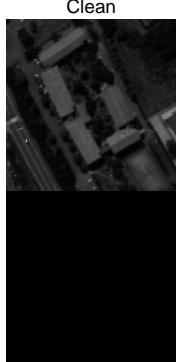

Noisy  
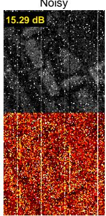

RCCTV  
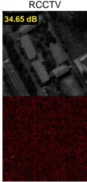

LRTDTV  
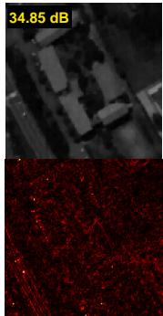

E-3DTV  
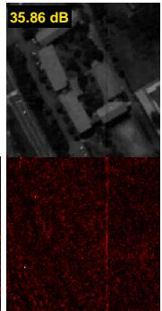

FastHyMix  
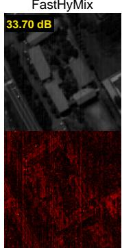

L1HyMixDe  
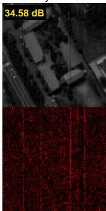

SC-RCCTV (ours)  
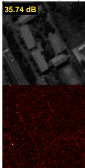  
Fig. 1. Restoration results on Pavia University, case 8 (seed 0), band 50. Top: restored bands with the PSNR of the band; bottom: absolute error maps (display range [0, 0.25]).

Input  
RCCTV  
E-3DTV  
LRTDTV  
FastHyMix  
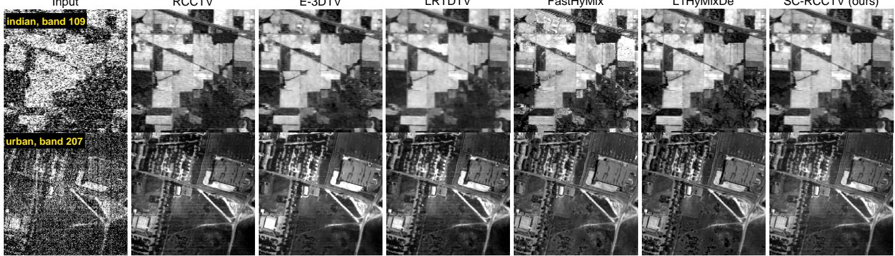  
L1HyMixDe  
SC-RCCTV (ours)  
Fig. 2. Restoration results on real data. Top: Indian Pines band 109, the noisiest band outside the water-absorption windows; bottom: Urban band 207, a heavily striped band. Display range common to each row: 1st–99th percentile of all restored versions of that band.

The estimated noise levels have nearly settled at termination: over 36 runs on 64×64 crops, the median of the largest relative change of any $\hat { \sigma } _ { k }$ in the last iteration is $1 . 4 \times 1 0 ^ { - 3 }$ (worst case $1 . 2 \times 1 0 ^ { - 2 } )$ , and SC-RCCTV terminates after 21.2 iterations on average on the native cubes. Continuing to a tolerance of $1 0 ^ { - 7 }$ (50 iterations on average) changes the MPSNR by 0.04 dB on average and by at most 0.40 dB over 116 cells.

2) Computational Eficiency: On the native cubes (Ta  
ble III), SC-RCCTV takes 1.3 s and 1.1 s, against 0.8 s and   
0.5 s for RCCTV and 2.6 s and 2.1 s for FastHyMix, while E-  
3DTV, LRTDTV, t-CTV and S3TTV require 3.6–3.7, 15, 53–   
59 and 1920–2017 times as long as SC-RCCTV, respectively.

To verify that this ranking holds at scene size, all methods except S3TTV (whose memory exceeds 16 GB) were also run on the full Pavia University scene (610×340×103; cases 8 and 10) and on the full Urban scene (307×307×210). On Pavia University, SC-RCCTV reaches 34.59 and 35.18 dB in 16 s; FastHyMix reaches 34.34 and 34.79 dB in 31 s, and L1HyMixDe 34.42 and 36.81 dB (the best value on case 10) in 355 s; the results of the other methods are shown in Fig. 4(b). On the full Urban scene, SC-RCCTV lowers the stripe index of RCCTV from 54.3 to 29.8 (×10−3) in 18 s, but the other methods reach lower values (e.g., 11.7 for FastHyMix and 5.9 for E-3DTV), as on the 200×200 crop. Fig. 4 summarizes the trade-of between accuracy and run time.

TABLE V  
Real data. Indian Pines: overall accuracy (OA, mean ± std over 5 splits) and � of an RBF-SVM with 10% training samples per class. Urban (200×200): stripe index averaged over the 20 noisiest bands of the input, and largest change of a band mean, both ×10−3. Time: Indian Pines, idle machine; t-CTV was run on Indian Pines only.
<table><tr><td>Method</td><td>OA (%)↑</td><td>κ↑</td><td>Stripe↓</td><td>Shift↓</td><td>Time (s)</td></tr><tr><td>Noisy input</td><td> $7 2 . 3 \pm 0 . 4$ </td><td>0.676</td><td>107.8</td><td>0</td><td>一</td></tr><tr><td>RCCTV</td><td> $7 4 . 9 \pm 0 . 7$ </td><td>0.709</td><td>89.5</td><td>30.8</td><td>2.0</td></tr><tr><td>LRTDTV</td><td> $8 2 . 3 \pm 0 . 3 $ </td><td>0.796</td><td>38.3</td><td>39.4</td><td>46</td></tr><tr><td>E-3DTV</td><td> $8 2 . 1 \pm 0 . 3$ </td><td>0.793</td><td>20.7</td><td>114.7</td><td>13</td></tr><tr><td>t-CTV</td><td> $8 9 . 2 \pm 0 . 5$ </td><td>0.875</td><td></td><td></td><td>270</td></tr><tr><td>FastHyMix</td><td> $8 0 . 1 \pm 0 . 3$ </td><td>0.771</td><td>12.2</td><td>20.4</td><td>3.7</td></tr><tr><td>L1HyMixDe</td><td> $7 9 . 0 \pm 0 . 6$ </td><td>0.758</td><td>11.0</td><td>37.3</td><td>12</td></tr><tr><td>SC-RCCTV</td><td> $7 8 . 1 \pm 0 . 5$ </td><td>0.746</td><td>49.7</td><td>9.4</td><td>4.6</td></tr></table>

TABLE VI

Effectiveness of each component: mean MPSNR gain (dB) over RCCTV in each noise family of Table I (both cubes, all realizations). Last row: the same model with the true $\sigma _ { k }$ in place of the estimated ones.
<table><tr><td>Variant</td><td>G+I</td><td>Str.</td><td>B.-V.</td><td>All</td></tr><tr><td>SC-RCCTV (full)</td><td>+1.74</td><td>+2.64</td><td>+1.94</td><td>+2.24</td></tr><tr><td>without stripe term T</td><td>+1.75</td><td>+0.08</td><td>+1.06</td><td>+0.77</td></tr><tr><td>without dense term G</td><td>-0.01</td><td>+1.14</td><td>+0.36</td><td>+0.65</td></tr><tr><td>scalar σ instead of σk</td><td>+1.76</td><td>+2.63</td><td>+0.43</td><td> $+ 1 . 9 8$ </td></tr><tr><td> $\hat { \sigma } _ { k } ^ { ( 0 ) }$  kept fixed (two-stage)</td><td>+1.68</td><td>+2.18</td><td>+1.80</td><td>+1.96</td></tr><tr><td>true  $\sigma _ { k }$  (all else unchanged)</td><td>+1.76</td><td>+2.65</td><td>+1.94</td><td>+2.25</td></tr></table>

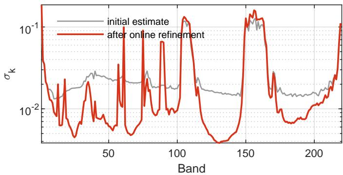  
Fig. 3. Noise levels $\hat { \sigma } _ { k }$ estimated by SC-RCCTV on Indian Pines: the stripe-invariant initial estimate $\hat { \sigma } _ { k } ^ { ( 0 ) }$ and the value after the online refinement (logarithmic scale).

3) Applicability and Limitations: SC-RCCTV is most beneficial when stripes extend along entire columns or rows, as produced by detector ofsets in push-broom sensors: it removes them without prior knowledge of their number or amplitude and, on the native-size cubes, outperforms the parameterfree subspace methods by several decibels, in about half the run time of FastHyMix (also on the full Pavia University scene, 16 vs. 31 s). On the full Pavia University scene, the margin in case 8 is small, and in case 10 L1HyMixDe is the most accurate. In the absence of stripes, FastHyMix and L1HyMixDe retain an advantage, most clearly for Gaussian noise alone, and on the two real scenes, whose stripes are only partly line-constant, FastHyMix attains higher classification accuracy and stronger destriping. The two classes of methods are therefore complementary. Several aspects of the model deserve further study: the rank-8 spatial representation limits the recovery of near-dead bands; the line-constant stripe model does not capture stripes that cover only part of a line, and it cannot always distinguish stripes from image structures that are themselves nearly constant along a line, such as straight roads or field boundaries; and the convergence of the iteration with adaptive noise levels, although consistently observed, remains to be proven.

## VI. Conclusion

This article proposed SC-RCCTV, a self-calibrated RCCTV model for HSI mixed noise removal, in which a band-wise dense term and line-constant stripe terms are introduced and all noise parameters are estimated within the model: the noise levels by a stripe-invariant MAD estimate refined online from the residual, and the stripe thresholds by a significance test with an analytically predictable false-alarm rate. The resulting ADMM-based algorithm has closed-form subproblems and the same per-iteration complexity as RCCTV. Experiments show that SC-RCCTV stays close to the same model given the true noise levels, that estimating the noise levels within the model improves on estimating them beforehand, and that under lineconstant stripes it outperforms FastHyMix and L1HyMixDe by several decibels on native-size cubes and S3TTV, which is given the true noise parameters, by 1.52 dB, at a run time of about one second. Future work will extend the stripe model to segment-wise ofsets, detected by the same significance test, so as to handle real stripes that cover only parts of lines. The MATLAB code, the noisy inputs and all result tables are available at https://github.com/haha2345/SC-RCCTV.

## Acknowledgment

The author thanks the authors of RCCTV, LRTDTV, E-3DTV, t-CTV, FastHyMix, L1HyMixDe and S3TTV for releasing their codes, and the providers of the Pavia University, Beltsville, Indian Pines, Urban and Washington DC Mall data.

## References

[1] B. Rasti, P. Scheunders, P. Ghamisi, G. Licciardi, and J. Chanussot, “Noise reduction in hyperspectral imagery: Overview and application,” Remote Sens., vol. 10, no. 3, p. 482, 2018.

[2] H. Zhang, W. He, L. Zhang, H. Shen, and Q. Yuan, “Hyperspectral image restoration using low-rank matrix recovery,” IEEE Trans. Geosci. Remote Sens., vol. 52, no. 8, pp. 4729–4743, 2014.

[3] W. He, H. Zhang, L. Zhang, and H. Shen, “Total-variation-regularized low-rank matrix factorization for hyperspectral image restoration,” IEEE Trans. Geosci. Remote Sens., vol. 54, no. 1, pp. 178–188, 2016.

[4] W. He, H. Zhang, H. Shen, and L. Zhang, “Hyperspectral image denoising using local low-rank matrix recovery and global spatial– spectral total variation,” IEEE J. Sel. Topics Appl. Earth Observ. Remote Sens., vol. 11, no. 3, pp. 713–729, 2018.

[5] Y. Wang, J. Peng, Q. Zhao, Y. Leung, X.-L. Zhao, and D. Meng, “Hyperspectral image restoration via total variation regularized low-rank tensor decomposition,” IEEE J. Sel. Topics Appl. Earth Observ. Remote Sens., vol. 11, no. 4, pp. 1227–1243, 2018.

[6] J. Peng, Q. Xie, Q. Zhao, Y. Wang, Y. Leung, and D. Meng, “Enhanced 3DTV regularization and its applications on HSI denoising and compressed sensing,” IEEE Trans. Image Process., vol. 29, pp. 7889–7903, 2020.

[7] Y. Chen, W. Cao, L. Pang, J. Peng, and X. Cao, “Hyperspectral image denoising via texture-preserved total variation regularizer,” IEEE Trans. Geosci. Remote Sens., vol. 61, pp. 1–14, 2023.

[8] H. Wang, J. Peng, W. Qin, J. Wang, and D. Meng, “Guaranteed tensor recovery fused low-rankness and smoothness,” IEEE Trans. Pattern Anal. Mach. Intell., vol. 45, no. 9, pp. 10 990–11 007, 2023.

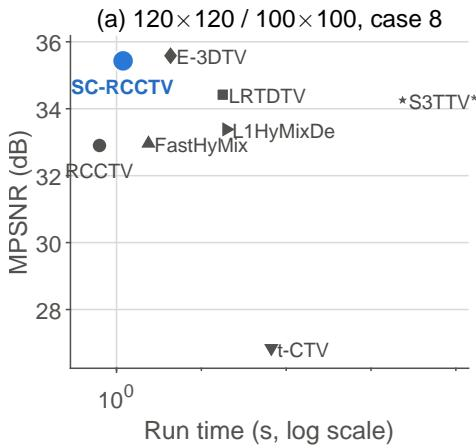

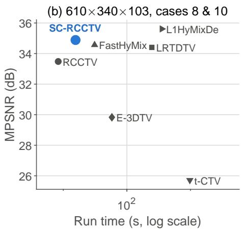

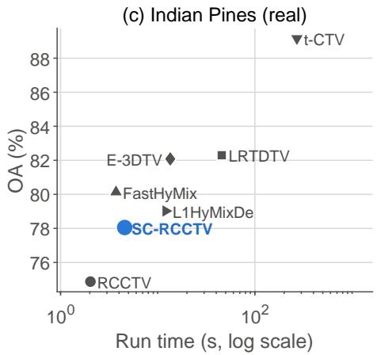  
Fig. 4. Accuracy against run time (log scale). (a) Native-size cubes, case 8, mean of both cubes; (b) full Pavia University, mean of cases 8 and 10; (c) Indian Pines, SVM overall accuracy. S3TTV: run time from the per-iteration time.

[9] Y.-B. Zheng, T.-Z. Huang, X.-L. Zhao, T.-X. Jiang, T.-H. Ma, and T.-Y. Ji, “Mixed noise removal in hyperspectral image via low-fibered-rank regularization,” IEEE Trans. Geosci. Remote Sens., vol. 58, no. 1, pp. 734–749, 2020.

[10] H. Zhang, L. Liu, W. He, and L. Zhang, “Hyperspectral image denoising with total variation regularization and nonlocal low-rank tensor decomposition,” IEEE Trans. Geosci. Remote Sens., vol. 58, no. 5, pp. 3071– 3084, 2020.

[11] Y. Chen, T.-Z. Huang, W. He, X.-L. Zhao, H. Zhang, and J. Zeng, “Hyperspectral image denoising using factor group sparsity-regularized nonconvex low-rank approximation,” IEEE Trans. Geosci. Remote Sens., vol. 60, pp. 1–16, 2022.

[12] W. He, H. Zhang, L. Zhang, and H. Shen, “Hyperspectral image denoising via noise-adjusted iterative low-rank matrix approximation,” IEEE J. Sel. Topics Appl. Earth Observ. Remote Sens., vol. 8, no. 6, pp. 3050–3061, 2015.

[13] Y. Chen, X. Cao, Q. Zhao, D. Meng, and Z. Xu, “Denoising hyperspectral image with non-i.i.d. noise structure,” IEEE Trans. Cybern., vol. 48, no. 3, pp. 1054–1066, 2018.

[14] J. M. Bioucas-Dias and J. M. P. Nascimento, “Hyperspectral subspace identification,” IEEE Trans. Geosci. Remote Sens., vol. 46, no. 8, pp. 2435–2445, 2008.

[15] L. Zhuang and J. M. Bioucas-Dias, “Fast hyperspectral image denoising and inpainting based on low-rank and sparse representations,” IEEE J. Sel. Topics Appl. Earth Observ. Remote Sens., vol. 11, no. 3, pp. 730– 742, 2018.

[16] L. Zhuang and M. K. Ng, “Hyperspectral mixed noise removal by ℓ1- norm-based subspace representation,” IEEE J. Sel. Topics Appl. Earth Observ. Remote Sens., vol. 13, pp. 1143–1157, 2020.

[17] L. Zhuang and M. K. Ng, “FastHyMix: Fast and parameter-free hyperspectral image mixed noise removal,” IEEE Trans. Neural Netw. Learn. Syst., vol. 34, no. 8, pp. 4702–4716, 2023.

[18] Y. Chang, L. Yan, T. Wu, and S. Zhong, “Remote sensing image stripe noise removal: From image decomposition perspective,” IEEE Trans. Geosci. Remote Sens., vol. 54, no. 12, pp. 7018–7031, 2016.

[19] X. Liu, X. Lu, H. Shen, Q. Yuan, Y. Jiao, and L. Zhang, “Stripe noise separation and removal in remote sensing images by consideration of the global sparsity and local variational properties,” IEEE Trans. Geosci. Remote Sens., vol. 54, no. 5, pp. 3049–3060, 2016.

[20] Y. Chen, T.-Z. Huang, X.-L. Zhao, L.-J. Deng, and J. Huang, “Stripe noise removal of remote sensing images by total variation regularization and group sparsity constraint,” Remote Sens., vol. 9, no. 6, p. 559, 2017.

[21] F. Yang, X. Chen, and L. Chai, “Hyperspectral image destriping and denoising using stripe and spectral low-rank matrix recovery and global spatial-spectral total variation,” Remote Sens., vol. 13, no. 4, p. 827, 2021.

[22] S. Takemoto, K. Naganuma, and S. Ono, “Spatio-spectral structure tensor total variation for hyperspectral image denoising and destriping,” IEEE J. Sel. Topics Appl. Earth Observ. Remote Sens., vol. 18, pp. 19 157– 19 175, 2025.

[23] K. Wei, Y. Fu, and H. Huang, “3-D quasi-recurrent neural network for hyperspectral image denoising,” IEEE Trans. Neural Netw. Learn. Syst., vol. 32, no. 1, pp. 363–375, 2021.

[24] M. Li, Y. Fu, and Y. Zhang, “Spatial-spectral transformer for hyperspectral image denoising,” in Proc. AAAI Conf. Artif. Intell., vol. 37, no. 1, 2023, pp. 1368–1376.

[25] E. J. Candès, X. Li, Y. Ma, and J. Wright, “Robust principal component analysis?” J. ACM, vol. 58, no. 3, pp. 11:1–11:37, 2011.

[26] J. Peng, Y. Wang, H. Zhang, J. Wang, and D. Meng, “Exact decomposition of joint low rankness and local smoothness plus sparse matrices,” IEEE Trans. Pattern Anal. Mach. Intell., vol. 45, no. 5, pp. 5766–5781, 2023.

[27] J. Peng, H. Wang, X. Cao, X. Jia, H. Zhang, and D. Meng, “Stable localsmooth principal component pursuit,” SIAM J. Imaging Sci., vol. 17, no. 2, pp. 1182–1205, 2024.

[28] M. Hu, H. Wang, S. Li, K. Shi, and J. Peng, “Fast guaranteed robust local-smooth principal component separation,” in Proc. AAAI Conf. Artif. Intell., vol. 40, no. 6, 2026, pp. 4896–4904.

[29] Z. Zhou, X. Li, J. Wright, E. J. Candès, and Y. Ma, “Stable principal component pursuit,” in Proc. IEEE Int. Symp. Inf. Theory, 2010, pp. 1518–1522.

[30] D. L. Donoho and I. M. Johnstone, “Ideal spatial adaptation by wavelet shrinkage,” Biometrika, vol. 81, no. 3, pp. 425–455, 1994.

[31] L. Gao, Q. Du, B. Zhang, W. Yang, and Y. Wu, “A comparative study on linear regression-based noise estimation for hyperspectral imagery,” IEEE J. Sel. Topics Appl. Earth Observ. Remote Sens., vol. 6, no. 2, pp. 488–498, 2013.

[32] P. J. Huber, “Robust estimation of a location parameter,” Ann. Math. Statist., vol. 35, no. 1, pp. 73–101, 1964.

[33] S. Boyd, N. Parikh, E. Chu, B. Peleato, and J. Eckstein, “Distributed optimization and statistical learning via the alternating direction method of multipliers,” Found. Trends Mach. Learn., vol. 3, no. 1, pp. 1–122, 2011.