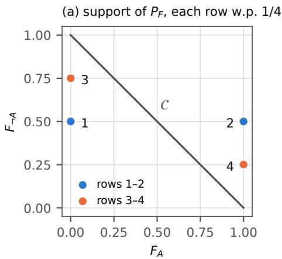
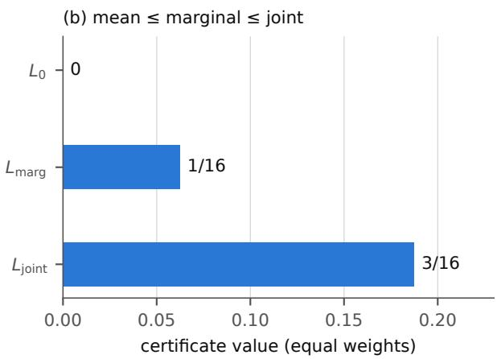
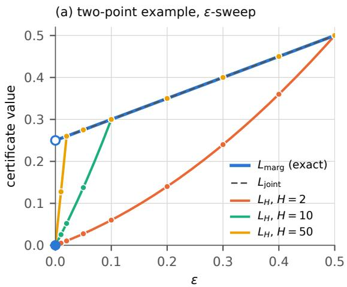
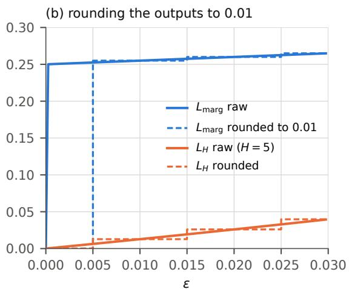
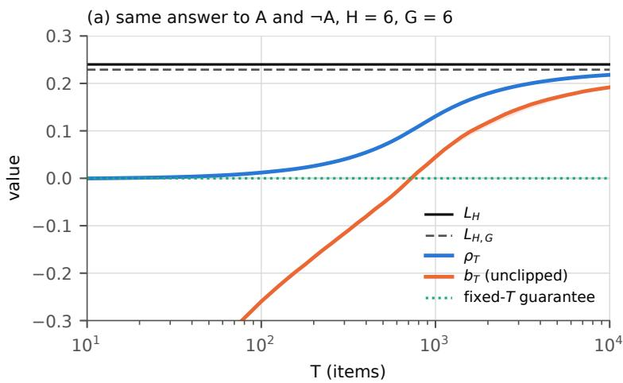
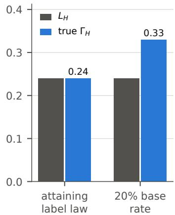
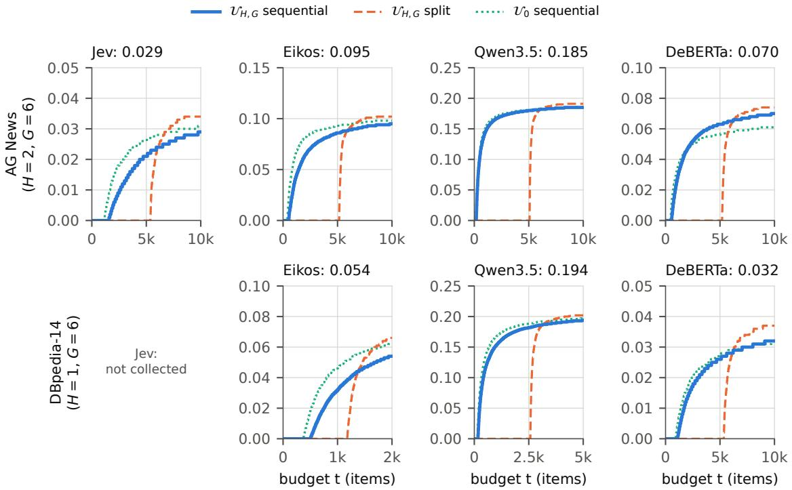
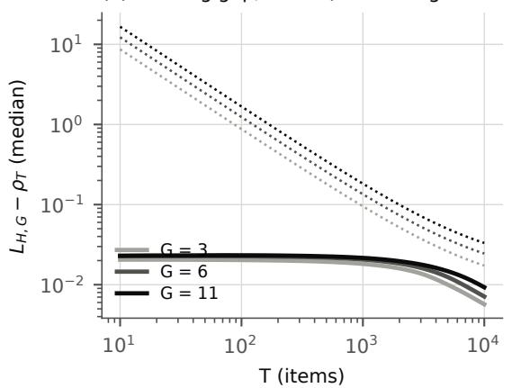
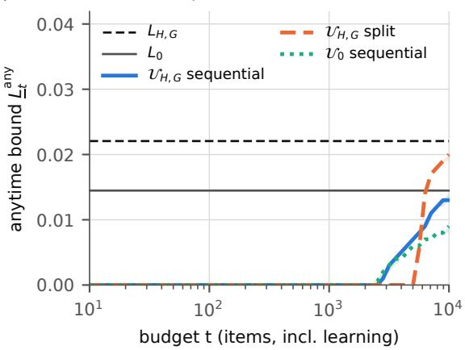
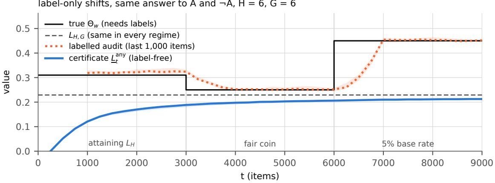

# Sharp and Stable Label-Free Calibration Certificates from Logical Coherence

Takahiro Kato

taka@np-hard.co.jp

NP-hard, Inc.

## Abstract

Query-conditioned probabilistic predictors, such as typed decision models, zero-shot classifiers and the answer probabilities of language models, answer logically related questions one at a time. Their answers need not be coherent, and the labels needed to check their calibration are often missing. We ask what the law of the answers and their logical structure, without any label, can refute about calibration. For every restriction on the information that a bettor’s stakes may use, an information-restricted minimax theorem identifies, for finitely supported laws of the answers, the sharp label-free lower bound on the corresponding calibration residual: the largest bound that the law of the answers and the logical structure allow. The theorem contains measures of incoherence, feasible joint posteriors and the mutual calibration of forecasters as special cases. On bundles of diferent, logically related events its mean, marginal and joint stages can separate strictly, and a bound on a bundle cannot be attributed to a given one of its questions without assumptions on the others. The sharp bound on marginal calibration error is discontinuous in the answers, the jump needs logical constraints among the questions, and no label-free lower bound that is continuous in the Wasserstein distance between laws of answers stays within a constant factor of it. Restricting the stakes to Lipschitz functions gives a stable bound that is sharp for a smooth calibration residual and, for every positive Lipschitz constant, is positive exactly when the sharp marginal bound is. On an i.i.d. stream of bundles, stakes represented at fixed nodes and learnt by projected online gradient ascent make it computable, with fixed-horizon certificates whose shortfall is bounded by grid, learning and statistical terms, and predictable betting gives anytime-valid ones. In a preregistered study of four predictors on two data sets, all seven confirmatory certificates were positive (the eighth pair did not pass the pilot). A certificate shows only that calibration is at least this bad; a certificate of zero means “not refuted”.

Keywords: calibration, label-free evaluation, probabilistic coherence, partial identification, Dutch books, anytime-valid inference

## 1 Introduction

A query-conditioned probabilistic predictor takes an input together with a question posed at inference time and returns a probability. Typed decision models, which return a probability or a distribution over named options instead of text, work this way, and so do zero-shot classifiers built on a natural language inference (NLI) model and readouts of the answer probabilities of a language model. Such a predictor is used by putting many small questions to one input and combining the answers in code: a ticket goes to billing when the probability that it asks for a refund exceeds a threshold, and to first-line support when the probability that it asks for something else does. Each question is evaluated separately, so nothing forces the answers to logically related questions to be the probabilities of a single probability measure, and audits that use no labels find that they are not. On Jev, a commercial typed decision model that we also audit in Section 6, the probabilities of “the label is $X ^ { \dag }$ and “the label is not $X ^ { \dag }$ sum to a value that difers from one by 0.064 on average, about five times the noise of repeated calls, and the probabilities of three mutually exclusive labels, asked one at a time, sum to 1.14 on average (Li et al., 2026a); when the same decision is broken into broad categories and finer labels, the two disagree by a mean total variation of 0.219 to 0.349 on three data sets (Joy, 2026). The model’s documentation calls it calibrated. For the version we audit, it also showed a question and its negation, asked separately, whose probabilities summed to 1.19, and a question that received 0.22 when asked for one probability and 0.01 for the option “yes” when asked as a choice between yes and no, and it advised not to hold the model to arithmetic identities between separate questions; a later revision removed these examples (TypeSafe AI, 2026).

Routing rules such as the one above mean what they say only if the answers are calibrated, that is, if the stated probabilities match frequencies, and checking calibration needs labels. In deployment, labels are costly, late or missing: outcomes arrive weeks later or never, some questions have no single right answer, and new questions are written faster than labelled evaluation sets can be built. This paper asks what the law of the answers and the logical structure of the questions, without any label, can refute about calibration, and whether the refutation can be made statistically usable: valid at a finite sample, computable, and not broken by rounding or noise.

The direction of the question matters. Coherence does not certify calibration: a predictor whose answers are always coherent passes every coherence check, however unrelated its answers are to the label (Counterexample 3). Nor does incoherence measure marginal miscalibration: marginal calibration implies coherence only on average (Lemma 1), answers can be marginally calibrated and still violate identities on every input (Counterexample 2), and so the documentation’s claim of calibration need not conflict with its advice against arithmetic identities. What we construct are therefore lower bounds, certificates that calibration is at least this bad, and a certificate of zero refutes nothing.

Which calibration notion a certificate refutes depends on what the comparison of probabilities with frequencies conditions on, and the notions difer in value, not only in definition. Ask about an event A and its complement with equal weights, and let the answers $( F _ { A } , F _ { \neg A } )$ take the values $( 0 , \frac { 1 } { 2 } ) , ( 1 , \frac { 1 } { 2 } ) , ( 0 , \frac { 3 } { 4 } )$ and $( 1 , { \frac { 1 } { 4 } } )$ with probability $\textstyle { \frac { 1 } { 4 } }$ each. The average answers are coherent, and nothing can be refuted about calibration on average. Whatever the labels, the answers are miscalibrated by at least $\frac { 1 } { 1 6 }$ when each answer is conditioned on its own value (marginal calibration) and by at least $\frac { 3 } { 1 6 }$ when it is conditioned on the whole pair (joint calibration), and no larger bounds follow from the law of the answers (Theorem 7). The average distance of the answers to the coherent set is $\frac { 3 } { 1 6 }$ , so an audit that reports it as the degree of miscalibration claims three times what can be proved about marginal calibration. We call a label-free lower bound sharp when no larger one follows from what is observable: it is the least value of the residual over all joint laws of answers and labels that are compatible with the law of the answers and the logical structure. This is the sense of a sharp bound in partial identification (Manski, 2003); it has nothing to do with the sharpness of a predictive distribution (its concentration), which forecasters maximise subject to calibration (Gneiting et al., 2007).

Section 3 identifies these bounds in general. For every restriction on the information that a bettor’s stakes may use, an information-restricted minimax theorem (Theorem 4) equates, for a finitely supported law of the answers, the least calibration residual over the compatible label laws with the largest expected profit of a bettor who settles every input in its worst world (a Dutch book without outcomes). Constant stakes, stakes on a question’s own answer and stakes on the whole bundle give the sharp bounds on the mean, marginal and joint residuals, which the example above separates, and a bound on a bundle cannot be attributed to a fixed question without assumptions on the others (Proposition 8).

Section 4 asks whether a certificate is stable. A certificate used to monitor a predictor should not jump when the answers move a little, but the sharp marginal bound does: on a two-point example it jumps from 0 to above $\textstyle { \frac { 1 } { 4 } }$ under an arbitrarily small perturbation, and rounding the answers to two decimals sends it back (Proposition 9). The jump needs a logical constraint among the questions (Lemma 10), and no label-free lower bound that is continuous in the Wasserstein distance between laws of answers stays within a constant factor of the sharp one (Corollary 11). Restricting the stakes to H-Lipschitz functions of their own answer gives a bound $L _ { H }$ that is (1 + H)-Lipschitz in the Wasserstein distance between laws of answers, that is sharp for a smooth calibration residual $\Gamma _ { H }$ rather than for the marginal calibration error, and that, for every $H > 0 ,$ , is positive exactly when the sharp marginal bound is (Theorem 12, Corollary 13). The two adjectives of our title therefore meet in $L _ { H }$ , which is sharp for $\Gamma _ { H }$ and stable. For the marginal calibration error $\Theta _ { w }$ they cannot meet (Corollary 11).

Section 5 makes $L _ { H }$ computable from an i.i.d. stream of bundles. Stakes represented by their values at fixed nodes, learnt by projected online gradient ascent and fixed before each bundle is observed, give fixed-horizon lower confidence bounds, whose shortfall from $L _ { H }$ is, with probability at least $1 - \alpha .$ bounded by a grid, a learning and a statistical term (Theorem 16), and the same stakes in a betting process give anytime-valid ones (Proposition 17). Section 6 checks the mechanism on synthetic data and reports a preregistered study of four predictors on two public classification data sets (a commercial decision model through its API, an open-weight decision model and its base model, and a zero-shot NLI classifier). All seven confirmatory certificates were positive, from 0.029 to 0.194; the eighth pair of predictor and data set did not meet the preregistered pilot criterion for collecting confirmation data.

Contributions. The techniques (linear programming duality, a minimax theorem, projected online gradient ascent, the Azuma–Hoefding inequality and betting) are standard. Our contribution is to state the calibration notions, what is achievable without labels, the price of stability and the guarantees of the implementation for one object.

1. What is refutable. Theorem 4 brings four lines of work under one label-free minimax. For finitely supported laws, Corollary 6 recovers, as special cases, results on measures of incoherence (De Bona and Finger, 2015), on feasible joint posteriors (Arieli et al., 2021) and on the mutual calibration of forecasters (Kong et al., 2026), and the stages of Corollary 5 are the refutation side of labelled hierarchies of calibration (Resin et al., 2026; Dwork et al., 2021). The equality is finite duality, and label-free partial identification of calibration error is not new (Kong et al., 2026). The closest work, Andrews and Sarkar (2026), measures the incoherence of language models by Dutch books, without a theoretical link to calibration error. The joint-stage measure, the distance of a bundle to the coherent set, is a known measure of incoherence (De Bona and Finger, 2015); we read its expectation, for finitely supported laws, as the sharp label-free lower bound on the joint calibration error, below which lie the marginal and mean stages. What is new is a single minimax for bundles of diferent, logically related events and, on such bundles, the strict separation of the stages and the impossibility of attributing a bound to a given question.

2. Stability and its price. The discontinuity of the sharp marginal bound survives the minimisation over the compatible label laws, is produced by the logical constraints and admits no stable approximation within a uniform constant factor, while $L _ { H }$ stable, sharp for $\Gamma _ { H }$ and, for every $H > 0$ , positive for exactly the laws under which marginal calibration is refutable without labels in the population. These results have labelled analogues (Błasiok et al., 2023; Gopalan et al., 2026); ours concern the labelfree, partially identified quantity.

3. Certificates and evidence. We give fixed-horizon and anytime-valid certificates for the same target; for the fixed-horizon certificate with stakes learnt by projected online gradient ascent, the shortfall is split into three terms, while the anytime certificate claims no rate. We also report a preregistered study on real predictors in which every confirmatory certificate was positive.

What a certificate is about. Every certificate in this paper concerns unconditional events about one input and one label with finitely many values; on real data, reading the probabilities of a choice query this way rests on its options exhausting the labels (Section 8). It bounds a total over the bundle with weights fixed in advance that sum to one, so it bounds a weighted average of per-question errors, not the error of any one question (Proposition 8) and not that of all answers pooled into one sequence (Section 2). It is computed from the answers as the predictor returns them, without rounding. A predictor whose answers are rounded, by its vendor or by an auditor, is a diferent predictor with a diferent residual, and rounding can move the exact marginal bound discontinuously (Proposition 9). Finally, each certificate is a lower bound on a named residual. $L _ { 0 } , L _ { \mathrm { m a r g } }$ and $L _ { \mathrm { j o i n t } }$ are sharp for the mean, marginal and joint residuals $( L _ { \mathrm { j o i n t } }$ for finitely supported laws), and $L _ { \mathrm { j o i n t } }$ does not bound the marginal calibration error $\Theta _ { w }$ (Counterexample 2). $L _ { H }$ and its computable version $L _ { H , G }$ are lower bounds on $\Theta _ { w }$ , and so, at their stated levels, are the confidence bounds on $L _ { H , G } ;$ $L _ { H }$ is sharp for the smooth residual $\Gamma _ { H } .$ , not for $\Theta _ { w }$ . Values of these bounds computed on the empirical law of a sample are not certificates (Appendix F).

Section 2 sets up bundles, calibration residuals and Dutch books without outcomes. Sections 3–5 give the results, with the proofs in Appendices $\mathrm { A - C }$ , and Section 6 the experiments. Section 7 discusses related work, Section 8 the limitations, and Section 9 concludes.

## 2 Setup

Bundles and possible worlds. A query-conditioned probabilistic predictor receives an input together with a query and returns a probability. For one input we ask m event queries and collect the answers in a bundle $F = ( F _ { 1 } , \ldots , F _ { m } ) \in [ 0 , 1 ] ^ { m }$ . Each queried event $B _ { i }$ is a function of a label Y that takes finitely many values and is never observed. A possible world $\ell \in \mathcal W$ is a value of the label, with indicator vector $z ^ { \ell } = ( \mathbf { 1 } \{ \ell \in B _ { i } \} ) _ { i \leq m } \in \{ 0 , 1 \} ^ { m }$ ; the realised indicator vector is $Z = z ^ { Y }$ . A choice query, which returns a distribution over a set of options, enters the bundle as one component per option. The coherent polytope

$$
\mathcal { C } = \mathrm { c o n v } \{ z ^ { \ell } : \ell \in \mathcal { W } \}
$$

is the set of vectors $( \mu ( B _ { 1 } ) , \dots , \mu ( B _ { m } ) )$ obtained from probability measures $\mu$ on $\mathcal { W } _ { : }$ , so a bundle is coherent exactly when it lies in $\mathcal { C } .$

Without labels one observes the law $P _ { F }$ of the bundle and the logical structure $\{ z ^ { \ell } \}$ 2 nothing else. We write ${ \mathcal { P } } ( P _ { F } )$ for the set of joint laws P of $( F , Z )$ on $[ 0 , 1 ] ^ { m } \times \{ z ^ { \ell } : \ell \in \mathcal { W } \}$ whose first marginal is $P _ { F } ;$ the conditional law of $Z$ given F is unrestricted. Each component carries a weight $w _ { i } > 0$ , with $\textstyle \sum _ { i } w _ { i } = 1$ , fixed in advance with the bundle according to the role of its query: a choice query, an atom $\{ Y = k \}$ , a complement $\{ Y \neq k \}$ or a union of labels. When certificates that use fewer queries are compared with one another, each is computed on the same bundle and weights, with zero stakes on the components it does not use, so that all of them bound the same residual. We use the weighted $\ell _ { 1 }$ distance $\begin{array} { r } { \mathrm { d i s t } _ { 1 } ^ { w } ( v , \mathcal { C } ) = \operatorname* { m i n } _ { c \in \mathcal { C } } \sum _ { i } w _ { i } | v _ { i } - c _ { i } | } \end{array}$ and the weighted Wasserstein distance $W _ { 1 , w } ( P , Q ) =$ $\begin{array} { r } { \operatorname* { i n f } _ { \gamma \in \Pi ( P , Q ) } \mathbb { E } _ { \gamma } \sum _ { i } w _ { i } | F _ { i } - F _ { i } ^ { \prime } | } \end{array}$ between laws of bundles.

Semantics. Every component asks an unconditional event about the same input and the same label. We assume that the options of a choice query exhaust the possible labels and that a union is asked as the explicit disjunction of its labels. These assumptions fix the semantics that the logical structure encodes; a relation entered wrongly into $\mathcal { C }$ makes a statistically valid certificate refute the wrong thing, while weakening a relation enlarges C and can only lower the population bounds defined below.

Calibration residuals. Calibration compares stated probabilities with frequencies, and the comparison depends on what it conditions on. For sub-σ-algebras $\mathcal { H } _ { i } \subseteq \sigma ( F )$ we define the information-restricted calibration residual

$$
\Gamma _ { \mathcal { H } } ( P ) = \sum _ { i = 1 } ^ { m } w _ { i } \mathbb { E } \big | \mathbb { E } [ F _ { i } - Z _ { i } \mid \mathcal { H } _ { i } ] \big | .
$$

The trivial σ-algebra gives the mean residual $\begin{array} { r } { \sum _ { i } w _ { i } | \mathbb { E } ( F _ { i } - Z _ { i } ) | } \end{array}$ . The choice $\mathcal { H } _ { i } = \sigma ( F _ { i } )$ gives the marginal calibration error

$$
\Theta _ { w } ( P ) = \sum _ { i = 1 } ^ { m } w _ { i } \operatorname { E C E } _ { 1 } ( F _ { i } ) , \qquad \operatorname { E C E } _ { 1 } ( F _ { i } ) = \mathbb { E } { \big | } F _ { i } - \operatorname* { P r } ( Z _ { i } = 1 \mid F _ { i } ) { \big | } ,
$$

in which every component is conditioned on its own value.1 The choice $\mathcal { H } _ { i } = \sigma ( F )$ gives the joint calibration error $\mathbb { E } \sum _ { i } w _ { i } | F _ { i } - \mathrm { P r } ( Z _ { i } = 1 \mid F ) |$ , in which every component is conditioned on the whole bundle. Because conditional expectation contracts, the three residuals, which we call the mean, marginal and joint stages, are ordered: mean $\leq$ marginal $\leq$ joint for every $P . \ \Theta _ { w }$ is a weighted average of per-component errors with fixed weights, not the expected calibration error of all answers pooled into one sequence. If the pooled sequence draws the component of each answer independently with probabilities $w _ { i } .$ Jensen’s inequality makes its error at most $\Theta _ { w } ,$ so a lower bound on $\Theta _ { w }$ is not one on the pooled error; with any other pooling the two are not ordered.

Conditioning on an exact value makes $\Theta _ { w }$ jump under arbitrarily small perturbations of the answers. With the class $\boldsymbol { \mathcal { U } } _ { H }$ of stakes $u = ( u _ { 1 } , \ldots , u _ { m } ) $ whose components $u _ { i } \colon [ 0 , 1 ] \to$ $[ - 1 , 1 ]$ are H-Lipschitz, the smooth residual is

$$
\Gamma _ { H } ( P ) = \operatorname* { s u p } _ { u \in \mathcal { U } _ { H } } \mathbb { E } \sum _ { i = 1 } ^ { m } w _ { i } u _ { i } ( F _ { i } ) ( F _ { i } - Z _ { i } ) ,
$$

the weight family of smooth calibration error (Błasiok et al., 2023) applied component by component. $\Gamma _ { H }$ is nondecreasing in $H , \Gamma _ { 0 }$ is the mean residual and $\Gamma _ { H } \leq \Theta _ { w }$

Sharp label-free lower bounds. A label-free lower bound on a residual Γ is a functional $L$ of $P _ { F }$ , the logical structure and the weights with $L ( P _ { F } ) \le \Gamma ( P )$ for every $P \in { \mathcal { P } } ( P _ { F } )$ It is sharp when $L ( P _ { F } ) = \operatorname* { i n f } _ { P \in { \mathcal { P } } ( P _ { F } ) } \Gamma ( P )$ : no larger lower bound follows from what is observable. $\mathrm { A }$ certificate is such a lower bound, or a finite-sample lower confidence bound for one; it can only show that calibration is at least this bad.

Dutch books without outcomes. A bettor who stakes $u _ { i }$ on event $B _ { i }$ at the price $F _ { i }$ earns, as the seller, $\begin{array} { r } { \sum _ { i } w _ { i } u _ { i } ( F _ { i } - Z _ { i } ) } \end{array}$ . The outcome is not observed, so the bettor counts the worst world:

$$
d _ { u } ^ { w } ( { \cal F } ) = \operatorname* { m i n } _ { \ell \in { \cal W } } \sum _ { i = 1 } ^ { m } w _ { i } u _ { i } ( { \cal F } ) ( F _ { i } - z _ { i } ^ { \ell } ) \in [ - 1 , 1 ] \quad \quad ( | u _ { i } | \le 1 ) .
$$

The information a stake may use decides which calibration notion it tests. We write $\boldsymbol { \mathcal { U } _ { \mathcal { H } } }$ for the stakes whose component $u _ { i }$ is $\mathcal { H } _ { i } \mathrm { - m e a s u r a b l e }$ with $| u _ { i } | \leq 1 ;$ ; constant stakes $( { { \mathcal { U } } _ { 0 } }$ , which is also $\boldsymbol { \mathcal { U } } _ { H }$ with $H = 0 )$ , stakes on the own value $u _ { i } ( F _ { i } ) \ ( { \mathcal { U } } _ { \mathrm { m a r g } } )$ and stakes on the whole bundle $u ( F ) \ ( { \mathcal { U } } _ { \mathrm { j o i n t } } )$ correspond to the mean, marginal and joint residuals. Negative values of $d _ { u } ^ { w } ( F )$ are averaged as they are: clipping each value at zero would overstate the expected profit, so only a final lower confidence bound is clipped.

## 3 What Is Refutable Without Labels

This section asks what the law of the bundle and its logical structure can refute about each calibration residual. Section 3.1 ties calibration to coherence and marks where the tie ends. Section 3.2 identifies, for finitely supported laws, the sharp label-free lower bound on every information-restricted residual, separates the mean, marginal and joint stages on a small example, and shows that a bound on the bundle cannot be attributed to a fixed question. The proofs are in Appendix A.

## 3.1 Calibration and Coherence

If every answer is marginally calibrated, the average answers are the frequencies of the queried events, and these frequencies come from one probability measure.

Lemma 1 (Marginal calibration implies coherence on average). If $\operatorname* { P r } ( Z _ { i } = 1 \mid F _ { i } ) = F _ { i }$ almost surely for every i, then $\complement F \in { \mathcal { C } } ;$ in particular every linear equality or inequality satisfied by all probability measures holds for $\left( \mathbb { E } F _ { 1 } , \ldots , \mathbb { E } F _ { m } \right)$ . The converse fails.

Marginal calibration and coherence therefore meet only on average. A marginally calibrated predictor can answer a question and its negation with probabilities that do not sum to one on an individual input, while an identity or an inequality that fails on average, such as $\mathbb { E } F _ { 1 } > \mathbb { E } F _ { 2 }$ for $B _ { 1 } \subseteq B _ { 2 }$ , refutes marginal calibration. The converse fails twice over: a predictor whose average answers are coherent can be miscalibrated under its true law (Counterexample 3), and Theorem 7 gives a law of bundles with a coherent average for which no compatible label law makes the answers marginally calibrated. In the other direction, pointwise incoherence does not by itself imply marginal miscalibration.

Counterexample 2 (Pointwise incoherence is not marginal miscalibration). Let A be an event and let the bundle $( F _ { A } , F _ { \neg A } )$ take the values $( 0 , { \frac { 1 } { 2 } } )$ and $( 1 , { \frac { 1 } { 2 } } )$ with probability $\frac { 1 } { 2 }$ each, A occurring exactly when $F _ { A } = 1$ . Then $\Theta _ { w } = 0$ , while $\begin{array} { r } { \mathbb { E } \mathrm { d i s t } _ { 1 } ^ { w } ( F , \mathcal { C } ) = \frac { 1 } { 4 } } \end{array}$ with equal weights.

Counting coherence violations, or averaging the distance of each bundle to ${ \mathcal { C } } ,$ does not measure marginal calibration error, and an audit that reports either as the degree to which marginal calibration is broken is refuted by this example. The pointwise distance bounds the joint calibration error (Corollary 5); here the joint calibration error is $\textstyle { \frac { 1 } { 4 } }$ as well.

Counterexample 3 (Coherent but miscalibrated). A predictor whose bundle always lies in C violates no coherence check, however unrelated its answers are to the label. Every population certificate of this paper is then zero while $\Theta _ { w }$ can be large. A certificate of zero therefore means “not refuted”, never “calibrated”.

Every result below is subject to this limit. A label-free check sees only the distortions that push answers out of $\mathcal { C } ;$ an error in a coherent belief, however large, leaves no trace in $P _ { F }$ and the logical structure. A positive certificate refutes, on its bundle, the calibration notion whose residual it bounds (a finite-sample one at its level).

## 3.2 Identification

The sharp label-free lower bound on a residual $\Gamma _ { \mathcal { H } }$ is, by definition, its infimum over the label laws compatible with $P _ { F }$ : the smallest error under the label laws that a label-free observer cannot rule out. A bettor gives lower bounds on it. If stakes that use only the information $\mathcal { H } _ { i }$ on $B _ { i }$ make a positive expected profit when every input is settled in its worst world, the answers cannot be calibrated in the sense of $\varkappa \colon$ under every compatible law that expected profit is at most $\Gamma _ { \mathcal { H } }$ (Lemma 18). The next theorem gives the converse: a calibration violation that no admissible bet extracts is absent under some compatible label law.

Theorem 4 (Information-restricted minimax). $I f P _ { F }$ has finite support, then

$$
\operatorname* { i n f } _ { P \in \mathcal { P } ( P _ { F } ) } \Gamma _ { \mathcal { H } } ( P ) = \operatorname* { s u p } _ { u \in \mathcal { U } _ { \mathcal { H } } } \mathbb { E } \big [ d _ { u } ^ { w } ( F ) \big ] ,
$$

both sides are attained, and they are the optimal values of a finite linear program and its dual.

The primal chooses, with $P _ { F }$ held fixed, the label law under which the predictor is as calibrated as it can be; the dual chooses stakes that use only the permitted information and hedge against every world. The equality is the duality of a finite linear program. For one event put to several agents, Arieli et al. (2021) characterise feasible joint posteriors by a notrade condition and note that, for finitely supported laws, their characterisation reduces to Farkas’ lemma; the same finite duality gives the value of the marginal stage (Corollary $6 ( \mathrm { a } ) )$ . What the theorem adds is a single minimax for every information restriction on a bundle of diferent, logically related events, so that the mean, marginal and joint stages, and any stage between them, are one object. An attaining law shows that under some label law consistent with the observations the predictor is calibrated up to the bound; it does not say that the predictor’s actual errors resemble those under that law. $\mathrm { A t }$ the marginal stage a stake on $B _ { i }$ must be the same on all inputs at which $F _ { i }$ takes the same value, and this coupling across inputs is what separates $L _ { \mathrm { m a r g } }$ from the pointwise distance.

Corollary 5 (Three stages). Taking $\mathcal { H } _ { i }$ trivial, $\sigma ( F _ { i } )$ and $\sigma ( F )$ in Theorem $\it 4$ gives the sharp label-free lower bounds

$$
L _ { 0 } = \mathrm { d i s t } _ { 1 } ^ { w } ( \mathbb { E } F , \mathcal { C } ) , \qquad L _ { \mathrm { m a r g } } , \qquad L _ { \mathrm { j o i n t } } = \mathbb { E } \mathrm { d i s t } _ { 1 } ^ { w } ( F , \mathcal { C } )
$$

on the mean, marginal and joint residuals, where $L _ { \mathrm { m a r g } }$ is the value of the linear program; and $L _ { 0 } \le L _ { \mathrm { m a r g } } \le L _ { \mathrm { j o i n t } }$ . In particular $L _ { \mathrm { m a r g } } \leq \Theta _ { w } ( P )$ for every $P \in { \mathcal { P } } ( P _ { F } )$

The three bounds answer three questions. $L _ { 0 }$ is the best test by the supporting hyperplanes of ${ \mathcal { C } } ,$ inequalities as well as identities: if $B _ { 1 } \subseteq B _ { 2 }$ and $\mathbb { E } F = ( 0 . 8 , 0 . 2 )$ , no identity is violated but the inclusion is, and $L _ { 0 } = 0 . 3$ with equal weights. $L _ { \mathrm { j o i n t } }$ needs no learning; it averages the distance of each bundle to C. $L _ { \mathrm { m a r g } }$ lies between them and needs the linear program, because its stakes are shared across inputs. A bound grows with the information its stakes may use, and so does the notion it bounds: a larger bound refutes a stronger notion, not the same notion more strongly. The stages order calibration notions by the σ-algebra they condition on, as labelled hierarchies of calibration do (Resin et al., 2026), and the information available to a stake plays the role of the access of a distinguisher in outcome indistinguishability (Dwork et al., 2021); Theorem 4 is the label-free, refutation side of that correspondence.

Theorem 4 also contains, as special cases, results and quantities from three other lines of work: the feasibility of joint posterior beliefs, measures of incoherence, and the mutual calibration of forecasters.

Corollary 6 (Special cases). Let $P _ { F }$ have finite support.

(a) One event asked m times. $I f B _ { 1 } = \cdot \cdot \cdot = B _ { m } = A$ with A neither sure nor impossible, then

$$
L _ { \mathrm { m a r g } } = \operatorname* { s u p } _ { a } \mathbb { E } \big [ \sum _ { i = 1 } ^ { m } a _ { i } ( F _ { i } ) F _ { i } - \operatorname* { m a x } \big \{ 0 , \sum _ { i = 1 } ^ { m } a _ { i } ( F _ { i } ) \big \} \big ]
$$

over measurable $a _ { i } \colon [ 0 , 1 ] \ \to \ [ - w _ { i } , w _ { i } ]$ . Hence $L _ { \mathrm { m a r g } } ~ = ~ 0 ~ i f$ and only if $F \equiv 0 ^ { m }$ $F \equiv 1 ^ { m }$ , or $P _ { F }$ is the law of the posterior beliefs about A of m agents with a common prior $p \in ( 0 , 1 )$ : the no-trade characterisation of feasible joint posteriors (Arieli et $a l .$ 2021, Theorem 3); for $m = 2$ , Arieli et al. state an equivalent characterisation due to Dawid et al. (1995).

(b) The joint stage, pointwise. For every $v \in [ 0 , 1 ] ^ { m }$ 2

$$
\mathrm { d i s t } _ { 1 } ^ { w } ( v , \mathcal { C } ) = \operatorname* { m a x } _ { u \in [ - 1 , 1 ] ^ { m } } \operatorname* { m i n } _ { \ell \in \mathcal { W } } \sum _ { i = 1 } ^ { m } w _ { i } u _ { i } ( v _ { i } - z _ { i } ^ { \ell } ) ,
$$

the identity between distance-based and Dutch-book measures of incoherence (De Bona and Finger, 2015); $L _ { \mathrm { j o i n t } }$ is its expectation.

(c) Two forecasters of one label. Let $Q _ { 1 } , Q _ { 2 } \in \Delta _ { K }$ forecast a label $Y \in \{ 1 , \ldots , K \}$ , written as a one-hot vector. Form the bundle $F = ( Q _ { 1 } , Q _ { 2 } )$ of the 2K events $\{ Y =$ $k \}$ with weights $1 / ( 2 K )$ , and give coordinate $( j , k )$ the information $\sigma ( Q _ { j } )$ Then inf $P \in \mathcal { P } ( P _ { F } ) \Gamma _ { \mathcal { H } } ( P ) = \mathrm { M i n E C E } / K$ , where

$$
\mathrm { M i n E C E } = \textstyle \frac { 1 } { 2 } \operatorname* { i n f } _ { P \in \mathcal { P } ( P _ { F } ) } \mathbb { E } \big [ \| Q _ { 1 } - \mathbb { E } [ Y \mid Q _ { 1 } ] \| _ { 1 } + \| Q _ { 2 } - \mathbb { E } [ Y \mid Q _ { 2 } ] \| _ { 1 } \big ]
$$

is the minimal calibration error of Kong et al. (2026); so $\begin{array} { r } { \mathrm { M i n E C E } = K \operatorname* { s u p } _ { u } \mathbb { E } [ d _ { u } ^ { w } ( F ) ] } \end{array}$ over stakes $u _ { ( j , k ) } = u _ { j k } ( Q _ { j } ) \in [ - 1 , 1 ]$

Case (a) turns the no-trade condition into a value: $L _ { \mathrm { m a r g } }$ is the least marginal calibration error that a label law compatible with forecasts of one event must leave, and its zero set is the feasibility characterisation, apart from the two degenerate laws, which pass the notrade test without an interior prior. Case (b) is the identity behind distance-based measures of incoherence; what Corollary 5 adds is that its expectation is the sharp label-free lower bound on the joint calibration error, and Counterexample 2 shows that it does not bound the marginal one. Andrews and Sarkar (2026, Appendix $\mathrm { A } )$ bound the stakes in $\ell _ { 1 }$ instead and obtain the distance in the supremum norm, the dual of $\ell _ { 1 }$ . We bound each stake separately, and then, under a fixed label law, the best expected profit against the realised outcomes separates across components: the stakes $u _ { i } = \mathrm { s i g n } \mathbb { E } [ F _ { i } - Z _ { i } \mid \mathcal { H } _ { i } ]$ make the second inequality of Lemma 18 an equality, so that this profit is the weighted sum $\Gamma _ { \mathcal { H } }$ of the per-component residuals, each conditioned on its own information. In case (c) a coordinate is conditioned on the whole forecast vector of its forecaster. This information contains the marginal one and is contained in the joint one, so $L _ { \mathrm { m a r g } } \leq \mathrm { M i n E C E } / K \leq L _ { \mathrm { j o i n t } }$ ; for $K = 2$ it is the marginal stage. Kong et al. (2026) bound the arbitrage of zero-mean trades, each depending only on its forecaster’s own forecast and with payofs in $[ - 1 , 1 ]$ , between MinECE and 2 MinECE; bounding the stakes instead of the payofs, as $d _ { u } ^ { w }$ does, turns the bracket into an equality.

The next example, small enough to check by hand, separates the three stages. It mixes the two inputs of Counterexample 2, which a marginally calibrated law can produce, with two inputs that no such law can.

Theorem 7 (Four-point separation). For an event A and its complement with equal weights, let $( F _ { A } , F _ { \neg A } )$ take the values $( 0 , \frac { 1 } { 2 } ) , ( 1 , \frac { 1 } { 2 } ) , ( 0 , \frac { 3 } { 4 } )$ and $( 1 , { \frac { 1 } { 4 } } )$ with probability $\textstyle { \frac { 1 } { 4 } }$ each. Then $\begin{array} { r } { 0 = L _ { 0 } < L _ { \mathrm { m a r g } } = \frac { 1 } { 1 6 } < L _ { \mathrm { j o i n t } } = \frac { 3 } { 1 6 } } \end{array}$

Table 1 lists a label law that attains $L _ { \mathrm { m a r g } }$ and stakes that earn it, so the separation can be checked without a solver (Figure 1). On these answers the average distance to ${ \mathcal { C } } ,$ $\frac { 3 } { 1 6 }$ , is three times the marginal calibration error that can be proved without labels, ${ \frac { 1 } { 1 6 } } ,$ and an audit’s conclusion depends on which of the two it reports. The marginal bound can also be zero while the joint one is not. On a fair die, let a choice query over the six faces return 0.83 for a uniformly drawn face and 0.034 for each other face, beside atom queries $\{ Y = k \}$ that always answer ${ \frac { 1 } { 6 } } .$ . The choice query is overconfident, yet $L _ { \mathrm { m a r g } } = 0 { \mathrm { : } }$ under the label law in which the drawn face comes up with probability 0.83 and each other face with probability 0.034, every component is marginally calibrated. $L _ { \mathrm { j o i n t } } > 0$ because the two queries disagree on the same event at every input. That the roll does not depend on the drawn face is information beyond $P _ { F }$ and the logical structure.

A certificate bounds an error summed over the bundle. In practice one often cares about one question, the target, and asks the others only to check it.

Proposition 8 (No attribution to a fixed target). Split the components into targets J and auxiliaries $O = \{ 1 , \dots , m \} \backslash J$ , and let $\mathcal { P } _ { J } ( P _ { F _ { J } } )$ be the analogue of ${ \mathcal { P } } ( P _ { F } )$ for the bundle $F _ { J }$ alone, whose worlds are the restrictions $z _ { J } ^ { \ell }$ . With no restriction on the auxiliary answers,

$$
\operatorname* { i n f } _ { P \in \mathcal { P } ( P _ { F } ) } \sum _ { i \in J } w _ { i } \operatorname { E C E } _ { 1 } ( F _ { i } ) = \operatorname* { i n f } _ { P \in \mathcal { P } _ { J } ( P _ { F _ { J } } ) } \sum _ { i \in J } w _ { i } \operatorname { E C E } _ { 1 } ( F _ { i } ) :
$$

observing $F _ { O }$ does not lower-bound the targets’ error any further. $I f J = \{ i \}$ and component i asks an event that is neither sure nor impossible, both sides are 0.

When the answers to $^ { 6 6 } A ! ^ { 2 9 }$ and “not $A ? ^ { \mathfrak { p } }$ sum to 1.19 on average, so that $L _ { 0 } > 0$ , the bundle is refuted, but nothing in $P _ { F }$ says which answer is wrong: a label law under which the target is calibrated and the auxiliary answer carries all the error is always compatible. What a lower bound $L \leq \Theta _ { w }$ says about single questions is that $\mathrm { E C E } _ { 1 } ( F _ { i } ) \geq L$ for at least one component, since $\Theta _ { w }$ is a weighted average. This covers $L _ { 0 } , L _ { \mathrm { m a r g } } , L _ { H }$ and $L _ { H , G }$ and, on the events where they hold, finite-sample lower confidence bounds on them; it does not cover $L _ { \mathrm { j o i n t } }$ or another bound from Theorem 4 that conditions on more than a component’s own value, such as $\mathrm { M i n E C E } / K$ in Corollary $6 ( \mathrm { c ) }$ , which can be positive while every $\mathrm { E C E _ { 1 } } ( F _ { i } )$ is zero under the true law (Appendix A). Attributing the bound to a given target needs explicit assumptions on the auxiliaries, such as bounds on their calibration errors, which we do not pursue. For the same reason, certificates of parts of a bundle do not add up. With weights $\textstyle { \frac { 1 } { 2 } }$ each, the answer 0.8 to $^ { 6 6 } A ! ^ { 7 } { } ^ { \mathfrak { n } }$ alone, or to “not $A ? ^ { \mathfrak { p } }$ alone, refutes nothing, while the two answers together give $L _ { 0 } = 0 . 3$ . Nor is the certificate a submodular function of the set of queries, so choosing queries greedily comes with no guarantee.

## 4 Stability and Its Price

A certificate used to monitor a predictor should not jump when the answers move a little, by rounding, by noise or between two runs of the same model. This section shows that the sharp bound on the marginal calibration error can jump, traces the jump to the logical constraints of the bundle, gives the price of stability in closed form, and shows that, for every law of the answers, the stable bound $L _ { H }$ is the sharp label-free lower bound on the smooth residual $\Gamma _ { H }$ and, for every $H > 0$ , is positive exactly when the sharp bound on $\Theta _ { w }$ is. The proofs are in Appendix B.

For a general $P _ { F }$ we set

$$
L _ { \mathrm { m a r g } } ( P _ { F } ) = \operatorname* { i n f } _ { P \in \mathcal { P } ( P _ { F } ) } \Theta _ { w } ( P ) , \qquad L _ { H } ( P _ { F } ) = \operatorname* { s u p } _ { u \in \mathcal { U } _ { H } } \mathbb { E } [ d _ { u } ^ { w } ( F ) ] ;
$$

$L _ { 0 }$ and $L _ { \mathrm { j o i n t } }$ keep the formulas of Corollary 5. Since a stake in $\boldsymbol { \mathcal { U } } _ { H }$ is a function of its own component, Lemma 18 gives $L _ { H } ( P _ { F } ) \le \Gamma _ { H } ( P ) \le \Theta _ { w } ( P )$ for every $P \in { \mathcal { P } } ( P _ { F } )$ , so $L _ { H }$ is a label-free lower bound on both residuals and $L _ { H } \leq L _ { \mathrm { m a r g } }$

Proposition 9 (The exact marginal certificate is discontinuous). For $\begin{array} { r } { 0 \leq \varepsilon \leq \frac { 1 } { 2 } } \end{array}$ let $F ^ { \varepsilon }$ take $( 0 , { \frac { 1 } { 2 } } - \varepsilon )$ and $( 1 , { \frac { 1 } { 2 } } + \varepsilon )$ with $p r o b a b i l i t y \ { \frac { 1 } { 2 } }$ each, as a bundle on an event and its complement with equal weights. Then $L _ { \mathrm { m a r g } } ( P _ { F ^ { 0 } } ) = \bf \bar { 0 }$ while, $f o r \varepsilon > 0$

$$
\begin{array} { r } { L _ { \mathrm { m a r g } } ( P _ { F ^ { \varepsilon } } ) = L _ { \mathrm { j o i n t } } ( P _ { F ^ { \varepsilon } } ) = \frac { 1 } { 4 } + \frac { \varepsilon } { 2 } , \qquad W _ { 1 , w } ( P _ { F ^ { \varepsilon } } , P _ { F ^ { 0 } } ) = \frac { \varepsilon } { 2 } . } \end{array}
$$

$\mathrm { A t } ~ \varepsilon = 0$ this is Counterexample 2: $F _ { \neg A }$ is $\frac { 1 } { 2 }$ on both inputs, and a label law can pool the two inputs and calibrate it given its own value. For $\varepsilon > 0$ the value of each component tells the two inputs apart, so conditioning a component on its own value is conditioning on the whole bundle. Under every compatible label law the marginal and joint residuals then coincide, and the marginal bound jumps to the joint one. The second component is the predictor of Błasiok et al. (2023, Lemma 4.8), which answers $\frac { 1 } { 2 } - \varepsilon$ and $\frac { 1 } { 2 } + \varepsilon \ \mathrm { o n }$ two equally likely inputs with diferent labels and shows that the expected calibration error is discontinuous at a calibrated predictor. There the labels are observed. Here the jump survives the minimisation over every label law compatible with $P _ { F }$ . It is a property of conditioning on exact values, not of the linear program: for $\varepsilon < 0 . 0 0 5$ , rounding the answers to two decimals maps $F ^ { \varepsilon }$ to $F ^ { 0 }$ , and the exact marginal bound drops from above $\textstyle { \frac { 1 } { 4 } }$ to 0 (Figure 2).

With observed labels, the answers to a single question already show such a jump. Without labels they cannot: the next lemma shows that a single question that is neither sure nor impossible is never refuted, and that the jump needs a logical constraint among the queried events.

Lemma 10 (No logical constraint, no jump). Let $S$ be the set of components whose event is sure or impossi $\mathfrak { i } b l e , z _ { i } ^ { \ell } = c _ { i }$ for every world, and suppose the remaining events are logically independent: $\{ ( z _ { i } ^ { \ell } ) _ { i \not \in S } : \ell \in \mathcal { W } \} = \{ 0 , 1 \} ^ { \{ 1 , \ldots , m \} \backslash S }$ . Then for every $P _ { F }$ and every $H \geq 0$

$$
L _ { 0 } = L _ { \mathrm { m a r g } } = L _ { \mathrm { j o i n t } } = L _ { H } = \sum _ { i \in S } w _ { i } \mathbb { E } | F _ { i } - c _ { i } | ,
$$

which is 1-Lipschitz in $W _ { 1 , w }$ . In particular a bundle of one query that is neither sure nor impossible is never refuted, and a discontinuity such as that of Proposition 9 requires logical constraints among the nontrivial events.

Without such constraints, the label law that draws each nontrivial outcome as an independent coin with the stated probability calibrates every nontrivial component, even jointly; for one prediction this is the observation of Gopalan et al. (2026, Section 2) that drawing the label as a coin with the stated probability yields a calibrated joint law of prediction and label. What remains is the error of the answers to sure or impossible events, which no label law can remove and which moves continuously with $P _ { F }$ . In Proposition 9 the constraint that exactly one of A and $\neg A$ occurs ties the two components to one outcome: for $\varepsilon = 0$ some label law still makes both marginally calibrated, and for $\varepsilon > 0$ none does. The jump of $L _ { \mathrm { m a r g } }$ is thus produced by the coherence constraints: without them none of the bounds jumps, and the single constraint of a complement pair sufices.

Corollary 11 (Closed form and the impossibility of a uniform constant factor). In the setting of Proposition 9, for every $H \geq 0$

$$
\begin{array} { r } { L _ { H } ( P _ { F ^ { \varepsilon } } ) = \left( \frac { 1 } { 4 } + \frac { \varepsilon } { 2 } \right) \operatorname* { m i n } \{ 1 , H \varepsilon \} . } \end{array}
$$

Hence $L _ { H } / L _ { \mathrm { m a r g } } = \mathrm { m i n } \{ 1 , H \varepsilon \}  0$ as $\varepsilon  0$ , and no distribution-free constant $c _ { H } > 0$ gives $L _ { H } \ge c _ { H } L _ { \mathrm { m a r g } }$ . More generally, no lower bound that vanishes at $P _ { F ^ { 0 } }$ and is continuous in $W _ { 1 , w }$ admits such a constant.

On the two-point example a bettor profits only by staking diferently on the two values $\frac { 1 } { 2 } \pm \varepsilon$ of $F _ { \neg A }$ . An H-Lipschitz stake can make the two stakes difer by at most $2 H \varepsilon$ against 2 for an unrestricted one, so the profit shrinks by the factor min $\{ 1 , H \varepsilon \}$ This is the price of stability, and no label-free lower bound on $\Theta _ { w }$ that is continuous in $W _ { 1 , w }$ avoids it. A label-free lower bound on $\Theta _ { w }$ is at most $L _ { \mathrm { m a r g } } .$ , so a nonnegative one vanishes at $P _ { F ^ { 0 } } ;$ if it is continuous there, it is small at $P _ { F ^ { \varepsilon } }$ for small $\varepsilon ,$ where $L _ { \mathrm { m a r g } } > { \frac { 1 } { 4 } }$ . With observed labels, Błasiok et al. (2023, Lemmas 4.3 and 4.8) together give the counterpart: a calibration measure that vanishes on calibrated predictors and is Lipschitz in the predictor is not bounded below by a constant multiple of the expected calibration error. Corollary 11 gives the price in closed form for the label-free bound. On a finite grid the price is bounded. If any two distinct values taken by the same component difer by at least $\delta > 0$ , then

$$
\operatorname* { m i n } \{ 1 , H \delta / 2 \} L _ { \mathrm { m a r g } } \leq L _ { H } \leq L _ { \mathrm { m a r g } } ,\tag{1}
$$

so $L _ { H } = L _ { \mathrm { m a r g } }$ once $H \geq 2 / \delta$ (Appendix B). For answers given to two decimals, $\delta \geq 0 . 0 1$ ， and $H = 2 0 0$ recovers the exact marginal bound, at the stability constant $1 + H = 2 0 1$ of the next theorem.

Theorem 12 (Stable certificate). Let $F \in [ 0 , 1 ] ^ { m }$ have any law $P _ { F }$ and fix $0 \leq H < \infty$ Then

$$
\operatorname* { i n f } _ { P \in \mathcal { P } ( P _ { F } ) } \Gamma _ { H } ( P ) = \operatorname* { s u p } _ { u \in \mathcal { U } _ { H } } \mathbb { E } \big [ d _ { u } ^ { w } ( F ) \big ] = L _ { H } ( P _ { F } ) ,
$$

the infimum is attained, and for two laws of bundles with the same logical structure, weights and $H$

$$
\begin{array} { r } { \big | L _ { H } ( P _ { F } ) - L _ { H } ( P _ { F ^ { \prime } } ) \big | \le ( 1 + H ) W _ { 1 , w } ( P _ { F } , P _ { F ^ { \prime } } ) . } \end{array}
$$

Theorem 4 rests on a finite linear program, which continuous answers do not give. Restricting the stakes to H-Lipschitz functions keeps the minimax for every law of the answers, by a compactness argument, and makes the bound move with the answers: a stake that cannot change quickly earns about the same on nearby answers. For finitely supported laws, $L _ { H }$ is again the value of a finite linear program, in the values of the stakes at the support points under Lipschitz constraints between neighbouring values (Lemma 20); this is how we compute it. At $H = 0$ the stakes are constants and $\Gamma _ { 0 }$ is the mean residual, whose infimum over the compatible label laws is $\mathrm { d i s t } _ { 1 } ^ { w } ( \mathbb { E } F , \mathcal { C } )$ for every law (Corollary 5 and its proof). So the theorem identifies $L _ { 0 }$ with the value of the best constant stake for every law, as Theorem 4 did for finitely supported ones, and the two meanings of $L _ { 0 }$ (the formula and $L _ { H }$ at $H = 0 )$ agree.

Two cautions. First, $L _ { H }$ is sharp for the smooth residual $\Gamma _ { H } .$ , not for $\Theta _ { w } \colon L _ { H } \ =$ $\begin{array} { r } { \operatorname* { i n f } _ { P } \Gamma _ { H } ( P ) \leq \operatorname* { i n f } _ { P } \Theta _ { w } ( P ) = L _ { \mathrm { m a r g } } . } \end{array}$ , with the gap of Corollary 11; this is the sense of “sharp”

in our title. Second, the theorem makes the population value stable. It does not say that a finite-sample bound, whose stakes are learnt from the data, moves by at most $\left( 1 + H \right) W _ { 1 , w } .$ With observed labels, the smooth calibration error of one predictor, whose stakes are 1- Lipschitz $( m = 1 , H = 1$ in our notation), is within a factor of two of its lower distance from calibration (Błasiok et al., 2023, Theorem 7.3) and of its earth mover’s distance to the set of calibrated joint laws of prediction and label (Gopalan et al., 2026, Lemma 2.5); we do not carry that factor to other H. The theorem instead identifies, without labels and for every H, the least smooth residual over the compatible label laws; the equality itself follows from a minimax theorem.

Corollary 13 (Stabilisation keeps what is refutable). Let $F \in [ 0 , 1 ] ^ { m }$ have any law $P _ { F }$ and fix $0 < H < \infty$ . Then

$$
L _ { H } ( P _ { F } ) = 0 \iff L _ { \operatorname* { m a r g } } ( P _ { F } ) = 0 \iff \Theta _ { w } ( P ) = 0 f o r s o m e P \in \mathcal { P } ( P _ { F } ) .
$$

Corollary 11 says that stabilisation shrinks a bound; Corollary 13 says that, for $H > 0$ it never shrinks a positive sharp bound on $\Theta _ { w }$ to zero. Lipschitz functions are dense among the continuous functions, so under a label law at which no Lipschitz stake on a component’s own value profits, no stake on that value profits either. Stabilisation gives up a uniform constant factor but keeps, for every fixed $H > 0$ , the set of laws of the answers under which marginal calibration is refuted without labels in the population. It says nothing about the sample size a refutation needs, which can be large when $L _ { H }$ is small. The result concerns the class $\boldsymbol { \mathcal { U } } _ { H }$ and does not give the finite class of Section 5 the same zero set; it excludes $H = 0 ;$ and the blind spot of Counterexample 3 remains, since $L _ { \mathrm { m a r g } } = 0$ is not evidence that the predictor is marginally calibrated under its true law. With observed labels, the smooth calibration error of one predictor $( H = 1 )$ is likewise positive for every miscalibrated predictor, which Błasiok et al. (2023, Table 1) list as its soundness.

## 5 Computable Certificates

Theorem 12 identifies $L _ { H }$ as a supremum over an infinite-dimensional class of stakes under a law $P _ { F }$ that is not known. This section makes the bound computable from a stream of bundles, one per item: an input drawn together with its unobserved label. The stakes are represented by their values at fixed nodes, which lowers the population value by at most $H \Delta / 2$ and keeps its stability (Lemma 14); they are learnt online by projected gradient ascent (Proposition 15); and since each item is scored with a stake chosen before the item is seen, the scores give lower confidence bounds on $L _ { H , G }$ , and hence on $\Gamma _ { H }$ and $\Theta _ { w }$ , at a fixed horizon (Theorem 16) and at all times at once (Proposition 17). The answers enter the profits unrounded. Two natural alternatives are not Lipschitz in the answer, so Theorem 12 does not cover them: a stake of zero at values not seen before, and a stake that is constant within bins of values, which jumps when an answer crosses a bin edge. The proofs are in Appendix C.

Fix nodes $0 = t _ { 1 } < \cdot \cdot \cdot < t _ { G } = 1$ with largest gap $\Delta _ { i }$ , and let $\phi _ { 1 } , \ldots , \phi _ { G }$ be the piecewiselinear interpolation functions on them. A matrix $\theta \in \mathbb { R } ^ { m \times G }$ defines the stakes $u _ { \theta , i } ( x ) =$

$\begin{array} { r } { \sum _ { j } \theta _ { i j } \phi _ { j } ( x ) } \end{array}$ , and

$$
\begin{array} { r l } & { K _ { H , G } = \big \{ \theta \in [ - 1 , 1 ] ^ { m \times G } : | \theta _ { i , j + 1 } - \theta _ { i j } | \leq H ( t _ { j + 1 } - t _ { j } ) \mathrm { ~ f o r ~ a l l ~ } i , j \big \} , } \\ & { \qquad L _ { H , G } = \underset { \theta \in K _ { H , G } } { \operatorname* { s u p } } \mathbb { E } \big [ d _ { u _ { \theta } } ^ { w } ( F ) \big ] . } \end{array}
$$

We write $\mathcal { U } _ { H , G } = \{ \boldsymbol { u } _ { \boldsymbol { \theta } } : \boldsymbol { \theta } \in K _ { H , G } \}$

Lemma 14 (Grid approximation). Every uθ with $\theta \in K _ { H , G }$ lies in $\boldsymbol { \mathcal { U } } _ { H }$ , and $0 \leq L _ { H } - L _ { H , G } \leq$ $H \Delta / 2 ;$ the supremum defining $L _ { H , G }$ is attained. For fixed nodes, H, weights and logical structure, $L _ { H , G } \ i s \ ( 1 + H ) \ – L i p s c h i t z$ in $W _ { 1 , w }$

Interpolating an H-Lipschitz stake between the nodes moves it by at most $H \Delta / 2 ,$ , and the profit in every world moves by no more, since $| F _ { i } - z _ { i } | \le 1$ and the weights sum to one. The bound is elementary. It is a worst case: with $H = 1$ and $G = 1 0 1$ uniform nodes it is 0.005, but on the example of Figure $3 \ ( H = 6 , G = 6 )$ it is $0 . 6 ,$ more than $L _ { H } = 0 . 2 4 0$ while the gap there is 0.011. The last sentence of the lemma says that the population value $L _ { H , G }$ of the finite class used for computation is stable, as $L _ { H }$ is; as in Section 4, this is not a statement about the finite-sample bounds below.

Proposition 15 (Projected online gradient in the weighted metric). Let $\Pi _ { K _ { H , G } } ^ { w }$ be the projection onto $K _ { H , G }$ in the norm of the inner product $\begin{array} { r } { \langle a , b \rangle _ { w } = \sum _ { i } w _ { i } \sum _ { j } a _ { i j } b _ { i j } } \end{array}$ . At time $t ,$ choose a worst world $\ell _ { t } \in \mathrm { a r g }$ minℓ $\begin{array} { r } { \sum _ { i } w _ { i } u _ { \theta _ { t } , i } ( F _ { t , i } ) ( F _ { t , i } - z _ { i } ^ { \ell } ) } \end{array}$ , set $h _ { t , i j } = \phi _ { j } ( F _ { t , i } ) ( F _ { t , i } - z _ { i } ^ { \ell _ { t } } )$ 2 and update with a fixed step $\eta > 0$

$$
\theta _ { 1 } = 0 , \qquad \theta _ { t + 1 } = \Pi _ { K _ { H , G } } ^ { w } ( \theta _ { t } + \eta h _ { t } ) .
$$

For every sequence of bundles and every $\theta ^ { * } \in K _ { H , G }$ , with $f _ { t } ( \theta ) = d _ { u _ { \theta } } ^ { w } ( F _ { t } )$

$$
\sum _ { t = 1 } ^ { T } \bigl \{ f _ { t } ( \theta ^ { * } ) - f _ { t } ( \theta _ { t } ) \bigr \} \leq \frac { G } { 2 \eta } + \frac { \eta T } { 2 } ,
$$

which is $\sqrt { G T }$ for $\eta = { \sqrt { G / T } }$

Each profit $f _ { t }$ is a minimum over worlds of functions linear in $\theta ,$ hence concave, and the worst world at $\theta _ { t }$ gives a supergradient; the update is projected gradient ascent (Zinkevich, 2003) with a fixed step. The metric matters. The profits carry the weights $w _ { i }$ , so the supergradient in the inner product $\langle \cdot , \cdot \rangle _ { w }$ is $h _ { t }$ itself, and the update direction must not be multiplied by $w _ { i }$ . Since $K _ { H , G }$ constrains each component separately, $\Pi _ { K _ { H , G } } ^ { w }$ projects each row of θ in the Euclidean norm, so the weights enter the update only through the choice of the worst world $\ell _ { t }$ . Multiplying the direction by $w _ { i }$ still keeps the stakes in $K _ { H , G }$ , so it does not afect the validity of Theorem 16(i) or Proposition 17, but it can lose the approach guarantee. With $m = 2 0 0$ atoms of which exactly one holds $( | \mathcal { W } | = 2 0 0 )$ , all answered 1 on every item, ties between worst worlds broken by the smallest index, $w _ { i } ~ = ~ 1 / 2 0 0$ $G = 2 , H = 1 , T = 1 0 ^ { 4 }$ and $\alpha = 0 . 0 5 , L _ { H } = L _ { H , G } = 0 . 9 9 5$ and Theorem 16(ii) guarantees $\underline { { L } } _ { T } \geq 0 . 4 2 6 5 ;$ the update above gives $\underline { { L } } _ { T } = 0 . 9 6 4 3$ , the weighted one 0.3228. With a step $\eta = \sqrt { G / T _ { \mathrm { m a x } } }$ fixed for a budget $T _ { \mathrm { m a x } }$ , the regret bound is $\sqrt { G T }$ only at $T = T _ { \mathrm { m a x } }$ and larger before it (Figure 5(a)).

Theorem 16 (Fixed-T validity and approach). Fix the predictor, the bundle, the weights, the nodes, H, the horizon T and the stake rule before the first item is observed. Let $F _ { 1 } , F _ { 2 } , \ldots$ . be i.i.d. with law $P _ { F }$ , let the stakes $u _ { t } \in \mathcal { U } _ { H , G }$ be predictable, that is, depend only on $F _ { 1 } , \ldots , F _ { t - 1 }$ and on data independent of $F _ { 1 } , F _ { 2 } , \dots$ , write $d _ { t } = d _ { u _ { t } } ^ { w } ( F _ { t } ) , a _ { T } = \sqrt { 2 \log ( 2 / \alpha ) / T }$ and $\underline { { L } } _ { T } =$ max $\begin{array} { r } { \{ 0 , T ^ { - 1 } \sum _ { t < T } d _ { t } - a _ { T } \} } \end{array}$ , and let $P \in { \mathcal { P } } ( P _ { F } )$ be the true law.

(i) Validity. With probability at least $1 - \alpha / 2$

$$
\begin{array} { r } { L _ { T } \leq L _ { H , G } \leq L _ { H } \leq \Gamma _ { H } ( P ) \leq \Theta _ { w } ( P ) . } \end{array}
$$

(ii) Approach. If the stakes are those of Proposition 15 with $\eta = { \sqrt { G / T } }$ , then with probability at least $1 - \alpha$ the chain of (i) holds together with

$$
\operatorname* { m a x } \Bigl \{ 0 , \ L _ { H } - H \Delta / 2 - \sqrt { G / T } - 2 a _ { T } \Bigr \} \le \underline { { L } } _ { T } .
$$

Part (i) needs only i.i.d. items and stakes fixed before their items are seen: the expected profit of a stake from $\mathcal { U } _ { H , G }$ on a fresh item is at most $L _ { H , G }$ , and the bounded diferences concentrate. It therefore covers every way of learning the stakes in Section 6.2: the sequential $\mathcal { U } _ { H , G }$ and $\mathcal { U } _ { 0 }$ stakes, and the split method, which learns its stake on the first half of the budget and scores only the second half, so that the stake depends only on data independent of the scored items. Choosing an item’s stake after seeing that item breaks it: the stake can then depend on the whole bundle, which turns the test into one of joint calibration, and the corresponding negative control in Table 7 fails. The concentration step is the Azuma–Hoefding argument for bounded martingale diferences. Part (ii) states the price of computing: with probability at least $1 - \alpha$ , the bound falls short of $L _ { H }$ by at most the grid, learning and statistical terms $H \Delta / 2 , \ \sqrt { G / T }$ and $2 a _ { T }$ . These are worst cases. At $T = 1 0 ^ { 4 }$ and $\alpha = 0 . 0 5 , 2 a _ { T } \approx 0 . 0 5 4$ , and $\sqrt { G / T }$ is about 0.10 with $G = 1 0 1$ nodes and 0.033 with $G = 1 1$ . In Figure $3 \left( H = 6 , G = { \dot { 6 } } , T = 1 0 ^ { 4 } \right)$ the worst-case shortfall $H \Delta / 2 + \sqrt { G / T } + 2 a _ { T }$ is about 0.68, while the bound fell short of $L _ { H }$ by 0.048 in the median over 10 seeds. The figure splits the shortfall diferently from the proof: its learning gap $L _ { H , G } - \rho _ { T }$ , where $\rho _ { T }$ is the average population value of the stakes used, compares population values, and Proposition 15 bounds its expectation, not its value in each run (Appendix C). Both parts concern the bound at the horizon $T$ fixed in advance. Computing $\underline { { L } } _ { T }$ at many T and keeping the largest is not covered by Theorem 16; a bound to be read at many times is the anytime bound of Proposition 17.

Proposition 17 (Anytime-valid test and its inversion). Let $F _ { 1 } , F _ { 2 } , \ldots$ . be i.i.d. with law $P _ { F }$ and $\tau \in [ 0 , 1 ]$ . Let the stakes $u _ { t } \in \mathcal { U } _ { H , G }$ and the betting fractions $0 \leq \lambda _ { t } \leq \frac { 1 } { 2 }$ be predictable, as in Theorem 16, and common to all $\tau ,$ and let $d _ { t } = d _ { u _ { t } } ^ { w } ( F _ { t } ) \in [ - 1 , 1 ]$ . Under the null hypothesis $L _ { H , G } \leq \tau ,$ , the wealth $\begin{array} { r } { M _ { t } ( \tau ) = \prod _ { s < t } \{ 1 + \lambda _ { s } ( d _ { s } \stackrel { \cdot } { - } \tau ) \} } \end{array}$ is a nonnegative supermartingale, so $\operatorname* { P r } \{ \exists t : M _ { t } ( \tau ) \geq 1 / \alpha \} \leq \alpha$ . Consequently

$$
\underline { { L } } _ { t } ^ { \mathrm { a n y } } = \operatorname* { s u p } \Big ( \big \{ \tau \in [ 0 , 1 ] : \operatorname* { m a x } _ { s < t } M _ { s } ( \tau ) \geq 1 / \alpha \big \} \cup \{ 0 \} \Big )
$$

satisfies $\mathrm { P r } \{ \exists t : \underline { { L } } _ { t } ^ { \mathrm { a n y } } > L _ { H , G } \} \ \leq \ \alpha$ . The same holds for a fixed convex combination $\begin{array} { r } { \sum _ { k } c _ { k } M _ { t } ^ { ( k ) } ( \tau ) } \end{array}$ of such wealth processes, each with its own betting fractions and the same stakes, in place of $M _ { t } ( \tau )$

The wealth $M _ { t } ( \tau )$ is the capital of a bettor who stakes the fraction $\lambda _ { t }$ of it on the profit exceeding τ. Under the null hypothesis each bet is at best fair, and Ville’s inequality (Ville, 1939) bounds the chance that the capital ever reaches $1 / \alpha$ . The bound can therefore be read at any time, including a time chosen by looking at the data, and monitoring longer does not raise the error rate. Since $L _ { H , G } \leq \Gamma _ { H } ( P ) \leq \Theta _ { w } ( P )$ , the probability that the bound ever exceeds $\Theta _ { w } ( P )$ is at most α as well. Inverting on a grid of $\tau _ { : }$ as we do with step $1 0 ^ { - 3 }$ , reports the largest grid point at which the capital has reached $1 / \alpha$ , which is at most $\underline { { L } } _ { t } ^ { \mathrm { a n y } }$ and, as the rejected values of $\tau$ form an interval from $0 ,$ less than one grid step below it. The capital process and its inversion follow Waudby-Smith and Ramdas (2024); what is new here is the target, the label-free $L _ { H , G }$ . Proposition 17 claims no rate of approach. Its null hypothesis concerns $L _ { H , G }$ for i.i.d. items. If the law of the items changes, the construction still controls the error under the null hypothesis that, given everything the stakes and betting fractions may depend on before item t, the expected profit of item t is at most τ for every t; it is not a confidence sequence for a changing $\Theta _ { w } ;$ and a change of the labels alone, with $P _ { F }$ fixed, is invisible to $\mathrm { i t . }$ , as to every label-free audit (Figure 6).

## 6 Experiments

We first check the mechanism of the theory on synthetic examples whose answers are known (Section 6.1), then ask whether valid certificates come out at a practical budget on real predictors (Section 6.2).

## 6.1 Mechanism on Synthetic Data

On the four-point example the sharp bounds on the mean, marginal and joint calibration residuals are $0 < 1 / 1 6 < 3 / 1 6$ (Figure 1); Table 1 gives a label law and stakes that attain the marginal value, and the sequential method approaches it (Table 3). On the two-point example the exact marginal bound jumps from 0 to above $\frac { 1 } { 4 }$ under an arbitrarily small perturbation, and rounding the answers sends it back to 0; the stabilised bound $L _ { H }$ is continuous, and under every perturbation we applied it moved by at most $( 1 + H ) W _ { 1 , w } .$ , as Theorem 12 guarantees, while the exact marginal bound has no such guarantee (Figure 2, Table 2). On the example of Figure 3, in which a predictor gives $^ { 6 6 } A ! ^ { 7 } { } ^ { \mathfrak { n } }$ and “not $A ? ^ { \mathfrak { p } }$ the same answer $( H = 6 , G = 6 )$ , the figure splits the distance from $L _ { H }$ to the fixed-T bound into its $\mathrm { g r i d }$ , learning and statistical parts. At $T = 1 0 ^ { 4 }$ they are 0.011, 0.011 and 0.026 against $L _ { H } = 0 . 2 4 0$ , although Theorem 16’s worst-case guarantee is vacuous at these H and G. These are checks of the theory, not empirical claims.

## 6.2 Real Data: Valid Certificates on a Budget

Setup. Four predictors answer the queries of a fixed bundle on two public classification data sets: TypeSafe Jev through its API (version jev-1.13.0); Eikos-4B (8-bit) and its base model, Qwen3.5-4B, both run locally; and a zero-shot NLI classifier (DeBERTa-v3- large). There is one predictor per family, so we do not attribute diferences between systems to how they were built. On AG News $( K = 4 )$ the bundle asks a four-way choice query and, for every label, whether the item has that label (an atom) and whether it does not (a complement) $( m = 1 2 )$ ; on DBpedia-14 (K = 14) it adds five explicit unions of labels $( m = 4 7 )$ . Each role carries the same total weight, split equally among its components, and the predictors are used zero-shot. A 200-item pilot on separate exploration items selected H and G (H = 2 on AG News, H = 1 on DBpedia-14, $G = 6$ uniform nodes on both) and each system’s budget $T _ { \mathrm { m a x } }$ (10,000 items, or 5,000 and 2,000 for the two slowest local runs on DBpedia-14). Before any confirmation item was sent, we froze and preregistered these choices, the betting rule (the mixture of $\lambda _ { k } = 2 ^ { - k } , k = 1 , \dots , 8 )$ and the confirmatory family: one anytime lower bound (Proposition 17) per system and data set, with $\mathcal { U } _ { H , G }$ stakes learnt sequentially, each at $\alpha = 0 . 0 5 / 7$ . Jev on DBpedia-14 did not meet the preregistered pilot criterion for collecting confirmation data and has no confirmatory certificate; its pilot bound was 0. The pilot also included preregistered controls, which vary the option names, the option order and whether Jev receives the whole bundle in one request; they entered neither the selection nor the confirmatory family, and the statistics by which we compare them were not preregistered (Appendix H). Appendix I lists the data, the bundles, how each predictor’s probabilities are read and the records of the pilot and of the confirmatory collection, and Appendix J the two registrations, the analyses that were not preregistered and how the figures and tables are reproduced.

Figure 1: Four-point separation (Theorem 7). (a) The bundle $( F _ { A } , F _ { \neg A } )$ takes four values with probability $1 / 4$ each; the coherent set C is the segment $F _ { A } + F _ { \neg A } = 1$ . Rows 1– 2 alone are Counterexample 2: marginally calibrated under a compatible label law, yet pointwise incoherent. (b) With equal weights, the sharp label-free lower bounds on the mean, marginal and joint calibration residuals are $0 < 1 / 1 6 < 3 / 1 6$
<table><tr><td>Row</td><td> $F _ { A }$ </td><td> $F _ { \neg A }$ </td><td> $P ( A \mid F )$ </td><td> $u _ { A } ( F _ { A } )$ </td><td> $u _ { \neg A } ( F _ { \neg A } )$ </td><td> $d _ { u }$ </td></tr><tr><td>1</td><td>0</td><td></td><td>0</td><td>-1</td><td>0</td><td>0</td></tr><tr><td>2</td><td>1</td><td>1-21-23-41-4</td><td>1</td><td>1</td><td>0</td><td>0</td></tr><tr><td>3</td><td>0</td><td></td><td>0</td><td>-1</td><td>-1</td><td>1-81-8</td></tr><tr><td>4</td><td>1</td><td></td><td>1</td><td>1</td><td>1</td><td></td></tr></table>

Table 1: An attaining label law and optimal stakes for Figure 1: under this law $\Theta _ { w } = 1 / 1 6$ and these stakes earn $\mathbb { E } [ d _ { u } ] = 1 / 1 6$ , so the sharpness of the marginal bound can be checked without an LP solver.

  
Figure 2: Sharpness versus stability on the two-point example $F ^ { \varepsilon } = ( 0 , \frac { 1 } { 2 } - \varepsilon ) , ( 1 , \frac { 1 } { 2 } + \varepsilon )$ (Proposition 9, Corollary 11). (a) The exact marginal bound jumps from 0 to above $\textstyle { \frac { 1 } { 4 } }$ as soon as $\varepsilon > 0 .$ , and equals the joint bound for $\varepsilon > 0 ;$ the stabilised bound $\begin{array} { r } { \dot { L } _ { H } = \big ( \frac { 1 } { 4 } + \frac { \varepsilon } { 2 } \big ) } \end{array}$ min $\{ 1 , H \varepsilon \}$ is continuous (lines: closed form; dots: Lipschitzconstrained LP). (b) Rounding the outputs to 0.01 sends $L _ { \mathrm { m a r g } }$ back to 0 for $\varepsilon < 0 . 0 0 5$ , while $L _ { H }$ moves by at most $( 1 + H ) W _ { 1 , w }$ (Theorem 12).

Confirmatory result. All seven confirmatory certificates were positive, from 0.029 (Jev on AG News) to 0.194 (Qwen3.5 on DBpedia-14; Figure 4, Table 4). Each first turned positive after 170 to 1,580 items. Under the assumptions of Proposition 17, each certificate refutes that its system is marginally calibrated on its bundle $( \Theta _ { w } \ : = \ : 0 )$ , and the seven refutations hold together at family-wise level 0.05: each certificate bounds $L _ { H , G }$ from below, and $L _ { H , G } \leq \Theta _ { w }$ (Theorem 16). A certificate bounds the bundle total from below and does not say which question is miscalibrated (Proposition 8). For both $\mathcal { U } _ { H , G }$ methods the anytime bound at $T _ { \mathrm { m a x } }$ was at least the fixed-T bound, which was 0 for two of the seven sequential runs.

Three ways of learning the stakes. Figure 4 also compares three ways of learning the stakes on the same streams; these are secondary results, outside the confirmatory family. At $T _ { \mathrm { m a x } }$ the mean-only audit $( \mathcal { U } _ { 0 }$ learnt sequentially) was above the confirmatory method on five pairs (by 0.001 to 0.008), equal on one and below on one (DeBERTa on AG News, 0.061 against 0.070), and it turned positive first on all seven; $\mathcal { U } _ { H , G }$ learnt by the split method ended highest on all seven. Constant stakes lie in $K _ { H , G } ,$ , so $L _ { 0 } \le L _ { H , G }$ for every distribution, as $L _ { 0 }$ is the value of the best constant stake (Theorem 12 with $H = 0 )$ : the mean-only audit targets no more, and it can come out ahead only at a finite budget, through the learning and statistical terms, which the two classes pay diferently. A sequential bound pays the learning gap of Theorem 16 from the first item, and Proposition 15 bounds that gap by a term that grows with the number of nodes $G ;$ for constant stakes the same bound holds with G = 1 (Appendix C). An anytime bound also depends on the spread of the profits $d _ { t } ,$ not only on their mean. The split method carries no learning regret into the half it scores, at the price of half the budget and of the estimation error of the stake it learnt, which Theorem 16 does not bound. That the split method ended higher is consistent with the learning gap of Figure $s ;$ that it turned positive later is by construction, since it scores only the second half.

<table><tr><td>Condition</td><td>Perturbation</td><td> $W _ { 1 , w }$ </td><td> $( 1 + H ) W _ { 1 , w }$ </td><td> $| \Delta L _ { \mathrm { m a r g } } |$ </td><td> $| \Delta L _ { H } |$ </td></tr><tr><td>four-point</td><td>jitter 0.001</td><td>0.0008</td><td>0.0045</td><td>0.0000</td><td>0.0002</td></tr><tr><td>four-point</td><td>jitter 0.01</td><td>0.0075</td><td>0.0450</td><td>0.0000</td><td>0.0024</td></tr><tr><td>four-point</td><td>jitter 0.05</td><td>0.0375</td><td>0.2250</td><td>0.0000</td><td>0.0156</td></tr><tr><td>four-point</td><td>quantize 0.01</td><td>0.0000</td><td>0.0000</td><td>0.0000</td><td>0.0000</td></tr><tr><td>four-point</td><td>quantize 0.1</td><td>0.0125</td><td>0.0750</td><td>0.0000</td><td>0.0000</td></tr><tr><td>four-point</td><td>clip 0.01</td><td>0.0050</td><td>0.0300</td><td>0.0050</td><td>0.0050</td></tr><tr><td>four-point</td><td>clip 0.05</td><td>0.0250</td><td>0.1500</td><td>0.0250</td><td>0.0250</td></tr><tr><td>Counterexample 2</td><td>jitter 0.001</td><td>0.0008</td><td>0.0045</td><td>0.0008</td><td>0.0000</td></tr><tr><td>Counterexample 2</td><td>jitter 0.01</td><td>0.0075</td><td>0.0450</td><td>0.0075</td><td>0.0003</td></tr><tr><td>Counterexample 2</td><td>jitter 0.05</td><td>0.0375</td><td>0.2250</td><td>0.0375</td><td>0.0063</td></tr><tr><td>Counterexample 2</td><td>quantize 0.01</td><td>0.0000</td><td>0.0000</td><td>0.0000</td><td>0.0000</td></tr><tr><td>Counterexample 2</td><td>quantize 0.1</td><td>0.0000</td><td>0.0000</td><td>0.0000</td><td>0.0000</td></tr><tr><td>Counterexample 2</td><td>clip 0.01</td><td>0.0050</td><td>0.0300</td><td>0.0000</td><td>0.0000</td></tr><tr><td>Counterexample 2</td><td>clip 0.05</td><td>0.0250</td><td>0.1500</td><td>0.0000</td><td>0.0000</td></tr><tr><td>two-point, ε = 0.1</td><td>jitter 0.001</td><td>0.0008</td><td>0.0045</td><td>0.0003</td><td>0.0001</td></tr><tr><td>two-point, ε = 0.1</td><td>jitter 0.01</td><td>0.0075</td><td>0.0450</td><td>0.0025</td><td>0.0010</td></tr><tr><td>two-point, ε = 0.1</td><td>jitter 0.05</td><td>0.0375</td><td>0.2250</td><td>0.0125</td><td>0.0000</td></tr><tr><td>two-point, ε = 0.1</td><td>quantize 0.01</td><td>0.0000</td><td>0.0000</td><td>0.0000</td><td>0.0000</td></tr><tr><td>two-point, ε = 0.1</td><td>quantize 0.1</td><td>0.0000</td><td>0.0000</td><td>0.0000</td><td>0.0000</td></tr><tr><td>two-point, ε = 0.1</td><td>clip 0.01</td><td>0.0050</td><td>0.0300</td><td>0.0050</td><td>0.0025</td></tr><tr><td>two-point, ε = 0.1</td><td>clip 0.05</td><td>0.0250</td><td>0.1500</td><td>0.0250</td><td>0.0125</td></tr></table>

Table 2: Perturbations of the synthetic conditions against the bound of Theorem 12 $( H =$ 5): $| \Delta L _ { H } | \leq ( 1 + H ) W _ { 1 , w }$ always holds, while $| \Delta L _ { \mathrm { m a r g } } |$ has no such guarantee.

<table><tr><td>Condition</td><td>H</td><td>G</td><td>T</td><td> $L _ { H }$ </td><td> $L _ { H , G }$ </td><td> $\rho _ { T }$ </td><td> $b _ { T }$ </td><td>learning</td><td>statistics</td></tr><tr><td>same answer</td><td>6</td><td>6</td><td>100</td><td>0.2400</td><td>0.2290</td><td>0.0120</td><td>-0.2597</td><td>0.2170</td><td>0.2717</td></tr><tr><td>same answer</td><td>6</td><td>6</td><td>1,000</td><td>0.2400</td><td>0.2290</td><td>0.1306</td><td>0.0447</td><td>0.0984</td><td>0.0859</td></tr><tr><td>same answer</td><td>6</td><td>6</td><td>10,000</td><td>0.2400</td><td>0.2290</td><td>0.2180</td><td>0.1917</td><td>0.0110</td><td>0.0263</td></tr><tr><td>four-point (Fig. 1)</td><td>8</td><td>5</td><td>100</td><td>0.0625</td><td>0.0625</td><td>0.0020</td><td>-0.2697</td><td>0.0605</td><td>0.2717</td></tr><tr><td>four-point (Fig. 1)</td><td>8</td><td>5</td><td>1,000</td><td>0.0625</td><td>0.0625</td><td>0.0220</td><td>-0.0644</td><td>0.0405</td><td>0.0864</td></tr><tr><td>four-point (Fig. 1)</td><td>8</td><td>5</td><td>10,000</td><td>0.0625</td><td>0.0625</td><td>0.0578</td><td>0.0304</td><td>0.0047</td><td>0.0275</td></tr></table>

Table 3: The decomposition of Figure 3 at three horizons (medians over 10 seeds). On the four-point example of Figure 1 (H = 8, G = 5), $L _ { H , G } = L _ { H } = L _ { \mathrm { m a r g } } = 1 / 1 6$ and the sequential method approaches it.

(b) $\Gamma _ { H } - L _ { H }$  
  
Figure 3: Where the fixed-T certificate loses ground (Lemma 14, Proposition 15, Theorem 16). (a) A predictor answers $^ { 6 6 } A ! ^ { 2 9 }$ and “not $A ? ^ { \mathfrak { p } }$ with the same probability $x ~ \in ~ \{ 0 . 0 5 , \ldots , 0 . 9 5 \}$ , uniformly; its true label law is the one attaining $L _ { H }$ . With $H \ = \ 6$ and a uniform grid of $G \ : = \ : 6$ nodes, $L _ { H } \mathrm { ~ - ~ } b _ { T }$ splits into the grid gap $L _ { H } - L _ { H , G }$ , the learning gap $L _ { H , G } - \rho _ { T }$ and the statistical gap $\rho _ { T } - b _ { T }$ , where $\rho _ { T }$ is the average population value of the stakes used and $\begin{array} { r } { b _ { T } = T ^ { - 1 } \sum _ { t < T } d _ { t } - a _ { T } ; } \end{array}$ curves are medians over 10 seeds with 10–90% bands, and the reported bound is max $\{ 0 , b _ { T } \}$ . The worst-case guarantee of Theorem 16 is vacuous here $( H \Delta / 2 > L _ { H } )$ although the bound approaches $L _ { H , G }$ . (b) The partial-identification gap $\Gamma _ { H } - L _ { H }$ , a diferent decomposition: zero under the attaining label law, positive under a true label law with a 20% base rate of A.

To separate the stake class from the learning method we added, after seeing Figure 4, a split arm for $\mathcal { U } _ { 0 }$ (Appendix G; post hoc, not preregistered). With the learning method held fixed, the predictor-dependent stakes improved on the constant ones for the two DeBERTa pairs (by 0.008 and 0.002) and by one grid step for Qwen3.5 on AG News, and tied on the other four. On these streams, at the frozen H, G and budgets, the predictor-dependent stakes added little to what the constant stakes found. These explanations are consistent with the data; we did not test them.

Labelled metrics and plug-in values. With the items’ labels we also estimated $\Theta _ { w }$ by binned ECE, and computed $L _ { 0 } , L _ { \mathrm { m a r g } }$ and $L _ { \mathrm { j o i n t } }$ on the empirical distribution of each stream as uncorrected plug-ins (Appendix F, Table 9). None of them is a certificate, and their estimation conditions were not preregistered. The labelled estimates exceeded the certificates on every pair. That is consistent with $L _ { H , G } \leq \Theta _ { w }$ , but being estimates they do not check the certificates: the inequality concerns the population $\Theta _ { w }$ . The certificates were between about one half and nine tenths of the estimates. The shortfall mixes four things: the part of $\Theta _ { w }$ no label-free bound can reach $( \Theta _ { w } - L _ { \mathrm { m a r g } } )$ , the price of stability and of the grid $\left( L _ { \mathrm { m a r g } } - L _ { H , G } \right)$ , the learning and statistical slack of the sequential bound $( L _ { H , G }$ minus the certificate), and the bias of the binned estimate itself, which can go either way (binning averages miscalibration out within a bin; sampling noise adds to it). The plug-ins show the instability of the exact marginal bound (Proposition 9) on real outputs. In every coordinate, DeBERTa’s outputs took at least 0.997 T distinct values over the T items of a stream, and on its streams the empirical marginal bound coincided with the joint one to within $1 0 ^ { - 6 }$ , as it must when each coordinate’s value tells the items apart; on DBpedia-14 it even exceeded every labelled estimate of $\Theta _ { w } .$ , although $L _ { \mathrm { m a r g } } \leq \Theta _ { w }$ in the population. Each of the other three systems (Jev, Eikos and Qwen3.5) had a coordinate with at most 0.02 T distinct values; on their streams the empirical marginal bound stayed below the joint one and within 0.007 of the empirical mean bound. The stabilised certificate is a valid lower bound in both regimes.

  
Figure 4: Anytime-valid lower bounds (Proposition 17) on the preregistered confirmatory streams, at $\alpha = 0 . 0 5 / 7$ per certificate. Each panel is one system on one data set, over the budget t up to its $T _ { \mathrm { m a x } }$ (so the x scales difer), with its own y scale. The three ways of learning the stakes share the stream (the same items in the same arrival order), the bundle, the betting rule and the total budget. The $\mathcal { U } _ { H , G }$ bounds are on $L _ { H , G } ;$ the $\mathcal { U } _ { 0 }$ stakes are constants, a mean-only audit (they target $L _ { 0 } )$ . The split method learns on the first $\lfloor T _ { \mathrm { m a x } } / 2 \rfloor$ items without scoring them, so its bound is 0 there. The $\mathcal { U } _ { H , G ^ { - \mathrm { s e q u e n t i a l } } }$ bound is the confirmatory certificate; its value at $T _ { \mathrm { m a x } }$ is in each panel’s title. Every bound is on the bundle total, not on any one question. Jev on DBpedia-14 did not meet the preregistered pilot criterion for collecting confirmation data (“not collected”); its pilot anytime bound, on the 200 exploration items, was 0.

<table><tr><td></td><td></td><td colspan="3">anytime</td><td colspan="2">fixed-T</td></tr><tr><td>System</td><td> $T _ { \mathrm { m a x } }$ </td><td> $\mathcal { U } _ { H , G } \ \mathrm { s e q . }$ </td><td> $\mathcal { U } _ { H , G } ~ \mathrm { s p l i t }$ </td><td> $\mathcal { U } _ { 0 } \ \mathrm { s e q . }$ </td><td> $\mathcal { U } _ { H , G } \ \mathrm { s e q . }$ </td><td> $\mathcal { U } _ { H , G }$  split</td></tr><tr><td colspan="7">AG News  $( H = 2 , G = 6 )$ </td></tr><tr><td>Jev</td><td>10,000</td><td>0.029</td><td>0.034</td><td>0.031</td><td>0</td><td>0</td></tr><tr><td>Eikos</td><td>10,000</td><td>0.095</td><td>0.102</td><td>0.098</td><td>0.0641</td><td>0.0587</td></tr><tr><td>Qwen3.5</td><td>10,000</td><td>0.185</td><td>0.191</td><td>0.186</td><td>0.1543</td><td>0.1473</td></tr><tr><td>DeBERTa</td><td>10,000</td><td>0.070</td><td>0.074</td><td>0.061</td><td>0.0386</td><td>0.0308</td></tr><tr><td colspan="7">DBpedia-14  $( H = 1 , G = 6 )$ </td></tr><tr><td>Eikos</td><td>2,000</td><td>0.054</td><td>0.066</td><td>0.062</td><td>0</td><td>0</td></tr><tr><td>Qwen3.5</td><td>5,000</td><td>0.194</td><td>0.202</td><td>0.197</td><td>0.1499</td><td>0.1415</td></tr><tr><td>DeBERTa</td><td>10,000</td><td>0.032</td><td>0.037</td><td>0.032</td><td>0.0005</td><td>0</td></tr></table>

Table 4: The certificates of Figure 4 at $T _ { \mathrm { m a x } }$ , all at the same α: the confirmatory anytime bound (bold) and the secondary results. Every anytime bound, the confirmatory one included, is on a grid of $1 0 ^ { - 3 }$ ; the fixed-T bounds (Theorem 16) are rounded to four decimals, and 0 means the bound was clipped at zero. Under the assumptions of Proposition 17 (the items of a stream i.i.d. in arrival order, predictable stakes), each positive confirmatory bound refutes that its system is marginally calibrated $( \Theta _ { w } = 0 )$ on that bundle, the seven together at family-wise level 0.05; a zero is never read as evidence of calibration.

## 7 Related Work

Table 5 compares the closest works with ours from four viewpoints: the quantity defined, the information observed, the object optimised over and the kind of guarantee.

Incoherence and Dutch books. Incoherence of probability assessments has long been measured by their distance to the coherent assessments, or by the sure loss of a bettor with bounded stakes (see Schervish et al., 2003; Stafel, 2015), and computed by linear programs (Potyka, 2014). De Bona and Finger (2015) prove that the weighted $\ell _ { 1 }$ distance to the coherent set equals the largest sure loss under box-bounded stakes, the identity of Corollary 6(b). Andrews and Sarkar (2026) apply Dutch books to language models, with stakes bounded in $\ell _ { 1 }$ , the dual distance in the supremum norm and bootstrap confidence intervals, and Dragonevskiy (2026) proposes bounded Dutch books as a training objective, while Andrews (2026) grounds label-free evaluation in representation theorems and notes that coherence does not restrict which objective rationalises the behaviour, a limitation that applies to our bounds as well. Paleka et al. (2025) measure the arbitrage of a logarithmic scoring market on tuples of related forecasts, after the consistency checks of Fluri et al. (2024), and find it correlated with Brier scores known only later. Zhu and Grifiths (2024) and Matta et al. (2026) measure violations of the laws of probability by language models, and Li et al. (2026a) and Joy (2026) by typed decision models; Li et al. (2026a, Section 5.4) observe that a systematic violation over a partition is also an error of calibration in the large, which Corollary 5 makes exact and sharp for every bundle $\left( L _ { 0 } \right)$ . None of these works bounds calibration error by incoherence in general. The weighted $\ell _ { 1 }$ form of the joint-stage measure, the distance of a bundle to ${ \mathcal { C } } ,$ is that of De Bona and Finger (2015). What we add is the reading of its expectation, for finitely supported laws, as the sharp label-free lower bound on the joint calibration error, which does not bound the marginal one (Counterexample 2), and the marginal and mean stages below it.

<table><tr><td rowspan=1 colspan=8>Work             Quantity                Observed         Optimised over       Guarantee</td></tr><tr><td rowspan=11 colspan=8>This paper       least                    law of the bundlestakes restricted in   sharpness (finite support forinformation-restricted  and logic; no     information and      the general minimax); strictcalibration residual     labels             Lipschitz constant,    separation on an example; noover the compatible                        settled in the worst   attribution to a givenlabel laws (mean,                           world                 question; discontinuity andmarginal, joint,                                                     no uniform constant factor;smooth)                                                            (1 + H)-stability; zero setkept for $H > 0$ (population);for i.i.d. items andpredictable stakes, fixed-Tvalidity, approach for thestakes of Proposition 15, andanytime validity without arateidentities by LP duality;coherent assessments postulates; no link toSchervish et al.                                                                         calibration(2003)stakes bounded in $\ell _ { 1 }$  identity with asupremum-norm distance;</td></tr><tr><td rowspan=1 colspan=1></td></tr><tr><td rowspan=1 colspan=2></td></tr><tr><td rowspan=1 colspan=1></td></tr><tr><td rowspan=1 colspan=1></td></tr><tr><td rowspan=1 colspan=6></td><td rowspan=1 colspan=1>bounded stakes, or</td></tr><tr><td rowspan=1 colspan=6></td></tr><tr><td rowspan=1 colspan=6></td></tr><tr><td rowspan=1 colspan=2>(2003)</td><td rowspan=1 colspan=4></td></tr><tr><td rowspan=1 colspan=2>Andrews and</td><td rowspan=1 colspan=4>worst-case sure profitpredictions and</td></tr><tr><td rowspan=1 colspan=2>Sarkar(2026)</td><td rowspan=1 colspan=4>per itemlogic; no labels</td><td rowspan=1 colspan=1>on the whole bundle</td></tr><tr><td rowspan=3 colspan=2>Paleka et al.</td><td rowspan=2 colspan=4></td><td rowspan=1 colspan=1></td><td rowspan=6 colspan=1>bootstrap intervals; no linkto calibrationvalues per checked tuple;correlation with Brier scores,empiricalfeasible under a prior in</td></tr><tr><td rowspan=1 colspan=1></td></tr><tr><td rowspan=1 colspan=4>arbitrage in a           forecasts and</td><td rowspan=1 colspan=1>arbitrageur&#x27;s prices</td></tr><tr><td rowspan=1 colspan=2>(2025)</td><td rowspan=1 colspan=2>logarithmic scoring</td><td rowspan=1 colspan=2>relations; no</td><td rowspan=1 colspan=1></td></tr><tr><td rowspan=1 colspan=2></td><td rowspan=1 colspan=2>market</td><td rowspan=1 colspan=2>labels</td><td rowspan=1 colspan=1></td></tr><tr><td rowspan=1 colspan=2>Arieli et al.</td><td rowspan=1 colspan=2>feasibility of joint</td><td rowspan=1 colspan=2>joint law of</td><td rowspan=1 colspan=1>trades in $[ - 1 , 1 ]$ on</td></tr><tr><td rowspan=1 colspan=2>(2021)</td><td rowspan=1 colspan=2>posteriors under a</td><td rowspan=1 colspan=2>posteriors on one</td><td rowspan=1 colspan=1>one&#x27;s own posterior</td><td rowspan=1 colspan=1> $( 0 , 1 )$ if and only if no trade</td></tr><tr><td rowspan=2 colspan=2></td><td rowspan=1 colspan=2>common prior</td><td rowspan=1 colspan=2>binary state; no</td><td rowspan=1 colspan=1></td><td rowspan=3 colspan=1>profits, apart from the laws ${ \bar { F } } \equiv 0 ^ { m }$ and $F \equiv 1 ^ { m }$ bracket within a factor of</td></tr><tr><td rowspan=1 colspan=2></td><td rowspan=1 colspan=2>state</td><td rowspan=1 colspan=1></td></tr><tr><td rowspan=1 colspan=2>Kong et al.</td><td rowspan=1 colspan=1>least calibration error</td><td rowspan=1 colspan=1></td><td rowspan=1 colspan=2>joint law of two</td><td rowspan=1 colspan=1>zero-mean bounded</td></tr><tr><td rowspan=1 colspan=2>(2026)</td><td rowspan=1 colspan=1>of two forecasters over</td><td rowspan=1 colspan=1></td><td rowspan=1 colspan=2>forecasts of one</td><td rowspan=1 colspan=1>trades on one&#x27;s own</td><td rowspan=1 colspan=1>two; zero set; population only</td></tr><tr><td rowspan=1 colspan=2></td><td rowspan=1 colspan=2>the compatible label</td><td rowspan=1 colspan=2>label; no labels</td><td rowspan=1 colspan=1>forecast</td><td rowspan=3 colspan=1>equivalence within a factor of</td></tr><tr><td rowspan=1 colspan=2></td><td rowspan=1 colspan=2>laws</td><td rowspan=1 colspan=2></td><td rowspan=2 colspan=1>couplings with</td></tr><tr><td rowspan=1 colspan=2>Błasiok et al.</td><td rowspan=1 colspan=2>distances from</td><td rowspan=1 colspan=2>predictions and</td></tr><tr><td rowspan=1 colspan=2>(2023); Gopalan</td><td rowspan=1 colspan=1>calibration; smooth</td><td></td><td rowspan=1 colspan=2>labels</td><td rowspan=1 colspan=1>calibrated laws;</td><td rowspan=1 colspan=1>two; continuity,</td></tr><tr><td rowspan=3 colspan=2>et al. (2026)Resin et al.</td><td rowspan=1 colspan=1>calibration error</td><td rowspan=1 colspan=1></td><td rowspan=1 colspan=2></td><td rowspan=1 colspan=1>Lipschitz weights</td><td rowspan=4 colspan=1>completeness, soundness;ECE discontinuousimplications andcounterexamples;</td></tr><tr><td rowspan=2 colspan=4>hierarchies of           predictions and</td><td rowspan=1 colspan=2></td><td rowspan=1 colspan=1></td></tr><tr><td rowspan=1 colspan=1>- (classes of</td></tr><tr><td rowspan=1 colspan=2>(2026); Dwork</td><td rowspan=1 colspan=2>calibration notions</td><td rowspan=1 colspan=2>labels</td><td rowspan=1 colspan=1>distinguishers for</td></tr><tr><td rowspan=3 colspan=2>et al. (2021)</td><td rowspan=2 colspan=2></td><td rowspan=1 colspan=2></td><td rowspan=1 colspan=1>Dwork et al. 2021)</td><td rowspan=1 colspan=1>distinguisher access matched</td></tr><tr><td rowspan=9 colspan=8>to calibration notionsexact calibration as the outcomes                                 anytime validity, or validity(2023); Antonov                                                                        at a fixed sample size (Henziet al., 2024); power orgrowth up to a regret term(Antonov et al., 2026; Henziet al., 2024)predictable bet sizes  confidence sequences andvariable                 observed                                 fixed-T intervals(2024)</td></tr><tr><td rowspan=1 colspan=2>outcomes</td><td rowspan=1 colspan=1>bets learnt online</td></tr><tr><td rowspan=1 colspan=2>(2023); Antonov</td><td rowspan=1 colspan=2></td><td rowspan=1 colspan=2>observed</td><td rowspan=1 colspan=1></td></tr><tr><td rowspan=1 colspan=2>et al. (2026);</td><td rowspan=1 colspan=2></td><td rowspan=1 colspan=2></td><td rowspan=1 colspan=1></td></tr><tr><td rowspan=1 colspan=2>Henzi et al.</td><td rowspan=1 colspan=2></td><td rowspan=1 colspan=2></td><td rowspan=1 colspan=1></td></tr><tr><td rowspan=3 colspan=2></td><td rowspan=3 colspan=2></td><td rowspan=1 colspan=2></td></tr><tr><td rowspan=1 colspan=2></td></tr><tr><td rowspan=1 colspan=2>the variable</td></tr><tr><td rowspan=1 colspan=2>and Ramdas</td><td rowspan=1 colspan=2>variable</td></tr></table>

Table 5: The closest works from four viewpoints. In the table, “labels” means that realised outcomes are observed; “logic” means that relations among diferent events are used.

Coherence, feasibility and calibration without labels. Coherence and calibration have long been studied together in the foundations of probability (Dawid, 1982; Seidenfeld, 1985). For one event put to several agents, Arieli et al. (2021) characterise by a no-trade condition the laws of posterior beliefs that a common prior in (0, 1) can produce, apart from two degenerate laws (Corollary $\mathrm { 6 ( a ) } )$ , and for two agents they attribute an equivalent characterisation to Dawid et al. (1995); for finitely supported laws, Corollary $6 ( \mathrm { a } )$ gives the condition a value. Kong et al. (2026) take the least calibration error of two forecasters of one label over the label laws compatible with their joint law, and bracket it by the arbitrage of bounded trades; Corollary $6 ( \mathrm { c ) }$ gives the exact dual. Label-free partial identification of calibration error is therefore not new; what is new here is a single minimax for bundles of diferent, logically related events under every information restriction, and what follows from it on such bundles: the strict separation, the impossibility of attribution, the stabilisation and the certificates. Kong et al. (2026) also improve a forecaster without labels under the assumption that a reference forecaster is calibrated, which parallels Proposition 8: without labels, a statement about one forecaster needs an assumption on the others. In the opposite direction, Chen et al. (2026) assume that the reports of a language model are calibrated and partially identify the prevalence of a latent label. Wang (2026) shows that without labels the calibration error of a single predictor cannot be estimated well in the worst case, in line with Lemma 10, by which a single question about an event that is neither sure nor impossible is never refuted. Popordanoska et al. (2023) estimate calibration error under label shift without target labels, from source labels and importance weights rather than logical structure. Our bounds are sharp in the sense of partial identification (Manski, 2003). Lipschitz restrictions narrow identified sets when they are placed on unobserved response functions (Kim et al., 2018); ours are placed on the bettor’s stakes, and what they buy is continuity in the observed law. A rich enough class of instrument functions leaves an identified set unchanged (Andrews and Shi, 2013, Lemma 2), as Lipschitz stakes with $H > 0$ leave the zero set unchanged (Corollary 13), and in martingale optimal transport the value of a coupling problem with conditional-mean constraints can be unstable in the observed marginal laws (Brückerhof and Juillet, 2022), a parallel to Proposition 9.

Calibration measures with labels. With labels observed, Błasiok et al. (2023) develop a theory of the distance from calibration, show that the expected calibration error is discontinuous and relate the smooth calibration error to the lower distance from calibration within a factor of two; Gopalan et al. (2026) relate it to an earth mover’s distance to the calibrated laws, and Błasiok and Nakkiran (2024) show that a kernel-smoothed expected calibration error with bandwidth $\sigma$ is $( 1 + \sigma ^ { - 1 } )$ )-Lipschitz in the Wasserstein distance, a labelled coun terpart of the stability in Theorem 12. The weight family of smooth calibration goes back to Kakade and Foster (2008) (see also Foster and Hart, 2018; Gopalan and Hu, 2025); Hartline et al. (2025b) relate smooth calibration to decision making, and Hu et al. (2024) compute the smooth calibration error by a linear program with Lipschitz constraints between neighbouring values, as we compute $L _ { H }$ (Lemma 20). The access of a distinguisher orders calibration notions in outcome indistinguishability (Dwork et al., 2021), and the conditioning σ-algebra orders them in Resin et al. (2026); our stages are the label-free, refutation side of these hierarchies. All of these works measure calibration on observed outcomes; our bounds are the least values over the label laws compatible with the answers.

Sequential inference. The capital process and its inversion follow Waudby-Smith and Ramdas (2024). Learning a witness function or a bet online, by projected gradient ascent or online convex optimisation, is the approach of Shekhar and Ramdas (2024) and Casgrain et al. (2024). Null hypotheses with a tolerance are tested by betting without labels in audits of statistical parity (Chugg et al., 2023) and of the behaviour of language models (Richter et al., 2025), but not for calibration. Sequential tests of calibration observe the outcomes and test exact calibration: Arnold et al. (2023) for probability forecasts and Antonov et al. (2026) for conditional quantile forecasts with nulls indexed by information sets. Closest to Theorem 16 is the safe Hosmer–Lemeshow test of Henzi et al. (2024), a test at a fixed sample size that bets with a calibration curve learnt online and bounds its growth up to a regret term. Sequential comparisons of forecasters (Henzi and Ziegel, 2022; Choe and Ramdas, 2024) also observe the outcomes, and they compare forecasters rather than test calibration. The certificates here use no label, and they bound the size of a calibration error from below instead of testing exact calibration.

Audits of typed decision models. Typed decision models have been evaluated against human judgements as judges, with their confidence used to decide when to escalate (Li et al., 2026b); against labels as annotators in computational social science, including the calibration of their confidence (Ibrahim and Zaki, 2026); and against coded fields and human judgements as coders of crash narratives, with recalibration on those labels (Rafe and Das, 2026). Their decisions also flip when the names of options are reassigned to other definitions (Sun et al., 2026). These audits rest on labels or on controlled changes of the questions; the certificates here bound calibration error from the answers to unchanged questions, without labels.

## 8 Limitations

Blind spots. A label-free certificate sees only the distortions that push answers out of the coherent set. A predictor whose answers are coherent leaves no trace however miscalibrated it is (Counterexample 3); a law with $L _ { \mathrm { m a r g } } = 0$ stays unrefuted for every H (Corollary 13); and a change of the law of the labels given the answers, with $P _ { F }$ fixed, is invisible to every label-free audit (Figure 6). A rise of a certificate is not a rise of the calibration error either, since two lower bounds do not order the errors they bound. Certificates therefore do not replace labelled audits. They show where a labelled audit is needed.

Semantics. A certificate refutes calibration relative to the logical structure entered in C. A relation entered wrongly makes a valid certificate refute the wrong thing: in Table 8, a calibrated and coherent predictor audited under a structure that forgets one label receives a positive certificate although $\Theta _ { w } = 0$ , while dropping a doubtful relation only lowers the bound. On real data the structure rests on semantics that we fixed in advance and did not verify. We use unconditional events only, and unions are asked as explicit disjunctions of labels. A choice query answered by a typed decision model is relative, settling which of the listed options holds (TypeSafe AI, 2026), and we read the probabilities of every choice query as the unconditional probabilities of the labels only because the options exhaust the label set, which we assume for both data sets without checking it. Conditional events, ordinal scores and choice queries over sub-menus change what calibration is about, and we leave them out.

Number of worlds. The theory holds for any finite set of worlds, but the computations enumerate them. In this paper every event is a function of one label, so there are as many worlds as labels: finding the worst world of an item takes $O ( m | \mathcal { W } | )$ operations, and the linear program for $L _ { \mathrm { m a r g } }$ on N support points has $N | \mathcal { W } |$ variables for the label law. For general propositions in natural language the worlds are the consistent truth assignments, whose number can grow exponentially in the number of propositions. A certificate there needs an implicit description of the coherent set, or a superset of the worlds, which keeps every certificate valid at the price of a weaker bound.

Assumptions and scope. The certificates assume that the items of a stream are i.i.d. in arrival order and that each stake is fixed before its item is seen. Under a changing law the anytime construction controls the error only for the conditional null hypothesis stated after Proposition 17, and it is not a confidence sequence for a changing $\Theta _ { w } .$ . The approach guarantee of Theorem 16 is a worst case and can be vacuous, as it is in Figure 3, and the stability of Theorem 12 and Lemma 14 concerns population values, not the finite-sample bounds. A certificate bounds the bundle total, and attributing it to one question needs assumptions on the others (Proposition 8), which we do not pursue. The real-data study has one predictor per family, two data sets and zero-shot use, so it compares configurations without identifying why they difer; its comparisons of the ways of learning the stakes are secondary, and one of them is post hoc.

Repair. A positive certificate does not say how to correct the predictor. Appendix D treats repair without labels for strictly proper scoring rules, oriented as penalties, whose generator is strictly convex and continuously diferentiable on a neighbourhood of the cube, such as the Brier score but not the logarithmic score. Projecting the whole bundle onto C in the Bregman divergence of such a score, to the closest coherent bundle $\Pi _ { \Phi } ( F )$ , never raises the score in any world and lowers it wherever the bundle is incoherent (Predd et al., 2009). The calibration regret of the score, its calibration part, then falls by at least the expected divergence between F and $\Pi _ { \Phi } ( F )$ , which for the Brier score, $\mathbb { E } \| F - \Pi _ { \Phi } ( F ) \| _ { w } ^ { 2 } ,$ , is computable without labels (Theorem 22). Both hold only as far as the logical structure entered in C is right. The guarantee is for the bundle and that score, not for the residuals that certificates bound: a projected predictor is coherent, so every population certificate of it is zero, while its marginal calibration error can be higher than before (Counterexample 23). A question that is neither sure nor impossible cannot be repaired in the same sense. No post-processing that changes its answers with positive probability keeps its expected Brier score from rising under every compatible law, while its calibration error can be lowered without labels by replacing its answers with their mean, which gives up resolution (Proposition 24). The inequalities are known, and Appendix D gives their sources; what this paper adds is what they imply for certificates.

## 9 Conclusion

Without labels one can show that a predictor is miscalibrated, but never that it is calibrated. For finitely supported laws, the law of a predictor’s answers to logically related questions refutes exactly the calibration error that a bettor can extract by using the permitted information and settling every input in its worst world. For marginal calibration this sharp bound is unstable: the logical constraints that make refutation possible can also make it jump. Restricting the stakes to Lipschitz functions buys stability at a price, which we computed in closed form on a two-point example, and for every positive Lipschitz constant keeps what is refutable in the population; on i.i.d. streams, a finite-dimensional online procedure turns the stable bound into fixed-horizon and anytime-valid certificates. On four real predictors every confirmatory certificate was positive. A positive certificate refutes, on its bundle and at its level, the calibration notion it bounds and shows an auditor where to spend labels; a certificate of zero refutes nothing, and the labelled audits it leaves in place are the ones that can find coherent errors and shifts of the labels alone.

## Appendix A. Proofs for Section 3

Throughout, $P \in { \mathcal { P } } ( P _ { F } )$ is a joint law of $( F , Z ) \mathrm { ~ o n ~ } [ 0 , 1 ] ^ { m } \times \mathcal { Z }$ , where $\mathcal { Z } = \{ z ^ { \ell } : \ell \in \mathcal { W } \}$ }, and E and Pr refer to $P .$ . Since F is the first coordinate, every set in $\sigma ( F )$ is $\{ F \in B \}$ for a unique Borel set $B \subseteq [ 0 , 1 ] ^ { m }$ , and its probability $P _ { F } ( B )$ is the same under every $P \in { \mathcal { P } } ( P _ { F } )$ ; in particular the null sets of $\mathcal { H } _ { i } \subseteq \sigma ( F )$ do not depend on P. A stake $u \in \mathcal { U } _ { \mathcal { H } }$ is a function of $F , u _ { i } = g _ { i } ( F )$ with $g _ { i }$ Borel, so $d _ { u } ^ { w } ( F )$ is a random variable with values in $[ - 1 , 1 ] ;$ ; stakes that agree almost surely have the same expected value and are identified. For a complement pair $( A , \neg A )$ with weights $( w _ { A } , w _ { \neg A } ) , \mathcal { C } = \{ c \in [ 0 , 1 ] ^ { 2 } : c _ { A } + c _ { \neg A } = 1 \}$ and

$$
\mathrm { d i s t } _ { 1 } ^ { w } ( v , \mathcal { C } ) = \operatorname* { m i n } \{ w _ { A } , w _ { \neg A } \} | v _ { A } + v _ { \neg A } - 1 | \qquad ( v \in [ 0 , 1 ] ^ { 2 } ) :\tag{2}
$$

for $c \in \mathcal { C } , \ w _ { A } | v _ { A } - c _ { A } | + w _ { \neg A } | v _ { \neg A } - c _ { \neg A } | \geq \operatorname* { m i n } \{ w _ { A } , w _ { \neg A } \} | v _ { A } + v _ { \neg A } - 1 |$ by the triangle inequality, and if $w _ { A } \leq w _ { \lnot A }$ the point $c = ( 1 - v _ { \neg A } , v _ { \neg A } ) \in \mathcal { C }$ attains it (symmetrically otherwise).

Lemma 18 (Weak duality). Let PF be any law on $[ 0 , 1 ] ^ { m }$ , let $\mathcal { H } _ { i } \subseteq \sigma ( F )$ be any sub-σ- algebras and $u \in \mathcal { U } _ { \mathcal { H } }$ . Then for every $P \in { \mathcal { P } } ( P _ { F } )$

$$
\mathbb { E } \big [ d _ { u } ^ { w } ( F ) \big ] \leq \mathbb { E } \sum _ { i = 1 } ^ { m } w _ { i } u _ { i } ( F _ { i } - Z _ { i } ) \leq \Gamma _ { \mathcal { H } } ( P ) .
$$

Proof Since $Z \in { \mathcal { Z } }$ , the minimum over worlds in $d _ { u } ^ { w } ( F )$ is at most its value at the realised world, so $\begin{array} { r } { d _ { u } ^ { w } ( F ) \ \leq \ \sum _ { i } w _ { i } u _ { i } ( F _ { i } - Z _ { i } ) } \end{array}$ pointwise; both sides are bounded, and taking expectations gives the first inequality. Since $u _ { i }$ is bounded and $\mathcal { H } _ { i }$ -measurable, $\begin{array} { r } { \mathbb { E } [ u _ { i } ( F _ { i } - Z _ { i } ) ] = \mathbb { E } \big [ u _ { i } \mathbb { E } [ F _ { i } - Z _ { i } \mid \mathcal { H } _ { i } ] \big ] \le \mathbb { E } \big | \mathbb { E } [ F _ { i } - Z _ { i } \mid \mathcal { H } _ { i } ] \big | } \end{array}$ , because $| u _ { i } | \le 1$ . Multiplying by $w _ { i } > 0$ and summing gives the second.

Lemma 19 (Finite support). Let $P _ { F }$ have finite support $V ~ = ~ \{ v ^ { 1 } , \ldots , v ^ { N } \}$ with $\pi _ { s } =$ $P _ { F } ( \{ v ^ { s } \} ) > 0$

(i) For every i there is a partition $\{ A _ { i 1 } , \ldots , A _ { i K _ { i } } \}$ of $\{ 1 , \ldots , N \}$ such that $\mathcal { H } _ { i }$ and the σ-algebra $\mathcal { G } _ { i }$ generated by the events $E _ { i a } = \left\{ F \in \left\{ v ^ { s } : s \in A _ { i a } \right\} \right\}$ agree up to null sets: each set of one difers from a set of the other by a null set. We write $a _ { i } ( s )$ for the cell that contains s.

(ii) Up to almost sure equality, the stakes $u _ { i }$ that are $\mathcal { H } _ { i }$ -measurable with $| u _ { i } | \le 1$ are the functions of the cell, $u _ { i } = u _ { i a _ { i } ( s ) }$ on $\{ F = v ^ { s } \}$ , with $( u _ { i a } ) _ { a } \in [ - 1 , 1 ] ^ { K _ { i } }$

(iii) Let $\begin{array} { r } { X = \{ x \in \mathbb { R } _ { > 0 } ^ { N \times \mathcal { W } } : \sum _ { \ell } x _ { s \ell } = \pi _ { s } } \end{array}$ for all s}. For $x \in X$ , the law $P _ { x }$ with $P _ { x } ( F =$ $\begin{array} { r } { v ^ { s } , Z = \zeta ) = \sum _ { \ell : z ^ { \ell } = \zeta } x _ { s \ell } } \end{array}$ lies in ${ \mathcal { P } } ( P _ { F } )$ , every $P \in { \mathcal { P } } ( P _ { F } )$ is some $P _ { x }$ , and

$$
\Gamma _ { \mathcal { H } } ( P _ { x } ) = \sum _ { i = 1 } ^ { m } w _ { i } \sum _ { a = 1 } ^ { K _ { i } } \lvert c _ { i a } ( x ) \rvert , \qquad c _ { i a } ( x ) = \sum _ { s \in A _ { i a } } \sum _ { \ell \in \mathcal { W } } x _ { s \ell } ( v _ { i } ^ { s } - z _ { i } ^ { \ell } ) .
$$

Proof (i) A set $\{ F \in B \}$ agrees almost surely with $\{ F \in B \cap V \}$ . The traces $B \cap V$ of the sets $\{ F \in B \} \in { \mathcal { H } } _ { i }$ are closed under complements and unions, as $\mathcal { H } _ { i }$ is, so they form an algebra of subsets of the finite set V . It is generated by its atoms, which partition $V ;$ let $A _ { i a }$ index the atoms. Each atom is the trace of a set in $\mathcal { H } _ { i }$ , which agrees almost surely with $E _ { i a } ,$ and each set in $\mathcal { H } _ { i }$ agrees almost surely with the union of the $E _ { i a }$ over the atoms in its trace. (ii) By (i), for every Borel set $C$ the event $\{ u _ { i } \in C \}$ agrees almost surely with a union of $E _ { i a } \mathrm { ^ { * } s }$ . As each $E _ { i a }$ has positive probability, $\mathrm { P r } ( u _ { i } \in C \mid E _ { i a } ) \in \{ 0 , 1 \}$ for every $C ,$ so $u _ { i }$ is almost surely constant on $E _ { i a } ,$ , with a value $u _ { i a } \in [ - 1 , 1 ]$ . Conversely, by (i) a function of the cell agrees almost surely with an Hi-measurable function, which can be clipped to $[ - 1 , 1 ]$ (iii) A law with first marginal $P _ { F }$ is carried by $V \times \mathcal { Z }$ and is determined by its masses $p _ { s \zeta } \geq 0$ with $\begin{array} { r } { \sum _ { \zeta } p _ { s \zeta } = \pi _ { s } ; } \end{array}$ ; choosing one world $\ell ( \zeta )$ with $z ^ { \ell ( \zeta ) } = \zeta$ for each ζ and setting $x _ { s \ell ( \zeta ) } = p _ { s \zeta }$ and $x _ { s \ell } = 0$ otherwise, gives $x \in X$ with $P _ { x } = P$ . Conversely $P _ { x }$ has first marginal $P _ { F }$ . By (i), for integrable Y, $\begin{array} { r } { \mathbb { E } [ Y \mid \mathcal { H } _ { i } ] = \mathbb { E } [ Y \mid \mathcal { G } _ { i } ] = \sum _ { a } \mathbf { 1 } _ { E _ { i a } } \mathbb { E } [ Y \mathbf { 1 } _ { E _ { i a } } ] / \operatorname* { P r } ( E _ { i a } ) } \end{array}$ almost surely, so $\begin{array} { r } { \mathbb { E } \vert \mathbb { E } [ Y \mid \mathcal { H } _ { i } ] \vert = \sum _ { a } \vert \mathbb { E } [ Y \mathbf { 1 } _ { E _ { i a } } ] \vert } \end{array}$ . For $Y = F _ { i } - Z _ { i }$ under $P _ { x } , \mathbb { E } [ Y \mathbf { 1 } _ { E _ { i a } } ] = c _ { i a } ( x )$

Proof of Theorem 4. Use the partitions of Lemma 19. By part (iii), inf $\mathop { \cdot } _ { P \in { \mathcal { P } } ( P _ { F } ) } \Gamma _ { \mathcal { H } } ( P )$ is the optimal value of the linear program

$$
\operatorname* { m i n } _ { x \in X , t } \sum _ { i = 1 } ^ { m } w _ { i } \sum _ { a = 1 } ^ { K _ { i } } t _ { i a } \quad \mathrm { s u b j e c t ~ t o } \quad t _ { i a } - c _ { i a } ( x ) \geq 0 , \quad t _ { i a } + c _ { i a } ( x ) \geq 0 ,\tag{P}
$$

since for fixed $x$ the best $t _ { i a }$ is $| c _ { i a } ( x ) |$ . (P) is feasible and its objective is nonnegative on the feasible set, so it has an optimal solution $( x ^ { * } , t ^ { * } )$ , and $P _ { x } .$ ∗ attains the infimum. By the duality theorem of linear programming its dual has an optimal solution with the same value. With multipliers $\alpha _ { i a } , \beta _ { i a } \geq 0$ for the two families of inequalities and $r _ { s }$ for the equalities $\textstyle \sum _ { \ell } x _ { s \ell } = \pi _ { s }$ , the dual is

$$
\operatorname* { m a x } _ { \alpha , \beta \geq 0 , r } \sum _ { s = 1 } ^ { N } \pi _ { s } r _ { s } \quad \mathrm { s u b j e c t } \ \mathrm { t o } \quad \alpha _ { i a } + \beta _ { i a } = w _ { i } ,\tag{D}
$$

$$
r _ { s } \leq \sum _ { i = 1 } ^ { m } ( \alpha _ { i a _ { i } ( s ) } - \beta _ { i a _ { i } ( s ) } ) ( v _ { i } ^ { s } - z _ { i } ^ { \ell } ) \ \mathrm { f o r \ a l l } \ s , \ell :
$$

the equality is the dual constraint of the free variable $t _ { i a }$ , and the inequality that of $x _ { s \ell } \geq 0$ whose objective coeficient is zero. As $\left( \alpha _ { i a } , \beta _ { i a } \right)$ ranges over the nonnegative pairs with sum wi, $u _ { i a } = ( \alpha _ { i a } - \beta _ { i a } ) / w _ { i }$ ranges over $[ - 1 , 1 ]$ , with inverse $\alpha _ { i a } = w _ { i } ( 1 + u _ { i a } ) / 2 , \beta _ { i a } =$ $w _ { i } ( 1 - u _ { i a } ) / 2$ . For given u the largest feasible $r _ { s }$ is

$$
\operatorname* { m i n } _ { \ell \in \mathcal { W } } \sum _ { i = 1 } ^ { m } w _ { i } u _ { i a _ { i } ( s ) } \left( v _ { i } ^ { s } - z _ { i } ^ { \ell } \right) = d _ { u } ^ { w } ( v ^ { s } ) ,
$$

where u also denotes the stake that takes the value $u _ { i a _ { i } ( s ) }$ on $\{ F = v ^ { s } \}$ . So the optimal value of (D) is the maximum of $\begin{array} { r } { \sum _ { s } \pi _ { s } d _ { u } ^ { w } ( v ^ { s } ) = \mathbb { E } [ d _ { u } ^ { w } ( F ) ] } \end{array}$ over $\begin{array} { r } { ( u _ { i a } ) \in \prod _ { i } [ - 1 , 1 ] ^ { K _ { i } } } \end{array}$ , which by Lemma 19(ii) is $\mathrm { s u p } _ { u \in { \mathcal { U } } _ { \mathcal { H } } } \mathbb { E } [ d _ { u } ^ { w } ( F ) ]$ , and an optimal solution of (D) gives a stake that attains it.

Proof of Lemma 1. Since $\operatorname* { P r } ( Z _ { i } ~ = ~ 1 ~ \mid ~ F _ { i } ) ~ = ~ F _ { i }$ , the tower property gives $\mathbb { E } F _ { i } ~ =$ $\operatorname* { P r } ( Z _ { i } = 1 ) = \mathbb { E } Z _ { i } ,$ and $\begin{array} { r } { \mathbb { E } Z = \sum _ { \zeta \in \mathcal { Z } } \operatorname* { P r } ( Z = \zeta ) \zeta \in \mathcal { C } } \end{array}$ . A probability measure $\mu$ on $\mathcal { W }$ gives $\begin{array} { r } { ( \mu ( B _ { i } ) ) _ { i } = \sum _ { \ell } \mu ( \{ \ell \} ) z ^ { \ell } } \end{array}$ , and every point of $\mathcal { C }$ arises in this way, so a linear equality or inequality that holds for $( \mu ( B _ { i } ) ) _ { i }$ i under every $\mu$ holds on ${ \mathcal { C } } ,$ in particular at $\mathbb { E } F$ . The converse fails in two ways: in Counterexample 3, $\mathbb { E } F \in { \mathcal { C } }$ while the true law has $\Theta _ { w } > 0 ;$ and in Theorem 7, $\mathbb { E } F \in { \mathcal { C } }$ while $L _ { \mathrm { m a r g } } > 0$ , so $\begin{array} { r } { \Theta _ { w } ( P ) \ge \frac { 1 } { 1 6 } } \end{array}$ for every compatible P. 厂

Proof of Counterexample 2. Under the stated law $\operatorname* { P r } ( A \mid F _ { A } ) = F _ { A }$ , so $\operatorname { E C E } _ { 1 } ( F _ { A } ) = 0 ;$ and $F _ { \neg A } \equiv { \frac { 1 } { 2 } } = \operatorname* { P r } ( \neg A )$ , so $\operatorname { E C E } _ { 1 } ( F _ { \neg A } ) ~ = ~ 0$ and $\Theta _ { w } ~ = ~ 0 . \quad \mathrm { A t }$ both support points $\vert F _ { A } + F _ { \neg A } - \mathit { \bar { 1 } } \vert = \mathit { \frac { 1 } { 2 } } .$ so (2) with equal weights gives dist $\begin{array} { l } { { w } } \\ { { \mathrm { \tiny ~ 1 } } } \end{array} ( F , \mathcal { C } ) \ = \ \frac { 1 } { 4 }$ at both. Under the same law $\operatorname* { P r } ( \lnot A \bar { | } F ) = 1 - F _ { A }$ , so the joint calibration error is $\begin{array} { r } { \frac 1 2 \mathbb { E } | \frac 1 2 - ( 1 - F _ { A } ) | = \frac 1 4 } \end{array}$ ■

Proof of Counterexample 3. Suppose $F \in { \mathcal { C } }$ almost surely, and let u be any stake that is a function of $F \mathrm { w i t h } | u _ { i } | \leq 1$ . Writing $\begin{array} { r } { F = \sum _ { \ell } \lambda _ { \ell } z ^ { \ell } } \end{array}$ with λ a probability vector, the λ-average over worlds of $\begin{array} { r } { \sum _ { i } w _ { i } u _ { i } ( F ) ( F _ { i } - z _ { i } ^ { \ell } ) \mathrm { i s } \sum _ { i } w _ { i } u _ { i } ( F ) ( F _ { i } - F _ { i } ) = 0 , \mathrm { s o } d _ { u } ^ { w } ( F ) \le 0 } \end{array}$ . Hence $L _ { H }$ and $L _ { H , G }$ (Sections 4 and 5), suprema of $\mathbb { E } [ d _ { u } ^ { w } ( F ) ]$ over classes that contain $u = 0$ , are 0. So are $L _ { 0 } = \mathrm { d i s t } _ { 1 } ^ { w } ( \mathbb { E } F , { \mathcal { C } } )$ , as $\mathbb { E } F \in { \mathcal { C } }$ , and $L _ { \mathrm { j o i n t } } = \mathbb { E } \mathrm { d i s t } _ { 1 } ^ { w } ( F , { \mathcal { C } } )$ . For $L _ { \mathrm { m a r g } } ( P _ { F } ) = \operatorname* { i n f } _ { P } \Theta _ { w } ( P )$ , let $\lambda \colon { \mathcal { C } } \to \Delta ( \mathcal { W } )$ be a Borel map with $\begin{array} { r } { \sum _ { \ell } \lambda _ { \ell } ( c ) z ^ { \ell } = c ; } \end{array}$ for instance the barycentric coordinates in a triangulation of $\mathcal { C }$ whose vertices are among the $z ^ { \ell } ,$ which are afine on the relative interior of each of its finitely many simplices. Let $P$ draw $Z = z ^ { \ell }$ with probability $\lambda _ { \ell } ( F )$ given $F$ . Then $\mathbb { E } [ Z \mid F ] = F$ , so $\operatorname* { P r } ( Z _ { i } = 1 \mid F _ { i } ) = \mathbb { E } \left[ \mathbb { E } [ Z _ { i } \mid F ] \mid F _ { i } \right] = F _ { i }$ and $\begin{array} { r } { \Theta _ { w } ( P ) = 0 ; } \end{array}$ more generally $\mathbb { E } [ F _ { i } - Z _ { i } \ | \ \mathcal { H } _ { i } ] = 0$ for every $\mathcal { H } _ { i } \subseteq \sigma ( F )$ , so every information-restricted residual of $P$ is 0, and so is every bound of Theorem 4. Yet $\Theta _ { w }$ can be large under the true law. For a complement pair with equal weights, let $F$ take $( 0 . 3 , 0 . 7 )$ and $( 0 . 7 , 0 . 3 )$ with probability $\textstyle { \frac { 1 } { 2 } }$ each while A is a fair coin independent of $F \colon$ both values lie in ${ \mathcal { C } } ,$ and $\Theta _ { w } = 0 . 2$ . If $F \equiv { \bar { ( 1 , 0 ) } }$ while the true label is never in $A _ { i }$ , then $\Theta _ { w } = 1$ , its largest possible value, since $\mathrm { E C E } _ { 1 } \leq 1$ and $\textstyle \sum _ { i } w _ { i } = 1$

Proof of Corollary 5. Mean stage. With trivial $\begin{array} { r } { \mathcal { H } _ { i } , \Gamma _ { \mathcal { H } } ( P ) = \sum _ { i } w _ { i } | \mathbb { E } F _ { i } - \mathbb { E } Z _ { i } | } \end{array}$ . As P ranges over ${ \mathcal { P } } ( P _ { F } )$ , EZ ranges over all of $\mathcal { C } \colon \ \mathbb { E } Z \in \mathcal { C }$ as in the proof of Lemma 1, and for $c = \textstyle \sum _ { \ell } \lambda _ { \ell } z ^ { \ell }$ the law under which $Z = z ^ { \ell }$ with probability $\lambda _ { \ell } ,$ independently of $F$ , has $\mathbb { E } Z = c .$ . So the infimum is min $\begin{array} { r } { \mathfrak { \iota } _ { c \in \mathcal { C } } \sum _ { i } w _ { i } | \mathbb { E } F _ { i } - c _ { i } | = \mathrm { d i s t } _ { 1 } ^ { w } ( \mathbb { E } F , \mathcal { C } ) } \end{array}$ ; this part does not use the finite support. Joint stage. With $\begin{array} { r } { \mathcal { H } _ { i } = \sigma ( \boldsymbol { F } ) , \boldsymbol { \Gamma } _ { \mathcal { H } } ( \boldsymbol { P } ) = \mathbb { E } \sum _ { i } w _ { i } | \boldsymbol { F } _ { i } - \mathbb { E } [ Z _ { i } \mid \boldsymbol { F } ] | } \end{array}$ , and $\begin{array} { r } { \mathbb { E } [ Z \mid F = v ^ { s } ] = \sum _ { \ell } ( x _ { s \ell } / \pi _ { s } ) z ^ { \ell } \in \mathcal { C } } \end{array}$ in the notation of Lemma 19, so $\Gamma _ { \mathcal { H } } ( P ) \geq \mathbb { E } \mathrm { d i s t } _ { 1 } ^ { w } ( F , \mathcal { C } )$ Choosing for each s a nearest point $\begin{array} { r } { c ^ { s } = \sum _ { \ell } \lambda _ { \ell } ^ { s } z ^ { \ell } } \end{array}$ of the compact set C and $x _ { s \ell } = \pi _ { s } \lambda _ { \ell } ^ { s }$ attains equality. Marginal stage. $\Gamma _ { \mathcal { H } }$ with $\mathcal { H } _ { i } = \sigma ( F _ { i } )$ is $\Theta _ { w } .$ , since $\mathbb { E } [ F _ { i } - Z _ { i } \mid F _ { i } ] = F _ { i } - \operatorname* { P r } ( Z _ { i } = 1 \mid$ $F _ { i } )$ , and its infimum is the value of the linear program of Theorem 4. Order. If $\mathcal { G } \subseteq \mathcal { H }$ , then for integrable $Y$ , conditional Jensen gives $\mathbb { E } | \mathbb { E } [ Y \mid { \mathcal { G } } ] | = \mathbb { E } { \big | } \mathbb { E } { \big [ } \mathbb { E } [ Y \mid { \mathcal { H } } ] \mid { \mathcal { G } } { \big ] } { \big | } \leq \mathbb { E } { \big | } \mathbb { E } [ Y \mid { \mathcal { H } } ] { \big | }$ The trivial σ-algebra, $\sigma ( F _ { i } )$ and $\sigma ( F )$ are nested, so the mean, marginal and joint residuals are ordered for every $P ,$ and so are their infima. Each bound is the infimum, so it is sharp by definition, and it is attained by Theorem $4 ;$ in particular $L _ { \mathrm { m a r g } } \leq \Theta _ { w } ( P )$ for every $P \in { \mathcal { P } } ( P _ { F } )$

Proof of Corollary 6. (a) As A is neither sure nor impossible, some world lies in A and some outside it, so $\mathcal { Z } = \{ 0 ^ { m } , 1 ^ { m } \}$ . For $u \in \mathcal { U } _ { \mathrm { m a r g } } , a _ { i } = w _ { i } u _ { i }$ is a measurable function of $F _ { i }$ with values in $[ - w _ { i } , w _ { i } ]$ , every such function arises, and

$$
d _ { u } ^ { w } ( F ) = \operatorname* { m i n } \Bigl \{ \sum _ { i } a _ { i } ( F _ { i } ) F _ { i } , \sum _ { i } a _ { i } ( F _ { i } ) ( F _ { i } - 1 ) \Bigr \} = \sum _ { i } a _ { i } ( F _ { i } ) F _ { i } - \operatorname* { m a x } \Bigl \{ 0 , \sum _ { i } a _ { i } ( F _ { i } ) \Bigr \} ,
$$

so Theorem 4 with $\mathcal { H } _ { i } = \sigma ( F _ { i } )$ gives the formula. Suppose $L _ { \mathrm { m a r g } } = 0$ . By Theorem 4 the infimum is attained, so $\Theta _ { w } ( P ) = 0$ for some $P \in { \mathcal { P } } ( P _ { F } )$ , and as $w _ { i } > 0 , \operatorname* { P r } ( Z _ { i } = 1 \mid F _ { i } ) = F _ { i }$ for every i. Under P all $Z _ { i }$ equal one indicator $Z _ { A }$ , and $p = \operatorname* { P r } ( Z _ { A } = 1 ) = \mathbb { E } F _ { i }$ . If $p = 0$ then $F _ { i } = \operatorname* { P r } ( Z _ { A } = 1 \mid F _ { i } ) = 0$ for every i, so $F \equiv 0 ^ { m }$ ; likewise $p = 1$ gives $F \equiv 1 ^ { m }$ . If $0 < p < 1$ , the information structure with state $\omega = Z _ { A }$ , prior $p$ and signals $s _ { i } = F _ { i }$ gives agent i the posterior $\operatorname* { P r } ( \omega = 1 \mid s _ { i } ) = F _ { i }$ , so $P _ { F }$ is the law of the posterior beliefs of m agents with the common prior $p .$ . Conversely, if $F \equiv 0 ^ { m } \ ( \mathrm { o r } \ 1 ^ { m } )$ , the law with $Z \equiv 0 ^ { m } ~ ( \mathrm { o r } ~ 1 ^ { m } )$ has $\Theta _ { w } = 0 . \mathrm { ~ I f ~ } F _ { i } = \operatorname* { P r } ( \omega = 1 \mid s _ { i } )$ for a binary state ω with $\operatorname* { P r } ( \omega = 1 ) = p$ and signals $s _ { 1 } , \ldots , s _ { m }$ on some probability space, with $F \sim P _ { F }$ , the law P of $( F , ( \omega , \ldots , \omega ) )$ lies in ${ \mathcal { P } } ( P _ { F } )$ , and since $F _ { i }$ is a function of $s _ { i } , \operatorname* { P r } ( \omega = 1 \mid F _ { i } ) = \mathbb { E } [ \operatorname* { P r } ( \omega = 1 \mid s _ { i } ) \mid F _ { i } ] = F _ { i } , \operatorname { s o } \Theta _ { w } ( P ) = 0 .$ . In every case $L _ { \mathrm { m a r g } } \leq \Theta _ { w } ( P ) = 0$ . The integrand above is positively homogeneous in a and vanishes at $a = 0$ , and $w _ { i } \leq 1$ , so $L _ { \mathrm { m a r g } }$ , the supremum of its expectation over $| a _ { i } | \leq w _ { i }$ , is 0 exactly when that expectation is nonpositive for every a with $a _ { i } \colon [ 0 , 1 ] \to [ - 1 , 1 ]$ (a trading scheme in their terms), which is condition (8) of Arieli et al. (2021, Theorem 3). With the characterisation just proved, this gives their Theorem 3 for finitely supported $P _ { F }$ other than $\delta _ { 0 ^ { m } }$ and $\delta _ { 1 ^ { m } }$ ; these two satisfy (8) but have no prior in (0, 1).

(b) Apply Theorem 4 to $P _ { F } = \delta _ { v }$ . As $F = v$ almost surely, every $\mathcal { H } _ { i } \subseteq \sigma ( F )$ is trivial up to null sets, the stakes are the constants $u \in [ - 1 , 1 ] ^ { m }$ , and $\mathbb { E } [ d _ { u } ^ { w } ( F ) ] = d _ { u } ^ { w } ( v )$ . A law in $\mathcal { P } ( \delta _ { v } )$ is the product of $\delta _ { v }$ with a law of $Z$ , whose mean ranges over C, and $\begin{array} { r } { \Gamma _ { \mathcal { H } } ( P ) = \sum _ { i } w _ { i } | v _ { i } - \mathbb { E } Z _ { i } | } \end{array}$ so the infimum is dist $_ { 1 } ^ { w } ( v , \mathcal { C } )$ , and the maximum over u is attained. By Corollary $5 , L _ { \mathrm { j o i n t } }$ is the expectation of this distance.

(c) The coordinate $( j , k )$ asks $\{ Y = k \}$ with $F _ { ( j , k ) } = Q _ { j k }$ , and the world y has $z _ { ( j , k ) } ^ { y } =$ $\mathbf { 1 } \{ y ~ = ~ k \}$ , so $Z _ { ( j , k ) } = \mathbf { 1 } \{ Y = k \} = Y _ { k }$ for the one-hot Y. With weights $1 / ( 2 K )$ and $\mathcal { H } _ { ( j , k ) } = \sigma ( Q _ { j } ) \subseteq \sigma ( F )$

$$
\Gamma _ { \mathcal { H } } ( P ) = \frac { 1 } { 2 K } \sum _ { j = 1 } ^ { 2 } \sum _ { k = 1 } ^ { K } \mathbb { E } \big | \mathbb { E } [ Q _ { j k } - Y _ { k } \mid Q _ { j } ] \big | = \frac { 1 } { 2 K } \sum _ { j = 1 } ^ { 2 } \mathbb { E } \big \| Q _ { j } - \mathbb { E } [ Y \mid Q _ { j } ] \big \| _ { 1 } .
$$

A law in ${ \mathcal { P } } ( P _ { F } )$ is a joint law of $( Q _ { 1 } , Q _ { 2 } , Y )$ whose $( Q _ { 1 } , Q _ { 2 } ) – \mathrm { m a r g i n a l }$ is $P _ { F }$ , which is the set over which MinECE is minimised. Hence the infimum is $2 \mathrm { M i n E C E } / ( 2 K ) = \mathrm { M i n E C E } / K$ and Theorem 4 gives the dual form. As $\sigma ( Q _ { j k } ) \subseteq \sigma ( Q _ { j } ) \subseteq \sigma ( F )$ , the order argument in the proof of Corollary 5 gives $L _ { \mathrm { m a r g } } \leq \mathrm { M i n E C E } / K \leq L _ { \mathrm { j o i n t } }$ ; for $K = 2 , \sigma ( Q _ { j } ) = \sigma ( Q _ { j 1 } )$ since $Q _ { j 2 } = 1 - Q _ { j 1 }$ . That this is an equality, where Kong et al. (2026) have a bracket within a factor of $2 ,$ comes from the norm on the bets. For one report q and a law $p$ of $Y$ , stakes $u \in [ - 1 , 1 ] ^ { K }$ earn $\begin{array} { r } { \sum _ { k } u _ { k } \big ( q _ { k } - p _ { k } \big ) } \end{array}$ in expectation, whose maximum is $\| q - p \| _ { 1 } ;$ the same bets written as zero-mean payofs $\langle u , q \rangle - u _ { y }$ can be as large as 2 in absolute value, and restricting the payofs to $[ - 1 , 1 ]$ instead leaves a maximum between ${ \frac { 1 } { 2 } } \left\| q - p \right\| _ { 1 }$ and $\| q - p \| _ { 1 }$ (Kong et al., 2026, Lemma D.4). Finally, this bound need not be a lower bound on $\Theta _ { w }$ . Let $K = 3$ and let $( Q _ { 1 } , Q _ { 2 } , Y )$ take the values $( e _ { 2 } , ( 0 , \frac { 1 } { 2 } , \frac { 1 } { 2 } ) , 2 ) , ( e _ { 3 } , ( \frac { 1 } { 2 } , 0 , \frac { 1 } { 2 } ) , 3 )$ and $( e _ { 1 } , ( \frac { 1 } { 2 } , \frac { 1 } { 2 } , 0 ) , 1 )$ with probability $\textstyle { \frac { 1 } { 3 } }$ each. Under this law every scalar component is marginally calibrated, so $\Theta _ { w } = 0$ Each forecast vector identifies the state, so under any compatible law $\mathbb { E } [ Y \mid Q _ { 1 } ]$ and $\mathbb { E } [ Y \mid Q _ { 2 } ]$ are the same vector p at each state, and $\| Q _ { 1 } - p \| _ { 1 } + \| Q _ { 2 } - p \| _ { 1 } \geq \| Q _ { 1 } - Q _ { 2 } \| _ { 1 } = 1$ , with equality at $p = Q _ { 1 } ;$ hence $\begin{array} { r } { \mathrm { M i n E C E } = \frac { 1 } { 2 } } \end{array}$ and the bound is $\frac { 1 } { 6 }$

Proof of Theorem 7. The weights are $\frac { 1 } { 2 }$ and $\mathcal { Z } = \{ ( 1 , 0 ) , ( 0 , 1 ) \}$ . Since $\mathbb { E } F = ( { \frac { 1 } { 2 } } , { \frac { 1 } { 2 } } ) \in { \mathcal { C } }$ $L _ { 0 } ~ = ~ 0$ . By (2) the four values have dis ${ \bf \partial } _ { 1 } ^ { w } ( F , { \mathcal C } ) = \frac { 1 } { 2 } | F _ { A } + F _ { \neg A } - 1 | = \frac { 1 } { 4 } , \frac { 1 } { 4 } , \frac { 1 } { 8 } , \frac { 1 } { 8 } .$ , so $\begin{array} { r } { L _ { \mathrm { j o i n t } } = \frac { 3 } { 1 6 } } \end{array}$ For the upper bound on $L _ { \mathrm { m a r g } }$ , let $A$ occur exactly when $F _ { A } = 1$ Then $F _ { A }$ is calibrated. $\begin{array} { r } { F _ { \neg A } = \frac { 1 } { 2 } } \end{array}$ at the first two values, where $\neg A$ occurs with conditional probability $\textstyle { \frac { 1 } { 2 } } ; F _ { \neg A } = { \frac { 3 } { 4 } }$ at the third, where $\neg A$ occurs; $\begin{array} { r } { F _ { \neg A } = \frac { 1 } { 4 } } \end{array}$ at the fourth, where it does not. So $\begin{array} { r } { \mathrm { E C } \mathrm { \tilde { E } } _ { 1 } ( F _ { \neg A } ) \stackrel { \cdot } { = } \frac { 1 } { 4 } \cdot \frac { 1 } { 4 } + \frac { 1 } { 4 } \cdot \frac { 1 } { 4 } = \frac { 1 } { 8 } } \end{array}$ and $\begin{array} { r } { \Theta _ { w } = \frac { 1 } { 1 6 } } \end{array}$ . For the lower bound, take $u _ { A } ( 0 ) = - 1$ $\begin{array} { r } { u _ { A } ( 1 ) = 1 , u _ { \neg A } ( \frac { 1 } { 2 } ) = 0 , u _ { \neg A } ( \frac { 3 } { 4 } ) = - 1 } \end{array}$ and $\begin{array} { r } { u _ { \neg A } ( \frac { 1 } { 4 } ) = 1 } \end{array}$ , each a function of its own component. $\mathrm { A t } ~ ( 0 , \frac { 1 } { 2 } )$ the two worlds give ${ \frac { 1 } { 2 } } \ ( \mathrm { w o r l d \ } { A } )$ and $0 \ ( { \mathrm { w o r l d } } \ { \neg } A )$ , and at $( 1 , { \frac { 1 } { 2 } } )$ they give 0 and $\frac { 1 } { 2 }$ so $d _ { u } ^ { w } = 0$ there. $\textstyle \mathrm { A t } \left( 0 , { \frac { 3 } { 4 } } \right)$ world A gives $\begin{array} { r } { \frac { 1 } { 2 } \{ ( - 1 ) ( 0 - 1 ) + ( - 1 ) ( \frac { 3 } { 4 } - 0 ) \} = \frac { \bar { 1 } } { 8 } } \end{array}$ and world $\neg A$ gives $\begin{array} { r } { \frac { 1 } { 2 } ( - 1 ) ( \frac { 3 } { 4 } - 1 ) = \frac { 1 } { 8 } ; \mathrm { a t } ( 1 , \frac { 1 } { 4 } ) } \end{array}$ ) both give $\frac { 1 } { 8 }$ in the same way. So $\begin{array} { r } { \mathbb { E } [ d _ { u } ^ { w } ( F ) ] = \frac { 1 } { 4 } ( 0 + 0 + \frac { 1 } { 8 } + \frac { 1 } { 8 } ) = \frac { 1 } { 1 6 } , } \end{array}$ and by Lemma 18, $\begin{array} { r } { \Theta _ { w } ( \dot { P } ) \ge \frac { 1 } { 1 6 } } \end{array}$ for every $P \in { \mathcal { P } } ( P _ { F } )$ . Hence $\begin{array} { r } { L _ { \mathrm { m a r g } } = \frac { 1 } { 1 6 } } \end{array}$

Proof of Proposition 8. Write $\begin{array} { r } { \Theta _ { J } ( P ) = \sum _ { i \in J } w _ { i } \operatorname { E C E } _ { 1 } ( F _ { i } ) } \end{array}$ . Since $\mathrm { E C E } _ { 1 } ( F _ { i } ) = \mathbb { E } | F _ { i } -$ $\operatorname* { P r } ( Z _ { i } = 1 \mid F _ { i } ) |$ depends only on the law of $( \bar { F } _ { i } , Z _ { i } ) , \Theta _ { J } ( P )$ depends only on the law of $( F _ { J } , Z _ { J } )$ . For $P \in { \mathcal { P } } ( P _ { F } )$ that law has first marginal $P _ { F _ { J } }$ and $\angle { \cal J } \in \{ z _ { \cal J } ^ { \ell } \}$ , so it lies in $\mathcal { P } _ { J } ( P _ { F _ { J } } )$ with the same value; hence the left side is at least the right. Conversely let $Q \in \mathcal { P } _ { J } ( { P } _ { F _ { J } } )$ $\mathrm { A s } ~ Z _ { J }$ takes finitely many values, there is a kernel $\kappa ( f , \zeta ) = Q ( Z _ { J } = \zeta \mid F _ { J } = f )$ , Borel in $f .$ For each restricted vector $\zeta$ choose a world $\ell ( \zeta )$ with $z _ { J } ^ { \ell ( \zeta ) } = \zeta$ , and let P draw $F \sim P _ { F }$ , then ζ from $\kappa ( F _ { J } , \cdot )$ , and set $Z = z ^ { \ell ( \zeta ) }$ . Then $P \in \mathcal { P } ( P _ { F } ) , Z _ { J } = \zeta$ , and $( F _ { J } , Z _ { J } )$ has law $Q$ under $P ,$ so $\Theta _ { J } ( P )$ is the value of $Q ;$ hence the left side is at most the right. If $J = \{ i \}$ and component i asks an event that is neither sure nor impossible, the restricted worlds are $\{ 0 , 1 \}$ and the law under which $Z _ { i } = 1$ with probability $F _ { i }$ given $F _ { i }$ has $\operatorname* { P r } ( Z _ { i } = 1 \mid F _ { i } ) = F _ { i }$ , so both sides are 0. The argument uses only that the objective depends on the law of $( F _ { J } , Z _ { J } )$ so it applies unchanged to the mean residual of the targets, to their residual conditioned on $F _ { J }$ , and to their smooth residual.

## Appendix B. Proofs for Section 4

We keep the conventions of Appendix A. For $u \in \mathcal { U } _ { H }$ and $P \in { \mathcal { P } } ( P _ { F } )$ let

$$
\Psi ( P , u ) = \mathbb { E } \sum _ { i = 1 } ^ { m } w _ { i } u _ { i } ( F _ { i } ) ( F _ { i } - Z _ { i } ) ,
$$

so that $\Gamma _ { H } ( P ) = \mathrm { s u p } _ { u \in { \mathcal U } _ { H } } \Psi ( P , u )$ . The component $u _ { i } ( F _ { i } )$ of a stake in $\boldsymbol { \mathcal { U } } _ { H }$ is $\sigma ( F _ { i } )$ measurable with $| u _ { i } | \leq 1$ , and $\sigma ( F _ { i } ) \subseteq \sigma ( F )$ , so $\mathcal { U } _ { H } \subseteq \mathcal { U } _ { \mathrm { m a r g } }$ , and Lemma 18 with $\mathcal { H } _ { i } = \sigma ( F _ { i } )$ gives, for any $P _ { F }$

$$
\begin{array} { r } { \mathbb { E } \big [ d _ { u } ^ { w } ( F ) \big ] \leq \Psi ( P , u ) \leq \Gamma _ { H } ( P ) \leq \Theta _ { w } ( P ) \qquad ( u \in \mathcal { U } _ { H } , P \in \mathcal { P } ( P _ { F } ) ) , } \end{array}\tag{3}
$$

the last inequality because $\Psi ( P , u ) \leq \Theta _ { w } ( P )$ for every $u \in \mathcal { U } _ { H }$ . Taking the supremum over $u , L _ { H } ( P _ { F } ) \le \Gamma _ { H } ( P ) \le \Theta _ { w } ( P )$ for every $P ,$ so $L _ { H } \leq L _ { \mathrm { m a r g } } ;$ and $L _ { H } \ge 0$ , as $u = 0$ lies in $\boldsymbol { \mathcal { U } } _ { H }$ . The classes $\boldsymbol { \mathcal { U } } _ { H }$ grow with $H _ { ; }$ , so $\Gamma _ { H }$ and $L _ { H }$ are nondecreasing in H. Every constant stake lies in every $\boldsymbol { \mathcal { U } } _ { H }$ , and for a constant stake $\begin{array} { r } { \Psi ( P , u ) = \sum _ { i } { w _ { i } u _ { i } \mathbb { E } ( F _ { i } - Z _ { i } ) } } \end{array}$ , so $\Gamma _ { 0 }$ is the mean residual.

Lemma 20 (Lipschitz extension). Let $D \subseteq [ 0 , 1 ]$ be finite and let $g \colon D  [ - 1 , 1 ]$ satisfy $| g ( x ) - g ( y ) | \leq H | x - y | f o r x , y \in D$ . Then g extends to an H-Lipschitz function from $[ 0 , 1 ]$ $t o \ [ - 1 , 1 ]$ . Consequently, if $P _ { F }$ has finite support $\{ v ^ { 1 } , \ldots , v ^ { N } \}$ with masses $\pi _ { s } ,$ and $D _ { i }$ is the set $o f$ values that $F _ { i }$ takes on $i t ,$ then $L _ { H } ( P _ { F } )$ is the optimal value of the finite linear program that maximises $\sum _ { s } \pi _ { s } r _ { s }$ over $u _ { i } ( x ) \in [ - 1 , 1 ] \ ( x \in D _ { i } )$ and $r _ { s } \in \mathbb { R }$ subject to

$| u _ { i } ( x ^ { \prime } ) - u _ { i } ( x ) | \leq H ( x ^ { \prime } - x )$ for consecutive values $x < x ^ { \prime }$ of $D _ { i }$

$$
r _ { s } \leq \sum _ { i = 1 } ^ { m } w _ { i } u _ { i } ( v _ { i } ^ { s } ) ( v _ { i } ^ { s } - z _ { i } ^ { \ell } ) f o r a l l s , \ell ,
$$

and the supremum defining $L _ { H }$ is attained.

Proof If D is empty, take the zero function. Otherwise let $x _ { 1 } < \dots < x _ { k }$ be its points, and let g¯ equal $g ( x _ { 1 } )$ on $[ 0 , x _ { 1 } ]$ and $g ( x _ { k } )$ on $[ x _ { k } , 1 ]$ and interpolate linearly between consecutive points. Its values lie between values of $g$ , hence in $[ - 1 , 1 ]$ , and it is continuous and piecewise linear with slopes of absolute value at most $H$ , hence H-Lipschitz. For the consequence, $\begin{array} { r } { \mathbb { E } [ d _ { u } ^ { w } ( F ) ] = \sum _ { s } \pi _ { s } d _ { u } ^ { w } ( v ^ { s } ) } \end{array}$ depends on u only through the values $u _ { i } ( x ) , x \in D _ { i }$ . The values of a stake in $\boldsymbol { \mathcal { U } } _ { H }$ satisfy the constraints. Conversely, values that satisfy them for consecutive points satisfy $| u _ { i } ( x ^ { \prime } ) - u _ { i } ( x ) | \leq H | x ^ { \prime } - x |$ for all $x , x ^ { \prime } \in D _ { i }$ by the triangle inequality, and extend to a stake in $\boldsymbol { \mathcal { U } } _ { H }$ by the first part. For given values the largest feasible $r _ { s }$ is $d _ { u } ^ { w } ( v ^ { s } )$ so the optimal value is $L _ { H } ( P _ { F } )$ ; it is attained, because $\textstyle \sum _ { s } \pi _ { s } d _ { u } ^ { w } \left( v ^ { s } \right)$ is continuous in the values, which range over a compact set.

Proof of Proposition 9. The weights are $\frac { 1 } { 2 }$ and $\mathcal { Z } = \{ ( 1 , 0 ) , ( 0 , 1 ) \}$ . At $\varepsilon = 0$ the law of Counterexample 2 has $\Theta _ { w } = 0$ , so $L _ { \mathrm { m a r g } } ( \bar { P } _ { F ^ { 0 } } ) = 0$ . Let $\varepsilon > 0$ , and let $v ^ { 1 } = ( 0 , \frac { 1 } { 2 } - \varepsilon )$ and $v ^ { 2 } = ( 1 , { \frac { 1 } { 2 } } + \varepsilon )$ be the support points. Each component takes diferent values at $\bar { v ^ { 1 } }$ and $v ^ { 2 }$ , so $\{ F _ { i } = \bar { v } _ { i } ^ { s } \}$ and $\{ F = v ^ { s } \}$ agree almost surely for both i and s, and $\sigma ( F _ { i } )$ agrees with $\sigma ( F )$ up to null sets. Under every $P \in { \mathcal { P } } ( P _ { F } )$ , therefore, $\operatorname* { P r } ( Z _ { i } = 1 \mid F _ { i } ) = \operatorname* { P r } ( Z _ { i } = 1 \mid F )$ almost surely, the marginal and joint residuals of P are equal, and so are their infima $L _ { \mathrm { m a r g } }$ and $L _ { \mathrm { j o i n t } }$ (Corollary 5). By (2), dist ${ } _ { 1 } ^ { w } ( v ^ { s } , { \mathcal { C } } ) = { \textstyle { \frac { 1 } { 2 } } } | v _ { A } ^ { s } + v _ { \neg A } ^ { s } - 1 | = { \textstyle { \frac { 1 } { 2 } } } ( { \textstyle { \frac { 1 } { 2 } } } + \varepsilon )$ at both points, so ${ \cal L } _ { \mathrm { j o i n t } } \ = \ { \textstyle \frac { 1 } { 4 } } + \ { \frac { \varepsilon } { 2 } }$ For the distance, $F _ { \neg A } ^ { 0 } \equiv \frac { 1 } { 2 }$ , so under every coupling $\mathbb { E } | F _ { \neg A } ^ { \varepsilon } - F _ { \neg A } ^ { 0 } | = \mathbb { E } | F _ { \neg A } ^ { \varepsilon } - \frac { \cdot } { 2 } | \ \overset { \cdot } { = } \ \varepsilon$ , and $W _ { 1 , w } \ \geq \ \frac { \varepsilon } { 2 }$ The coupling that pairs the points with the same $F _ { A }$ moves only $F _ { \neg A }$ , by $\varepsilon ,$ so $\begin{array} { r } { W _ { 1 , w } = \frac { \varepsilon } { 2 } } \end{array}$

Proof of Lemma 10. Let $R = \{ 1 , \ldots , m \} \backslash S$ and $\begin{array} { r } { \kappa = \sum _ { i \in S } w _ { i } \mathbb { E } | F _ { i } - c _ { i } | } \end{array}$ . By assumption $\mathcal { Z }$ is the set of vectors z with $z _ { i } = c _ { i }$ for $i \in S$ and $z _ { R } \in \tilde { \{ 0 , 1 \} } ^ { R }$ , so $\mathcal { C } = \{ x \in [ 0 , 1 ] ^ { m }$ $x _ { i } = c _ { i }$ for $i \in S \}$ and dis $\begin{array} { r } { \mathrm { \Pi } _ { 1 } ^ { w } ( v , \mathcal { C } ) = \sum _ { i \in S } w _ { i } | v _ { i } - c _ { i } | } \end{array}$ . Hence $L _ { \mathrm { j o i n t } } = \kappa$ . As $c _ { i } \in \{ 0 , 1 \}$ and $F _ { i } \in [ 0 , 1 ]$ , the sign of $F _ { i } - c _ { i }$ does not depend on $F _ { i } ,$ , so $| \mathbb { E } F _ { i } - c _ { i } | = \mathbb { E } | F _ { i } - c _ { i } |$ and $L _ { 0 } = \mathrm { d i s t } _ { 1 } ^ { w } ( \mathbb { E } F , { \mathcal { C } } ) = \kappa$ . The constant stake with $u _ { i } = 1 - 2 c _ { i }$ for $i \in S$ and $u _ { i } = 0$ for $i \in R$ earns $\begin{array} { r } { \sum _ { i \in S } w _ { i } ( 1 - 2 c _ { i } ) ( F _ { i } - c _ { i } ) = \sum _ { i \in S } w _ { i } | F _ { i } - c _ { i } | } \end{array}$ in every world, so $\mathbb { E } [ d _ { u } ^ { w } ( F ) ] = \kappa$ , and as it lies in $\boldsymbol { \mathcal { U } } _ { H }$ for every $H \ge 0 , L _ { H } \ge \kappa$ . Conversely, let $P ^ { * }$ draw $F \sim P _ { F } ,$ , set $Z _ { i } = c _ { i }$ for $i \in S$ and, given $F _ { ; }$ draw the $Z _ { i }$ for $i \in R$ independently with $\operatorname* { P r } ( Z _ { i } = 1 \mid F ) = F _ { i }$ . Every vector so drawn lies in $\mathcal { Z } ,$ , so $P ^ { * } \in \mathcal { P } ( P _ { F } )$ ; and $\operatorname* { P r } ( Z _ { i } = 1 \mid F )$ is $F _ { i }$ for $i \in R$ and $c _ { i }$ for $i \in S$ so the joint residual of $P ^ { * }$ is κ. By (3) and the order of the residuals (proof of Corollary $5 ,$ valid for every P), $\kappa \le L _ { H } \le L _ { \mathrm { m a r g } } \le \Theta _ { w } ( P ^ { * } ) \le \kappa$ . So all four bounds equal $\kappa .$ . For a coupling $\gamma$ of $P _ { F }$ and $\begin{array} { r } { P _ { F ^ { \prime } } , | \kappa ( P _ { F } ) - \kappa ( P _ { F ^ { \prime } } ) | \leq \mathbb { E } _ { \gamma } \sum _ { i \in S } w _ { i } | F _ { i } - F _ { i } ^ { \prime } | } \end{array}$ , and the infimum over γ gives the Lipschitz bound. A bundle of one query that is neither sure nor impossible has $S = \emptyset$ and $\mathcal { Z } = \{ 0 , 1 \}$ , so every bound is 0.

Proof of Corollary 11. Keep the notation of the proof of Proposition $^ { 9 , }$ now with $0 \le \varepsilon \le$ ${ \frac { 1 } { 2 } } ,$ and let $\beta = { \textstyle { \frac { 1 } { 4 } } } + { \frac { \varepsilon } { 2 } }$ . Upper bound. Let P† be the law under which A occurs exactly when $F _ { A } = 1$ , so that $Z \bar { = } \left( 0 , 1 \right)$ at $v ^ { 1 }$ and $Z = ( 1 , 0 )$ at $v ^ { 2 }$ . Then $F _ { A } - Z _ { A } = 0$ , and $F _ { \neg A } - Z _ { \neg A }$ is $- { \bigl ( } { \frac { 1 } { 2 } } + \varepsilon { \bigr ) }$ at $v ^ { 1 }$ and $\frac { 1 } { 2 } + \varepsilon$ at $v ^ { 2 }$ . For $u \in \mathcal { U } _ { H }$ , by (3),

$$
\begin{array} { r } { { \mathbb E } \big [ d _ { u } ^ { w } ( F ) \big ] \leq \Psi ( P ^ { \dagger } , u ) = \frac { 1 } { 4 } \big ( \frac { 1 } { 2 } + \varepsilon \big ) \big \{ u _ { - , A } ( \frac { 1 } { 2 } + \varepsilon ) - u _ { - , A } ( \frac { 1 } { 2 } - \varepsilon ) \big \} \leq \beta \operatorname* { m i n } \{ 1 , H \varepsilon \} , } \end{array}
$$

since the diference is at most 2 and at most $2 H \varepsilon$ . Lower bound. Let $c = \operatorname* { m i n } \{ 1 , H \varepsilon \}$ and set $u _ { A } ( 0 ) = u _ { \neg { A } } ( \frac { 1 } { 2 } - \varepsilon ) = - c$ and $u _ { A } ( 1 ) = u _ { \neg { A } } ( \frac { 1 } { 2 } + \varepsilon ) = c ~ ( \mathrm { f o r } ~ \varepsilon = 0 , ~ c = 0 \quad$ and the two values at ${ \frac { 1 } { 2 } } \mathrm { a g r e e } )$ . As $\varepsilon \le \textstyle { \frac { 1 } { 2 } } , \ 2 c \le 2 H \varepsilon \le H$ , so both functions are H-Lipschitz on their two points, and by Lemma 20 they extend to a stake $u \in \mathcal { U } _ { H }$ . At $v ^ { 1 }$ , world A gives $\begin{array} { r } { \frac { 1 } { 2 } \{ ( - c ) ( 0 - 1 ) + ( - c ) ( \frac { 1 } { 2 } - \varepsilon ) \} = \frac { c } { 2 } ( \frac { 1 } { 2 } + \varepsilon ) } \end{array}$ and world $\neg A$ gives $\begin{array} { r } { \frac { 1 } { 2 } ( - c ) ( \frac { 1 } { 2 } - \varepsilon - 1 ) = \frac { c } { 2 } ( \frac { 1 } { 2 } + \varepsilon ) } \end{array}$ . At $\bar { v } ^ { 2 }$ , world A gives $\frac { 1 } { 2 } c \bigl ( \frac { 1 } { 2 } + \varepsilon \bigr )$ and world $\neg A$ gives $\begin{array} { r } { \frac { 1 } { 2 } \{ c + c ( \frac { 1 } { 2 } + \overline { { \varepsilon } } - 1 ) \} = \frac { c } { 2 } ( \frac { 1 } { 2 } + \varepsilon ) } \end{array}$ . So $d _ { u } ^ { w } = c \beta$ at both points, and $L _ { H } = \beta \operatorname* { m i n } \{ 1 , H \varepsilon \}$ . A stake with u $\begin{array} { l } { \displaystyle { \mathcal { A } \big ( \frac { 1 } { 2 } \pm \varepsilon \big ) = } } \end{array}$ ±c attains the upper bound, which is therefore $\Gamma _ { H } ( P ^ { \dagger } )$ , so $P ^ { \dagger }$ attains the infimum of Theorem 12.

For $\varepsilon > 0 , L _ { \mathrm { m a r g } } = \beta > 0$ by Proposition 9, so $L _ { H } / L _ { \mathrm { m a r g } } = \mathrm { m i n } \{ 1 , H \varepsilon \}$ . Given H and $c _ { H } > 0$ , any $\varepsilon \in ( 0 , \textstyle { \frac { 1 } { 2 } } ]$ with $H \varepsilon < c _ { H }$ gives $L _ { H } < c _ { H } L _ { \mathrm { m a r g } }$ . More generally, let B be a functional of the laws of bundles with this logical structure and these weights such that $B ( P _ { F ^ { 0 } } ) = 0$ and B is continuous at $P _ { F ^ { 0 } }$ in $W _ { 1 , w } . ~ \mathrm { A s } ~ W _ { 1 , w } ( P _ { F ^ { \varepsilon } } , P _ { F ^ { 0 } } ) = \textstyle { \frac { \varepsilon } { 2 } } \to 0 , { \cal B } ( P _ { F ^ { \varepsilon } } ) \to 0$ while $\begin{array} { r } { L _ { \mathrm { m a r g } } ( P _ { F ^ { \varepsilon } } ) > \frac { 1 } { 4 } } \end{array}$ for $\varepsilon > 0$ , so $B \geq c L _ { \mathrm { m a r g } }$ fails for every $c > 0$ . A label-free lower bound L on $\Theta _ { w }$ satisfies $L ( P _ { F } ) \le \Theta _ { w } ( P )$ for every $P \in { \mathcal { P } } ( P _ { F } )$ , hence $L \leq L _ { \mathrm { m a r g } }$ , and a nonnegative one vanishes at $P _ { F ^ { 0 } }$ ■

Proof of (1). The right inequality is (3). If any two distinct values of $F _ { i }$ difer by at least $\delta ,$ then $F _ { i }$ takes at most $1 + 1 / \delta$ values, so $P _ { F }$ has finite support. The cells of $\sigma ( F _ { i } )$ in Lemma 19 are the sets of support points with the same value of $F _ { i } ,$ so by Theorem 4 with $\mathcal { H } _ { i } = \sigma ( F _ { i } )$ and Lemma $1 9 ( \mathrm { i i } )$ there are functions $u _ { i } ^ { * } \colon D _ { i }  [ - 1 , 1 ]$ on the values $D _ { i }$ of $F _ { i }$ such that the stake $u ^ { * } = \left( u _ { i } ^ { * } ( F _ { i } ) \right)$ i has $\mathbb { E } [ d _ { u ^ { * } } ^ { w } ( F ) ] = L _ { \mathrm { m a r g } } .$ . For distinct $x , x ^ { \prime } \in D _ { i } .$ $| u _ { i } ^ { * } ( x ) - u _ { i } ^ { * } ( x ^ { \prime } ) | \leq 2 \leq ( 2 / \delta ) | x - x ^ { \prime } |$ , so with $\lambda = \operatorname* { m i n } \{ 1 , H \delta / 2 \}$ the function $\lambda u _ { i } ^ { * }$ is $H _ { - }$ Lipschitz on $D _ { i }$ with values in $[ - 1 , 1 ]$ , and it extends to [0, 1] by Lemma 20. The minimum over worlds is positively homogeneous, $d _ { \lambda u ^ { * } } ^ { w } = \lambda d _ { u ^ { * } } ^ { w }$ , so $L _ { H } \ge \lambda L _ { \mathrm { m a r g } }$ . If $H \geq 2 / \delta$ , then $\lambda = 1$ ■

Proof of Theorem 12. Let $\Omega = [ 0 , 1 ] ^ { m } \times \mathcal { Z } ,$ , a compact metric space, and give the probability measures on Ω the weak topology, induced by the continuous functions on Ω.

They form a compact convex subset (Prokhorov’s theorem) of the finite signed measures on Ω, a locally convex space under the same topology. ${ \mathcal { P } } ( P _ { F } )$ is nonempty, as $P _ { F } \otimes \delta _ { z ^ { \ell } }$ lies in it, and convex. It is closed, since $\begin{array} { r } { P \mapsto \int g ( f ) P ( d f , d z ) } \end{array}$ is continuous for every continuous $g$ on $[ 0 , 1 ] ^ { m }$ and a law on $[ 0 , 1 ] ^ { m }$ is determined by the integrals of continuous functions; so it is compact. For $u \in \mathcal { U } _ { H }$ the integrand $\begin{array} { r } { ( f , z ) \mapsto \sum _ { i } w _ { i } u _ { i } ( f _ { i } ) ( f _ { i } - z _ { i } ) } \end{array}$ is continuous on $\Omega ,$ because each $u _ { i }$ is Lipschitz, so $P \mapsto \Psi ( P , u )$ is afine and continuous. $\boldsymbol { \mathcal { U } } _ { H }$ is a convex subset of $C ( [ 0 , 1 ] ) ^ { m }$ with the supremum norm, and $u \mapsto \Psi ( P , u )$ is linear with $\begin{array} { r } { | \Psi ( P , u ) - \Psi ( P , u ^ { \prime } ) | \leq \sum _ { i } w _ { i } \| u _ { i } - u _ { i } ^ { \prime } \| _ { \infty } } \end{array}$ . Sion’s minimax theorem (Sion, 1958, Corollary 3.3), applied with ${ \mathcal { P } } ( P _ { F } )$ as the compact side, therefore gives

$$
\operatorname* { m i n } _ { P \in \mathcal { P } ( P _ { F } ) } \operatorname* { s u p } _ { u \in \mathcal { U } _ { H } } \Psi ( P , u ) = \operatorname* { s u p } _ { u \in \mathcal { U } _ { H } } \operatorname* { m i n } _ { P \in \mathcal { P } ( P _ { F } ) } \Psi ( P , u ) ,
$$

with both minima attained: on the left because $\Gamma _ { H } = \operatorname* { s u p } _ { u } \Psi ( \cdot , u )$ is lower semicontinuous, as a supremum of continuous functions, on a compact set, and on the right because $\Psi ( \cdot , u )$ is continuous. The left side is min ${ } _ { P } \Gamma _ { H } ( P )$ . On the right, fix u. By (3), $\Psi ( P , u ) \geq \mathbb { E } [ d _ { u } ^ { w } ( F ) ]$ for every $P .$ . Conversely, list the worlds as $\ell _ { 1 } , \ldots , \ell _ { n }$ and let $\ell ^ { * } ( f )$ be the first of them that minimises $\begin{array} { r } { \sum _ { i } w _ { i } u _ { i } ( f _ { i } ) ( f _ { i } - z _ { i } ^ { \ell } ) } \end{array}$ ; these finitely many functions of $f$ are continuous, so $\ell ^ { * }$ is Borel. The stakes are functions of $F _ { ; }$ , so the worst world can be chosen as a function of $F { \mathrm { : } }$ : the law of $( F , z ^ { \ell ^ { * } ( F ) } )$ with $F \sim P _ { F }$ lies in ${ \mathcal { P } } ( P _ { F } )$ , and under it $\Psi ( P , u ) = \mathbb { E } [ d _ { u } ^ { w } ( F ) ]$ . So min $\mathrm { ~  ~ \nabla ~ } _ { \mathrm { { o } } } \Psi ( P , u ) = \mathbb { E } [ d _ { u } ^ { w } ( F ) ]$ , the right side is $L _ { H } ( P _ { F } )$ , and the first claim follows.

For the second, let $u \in \mathcal { U } _ { H } , f , f ^ { \prime } \in [ 0 , 1 ] ^ { m }$ and $z \in { \mathcal { Z } }$ . Then

$$
\left| u _ { i } ( f _ { i } ) ( f _ { i } - z _ { i } ) - u _ { i } ( f _ { i } ^ { \prime } ) ( f _ { i } ^ { \prime } - z _ { i } ) \right| \leq | u _ { i } ( f _ { i } ) | | f _ { i } - f _ { i } ^ { \prime } | + | u _ { i } ( f _ { i } ) - u _ { i } ( f _ { i } ^ { \prime } ) | | f _ { i } ^ { \prime } - z _ { i } | \leq ( 1 + H ) | f _ { i } - f _ { i } ^ { \prime } | ,
$$

so the profits in the worlds, and hence their minimum $d _ { u } ^ { w }$ , change by at most $( 1 + H )$ times $\textstyle \sum _ { i } w _ { i } | f _ { i } - f _ { i } ^ { \prime } |$ . For a coupling $\gamma$ of $P _ { F }$ and $P _ { F ^ { \prime } }$ it follows that

$$
\big | \mathbb { E } [ d _ { u } ^ { w } ( F ) ] - \mathbb { E } [ d _ { u } ^ { w } ( F ^ { \prime } ) ] \big | \leq ( 1 + H ) \mathbb { E } _ { \gamma } \sum _ { i } w _ { i } | F _ { i } - F _ { i } ^ { \prime } | .
$$

The infimum over $\gamma$ bounds this by $\left( 1 + H \right) W _ { 1 , w } ( P _ { F } , P _ { F ^ { \prime } } )$ , and the suprema over u of two families difer by at most the supremum of their diferences. ■

Proof of Corollary 13. If $\Theta _ { w } ( P ) = 0$ for some $P \in { \mathcal { P } } ( P _ { F } )$ , then $0 \leq L _ { \mathrm { m a r g } } \leq \Theta _ { w } ( P ) = 0 ;$ and if $L _ { \mathrm { m a r g } } = 0$ , then $0 \leq L _ { H } \leq L _ { \mathrm { m a r g } } = 0$ by (3). Suppose $L _ { H } ( P _ { F } ) = 0$ . By Theorem 12 some $P ^ { * } \in \mathcal { P } ( P _ { F } )$ has $\Gamma _ { H } ( P ^ { * } ) = 0$ . Fix i and a Lipschitz function $g \colon [ 0 , 1 ] $ R other than zero, with Lipschitz constant $K _ { g }$ . As $H > 0$ , for $s =$ min $\{ 1 / \| g \| _ { \infty } , H / K _ { g } \}$ (read $H / K _ { g }$ as ∞ if $K _ { g } = 0 )$ the two stakes with $\pm s g$ in component i and 0 elsewhere lie in $\mathcal { U } _ { H } , \tiny \mathrm { ~ s o ~ } \dot { \le } s w _ { i } \mathbb { E } _ { P ^ { * } } [ g ( \bar { F } _ { i } ) ( F _ { i } - Z _ { i } ) ] \le \Gamma _ { H } ( P ^ { * } ) = 0 ; \mathrm { ~ a s ~ } w _ { i } > 0 , \mathbb { E } _ { P ^ { * } } [ g ( F _ { i } ) ( F _ { i } - Z _ { i } ) ] = 0$ Lipschitz functions, polynomials among them, are dense in $C ( [ 0 , 1 ] )$ with the supremum norm, and $| \mathbb { E } [ ( g - h ) ( F _ { i } ) ( F _ { i } - Z _ { i } ) ] | \le \| g - h \| _ { \infty } ,$ so the same holds for every continuous $h .$ The finite signed measure $\nu _ { i } ( B ) = \mathbb { E } _ { P ^ { * } } [ ( F _ { i } - Z _ { i } ) \mathbf { 1 } \{ F _ { i } \in B \} ]$ on $\lceil 0 , 1 \rceil$ therefore integrates every continuous function to zero, so $\nu _ { i } = 0$ . That is, $\mathbb { E } _ { P ^ { * } } [ F _ { i } - Z _ { i } \ | \ F _ { i } ] = 0$ almost surely, $\operatorname* { P r } ( Z _ { i } = 1 \mid F _ { i } ) = F _ { i }$ and $\mathrm { E C E } _ { 1 } ( F _ { i } ) = 0$ . This holds for every $i ,$ so $\Theta _ { w } ( P ^ { * } ) = 0$

## Appendix C. Proofs for Section 5

We keep the conventions of Appendices A and B. On $[ t _ { j } , t _ { j + 1 } ]$ the interpolation functions $\phi _ { j }$ and $\phi _ { j + 1 }$ are the two barycentric coordinates and the others vanish, so $\begin{array} { r } { \phi _ { j } \ge 0 , \sum _ { i } \phi _ { j } = 1 } \end{array}$ and $u _ { \theta , i }$ is the piecewise-linear function with $u _ { \theta , i } ( t _ { j } ) = \theta _ { i j }$ . The profit $\begin{array} { r } { \sum _ { i } w _ { i } u _ { \theta , i } ( f _ { i } ) ( \dot { f } _ { i } - z _ { i } ^ { \ell } ) } \end{array}$ in each world is continuous in $( \theta , f )$ , and so is $d _ { u _ { \theta } } ^ { w } ( f )$ , the minimum of these profits; and $L _ { H , G } \in$ $[ 0 , 1 ]$ , since $\theta = 0$ lies in $K _ { H , G }$ and $d _ { u } ^ { w } \leq 1$ . In the sequential results $\mathcal { F } _ { t } = \mathcal { F } _ { 0 } \vee \sigma ( F _ { 1 } , . . . , F _ { t } )$ where $\mathcal { F } _ { 0 }$ is generated by data independent of $F _ { 1 } , F _ { 2 } , . . .$ . (for the split method, the bundles of the half of the budget on which its stake is learnt; otherwise the trivial σ-algebra), and a sequence is predictable when its t-th term is $\mathcal { F } _ { t }$ −1-measurable. Then $F _ { t }$ is independent of $\mathcal { F } _ { t - 1 }$ for every t, which is all the proofs use.

Proof of Lemma 14. On $[ t _ { j } , t _ { j + 1 } ]$ the function $u _ { \theta , i }$ is linear with the values $\theta _ { i j } , \theta _ { i , j + 1 } \in$ $[ - 1 , 1 ]$ at the ends, so its values lie in $[ - 1 , 1 ]$ and its slope has absolute value at most $H ;$ being continuous and piecewise linear with such slopes, it is H-Lipschitz. So $\mathcal { U } _ { H , G } \subseteq \mathcal { U } _ { H }$ and $L _ { H , G } \leq L _ { H }$ . Conversely, let $u \in \mathcal { U } _ { H }$ and $\theta _ { i j } = u _ { i } ( t _ { j } )$ , so that $\theta \in K _ { H , G }$ . For $x =$ $( 1 - \lambda ) t _ { j } + \lambda t _ { j + 1 }$ with $\lambda \in [ 0 , 1 ]$ and $g _ { j } = t _ { j + 1 } - t _ { j }$ 2

$$
| u _ { i } ( x ) - u _ { \theta , i } ( x ) | = \big | ( 1 - \lambda ) \{ u _ { i } ( x ) - u _ { i } ( t _ { j } ) \} + \lambda \{ u _ { i } ( x ) - u _ { i } ( t _ { j + 1 } ) \} \big | \le 2 \lambda ( 1 - \lambda ) H g _ { j } \le \frac { H \Delta } { 2 } ,
$$

since $| u _ { i } ( x ) - u _ { i } ( t _ { j } ) | \le H \lambda g _ { j }$ and $| u _ { i } ( x ) - u _ { i } ( t _ { j + 1 } ) | \leq H ( 1 - \lambda ) g _ { j }$ . As $| f _ { i } - z _ { i } ^ { \ell } | \le 1$ and $\textstyle \sum _ { i } w _ { i } = 1$ , the profits in all worlds change by at most $H \Delta / 2$ when u is replaced by $u _ { \theta }$ and so does their minimum: $d _ { u _ { \theta } } ^ { w } ( f ) \geq d _ { u } ^ { w } ( f ) - H \Delta / 2$ for every $f .$ . Taking expectations and then the supremum over u gives $L _ { H , G } \ge L _ { H } - H \Delta / 2$ . The Lipschitz bound is the second part of the proof of Theorem 12, with the supremum taken over the subclass $\mathcal { U } _ { H , G }$ . Finally, $\theta \mapsto \mathbb { E } [ d _ { u _ { \theta } } ^ { w } ( F ) ]$ is continuous on the compact set $K _ { H , G }$ , so the supremum defining $L _ { H , G }$ is attained.

Proof of Proposition 15. Write $\langle a , b \rangle _ { w }$ also for the inner product on $\mathbb { R } ^ { m \times G }$ and $\lVert \cdot \rVert _ { w }$ for its norm. For each world $\ell ,$ the profit $\begin{array} { r } { \sum _ { i } w _ { i } u _ { \theta , i } ( F _ { t , i } ) ( F _ { t , i } - z _ { i } ^ { \ell } ) } \end{array}$ equals $\langle h _ { t } ^ { \ell } , \theta \rangle _ { w }$ with $h _ { t , i j } ^ { \ell } = \phi _ { j } ( F _ { t , i } ) ( F _ { t , i } - z _ { i } ^ { \ell } )$ , so $f _ { t } ( \theta ) = \mathrm { m i n } _ { \ell } \langle h _ { t } ^ { \ell } , \theta \rangle _ { w }$ and $h _ { t } = h _ { t } ^ { \ell _ { t } }$ . Hence $f _ { t } ( { \boldsymbol { \theta } } ) \leq \langle h _ { t } , { \boldsymbol { \theta } } \rangle _ { w }$ for every $\theta ,$ with equality at $\theta _ { t }$ , and

$$
f _ { t } ( { \boldsymbol { \theta } } ^ { * } ) - f _ { t } ( { \boldsymbol { \theta } } _ { t } ) \leq \langle h _ { t } , { \boldsymbol { \theta } } ^ { * } - { \boldsymbol { \theta } } _ { t } \rangle _ { w } :
$$

$h _ { t }$ is a supergradient of $f _ { t }$ at $\theta _ { t }$ in this inner product. The projection onto the closed convex set $K _ { H , G }$ in the norm $\lVert \cdot \rVert _ { w }$ satisfies $\| \Pi _ { K _ { H , G } } ^ { w } ( a ) - \theta ^ { * } \| _ { w } \leq \| a - \theta ^ { * } \| _ { w }$ for $\theta ^ { * } \in K _ { H , G }$ , so

$$
\begin{array} { r } { \| { \theta } _ { t + 1 } - { \theta } ^ { * } \| _ { w } ^ { 2 } \leq \| { \theta } _ { t } + \eta h _ { t } - { \theta } ^ { * } \| _ { w } ^ { 2 } = \| { \theta } _ { t } - { \theta } ^ { * } \| _ { w } ^ { 2 } - 2 \eta \langle h _ { t } , { \theta } ^ { * } - { \theta } _ { t } \rangle _ { w } + \eta ^ { 2 } \| h _ { t } \| _ { w } ^ { 2 } , } \end{array}
$$

that is, $\begin{array} { r } { \langle h _ { t } , \theta ^ { * } - \theta _ { t } \rangle _ { w } \leq ( \| \theta _ { t } - \theta ^ { * } \| _ { w } ^ { 2 } - \| \theta _ { t + 1 } - \theta ^ { * } \| _ { w } ^ { 2 } ) / ( 2 \eta ) + \eta \| h _ { t } \| _ { w } ^ { 2 } / 2 } \end{array}$ . Summed over $t \leq T$ , the first terms telescope to at most $\lVert \theta _ { 1 } - \theta ^ { * } \rVert _ { w } ^ { 2 } / ( 2 \eta ) \ = \ \lVert \theta ^ { * } \rVert _ { w } ^ { 2 } / ( 2 \eta ) \ \leq \ G / ( 2 \eta )$ since $| \theta _ { i j } ^ { * } | \leq 1$ and $\textstyle \sum _ { i } w _ { i } = 1$ . As $\phi _ { j } \geq 0$ and $\begin{array} { r } { \sum _ { j } \phi _ { j } = 1 , \sum _ { j } \phi _ { j } ( x ) ^ { 2 } \le 1 } \end{array}$ , so $\| h _ { t } \| _ { w } ^ { 2 } =$ $\begin{array} { r } { \sum _ { i } w _ { i } ( F _ { t , i } - z _ { i } ^ { \ell _ { t } } ) ^ { 2 } \sum _ { j } \phi _ { j } ( F _ { t , i } ) ^ { 2 } \leq 1 } \end{array}$ . Hence $\begin{array} { r } { \sum _ { t \leq T } \{ f _ { t } ( \theta ^ { * } ) - f _ { t } ( \theta _ { t } ) \} \leq G / ( 2 \eta ) + \eta T / 2 } \end{array}$ , which is $\sqrt { G T }$ at $\eta = { \sqrt { G / T } }$ . An update in the direction $( w _ { i } h _ { t , i j } ) _ { i j }$ , the supergradient in the Euclidean inner product, is gradient ascent in the Euclidean metric, in which $\| \theta ^ { * } \| ^ { 2 }$ can be as large as $m G ;$ the bound above does not hold for it, and in the example of Section 5 with $m = 2 0 0$ atoms its regret per item is 0.645, compared with $\sqrt { G / T } \approx 0 . 0 1 4$ . The same argument applies to constant stakes $\theta \in [ - 1 , 1 ] ^ { m }$ , updated in the direction $h _ { t , i } = F _ { t , i } - z _ { i } ^ { \ell _ { t } }$ and projected onto $[ - 1 , 1 ] ^ { m }$ : there $\| \theta ^ { * } \| _ { w } ^ { 2 } \leq 1$ and $\| h _ { t } \| _ { w } ^ { 2 } \leq 1$ , and the bound holds with $G = 1 . \ \mathsf { \Gamma }$

Proof of Theorem 16. (i) Write the stake at time t as $u _ { t } = u _ { \theta _ { t } }$ with $\theta _ { t }$ an $\mathcal { F } _ { t - 1 }$ -measurable random element of $K _ { H , G } ,$ , and let $\varphi ( \theta ) = \mathbb { E } [ d _ { u _ { \theta } } ^ { w } ( F ) ]$ for $F \sim P _ { F }$ , a continuous function with $\varphi \leq L _ { H , G }$ on $K _ { H , G }$ . As $F _ { t }$ is independent of $\mathcal { \bar { F } } _ { t - 1 } , \mu _ { t } = \mathbb { E } [ d _ { t } \mid \mathcal { F } _ { t - 1 } ] = \varphi ( \theta _ { t } ) \leq L _ { H , G }$ almost surely. Given $\mathcal { F } _ { t - 1 } , d _ { t } - \mu _ { t }$ has mean zero and lies in the interval $[ - 1 - \mu _ { t } , 1 - \mu _ { t } ]$ of length $^ { 2 , }$ so Hoefding’s lemma (Hoefding, 1963) gives $\mathbb { E } [ \exp \{ s ( d _ { t } - \dot { \mu _ { t } } ) \} ~ | ~ \mathcal { F } _ { t - 1 } ] \leq \exp ( s ^ { 2 } / 2 )$ for $s \geq 0$ . By the tower property, $\begin{array} { r } { \mathbb { E } \exp \{ s \sum _ { t < T } ( d _ { t } - \mu _ { t } ) \} \le \exp ( T s ^ { 2 } / 2 ) } \end{array}$ , and Markov’s inequality with $s = a _ { T }$ gives

$$
\operatorname* { P r } \Bigl \{ \sum _ { t \le T } ( d _ { t } - \mu _ { t } ) \ge T a _ { T } \Bigr \} \le \exp ( - T a _ { T } ^ { 2 } / 2 ) = \frac { \alpha } { 2 } .
$$

Of this event $\begin{array} { r } { T ^ { - 1 } \sum _ { t } d _ { t } - a _ { T } < T ^ { - 1 } \sum _ { t } \mu _ { t } \leq L _ { H , G } } \end{array}$ , and as $L _ { H , G } \geq 0 , \underline { { L } } _ { T } \leq L _ { H , G }$ . The rest of the chain holds surely: $L _ { H , G } \leq L _ { H }$ by Lemma 14, and $L _ { H } \le \Gamma _ { H } ( P ) \le \Theta _ { w } ( P )$ by (3).

(ii) The stakes of Proposition 15 are predictable, as $\theta _ { t + 1 }$ is computed from $F _ { 1 } , \ldots , F _ { t } .$ , and lie in $\mathcal { U } _ { H , G }$ , so (i) applies to them. Let $\theta ^ { * }$ attain $L _ { H , G } \ ( \mathrm { L e m m a 1 4 } )$ . The scores $e _ { t } = d _ { u _ { \theta ^ { * } } } ^ { w } ( F _ { t } )$ are i.i.d. in $[ - 1 , 1 ]$ with mean $L _ { H , G } ,$ and the computation of (i) applied to $L _ { H , G } - e _ { t }$ gives $\begin{array} { r } { \operatorname* { P r } \{ T ^ { - 1 } \sum _ { t } e _ { t } \le L _ { H , G } - a _ { T } \} \le \alpha / 2 } \end{array}$ . Proposition 15 holds for every sequence of bundles and gives $\begin{array} { r } { \sum _ { t } d _ { t } \geq \sum _ { t } e _ { t } - \sqrt { G T } } \end{array}$ . Of both exceptional events, whose probabilities add up to at most α,

$$
\frac { 1 } { T } \sum _ { t \le T } d _ { t } - a _ { T } > L _ { H , G } - \sqrt { G / T } - 2 a _ { T } \ge L _ { H } - H \Delta / 2 - \sqrt { G / T } - 2 a _ { T }
$$

by Lemma 14, and $\underline { { L } } _ { T }$ , the larger of 0 and the left side, is at least the larger of 0 and the right side.

The learning gap in expectation. Let $\begin{array} { r } { \rho _ { T } = T ^ { - 1 } \sum _ { t < T } \varphi ( \theta _ { t } ) } \end{array}$ be the average population value of the stakes used; Figure 3 plots $L _ { H , G } - \rho _ { T }$ . For the stakes of Proposition 15 with any fixed $\eta , \mathbb { E } [ f _ { t } ( \theta _ { t } ) \ | \ \mathcal { F } _ { t - 1 } ] = \varphi ( \theta _ { t } )$ as in (i), and $\mathbb { E } [ f _ { t } ( \theta ^ { * } ) ] = L _ { H , G }$ for $\theta ^ { * }$ attaining $L _ { H , G }$ so taking expectations in Proposition 15 gives $\mathbb { E } [ L _ { H , G } - \rho _ { T } ] \le G / ( 2 \eta T ) + \eta / 2$ . This bounds the expected gap, not the gap in each run.

Proof of Proposition 17. As $d _ { s } - \tau \in [ - 2 , 1 ]$ and $\begin{array} { r } { 0 \leq \lambda _ { s } \leq \frac { 1 } { 2 } } \end{array}$ , each factor satisfies $1 + \lambda _ { s } ( d _ { s } - \tau ) \ge 1 - 2 \lambda _ { s } \ge 0$ , so $M _ { t } ( \tau ) \geq 0$ , and $M _ { t } ( \tau ) \leq ( 3 / 2 ) ^ { \overline { { t } } }$ . As in the proof of Theorem $1 6 , \mathbb { E } [ d _ { t } \ | \ \mathcal { F } _ { t - 1 } ] \le L _ { H , G }$ , so under the null hypothesis $L _ { H , G } \leq \tau$ , with $\lambda _ { t } \geq 0$ predictable,

$$
\begin{array} { r } { \mathbb { E } [ M _ { t } ( \tau ) \mid \mathcal { F } _ { t - 1 } ] = M _ { t - 1 } ( \tau ) \big \{ 1 + \lambda _ { t } ( \mathbb { E } [ d _ { t } \mid \mathcal { F } _ { t - 1 } ] - \tau ) \big \} \le M _ { t - 1 } ( \tau ) , } \end{array}
$$

and $( M _ { t } ( \tau ) ) _ { t \geq 0 }$ , with $M _ { 0 } ( \tau ) = 1$ , is a nonnegative supermartingale. The i.i.d. assumption enters only through $\begin{array} { r } { \mathbb { E } [ d _ { t } \ | \ \mathcal { F } _ { t - 1 } ] \le L _ { H , G } ; } \end{array}$ if instead $\mathbb { E } [ d _ { t } \ | \ \mathcal { F } _ { t - 1 } ] \le \tau$ at every t, the same display holds, which gives the conditional null hypothesis stated after Proposition 17. For

Ville’s inequality, let N be the first t with $M _ { t } ( \tau ) \geq 1 / \alpha$ . For each $n ,$ optional stopping at the bounded time $N \wedge n$ gives E $M _ { N \wedge n } ( \tau ) \ \leq \ 1$ , while ${ \cal M } _ { N \wedge n } ( \tau ) \geq \alpha ^ { - 1 } { \bf 1 } \{ N \leq n \}$ ; so $\operatorname* { P r } \{ N \leq n \} \leq \alpha$ , and letting $n \to \infty$ , Pr{∃t : $M _ { t } ( \tau ) \geq 1 / \alpha \} \leq \alpha$

For the inversion, fix the outcomes. Each factor is nonnegative and nonincreasing in $\tau ,$ because $d _ { s }$ and $\lambda _ { s }$ do not depend on $\tau ,$ so $M _ { s } ( \tau )$ and $\operatorname* { m a x } _ { s \leq t } M _ { s } ( \tau )$ are nonincreasing in $\tau ,$ and the set $R _ { t }$ of $\tau \in [ 0 , 1 ]$ with ma $\mathrm { x } _ { s \leq t } M _ { s } ( \tau ) \geq 1 / \alpha$ contains $[ 0 , \tau ]$ whenever it contains $\tau .$ Let $\tau _ { 0 } = L _ { H , G } \in [ 0 , 1 ]$ , at which the null hypothesis holds. If $\underline { { L } } _ { t } ^ { \mathrm { a n y } } > \tau _ { 0 }$ , then $R _ { t }$ contains some $\tau > \tau _ { 0 }$ , hence $\tau _ { 0 } .$ and $M _ { s } ( \tau _ { 0 } ) \geq 1 / \alpha$ for some $s \leq t$ . Therefore

$$
\operatorname* { P r } \bigl \{ \exists t : \underline { { L } } _ { t } ^ { \mathrm { a n y } } > L _ { H , G } \bigr \} \leq \operatorname* { P r } \bigl \{ \exists s : M _ { s } ( \tau _ { 0 } ) \geq 1 / \alpha \bigr \} \leq \alpha .
$$

A fixed convex combination $\begin{array} { r } { \sum _ { k } c _ { k } M _ { t } ^ { ( k ) } ( \tau ) } \end{array}$ of such processes, each with predictable fractions in $[ 0 , \textstyle { \frac { 1 } { 2 } } ]$ and the same stakes, is nonnegative, starts at 1, is a supermartingale under the null hypothesis as a convex combination of supermartingales for the same filtration, and is nonincreasing in $\tau ;$ the same argument applies to it.

## Appendix D. Repair Without Labels

A positive certificate shows that a predictor is miscalibrated but not how to correct it, and the labels that would correct it are missing. This appendix collects what is known about repairing answers without labels and what it implies for the certificates. None of the inequalities below is new. The dominance of an incoherent forecast by its Bregman projection is due to Predd et al. (2009), the decomposition of an expected score to Bröcker (2009), the argument against improving one forecast without labels to Kong et al. (2026), and the efect of a constant forecast on calibration measures to Hartline et al. (2025a). We restate them in our notation, with short proofs for completeness, because of two consequences for certificates: a repair of the whole bundle can raise the residuals that certificates bound while it sets every population certificate to zero (Counterexample 23), and its guarantee, which concerns the score of the whole bundle, does not extend to a single question (Proposition 24).

Scores and the calibration regret. Let Φ be a strictly convex function that is continuously diferentiable on an open set containing $[ 0 , 1 ] ^ { m }$ , and let

$$
D _ { \Phi } ( a , b ) = \Phi ( a ) - \Phi ( b ) - \langle \nabla \Phi ( b ) , a - b \rangle ,
$$

which is nonnegative and zero only when $a = b$ . In world ℓ a bundle v receives the score $D _ { \Phi } ( z ^ { \ell } , v )$ , a proper scoring rule in Bregman form, oriented as a penalty (lower is better). With $\begin{array} { r } { \Phi ( c ) = \sum _ { i } w _ { i } c _ { i } ^ { 2 } } \end{array}$ this is the weighted Brier score $\begin{array} { r } { \| v - z ^ { \ell } \| _ { w } ^ { 2 } = \sum _ { i } w _ { i } ( v _ { i } - z _ { i } ^ { \ell } ) ^ { 2 } } \end{array}$ . The generator of the logarithmic score is not diferentiable on the boundary of the cube, and we do not treat it. For a random bundle $G = g ( F )$ , with $g$ Borel and values in $[ 0 , 1 ] ^ { m }$ , let $\xi _ { G } = \mathbb { E } [ Z \mid G ]$ ; since $Z$ takes finitely many values in ${ \mathcal { C } } _ { : }$ , a version of $\xi _ { G }$ takes values in $\mathcal { C } .$ The calibration regret of $G$ is

$$
\operatorname { C a l } _ { \Phi } ( G ) = \mathbb { E } D _ { \Phi } ( \xi _ { G } , G ) ,
$$

which for the weighted Brier score is $\begin{array} { r } { \sum _ { i } w _ { i } \operatorname { \mathbb { E } } \big ( G _ { i } - \operatorname* { P r } ( Z _ { i } = 1 \mid G ) \big ) ^ { 2 } } \end{array}$ : every component is conditioned on the whole bundle, as in the joint residual, and the deviation is squared.

Lemma 21 (Bregman projection; Predd et al., 2009). For every $v \in [ 0 , 1 ] ^ { m } , c \mapsto D _ { \Phi } ( c , v )$ has a unique minimiser ΠΦ(v) over C. The map ΠΦ : $[ 0 , 1 ] ^ { m } \to { \mathcal { C } }$ is continuous, $\Pi _ { \Phi } ( v ) = v$ $i f$ and only if $v \in \mathcal { C } _ { i }$ , and for every $c \in { \mathcal { C } }$

$$
\begin{array} { r } { D _ { \Phi } ( c , v ) \ge D _ { \Phi } \big ( c , \Pi _ { \Phi } ( v ) \big ) + D _ { \Phi } \big ( \Pi _ { \Phi } ( v ) , v \big ) . } \end{array}\tag{4}
$$

Proof For fixed $\boldsymbol { v } , D _ { \Phi } ( \boldsymbol { c } , \boldsymbol { v } ) = \Phi ( \boldsymbol { c } ) - \langle \nabla \Phi ( \boldsymbol { v } ) , \boldsymbol { c } \rangle +$ const is continuous and strictly convex in c on the compact convex set ${ \mathcal { C } } ,$ so it has a unique minimiser, and $\Pi _ { \Phi } ( v ) = v$ exactly when $v \in { \mathcal { C } } .$ , because $D _ { \Phi } ( c , v ) = 0$ only for $c = v$ . For continuity, let $v _ { n }  v .$ . Since Φ and ∇Φ are continuous, $D _ { \Phi }$ is jointly continuous on $[ 0 , 1 ] ^ { m } \times [ 0 , 1 ] ^ { m }$ . Every subsequence of $\Pi _ { \Phi } ( v _ { n } )$ has a further subsequence converging to some $c ^ { * } \in { \mathcal { C } } .$ , and letting $n \to \infty$ along it in $D _ { \Phi } ( \Pi _ { \Phi } ( v _ { n } ) , v _ { n } ) \leq D _ { \Phi } ( c , v _ { n } )$ gives $D _ { \Phi } ( c ^ { * } , v ) \le D _ { \Phi } ( c , v )$ for all $c \in { \mathcal { C } }$ , so $c ^ { * } = \Pi _ { \Phi } ( v )$ ); hence $\Pi _ { \Phi } ( v _ { n } )  \Pi _ { \Phi } ( v )$ . For (4), expanding the definitions gives, for all $a , b , c \in [ 0 , 1 ] ^ { m }$ , the three-point identity

$$
D _ { \Phi } ( c , b ) = D _ { \Phi } ( c , a ) + D _ { \Phi } ( a , b ) + \langle \nabla \Phi ( a ) - \nabla \Phi ( b ) , c - a \rangle .\tag{5}
$$

Take $\textit { b } = \textit { v }$ and $a ~ = ~ p ~ = ~ \Pi _ { \Phi } ( v )$ . For $c \in \mathcal { C }$ and $t \ \in \ ( 0 , 1 ] , \ p \ + \ t ( c \ - \ p ) \ \in \ { \mathcal C }$ , so $D _ { \Phi } ( p { + } t ( c { - } p ) , v ) \geq D _ { \Phi } ( p , v )$ ; dividing by t and letting $t \downarrow 0$ gives $\langle \nabla \Phi ( p ) - \nabla \Phi ( v ) , c - p \rangle \geq 0 .$ since Φ is diferentiable at p. Inserting this in (5) gives (4). ■

Predd et al. (2009) state (4) for generators whose gradient need only extend continuously to the boundary of the cube; the continuity of $\Pi _ { \Phi }$ , which we use only to make $\Pi _ { \Phi } ( F )$ a random variable, is not stated there.

Theorem 22 (Repairing the whole bundle). Let P be any law of $( F , Z )$ on $[ 0 , 1 ] ^ { m } \times \mathcal { Z } _ { ; }$ , so any element of ${ \mathcal { P } } ( P _ { F } )$ for any $P _ { F }$ , and let $\bar { F } = \Pi _ { \Phi } ( F )$ . Then

(i) ${ \cal D } _ { \Phi } ( z ^ { \ell } , F ) \geq { \cal D } _ { \Phi } ( z ^ { \ell } , \bar { F } ) + { \cal D } _ { \Phi } ( \bar { F } , F )$ for every world ℓ and every value of $F ;$

$$
( i i ) \ \mathrm { C a l } _ { \Phi } ( \bar { F } ) \leq \mathrm { C a l } _ { \Phi } ( F ) - \mathbb { E } D _ { \Phi } ( \bar { F } , F ) - \mathbb { E } D _ { \Phi } ( \xi _ { F } , \xi _ { \bar { F } } ) .
$$

For the weighted Brier score the guaranteed improvement $\mathbb { E } \| F - \bar { F } \| _ { w } ^ { 2 }$ depends only on $P _ { F }$ and ${ \mathcal { C } } ,$ and it is positive if and only if $F \notin { \mathcal { C } }$ with positive probability.

Proof (i) is (4) with $c = z ^ { \ell } \in \mathcal { C }$ . (ii) Since ΠΦ is continuous, $\sigma ( { \bar { F } } ) \subseteq \sigma ( F )$ . Since $\xi _ { F } \in \mathcal { C } , ( 4 )$ at $v = F$ and $c = \xi _ { F }$ gives $D _ { \Phi } ( \xi _ { F } , F ) \ge D _ { \Phi } ( \xi _ { F } , \bar { F } ) + D _ { \Phi } ( \bar { F } , F )$ pointwise. All terms are bounded, as $D _ { \Phi }$ is continuous on a compact set, and taking expectations gives $\mathrm { C a l } _ { \Phi } ( F ) \ge \mathbb { E } D _ { \Phi } ( \xi _ { F } , \bar { F } ) + \mathbb { E } D _ { \Phi } ( \bar { F } , F )$ . By (5) with $( c , a , b ) = ( \xi _ { F } , \xi _ { \bar { F } } , \bar { F } )$ ，

$$
D _ { \Phi } ( \xi _ { F } , \bar { F } ) = D _ { \Phi } ( \xi _ { F } , \xi _ { \bar { F } } ) + D _ { \Phi } ( \xi _ { \bar { F } } , \bar { F } ) + \langle \nabla \Phi ( \xi _ { \bar { F } } ) - \nabla \Phi ( \bar { F } ) , \xi _ { F } - \xi _ { \bar { F } } \rangle .
$$

The vector $\nabla \Phi ( \xi _ { \bar { F } } ) - \nabla \Phi ( \bar { F } )$ is bounded and $\sigma ( { \bar { F } } ) { \mathrm { - m e a s u r a b l e } }$ , and $\mathbb { E } [ \xi _ { F } \ | \ \bar { F } ] = \mathbb { E } \big [ \mathbb { E } [ Z \ |$ $F ] \ | \bar { F } ] \ = \ \xi _ { \bar { F } }$ by the tower property, so the inner product has expectation zero and E $D _ { \Phi } ( \xi _ { F } , \bar { F } ) = \mathbb { E } D _ { \Phi } ( \xi _ { F } , \xi _ { \bar { F } } ) + { \mathrm { C a l } } _ { \Phi } ( \bar { F } )$ . Combining the two inequalities gives (ii). For the weighted Brier score, $D _ { \Phi } ( \bar { F } , F ) = \| F - \bar { F } \| _ { w } ^ { 2 }$ is a function of $F$ that is positive exactly when $F \notin { \mathcal { C } }$

(i) is the dominance theorem of Predd et al. (2009), whose proof projects onto the coherent set. In forecast reconciliation, projecting forecasts onto a coherent subspace, or onto a closed convex set, likewise never increases the squared error, for every realisation (Panagiotelis et al., 2021; van Erven and Cugliari, 2015). For the answers of language models the Brier form of (i) appears in Dragonevskiy (2026, Proposition 11), and Kotawala (2026) bounds the squared distance to the true marginals when those lie in the coherent set. The first step of (ii) is the expected form of (4), which Mohri et al. (2025, Theorem 8) state for a projection onto a closed convex set of conditional distributions that is assumed to contain the optimal one, and its second step is the decomposition of an expected score by suficiency in Bröcker (2009); equivalently, (ii) is (i) averaged over the label and split into calibration regret and refinement. What (ii) adds is an interpretation. The calibration regret falls by at least the score gain, and further by the resolution E $D _ { \Phi } ( \xi _ { F } , \xi _ { \bar { F } } )$ that the projection gives up when it merges bundles; and the optimal conditional law, which Mohri et al. (2025) assume to lie in the constraint set, lies in C here without assumption, because $Z$ takes its values among the worlds. It holds only as far as the semantics do: labels that violate the logical structure entered in C void both (i) and (ii). Nor does (ii) alone single out the projection. For the weighted Brier score, the constant $\Pi _ { \Phi } ( \mathbb { E } F )$ also has calibration regret $\| \mathbb { E } Z - \Pi _ { \Phi } ( \mathbb { E } F ) \| _ { w } ^ { 2 } \le \| \mathbb { E } Z - \mathbb { E } F \| _ { w } ^ { 2 } \le \mathrm { C a l } _ { \Phi } ( F )$ , by (4) and Jensen’s inequality, but it gives up all resolution; what singles out the projection is that by (i) its score is no worse in any world.

Counterexample 23 (Repair can raise the residuals that certificates bound). Take three labels, the bundle of their atoms $( m = 3 , \mathcal { C }$ the simplex, weights $\textstyle { \frac { 1 } { 3 } } )$ , the constant bundle $F = ( 0 . 6 , 0 . 6 , 0 . 1 )$ and a label with law $q = ( 0 . 6 , 0 . 2 , 0 . 2 )$ . The projection for the weighted Brier score is $\bar { F } = ( 0 . 5 , 0 . 5 , 0 )$ , and the calibration regret falls from $0 . 1 7 / 3$ to $0 . 1 4 / 3$ , by exactly $\| F - \bar { F } \| _ { w } ^ { 2 } = 0 . 0 3 / 3$ . Since both bundles are constant, the mean, marginal and joint residuals and $\Gamma _ { H }$ all equal $\textstyle \sum _ { i } w _ { i } | v _ { i } - q _ { i } |$ for the constant value $v ,$ which rises from $0 . 5 / 3$ to $0 . 6 / 3$ . Every population certificate of $F$ equals dist ${ } _ { 1 } ^ { w } ( F , { \mathcal { C } } ) = 0 . 1$ , and every population certificate of $\bar { F }$ is $0 ,$ , as for every coherent predictor (Counterexample 3).

This shows a limit of the projection’s guarantee; it does not show that no repair without labels can lower $\Theta _ { w } ,$ and we do not study repairs in the $\ell _ { 1 }$ residuals.

Proposition 24 (No label-free repair of one question’s score). Let component $j$ ask an event that is neither sure nor impossible, and let $g \colon [ 0 , 1 ] ^ { m }  [ 0 , 1 ]$ be Borel, chosen with knowledge of $P _ { F }$ and $\mathcal { C }$

(i) If $P _ { F } ( g ( F ) \neq F _ { j } ) > 0$ , there is $P \in { \mathcal { P } } ( P _ { F } )$ under which E $\left( g ( F ) - Z _ { j } \right) ^ { 2 } - \mathbb { E } ( F _ { j } - Z _ { j } ) ^ { 2 } =$ $\mathbb { E } \big ( g ( F ) - F _ { j } \big ) ^ { 2 } > 0$

(ii) For $\mathrm { E C E _ { 1 } }$ this fails: the constant $g = \mathbb { E } F _ { j }$ has $\mathrm { E C E } _ { 1 } ( g ) \leq \mathrm { E C E } _ { 1 } ( F _ { j } )$ under every $P \in$ ${ \mathcal { P } } ( P _ { F } )$ , and $i f F _ { j }$ takes the values $\textstyle { \frac { 1 } { 4 } }$ and $\frac 3 4$ with $p r o b a b i l i t y \ { \frac { 1 } { 2 } }$ each, some $P \in { \mathcal { P } } ( P _ { F } )$ has $\begin{array} { r } { \mathrm { E C E } _ { 1 } ( F _ { j } ) = \frac { 3 } { 4 } } \end{array}$ and $\mathrm { E C E } _ { 1 } ( g ) = \mathbf { \bar { 0 } }$

Proof (i) Choose worlds $\ell _ { 1 }$ with $z _ { j } ^ { \ell _ { 1 } } = 1$ and $\ell _ { 0 }$ with $z _ { j } ^ { \ell _ { 0 } } = 0 ;$ , and let P draw, given $F _ { ; }$ $Z = z ^ { \ell _ { 1 } }$ with probability $F _ { j }$ and $Z = z ^ { \ell _ { 0 } }$ otherwise; the kernel is Borel in $F$ , so $P \in { \mathcal { P } } ( P _ { F } )$ and $\operatorname* { P r } ( Z _ { j } = 1 \mid F ) = F _ { j }$ . Given F, with $g = g ( F )$ ,

$$
\begin{array} { r } { \mathbb { E } \big [ ( g - Z _ { j } ) ^ { 2 } - ( F _ { j } - Z _ { j } ) ^ { 2 } \bigm | F \big ] = g ^ { 2 } - F _ { j } ^ { 2 } - 2 ( g - F _ { j } ) F _ { j } = ( g - F _ { j } ) ^ { 2 } , } \end{array}
$$

and taking expectations gives the identity; the right side is positive because $g ( F ) \neq F _ { j }$ with positive probability. (ii) A constant answer is conditioned on nothing, so $\operatorname { E C E 1 } ( g ) =$ $| \mathbb { E } F _ { j } - \operatorname* { P r } ( Z _ { j } = 1 ) | = \left| \mathbb { E } \mathbb { E } [ F _ { j } - Z _ { j } \mid F _ { j } ] \right| \leq \mathrm { E C E } _ { 1 } ( F _ { j } )$ by Jensen’s inequality. In the example, let $Z = z ^ { \ell _ { 1 } }$ exactly when $\begin{array} { r } { F _ { j } = \frac { 1 } { 4 } ; } \end{array}$ : then $\begin{array} { r } { \mathrm { \ddot { E } C E } _ { 1 } ( F _ { j } ) = \frac { 1 } { 2 } \cdot \frac { 3 } { 4 } + \frac { 1 } { 2 } \cdot \frac { 3 } { 4 } } \end{array}$ , and $\begin{array} { r } { \mathbb { E } F _ { j } = \frac { 1 } { 2 } = \operatorname* { P r } ( Z _ { j } = 1 ) } \end{array}$ .

The argument of (i) is that of Kong et al. (2026, proof of Theorem 3.3): a forecast that is calibrated under some law allowed by what is known cannot be improved under every such law. Here no assumption on the other answers is needed to allow that law, which is the one behind Proposition 8: the focal question calibrated given the whole bundle, the other answers carrying the error. Kong et al. (2026) obtain an improvement without labels by assuming that a reference forecaster is calibrated; when the two forecasters are not mutually calibrated, this assumption excludes every law under which the improved one is calibrated. The proof uses only that the Brier score is strictly proper, so for every strictly proper scoring rule of one event with finite expected scores the same law makes $g ( F )$ strictly worse; the excess is then the expected divergence of that score between $g ( F )$ and $F _ { j }$ , which is $\mathbb { E } ( g ( F ) - F _ { j } ) ^ { 2 }$ only for the Brier score. Under the same law, the projection of Theorem 22 still lowers the calibration regret of the bundle while, by (i), it worsens the focal question unless $\bar { F } _ { j } = F _ { j }$ almost surely: the gain is on the other answers. (ii) is the case of one event and $\mathrm { E C E _ { 1 } }$ of Hartline et al. (2025a, Theorem $\mathrm { A . 4 } )$ , who show that replacing a forecast by its mean raises no $\ell _ { \alpha }$ expected calibration error $( \alpha \ge 1 )$ and no smooth calibration error; see also Kumar et al. (2019, Proposition 3.3) for one bin. Under the law in (i), the expected Brier score of the mean is worse by Var $F _ { j }$ , which is $\textstyle { \frac { 1 } { 1 6 } }$ in the example. So, without labels, no postprocessing is guaranteed to keep the score of a question that is neither sure nor impossible from worsening, while its calibration error can be lowered by giving up resolution. For the whole bundle, Theorem 22 guarantees that the score is no worse in any world and that the calibration regret of that score falls; it guarantees nothing about $\Theta _ { w }$ (Counterexample 23).

(a) learning gap, H = 2 (dotted: regret bound)  

(b) δ = 0.4, β = 0.03, H = 2, G = 6  
  
Figure 5: Power design on a synthetic bundle shaped like the main one $( K = 4 ;$ a choice query, atoms and complements, with equal weights for the three roles). The choice query is calibrated; the yes/no answers are overconfident by δ and yes-biased by $\beta .$ (a) The empirical learning gap $L _ { H , G } - \rho _ { T }$ of projected OGD (median over 5 seeds), $H = 2$ , against $G / ( 2 \eta T ) + \eta / 2$ (dotted), the bound that Proposition 15 gives on its expectation, not on each seed, for the fixed step $\eta ~ = ~ { \sqrt { G / T _ { \operatorname* { m a x } } } }$ (Appendix C); it meets $\sqrt { G / T }$ only at $T = T _ { \mathrm { m a x } } = 1 0 ^ { 4 }$ . (b) Anytime-valid lower bounds (Proposition 17, $\alpha = 0 . 0 5$ , the mixture of $\lambda _ { k } = 2 ^ { - k } , k = 1 , \dots , 8 )$ of the three ways of learning the stakes on the same streams: constants learnt online $( \mathcal { U } _ { 0 } ) , \mathcal { U } _ { H , G }$ learnt on the first half of the budget and held fixed, and $\mathcal { U } _ { H , G }$ learnt online; medians over 10 seeds with 10–90% bands. The budget counts the learning items too. With only 64 support points the split method’s batch fit is nearly exact.

## Appendix E. Anytime-Valid Certificates on Synthetic Data

This appendix collects the remaining synthetic results. Figure 5 and Table 6 give the power design on a synthetic bundle shaped like the main one, from which the pilot’s thresholds for going on to confirmatory data collection were taken (Appendix I). Table 7 checks by simulation that the fixed-T and anytime bounds hold at their levels and that the negative controls fail. Figure 6 and Table 8 show two limits that Section 8 discusses: a change of the law of the labels alone, which no label-free audit sees, and a logical structure entered wrongly, which makes a valid certificate refute the wrong thing.

label-only shifts, same answer to A and ¬A, H = 6, G = 6  
  
Figure 6: A blind spot of every label-free audit. One stream of bundles from the predictor of Figure $\mathrm { 3 ( a ) }$ , which gives $^ { 6 6 } A ! ^ { 2 9 }$ and “not $A ? ^ { \mathfrak { p } }$ the same answer; the law of Y given F changes twice while $P _ { F }$ stays put. The certificate’s trajectory is the same in every regime, while the true $\Theta _ { w }$ falls and then rises; a labelled audit (plug-in $\Theta _ { w }$ over the last 1,000 items) follows it. Medians over 10 seeds with 10–90% bands.

<table><tr><td colspan="2">n</td><td>one-sided</td><td> $\sqrt { 2 \log ( 1 / \alpha ) / n }$ </td><td colspan="2">Theorem 16</td><td colspan="2"> $a _ { T }$  planned</td></tr><tr><td colspan="2">200</td><td colspan="2"></td><td colspan="2">0.1731</td><td colspan="2">0.1921</td></tr><tr><td colspan="2">500</td><td colspan="2"></td><td colspan="2">0.1095</td><td colspan="2">0.1215 0.110</td></tr><tr><td colspan="2">1,000</td><td colspan="2"></td><td colspan="2">0.0774</td><td colspan="2">0.0859 0.077</td></tr><tr><td colspan="2">2,000</td><td colspan="2">0.0547</td><td colspan="2"></td><td colspan="2">0.0607</td></tr><tr><td colspan="2">5,000</td><td colspan="2">0.0346</td><td colspan="2">0.0384</td><td colspan="2">0.035</td></tr><tr><td colspan="2">10,000</td><td colspan="2">0.0245</td><td colspan="2">0.0272</td><td colspan="2">0.025</td></tr><tr><td colspan="2">15,000</td><td colspan="2">0.0200</td><td colspan="2">0.0222</td><td colspan="2">0.020</td></tr><tr><td>H</td><td>G</td><td> $L _ { H }$ </td><td> $L _ { H , G }$ </td><td> $\mathrm { g r i d }$  gap</td><td> $H \Delta / 2$ </td><td colspan="2">learning gap</td><td> $\sqrt { G / T }$ </td></tr><tr><td>1</td><td>3</td><td>0.0185</td><td colspan="2">0.0172 0.0013</td><td colspan="2">0.250</td><td colspan="2">0.0046</td></tr><tr><td>1</td><td>6</td><td>0.0185</td><td>0.0183</td><td colspan="2">0.0003</td><td colspan="2">0.100</td><td>0.017 0.024</td></tr><tr><td>1</td><td>11</td><td>0.0185</td><td colspan="2">0.0184</td><td colspan="2">0.050</td><td colspan="2">0.0062 0.0080</td></tr><tr><td>2</td><td>3 0.0226</td><td colspan="2">0.0200</td><td colspan="2">0.0001 0.0026</td><td colspan="2">0.500</td><td>0.033 0.01</td></tr><tr><td>2</td><td>6 0.0226</td><td colspan="2">0.0221</td><td colspan="2">0.0005 0.200</td><td colspan="2">0.0057 0.0071</td><td>0.024</td></tr><tr><td>2</td><td>11 0.0226</td><td colspan="2">0.0224</td><td colspan="2">0.0002 0.100</td><td colspan="2">0.0093</td><td>0.033</td></tr><tr><td>4</td><td>3 0.0280</td><td colspan="2">0.0219</td><td colspan="2"></td><td colspan="2">0.0072</td><td>0.017</td></tr><tr><td>4</td><td>6 0.0280</td><td colspan="2">0.0262</td><td colspan="2">0.0060 1.000 0.0017</td><td colspan="2">0.0093</td><td>0.024</td></tr><tr><td>4</td><td>11 0.0280</td><td colspan="2">0.0277</td><td colspan="2">0.0003</td><td colspan="2">0.400 0.200 0.0123</td><td>0.033</td></tr><tr><td></td><td colspan="8"></td></tr><tr><td>δ</td><td> $\beta$ </td><td></td><td> $L _ { 0 }$ </td><td> $L _ { H , G }$ </td><td>method</td><td> $N _ { \mathrm { a n y } }$ </td><td> $N _ { \mathrm { a n y } } ^ { 9 0 \% }$ </td><td> $N _ { \mathrm { f i x e d } }$ </td></tr><tr><td>0</td><td>0.02</td><td>0.0126</td><td></td><td>0.0126</td><td> $\mathcal { U } _ { H , G } \ \mathrm { s e q . }$ </td><td>5623</td><td>5623</td><td> $\mathrm { > 1 0 ^ { 4 } }$ </td></tr><tr><td>0</td><td>0.02</td><td>0.0126</td><td></td><td>0.0126</td><td> $\mathcal { U } _ { H , G } ~ \mathrm { s p l i t }$ </td><td>6310</td><td>6310</td><td> $\mathrm { > 1 0 ^ { 4 } }$ </td></tr><tr><td>0</td><td>0.02</td><td>0.0126</td><td></td><td>0.0126</td><td> $\mathcal { U } _ { 0 } \ \mathrm { s e q . }$ </td><td>3981</td><td>3981</td><td> $\mathrm { > 1 0 ^ { 4 } }$ </td></tr><tr><td>0</td><td>0.05</td><td>0.0304</td><td></td><td>0.0304</td><td> $\mathcal { U } _ { H , G } \ \mathrm { s e q . }$ </td><td>1995</td><td>1995</td><td> $\mathrm { > 1 0 ^ { 4 } }$ </td></tr><tr><td>0</td><td>0.05</td><td>0.0304 0.0304</td><td></td><td>0.0304</td><td> $\mathcal { U } _ { H , G } ~ \mathrm { s p l i t }$ </td><td>5623</td><td>5623</td><td> $\mathrm { > 1 0 ^ { 4 } }$ </td></tr><tr><td>0</td><td>0.05</td><td>0.0583</td><td></td><td>0.0304</td><td> $\mathcal { U } _ { 0 } \ \mathrm { s e q . }$ </td><td>1413</td><td>1413</td><td> $\mathrm { > 1 0 ^ { 4 } }$ </td></tr><tr><td>0</td><td>0.1</td><td>0.0583</td><td></td><td>0.0583</td><td> $\mathcal { U } _ { H , G } \ \mathrm { s e q . }$ </td><td>891</td><td>891</td><td>4467</td></tr><tr><td>0</td><td>0.1</td><td>0.0583</td><td></td><td>0.0583</td><td> $\mathcal { U } _ { H , G } ~ \mathrm { s p l i t }$ </td><td>5623</td><td>5623 708</td><td>7943 3548</td></tr><tr><td>0</td><td>0.1</td><td>0.0119</td><td></td><td>0.0583</td><td> $\mathcal { U } _ { 0 } \ \mathrm { s e q . }$ </td><td>708</td><td>3548</td><td> $\mathrm { > 1 0 ^ { 4 } }$ </td></tr><tr><td>0.4</td><td>0</td><td></td><td></td><td>0.0161</td><td> $\mathcal { U } _ { H , G } \ \mathrm { s e q . }$ </td><td>3548</td><td>6310</td><td> $\mathrm { > 1 0 ^ { 4 } }$ </td></tr><tr><td>0.4</td><td>0</td><td>0.0119</td><td></td><td>0.0161</td><td> $\mathcal { U } _ { H , G } ~ \mathrm { s p l i t }$ </td><td>6310</td><td>4467</td><td></td></tr><tr><td>0.4</td><td>0</td><td>0.0119</td><td></td><td>0.0161</td><td> $\mathcal { U } _ { 0 } \ \mathrm { s e q . }$ </td><td>4467</td><td></td><td> $\mathrm { > 1 0 ^ { 4 } }$ </td></tr><tr><td>0.8</td><td>0</td><td>0.0239</td><td></td><td>0.0288</td><td> $\mathcal { U } _ { H , G } \ \mathrm { s e q . }$ </td><td>1778</td><td>1778</td><td> $\mathrm { > 1 0 ^ { 4 } }$ </td></tr><tr><td>0.8</td><td>0</td><td>0.0239</td><td></td><td>0.0288</td><td> $\mathcal { U } _ { H , G } ~ \mathrm { s p l i t }$ </td><td>5623</td><td>5623</td><td> $\mathrm { > 1 0 ^ { 4 } }$ </td></tr><tr><td>0.8</td><td>0</td><td>0.0239</td><td></td><td>0.0288</td><td> $\mathcal { U } _ { 0 } \ \mathrm { s e q . }$ </td><td>1995</td><td>1995</td><td> $\mathrm { > 1 0 ^ { 4 } }$ </td></tr><tr><td>0.4</td><td>0.03</td><td>0.0145</td><td></td><td>0.0221</td><td> $\mathcal { U } _ { H , G } \ \mathrm { s e q . }$ </td><td>2818 5623</td><td>2818 5623</td><td> $\mathrm { > 1 0 ^ { 4 } }$ </td></tr></table>

Table 6: Power design. Top: Hoefding widths at $\alpha = 0 . 0 5 ; \ \mathrm { ^ { \textregistered } p l a n n e d ^ { \textprime } }$ is what the study plan assumed. Middle: grid and learning gaps at $T = 1 0 ^ { 4 }$ (medians over 5 seeds; $\delta = 0 . 4 , \beta = 0 . 0 3 )$ against $H \Delta / 2$ , the worst case of the grid gap (Lemma 14), and $\sqrt { G / T }$ , the bound on the expected learning gap (Proposition 15, Appendix C). Bottom: the budget at which the bound first turns positive in the median seed $( N _ { \mathrm { a n y } } , N _ { \mathrm { f i x e d } } ;$ about half the seeds detect) and in at least 90% of the seeds $( N _ { \mathrm { a n y } } ^ { 9 0 \% } )$ read of runs with $T _ { \mathrm { m a x } } = 1 0 ^ { 4 } ~ ( H = 2 , G = 6$ , 10 seeds).

<table><tr><td>condition</td><td>procedure</td><td>role</td><td>H</td><td>G</td><td>mode</td><td>target</td><td>p</td><td>pass line</td></tr><tr><td>Counterexample 2</td><td> $\mathcal { U } _ { H , G } \ \mathrm { s e q } .$ </td><td>valid</td><td>6</td><td>6</td><td>fixed-T</td><td>0.000</td><td>0.000</td><td>0.040</td></tr><tr><td>Counterexample 2</td><td> $\mathcal { U } _ { H , G } \ \mathrm { s e q } .$ </td><td>valid</td><td>6</td><td>6</td><td>anytime</td><td>0.000</td><td>0.000</td><td>0.071</td></tr><tr><td>Counterexample 2</td><td> $\mathcal { U } _ { \mathrm { 0 } } \ \mathrm { s e q . }$ </td><td>valid</td><td>6</td><td>6</td><td>fixed-T</td><td>0.000</td><td>0.000</td><td>0.040</td></tr><tr><td>Counterexample 2</td><td> $\mathcal { U } _ { \mathrm { 0 } } \ \mathrm { s e q . }$ </td><td>valid</td><td>6</td><td>6</td><td>anytime</td><td>0.000</td><td>0.000</td><td>0.071</td></tr><tr><td>Counterexample 2</td><td> $\mathcal { U } _ { H , G } \ \mathrm { s p l i t }$ </td><td>valid</td><td>6</td><td>6</td><td>fixed-T</td><td>0.000</td><td>0.000</td><td>0.040</td></tr><tr><td>Counterexample 2</td><td> $\mathcal { U } _ { H , G }$  split</td><td>valid</td><td>6</td><td>6</td><td>anytime</td><td>0.000</td><td>0.004</td><td>0.071</td></tr><tr><td>Counterexample 2</td><td>fixed stake</td><td>valid</td><td>6</td><td>6</td><td>fixed-T</td><td>0.000</td><td>0.000</td><td>0.040</td></tr><tr><td>Counterexample 2</td><td>fixed stake</td><td>valid</td><td>6</td><td>6</td><td>anytime</td><td>0.000</td><td>0.005</td><td>0.071</td></tr><tr><td>Counterexample 2</td><td>fixed stake, clipped</td><td>control</td><td>6</td><td>6</td><td>fixed-T</td><td>0.000</td><td>1.000</td><td>0.040</td></tr><tr><td>Counterexample 2</td><td>fixed stake, clipped</td><td>control</td><td>6</td><td>6</td><td>anytime</td><td>0.000</td><td>1.000</td><td>0.071</td></tr><tr><td>Counterexample 2</td><td>look-ahead</td><td>control</td><td>6</td><td>6</td><td>fixed-T</td><td>0.000</td><td>1.000</td><td>0.040</td></tr><tr><td>Counterexample 2</td><td>look-ahead</td><td>control</td><td>6</td><td>6</td><td>anytime</td><td>0.000</td><td>1.000</td><td>0.071</td></tr><tr><td>Counterexample 2</td><td>empirical LP</td><td>control</td><td>6</td><td>6</td><td>empirical</td><td>0.000</td><td>0.979</td><td>0.071</td></tr><tr><td>same answer</td><td>fixed optimum</td><td>valid</td><td>6</td><td>6</td><td>fixed-T</td><td>0.229</td><td>0.000</td><td>0.040</td></tr><tr><td>same answer</td><td>fixed optimum</td><td>valid</td><td>6</td><td>6</td><td>anytime</td><td>0.229</td><td>0.001</td><td>0.071</td></tr><tr><td>same answer</td><td> $\mathcal { U } _ { H , G } \ \mathrm { s e q } .$ </td><td>valid</td><td>6</td><td>6</td><td>fixed-T</td><td>0.229</td><td>0.000</td><td>0.040</td></tr><tr><td>same answer</td><td> $\mathcal { U } _ { H , G } \ \mathrm { s e q } .$ </td><td>valid</td><td>6</td><td>6</td><td>anytime</td><td>0.229</td><td>0.000</td><td>0.071</td></tr><tr><td>same answer</td><td> $\mathcal { U } _ { H , G } \ \mathrm { s p l i t }$ </td><td>valid</td><td>6</td><td>6</td><td>fixed-T</td><td>0.229</td><td>0.000</td><td>0.040</td></tr><tr><td>same answer</td><td> $\mathcal { U } _ { H , G } \ \mathrm { s p l i t }$ </td><td>valid</td><td>6</td><td>6</td><td>anytime</td><td>0.229</td><td>0.000</td><td>0.071</td></tr><tr><td>same answer</td><td> $\mathcal { U } _ { \mathrm { 0 } } \ \mathrm { s e q . }$ </td><td>valid</td><td>6</td><td>6</td><td>fixed-T</td><td>0.000</td><td>0.000</td><td>0.040</td></tr><tr><td>same answer</td><td> $\mathcal { U } _ { \mathrm { 0 } } \ \mathrm { s e q . }$ </td><td>valid</td><td>6</td><td>6</td><td>anytime</td><td>0.000</td><td>0.000</td><td>0.071</td></tr><tr><td>yes to both</td><td> $\mathcal { U } _ { H , G } \ \mathrm { s e q } .$ </td><td>valid</td><td>1</td><td>11</td><td>fixed-T</td><td>0.400</td><td>0.000</td><td>0.040</td></tr><tr><td>yes to both</td><td> $\mathcal { U } _ { H , G } \ \mathrm { s e q } .$ </td><td>valid</td><td>1</td><td>11</td><td>anytime fixed-T chain</td><td>0.400</td><td>0.000</td><td>0.071</td></tr><tr><td>yes to both</td><td> $\mathcal { U } _ { H , G } \ \mathrm { s e q } .$ </td><td>valid</td><td>1</td><td>11</td><td></td><td>0.400</td><td>0.000</td><td>0.071</td></tr></table>

Table 7: Coverage by simulation $( R = 1 , 0 0 0$ replicates of $T = 1 { , } 0 0 0$ items, $\alpha = 0 . 0 5 )$ $\hat { p }$ is the share of replicates in which the checked event fails: the fixed-T bound above its target (level $\alpha / 2 )$ , Theorem 16’s whole chain failing (level α), or the anytime bound above its target at some $t \leq T$ (level α). A valid procedure passes when $\hat { p }$ is at most the pass line; a negative control (clipping each item at zero, choosing the stake after seeing the item, the uncorrected empirical LP) must exceed it. “same answer” is the predictor of Figure 3(a) under its attaining label law, on which the population-optimal stake (“fixed optimum”) has expected profit exactly $L _ { H , G } ; { } ^ { 6 } $ yes to both” answers close to yes to both A and ¬A, so that at H = 1 and $G = 1 1$ the whole chain of Theorem 16 can be checked (“fixed-T chain”); “fixed stake” is one stake fixed in advance whose profit has mean exactly 0.

<table><tr><td> $Y \mid F$ </td><td></td><td> $L _ { H }$ </td><td> $L _ { H , G }$ </td><td>true  $\Gamma _ { H }$ </td><td colspan="2">true  $\Theta _ { w }$ </td></tr><tr><td colspan="2">attaining fair coin</td><td>0.240</td><td>0.229</td><td>0.240</td><td colspan="2">0.310</td></tr><tr><td colspan="2">5% base rate</td><td>0.240 0.240</td><td>0.229 0.229</td><td>0.240 0.450</td><td colspan="2">0.250 0.450</td></tr><tr><td colspan="2">structure</td><td> $L _ { 0 }$ </td><td> $L _ { \mathrm { m a r g } }$ </td><td> $L _ { \mathrm { j o i n t } }$ </td><td> $L _ { H }$ </td><td>true  $\Theta _ { w }$ </td></tr><tr><td colspan="2">true</td><td>3</td><td>0.000</td><td>0.000 0.000</td><td>0.000</td><td>0.000</td></tr><tr><td colspan="2">claimed</td><td>2</td><td>0.200</td><td>0.200 0.200</td><td>0.200</td><td>0.000</td></tr><tr><td colspan="2">widened</td><td>4</td><td>0.000 0.000</td><td>0.000</td><td>0.000</td><td>0.000</td></tr></table>

Table 8: Top: the regimes of Figure 6. Bottom: a calibrated, coherent predictor of $^ { 6 6 } A ! ^ { 2 9 }$ and $^ { 6 6 } B _ { \cdot } ^ { \prime \prime }$ on the labels $\{ A , B , C \}$ , audited under the true structure, under a structure that forgets $C$ (“claimed”), and with the doubtful relation dropped (“widened”). A wrong relation yields a positive certificate although $\Theta _ { w } = 0 ;$ ; widening only lowers the bound.

<table><tr><td></td><td></td><td colspan="4"> $\widehat { \Theta } _ { w }$  (binned ECE)</td><td></td><td colspan="3">negative controls reference</td></tr><tr><td>System</td><td>certificate 15 eq.-w. 10 eq.-w. 20 eq.-w. 15 eq.-m. Brier</td><td></td><td></td><td></td><td></td><td></td><td> $\hat { L } _ { 0 }$ </td><td> $\hat { L } _ { \mathrm { m a r g } }$ </td><td> $\hat { L } _ { \mathrm { j o i n t } }$ </td></tr><tr><td>AG News</td><td></td><td></td><td></td><td></td><td></td><td></td><td></td><td></td><td></td></tr><tr><td>Jev</td><td>0.029</td><td>0.059</td><td>0.059</td><td>0.060</td><td>0.059 0.061 0.038</td><td></td><td></td><td>0.040</td><td>0.053</td></tr><tr><td>Eikos</td><td>0.095</td><td>0.128</td><td>0.127</td><td>0.128</td><td></td><td>0.129 0.096 0.106</td><td></td><td>0.106</td><td>0.113</td></tr><tr><td>Qwen3.5</td><td>0.185</td><td>0.217</td><td>0.216</td><td>0.217</td><td></td><td>0.217 0.1900.194</td><td></td><td>0.201</td><td>0.232</td></tr><tr><td>DeBERTa</td><td>0.070</td><td>0.121</td><td>0.121</td><td>0.122</td><td></td><td>0.121 0.126 0.069</td><td></td><td>0.103</td><td>0.103</td></tr><tr><td>DBpedia-14</td><td></td><td></td><td></td><td></td><td></td><td></td><td></td><td></td><td></td></tr><tr><td>Eikos</td><td>0.054</td><td>0.095</td><td>0.094</td><td>0.095</td><td></td><td>0.094 0.030 0.081</td><td></td><td>0.082</td><td>0.084</td></tr><tr><td>Qwen3.5</td><td>0.194</td><td>0.215</td><td>0.215</td><td>0.216</td><td></td><td>0.215 0.161 0.207</td><td></td><td>0.211</td><td>0.225</td></tr><tr><td>DeBERTa</td><td>0.032</td><td>0.050</td><td>0.050</td><td>0.051</td><td></td><td>0.050 0.031 0.038</td><td></td><td>0.052</td><td>0.052</td></tr></table>

Table 9: Labelled descriptive metrics and negative controls on the confirmatory streams of Figure $4 ;$ none of them is a certificate. “certificate” is the confirmatory anytime lower bound on $L _ { H , G }$ (Table 4). $\widehat { \Theta } _ { w }$ estimates $\begin{array} { r } { \Theta _ { w } = \sum _ { i } w _ { i } \operatorname { E C E } _ { 1 } ( F _ { i } ) } \end{array}$ with the items’ labels: per coordinate, the binned ECE (15 equal-width bins, in bold; 10 and 20 equal-width and 15 equal-mass bins for sensitivity), aggregated with the bundle’s fixed weights. Brier is $\sum _ { i } w _ { i }$ times the mean squared error of coordinate i. A binned ECE estimates $\Theta _ { w } ;$ ; it is not $\Theta _ { w }$ . The estimation conditions were not preregistered. The negative controls are $L _ { 0 }$ and $L _ { \mathrm { m a r g } }$ computed on the empirical distribution of the stream without correction: they overstate, are never valid bounds and are not compared with the certificate. $\hat { L } _ { \mathrm { j o i n t } }$ , the empirical mean of distw(F, C), is shown for reference; it concerns the joint calibration error, not $\Theta _ { w }$

## Appendix F. Labelled Descriptive Metrics on Real Data

Table 9 lists, for each confirmatory stream, the labelled estimates of $\Theta _ { w }$ and the plug-in values discussed in Section 6.2, two of which the protocol names as negative controls. The estimation conditions were not preregistered; Appendix J records when they were fixed. The three sensitivity estimates difer from the main one by less than 0.002 on every pair.

<table><tr><td rowspan="4">System</td><td colspan="4">anytime at  $T _ { \mathrm { m a x } }$ </td><td colspan="2">fixed-T</td><td colspan="2">first positive t</td></tr><tr><td colspan="2">sequential</td><td colspan="3">split</td><td colspan="2">split</td><td colspan="2">split</td></tr><tr><td> $\mathcal { U } _ { H , G }$ </td><td> $\mathcal { U } _ { 0 }$ </td><td> $\mathcal { U } _ { H , G }$ </td><td> $\mathcal { U } _ { \mathrm { 0 } }$ </td><td>difference</td><td> $\mathcal { U } _ { H , G }$ </td><td> $\mathcal { U } _ { 0 }$ </td><td> $\mathcal { U } _ { H , G }$ </td><td> $\mathcal { U } _ { \mathrm { 0 } }$ </td></tr><tr><td colspan="10">AG News</td></tr><tr><td>Jev</td><td>0.029</td><td>0.031</td><td>0.034</td><td>0.034</td><td>0</td><td>0</td><td>0</td><td>5,381</td><td>5,389</td></tr><tr><td>Eikos</td><td>0.095</td><td>0.098</td><td>0.102</td><td>0.102</td><td>0</td><td>0.0587</td><td>0.0587</td><td>5,150</td><td>5,150</td></tr><tr><td>Qwen3.5</td><td>0.185</td><td>0.186</td><td>0.191</td><td>0.190</td><td>+0.001</td><td>0.1473</td><td>0.1463</td><td>5,076</td><td>5,076</td></tr><tr><td>DeBERTa</td><td>0.070</td><td>0.061</td><td>0.074</td><td>0.066</td><td>+0.008</td><td>0.0308</td><td>0.0217</td><td>5,194</td><td>5,220</td></tr><tr><td colspan="10"></td></tr><tr><td>DBpedia-14 Eikos</td><td>0.054</td><td>0.062</td><td>0.066</td><td>0.066</td><td>0</td><td>0</td><td>0</td><td>1,178</td><td>1,178</td></tr><tr><td>Qwen3.5</td><td>0.194</td><td>0.197</td><td>0.202</td><td>0.202</td><td>0</td><td>0.1415</td><td>0.1411</td><td>2,573</td><td>2,573</td></tr><tr><td>DeBERTa</td><td>0.032</td><td>0.032</td><td>0.037</td><td>0.035</td><td>+0.002</td><td>0</td><td></td><td>05,354</td><td>5,370</td></tr></table>

Table 10: Stake class against learning method on the confirmatory streams of Figure $^ { 4 , }$ every bound at $\alpha = 0 . 0 5 / 7$ . The two split arms learn on the first $\lfloor T _ { \mathrm { m a x } } / 2 \rfloor$ items and score the rest with the learnt stake; they difer only in H (the frozen value for $\mathcal { U } _ { H , G } , 0$ for $\mathcal { U } _ { \mathrm { 0 } } )$ , with the same bundle, weights, nodes, betting rule and arrival order. “diference” is the $\mathcal { U } _ { H , G }$ split bound minus the $\mathcal { U } _ { 0 }$ split bound; “first positive $t ^ { \flat }$ is the budget at which a split arm’s anytime bound first turned positive. The sequential columns and the $\mathcal { U } _ { H , G }$ split arm repeat Table $4 ;$ recomputed by the same code as the $\mathcal { U } _ { 0 }$ split arm, the $\mathcal { U } _ { H , G }$ split arm was reproduced exactly. The $\mathcal { U } _ { 0 }$ split arm is post hoc and not preregistered.

## Appendix G. Stake Class Against Learning Method on Real Data (Post Hoc)

Figure 4 learns the constant stakes of $\mathcal { U } _ { 0 }$ sequentially only, so its comparison cannot separate the stake class from the way the stakes are learnt. Table 10 adds the missing arm, $\mathcal { U } _ { 0 }$ learnt by the split method: the split method of $\mathcal { U } _ { H , G }$ with $H = 0$ , whose admissible stakes are the constants in [−1, 1]. This arm was added after Figure 4 had been seen. It was not preregistered and is not part of the confirmatory family; its conditions were fixed before any of its values was computed.

With the learning method held fixed, the split arm of $\mathcal { U } _ { H , G }$ was above that of $\mathcal { U } _ { 0 }$ at $T _ { \mathrm { m a x } }$ on three of the seven pairs (by 0.008 and 0.002 for DeBERTa on AG News and DBpedia-14, and by one grid step of $1 0 ^ { - 3 }$ for Qwen3.5 on AG News), equal on the other four, and below on none; the $\mathcal { U } _ { 0 }$ split arm first turned positive at the same budget on four pairs and 8 to 26 items later on the other three. With the stake class held fixed, the split arm was above the sequential one on all seven pairs, for $\mathcal { U } _ { 0 }$ (by 0.003 to 0.005) as for $\mathcal { U } _ { H , G }$ (by 0.004 to 0.012). On the four pairs where the split arms tie, the split arm’s advantage in Figure 4 goes with the learning method alone; on the two DeBERTa pairs the predictor-dependent stakes also improved on the constant stakes, on AG News by as much as the learning method did. We did not establish why. Each comparison is a description of one stream per pair, not a test.

## Appendix H. Controls on the Pilot Items

The pilot also included preregistered controls, each of which changes one factor of a system’s main condition, its configuration in Section 6.2, on the same 200 exploration items of each data set: the options of the choice query named by their labels instead of neutral letters; the options listed in the reverse order, with the neutral letters given by position, so that every label also changes its letter; and Jev asked one question per request instead of the whole bundle in one. Qwen3.5 reads option letters only and takes no named control, and DeBERTa asks the same hypotheses whatever the options’ names or order and takes no option control. A control changes the wording of the questions or a setting of the predictor, so it is a diferent audited predictor, but it keeps the components and weights of the main bundle, so its residual is the same functional $\Theta _ { w } ;$ the controls entered neither the selection of H and G nor the decision taken after the pilot (Appendix I). Collecting them was preregistered; the quantities compared were not. They were fixed before any control’s value or any comparison was computed; the main conditions’ bounds and plug-in values and the noise floors (Appendix I.4) are the pilot’s. Table 11 lists all twelve comparisons. For each condition it gives the anytime lower bound on $L _ { H , G }$ computed as in the pilot (Proposition 17 at $\alpha = 0 . 0 5 , \ : { \mathcal { U } } _ { H , G }$ learnt sequentially with $\eta = \sqrt { G / 2 0 0 }$ , at the selected H and G), the uncorrected plug-in value of $L _ { H , G }$ on the 200 items, an efect size and never a bound, and the accuracy of the choice query, computed with the items’ labels. For each pair it gives the item-matched shift $\begin{array} { r } { \frac { 1 } { T } \sum _ { t \leq T } \sum _ { i } w _ { i } | F _ { t , i } ^ { \mathrm { c } } - F _ { t , i } ^ { \operatorname* { m a i n } } | } \end{array}$ , over all components and over the choice query’s alone. The shift is the cost of one coupling of the two empirical laws, so it is at least their $W _ { 1 , w }$ , and by Theorem 12 and Lemma 14 the plug-in values of $L _ { H }$ and $L _ { H , G }$ under the two conditions difer by at most (1 + H) times it. The bound says nothing about the anytime bounds, which are finite-sample values.

The plug-in values changed by at most 0.0033, below (1 + H) times the shift on every pair and small next to the values themselves (0.013 to 0.212). This is a statement about the empirical $L _ { H , G }$ , not about the answers, their accuracy or their calibration error: the inequality bounds the change of LH $L _ { H , G }$ by the shift of the answers, not the other way round. The answers did move, and for Eikos with named options on AG News the plug-in value was exactly that of the main condition while the answers and the accuracy of its choice query changed. We had fixed in advance a reading under which a small change would mean answers robust to the factor; for this reason we do not adopt it. The anytime bounds were 0 under both conditions on eight pairs, so those pairs are uninformative, and changed by at most 0.002 on the other four. Eikos and Qwen3.5 answer each question in its own forward pass, so under an option control their yes/no questions are asked exactly as under the main condition, and only their choice query moved. Jev answers the whole bundle in one request, and its answers to a control come from new calls; its repeated calls under the main condition do not return identical answers, and $( 1 + H )$ times its shift was 0.95 to 1.77 times its noise floor on AG News and 0.94 to 0.96 times on DBpedia-14, so what we report does not separate its movement under the controls from that variation. The accuracy of the choice query, a share of items rather than a bundle value, moved by up to 0.063 (Qwen3.5 under the reversed order on AG News, from 0.858 to 0.795); Table 11 lists the rest. Sun et al. (2026) report that typed decision models follow an option’s name when names are reassigned to other definitions; our named control keeps each name with its own label, so

<table><tr><td rowspan="2">System</td><td rowspan="2">Control</td><td colspan="2">anytime bound</td><td colspan="2">plug-in  $L _ { H , G }$ </td><td colspan="2">Choice accuracy</td><td colspan="2">shift</td><td rowspan="2"></td></tr><tr><td>main</td><td>control</td><td>main control main</td><td></td><td>control</td><td></td><td></td><td>all Choice (1 + H) · all noise floor</td></tr><tr><td colspan="10">AG News  $( H = 2 , G = 6 )$ </td></tr><tr><td>Jev</td><td>option names</td><td>0.000</td><td>0.0000.0397</td><td></td><td>0.03980.845</td><td></td><td>0.8550.0060 0.0017</td><td></td><td>0.0181</td><td>0.0158</td></tr><tr><td>Eikos</td><td>option names</td><td>0.006</td><td>0.0070.1063</td><td></td><td>0.10630.823</td><td></td><td>0.8400.0037 0.0037</td><td></td><td>0.0111</td><td>0</td></tr><tr><td>Jev</td><td>option order</td><td>0.000</td><td>0.0000.0397</td><td></td><td>0.03940.845</td><td></td><td>0.823 0.0093 0.0052</td><td></td><td>0.0280</td><td>0.0158</td></tr><tr><td>Eikos</td><td>option order</td><td>0.006</td><td>0.0060.1063</td><td></td><td>0.1063 0.823</td><td></td><td>0.8350.0046</td><td>0.0046</td><td>0.0137</td><td>0</td></tr><tr><td></td><td>Qwen3.5 option order</td><td>0.117</td><td>0.115 0.2002</td><td></td><td>0.19690.858</td><td></td><td>0.7950.01750.0175</td><td></td><td>0.0526</td><td>0</td></tr><tr><td>Jev</td><td>one question</td><td>0.000</td><td>0.0000.0397</td><td></td><td>0.03960.845</td><td></td><td>0.8450.00500.0009</td><td></td><td>0.0151</td><td>0.0158</td></tr><tr><td colspan="10">per request  $( H = 1 , G = 6 )$ </td></tr><tr><td>DBpedia-14 Jev</td><td>option names</td><td>0.000</td><td>0.0000.0128</td><td></td><td>0.01280.995</td><td></td><td>0.995 0.0025 0.0001</td><td></td><td>0.0050</td><td>0.0053</td></tr><tr><td>Eikos</td><td>option names</td><td>0.000</td><td>0.0000.0789</td><td></td><td>0.0790 0.985</td><td></td><td>0.985 0.0005 0.0005</td><td></td><td>0.0009</td><td>0</td></tr><tr><td>Jev</td><td>option order</td><td>0.000</td><td>0.0000.0128</td><td></td><td>0.01280.995</td><td></td><td>0.995 0.0026 0.0001</td><td></td><td>0.0051</td><td>0.0053</td></tr><tr><td>Eikos</td><td>option order</td><td>0.000</td><td>0.0000.0789</td><td></td><td>0.0788 0.985</td><td></td><td>0.980 0.0014 0.0014</td><td></td><td>0.0028</td><td>0</td></tr><tr><td></td><td>Qwen3.5 option order</td><td>0.118</td><td>0.1180.2110</td><td></td><td>0.21160.990</td><td></td><td>0.950 0.0034 0.0034</td><td></td><td>0.0068</td><td>0</td></tr><tr><td>Jev</td><td>one question per request</td><td>0.000</td><td>0.0000.0128</td><td></td><td>0.0129 0.995</td><td></td><td>0.995 0.0025 0.0000</td><td></td><td>0.0050</td><td>0.0053</td></tr></table>

Table 11: Preregistered controls on the 200 exploration items of each data set, each against the main condition it changes in one factor. “anytime bound” is the lower bound on $L _ { H , G }$ computed as in the pilot, at $\alpha = 0 . 0 5$ and the selected H and $G ,$ on a grid of $1 0 ^ { - 3 }$ ; “plug-in ${ \cal L } _ { H , G } { } ^ { \ ' }$ is the uncorrected empirical value, never a bound; “Choice accuracy” is the accuracy of the choice query, computed with the items’ labels, ties for the largest probability counted fractionally. “shift” is the itemmatched weighted $\ell _ { 1 }$ diference of the answers, over all components and over the choice query’s alone (at the bundle’s weights); $( 1 + H )$ times the shift over all components bounds how far apart the plug-in values of $L _ { H }$ and $L _ { H , G }$ under the two conditions can be. The noise floor is $( 1 + H )$ times the largest $W _ { 1 , w }$ between the empirical laws of two of the system’s five main-condition calls; it is 0 for the local systems, whose calls return identical answers. A 0 is exactly zero; 0.0000 is a value rounded to zero. None of these values is a confirmatory certificate. The main conditions’ anytime bounds and plug-in values and the noise floors are the pilot’s; the accuracy of the choice query, under both conditions, and the shifts were computed with the comparison.

it does not test that. The certificates of Section 6.2 concern the configurations as frozen, and we do not carry them over to the controls. Each comparison rests on one stream of 200 items and is descriptive; we did not establish why any of them came out as it did.

<table><tr><td>Data set</td><td>Repository at revision</td><td></td><td></td><td>pool K item text</td><td></td><td>seed exploration confirmation</td><td></td></tr><tr><td>AG News</td><td>fancyzhx/ag_news@eb185aa</td><td>120,000 4 {text}</td><td></td><td></td><td>20261001</td><td>200</td><td>10,000</td></tr><tr><td></td><td>DBpedia-14 fancyzhx/dbpedia_14@9abd46c 560,000 14 {title}\n{content} 20261001</td><td></td><td></td><td></td><td></td><td>200</td><td>10,000</td></tr></table>

Table 12: The data sets and the exploration/confirmation split. “item text” is how a row becomes the text the predictors see, unnormalised (\n is a line break); the pool is the whole train split, in file order, and the seed fixes its permutation.

## Appendix I. The Real-Data Study in Full

This appendix lists what the protocol froze for the study of Section 6.2 and what the study recorded, using the protocol’s names for its rounds, its decision rule and its parts. The study ran in two rounds: the pilot, on the exploration items, and the main collection, which asked the confirmation items and gave the confirmatory certificates. Gate B is the rule, fixed before the pilot, that decided after it whether each system went on to the main collection (Appendix I.4). Part A and Part B are the two parts in which the protocol was frozen, before the pilot and before the main collection (Appendix J). Every value in the tables of this appendix is read from a committed file: the frozen objects, which the registered protocol lists by SHA-256; the pilot’s Gate B results, which Part B names by SHA-256; and the records of the main collection, each written once by our collection code. The one exception is Table 17, whose distances we computed afterwards from the recorded responses (Appendix J). The tables are generated from those files (Table 20).

## I.1 Data and Split

Each data set is read from its Hugging Face repository at a fixed revision, every file pinned by its SHA-256 (Table 12). Every row of the train split is an item, treated as an i.i.d. draw from an unknown population; the label spaces are treated as exhaustive, an assumption we do not check, so no “none” enters a bundle. One seeded random permutation of each pool fixes the arrival order and splits the pool: the exploration side takes its first 200 items, and the confirmation side the next 10,000 that no predictor had answered before the split was drawn. Twelve items had been answered by then: ten rows of the AG News test split, used to test our code, and two rows queried by hand. We chose them without looking at their values, which the code does not check; only one of them lies in a pool, and the permutation placed it on neither side. The committed assignment tables list item ids and text hashes, never texts or labels.

## I.2 Bundles

The main bundle of each data set asks only unconditional events (Table 13): the choice query over the labels, whether the item has each label (an atom) and whether it does not (a complement), and on DBpedia-14 five unions of labels, each asked as the explicit disjunction of its member labels and never by a superclass name (Table 14). Every role has the same total weight, split equally among its components; these weights fix the audited $\Theta _ { w } .$ Before the pilot, we checked that every question template means what its role asks: that a complement negates and that a union is a disjunction. The option controls of Appendix H keep the components, the weights and the questions of the atoms, complements and unions, and change only the choice query: its options named by their labels, or listed in the reverse order, with the list of labels in its question reversed too and the neutral names given by position (Table 14).

<table><tr><td>Role</td><td>Question</td><td>Components Weight each</td></tr><tr><td colspan="3">AG News (K = 4, m = 12)</td></tr><tr><td>Choice</td><td>What is the topic of this news article?</td><td>1/12</td></tr><tr><td>Atom</td><td>Is the topic of this news article 〈label)?</td><td>1/12</td></tr><tr><td></td><td>Complement Is the topic of this news article something other than</td><td>1/12</td></tr><tr><td colspan="3"> $\langle l a b e l \rangle ?$  Every question ends with: Every article has exactly one of these topics: (labels). For example: Is the topic of this news article world news? Every article has exactly one</td></tr><tr><td colspan="3">of these topics: &#x27;world news&#x27;, &#x27;sports&#x27;, &#x27;business&#x27; and &#x27;science and technology&#x27;.</td></tr><tr><td>DBpedia-14 (K = 14, m = 47) Choice</td><td></td><td>1/56</td></tr><tr><td>Atom</td><td>What is the subject of this encyclopedia entry?</td><td>1/56</td></tr><tr><td></td><td>Is the subject of this encyclopedia entry (label)? Complement Is the subject of this encyclopedia entry something other</td><td>1/56</td></tr><tr><td>than</td><td> $\langle l a b e l \rangle ?$ </td><td>1/20</td></tr><tr><td colspan="3">Union Is the subject of this encyclopedia entry  $\langle l a b e l s \rangle \rangle$  Every question ends with: Every entry is about exactly one of these: (labels).</td></tr></table>

Table 13: The main bundles. ⟨label⟩ is a label’s description (Table 14); ⟨labels⟩ lists descriptions, each in straight single quotes, separated by commas and with “and” before the last one, or $\mathrm { { ^ { 6 } o r } ^ { \mathrm { { 9 } } } }$ in a union, which lists its member labels. The choice query ofers every label as an option, named by a neutral letter in the main bundle and described by the label’s description; how the options are shown is the predictor’s readout (Appendix I.3). The weights sum to 1 over the m components.

## I.3 Readouts

Each system is one predictor configuration, an audit target of its own: changing any of its settings, such as the model version, how the answers are read or whether the bundle is sent in one request, makes another one. The local models’ weights are pinned by revision and by the SHA-256 of every file. The prompts and templates below are those of the frozen configurations, verbatim.

Jev jev-1.13.0, named explicitly in every request to the oficial TypeSafe API; no temperature is set and nothing is rounded on our side. The whole bundle goes in one request per item: a JSON body with the item text verbatim as state, the model and one question per query, each yes/no question (an atom, a complement or a union) as a noul and the choice query as a choice whose criteria map each option name to its description in the bundle’s order, each with the question as its instructions. The probabilities are read as returned; in the pilot’s first call under the main condition, every one was within 10−9 of a multiple of 10−2. The response’s model field is recorded on every attempt that carries one, and an answer from another version stops the collection. The control of how the bundle is sent asks the same questions one per request, each with the item text.

<table><tr><td></td><td></td><td colspan="3">Option name</td><td></td></tr><tr><td>Label</td><td>Description</td><td></td><td>main reversed</td><td>named</td><td>Union</td></tr><tr><td colspan="6">AG News</td></tr><tr><td>World</td><td>world news</td><td>A</td><td>D</td><td>World</td><td></td></tr><tr><td>Sports</td><td>sports</td><td>B</td><td>C</td><td>Sports</td><td></td></tr><tr><td>Business</td><td>business</td><td>C</td><td>B</td><td>Business</td><td></td></tr><tr><td>Sci/Tech</td><td>science and technology</td><td>D</td><td>A</td><td>Sci/Tech</td><td></td></tr><tr><td colspan="6">DBpedia-14</td></tr><tr><td>Company</td><td>a company</td><td>A</td><td>N</td><td>Company</td><td>1</td></tr><tr><td></td><td>EducationalInstitution an educational institution</td><td>B</td><td>M</td><td>EducationalInstitution</td><td>1</td></tr><tr><td>Artist</td><td>an artist</td><td>C</td><td>L</td><td>Artist</td><td>2</td></tr><tr><td>Athlete</td><td>an athlete</td><td>D</td><td>K</td><td>Athlete</td><td>2</td></tr><tr><td>OfficeHolder</td><td>an office holder</td><td>E</td><td>J</td><td>OfficeHolder</td><td>2</td></tr><tr><td></td><td>MeanOfTransportation a means of transportation</td><td>F</td><td>I</td><td>MeanOfTransportation</td><td></td></tr><tr><td>Building</td><td>a building</td><td>G</td><td>H</td><td>Building</td><td>3</td></tr><tr><td>NaturalPlace</td><td>a natural place</td><td>H</td><td>G</td><td>NaturalPlace</td><td>3</td></tr><tr><td>Village</td><td>a village</td><td>I</td><td>F</td><td>Village</td><td>3</td></tr><tr><td>Animal</td><td>an animal</td><td>J</td><td>E</td><td>Animal</td><td>4</td></tr><tr><td>Plant</td><td>a plant</td><td>K</td><td>D</td><td>Plant</td><td>4</td></tr><tr><td>Album</td><td>an album</td><td>L</td><td>C</td><td>Album</td><td>5</td></tr><tr><td>Film</td><td>a film</td><td>M</td><td>B</td><td>Film</td><td>5</td></tr><tr><td>WrittenWork</td><td>a written work</td><td>N</td><td>A</td><td>WrittenWork</td><td>5</td></tr><tr><td colspan="6">Union 1: Company or EducationalInstitution</td></tr><tr><td colspan="6">Union 2: Artist, Athlete or OfficeHolder</td></tr><tr><td colspan="6">Union 3: Building, NaturalPlace or Village</td></tr><tr><td colspan="6">Union 4: Animal or Plant</td></tr><tr><td colspan="6">Union 5: Album, Film or WrittenWork</td></tr></table>

Table 14: The labels in the order of the label space, the description that fills ⟨label⟩, the name of each label’s option in the choice query of the main bundle and of the two option controls, and, on DBpedia-14, the union a label belongs to, numbered as listed below the labels. AG News has no union.

Eikos caiovicentino1/Eikos-4B-MLX-8bit at revision 5b1a885 through mlx-lm (mlx 0.32.3, mlx-lm 0.31.3), one forward pass per question, the model’s chat template with a generation prompt and with thinking disabled. The system prompt is Apply the supplied criterion to the supplied evidence. Choose exactly one listed option. Respond with only its uppercase letter, with no explanation or reasoning. The user turn is, in Python, json.dumps({"evidence": text, "criterion": question, "options": [{"letter": L, "description": "<name>: <description>"}, ...]}, ensure\_ascii=False). A yes/no question is asked with the two options true: yes (letter A) and false: no (letter B); the choice query lists its options in the bundle’s order under the letters A, B, . . . by position. The answer is read from the next-token logits of the question’s letters at the last position (float32), normalised by a softmax at T = 1 (the release’s calibration file sets T = 1); a yes/no question’s answer is the probability of A.

Qwen3.5 Qwen/Qwen3.5-4B at revision 851bf6e through mlx-lm (mlx 0.32.3, mlx-lm 0.31.3), one forward pass per question, the model’s chat template with a generation prompt and with thinking disabled and no system prompt. A yes/no question is asked as {state}\n\nQuestion: {question}\nAnswer with Yes or No. and read from the next-token logits of Yes and No; the choice query is asked as {state}\n\nQuestion: {question}\nOptions:\n{options}\nAnswer with the letter of the correct option., one line {name}. {description} per option, and read from the logits of the option names, each a single token. Here {state} is the item text and {question} the question. The logits (float32, at the last position) are normalised by a softmax at T = 1; a yes/no question’s answer is the probability of Yes.

DeBERTa MoritzLaurer/deberta-v3-large-zeroshot-v2.0-c at revision b2730f1 through PyTorch (torch 2.14.1, transformers 5.18.0), in float32 on MPS: one NLI pair per queried event, with the item text as the premise (truncated first if the pair exceeds 512 tokens) and a hypothesis built from the labels’ descriptions in the bundle. The hypotheses for an atom, a complement and (on DBpedia-14) a union are, on AG News This news article is about {label}., This news article is not about {label}.; on DBpedia-14 This encyclopedia entry is about {label}., This encyclopedia entry is not about {label}., This encyclopedia entry is about {labels}.; a union lists its labels as the questions do. The answer for an atom, a complement or a union is the softmax of the pair’s own entailment and not-entailment logits; the choice query takes the atom hypothesis of each option, and its answer is the softmax over the options’ entailment logits.

## I.4 The Pilot

The pilot queried the 200 exploration items of each data set: each system under its main condition five times and under each control once. Each such pass over the items is a collection. The five calls under the main condition give the noise floor, (1 + H) times the largest $W _ { 1 , w }$ between the empirical laws of two of them; the first call (repeat index 0) gives the pilot’s values. An item is settled when its outcome, an answer or a failure, is logged. A defect is a failing check of our code, a record that our code rejects because of its own code, or a crash of our code while an item is asked; an invalid answer of the predictor is a failure, never a defect. All 52 collections (26 per data set) answered every item, with no failure and no defect, and no item of a main condition was answered from the cache: the pilot’s committed records list every call of a main condition, and each comparison of Table 11 uses all 200 items of its control. For every candidate $( H , G )$ , each system’s anytime lower bound of $\mathcal { U } _ { H , G }$ learnt sequentially was computed on its main condition’s stream, with the pilot’s own horizon in the step size, $\eta = \sqrt { G / 2 0 0 }$ ; the pair with the largest mean of these bounds, on the τ grid of $1 0 ^ { - 3 }$ , was taken for the data set, a tie going to the smaller H, then to the smaller G (Table 15). On AG News (2, 6) and $( 4 , 6 )$ tied at 0.031 and (2, 6) was taken; on DBpedia-14 (1, 6), (2, 6) and (4, 6) tied at 0.030 and (1, 6) was taken. On both data sets the rule took a pair whose exact mean was not the largest. Gate B then decided for each system in four steps (Table 16). Step (1) looks for defects, and found none in any system. The later steps apply in order, and the first that applies decides: (2) a positive anytime bound sends the system on to the main collection; (3) otherwise, so does a plug-in value of $L _ { H , G }$ above both the noise floor and the threshold of the system’s $T _ { \mathrm { m a x } } ; ( 4 )$ otherwise the system is not collected. Jev takes $T _ { \mathrm { m a x } } = 1 0 , 0 0 0 ;$ a local system the largest candidate whose collection fits in 48 hours at its pilot time per item, or 2,000 if none does. The thresholds are, rounded to three decimals, the smallest synthetic efects whose anytime bound, with $\mathcal { U } _ { H , G }$ learnt sequentially, was positive in at least nine seeds of ten within that many items in the power design (Table 6; $K = 4$ , H = 2, $G = 6$ , so for the real bundles they are only a guide), and the plug-in value, biased upwards, is read only as an efect size. None of the pilot’s values enters a confirmatory certificate.

Part A also lists among the noise floor’s reported values the $W _ { 1 , w }$ between every pair of repeats (Table 17). The pilot recorded only their maximum, which Gate B uses; we computed all ten pairs again after the main collection (Appendix J). The local systems answered identically in all five calls; Jev’s distances lay between 0.0048 and 0.0053 on AG News and between 0.0024 and 0.0027 on DBpedia-14.

## I.5 The Main Collection

Each system that Gate B sent on was asked the confirmation items of its data set once each, in arrival order, up to its $T _ { \mathrm { m a x } }$ , from the commit tagged when Part B was frozen (Table 18). Every collection settled all of its items, with no failure, no defect, no item that had to be settled from the records after an interruption of the process and no item answered from the cache, so every stream runs to its $T _ { \mathrm { m a x } }$ . A safe stop halts a collection without settling the item in flight, which is asked again when the collection resumes unless the stop closed the collection. The two safe stops were Jev’s on AG News: each time, the request for one item failed on every retry, the last attempt unable to connect; as the protocol prescribes, this missing answer was counted once (a third count would have settled the item as failed), the item was asked again when the collection resumed, and both items were then answered. The certificates were computed once, after every collection had completed.

<table><tr><td>Data set</td><td>H</td><td>G</td><td>Jev</td><td>Eikos</td><td>Qwen3.5</td><td>DeBERTa</td><td>mean</td><td>on the grid</td><td>selected</td></tr><tr><td>AG News</td><td>1</td><td>6</td><td>0.000</td><td>0.004</td><td>0.113</td><td>0.000</td><td>0.02925</td><td>0.029</td><td></td></tr><tr><td></td><td>1</td><td>11</td><td>0.000</td><td>0.000</td><td>0.104</td><td>0.000</td><td>0.026</td><td>0.026</td><td></td></tr><tr><td></td><td>2</td><td>6</td><td>0.000</td><td>0.006</td><td>0.117</td><td>0.000</td><td>0.03075</td><td>0.031</td><td>√</td></tr><tr><td></td><td>2</td><td>11</td><td>0.000</td><td>0.000</td><td>0.111</td><td>0.000</td><td>0.02775</td><td>0.028</td><td></td></tr><tr><td></td><td>4</td><td>6</td><td>0.000</td><td>0.006</td><td>0.118</td><td>0.000</td><td>0.031</td><td>0.031</td><td></td></tr><tr><td></td><td>4</td><td>11</td><td>0.000</td><td>0.000</td><td>0.113</td><td>0.000</td><td>0.02825</td><td>0.028</td><td></td></tr><tr><td>DBpedia-14</td><td>1</td><td>6</td><td>0.000</td><td>0.000</td><td>0.118</td><td>0.000</td><td>0.0295</td><td>0.030</td><td>V</td></tr><tr><td></td><td>1</td><td>11</td><td>0.000</td><td>0.000</td><td>0.108</td><td>0.000</td><td>0.027</td><td>0.027</td><td></td></tr><tr><td></td><td>2</td><td>6</td><td>0.000</td><td>0.000</td><td>0.120</td><td>0.000</td><td>0.03</td><td>0.030</td><td></td></tr><tr><td></td><td>2</td><td>11</td><td>0.000</td><td>0.000</td><td>0.111</td><td>0.000</td><td>0.02775</td><td>0.028</td><td></td></tr><tr><td></td><td>4</td><td>6</td><td>0.000</td><td>0.000</td><td>0.120</td><td>0.000</td><td>0.03</td><td>0.030</td><td></td></tr><tr><td></td><td>4</td><td>11</td><td>0.000</td><td>0.000</td><td>0.113</td><td>0.000</td><td>0.02825</td><td>0.028</td><td></td></tr></table>

Table 15: Selection of H and G on the pilot. Each system’s anytime lower bound (Proposition 17, $\alpha = 0 . 0 5 )$ of $\mathcal { U } _ { H , G }$ learnt sequentially, $\eta = \sqrt { G / 2 0 0 }$ , on the 200 exploration items of its main condition, for every candidate pair, with the mean over the four systems, exact and on the grid of $1 0 ^ { - 3 }$ (halves rounded up). The selected pair has the largest mean on the grid, a tie going to the smaller H, then to the smaller G. A larger H bounds a diferent $\Gamma _ { H }$ , so a larger mean does not mean a better configuration.

<table><tr><td></td><td></td><td></td><td colspan="4">noise floor</td><td></td><td></td><td></td><td></td><td></td><td></td></tr><tr><td>Data set System</td><td></td><td>answered s/item max</td><td></td><td> $W _ { 1 , w }$   $( 1 + H )$ </td><td></td><td></td><td></td><td></td><td>· identical max|∆| bound plug-in threshold step</td><td></td><td></td><td> $T _ { \mathrm { m a x } }$ </td></tr><tr><td colspan="2">AG News  $( H = 2 , G = 6 )$ </td><td></td><td></td><td></td><td></td><td></td><td></td><td></td><td></td><td></td><td></td><td></td></tr><tr><td>Jev</td><td></td><td>200/200 0.21</td><td></td><td>0.0053</td><td>0.0158</td><td>0.05</td><td>0.2100</td><td>0.000</td><td>0.0397</td><td>0.013</td><td>(3)</td><td>10,000</td></tr><tr><td>Eikos</td><td></td><td>200/200</td><td>9.97</td><td>0</td><td>0</td><td>1.00</td><td>0</td><td>0.006</td><td>0.1063</td><td>0.013</td><td>(2)</td><td>10,000</td></tr><tr><td></td><td>Qwen3.5</td><td>200/200</td><td>5.07</td><td>0</td><td>0</td><td>1.00</td><td>0</td><td>0.117</td><td>0.2002</td><td>0.013</td><td>(2)</td><td>10,000</td></tr><tr><td></td><td>DeBERTa</td><td>200/200</td><td>0.66</td><td>0</td><td>0</td><td>1.00</td><td>0</td><td>0.000</td><td>0.0819</td><td>0.013</td><td>(3)</td><td>10,000</td></tr><tr><td colspan="2">DBpedia-14  $( H = 1 , G = 6 )$ </td><td></td><td></td><td></td><td></td><td></td><td></td><td></td><td></td><td></td><td></td><td></td></tr><tr><td>Jev</td><td></td><td>200/200</td><td>0.20</td><td>0.0027</td><td>0.0053</td><td>0.00</td><td>0.2200</td><td>0.000</td><td>0.0128</td><td>0.013</td><td>(4)</td><td>10,000</td></tr><tr><td>Eikos</td><td></td><td>200/200 39.90</td><td></td><td>0</td><td>0</td><td>1.00</td><td>0</td><td>0.000</td><td>0.0789</td><td>0.029</td><td>(3)</td><td>2,000</td></tr><tr><td></td><td>Qwen3.5</td><td>200/200</td><td>34.16</td><td>0</td><td>0</td><td>1.00</td><td>0</td><td>0.118</td><td>0.2110</td><td>0.016</td><td>(2)</td><td>5,000</td></tr><tr><td></td><td>DeBERTa</td><td>200/200</td><td>3.62</td><td>0</td><td>0</td><td>1.00</td><td>0</td><td>0.000</td><td>0.0401</td><td>0.013</td><td>(3)</td><td>10,000</td></tr><tr><td></td><td colspan="10"> $W _ { 1 , w }$  between repeats r and s</td><td></td><td></td></tr><tr><td>System</td><td>0-1</td><td>0-2</td><td>0-3</td><td>0-4</td><td>1-2</td><td>1-3</td><td>1-4</td><td>2-3</td><td>2-4</td><td>3-4</td><td></td><td>max (1 + H)·max</td></tr><tr><td>AG News (H = 2)</td><td></td><td></td><td></td><td></td><td></td><td></td><td></td><td></td><td></td><td></td><td></td><td></td></tr><tr><td>Jev</td><td>0.0048</td><td>0.0049</td><td>0.0051</td><td>0.0048</td><td>0.0048</td><td>0.0049</td><td>0.0053</td><td>0.0049</td><td>0.0051</td><td>0.0052</td><td>0.0053</td><td>0.0158</td></tr><tr><td>Eikos</td><td>0</td><td>0</td><td>0</td><td>0</td><td>0</td><td>0</td><td>0</td><td>0</td><td>0</td><td>0</td><td>0</td><td>0</td></tr><tr><td>Qwen3.5</td><td>0</td><td>0</td><td>0</td><td>0</td><td>0</td><td>0</td><td>0</td><td>0</td><td>0</td><td>0</td><td></td><td></td></tr><tr><td>DeBERTa</td><td>0</td><td>0</td><td>0</td><td>0</td><td>0</td><td>0</td><td>0</td><td>0</td><td>0</td><td>0</td><td>0</td><td>0</td></tr><tr><td>DBpedia-14 (H = 1)</td><td></td><td></td><td></td><td></td><td></td><td></td><td></td><td></td><td></td><td></td><td></td><td></td></tr><tr><td>Jev</td><td>0.0026 0.0025</td><td></td><td>0.0024</td><td>0.0025</td><td>0.0027</td><td>0.0026 0.0024</td><td></td><td>0.0025</td><td></td><td></td><td>0.0024 0.0026 0.0027</td><td>0.0053</td></tr><tr><td>Eikos</td><td>0</td><td>0</td><td>0</td><td>0</td><td>0</td><td>0</td><td>0</td><td>0</td><td>0</td><td>0</td><td>0</td><td>0</td></tr><tr><td>Qwen3.5</td><td>0</td><td>0</td><td>0</td><td>0</td><td>0</td><td>0</td><td>0</td><td>0</td><td>0</td><td>0</td><td>0</td><td>0</td></tr><tr><td>DeBERTa</td><td>0</td><td>0</td><td>0</td><td>0</td><td>0</td><td>0</td><td>0</td><td>0</td><td>0</td><td>0</td><td>0</td><td>0</td></tr></table>

Table 16: Gate B on the pilot, at the selected $( H , G )$ . “s/item” is the mean time of asking an item in the first call under the main condition (repeat index 0), model loading excluded. The noise floor is $( 1 + H )$ times the largest $W _ { 1 , w }$ between the empirical laws of two of the system’s five main-condition calls (Theorem 12 and Lemma 14: it bounds how far the empirical $L _ { H }$ and $L _ { H , G }$ moved between the calls); “identical” is the share of items answered identically in all five, and max $| \Delta |$ the largest diference of one component of one item between two calls. “bound” is the anytime bound of Table 15; “plug-in” is the uncorrected empirical $L _ { H , G } ,$ , an efect size and never a bound; the threshold is that of the system’s $T _ { \mathrm { m a x } }$ . “step” is the Gate B step that decided; steps (2) and (3) send a system on to the main collection, and step (4) does not. A 0 is exactly zero.

Table 17: The noise floor’s distances: $W _ { 1 , w }$ between the empirical laws of every pair of a system’s five calls under the main condition (repeat indices 0 to 4) on the 200 exploration items, as Part A lists them among the reported values. “max” and $^ { 6 6 } ( 1 + H )$ $\mathrm { m a x } ^ { \mathrm { \prime } }$ are the pilot’s noise floor of Table 16, the value Gate B used. The pilot recorded only the maximum; all ten pairs were computed again after the main collection (Appendix J). A 0 is exactly zero.

<table><tr><td>Data set</td><td>System</td><td> $T _ { \mathrm { m a x } }$ </td><td>settled</td><td>stream</td><td>failed</td><td>defects</td><td>interrupted</td><td>safe stops</td><td>s/item</td><td>sessions</td></tr><tr><td>AG News</td><td>Jev</td><td>10,000</td><td>10,000</td><td>10,000</td><td>0</td><td>0</td><td>0</td><td>2</td><td>0.39</td><td>10-05 to 10-06</td></tr><tr><td></td><td>Eikos</td><td>10,000</td><td>10,000</td><td>10,000</td><td>0</td><td>0</td><td>0</td><td>0</td><td>8.52</td><td>10-07 to 10-09</td></tr><tr><td></td><td>Qwen3.5</td><td>10,000</td><td>10,000</td><td>10,000</td><td>0</td><td>0</td><td>0</td><td>0</td><td>5.06</td><td>10-07 to 10-07</td></tr><tr><td></td><td>DeBERTa</td><td>10,000</td><td>10,000</td><td>10,000</td><td>0</td><td>0</td><td>0</td><td>0</td><td>0.75</td><td>10-06 to 10-06</td></tr><tr><td>DBpedia-14</td><td>Eikos</td><td>2,000</td><td>2,000</td><td>2,000</td><td>0</td><td>0</td><td>0</td><td>0</td><td>40.45</td><td>10-10 to 10-11</td></tr><tr><td></td><td>Qwen3.5</td><td>5,000</td><td>5,000</td><td>5,000</td><td>0</td><td>0</td><td>0</td><td>0</td><td>32.07</td><td>10-09 to 10-10</td></tr><tr><td></td><td>DeBERTa</td><td>10,000</td><td>10,000</td><td>10,000</td><td>0</td><td>0</td><td>0</td><td>0</td><td>3.60</td><td>10-06 to 10-07</td></tr><tr><td>Jev</td><td></td><td>no main collection (Gate B step (4))</td><td></td><td></td><td></td><td></td><td></td><td></td><td></td><td></td></tr></table>

Table 18: The main collection. “settled” counts the items whose outcome was logged and “stream” those before the first failure or defect, which the certificates use; “interrupted” counts items settled from the records after the process had stopped; a safe stop (here, an item whose answer went missing) leaves the item unsettled, to be asked again when the collection resumes. “s/item” is the mean time of asking an item; “sessions” gives the month and day (2026, UTC) on which the collection’s first session started and its last one ended. Jev on DBpedia-14 reached step (4) of Gate B (Table 16) and was not collected.

<table><tr><td>Part frozen</td><td>Tag at commit Round</td><td>collections</td><td>settled</td></tr><tr><td>A (pre-pilot) OSF registration https://osf.io/dj3ut SHA-256 of PROTOCOL.md at the tag:</td><td>v0.12.0 at 4921775 pilot</td><td>52</td><td>10,400</td></tr><tr><td colspan="2">90c316be6ab55501e6d8af79da9f7102b59e689726b8b5919563b203e568b3ab Round opened 2026-10-01 19:07; records 2026-10-01 19:07 to 2026-10-04 23:13; Gate B computed 2026-10-05 00:24 (UTC)</td><td></td><td>57,000</td></tr></table>

Table 19: The two registered rounds. Each part of the protocol was frozen at the commit its tag names and registered on OSF; the round ran from that commit. “collections” counts the collections the round ran and “settled” the items they settled, an item counted once per collection (the pilot asked each of its 400 exploration items in the 26 collections of its data set). Times are to the minute.

## Appendix J. Preregistration and Reproduction

This appendix describes the two registrations of the protocol, whether anything departed from them, what was not preregistered, and how the figures and tables are reproduced.

## J.1 The Two Registrations

The protocol (a file PROTOCOL.md) was frozen in two parts, each at a tagged commit of the project’s repository, and each part was registered on OSF as a registration of its own, not tied to an OSF project, with the protocol file and the files that part names attached (Table 19). Part A, frozen before the pilot, fixed the data and the split, the bundles and their wording, the predictor configurations, the local weight files, a fingerprint of the requests each family builds, the candidate settings, the selection criteria and the budget. Part B, frozen after Gate B and before any confirmation response was seen, fixed the settings of every confirmatory certificate, read by code from the pilot’s Gate B results, and the confirmatory family with its α. Each frozen object is a canonical JSON file, and the protocol lists the SHA-256 of each, so the SHA-256 of the protocol file covers them all. The code that ran each round is pinned by the commit of its tag: our code refused to collect or to compute unless it ran from that commit, unmodified. OSF dates the two registrations 2026-10-01 18:55 and 2026-10-05 07:48 (UTC), before the rounds started, and our code recorded each registration’s OSF address in its round’s record when the round started, before asking any item. Both registrations were embargoed until this paper was first posted.

## J.2 Deviations, Revisions and Analyses That Were Not Preregistered

We recorded no deviation from the protocol and no revision of it: every run followed the frozen procedures (Tables 16 and 18), and the protocol file is byte for byte the version registered last, whose SHA-256 is that of Part B’s tag in Table 19. One reported value was computed late. Part A lists among the noise floor’s reported values the $W _ { 1 , w }$ between every pair of repeats; the pilot recorded only their maximum, the value Gate B uses. We computed all ten pairs again after the main collection (Table 17), from the logs Gate B read, checked by SHA-256, and the recorded responses they name, with the noise-floor code the pilot ran, unchanged since the pilot’s tag, and the current version of the code that reads the recorded responses. This reproduced every recorded maximum, share of identical items and largest diference exactly. The recomputed maximum was only compared with the recorded one, and the other pairs entered no decision. Gate B sent Jev on DBpedia-14 to step (4): its plug-in value, 0.0128, fell short of the threshold of its $T _ { \mathrm { m a x } , \ 0 . 0 1 3 }$ , so it had no main collection, and its pilot bound of 0 is reported as it is (Figure 4); we kept the decision although the value fell only just short of the threshold.

The protocol covers the real-data study only, although it takes the thresholds of Gate B from the synthetic power design; the synthetic experiments of Section 6.1 and $\mathrm { A p p e n d i x }$ E were not registered. Three analyses of the real data were not preregistered either, and none of them enters the confirmatory family or changes its $\alpha .$ The conditions of the second and the third were committed to the repository before any of their values was computed. Those of the labelled estimates in the first were fixed before the estimates were computed but committed together with them, so only our own record supports that order; for the empirical $L _ { \mathrm { j o i n t } }$ beside them we recorded no order.

1. The labelled descriptive metrics of Appendix F: the estimates of $\Theta _ { w } .$ , the Brier score and their estimation conditions, and the uncorrected empirical $L _ { \mathrm { j o i n t } }$ shown beside them for reference. The uncorrected empirical $L _ { 0 }$ and $L _ { \mathrm { m a r g } }$ there are the negative controls the protocol names.

2. The split arm of $\mathcal { U } _ { 0 }$ in Appendix G, added after Figure 4 had been seen.

3. The quantities by which Appendix H compares the controls with the main conditions; collecting the controls was preregistered.

Beyond these, Section 6.2 quotes how many distinct values each system’s outputs took per coordinate, a descriptive count of the confirmatory streams, chosen after the data had been seen and not preregistered either. In Appendix H we set aside a reading we had fixed in advance, that a small change of the plug-in value would mean answers robust to the factor, because the inequality behind it runs the other way.

## J.3 Reproducing the Figures and Tables

Every figure and every table of results or of the protocol is written by code into the manuscript’s figures directory, never by hand (Table 20); the only table written by hand is the comparison with related work (Table 5). Each module runs as

uv run python -m coherence\_calibration.experiments.module step:

render rebuilds its figures and tables from committed files alone, compute, where the module has one, recomputes the results it reads first, and all does both. The synthetic results are recomputed from the code, with fixed seeds where anything is drawn; coverage takes about ten minutes. The results of the real-data study were computed from the response ledger, which keeps every request and response verbatim, including the items’ texts, and is not part of the committed results. uv run python -m coherence\_calibration.protocol check recomputes every hash the protocol lists, reads every frozen object back and checks that the code still builds exactly those objects. By default it also draws both splits again from the downloaded data sets and checks the pilot round that Part B names against the full git history, and it fails when either is missing; –no-replay and –no-history leave these checks out. uv run python -m coherence\_calibration.manuscript build builds this manuscript and records the SHA-256 of the PDF and of every source. The code runs on Python 3.12 with the versions of its dependencies locked; the local predictors need an Apple Silicon Mac (MLX for Eikos and Qwen3.5, PyTorch on MPS for DeBERTa), and Jev a key to the TypeSafe API.

## References

Donald W. K. Andrews and Xiaoxia Shi. Inference based on conditional moment inequalities. Econometrica, 81(2):609–666, 2013. doi: 10.3982/ECTA9370.

Isaiah Andrews. Revealed rationality: Label-free evaluation and regularization from representation theorems. arXiv preprint arXiv:2608.05015, 2026.

Isaiah Andrews and Suproteem Sarkar. Dutch books for language models. arXiv preprint arXiv:2609.02797, 2026.

Ivane Antonov, Sohom Mukherjee, Richard Pibernik, and Yo Joong Choe. Bet on features: Anytime-valid and feature-aware auditing of conditional quantile forecasters. arXiv preprint arXiv:2607.11653, 2026.

Itai Arieli, Yakov Babichenko, Fedor Sandomirskiy, and Omer Tamuz. Feasible joint posterior beliefs. Journal of Political Economy, 129(9):2546–2594, 2021. doi: 10.1086/714993.

Sebastian Arnold, Alexander Henzi, and Johanna F. Ziegel. Sequentially valid tests for forecast calibration. The Annals of Applied Statistics, 17(3):1909–1935, 2023. doi: 10. 1214/22-AOAS1697.

Jarosław Błasiok and Preetum Nakkiran. Smooth ECE: Principled reliability diagrams via kernel smoothing. In The Twelfth International Conference on Learning Representations (ICLR), 2024.

Jarosław Błasiok, Parikshit Gopalan, Lunjia Hu, and Preetum Nakkiran. A unifying theory of distance from calibration. In Proceedings of the 55th Annual ACM Symposium on Theory of Computing (STOC), pages 1727–1740, 2023.

Jochen Bröcker. Reliability, suficiency, and the decomposition of proper scores. Quarterly Journal of the Royal Meteorological Society, 135(643):1512–1519, 2009. doi: 10.1002/qj. 456.

<table><tr><td>Module</td><td>Figures and tables</td><td>render reads</td><td>computed</td></tr><tr><td>fig1</td><td>Figure 1, Table 1</td><td>results/fig1/</td><td>synthetic, from the code (compute)</td></tr><tr><td>fig2</td><td>Figure 2, Table 2</td><td>results/fig2/</td><td>synthetic, from the code (compute)</td></tr><tr><td>fig3</td><td>Figure 3, Table 3</td><td>results/fig3/</td><td>synthetic, from the code (compute)</td></tr><tr><td>fig4</td><td>Figure 4, Table 4</td><td>results/confirm/v0.16.0/</td><td>confirm certify, once, from the response ledger</td></tr><tr><td>power</td><td>Figure 5, Table 6</td><td>results/power/</td><td>synthetic, from the code (compute)</td></tr><tr><td>coverage</td><td>Table 7</td><td>results/coverage/</td><td>synthetic, from the code</td></tr><tr><td>blind_spot</td><td>Figure 6, Table 8</td><td>results/blind_spot/</td><td>(compute) synthetic, from the code (compute)</td></tr><tr><td>descriptive</td><td>Table 9</td><td>results/descriptive/v0.16.0/, results/confirm/v0.16.0/</td><td>from the response ledger and the Items&#x27; labels</td></tr><tr><td>u0_split</td><td>Table 10</td><td>results/u0_split/v0.16.0/, results/confirm/v0.16.0/</td><td>(compute) from the response ledger (compute)</td></tr><tr><td>controls</td><td>Table 11</td><td>results/controls/v0.12.0/</td><td>from the response ledger and the Items&#x27; labels</td></tr><tr><td>noise_floor_pairs Table 17</td><td></td><td>results/noise_floor/v0.12.0/</td><td>(compute) from the response ledger (compute)</td></tr><tr><td>protocol_tables</td><td>Table 12, Table 13, Table 14, Appendix I.3, Table 15, Table 16, Table 18, Table 19</td><td>PROTOCOL.md, results/protocol/, results/pilot/v0.12.0/,</td><td>frozen with the protocol; pilot gate and confirm</td></tr><tr><td>reproduction</td><td>Table 20</td><td>results/confirm/v0.16.0/</td><td>certify, once each this list, in the code</td></tr></table>

Table 20: How the generated figures and tables are produced. The modules belong to the package coherence\_calibration.experiments. A module’s render step reads the committed files listed, and “computed” says how those were computed: by the module’s own compute step where it says so, otherwise once, by the step named, which ran only from its round’s tag. Files under results/ are committed; the response ledger is not.

Martin Brückerhof and Nicolas Juillet. Instability of martingale optimal transport in dimension d ≥ 2. Electronic Communications in Probability, 27:1–10, 2022. doi: 10.1214/22-ECP463.

Philippe Casgrain, Martin Larsson, and Johanna Ziegel. Sequential testing for elicitable functionals via supermartingales. Bernoulli, 30(2):1347–1374, 2024. doi: 10.3150/23-BEJ1634.

Xiaohong Chen, Ashesh Rambachan, and Elie Tamer. Partial identification from LLM prompts. arXiv preprint arXiv:2606.15031, 2026.

Yo Joong Choe and Aaditya Ramdas. Comparing sequential forecasters. Operations Research, 72(4):1368–1387, 2024. doi: 10.1287/opre.2021.0792.

Ben Chugg, Santiago Cortes-Gomez, Bryan Wilder, and Aaditya Ramdas. Auditing fairness by betting. In Advances in Neural Information Processing Systems 36 (NeurIPS 2023), pages 6070–6091, 2023. doi: 10.52202/075280-0266.

A. Philip Dawid. The well-calibrated Bayesian. Journal of the American Statistical Association, 77(379):605–610, 1982. doi: 10.1080/01621459.1982.10477856.

A. Philip Dawid, Morris H. DeGroot, and Julia Mortera. Coherent combination of experts opinions. Test, 4(2):263–313, 1995.

Glauber De Bona and Marcelo Finger. Measuring inconsistency in probabilistic logic: Rationality postulates and Dutch book interpretation. Artificial Intelligence, 227, 2015.

Daniel Dragonevskiy. Understanding as no-arbitrage: Bounded Dutch books as a definition and training objective for language models. arXiv preprint arXiv:2609.39341, 2026.

Cynthia Dwork, Michael P. Kim, Omer Reingold, Guy N. Rothblum, and Gal Yona. Outcome indistinguishability. In Proceedings of the 53rd Annual ACM SIGACT Symposium on Theory of Computing (STOC), pages 1095–1108, 2021. doi: 10.1145/3406325.3451064.

Lukas Fluri, Daniel Paleka, and Florian Tramèr. Evaluating superhuman models with consistency checks. In 2024 IEEE Conference on Secure and Trustworthy Machine Learning (SaTML), pages 194–232, 2024. doi: 10.1109/SaTML59370.2024.00017.

Dean P. Foster and Sergiu Hart. Smooth calibration, leaky forecasts, finite recall, and Nash dynamics. Games and Economic Behavior, 109:271–293, 2018. doi: 10.1016/j.geb.2017. 12.022.

Tilmann Gneiting, Fadoua Balabdaoui, and Adrian E. Raftery. Probabilistic forecasts, calibration and sharpness. Journal of the Royal Statistical Society: Series B, 69(2):243– 268, 2007.

Parikshit Gopalan and Lunjia Hu. Calibration through the lens of indistinguishability. ACM SIGecom Exchanges, 23(1):51–79, 2025. doi: 10.1145/3821553.3821560.

Parikshit Gopalan, Konstantinos Stavropoulos, Kunal Talwar, and Pranay Tankala. The importance of being smoothly calibrated. arXiv preprint arXiv:2603.16015, 2026.

Jason Hartline, Lunjia Hu, and Yifan Wu. A perfectly truthful calibration measure. arXiv preprint arXiv:2508.13100, 2025a.

Jason Hartline, Yifan Wu, and Yunran Yang. Smooth calibration and decision making. In Symposium on Foundations of Responsible Computing (FORC 2025), volume 329 of Leibniz International Proceedings in Informatics (LIPIcs), pages 16:1–16:26, 2025b. doi: 10.4230/LIPIcs.FORC.2025.16.

Alexander Henzi and Johanna F. Ziegel. Valid sequential inference on probability forecast performance. Biometrika, 109(3):647–663, 2022. doi: 10.1093/biomet/asab047.

Alexander Henzi, Marius Puke, Timo Dimitriadis, and Johanna Ziegel. A safe Hosmer– Lemeshow test. The New England Journal of Statistics in Data Science, pages 175–189, 2024. doi: 10.51387/23-NEJSDS56.

Wassily Hoefding. Probability inequalities for sums of bounded random variables. Journal of the American Statistical Association, 58(301):13–30, 1963.

Lunjia Hu, Arun Jambulapati, Kevin Tian, and Chutong Yang. Testing calibration in nearlylinear time. In Advances in Neural Information Processing Systems 37 (NeurIPS 2024), pages 116022–116059, 2024. doi: 10.52202/079017-3683.

Hazem Ibrahim and Yasir Zaki. Evaluating decision models for text annotation in computational social science. arXiv preprint arXiv:2609.24574, 2026.

Saman Sarker Joy. Do system one decisions add up? A study of probabilistic coherence. arXiv preprint arXiv:2609.33971, 2026.

Sham M. Kakade and Dean P. Foster. Deterministic calibration and Nash equilibrium. Journal of Computer and System Sciences, 74(1):115–130, 2008. doi: 10.1016/j.jcss.2007. 04.017.

Wooyoung Kim, Koohyun Kwon, Soonwoo Kwon, and Sokbae Lee. The identification power of smoothness assumptions in models with counterfactual outcomes. Quantitative Economics, 9(2):617–642, 2018. doi: 10.3982/QE545.

Yuqing Kong, Mingyu Song, Yizhou Wang, and Yifan Wu. Calibration without ground truth. arXiv preprint arXiv:2601.19862, 2026.

Anany Kotawala. Locally coherent, globally incoherent: Bounding compositional incoherence in multi-component LLM agents. arXiv preprint arXiv:2605.30335, 2026.

Ananya Kumar, Percy Liang, and Tengyu Ma. Verified uncertainty calibration. In Advances in Neural Information Processing Systems (NeurIPS), 2019.

Keyi Li, Yihao He, and Quanyi Li. Beyond calibration: Do a typed-decision model’s probabilities obey the probability axioms? arXiv preprint arXiv:2609.33209, 2026a.

Yubo Li, Yidi Miao, Ramayya Krishnan, and Rema Padman. JEV-as-a-judge: Accept when confident, escalate when unsure. arXiv preprint arXiv:2609.26550, 2026b.

Charles F. Manski. Partial Identification of Probability Distributions. Springer Series in Statistics. Springer, New York, 2003. doi: 10.1007/b97478.

Charles Marx, Sofian Zalouk, and Stefano Ermon. Calibration by distribution matching: Trainable kernel calibration metrics. In Advances in Neural Information Processing Systems (NeurIPS), 2023.

Krish Matta, Atharv Naphade, and Andy Zou. Rethinking uncertainty evaluation in large language models. arXiv preprint arXiv:2607.19367, 2026.

Mehryar Mohri, Jon Schneider, and Yifan Wu. Coherence mechanisms for provable selfimprovement. arXiv preprint arXiv:2511.08440, 2025.

Daniel Paleka, Abhimanyu Pallavi Sudhir, Alejandro Alvarez, Vineeth Bhat, Adam Shen, Evan Wang, and Florian Tramèr. Consistency checks for language model forecasters. In The Thirteenth International Conference on Learning Representations (ICLR), 2025.

Anastasios Panagiotelis, George Athanasopoulos, Puwasala Gamakumara, and Rob J. Hyndman. Forecast reconciliation: A geometric view with new insights on bias correction. International Journal of Forecasting, 37(1):343–359, 2021. doi: 10.1016/j.ijforecast.2020. 06.004.

Teodora Popordanoska, Gorjan Radevski, Tinne Tuytelaars, and Matthew B. Blaschko. Estimating calibration error under label shift without labels. arXiv preprint arXiv:2312.08586, 2023.

Nico Potyka. Linear programs for measuring inconsistency in probabilistic logics. In Principles of Knowledge Representation and Reasoning (KR), pages 568–577, 2014.

Joel B. Predd, Robert Seiringer, Elliott H. Lieb, Daniel N. Osherson, H. Vincent Poor, and Sanjeev R. Kulkarni. Probabilistic coherence and proper scoring rules. IEEE Transactions on Information Theory, 55(10):4786–4792, 2009. doi: 10.1109/TIT.2009.2027573.

Amir Rafe and Subasish Das. Calibrated decisions at scale: Converting police crash narratives into probabilistic crash variables with a System One model (Jev). arXiv preprint arXiv:2609.24052, 2026.

Johannes Resin, Lu Yang, and Tilmann Gneiting. Hierarchies of calibration: Classification meets regression. arXiv preprint arXiv:2606.03245, 2026.

Leo Richter, Xuanli He, Pasquale Minervini, and Matt J. Kusner. An auditing test to detect behavioral shift in language models. In The Thirteenth International Conference on Learning Representations (ICLR), 2025.

Mark J. Schervish, Teddy Seidenfeld, and Joseph B. Kadane. Measures of incoherence: How not to gamble if you must. In Bayesian Statistics 7, pages 385–401. Oxford University Press, 2003. doi: 10.1093/oso/9780198526155.003.0021.

Teddy Seidenfeld. Calibration, coherence, and scoring rules. Philosophy of Science, 52(2): 274–294, 1985. doi: 10.1086/289244.

Shubhanshu Shekhar and Aaditya Ramdas. Nonparametric two-sample testing by betting. IEEE Transactions on Information Theory, 70(2):1178–1203, 2024. doi: 10.1109/TIT. 2023.3305867.

Maurice Sion. On general minimax theorems. Pacific Journal of Mathematics, 8(1):171–176, 1958.

Julia Stafel. Measuring the overall incoherence of credence functions. Synthese, 192(5): 1467–1493, 2015. doi: 10.1007/s11229-014-0640-x.

Yu Sun, Junhao Xu, Jiajia Shi, and Zijin Yang. Type-safe is not error-free: Typed decision models follow the option name, not the definition bound to it. arXiv preprint arXiv:2609.26758, 2026.

TypeSafe AI. Jev 1.13 jaggedness. https://web.archive.org/web/20260929101607/ https://docs.typesafe.ai/model-jaggedness/jev-1.13.md, 2026. Version last reviewed 2026-09-17, archived 2026-09-29. The examples cited are absent from the version last reviewed 2026-10-02.

Tim van Erven and Jairo Cugliari. Game-theoretically optimal reconciliation of contemporaneous hierarchical time series forecasts. In Modeling and Stochastic Learning for Forecasting in High Dimensions, Lecture Notes in Statistics, pages 297–317. Springer, 2015. doi: 10.1007/978-3-319-18732-7\_15.

Jean Ville. Étude Critique de la Notion de Collectif. PhD thesis, Paris, 1939.

Jason Z. Wang. The verification tax: Fundamental limits of AI auditing in the rare-error regime. arXiv preprint arXiv:2604.12951, 2026.

Ian Waudby-Smith and Aaditya Ramdas. Estimating means of bounded random variables by betting. Journal of the Royal Statistical Society Series B: Statistical Methodology, 86 (1):1–27, 2024. doi: 10.1093/jrsssb/qkad009.

Jian-Qiao Zhu and Thomas L. Grifiths. Incoherent probability judgments in large language models. In Proceedings of the Annual Meeting of the Cognitive Science Society (CogSci), 2024.

Martin Zinkevich. Online convex programming and generalized infinitesimal gradient ascent. In Proceedings of the Twentieth International Conference on Machine Learning (ICML), 2003.