# Sparse Federated Echo State Networks for Time-Series Classification via Smooth-L1 Regularization

Gengcheng Lyu∗

Manuel Röder

Frank-Michael Schleif

Faculty of Computer Science and Business Information Systems Technical University of Applied Sciences Würzburg-Schweinfurt, Würzburg, Germany

## Abstract

Echo State Networks (ESNs), as lightweight implementations of reservoir computing, provide eficient solutions for temporal data processing in resource-constrained environments. While standard ESNs ofer computational eficiency, their dense readout layers inflate the stored model and the per-sample inference cost. This paper introduces a Smooth-L1 regularized ESN (SL1ESN) that promotes sparsity in the readout layer while preserving diferentiability for gradient-based optimization. The method employs a twice-diferentiable Smooth-L1 approximation compatible with Newton’s method, which we exploit both for centralized training and for a second-order (Newton-step) federated aggregation scheme. Under a single fixed shrinkage threshold shared by every dataset and both settings, experiments on seven time-series classification benchmarks show that SL1ESN learns readouts that are 77–95% sparse in the centralized setting and 75–95% sparse in the federated one, while staying within 0.7 accuracy points of the strongest dense baseline on five of the seven benchmarks in the centralized setting and within 1.6 points on the same five in the federated one, and the second-order federated update converges in only a few rounds. The resulting sparsity compresses the stored model, the per-sample inference cost, and the server-to-client broadcast by a comparable factor. These results demonstrate the practical value of sparse readouts for edge computing and IoT deployments.

Keywords: Echo State Networks, Reservoir Computing, Sparse Models, Smooth-L1 Regularization, Temporal Sequence Modeling, Federated Learning

## 1 Introduction

Machine learning has become a cornerstone for extracting patterns from complex datasets. While a large share of applied machine learning operates on tabular, independently sampled records, an important class of problems is instead inherently sequential, in the sense that the measurements arrive as a time-ordered stream and the ordering itself carries the information. Sensor and IoT telemetry, physiological recordings such as ECG, industrial process traces, and financial series all fall into this class, and they are also precisely the settings addressed in this paper, where the data are generated continuously and often on distributed, resource-constrained devices. Recurrent Neural Networks (RNNs) have long been a natural choice for such temporal processing because their hidden-state dynamics allow them to capture dependencies across time. However, traditional RNNs are often dificult to train reliably on long sequences and can sufer from vanishing or exploding gradients, which hampers the learning of long-range dependencies (Pascanu et al., 2013; Zucchet and Orvieto, 2024; Tiezzi et al., 2026). Gated architectures such as Long Short-Term Memory (LSTM) (Hochreiter and Schmidhuber, 1997)

and Gated Recurrent Units (GRU) (Chung et al., 2014) alleviate some of these optimization challenges, and more recent designs continue this line. The xLSTM architecture (Beck et al., 2024) augments the LSTM cell with exponential gating and matrix memory to recover much of the scaling behavior of Transformers while retaining a recurrent, constant-memory inference path, and deep state-space models pursue a similar goal from the linear-dynamics side (Tiezzi et al., 2026). All of these nevertheless remain fully trained sequence models. They introduce a large number of trainable parameters and require backpropagation through time, with the associated computational and memory demands. These costs can become prohibitive in resource-constrained or real-time deployment scenarios, where compact and eficient temporal models remain especially desirable (Lu et al., 2025; Cordova-Cardenas et al., 2025). Echo State Networks (ESNs) ofer a fundamentally diferent response to the same dificulty. They are not a reaction to the recent architectures above but a parallel development. Introduced by Jaeger (2001) at essentially the same time as gated recurrent models were becoming established, they sidestep the training dificulties of RNNs rather than engineering around them, and they remain a highly eficient class of recurrent models within the broader paradigm of Reservoir Computing (RC) (Lukoševičius and Jaeger, 2009). The core idea of RC is to separate the system into a fixed, randomly initialized recurrent layer, known as the reservoir, and a trainable output layer, called the readout. The reservoir acts as a high-dimensional dynamic memory that nonlinearly transforms the input signal into a rich state space. In standard ESNs, only the readout-layer weights are trained, often via ridge regression. By decoupling recurrent state generation from output-layer optimization, this design avoids direct training of recurrent connections and thereby reduces many of the optimization dificulties commonly associated with conventional RNNs. As a result, ESN training is typically much faster and often more stable than that of fully trained recurrent architectures (Liu et al., 2026; Matzner and Mráz, 2025; Yadav et al., 2024). Despite these significant advantages, standard ESN implementations employ a dense readout layer, meaning every reservoir neuron is connected to every output unit. While this ensures full utilization of the reservoir’s representational power, it carries several drawbacks. First, dense readouts are prone to overfitting, since every reservoir neuron, including redundant ones, contributes to the output. Second, dense readouts increase the model’s memory footprint and computational cost during inference. These limitations are particularly relevant in resource-constrained environments such as edge devices and Internet of Things (IoT) sensors, and in distributed or federated computing scenarios where communication bandwidth is often a bottleneck (Dritsas and Trigka, 2025; Akhtarshenas et al., 2024; Polato et al., 2026).

To address these issues, sparsity-promoting methods in neural networks have been extensively studied (Haugstvedt et al., 2023; Liu, 2020; Villmann et al., 2010). In particular, L1 regularization (Tibshirani, 1996) is well suited to promoting sparse solutions by driving irrelevant weights exactly to zero. Applying L1 regularization to the readout layer of an ESN yields a sparse model that is more memory-eficient and better suited for eficient inference. Sparsity is often also motivated by interpretability; because the reservoir features are strongly correlated, however, many diferent supports realize an equally sparse and accurate readout, so throughout this paper we claim compression rather than feature selection (Section 6.4). However, the L1 penalty is non-diferentiable at zero, which complicates gradient-based optimization. While specialized algorithms such as Least Angle Regression (LARS) (Efron et al., 2004) and Coordinate Descent (CD) (Wright, 2015) solve the LASSO reliably in a centralized setting, they fit poorly into distributed optimization frameworks such as FedAvg (McMahan et al., 2017), a Federated Learning (FL) approach whose aggregation step is an average of locally computed, smooth parameter or gradient updates. The mismatch is structural rather than a matter of implementation. First, both algorithms are path- or coordinate-sequential, since LARS builds the solution by adding one variable to the active set at a time and CD updates one coordinate while holding the others fixed, so neither exposes a single descent direction over all coordinates that a client could compute locally and a server could average. Second, their state is a discrete active set rather than a vector in a linear space; clients trained on diferent local data return diferent supports, and the average of models with disjoint supports is neither sparse nor the solution of any of the local problems, so the aggregation step loses the very property the penalty was introduced to obtain. Third, and specific to our setting, neither method produces the curvature information that a second-order server update requires. Because the L1 term is non-diferentiable at zero, no Hessian of the full objective exists that clients could compute and sum.

To overcome this limitation, we propose a novel ESN variant employing Smooth-L1 regularization1. Smooth-L1 is a twice-diferentiable approximation of the L1 norm that retains sparsity-inducing properties while remaining compatible with smooth, gradient-based optimization (Schmidt, 2007). This diferentiability is crucial for eficient training via Newton’s method (Boyd and Vandenberghe, 2004) and for seamless integration into FL pipelines.

The main contributions of this paper are:

• SL1ESN Architecture: A novel ESN readout trained with a twice-diferentiable Smooth-L1 penalty via damped Newton steps under a continuation schedule, which yields a sparse readout while keeping the training objective smooth and amenable to second-order optimization.

• Federated Second-Order Extension: A distributed SL1ESN formulation, FedSL1ESN, in which clients return local gradients and Gauss-Newton Hessians and the server performs a damped Newton step with line search and shrinkage. The smoothness of the penalty is what makes this second-order federated update possible; it converges within a few communication rounds and yields a sparse global readout that reduces model storage, inference cost, and the server-to-client broadcast.

• Comprehensive Evaluation: Extensive experiments on seven time-series classification tasks from the UCR and UCI archives, complemented by ablation, sensitivity, and clientcount studies. The results demonstrate a favorable sparsity–accuracy trade-of, with readout sparsity of 77–95% centrally and 75–95% in the federated setting at accuracy close to the dense baselines, obtained under a single fixed shrinkage threshold rather than per-dataset tuning.

The remainder of the paper is organized as follows. Section 2 reviews related work. Section 3 introduces the ESN background and the proposed Smooth-L1 regularization. Section 4 presents the centralized and distributed training algorithms. Section 5 describes the experimental setup and results. Section 6 discusses the findings, and Section 7 concludes the paper.

## 2 Related Work

## 2.1 Reservoir Computing and Echo State Networks

Echo State Networks are a foundational model within Reservoir Computing (RC). The ESN architecture consists of three components: an input layer, a fixed randomly initialized recurrent reservoir, and a trainable readout layer. The input is projected into the reservoir space via an input weight matrix $\mathbf { W } _ { \mathrm { i n } } .$ , and the reservoir’s internal dynamics evolve according to a fixed weight matrix $\mathbf { W } _ { \mathrm { r e s } } ,$ ensuring the Echo State Property for stable dynamics (Yildiz et al., 2012). Only the readout weights $\mathbf { W _ { \mathrm { o u t } } }$ are trained, typically via ridge regression.

The simplicity and training eficiency of ESNs have led to their widespread adoption in time-series prediction (Jaeger and Haas, 2004), speech recognition (Verstraeten et al., 2007), and robotic control (Baldini, 2022). Research has focused on optimizing reservoir construction to improve performance and reduce size (Rodan and Tiño, 2012; D’Inverno and Dong, 2025; Dale et al., 2021). Rodan and Tiño (2011) proposed the minimum-complexity ESN (MC-ESN) using simple cycles and delays, significantly reducing connection count while maintaining performance. The concept of cycle reservoirs was further explored by Li et al. (2024a), and deep reservoir architectures by Gallicchio et al. (2017) demonstrated the potential of stacking multiple reservoirs to capture hierarchical temporal features.

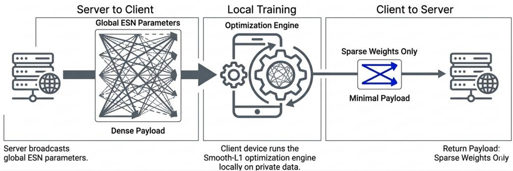  
Figure 1: FedSL1ESN training pipeline. The server broadcasts the fixed global reservoir once and a sparse global readout each round (CSR, minimal payload); clients evaluate the local gradient and Gauss-Newton Hessian of their Smooth-L1 loss on private data and return this curvature information for the server’s Newton-step aggregation.

Beyond classical ESNs, the RC paradigm encompasses Liquid State Machines (Maass et al., 2002) and Random Neural Networks (Gelenbe, 1989), which share the core RC principle of a fixed untrained recurrent core with a linear readout. Our work, focused on the classic ESN, can be viewed as a step toward bringing sparse eficient learning to the broader RC family.

## 2.2 Sparsity in Neural Networks

Sparsity has long been recognized as a desirable property in machine learning for improving generalization, interpretability, and eficiency (Hastie et al., 2015). L2 regularization penalizes the squared magnitude of weights, producing small but in general non-zero values and thereby smoothing the model. In contrast, L1 regularization penalizes the absolute value of weights, driving many to exactly zero (Tibshirani, 1996). This makes L1 particularly attractive for feature selection and model compression.

In neural networks, sparsity has been explored through a variety of approaches, including L1-based regularization, pruning techniques, and structured sparsity schemes such as Group LASSO (Tibshirani, 1996; Han et al., 2015; Yuan and Lin, 2006). A recent overview is provided by Haugstvedt et al. (2023). While efective in centralized settings, many of these approaches either require multiple training phases or are not naturally suited to distributed optimization frameworks.

Within the ESN literature, sparse reservoirs have been shown to reduce computational load without significantly compromising performance (Rodan and Tiño, 2011), and sparse input connections have been explored to reduce input dimensionality (Gallicchio, 2020). The most direct route to a compact model, however, is to induce sparsity in the readout layer.

Qiao and Wang (2019) proposed an Adaptive LASSO ESN that uses the non-diferentiable LARS solver to obtain sparse readout weights. While this successfully achieves sparsity, the reliance on a non-gradient-based solver is a critical limitation when extending ESNs to Federated Learning (FL), where the standard algorithm FedAvg (McMahan et al., 2017) requires clients to compute gradients of a smooth loss function. The two decades since the LASSO was introduced have produced a large body of algorithms for exactly this dificulty, and a comprehensive account of the numerical options is given by the survey of Zhao and Huo (2023). Broadly, they fall into three families. Proximal and splitting methods keep the penalty outside the smooth part and handle it through its proximal operator, from iterative shrinkage-thresholding and its accelerated variant (Daubechies et al., 2004; Beck and Teboulle, 2009) to the general proximal framework of Parikh and Boyd (2014) and to ADMM (Boyd et al., 2011), which is the basis of many distributed LASSO solvers. Subgradient- and stochastic-optimizer approaches instead adapt the training loop itself, as in truncated-gradient online learning (Langford et al., 2009) or composite-objective adaptive methods such as AdaGrad with an L1 term (Duchi et al., 2011). Finally, smoothing methods replace the penalty by a diferentiable surrogate, which makes the whole objective amenable to ordinary gradient-based and second-order machinery. Schmidt (2007) introduced such a twice-diferentiable approximation of the L1 norm.

We adopt the third route. This is not a claim that it dominates the others in accuracy or convergence rate; ADMM and accelerated proximal methods are at least as strong for the centralized LASSO, and ADMM in particular has well-developed distributed forms. The reason is the specific requirement of our federated update. A smooth objective is the only one of the three families for which each client can form both a gradient and a Gauss-Newton Hessian of the complete objective, penalty included, in a shared coordinate system, so that the server can sum them and take a damped Newton step (Section 4). Proximal and thresholding schemes place the penalty in an operator that has no additive curvature, and subgradient schemes give first-order information only. The Schmidt surrogate is moreover simple to implement, numerically robust, and has closed-form first and second derivatives, which is what makes the second-order aggregation practical.

## 2.3 Sparsity in Signal Analysis and Inverse Problems

A stronger line of results, compressed sensing, establishes exact recovery of sparse coeficients from few measurements under restricted isometry or incoherence conditions (Candès et al., 2006; Donoho, 2006), together with a family of L0-oriented greedy and hard-thresholding solvers (matching pursuit (Mallat and Zhang, 1993), orthogonal matching pursuit (Tropp and Gilbert, 2007), iterative hard thresholding (Blumensath and Davies, 2009)), the exact L0 problem itself being NP-hard (Natarajan, 1995). We do not adopt these methods, for three reasons. First, their guarantees rest on incoherence of the design matrix, which reservoir states violate by construction, because all neurons are driven by the same input through contractive dynamics, so the columns of X are strongly cross-correlated and the L0–L1 equivalence results do not transfer. The same coherence also makes the selected L1 support unstable, in the sense that small perturbations of the data can change which neurons are retained.

Second, that instability is harmless in our setting, because we are not trying to identify a true support. Compressed sensing recovers a signal known to be sparse from scarce measurements; here measurements are plentiful, no ground-truth sparse readout exists, and the goal is model compression, so any sparse and predictive readout is acceptable regardless of which of the correlated neurons carry the weights. Third, and decisively for the federated setting, L0 and greedy methods return discrete support sets that difer across clients and expose neither gradients nor Hessians that add across clients, ruling out the second-order aggregation used here. The smooth penalty instead keeps the optimization in a continuous space where local gradients and Hessians are summable, enabling a Newton-type server update, and defers the discrete decision to a single shrinkage step after aggregation. The smoothing parameter governs a trade-of, in that smaller values approximate the L1 penalty more closely but inflate the curvature near zero, worsening the conditioning of the Hessian.

## 2.4 Federated Reservoir Computing

Federated Learning (FL) is a distributed machine learning paradigm that enables collaborative model training across decentralized data sources while preserving data privacy (McMahan et al., 2017). Each client performs local training using its private data and shares only model updates with a coordinating server, which aggregates them into an improved global model. This iterative federated optimization cycle keeps raw data on the client and leverages heterogeneous distributed datasets, making FL attractive for healthcare, autonomous driving, smart manufacturing, and collaborative robotics (Guo et al., 2021; Kasyap and Tripathy, 2021; Joshi et al., 2022; Eid Kishawy et al., 2024; Kuo and Yang, 2024; Gutierrez et al., 2025).

FL compliance with regulatory frameworks such as GDPR (European Parliament and Council of the European Union, 2016) comes at the cost of new challenges. Client datasets are often heterogeneous and non-identically distributed, potentially causing client drift (Shi et al., 2022). Communication eficiency is a critical design constraint, addressed through specialized aggregation mechanisms, privacy-preserving techniques (e.g., diferential privacy, homomorphic encryption, secure aggregation (Rodríguez-Barroso et al., 2020; Fang and Qian, 2021)), and numerous FL extensions (Liu et al., 2024; Wen et al., 2023; Zheng et al., 2023). For a broader overview of federated learning, we refer the interested reader to Polato et al. (2026).

Recent work has explored distributed ESN implementations. In a foundational contribution, Bacciu et al. (2021) introduced Federated Reservoir Computing, where clients share only suficient statistics with the server, achieving a global readout mathematically equivalent to the centralized model. De Caro et al. (2022) extended this with Federated Intrinsic Plasticity (FedIP), enabling unsupervised reservoir adaptation via minimal gain and bias parameter exchange. Nogami et al. (2025) proposed an incremental federated variant for time-series anomaly detection using Mahalanobis Distance of Reservoir States (Tamura et al., 2023). These approaches retain classical regularization methods but lack explicit mechanisms for communication eficiency through sparsity. Our work addresses this gap by applying smooth sparsification to the ESN readout layer.

## 3 Methodology

## 3.1 Echo State Network Fundamentals

Echo State Networks (ESNs) are a subclass of RNNs that eficiently process temporal data by separating dynamic memory (reservoir) from the trainable output layer (Jaeger, 2001; Rodan and Tiño, 2011). An ESN comprises a fixed randomly generated reservoir and a trainable readout.

The input weight matrix $\mathbf { W _ { \mathrm { i n } } } \in \mathbb { R } ^ { N _ { R } \times N _ { I } }$ projects input u $\mathbf { \Psi } ( t ) \in \mathbb { R } ^ { N _ { I } }$ into the high-dimensional reservoir space, and the recurrent weight matrix $\mathbf { W } _ { \mathrm { r e s } } \in \mathbb { R } ^ { N _ { R } \times N _ { R } }$ evolves the reservoir state. Leaky integrator units with leaking rate $\gamma \in ( 0 , 1 ]$ provide temporal smoothing. The state update equations are:

$$
\tilde { \mathbf { x } } ( t ) = \operatorname { t a n h } ( \mathbf { W } _ { \mathrm { i n } } \mathbf { u } ( t ) + \mathbf { W } _ { \mathrm { r e s } } \mathbf { x } ( t - 1 ) )\tag{1}
$$

$$
{ \bf x } ( t ) = ( 1 - \gamma ) { \bf x } ( t - 1 ) + \gamma \tilde { \bf x } ( t )\tag{2}
$$

These two equations already contain all quantities that have to be chosen. The recurrent matrix $\mathbf { W } _ { \mathrm { r e s } }$ is not trained but drawn at random and then rescaled, and it is this rescaling that introduces the spectral radius. Let $\rho ( \mathbf { W } _ { \mathrm { r e s } } ) = \operatorname* { m a x } _ { i } | \lambda _ { i } ( \mathbf { W } _ { \mathrm { r e s } } ) |$ be the largest absolute eigenvalue of the sampled matrix. A random draw $\mathbf { W } _ { 0 }$ is normalized to a target value $\rho$ by setting $\mathbf { W } _ { \mathrm { r e s } } = \rho \mathbf { W } _ { 0 } / \rho ( \mathbf { W } _ { 0 } )$ , so $\rho$ appears in the state update only through the scale of $\mathbf { W } _ { \mathrm { r e s } } \mathbf { x } ( t - 1 )$ It controls how strongly the previous state is fed back and therefore how long the influence of an input persists in the reservoir. Small values of $\rho \mathrm { ~ y ~ }$ ield fast-fading, nearly memoryless dynamics, whereas values approaching or exceeding one lengthen the memory but risk losing the echo state property, i.e., the requirement that the state asymptotically depends on the input history alone and not on the initial state. The condition $\rho ( \mathbf { W } _ { \mathrm { r e s } } ) < 1$ is the standard practical rule of thumb for obtaining this property, though it is in general neither necessary nor suficient; we refer to Yildiz et al. (2012) for the precise conditions and to Lukoševičius (2012) for the accompanying tuning guidelines. Similarly, the input scaling $a _ { \mathrm { i n } }$ sets the amplitude of $\mathbf { W } _ { \mathrm { i n } } \mathbf { u } ( t )$ and thereby how far the tanh units are driven into their nonlinear regime, the leaking rate γ interpolates in $\operatorname { E q . } \ ( 2 )$ between retaining the previous state $( \gamma  0 )$ and replacing it entirely $( \gamma = 1 )$ , matching the reservoir timescale to that of the signal, and the reservoir dimension $N _ { R }$ fixes the dimensionality of the feature space seen by the readout.

The reservoir hyperparameters tuned in this work are accordingly the spectral radius $\rho ,$ the leaking rate $\gamma ,$ , and the input scaling factor $a _ { \mathrm { i n } }$ (together with the regularization strength λ of the readout introduced below); the reservoir dimension is fixed at $N _ { R } = 5 0 0$ (Section 5), and the reservoir connectivity $\phi$ (the fraction of non-zero entries of $\mathbf { W } _ { \mathrm { r e s } } )$ is held fixed at $\phi = 0 . 1$ throughout. The readout layer maps reservoir states to predictions via:

$$
\hat { \mathbf { y } } ( t ) = \mathbf { W } _ { \mathrm { o u t } } \mathbf { x } ( t )\tag{3}
$$

where $\mathbf { W _ { \mathrm { o u t } } } \in \mathbb { R } ^ { N _ { O } \times N _ { R } }$ is the only trained component and ${ \bf y } ( t )$ denotes the corresponding target. Following standard practices (Rodan and Tiño, 2011), $\mathbf { W } _ { \mathrm { i n } }$ is sampled uniformly from a range controlled by $a _ { \mathrm { i n } }$ and $\mathbf { W } _ { \mathrm { r e s } }$ is initialized as a sparse random matrix with spectral radius scaled to $\rho$ to promote the echo state property. In our implementation, we use the ReservoirPy library (Trouvain et al., 2020).

## 3.2 Smooth-L1 Regularization for ESN Readout

While reservoir weights remain fixed, $\mathbf { W _ { \mathrm { o u t } } }$ is trained to minimize a prediction error objective. Sparse readout weights reduce model complexity, enhance generalization, and enable eficient inference. L1 regularization (Tibshirani, 1996) is theoretically ideal for sparsification but introduces a non-diferentiable point at zero, precluding second-order optimization. L2 regularization is smooth but does not produce exact sparsity.

We adopt Smooth-L1 regularization (Schmidt, 2007), which approximates the L1 norm with a smooth twice-diferentiable function:

$$
| w | _ { \alpha } = \frac { 1 } { \alpha } \left[ \ln ( 1 + e ^ { - \alpha w } ) + \ln ( 1 + e ^ { \alpha w } ) \right]\tag{4}
$$

This function converges to $| w |$ as $\alpha  \infty .$ , remaining smooth and convex for finite $\alpha \geq 1$ . The regularized objectives are:

$$
\mathrm { R e g r e s s i o n : } \mathcal L ( \mathbf W _ { \mathrm { o u t } } ) = \frac { 1 } { 2 } \sum _ { t } \| \mathbf y ( t ) - \hat { \mathbf y } ( t ) \| _ { 2 } ^ { 2 } + \lambda \sum _ { i , j } | w _ { i j } | _ { \alpha }\tag{5}
$$

$$
\mathrm { C l a s s i f i c a t i o n : } \mathcal { L } ( \mathbf { W } _ { \mathrm { o u t } } ) = - \sum _ { t } \sum _ { c } y _ { c } ( t ) \log \hat { y } _ { c } ( t ) + \lambda \sum _ { i , j } | w _ { i j } | _ { \alpha }\tag{6}
$$

where $\lambda > 0$ controls the regularization strength, $y _ { c } ( t )$ is the one-hot target for class $^ { c , }$ and the predicted class probability ${ \hat { y } } _ { c } ( t )$ is obtained by applying the softmax function to the readout outputs $\mathbf { W } _ { \mathrm { o u t } } \mathbf { x } ( t )$ . Because $\mathcal { L }$ is twice diferentiable, both objectives can be minimized eficiently via Newton’s method with backtracking line search (Boyd and Vandenberghe, 2004), yielding improved convergence rates and reduced weight-update variance compared to first-order methods.

In practice, a fixed large α can cause overly aggressive quadratic approximations near zero, as the Smooth-L1 approximation is not appropriately modeled by a quadratic for variables near 0 when α is large. To address this, a continuation strategy (Schmidt, 2007) is employed. We begin with a small α $( \alpha _ { 0 } = 1 )$ where the quadratic approximation is appropriate, and take Newton steps or gradient updates between successive increases of the parameter $\alpha$ (multiplying α by a factor $\kappa > 1$ after each Newton iteration; $\kappa = 2$ in all experiments), terminating at a suficiently large α $( \alpha _ { \mathrm { m a x } } = 5 \times 1 0 ^ { 6 } )$ ) that yields a near-exact L1 penalty. This schedule balances optimization stability with sparsity induction. Both objectives above are implemented in our framework and trained by the same solver. The experimental part of this paper, however, considers classification only, and the regression variant is not discussed in detail; for completeness, its evaluation on two chaotic benchmarks is reported in Appendix C.

## 4 Proposed Method

This section presents the proposed SL1ESN training framework for learning sparse readout weights in Echo State Networks. Our approach replaces the standard closed-form readout estimation with an iterative optimization procedure that incorporates a twice-diferentiable sparsity-promoting regularizer. This formulation preserves compatibility with gradient-based optimization and therefore supports both centralized training and its extension to federated learning. We first describe the method in the centralized setting and then show how it can be adapted to the distributed case.

Two components act together to produce the sparse readout. The Smooth-L1 penalty, sharpened over the continuation schedule in $\alpha _ { \mathrm { { i } } }$ , drives redundant readout coordinates toward zero inside the optimization, so that the surviving coordinates are re-optimized at every Newton step to absorb the contribution of those that vanish. A shrinkage step with threshold $\tau$ then turns the near-zero coordinates into exact zeros, since the smooth surrogate is diferentiable everywhere and therefore never attains exact zeros by itself. Model selection is kept separate from this mechanism. The reservoir hyperparameters and the regularization strength λ are chosen to maximize predictive accuracy, with no sparsity term in the selection objective, so the sparsity we report in Section 5 is the sparsity of the accuracy-selected model rather than the product of a sparsity-targeted search. The threshold $\tau$ is not tuned either, since all classification experiments, centralized and federated, use the same fixed value $\tau = 0 . 1$ , so no per-dataset choice enters the reported sparsity.

## 4.1 Centralized Setting

In the centralized setting, all training data are available on a single server, and the objective is to learn the readout matrix $\mathbf { W _ { \mathrm { o u t } } }$ by minimizing the regularized loss introduced in Section 3. In contrast to traditional ESN training, where $\mathbf { W _ { \mathrm { o u t } } }$ is obtained in closed form by ridge regression, our approach formulates readout learning as an iterative optimization problem. This is particularly advantageous because it accommodates non-quadratic regularizers, supports incremental or online updates, and provides a natural basis for extensions to distributed optimization settings such as federated learning.

The centralized training procedure consists of two main stages. First, the input sequence is forward-propagated through the fixed reservoir in order to collect the corresponding reservoir states x(t). These states define the features used by the readout layer. Second, the readout weights are optimized iteratively with respect to the regularized objective. In our case, this optimization is carried out with Newton’s method, exploiting the smoothness of the proposed penalty. At each iteration, the gradient $\nabla \mathcal { L }$ and Hessian $\mathbf { H } = \nabla ^ { 2 } { \mathcal { L } }$ are computed, the damped linear system $( \mathbf { H } + \mu \mathbf { I } ) \Delta \mathbf { w } = - \nabla \mathcal { L }$ is solved to obtain the search direction, and an Armijo backtracking line search (Nocedal and Wright, 2006, Ch. 3) is used to determine the step size. The updated weights are then sparsified with the soft-threshold operator $[ S _ { \tau } ( \mathbf { W } ) ] _ { i j } = \mathrm { s i g n } ( w _ { i j } )$ max $( | w _ { i j } | - \tau , 0 )$ , and the smoothing parameter is advanced along the continuation schedule, $\alpha \gets \operatorname* { m i n } ( \alpha \kappa , \alpha _ { \mathrm { m a x } } )$ . The factor $\kappa ,$ threshold $\tau ,$ and regularization strength λ are treated as predefined hyperparameters; further implementation details are provided in Appendix B.

Algorithmically, this procedure is related to, but distinct from, the classical Iterative Shrinkage-Thresholding Algorithm (ISTA) and its accelerated variant FISTA (Daubechies et al., 2004; Beck and Teboulle, 2009). It retains the shrinkage step $S _ { \tau }$ , but replaces the first-order gradient step by a damped Newton step, available only because the penalty is smooth, and adds the continuation in α. Unlike ISTA, where the L1 penalty is handled solely by the proximal operator, here it also enters the objective as the smooth surrogate of strength λ, so the readout is already being pulled toward a sparse solution while it is being fitted, and the shrinkage step only realizes the exact zeros. Section 5.4.3 examines how the two interact.

Convergence criterion. Because exact zeros are produced by the soft-threshold operator rather than by the smooth objective itself, the iterates converge to a fixed point of the combined Newton/threshold map at which the gradient of the smooth objective does not vanish. A conventional gradient-norm stopping rule is therefore never triggered in practice. We instead monitor the sparsity pattern, and training stops once α has reached $\alpha _ { \mathrm { m a x } }$ and the non-zero support of $\mathbf { W _ { \mathrm { o u t } } }$ has changed by less than a tolerance $\varepsilon _ { s }$ over the last $P$ iterations $( P = 8 ,$ $\varepsilon _ { s } = 0 . 2$ percentage points in all experiments). This support-stagnation rule terminates training well within the fixed iteration budget at unchanged accuracy. Algorithm 1 summarizes the resulting centralized training procedure.

Algorithm 1 Centralized Training of ESN Readout with Smooth-L1 Regularization   
1: Input: Training data $\{ ( \mathbf { u } ( t ) , \mathbf { y } ( t ) ) \} _ { t = 1 } ^ { T }$ , reservoir parameters ${ \bf W } _ { \mathrm { i n } } , { \bf W } _ { \mathrm { r e s } } , \gamma .$ , regularization   
strength λ, schedule $\alpha _ { 0 } , \kappa , \alpha _ { \mathrm { m a x } } .$ threshold $\tau ,$ early-stop window P and tolerance $\varepsilon _ { s }$   
2: Output: Optimized readout weights $\mathbf { W _ { \mathrm { o u t } } }$   
3: Initialize $\mathbf { W _ { \mathrm { o u t } } }  \mathbf { 0 }$   
4: Compute reservoir states ${ \bf x } ( t )$ for all t   
5: α ← α0   
6: while iteration budget not exhausted do   
7: $\mathbf { g }  \nabla _ { \mathbf { W } _ { \mathrm { o u t } } } \mathcal { L }$ (using current α)   
8: $\mathbf { H }  \nabla _ { \mathbf { W } _ { \mathrm { o u t } } } ^ { 2 } \mathcal { L }$   
9: Solve $\left( \mathbf { H } + \mu \mathbf { I } \right) \Delta \mathbf { w } = - \mathbf { g }$ ▷ damped Newton direction   
10: Find step size η via backtracking line search   
11: $\mathbf { W } _ { \mathrm { o u t } }  \mathcal { S } _ { \tau } ( \mathbf { W } _ { \mathrm { o u t } } + \eta \Delta \mathbf { w } )$ ▷ soft-threshold: sign(w) max $( | w | - \tau , 0 )$   
12: $\alpha $ min $( \alpha \cdot \kappa , \alpha _ { \mathrm { m a x } } )$ ▷ continuation schedule   
13: if $\alpha = \alpha _ { \mathrm { m a x } }$ and non-zero support of $\mathbf { W _ { \mathrm { o u t } } }$ changed by $< \varepsilon _ { s }$ over the last P iterations   
then   
14: break ▷ support-stagnation convergence   
15: end if   
16: end while   
17: return $\mathbf { W _ { \mathrm { o u t } } }$

## 4.2 Distributed Setting

The distributed training pipeline is illustrated in Figure 1. We consider a parameter-server architecture with one central server and K clients, each holding private time-series data. The goal is to learn a global readout matrix $\mathbf { W _ { \mathrm { o u t } } }$ without sharing raw data, while exploiting the twice-diferentiable structure of the Smooth-L1 penalty to perform second-order (Newton) updates on the server and to obtain a sparse global readout for eficient storage and inference. Because the smooth penalty exposes a well-defined gradient and Hessian, we implement the distributed training as a federated Newton scheme rather than the first-order FedAvg averaging of local weights. We refer to this federated variant as FedSL1ESN, reserving SL1ESN for the centralized model described above.

The procedure consists of four main steps:

1. Initialization: The server randomly initializes the fixed reservoir parameters $\mathbf { W } _ { \mathrm { i n } }$ and $\mathbf { W } _ { \mathrm { r e s } }$ and broadcasts them to all clients. The global readout is initialized as $\mathbf { W } _ { \mathrm { o u t } } ^ { ( 0 ) } = \mathbf { 0 }$ and the smoothing parameter as $\alpha = \alpha _ { 0 }$

2. Local curvature computation: Each client k receives the current global readout $\mathbf { W } _ { \mathrm { o u t } } ^ { ( t ) }$ and, using the frozen shared reservoir, evaluates the local gradient $\mathbf { g } _ { k } = \nabla \mathcal { L } _ { k }$ and the per-class Gauss-Newton Hessian blocks $\mathbf { H } _ { k } = \nabla ^ { 2 } \mathcal { L } _ { k }$ of its Smooth-L1 regularized loss at $\mathbf { W } _ { \mathrm { o u t } } ^ { ( t ) }$ . No local weight update is performed; the client returns $\left( \mathbf { g } _ { k } , \mathbf { H } _ { k } \right)$ . Reservoir states are $\mathbf { W _ { \mathrm { o u t } } }$ -independent and therefore cached after the first round.

Algorithm 2 FedSL1ESN: Distributed (Federated Newton) Training   
1: Input: Number of clients K, rounds R, regularization strength λ, initial smoothing $\alpha _ { 0 } .$   
factor κ, threshold τ   
2: Server executes:   
3: Initialize $\mathbf { W } _ { \mathrm { i n } } , \mathbf { W } _ { \mathrm { r e s } }$ and broadcast to all clients   
4: Initialize $\mathbf { W _ { \mathrm { o u t } } ^ { ( 0 ) } }  \mathbf { 0 } ;$ set $\alpha  \alpha _ { 0 }$   
5: for each round $t = 0 , 1 , \ldots , R - 1$ do   
6: for each client k in parallel do   
7: $( \mathbf { g } _ { k } , \mathbf { H } _ { k } ) \gets \mathrm { C l i e n t U p d a t e } ( k , \mathbf { W } _ { \mathrm { o u t } } ^ { ( t ) } , \alpha )$   
8: end for   
9: $\begin{array} { r } { \mathbf { g }  \sum _ { k } \mathbf { g } _ { k } , \quad \mathbf { H }  \sum _ { k } \mathbf { H } _ { k } } \end{array}$ ▷ aggregate gradient and per-class Hessian   
10: Solve damped Newton direction D: $\mathbf { d } _ { c } = - ( \mathbf { H } _ { c } + \mu \mathbf { I } ) ^ { - 1 } \mathbf { g } _ { c }$ for each class c   
11: Choose step η by Armijo backtracking line search on $\textstyle \sum _ { k } { \mathcal { L } } _ { k }$   
12: W $ \mathbf { W } _ { \mathrm { o u t } } ^ { ( t ) } + \eta \mathbf { D }$   
13: $\mathbf { W } _ { \mathrm { o u t } } ^ { ( t + 1 ) }  S _ { \tau } ( \mathbf { W } )$ ▷ soft-threshold: sign(w) max $( | w | - \tau , 0 )$   
14: Broadcast $\mathbf { W } _ { \mathrm { o u t } } ^ { ( t + 1 ) }$ (sparse, CSR) to all clients   
15: $\alpha  \operatorname* { m i n } ( \alpha \cdot \kappa , \alpha _ { \mathrm { m a x } } )$ ▷ continuation schedule   
16: end for   
ClientUpdat $\mathbf { \Delta } \mathbf { e } ( k , \mathbf { W } , \alpha ) :$   
17: Compute frozen reservoir states ${ \bf X } _ { k }$ (cached after round 0)   
18: $\mathbf { g } _ { k }  \nabla _ { \mathbf { W } } \mathcal { L } _ { k } ( \mathbf { W } )$ ; $\mathbf { H } _ { k } \gets$ per-class Gauss-Newton Hessian of $\mathcal { L } _ { k }$ at W   
19: return $\left( \mathbf { g } _ { k } , \mathbf { H } _ { k } \right)$ to server

3. Newton-step aggregation: The server sums the client gradients and Hessians, ${ \bf g } =$ $\textstyle \sum _ { k } \mathbf { g } _ { k }$ and $\begin{array} { r } { \mathbf { H } = \sum _ { k } \mathbf { H } _ { k } } \end{array}$ , solves a damped Newton system per output class c to form the descent direction $\mathbf { d } _ { c } = - ( \mathbf { H } _ { c } + \mu \mathbf { I } ) ^ { - 1 } \mathbf { g } _ { c }$ , and stacks these rows into the full direction matrix $\mathbf { D } = [ \mathbf { d } _ { 1 } , \dots , \mathbf { d } _ { N _ { O } } ] ^ { \top }$ . It then selects a step size η by Armijo backtracking line search (Nocedal and Wright, 2006) on the aggregated loss $\textstyle \sum _ { k } { \mathcal { L } } _ { k }$ . The readout is updated and sparsified with a soft-threshold operator $ { \boldsymbol { S } } _ { \tau } ( \cdot )$

$$
\mathbf { W } _ { \mathrm { o u t } } ^ { ( t + 1 ) } = \mathcal { S } _ { \tau } \big ( \mathbf { W } _ { \mathrm { o u t } } ^ { ( t ) } + \eta \mathbf { D } \big ) , \qquad [ \mathcal { S } _ { \tau } ( \mathbf { W } ) ] _ { i j } = \mathrm { s i g n } ( w _ { i j } ) \operatorname* { m a x } ( | w _ { i j } | - \tau , 0 ) .
$$

4. Broadcasting: The updated sparse global readout $\mathbf { W } _ { \mathrm { o u t } } ^ { ( t + 1 ) }$ is broadcast to all clients in CSR form, the smoothing parameter is advanced $( \alpha \gets \operatorname* { m i n } ( \alpha \kappa , \alpha _ { \mathrm { m a x } } ) )$ , and the process repeats for the next communication round.

The continuation in α makes the penalty a progressively sharper approximation of L1 over rounds, so the soft-threshold drives an increasing fraction of readout weights to exactly zero; combined with the Newton step, the global readout converges within a few rounds to a sparse solution. The communication implications of transmitting curvature, together with the storage and inference benefits of the resulting sparse readout, are analyzed in Section 6.2. The complete distributed training procedure is summarized in Algorithm 2.

## 5 Experiments

This section evaluates the proposed SL1ESN on time-series classification. The experiments are designed to assess predictive performance, the degree of sparsity induced in the readout layer,

Table 1: Classification datasets. For ease of reference, the DistalPhalanxOutlineCorrect dataset is abbreviated as Distal., and Character denotes the Character Trajectories dataset from the UCI repository. All datasets are used with the train/test partition of their archive, except Character, for which the UCI repository provides none: its 2858 sequences are split 80/20 once, and the same split is reused by every method and seed. Length is the padded sequence length, and variable-length sequences (Character, JapaneseVowels) are zero-padded to the longest sequence in the dataset.
<table><tr><td>Dataset</td><td>Train</td><td>Test</td><td>Length</td><td>Dim.</td><td>Classes</td></tr><tr><td>UCI HAR</td><td>7352</td><td>2947</td><td>128</td><td>9</td><td>6</td></tr><tr><td>Character</td><td>2286</td><td>572</td><td>205</td><td>3</td><td>20</td></tr><tr><td>JapaneseVowels</td><td>270</td><td>370</td><td>29</td><td>12</td><td>9</td></tr><tr><td>ECG5000</td><td>500</td><td>4500</td><td>140</td><td>1</td><td>5</td></tr><tr><td>Distal.</td><td>600</td><td>276</td><td>80</td><td>1</td><td>2</td></tr><tr><td>Yoga</td><td>300</td><td>3000</td><td>426</td><td>1</td><td>2</td></tr><tr><td>Strawberry</td><td>613</td><td>370</td><td>235</td><td>1</td><td>2</td></tr></table>

and the behavior of the method in centralized and distributed training scenarios.

## 5.1 Datasets

We use seven datasets from the UCI and UCR archives (Table 1), spanning univariate and multivariate sequences in areas such as activity recognition (Anguita et al., 2013), character trajectories (Williams, 2006), speech analysis (Kudo et al., 1999), and other fields (Dau et al., 2019). The datasets cover binary and multi-class problems across various training sizes and sequence lengths.

## 5.2 Centralized setup

All ESN configurations use a fixed reservoir of size $N _ { R } = 5 0 0$ for comparability across regularization methods. Input matrix entries are drawn from a Uniform distribution $\mathcal { U } ( - a _ { \mathrm { i n } } , a _ { \mathrm { i n } } )$ ; reservoir adjacency matrix entries from U(−1, 1). The hyperbolic tangent activation confines reservoir outputs to [−1, 1]. Hyperparameters are optimized via random search over the distributions in Table 2. The search objective is predictive accuracy only, namely the validation accuracy, with no sparsity term. The readout sparsity we report below is therefore the sparsity that the accuracy-selected model happens to attain, not a quantity the search was asked to maximize. Full per-dataset selected values are reported in Appendix B. We compare three readout penalties, all trained with the same damped Gauss–Newton solver so that only the penalty difers and no solver confound enters the comparison: an unregularized cross-entropy readout (none), an L2-regularized readout (L2-ESN), and the proposed SL1ESN. Reported accuracies are means ± standard deviation over ten independent random seeds. The softmax parameterization is shift invariant, so the unregularized Hessian is singular along the all-ones direction; rather than fixing a reference class we retain the full $N o \times N _ { R }$ readout and rely on the adaptive damping µI of the Newton solve (Appendix B) to render the system non-singular, which keeps the parameterization identical across the three penalties. Readout sparsity is accordingly always reported as the fraction of zeros among all $N o N _ { R }$ entries, none of which is constrained to zero a priori.

## 5.3 Distributed setup

All federated experiments use the following fixed configuration: K = 5 clients and 50 communication rounds, with results averaged over ten seeds (a sensitivity study over the client count K is reported in Appendix D). Each round follows the federated Newton scheme of Algorithm 2: clients return the local gradient and per-class Gauss-Newton Hessian of their Smooth-L1 loss, and the server applies a single damped Newton step with Armijo backtracking line search $( c _ { 1 } = 1 0 ^ { - 4 }$ , shrinkage 0.5) followed by a soft-threshold $S _ { \tau }$ . The smoothing parameter follows the continuation schedule with $\alpha _ { 0 } = 1$ and factor $\kappa = 2$ . Data are partitioned uniformly (IID) across clients; heterogeneous (non-IID) partitions are not implemented in this study, and Section 6.4 discusses this limitation together with the existing line of Newton-type federated methods for heterogeneous data that a future version can build on. The global reservoir parameters $( \mathbf { W } _ { \mathrm { i n } } ,$ $\mathbf { W } _ { \mathrm { r e s } } )$ are initialized once on the server and broadcast to all clients at the start; they remain fixed throughout all rounds. As in the centralized setting, hyperparameters are selected for accuracy alone. The proposed FedSL1ESN is compared against L2 and unregularized ESN baselines, all trained with the same server-side Newton update so that the readout penalty is the only variable that difers, which makes the unregularized column a federated second-order baseline in its own right. No first-order FedAvg comparison is included, for a structural reason: clients perform no local weight update but return $\left( \mathbf { g } _ { k } , \mathbf { H } _ { k } \right)$ evaluated at the current global readout, and under full participation the data-fidelity part of their sums is exactly the gradient and Gauss-Newton Hessian of the pooled cross-entropy loss, independently of how the samples are partitioned. The federated iteration is therefore a centralized Newton iteration on an objective that difers from the centralized one only in the penalty, which every client carries a copy of, so that the aggregate is Kλ rather than λ. Two further diferences keep Table 4 from reproducing Table 3 numerically: the federated runs use a fixed budget of 50 rounds where the centralized solver iterates to the support-stagnation criterion of Section 4, and λ is re-selected for the federated setting (Appendix B). Against that background FedAvg, which optimizes the same convex objective by first-order steps, could only approach the same optimum more slowly and without producing a sparse readout, which is why it is not included as a separate column. The server broadcasts the global readout in compressed sparse row (CSR) form; the resulting sparsity benefits for model storage and inference are discussed in Section 6.2. Although the readout typically reaches near-peak accuracy within a few rounds (Figure 3), we report at 50 rounds so that the continuation schedule has fully sharpened the penalty and the readout sparsity has stabilized.

Table 2: Hyperparameter search distributions (random search).
<table><tr><td>Parameter</td><td>Distribution</td></tr><tr><td>Spectral radius  $( \rho )$  Input scaling  $( a _ { \mathrm { i n } } )$  Leaking rate (γ) Regularization (λ)</td><td>Uniform(0.3, 3.0)  $\mathrm { L o g - u n i f o r m [ 1 0 ^ { - 2 } , ~ 1 0 ^ { 2 } ] }$   $\mathrm { L o g \mathrm { - } u n i f o r m [ 5 \times 1 0 ^ { - 3 } , ~ 1 ] }$   $\mathrm { L o g - u n i f o r m [ 1 0 ^ { - 4 } , ~ 1 0 ^ { 2 } ] }$ </td></tr></table>

## 5.4 Results and Analysis

## 5.4.1 Centralized setting

Table 3 reports the test accuracy of the three readout penalties together with the readout sparsity that SL1ESN attains at the fixed threshold $\tau = 0 . 1$ . Classification is where the sparse readout pays of: SL1ESN discards 77–95% of the readout weights while remaining close to the dense baselines in accuracy. It is the most accurate method on UCI HAR, and on Character, JapaneseVowels, ECG5000, and Distal. it stays within 0.7 points of the best of the unregularized and L2 readouts, a margin that on Distal. and JapaneseVowels is smaller than the seed-to-seed standard deviation, so that on five of the seven datasets the sparse readout is on par with the best dense one.

Two datasets, Yoga and Strawberry, trail the unregularized readout by 5.8 and 5.7 points. Figure 2 shows that this is not a cost of sparsification. It plots test accuracy against readout sparsity as the shrinkage threshold is swept over the accuracy-selected configuration, and on all seven datasets, Yoga and Strawberry included, the curve is essentially flat out to 80–95% sparsity before it collapses at near-total sparsity. On Yoga and Strawberry the gap to the unregularized readout is already present at the left edge of the plot, where the readout is barely sparse at all (at 0.2% sparsity Yoga is already 5.1 points below its unregularized baseline), and it stays essentially constant as sparsity grows. In other words, the Smooth-L1-trained readout is itself a little weaker than the unregularized one on these two datasets, independently of how much of it is subsequently pruned. That the plateau is present everywhere is what makes a single global threshold viable: most of the reservoir readout is genuinely redundant for classification, and removing it costs nothing measurable until almost none of it is left.

Table 3: Centralized classification test accuracy (%) and SL1ESN readout sparsity. All readouts are selected for predictive accuracy; bold marks the highest accuracy per dataset. Sparsity is the fraction of zero readout weights; the unregularized and L2 readouts have no sparsification mechanism and remain dense. All values are mean ± std over ten seeds. A single fixed shrinkage threshold $\tau = 0 . 1$ is used for every dataset.
<table><tr><td rowspan="2">Dataset</td><td>none</td><td>L2-ESN</td><td>SL1ESN (ours)</td><td></td></tr><tr><td>Acc. (%)</td><td>Acc. (%)</td><td>Acc. (%)</td><td>Sparsity (%)</td></tr><tr><td>UCI HAR</td><td> $8 7 . 3 7 \pm 1 . 1 1$ </td><td> $8 8 . 0 1 \pm 0 . 4 3 $ </td><td> ${ \bf 8 8 . 0 5 \pm 0 . 9 0 }$ </td><td> $7 7 . 6 \pm 1 . 5$ </td></tr><tr><td>Character</td><td> ${ \bf 9 9 . 5 8 \pm 0 . 1 2 }$ </td><td> $9 8 . 8 8 \pm 0 . 2 8$ </td><td> $9 8 . 9 7 \pm 0 . 2 5$ </td><td> $9 2 . 7 \pm 0 . 6$ </td></tr><tr><td>JapaneseVowels</td><td> ${ \mathbf { 9 8 . 2 4 \pm 0 . 6 3 } }$ </td><td> $9 7 . 5 7 \pm 0 . 1 7$ </td><td> $9 7 . 6 8 \pm 0 . 5 6$ </td><td> $9 4 . 6 \pm 0 . 4$ </td></tr><tr><td>ECG5000</td><td> $9 1 . 3 8 \pm 0 . 6 4$ </td><td> ${ \bf 9 2 . 3 7 \pm 0 . 0 8 }$ </td><td> $9 1 . 9 1 \pm 0 . 2 0$ </td><td> $9 3 . 3 \pm 0 . 4$ </td></tr><tr><td>Distal.</td><td> ${ \bf 7 3 . 5 5 \pm 0 . 8 1 }$ </td><td> $7 3 . 0 8 \pm 1 . 2 3$ </td><td> $7 3 . 5 1 \pm 1 . 5 2$ </td><td> $8 9 . 6 \pm 3 . 3$ </td></tr><tr><td>Yoga</td><td> ${ \bf 7 9 . 5 3 \pm 0 . 9 4 }$ </td><td> $7 9 . 2 4 \pm 2 . 3 8$ </td><td> $7 3 . 7 0 \pm 1 . 6 0$ </td><td> $7 7 . 4 \pm 2 . 4$ </td></tr><tr><td>Strawberry</td><td> ${ \bf 9 6 . 1 1 \pm 0 . 6 4 }$ </td><td> $9 3 . 6 8 \pm 0 . 9 6$ </td><td> $9 0 . 3 8 \pm 1 . 2 7$ </td><td> $8 8 . 6 \pm 2 . 0$ </td></tr></table>

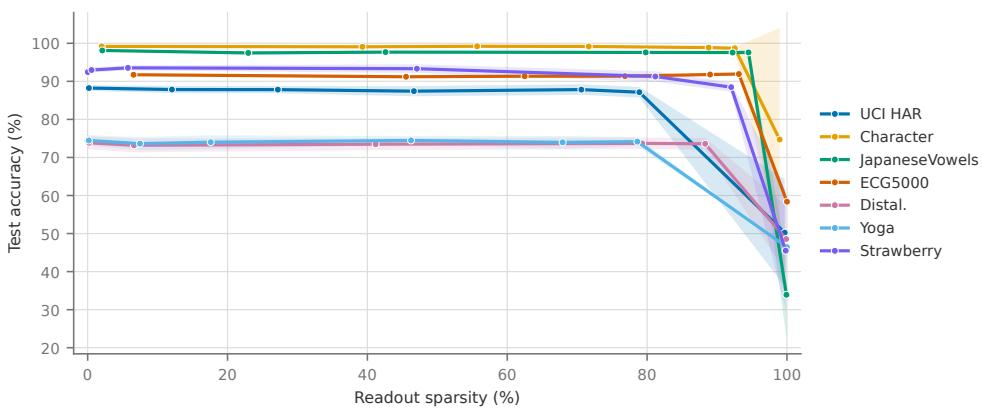  
Figure 2: Centralized setting. Test accuracy versus readout sparsity for the accuracy-selected SL1ESN configuration, trained on the pooled data by a single learner (mean over ten seeds), obtained by sweeping the shrinkage threshold $\tau ;$ shaded bands are ±1 std across seeds. Accuracy stays essentially flat up to 80–95% sparsity on every dataset, and collapses only once the readout is driven to near-total sparsity. Figure 4 repeats this sweep for the federated global readout; the two are plotted on the same axes so that the curves can be compared directly, and their similarity is itself the result, indicating that federation does not degrade the sparsity–accuracy trade-of.

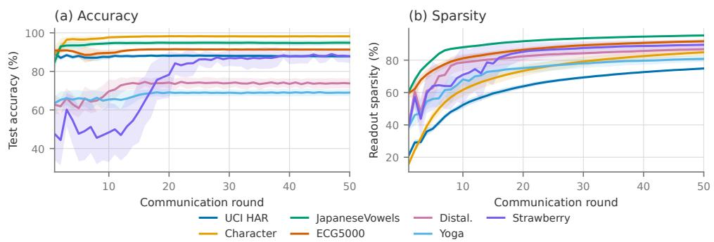  
Figure 3: FedSL1ESN convergence over communication rounds for each dataset (five clients, IID split, 50 rounds, mean over ten seeds; shaded bands are ±1 std). (a) Test accuracy reaches near-peak within a few rounds on most datasets and is stable thereafter (Strawberry is the slowest, climbing until round ∼ 20). (b) Readout sparsity accrues more gradually over the same rounds, as the continuation schedule sharpens the penalty toward L1, and has largely levelled of by round 50; this is why we fix the budget at 50 rounds and report there. The two panels separate the two timescales of the method, since the cross-entropy fit is reached almost immediately, while the sparsification unfolds over the full round budget. The bands in (b) are wide at early rounds, where seeds sit at diferent points on the steep part of the curve, and narrow by round 50, which is why the round-50 sparsity is reproducible across seeds.

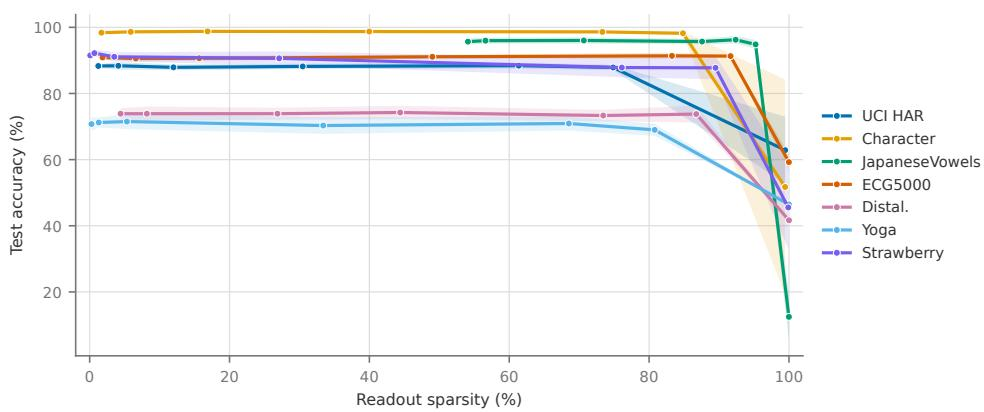  
Figure 4: Federated setting; the counterpart of Figure 2. Test accuracy versus readout sparsity for the accuracy-selected global readout obtained by FedSL1ESN, i.e., the model aggregated from five clients that never share data (50 rounds, IID partition, mean over ten seeds, reported at the final round), under the same sweep of the shrinkage threshold τ; shaded bands are ±1 std across seeds. As in the centralized case, accuracy stays essentially flat out to 75–95% sparsity on most datasets, and collapses only once the readout is driven to near-total sparsity.

Table 4: Federated learning results (five clients, 50 rounds, IID split, mean ± std over ten seeds; test accuracy) and FedSL1ESN readout sparsity, all reported at the final round. All readouts are selected for predictive accuracy; bold marks the highest accuracy per dataset. The unregularized and L2 readouts have no sparsification mechanism and remain dense $( < 2 \%$ zeros). The same fixed shrinkage threshold $\tau = 0 . 1$ as in the centralized setting is used for every dataset.
<table><tr><td rowspan="2">Dataset</td><td>none</td><td>L2-ESN</td><td colspan="2">FedSL1ESN (ours)</td></tr><tr><td> $\operatorname { A c c . } \ ( \% )$ </td><td> ${ \mathrm { A c c . ~ } } ( \% )$ </td><td> ${ \mathrm { A c c . ~ } } ( \% )$ </td><td>Sparsity (%)</td></tr><tr><td>UCI HAR</td><td> ${ \bf 8 9 . 4 1 \pm 1 . 1 5 }$ </td><td> $8 7 . 7 9 \pm 0 . 7 2$ </td><td> $8 7 . 8 6 \pm 0 . 7 9$ </td><td> $7 4 . 9 \pm 0 . 5$ </td></tr><tr><td>Character</td><td> $9 8 . 4 8 \pm 0 . 3 5$ </td><td> $\mathbf { 9 8 . 7 4 \pm 0 . 2 6 }$ </td><td> $9 8 . 2 0 \pm 0 . 5 7$ </td><td> $8 4 . 8 \pm 2 . 2$ </td></tr><tr><td>JapaneseVowels</td><td> ${ \bf 9 6 . 1 9 \pm 0 . 9 6 }$ </td><td> $8 1 . 2 7 \pm 2 . 1 2$ </td><td> $9 4 . 8 4 \pm 1 . 3 3 $ </td><td> $9 5 . 2 \pm 0 . 3$ </td></tr><tr><td>ECG5000</td><td> $9 0 . 3 2 \pm 0 . 3 2$ </td><td> ${ \bf 9 1 . 3 8 \pm 0 . 7 7 }$ </td><td> $9 1 . 3 0 \pm 0 . 3 4$ </td><td> $9 1 . 6 \pm 1 . 0$ </td></tr><tr><td>Distal.</td><td> $6 7 . 1 0 \pm 2 . 1 3$ </td><td> $7 1 . 9 3 \pm 1 . 3 3$ </td><td> ${ \bf 7 3 . 7 7 \pm 2 . 5 6 }$ </td><td> $8 6 . 7 \pm 2 . 4$ </td></tr><tr><td>Yoga</td><td> $7 1 . 6 0 \pm 1 . 3 2$ </td><td> ${ \bf 7 3 . 4 5 \pm 1 . 4 2 }$ </td><td> $6 9 . 0 0 \pm 1 . 8 2 $ </td><td> $8 0 . 8 \pm 1 . 9$ </td></tr><tr><td>Strawberry</td><td> $8 3 . 4 1 \pm 2 . 5 4$ </td><td> ${ \bf 9 1 . 3 2 \pm 1 . 1 9 }$ </td><td> $8 7 . 7 6 \pm 3 . 4 6$ </td><td> $8 9 . 5 \pm 3 . 1$ </td></tr></table>

## 5.4.2 Distributed setting

Table 4 reports the federated results at the final round (round 50), obtained with the same fixed threshold $\tau = 0 . 1$ . The picture from the centralized experiments carries over, that FedSL1ESN learns a global readout that is 75–95% sparse while tracking the dense baselines closely in accuracy. It is the most accurate method on Distal., within 0.6 points of the best on Character and ECG5000, and within 1.6 points on UCI HAR; on JapaneseVowels it is within 1.4 points of the unregularized readout and outperforms the L2 readout by a wide margin (94.84% against 81.27%), the federated L2 solution being the one configuration in our study that fails outright. On Character and ECG5000 the margin to the best readout is smaller than the seed-to-seed standard deviation, and on JapaneseVowels it is comparable to it, so the sparse global readout stays close to the best dense one on five of the seven benchmarks. That failure is not an unlucky choice of λ: across the whole searched range, from $1 0 ^ { - 4 } \ \mathrm { t o \ 1 0 ^ { 2 } }$ , no federated L2 configuration on JapaneseVowels exceeds 80% selection accuracy, whereas the unregularized and Smooth-L1 readouts reach 100% under the identical protocol, so the penalty rather than its strength is what breaks. JapaneseVowels is also the smallest benchmark, so at $K = 5$ each client holds roughly 54 sequences and returns a Gauss-Newton block of rank at most 54 against $N _ { R } = 5 0 0 ;$ unlike the Smooth-L1 curvature, which decays for $| w | \gg 1 / \alpha$ and therefore leaves the large, resolved coordinates almost free, the isotropic λI that L2 contributes acts equally on every direction, resolved or not, and is replicated K times by the aggregation. We report this as an observation rather than a fully diagnosed mechanism. As centrally, Yoga and Strawberry are the datasets that pay for the uniform threshold, trailing the best baseline by 4.5 and 3.6 points. The unregularized and L2 readouts ofer no comparable saving in return, since they possess no sparsification mechanism at all and stay dense (< 2% zeros even under L2 shrinkage).

Reporting at the final round matters here, and Figure 3 shows why. Two timescales are at work: test accuracy reaches near-peak within a few communication rounds on most datasets (panel a), a direct consequence of the second-order server update, whereas readout sparsity keeps accruing over more rounds as the continuation schedule sharpens the penalty toward L1 (panel b). The sparsity therefore has not settled at the round where validation accuracy first peaks; only by round 50 has it largely levelled of, which is why we fix the budget at 50 rounds and report there. This also makes the sparsity reproducible across seeds: the standard deviation of the sparsity column in Table 4 is below 3 points on every dataset, because at round 50 the readouts have converged onto the flat part of their sparsification curves, rather than being sampled while still climbing. As a further check, the accuracy–sparsity curve of the global readout (Figure 4) has the same flat plateau as its centralized counterpart, so the sparsity is not an artifact of aggregating over few clients but a property of the readout the federated optimization converges

## 5.4.3 Ablation and Sensitivity Analysis

To isolate the role of each hyperparameter we perform a one-at-a-time ablation on the UCI HAR dataset, varying a single parameter over a grid while holding the others at their selected values and averaging validation accuracy and readout sparsity over random seeds. Figure 5 reports the four parameters that matter for the accuracy–sparsity trade-of. Note that the accuracies here are measured on the validation split used for model selection and therefore sit well above the held-out test accuracies of Table 3; only the relative trends are of interest.

Sweeping the shrinkage threshold τ drives sparsity smoothly from 0 to 100% while validation accuracy stays essentially flat (≈ 97%) up to ∼ 80% sparsity, collapsing only once the readout is driven to near-total sparsity. The regularization strength λ also induces sparsity in classification, but on markedly worse terms. At matched ∼ 65% sparsity, $\lambda = 1$ costs about 1.5 accuracy points where the threshold costs none, and beyond $\lambda \approx 1 0$ accuracy collapses while sparsity plateaus near 83%. The two mechanisms are therefore not interchangeable, and this is why the search is free to optimize λ for accuracy alone. At the selected values it stays small, and the sparsity in Table 3 is produced by the penalty and shrinkage acting together during training rather than by a large λ.

The remaining two parameters do not afect sparsity. Accuracy rises with the reservoir size $N _ { R }$ and saturates beyond $N _ { R } \approx 5 0 0$ (from ≈ 88% at $N _ { R } = 5 0 \ \mathrm { t o } \approx 9 8 \%$ at $N _ { R } = 8 0 0 )$ while readout sparsity stays near zero throughout, confirming that $N _ { R }$ governs representational capacity and motivating the fixed choice $N _ { R } = 5 0 0$ as a cost-accuracy saturation point. Accuracy is likewise essentially invariant to the continuation factor κ, with negligible residual sparsity for $\kappa \geq 2$ (a small efect appears only for very slow schedules such as $\kappa = 1 . 1 )$ ; the initial smoothing $\alpha _ { 0 }$ is equally inconsequential (not shown). The continuation schedule therefore needs no per-dataset tuning.

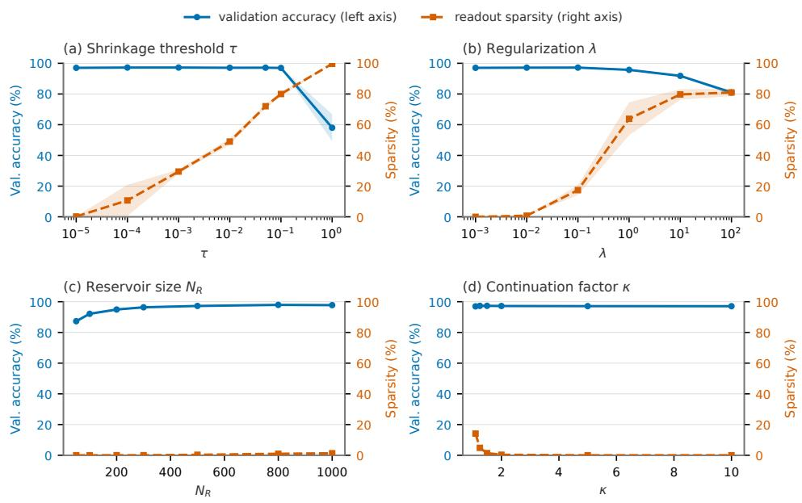  
Figure 5: One-at-a-time ablation on UCI HAR (mean over ten seeds; shaded bands are ±1 std). Left axis (blue): validation accuracy; right axis (orange): readout sparsity. (a) The shrinkage threshold τ trades sparsity for accuracy cleanly. (b) The penalty strength λ also sparsifies, but sacrifices more accuracy and saturates. (c) Reservoir size $N _ { R }$ governs accuracy and saturates around 500. (d) The continuation factor κ leaves accuracy unchanged.

## 6 Discussion

## 6.1 Sparsity–Accuracy Trade-of

The central finding is that on time-series classification the ESN readout is largely redundant, and that SL1ESN is able to find and discard that redundancy without giving up accuracy. Under a single threshold shared by every dataset and both settings, its readouts are 77–95% sparse centrally and 75–95% sparse in the federated setting, and on the same five of the seven classification benchmarks they stay within 0.7 points of the strongest dense baseline centrally and within 1.6 points in federation, margins that in most cases are smaller than the seed-to-seed standard deviation, so that the sparse readout is on par with the best dense one there; on UCI HAR the centralized sparse readout is the most accurate model outright, and in federation that holds on Distal. The accuracy–sparsity curves of Figures 2 and 4 show why this is possible, they are flat over a wide range before they break, so there is a broad band of sparsity levels at which the readout simply loses nothing. This is the payof of the smooth penalty. Because the surrogate is diferentiable, the redundant coordinates are driven toward zero while the readout is still being fitted, and the coordinates that survive are re-optimized at every Newton step to absorb what the others gave up. A post-hoc magnitude pruning of a finished dense fit cannot do this.

The concern that highly separable datasets might resist sparsification does not materialize. JapaneseVowels, a 12-dimensional 9-class problem with short sequences, sparsifies to 94.6% centrally and 95.2% in federation while remaining within 0.6 and 1.4 points of the best baseline. Where SL1ESN does give up accuracy is Yoga and Strawberry, which trail the best baseline by 5.8 and 5.7 points centrally and by 4.5 and 3.6 points in federation. In the centralized setting Figure 2 localizes the cause, on these two datasets the sparsity plateau is just as flat as on the others, and the gap is already present at the dense end of the sweep, so it comes from the Smooth-L1-trained fit being slightly weaker than the unregularized one, not from the pruning, and lowering τ would therefore not recover it. The federated setting behaves diferently on exactly these two datasets: the accuracy–sparsity curve does slope down (Yoga loses 1.7 points and Strawberry 3.8 between their dense and their $\tau = 0 . 1$ operating points), so there part of the shortfall is a genuine cost of sparsification. This is the one place where the centralized and federated readouts diverge, and it coincides with the two noisiest, smallest-margin datasets in the suite.

## 6.2 Communication Eficiency

The sparsity of the FedSL1ESN global readout yields eficiency gains along three axes, which we state precisely to avoid over-claiming. First, model storage and inference. The converged global readout has only 5–25% of its entries non-zero, so the stored model and the per-sample inference cost (a sparse matrix–vector product on each edge device) shrink by the corresponding factor. This is the benefit most relevant to the resource-constrained IoT setting that motivates this work. Second, the server-to-client broadcast, which carries the global readout and is transmitted in CSR form and therefore inherits the same compression. Third, the number of communication rounds. The second-order server update reaches near-peak accuracy within one to two rounds on several datasets (Figure 3), reducing the total round budget relative to first-order schemes that need many more rounds to converge.

It is important to be clear about which part of the communication cost sparsity actually reduces, and which part it leaves untouched. The savings apply to the server-to-client broadcast and to the stored model, both of which carry the readout. They do not apply to the dominant per-round cost, which is the client-to-server upload. In the federated Newton method this message carries the local gradient and the per-class Gauss-Newton Hessian rather than the readout itself, and its size is therefore independent of readout sparsity. Concretely, a client uploads $N o N _ { R }$ gradient entries and $N _ { O }$ symmetric $N _ { R } \times N _ { R }$ blocks per round, i.e. $N o N _ { R } ( N _ { R } + 3 ) / 2$ floats against $N _ { O } N _ { R }$ for a FedAvg weight upload, a ratio of $( N _ { R } + 3 ) / 2 \approx 2 5 0$ at $N _ { R } = 5 0 0$ that is independent of the dataset (0.96 MB per client and round on the binary benchmarks and 9.6 MB on Character, in single precision, against 3.9 and 39.1 KB). A first-order scheme would thus have to require some 250 times as many rounds before the cumulative uplink favoured the second-order update, which the convex readout problem studied here does not demand; we therefore claim eficiency for the stored model, the inference path and the broadcast, where the sparsity of Table 4 gives a 2–10× reduction, and explicitly not for the upload. The reduction factor is quoted for the CSR payload rather than for the count of surviving weights: at 75–95% sparsity only 5–25% of the entries remain, which would be $\mathrm { ~ a ~ } 4 { - } 2 0 \times$ saving on the values alone, but CSR stores a column index alongside every value, so at equal word width the realized factor is roughly halved. The design therefore trades a larger per-round upload for substantially fewer rounds and a sparse final model. Reducing the curvature payload, for example via low-rank or sketched Hessian approximations or by re-using the fixed-reservoir structure of $\mathbf { H } _ { k } .$ is a concrete and promising direction, and connects our approach to communication-eficient second-order federated methods such as FedNS (Li et al., 2024b).

## 6.3 Second-Order Optimization Compatibility

A key advantage of the twice-diferentiable Smooth-L1 penalty is that the second-order optimization it enables is exploited not only in the centralized setting but also within the federated protocol, directly addressing the concern that the diferentiability advantage might go unused in distributed training. Concretely, each client evaluates the local gradient and the per-class Gauss-Newton Hessian of its Smooth-L1 loss at the current global readout; the server sums these quantities across clients, solves a damped Newton equation per output class to obtain the descent direction, and selects the step size by Armijo backtracking line search before broadcasting the updated readout. This federated Newton scheme is made possible precisely by the smoothness of the penalty (a non-smooth L1 objective exposes no usable Hessian), and it inherits the fast, low-variance convergence observed centrally, reaching near-peak accuracy within one to two communication rounds on several datasets. The principal cost of transmitting curvature information, and its interaction with the sparse-readout communication savings, is discussed in Section 6.2 and is closely related to second-order federated methods such as FedNS (Li et al., 2024b). Sharing curvature also changes what a client exposes. The transmitted block $\mathbf { H } _ { k , c } = \mathbf { X } _ { k } ^ { \top }$ diag $( p _ { c } ( 1 - p _ { c } ) ) \mathbf { X } _ { k }$ is a label-weighted second moment of the local reservoir states rather than any raw sequence, and is the same class of quantity that federated reservoir computing already exchanges, the suficient statistics of Bacciu et al. (2021) being its unweighted counterpart; it is nonetheless a larger exposure than a gradient alone, since its rank is at most the local sample count, so a client holding fewer samples than $N _ { R }$ reveals the subspace spanned by its own states, which the server can interpret because it holds $\mathbf { W } _ { \mathrm { i n } }$ and $\mathbf { W } _ { \mathrm { r e s } }$ . First-order protocols are not a safe reference point either, shared gradients being invertible to a degree in practice (Geiping et al., 2020), so the accurate statement is that the two expose diferent surfaces and that ours is the larger. Because the server needs only the sums $\sum _ { k } \mathbf { g } _ { k }$ and $\textstyle \sum _ { k } \mathbf { H } _ { k }$ which are linear in the client contributions, secure aggregation (Bonawitz et al., 2017) composes with this update without modifying it (Section 6.4).

## 6.4 Limitations

Four limitations warrant future investigation. (1) Support identifiability: we report the level of sparsity the readout reaches, not the identity of the surviving reservoir coordinates. Because the reservoir features are strongly correlated by construction (Section 2), many supports realize an equally sparse and accurate readout, so we claim compression rather than feature selection; whether a stable, interpretable support can be extracted is left to future work. (2) Non-IID data: heterogeneous client distributions are not implemented in this work, since all federated experiments use a uniform (IID) partition, and we do not claim that the reported behavior transfers to the non-IID case. Two risks are specific to our scheme: under client drift (Shi et al., 2022) the local Gauss-Newton Hessians describe curvature around diferent local optima, so their plain sum can bias the global Newton direction, and a single global shrinkage threshold could prune directions that only minority clients rely on. Newton-type federated optimization under statistical heterogeneity is an active line of work (Li et al., 2019; Safaryan et al., 2022; Elgabli et al., 2022), and because our clients already expose exactly the local gradient and Gauss-Newton Hessian these methods operate on, they are natural drop-in replacements for the aggregation step of Algorithm 2; how the α-continuation and the shared threshold interact with client-heterogeneous sparsity patterns is the question specific to FedSL1ESN. (3) Experimental scale: the main-text federated setup uses five clients and 50 rounds; a client-count sweep up to K = 50 (Appendix D) shows that accuracy and readout sparsity are stable under IID partitioning, but larger client populations and system-level efects (stragglers, partial participation) remain untested. (4) Privacy: the curvature upload exposes more than a first-order message, and although secure aggregation applies to it unchanged, neither that nor a diferentially private variant is implemented here.

## 7 Conclusion

This paper introduced SL1ESN, an Echo State Network architecture that applies Smooth-L1 regularization to the readout layer. By leveraging a twice-diferentiable approximation of the L1 norm, the method keeps the readout objective amenable to second-order optimization while still driving redundant readout weights to zero. On classification, and under a single shrinkage threshold shared by every dataset and both settings, it learned readouts that are 77–95% sparse centrally and 75–95% sparse in the federated setting, at an accuracy close to that of the dense unregularized and L2 baselines. In the federated setting, a second-order (Newton) server update made possible by the smooth penalty converges in only a few communication rounds, and the resulting sparse readout reduces model storage, inference cost, and the serverto-client broadcast, addressing key bottlenecks for on-device deployment. The claims of this paper are confined to classification; a supplementary evaluation on two chaotic regression benchmarks (Appendix C) indicates that the same readout tolerates far less pruning there before the autonomous rollout degrades, which delimits where the method is expected to pay of. These findings establish a foundation for sparse and eficient reservoir computing in resource-constrained environments. Future work will address adaptive regularization strategies, robustness to non-IID data distributions, for which Newton-type federated methods designed for heterogeneous data ofer a concrete starting point (Section 6.4), and extensions to other reservoir computing architectures.

## Code Availability

The code implementation and extended results are available at https://github.com/oroboro 235/FedESN-SmoothL1.

## Acknowledgments

This work was supported in part by the European Regional Development Fund (ERDF) under grant FKZ 2404-003-1.2 (EU-EFRE GREEN-INNO), the ProPere THWS program, and the Cybersecurity Center TTZ-WUE.

## References

Azim Akhtarshenas, Mohammad Ali Vahedifar, Navid Ayoobi, Behrouz Maham, Tohid Alizadeh, Sina Ebrahimi, and David López-Pérez. Federated learning: A cutting-edge survey of the latest advancements and applications. Computer Communications, 228:107964, 2024. ISSN 0140-3664. doi: https://doi.org/10.1016/j.comcom.2024.107964. URL https://www.scienc edirect.com/science/article/pii/S0140366424003116.

Davide Anguita, Alessandro Ghio, Luca Oneto, Xavier Parra, and Jorge Luis Reyes-Ortiz. A public domain dataset for human activity recognition using smartphones. In Proceedings of the 21st European Symposium on Artificial Neural Networks, Computational Intelligence and Machine Learning (ESANN), pages 437–442, 2013.

Davide Bacciu, Daniele Di Sarli, Pouria Faraji, Claudio Gallicchio, and Alessio Micheli. Federated reservoir computing neural networks. In Proc. of IJCNN’21, pages 1–7. IEEE, 2021.

Paolo Baldini. Reservoir computing in robotics: a review. arXiv preprint arXiv:2206.11222, 2022.

Amir Beck and Marc Teboulle. A fast iterative shrinkage-thresholding algorithm for linear inverse problems. SIAM Journal on Imaging Sciences, 2(1):183–202, 2009.

Maximilian Beck, Korbinian Pöppel, Markus Spanring, Andreas Auer, Oleksandra Prudnikova, Michael Kopp, Günter Klambauer, Johannes Brandstetter, and Sepp Hochreiter. xlstm: Extended long short-term memory. In Advances in Neural Information Processing Systems, volume 37, 2024.

Thomas Blumensath and Mike E. Davies. Iterative hard thresholding for compressed sensing. Applied and Computational Harmonic Analysis, 27(3):265–274, 2009.

Keith Bonawitz, Vladimir Ivanov, Ben Kreuter, Antonio Marcedone, H. Brendan McMahan, Sarvar Patel, Daniel Ramage, Aaron Segal, and Karn Seth. Practical secure aggregation for privacy-preserving machine learning. In Proceedings of the 2017 ACM SIGSAC Conference on Computer and Communications Security (CCS), pages 1175–1191, 2017.

Stephen Boyd, Neal Parikh, Eric Chu, Borja Peleato, and Jonathan Eckstein. Distributed optimization and statistical learning via the alternating direction method of multipliers. Foundations and Trends in Machine Learning, 3(1):1–122, 2011.

Stephen P Boyd and Lieven Vandenberghe. Convex optimization. Cambridge Uni. press, 2004.

Emmanuel J. Candès, Justin Romberg, and Terence Tao. Robust uncertainty principles: exact signal reconstruction from highly incomplete frequency information. IEEE Transactions on Information Theory, 52(2):489–509, 2006.

Junyoung Chung, Caglar Gulcehre, KyungHyun Cho, and Yoshua Bengio. Empirical evaluation of gated recurrent neural networks on sequence modeling. arXiv preprint arXiv:1412.3555, 2014.

Ruth Cordova-Cardenas, Daniel Amor, and Álvaro Gutiérrez. Edge ai in practice: A survey and deployment framework for neural networks on embedded systems. Electronics, 14(24), 2025. ISSN 2079-9292. doi: 10.3390/electronics14244877. URL https://www.mdpi.com/2079-929 2/14/24/4877.

Matthew Dale, Simon O’Keefe, Angelika Sebald, Susan Stepney, and Martin A. Trefzer. Reservoir computing quality: connectivity and topology. Natural Computing, 20(2):205–216, 2021. ISSN

1572-9796. doi: 10.1007/s11047-020-09823-1. URL https://doi.org/10.1007/s11047-020 -09823-1.

Hoang Anh Dau, Anthony Bagnall, Kaveh Kamgar, Chin-Chia Michael Yeh, Yan Zhu, Shaghayegh Gharghabi, Chotirat Ann Ratanamahatana, and Eamonn Keogh. The ucr time series archive. IEEE/CAA Journal of Automatica Sinica, 6(6):1293–1305, 2019.

Ingrid Daubechies, Michel Defrise, and Christine De Mol. An iterative thresholding algorithm for linear inverse problems with a sparsity constraint. Communications on Pure and Applied Mathematics, 57(11):1413–1457, 2004.

Valerio De Caro, Claudio Gallicchio, and Davide Bacciu. Federated adaptation of reservoirs via intrinsic plasticity. arXiv preprint arXiv:2206.11087, 2022.

David L. Donoho. Compressed sensing. IEEE Transactions on Information Theory, 52(4): 1289–1306, 2006.

Elias Dritsas and Maria Trigka. Federated learning for iot: A survey of techniques, challenges, and applications. Journal of Sensor and Actuator Networks, 14(1), 2025. ISSN 2224-2708. doi: 10.3390/jsan14010009. URL https://www.mdpi.com/2224-2708/14/1/9.

John Duchi, Elad Hazan, and Yoram Singer. Adaptive subgradient methods for online learning and stochastic optimization. Journal of Machine Learning Research, 12:2121–2159, 2011.

Giuseppe Alessio D’Inverno and Jonathan Dong. Comparison of reservoir computing topologies using the recurrent kernel approach. Neurocomputing, 611:128679, 2025. ISSN 0925-2312. doi: https://doi.org/10.1016/j.neucom.2024.128679. URL https://www.sciencedirect.com/sc ience/article/pii/S0925231224014504.

Bradley Efron, Trevor Hastie, Iain Johnstone, and Robert Tibshirani. Least angle regression. The Annals of Statistics, 32(2):407–499, 2004.

Mohab M. Eid Kishawy, Mohamed T. Abd El-Hafez, Retaj Yousri, and M. Saeed Darweesh. Federated learning system on autonomous vehicles for lane segmentation. Scientific Reports, 14(1):25029, 2024. doi: 10.1038/s41598-024-71187-8.

Anis Elgabli, Chaouki Ben Issaid, Amrit Singh Bedi, Ketan Rajawat, Mehdi Bennis, and Vaneet Aggarwal. FedNew: A communication-eficient and privacy-preserving Newton-type method for federated learning. In International Conference on Machine Learning (ICML), volume 162 of Proceedings of Machine Learning Research, 2022.

European Parliament and Council of the European Union. Regulation (eu) 2016/679 of the european parliament and of the council (general data protection regulation), May 2016. URL https://data.europa.eu/eli/reg/2016/679/oj.

Haokun Fang and Quan Qian. Privacy preserving machine learning with homomorphic encryption and federated learning. Future Internet, 13(4):1–20, 2021. doi: 10.3390/fi13040094.

Claudio Gallicchio. Sparsity in reservoir computing neural networks. In Mirjana Ivanovic, editor, Int. Conf. INISTA 2020, pages 1–7. IEEE, 2020.

Claudio Gallicchio, Alessio Micheli, and Luca Pedrelli. Deep reservoir computing: A critical experimental analysis. Neurocomputing, 268:87–99, 2017.

Jonas Geiping, Hartmut Bauermeister, Hannah Dröge, and Michael Moeller. Inverting gradients – how easy is it to break privacy in federated learning? In Advances in Neural Information Processing Systems (NeurIPS), volume 33, 2020.

Erol Gelenbe. Random neural networks with negative and positive signals and product form solution. Neural Computation, 1(4):502–510, 1989.

Yinghao Guo, Zichao Zhao, Ke He, Shiwei Lai, Junjuan Xia, and Lisheng Fan. Eficient and flexible management for industrial internet of things: A federated learning approach. Computer Networks, 192:108122, 2021.

Gerardo M. Gutierrez, Jaime A. Rincon, and Vicente Julian. Federated learning for collaborative robotics: A ros 2-based approach. Electronics, 14(7):1–15, 2025. doi: 10.3390/electronics14071 323.

Song Han, Jef Pool, John Tran, and William Dally. Learning both weights and connections for eficient neural network. In C. Cortes, N. Lawrence, D. Lee, M. Sugiyama, and R. Garnett, editors, Advances in Neural Information Processing Systems, volume 28. Curran Associates, Inc., 2015. URL https://proceedings.neurips.cc/paper\_files/paper/2015/file/ae0 eb3eed39d2bcef4622b2499a05fe6-Paper.pdf.

Trevor Hastie, Robert Tibshirani, and Martin Wainwright. Statistical Learning with Sparsity: The Lasso and Generalizations, volume 143 of Monographs on Statistics and Applied Probability. CRC Press, Boca Raton, FL, 2015.

Emil Johannesen Haugstvedt, Alberto Miño Calero, Erlend Torje Berg Lundby, Adil Rasheed, and Jan Tommy Gravdahl. A comparative study of sparsity promoting techniques in neural network for modeling non-linear dynamics. IEEE Access, 11:131435–131452, 2023. doi: 10.1109/ACCESS.2023.3336292.

Sepp Hochreiter and Jürgen Schmidhuber. Long short-term memory. Neural Computation, 9(8): 1735–1780, 1997.

Herbert Jaeger. The “echo state” approach to analysing and training recurrent neural networks. Technical Report 148, German Nat. Res. Center for Inf. Techn., 2001.

Herbert Jaeger and Harald Haas. Harnessing nonlinearity: Predicting chaotic systems and saving energy in wireless communication. Science, 304(5667):78–80, 2004.

Madhura Joshi, Ankit Pal, and Malaikannan Sankarasubbu. Federated learning for healthcare domain - pipeline, applications and challenges. ACM Trans. Comput. Healthcare, 3(4):1–36, 2022. doi: 10.1145/3533708.

H. Kasyap and S. Tripathy. Privacy-preserving decentralized learning framework for healthcare system. ACM Transactions on Multimedia Computing, Communications and Applications, 17 (2s):1–24, 2021.

Mineichi Kudo, Jun Toyama, and Masaru Shimbo. Multidimensional curve classification using passing-through regions. Pattern Recognition Letters, 20(11-13):1103–1111, 1999.

Timothy Kuo and Hui Yang. Federated learning on distributed and encrypted data for smart manufacturing. Journal of Computing and Information Science in Engineering, 24(7):1–12, 2024. doi: 10.1115/1.4065571.

John Langford, Lihong Li, and Tong Zhang. Sparse online learning via truncated gradient. Journal of Machine Learning Research, 10:777–801, 2009.

Boyu Li, Robert Simon Fong, and Peter Tino. Simple cycle reservoirs are universal. Journal of Machine Learning Research, 25(158):1–28, 2024a.

Jian Li, Yong Liu, Wei Wang, Haoran Wu, and Weiping Wang. Fedns: A fast sketching newtontype algorithm for federated learning, 2024b. URL https://arxiv.org/abs/2401.02734.

Tian Li, Anit Kumar Sahu, Manzil Zaheer, Maziar Sanjabi, Ameet Talwalkar, and Virginia Smith. FedDANE: A federated Newton-type method. In 2019 53rd Asilomar Conference on Signals, Systems, and Computers, pages 1227–1231. IEEE, 2019.

Andrew Liu, Muhammad Farhan Azmine, Chunxiao Lin, and Yang Yi. Reservoir computing: Foundations, advances, and challenges toward neuromorphic intelligence. AI, 7(2):70, 2026. doi: 10.3390/ai7020070.

Bingyan Liu, Nuoyan Lv, Yuanchun Guo, and Yawen Li. Recent advances on federated learning: A systematic survey. Neurocomputing, 597:1–16, 2024. doi: 10.1016/j.neucom.2024.128019.

Shiwei Liu. Learning sparse neural networks for better generalization. In Christian Bessiere, editor, Proceedings of the Twenty-Ninth International Joint Conference on Artificial Intelligence, IJCAI-20, pages 5190–5191. International Joint Conferences on Artificial Intelligence Organization, 7 2020. doi: 10.24963/ijcai.2020/735. URL https://doi.org/10.24963/ijc ai.2020/735. Doctoral Consortium.

Edward N. Lorenz. Deterministic nonperiodic flow. Journal of the Atmospheric Sciences, 20(2): 130–141, 1963.

Gaoyong Lu, Yang Ou, Zhihong Wang, Yingnan Qu, Yingsheng Xia, Dibin Tang, Igor Kotenko, and Wei Li. A survey of deep learning for time series forecasting: Theories, datasets, and state-of-the-art techniques. Computers, Materials and Continua, 85(2):2403–2441, 2025. ISSN 1546-2218. doi: https://doi.org/10.32604/cmc.2025.068024. URL https://www.sciencedir ect.com/science/article/pii/S1546221825008872.

Mantas Lukoševičius. A practical guide to applying echo state networks. In Neural Networks: Tricks of the Trade: Second Edition, pages 659–686. Springer, 2012.

Mantas Lukoševičius and Herbert Jaeger. Reservoir computing approaches to recurrent neural network training. Computer Science Review, 3(3):127–149, 2009.

Gengcheng Lyu, Manuel Röder, and Frank-Michael Schleif. On the use of smooth-l1 approximation in echo state networks for sparse and eficient temporal modeling. In Luis Martínez, David Camacho, Hujun Yin, Bapi Dutta, Raciel Yera, Rosa María Rodríguez Domínguez, and Antonio J. Tallón-Ballesteros, editors, Intelligent Data Engineering and Automated Learning - IDEAL 2025 - 26th International Conference, Jaén, Spain, November 13-15, 2025, Proceedings, Part I, Lecture Notes in Computer Science, pages 40–46. Springer, 2025. doi: 10.1007/978-3-032-10486-1\_4. URL https://doi.org/10.1007/978-3-032-10486-1\_4.

Wolfgang Maass, Thomas Natschläger, and Henry Markram. Real-time computing without stable states: A new framework for neural computation based on perturbations. Neural Computation, 14(11):2531–2560, 2002.

Michael C Mackey and Leon Glass. Oscillation and chaos in physiological control systems. Science, 197(4300):287–289, 1977.

Stéphane G. Mallat and Zhifeng Zhang. Matching pursuits with time-frequency dictionaries. IEEE Transactions on Signal Processing, 41(12):3397–3415, 1993.

Filip Matzner and František Mráz. Locally connected echo state networks for time series forecasting. In The Thirteenth International Conference on Learning Representations (ICLR 2025), 2025. URL https://openreview.net/forum?id=KeRwLLwZaw. Poster.

Brendan McMahan, Eider Moore, Daniel Ramage, Seth Hampson, and Blaise Agüera y Arcas. Communication-eficient learning of deep networks from decentralized data. In Aarti Singh and Xiaojin (Jerry) Zhu, editors, Proceedings of the 20th International Conference on Artificial Intelligence and Statistics, AISTATS 2017, 20-22 April 2017, Fort Lauderdale, FL, USA, volume 54 of Proceedings of Machine Learning Research, pages 1273–1282. PMLR, 2017. URL http://proceedings.mlr.press/v54/mcmahan17a.html.

Balas Kausik Natarajan. Sparse approximate solutions to linear systems. SIAM Journal on Computing, 24(2):227–234, 1995.

Jorge Nocedal and Stephen J. Wright. Numerical Optimization. Springer, New York, 2 edition, 2006.

Keigo Nogami, Hiroto Tamura, and Gouhei Tanaka. Federated learning with reservoir state analysis for time series anomaly detection. In 2025 International Joint Conference on Neural Networks (IJCNN), pages 1–8. IEEE, 2025.

Neal Parikh and Stephen Boyd. Proximal algorithms. Foundations and Trends in Optimization, 1(3):127–239, 2014.

Razvan Pascanu, Tomas Mikolov, and Yoshua Bengio. On the dificulty of training recurrent neural networks. In International conference on machine learning, pages 1310–1318. Pmlr, 2013.

Mirko Polato, Barbara Hammer, Manuel Röder, and Frank-Michael Schleif. Learning in federated and dynamic environments: A tutorial on challenges, trends, and practical strategies. Neurocomputing, 672:132671, 2026. doi: 10.1016/J.NEUCOM.2026.132671. URL https://doi.org/10.1016/j.neucom.2026.132671.

Junfei Qiao and Lei Wang. Adaptive lasso echo state network based on modified bayesian information criterion for nonlinear system modeling. Neural Computing and Applications, 31: 6163–6177, 2019.

Ali Rodan and Peter Tiño. Minimum complexity echo state network. IEEE Transactions on Neural Networks, 22(1):131–144, 2011.

Ali Rodan and Peter Tiño. Simple deterministically constructed cycle reservoirs with regular jumps. Neural Computation, 24(7):1822–1852, 2012. doi: 10.1162/NECO\_A\_00297. URL https://doi.org/10.1162/NECO\_a\_00297.

Nuria Rodríguez-Barroso, Goran Stipcich, Daniel Jiménez-López, José Antonio Ruiz-Millán, Eugenio Martínez-Cámara, Gerardo González-Seco, M. Victoria Luzón, Miguel Angel Veganzones, and Francisco Herrera. Federated learning and diferential privacy: Software tools analysis, the sherpa.ai fl framework and methodological guidelines for preserving data privacy. Information Fusion, 64:270–292, 2020. doi: 10.1016/j.infus.2020.07.009.

Mher Safaryan, Rustem Islamov, Xun Qian, and Peter Richtárik. FedNL: Making Newton-type methods applicable to federated learning. In International Conference on Machine Learning (ICML), volume 162 of Proceedings of Machine Learning Research, 2022.

Mark Schmidt. Fast optimization methods for l1 regularization: A comparative study and two new approaches. In Proc. of ECML’07, pages 286–297. Springer, 2007.

Yong Shi, Yuanying Zhang, Yang Xiao, and Lingfeng Niu. Optimization strategies for client drift in federated learning: A review. Procedia Computer Science, 214:1168–1173, 2022. doi: 10.1016/j.procs.2022.11.292.

Hiroto Tamura, Kantaro Fujiwara, Kazuyuki Aihara, and Gouhei Tanaka. Mahalanobis distance of reservoir states for online time-series anomaly detection. Authorea Preprints, 2023.

Robert Tibshirani. Regression shrinkage and selection via the lasso. Journal of the Royal Statistical Society Series B: Statistical Methodology, 58(1):267–288, 1996.

Matteo Tiezzi, Michele Casoni, Alessandro Betti, Marco Gori, and Stefano Melacci. State-space modeling in long sequence processing: a survey on recurrence in the transformer era. Neural Networks, 193:108039, 2026. doi: 10.1016/j.neunet.2025.108039.

Joel A. Tropp and Anna C. Gilbert. Signal recovery from random measurements via orthogonal matching pursuit. IEEE Transactions on Information Theory, 53(12):4655–4666, 2007.

Nathan Trouvain, Luca Pedrelli, Thanh Trung Dinh, and Xavier Hinaut. Reservoirpy: an eficient and user-friendly library to design echo state networks. In International Conference on Artificial Neural Networks, pages 494–505. Springer, 2020.

David Verstraeten, Benjamin Schrauwen, Michiel d’Haene, and Dirk Stroobandt. An experimental unification of reservoir computing methods. Neural Networks, 20(3):391–403, 2007.

Thomas Villmann, Frank-Michael Schleif, and Barbara Hammer. Sparse representation of data. In 18th European Symposium on Artificial Neural Networks, ESANN 2010, Bruges, Belgium, April 28-30, 2010, Proceedings, 2010. URL https://www.esann.org/sites/default/file s/proceedings/legacy/es2010-7.pdf.

Jie Wen, Zhixia Zhang, Yang Lan, Zhihua Cui, Jianghui Cai, and Wensheng Zhang. A survey on federated learning: challenges and applications. International Journal of Machine Learning and Cybernetics, 14:513–535, 2023. doi: 10.1007/s13042-022-01647-y.

Ben Williams. Character trajectories [dataset], 2006. URL https://doi.org/10.24432/C58G7V.

Stephen J. Wright. Coordinate descent algorithms. Mathematical Programming, 151(1):3–34, 2015. ISSN 1436-4646. doi: 10.1007/s10107-015-0892-3. URL https://doi.org/10.1007/s1 0107-015-0892-3.

Alok Yadav, Kitsuchart Pasupa, Chu Kiong Loo, and Xiaofeng Liu. Optimizing echo state networks for continuous gesture recognition in mobile devices: A comparative study. Heliyon, 10(5):e27108, 2024. ISSN 2405-8440. doi: https://doi.org/10.1016/j.heliyon.2024.e27108. URL https://www.sciencedirect.com/science/article/pii/S2405844024031396.

Izzet B Yildiz, Herbert Jaeger, and Stefan J Kiebel. Re-visiting the echo state property. Neural Networks, 35:1–9, 2012.

Ming Yuan and Yi Lin. Model selection and estimation in regression with grouped variables. Journal of the Royal Statistical Society Series B: Statistical Methodology, 68(1):49–67, 2006.

Yujie Zhao and Xiaoming Huo. A survey of numerical algorithms that can solve the lasso problems. Wiley Interdisciplinary Reviews: Computational Statistics, 15(4):e1602, 2023.

Xianghan Zheng, Yimi Chen, Zhengzheng Li, and Renjie He. A survey on federated learning technology. In Proceedings of the 2023 8th International Conference on Mathematics and Artificial Intelligence, ICMAI ’23, pages 69–81, 2023. doi: 10.1145/3594300.3594312.

Nicolas Zucchet and Antonio Orvieto. Recurrent neural networks: vanishing and exploding gradients are not the end of the story. In Proceedings of the 38th International Conference on Neural Information Processing Systems, NIPS ’24, Red Hook, NY, USA, 2024. Curran Associates Inc. ISBN 9798331314385.

## A Notation

Table 5: Notation summary.
<table><tr><td>Symbol</td><td>Description</td></tr><tr><td> $N _ { I } , N _ { R } , N _ { O }$ </td><td>Input, reservoir, and output dimensions</td></tr><tr><td> $t , T$ </td><td>Discrete time step; total training steps</td></tr><tr><td> ${ \bf u } ( t ) , { \bf x } ( t )$ </td><td>Input vector and reservoir state</td></tr><tr><td> $\tilde { { \mathbf x } } ( t )$ </td><td>Candidate (pre-leak) reservoir state</td></tr><tr><td> $\mathbf { X }$ </td><td>Matrix of collected reservoir states</td></tr><tr><td> ${ \hat { \mathbf { y } } } ( t ) , \mathbf { y } ( t )$ </td><td>Predicted and target output vectors</td></tr><tr><td> ${ \hat { y } } _ { c } ( t ) , y _ { c } ( t )$ </td><td>Predicted and target probability of class c</td></tr><tr><td> $\mathbf { W } _ { \mathrm { i n } } , \mathbf { W } _ { \mathrm { r e s } } , \mathbf { W } _ { \mathrm { o u t } }$ </td><td>Input, reservoir, and readout weight matrices</td></tr><tr><td> $w _ { i j }$ </td><td>Element of  $\mathbf { W _ { \mathrm { o u t } } }$ </td></tr><tr><td> $\gamma$ </td><td>Leaking rate,  $\gamma \in ( 0 , 1 ]$ </td></tr><tr><td> $\phi , \rho$ </td><td>Connectivity and spectral radius of  $\mathbf { W } _ { \mathrm { r e s } }$ </td></tr><tr><td> $a _ { \mathrm { i n } }$ </td><td>Input scaling factor</td></tr><tr><td> $\lambda$ </td><td>Regularization strength</td></tr><tr><td> $\alpha , \alpha _ { 0 } , \kappa$ </td><td>Smooth-L1 smoothing parameter, initial value, and factor</td></tr><tr><td> $| w | _ { \alpha }$ </td><td>Smooth approximation of |w|</td></tr><tr><td> $\mathcal { L }$ </td><td>Regularized loss function</td></tr><tr><td> $\mathbf { g } , \mathbf { H }$ </td><td>Gradient and Hessian of  $\mathcal { L }$ </td></tr><tr><td> $\Delta \mathbf { w } , \eta$ </td><td>Newton update direction and (line-search) step size</td></tr><tr><td> $\mathbf { D } , \mathbf { d } _ { c }$ </td><td>Server Newton direction matrix and its row for class c</td></tr><tr><td> $\mu$ </td><td>Damping (ridge) added to the Hessian in the Newton solve</td></tr><tr><td> $\tau$ </td><td>Shrinkage threshold for readout sparsification</td></tr><tr><td> $S _ { \tau }$ </td><td>Soft-threshold operator sign(w) max(|w| − τ, 0)</td></tr><tr><td> $P , \ \varepsilon _ { s }$ </td><td>Support-stagnation early-stop window and tolerance</td></tr><tr><td> $K , k , R$ </td><td>Number of clients, client index, communication rounds</td></tr><tr><td> $\mathbf { g } _ { k } , \mathbf { H } _ { k }$ </td><td>Local gradient and Gauss-Newton Hessian of client k</td></tr><tr><td> $\mathcal { L } _ { k }$ </td><td>Local loss of client k</td></tr></table>

## B Implementation Details

## B.1 Hyperparameter Settings

Table 6 reports the per-dataset values of the spectral radius $\rho ,$ input scaling $a _ { \mathrm { i n } }$ , leaking rate $\gamma ,$ and regularization strength λ selected by random search over the distributions of Table 2 for SL1ESN. The continuation schedule $( \alpha _ { 0 } = 1 , \kappa = 2 , \alpha _ { \mathrm { m a x } } = 5 \times 1 0 ^ { 6 } )$ and the early-stop parameters $( P = 8 , \varepsilon _ { s } = 0 . 2$ percentage points) are fixed uniformly across all datasets. The shrinkage threshold is likewise fixed: $\tau = 0 . 1$ on every classification dataset, in both the centralized and the federated setting, so no per-dataset threshold is tuned anywhere in the paper. For regression, where thresholding costs long-horizon accuracy (Appendix C), it is left at the negligible value $\tau = 1 0 ^ { - 5 }$ , so the reported regression sparsity is produced by the Smooth-L1 penalty alone. The same reservoir seed is used for all regularization methods to ensure a fair comparison.

Search protocol. Model selection uses a stratified 80/20 split of each training set into a fitting and a validation part, with every class present in both; the test set of Table 1 is untouched until the final evaluation. Each candidate configuration is an independent uniform draw from the distributions of Table $^ { 2 , }$ scored by validation accuracy alone, and the same budget is given to all three penalties on a given dataset: 5,000 draws on UCI HAR, Character and JapaneseVowels and 25,000 on the four binary UCR datasets. In the federated setting the reservoir hyperparameters $( \rho , a _ { \mathrm { i n } } , \gamma )$ are inherited from the centralized selection and only λ is re-drawn, for 200 configurations per dataset for FedSL1ESN and 100 for each baseline, scored by the same criterion on the aggregated global readout. The selected federated values are $\lambda = 1 . 1 \times 1 0 ^ { - 3 }$ (UCI HAR), $1 . 1 \times 1 0 ^ { - 3 }$ (Character), $9 . 7 \times 1 0 ^ { - 3 }$ (JapaneseVowels), $3 . 4 \times 1 0 ^ { - 4 }$ (ECG5000), $3 . 3 \times 1 0 ^ { - 3 }$ (Distal.), $1 . 2 \times 1 0 ^ { - 4 }$ (Yoga) and $1 . 6 \times 1 0 ^ { - 4 }$ (Strawberry).

Solver settings. The damping µ of the Newton system $( \mathbf { H } + \mu \mathbf { I } ) \Delta \mathbf { w } = - \mathbf { g }$ is not a fixed constant but is set adaptively per solve, in the manner of Levenberg–Marquardt: starting from $\mu = 1$ it is multiplied by 10 until the system is solvable and the resulting step is bounded $( \| \Delta \mathbf { w } \| _ { \infty } < 1 0 ^ { 2 } )$ , which is also what keeps the singular directions of the shift-invariant softmax parameterization (Section 5) from producing an unusable step. The Armijo line search uses a suficient-decrease constant $c _ { 1 } = 1 0 ^ { - 4 }$ and a backtracking factor of 0.5, capped at 20 backtracks. The centralized iteration budget of Algorithm 1 is 200 Newton iterations, which the supportstagnation criterion $( P = 8 , \varepsilon _ { s } = 0 . 2$ percentage points) reaches well before exhaustion; the federated budget is the 50 communication rounds of Section 5.3.

Table 6: Selected SL1ESN hyperparameters per dataset (random search over the ranges in Table 2; see Section 5). All runs use the reservoir size $N _ { R } = 5 0 0$
<table><tr><td>Dataset</td><td> $\rho$ </td><td> $a _ { \mathrm { i n } }$ </td><td>γ</td><td>λ</td></tr><tr><td>Mackey-Glass</td><td>1.26</td><td>1.76</td><td>0.54</td><td> $1 . 5 \times 1 0 ^ { - 3 }$ </td></tr><tr><td>Lorenz63</td><td>1.10</td><td>0.23</td><td>0.45</td><td> $1 . 0 \times 1 0 ^ { - 4 }$ </td></tr><tr><td>UCI HAR</td><td>1.48</td><td>7.12</td><td>0.016</td><td> $6 . 1 \times 1 0 ^ { - 3 }$ </td></tr><tr><td>Character</td><td>1.22</td><td>0.014</td><td>0.16</td><td> $7 . 4 \times 1 0 ^ { - 3 }$ </td></tr><tr><td>JapaneseVowels</td><td>0.50</td><td>0.60</td><td>0.032</td><td> $5 . 7 \times 1 0 ^ { - 4 }$ </td></tr><tr><td>ECG5000</td><td>2.04</td><td>10.3</td><td>0.033</td><td> $1 . 0 \times 1 0 ^ { - 2 }$ </td></tr><tr><td>Distal.</td><td>1.59</td><td>2.58</td><td>0.38</td><td> $5 . 2 \times 1 0 ^ { - 4 }$ </td></tr><tr><td>Yoga</td><td>2.10</td><td>92.0</td><td>0.062</td><td> $2 . 7 \times 1 0 ^ { - 3 }$ </td></tr><tr><td>Strawberry</td><td>2.72</td><td>2.09</td><td>0.023</td><td> $1 . 7 \times 1 0 ^ { - 3 }$ </td></tr></table>

## C Regression on Chaotic Benchmarks

The Smooth-L1 readout of Section 3 is not specific to classification, and the regression objective is trained by the same damped Newton solver with continuation and shrinkage. For completeness, this appendix evaluates the centralized SL1ESN on the Mackey-Glass (Mackey and Glass, 1977) and Lorenz63 (Lorenz, 1963) chaotic systems, which are standard benchmarks for evaluating ESN performance on chaotic dynamics.

The setup follows the centralized protocol of Section 5. Hyperparameters are optimized via random search over the distributions in Table 2, with the valid prediction time (VPT), the number of steps for which the autonomous rollout stays within a normalized-error threshold of the true trajectory, as the accuracy objective; the selected values are listed in Table 6. In addition to the unregularized and L2 (ridge regression) readouts, we include an L1 (LASSO, coordinate descent (Wright, 2015)) baseline, since a direct L1 solver is available for the quadratic loss. Metrics are reported for the best of five seeds, since the autonomous rollouts of a chaotic system are too dispersed across seeds for a mean to be informative. The shrinkage threshold is left at the negligible value $\tau = 1 0 ^ { - 5 }$ , so the reported sparsity is produced by the Smooth-L1 penalty alone.

Table 7 reports the results, and SL1ESN is competitive on both benchmarks. On Mackey-Glass it attains RMSE 0.118 with the second-longest valid-prediction time (VPT 377 steps, behind only the unregularized readout), and on Lorenz it reaches the best RMSE of the regularized readouts (10.14), better than the L1 readout on both metrics, though its valid-prediction time (VPT 148) trails the L2 and unregularized readouts. Figures 6 and 7 show the corresponding rollouts. On Mackey-Glass the Smooth-L1 rollout tracks the true trajectory longest among the regularized readouts, losing phase alignment only well after the L2 and L1 rollouts. On Lorenz, the unregularized, L2, and Smooth-L1 rollouts all reconstruct the attractor and track its two lobes of the butterfly, whereas the L1 readout leaves it earliest, collapsing away from the far lobe.

Table 7: Centralized regression results (best of five runs). RMSE lower is better; VPT (valid prediction time, in steps) higher is better; sparsity is the fraction of zero readout weights. All readouts are selected for accuracy. Bold: best RMSE per dataset.
<table><tr><td>Dataset</td><td>Metric</td><td>none</td><td>L2</td><td>L1</td><td>SL1ESN</td></tr><tr><td rowspan="3">Mackey-Glass</td><td>RMSE</td><td>0.085</td><td>0.108</td><td>0.113</td><td>0.118</td></tr><tr><td>VPT</td><td>511</td><td>176</td><td>230</td><td>377</td></tr><tr><td>Spars. (%)</td><td>0</td><td>0</td><td>91.0</td><td>46.4</td></tr><tr><td rowspan="3">Lorenz63</td><td>RMSE</td><td>9.90</td><td>10.70</td><td>11.74</td><td>10.14</td></tr><tr><td>VPT</td><td>277</td><td>270</td><td>109</td><td>148</td></tr><tr><td>Spars. (%)</td><td>0</td><td>0</td><td>92.9</td><td>0.2</td></tr></table>

The readout sparsity, however, is where the two regression tasks part company with the classification results of the main text. On Mackey-Glass the readout is 46% sparse at essentially no accuracy cost, but on Lorenz the accuracy-selected readout stays efectively dense (0.2%). Sparsifying it further is not free. One-step RMSE degrades gracefully, but the VPT, the horizon over which the rollout still tracks the true chaotic trajectory, is far more sensitive. Mackey-Glass can be pushed to 65% sparsity at VPT 107 and Lorenz to 36% at VPT 69, but beyond roughly 70% sparsity long-horizon predictability collapses altogether, since the Mackey-Glass VPT falls below 10 steps and the Lorenz rollout diverges almost immediately $( \mathrm { V P T } \le 5 )$ . The likely reason is that a chaotic attractor distributes predictive signal across many weakly-weighted, cross-dimensional reservoir couplings, so pruning by magnitude discards coordinates that the autonomous rollout still depends on, even when they contribute little to the one-step error. By contrast, the L1 (LASSO) readout does reach 91–93% sparsity, but at a VPT well below SL1ESN on both systems, so it buys that sparsity with exactly the long-horizon fidelity at issue. We also note that, unlike in classification, where the penalty strength λ saturates early as a sparsity control (Section 5.4.3), on these regression readouts λ is itself an efective sparsity knob, the accuracy-selected Mackey-Glass readout already being 46% sparse.

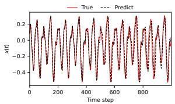  
(a) No regularization

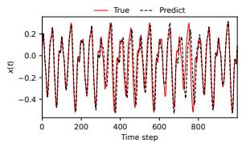  
(b) L2 regularization

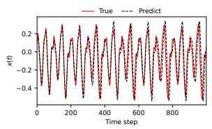  
(c) L1 regularization

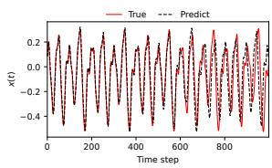  
(d) Smooth-L1 regularization  
Figure 6: Autonomous Mackey-Glass rollout (dashed) against the true test trajectory (solid) under the four readout variants, at the accuracy-selected configuration. The unregularized readout tracks the true trajectory longest (VPT 511; Table 7), followed by the Smooth-L1 readout (VPT 377), whereas the L2 and L1 rollouts lose phase alignment earlier (VPT 176 and 230).

In sum, the SL1ESN regression readout is accurate but not usefully sparse, and forcing sparsity higher trades away exactly the quantity that matters for a chaotic system, namely the horizon over which the autonomous rollout remains valid. Sparse readouts, on this evidence, are a tool for classification-style tasks with redundant reservoir features rather than a universal compression method for ESNs, which is why the experimental claims of this paper are confined to classification.

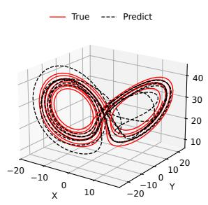  
(a) No regularization

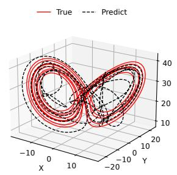  
(b) L2 regularization

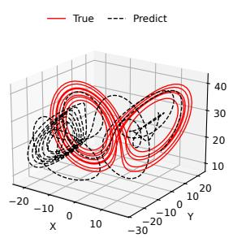  
(c) L1 regularization

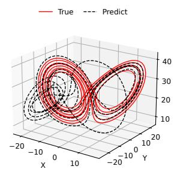  
(d) Smooth-L1 regularization  
Figure 7: Autonomous Lorenz rollout (dashed) against the true attractor (solid) under the four readout variants, at the accuracy-selected configuration. The unregularized, L2, and Smooth-L1 readouts all reconstruct the butterfly and track its two lobes before slowly drifting outward (VPT 277, 270, and 148; Table 7), whereas the L1 readout leaves the attractor earliest, collapsing away from the far lobe (VPT 109). The Smooth-L1 rollout attains the lowest RMSE of the three regularized readouts while, unlike the coordinate-descent L1 solver, remaining compatible with second-order optimization.

## D Sensitivity to the Number of Federated Clients

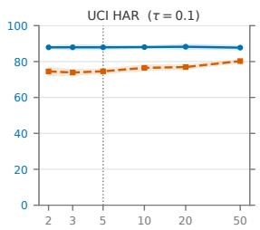

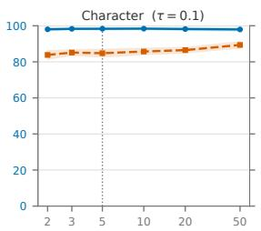

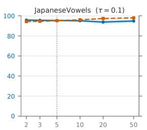

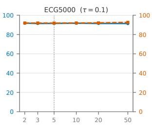

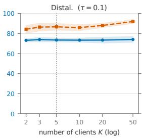

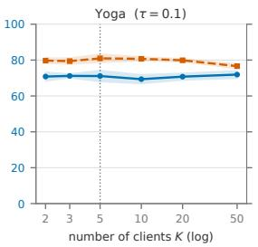

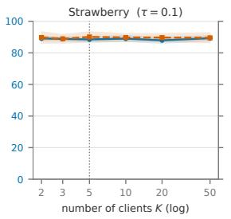  
test accuracy (%, left axis) readout sparsity (%, right axis) K= 5 (main-text setting)  
Figure 8: Federated test accuracy (left axis, solid) and readout sparsity (right axis, dashed) as the number of clients K is swept from 2 to 50 (50 rounds, IID partition, shared threshold $\tau = 0 . 1$ , mean ±1 std over ten seeds). The dotted vertical line marks the $K = 5$ setting used in the main-text experiments. Accuracy is essentially flat in K on every dataset, and sparsity stays in the band observed at $K = 5$

The main-text federated experiments fix the number of clients at $K = 5$ (Section 5.3). To assess how the federated Newton scheme behaves as the data become more fragmented, we repeat the federated protocol while sweeping $K \in \{ 2 , 3 , 5 , 1 0 , 2 0 , 5 0 \}$ and holding every other setting fixed: 50 communication rounds, IID partitioning, the shared threshold $\tau = 0 . 1$ of Table 4, and ten random seeds per configuration. Figure 8 reports test accuracy and readout sparsity as functions of K.

Two observations stand out. First, accuracy is essentially invariant to the client count. Over the entire sweep, from $K = 2$ to $K = 5 0$ , the accuracy of every dataset moves within a band of at most 2.6 points, and on five of the seven within about one point (UCI HAR 87.8–88.2%, Character 97.9–98.4%, ECG5000 91.4–91.8%, Distal. 73.2–74.1%, Strawberry 87.9–89.3%). Notably, at $K = 5 0$ each JapaneseVowels client holds only about five training sequences, yet the global readout still reaches 94.8%, indistinguishable from its $K = 5$ value. This robustness is expected from the structure of the update. The server operates on the sums of local gradients and Gauss-Newton Hessians, and under an IID partition the data-fidelity part of these sums is independent of how the samples are divided among clients, so K enters the optimization only through the regularization term and random variation.

Second, readout sparsity also transfers across client counts, staying in the band observed at $K = 5$ (e.g. 73.9–80.2% on UCI HAR, 94.3–98.0% on JapaneseVowels) with no systematic trend in K. This is worth stating because the aggregated objective implicitly scales the penalty with K (each client’s local loss carries its own copy of the Smooth-L1 term), yet no corresponding sparsity drift is visible, and fragmenting the data does not make the round-50 readout any less sparse. We note that this sweep retains the IID partitioning of the main text; how these conclusions change under heterogeneous client distributions remains part of the future work discussed in Section 6.4.