# Spectrum Is Not Enough: A Random-Matrix Account of Data-Free Preconditioning for Differentially Private Learning

Shilin Zhang and Kangning Wang

School of Electrical and Control Engineering, North China University of Technology, Beijing, China Corresponding author: Shilin Zhang, zhangshilin@126.com, ORCID 0000-0003-3034-1538

Abstract—Data-free preconditioning builds the Kronecker factors of KFAC from synthetic probes instead of private data. DP-KFC validates a probe by matching the eigenvalue decay of the private factors; we turn this criterion into a random-matrix account of what a probe can reconstruct. A single dichotomy organizes it: in the factorization $\mathsf { A } \otimes \mathsf { G } ,$ the error-signal factor G and the architecture-determined bulk of the activation factor A are reconstructible without data, while only the data-induced spikes of A are not. We prove the G half is data-insensitive up to an explicit error-energy bound, with zero violations over a full training trajectory across four modalities and a natural-image benchmark. We locate the failure boundary at a Baik–Ben Arous– Pech´ e threshold: a bulk-only probe suffers an exact damage´ $s ^ { 2 } / ( 1 - s ^ { 2 } )$ from a data-induced spike, which becomes invisible once it exceeds $( d / n ) ^ { 1 / 4 }$ , confirmed on an injected-spike surrogate. Holding the probe spectrum fixed and varying only its eigenbasis, we show that spectral-shape matching is neither sufficient nor the operative object: a probe with a near-exact matched spectrum (log-ratio dispersion 0.02) still inflates the residual 2×–90× when its eigenvectors are random. A closed-form whitened-volume law explains this and predicts the within-spectrum ordering of the critical volume, though not its cross-dataset magnitude. Downstream, per-layer tuning does not transfer to accuracy and the headroom is a small oracle-minus-white gap. Under a privacy mechanism the source ordering survives while learning does, then inverts at a noise cross-over where the flat probe overtakes the matched ones.

Index Terms—differential privacy, KFAC preconditioning, random matrix theory, spiked covariance models, data-free optimization.

## I. INTRODUCTION

Differential privacy (Dwork and Roth, 2014) is the standard formal guarantee for training on sensitive data, and DP-SGD (Abadi et al., 2016) its workhorse. Practical adoption, however, is limited by a geometric conflict: neural network losses are strongly ill-conditioned (Dauphin et al., 2014), while DP-SGD clips per-sample gradients and injects spherical noise, treating all parameter directions equally. Preconditioning addresses the conflict, but second-moment statistics estimated from the private data are themselves sensitive. Privatizing a full preconditioner is noisy and often unstable, and adaptive schemes that chase un biased curvature estimates can underperform their non-adaptive counterparts (Ganesh et al., 2025); second-order information in federated settings adds communication bottlenecks (Krouka et al., 2025). A line of work instead approximates the geometry on public data (Amid et al., 2022), at the cost of distributionshift fragility and audit complications.

DP-KFC (Molina Van den Bosch et al., 2026) proposes a third route: estimate the KFAC factors (Martens and Grosse, 2015) from synthetic probes that carry no privacy cost at all, using colored noise shaped to a $1 / f ^ { \alpha }$ spectrum, motivated by the scale-free statistics of natural images. The recipe validates its probes empirically: the synthetic factors must recover the eigenvalue decay of the private ones. Two natural questions are left open. Why does any of this work, and when does it fail?

We answer both questions with the tools of random matrix theory, the same machinery that governs sample covariance spectra at large dimension (Marcenko and Pastur, 1967;ˇ Johnstone, 2001): deformed bulk spectra, and spiked covariance models whose data-induced outliers detach at the Baik–Ben Arous–Pech´ e threshold (Baik et al., 2005). Building on the´ signal-propagation picture of spiked covariances in deep networks (Wang et al., 2024), we organize our account by a single statement: a reconstructibility dichotomy. Of the two KFAC factors, the error-signal factor G and the architecturedetermined bulk of the activation factor A can be rebuilt from data-free probes; only the data-induced spikes of A cannot. Three consequences follow.

A proof that half the preconditioner is data-free by nature (Section IV). KFAC approximates the curvature as a Kronecker product A⊗G of an activation factor A and an errorsignal factor G. We prove an operator-norm bound stating that G varies between any two data sources by at most an error-energy term that vanishes as the model’s mean true-class confidence approaches one. The bound is calibrated across five source types, four biomedical modalities, two architectures, and a full training trajectory of 72 source–layer–epoch configurations, with zero violations (Section IV-A).

A falsifiable failure boundary (Section V). We model the private activation covariance as a spiked covariance: a deformed bulk determined by the architecture, plus data-induced spikes. A bulk-only probe suffers an exact, monotone operator-norm damage of $s ^ { 2 } / ( 1 - s ^ { 2 } )$ from a spike of strength $s ^ { 2 } .$ , and the BBP threshold identifies when the spike detaches from the bulk and becomes invisible to any data-free probe. The exact scaled-bulk threshold is $s _ { c } = ( \sqrt { c } / ( 1 + \sqrt { c } ) ) ^ { 1 / 2 }$ , which at $d / n = 0 . 1 9 1$ gives 0.551 against 0.661 for the leading-order $c ^ { \mathrm { i } / 4 }$ and matches a crossing-based estimate on an injected-spike surrogate.

A mechanistic correction with a controlled verdict (Sections VI–VII). Through experiments that hold the probe spectrum fixed and vary only its eigenbasis, we show that spectral shape matching is neither sufficient for, nor the opera tive object of, preconditioner quality: eigenvalue diagnostics become actively misleading in steep regimes, and the damage from basis misalignment is set by the whitened volume of the misaligned subspace, and we derive the law in closed form; it also identifies the white probe as the unique basis-immune spectrum. A four-arm downstream experiment then shows that per-layer operator tuning does not transfer to accuracy, and measures the utility headroom of data-free preconditioning by the observed oracle-minus-white gap.

Section VIII turns to a real privacy mechanism. Sweeping the noise multiplier and the learning rate exposes a cross-over: the source ordering of the account survives while learning survives, then inverts, with the flat probe overtaking the matched ones once the noise removes the structure they matched, so the bottleneck moves from preconditioning to learnability. The same section records two measurement pitfalls that bound what the theory can claim. Figure 1 summarizes the setting, the inversion, and the volume law.

## II. SETTING

Setting 1 (KFAC factors under the data-free recipe). Fix a network $f _ { \theta }$ and a loss ℓ. For a linear layer $W _ { l } \in \mathbb { R } ^ { d _ { l } \times d _ { l - 1 } }$ (bias appended as an extra ones-column in the activation), let $a _ { l } ( \boldsymbol { x } ) \in \mathbb { R } ^ { d _ { l - 1 } + 1 }$ denote the input activation and $\delta _ { l } ( x ) \in \mathbb { R } ^ { d _ { l } }$ the output gradient $\partial \ell / \partial s _ { l } ( x )$ . Given a source $S$ over input– label pairs, the KFAC factors are

$$
\begin{array} { r l } & { { \sf A } _ { l } ( S ) = { \mathbb { E } } _ { ( x , y ) \sim S } \left[ a _ { l } ( x ) a _ { l } ( x ) ^ { \top } \right] + \varepsilon I , } \\ & { { \sf G } _ { l } ( S ) = { \mathbb { E } } _ { ( x , y ) \sim S } \left[ \delta _ { l } ( x ) \delta _ { l } ( x ) ^ { \top } \right] + \varepsilon I , } \end{array}\tag{1}
$$

estimated over n samples of S. The data-free recipe replaces S by a probe ensemble $P$ and preconditions the gradient of Wl as $\bar { \mathsf { G } _ { l } } ( P ) ^ { - 1 / 2 } \nabla _ { W _ { l } } \ell \mathsf { A } _ { l } ( P ) ^ { - \bar { 1 } / 2 }$ , applied before the privacy mechanism.

Random-matrix background. For an isotropic population and aspect ratio $d / n$ , the sample covariance spectrum concentrates on the Marcenko–Pastur law (Marcenko and Pastur, 1967).ˇ A rank-one population spike of strength $\beta$ over an isotropic bulk detaches from the Marcenko–Pastur edge if and only if $\beta > \sqrt { d / n }$ (Baik et al., 2005), the phase transition at the origin of spiked covariance analysis (Johnstone, 2001). Throughout, “bulk” refers to the spectral ensemble excluding finitely many data-induced outliers, and “spike” to those outliers; the bulkplus-few-outliers decomposition of trained-network spectra is classical (Sagun et al., 2016), and the distinction is formalized in Lemma V.1. Our experimental metrics decompose the preconditioner residual $\mathsf { M } ^ { \bullet } = \mathsf { A } _ { p } ^ { - 1 / 2 } \mathsf { A } _ { o } \mathsf { A } _ { p } ^ { - 1 / 2 }$ (for factors of the oracle o and probe $p )$ into a total anisotropy, its top-1 (spike) share, and a bulk-only part that excludes the top-1 direction; a log-ratio dispersion over the leading 64 eigenvalues measures spectral shape matching, and a tail exponent $\beta$ (a log-log slope of the sorted eigenvalues) captures spectral steepness.

Experimental platform. We use eight dataset configurations: four MedMNIST modalities (Yang et al., 2023, 2021) (PathM-NIST, OCTMNIST, DermaMNIST, TissueMNIST), a grayscale $3 2 \times 3 2$ CIFAR-10 subset, the full 50k CIFAR-10 training set, CIFAR-100 restricted to ten classes (Krizhevsky, 2009), and DermaMNIST at 64 × 64 RGB. The two architectures are a tanh MLP and a two-convolution-layer network whose KFAC factors use an unfold approximation (Appendix D). Training is per-sample-clipped DP-SGD with per-epoch factor re-estimation. Twenty experiment families support the claims; every number below is tied to a recorded run in the released code and result files.

## III. RELATED WORK

Preconditioning under differential privacy. Curvature under DP comes from three routes: public-data proxies (Amid et al., 2022), private curvature estimators whose second moments must themselves be privatized (Ganesh et al., 2025; Krouka et al., 2025), and data-free synthetic probing (Molina Van den Bosch et al., 2026), which is the setting analyzed here. DP-KFC validates a probe by the eigenvalue decay it recovers; we turn that criterion into a reconstructibility statement with a closed-form failure boundary.

Random-matrix accounts of network spectra. The bulkplus-spike picture of trained-network covariance (Sagun et al., 2016) has been extended to exact signal propagation of nonlinear spiked models (Wang et al., 2024) and, broadly, to the deterministic- and high-dimensional-equivalent frameworks (Couillet and Liao, 2022; Liao and Mahoney, 2026) that summarize the proportional-regime analysis of linear and nonlinear models. Ours is the same machinery one level down, at a working preconditioner rather than a kernel: the private activation factor deforms an architecture-determined bulk, the BBP transition (Baik et al., 2005; Johnstone, 2001) separates a reconstructible bulk from an irrecoverable spike, and detectiontheoretic formulations of spiked models (Jung et al., 2023) address the identifiability side of the same question. The Kronecker structure of the Fisher block is itself the object of recent random-matrix work on Kronecker-product random matrices (Fan and Ma, 2026), which gives free-deterministicequivalent approximations for exactly the $\mathsf { A } \otimes \mathsf { G }$ combination the data-free recipe forms.

Whiteners and probability-level inference. Beyond Kronecker-factored curvature, matrix-aware optimizers whiten the two gradient factors (the Shampoo and Muon families); recent work analyzes when coordinate whitening must precede spectral whitening (Chen et al., 2026), and mean-activation approximations of the two KFAC factors are analyzed in (Seung et al., 2025). Our results transfer to these only in the form of a prediction (Section XI), because the basis-first law so far has been verified on Kronecker-factored preconditioners. At the privacy end, the asymptotic variance of DP-SGD decomposes into statistical, sampling and privacy-induced components (Xia et al., 2025); the noise cross-over of Section VIII is the preconditioning-level counterpart.

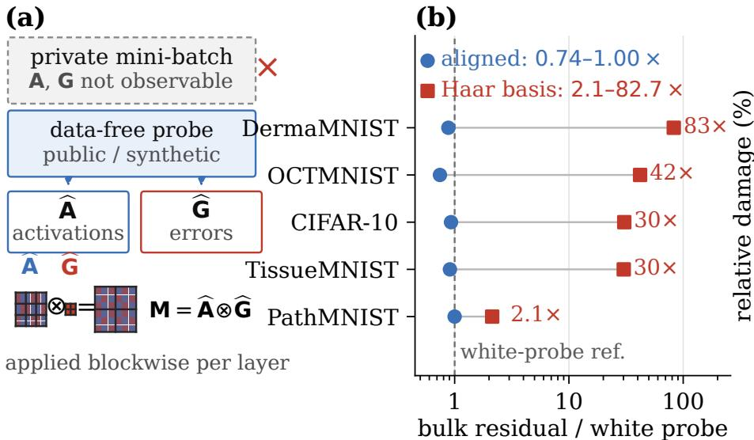

(c)  
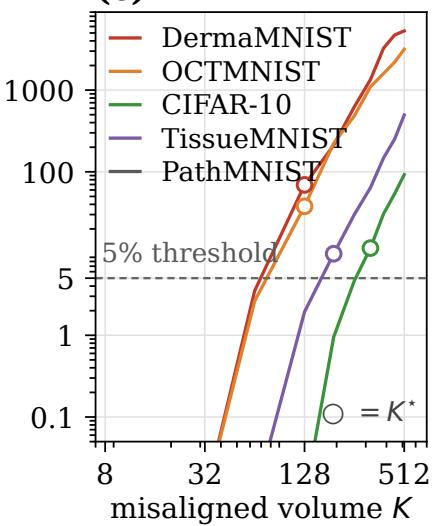  
Fig. 1. Overview. (a) Data-free two-factor anatomy: the private mini-batch is unavailable, so a probe built from public or synthetic spectra supplies both Kronecker factors, combined into the preconditioner $\mathbf { M } = \widehat { \mathbf { A } } \otimes \widehat { \mathbf { G } }$ applied blockwise per layer. (b) The basis-first inversion (input layer, eight dataset configurations): relative to the white probe, a probe with the matched spectrum in the aligned basis sits at $0 . 7 4 \mathrm { - } 1 . 0 0 \times$ on every modality, while the same eigenvalues in a Haar-random basis inflate the bulk residual by 2.1× (PathMNIST) to $8 2 . 7 \times$ (DermaMNIST); the two arms share a bitwise-identical log-ratio dispersion (0.286130 on DermaMNIST). (c) The whitened-volume law: relative bulk-residual damage against the number K of rotated top eigendirections; open circles mark the empirical K⋆ (128 on OCTMNIST and DermaMNIST, 192 on TissueMNIST, 320 on CIFAR-10, not reached on PathMNIST up t $\bar { K } = 5 1 2 )$ . The closed form det $\mathbf { M } = 1 , \mathbb { E } [ \operatorname { t r } \mathbf { M } ] = ( \operatorname { t r } \Lambda ) ( \operatorname { t r } \Lambda ^ { - 1 } ) / d$ predicts this ordering from the spectrum alone.

## IV. PILLAR I: THE ERROR-SIGNAL FACTOR IS DATA-INSENSITIVE

Proposition IV.1 (Error-energy sensitivity bound). Let $S , S ^ { \prime }$ be two sources and fix a model $f _ { \theta }$ and layer l. Then:

$$
\begin{array} { r l } { \mathrm { ( i ) } } & { \left\| \mathbb { E } _ { S } [ \delta \delta ^ { \top } ] - \mathbb { E } _ { S ^ { \prime } } [ \delta ^ { \prime } \delta ^ { \prime \top } ] \right\| _ { \mathrm { o p } } \ \leq \ \mathbb { E } _ { S } \| \delta \| ^ { 2 } + \mathbb { E } _ { S ^ { \prime } } \| \delta ^ { \prime } \| ^ { 2 } . } \end{array}
$$

(ii) At the last layer with cross-entropy loss, $\delta = p ( x ) - e _ { y }$ where $p ( x )$ is the softmax vector and $e _ { y }$ the one-hot label, hence $\mathbb { E } \| \delta \| ^ { 2 } \leq 2 ( 1 - \mathbb { E } p _ { y } )$ . If the mean trueclass confidence of fθ is at least $1 - \eta$ on both sources, then $\| \mathsf { G } _ { l } ( S ) - \mathsf { G } _ { l } ( S ^ { \prime } ) \| _ { \mathrm { o p } } \leq 4 \eta + 2 \varepsilon$ , independently of the modalities of S and $S ^ { \prime } .$

(iii) Consequently the source-invariance of G holds in both the untrained regime (where p(x) ≈ uniform for every standardized input) and the trained regime (η small).

The proof is elementary and appears in Appendix A. We are careful about what the bound is worth. Part (i) is loose by roughly an order of magnitude: the measured sensitivity never exceeds 6.4% of it (Table VI), so it rules out large source effects but does not pin them. Part (ii) is stated for the last layer only, where $\delta = p - e _ { y }$ holds exactly; its extension to hidden layers is empirical. The operative content is therefore not tightness but the measured fact below: the G residual anisotropy is constant across sources. Proposition IV.1 licenses the data-free recipe on the G half of the Kronecker product for any probe, at any training stage, and makes that constancy expected rather than accidental. Empirically the shape of the G spectrum (indeed its residual anisotropy after preconditioning) is constant across sources while its scale drifts: the form admits overall rescaling but forbids shape distortion. This reading is used quantitatively in Section XI.

## A. Calibration

The bound is tight where it matters. At a fixed trained model, the G residual anisotropy is identical across five source types to six significant figures (0.006595, spread $< 1 0 ^ { - 7 } )$ Along the training trajectory (snapshots at epochs 0 to 16, confidence parameter η moving from 0.904 down to 0.655, 72 source–layer–epoch configurations), both bounds of the proposition hold with zero violations, and the actual sensitivity never exceeds $6 . 4 \%$ of the (i) bound (Table VI). What changes across training is not the shape of G but its overall scale, which tracks the loss; the residual anisotropy itself drifts only with the training stage (0.0057 → 0.0067 on PathMNIST). Across a sweep of four biomedical modalities × two architectures × three source types the largest per-layer G anisotropy is 0.096. The mean-field variance contraction that sets the bulk scale of A is likewise source-independent up to $O ( 1 / w )$ corrections, an immediate consequence of standard signal propagation theory (Poole et al., 2016; Schoenholz et al., 2017); the measured fixed-point discrepancy between sources is 2.6%. We emphasize what this calibration is not: it is not a claim that the data-free recipe is accurate, but that one of its two factors is insensitive to the probe choice by construction, so all accuracy-relevant mismatch must live in A.

## V. PILLAR II: THE FAILURE BOUNDARY IS A BBP THRESHOLD

Lemma V.1 (Exact detachment threshold under a scaled bulk). Let $a = \sqrt { 1 - s ^ { 2 } } z +$ s g u with $z \sim \mathcal { N } ( 0 , I _ { d } ) , ~ g \sim \mathcal { N } ( 0 , 1 )$ fixed unit u, and $\begin{array} { r } { \mathsf { A } = \frac { 1 } { n } \sum _ { i } a _ { i } a _ { i } ^ { \top } } \end{array}$ . The population covariance is $( 1 - s ^ { 2 } ) I _ { d } + s ^ { 2 } u u ^ { \top } \colon$ a rank-one spike of strength $\beta = s ^ { 2 }$ over a bulk of variance $1 - s ^ { 2 } .$ . With $c = d / n$ , the sample top eigenvalue detaches from the Marcenko–Pastur edge if and only if

$$
\frac { s ^ { 2 } } { 1 - s ^ { 2 } } > \sqrt { d / n } , \qquad s _ { c } = \Big ( \frac { \sqrt { c } } { 1 + \sqrt { c } } \Big ) ^ { 1 / 2 } .\tag{2}
$$

The leading-order form $s _ { c } = c ^ { 1 / 4 }$ over-states the threshold; at $c = 0 . 1 9 1$ the exact value is 0.551 against 0.661 for the leading form (Figure 2a).

The proof is one normalization step and appears in $\mathsf { A p - }$ pendix A. This is the Baik–Ben Arous–Pech ´ e transition for´ rank-one spiked sample covariance models (Baik et al., 2005), in the regime formalized for principal component analysis by Johnstone (2001). The reading for the data-free recipe is structural. The bulk of A is architecture-determined: it is reconstructible from probes because it is not about the data. A detached spike is data-induced: it is, by construction, invisible to any probe that carries no information about the private data, and the loss it causes cannot be recovered by better probe design.

Proposition V.2 (Spike damage and its visibility threshold). Consider the spiked population covariance of Lemma V.1 and any probe whose factor is blind to the spike, $\mathsf { A } _ { p } = ( 1 - s ^ { 2 } ) I _ { d } .$ Then:

(i) the residual $\begin{array} { r } { \mathsf { M } = \mathsf { A } _ { p } ^ { - 1 / 2 } \mathsf { A } _ { o } \mathsf { A } _ { p } ^ { - 1 / 2 } = I _ { d } + \frac { s ^ { 2 } } { 1 - s ^ { 2 } } u u ^ { \top } } \end{array}$ has top eigenvalue $1 / ( 1 - s ^ { 2 } )$ : the damage a bulk-only probe suffers from an unseen spike is monotone in s, basis-free, and exact.

(ii) whether the data-induced spike is visible in the sample at all is the BBP question of Lemma V.1: the sample top eigenvalue detaches from the Marcenko–Pastur edge if and only if $s ^ { 2 } / ( 1 - s ^ { 2 } ) > \sqrt { d / n }$

The proof is in Appendix A.

Proposition V.3 (General-bulk boundary). Let $\Sigma = \Sigma _ { b } + \beta u u ^ { \top }$ with $\Sigma _ { b }$ a bulk of limiting spectral distribution $\mu _ { b } .$ . The sample top eigenvalue has an outlier above the bulk edge if and only if β exceeds the bifurcation threshold of the free-additive fixed point (Benaych-Georges and Nadakuditi, 2011); for a scaled-isotropic bulk $\Sigma _ { b } = \sigma _ { b } ^ { 2 } I$ this is $\beta _ { c } = \sigma _ { b } ^ { 2 } \sqrt { c } ,$ , recovering Lemma V.1. Numerically $\beta _ { c }$ scales linearly with the bulk edge $b _ { + }$ within a shape family $( \beta _ { c } / b _ { + } \approx 0 . 4 9$ isotropic, ≈ 2.24 for power-law bulks, independent of the exponent; Figure 2c), so the boundary is a functional of the bulk spectrum and not of its edge alone. The proof reduces to Benaych-Georges and Nadakuditi (2011) (Appendix A).

Experimentally, at $d / n = 0 . 1 9 1$ the asymptotic threshold of Lemma V.1 is $s _ { c } = 0 . 5 5 1$ ; under a finite detection margin the transition is only flagged at $s \approx 0 . 7 .$ , and a crossing-based estimate recovers 0.551 to within a few percent (Figure 2a,b). Below the asymptotic threshold the top-1 share of the residual stays at the bulk level (1.00–1.02), at $s = 0 . 7 5$ it reaches 1.25, and by $s \ = \ 1$ the residual is rank-one (Table VIII). This is a validation on an injected-spike surrogate: it perturbs the population covariance with a known rank-one spike, so it tests the threshold arithmetic rather than whether a real modality’s spikes sit near the edge; estimating a real spike’s strength relative to $s _ { c }$ is left open (Section XI). The practical consequence is a division of labor: probes own the bulk; the DP clipping mechanism owns the spike, because clipping bounds the influence of any single direction, which is exactly the spike’s failure mode.

## VI. ANATOMY OF THE BULK RESIDUAL: BASIS FIRST, SPECTRUM SECOND

Propositions IV.1 and V.2 split the problem cleanly: all probe-design freedom lives in the A bulk. DP-KFC’s design heuristic is a $1 / f ^ { \alpha }$ probe family, motivated by the prevalence of scale-free statistics in natural inputs. We tested this family systematically across five modalities and depths {1, 2, 4} and found that the family works, but not for the advertised reason.

## A. Spectral shape matching is not the operative object

Proposition VI.1 (Basis-first law). Separate the probe’s eigenvalue spectrumfrom its eigenbasis and vary them independently, at the input layer of trained models over five modalities:

(i) Same spectrum, different basis. A probe carrying the exact private spectrum in the aligned Fourier basis matches the white-probe residual (0.93–1.04 across modalities); the same spectrum in a Haar-random basis worsens the bulk-only residual by 2.3× (PathMNIST) to 90× (DermaMNIST). The two variants have literally the same eigenvalues and a bitwise-identical log-ratio dispersion (0.286130 on DermaMNIST, agreeing to $1 0 ^ { - 6 } ) ,$ , yet their residuals differ by almost two orders of magnitude. A third arm carrying the oracle eigenvalues in a Haar basis drives the log-ratio dispersion down to 0.022 (near-perfect eigenvalue matching) and still inflates the residual by 2.2–84×. Eigenvalue matching is neither sufficient nor the operative object of the preconditioner residual.

(ii) Misalignment is a step, not a curve. Continuous rotation $\theta \mapsto e ^ { { \overline { { \theta } } } S }$ of the probe basis leaves the spectrum invariant while the Fourier concentration of the probe collapses from 0.31–0.44 to ≈ $8 . 5 \times 1 0 ^ { - 3 }$ already at $\theta = 0 . 3$ , the random-basis value; the bulk residual jumps by one to two orders of magnitude over the same step and plateaus (Figure 3). At large d any small random rotation is already Haar mixing, so there is no partial-alignment regime.

(iii) Damage is set by the whitened volume of the misaligned subspace. Rotating the top-64 eigendirections of the probe (carrying 57–96% of the probe variance) leaves the bulk residual unchanged on every modality; a dense volume scan $K \in \{ 8 , \ldots , 5 1 2 \}$ locates a critical volume $K ^ { \star }$ that moves monotonically with the steepness of the data spectrum (Figure 7, Table VII). Beyond $K ^ { \star }$ the damage grows superlinearly on steep spectra, saturating toward the Haar-basis asymptote of (i), while rotation of the bottom-512 block is mild on every modality $( \leq 1 . 2 \times ) .$

(iv) Tolerance scales with spectral steepness. At rotation scale $\theta = 1$ , the residual relative to the aligned probe is 0.975 on the flattest modality $( \beta _ { o } ~ = ~ - 1 . 0 8 )$ but degrades 3.5× (CIFAR-10), 5.3× (TissueMNIST), 14.7× (DermaMNIST) and 16.7× (OCTMNIST); $\theta \leq 0 . 3$ is harmless on all modalities.

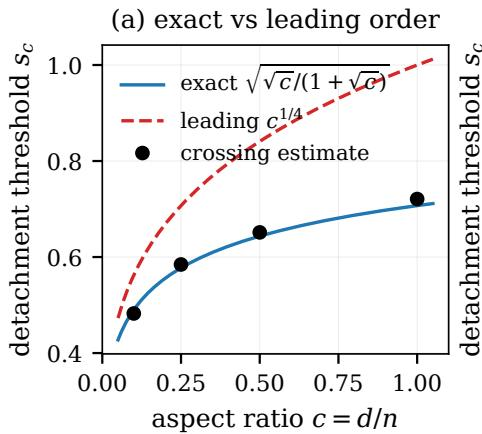

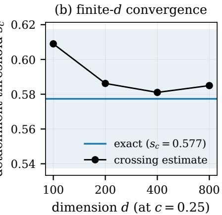

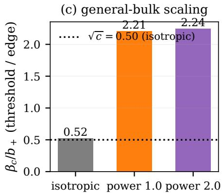  
Fig. 2. Refinement of the failure boundary. (a) The exact threshold $s _ { c } = \left( \sqrt { c } / ( 1 + \sqrt { c } ) \right) ^ { 1 / 2 }$ tracks the crossing-based empirical estimate across aspect ratios, while the leading-order form $c ^ { 1 / 4 }$ overstates it. (b) The empirical threshold converges to the exact value as the dimension grows at fixed $c = 0 . 2 5 .$ (c) For an anisotropic bulk the threshold is a functional of the bulk spectrum: $\beta _ { c } / b _ { + } \approx 0 . \dot { 4 } 9$ for an isotropic bulk (with $\sqrt { c } = 0 . 5 )$ and ≈ 2.24 for power-law bulks, independent of the exponent. Numbers from verify boundary law (MC, archived in figs/boundary refine data.json).

(v) Eigenvalue diagnostics invert in the steep regime. Over 43 non-flat layer-configurations on the extended grid $\alpha \in [ 0 , 6 ]$ , the layer-wise Spearman correlation between spectral dispersion and the bulk residual is positive on 31 and negative on 12; eight of the twelve negatives sit at input layers whose private bulk is either too flat for any probe to resolve $( \beta _ { o } \approx - 1 . 0 8 )$ or already steeper than the probe family can reach (−2.23), and the steepest case inverts perfectly (Figure 8).

The next proposition gives the closed form behind items (i)–(iv).

Corollary VI.2 (Eigenvalue profile is not a sufficient statistic). The residual $\mathsf { M } = \bar { \mathsf { A } } _ { p } ^ { - 1 / 2 } \mathsf { A } _ { o } \mathsf { A } _ { p } ^ { \frac { . } { - } 1 / 2 }$ is afunction of(Λ, Q) jointly, not of Λ alone: with $\mathsf { A } _ { p } = V \Lambda V ^ { \top } , V = U Q ,$ , it ranges from $I _ { d }$ at $Q = I$ to the Haar average $\mathbb { E } \operatorname { t r } \mathsf { M } = ( \operatorname { t r } \Lambda ) ( \operatorname { t r } \Lambda ^ { - 1 } ) / d$ at random Q (Proposition VI.3), with det $\mathsf { M } = 1$ throughout. Matching the eigenvalue profile is therefore neither sufficient (item (i)) nor necessary (the flat probe is undamaged against a steep private spectrum). This is the precise content of the title.

Proposition VI.3 (Whitened-volume law for a rotated matched spectrum). Let $\mathsf { A } _ { o } = U \Lambda U ^ { \top }$ and $\mathsf { A } _ { p } = V \Lambda V ^ { \top }$ be positive definite with the same eigenvalue multiset $\Lambda = \mathrm { d i a g } ( \lambda _ { 1 } ~ \geq$ $\cdot \cdot \cdot \geq \lambda _ { d } > 0 )$ and eigenbases related by an orthogonal $Q$ $( V = U Q )$ , and write $\mathsf { M } = \mathsf { A } _ { p } ^ { - 1 / 2 } \mathsf { A } _ { o } \mathsf { A } _ { p } ^ { - 1 / 2 } ,$ . Then:

(i) tr $\begin{array} { r } { \textsf { M } = \operatorname { t r } \bigl ( \Lambda ^ { - 1 } Q ^ { \top } \Lambda Q \bigr ) \ = \ \sum _ { j } \lambda _ { j } \bigl ( Q \Lambda ^ { - 1 } Q ^ { \top } \bigr ) _ { i j } } \end{array}$ and det M = 1: misalignment spreads the residual without biasing it.

(ii) Averaged over a Haar-random $\begin{array} { r l } { Q , \quad \mathbb { E } \mathrm { ~ t r } \mathsf { M } } & { { } = } \end{array}$ $\left( \operatorname { t r } \Lambda \right) \left( \operatorname { t r } \Lambda ^ { - 1 } \right) / d \geq d ,$ with equality if and only $i f \Lambda$ is a multiple of the identity. The white probe is therefore the unique spectrum whose residual is basis-independent, and the expected damage of a matched non-flat spectrum un der a random basis is $\kappa _ { \mathrm { e f f } } ( \Lambda ) = \left( \mathrm { t r } \Lambda \right) \left( \mathrm { t r } \Lambda ^ { - 1 } \right) / d ^ { 2 } \geq 1$ the product of the arithmetic and harmonic means of the spectrum.

(iii) $H Q$ rotates only the top-K eigendirections (block S) and is the identity on $S ^ { \perp }$ , then E tr $\mathsf { M } = ( d - K ) + R ( K )$ with $\begin{array} { r } { R ( K ) = \big ( \sum _ { i \in S } \lambda _ { j } \big ) \big ( \sum _ { i \in S } \lambda _ { i } ^ { - 1 } \big ) / K \geq K , } \end{array}$ , with equality if and only if the top-K eigenvalues are equal. For a power law $\lambda _ { j } \propto j ^ { - \gamma } , R ( K )$ grows linearly in $K$ when $\gamma \leq 1$ and superlinearly when $\gamma > 1$ , so at any fixed damage threshold the critical volume $K ^ { \star }$ decreases monotonically with $\gamma .$

The proof is in Appendix $A ;$ the identity case $Q = I$ gives ${ \mathsf { M } } = I _ { d }$ exactly, and the flat case $\Lambda \propto I$ gives ${ \mathsf { M } } = I _ { d }$ for every Q.

Three readings follow. Item (ii) explains the white-noise reference: a flat spectrum is the only spectrum whose residual does not depend on the basis, which is why every alignedprobe measurement in Proposition VI.1 is quoted against it, and why steeper private spectra are damaged more under a random basis. Item (iii) turns the volume scan into an ordering statement. Define the misaligned volume fraction $\eta ( K ) =$ $( R ( K ) - K ) / d \geq 0$ , the excess of the whitened volume over its uniform value; the critical volume is where $\eta ( K )$ first crosses the damage threshold. This is consistent with the ordering in Table VII, since both $\eta ( K )$ and the measured damage increase with K, but the closed form is not quantitative across spectra: recomputed on the archived private spectra, its absolute scale is disconnected from the measured anisotropy (the flattest modality has $R ( 5 1 2 ) = 1 . 6 \times 1 0 ^ { 3 }$ with damage 0.98), so it fixes the direction and not the magnitude. The cross-spectrum constant that would close this gap, and the analytic bridge from tr M to the anisotropy metric, are open (Section XI). A Monte-Carlo check on synthetic power-law spectra is in Appendix D.

## B. What the probe family actually matches

The $1 / f ^ { \alpha }$ family works through two mechanisms that the spectral-shape hypothesis conflates. First, its members inherit an approximately Fourier-aligned basis, which is the first-order requirement on natural and medical imagery. Second, within that basis, the exponent tunes the activation-spectrum steepness. The second mechanism is real and predictive at the level of operator residuals: over five modalities and depths {1, 2, 4}, the oracle activation-spectrum exponent $\beta _ { o }$ steepens from the first hidden layer to the output layer on all five modalities (depth-4 linear fits of −0.03 to −0.26 per layer; the raw input layer is steeper than the first hidden layer on every modality), and on layers with a non-flat response the layeroptimal exponent is the one whose probe activation exponent matches the oracle exponent, with the prediction landing within 10% of the empirical optimum on 26 of the 31 non-flat layerconfigurations of the $\alpha \in [ 0 , 3 ]$ grid (24 of 43 once the grid is extended to $\alpha \in [ 0 , 6 ] )$ , at zero tuned parameters (Figure 5). Two qualifications matter. First, the rule consumes a private statistic: $\beta _ { o }$ is the exponent of the private activation spectrum, the data covariance spectrum at the input layer and the trained activation spectrum at hidden layers, so the recipe is oneparameter and tuning-free but not fully data-free, and whether a public proxy for $\beta _ { o }$ suffices is open. Second, the support rate depends on the grid and on the criterion for a resolvable layer: re-deriving the optimum over the extended grid with a gain-5% resolvability criterion, the matched exponent lands within 0.15 of $\beta _ { o }$ on 21 of 43 configurations (median gap 0.22), so the rule is a trend rather than an exact law, and no compact single-variable law replaces it: the relative damage is not a function of the exponent mismatch alone. The rule has boundaries: it fails on flat input layers where no probe can resolve the bulk, and on overly steep modalities where the probe family cannot cover the oracle exponent and the disaster zone of steep probes opens (50.8× dynamic range on the OCTMNIST input layer).

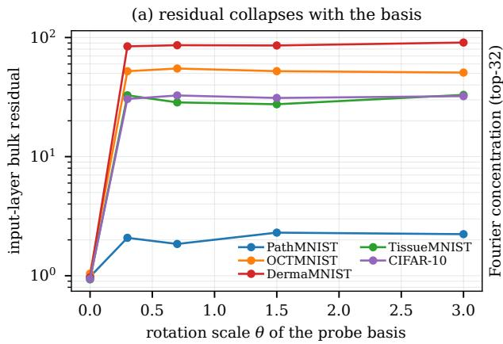

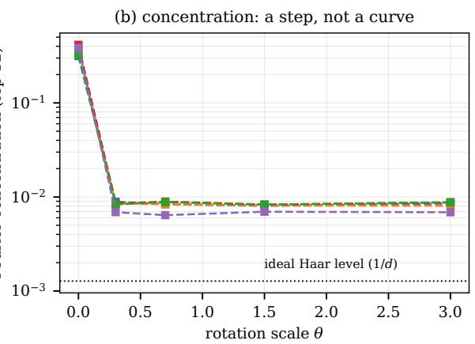  
Fig. 3. Controlled verdict of the basis hypothesis. Left: bulk residual against the rotation scale θ of the probe basis at fixed spectrum: the residual is a step function of basis mixing, while the spectral dispersion (right axis family) is bitwise invariant along the rotation. Right: the loss of Fourier concentration of the probe; the random-basis value is ≈ $\dot { 8 } . 5 \times 1 0 ^ { - 3 }$

The $1 / f$ motivation survives this correction in a narrower form. Self-organized criticality explains the ubiquity of $1 / f$ statistics in extended dynamical systems (Bak et al., 1987), and predictive coding assigns precision weights to prediction errors in a hierarchy (Friston, 2010). In our measurements, the criticality parameter α functions as a tunable prior over spectral precision that is beneficial exactly where the trained bulk is itself scale-free, and harmful where it amplifies data-induced spikes. The motivation space is legitimate; the mechanism is basis alignment plus bounded precision matching, not spectral mimicry.

## C. Universality across datasets and architectures

The basis-first verdict is not an artefact of the original five modalities. Re-running the identical protocol on eight dataset configurations (the five original plus CIFAR-100 restricted to ten classes, the full 50k CIFAR-10 training set, and DermaMNIST at 64 × 64 RGB) reproduces the separation on seven of eight: the Haar-basis probe with a matched spectrum inflates the input-layer residual by 19× to 90× over the Fourieraligned probe, which never exceeds the white-noise baseline (Table IX, Figure 9). The single exception is PathMNIST, whose input-layer oracle spectrum is nearly isotropic (bulk ≈ 0.98 even for white noise), so no basis error can produce a large residual there; this is the $\Lambda \propto I$ case of Proposition VI.3. The resolution-and-channels control is sharp: DermaMNIST at $2 8 \times 2 8$ grayscale and the same data at 64 × 64 RGB agree to three decimals on every probe family $( b u l k _ { 1 } ^ { \mathrm { p s d F } } = 0 . 9 6 8$ against 0.966), so the law is a property of the basis relation, not of the input representation.

The same separation holds for a convolutional oracle. On a two-conv-layer network the Haar-basis probe collapses onto the white-noise baseline (0.49–0.67 against 0.50–0.67) while the Fourier-aligned probe sits at one quarter to one sixth of it (0.10–0.12), so on the conv oracle the probe’s entire value is carried by basis alignment. On the MLP oracle the Haar mismatch amplifies further, up to 90× on DermaMNIST (Table X, Figure 10).

## VII. FROM OPERATOR RESIDUAL TO DOWNSTREAM UTILITY

Proposition VII.1 (Dose-response). For per-sample-clipped DP-SGD trained from scratch with a preconditioner reestimated each epoch from a fixed source, the final utility is monotonically ordered by the source’s bulk residual anisotropy, while the missing spike mass does not predict utility. On PathMNIST over the source family {private, aligned-public, cross-domain public}, the bulk-only Spearman correlation with accuracy is −1.0 (Pearson −0.878 including all five sources), replicated over three seeds.

TABLE I  
DOWNSTREAM ACCURACY UNDER FOUR PROBE REGIMES (MEAN OF THE LAST THREE EPOCHS OF BALANCED ACCURACY, MEAN ± STD OVER TEN SEEDS, $\sigma = 0 \mathrm { D P } { \cdot } \mathrm { S G D } ,$ EIGHT EPOCHS). THE ORACLE ARM IS AN UPPER REFERENCE, NOT A METHOD.
<table><tr><td>modality</td><td>oracle</td><td>white</td><td> $\mathrm { g l o b a l } \ \alpha ^ { * }$ </td><td>tailored</td></tr><tr><td>DermaMNIST</td><td>0.129</td><td>0.104</td><td>0.115</td><td>0.111</td></tr><tr><td>OCTMNIST</td><td>±.022 0.124</td><td>±.006 0.101</td><td>±.022 0.104</td><td>±.018 0.101</td></tr><tr><td></td><td>±.009</td><td>±.009</td><td>±.007</td><td>±.003</td></tr><tr><td>CIFAR-10</td><td>0.176</td><td>0.112</td><td>0.105</td><td>0.106</td></tr><tr><td></td><td>±.010</td><td>±.005</td><td>±.012</td><td>±.012</td></tr></table>

Proposition VII.1 is a family-level statement: ranking probe sources by their bulk residual orders their downstream utility. A natural extrapolation, already suggested by the layer-wise matching law, would be to optimize each layer’s probe exponent independently. We tested this extrapolation directly with a fourarm design on three modalities (private oracle; white; global exponent at the layer-mean optimum; per-layer exponent chosen each epoch by the activation-matching rule), with balanced accuracy as the primary metric, a mean-of-last-three-epochs statistic, and four seeds (Table I).

The result measures the method rather than grading it (Figure 6). At ten seeds no data-free arm separates from white: the largest gap is the global exponent on DermaMNIST, +1.0% at 0.9 combined standard errors, and the per-layer tailored arm is within noise of both white and global on every modality (+0.7%, +0.0% and −0.6% against white). The four-seed significant gap on DermaMNIST (+3.2% at 3.6σ) does not replicate at ten seeds, which is the warning the operator-residual map already gave: the map is nearly flat between exponents 2.5 and 6, so per-layer accuracy differences there are seed-limited. On OCTMNIST the operator map’s input-layer disaster zone (50.8× residual range) produces no downstream catastrophe at all, and on CIFAR-10 only the oracle separates, climbing to 0.176. Two conclusions follow. The operator-residual metric is predictive across probe families (it orders sources, as in Proposition VII.1) but not across per-layer magnitudes: neither its benefits nor its catastrophes transfer to accuracy. And the entire utility headroom of data-free preconditioning is measured by the observed oracle-minus-white gap, +2.5%, +2.3% and +6.4% balanced accuracy on the three modalities over ten seeds; these are estimates on this scale, not bounds.

## VIII. WHAT THE PRIVACY MECHANISM DESTROYS

## A. The ordering survives below a noise cross-over

The mechanism experiment below fixes the learning rate at 0.1, so it cannot separate “the probe is wrong” from “the optimizer can no longer learn”. We swept the noise multiplier against the learning rate over the same protocol (120 runs; Table II). At the lower rate (0.03) a genuine ordering exists below a cross-over: at $\sigma = 0 . 2 ~ ( \varepsilon = 2 7 4 )$ the private and aligned-public sources reach 0.155 and 0.157 against the 0.143 majority-class rate while the flat white probe sits at 0.134, whereas between $\sigma = 0 . 2$ and $\sigma = 0 . 3 ~ ( \varepsilon = 8 6 )$ the ordering inverts: the white probe overtakes both matched sources (0.155 against 0.126 and 0.132) and stays ahead at $\sigma = 0 . 5$ . Two readings are consistent and not separated here: the matched probe whitens a spike the noise has already removed, and its inverse-square-root scaling amplifies the isotropic noise in the small-curvature directions a flat probe leaves alone. Either way the practical default inverts, matched below the cross-over and flat above it.

TABLE II  
NOISE TOLERANCE AND THE SOURCE-ORDERING CROSS-OVER (PATHMNIST, FOUR SEEDS, MEAN OF THE LAST THREE EPOCHS, LEARNING RATE 0.03; MAJORITY-CLASS RATE 0.143; ε FROM RDP ACCOUNTING). THE MATCHED SOURCES LEAD BELOW $\sigma = 0 . 3 ;$ ; THE FLAT WHITE PROBE LEADS ABOVE IT.
<table><tr><td>σ</td><td>ε</td><td>private</td><td>aligned</td><td>white</td></tr><tr><td>0.0</td><td></td><td>0.322</td><td>0.329</td><td>0.130</td></tr><tr><td>0.1</td><td> $1 . 1 \times 1 0 ^ { 4 }$ </td><td>0.217</td><td>0.222</td><td>0.132</td></tr><tr><td>0.2</td><td>274</td><td>0.155</td><td>0.157</td><td>0.134</td></tr><tr><td>0.3</td><td>86</td><td>0.126</td><td>0.132</td><td>0.155</td></tr><tr><td>0.5</td><td>16.6</td><td>0.110</td><td>0.114</td><td>0.128</td></tr></table>

## B. A mechanism experiment under real noise

In a mechanism experiment (75 runs: 5 training sources × 5 noise multipliers × 3 seeds, PathMNIST, the same MLP and DP-SGD protocol as above with clip $1 . 0 , q = 0 . 0 1 2 8 .$ $T = 9 4 8 )$ , RDP accounting gives $\varepsilon = 1 6 . 6$ at $\sigma = 0 . 5$ and $\varepsilon = 2 . 3 5$ at $\sigma = 1 ~ ( \delta = 5 \times 1 0 ^ { - 5 }$ , Table III). At $\sigma = 0$ the data-free configuration replicates the private oracle exactly (0.267 vs. 0.264 final accuracy against the 0.143 majority-class rate), confirming the aligned-probe result of Section VII on this modality. At this fixed learning rate, for every $\sigma > 0$ all sources fall below the majority-class rate (0.099–0.104), the private oracle included; there is no ordering to recover, which is why the cross-over sweep above varies the learning rate.

The spectrum explains where the failure sits (Figure 4, Table IV). On the true-DP models the top-1 fraction of the first hidden activation factor drops from 0.330 to 0.025 the moment noise is on (13×) and then freezes, while the error-side factor first flattens and then re-concentrates $( 0 . 2 0 3 \to 0 . 0 3 0 \to 0 . 1 3 8$ across $\sigma = 0 , 0 . 5 , 4 )$ and the activation tail exponent flattens from $- 0 . 7 0 \ \mathrm { t o \ - } 0 . 2 6$ . Probe mismatch follows suit: the logratio dispersion of the aligned public probe stays flat and an order of magnitude below every alternative (0.028–0.037 across all σ), yet this surviving structure is operationally irrelevant because the bottleneck has moved from preconditioning to learnability. The preconditioner acts before the privacy mechanism and cannot reshape isotropic noise after the fact; the claim that curvature geometry is reconstructible without data is not challenged at the level it was made, but bypassed, because once noise dominates the gradient, geometry stops being the binding constraint.

## C. Measurement pitfalls

Final-epoch accuracy is an artifact on imbalanced validation sets. On DermaMNIST (66.9% majority class), per-epoch accuracy oscillates between a chance-level basin and a below-chance basin, so any single-epoch statistic is a coin flip. All downstream claims in this paper use balanced accuracy with an oscillation-robust statistic (mean of the last three epochs over four seeds); on this modality that statistic itself stays at chance for every probe (0.100–0.103 against 0.143 chance, the balanced-accuracy rate for seven classes), so no exponent ordering is measurable under it. We flag the failure because it inverts conclusions: under the fixed protocol the raw mean-of-last-three accuracy appears to order with the bulk metric $( \alpha { = } 2 \colon 0 . 6 4 4 , \alpha { = } 1 \colon 0 . 5 9 6 , \alpha { = } 0 \colon 0 . 4 8 5 )$ , the opposite of the ordering predicted by the spike-inclusive total metric, yet that apparent ordering is majority-class collapse rather than utility.

(a) accuracy collapses for any σ > 0 (b) noise reshapes the live spectrum (c) ordering survives   
frac 0.35 G factor: top-1 fraction probemismatchlr\_std(L2) 0.5   
0.25 live-oracle spike mass (top-1 frac.) 0.30 A factor (L2): top-1 fraction   
final test accuracy 0.25 0.4   
0.20 public (aligned)   
工 0.20 0.3 public (OCTMNIST)   
0.15 majority class (0.143) 0.15 synthetic 1/f   
0.2   
0.10   
0.10   
0.1   
0.05   
0.05   
0.00.51.0 2.0 4.0 0.00.51.0 2.0 4.0 0.00.51.0 2.0 4.0   
DP noise multiplier σ DP noise multiplier σ DP noise multiplier σ  
Fig. 4. DP-noise mechanism experiment (75 runs). (a) Final test accuracy falls below the majority-class rate for every training source once $\sigma > 0 . \left( \mathrm { b } \right)$ On the true-DP models, noise first removes the activation-factor spike (top-1 fraction 0.330 → 0.025) and later re-concentrates the error factor (0.030 → 0.138). (c) The log-ratio mismatch of the aligned public probe stays an order of magnitude below all alternatives at every σ, but the surviving structure is operationally irrelevant.

A methodological inversion. Within the steep regime, the spectral-dispersion diagnostic recommended by the shape hypothesis anti-predicts the bulk residual on 12 of 43 layerconfigurations, including a perfect inversion (monotone residual increase with monotone dispersion decrease). Diagnostics should be validated against the quantity they claim to proxy; on this problem, the eigenvalue layer is the wrong abstraction.

## IX. PRACTICAL IMPLICATIONS

The account condenses to a default recipe: a single global probe exponent per modality, chosen once by matching the probe activation-spectrum steepness to the trained model’s bulk (a one-parameter, zero-tuning rule with 26/31 operatorlevel support on the moderate grid); an aligned basis over spectral mimicry; no per-layer magnitude customization, which does not transfer; and data-induced spikes left to per-sample clipping, which bounds exactly the failure mode that probes cannot address. For the modalities tested, the utility cost of this default relative to the oracle upper reference is a few points of balanced accuracy or less. Nothing in the argument is specific to Kronecker-factored preconditioners: the same decomposition applies to any blockwise preconditioner that separates an activation-side and an error-side factor.

## X. A DATA-FREE PRECONDITIONING PROTOCOL

The account condenses into the procedure of Algorithm 1: build both factors from a Fourier-aligned probe, fix a single global exponent (matching one private bulk statistic when one can be queried), precondition, and leave data-induced spikes to per-sample clipping, which bounds the influence of any single direction.

Algorithm 1 Data-free KFAC preconditioning with spike-aware   
defaults   
Require: trained model $f _ { \boldsymbol { \theta } } ;$ per-sample clip $C ;$ noise multiplier   
σ; probe exponent α (or a conservative default); optional   
private bulk statistic $\beta _ { o }$   
1: Build the probe set $P$ from Fourier-aligned $1 / f ^ { \alpha }$ colored   
noise at unit variance, $| P | = n _ { p }$ samples; keep the native   
basis, no basis randomization.   
2: For every layer l estimate $\mathsf { A } _ { l } ( P ) = \mathbb { E } _ { P } [ a _ { l } \boldsymbol { a } _ { l } ^ { \top } ] + \varepsilon I$ and   
$\mathsf { G } _ { l } ( P ) = \mathsf { \bar { E } } _ { P } \mathsf { \bar { [ \delta _ { l } \delta _ { l } ^ { \top } ] } } + \varepsilon I .$   
3: If $\beta _ { o }$ is queryable, pick the α whose probe activation   
exponent matches $\beta _ { o } ;$ otherwise keep a single global α   
(do not tailor per layer, Section VII).   
4: for each epoch do   
5: Re-estimate $\mathsf { A } _ { l } ( P ) , \quad \mathsf { G } _ { l } ( P )$ and form $\begin{array} { r l } { \ P _ { l } } & { { } = } \end{array}$   
$\mathsf { G } _ { l } ( P ) ^ { - 1 / 2 } \mathsf { A } _ { l } ( P ) ^ { - 1 / 2 } .$   
6: Per-sample-clip gradients at $C ,$ add Gaussian noise of   
multiplier $\sigma ,$ precondition, and take a step.   
7: Spike rule: leave the leading direction to clipping; do   
not sharpen it beyond the bulk edge.   
8: end for   
9: Optionally, compare the probe spectrum edge with the   
bulk edge (Lemma V.1) to decide whether any spike is   
recoverable.

Complexity is far better than a dense Fisher inverse. For L layers with input widths $d _ { l } ^ { \mathrm { i n } }$ and output widths $d _ { l } ^ { \mathrm { o u t } }$ , factor estimation costs $\begin{array} { r }  \dot { \sum _ { l } O ( n _ { p } d _ { l } ^ { \mathrm { i n } ^ { \mathrm { - } } 2 } + n _ { p } d _ { l } ^ { \mathrm { o u \bar { t } 2 } } ) } \end{array}$ multiplications for the second-moment accumulations plus one probe forward– backward pass; storage is $O ( \sum _ { l } d _ { l } ^ { \mathrm { i n } 2 } + d _ { l } ^ { \mathrm { o u t } 2 } ) ;$ ; and each epoch requires one symmetric eigendecomposition per factor. Inverting the layer’s full Fisher block would instead cost $O \big ( ( d _ { l } ^ { \mathrm { i n } } d _ { l } ^ { \mathrm { o u t } } ) ^ { 3 } \big )$ . The optional boundary check of Section V is O(d log d): it reduces to sorting the leading eigenvalues and comparing the leader with the bulk scaling.

## XI. DISCUSSION

What is and is not private. The measurements support a precise reading of what the privacy wall hides. Behind $\mathrm { i t , }$ the architecture-determined bulk of A and the entire G factor are reconstructible from probes: they are statements about the model class, not about the data. What is not reconstructible is the detached data-induced spike, with its threshold made exact by the BBP transition. In Kantian terms the form that survives the wall is not only a spectral shape but a basis: form equals basis times shape, both constructible, while the spike direction is the matter that only experience can supply. This is not an analogy but a restatement of Corollary VI.2, which says the reconstructible object is the pair (spectrum, basis) and not the spectrum alone. The empirically demonstrated failure of spectrum-matched probes (Section VI) is the quantitative content of that distinction, and Proposition VI.3 gives its closed form: the residual detaches from the identity exactly when the matched spectrum is non-flat and the basis is rotated, with the damage measured by the spectrum’s arithmetic-harmonic mean product.

Reconstructibility dichotomy. The results combine into one statement: the G factor and the bulk of A are reconstructible without data (Propositions IV.1 and VI.3), so the basis-first law is the positive half of the account rather than a correction to it, and the only irreducible object is the detached data-induced spike, whose visibility the BBP threshold fixes. This gap, not the probe family, is the boundary of data-free preconditioning, and it links the account to the spiked-covariance signalpropagation line (Wang et al., 2024), where our bulk and spike are the nonlinear analogues of the conjugate-kernel bulk and signal eigenvalues.

Falsifiable predictions. (P1) A modality with a nearly isotropic input covariance admits no data-free probe that reduces the residual; the PathMNIST input spectrum is a witness, and any aligned probe that helps despite $\Lambda \propto I$ would falsify it. (P2) The basis-first law depends only on a blockwise preconditioner’s activation factor, so it should transfer to the coordinate-whitening preconditioners of the Shampoo and Muon families (Chen et al., 2026), whose whitening plays the role of $\mathsf { A } ^ { - 1 / 2 }$ here. (P3) Under DP noise the source ordering predicts utility only below the noise level at which learning survives; Section VIII locates the collapse side of this crossover.

Relation to criticality accounts. The $1 / f$ statistics of natural inputs have been read through self-organized criticality (Bak et al., 1987) and through hierarchical precision weighting (Friston, 2010). Our results support a bounded version of that reading: scale-free probes are a motivation space whose exponent does useful precision matching where the trained bulk is itself scale-free, and is harmful where it amplifies data-induced spikes.

Limitations. All experiments use $2 8 \times 2 8$ grayscale inputs, a 32 × 32 CIFAR-10 subset, and 64 × 64 RGB DermaMNIST; the convolutional oracle uses an unfold approximation, and normalization and attention layers are untested. Scale is modest (single 24GB device) and the downstream results use four seeds over eight epochs, so the reported gaps are estimates and not bounds. The noise cross-over (Section VIII) is located at weak privacy in this small-model protocol, where learning survives only for ε well above typical reporting thresholds; whether a larger model or budget pushes the positive-ordering regime into $\varepsilon \leq 1 0$ is open. Theory-side, Proposition VI.3 gives the ordering of $K ^ { \star }$ from the spectrum alone, but two gaps remain: the analytic bridge from tr M to the anisotropy metric measured in the tables, and the cross-spectrum constant that would make the law quantitative. On the probe side, the exponent-matching rule consumes one private statistic $( \beta _ { o } )$ and lands within 0.15 on 21 of 43 configurations, so a public proxy for $\beta _ { o }$ and an exact rule are open.

## REFERENCES

C. Dwork and A. Roth, “The algorithmic foundations of differential privacy,” Foundations and Trends in Theoretical Computer Science, vol. 9, no. 3–4, pp. 211–407, 2014.

M. Abadi, A. Chu, I. Goodfellow, H. B. McMahan, I. Mironov, K. Talwar, and L. Zhang, “Deep learning with differential

privacy,” in Proceedings of the 2016 ACM SIGSAC Conference on Computer and Communications Security, 2016, pp. 308–318.

Y. N. Dauphin, R. Pascanu, C. Gulcehre, K. Cho, S. Ganguli, and Y. Bengio, “Identifying and attacking the saddle point problem in high-dimensional non-convex optimization,” Advances in Neural Information Processing Systems, vol. 27, 2014.

A. Ganesh, B. McMahan, and A. Thakurta, “On design principles for private adaptive optimizers,” arXiv preprint arXiv:2507.01129, PPML 2025, 2025.

M. Krouka, A. Koskela, and T. Kulkarni, “Communication efficient differentially private federated learning using second order information,” Proceedings on Privacy Enhancing Technologies, vol. 2025, no. 1, pp. 584–612, 2025.

E. Amid, A. Ganesh, R. Mathews, S. Ramaswamy, S. Song, T. Steinke, V. M. Suriyakumar, O. Thakkar, and A. Thakurta, “Public data-assisted mirror descent for private model training,” in Proceedings of the 39th International Conference on Machine Learning, ser. Proceedings of Machine Learning Research, vol. 162. PMLR, 2022, pp. 517–535.

M. Molina Van den Bosch, R. Taiello, A. Sund Aillet, A. Protani, M. A. Gonzalez Ballester, and L. Serio, “Datafree preconditioning for differentially private deep learning,” in Proceedings of the 43rd International Conference on Machine Learning, 2026, arXiv:2605.13418.

J. Martens and R. Grosse, “Optimizing neural networks with kronecker-factored approximate curvature,” in Proceedings of the 32nd International Conference on Machine Learning, ser. Proceedings of Machine Learning Research, vol. 37. PMLR, 2015, pp. 2408–2417.

V. A. Marcenko and L. B. Pastur, “Distribution of eigenvaluesˇ for some sets of random matrices,” Matematicheskii Sbornik, vol. 72, no. 114, pp. 507–536, 1967, english translation: Mathematics of the USSR-Sbornik, 1(4):457–483.

I. M. Johnstone, “On the distribution of the largest eigenvalue in principal components analysis,” The Annals of Statistics, vol. 29, no. 2, pp. 295–327, 2001.

J. Baik, G. Ben Arous, and S. Pech´ e, “Phase transition of the´ largest eigenvalue for nonnull complex sample covariance matrices,” The Annals of Probability, vol. 33, no. 5, pp. 1643–1697, 2005.

Z. Wang, D. Wu, and Z. Fan, “Nonlinear spiked covariance matrices and signal propagation in deep neural networks,” in Proceedings ofthe 41st International Conference on Machine Learning, ser. Proceedings of Machine Learning Research, vol. 235, 2024, arXiv:2402.10127.

L. Sagun, L. Bottou, and Y. LeCun, “Eigenvalues of the hessian in deep learning: Singularity and beyond,” arXiv preprint arXiv:1611.07476, 2016.

J. Yang, R. Shi, D. Wei, Z. Liu, L. Zhao, B. Ke, H. Pfister, and B. Ni, “Medmnist v2: A large-scale lightweight benchmark for 2d and 3d biomedical image classification,” Scientific Data, vol. 10, no. 1, p. 41, 2023.

J. Yang, R. Shi, and B. Ni, “Medmnist classification decathlon: A lightweight automl benchmark for medical image analysis,” in IEEE 18th International Symposium on Biomedical Imaging (ISBI), 2021, pp. 191–195.

A. Krizhevsky, “Learning multiple layers of features from tiny images,” University of Toronto, Tech. Rep., 2009.

R. Couillet and Z. Liao, Random Matrix Methods for Machine Learning. Cambridge University Press, 2022.

Z. Liao and M. W. Mahoney, “Random matrix theory for deep learning: Beyond eigenvalues of linear models,” IEEE Signal Processing Magazine, vol. 43, no. 2, pp. 93–106, 2026, arXiv:2506.13139.

J. H. Jung, H. W. Chung, and J. O. Lee, “Detection problems in the spiked matrix models,” arXiv preprint arXiv:2301.05331, 2023.

Z. Fan and R. Ma, “Kronecker-product random matrices and a matrix least squares problem,” The Annals of Probability, vol. 54, no. 2, pp. 973–1033, 2026, arXiv:2406.00961.

K. Chen, S. Zhang, Z. Liu, L. Li, Y. Sun, Y. Li, Y. Zhang, B. Han, M. Tan, and Q. Chen, “Zeta: Dual whitening for matrix optimization via coordinate-adaptive preconditioning,” arXiv preprint arXiv:2606.14187, 2026.

H. Seung, J. Lee, and H. Ko, “MAC: An efficient gradient preconditioning using mean activation approximated curvature,” in IEEE International Conference on Data Mining (ICDM), 2025, arXiv:2506.08464.

X. Xia, L. Zhang, and Z. Cai, “Statistical inference for differentially private stochastic gradient descent,” arXiv preprint arXiv:2507.20560, 2025.

B. Poole, S. Lahiri, M. Raghu, J. Sohl-Dickstein, and S. Ganguli, “Exponential expressivity in deep neural networks through transient chaos,” in Advances in Neural Information Processing Systems, vol. 29, 2016.

S. S. Schoenholz, J. Gilmer, S. Ganguli, and J. Sohl-Dickstein, “Deep information propagation,” in International Conference on Learning Representations, 2017.

F. Benaych-Georges and R. R. Nadakuditi, “The eigenvalues and eigenvectors of finite, low rank perturbations of large random matrices,” Advances in Mathematics, vol. 227, no. 1, pp. 494–521, 2011, arXiv:0910.2120.

P. Bak, C. Tang, and K. Wiesenfeld, “Self-organized criticality: An explanation of the 1/f noise,” Physical Review Letters, vol. 59, no. 4, pp. 381–384, 1987.

K. Friston, “The free-energy principle: a unified brain theory?” Nature Reviews Neuroscience, vol. 11, no. 2, pp. 127–138, 2010.

## APPENDIX

## A. Proof of Proposition IV.1

For (i), convexity of the operator norm and $\| \delta \delta ^ { \top } \| _ { \mathrm { o p } } = \| \delta \| ^ { 2 }$ give $\| \mathbb { E } _ { S } [ \delta \delta ^ { \top } ] - \mathbb { E } _ { S ^ { \prime } } [ \delta ^ { \prime } \delta ^ { \prime \top } ] \| _ { \mathrm { { o p } } } \leq \mathbb { E } _ { S } \| \delta \| ^ { 2 } + \mathbb { E } _ { S ^ { \prime } } \| \delta ^ { \prime } \| ^ { 2 }$ . For (ii), at the last layer with cross-entropy loss $\delta = p - e _ { y }$ with p on the simplex, so $\begin{array} { r } { \| p - e _ { y } \| ^ { 2 } = \sum _ { i } p _ { i } ^ { 2 } - 2 p _ { y } + 1 \stackrel {  } { \leq } 2 ( 1 - p _ { y } ) } \end{array}$ because $\textstyle \sum _ { i } p _ { i } ^ { 2 } \leq 1$ . Taking expectations on both sources and adding the $\varepsilon I$ terms gives $\| \mathsf { G } _ { l } ( S ) - \mathsf { G } _ { l } ( S ^ { \prime } ) \| _ { \mathrm { o p } } \leq 4 \eta + 2 \varepsilon$ when both sources have mean true-class confidence at least $1 - \eta$ . Part (iii) is the two regimes named in the statement: at initialization $p ( x )$ is uniform for standardized inputs, so $\eta \approx 1 - 1 / C ;$ after training on an easy modality η is small. Both are covered by (ii).

B. Proof of Proposition V.2

With $\mathsf { A } _ { o } = ( 1 - s ^ { 2 } ) I _ { d } + s ^ { 2 } u u ^ { \top }$ and a spike-blind probe $\mathsf { A } _ { p } ~ = ~ ( 1 - s ^ { 2 } ) I _ { d }$ , we have $\mathsf { A } _ { p } ^ { - 1 / 2 } \ : = \ : ( 1 \ : - \ : s ^ { 2 } ) ^ { - 1 / 2 } I _ { d }$ and therefore $\begin{array} { r } { \mathsf { M } = \mathsf { A } _ { o } / ( 1 - s ^ { 2 } ) = \bar { I _ { d } } + \frac { s ^ { 2 } } { 1 - s ^ { 2 } } u \bar { u } ^ { \top } } \end{array}$ . The eigenvalues of M are $1 + s ^ { 2 } / ( 1 - s ^ { 2 } ) = 1 / ( 1 - s ^ { 2 } )$ in the direction u and 1 on $u ^ { \perp }$ , so the top eigenvalue is $1 / ( 1 - s ^ { 2 } )$ , monotone increasing in s and independent of the basis. Part (ii) is Lemma V.1 restated: the sample top eigenvalue of A detaches from the Marcenko–Pastur edge if and only if $s ^ { 2 } > \sqrt { d / n }$ , so below the threshold the spike is statistically indistinguishable from the bulk while above it the sample spike carries an isolated eigendirection.

## C. Proof of Lemma V.1 and Proposition V.3

For the lemma, divide $\Sigma = ( 1 - s ^ { 2 } ) I _ { d } + s ^ { 2 } u u ^ { \top }$ by $1 - s ^ { 2 }$ The sample covariance of the rescaled data is that of a rank-one spike of strength $\beta = s ^ { 2 } / ( 1 - s ^ { 2 } )$ over a unit isotropic bulk; the Baik–Ben Arous–Pech´ e threshold for this model is´ $\beta > \sqrt { d / n }$ (Baik et al., 2005), which gives $s ^ { 2 } / ( 1 - s ^ { 2 } ) > \sqrt { d / n }$ and $s _ { c } = ( \sqrt { c } / ( 1 + \sqrt { c } ) ) ^ { 1 / 2 }$ . The leading-order form $s _ { c } = c ^ { 1 / 4 }$ is the $s  0$ limit and overstates the threshold by 0.110 at $c = 0 . 1 9 1$

For the proposition, write $\Sigma = \Sigma _ { b } + \beta u u ^ { \top }$ and let $m _ { b }$ be the Stieltjes transform of $\mu _ { b }$ . By the low-rank perturbation theorem of Benaych-Georges and Nadakuditi (2011), the sample top eigenvalue admits an outlier above the bulk edge if and only if $\beta$ exceeds the value at which the free-additive fixed point for the outlier loses its solution above the edge; the scaled-isotropic bulk $\Sigma _ { b } = \sigma _ { b } ^ { 2 } I$ has an explicit transform giving $\beta _ { c } = \sigma _ { b } ^ { 2 } \sqrt { c } ,$ which reduces to the lemma. The numbers quoted for the power-law bulks $( \beta _ { c } / b _ { + } \approx 2 . 2 4 )$ come from the crossing-based numerical study of Figure 2c and are a numerical illustration rather than a closed form; they show that the boundary depends on the bulk spectrum and not on its edge alone.

## D. Proof of Proposition VI.3

Write $D \ = \ \Lambda$ for the shared diagonal spectrum. Since $\begin{array} { r } { \mathsf { A } _ { p } } & { { } = \begin{array} { l l } { V D V ^ { \top } } \end{array} } \end{array}$ with $V \ = \ U Q$ , cyclicity of the trace gives tr $\sf M ~ = ~ \mathrm { t r } ( \sf A _ { \sf { p } } ^ { - 1 } \sf A _ { \sf { o } } ) ~ = ~ \mathrm { t r } ( \bar { V } ^ { - 1 } D ^ { - 1 } \bar { V } ^ { - \top } U D U ^ { \top } ) ~ =$ $\begin{array} { r } { \mathrm { t r } ( D ^ { - 1 } Q ^ { \top } D Q ) = \sum _ { i } \lambda _ { j } ( Q D ^ { - 1 } \dot { Q } ^ { \top } ) _ { j j } } \end{array}$ , because $V ^ { \top } U = Q$ The determinant gives det $\mathsf { M } =$ det $\mathsf { A } _ { o } /$ det $\mathsf { A } _ { p } \ = \ 1$ . This proves (i); the case $Q = I$ gives $\mathsf { M } = D ^ { - 1 / 2 } D \hat { D } ^ { - 1 / 2 } = I _ { d } .$

For (ii), the diagonal of a Haar conjugate is exchangeable and sums to tr $D ^ { - 1 }$ , so $\mathbb { E } [ ( Q D ^ { - 1 } Q ^ { \top } ) _ { j j } ] = { \mathrm { t r } } ( D ^ { - 1 } ) / { \dot { d } }$ for every $j ,$ and linearity of the trace gives E tr ${ \sf M } = ( \mathrm { t r } D ) ( \mathrm { t r } D ^ { - 1 } ) / d .$ Cauchy–Schwarz gives $( \operatorname { t r } D ) ( \operatorname { t r } D ^ { - 1 } ) \geq d ^ { 2 }$ with equality if and only if all $\lambda _ { j }$ are equal, which is (ii); the flat case $\Lambda \propto I$ makes ${ \mathsf { M } } = I _ { d }$ for every orthogonal $Q .$

For (iii), split the trace into the rotated block $S$ and its complement. On $S ^ { \perp }$ the rotation is the identity, so the complementary contribution is exactly $\begin{array} { r } { \sum _ { j \notin { \cal S } } \lambda _ { j } ( \dot { D ^ { - 1 } } ) _ { j j } = } \end{array}$ $d \_ - \ K$ On $S ,$ the same exchangeability argument restricted to the K-dimensional Haar rotation gives $\mathbb { E } [ ( Q _ { S } D _ { S } ^ { - 1 } Q _ { S } ^ { \top } ) _ { j j } ] ~ = ~ \operatorname { t r } ( D _ { S } ^ { - 1 } ) / K$ , hence $\mathbb { E } \mathrm { ~ t r } \mathbb { M } = ( d -$ $\begin{array} { r } { K ) + ( \sum _ { i \in S } \lambda _ { j } ) ( \sum _ { i \in S } \lambda _ { i } ^ { - 1 } ) / K = ( d - K ) + R ( K ) } \end{array}$ , and $R ( K ) \geq { \check { K } }$ by Cauchy–Schwarz on the block. For the power law $\lambda _ { j } = c j ^ { - \gamma } \colon \mathrm { i f } \ \gamma \leq 1$ , both block sums are dominated by the tail and $R ( K ) \asymp K / ( 1 - \gamma ^ { 2 } )$ , linear in $K \colon \mathrm { i f } \ \gamma > 1$ the sum of eigenvalues converges while the sum of inverse eigenvalues diverges as $K ^ { 1 + \gamma }$ , and $R ( K ) \asymp c \zeta ( \gamma ) K ^ { \gamma } / ( 1 + \gamma )$ superlinear in $K .$ . Since the damage threshold is fixed and $R ( K )$ is increasing in γ at every K in the steep regime, the critical volume $K ^ { \star }$ decreases monotonically with $\gamma .$

## E. Privacy budget

RDP accounting (opacus 1.4.0) for the mechanism experiment of Section VIII: sampling probability $q = 2 5 6 / 2 0 0 0 0 =$ 0.0128, T = 948 steps, $\delta = 5 \times 1 0 ^ { - 5 }$ . The $\sigma = 0$ row carries no formal guarantee.

TABLE III  
PRIVACY BUDGET OF THE DP-NOISE MECHANISM EXPERIMENT (PATHMNIST, n = 20000, BATCH 256, T = 948, $\delta = 5 \times 1 0 ^ { - 5 } )$ .
<table><tr><td>σ</td><td>ε (RDP)</td><td>optimal order</td><td>steps</td></tr><tr><td>0.0</td><td>no formal guarantee</td><td>n/a</td><td>948</td></tr><tr><td>0.5</td><td>16.556</td><td>1.9</td><td>948</td></tr><tr><td>1.0</td><td>2.350</td><td>6.6</td><td>948</td></tr><tr><td>2.0</td><td>0.780</td><td>18.0</td><td>948</td></tr><tr><td>4.0</td><td>0.338</td><td>36.0</td><td>948</td></tr></table>

## F. Live spectral statistics under DP noise

Means over 3 seeds $\times \ 4$ epoch snapshots on the true-DP (private-oracle) models; the probe-mismatch dispersion is measured on the first hidden layer against the aligned public probe.

TABLE IV  
LIVE-ORACLE SPECTRAL STATISTICS OF SECTION VIII (PRIVATE-ORACLE SOURCE, PATHMNIST). $\beta _ { o }$ AND $\beta _ { g }$ ARE THE LIVE TAIL EXPONENTS OF THE ACTIVATION AND ERROR FACTORS; TOP-1 FRACTIONS ARE SPIKE SHARES OF THE LIVE SPECTRUM.
<table><tr><td>σ</td><td>top-1 (A, L2) top-1 (G)</td><td> $\beta _ { o }$ </td><td> $\beta _ { g }$ </td></tr><tr><td>0.0</td><td>0.330 ± .018  $0 . 2 0 3 \pm . 0 4 2$ </td><td>-0.695</td><td>-0.746</td></tr><tr><td>0.5</td><td>0.025 ± .001 0.030 ± .006</td><td>-0.265</td><td>-0.561</td></tr><tr><td>1.0 2.0</td><td>0.020 ± .001 0.038 ± .008 0.019 ± .001  $0 . 0 9 3 \pm . 0 4 3$ </td><td>-0.264 -0.264</td><td>-0.737 -1.057</td></tr><tr><td>4.0</td><td> $0 . 0 1 8 \pm . 0 0 1$   $0 . 1 3 8 \pm . 0 6 7$ </td><td>-0.263</td><td>-1.632</td></tr><tr><td colspan="4">aligned-probe  $\mathrm { l r \_ s t d }$  (L2): 0.028–0.037 at all σ</td></tr></table>

## G. Accuracy under DP noise

Final test accuracy (mean over 3 seeds) for the five training sources of the mechanism experiment; the majority-class rate on this split is 0.143.

## H. Calibration of the error-energy bound

Full record for the trajectory calibration of Section IV-A: 72 source–layer–epoch configurations, 3 sources × 4 layers $\times \textup { 6 }$ epochs.

TABLE V  
FINAL TEST ACCURACY BY SOURCE AND NOISE MULTIPLIER (SECTION VIII; MAJORITY-CLASS RATE 0.143).
<table><tr><td>source</td><td> $\sigma = 0$ </td><td>0.5</td><td>1.0</td><td>2.0</td><td>4.0</td></tr><tr><td>private oracle</td><td>0.264</td><td>0.099</td><td>0.105</td><td>0.105</td><td>0.103</td></tr><tr><td>public (aligned)</td><td>0.267</td><td>0.101</td><td>0.099</td><td>0.101</td><td>0.100</td></tr><tr><td>public (OCTMNIST)</td><td>0.252</td><td>0.101</td><td>0.101</td><td>0.098</td><td>0.098</td></tr><tr><td>synthetic  $1 / f$ </td><td>0.119</td><td>0.086</td><td>0.147</td><td>0.145</td><td>0.126</td></tr><tr><td>synthetic white</td><td>0.133</td><td>0.148</td><td>0.153</td><td>0.130</td><td>0.121</td></tr></table>

TABLE VI  
ERROR-ENERGY BOUND CALIBRATION (EXP. TRAJECTORY RECORD).
<table><tr><td>quantity</td><td>value</td></tr><tr><td>configurations</td><td>72</td></tr><tr><td>energy-bound violations</td><td>0</td></tr><tr><td>η-bound violations</td><td>0</td></tr><tr><td>max ratio to (i) bound</td><td>6.4%</td></tr><tr><td>median ratio to (i) bound</td><td>0.15%</td></tr><tr><td>η at epoch 0 / 16</td><td>0.904 / 0.655</td></tr><tr><td>fixed-point discrepancy across sources</td><td>2.6%</td></tr></table>

## I. Activation-spectrum matching and downstream transfer

Figures behind the layer-optimal exponent rule of Section VI and the four-arm experiment of Section VII.

## J. Volume scan and diagnostic dissociation

Records behind Proposition VI.1 items (iii) and (v).

TABLE VII  
CRITICAL MISALIGNED VOLUME $K ^ { \star }$ FROM THE DENSE SCAN $K \in \{ 8 , \ldots , 5 1 2 \}$ (FIRST K WITH RELATIVE DAMAGE ABOVE 5%), AGAINST THE INPUT-LAYER TAIL EXPONENT $\beta _ { o }$ OF THE PRIVATE BULK (THE SCAN IS PERFORMED AT THE INPUT LAYER). DAMAGE BEYOND $K ^ { \star }$ GROWS SUPERLINEARLY ON STEEP SPECTRA AND IS BOUNDED BY THE HAAR-BASIS ASYMPTOTE.
<table><tr><td>modality</td><td> $\beta _ { o }$  (input)</td><td> $K ^ { \star }$ </td><td>res. at K=512</td></tr><tr><td>OCTMNIST</td><td>-2.23</td><td>128</td><td>32.6×</td></tr><tr><td>DermaMNIST</td><td>-2.06</td><td>128</td><td>54.0×</td></tr><tr><td>TissueMNIST</td><td>-1.78</td><td>192</td><td>6.0×</td></tr><tr><td>CIFAR-10</td><td>-1.58</td><td>320</td><td>1.9×</td></tr><tr><td>PathMNIST</td><td>-1.08</td><td>not reached</td><td>1.0×</td></tr></table>

## K. BBP threshold sweep

Injected-spike sweep behind Table VII and Proposition V.2 (d = 784, n = 4096, $d / n = 0 . 1 9 1$ , predicted $s _ { c } = 0 . 6 6 1 )$ : the ratio of the sample top eigenvalue to the bulk edge, mean over 3 seeds.

## L. Dataset and architecture universality

Input-layer bulk residual $b u l k _ { 1 }$ by probe family over eight dataset configurations (mean over two probe seeds; oracles are 3-epoch MLPs trained on 12k samples). psdF: private Fourier PSD profile in the Fourier basis; psdR: the same profile in a Haar-random basis; eigR: oracle eigenvalue spectrum in a Haar basis; white: $\alpha = 0$ colored noise.

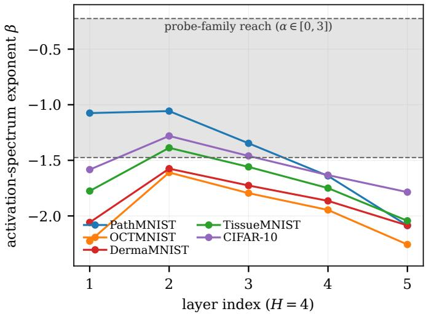

Fig. 5. Activation-spectrum matching: the oracle tail exponent $\beta _ { o }$ steepens from the first hidden layer to the output layer on every modality, while the reachable range of the $\dot { \alpha } \in [ 0 , 3 ]$ probe family is a narrow band. The layeroptimal probe exponent tracks the oracle exponent only where the two ranges overlap.  
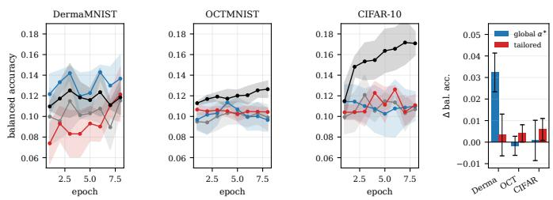  
Fig. 6. Downstream transfer test. Left three panels: balanced accuracy curves under the four probe regimes. Right: accuracy deltas against the white baseline with seed-combined standard errors. Per-layer tailoring does not improve on a single global exponent.

Architecture control: input-layer bulk residual on three datasets for an MLP oracle ([784, 256, 256, 10]) and a conv oracle (Conv16–Conv32–Linear; conv KFAC factors via unfold). The conv input layer is conv1; the MLP input layer is layer 0.

## M. Monte-Carlo check of the whitened-volume law

Proposition VI.3 was checked numerically on synthetic spectra (d = 60 and $d = 4 0 0 .$ , 400 Haar rotations per configuration). The empirical mean of tr M matches $( \mathrm { t r } \Lambda ) ( \mathrm { t r } \Lambda ^ { - 1 } ) / d$ to within Monte-Carlo error (0.3%–0.8% across power laws $\lambda _ { j } \propto j ^ { - \gamma } , \gamma \in \{ 0 . 5 , 1 , 1 . 5 , 2 . 5 \} \}$ ; det M = 1 holds to machine precision; the block-rotation formula of item (iii) matches to 0.2%–1.3%; and at a fixed 5%-of-d damage threshold the critical volume decreases monotonically with steepness $( K ^ { \star } ~ = ~ 3 6 , 1 6 , 1 2 , 8$ for $\gamma ~ = ~ 1 . 0 , 1 . 5 , 2 . 0 , 2 . 2 )$ , the same ordering as Table VII.

Reproducibility statement: All experiments run on a single RTX 4090 with released scripts (experiment families 1 through 21, including the DP-noise mechanism study, the noise-tolerance sweep, the dataset sweep, and the architecture sweep), fixed seeds, and recorded result files; the theory section compiles from the same verified number set, and every number quoted in the main text is reproducible from the archived CSV records summarized in this appendix. Datasets are public benchmarks (MedMNIST v2 under CC BY 4.0, with DermaMNIST under CC BY-NC 4.0; CIFAR-10 and CIFAR-100 free for research use); privacy accounting uses opacus (Apache 2.0). Code, scripts, and result archives accompany the submission.

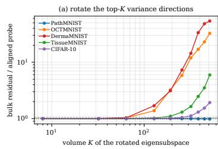

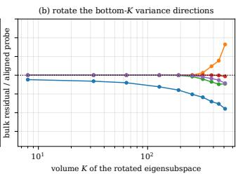  
Fig. 7. Volume scan of the misaligned subspace. Relative bulk residual against the number K of rotated top eigendirections. The critical volume moves monotonically with the steepness of the data spectrum, and the bottom-block arm stays mild everywhere.

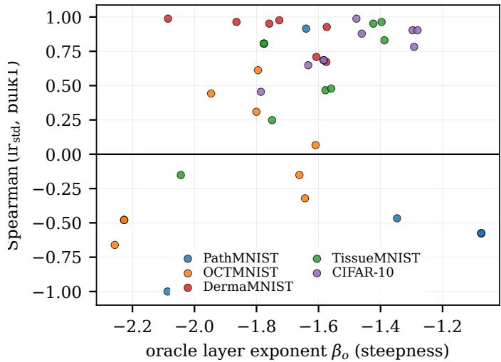  
Fig. 8. Eigenvalue diagnostics invert in the steep regime: layer-wise Spearman correlation between spectral dispersion and the bulk residual over the extended probe grid. Negatives concentrate at flat inputs, overly steep inputs, and steep output layers.

## TABLE VIII

INJECTED-SPIKE SWEEP $( d = 7 8 4 , n = 4 0 9 6 .$ $d / n = 0 . 1 9 1$ , PREDICTED  
$s _ { c } = 0 . 6 6 1 )$ : RATIO OF THE SAMPLE TOP EIGENVALUE TO THE BULK EDGE,MEAN OVER 3 SEEDS. THE RATIO JUMPS BETWEEN $s = 0 . 6$ (BELOWTHRESHOLD) AND $s = 0 . 7$ (ABOVE THRESHOLD); AT s ≥ 1 THE  
POPULATION COVARIANCE IS RANK-ONE AND THE RATIO SATURATES AT d.

<table><tr><td>S</td><td>0.0</td><td>0.25</td><td>0.5</td><td>0.6</td><td>0.7</td><td>0.75</td><td>0.85</td><td>1.0</td><td>1.25</td><td>1.5</td></tr><tr><td>top-1/bulk</td><td>1.004</td><td>1.004</td><td>1.005</td><td>1.017</td><td>1.126</td><td>1.259</td><td>1.865</td><td>783.8</td><td>783.8</td><td>783.8</td></tr></table>

TABLE IX  
UNIVERSALITY ACROSS EIGHT DATASET CONFIGURATIONS (SECTION VI-C).
<table><tr><td>dataset</td><td>psdF</td><td>psdR</td><td>eigR</td><td>white</td><td>psdR/psdF</td></tr><tr><td>PathMNIST</td><td>0.981</td><td>2.22</td><td>2.19</td><td>0.981</td><td>2.3×</td></tr><tr><td>OCTMNIST</td><td>1.043</td><td>56.55</td><td>53.78</td><td>1.399</td><td>54.2×</td></tr><tr><td>DermaMNIST</td><td>0.968</td><td>86.89</td><td>80.87</td><td>1.097</td><td>89.8×</td></tr><tr><td>TissueMNIST</td><td>0.932</td><td>30.36</td><td>28.78</td><td>1.025</td><td>32.6×</td></tr><tr><td>CIFAR-10 (32px subset)</td><td>0.941</td><td>31.11</td><td>29.73</td><td>1.012</td><td>33.1×</td></tr><tr><td>CIFAR-100 (10 classes)</td><td>0.972</td><td>18.67</td><td>19.52</td><td>0.982</td><td>19.2×</td></tr><tr><td>CIFAR-10 (full 50k)</td><td>0.957</td><td>27.63</td><td>27.17</td><td>0.996</td><td>28.9×</td></tr><tr><td>DermaMNIST-64 (64px RGB)</td><td>0.966</td><td>86.69</td><td>80.96</td><td>1.097</td><td>89.8×</td></tr></table>

Basis-first law across 8 dataset configurations (mean over 2 probe seeds)  
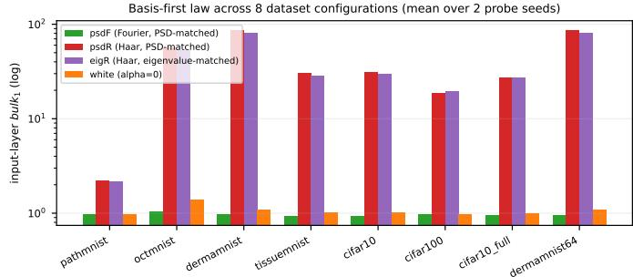  
Fig. 9. Dataset sweep behind Table IX: input-layer bulk residual by probe family over eight dataset configurations. The Fourier-aligned profile (psdF) tracks the white baseline on every configuration; the Haar-basis variants separate on all but the near-isotropic PathMNIST input spectrum.

TABLE X  
ARCHITECTURE CONTROL (SECTION VI-C).
<table><tr><td>dataset</td><td>arch</td><td>psdF</td><td>psdR</td><td>white</td><td>psdR/psdF</td></tr><tr><td>PathMNIST</td><td>MLP</td><td>0.981</td><td>2.22</td><td>0.981</td><td>2.3×</td></tr><tr><td>PathMNIST</td><td>CNN</td><td>0.120</td><td>0.494</td><td>0.497</td><td>4.1×</td></tr><tr><td>DermaMNIST</td><td>MLP</td><td>0.968</td><td>86.89</td><td>1.097</td><td>89.8×</td></tr><tr><td>DermaMNIST</td><td>CNN</td><td>0.119</td><td>0.668</td><td>0.671</td><td>5.6×</td></tr><tr><td>CIFAR-100</td><td>MLP</td><td>0.972</td><td>18.67</td><td>0.982</td><td>19.2×</td></tr><tr><td>CIFAR-100</td><td>CNN</td><td>0.099</td><td>0.607</td><td>0.610</td><td>6.2×</td></tr></table>

Basis-first law: MLP vs conv architecture  
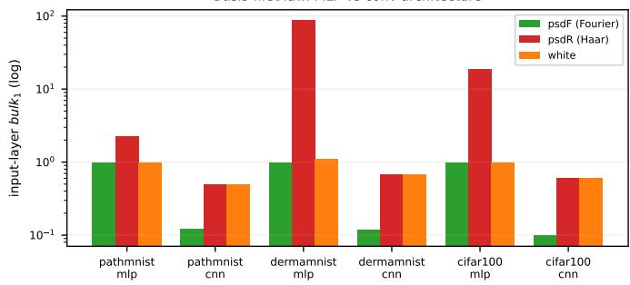  
Fig. 10. Architecture sweep behind Table X: on the convolutional oracle the Haar-basis probe collapses onto the white-noise baseline while the Fourieraligned probe sits at one quarter to one sixth of it; on the MLP oracle the Haar mismatch amplifies further.