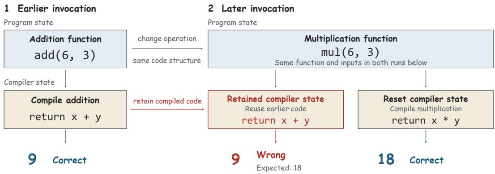
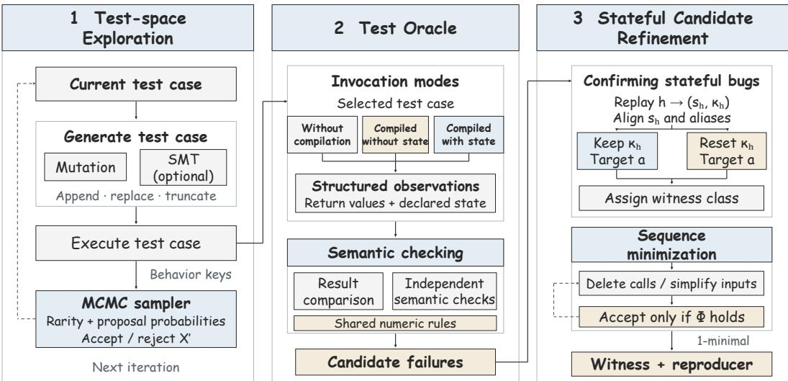
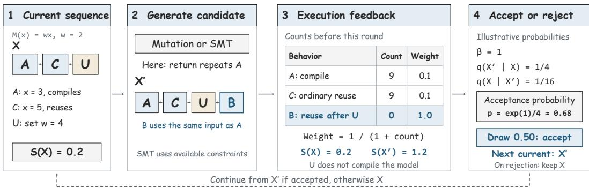
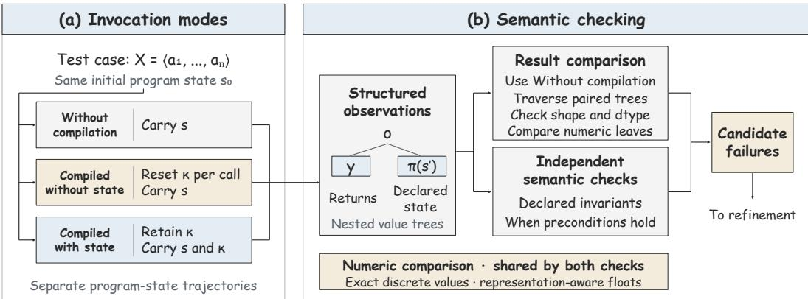
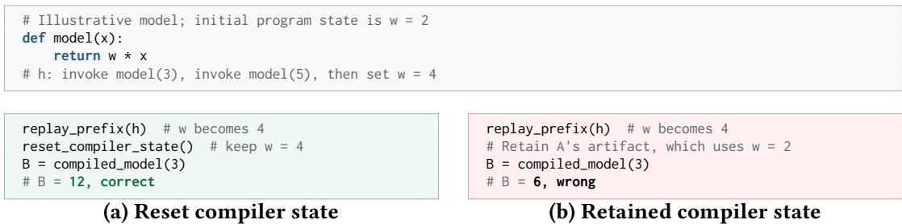
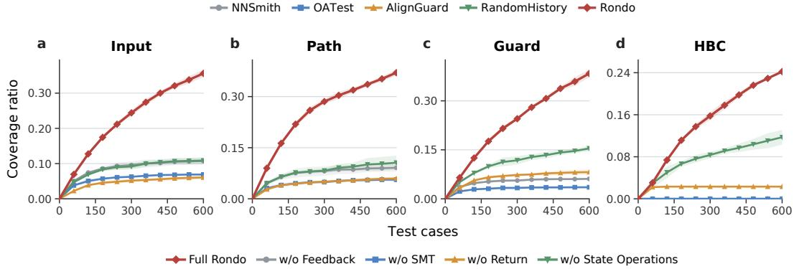
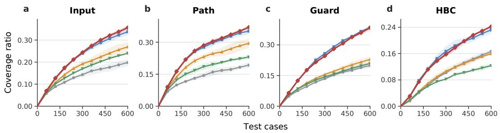

# Stateful Testing for Deep Learning Compilers

JIATAO GE, State Key Laboratory for Novel Software Technology, Nanjing University, China RUIXIANG QIAN, State Key Laboratory for Novel Software Technology, Nanjing University, China YIBO HU, State Key Laboratory for Novel Software Technology, Nanjing University, China YANZHOU MU, UNIST, Republic of Korea

YINGLONG ZOU, State Key Laboratory for Novel Software Technology, Nanjing University, China JIAWEI LIU, State Key Laboratory for Novel Software Technology, Nanjing University, China ZHENYU CHEN, State Key Laboratory for Novel Software Technology, Nanjing University, China CHUNRONG FANG∗, State Key Laboratory for Novel Software Technology, Nanjing University, China

Modern deep learning compilers compile models lazily and cache compiled artifacts for reuse across invocations. Compiler state is information retained by compilers across invocations that can afect later invocations. Examples include cached code and the guards for reusing it. Compiler state from earlier invocations can cause an incorrect result in a later invocation. To understand these stateful compiler bugs, we analyze 26 publicly reported issues in PyTorch, JAX, and TensorFlow that describe such bugs. The analysis shows that detecting these bugs requires two steps, establishing the relevant compiler state through earlier invocations, and making a later invocation that exposes the bug. To meet this requirement, we represent each test case as ⟨model, invocation sequence⟩. A fixed initial state and invocation sequence determine the resulting compiler state. Based on this representation, we develop Rondo, a stateful testing method for deep learning compilers. Rondo generates test cases by mutating invocation sequences. For each test case, it runs the invocation sequence on the model and records compilation behavior. A Markov chain Monte Carlo (MCMC) sampler uses this behavior as feedback to guide generation, favoring rarely observed compilation behaviors. Rondo identifies possible bugs through three-way diferential testing, comparing results without compilation, compiled results without compiler state from earlier invocations, and compiled results with that state. A stateful bug is confirmed when the same invocation produces an incorrect result with compiler state retained and a correct result after that state is reset. Lastly, Rondo attempts to shorten the invocation sequence while preserving the original bug to obtain a smaller script that reproduces it. We evaluate Rondo on four representative deep learning frameworks using 24 common model architectures. We detect 117 bugs, including 35 stateful bugs, and submit 39 bug reports, including 18 for stateful bugs. Developers confirm 35 reports, including 16 for stateful bugs, and fix 18 bugs, including 11 stateful bugs. Rondo achieves the highest behavior coverage and compiler Python source-line coverage in the baseline comparison. Its bug checks achieve 99.26% alarm precision. It shortens 44 of 117 invocation sequences while preserving the original bugs, reducing the lengths of these 44 sequences b 83.34% on average.

CCS Concepts: • Software and its engineering → Software testing and debugging.

Additional Key Words and Phrases: deep learning compiler testing, mutation testing

## 1 Introduction

Deep learning compilers are part of deep learning frameworks and provide important infrastructure for running models [3, 10, 11, 24]. These compilers compile models lazily and cache compiled

∗Corresponding author.

artifacts for reuse across invocations. For example, PyTorch’s compiler caches compiled artifacts for later reuse [2]. Similarly, MindSpore’s compiler caches compiled graphs for later model invocations. These caching mechanisms improve eficiency and make the compilers stateful. Compiler state is information retained by compilers across invocations that can afect later invocations. Compiler state established by prior invocations can cause an incorrect result in a later invocation, even when the same invocation is correct in isolation. We call these bugs stateful compiler bugs.

Existing deep learning compiler testing methods aim to detect framework bugs by generating diverse models and model inputs [27, 37]. Most of these methods test individual model invocations. We write such a test case as a pair ⟨model, invocation⟩, where the model describes the computation under test and the invocation specifies the model inputs. This representation captures the current invocation but does not explicitly capture the compiler state established by prior invocations. To understand stateful compiler bugs, we analyze 26 publicly reported bug issues in PyTorch, JAX, and TensorFlow. The analysis shows that these bugs can produce incorrect outputs and afect training. Detecting these bugs requires generating invocation sequences that establish compiler state and expose bugs in later invocations. This requirement gives rise to three challenges.

Challenge 1. Bug triggers across invocations. For a stateful bug, the invocation that creates the relevant compiler state and the invocation that exposes the bug are diferent. Representing a test case as ⟨model, invocation⟩ does not explicitly capture these invocations and their order. For example, invocation � may establish compiler state that causes a later invocation � to produce an incorrect result. Testing � and � separately would miss this bug. Detecting it therefore requires explicitly searching invocation sequences such as ⟨�, �⟩ [5, 22].

Challenge 2. A large test space. A test case for stateful bugs consists of a model and an invocation sequence. For a fixed model, � possible choices at each position give �� invocation sequences of length �. This makes exhaustive search infeasible as sequences become longer. Finding sequences that trigger rarely observed compiler behaviors is also dificult because compiler state is not directly observable. For example, invocation � may trigger a new compiler behavior after �, but does not trigger one after �′. It is therefore dificult to choose which sequences to extend or change, and random search may repeatedly trigger common behaviors.

Challenge 3. Oracle Unavailable. After running a test case, ground truth is often unavailable for determining whether its results are correct [52]. Traditional diferential oracles compare results from diferent modes, but an inconsistency alone does not establish whether it is caused by a compiler bug or whether the bug depends on compiler state. For example, an invocation may produce diferent results with and without compilation. This comparison does not tell us which result is incorrect. It also does not show whether compiler state from earlier invocations caused the inconsistency.

To address these challenges, we formulate the testing problem and define compiler state. The complete compiler state is not directly observable, so we use invocation sequences to represent compiler state. We represent each test case as ⟨model, invocation sequence⟩. A fixed initial state and a fixed invocation sequence determine the resulting compiler state. We can explore diferent compiler states by generating invocation sequences and reach the same state again by replaying the same sequence (addressing Challenge 1). Based on this representation, we develop Rondo, a stateful testing method for deep learning compilers. Rondo first generates test cases by mutating invocation sequences or using an SMT solver. It runs the invocation sequences and uses feedback to guide subsequent test case generation toward rarely observed compiler behaviors (addressing Challenge 2). It then compares results from invocations without compiling the model, compiled invocations without compiler state from earlier invocations, and compiled invocations with that state. To check whether a bug depends on compilation or compiler state, Rondo compares the same invocation with its inputs and program state fixed. A stateful bug is detected when the result is incorrect with compiler state from earlier invocations and correct after that state is reset (addressing Challenge 3). Finally, it shortens the invocation sequence while preserving the original bug.

We implement Rondo for PyTorch, JAX, TensorFlow, and MindSpore and evaluate it using 24 common model architectures, including multilayer perceptrons (MLPs), convolutional neural networks (CNNs), and Transformers. We detect 117 bugs, including 35 stateful bugs, and submit 39 bug reports, including 18 for stateful bugs. Developers confirm 35 reports, including 16 for stateful bugs, and fix 18 bugs, including 11 stateful bugs. Rondo achieves the highest behavior coverage and compiler Python source-line coverage in the baseline comparison. Its bug checks achieve 99.26% alarm precision. It shortens 44 of 117 invocation sequences while preserving the original bugs, reducing the lengths of these 44 sequences by 83.34% on average.

Our work makes the following contributions.

• A new perspective on compiler testing. We study stateful compiler bugs and define compiler state to describe their dependence on earlier invocations. We represent each test case as ⟨model, invocation sequence⟩. The sequence establishes compiler state for later invocations. We detect stateful bugs by comparing the same invocation with compiler state retained and reset, while keeping its inputs and program state fixed. Our analysis of 26 publicly reported bug issues guides this design.

• A novel stateful testing method. We propose Rondo, which generates test cases through mutation or SMT-based synthesis and uses compilation feedback to guide generation toward rarely observed compiler behaviors. It checks results through structured comparison and semantic checks, then shortens invocation sequences while preserving the original bug and its reproduction conditions.

• An empirical evaluation on production compilers. We evaluate Rondo on four frameworks using 24 common model architectures. It achieves the highest behavior coverage and compiler Python source-line coverage among the evaluated methods. We detect 117 bugs, including 35 stateful bugs, and submit 39 bug reports, including 18 for stateful bugs. Developers confirm 35 reports, including 16 for stateful bugs, and fix 18 bugs, including 11 stateful bugs.

• Open-science artifacts. To support future research and community reuse, we release Rondo’s implementation, the results of bug discovery, and the experimental results reported in this paper [1]. We welcome community contributions to extend these artifacts.

## 2 Key Observations

We analyze public bug issues to understand stateful compiler bugs and identify the testing requirements that guide the design of Rondo. We first describe bug collection and analysis, then present three observations on bug triggers, afected results, and the need to characterize compiler state.

## 2.1 Bug Collection and Analysis

The analysis consists of three steps: collecting candidate bug reports, filtering them according to the inclusion criteria, and analyzing the retained bug cases to identify testing requirements.

We collect candidate reports from the public GitHub issue trackers of PyTorch, JAX, and TensorFlow and the public Gitee issue tracker of MindSpore. These frameworks retain compiled artifacts across invocations. We use search terms for compiler interfaces (torch.compile, jit, and tf.function), correctness symptoms (wrong and incorrect), and compiler state (guard, cache, stale, second call, and recompile), and inspect reports linked from relevant discussions. We found 135 candidate reports after deduplicating the search results by issue URL. We retain reports created on or after January 1, 2020 that concern compilation or compiled invocations and describe an incorrect output, gradient, or observable program state. Each report must provide an invocation sequence and evidence that prior compiled invocations afect a later incorrect result, based on controlled runs or a mechanism explanation. We exclude reports concerning only performance, compilation exceptions, or crashes, and all security reports. The query below summarizes the search scope. We translate it into each tracker’s native syntax.

Table 1. Bug report filtering results.
<table><tr><td>Subject</td><td>Collected</td><td colspan="4">Filtered</td><td>Studied</td></tr><tr><td></td><td></td><td>Irrelevant</td><td>Enhancement</td><td>Duplicate</td><td>Not an Issue</td><td></td></tr><tr><td>PyTorch</td><td>77</td><td>38</td><td>1</td><td>12</td><td>5</td><td>21</td></tr><tr><td>JAX</td><td>27</td><td>20</td><td>0</td><td>0</td><td>3</td><td>4</td></tr><tr><td>TensorFlow</td><td>16</td><td>14</td><td>0</td><td>0</td><td>1</td><td>1</td></tr><tr><td>MindSpore</td><td>15</td><td>15</td><td>0</td><td>0</td><td>0</td><td>0</td></tr><tr><td>Total</td><td>135</td><td>87</td><td>1</td><td>12</td><td>9</td><td>26</td></tr></table>

repository IN (pytorch/pytorch, jax-ml/jax,

tensorflow/tensorflow, mindspore/mindspore)

AND type = Issue

AND created >= 2020-01-01

AND text CONTAINS ANY ("torch.compile", "jit", "tf.function",

"wrong", "incorrect", "guard", "cache",

"stale", "second call", "recompile")

We filter each candidate report according to the inclusion criteria using its description, reproduction code, developer discussions, and linked fixes or regression tests. We record excluded reports in four categories. Irrelevant includes reports outside the study’s scope, including help requests, performance issues, compilation exceptions or crashes without an incorrect semantic result, and failures without evidence of a role for prior invocations. This category also includes security reports and reports discovered by Rondo. Excluding Rondo’s reports keeps the study independent of the tool’s findings. Enhancement includes feature requests or design proposals without evidence of a correctness failure. Duplicate includes explicit duplicates and related reports grouped into the same bug case based on an identified omission or failure mechanism. Not an Issue includes reported inconsistencies explained by expected behavior or invalid API usage, as established by developer explanations or a correction of the original report. We retained 26 bug cases after filtering (Table 1).

We successfully reproduced all 26 bug cases on their afected versions. We examine their invocation sequences, failure mechanisms, and efects on outputs, gradients, and observable program state. We classify the bug mechanisms using reproduction code, developer discussions, and fixes [43].

## 2.2 Bug Triggers across Invocations

To detect stateful compiler bugs, we need to understand their triggering conditions. We examine the invocation sequences of the 26 studied bug cases. The three representative cases below illustrate how these conditions arise across invocations.

Bug Case 1: Changed function operation. PyTorch issue #197811 concerns two functions with the same code structure. One adds its inputs, and the other multiplies them. The first invocation uses the addition function with input values 6 and 3 and correctly returns 9. The compiler retains the compiled code from this invocation. The next invocation uses the multiplication function with the same input values. It should return 18, but instead returns 9. Figure 1 illustrates this case and shows that resetting compiler state restores the correct result for the later invocation.

  
Fig. 1. A stateful compiler bug across two invocations.

Bug Case 2: Changed gradient requirement. PyTorch issue #162174 concerns a change in whether a model’s parameters require gradients. Training uses gradients to determine how to adjust these numerical parameters [16, 18]. The first invocation does not require parameter gradients. The compiler retains the compiled code from this invocation. Before the next invocation, gradient computation is enabled for the same parameters. The next invocation produces the correct output. It should also produce parameter gradients with every element equal to 1, but instead produces no parameter gradients (None).

Bug Case 3: Changed input alias relations. PyTorch issue #139789 concerns a change in whether two inputs share storage. The program doubles the values stored in input x and then returns x + y. The first invocation uses independent inputs, each containing four ones. Doubling x leaves y unchanged, so the invocation correctly returns [3, 3, 3, 3]. The compiler retains the compiled code from this invocation. The next invocation uses inputs with the same initial values but with part of their storage shared. Doubling x also changes the overlapping elements of y. It should return [4, 4, 3, 3], but instead returns [3, 3, 3, 3].

In 17 of the 26 bug cases, the compiler reuses compiled code even though the conditions required by that code no longer hold. In 9 cases, the compiled code can still be used, but later invocations use earlier values or structures that do not match the current program state. In both situations, a later invocation incorrectly uses information retained by the compiler from earlier invocations. Triggering these bugs requires invocation sequences that first establish compiler state and then change relevant program state before an invocation that exposes the bug. The changes should cover parameter values and gradient requirements, object attributes and bindings, input properties and alias relations, function operations, modes, argument ordering, and counters or random-generator state. These changes can leave object identity, function code, or input values unchanged.

Observation 1. Stateful compiler bugs require invocation sequences that first establish compiler state and then expose an incorrect result in a later invocation.

## 2.3 Impact of Stateful Bugs

To detect stateful compiler bugs, we need to understand their observable efects. We analyze these efects on outputs, gradients, and observable program state to determine what testing must check.

Outputs. Outputs are the results returned by a model or program. Incorrect outputs can lead to incorrect predictions or task results. Model weights are numerical parameters that determine a model’s computation. PyTorch issue #104984 reports that a compiled model continues to use earlier weights after new weights are loaded. PyTorch issue #178365 reports incorrect outputs after a function’s default argument changes. Resetting compiler state restores the correct outputs in the latter case. The consequences can extend to the result of a complete task. JAX issue #31733 shows that the same task returns the correct solution 1 with an empty persistent compilation cache, but returns the initial value 10 with an existing cache. Other cases incorrectly report whether two references point to the same object or return an incorrect numeric data type, which can change later program decisions or computations.

Gradients. Training uses gradients to determine how to adjust a model’s numerical parameters. In PyTorch issue #162174 (Bug Case 2), the outputs are correct, but the parameter gradients are missing (None). These missing gradients can prevent the afected parameters from being updated as required, so correct outputs alone do not guarantee correct training.

Observable program state. Observable program state includes information a program keeps between invocations and that we can inspect, such as the state of a random-number generator. A random-number generator updates this state as it produces random results. PyTorch issue #197085 reports that repeated invocations of shuffle and sample return the permutation or sample from the first invocation. There is also an inconsistency between the random-generator state and that of the reference run. These errors can afect both the current output and the random results of subsequent invocations.

Testing requirements. The checks must cover outputs, gradients, and observable program state. For random operations, the compared runs must start from the same random-generator state and check both the result and the subsequent state.

Observation 2. Detecting stateful compiler bugs requires checking outputs, gradients, and observable program state. These bugs can afect any of these results without raising an exception.

## 2.4 Characterizing Compiler State

To guide how testing represents state, we examine how stateful compiler bugs difer from bugs exposed by an individual invocation. The studied cases show that the invocation establishing the relevant compiler state and the invocation exposing the bug are diferent.

A bug exposed by one invocation can be examined using that invocation’s model, inputs, and current program state. A stateful compiler bug also depends on compiler state established by earlier invocations. In Bug Case 2, the first invocation does not require parameter gradients and produces the correct result. The compiler retains the compiled code from this invocation. Before the next invocation, gradient computation is enabled for the same parameters. The current program state now requires parameter gradients, but the later invocation uses the earlier compiled code and produces no parameter gradients (None). Resetting compiler state restores the expected gradients while keeping the parameter values, gradient requirements, and inputs unchanged. This case shows that the invocation establishing compiler state can complete correctly, even though a later invocation fails after a change to program state. Program state determines the required result, while retained compiler state can prevent that result from being produced. Describing the current program state alone therefore does not capture all the conditions needed to expose a stateful compiler bug.

Testing therefore needs to characterize the compiler state that afects later invocations. This characterization should describe how the relevant state was established and support reaching it again, so that tests can explore diferent states and reproduce the conditions that exposed a bug.

Observation 3. Stateful compiler testing needs to characterize compiler state so that tests can establish the state needed to expose a bug and reproduce its efect on a later invocation.

## 3 Related Work

DL compiler testing constructs models, tensor programs, or intermediate representations (IRs), compiles and runs them, and applies an oracle to identify crashes, incorrect results, or inconsistencies [27, 29, 32]. Tests difer in the level at which they enter the compiler. Model- and program-level tests exercise supported frontends and subsequent transformations, while IR-level tests directly exercise compiler optimizations and lowering. Methods can be grouped by how they construct test cases: generation-based methods synthesize new models or programs using operator constraints [36], language rules, compiler information, or recorded operator usages, while mutation-based methods modify or combine existing test cases.

Generation-based methods. Generation-based methods construct new models or programs while satisfying the constraints required for compilation [55]. NNSmith incrementally builds valid computation graphs using operator specifications and tensor-type propagation, and uses gradientguided search to find inputs that avoid exceptional floating-point values [27]. NeuRI reduces the manual specification efort by inferring operator constraints from valid and invalid API traces and combining symbolic and concrete operators during model generation [28]. OPERA wraps operator instances extracted from DL library tests as single-operator models to test compiler frontends [40]. At the IR level, GenCoG uses a domain-specific language to specify and solve operator type constraints for generating diverse Relay graphs [49]. HirGen generates high-level IRs using coverage criteria and IR language features [32], while MLIRSmith constructs MLIR program templates and instantiates them through a context-sensitive grammar [47]. WhiteFox uses large language models (LLMs) to analyze optimization source code, extract requirements for triggering the optimization, and generate programs that satisfy those requirements. It uses tests that trigger optimizations as feedback to guide subsequent generation [53].

Mutation-based methods. Mutation-based methods construct new tests by modifying or combining existing models, programs, or IRs [8, 35, 50, 56]. MT-DLComp creates model variants whose results should agree for selected inputs and applies metamorphic testing [51]. TorchProbe uses semantics-preserving code transformations to introduce dynamic Python features into test programs [42]. Tzer jointly mutates low-level IRs and sequences of optimization passes under coverage feedback [29]. SynthFuzz infers parameterized, context-dependent mutations from existing MLIR tests and adapts them to new contexts [23]. AlignGuard extracts bug-triggering patterns from public reports and fixes, uses LLMs to synthesize mutation rules, and applies them to existing PyTorch compiler tests. Its patterns include repeated invocations with changes to model state or input properties [20]. OATest extracts optimization patterns from developer tests and combines them with seed computation graphs, repairing graph connections to satisfy operator constraints [41]. These methods reuse information in existing tests to diversify program structures, the conditions under which programs run, or compiler transformations.

Test oracle. Diferential testing compares compiled results with reference results [19, 34] or with results from diferent compiler configurations [27, 29, 53]. Metamorphic testing compares programs with a declared relation between their results [33, 51, 52]. DESIL applies rules to eliminate undefined behavior in MLIR tests and selects lowering paths that allow the tests to run for diferential comparison [45].

Comparison with prior work. Rondo detects stateful compiler bugs by using invocation sequences to represent and explore compiler state. First, compared with methods that generate or transform models, programs, or IRs, it searches invocation sequences that establish compiler state for later invocations. It mutates these sequences and declared state operations, using compilation-behavior feedback to guide generation toward rarely observed behaviors. Second, repeated-invocation tests can expose failures after changes to model state or inputs, but confirming a stateful compiler bug requires separating program state from compiler state. Rondo compares the same invocation with compiler state retained and reset, keeping its inputs and relevant program state unchanged. Third, it checks outputs, gradients, and observable program state through structured comparison and independent semantic checks. It then shortens the sequence while preserving the original bug and, for a stateful bug, its dependence on retained compiler state. Section 4 presents the design.

## 4 Methodology

This section presents the problem formulation and the testing method of Rondo. We first specify the test representation and the bugs we aim to find, then describe how Rondo generates test cases, checks their results, and confirms and minimizes stateful witnesses.

## 4.1 Problem Formulation

Given a model � and a fixed scenario, our goal is to find a test case that exposes a stateful compiler bug. The scenario fixes the framework build, backend, device, compiler options, and initial conditions.

Definition 4.1 (Compiler state). Compiler state � is information retained by compilers across invocations that can afect later invocations, excluding program state. Examples include cached compiled artifacts, guards, specializations, and profiling data. Program state � contains parameters, bufers, mutable inputs [7], alias relations [9, 46], modes, and other declared state. A configuration is (�, �).

The behavior required by program state must not depend on compiler state [25, 26, 31, 38]. The complete internal contents of compiler state depend on the compiler and are not directly observable. Following the testing requirement in Section 2.4, we represent compiler state by the invocation sequence that establishes it from the scenario’s fixed initial state. We represent each test case as

$$
\mathcal T = \langle M , X \rangle , \qquad X = \langle a _ { 1 } , \dots , a _ { n } \rangle .\tag{1}
$$

A test case consists of the model � and the invocation sequence �. Each $a _ { i }$ specifies a model invocation with its inputs or a declared state operation, such as updating a model parameter. The sequence records these operations and their order.

Definition 4.2 (Sequence representation of compiler state). Within the fixed scenario, replaying a legal prefix $h = \langle a _ { 1 } , \ldots , a _ { m } \rangle$ from the initial configuration $\left( { { s _ { 0 } } , { \kappa _ { 0 } } } \right)$ with compiler state retained determines the reached configuration

$$
\begin{array} { r } { ( s _ { h } , \kappa _ { h } ) = \mathsf { R u n } ( s _ { 0 } , \kappa _ { 0 } , h ) . } \end{array}\tag{2}
$$

Thus, $\kappa _ { h }$ is the compiler state represented by ℎ from $\left( { { s _ { 0 } } , { \kappa _ { 0 } } } \right)$ . The empty prefix leaves the initial configuration unchanged.

This representation allows Rondo to reach and reproduce compiler states by generating and replaying invocation sequences. Diferent prefixes can reach the same configuration. We seek a test case whose sequence is $X = h \cdot a$ , where the nonempty prefix ℎ establishes $\left( { s _ { h } , \kappa _ { h } } \right)$ for a later invocation � that exposes a bug. The same invocation � can encounter diferent compiler states after diferent prefixes. To confirm a stateful bug, � must produce an incorrect output, gradient, or observable program state with compiler state retained, but produce the correct result after compiler state is reset. The inputs to � and relevant program state, including alias relations, must remain unchanged between these two runs. This comparison separates the efect of compiler state from the efect of changes to program state.

The pair (ℎ, �) records the prefix and the invocation that exposes the bug. We call this pair a stateful witness. Rondo must generate a legal test case, detect the incorrect result, and establish that retained compiler state is necessary. It then minimizes the sequence while preserving the original bug and its witness class. The following subsections describe how Rondo generates test cases, compares observations, and refines candidates.

## 4.2 Method Overview

Figure 2 shows the three modules of Rondo, and Algorithm 1 summarizes the testing loop. Testspace Exploration first generates legal test cases through mutation or, when compilation constraints are available, SMT-based synthesis. It runs the generated test cases and uses compilation-behavior feedback to guide an adaptive Markov chain Monte Carlo (MCMC) search. The Test Oracle then runs selected test cases under three modes: Without compilation, Compiled without state, and Compiled with state. Here, state in the mode names refers to compiler state from earlier invocations; all three modes carry their own program state forward. It compares their outputs, gradients, and observable program state using representation-aware numeric rules and applies independent semantic checks to identify candidate bugs. Finally, Stateful Candidate Refinement repeats the invocation that produced the incorrect result with compiler state retained and reset, while keeping its inputs and relevant program state unchanged. It determines the witness class and minimizes the sequence while preserving the class, the invocation that exposed the bug, and the recorded symptoms. Compilation behavior guides test case generation, and this comparison determines whether the bug is stateful.

  
Fig. 2. Overview of Rondo.

Algorithm 1 The Rondo algorithm   
Require: Model �, initial invocation sequence �0, iteration budget �   
Ensure: Minimized bug witnesses B   
1: function Rondo(�, � , �)   
2: � ← � ; � ← ∅; B ← ∅   
3: for � ← 1 to � do   
4: �′ ← GenerateLegalSeqence(�, �, �) ⊲ 1. Mutation or SMT synthesis   
5: � ← CollectCompilationBehavior(�, �′)   
6: C ← TestOracle(�, �′) ⊲ 2. Compare 3 modes; check semantics   
7: for all � ∈ C do   
8: � ← ConfirmAndClassify(�) ⊲ 3. Align program state; retain/reset compiler state   
9: if �.class ≠ undetermined then   
10: B ← B ∪ {Minimize(�)} ⊲ Preserve the bug and witness class   
11: end if   
12: end for   
13: � ← MCMCSelect(�, �′, �, �) ⊲ Favor rare compilation behaviors   
14: � ← UpdateFeedback(�, �)   
15: end for   
16: return B   
17: end function

The algorithm starts from $X _ { 0 }$ and runs for � iterations. Here, � stores compilation feedback, � contains the behavior keys observed for the generated sequence, and C contains candidate bugs.

## 4.3 Test-space Exploration

Rondo explores compiler states by generating invocation sequences. It uses compilation-behavior feedback to guide test case generation. In each iteration, Rondo uses mutation or SMT-based synthesis to generate a new test case from the current sequence and runs it to collect feedback. An adaptive MCMC sampler uses this feedback to decide whether the new test case becomes the current test case for the next iteration. We first describe test case generation, then explain the compilation feedback and sampling procedure.

4.3.1 Generating Test Cases. Each scenario specifies the initial state. Rondo starts from an empty sequence or a saved prefix. In each iteration, it generates a new test case through feedback-guided mutation or SMT-based synthesis. Mutation applies an operator that appends an invocation, replaces an existing invocation, or removes invocations from the end of the sequence. Each generated test case must satisfy the scenario’s preconditions before it is run.

Feedback-guided mutation. Feedback-guided mutation aims to explore compiler states that arise when inputs or program state change across invocations. The bug analysis in Section 2.2 motivates varying input properties and values, changing model state or gradient requirements, and testing later invocations with earlier compiler state retained. We select 7 operators for varying invocation inputs, 4 for state changes or gradient computation, and 2 for revisiting invocations or exploring alternative continuations. Rondo uses these 13 mutation operators to generate new test cases from the current invocation sequence, as summarized with examples in Table 2. The shape, dtype, layout, and device operators change the dimensions, numeric type, storage arrangement, or device of a tensor, a multidimensional array. The resample and rescale operators change input values or their magnitudes, while special values introduces NaN, infinity, very small subnormal values, and positive or negative zero [13]. These mutations also cover dimensions of size 0 and 1, values near numeric boundaries, and values that afect program control flow [14]. The update operator adds parameter or bufer updates, mode adds switches between training/evaluation or gradient-computation modes, and restore restores saved program state. The backward operator adds gradient computation for the parameters being tested. The return operator repeats an earlier invocation with the same inputs and attributes, as in $A  B  A ,$ , to test it after the intervening invocations with compiler state retained. The truncate operator removes invocations from the end of the sequence so that later mutations can generate diferent invocations after the remaining sequence. Rondo uses compilation feedback to select operators, favoring those that previously produced new behavior keys following the compilation behavior observed at the end of the current sequence [15].

Table 2. Mutation operators used by Rondo and illustrative examples.
<table><tr><td>Operator</td><td>Operation</td><td>Example change</td></tr><tr><td>Shape</td><td>Change tensor shape</td><td> $( 1 , 4 )  ( 2 , 4 )$ </td></tr><tr><td>Dtype</td><td>Change tensor dtype</td><td> $\mathsf { f l o a t } 3 2 \to \mathsf { f l o a t } 6 4$ </td></tr><tr><td>Layout</td><td>Change memory layout</td><td>contiguous → strided</td></tr><tr><td>Device</td><td>Change tensor device</td><td> $\mathrm { C P U } \to \mathrm { G P U }$ </td></tr><tr><td>Resample</td><td>Resample input values</td><td> $x = 3  x = 5$ </td></tr><tr><td>Rescale</td><td>Scale input magnitudes</td><td> $x = 3  x = 3 0 0 0$ </td></tr><tr><td>Special values</td><td>Introduce special floating-point values</td><td> $+ 0 . 0  - 0 . 0$ </td></tr><tr><td>Update</td><td>Add a parameter or buffer update</td><td> $\langle A , B \rangle \to \langle A , B , U \rangle ; U : w \gets 4$ </td></tr><tr><td>Mode</td><td>Add a training or gradient mode switch</td><td> $\langle A , B \rangle \to \langle A , B , U \rangle ; U : \mathrm { t r a i n } \to \mathrm { e v a l }$ </td></tr><tr><td>Restore</td><td>Restore saved program state</td><td> $\langle A , B \rangle \to \langle A , B , U \rangle ; U : w \gets w _ { \mathrm { s a v e d } }$ </td></tr><tr><td>Backward</td><td>Add gradient computation</td><td> $\langle A , B \rangle \to \langle A , B , G \rangle$ </td></tr><tr><td>Return</td><td>Repeat an earlier invocation</td><td> $\langle A , B \rangle \to \langle A , B , A \rangle$ </td></tr><tr><td>Truncate</td><td>Remove invocations from the end</td><td> $\langle A , B \rangle \to \langle A \rangle$ </td></tr></table>

Mutating an invocation’s inputs produces a new invocation, which is appended to the sequence or replaces an existing invocation. In sequence examples, � and � are model invocations, � is a declared state operation, � is a backward pass, and � is a model parameter.

SMT-based synthesis. Mutation may struggle to generate invocations whose inputs satisfy specific compiler conditions. SMT-based synthesis targets these conditions directly. Rondo also generates test cases through SMT-based synthesis when it can obtain a guard or an input constraint from the framework. A guard is a condition that checks whether a compiled artifact can be used for the current invocation. Rondo selects an outcome of the condition that has not yet been explored and asks the solver to generate a finite set of candidate inputs that produce this outcome and satisfy the program’s input requirements [4, 30]. For example, a condition may require a tensor dimension to equal 1 or be greater than 1. Rondo selects a candidate from this set and records its selection probability. It constructs an invocation with the selected inputs, then appends it to the sequence or replaces an existing invocation to generate a new test case. It checks the invocation for legality before running the test case. If the solver cannot handle the constraints or finds no solution, Rondo uses mutation to generate the test case.

Example. Consider an illustrative model $M ( x ) = w x$ , where � is a scalar input and � is a mutable parameter initially equal to 2. Invocation � uses $x = 3$ , and invocation � uses $x = 5$ . Starting from $\langle A , C \rangle$ , the update operator generates a new test case by appending $U : w  4 .$ A later round uses the return operator to append �, which reissues � with the same input $x = 3 .$ . The generated sequence is $\langle A , C , U , B \rangle$ . All operations are legal, and � repeats � after the parameter change with compiler state retained. Applying truncate to this test case can generate $\langle A , C , U \rangle$ , so a later round can try a diferent invocation after �. We use this model in the following examples.

4.3.2 Guiding Test Case Generation. A sequence that triggers no new compiler behavior may still trigger one after further invocations are added, so the search should sometimes retain such intermediate sequences. Rondo uses an adaptive MCMC sampler to guide test case generation toward rarely observed compilation behaviors. In each iteration, it runs a new test case generated through mutation or SMT-based synthesis and uses the compilation feedback to decide whether to continue from this test case. Since the complete compiler state is not directly observable, Rondo summarizes the observed compilation events and their relation to preceding invocations and state changes as behavior keys. Let $K ( X )$ contain the keys observed when running sequence �, with repeated keys counted separately, and let $c _ { t } ( k )$ count how often key � was observed before round �. Rondo gives higher scores to sequences with rarely observed behaviors:

$$
S _ { t } ( X ) = \sum _ { k \in K ( X ) } \frac { 1 } { 1 + c _ { t } ( k ) } , \qquad \pi _ { t } ( X ) \propto \exp \bigl ( \beta S _ { t } ( X ) \bigr ) .\tag{3}
$$

A behavior contributes less to the score as it is observed more often. Here, $\pi _ { t }$ is the sampling preference, and $\beta$ controls how strongly the score afects this preference. The sampler compares the scores of the current sequence � and the new sequence $X ^ { \prime }$ and accounts for the probability of generating either sequence from the other. Let $q _ { t } ( X ^ { \prime } \mid X )$ denote the probability of generating $X ^ { \prime }$ from �, including the choice of mutation or SMT-based synthesis and the choices made within that method. Rondo records these generation probabilities and accepts $X ^ { \prime }$ with probability

$$
\operatorname* { m i n } \biggl \{ 1 , \exp \bigl ( \beta [ S _ { t } ( X ^ { \prime } ) - S _ { t } ( X ) ] \bigr ) \frac { q _ { t } ( X \mid X ^ { \prime } ) } { q _ { t } ( X ^ { \prime } \mid X ) } \biggr \} .\tag{4}
$$

If accepted, $X ^ { \prime }$ becomes the starting point for generating the next test case; otherwise, Rondo continues from �. The counts remain fixed during this decision and are updated afterward. The generation probabilities also change as the search proceeds. Rondo saves test cases that produce new behavior keys as starting points for later searches [48].

Example. Figure 3 illustrates one iteration with the current sequence $X = \langle A , C , U \rangle$ . The return operator generates a new test case with sequence $X ^ { \prime } = \langle A , C , U , B \rangle$ ; the reverse mutation uses truncate to remove �. Suppose � compiles an artifact, � reuses it, and � reuses it after the parameter update. The state operation � does not compile the model. Before this round, the compilation and ordinary-reuse keys have each been observed nine times, while reuse after � has not been observed. Thus, $S _ { t } ( X ) = 0 . 2 \mathrm { a n d } S _ { t } ( X ^ { \prime } ) = 1 . 2$ . Each key occurrence contributes to the score; another ordinary reuse would add only 0.1. For illustrative proposal probabilities $q _ { t } ( X ^ { \prime } \mid X ) = 1 / 4$ and $q _ { t } ( X \mid X ^ { \prime } ) = 1 / 1 6$ , and $\beta = 1$ , Equation (4) gives an acceptance probability of $\exp ( 1 ) / 4 \approx 0 . 6 8 .$ A random draw of 0.5 accepts $X ^ { \prime }$ . The new reuse pattern guides search; the oracle must determine whether the reuse is correct.

## 4.4 Test Oracle

Rondo checks selected test cases for incorrect outputs, gradients, and observable program state. As shown in Figure 4, it runs each test case under Without compilation, Compiled without state, and Compiled with state, then compares their structured observations and applies independent semantic checks. A failed check produces a candidate bug for Stateful Candidate Refinement.

4.4.1 Invocation Modes. An inconsistency between compiled and uncompiled results does not show whether retained compiler state is involved. Adding Compiled without state provides another comparison for identifying candidate stateful bugs. The three modes run the same invocation sequence from the same initial program state. They difer in whether they use compiled artifacts and whether they retain compiler state.

  
Fig. 3. One iteration of test-space exploration.

All three modes start from program state �0 and carry their own program state forward. Changes to program state can change the required behavior, while compiler state must not afect the behavior required by the current program state. Without compilation invokes the model without using the tested compilation path and provides observations for comparison. Compiled without state resets compiler state before each invocation, preserving the program state reached by its preceding invocations. The reset boundary � specifies which compiler state Rondo clears or isolates. With fresh compiler state denoted by $\kappa _ { 0 } ^ { b }$ , the reset is expressed as

$$
\begin{array} { r } { \mathrm { R e s e t } _ { b } ( s , \kappa ) = ( s , \kappa _ { 0 } ^ { b } ) . } \end{array}\tag{5}
$$

The compiled invocation then starts from $( s , \kappa _ { 0 } ^ { b } )$ . Compiled with state retains both program state and compiler state throughout the sequence. Each invocation � can reuse compiled artifacts created by earlier invocations. The invocation updates both states, written $\mathrm { C o m p } _ { M } ( s , \kappa , a ) = ( s ^ { \prime } , \kappa ^ { \prime } , o )$ where � is the observation; the next invocation starts from $( s ^ { \prime } , \kappa ^ { \prime } )$

Rondo implements Without compilation using eager mode in PyTorch and TensorFlow, nonjitted calls in JAX, and PyNative mode in MindSpore. Compiled with state keeps the same compiled callable throughout the sequence; Compiled without state rebuilds the callable and clears or isolates its compiler caches at boundary �, using process isolation when required. Each mode maintains its own program state, so the states reached before a later invocation can difer. Result comparison identifies candidate bugs; Rondo checks whether a bug is stateful in Section 4.5.1 by repeating the same invocation from aligned program state to determine whether retained compiler state is necessary for the failure.

4.4.2 Semantic Checking. A model may return several values, produce gradients, or update observable state. Checking these results requires a common description of what to observe and what counts as correct. Rondo checks observations under a correctness contract Γ, which specifies the observable fields, correctness checks, and relevant program state to align during refinement [39]. We write $\mathrm { O K } _ { \Gamma } ( s , a , o )$ when observation � satisfies these checks for invocation � from program state �.

  
Fig. 4. Test Oracle.

Definition 4.3 (Structured observation). $_ \mathrm { A n }$ invocation’s structured observation is $o =$ $\langle y , \pi ( s ^ { \prime } ) \rangle$ , where � is its returned value tree and $\pi ( s ^ { \prime } )$ is the part of its resulting program state $s ^ { \prime }$ declared observable by Γ. The tree preserves containers, fields, nesting, and the values or tensors at its leaves. Requested gradients are recorded as returned values or declared state fields.

Result comparison. Comparing values alone can miss errors in return structure, shape, or dtype. A uniform numeric tolerance can also hide inconsistencies, such as an incorrect zero replacing a small nonzero value. At each invocation position �, Rondo compares observations $o _ { i } ^ { \mathrm { r e s e t } }$ and $o _ { i } ^ { \mathrm { k e e p } }$ from the two compiled modes with observation $o _ { i } ^ { \mathrm { { u } } }$ ncompiled from Without compilation under Γ. These observations include outputs and declared state fields, such as parameters, bufers, and mutable inputs. When gradients are requested, a backward pass computes them; gradients are numerical derivatives used to adjust model parameters during training. Rondo first checks that corresponding containers, fields, nesting, tensor shapes [12], and dtypes agree, then compares their values using representation-aware numeric rules [6, 17, 21]. Discrete values must match exactly. Floating-point comparison checks NaN positions, infinity signs, signed zeros, and whether one value is zero while the other is nonzero. Normal finite nonzero values use dtype-specific relative and absolute tolerances. For two subnormal values—nonzero values whose magnitudes are below the smallest positive normal value of their dtype—Rondo compares them on an integer scale derived from their raw IEEE-754 encodings, using relative tolerance only. Floating-point values are serialized as raw bits to prevent changes to floating-point modes during a test run from afecting the comparison. An inconsistency under these comparison rules produces a candidate bug that records the invocation and its symptom signatures. Each signature specifies the observation path, type of inconsistency, and compared modes, allowing refinement to check that the original symptom is preserved.

Independent semantic checks. Rondo also checks declared program properties to detect incorrect results shared by all 3 modes. Its 6 checks cover required numerical precision, stability of deterministic invocations, bit-pattern consistency of identical scalars, mathematical identities across modes, consensus among at least 3 implementations, and mathematical bounds on results. Each check runs when its declared preconditions hold and uses the same numeric rules as result comparison. Violations produce candidate bugs; consensus identifies an outlier for further checking. Controlled replay then determines whether a bug depends on compiler state.

Example. For $\langle A , C , U , B \rangle$ , suppose the compiler incorrectly retains the parameter value $w = 2$ in the artifact created by �. Without compilation, �, �, and � return 6, 10, and 12, respectively. Compiled without state, they return the same values because � is compiled with the current parameter $w = 4$ . Compiled with state, they return 6, 10, and 6, because � uses the earlier parameter value. At �, the observations ⟨returned value, �⟩ are ⟨12, 4⟩ for Without compilation and Compiled without state and $\langle 6 , 4 \rangle$ for Compiled with state. The returned-value inconsistency produces a candidate. The independent semantic check $M ( 3 ) = 4 \cdot 3 = 1 2$ also rejects the result from Compiled with state.

## 4.5 Stateful Candidate Refinement

Rondo determines what a candidate needs for reproduction and minimizes its invocation sequence while preserving those conditions. It first checks whether a bug is stateful by repeating the invocation that produced the incorrect result with compiler state retained and reset from aligned program state. It then minimizes the sequence by removing invocations and simplifying invocation inputs while preserving the invocation that exposed the bug, its symptoms, witness class, and the relation defining that class.

4.5.1 Confirming Stateful Bugs. For a candidate $h \cdot a ,$ � is the invocation that produced the incorrect result, and ℎ contains the preceding invocations. Rondo first replays ℎ from the fixed initial configuration with compiler state retained to reach $\left( { { s _ { h } } , { \kappa _ { h } } } \right)$ , as defined by Equation (2).

Deleting the prefix can change both states, so Rondo repeats � from the reached program state $s _ { h }$ . It runs � with compiler state $\kappa _ { h }$ retained and with that state replaced by $\kappa _ { 0 } ^ { b }$ through Reset�. The inputs to �, relevant program state, and alias relations are aligned. For random operations, this alignment also includes the relevant random-generator state.

We write $\mathsf { V a l i d } _ { \Gamma , b } ( h , a )$ when the runs are legal and stable, correctness judgments are determined, and the required compiler-state reset and state alignment under $\mathsf { A l i g n } _ { \Gamma }$ are achieved. If these conditions cannot be established, classification remains undetermined.

Definition 4.4 (Stateful witness). Let $o _ { \mathrm { k e e p } }$ and $o _ { \mathrm { r e s e t } }$ be the observations of � with compiler state retained and reset from aligned program state $s _ { h } . \mathrm { A }$ pair $( h , a )$ is a stateful witness when

$$
\begin{array} { r } { \mathsf { S t a t e f u l } _ { \Gamma , b } ( h , a ) \iff h \neq \langle \rangle \wedge \mathsf { V a l i d } _ { \Gamma , b } ( h , a ) } \\ { \wedge \mathsf { \Pi } \neg \mathsf { O K } _ { \Gamma } ( s _ { h } , a , o _ { \mathrm { k e e p } } ) } \\ { \wedge \mathsf { \Pi } \mathrm { O K } _ { \Gamma } ( s _ { h } , a , o _ { \mathrm { r e s e t } } ) . } \end{array}\tag{6}
$$

Example. The prefix $h = \langle A , C , U \rangle$ leaves program state $ w = 4$ and a compiled artifact that incorrectly uses $w = 2$ . Figure 5 compares � from this reached program state. With compiler state retained, � returns 6. Resetting compiler state while preserving $w = 4$ and the input $x = 3$ makes � return the correct result 12. This confirms that the bug is stateful. Deleting ℎ would also restore $w = 2 ,$ , making 6 the correct result for a diferent program state. It therefore cannot replace this comparison.

Sequence minimization must preserve the conditions needed to reproduce each bug. We therefore distinguish witnesses by whether reproduction requires retained compiler state, program state established by the prefix, or just the final invocation. If � still reproduces the original bug after compiler state is reset with program state aligned, Rondo runs � alone from the initial program state with fresh compiler state. If that run reproduces the same symptom, the witness is point-wise. If it does not, the witness is history-exposed, because the program state established by the prefix is needed, while its retained compiler state is not. Let $\mathsf { R e p r o } _ { \Gamma , R } ( s , \kappa , a )$ mean that running � reproduces the original contract violation and symptom set �. These classes are

  
Fig. 5. Confirming a stateful bug with the same program state � = 4 and input $x = 3 .$

$$
\begin{array} { r l } & { \mathsf { P W } _ { \Gamma , b , R } ( a ) \iff \mathsf { R e p r o } _ { \Gamma , R } ( s _ { 0 } , \kappa _ { 0 } ^ { b } , a ) , } \\ & { \mathsf { H E } _ { \Gamma , b , R } ( h , a ) \iff \mathsf { R e p r o } _ { \Gamma , R } ( s _ { h } , \kappa _ { 0 } ^ { b } , a ) \wedge \neg \mathsf { P W } _ { \Gamma , b , R } ( a ) } \\ & { \qquad \wedge \neg \mathsf { S t a t e f u l } _ { \Gamma , b } ( h , a ) . } \end{array}\tag{7}
$$

(8)

These classes describe a witness’s reproduction conditions. Another witness of the same bug may belong to a diferent class. A bug is classified as stateful if at least one of its witnesses satisfies Definition 4.4.

Because our tests represent compiler state through invocation sequences, we show that the sequence-based and state-based conditions identify the same stateful failure at the reached configuration. The stateful condition can also be expressed at a reached configuration $( s , \kappa )$ . Under the same validity conditions, let $o _ { \kappa }$ and $o _ { 0 } ^ { b }$ be the observations of � with compiler state retained and reset, respectively. The state-based condition is

$$
\begin{array} { r } { \mathsf { S B } _ { \Gamma , b } ( s , \kappa , a ) \longleftrightarrow \mathsf { \Omega } \neg \mathrm { O K } _ { \Gamma } ( s , a , o _ { \kappa } ) } \\ { \wedge \mathrm { O K } _ { \Gamma } ( s , a , o _ { 0 } ^ { b } ) . } \end{array}\tag{9}
$$

The following proposition relates the sequence-based and state-based conditions at the configuration reached by the prefix.

Proposition 4.5 (Sequence–state correspondence). For any nonempty legal prefix ℎ and invocation � satisfying $\mathsf { V a l i d } _ { \Gamma , b } ( h , a )$

$$
\mathrm { S t a t e f u l } _ { \Gamma , b } ( h , a ) \longleftrightarrow \mathrm { S B } _ { \Gamma , b } ( s _ { h } , \kappa _ { h } , a ) .\tag{10}
$$

Proof. Replaying ℎ reaches $\left( s _ { h } , \kappa _ { h } \right)$ by Equation (2). Valid reset preserves $s _ { h }$ and replaces $\kappa _ { h }$ with $\kappa _ { 0 } ^ { b }$ . Both conditions therefore compare the same two runs of � with compiler state retained and reset and make the same correctness judgments. □

4.5.2 Sequence Minimization. Sequence simplification can preserve an incorrect result while changing a stateful witness into another witness class. Rondo therefore extends the failure predicate used in delta debugging [44, 54] to preserve the witness class and its defining relation. For a stateful witness, � must remain incorrect with compiler state retained and correct after compiler-state reset from aligned program state.

A shorter sequence can keep the same witness class while exposing a diferent bug. Preserving the original failure therefore also requires keeping its invocation, failing modes, and symptom signatures. Let � record the original witness class �, the identity � of the invocation that exposed the bug, failing-mode set $P ,$ and symptom signatures �. Each mutation during minimization must satisfy three checks. The runs must meet the validity conditions in Section 4.5.1. The witness must retain its class according to Equation (6), (7), or (8). It must also retain that invocation, failing modes, and original symptom signatures, including the observation paths, types of inconsistency, and semantic obligation of any independent check. We denote the latter two checks by $\mathrm { C l a s s } _ { c , \Gamma , b , \iota }$ and Preserve�, respectively. A generated test case with sequence $h ^ { \prime } \cdot a ^ { \prime }$ is accepted only when

$$
\begin{array} { r l } { \Phi _ { \iota } ( h ^ { \prime } , a ^ { \prime } ) = \vee \mathrm { a l i d } _ { \Gamma , b } ( h ^ { \prime } , a ^ { \prime } ) } & { } \\ { \wedge \subset \mathsf { l a s s } _ { c , \Gamma , b , \iota } ( h ^ { \prime } , a ^ { \prime } ) } & { } \\ { \wedge \mathsf { P r e s e r v e } _ { \iota } ( h ^ { \prime } , a ^ { \prime } ) . } \end{array}\tag{11}
$$

Rondo generates new test cases by mutating the current case: deleting invocation blocks or individual invocations, or simplifying the inputs of retained invocations. For each generated test case, it replays the revised prefix and rechecks the witness class, including runs of $a ^ { \prime }$ from aligned program state. The new test case replaces the current witness only when $\Phi _ { \iota }$ holds. After exhausting single-invocation deletions, the result is 1-minimal with respect to this condition and that deletion operation.

Example. For $\langle A , C , U , B \rangle$ , removing � gives $\langle A , U , B \rangle$ . The same invocation � still returns 6 with compiler state retained and 12 after compiler-state reset, so the reduction preserves the original bug and its witness class. Removing � from this reduced sequence leaves ⟨� , �⟩: � is compiled for the first time with � = 4 and correctly returns 12. Removing � leaves $\langle A , B \rangle$ , where � remains 2 and 6 is the correct result. Both deletions are rejected. The final sequence retains the invocation that establishes the compiled artifact, the parameter update, and the invocation that exposes the bug.

## 5 Experiment Design

## 5.1 Research Questions

We evaluate Rondo through five research questions.

• RQ1: Bug Detection. How efective is Rondo at detecting bugs in deep learning frameworks, and what types of bugs does it detect?

• RQ2: Diversity and Coverage. How does Rondo compare with the baselines in test diversity and compiler coverage?

• RQ3: Component Ablation. What efect does each exploration component have on test diversity and compiler coverage?

• RQ4: Oracle Efectiveness. How do the oracle configurations compare in true-positive detections and false alarms?

• RQ5: Sequence Refinement. How often does sequence refinement shorten an invocation sequence while preserving the original bug, and what is its cost?

## 5.2 Baseline Methods

NNSmith, OATest, AlignGuard, and RandomHistory serve as baselines to compare diferent testing strategies. We adapt their testing strategies for this evaluation. For ablation, we compare full Rondo with four variants: w/o Feedback, which removes compilation-behavior feedback; w/o SMT, which disables SMT-based synthesis; w/o Return, which disables the return operator; and w/o State Operations, which disables state-changing actions.

## 5.3 Measurements

RQ1: Bug detection. We count each deduplicated bug once and report total and stateful bug counts, together with their submission, developer confirmation, and fix status. Oracle totals use test cases as the counting unit.

RQ2: Diversity and coverage. We use four metrics defined for this evaluation: Input, Path, Guard, and History-Behavior Coverage (HBC). Input measures coverage of input configurations, defined by dtype, rank, requested layout, and input-signature region. Path measures coverage of operator signatures observed for diferent input dtypes, ranks, requested layouts, and modes. Guard measures coverage of compiler decisions (compilation, recompilation, or reuse) for diferent inputsignature regions, requested layouts, and modes. HBC measures coverage of behavior transitions across invocations. A transition records the state operation, preceding and current compilation decisions, return status, mode, and whether the graph used in the invocation appears for the first time. Programs and variants are distinguished in all four metrics. The four metrics are computed as Inpu $\begin{array} { r } { \mathrm { \Pi } : = \frac { \warrow N _ { \mathrm { I n p u t , c o v e r e d } } } { N _ { \mathrm { I n p u t , t o t a l } } } } \end{array}$ $\begin{array} { r } { \mathrm { { P a t h } } = \frac { N _ { \mathrm { { P a t h , c o v e r e d } } } } { N _ { \mathrm { { P a t h , t o t a l } } } } } \end{array}$ $\begin{array} { r } { \mathrm { G u a r d } = \frac { N _ { \mathrm { G u a r d , c o v e r e d } } } { N _ { \mathrm { G u a r d , t o t a l } } } } \end{array}$ , and $\begin{array} { r } { \mathrm { H B C } = \frac { N _ { \mathrm { H B C , c o v e r e d } } } { N _ { \mathrm { H B C , t o t a l } } } } \end{array}$ . Each numerator is the size of the set covered by the tests, and each denominator is the size of the corresponding total set in the shared evaluation space. The same total sets are used for all methods. We use these metrics primarily to compare relative coverage between methods within this evaluation space; their absolute values depend on the selected total sets. We also report compiler Python source-line coverage as $\frac { N _ { \mathrm { c o v e r e d l i n e s } } } { N _ { \mathrm { e x e c u t a b l e l i n e s } } }$ in torch.\_dynamo, torch.\_inductor, and torch.\_functorch. We report cumulative coverage curves and final values averaged across runs.

RQ3: Component ablation. We measure final coverage and coverage growth, and report the relative decrease from complete Rondo for each metric.

RQ4: Oracle efectiveness. For each oracle configuration, we report cumulative true positives (TP), new TP, false positives (FP), and total alarms. Alarm precision is $\scriptstyle { \frac { \mathrm { T P } } { \mathrm { T P } + \mathrm { F P } } }$ , and the false discovery rate is $\scriptstyle { \frac { \mathrm { F P } } { \mathrm { T P } + \mathrm { F P } } }$ . New TP counts test cases detected at each added level that were missed by the preceding configuration.

RQ5: Sequence refinement. For each test case, we measure original and refined invocation counts, the compression ratio $1 - \frac { N _ { \mathrm { r e f i n e d c a l l s } } } { N _ { \mathrm { o r i g i n a l c a l l s } } }$ , the number oforacle checks, and refinement time. Oracle checks determine whether a mutated test case still exposes the original bug. Efective refinement requires a strictly shorter sequence that preserves the original bug. Its success rate is $\frac { N _ { \mathrm { e f f e c t i v e \ r e f i n e m e n t s } } } { N _ { \mathrm { t e s t \ c a s e s } } }$ We report means, standard deviations (SD), medians, and total oracle checks and refinement time. Count medians are rounded to integers; compression-ratio SD is expressed in percentage points. Cases stopped because of excessive time, inability to shorten, or failure to preserve the original bug do not count as efective successes.

## 5.4 Implementations

To fairly evaluate the performance of Rondo and baseline methods, we implement them using the same framework versions, environment, and configurations. Rondo is implemented in Python and tested on PyTorch 2.12.1, MindSpore 2.9.0, TensorFlow 2.21.0, and JAX 0.10.2. Specifically, Rondo consists of three modules: Test-space Exploration, Test Oracle, and Stateful Candidate Refinement. The Test Oracle uses Without compilation, Compiled without state, and Compiled with state modes and includes structured observation comparison and independent semantic checks. The compilation paths under test are torch.compile with Inductor, MindSpore graph mode, tf.function with and without jit\_compile, and jax.jit with XLA. Eager mode and MindSpore PyNative mode serve as the corresponding paths without compilation. We select 24 common model architectures, including multilayer perceptrons (MLPs), convolutional neural networks (CNNs), and Transformers, as test programs. The experiments are conducted on an Intel Core i7-14700K machine with 32 GB of RAM, Ubuntu 24.04.4 LTS, and one 24 GB NVIDIA GeForce RTX 4090 GPU. The Python version is 3.12.13, and PyTorch is built with CUDA 13.0. For bug discovery, we run Rondo on the four frameworks using these model architectures. For coverage comparison and component ablation, each method or configuration uses three independent runs, and coverage is measured after 600 test cases. The compared methods and ablation configurations use the same test programs, seeds, settings, metric definitions, and reference protocol. For oracle evaluation, we compare five levels of checking on the same 50,074 labeled test cases: crash-only checking, two-mode numerical comparison, three-mode numerical comparison, three-mode structured comparison, and Full Oracle. Each level includes the checks of the preceding configuration. The two-mode configuration compares Without compilation and Compiled with state; the three-mode configurations also compare Without compilation and Compiled without state. Structured comparison additionally checks return structure, shape, dtype, special floating-point values, and declared state fields. Full Oracle adds semantic checks to threemode structured comparison. For sequence refinement, statistics cover test cases reproducing all 117 bugs, with the 44 efectively shortened test cases reported separately.

## 6 Results and Analysis

## 6.1 RQ1: Bug Detection

Detected bugs. Rondo detected 117 bugs across four frameworks, including 30 in PyTorch, 30 in TensorFlow, 17 in JAX, and 40 in MindSpore. We submitted 39 bug reports, including 15 for PyTorch, 9 for TensorFlow, 3 for JAX, and 12 for MindSpore. Of these reports, 18 concerned stateful bugs. Developers confirmed 35 reports, including 16 for stateful bugs, and fixed 18 bugs, including 11 stateful bugs. Table 3 summarizes these results.

Table 3. Bug detection and reporting results. Numbers in parentheses denote counts for bugs with at least one stateful witness.
<table><tr><td>Framework</td><td>Bugs</td><td>Submitted</td><td>Confirmed</td><td>Fixed</td></tr><tr><td>PyTorch</td><td>30 (22)</td><td>15 (14)</td><td>13 (12)</td><td>8 (8)</td></tr><tr><td>TensorFlow</td><td>30 (8)</td><td>9 (1)</td><td>7 (1)</td><td>6 (1)</td></tr><tr><td>JAX</td><td>17 (2)</td><td>3 (2)</td><td>3 (2)</td><td>3 (2)</td></tr><tr><td>MindSpore</td><td>40 (3)</td><td>12 (1)</td><td>12 (1)</td><td>1 (0)</td></tr><tr><td>Total</td><td>117 (35)</td><td>39 (18)</td><td>35 (16)</td><td>18 (11)</td></tr></table>

Stateful compiler bugs. Of the 117 bugs, 35 were stateful compiler bugs, including 22 in PyTorch, 8 in TensorFlow, 2 in JAX, and 3 in MindSpore. In these cases, compiler state from earlier invocations caused an incorrect result in a later invocation. For example, PyTorch incorrectly shared compiled code between two functions with the same code structure but diferent tensor operations. The second function therefore performed the first function’s computation. TensorFlow’s tf.function reused the same compiled graph for +0.0 and -0.0, although the function could distinguish them. The result of the later call depended on which value appeared first. Changes to methods, object attributes, or the default dtype also left compiled PyTorch invocations using code for an earlier program state.

Other bugs. The remaining 82 bugs included numerical errors, incorrect gradients, dtype errors, crashes, and missing input checks. Examples included PyTorch weight normalization producing incorrect outputs and NaN/Inf gradients, JAX returning infinity for small upper-tail probabilities, and MindSpore performing float64 computations with float32 precision. Other cases caused PyTorch compilation to fail on symbolic expressions or MindSpore calls to fail because of missing CPU kernels. Compiled PyTorch also omitted the check that an input matrix is positive definite in torch.linalg.cholesky.

Answer to RQ1. Rondo detected 117 bugs across four frameworks, including 35 stateful bugs. The remaining 82 bugs included numerical errors, incorrect gradients, dtype errors, crashes, and missing input checks. We submitted 39 bug reports, including 18 for stateful bugs; developers confirmed 35 reports, including 16 for stateful bugs, and fixed 18 bugs, including 11 stateful bugs.

## 6.2 RQ2: Diversity and Coverage

Comparison with baselines. Table 4 reports final behavior coverage and compiler Python sourceline coverage, while the top row of Figure 6 shows coverage growth.

Table 4. Behavior coverage and compiler Python source-line coverage.
<table><tr><td colspan="5">Behavior coverage</td><td colspan="2">Compiler coverage</td></tr><tr><td>Method</td><td>Input</td><td>Path</td><td>Guard</td><td>HBC</td><td>Code (%)</td><td>Covered lines</td></tr><tr><td>NNSmith</td><td>0.107</td><td>0.091</td><td>0.061</td><td>0.000</td><td>14.12</td><td>31,751</td></tr><tr><td>OATest</td><td>0.069</td><td>0.056</td><td>0.035</td><td>0.000</td><td>14.15</td><td>31,820</td></tr><tr><td>AlignGuard</td><td>0.061</td><td>0.059</td><td>0.082</td><td>0.023</td><td>14.07</td><td>31,627</td></tr><tr><td>RANDOMHISTORY</td><td>0.109</td><td>0.106</td><td>0.154</td><td>0.117</td><td>14.17</td><td>31,864</td></tr><tr><td>RoNDO</td><td>0.356</td><td>0.370</td><td>0.384</td><td>0.242</td><td>14.94</td><td>33,591</td></tr></table>

  
Fig. 6. Coverage growth. Columns (a)–(d) show Input, Path, Guard, and HBC. The rows compare methods (top) and exploration-component configurations (botom).

Rondo achieves the highest coverage on all four behavior metrics. Compared with RandomHistory, the strongest baseline on these metrics, it increases Input and Path by 227.99% and 249.58%, and Guard and HBC by 148.51% and 106.66%, respectively. The HBC gain shows that its invocation sequences exercise more distinct behavior transitions. Rondo also achieves the highest compiler Python source-line coverage: 14.94%, compared with 14.17% for RandomHistory. This is an increase of 0.77 percentage points, corresponding to 1,727 additional covered lines. These results show that Rondo improves both behavior coverage and compiler source-line coverage. The larger relative gains in behavior coverage suggest that many additional sequences exercise diferent invocation conditions within compiler code already reached by the baselines. The two kinds of coverage therefore provide complementary views of test diversity.

Answer to RQ2. Rondo achieves the highest Input, Path, Guard, HBC, and compiler Python source-line coverage among the evaluated methods. Its HBC is 106.66% higher than RandomHistory, the strongest baseline, and its compiler Python source-line coverage is 14.94%.

## 6.3 RQ3: Component Ablation

Table 5 reports final coverage for the ablation configurations, and the bottom row of Figure 6 shows coverage growth.

Table 5. Behavior coverage and compiler Python source-line coverage under exploration-component ablations.
<table><tr><td colspan="5">Behavior coverage</td><td colspan="2">Compiler coverage</td></tr><tr><td>Configuration</td><td>Input</td><td>Path</td><td>Guard</td><td>HBC</td><td>Code (%)</td><td>Covered lines</td></tr><tr><td>Full RoNDO</td><td>0.356 0.370</td><td></td><td>0.384</td><td>4 0.242</td><td>14.94</td><td>33,591</td></tr><tr><td>w/o Feedback</td><td>0.198</td><td>0.193</td><td>0.199</td><td>0.166</td><td>14.79</td><td>33,239</td></tr><tr><td>w/o SMT</td><td>0.337</td><td>0.352</td><td>0.385</td><td>0.232</td><td>14.94</td><td>33,594</td></tr><tr><td>w/o Return</td><td>0.269</td><td>0.295</td><td>0.229</td><td>0.160</td><td>14.90</td><td>33,501</td></tr><tr><td>w/o State Operations</td><td>0.240</td><td>0.231</td><td>0.209</td><td>0.124</td><td>14.75</td><td>33,171</td></tr></table>

Compilation-behavior feedback and SMT-based synthesis. Removing feedback causes the largest decreases in Input, Path, and Guard among the four ablations, reducing them by 44.44%, 48.00%, and 48.19%, respectively. It also reduces HBC by 31.30%. These results support using compilation-behavior feedback to guide sequence search. Removing SMT-based synthesis has a smaller efect: Input, Path, and HBC decrease by 5.31%, 4.89%, and 4.21%, respectively. However, w/o SMT slightly increases Guard from 0.3837 to 0.3849 and covers three additional compiler Python source lines; source-line coverage rounds to 14.94% for both configurations. The measured coverage gains from SMT-based synthesis are therefore in Input, Path, and HBC.

Return and state operations. Removing the return operator reduces Guard by 40.42% and HBC by 34.06%, showing that revisiting earlier invocations contributes to compiler-decision and behavior-transition coverage. Removing state operations reduces HBC by 49.01%, the largest HBC decrease among the four ablations. It also reduces Input, Path, and Guard by 32.59%, 37.71%, and 45.50%, respectively. These results show that changing program state contributes to exploring behavior transitions across invocations.

Answer to RQ3. Removing feedback causes the largest decreases in Input, Path, and Guard; removing state operations causes the largest HBC decrease, at 49.01%. The return operator improves all four behavior-coverage metrics. SMT-based synthesis provides smaller gains in Input, Path, and HBC. Compiler source-line coverage changes only slightly across the configurations.

## 6.4 RQ4: Oracle Efectiveness

We compare the oracle configurations by the true-positive test cases they detect and the false alarms they produce.

Table 6. Oracle detections and false discovery rates across five levels of checking. TP counts are cumulative.
<table><tr><td></td><td colspan="3">Detection results</td><td colspan="2">Alarm reliability</td></tr><tr><td>Configuration</td><td>TP</td><td>New TP</td><td>Alarms</td><td>FP</td><td>FDR (%)</td></tr><tr><td>Crash-only</td><td>31</td><td>31</td><td>31</td><td>0</td><td>0.00</td></tr><tr><td>Two-mode numerical</td><td>354</td><td>323</td><td>357</td><td>3</td><td>0.84</td></tr><tr><td>Three-mode numerical</td><td>382</td><td>28</td><td>385</td><td>3</td><td>0.78</td></tr><tr><td>Three-mode structured</td><td>487</td><td>105</td><td>490</td><td>3</td><td>0.61</td></tr><tr><td>Full Oracle</td><td>539</td><td>52</td><td>543</td><td>4</td><td>0.74</td></tr></table>

Contributions of oracle checks. Table 6 shows that true-positive detections increase from 31 with crash-only checking to 539 with Full Oracle. Numerical comparison between Without compilation and Compiled with state adds 323, raising the total to 354. Adding Compiled without state detects another 28, raising the total to 382. Structured comparison adds 105, raising the total to 487, a 27.49% increase over three-mode numerical comparison. Adding semantic checks detects another 52 true-positive test cases, bringing the Full Oracle total to 539.

Alarm reliability. Full Oracle produces 543 alarms: 539 true positives and four false positives. Its alarm precision is 99.26%, and its false discovery rate is 0.74%, compared with 0.61% for three-mode structured comparison. Adding semantic checks detects 52 more true-positive test cases at the cost of one additional false positive.

Answer to RQ4. True-positive detections increase from 31 with crash-only checking to 539 with Full Oracle. Semantic checks add 52 true-positive test cases. Full Oracle produces four false positives among 543 alarms, achieving 99.26% alarm precision and a 0.74% false discovery rate.

## 6.5 RQ5: Sequence Refinement

Sequence reduction and bug preservation. Table 7 reports the refinement results. Across all 117 test cases, the mean invocation count decreases from 12.26 to 4.56, and the median decreases from three to one. The mean compression ratio is 31.34%, with a median of zero. Efective refinement succeeds for 44 test cases (37.61%): their sequences are strictly shorter and preserve the original bug. For these 44 test cases, the mean invocation count decreases from 22.18 to 1.73, and the median decreases from about 13 to one. The mean compression ratio is 83.34%, with a median of 89.44%. The diference between the mean and median original sequence lengths indicates that a few long sequences contribute substantially to the total reduction in invocation count.

Refinement cost. Across all 117 test cases, refinement uses 856 oracle checks and 21,592.8 seconds in total, averaging 7.32 oracle checks and 184.55 seconds per test case. The 44 efectively shortened test cases account for 427 oracle checks and 15,742.4 seconds, averaging 9.70 oracle checks and 357.78 seconds per test case.

Table 7. Sequence refinement statistics for all 117 test cases and the 44 efectively shortened test cases.
<table><tr><td rowspan="2"></td><td colspan="3">All test cases (117)</td><td colspan="3">Shortened test cases (44)</td></tr><tr><td>Mean</td><td>SD</td><td>Median</td><td>Mean</td><td>SD</td><td>Median</td></tr><tr><td>Metric Original invocations</td><td>12.26</td><td>32.89</td><td>3</td><td>22.18</td><td>42.22</td><td>13</td></tr><tr><td>Refined invocations</td><td>4.56</td><td>18.96</td><td>1</td><td>1.73</td><td>2.56</td><td>1</td></tr><tr><td>Oracle checks</td><td>7.32</td><td>9.71</td><td>5</td><td>9.70</td><td>6.87</td><td>7</td></tr><tr><td>Compression ratio (%)</td><td>31.34</td><td>41.49</td><td>0.00</td><td>83.34</td><td>15.60</td><td>89.44</td></tr><tr><td>Refinement time (s)</td><td>184.55</td><td>295.42</td><td>42.54</td><td>357.78</td><td>355.53</td><td>189.26</td></tr></table>

Answer to RQ5. Sequence refinement shortens 44 of 117 test cases (37.61%) while preserving the original bugs. The mean compression ratio is 31.34% overall and 83.34% for the 44 successful test cases. Across all test cases, refinement averages 7.32 oracle checks and 184.55 seconds per test case.

## 7 Threats to Validity

Internal Threats to Validity. Errors in test runs, oracle checks, or compiler-state reset can afect bug detection and the classification of stateful bugs. To reduce these threats, we compare the results of Without compilation, Compiled without state, and Compiled with state and use independent semantic checks. We confirm stateful bugs by replaying the same invocation with compiler state retained and reset while aligning its inputs and relevant program state, and record the achieved compiler-state reset boundary. Minimization rechecks the original bug and its defining class relation after each reduction. External Threats to Validity. The selected programs, frameworks, and hardware may limit generalization. To reduce this threat, we evaluate four frameworks using 24 common model architectures, including MLPs, CNNs, and Transformers. Construct Threats to Validity. Behavior metrics and oracle alarms may not fully reflect compiler coverage or the number of underlying bugs. We use common metric definitions, total sets, test case budgets, and configurations for the compared methods, and report compiler Python source-line coverage alongside behavior coverage. We also distinguish detected bugs from oracle true-positive test cases and report the contributions of oracle checks separately.

## 8 Conclusion

Single-invocation tests for deep learning compilers do not represent the compiler state that can afect later invocations. We propose Rondo, a novel stateful testing method that uses invocation sequences to represent and explore hidden compiler state. Rondo guides test case generation with compilation-behavior feedback and checks results under Without compilation, Compiled without state, and Compiled with state. It confirms stateful bugs by comparing the same invocation with compiler state retained and reset while preserving its inputs and relevant program state. It then minimizes invocation sequences while preserving the original bug and its defining class relation. Evaluation on four deep learning frameworks detected 117 bugs, including 35 stateful bugs. We submitted 39 bug reports, including 18 for stateful bugs. Developers confirmed 35 reports, including 16 for stateful bugs, and fixed 18 bugs, including 11 stateful bugs.

## Data-Availability Statement

The public artifact [1] contains Rondo’s implementation, bug-discovery results, and experimental results. Reproduction requires the framework versions and device support described in Section 5.4.

## References

[1] Anonymous. [n. d.]. Rondo: Stateful Testing for Deep Learning Compilers. Online repository. Anonymized artifact. https://anonymous.4open.science/r/Rondo-108B/

[2] Jason Ansel, Edward Yang, Horace He, Natalia Gimelshein, Animesh Jain, Michael Voznesensky, Bin Bao, Peter Bell, David Berard, Evgeni Burovski, Geeta Chauhan, Anjali Chourdia, Will Constable, Alban Desmaison, Zachary DeVito, Elias Ellison, Will Feng, Jiong Gong, Michael Gschwind, Brian Hirsh, Sherlock Huang, Kshiteej Kalambarkar, Laurent Kirsch, Michael Lazos, Mario Lezcano, Yanbo Liang, Jason Liang, Yinghai Lu, C. K. Luk, Bert Maher, Yunjie Pan, Christian Puhrsch, Matthias Reso, Mark Saroufim, Marcos Yukio Siraichi, Helen Suk, Shunting Zhang, Michae Suo, Phil Tillet, Xu Zhao, Eikan Wang, Keren Zhou, Richard Zou, Xiaodong Wang, Ajit Mathews, William Wen, Gregory Chanan, Peng Wu, and Soumith Chintala. 2024. PyTorch 2: Faster Machine Learning Through Dynamic Python Bytecode Transformation and Graph Compilation. In Proceedings ofthe 29th ACM International Conference on Architectural Supportfor Programming Languages and Operating Systems (ASPLOS 2024), Vol. 2. Association for Computing Machinery, New York, NY, USA, 929–947. doi:10.1145/3620665.3640366

[3] Jai Arora, Sirui Lu, Devansh Jain, Tianfan Xu, Farzin Houshmand, Phitchaya Mangpo Phothilimthana, Mohsen Lesani, Praveen Narayanan, Karthik Srinivasa Murthy, Rastislav Bodik, Amit Sabne, and Charith Mendis. 2025. TensorRight: Automated Verification of Tensor Graph Rewrites. Proceedings ofthe ACM on Programming Languages 9, POPL, Article 29 (2025), 32 pages. doi:10.1145/3704865

[4] Qian Chen, Chenqi Cui, Fengjuan Gao, Yu Wang, Ke Wang, and Linzhang Wang. 2025. Solving Floating-Point Constraints with Continuous Optimization. Proceedings of the ACM on Programming Languages 9, PLDI (2025), 725–747. doi:10.1145/3729279

[5] Wenqian Deng, Jie Liang, Zhiyong Wu, Jingzhou Fu, Mingzhe Wang, and Yu Jiang. 2025. Coni: Detecting Database Connector Bugs via State-Aware Test Case Generation. In Proceedings ofthe 47th IEEE/ACM International Conference on Software Engineering (ICSE 2025). Institute of Electrical and Electronics Engineers, Piscataway, NJ, USA, 667–678. doi:10.1109/icse55347.2025.00003

[6] Haozhe Fan, Wei Wang, Xingchen Liu, Man Liu, Xingjian Tian, Haoquan Long, Zedong Liu, Daran Sun, Jinwu Yang, Bo Yang, Jie Liu, Yonggang Che, Hairui Zhao, Guangming Tan, and Dingwen Tao. 2026. Tools-CC-Bench: A Benchmark Suite for Collective Communication with Compression in HPC and AI Workloads. arXiv preprint. Accepted at IISWC 2026; Version 2. arXiv:2609.08739 doi:10.48550/arXiv.2609.08739

[7] Cormac Flanagan and Stephen N. Freund. 2009. FastTrack: Eficient and Precise Dynamic Race Detection. In Proceedings ofthe 30th ACM SIGPLAN Conference on Programming Language Design and Implementation (PLDI 2009). Association for Computing Machinery, New York, NY, USA, 121–133. doi:10.1145/1542476.1542490

[8] Jiatao Ge, Yanzhou Mu, Yinglong Zou, Yibo Hu, Zhenyu Chen, and Chunrong Fang. 2026. Grounding Deep Learning Framework Testing in Data Flow. arXiv preprint. Version 1. arXiv:2610.15808 doi:10.48550/arXiv.2610.15808

[9] Dongjie He, Jingbo Lu, and Jingling Xue. 2022. Qilin: A New Framework for Supporting Fine-Grained Context-Sensitivity in Java Pointer Analysis. In Proceedings of the 36th European Conference on Object-Oriented Programming (ECOOP 2022) (Leibniz International Proceedings in Informatics, Vol. 222). Schloss Dagstuhl – Leibniz-Zentrum für Informatik, Dagstuhl, Germany, 30:1–30:29. doi:10.4230/lipics.ecoop.2022.30

[10] Yuka Ikarashi, Gilbert Louis Bernstein, Alex Reinking, Hasan Genc, and Jonathan Ragan-Kelley. 2022. Exocompilation for Productive Programming of Hardware Accelerators. In Proceedings of the 43rd ACM SIGPLAN Conference on Programming Language Design and Implementation (PLDI 2022). Association for Computing Machinery, New York, NY, USA, 703–718. doi:10.1145/3519939.3523446

[11] Yuka Ikarashi, Kevin Qian, Samir Droubi, Alex Reinking, Gilbert Louis Bernstein, and Jonathan Ragan-Kelley. 2025. Exo 2: Growing a Scheduling Language. In Proceedings ofthe 30th ACM International Conference on Architectural Support for Programming Languages and Operating Systems (ASPLOS 2025), Vol. 1. Association for Computing Machinery, New York, NY, USA, 426–444. doi:10.1145/3669940.3707218

[12] Sifis Lagouvardos, Julian Dolby, Neville Grech, Anastasios Antoniadis, and Yannis Smaragdakis. 2020. Static Analysis of Shape in TensorFlow Programs. In Proceedings ofthe 34th European Conference on Object-Oriented Programming (ECOOP 2020) (Leibniz International Proceedings in Informatics, Vol. 166). Schloss Dagstuhl – Leibniz-Zentrum für Informatik, Dagstuhl, Germany, 15:1–15:29. doi:10.4230/lipics.ecoop.2020.15

[13] Ignacio Laguna, Xinyi Li, and Ganesh Gopalakrishnan. 2022. BinFPE: Accurate Floating-Point Exception Detection for GPU Applications. In Proceedings ofthe 11th ACM SIGPLAN International Workshop on the State ofthe Art in Program Analysis (SOAP 2022). Association for Computing Machinery, New York, NY, USA, 1–8. doi:10.1145/3520313.3534655

[14] Ignacio Laguna, Anh Tran, and Ganesh Gopalakrishnan. 2023. Finding Inputs That Trigger Floating-Point Exceptions in Heterogeneous Computing via Bayesian Optimization. Parallel Comput. 117 (2023), 103042. doi:10.1016/j.parco. 2023.103042

[15] Myungho Lee, Sooyoung Cha, and Hakjoo Oh. 2023. Learning Seed-Adaptive Mutation Strategies for Greybox Fuzzing. In Proceedings ofthe 45th IEEE/ACM International Conference on Software Engineering (ICSE 2023). Institute of Electrical and Electronics Engineers, Piscataway, NJ, USA, 384–396. doi:10.1109/icse48619.2023.00043

[16] Wonyeol Lee, Sejun Park, and Alex Aiken. 2023. On the Correctness of Automatic Diferentiation for Neural Networks with Machine-Representable Parameters. In Proceedings of the 40th International Conference on Machine Learning (ICML 2023) (Proceedings ofMachine Learning Research, Vol. 202). PMLR, Honolulu, Hawaii, USA, 19094–19140. https: //proceedings.mlr.press/v202/lee23p.htm

[17] Wonyeol Lee, Rahul Sharma, and Alex Aiken. 2023. Training with Mixed-Precision Floating-Point Assignments. Transactions on Machine Learning Research (2023). https://openreview.net/forum?id=ZoXi7n54OB

[18] Wonyeol Lee, Hangyeol Yu, Xavier Rival, and Hongseok Yang. 2020. On Correctness of Automatic Diferentiation for Non-Diferentiable Functions. In Advances in Neural Information Processing Systems (NeurIPS 2020), Vol. 33. Curran Associates, Inc., Virtual Event, 6719–6730. https://proceedings.neurips.cc/paper/2020/hash 4aaa76178f8567e05c8e8295c96171d8-Abstract.htm

[19] Meiziniu Li, Dongze Li, Jianmeng Liu, Jialun Cao, Yongqiang Tian, and Shing-Chi Cheung. 2026. Enhancing Diferential Testing with LLMs for Testing Deep Learning Libraries. ACM Transactions on Software Engineering and Methodology 35, 4, Article 88 (2026), 39 pages. doi:10.1145/3735637

[20] Meiziniu Li, Dongze Li, Jianmeng Liu, and Shing-Chi Cheung. 2026. Demystifying the Silence of Correctness Bugs in PyTorch Compiler. arXiv preprint. Version 1. arXiv:2604.08720 doi:10.48550/arXiv.2604.08720

[21] Xinyi Li, Ang Li, Bo Fang, Katarzyna Swirydowicz, Ignacio Laguna, and Ganesh Gopalakrishnan. 2024. FTTN: Feature-Targeted Testing for Numerical Properties of NVIDIA & AMD Matrix Accelerators. In Proceedings ofthe 24th IEEE International Symposium on Cluster, Cloud and Internet Computing (CCGrid 2024). Institute of Electrical and Electronics Engineers, Piscataway, NJ, USA, 39–46. doi:10.1109/ccgrid59990.2024.00014

[22] Jie Liang, Yaoguang Chen, Zhiyong Wu, Jingzhou Fu, Mingzhe Wang, Yu Jiang, Xiangdong Huang, Ting Chen, Jiashu Wang, and Jiajia Li. 2023. Sequence-Oriented DBMS Fuzzing. In Proceedings ofthe 39th IEEE International Conference on Data Engineering (ICDE 2023). Institute of Electrical and Electronics Engineers, Piscataway, NJ, USA, 668–681. doi:10.1109/icde55515.2023.00057

[23] Ben Limpanukorn, Jiyuan Wang, Hong Jin Kang, Zitong Zhou, and Miryung Kim. 2025. Fuzzing MLIR Compilers with Custom Mutation Synthesis. In Proceedings ofthe 47th IEEE/ACM International Conference on Software Engineering (ICSE 2025). Institute of Electrical and Electronics Engineers, Piscataway, NJ, USA, 217–229. doi:10.1109/icse55347.2025.00037

[24] Amanda Liu, Gilbert Bernstein, Adam Chlipala, and Jonathan Ragan-Kelley. 2024. A Verified Compiler for a Functiona Tensor Language. Proceedings ofthe ACM on Programming Languages 8, PLDI, Article 160 (2024), 23 pages. doi:10. 1145/3656390

[25] Amanda Liu, Gilbert Louis Bernstein, Adam Chlipala, and Jonathan Ragan-Kelley. 2022. Verified Tensor-Program Optimization via High-Level Scheduling Rewrites. Proceedings of the ACM on Programming Languages 6, POPL, Article 55 (2022), 28 pages. doi:10.1145/3498717

[26] Amanda Liu, Gilbert Louis Bernstein, Shoaib Kamil, Adam Chlipala, and Jonathan Ragan-Kelley. 2026. A Mechanized Algebra of Verified Data Structures for Optimizing Sparse Tensor Programs. Proceedings of the ACM on Programming Languages 10, PLDI (2026), 356–378. doi:10.1145/3808261

[27] Jiawei Liu, Jinkun Lin, Fabian Rufy, Cheng Tan, Jinyang Li, Aurojit Panda, and Lingming Zhang. 2023. NNSmith: Generating Diverse and Valid Test Cases for Deep Learning Compilers. In Proceedings of the 28th ACM International Conference on Architectural Supportfor Programming Languages and Operating Systems (ASPLOS 2023), Vol. 2. Association for Computing Machinery, New York, NY, USA, 530–543. doi:10.1145/3575693.3575707

[28] Jiawei Liu, Jinjun Peng, Yuyao Wang, and Lingming Zhang. 2023. NeuRI: Diversifying DNN Generation via Inductive Rule Inference. In Proceedings ofthe 31st ACM Joint European Software Engineering Conference and Symposium on the Foundations ofSoftware Engineering (ESEC/FSE 2023). Association for Computing Machinery, New York, NY, USA, 657–669. doi:10.1145/3611643.3616337

[29] Jiawei Liu, Yuxiang Wei, Sen Yang, Yinlin Deng, and Lingming Zhang. 2022. Coverage-Guided Tensor Compiler Fuzzing with Joint IR-Pass Mutation. Proceedings of the ACM on Programming Languages 6, OOPSLA1, Article 73 (2022), 26 pages. doi:10.1145/3527317

[30] Sirui Lu and Rastislav Bodík. 2023. Grisette: Symbolic Compilation as a Functional Programming Library. Proceedings ofthe ACM on Programming Languages 7, POPL, Article 16 (2023), 33 pages. doi:10.1145/3571209

[31] Sirui Lu and Rastislav Bodík. 2025. HieraSynth: A Parallel Framework for Complete Super-Optimization with Hierarchical Space Decomposition. Proceedings of the ACM on Programming Languages 9, OOPSLA2, Article 384 (2025) 28 pages. doi:10.1145/3763162

[32] Haoyang Ma, Qingchao Shen, Yongqiang Tian, Junjie Chen, and Shing-Chi Cheung. 2023. Fuzzing Deep Learning Compilers with HirGen. In Proceedings of the 32nd ACM SIGSOFT International Symposium on Software Testing and Analysis (ISSTA 2023). Association for Computing Machinery, New York, NY, USA, 248–260. doi:10.1145/3597926. 3598053

[33] Kabilan Mahathevan, Yining Zhang, Muhammad Ali Gulzar, and Kirshanthan Sundararajah. 2026. TenSure: Fuzzing Sparse Tensor Compilers (Registered Report). In Proceedings ofthe International Fuzzing Workshop (Fuzzing 2026). Internet Society, San Diego, CA, USA. doi:10.14722/fuzzing.2026.23006

[34] Sergey Mechtaev, Manh-Dung Nguyen, Yannic Noller, Lars Grunske, and Abhik Roychoudhury. 2018. Semantic Program Repair Using a Reference Implementation. In Proceedings ofthe 40th IEEE/ACM International Conference on Software Engineering (ICSE 2018). Association for Computing Machinery, New York, NY, USA, 129–139. doi:10.1145/ 3180155.3180247

[35] Yanzhou Mu, Juan Zhai, Chunrong Fang, Xiang Chen, Zhixiang Cao, Peiran Yang, Yinglong Zou, Tao Zheng, and Zhenyu Chen. 2024. DevMuT: Testing Deep Learning Framework via Developer Expertise-Based Mutation. In Proceedings ofthe 39th IEEE/ACM International Conference on Automated Software Engineering (ASE 2024). Association for Computing Machinery, New York, NY, USA, 1533–1544. doi:10.1145/3691620.3695523

[36] M M Abid Naziri, Shinhae Kim, Feiran (Alex) Qin, Saikat Dutta, and Marcelo d’Amorim. 2026. Testing Deep Learning Libraries via Neurosymbolic Constraint Learning. In Proceedings ofthe 48th IEEE/ACM International Conference on Software Engineering (ICSE 2026). Association for Computing Machinery, New York, NY, USA, 3586–3598. doi:10.1145 3744916.3787800

[37] Hung Viet Pham, Thibaud Lutellier, Weizhen Qi, and Lin Tan. 2019. CRADLE: Cross-Backend Validation to Detect and Localize Bugs in Deep Learning Libraries. In Proceedings of the 41st IEEE/ACM International Conference on Software Engineering (ICSE 2019). Institute of Electrical and Electronics Engineers, Piscataway, NJ, USA, 1027–1038. doi:10.1109/icse.2019.00107

[38] Alex Reinking, Gilbert Louis Bernstein, and Jonathan Ragan-Kelley. 2022. Formal Semantics for the Halide Language. arXiv preprint. Version 1. arXiv:2210.15740 doi:10.48550/arXiv.2210.15740

[39] Simmo Saan, Michael Schwarz, Julian Erhard, Helmut Seidl, Sarah Tilscher, and Vesal Vojdani. 2024. Correctness Witness Validation by Abstract Interpretation. In Verification, Model Checking, and Abstract Interpretation (VMCAI2024) (Lecture Notes in Computer Science, Vol. 14499). Springer Nature Switzerland, Cham, Switzerland, 74–97. doi:10.1007/978- 3-031-50524-9\_4

[40] Qingchao Shen, Yongqiang Tian, Haoyang Ma, Junjie Chen, Lili Huang, Ruifeng Fu, Shing-Chi Cheung, and Zan Wang. 2025. A Tale of Two DL Cities: When Library Tests Meet Compiler. In Proceedings ofthe 47th IEEE/ACM International Conference on Software Engineering (ICSE 2025). Institute of Electrical and Electronics Engineers, Piscataway, NJ, USA, 2201–2212. doi:10.1109/icse55347.2025.00025

[41] Qingchao Shen, Zan Wang, Haoyang Ma, Yongqiang Tian, Lili Huang, Zibo Xiao, Junjie Chen, and Shing-Chi Cheung. 2026. Optimization-Aware Test Generation for Deep Learning Compilers. In Proceedings of the 48th IEEE/ACM International Conference on Software Engineering (ICSE 2026). Association for Computing Machinery, New York, NY, USA, 3787–3799. doi:10.1145/3744916.3773216

[42] Qidong Su, Chuqin Geng, Gennady Pekhimenko, and Xujie Si. 2023. TorchProbe: Fuzzing Dynamic Deep Learning Compilers. In Programming Languages and Systems (APLAS 2023) (Lecture Notes in Computer Science, Vol. 14405). Springer Nature Singapore, Singapore, 310–331. doi:10.1007/978-981-99-8311-7\_15

[43] Chengnian Sun, Vu Le, Qirun Zhang, and Zhendong Su. 2016. Toward Understanding Compiler Bugs in GCC and LLVM. In Proceedings of the 25th International Symposium on Software Testing and Analysis (ISSTA 2016). Association for Computing Machinery, New York, NY, USA, 294–305. doi:10.1145/2931037.2931074

[44] Chengnian Sun, Yuanbo Li, Qirun Zhang, Tianxiao Gu, and Zhendong Su. 2018. Perses: Syntax-Guided Program Reduction. In Proceedings ofthe 40th IEEE/ACMInternational Conference on Software Engineering (ICSE 2018). Association for Computing Machinery, New York, NY, USA, 361–371. doi:10.1145/3180155.3180236

[45] Chenyao Suo, Jianrong Wang, Yongjia Wang, Jiajun Jiang, Qingchao Shen, and Junjie Chen. 2025. DESIL: Detecting Silent Bugs in MLIR Compiler Infrastructure. Proceedings ofthe ACM on Programming Languages 9, OOPSLA2, Article 383 (2025), 27 pages. doi:10.1145/3763161

[46] Chengpeng Wang, Jipeng Zhang, Rongxin Wu, and Charles Zhang. 2024. DAInfer: Inferring API Aliasing Specifications from Library Documentation via Neurosymbolic Optimization. Proceedings ofthe ACM on Software Engineering 1, FSE (2024), 2469–2492. doi:10.1145/3660816

[47] Haoyu Wang, Junjie Chen, Chuyue Xie, Shuang Liu, Zan Wang, Qingchao Shen, and Yingquan Zhao. 2023. MLIRSmith: Random Program Generation for Fuzzing MLIR Compiler Infrastructure. In Proceedings ofthe 38th IEEE/ACM International Conference on Automated Software Engineering (ASE 2023). Institute of Electrical and Electronics Engineers, Piscataway, NJ, USA, 1555–1566. doi:10.1109/ase56229.2023.00120

[48] Mingzhe Wang, Jie Liang, Chijin Zhou, Zhiyong Wu, Jingzhou Fu, Zhuo Su, Qing Liao, Bin Gu, Bodong Wu, and Yu Jiang. 2024. Data Coverage for Guided Fuzzing. In Proceedings ofthe 33rd USENIXSecurity Symposium (USENIXSecurity 2024). USENIX Association, Philadelphia, PA, USA, 2511–2526. https://www.usenix.org/conference/usenixsecurity24/ presentation/wang-mingzhe

[49] Zihan Wang, Pengbo Nie, Xinyuan Miao, Yuting Chen, Chengcheng Wan, Lei Bu, and Jianjun Zhao. 2023. GenCoG: A DSL-Based Approach to Generating Computation Graphs for TVM Testing. In Proceedings ofthe 32nd ACM SIGSOFT International Symposium on Software Testing and Analysis (ISSTA 2023). Association for Computing Machinery, New York, NY, USA, 904–916. doi:10.1145/3597926.3598105

[50] Dominik Winterer, Chengyu Zhang, and Zhendong Su. 2020. Validating SMT Solvers via Semantic Fusion. In Proceedings of the 41st ACM SIGPLAN Conference on Programming Language Design and Implementation (PLDI 2020). Association for Computing Machinery, New York, NY, USA, 718–730. doi:10.1145/3385412.3385985

[51] Dongwei Xiao, Zhibo LIU, Yuanyuan Yuan, Qi Pang, and Shuai Wang. 2022. Metamorphic Testing of Deep Learning Compilers. Proceedings ofthe ACM on Measurement and Analysis ofComputing Systems 6, 1 (2022), 1–28. doi:10.1145 3508035

[52] Xiaoyuan Xie, Joshua W.K. Ho, Christian Murphy, Gail Kaiser, Baowen Xu, and Tsong Yueh Chen. 2011. Testing and Validating Machine Learning Classifiers by Metamorphic Testing. Journal ofSystems and Software 84, 4 (2011), 544–558. doi:10.1016/j.jss.2010.11.920

[53] Chenyuan Yang, Yinlin Deng, Runyu Lu, Jiayi Yao, Jiawei Liu, Reyhaneh Jabbarvand, and Lingming Zhang. 2024. White-Fox: White-Box Compiler Fuzzing Empowered by Large Language Models. Proceedings of the ACM on Programming Languages 8, OOPSLA2, Article 296 (2024), 27 pages. doi:10.1145/3689736

[54] A. Zeller and R. Hildebrandt. 2002. Simplifying and Isolating Failure-Inducing Input. IEEE Transactions on Software Engineering 28, 2 (2002), 183–200. doi:10.1109/32.988498

[55] Qirun Zhang, Chengnian Sun, and Zhendong Su. 2017. Skeletal Program Enumeration for Rigorous Compiler Testing. In Proceedings ofthe 38th ACM SIGPLAN Conference on Programming Language Design and Implementation (PLDI 2017). Association for Computing Machinery, New York, NY, USA, 347–361. doi:10.1145/3062341.3062379

[56] Yinglong Zou, Juan Zhai, Chunrong Fang, An Guo, Jiawei Liu, and Zhenyu Chen. 2026. Scalpel: Automotive Deep Learning Framework Testing via Assembling Model Components. In Proceedings ofthe 48th IEEE/ACM International Conference on Software Engineering (ICSE 2026). Association for Computing Machinery, New York, NY, USA, 3298–3310. doi:10.1145/3744916.3773242