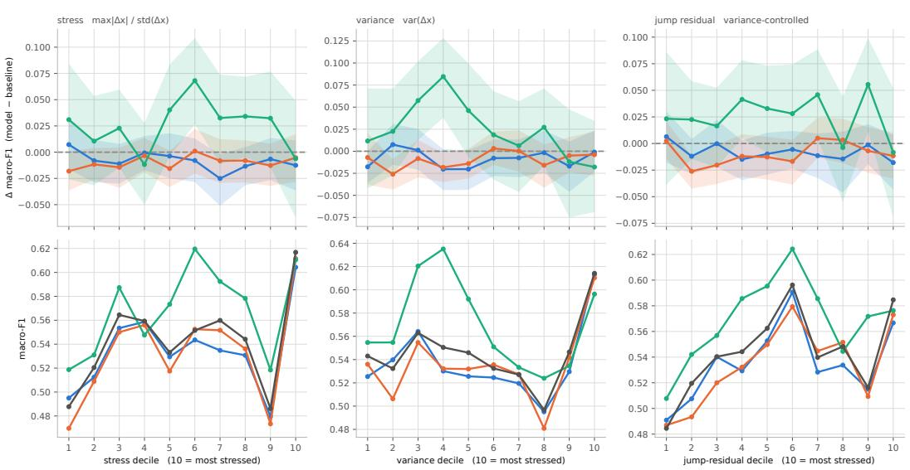
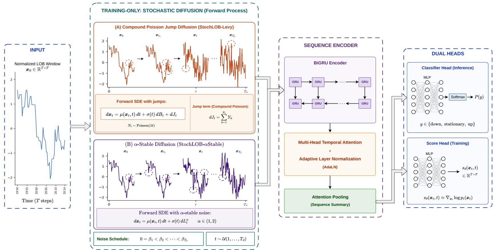
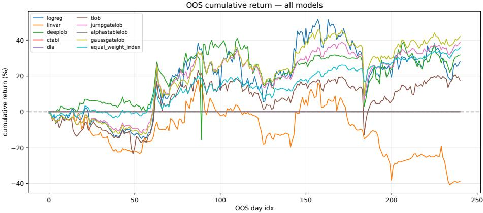
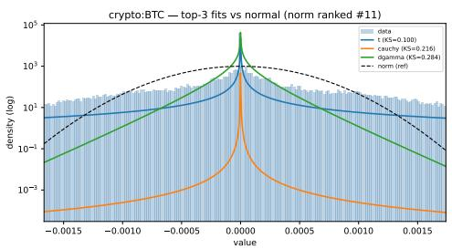
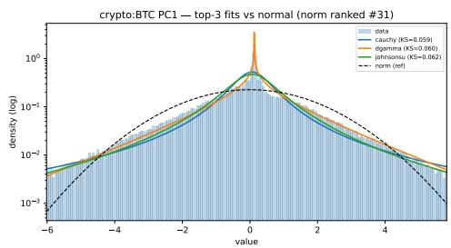
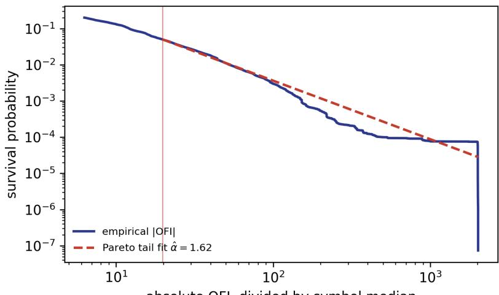

# StochLOB: Heavy-Tailed Score Matching for Robust Limit Order Book Trend Prediction

Arshia Abolghasemi1∗ Seyed Reza Tavakoli1∗ Parsa Naderi2 Nazanin Mirzaei3 Behrad Jahani2 Saba Yousefzadeh2 Tahereh Javaheri4 Mohammad Hosein Rohban2 Gholamali Aminian5 Ali Habibnia1,6†

1Dataism Laboratory for Quantitative Finance 2Sharif University of Technology 3Amirkabir University of Technology 4Boston University 5The Alan Turing Institute 6Virginia Tech

## Abstract

Score-based diffusion methods usually perturb data with Brownian Gaussian noise, corresponding to a light-tailed forward stochastic differential equation (SDE). For market time series this SDE can be a poor abstraction: limit order book (LOB) order flow is heavy-tailed, bursty, and occasionally jump-like. We study STOCHLOB, a training-only score-matching framework that changes the forward diffusion corruption law while leaving the deployed predictor deterministic. Instead of Brownianonly Gaussian corruption, the noising process uses two non-Gaussian SDE-inspired alternatives: jump-Lévy noise through a compound-Poisson variance mixture, and clipped α-stable noise through a positive-stable Gaussian scale mixture. These corruptions inject finite jumps and heavy-tailed residuals into training without requiring reverse-time diffusion sampling at inference. The resulting score target has a useful interpretation: its radial factor h (r) is the posterior expected corruption precision, so large residuals are weighted according to the latent corruption scale that most plausibly generated them. On chronologically held-out Coinbase LOB data, the proposed variants remain competitive on uncorrupted BTC and altcoin test horizons and improve several realized tail-window stress diagnostics. An exploratory Feishu A-share transfer study further tests whether the probability outputs remain usable under transaction costs and trading-rule constraints. Code and configuration files are available at https://github.com/ArshiAbolghasemi/Penny.

## 1 Introduction

Score-based diffusion methods are commonly built around a Brownian forward stochastic differential equation (SDE), whose finite-time corruption is Gaussian and light-tailed. This modeling choice is convenient, but it also defines the residual geometry seen by a denoising score objective: large coordinate movements become exponentially unlikely, and the learned restoring force is tied to a Brownian quadratic penalty. For data generated by stochastic systems with bursts, jumps, or persistent heavy tails, the Brownian-only SDE can therefore be a poor training corruption law.

Limit order book (LOB) prediction makes this mismatch concrete. Order-flow imbalance (OFI), depth changes, and short-horizon returns can remain quiet for many bins and then move abruptly after an order sweep, a liquidity withdrawal, or a short burst of directional trading. These large residuals are not rare under the market process, but they are rare under Gaussian diffusion corruption. This is difficult to reconcile with the heavy tails and jump-like behavior observed in financial time series and LOB order flow [Mandelbrot, 1963, Cont, 2001, Cont et al., 2014].

The question we study is whether the forward diffusion SDE used for score-based regularization should be modified so its noise law better matches the stochastic input process. We introduce STOCHLOB, a training-only framework for robust mid-price trend prediction. The deployed model remains a standard classifier: the corruption sampler and score head are used only while learning the shared representation, and test-time inference is a single deterministic forward pass. This isolates the effect of changing the stochastic diffusion corruption from the cost of reverse-time diffusion sampling at deployment.

We consider two non-Gaussian SDE-inspired corruption families. The jump-Lévy variant adds a compound-Poisson jump component to a Brownian background, implemented as a Gaussian scale mixture that exposes the representation to mostly ordinary perturbations with occasional finite jumps. The α-stable variant replaces the fixed Brownian variance with a clipped positive-stable scale mixture, producing broad heavy-tailed perturbations while retaining numerical stability. Both variants use the same classifier architecture and differ only in the stochastic training law and auxiliary loss. The score target is also interpretable: the radial score factor $h _ { t } ( r )$ is a posterior precision under the latent corruption scale. Thus the denoising objective does not apply the same restoring force to every residual. Ordinary residuals receive high posterior precision, while extreme residuals can be explained by larger latent corruption scales.

Our empirical analysis follows the same logic. First, distribution-fit and tail diagnostics on Coinbase OFI show that the Gaussian assumption is a poor description of the observed inputs. Second, on Coinbase BTC and four additional crypto symbols, the proposed variants remain competitive on standard held-out mid-price trend prediction and win selected horizons, showing that the stochastic auxiliary objective does not require a large standard-test accuracy tradeoff. Third, realized stresswindow diagnostics evaluate the regimes that motivate the method: high-stress, high-variance, and jump-residual windows in which Gaussian corruption is least plausible. Figure 1 gives the headline stress diagnostic at $k = 1 0 0$ . We also include an exploratory Feishu A-share transfer study in which model probabilities are converted into constrained portfolio signals, checking whether the forecasts remain useful after transaction costs, lot-size rules, and T+1 selling constraints. This transfer check is not meant to define a complete trading system; it tests whether the learned probabilities survive a realistic downstream decision rule.

Contributions. We make three contributions. First, we formulate robust supervised representation learning as a mismatch between Brownian diffusion-SDE corruption and heavy-tailed, jump-like stochastic inputs, using LOB trend prediction as the concrete test bed. Second, we modify the training-time diffusion corruption with jump-Lévy and clipped α-stable noise while keeping the LOB predictor deterministic and free of inference-time sampling. Third, we provide a posteriorprecision interpretation of the resulting score function $h _ { t } ,$ , with proofs and future-work mathematics in Appendix G. Appendices A–F provide the data details, score-table construction, implementation and training algorithms, additional crypto results, and the Feishu portfolio analysis.

## 2 Related Work

LOB trend prediction. LOB forecasting has moved from linear models toward architectures that exploit both level structure and temporal order. DeepLOB combines convolutional, Inception, and recurrent blocks for mid-price movement prediction [Zhang et al., 2019]. TABL and BiN-TABL add bilinear mappings, temporal attention, and input normalization for financial time series [Tran et al., 2019, 2021]. Later work studies stronger attention and benchmarking designs, including TLOB, LiT, LOBench, Axial-LOB, and order-flow attention networks [Berti and Kasneci, 2025, Xiao et al., 2025, Zhong et al., 2025, Kisiel and Gorse, 2022, Bandealinaeini et al., 2025]. Our experiments keep the standard three-class mid-price trend protocol and compare against linear, recurrent, convolutional-attention, transformer, and single-asset order-flow attention baselines trained on the same chronological windows.

Heavy tails and jumps. Heavy tails are a classical stylized fact of financial returns [Mandelbrot, 1963, Cont, 2001]; LOB-specific studies show non-Gaussian behavior in liquidity, impact, and order flow [Bouchaud et al., 2002, Mike and Farmer, 2008, Gould et al., 2013, Cont et al., 2014]. Jump-diffusion models provide a finite-activity language for abrupt price moves [Merton, 1976], while stable processes model persistent heavy-tailed fluctuations [Samorodnitsky and Taqqu, 1994]. We use these objects as training-time corruption laws, not as complete market simulators.

  
Figure 1: Main stress result on chronologically held-out Coinbase BTC windows at horizon k = 100 (31,842 test windows). Columns sort windows by realized stress, realized variance, and variancecontrolled jump residual, all computed from one-step increments of the level-averaged feature stream. Decile 10 is the most turbulent. The top row reports macro-F1 by decile; the bottom row reports paired differences against the same StochLOB trunk trained with cross-entropy only. Shaded bands are 95% circular block-bootstrap confidence intervals.

Diffusion as representation learning. Score-based and denoising diffusion models are typically introduced as generative models [Ho et al., 2020, Song et al., 2021], but the denoising task can also shape supervised representations. Joint diffusion training uses shared networks for denoising and prediction [Deja et al., 2023], and related work studies diffusion features as representation learners [Yang and Wang, 2023]. Non-Gaussian diffusion replaces Brownian noise with jump or heavy-tailed processes [Yoon et al., 2023, Shariatian et al., 2025, Pandey et al., 2025]. LOB diffusion work models event streams, counterfactual books, or volume snapshots [Zheng et al., 2024, Wang and Ventre, 2026, 2025]; STOCHLOB instead uses non-Gaussian corruption as a training-time auxiliary regularizer for deterministic LOB classification.

## 3 Background

Limit order book (LOB) data record the outstanding limit orders waiting at an exchange. At any time, the book has a bid side, where traders are willing to buy, and an ask side, where traders are willing to sell. Each side is ordered by price into levels: the first bid and ask levels are the immediately executable quotes, while deeper levels describe nearby liquidity that would be reached after the top quotes are consumed. A raw book snapshot is therefore a structured row rather than a flat tabular observation: for each displayed level it contains a bid price, bid volume, ask price, and ask volume. With twenty displayed levels, one snapshot contains eighty raw book fields before trade-flow and derived features are added.

Across time, consecutive snapshots show how queues build, vanish, or move across levels. These changes are the main signal in LOB prediction because they reveal buying and selling pressure before it appears as a mid-price move.

Following the multi-level OFI representation of Kolm et al. [2023], which builds on the order-flow imbalance construction of Cont et al. [2014], we use OFI as the primary LOB representation. OFI summarizes whether liquidity is added, cancelled, or consumed on the bid and ask sides before the mid-price moves. New bid depth or removed ask depth pushes signed flow positive; removed bid depth or new ask depth pushes it negative. Aggregating these signed changes converts irregular book updates into a regular time-series signal for neural sequence models. Appendix A.1 gives the

full LOB notation, Coinbase feature construction, and exact OFI aggregation formula in Eq. (10).   
Appendix A.4 reports the train-only heavy-tail diagnostics, including Figures 4 and 5.

The representation-learning question is whether the auxiliary corruption task should match the market residuals seen by OFI windows. Many bins contain small queue adjustments, but active periods can contain abrupt order sweeps, liquidity withdrawals, or bursts of one-sided trading. A pooled Hill/Pareto tail-index estimate on Coinbase OFI magnitudes gives $\hat { \alpha } = 1 . 6 2$ , well below Gaussian light-tail behavior (Appendix A.4). A Gaussian denoising task emphasizes a fixed quadratic geometry around the clean input; the non-Gaussian score tasks below instead expose the shared classifier trunk to larger residuals during training. The reverse diffusion chain is never run at inference, so the method is stochastic representation learning rather than a generative market simulator.

## 4 Methodology

STOCHLOB is designed to change the training signal while leaving the deployed predictor unchanged. Each minibatch is seen in two views. The clean window $x _ { 0 }$ is passed through the classifier path and optimized with the ordinary three-class trend loss. A second, stochastically corrupted view $x _ { t }$ is passed through a score head attached to the same temporal trunk. Only the shared representation is common between these objectives; at test time the noisy view, corruption sampler, score table, and score head are all disabled.

## 4.1 Problem and Labels

Given a normalized LOB feature window $\boldsymbol { x } _ { 0 } \in \mathbb { R } ^ { T \times F } .$ , the classifier returns probabilities over {down, stationary, up}. For Coinbase, $T = 6 0$ and $F = 3 1$ : each window covers 10 minutes sampled every 10 seconds. Following the DeepLOB smoothed-mid protocol [Zhang et al., 2019], the return target at horizon k is

$$
r _ { k } ( \tau ) = \frac { \frac { 1 } { k } \sum _ { i = 1 } ^ { k } p _ { \tau + i } - \frac { 1 } { k } \sum _ { i = 1 } ^ { k } p _ { \tau - i } } { \frac { 1 } { k } \sum _ { i = 1 } ^ { k } p _ { \tau - i } } ,\tag{1}
$$

and labels are assigned by train-calibrated thresholds

$$
y _ { \tau } = \left\{ \begin{array} { l l } { \mathrm { u p } , } & { r _ { k } ( \tau ) > \alpha _ { \mathrm { l a b } } , } \\ { \mathrm { d o w n } , } & { r _ { k } ( \tau ) < - \alpha _ { \mathrm { l a b } } , } \\ { \mathrm { s t a t i o n a r y } , } & { | r _ { k } ( \tau ) | \leq \alpha _ { \mathrm { l a b } } . } \end{array} \right.\tag{2}
$$

The standard supervised loss is $\mathcal { L } _ { \mathrm { c l s } } = \mathrm { C E } ( f _ { \theta } ( x _ { 0 } ) , y )$

The chronological construction is important. For a window centered at τ, the input uses only observations up to τ, while the label uses the smoothed future mid-price in Eq. (1). Windows are therefore assigned to train, validation, or test only when the full look-back context and the full future label horizon remain inside the same split. This avoids leakage from overlapping windows near split boundaries.

## 4.2 Generalized Scale-Mixture Score Matching

STOCHLOB corrupts an unperturbed input through a Gaussian scale mixture:

$$
\begin{array} { r } { x _ { t } = a _ { t } x _ { 0 } + u , \qquad u = \sqrt { W _ { t } } \xi , \qquad \xi \sim \mathcal { N } ( 0 , I _ { d } ) . } \end{array}\tag{3}
$$

Here $a _ { t }$ follows a standard variance-preserving or cosine schedule, while the variance $W _ { t }$ is random. Gaussian diffusion is the special case $W _ { t } = \bar { \sigma } _ { t } ^ { 2 }$ . Non-Gaussian corruption changes only the scale law $p _ { t } ( W )$ , so the same classifier can be trained under light-tailed, jump-like, or heavy-tailed perturbations.

We choose Gaussian scale mixtures because they keep the score target tractable while allowing non-Gaussian residuals. Conditional on $W _ { t } = w ,$ the corruption is Gaussian and isotropic. Marginally, however, the variance is random, so the residual distribution can place much more probability on large moves. This gives a controlled way to expose the classifier representation to market-shaped perturbations without changing the input schema or the inference-time architecture.

The additive-noise density is

$$
q _ { t } ( u ) = \mathbb { E } _ { W _ { t } } \left[ ( 2 \pi W _ { t } ) ^ { - d / 2 } \exp \left( - \frac { \| u \| ^ { 2 } } { 2 W _ { t } } \right) \right] .\tag{4}
$$

Its score is radial:

$$
\nabla _ { u } \log q _ { t } ( u ) = - u h _ { t } ( \lVert u \rVert ) ,\tag{5}
$$

where

$$
h _ { t } ( r ) = \frac { \mathbb { E } _ { W } [ W ^ { - 1 } W ^ { - d / 2 } \exp ( - r ^ { 2 } / 2 W ) ] } { \mathbb { E } _ { W } [ W ^ { - d / 2 } \exp ( - r ^ { 2 } / 2 W ) ] } .\tag{6}
$$

The function $h _ { t } ( r )$ can be interpreted as the posterior expected corruption precision, $\mathbb { E } \lceil W _ { t } ^ { - 1 } \mid \| u \| = r \rceil$ , as shown in more detail in Appendix G (Posterior-Precision Interpretation of $\left( \boldsymbol { h } _ { t } \right)$ . Following Baule [2025], STOCHLOB tabulates this one-dimensional function by Monte Carlo over residual radii and diffusion steps, then interpolates it during training. Appendix B.1 establishes that this tabulation procedure is a self-normalized importance-sampling estimator [Geweke, 1989] of a Tweedie-type posterior expectation [Efron, 2011]. For each fixed $r > 0 ,$ , the estimator is strongly consistent, satisfies an explicit non-asymptotic error bound, and is asymptotically normal with a closed-form variance under the Gaussian, jump-Poisson, and clipped alpha-stable corruption laws used in this paper. This posterior-score view is a Gaussian scale-mixture instance of classical empirical-Bayes score identities [Andrews and Mallows, 1974, Efron, 2011].

The score loss is

$$
\begin{array} { r } { \mathcal { L } _ { \mathrm { s c o r e } } = \mathbb { E } _ { t , W _ { t } , \xi } \left[ w _ { t } \left. s _ { \theta } ( x _ { t } , t ) + u h _ { t } ( \left. u \right. ) \right. _ { \mathrm { m e a n } } ^ { 2 } \right] . } \end{array}\tag{7}
$$

The scalar $w _ { t }$ is a deterministic per-step denoising-score-matching weight: $w _ { t } = \mathbb { E } [ W _ { t } ]$ for finitevariance Gaussian and jump corruptions, and $w _ { t } = 1$ for the reported clipped α-stable runs. The classifier and score head share the temporal trunk, but only the classifier path is used at test time. The complete training objective is

$$
\begin{array} { r } { \mathcal { L } = \mathcal { L } _ { \mathrm { c l s } } + \lambda _ { \mathrm { d i f f } } \mathcal { L } _ { \mathrm { s c o r e } } . } \end{array}
$$

## 4.3 Two Market-Shaped Corruptions

STOCHLOB (Lévy). The jump variant uses a Brownian background plus a compound-Poisson gamma variance:

$$
W _ { t } = \sigma _ { t } ^ { 2 } + \sum _ { j = 1 } ^ { N _ { t } } S _ { j } , \qquad N _ { t } \sim \mathrm { P o i s s o n } ( \Lambda _ { t } ) , \quad S _ { j } \sim \mathrm { G a m m a } ( \kappa , \theta ) .\tag{8}
$$

This exposes the representation to mostly ordinary perturbations with occasional large shocks, matching the intuition of order sweeps or liquidity withdrawals.

STOCHLOB (α-stable). The stable variant uses

$$
W _ { t } = \sigma _ { t } ^ { 2 } A , \qquad A \sim { \mathcal S } _ { \alpha / 2 } ^ { + } , \qquad { \mathbb E } [ \exp ( - s A ) ] = \exp ( - s ^ { \alpha / 2 } ) .\tag{9}
$$

This creates polynomial-tail perturbations in the ideal case. The implementation clips A at a high quantile for numerical stability, giving a truncated-stable corruption law that remains much heaviertailed than a Gaussian. Appendix A (Data Details, Alpha Selection, and Tail Diagnostics), especially Appendices A.2 and A.3, explains how α and $\alpha _ { \mathrm { l a b } }$ are selected without test leakage.

## 4.4 Architecture

All proposed variants use the same classifier family: optional BiN normalization, a two-layer bidirectional GRU, one temporal self-attention block with timestep conditioning, attention pooling, and a three-class classifier head. The score head is a training-only branch attached to the shared representation. Figure 2 shows the complete training workflow and the inference path without stochastic corruption. Using a shared architecture isolates the effect of the corruption law: changes in test behavior are attributable to the auxiliary stochastic objective rather than to a larger inference model. Training, inference, and score-table pseudocode are given in Appendix B (GSM Score Table) and Appendix D (Training and Inference Pseudocode).

  
Figure 2 : StochLOB workflow. The classifier pools the unperturbed sequence representation for three trend logits . The training-only score decoder receives the noisy $T \overset { \overline { { \mathbf { \sigma } } } } { \times } F$ window timestep embedding and per-timestep trunk context and predicts a $T \times F$ score field At inference the corruption sampler and score decoder are disabled

## 5 Datasets

We use point-in-time market data from crypto and equity order books. Appendix A gives the exact timestamps, feature construction, normalization, split counts, label calibration, and tail diagnostics.

Coinbase crypto. The main benchmark is Coinbase order-book and trade data for BTC, ETH, BNB, XRP, and USDT. The main text focuses on BTC as the deepest symbol; ETH, BNB, XRP, and USDT results are in Appendix E.

Feishu A-share universe. Feishu is a broader Chinese A-share transfer setting. Each asset-day combines intraday OFI summaries with daily OHLCV and technical variables. The transfer study eval uates the resulting directional probabilities through a common constrained portfolio rule, described in Appendix F.

## 6 Experiments

## 6.1 Experiment Setup

All Coinbase experiments use chronological 70/15/15 train, validation, and test splits, so every model is evaluated on later market periods than those used for training. Checkpoints are selected by validation macro-F1 and then frozen for all reported test metrics. The main tables use OFI windows with $T = 6 0 , F = 3 1$ , and horizons $k \in \{ 1 0 , 2 0 , 5 0 , 1 0 0 \}$ . Optimizer, corruption, seed-sweep, and Feishu transfer details are given in Appendix C.

## 6.2 Mid-Price Trend Prediction Results

Table 1 reports standard held-out BTC mid-price trend prediction results with seed-sweep variability. StochLOB (jump-Poisson) has the highest mean macro-F1 at $k = 1 0$ , StochLOB (alpha-stable) at $k = 2 0$ , and StochLOB variants are competitive at the remaining horizons. The standard-test ranking is mixed, so the proposed variants are not presented as across-the-board leaderboard winners. The primary claim is that non-Gaussian score corruption remains competitive on BTC and improves stability in realized tail-window regimes.

## 6.3 Stress Stability

Standard held-out trend prediction does not fully test behavior under difficult market states. Figure 1 shows the BTC stress comparison, and Table 2 reports a compact summary of extreme-window results across stress, high-variance, and jump-residual regimes. For each normalized OFI window, we average features across levels and compute one-step increments $\Delta x$ . The stress score is max $| \Delta x | / { \mathrm { s t d } } ( \Delta \bar { x } )$ the high-variance score is var(∆x), and the jump-residual score is the residual from regressing log max $| \Delta x |$ on log var $( \Delta x )$ within the same horizon. Extreme windows are the top decile of the corresponding score. The full pre-specified regime-by-horizon grid is in Appendix Table 9, with implementation details in Appendix C. These comparisons support the paper’s empirical claim: StochLOB variants are not uniformly best on standard held-out data, but heavy-tailed score corruption gives measurable stability gains in several tail-region test windows.

## 6.4 Feishu Portfolio Transfer

Table 3 and Figure 3 report the Feishu out-of-sample portfolio transfer check. The classifier is trained for mid-price direction; the fixed downstream portfolio rule tests whether its probabilities remain usable after frictions and trading constraints. Details are in Appendices F.1, F.2, and F.3. Among the active models shown, StochLOB (jump-Poisson) reaches 38.78% CAGR and Sharpe 1.04, with the lowest maximum drawdown and volatility.

## 7 Discussion

The central message of STOCHLOB is not that one architecture should dominate every standard benchmark cell. It is that the auxiliary corruption used for representation learning should match the regime in which robustness is needed. Crypto OFI inputs are heavy-tailed, ordinary Gaussian corruption is a limited proxy for market stress, and non-Gaussian score matching gives the shared representation a geometry that is more appropriate for large-residual states. The posterior-precision view of $h _ { t }$ makes this mechanism explicit: as the residual magnitude changes, the score adapts to the corruption scale that is plausible under the chosen noise law.

<table><tr><td rowspan="2">Model</td><td colspan="2">k = 10</td><td colspan="2">k = 20</td></tr><tr><td>Acc</td><td>F1</td><td>Acc</td><td>F1</td></tr><tr><td>Logistic regression</td><td> $0 . 6 6 0 7 { \scriptstyle \pm 0 . 0 0 0 7 }$ </td><td> $0 . 6 5 9 1 { \scriptstyle \pm 0 . 0 0 0 7 }$ </td><td> $0 . 6 0 6 1 { \scriptstyle \pm 0 . 0 0 4 9 }$ </td><td> $0 . 6 0 8 9 { \pm } 0 . 0 0 4 8$ </td></tr><tr><td>Linear VAR</td><td> $0 . 6 7 3 5 { \scriptstyle \pm 0 . 0 0 0 9 }$ </td><td> $0 . 6 7 1 0 { \scriptstyle \pm 0 . 0 0 0 8 }$ </td><td> $0 . 6 2 0 5 { \scriptstyle \pm 0 . 0 0 1 7 }$ </td><td> $0 . 6 2 3 1 { \scriptstyle \pm 0 . 0 0 1 5 }$ </td></tr><tr><td>DeepLOB (CNN-LSTM)</td><td> $0 . 6 3 3 8 { \scriptstyle \pm 0 . 0 1 6 7 }$ </td><td> $0 . 6 2 8 4 { \scriptstyle \pm 0 . 0 1 4 2 }$ </td><td> $0 . 5 5 9 1 { \scriptstyle \pm 0 . 0 1 2 8 }$ </td><td> $0 . 5 5 3 5 { \scriptstyle \pm 0 . 0 0 7 9 }$ </td></tr><tr><td>BiN-CTABL</td><td> $0 . 6 6 7 9 { \scriptstyle \pm 0 . 0 0 4 5 }$ </td><td> $0 . 6 6 5 9 { \scriptstyle \pm 0 . 0 0 4 1 }$ </td><td> $0 . 6 0 9 7 { \scriptstyle \pm 0 . 0 0 2 7 }$ </td><td> $0 . 6 1 1 0 { \scriptstyle \pm 0 . 0 0 2 4 }$ </td></tr><tr><td>TLOB (Transformer)</td><td> $0 . 6 7 8 3 { \scriptstyle \pm 0 . 0 0 6 8 }$ </td><td> $0 . 6 7 5 4 { \scriptstyle \pm 0 . 0 0 5 4 }$ </td><td> $0 . 6 1 2 7 { \scriptstyle \pm 0 . 0 0 7 6 }$ </td><td> $0 . 6 1 4 2 { \scriptstyle \pm 0 . 0 0 6 8 }$ </td></tr><tr><td>OFSATNet</td><td> $0 . 6 8 3 4 { \scriptstyle \pm 0 . 0 0 2 7 }$ </td><td> $0 . 6 8 1 1 { \scriptstyle \pm 0 . 0 0 2 6 }$ </td><td> $0 . 6 1 9 0 { \scriptstyle \pm 0 . 0 1 0 9 }$ </td><td> $0 . 6 2 0 5 { \scriptstyle \pm 0 . 0 0 9 9 }$ </td></tr><tr><td>StochLOB (jump-Poisson)</td><td> $\mathbf { 0 . 6 8 9 1 { \scriptstyle \pm 0 . 0 0 3 6 } }$ </td><td> $\mathbf { 0 . 6 8 6 6 { \scriptstyle \pm 0 . 0 0 3 1 } }$ </td><td> $0 . 6 2 1 2 { \scriptstyle \pm 0 . 0 1 2 5 }$ </td><td> $\underline { { 0 . 6 2 3 0 { \pm } 0 . 0 1 1 7 } }$ </td></tr><tr><td>StochLOB (alpha-stable)</td><td> $0 . 6 8 8 5 { \scriptstyle \pm 0 . 0 0 6 9 }$ </td><td> $0 . 6 8 4 8 { \scriptstyle \pm 0 . 0 0 6 1 }$ </td><td> $\mathbf { 0 . 6 2 7 4 { \scriptstyle \pm 0 . 0 0 3 6 } }$ </td><td> $\mathbf { 0 . 6 2 7 5 { \scriptstyle \pm 0 . 0 0 2 8 } }$ </td></tr></table>

<table><tr><td rowspan="2">Model</td><td colspan="2">k = 50</td><td colspan="2">k = 100</td></tr><tr><td>Acc</td><td>F1</td><td>Acc</td><td>F1</td></tr><tr><td>Logistic regression</td><td> $0 . 5 8 0 2 { \scriptstyle \pm 0 . 0 0 4 0 }$ </td><td> $0 . 5 8 5 3 { \pm } 0 . 0 0 3 9$ </td><td> $0 . 5 4 9 3 { \pm } 0 . 0 0 1 9$ </td><td> $0 . 5 5 3 8 { \pm } 0 . 0 0 1 9$ </td></tr><tr><td>Linear VAR</td><td> $0 . 5 9 4 8 { \pm } 0 . 0 0 2 0$ </td><td> $0 . 5 9 9 8 { \scriptstyle \pm 0 . 0 0 2 0 }$ </td><td> $\mathbf { 0 . 5 6 3 2 { \scriptstyle \pm 0 . 0 0 1 6 } }$ </td><td> $\mathbf { 0 . 5 6 8 9 { \scriptstyle \pm 0 . 0 0 1 7 } }$ </td></tr><tr><td>DeepLOB (CNN-LSTM)</td><td> $0 . 5 3 1 1 { \scriptstyle \pm 0 . 0 1 4 0 }$ </td><td> $0 . 5 2 3 3 { \scriptstyle \pm 0 . 0 1 7 6 }$ </td><td> $0 . 5 1 3 8 { \pm } 0 . 0 2 8 4$ </td><td> $0 . 5 1 3 3 { \scriptstyle \pm 0 . 0 3 0 0 }$ </td></tr><tr><td>BiN-CTABL</td><td> $0 . 5 7 3 6 { \pm } 0 . 0 1 0 1$ </td><td> $0 . 5 7 6 4 { \scriptstyle \pm 0 . 0 0 9 6 }$ </td><td> $0 . 5 4 1 1 { \scriptstyle \pm 0 . 0 1 3 8 }$ </td><td> $0 . 5 4 4 5 { \pm } 0 . 0 1 3 9$ </td></tr><tr><td>TLOB (Transformer)</td><td>0.5856±0.0201</td><td> $0 . 5 8 7 0 { \scriptstyle \pm 0 . 0 1 8 5 }$ </td><td> $0 . 5 5 7 4 { \scriptstyle \pm 0 . 0 1 2 7 }$ </td><td> $0 . 5 6 0 4 { \scriptstyle \pm 0 . 0 1 1 7 }$ </td></tr><tr><td>OFSATNet</td><td> $0 . 5 8 2 8 { \scriptstyle \pm 0 . 0 1 2 6 }$ </td><td> $0 . 5 8 6 1 { \scriptstyle \pm 0 . 0 1 0 2 }$ </td><td> $0 . 5 4 1 8 { \pm } 0 . 0 1 3 6$ </td><td> $0 . 5 4 3 8 { \pm } 0 . 0 1 4 9$ </td></tr><tr><td>StochLOB (jump-Poisson)</td><td> $\mathbf { 0 . 6 0 0 9 { \scriptstyle \pm 0 . 0 1 5 2 } }$ </td><td> $\mathbf { 0 . 6 0 4 4 } \pm \mathbf { 0 . 0 1 4 0 }$ </td><td> $0 . 5 5 3 6 { \scriptstyle \pm 0 . 0 2 0 0 }$ </td><td> $0 . 5 5 7 0 { \scriptstyle \pm 0 . 0 2 1 2 }$ </td></tr><tr><td>StochLOB (alpha-stable)</td><td> $0 . 5 9 2 9 { \scriptstyle \pm 0 . 0 0 6 9 }$ </td><td> $0 . 5 9 7 3 { \scriptstyle \pm 0 . 0 0 6 6 }$ </td><td> $0 . 5 6 1 9 { \scriptstyle \pm 0 . 0 1 3 7 }$ </td><td> $\underline { { 0 . 5 6 6 3 \pm 0 . 0 1 3 4 } }$ </td></tr></table>

Table 1: BTC OFI trend prediction on chronologically held-out windows. Accuracy (Acc) and macro-F1 are reported as mean±std over five seeds (13, 21, 42, 84, 168). Bold marks the best mean result in each horizon/metric column; underlining marks the second best.

<table><tr><td>Regime</td><td>Best StochLOB</td><td>k</td><td>StochLOB F1</td><td>Gaussian F1</td><td>Best supervised</td><td>Gain vs. Gaussian</td><td>Gain vs. supervised</td></tr><tr><td>Stress</td><td>alpha-stable</td><td>10</td><td>0.712</td><td>0.703</td><td>TLOB 0.708</td><td>+0.008</td><td>+0.004</td></tr><tr><td>Stress</td><td>alpha-stable</td><td>100</td><td>0.647</td><td>0.604</td><td>LogReg 0.614</td><td>+0.043</td><td>+0.034</td></tr><tr><td>High variance</td><td>jump-Poisson</td><td>20</td><td>0.686</td><td>0.680</td><td>LinVAR 0.651</td><td>+0.006</td><td>+0.034</td></tr><tr><td>High variance</td><td>alpha-stable</td><td>50</td><td>0.658</td><td>0.603</td><td>LinVAR 0.645</td><td>+0.055</td><td>+0.014</td></tr><tr><td>High variance</td><td>alpha-stable</td><td>100</td><td>0.659</td><td>0.613</td><td>LinVAR 0.628</td><td>+0.046</td><td>+0.030</td></tr><tr><td>Jump residual</td><td>alpha-stable</td><td>100</td><td>0.637</td><td>0.567</td><td>LinVAR 0.597</td><td>+0.070</td><td>+0.039</td></tr></table>

Table 2: Compact summary of extreme-window macro-F1 comparisons on held-out BTC regimes. Each row reports the best heavy-tailed StochLOB variant in that regime and horizon, the matched Gaussian StochLOB baseline, and the strongest supervised comparator in the same row. Best F1 in each row is shown in bold. Gains are absolute macro-F1 differences; Appendix Table 9 reports the full regime-by-horizon grid.

There are limits. The compound-Poisson law is still isotropic after scaling; real book shocks are signed, level-correlated, and state dependent. The alpha-stable law is clipped for numerical stability, so the implementation is a truncated-stable training distribution rather than a pure infinite-variance process. Feishu also shows that robust probabilities are not automatically portfolio-ready; the alpha stable model may need threshold or utility-aware calibration before its conservative signal becomes economically useful.

Future work should turn this into a sharper coverage criterion. The present corruptions improve radial coverage by making large residual magnitudes plausible during training, but they do not guarantee angular coverage: real book stress is signed, cross-level, and concentrated along a small number of market directions. Appendix ${ \bf G } ,$ especially Appendix G.1, formalizes this with a second-order change-of-measure argument in which robustness transfer depends on both radial tail compatibility and an angular Rényi term that can dominate in high-dimensional LOB windows. This motivates four next steps: estimate state-dependent directional stress spectra and replace scalar $h _ { t } ( r )$ with matrix-valued posterior precision; replay signed empirical jumps from real order-book residuals; separate the score loss and temporal readout with multi-seed ablations; and select portfolio thresholds on validation data under transaction costs and risk constraints.

<table><tr><td>Model</td><td>CAGR(%)</td><td>Sharpe</td><td>Max DD(%)</td><td>Return(%)</td><td>Vol.(%)</td><td>Calmar</td><td>Win(%)</td><td>Avg. Hold.</td></tr><tr><td>LogReg</td><td>28.03</td><td>0.69</td><td>-28.41</td><td>28.03</td><td>46.28</td><td>0.99</td><td>47.72</td><td>167.3</td></tr><tr><td>LinVAR</td><td>-38.66</td><td>-0.71</td><td>-49.75</td><td>-38.66</td><td>52.35</td><td>-0.78</td><td>43.98</td><td>11.3</td></tr><tr><td>DeepLOB</td><td>31.72</td><td>0.68</td><td>-36.49</td><td>31.72</td><td>82.61</td><td>0.87</td><td>48.55</td><td>50.1</td></tr><tr><td>TLOB</td><td>17.56</td><td>0.55</td><td>-29.04</td><td>17.56</td><td>46.28</td><td>0.60</td><td>53.11</td><td>961.5</td></tr><tr><td>StochLOB (jump-Poisson)</td><td>38.78</td><td>1.04</td><td>-23.20</td><td>38.78</td><td>36.64</td><td>1.67</td><td>54.36</td><td>1861.0</td></tr></table>

Table 3: Feishu out-of-sample constrained portfolio metrics. Bold denotes the best result in each column across the shown active models. Other evaluated models are omitted because they mostly predict the flat class and therefore generate little or no trading activity.

  
Figure 3: Exploratory Feishu portfolio-management transfer result. Cumulative returns are shown for the constrained portfolio rule using StochLOB variants, supervised baselines, and the passive equal-weight reference.

## 8 Conclusion

This work reframes LOB diffusion regularization around the noise geometry observed in market data. STOCHLOB keeps inference as a deterministic classifier, but trains the shared representation with jump-like or heavy-tailed score-matching corruption. The resulting models remain competitive on standard Coinbase trend prediction, improve several realized stress-window diagnostics, and produce probabilities that can be tested under a constrained Feishu portfolio rule. Appendix G (Posterior-Precision Interpretation of $h _ { t } )$ proves that $h _ { t }$ is a posterior expected corruption precision; Appendices D (Training and Inference Pseudocode) and C (Experimental Setup and Implementation Details) provide the operational details.

## References

Sergios Agapiou, Omiros Papaspiliopoulos, Daniel Sanz-Alonso, and Andrew M. Stuart. Importance sampling: Intrinsic dimension and computational cost. Statistical Science, 32(3):405–431, 2017. doi: 10.1214/17-STS611. URL https://doi.org/10.1214/17-STS611.

David F. Andrews and Colin L. Mallows. Scale mixtures of normal distributions. Journal of the Royal Statistical Society: Series B (Methodological), 36(1):99–102, 1974. doi: 10.1111/j.2517-6

161.1974.tb00989.x. URL https://doi.org/10.1111/j.2517-6161.1974.tb00989.x.

Hamidreza Bandealinaeini, Mohammad Sharifkhani, and Erfan Salavati. Attention-based multi-asset order flow networks for enhanced mid-price prediction. In Proceedings of the International Conference on AI in Finance, pages 525–533, 2025. doi: 10.1145/3768292.3770430. URL https://doi.org/10.1145/3768292.3770430.

Bojan Basrak, Richard A. Davis, and Thomas Mikosch. A characterization of multivariate regular variation. The Annals of Applied Probability, 12(3):908–920, 2002. doi: 10.1214/aoap/1031863174. URL https://doi.org/10.1214/aoap/1031863174.

Adrian Baule. Generative modelling with jump-diffusions. arXiv preprint arXiv:2503.06558, 2025. doi: 10.48550/arXiv.2503.06558. URL https://doi.org/10.48550/arXiv.2503.06558.

Leonardo Berti and Gjergji Kasneci. TLOB: A novel transformer model with dual attention for price trend prediction with limit order book data. arXiv preprint arXiv:2502.15757, 2025. doi: 10.48550/arXiv.2502.15757. URL https://doi.org/10.48550/arXiv.2502.15757.

Nicholas H. Bingham, Charles M. Goldie, and Jozef L. Teugels. Regular Variation. Cambridge University Press, Cambridge, 1987.

Jean-Philippe Bouchaud, Marc Mézard, and Marc Potters. Statistical properties of stock order books: Empirical results and models. Quantitative Finance, 2(4):251–256, 2002. doi: 10.1088/1469-768 8/2/4/301. URL https://doi.org/10.1088/1469-7688/2/4/301.

Stephen Boyd, Enzo Busseti, Steven Diamond, Ronald N. Kahn, Kwangmoo Koh, Peter Nystrup, and Jan Speth. Multi-period trading via convex optimization. Foundations and Trends in Optimization, 3(1):1–76, 2017. doi: 10.1561/2400000023. URL https://doi.org/10.1561/2400000023.

Stamatis Cambanis, Steel Huang, and Gordon Simons. On the theory of elliptically contoured distributions. Journal ofMultivariate Analysis, 11(3):368–385, 1981. doi: 10.1016/0047-259X(81 )90082-8. URL https://doi.org/10.1016/0047-259X(81)90082-8.

Rama Cont. Empirical properties of asset returns: Stylized facts and statistical issues. Quantitative Finance, 1(2):223–236, 2001. doi: 10.1080/713665670. URL https://doi.org/10.1080/71 3665670.

Rama Cont, Arseniy Kukanov, and Sasha Stoikov. The price impact of order book events. Journal of Financial Econometrics, 12(1):47–88, 2014. doi: 10.1093/jjfinec/nbt003. URL https: //doi.org/10.1093/jjfinec/nbt003.

Corinna Cortes, Yishay Mansour, and Mehryar Mohri. Learning bounds for importance weighting. In Advances in Neural Information Processing Systems, volume 23, pages 442–450, 2010. URL ht tps://papers.nips.cc/paper/4156-learning-bounds-for-importance-weighting.

Jacob Deasy, Nikola Simidjievski, and Pietro Liò. Heavy-tailed denoising score matching. arXiv preprint arXiv:2112.09788, 2021. doi: 10.48550/arXiv.2112.09788. URL https://doi.org/10 .48550/arXiv.2112.09788.

Kamil Deja, Tomasz Trzcinski, and Jakub M. Tomczak. Learning data representations with joint diffusion models. CoRR, abs/2301.13622, 2023. doi: 10.48550/arXiv.2301.13622. URL https://doi.org/10.48550/arXiv.2301.13622.

Bradley Efron. Tweedie’s formula and selection bias. Journal ofthe American Statistical Association, 106(496):1602–1614, 2011. doi: 10.1198/jasa.2011.tm11181. URL https://doi.org/10.119 8/jasa.2011.tm11181.

John H. J. Einmahl, Laurens de Haan, and Vladimir I. Piterbarg. Nonparametric estimation of the spectral measure of an extreme value distribution. The Annals ofStatistics, 29(5):1401–1423, 2001. doi: 10.1214/aos/1013203459. URL https://doi.org/10.1214/aos/1013203459.

Nicolae Gârleanu and Lasse Heje Pedersen. Dynamic trading with predictable returns and transaction costs. The Journal of Finance, 68(6):2309–2340, 2013. doi: 10.1111/jofi.12080. URL https: //doi.org/10.1111/jofi.12080.

John Geweke. Bayesian inference in econometric models using monte carlo integration. Econometrica, 57(6):1317–1339, 1989. doi: 10.2307/1913710. URL https://doi.org/10.2307/1913710.

Martin D. Gould, Mason A. Porter, Stacy Williams, Mark McDonald, Daniel J. Fenn, and Sam D. Howison. Limit order books. Quantitative Finance, 13(11):1709–1742, 2013. doi: 10.1080/1469 7688.2013.803148. URL https://doi.org/10.1080/14697688.2013.803148.

Jonathan Ho, Ajay Jain, and Pieter Abbeel. Denoising diffusion probabilistic models. In Advances in Neural Information Processing Systems, volume 33, pages 6840–6851, 2020. doi: 10.48550/arXiv .2006.11239. URL https://doi.org/10.48550/arXiv.2006.11239.

Wassily Hoeffding. Probability inequalities for sums of bounded random variables. Journal of the American Statistical Association, 58(301):13–30, 1963. doi: 10.1080/01621459.1963.10500830. URL https://doi.org/10.1080/01621459.1963.10500830.

Weibing Huang, Charles-Albert Lehalle, and Mathieu Rosenbaum. Simulating and analyzing order book data: The queue-reactive model. Journal ofthe American Statistical Association, 110(509): 107–122, 2015. doi: 10.1080/01621459.2014.982278. URL https://doi.org/10.1080/0162 1459.2014.982278.

Henrik Hult and Filip Lindskog. Multivariate extremes, aggregation and dependence in elliptical distributions. Advances in Applied Probability, 34(3):587–608, 2002.

Damian Kisiel and Denise Gorse. Axial-LOB: High-frequency trading with axial attention. In 2022 IEEE Symposium Series on Computational Intelligence (SSCI), pages 1327–1333, 2022. doi: 10.1109/SSCI51031.2022.10022284. URL https://doi.org/10.1109/SSCI51031.2022.1 0022284.

Petter N. Kolm, Jeremy Turiel, and Nicholas Westray. Deep order flow imbalance: Extracting alpha at multiple horizons from the limit order book. Mathematical Finance, 33(4):1044–1081, 2023. doi: 10.1111/mafi.12413. URL https://doi.org/10.1111/mafi.12413.

Kenneth L. Lange, Roderick J. A. Little, and Jeremy M. G. Taylor. Robust statistical modeling using the t distribution. Journal ofthe American Statistical Association, 84(408):881–896, 1989. doi: 10.1080/01621459.1989.10478852. URL https://doi.org/10.1080/01621459.1989.1047 8852.

Ilya Loshchilov and Frank Hutter. Decoupled weight decay regularization. In International Conference on Learning Representations, 2019. doi: 10.48550/arXiv.1711.05101. URL https://doi.org/10.48550/arXiv.1711.05101.

Thomas A. Louis. Finding the observed information matrix when using the em algorithm. Journal of the Royal Statistical Society: Series B (Methodological), 44(2):226–233, 1982. doi: 10.1111/j.2517 -6161.1982.tb01203.x. URL https://doi.org/10.1111/j.2517-6161.1982.tb01203.x.

Benoit B. Mandelbrot. The variation of certain speculative prices. The Journal ofBusiness, 36(4): 394–419, 1963. doi: 10.1086/294632. URL https://doi.org/10.1086/294632.

Robert C. Merton. Option pricing when underlying stock returns are discontinuous. Journal of Financial Economics, 3(1–2):125–144, 1976. doi: 10.1016/0304-405X(76)90022-2. URL https://doi.org/10.1016/0304-405X(76)90022-2.

Szabolcs Mike and J. Doyne Farmer. An empirical behavioral model of liquidity and volatility. Journal ofEconomic Dynamics and Control, 32(1):200–234, 2008. doi: 10.1016/j.jedc.2007.01.025. URL https://doi.org/10.1016/j.jedc.2007.01.025.

Art B. Owen. Monte carlo theory, methods and examples, 2013. URL https://artowen.su.dom ains/mc/. Online book.

Kushagra Pandey, Jaideep Pathak, Yilun Xu, Stephan Mandt, Michael Pritchard, Arash Vahdat, and Morteza Mardani. Heavy-tailed diffusion models. In International Conference on Learning Representations, 2025. doi: 10.48550/arXiv.2410.14171. URL https://doi.org/10.48550/a rXiv.2410.14171.

Alfréd Rényi. On measures of entropy and information. In Proceedings of the Fourth Berkeley Symposium on Mathematical Statistics and Probability, volume 1, pages 547–561, 1961.

Sidney I. Resnick. Heavy-Tail Phenomena: Probabilistic and Statistical Modeling. Springer, New York, 2007. doi: 10.1007/978-0-387-45024-7. URL https://doi.org/10.1007/978-0-387 -45024-7.

Gennady Samorodnitsky and Murad S. Taqqu. Stable Non-Gaussian Random Processes: Stochastic Models with Infinite Variance. Chapman & Hall, New York, 1994. ISBN 978-0-412-05171-5. URL https://www.routledge.com/Stable-Non-Gaussian-Random-Processes-Stochasti c-Models-with-Infinite-Variance/Samorodnitsky-Taqqu/p/book/9780412051715.

Dario Shariatian, Umut Simsekli, and Alain Durmus. Heavy-tailed diffusion with denoising lévy probabilistic models. In International Conference on Learning Representations, 2025. doi: 10.48550/arXiv.2407.18609. URL https://doi.org/10.48550/arXiv.2407.18609.

Yang Song, Jascha Sohl-Dickstein, Diederik P. Kingma, Abhishek Kumar, Stefano Ermon, and Ben Poole. Score-based generative modeling through stochastic differential equations. In International Conference on Learning Representations, 2021. doi: 10.48550/arXiv.2011.13456. URL https://doi.org/10.48550/arXiv.2011.13456.

Dat Thanh Tran, Alexandros Iosifidis, Juho Kanniainen, and Moncef Gabbouj. Temporal attentionaugmented bilinear network for financial time-series data analysis. IEEE Transactions on Neural Networks and Learning Systems, 30(5):1407–1418, 2019. doi: 10.1109/TNNLS.2018.2869225. URL https://doi.org/10.1109/TNNLS.2018.2869225.

Dat Thanh Tran, Juho Kanniainen, Moncef Gabbouj, and Alexandros Iosifidis. Data normalization for bilinear structures in high-frequency financial time-series. In 2020 25th International Conference on Pattern Recognition (ICPR), pages 7287–7292, 2021. doi: 10.1109/ICPR48806.2021.9412547. URL https://doi.org/10.1109/ICPR48806.2021.9412547.

Aad W. van der Vaart. Asymptotic Statistics. Cambridge University Press, 1998. doi: 10.1017/CBO9 780511802256. URL https://doi.org/10.1017/CBO9780511802256.

Tim van Erven and Peter Harremoës. Rényi divergence and kullback–leibler divergence. IEEE Transactions on Information Theory, 60(7):3797–3820, 2014. doi: 10.1109/TIT.2014.2320500. URL https://doi.org/10.1109/TIT.2014.2320500.

Pascal Vincent. A connection between score matching and denoising autoencoders. Neural Computation, 23(7):1661–1674, 2011. doi: 10.1162/NECO\_a\_00142. URL https: //doi.org/10.1162/NECO\_a\_00142.

Zhuohan Wang and Carmine Ventre. DiffVolume: Diffusion models for volume generation in limit order books. In Proceedings ofthe 6th ACM International Conference on AI in Finance, pages 587–595, 2025. doi: 10.1145/3768292.3770413. URL https://doi.org/10.1145/3768292. 3770413.

Zhuohan Wang and Carmine Ventre. DiffLOB: Diffusion models for counterfactual generation in limit order books. In Proceedings of the 35th International Joint Conference on Artificial Intelligence (IJCAI-ECAI 2026), 2026. doi: 10.48550/arXiv.2602.03776. URL https: //doi.org/10.48550/arXiv.2602.03776.

Mike West. On scale mixtures of normal distributions. Biometrika, 74(3):646–648, 1987. doi: 10.1093/biomet/74.3.646. URL https://doi.org/10.1093/biomet/74.3.646.

Yue Xiao, Carmine Ventre, Yuhan Wang, Haochen Li, Yuxi Huan, and Buhong Liu. LiT: Limit order book transformer. Frontiers in Artificial Intelligence, 8:1616485, 2025. doi: 10.3389/frai.2025.16 16485. URL https://doi.org/10.3389/frai.2025.1616485.

Xingyi Yang and Xinchao Wang. Diffusion model as representation learner. In Proceedings ofthe IEEE/CVF International Conference on Computer Vision, pages 18938–18949, 2023. doi: 10.110 9/ICCV51070.2023.01736. URL https://doi.org/10.1109/ICCV51070.2023.01736.

Eun Bi Yoon, Keehun Park, Sungwoong Kim, and Sungbin Lim. Score-based generative models with lévy processes. In Advances in Neural Information Processing Systems, volume 36, pages 40694– 40707, 2023. doi: 10.52202/075280-1772. URL https://doi.org/10.52202/075280-1772.

A. Zaigraev. On asymptotic properties of multidimensional α-stable densities. Mathematische Nachrichten, 279(16):1835–1854, 2006. doi: 10.1002/mana.200310459. URL https://doi.or g/10.1002/mana.200310459.

Zihao Zhang, Stefan Zohren, and Stephen Roberts. DeepLOB: Deep convolutional neural networks for limit order books. IEEE Transactions on Signal Processing, 67(11):3001–3012, 2019. doi: 10.1109/TSP.2019.2907260. URL https://doi.org/10.1109/TSP.2019.2907260.

Zetao Zheng, Guoan Li, Deqiang Ouyang, Decui Liang, and Jie Shao. Limit order book event stream prediction with diffusion model. arXiv preprint arXiv:2412.09631, 2024. doi: 10.48550/arXiv.241 2.09631. URL https://doi.org/10.48550/arXiv.2412.09631.

Muyao Zhong, Yushi Lin, and Peng Yang. Representation learning of limit order book: A comprehensive study and benchmarking. arXiv preprint arXiv:2505.02139, 2025. doi: 10.48550/arXiv.2 505.02139. URL https://doi.org/10.48550/arXiv.2505.02139.

## A Data Details, Alpha Selection, and Tail Diagnostics

## A.1 Coinbase Crypto Protocol and LOB Representation

The Coinbase dataset covers BTC, ETH, BNB, XRP, and USDT. The raw data were crawled from Coinbase as paired order-book and trade CSV files and then normalized into the shared parquet schema used by the experiments. The feed is sampled every 10 seconds from 2026-06-18 23:42:10 UTC to approximately 2026-07-13 23:10:40 UTC, giving 26 calendar dates and roughly 213k snapshots per symbol. Each input window has T = 60 steps, so it covers 10 minutes of recent book and trade-flow state. Prediction horizons $k = \{ 1 0 , 2 0 , 5 \bar { 0 } , 1 0 0 \}$ } correspond to 100, 200, 500, and 1000 seconds.

At sampling time $\tau ,$ the exchange exposes the top L bid and ask levels. Bid level f is the f-th highest buy price and ask level f is the f-th lowest sell price, so

$$
b _ { \tau } ^ { 1 } \geq b _ { \tau } ^ { 2 } \geq \cdot \cdot \cdot \geq b _ { \tau } ^ { L } , \qquad a _ { \tau } ^ { 1 } \leq a _ { \tau } ^ { 2 } \leq \cdot \cdot \cdot \leq a _ { \tau } ^ { L } .
$$

With aggregate resting volumes $v _ { \tau , b } ^ { f }$ and $v _ { \tau , a } ^ { f } .$ , a depth-L snapshot is

$$
\boldsymbol { B } _ { \ u { \tau } } = \left\{ \left( b _ { \tau } ^ { f } , v _ { \tau , b } ^ { f } \right) , \left( a _ { \tau } ^ { f } , v _ { \tau , a } ^ { f } \right) \right\} _ { f = 1 } ^ { L } .
$$

The level-1 spread is $a _ { \tau } ^ { 1 } - b _ { \tau } ^ { 1 }$ , and the mid-price is $( b _ { \tau } ^ { 1 } + a _ { \tau } ^ { 1 } ) / 2$ . The Coinbase raw snapshot columns are $\{ b _ { \tau } ^ { f } , v _ { \tau , b } ^ { f } , a _ { \tau } ^ { \dot { f } } , v _ { \tau , a } ^ { f } \} _ { f = 1 } ^ { 2 0 }$ , sampled into 10-second bins before OFI and auxiliary feature construction.

OFI mode uses 20 bid/ask order-flow coordinates plus the 11 auxiliary features in Table 5. Feature extraction is per calendar day for order-flow differences. Normalization is a causal trailing rolling z-score over the chronological series, using a 2000-bin window. Thus a feature at bin t uses only statistics from the past and current bin, never future test data.

Following Cont et al. [2014] and Kolm et al. [2023], cumulative OFI for level $f$ over an interval (t − h, t) is

$$
\mathrm { O F I } _ { t - h , t } ^ { f } = \sum _ { n = N ( t - h ) + 1 } ^ { N ( t ) } \left( \mathrm { b O F } _ { n } ^ { f } - \mathrm { a O F } _ { n } ^ { f } \right) .\tag{10}
$$

All Coinbase splits are chronological: 70% train, 15% validation, and 15% test. A window is assigned to a split only when its look-back context and future label horizon remain inside the same raw interval. This prevents overlapping windows from leaking across train/test boundaries. Table 4 reports the crawl coverage and raw test-start boundary for each crypto symbol.

For BTC, the row-index split boundaries are 2026-06-18 23:42:10 UTC for the first training row, 2026-07-06 11:40:10 UTC for the first validation row, and 2026-07-10 05:24:10 UTC for the first test row; the final raw timestamp is 2026-07-13 23:10:40 UTC. Because the input look-back and label horizon must remain inside the test interval, the first BTC test label center is 2026-07-10 05:34:00 UTC. The last label centers are 2026-07-13 23:09:00, 23:07:20, 23:02:10, and 22:53:50 UTC for k = 10, 20, 50, 100, respectively; in all four cases the final future label timestamp is 2026-07-13 23:10:40 UTC. Table 6 gives the resulting BTC split sizes and train-calibrated label thresholds by horizon.

<table><tr><td>Symbol</td><td>Snapshots</td><td>Raw start (UTC)</td><td>Raw end (UTC)</td><td>Test start (UTC)</td></tr><tr><td>BNB</td><td>213,679</td><td>2026-06-18 23:42:10</td><td>2026-07-1323:10:30</td><td>2026-07-10 05:24:30</td></tr><tr><td>BTC</td><td>213,335</td><td>2026-06-1823:42:10</td><td>2026-07-1323:10:40</td><td>2026-07-10 05:24:10</td></tr><tr><td>ETH</td><td>213,593</td><td>2026-06-1823:42:10</td><td>2026-07-13 23:10:30</td><td>2026-07-10 05:28:10</td></tr><tr><td>USDT</td><td>213,448</td><td>2026-06-1823:42:10</td><td>2026-07-13 23:10:40</td><td>2026-07-10 05:27:10</td></tr><tr><td>XRP</td><td>213,752</td><td>2026-06-1823:42:10</td><td>2026-07-1323:10:30</td><td>2026-07-10 05:27:40</td></tr></table>

Table 4: Coinbase crawl coverage and chronological test-start timestamps computed from the normalized local parquet files. Test start denotes the raw snapshot index at the 85% chronological split boundary before applying horizon-specific look-back and future-label validity constraints.

<table><tr><td>Block</td><td>Features</td></tr><tr><td>Microstructure</td><td>spread/mid; log total bid-depth over total ask- depth; one-step log mid-return</td></tr><tr><td>Trade flow</td><td>log buy volume; log sell volume; signed trade imbalance; log trade count; VWAP deviation</td></tr><tr><td>Activity proxies</td><td>from mid log trade count; spread/mid; absolute one- step log mid-return</td></tr></table>

Table 5: The 11 auxiliary features appended to the 20 OFI levels. Repeated activity proxies are intentional substitutes for unavailable intra-bin quote-update counts in the resampled exchange feed.

<table><tr><td>k</td><td>Real time</td><td> $\alpha _ { \mathrm { { l a b } } }$ </td><td>Train</td><td>Val.</td><td>Test</td></tr><tr><td>10</td><td>100 s</td><td>0.000093</td><td>147,218</td><td>31,831</td><td>31,932</td></tr><tr><td>20</td><td>200 s</td><td>0.000189</td><td>147,208</td><td>31,821</td><td>31,922</td></tr><tr><td>50</td><td>500 s</td><td>0.000362</td><td>147,178</td><td>31,791</td><td>31,892</td></tr><tr><td>100</td><td>1000 s</td><td>0.000543</td><td>147,087</td><td>31,741</td><td>31,842</td></tr></table>

Table 6: BTC split sizes and train-calibrated label thresholds. Other crypto symbols use the same protocol with symbol-specific thresholds.

## A.2 How $\alpha _ { \mathrm { l a b } }$ Is Selected

The label threshold $\alpha _ { \mathrm { l a b } }$ controls the dead band between “stationary” and a directional move. For crypto, it is calibrated on the training split only. We first compute the smoothed-mid trend ratio $r _ { k } ( \tau )$ from Eq. (1) over the training interval, then set

$$
\alpha _ { \mathrm { l a b } } = { \mathrm { q u a n t i l e } } _ { 1 / 3 } \left( | r _ { k } ( \tau ) | : \tau \in { \mathrm { t r a i n } } \right) .
$$

This gives an approximately balanced three-class split while preserving the chronological validation and test intervals. If a config sets label\_alpha to a positive number, that fixed value is used instead; the Coinbase experiments reported here use label\_alpha: -1, meaning train-only calibration.

For Feishu mid-price experiments, the default label mode is quantile rather than a symmetric fixed band. The training-split return distribution is cut at the $1 / 3$ and $2 / 3$ quantiles:

$$
\ell = \mathrm { q u a n t i l e } _ { 1 / 3 } ( r _ { t } : t \in \mathrm { t r a i n } ) , \qquad u = \mathrm { q u a n t i l e } _ { 2 / 3 } ( r _ { t } : t \in \mathrm { t r a i n } ) .
$$

Labels are down for $r _ { t } < \ell ,$ stationary for $\ell \leq r _ { t } \leq u$ , and up for $r _ { t } > u .$ . The same $( \ell , u )$ thresholds are then frozen for validation and out-of-sample portfolio evaluation. A fixed ±α band is also available, but the Feishu mid-price experiments reported here use label\_mode: "quantile" and class\_quantiles: [0.3333, 0.6667].

## A.3 How the Alpha-Stable Tail Index Is Selected

The alpha-stable parameter α is separate from $\alpha _ { \mathrm { l a b } }$ . It controls the tail thickness of the training corruption: smaller values show the score head larger perturbations more often, while $\alpha = 2$ recovers Gaussian-type behavior. We select this quantity from training data, not from validation or test performance.

For the Coinbase configs, α is based on a Hill/Pareto tail estimate of normalized OFI magnitudes. The pooled diagnostic gives $\hat { \alpha } = 1 . 6 2$ , which motivated the heavy-tailed corruption family. The final per-symbol configs use clipped symbol-specific estimates in the practical range [1.2, 1.9], shown in Table 7. BTC therefore uses a slightly heavier-than-Gaussian setting near the observed OFI tail, while BNB is clipped at the upper end because its estimate is closer to light-tailed behavior under this diagnostic.

For Feishu, we do not reuse the crypto per-symbol calibration because the task is a broad A-share transfer experiment with daily asset windows and a different market microstructure. The Feishu alpha-stable configs therefore use $\alpha = 1 . 5$ as a conservative heavy-tailed transfer default. This value is not tuned on the out-of-sample portfolio period.

<table><tr><td>Symbol</td><td>BTC</td><td>ETH</td><td>BNB</td><td>XRP</td><td>USDT</td></tr><tr><td>α used for α-stable corruption</td><td>1.687</td><td>1.731</td><td>1.900</td><td>1.615</td><td>1.685</td></tr></table>

Table 7: Coinbase alpha-stable corruption indices from train-only OFI tail calibration.

## A.4 Heavy-Tail Evidence

The distribution-fit diagnostics rank candidate laws by Kolmogorov-Smirnov distance on subsampled series. Figure 4 shows the BTC mid-price-increment and feature-PC1 distribution fits. Across all crypto symbols, the normal reference is not the leading fit. For mid-price increments, it ranks 11th (BTC), 13th (BNB), 12th (ETH), 20th (XRP), and 16th (USDT) among roughly 83 candidates. For the first principal component of the full feature tensor, the normal ranks are 31st, 65th, 25th, 40th, and 26th. Feishu shows the same direction: normal ranks 24th for mid-price increments and 63rd for the first feature principal component. Figure 5 gives the pooled OFI tail evidence used to motivate the alpha-stable family.

  
(a) BTC mid-price increments

  
(b) BTC feature PC1

Figure 4: Heavy-tail distribution-fit diagnostics. The dashed normal reference is not the leading fit: it ranks 11th for BTC increments and 31st for the first principal component of the feature tensor.  
  
absolute OFl, divided by symbol median  
Figure 5: Log-log complementary CDF of pooled absolute crypto OFI, normalized by symbol median. The top 5% Hill/Pareto fit gives αˆ = 1.62, supporting heavy-tailed OFI corruption.

## A.5 Feishu Data Details

The Feishu dataset is the larger Chinese A-share protocol used for the portfolio transfer experiment. The feature tensor has 259 coordinates per asset-day. The first 240 coordinates are intraday OFI features: 24 trading-day slots times 10 book levels. The slot grid uses the Chinese A-share continuous trading sessions: 09:40, 09:50, ..., 11:20 in the morning and 13:00, 13:10, ..., 15:00 in the afternoon.

Table 8: Feishu data and evaluation protocol.
<table><tr><td>Block</td><td>Feishu protocol</td></tr><tr><td>Universe</td><td>2,306 Chinese A-share symbols</td></tr><tr><td>Rows</td><td>1,606,720 asset-day observations</td></tr><tr><td>Features</td><td>240 intraday OFI and 19 daily features</td></tr><tr><td>Slots</td><td>24 ten-minute morning/afternoon slots</td></tr><tr><td>History</td><td>50 trading days per model input</td></tr><tr><td>Splits</td><td>756,787 train; 189,882 validation; 542,612 out-of-sample</td></tr><tr><td>Period</td><td>Two years in-sample; one year out-of-sample</td></tr></table>

OFI is computed at the tick level within each asset-day, aligned to the 10-minute slot marks, and zero-filled for off-grid 5-minute bars. The OFI block is normalized with a causal 5-day rolling z-score and clipped to $[ - 5 , 5 ]$

The remaining 19 coordinates are daily OHLCV and technical variables: 1-, 5-, 10-, and 20-day returns; 5- and 20-day volatility; Amihud illiquidity; volume z-score; 14-day RSI; distances from 5- and 20-day moving averages; open-to-close return; high-low range; close-VWAP distance; and raw open, close, volume, low, and high. These daily features are cross-sectionally standardized across assets on the same day and clipped to the same numeric range as the OFI block. Table 8 summarizes the Feishu universe, feature count, splits, and evaluation period.

## B GSM Score Table

For $u = \sqrt { W } \xi , \xi \sim { \mathcal { N } } ( 0 , I _ { d } )$ , and $W > 0$ , the marginal density is

$$
\phi _ { t } ( u ) = \mathbb { E } _ { W } [ ( 2 \pi W ) ^ { - d / 2 } \exp ( - \| u \| ^ { 2 } / 2 W ) ] .
$$

Differentiating under the integral gives

$$
\nabla _ { u } \phi _ { t } ( u ) = - u \mathbb { E } _ { W } [ W ^ { - 1 } ( 2 \pi W ) ^ { - d / 2 } \exp ( - \| u \| ^ { 2 } / 2 W ) ] .
$$

Dividing by $\phi _ { t } ( u )$ yields Eq. (5). The table is therefore one-dimensional in the radius even though $d = T \cdot F =$ 1860 for the crypto dataset. Appendix G gives the complete posterior-precision proof and its Gaussian, jump, and alpha-stable corollaries.

Algorithm 1 BuildScoreTable   
Require: diffusion horizon $T _ { \mathrm { m a x } } ;$ corruption sampler $p _ { t } ( W )$ ; dimension d; grid size $n _ { r } ;$ Monte Carlo size M   
Ensure: per-timestep radius grids $R _ { t }$ and radial precision values $H _ { t }$   
1: for $t \doteq 1 , \ldots , \hat { T _ { \mathrm { m a x } } }$ do   
2: draw $W _ { 1 } , \dots , W _ { M } \sim p _ { t } ( W )$   
3: draw $C _ { 1 } , \dots , C _ { M } \sim \chi _ { d } ^ { 2 }$   
4: estimate typical radii $r _ { j } = \sqrt { W _ { j } C _ { j } }$   
5: set $r _ { \operatorname* { m a x } } = 1 . 0 2$ quantile0.9999 $\left( \{ r _ { j } \} \right)$   
6: create $R _ { t } = \{ r _ { 1 } ^ { \star } , \dot { } . . . , r _ { n _ { r } } ^ { \star } \}$ on $[ 0 , r _ { \mathrm { m a x } } ]$   
7: for each $r ^ { \star } \in R _ { t }$ do   
8: compute log weights $\begin{array} { r } { g _ { j } = - \frac { d } { 2 } \log W _ { j } - ( r ^ { \star } ) ^ { 2 } / ( 2 W _ { j } ) } \end{array}$   
9: set $m = \operatorname* { m a x } _ { j } \underline { { g _ { j } } }$   
10: set $\begin{array} { r } { H _ { t } ( r ^ { \star } ) = \sum _ { j } ^ { \mathcal { I } _ { j } - m } W _ { j } ^ { - 1 } / \sum _ { j } e ^ { g _ { j } - m } } \end{array}$   
11: end for   
12: end for   
13: return $\{ ( R _ { t } , H _ { t } ) \} _ { t = 1 } ^ { T _ { \operatorname* { m a x } } }$

## B.1 Monte Carlo Justification

Algorithm 1 estimates $h _ { t } ( r )$ by replacing the two expectations in Eq. (6) with Monte Carlo averages. The argument below is pointwise in the tabulated radius: reusing one batch of draws across the radius grid creates correlation between grid entries, but it does not change the marginal guarantee at any fixed grid point.

Fix a timestep t and a radius $r > 0 .$ . Here $r = \| u \|$ , so negative values are outside the domain. We state the Monte Carlo guarantee for positive radii only. The table may include $r = 0$ as a numerical interpolation endpoint, but Proposition 1 does not claim a finite-sample bound there for the clipped alpha-stable law: the bounds in Lemma 1 diverge as $r \downarrow 0$ . If $W _ { t }$ is bounded away from zero, as in the Gaussian and jump-Poisson corruptions used here, the same ratio-estimator argument extends to $r = 0$ with bounds based on that lower bound. For clipped alpha-stable corruption, the zero endpoint would require separate negative-moment/concentration conditions. This is fine because under continuous Gaussian-mixture corruption, sampled training residuals satisfy $\mathbb { P } ( \| u \| = 0 ) = 0 :$ conditional on any realization $W _ { t } = w > 0$ , the residual $u \mid \bar { W _ { t } } = w \sim \mathcal { N } ( 0 , \stackrel { \cdot } { w } I _ { d } )$ is absolutely continuous, so

$$
\mathbb { P } ( \| u \| = 0 \mid W _ { t } = w ) = \mathbb { P } ( u = 0 \mid W _ { t } = w ) = 0 .
$$

Taking expectation over $W _ { t }$ gives $\mathbb { P } ( \| u \| = 0 ) = 0$ . Define

$$
g _ { 1 } ( w , r ) = w ^ { - 1 - d / 2 } \exp \left( - \frac { r ^ { 2 } } { 2 w } \right) , \qquad g _ { 2 } ( w , r ) = w ^ { - d / 2 } \exp \left( - \frac { r ^ { 2 } } { 2 w } \right) ,
$$

and write

$$
N _ { t } ( r ) = \mathbb { E } _ { p _ { t } } [ g _ { 1 } ( W , r ) ] , \qquad D _ { t } ( r ) = \mathbb { E } _ { p _ { t } } [ g _ { 2 } ( W , r ) ] .
$$

Then $h _ { t } ( r ) = N _ { t } ( r ) / D _ { t } ( r )$ . The empirical table entry is

$$
\widehat { h } _ { t } ( r ) = \frac { M ^ { - 1 } \sum _ { i = 1 } ^ { M } g _ { 1 } ( W _ { i } , r ) } { M ^ { - 1 } \sum _ { i = 1 } ^ { M } g _ { 2 } ( W _ { i } , r ) } , \qquad W _ { i } \stackrel { \mathrm { ~ i . i . d . } } { \sim } p _ { t } ( W ) .
$$

Since $g _ { 1 } ( w , r ) = w ^ { - 1 } g _ { 2 } ( w , r )$ , this is equivalently

$$
\widehat { h } _ { t } ( r ) = \sum _ { i = 1 } ^ { M } \widehat { \omega } _ { i } W _ { i } ^ { - 1 } , \qquad \widehat { \omega } _ { i } = \frac { g _ { 2 } ( W _ { i } , r ) } { \sum _ { j = 1 } ^ { M } g _ { 2 } ( W _ { j } , r ) } .
$$

The table value is therefore a self-normalized importance-sampling estimator (Geweke, 1989; see also Owen, 2013, Ch. 9 for a general treatment). The proposal is the corruption law $p _ { t } ( W )$ , the unnormalized target is

$$
\pi _ { t } ( d w \mid r ) = { \frac { g _ { 2 } ( w , r ) p _ { t } ( d w ) } { D _ { t } ( r ) } } ,
$$

and the estimated quantity is

$$
\mathbb { E } _ { \pi _ { t } ( \cdot | r ) } [ W ^ { - 1 } ] = \frac { \mathbb { E } _ { p _ { t } } [ W ^ { - 1 } g _ { 2 } ( W , r ) ] } { \mathbb { E } _ { p _ { t } } [ g _ { 2 } ( W , r ) ] } = h _ { t } ( r ) .
$$

By Proposition 2, this is the Tweedie-type posterior expected corruption precision $\mathbb { E } [ W _ { t } ^ { - 1 } \mid \| u \| = r ]$ Lemma 1 (Pointwise boundedness). For every $r > 0 ,$

$$
\operatorname* { s u p } _ { w > 0 } g _ { 1 } ( w , r ) = \left( \frac { d + 2 } { e r ^ { 2 } } \right) ^ { 1 + d / 2 } = : B _ { 1 } ( r ) , \qquad \operatorname* { s u p } _ { w > 0 } g _ { 2 } ( w , r ) = \left( \frac { d } { e r ^ { 2 } } \right) ^ { d / 2 } = : B _ { 2 } ( r ) .
$$

Both bounds arefiniteforfixed $r > 0 .$

Proof. Both functions have the form $f _ { a } ( w ) = w ^ { - a } \exp ( - r ^ { 2 } / 2 w )$ , with $a = d / 2$ for $g _ { 2 }$ and $a =$ $1 + d / 2$ for $g _ { 1 }$ . Since

$$
\frac { d } { d w } \log f _ { a } ( w ) = - \frac { a } { w } + \frac { r ^ { 2 } } { 2 w ^ { 2 } } ,
$$

the unique critical point is $\boldsymbol { w ^ { \star } } = \boldsymbol { r } ^ { 2 } / ( 2 a )$ . Also $f _ { a } ( w ) \to 0$ as $w \to 0 ^ { + }$ and as $w \to \infty$ , so this critical point is the global maximum. Evaluating $f _ { a } ( w ^ { \star } )$ gives

$$
f _ { a } ( w ^ { \star } ) = \left( \frac { 2 a } { e r ^ { 2 } } \right) ^ { a } .
$$

Substituting $a = d / 2$ and $a = 1 + d / 2$ gives the two displayed bounds.

This boundedness is the only fact needed to cover the corruption laws used in the paper. For Gaussian corruption, $p _ { t }$ is the point mass $\delta _ { \sigma _ { + } ^ { 2 } }$ . For the jump-Poisson law,

$$
W _ { t } = { \sigma } _ { t } ^ { 2 } + \sum _ { j = 1 } ^ { N _ { t } } S _ { j } \geq { \sigma } _ { t } ^ { 2 } > 0 \quad \mathrm { a . s . }
$$

For the clipped alpha-stable law,

$$
W _ { t } = \sigma _ { t } ^ { 2 } \operatorname* { m i n } ( A , Q _ { 0 . 9 9 9 } ( A ) ) > 0 \quad \mathrm { a . s . }
$$

The clipped law may still have support arbitrarily close to zero, but for any fixed $r > 0$ Lemma 1 makes $g _ { 1 }$ and $g _ { 2 }$ bounded uniformly over $w > 0$ . Thus $N _ { t } ( r )$ and $D _ { t } ( r )$ are finite, and $D _ { t } ( r ) > 0$ Proposition 1 (Statistical accuracy of one score-table entry). Fix t and $r > 0 ,$ , and let $p _ { t }$ be the Gaussian, jump-Poisson, or clipped alpha-stable corruption law used by StochLOB. Then:

$$
\widehat { h } _ { t } ( r )  h _ { t } ( r ) \qquad a l m o s t s u r e l y a s M  \infty .
$$

This is the usual consistency property of self-normalized importance-sampling estimators [Geweke, 1989]. Moreover,for any $\delta \in ( 0 , 1 )$ , if

$$
M \ge \frac { 2 B _ { 2 } ( r ) ^ { 2 } \log ( 4 / \delta ) } { D _ { t } ( r ) ^ { 2 } } ,
$$

then with probability at least $1 - \delta ,$

$$
\Big \vert \widehat { h } _ { t } ( r ) - h _ { t } ( r ) \Big \vert \leq \frac { 2 \{ B _ { 1 } ( r ) + h _ { t } ( r ) B _ { 2 } ( r ) \} } { D _ { t } ( r ) } \sqrt { \frac { \log ( 4 / \delta ) } { 2 M } } .
$$

This gives a finite-sample guarantee ofthe kind developedfor importance-sampling estimators more generally [Agapiou et al., 2017]. Finally,

$$
\begin{array} { r } { \sqrt { M } \big ( \widehat { h } _ { t } ( r ) - h _ { t } ( r ) \big ) \ \xrightarrow { d } { \mathcal { N } } \big ( 0 , \sigma _ { t } ^ { 2 } ( r ) \big ) , } \end{array}
$$

This is the corresponding asymptotic normality result for this estimator class (Geweke, 1989; Owen, 2013, Ch. 9), where

$$
\sigma _ { t } ^ { 2 } ( r ) = \frac { 1 } { D _ { t } ( r ) ^ { 2 } } \operatorname { V a r } _ { p _ { t } } \big [ g _ { 2 } ( W , r ) \big ( W ^ { - 1 } - h _ { t } ( r ) \big ) \big ] .
$$

For deterministic Gaussian corruption this variance is zero, recovering the exact value $h _ { t } ( r ) = 1 / \sigma _ { t } ^ { 2 }$

Proof. Lemma 1 gives $\mathbb { E } _ { p _ { t } } | g _ { 1 } ( W , r ) | <$ ∞ and $\mathbb { E } _ { p _ { t } } | g _ { 2 } ( W , r ) | < \infty$ . The strong law of large numbers therefore gives

$$
\boldsymbol { M } ^ { - 1 } \sum _ { i = 1 } ^ { M } g _ { 1 } ( \boldsymbol { W } _ { i } , \boldsymbol { r } ) \to \boldsymbol { N } _ { t } ( \boldsymbol { r } ) , \qquad \boldsymbol { M } ^ { - 1 } \sum _ { i = 1 } ^ { M } g _ { 2 } ( \boldsymbol { W } _ { i } , \boldsymbol { r } ) \to D _ { t } ( \boldsymbol { r } )
$$

almost surely. Since $D _ { t } ( r ) > 0 .$ , the continuous mapping theorem gives $\widehat { h } _ { t } ( r ) \to N _ { t } ( r ) / D _ { t } ( r ) =$ $h _ { t } ( r )$ almost surely.

For the finite-sample statement, write

$$
\widehat { N } _ { t } = M ^ { - 1 } \sum _ { i } g _ { 1 } ( W _ { i } , r ) , \qquad \widehat { D } _ { t } = M ^ { - 1 } \sum _ { i } g _ { 2 } ( W _ { i } , r ) .
$$

Algebra gives

$$
\Big | \widehat { h } _ { t } ( r ) - h _ { t } ( r ) \Big | \leq \frac { | \widehat { N } _ { t } - N _ { t } ( r ) | + h _ { t } ( r ) | \widehat { D } _ { t } - D _ { t } ( r ) | } { \widehat { D } _ { t } } .
$$

By Lemma 1, $g _ { 1 } ( W _ { i } , r ) \in [ 0 , B _ { 1 } ( r ) ]$ and $g _ { 2 } ( W _ { i } , r ) \in [ 0 , B _ { 2 } ( r ) ]$ . Hoeffding’s inequality [Hoeffding, 1963] and a union bound imply that, with probability at least $1 - \delta ,$

$$
| \widehat { N } _ { t } - N _ { t } ( r ) | \leq B _ { 1 } ( r ) \sqrt { \frac { \log ( 4 / \delta ) } { 2 M } } , \qquad | \widehat { D } _ { t } - D _ { t } ( r ) | \leq B _ { 2 } ( r ) \sqrt { \frac { \log ( 4 / \delta ) } { 2 M } } .
$$

The stated lower bound on M ensures $\widehat { D } _ { t } \geq D _ { t } ( r ) / 2$ on this event. Substitution gives the displayed non-asymptotic error bound.

For asymptotic normality, apply the multivariate central limit theorem to

$$
Y _ { i } = ( g _ { 1 } ( W _ { i } , r ) , g _ { 2 } ( W _ { i } , r ) ) .
$$

Its covariance is finite by Lemma 1. The delta method [van der Vaart, 1998] applied to $\varphi ( x , y ) = x / y \quad$ whose gradient at $( N _ { t } ( r ) , D _ { t } ( r ) )$ is

$$
\nabla \varphi = \left( \frac { 1 } { D _ { t } ( \boldsymbol { r } ) } , - \frac { h _ { t } ( \boldsymbol { r } ) } { D _ { t } ( \boldsymbol { r } ) } \right) ,
$$

yields an asymptotic variance

$$
{ \frac { 1 } { D _ { t } ( r ) ^ { 2 } } } \operatorname { V a r } _ { p _ { t } } [ g _ { 1 } ( W , r ) - h _ { t } ( r ) g _ { 2 } ( W , r ) ] .
$$

Using $g _ { 1 } ( W , r ) = W ^ { - 1 } g _ { 2 } ( W , r )$ gives the stated closed form.

The proposition shows that the Monte Carlo part of the table has the usual $M ^ { - 1 / 2 }$ pointwise error scale, with a variance determined by how much posterior-weighted precision $W ^ { - 1 }$ varies under the corruption law. The log-sum-exp computation in Algorithm 1 implements the same ratio estimator in a numerically stable form. Linear interpolation and clamping are deterministic post-processing steps applied after the grid values have been estimated; they do not change the pointwise Monte Carlo claim above, although they add the ordinary discretization error of a finite radius grid.

StochLOB (Lévy) uses $n _ { r } = 5 1 2 , M = 2 0 , 0 0 0$ . StochLOB (α-stable) uses $n _ { r } = 2 5 6 , M = 8 1 9 2$ Training radii are linearly interpolated and clamped beyond the largest tabulated radius. The Gaussian limit $\bar { W } \equiv \sigma _ { t } ^ { 2 }$ recovers $\bar { h } _ { t } ( r ) \bar { = } 1 / \sigma _ { t } ^ { 2 }$ , so no table is needed for a purely Gaussian baseline.

## C Experimental Setup and Implementation Details

## C.1 Shared Architecture

Both STOCHLOB variants use optional BiN normalization, a two-layer bidirectional GRU with 64 hidden units per direction, one DiT-style temporal self-attention block with four heads and adaLN-Zero timestep conditioning, attention pooling for trend classification, and a small convolutional score head. The corruption law and loss differ; the inference path without stochastic corruption is the same. Figure 2 shows the workflow in the main text.

## C.2 Optimization

Optimization is fixed across the proposed models: AdamW [Loshchilov and Hutter, 2019], learning rate $1 0 ^ { - 4 }$ , default moments $( \bar { \beta _ { 1 } } , \bar { \beta _ { 2 } } ) = ( 0 . 9 , 0 . 9 9 9 ) , \epsilon = 1 0 ^ { - 8 }$ , weight decay $3 \times 1 0 ^ { - 4 }$ , and a per-update schedule with 500 linear warmup steps followed by cosine decay over the planned training steps. We also use gradient clipping at 1.0, label smoothing 0.1, and dropout 0.2. Coinbase runs use batch size 64 and at most 80 epochs with patience 15. Feishu runs use batch size 256 and at most 30 epochs. Checkpoints are selected by validation macro-F1 on unperturbed windows, not by the score loss, because the final deployed model is a classifier. The diffusion auxiliary weight is $\lambda _ { \mathrm { d i f f } } = 1 . 0$ The jump-Poisson setting uses a variance-preserving schedule with $T _ { \mathrm { m a x } } = \mathrm { \hat { 1 } { 0 0 0 } }$ and gamma jump shape/scale 1. The alpha-stable setting clips the positive stable scale at the 0.999 quantile.

All reported Coinbase configuration files set device: "cuda" and use single-GPU workers. The reported training runs and checkpoint artifact repair/validation were carried out on a single NVIDIA GeForce RTX 4090 worker with 24 GB VRAM. The StochLOB classifier trunk has about 0.53M trainable parameters. Logged per-sample forward costs for the supervised baselines range from effectively zero for linear models to about 0.122 GFLOPs for Axial-LOB; DeepLOB and TLOB are logged at about 0.093 and 0.061 GFLOPs/sample, respectively. The score-table Monte Carlo preprocessing is performed once per corruption law and schedule and is reused by the training runs.

## C.3 Crypto Evaluation

For each symbol and horizon, all baselines use the same chronological train/validation/test windows, the same feature normalization, and the same train-calibrated label thresholds. Standard held-out metrics are accuracy and macro-F1 on the held-out test interval. The main paper reports BTC; the appendix reports ETH, BNB, XRP, and USDT. Seed-sweep results are reported as mean and sample standard deviation over seeds 13, 21, 42, 84, 168.

The realized stress evaluation freezes the trained checkpoint and partitions held-out BTC windows by statistics computed from the observed test inputs. The stress score is the maximum one-step levelaveraged feature increment divided by realized volatility; the variance score is the realized variance of those increments; and the jump-residual score is the residual from regressing the largest increment on realized variance in log-log space. This keeps the data split, trained weights, class thresholds, and decision rule fixed while testing the regimes where stochastic score-matching corruption should matter.

## C.4 Feishu Evaluation

Feishu uses a two-year in-sample period and one-year out-of-sample release period. The in-sample period is split chronologically per asset into train/validation windows. The out-of-sample period is never used for label thresholds, normalization decisions, checkpoint selection, or trading threshold selection. Model probabilities are exported day by day and consumed by the common portfolio engine described in Appendix F.

## D Training and Inference Pseudocode

Algorithms 1, 2, and 3 give the operational recipe. The score table is constructed once per corruption law and schedule; training then uses table interpolation for each sampled residual norm.

Algorithm 2 TRAINNONGAUSSIANLOB   
Require: training windows $\mathcal { D } ;$ classifier $f _ { \boldsymbol { \theta } } ;$ score head $s _ { \theta } ;$ corruption sampler $p _ { t } ( W )$ ; score table $h _ { t } ;$ loss   
weight λdif   
Ensure: checkpoint with best validation macro-F1   
1: for epoch $\dot { = } 1 , \dots , E$ do   
2: for minibatch $( x _ { 0 } , y ) \sim \mathcal { D }$ do   
3: compute unperturbed logits $z _ { 0 } = f _ { \theta } ( x _ { 0 } )$   
4: compute $\mathcal { L } _ { \mathrm { c l s } } = \mathrm { C E } ( z _ { 0 } , y )$   
5: sample diffusion step t ∼ Uniform $\{ 1 , \dots , T _ { \mathrm { m a x } } \}$   
6: sample variance $W \setminus p _ { t } ( W )$ and noise $\xi \sim \mathcal { N } ( \hat { 0 } , I _ { d } )$   
7: form $u = \sqrt { W } \xi$ and xt = atx0 + u   
8: interpolate $h _ { t } ( \| \dot { u } \| )$ from the score table   
9: compute target score $g ^ { \star } = - u h _ { t } ( \| u \| )$   
10: compute $\mathcal { L } _ { \mathrm { s c o r e } } = \| s _ { \theta } ( x _ { t } , t ) - g ^ { \star } \|$ ∥2mean   
11: update θ using ${ \mathcal { L } } _ { \mathrm { c l s } } + \lambda _ { \mathrm { d i f f } } { \mathcal { L } } $ score   
12: end for   
13: evaluate validation macro-F1 on unperturbed windows and save the best checkpoint   
14: end for

## Algorithm 3 INFERSTOCHLOB

Require: normalized LOB window x0; trained classifier path fθ   
Ensure: class probabilities for down, stationary, and up   
1: pass $x _ { 0 }$ through the same causal normalization used in training   
2: encode the unperturbed window through BiGRU, temporal attention, and pooling   
3: compute trend logits $z = f _ { \theta } ( x _ { 0 } )$   
4: return p(y | x0) = softmax(z)   
The corruption sampler, score table, score head, and reverse diffusion process are not used at inference.

## E Additional Crypto Results

The main paper keeps the Coinbase exchange table focused on BTC. This appendix reports the remaining coins so the reader can see whether the same story survives beyond one crypto pair. Table 10 reports ETH, BNB, XRP, and USDT across all horizons. Within each symbol and horizon, bold marks the best accuracy or macro-F1 value and underlining marks the second-best value under the same standard held-out test protocol as the main table. A partial rule separates the two proposed non-Gaussian models from the standard baselines. The broader pattern is deliberately mixed: linear and attention baselines remain strong on several standard benchmark cells, while StochLOB (alphastable) wins the BNB short-horizon cell and is competitive on ETH, XRP, and USDT. StochLOB (jump-Poisson) is frequently near the top, consistent with the main claim that market-shaped score corruption need not sacrifice standard predictive quality to improve stress-regime behavior. Table 11 provides the per-class precision, recall, and F1 breakdown for BTC at $k { = } 1 0$ , illustrating how each model distributes errors among the three trend classes. Realized BTC stress-window diagnostics are reported in the main paper in Figure 1 and Table 2; the complete stress-regime grid is reported in Table 9.

<table><tr><td>Regime</td><td>k</td><td>Best heavy-tailed StochLOB</td><td>StochLOB F1</td><td>Gaussian F1</td><td>Best supervised</td><td>Gain vs Gaussian</td><td>Gain vs supervised</td><td>ntail</td></tr><tr><td>Stress</td><td>10</td><td>alpha-stable</td><td>0.712</td><td>0.703</td><td>TLOB 0.708</td><td>+0.008</td><td>+0.004</td><td>3194</td></tr><tr><td>Stress</td><td>20</td><td>alpha-stable</td><td>0.655</td><td>0.663</td><td>LinVAR 0.648</td><td>-0.007</td><td>+0.007</td><td>3193</td></tr><tr><td>Stress</td><td>50</td><td>jump-Poisson</td><td>0.610</td><td>0.592</td><td>TLOB 0.611</td><td>+0.019</td><td>-0.001</td><td>3190</td></tr><tr><td>Stress</td><td>100</td><td>alpha-stable</td><td>0.647</td><td>0.604</td><td>LogReg 0.614</td><td>+0.043</td><td>+0.034</td><td>3185</td></tr><tr><td>High variance</td><td>10</td><td>alpha-stable</td><td>0.695</td><td>0.665</td><td>TLOB 0.697</td><td>+0.031</td><td>-0.002</td><td>3194</td></tr><tr><td>High variance</td><td>20</td><td>jump-Poisson</td><td>0.686</td><td>0.680</td><td>LinVAR 0.651</td><td>+0.006</td><td>+0.034</td><td>3193</td></tr><tr><td>High variance</td><td>50</td><td>alpha-stable</td><td>0.658</td><td>0.603</td><td>LinVAR 0.645</td><td>+0.055</td><td>+0.014</td><td>3190</td></tr><tr><td>High variance</td><td>100</td><td>alpha-stable</td><td>0.659</td><td>0.613</td><td>LinVAR 0.628</td><td>+0.046</td><td>+0.030</td><td>3185</td></tr><tr><td>Jump residual</td><td>10</td><td>alpha-stable</td><td>0.696</td><td>0.679</td><td>TLOB 0.693</td><td>+0.017</td><td>+0.003</td><td>3194</td></tr><tr><td>Jump residual</td><td>20</td><td>jump-Poisson</td><td>0.643</td><td>0.651</td><td>BiN-CTABL 0.622</td><td>-0.008</td><td>+0.021</td><td>3193</td></tr><tr><td>Jump residual</td><td>50</td><td>jump-Poisson</td><td>0.602</td><td>0.565</td><td>TLOB 0.607</td><td>+0.036</td><td>-0.005</td><td>3190</td></tr><tr><td>Jump residual</td><td>100</td><td>alpha-stable</td><td>0.637</td><td>0.567</td><td>LinVAR 0.597</td><td>+0.070</td><td>+0.039</td><td>3185</td></tr></table>

Table 9: Complete BTC extreme-window macro-F1 grid underlying Table 2. Each row uses the top 10% held-out windows for the named regime and horizon. The table reports the better of the two heavy-tailed StochLOB variants, the matched Gaussian StochLOB baseline, and the best supervised comparator in the same tail subset. Best F1 in each row is shown in bold. Rows with negative gains are retained rather than filtered out.

## F Feishu Portfolio Management Details

## F.1 Models and Prediction Targets

Every Feishu model is trained to predict the same three-class next-period mid-price trend target:

$$
y \in \{ \mathrm { d o w n } , \mathrm { f i a t } , \mathrm { u p } \} .
$$

The portfolio experiment does not introduce a separate trading model. It uses the classifier probabilities

$$
( P ( \mathrm { d o w n } ) , P ( \mathrm { f f a t } ) , P ( \mathrm { u p } ) )
$$

as alpha signals. This makes the downstream transfer test direct: if the learned probabilities contain useful directional information, a constrained portfolio rule should be able to convert them into positive out-of-sample performance. The experiment is therefore a check of probability usability, not a claim that the paper designs a deployable trading system.

## F.2 Portfolio Construction

The Feishu portfolio experiment uses the out-of-sample release period only for the exploratory portfolio evaluation. In-sample data are used as causal warmup history for rolling features such as returns, volatility, RSI, and the 5-day OFI normalizer. For each model and each trading day t, the signal is computed from the historical window ending at t − 1. The portfolio rule receives $( P ( \mathrm { d o w n } ) , P ( \mathrm { f l a t } ) , \bar { P } ( \mathrm { u p } ) )$ and converts the probabilities into positions. Assets with sufficiently high up probability are eligible for buying, while assets with sufficiently high down probability are eligible for partial selling.

<table><tr><td rowspan="2">Symbol Model</td><td rowspan="2"></td><td colspan="2">k = 10</td><td colspan="2"> $k = 2 0$ </td><td colspan="2"> $k = 5 0$ </td><td colspan="2"> $k = 1 0 0$ </td></tr><tr><td>Acc</td><td>F1</td><td>Acc</td><td>F1</td><td>Acc</td><td>F1</td><td>Acc</td><td>F1</td></tr><tr><td>ETH</td><td>LogReg</td><td>0.6669</td><td>0.6653</td><td>0.6304</td><td>0.6334</td><td>0.5975</td><td>0.5999</td><td>0.5573</td><td>0.5614</td></tr><tr><td>ETH</td><td>LinVAR</td><td>0.6913</td><td>0.6876</td><td>0.6518</td><td>0.6550</td><td>0.6033</td><td>0.6074</td><td>0.5686</td><td>0.5734</td></tr><tr><td>ETH</td><td>DeepLOB</td><td>0.6615</td><td>0.6543</td><td>0.5752</td><td>0.5754</td><td>0.5471</td><td>0.5464</td><td>0.4793</td><td>0.4829</td></tr><tr><td>ETH</td><td>BiN-CTABL</td><td>0.6857</td><td>0.6820</td><td>0.6467</td><td>0.6484</td><td>0.5771</td><td>0.5792</td><td>0.5464</td><td>0.5501</td></tr><tr><td>ETH</td><td>TLOB</td><td>0.6840</td><td>0.6793</td><td>0.6389</td><td>0.6412</td><td>0.5606</td><td>0.5624</td><td>0.5826</td><td>0.5782</td></tr><tr><td>ETH</td><td>OFSATNet</td><td>0.6987</td><td>0.6951</td><td>0.6538</td><td>0.6562</td><td>0.5861</td><td>0.5875</td><td>0.5715</td><td>0.5769</td></tr><tr><td>ETH</td><td>StochLOB (jump-Poisson)</td><td>0.6889</td><td>0.6851</td><td>0.6505</td><td>0.6525</td><td>0.5992</td><td>0.6017</td><td>0.5592</td><td>0.5640</td></tr><tr><td>ETH</td><td>StochLOB (alpha-stable)</td><td>0.7001</td><td>0.6950</td><td>0.6573</td><td>0.6593</td><td>0.5915</td><td>0.5939</td><td>0.5712</td><td>0.5737</td></tr><tr><td>BNB</td><td>LogReg</td><td>0.6730</td><td>0.6725</td><td>0.6320</td><td>0.6343</td><td>0.5803</td><td>0.5837</td><td>0.5352</td><td>0.5378</td></tr><tr><td>BNB</td><td>LinVAR</td><td>0.6863</td><td>0.6855</td><td>0.6467</td><td>0.6493</td><td>0.5822</td><td>0.5860</td><td>0.5334</td><td>0.5366</td></tr><tr><td>BNB</td><td>DeepLOB</td><td>0.6405</td><td>0.6357</td><td>0.5547</td><td>0.5533</td><td>0.4515</td><td>0.4472</td><td>0.4020</td><td>0.3787</td></tr><tr><td>BNB</td><td>BiN-CTABL</td><td>0.6765</td><td>0.6771</td><td>0.6068</td><td>0.6084</td><td>0.5446</td><td>0.5469</td><td>0.4804</td><td>0.4833</td></tr><tr><td>BNB</td><td>TLOB</td><td>0.6856</td><td>0.6858</td><td>0.6247</td><td>0.6252</td><td>0.5510</td><td>0.5481</td><td>0.5049</td><td>0.5065</td></tr><tr><td>BNB</td><td>OFSATNet</td><td>0.7012</td><td>0.7005</td><td>0.6311</td><td>0.6327</td><td>0.5561</td><td>0.5582</td><td>0.5039</td><td>0.5052</td></tr><tr><td>BNB</td><td>StochLOB (jump-Poisson)</td><td>0.7019</td><td>0.7006</td><td>0.6356</td><td>0.6367</td><td>0.5742</td><td>0.5768</td><td>0.5086</td><td>0.5113</td></tr><tr><td>BNB</td><td>StochLOB (alpha-stable)</td><td>0.7096</td><td>0.7086</td><td>0.6227</td><td>0.6244</td><td>0.5660</td><td>0.5691</td><td>0.5057</td><td>0.5093</td></tr><tr><td>XRP</td><td>LogReg</td><td>0.6485</td><td>0.6492</td><td>0.6167</td><td>0.6197</td><td>0.6114</td><td>0.6162</td><td>0.5764</td><td>0.5822</td></tr><tr><td>XRP</td><td>LinVAR</td><td>0.6686</td><td>0.6677</td><td>0.6238</td><td>0.6268</td><td>0.6173</td><td>0.6218</td><td>0.5870</td><td>0.5931</td></tr><tr><td>XRP</td><td>DeepLOB</td><td>0.6027</td><td>0.6024</td><td>0.5292</td><td>0.5301</td><td>0.4922</td><td>0.4868</td><td>0.4818</td><td>0.4855</td></tr><tr><td>XRP</td><td>BiN-CTABL</td><td>0.6489</td><td>0.6496</td><td>0.6076</td><td>0.6091</td><td>0.5729</td><td>0.5764</td><td>0.5495</td><td>0.5519</td></tr><tr><td>XRP</td><td>TLOB</td><td>0.6606</td><td>0.6587</td><td>0.6164</td><td>0.6129</td><td>0.5759</td><td>0.5808</td><td>0.5391</td><td>0.5445</td></tr><tr><td>XRP</td><td>OFSATNet</td><td>0.6758</td><td>0.6740</td><td>0.6290</td><td>0.6298</td><td>0.6092</td><td>0.6080</td><td>0.5423</td><td>0.5484</td></tr><tr><td>XRP</td><td>StochLOB (jump-Poisson)</td><td>0.6508</td><td>0.6515</td><td>0.6086</td><td>0.6108</td><td>0.6052</td><td>0.6071</td><td>0.5495</td><td>0.5550</td></tr><tr><td>XRP</td><td>StochLOB (alpha-stable)</td><td>0.6739</td><td>0.6731</td><td>0.6203</td><td>0.6226</td><td>0.6010</td><td>0.6011</td><td>0.5830</td><td>0.5809</td></tr><tr><td>USDT</td><td>LogReg</td><td>0.6298</td><td>0.6315</td><td>0.5956</td><td>0.5974</td><td>0.5735</td><td>0.5716</td><td>0.5467</td><td>0.5425</td></tr><tr><td>USDT</td><td>LinVAR</td><td>0.6339</td><td>0.6360</td><td>0.6023</td><td>0.6047</td><td>0.5761</td><td>0.5738</td><td>0.5524</td><td>0.5484</td></tr><tr><td>USDT</td><td>DeepLOB</td><td>0.5903</td><td>0.5888</td><td>0.5376</td><td>0.5363</td><td>0.5309</td><td>0.5160</td><td>0.5211</td><td>0.5161</td></tr><tr><td>USDT</td><td>BiN-CTABL</td><td>0.6249</td><td>0.6266</td><td>0.5768</td><td>0.5792</td><td>0.5508</td><td>0.5504</td><td>0.5107</td><td>0.5110</td></tr><tr><td>USDT</td><td>TLOB</td><td>0.6324</td><td>0.6330</td><td>0.5817</td><td>0.5827</td><td>0.5500</td><td>0.5535</td><td>0.5256</td><td>0.5196</td></tr><tr><td>USDT</td><td>OFSATNet</td><td>0.6364</td><td>0.6378</td><td>0.5932</td><td>0.5944</td><td>0.5644</td><td>0.5563</td><td>0.5320</td><td>0.5318</td></tr><tr><td>USDT</td><td>StochLOB (jump-Poisson)</td><td>0.6283</td><td>0.6290</td><td>0.5881</td><td>0.5884</td><td>0.5710</td><td>0.5721</td><td>0.5329</td><td>0.5274</td></tr><tr><td>USDT</td><td>StochLOB (alpha-stable)</td><td>0.6475</td><td>0.6493</td><td>0.5990</td><td>0.6007</td><td>0.5635</td><td>0.5687</td><td>0.5369</td><td>0.5401</td></tr></table>

Table 10: Additional crypto held-out test Accuracy (Acc) and Macro-F1 (F1) under the same model scope as the main table. Bold marks the best value within each symbol and horizon; underlining marks the second-best value.

<table><tr><td rowspan="2">Class  $( k = 1 0 )$ </td><td colspan="3">StochLOB (jump-Poisson)</td><td colspan="3">StochLOB (alpha-stable)</td></tr><tr><td>P</td><td>R</td><td>F1</td><td>P</td><td>R</td><td>F1</td></tr><tr><td>down</td><td>0.7023</td><td>0.6188</td><td>0.6579</td><td>0.7516</td><td>0.6052</td><td>0.6705</td></tr><tr><td>stationary</td><td>0.6685</td><td>0.7389</td><td>0.7019</td><td>0.6646</td><td>0.7655</td><td>0.7115</td></tr><tr><td>up</td><td>0.6805</td><td>0.6679</td><td>0.6741</td><td>0.6805</td><td>0.6794</td><td>0.6800</td></tr></table>

Table 11: BTC per-class precision (P), recall (R), and F1 at $k = 1 0 .$

The backtest uses an initial capital of RMB 50 million. The same constraints are applied to every model: 100-share lot size, commission rate $1 0 ^ { - 4 }$ , stamp-duty rate $5 \times 1 0 ^ { - 4 }$ on sells, RMB 5 minimum commission, T+1 sell lock, a 5% cash buffer, and a minimum-holdings target of 10 names. These rules matter for Chinese A-share data. A signal that is statistically useful but unstable can create high turnover and cost drag; a signal that is too conservative can fail to trade. The portfolio experiment therefore measures whether the model output remains usable after realistic market constraints.

The daily rule has three steps. First, held assets are examined for exit. A held asset is fully sold when $P ( \mathrm { d o w n } ) > 0 . 8 5$ and the predicted class is down, subject to the T+1 sell lock and the minimumholdings constraint. If a held asset is predicted flat and was not already fully sold, the strategy sells 50% of the sellable shares. Second, new buys are selected from assets with $P ( \mathrm { u p } ) > 0 . { \bar { 7 } } \dot { 5 }$ and predicted class up. Third, available capital after the 5% cash buffer is allocated equally across the selected buy candidates. Orders are rounded to 100-share lots, buy executions use the morning VWAP entry price, and sell executions use the configured close-price sell mode. The model therefore controls which assets are traded, while the portfolio engine keeps sizing and market rules common across all methods.

We also include a passive equal-weight index. On each out-of-sample day it holds all valid assets equally and applies the same one-day VWAP-entry-to-close return convention. It is not an active trading strategy and it does not pay transaction costs in this implementation. Its purpose is to show whether a learned signal adds value relative to broad market exposure.

## F.3 Out-of-Sample Portfolio Metrics

The main out-of-sample portfolio metrics are reported in Table 3, and the cumulative-return comparison is shown in Figure 3. We keep the numeric table in the main text because it is the economic summary most directly connected to the experimental story. This appendix gives the construction details needed to interpret those numbers.

The most important implementation point is that the portfolio engine is shared across models. A model can improve the backtest only by changing the probability triplet used for buy, hold, and sell decisions; it cannot change position sizing, execution prices, transaction-cost assumptions, or market constraints. In the reported run, several evaluated architectures produced mostly flat predictions during the out-of-sample window and therefore did not produce meaningful active portfolios under the common thresholds. These inactive runs are omitted from Table 3 so that the main comparison focuses on strategies that actually trade.

## G Posterior-Precision Interpretation of $h _ { t }$

Proposition 2 (Posterior-precision interpretation for isotropic Gaussian scale mixtures). Fix a noise index t. Suppose $W _ { t } > 0$ almost surely and

$$
\mathbb { E } \left[ W _ { t } ^ { - d / 2 - 2 } \right] < \infty .
$$

Let $r = \| u \|$ . Then

$$
h _ { t } ( r ) = \mathbb { E } \big [ W _ { t } ^ { - 1 } \mid u \big ] = \mathbb { E } \big [ W _ { t } ^ { - 1 } \mid \| u \| = r \big ] .
$$

Moreover,

$$
h _ { t } ^ { \prime } ( r ) = - r \operatorname { V a r } \bigl ( W _ { t } ^ { - 1 } \mid \| u \| = r \bigr ) \leq 0 .
$$

Hence $h _ { t } ( r )$ is the posterior expected corruption precision and is non-increasing in the residual magnitude. In particular, residual adaptation is a property of the random scale-mixture family itself: it is absent when $W _ { t }$ is deterministic and is strict when the scale distribution is non-degenerate.

Proof. For fixed w, write

$$
\phi _ { w } ( u ) = \mathcal { N } ( u ; 0 , w I _ { d } ) = ( 2 \pi w ) ^ { - d / 2 } \exp \left( - \frac { \| u \| ^ { 2 } } { 2 w } \right) .
$$

The component score is

$$
\nabla _ { u } \log \phi _ { w } ( u ) = - \frac { u } { w } , \qquad \mathrm { h e n c e } \qquad \nabla _ { u } \phi _ { w } ( u ) = - \frac { u } { w } \phi _ { w } ( u ) .
$$

Since

$$
q _ { t } ( u ) = \mathbb { E } [ \phi _ { W _ { t } } ( u ) ] ,
$$

the condition

$$
\mathbb { E } \left[ W _ { t } ^ { - d / 2 - 2 } \right] < \infty
$$

provides sufficient integrability to interchange differentiation and expectation in the expressions below. Therefore,

$$
\nabla _ { u } q _ { t } ( u ) = - u \mathbb { E } \big [ W _ { t } ^ { - 1 } \phi _ { W _ { t } } ( u ) \big ] .
$$

Dividing by $q _ { t } ( u )$ gives

$$
\nabla _ { u } \log { q _ { t } ( u ) } = - u \frac { \mathbb { E } \big [ W _ { t } ^ { - 1 } \phi _ { W _ { t } } ( u ) \big ] } { \mathbb { E } [ \phi _ { W _ { t } } ( u ) ] } .
$$

By Bayes’ rule in expectation form,

$$
\mathbb { E } [ f ( W _ { t } ) \mid u ] = \frac { \mathbb { E } [ f ( W _ { t } ) \phi _ { W _ { t } } ( u ) ] } { \mathbb { E } [ \phi _ { W _ { t } } ( u ) ] }
$$

for any integrable function $f .$ Taking $f ( w ) = w ^ { - 1 }$ therefore gives

$$
\begin{array} { r } { \nabla _ { u } \log q _ { t } ( u ) = - u \operatorname { \mathbb { E } } \bigl [ W _ { t } ^ { - 1 } \mid u \bigr ] . } \end{array}
$$

Comparing this identity with

$$
\nabla _ { u } \log { q _ { t } ( u ) } = - u h _ { t } ( \left. u \right. )
$$

proves the first equality. Because the Gaussian components are isotropic, the posterior depends on u only through $r = \| u \|$ , giving

$$
h _ { t } ( r ) = \operatorname { \mathbb { E } } \left[ W _ { t } ^ { - 1 } \mid \Vert u \Vert = r \right] .
$$

To establish monotonicity, let

$$
s = { \frac { r ^ { 2 } } { 2 } }
$$

and define

$$
\boldsymbol { Z } _ { t } ( s ) = \mathbb { E } \left[ \boldsymbol { W } _ { t } ^ { - d / 2 } \exp \biggl ( - \frac { s } { \boldsymbol { W } _ { t } } \biggr ) \right] .
$$

Since

$$
q _ { t } ( u ) = ( 2 \pi ) ^ { - d / 2 } Z _ { t } ( s ) ,
$$

Eq. (6) can be written as

$$
h _ { t } ( r ) = - \frac { \partial } { \partial s } \log Z _ { t } ( s ) .
$$

Indeed,

$$
- \frac { \partial } { \partial s } \log Z _ { t } ( s ) = \frac { \mathbb { E } \Big [ W _ { t } ^ { - d / 2 - 1 } \exp ( - s / W _ { t } ) \Big ] } { \mathbb { E } \Big [ W _ { t } ^ { - d / 2 } \exp ( - s / W _ { t } ) \Big ] } = h _ { t } ( r ) .
$$

The same Bayes weighting gives, for $k = 1$ , 2,

$$
\mathbb E \big [ W _ { t } ^ { - k } \mid \| u \| = r \big ] = \frac { \mathbb E \big [ W _ { t } ^ { - d / 2 - k } \exp ( - s / W _ { t } ) \big ] } { Z _ { t } ( s ) } .
$$

Differentiating $Z _ { t }$ with respect to s gives

$$
\begin{array} { r } { Z _ { t } ^ { \prime } ( s ) = - \mathbb { E } \Big [ W _ { t } ^ { - d / 2 - 1 } \exp ( - s / W _ { t } ) \Big ] } \end{array}
$$

and

$$
\begin{array} { r } { Z _ { t } ^ { \prime \prime } ( s ) = \mathbb { E } \left[ W _ { t } ^ { - d / 2 - 2 } \exp ( - s / W _ { t } ) \right] . } \end{array}
$$

Hence

$$
- \frac { Z _ { t } ^ { \prime } ( s ) } { Z _ { t } ( s ) } = \mathbb { E } \big [ W _ { t } ^ { - 1 } \mid \| u \| = r \big ]
$$

and

$$
\frac { Z _ { t } ^ { \prime \prime } ( s ) } { Z _ { t } ( s ) } = \mathbb { E } \bigl [ W _ { t } ^ { - 2 } \mid \| u \| = r \bigr ] .
$$

Now,

$$
\frac { \partial ^ { 2 } } { \partial s ^ { 2 } } \log Z _ { t } ( s ) = \frac { Z _ { t } ^ { \prime \prime } ( s ) } { Z _ { t } ( s ) } - \left( \frac { Z _ { t } ^ { \prime } ( s ) } { Z _ { t } ( s ) } \right) ^ { 2 } ,
$$

so

$$
\frac { \partial ^ { 2 } } { \partial s ^ { 2 } } \log Z _ { t } ( s ) = \operatorname { V a r } \left( W _ { t } ^ { - 1 } \mid \Vert u \Vert = r \right) .
$$

Since

$$
h _ { t } ( r ) = - \frac { \partial } { \partial s } \log Z _ { t } ( s ) ,
$$

it follows that

$$
\frac { \partial h _ { t } } { \partial s } = - \operatorname { V a r } \bigl ( W _ { t } ^ { - 1 } \mid \| u \| = r \bigr ) \leq 0 .
$$

Finally, using $s = r ^ { 2 } / 2$

$$
h _ { t } ^ { \prime } ( r ) = r \frac { \partial h _ { t } } { \partial s } = - r \mathrm { { V a r } } \bigl ( W _ { t } ^ { - 1 } \mid \| u \| = r \bigr ) \leq 0 .
$$

If $W _ { t }$ is non-degenerate, the Gaussian likelihood is strictly positive for every $W _ { t } > 0 .$ , so posterior weighting cannot collapse the scale to a single value. The posterior variance is therefore strictly positive and $h _ { t } ^ { \prime } ( r ) < 0$ for $r > 0$ . Thus $h _ { t }$ is strictly decreasing for every genuinely random scale mixture. □

Proposition 2 provides an intuitive interpretation of the function $h _ { t }$ and, consequently, of the score target in Eq. (7). In particular, it shows that $h _ { t } ( r )$ is the posterior expected corruption precision, $\mathbb { E } [ W _ { t } ^ { - 1 } \mid \| u \| = r ]$ , given the observed residual magnitude. Gaussian scale mixtures are a classical latent-variable construction for symmetric non-Gaussian and heavy-tailed distributions [Andrews and Mallows, 1974, West, 1987]. The identity that a marginal score is obtained by posterior averaging of latent component scores is a standard latent-variable score identity [Louis, 1982]; in score-based terms, it is closely connected to the conditional-score identities underlying denoising score matching [Vincent, 2011] and modern score-based diffusion/SDE formulations [Song et al., 2021]. The posterior-precision interpretation is also related in spirit to empirical-Bayes score identities such as Tweedie’s formula [Efron, 2011]; here, however, the latent quantity being inferred is the corruption precision $W _ { t } ^ { - 1 }$ rather than an unknown clean mean. The result is not specific to one non-Gaussian corruption law: it holds for the whole isotropic Gaussian scale-mixture family. Proposition 3 gives a complementary uncertainty interpretation of the same latent-scale posterior, after which the corollaries separate the family-level cases that are relevant to the corruptions used in StochLOB.

Proposition 3 (Posterior uncertainty of the latent component score). Under the conditions ofProposition 2, define the score of the Gaussian component associated with the latent scale $W _ { t }$ as

$$
\begin{array} { r } { S _ { t } ( u , W _ { t } ) : = \nabla _ { u } \log \phi _ { W _ { t } } ( u ) = - W _ { t } ^ { - 1 } u . } \end{array}
$$

Then the marginal score is the posterior mean of this latent component score,

$$
\begin{array} { r } { \mathbb { E } \big [ S _ { t } ( u , W _ { t } ) \mid u \big ] = \nabla _ { u } \log q _ { t } ( u ) = - u h _ { t } ( r ) , \qquad r = \| u \| , } \end{array}
$$

and its posterior covariance is

$$
\operatorname { C o v } ( S _ { t } ( u , W _ { t } ) \mid u ) = \operatorname { V a r } \left( W _ { t } ^ { - 1 } \mid \| u \| = r \right) u u ^ { \top } .
$$

Consequently, define the scalar posterior score uncertainty by

$$
\mathcal { U } _ { t } ( r ) : = \mathrm { t r } \lbrack \mathrm { C o v } ( S _ { t } ( u , W _ { t } )  { \mathrm { ~ | ~ } } u ) \rbrack .
$$

Then

$$
\mathcal { U } _ { t } ( r ) = r ^ { 2 } \operatorname { V a r } \bigl ( W _ { t } ^ { - 1 } \mid \| u \| = r \bigr ) = - r h _ { t } ^ { \prime } ( r ) \geq 0 .
$$

Thus the same posterior uncertainty in corruption precision that makes h residual-adaptive also measures uncertainty about the component-level restoring score.

Proof. By the component-score identity above,

$$
S _ { t } ( u , W _ { t } ) = - W _ { t } ^ { - 1 } u .
$$

Conditioning on the observed residual u and applying Proposition 2 gives

$$
\begin{array} { r } { \mathbb E [ S _ { t } ( u , W _ { t } ) \mid u ] = - u \mathbb E \big [ W _ { t } ^ { - 1 } \mid u \big ] = - u h _ { t } ( r ) = \nabla _ { u } \log q _ { t } ( u ) . } \end{array}
$$

Since u is fixed under this conditional distribution,

$$
\begin{array} { r l } & { \operatorname { C o v } ( S _ { t } ( u , W _ { t } ) \mid u ) = \operatorname { \mathbb { E } } \left[ \left( W _ { t } ^ { - 1 } - h _ { t } ( r ) \right) ^ { 2 } \mid u \right] u u ^ { \top } } \\ & { \qquad = \operatorname { V a r } \left( W _ { t } ^ { - 1 } \mid u \right) u u ^ { \top } } \\ & { \qquad = \operatorname { V a r } \left( W _ { t } ^ { - 1 } \mid \left. u \right. = r \right) u u ^ { \top } , } \end{array}
$$

where the last equality again follows from isotropy. Taking the trace and using

$$
\mathrm { t r } ( u u ^ { \top } ) = \| u \| ^ { 2 } = r ^ { 2 }
$$

gives

$$
\mathcal { U } _ { t } ( r ) = r ^ { 2 } \operatorname { V a r } \left( W _ { t } ^ { - 1 } \mid \Vert u \Vert = r \right) .
$$

Finally, Proposition 2 gives

$$
h _ { t } ^ { \prime } ( r ) = - r \operatorname { V a r } \bigl ( W _ { t } ^ { - 1 } \mid \| u \| = r \bigr ) ,
$$

so

$$
\mathcal { U } _ { t } ( r ) = - r h _ { t } ^ { \prime } ( r ) \geq 0 .
$$

This is posterior uncertainty induced by the latent corruption scale $W _ { t } ;$ ; it does not represent parameter uncertainty in the learned score network. □

Corollary 1 (Deterministic-scale corruption). Suppose $W _ { t } = w _ { t }$ deterministicallyfor some $w _ { t } > 0 .$ Then

$$
h _ { t } ( r ) = \frac { 1 } { w _ { t } } , \qquad h _ { t } ^ { \prime } ( r ) = 0 ,
$$

and

$$
\nabla _ { u } \log { q _ { t } ( u ) } = - \frac { u } { w _ { t } } .
$$

Thus deterministic-scale Gaussian corruption uses a fixed restoring precision, independent of the residual magnitude. StochLOB (Gaussian) is the particular case $w _ { t } = \sigma _ { t } ^ { 2 }$

Proof. If $W _ { t } = w _ { t }$ almost surely, then $W _ { t } ^ { - 1 } = w _ { t } ^ { - 1 }$ almost surely. Proposition 2 therefore gives

$$
h _ { t } ( r ) = \operatorname { \mathbb { E } } \left[ W _ { t } ^ { - 1 } \mid \left. u \right. = r \right] = w _ { t } ^ { - 1 } ,
$$

so $h _ { t } ^ { \prime } ( r ) = 0$ . Substituting into Eq. (5) gives the score expression.

Corollary 2 (Non-degenerate random-scale corruption). Suppose the scale distribution of $W _ { t }$ is non-degenerate. Then, for every $r > 0$

$$
h _ { t } ^ { \prime } ( r ) < 0 .
$$

Hence every genuinely random isotropic Gaussian scale mixture has a strictly residual-adaptive posterior precision: as the residual magnitude increases, the per-unit restoring precision decreases. The jump-Poisson and alpha-stable scale-mixture corruptions used in StochLOB are examples ofthis random-scalefamily.

Proof. By Proposition 2,

$$
h _ { t } ^ { \prime } ( r ) = - r \operatorname { V a r } \bigl ( W _ { t } ^ { - 1 } \mid \| u \| = r \bigr ) .
$$

For a non-degenerate scale distribution, the posterior distribution of $W _ { t } ^ { - 1 }$ remains non-degenerate for every finite residual because the Gaussian likelihood is strictly positive for every $W _ { t } > 0 .$ . Hence the posterior variance is strictly positive, and $h _ { t } ^ { \prime } ( r ) < 0 \mathrm { f o r } r > \bar { 0 }$ □

The resulting reduction in effective precision for larger residuals is consistent with the classical robustness interpretation of heavy-tailed scale-mixture models, such as Student-t error models, in which extreme residuals exert less influence than under Gaussian errors [Lange et al., 1989]. Corollary 2 strengthens this intuition for the present setting by establishing strict residual adaptation for every non-degenerate isotropic Gaussian scale mixture satisfying the proposition’s regularity conditions.

Corollary 3 (Bounded random-scale corruption). Suppose the scale distribution is non-degenerate and satisfies

$$
0 < W _ { t } \le W _ { t , \operatorname* { m a x } }
$$

almost surely for some finite $W _ { t , \mathrm { { m a x } } } .$ . Then

$$
h _ { t } ( r ) \geq \frac { 1 } { W _ { t , \operatorname* { m a x } } } ,
$$

and, $f o r r > 0 ,$

$$
h _ { t } ^ { \prime } ( r ) < 0 .
$$

Thus bounded random-scale corruption retains residual adaptation but has a positive precision floor. If the scale distribution also places positive probability at $\bar { W } _ { t , \operatorname* { m a x } } ,$ then

$$
h _ { t } ( r ) \longrightarrow \frac { 1 } { W _ { t , \operatorname* { m a x } } } \qquad a s r \to \infty .
$$

Proof. Since $W _ { t } \le W _ { t , \operatorname* { m a x } }$ , taking reciprocals gives

$$
W _ { t } ^ { - 1 } \geq W _ { t , \operatorname* { m a x } } ^ { - 1 } .
$$

Therefore, by Proposition 2,

$$
h _ { t } ( r ) = \mathbb { E } \big [ W _ { t } ^ { - 1 } \mid \| u \| = r \big ] \geq \frac { 1 } { W _ { t , \operatorname* { m a x } } } .
$$

Strict decrease follows from Corollary 2.

For the limiting statement, assume the scale distribution places positive probability at $W _ { t , \mathrm { { m a x } } }$ . For any smaller scale $w < W _ { t , \operatorname* { m a x } }$ , the Gaussian likelihood ratio relative to the maximal-scale component is

$$
\frac { \mathcal { N } ( u ; 0 , w I _ { d } ) } { \mathcal { N } ( u ; 0 , W _ { t , \operatorname* { m a x } } I _ { d } ) } = \left( \frac { W _ { t , \operatorname* { m a x } } } { w } \right) ^ { d / 2 } \exp \left[ - \frac { r ^ { 2 } } { 2 } \left( \frac { 1 } { w } - \frac { 1 } { W _ { t , \operatorname* { m a x } } } \right) \right] .
$$

Since $w < W _ { t , \operatorname* { m a x } } ,$ , this ratio tends to zero as $r  \infty$ . Consequently, increasingly large residuals are dominated by the maximal-scale component, and the posterior expected precision converges to $W _ { t , \operatorname* { m a x } } ^ { - 1 }$ □

Corollary 4 (Polynomially heavy-tailed radial corruption). Suppose the isotropic marginal corruption density can be written as

$$
q _ { t } ( u ) = g _ { t } ( r ) , \qquad r = \lVert u \rVert ,
$$

and, for some $m > d ,$

$$
g _ { t } ( r ) = L _ { t } ( r ) r ^ { - m }
$$

for all sufficiently large r, where $L _ { t } ( r ) > 0$ is differentiable and satisfies

$$
\frac { r L _ { t } ^ { \prime } ( r ) } { L _ { t } ( r ) } \longrightarrow 0 .
$$

Then

$$
h _ { t } ( r ) \sim \frac { m } { r ^ { 2 } } ,
$$

and consequently

$$
\Vert \nabla _ { u } \log q _ { t } ( u ) \Vert = r h _ { t } ( r ) \sim \frac { m } { r } \longrightarrow 0 .
$$

Thus polynomially heavy-tailed radial corruptions have the stronger far-tail property that the absolute restoring score eventually decreases toward zero.

Proof. For an isotropic density,

$$
\nabla _ { u } \log { q _ { t } ( u ) } = \frac { g _ { t } ^ { \prime } ( r ) } { g _ { t } ( r ) } \frac { u } { r } .
$$

Comparing with Eq. (5) gives

$$
h _ { t } ( r ) = - \frac { g _ { t } ^ { \prime } ( r ) } { r g _ { t } ( r ) } .
$$

Since $g _ { t } ( r ) = L _ { t } ( r ) r ^ { - m }$

$$
\frac { g _ { t } ^ { \prime } ( r ) } { g _ { t } ( r ) } = \frac { L _ { t } ^ { \prime } ( r ) } { L _ { t } ( r ) } - \frac { m } { r } = - \frac { m + o ( 1 ) } { r } .
$$

Therefore,

$$
h _ { t } ( r ) \sim \frac { m } { r ^ { 2 } } ,
$$

and multiplying by r gives the stated score-magnitude asymptotic.

The family-level results above include the corruption choices used in StochLOB as particular examples. For StochLOB (Gaussian), $W _ { t } = \sigma _ { t } ^ { 2 }$ deterministically, so Corollary 1 gives the fixed precision $h _ { t } ( r ) = \sigma _ { t } ^ { - 2 }$

For StochLOB (jump-Poisson),

$$
W _ { t } = \sigma _ { t } ^ { 2 } + \sum _ { j = 1 } ^ { N _ { t } } S _ { j } , \qquad N _ { t } \sim \mathrm { P o i s s o n } ( \Lambda _ { t } ) , \qquad S _ { j } \sim \mathrm { G a m m a } ( \kappa , \theta ) .
$$

For a nontrivial jump step $\Lambda _ { t } > 0 .$ , this scale distribution is non-degenerate, so Corollary 2 gives $h _ { t } ^ { \prime } ( r ) < 0$ for $r > 0$ . In addition, $W _ { t } \geq \sigma _ { t } ^ { 2 }$ almost surely, so

$$
0 < h _ { t } ( r ) < \frac { 1 } { \sigma _ { t } ^ { 2 } }
$$

for every finite residual. Thus the jump-Poisson corruption is one concrete random-scale construction in which the effective posterior precision falls below the fixed Gaussian value as the residual grows.

For the ideal, unclipped isotropic α-stable corruption, the connection between stable laws and Gaussian scale mixtures is classical [West, 1987], while the standard far-tail density behavior [Samorodnitsky and Taqqu, 1994] is

$$
q _ { t } ( u ) \sim C _ { t } \lVert u \rVert ^ { - ( d + \alpha ) } , \qquad \lVert u \rVert \to \infty .
$$

The corresponding smooth density asymptotics for multidimensional α-stable laws [Zaigraev, 2006] give the derivative behavior required by Corollary 4, with $m = d + \alpha$ . Hence

$$
h _ { t } ( r ) \sim \frac { d + \alpha } { r ^ { 2 } } ,
$$

and

$$
\| \nabla _ { u } \log { q _ { t } ( u ) } \| = r h _ { t } ( r ) \sim \frac { d + \alpha } { r } \longrightarrow 0 .
$$

Thus the ideal alpha-stable construction is an example of the stronger polynomial-tail geometry in which both the per-unit restoring precision and the absolute restoring score weaken in the far tail.

For the clipped alpha-stable corruption implemented in StochLOB,

$$
A _ { \mathrm { c l i p } } = \operatorname* { m i n } ( A , Q _ { 0 . 9 9 9 } ( A ) ) , \qquad W _ { t } = \sigma _ { t } ^ { 2 } A _ { \mathrm { c l i p } } ,
$$

and

$$
W _ { t , \operatorname* { m a x } } : = \sigma _ { t } ^ { 2 } Q _ { 0 . 9 9 9 } ( A ) .
$$

The resulting scale is non-degenerate, bounded above by $W _ { t , \mathrm { m a x } } ,$ and places positive probability at the maximal scale because of clipping. Corollary 3 therefore gives

$$
h _ { t } ^ { \prime } ( r ) < 0 , \qquad h _ { t } ( r ) \geq \frac { 1 } { W _ { t , \operatorname* { m a x } } } ,
$$

with

$$
h _ { t } ( r ) \longrightarrow \frac { 1 } { W _ { t , \operatorname* { m a x } } } \qquad \mathrm { a s } \ r \to \infty .
$$

Thus clipping preserves residual-adaptive downweighting but imposes a positive precision floor in the extreme tail.

These statements provide a theoretical mechanism that complements the paper’s empirical stress results rather than replacing them. They do not imply that every non-Gaussian corruption must improve macro-F1. Instead, they show that the proposed non-Gaussian objectives possess a familylevel residual-adaptation mechanism that the Gaussian baseline cannot possess. This interpretation is complementary to recent work that replaces Gaussian perturbations by heavy-tailed or Lévy alternatives in denoising score matching and diffusion models [Deasy et al., 2021, Yoon et al., 2023, Pandey et al., 2025, Shariatian et al., 2025]: rather than proposing a new generative reverse process, the analysis here isolates the posterior-precision mechanism induced by the latent scale in the supervised StochLOB objective. Proposition 3 further shows that, when the corruption scale is random, the same latent-scale posterior also induces uncertainty about the component-level restoring score, with this posterior score uncertainty determined by the variance of the latent corruption precision. Thus the non-Gaussian scale-mixture objectives differ from the Gaussian baseline not only in how their effective restoring precision adapts to the observed residual, but also in allowing uncertainty over the latent corruption scale underlying that restoration. The stress experiments determine whether these structural properties are useful for the observed LOB prediction problem.

## G.1 Mathematical Rationale for Future Work

The future directions in Section 7 follow from two related facts. First, the current score target is a posterior precision. Second, robustness transfer from a training corruption law to an unseen stress law is controlled by both the size and the direction of the shocks covered by the training law.

From scalar precision to stress coverage. At a fixed noise scale, the present model uses an isotropic scale mixture

$$
q _ { t } ( u ) = \int \mathcal { N } ( u ; 0 , w I _ { d } ) p _ { t } ( d w ) , \qquad \nabla _ { u } \log q _ { t } ( u ) = - u \mathbb { E } [ W _ { t } ^ { - 1 } \mid u ] .
$$

This identifies the quantity that future work should generalize: the scalar posterior precision $h _ { t } ( \| u \| )$ The next question is whether a corruption law $q _ { t }$ that is useful during training also covers a deployment stress law ν. Let $L ( u ) \geq 0$ be the loss incurred under a perturbation u, and assume the perturbation is a nuisance for the label,

$$
p ( y \mid x _ { 0 } + u ) = p ( y \mid x _ { 0 } ) .
$$

If $\nu ~ \ll ~ q _ { t }$ , Cauchy–Schwarz gives the second-order transfer bound, familiar from importance weighting [Cortes et al., 2010]:

$$
\mathbb { E } _ { \nu } [ L ] = \int L ( u ) \frac { \nu ( u ) } { q _ { t } ( u ) } q _ { t } ( u ) d u \leq \sqrt { \mathbb { E } _ { q _ { t } } [ L ^ { 2 } ] } \sqrt { 1 + \chi ^ { 2 } ( \nu \| q _ { t } ) } , \qquad 1 + \chi ^ { 2 } ( \nu \| q _ { t } ) = \int \frac { \nu ( u ) ^ { 2 } } { q _ { t } ( u ) } d u .
$$

Thus the training objective can transfer to stress only when two quantities are controlled: a trainingside second moment and the coverage constant $1 \dot { + } \chi ^ { 2 } ( \nu \| q _ { t } )$ . This is a sufficient condition, not a claim that large $\chi ^ { 2 }$ necessarily implies poor accuracy. The same constant governs the sample size required for importance sampling, where it is known to grow with an intrinsic dimension of the mismatch [Agapiou et al., 2017].

The fixed-scale statement matches the implementation because noise levels are sampled from a finite grid. If a scale t is sampled with probability $\pi _ { t }$ and loss weight $w _ { t } .$ , a weighted average objective controls the per-scale loss up to the factor $( \pi _ { t } w _ { t } ) ^ { - 1 }$ . For a continuous schedule, an analogous deployed statement would require a finite average or supremum of $1 + \chi ^ { 2 } ( \nu \| q _ { t } )$ over t.

Radial–angular factorization. Write $u = r \theta$ , where $r > 0$ and $\theta \in \mathbb { S } ^ { d - 1 }$ . Suppose the stress law and corruption law have regularly varying tails

$$
\nu ( r \theta ) = r ^ { - ( d + \alpha _ { v } ) } L _ { \nu } ( r ) \psi _ { \nu } ( \theta ) ( 1 + o ( 1 ) ) , \qquad q _ { t } ( r \theta ) = r ^ { - ( d + \alpha _ { q } ) } L _ { q } ( r ) \psi _ { q } ( \theta ) ( 1 + o ( 1 ) ) ,
$$

uniformly in $\theta ,$ following the standard radial–angular form of multivariate regular variation [Bingham et al., 1987, Resnick, 2007, Basrak et al., 2002]. Here $\alpha _ { \nu }$ and $\alpha _ { q }$ are tail indices, $L _ { \nu }$ and $L _ { q }$ are slowly varying radial factors, and $\psi _ { \nu } , \psi _ { q }$ are angular densities with respect to the uniform probability measure on the sphere. Splitting the integral at $r _ { 0 }$ gives

$$
1 + \chi ^ { 2 } ( \nu \| q _ { t } ) - C _ { 0 } ( r _ { 0 } ) = \left( 1 + o ( 1 ) \right) { \cal I } _ { \mathrm { r a d } } ( r _ { 0 } ) { \cal I } _ { \mathrm { a n g } } ,
$$

where

$$
I _ { \mathrm { r a d } } ( r _ { 0 } ) = | \mathbb { S } ^ { d - 1 } | \int _ { r _ { 0 } } ^ { \infty } r ^ { - 1 - ( 2 \alpha _ { \nu } - \alpha _ { q } ) } \frac { L _ { \nu } ( r ) ^ { 2 } } { L _ { q } ( r ) } d r ,
$$

$$
\begin{array} { c l c r } { { \displaystyle I _ { \mathrm { a n g } } = \int _ { \mathbb S ^ { d - 1 } } \frac { \psi _ { \nu } ( \theta ) ^ { 2 } } { \psi _ { q } ( \theta ) } d \sigma ( \theta ) } } \\ { { = \displaystyle \exp \bigl ( D _ { 2 } ( \psi _ { \nu } \| \psi _ { q } ) \bigr ) . } } \end{array}
$$

The angular term is the exponentiated order-2 Rényi divergence [Rényi, 1961, van Erven and Harremoës, 2014]. The radial factor is finite when $\alpha _ { q } < 2 \alpha _ { \nu }$ and divergent when $\alpha _ { q } > 2 \alpha _ { \nu } ;$ the critical case depends on the slowly varying term. This explains why Gaussian corruption is a weak stress proxy for heavy-tailed LOB residuals: a Gaussian $q _ { t }$ decays exponentially, while a heavy-tailed ν decays polynomially, so $\nu ^ { 2 } / q _ { t }$ is not integrable in the far tail.

The factorization also shows a limitation of the current isotropic design. Heavy tails improve radial coverage, but they do not automatically cover the directions in which market stress occurs. If the corruption allocates mass uniformly over directions while realized stress lies near a low-dimensional signed order-flow subspace, the angular term $I _ { \mathrm { a n g } }$ can make the bound numerically vacuous even when the radial tail index is adequate.

<table><tr><td rowspan="2">CV(λ)</td><td colspan="2">symmetric spectrum</td><td colspan="2">skewed spectrum</td><td rowspan="2"> $\exp ( D _ { 2 } / 2 ) \ \mathrm { ( s y m . ) }$ </td></tr><tr><td> $D _ { 2 }$ </td><td> $\exp ( D _ { 2 } )$ </td><td> $D _ { 2 }$ </td><td> $\exp ( D _ { 2 } )$ </td></tr><tr><td>0.01</td><td>0.09</td><td>1.1</td><td>0.09</td><td>1.1</td><td>1.05</td></tr><tr><td>0.05</td><td>2.32</td><td> $1 . 0 \times 1 0 ^ { 1 }$ </td><td>2.37</td><td> $1 . 1 \times 1 0 ^ { 1 }$ </td><td>3.2</td></tr><tr><td>0.10</td><td>9.26</td><td> $1 . 1 \times 1 0 ^ { 4 }$ </td><td>10.0</td><td> $2 . 2 \times 1 0 ^ { 4 }$ </td><td> $1 . 0 \times 1 0 ^ { 2 }$ </td></tr><tr><td>0.20</td><td>36.6</td><td> $7 . 9 \times 1 0 ^ { 1 5 }$ </td><td>47.1</td><td> $2 . 9 \times 1 0 ^ { 2 0 }$ </td><td> $8 . 9 \times 1 0 ^ { 7 }$ </td></tr></table>

Table 12: Angular penalty at $\overline { { d = 1 8 6 0 } }$ and $\overline { { \alpha _ { \nu } = 1 . 6 2 } } .$ . The symmetric spectrum places half the coordinates at $1 + \mathrm { C V }$ and half at $1 - \mathrm { C V } ;$ the skewed spectrum places the excess on 5% of the coordinates. The angular factor multiplies the coverage constant, and its square root multiplies the transfer bound.

High-dimensional angular penalty. The scale of this effect is large for LOB windows. Let ν be an elliptical stress law with shape matrix $\Sigma _ { \nu } ,$ eigenvalues $\lambda _ { 1 } , \ldots , \lambda _ { d }$ normalized to unit mean, and tail index $\alpha _ { \nu }$ [Cambanis et al., 1981, Hult and Lindskog, 2002]. Against isotropic corruption, define

$$
Q ( \theta ) = \theta ^ { \top } \Sigma _ { \nu } ^ { - 1 } \theta , \qquad p _ { \nu } = \frac { d + \alpha _ { \nu } } { 2 } , \qquad K ( s ) = \log \mathbb { E } _ { \mathrm { U n i f } } \left[ Q ( \theta ) ^ { - s } \right] .
$$

The angular divergence has the exact representation

$$
D _ { 2 } ( \psi _ { \nu } \| \operatorname { U n i f } ) = K ( 2 p _ { \nu } ) - 2 K ( p _ { \nu } ) .
$$

For a nearly spherical spectrum, with $\operatorname { C V } ( \lambda ) = \operatorname { s t d } ( \lambda ) /$ mean(λ), the cumulant expansion gives

$$
D _ { 2 } ( \psi _ { \nu } \| \operatorname { U n i f } ) = { \frac { ( d + \alpha _ { \nu } ) ^ { 2 } } { 2 ( d + 2 ) } } \operatorname { C V } ^ { 2 } ( \lambda ) \left( 1 + o ( 1 ) \right) = { \frac { d } { 2 } } \operatorname { C V } ^ { 2 } ( \lambda ) ( 1 + O ( d ^ { - 1 } ) ) .
$$

The coefficient is proportional to dimension. For the $6 0 \times 3 1$ crypto LOB window used in this paper, $d = 1 8 6 0$ , so keeping this angular exponent near order one requires approximately $\mathrm { C V } ( \lambda ) \lesssim$ $d ^ { - 1 / 2 } \approx 2 . 3 \%$ . A 20% spectral dispersion can multiply $1 + \chi ^ { 2 } ( \nu \| q _ { t } )$ by about $1 0 ^ { 1 6 }$ , which inflates the square-root transfer bound by about $1 0 ^ { 8 }$

Table 12 makes the design implication explicit: future corruption laws should not only be heavytailed; they should also estimate the spectral geometry of realized stress, for which nonparametric angular-measure estimators exist [Einmahl et al., 2001].

State-dependent and level-correlated shocks. Let z denote the observed market state before corruption; queue-reactive models show that order-flow intensities depend strongly on this state [Huang et al., 2015]. Replace the scalar variance $W _ { t } I _ { d }$ by a positive-definite random covariance $\Sigma _ { t }$ Student-t and α-stable diffusion kernels are special cases of this scale-mixture construction [Pandey et al., 2025, Shariatian et al., 2025]:

$$
q _ { t } ( u \mid z ) = \int \mathcal { N } ( u ; 0 , \Sigma ) p _ { t } ( d \Sigma \mid z ) .
$$

The score becomes

$$
\nabla _ { u } \log q _ { t } ( u \mid z ) = - \mathbb { E } \left[ \Sigma _ { t } ^ { - 1 } \mid u , z \right] u .
$$

Thus $h _ { t } ( r ) I _ { d }$ is replaced by the posterior precision matrix $\mathbb { E } [ \Sigma _ { t } ^ { - 1 } \mid u , z ]$ . This extension keeps the same posterior-score principle, but lets the corruption focus probability mass on the level pairs, assets, and temporal coordinates where stress is empirically concentrated.

Signed empirical jump replay. Real order-book jumps are not only large; they are signed and structured. This can be represented by a random jump vector $J _ { t }$ and covariance $\Sigma _ { t } \mathbf { : }$

$$
q _ { t } ( \boldsymbol { u } \mid \boldsymbol { z } ) = \iint \mathcal { N } ( \boldsymbol { u } - \boldsymbol { j } , \boldsymbol { \Sigma } ) p _ { t } ( d \boldsymbol { j } , d \boldsymbol { \Sigma } \mid \boldsymbol { z } ) .
$$

Bayes’ rule gives the score target

$$
\nabla _ { \boldsymbol { u } } \log q _ { t } ( \boldsymbol { u } \mid \boldsymbol { z } ) = - \mathbb { E } \left[ \Sigma _ { t } ^ { - 1 } ( \boldsymbol { u } - \boldsymbol { J } _ { t } ) \mid \boldsymbol { u } , \boldsymbol { z } \right] .
$$

The current model is the special case $J _ { t } = 0$ and $\Sigma _ { t } = W _ { t } I _ { d }$ . An empirical jump-replay extension would estimate $p _ { t } ( d j , d \Sigma \mid ^ { - } z )$ from observed order-book shock residuals, so the auxiliary task would learn not only how much to denoise a large residual, but also which signed shock pattern made that residual plausible. In the coverage notation above, this is a way to reduce both the radial mismatch and the angular Rényi penalty.

Ablations and seed-level uncertainty. The training objective can be written as

$$
\begin{array} { r } { \mathcal { L } ( \boldsymbol { \theta } ; \lambda _ { s } ) = \mathcal L _ { \mathrm { C E } } ( \boldsymbol { \theta } ) + \lambda _ { s } \mathcal L _ { \mathrm { s c o r e } } ( \boldsymbol { \theta } ) , } \end{array}
$$

where $\lambda _ { s }$ controls score matching. For any evaluation metric $M ,$ the marginal effect of the score loss can be measured by

$$
\Delta _ { s } = M ( \lambda _ { s } ) - M ( 0 ) .
$$

Across m random seeds, the uncertainty of either effect can be reported as

$$
\bar { \Delta } \pm t _ { m - 1 , 0 . 9 7 5 } \frac { \widehat { \sigma } _ { \Delta } } { \sqrt { m } } .
$$

This is the direct way to quantify the contribution of the score target. The same design can compare temporal readouts by treating the readout family as a controlled factor and reporting paired seed-level differences in M.

Cost-aware portfolio thresholds. Let $\pi _ { \tau , t }$ be the portfolio generated from model probabilities using threshold vector $\tau ,$ let $r _ { t + 1 }$ be next-period asset returns, and let $c _ { t } ( \Delta \pi _ { \tau , t } )$ denote transaction costs. A validation-tuned threshold should solve

$$
\tau ^ { \star } = \arg \operatorname* { m a x } _ { \tau } \frac { 1 } { T } \sum _ { t = 1 } ^ { T } \left[ \pi _ { \tau , t } ^ { \top } r _ { t + 1 } - c _ { t } ( \Delta \pi _ { \tau , t } ) - \frac { \gamma } { 2 } \pi _ { \tau , t } ^ { \top } \Omega _ { t } \pi _ { \tau , t } \right] ,
$$

This is the single-period mean–variance objective with transaction costs studied by Gârleanu and Pedersen [2013] and Boyd et al. [2017]; the threshold vector τ replaces their continuous trade variable. Here $\Omega _ { t }$ is a risk estimate and $\gamma \geq 0$ controls risk aversion. This makes the Feishu extension explicit: the classifier supplies probabilities, but the final trading rule should be selected by expected net utility under market frictions, not by fixed cutoffs chosen independently of costs.