# The Lagrangian Structure of Cost-Penalized Active Feature Acquisition

Joseph Bingham

jbingham@campus.technion.ac.il

Faculty of Computer Science

Faculty of Biology

Technion – Israel Institute of Technology

Haifa 3200003, Israel

Editor: To be assigned

## Abstract

Active Feature Acquisition (AFA) sequentially selects which features to measure to maximize predictive accuracy subject to a total acquisition budget. A natural heuristic scores each candidate feature by its Expected Information Gain minus a cost penalty, $\mathrm { E I G } ( j \mid x _ { S } ) - \lambda c _ { j }$ and acquires greedily (the EIG-Cost policy), but without a theoretical account of what it optimizes or how far it falls short. Our central result supplies one: an exact a-posteriori certificate decomposition that bounds the gap between EIG-Cost and the optimal hardbudget policy by two interpretable terms, a budget-slack term and a greedy-suboptimality term $\Delta _ { \lambda }$ . The certificate is fully computable whenever the penalized optimum is tractable, as on the small heterogeneous-cost instances where we verify it exactly; there the binding term $\Delta _ { \lambda }$ is near zero across 4,000 exactly-solved cases. On the large clinical problem $\Delta _ { \lambda }$ is not computable and the result is a diagnostic decomposition without a numerical guarantee, a limitation we state throughout. The certificate rests on identifying EIG-Cost as one-step greedy on the Lagrangian relaxation of the expected-cost AFA problem, with λ the dual multiplier of that relaxation. In the equal-cost case we further prove a structural bound on the greedy gap, $\Delta _ { \lambda } \leq e ^ { - \gamma } I ( Y ; X _ { [ d ] } )$ in terms of the submodularity ratio γ, which vanishes in the near-submodular regime and turns the certificate into a fully structural guarantee there. Reaching this requires two supporting results we believe are of independent interest: an adaptive chain-rule identity establishing that cumulative step-wise EIG optimizes transcript information (the correct adaptive objective, distinct from the mutual information of the random terminal set); and a negative result that $\mathcal { A } \mapsto I ( Y ; X _ { \mathcal { A } } )$ is not submodular even for jointly Gaussian distributions, ruling out the Nemhauser–Wolsey–Fisher bound and motivating the submodularity-ratio analysis, with na¨ıve Bayes identified as the exact structure restoring submodularity. We further bound the randomization gap between the hard-budget and expected-cost optima, give a dual-sensitivity observation (under local smoothness of the piecewise-linear dual, the certificate inflates quadratically in multiplier error near an interior minimiser), and give a conditional generator-shift bound on the CVAE estimation error that holds given a bound on a forward predictive $\mathrm { K L , }$ treated as a diagnostic quantity, not as a transform of the training loss. We illustrate these results on synthetic Gaussian experiments (where every quantity is exactly computable), AFA benchmarks (CKD, PhysioNet 2012), and a clinical diferential-diagnosis task on MIMIC-IV (202,971 admissions, 21 conditions, Medicare CPT costs), where EIG-Cost attains macro-F1 $0 . 1 8 0 \pm 0 . 0 1 2$ at budget \$30 while spending 6.6% of full-panel cost. The experiments test the assumptions and scope of each result; we do not assert an end-to-end guarantee for the general adaptive algorithm, which we do not claim.

Keywords: active feature acquisition, expected information gain, budget-constrained optimization, Lagrangian relaxation, submodular functions, Monte Carlo estimation, clinical decision support, MIMIC-IV

## 1 Introduction

Clinical decision-making under resource constraints is a canonical instance of sequential information gathering. A physician must decide which diagnostic tests to order, each costing time and money, in order to reach an accurate diferential diagnosis as eficiently as possible. This structure is shared by fraud detection, interactive question answering, and scientific experiment design.

The general framework is Active Feature Acquisition (AFA) (Settles, 2009), a form of active learning in which the feature space is the action space. Prior work spans decisiontheoretic value-of-information methods (Krause and Guestrin, 2009), deep reinforcement learning agents (Janisch et al., 2019), and normalizing-flow imputors (Covert et al., 2023). The dominant information-theoretic approach selects features greedily by their Expected Information Gain (Ma et al., 2019). The EIG-Cost method has shown promise in applied clinical AFA; the present paper develops its theoretical foundation and reports an independent experimental evaluation (Section 6).

Specifically, EIG-Cost scores each unacquired feature $j$ as

$$
\operatorname { E I G } ( j \mid x s ) - \lambda c _ { j } ,
$$

where $c _ { j }$ is the monetary cost and $\lambda \geq 0$ is a cost-penalty coeficient. Three critical questions were unanswered: why penalize EIG linearly in cost? what guarantee does the greedy policy carry? and how much does approximation error degrade it?

Contributions. We develop a theory of cost-aware adaptive feature acquisition: we identify the correct adaptive objective (transcript information), characterize cost-penalized greedy acquisition as its Lagrangian one-step rule, pinpoint exactly where classical submodular guarantees fail, and delimit what can and cannot be certified for the resulting policy.

1. An exact hard-budget certificate for EIG-Cost (Section 5.3, Theorem 20; our central result). We identify EIG-Cost as one-step greedy on the Lagrangian relaxation of the expected-cost AFA problem, with λ the dual multiplier of that relaxation, and from this derive an exact two-term certificate: the gap between EIG-Cost and the optimal hard-budget policy is bounded by a budget-slack term plus a greedysuboptimality term $\Delta _ { \lambda }$ . Both terms are computable on tractable instances, and the binding term $\Delta _ { \lambda }$ is empirically near zero (Section 6.2). We keep the hard-budget primal, the expected-cost relaxation, and the dual certificate as distinct objects throughout, and do not claim greedy solves the relaxed optimization (NP-hard, Krause and Guestrin 2005) or that the general heterogeneous-cost adaptive algorithm carries a universal approximation ratio.

2. A computable bound on the hard-versus-expected-budget gap (Proposition 24). The one caveat the Lagrangian view cannot avoid , that λ is the dual of the expectedcost relaxation, not of the deployed hard-budget problem , we close quantitatively: the randomization gap $V _ { B } ^ { \mathrm { e x p } } - V _ { B } ^ { \mathrm { h a r d } }$ is at most the value rise of the single concave-envelope segment straddling the budget, equivalently $\lambda ^ { * } \big ( c _ { 2 } - c _ { 1 } \big )$ , which vanishes when B meets an achievable cost level.

3. A matched negative and positive submodularity result (Section 5.2). Negatively, ${ \mathcal { A } } \mapsto I ( Y ; X _ { \mathcal { A } } )$ is not submodular (it exhibits strict complementarity) even for the additive Gaussian model $\begin{array} { r } { Y = \sum _ { j } X _ { j } + \eta . } \end{array}$ ruling out direct application of the Nemhauser–Wolsey–Fisher $( 1 - 1 / e )$ guarantee to AFA. Positively, $I ( Y ; X _ { \mathcal { A } } )$ is submodular under na¨ıve Bayes structure (Proposition 14), which identifies exactly the conditional-independence condition that makes the classical guarantee available. We parametrize the departure via the submodularity ratio (Das and Kempe, 2011) and measure it on MIMIC-IV (Table 5).

Two supporting results underpin the analysis: an adaptive chain-rule identity (Lemma 5) equating the expected cumulative step-wise EIG of any non-anticipating adaptive policy with the information its acquisition transcript carries about $Y .$ , the correct global object for an adaptive policy, which difers from the mutual information of the (random) terminal set, making cumulative greedy EIG a coherent objective; and a bound on the generator-shift component of the EIG estimation error (Proposition 37) that vanishes as the CVAE fits the true conditional, stated as a qualitative convergence guarantee, without a tight quantitative claim.

Scope of the guarantees. Two scope caveats apply throughout and we state them up front. First, the strong-duality result (Proposition 27) is established for finite-support observations; continuous lab values (as in MIMIC-IV) are handled by discretization, and we do not pursue the infinite-dimensional constrained-MDP machinery needed for the continuous case. Second, the general heterogeneous-cost adaptive algorithm carries no universal approximation ratio; the clean $( 1 - e ^ { - \gamma } )$ guarantee (Corollary 31) holds only in the equal-cost, non-adaptive special case, which we present as a sanity-check connection to classical submodular greedy theory, and not as a guarantee for the deployed method. The practical content for the general algorithm is the exact shortfall decomposition (Theorem 20) together with the a-posteriori certificate obtained by measuring the greedy gap $\Delta _ { \lambda }$ where it is computable.

Paper organization. Section 2 reviews related work. Section 3 formalizes the problem. Section 4 describes EIG-Cost. Section 5 contains the theoretical results. Section 6 presents empirical validation. Section 7 discusses limitations and future work. Section 8 concludes. Full proofs appear in Appendix B.

## 2 Related Work

Active Feature Acquisition. The AFA problem was formalized by Settles (2009); see Rahbar et al. (2025) for a recent survey. Early work used decision-theoretic value-ofinformation criteria (Krause and Guestrin, 2009) and Bayesian optimal stopping (Lindley, 1956). Deep learning approaches include JAFA (Janisch et al., 2019), SHIM (Shim et al., 2018), ACFlow / CAE (Covert et al., 2023), DIME (Gadgil et al., 2024), and ODIN (Zannone et al., 2019). The closest prior method is EDDI (Ma et al., 2019), which introduces the

Partial VAE and greedy EIG selection; EIG-Cost extends EDDI by incorporating monetary costs and a hard budget constraint. Optimal subset selection for information gain is NPhard (Krause and Guestrin, 2005), establishing that polynomial-time approximations are necessary.

Submodular optimization and information gain. Nemhauser et al. (1978) proved the $( 1 - 1 / e )$ approximation ratio for greedy maximization of monotone submodular functions under cardinality constraints. Krause and Guestrin (2005) applied this to sensor placement using submodularity of the Gaussian process entropy $H ( X _ { \mathcal { A } } )$ and mutual information $I ( X _ { \cal { A } } ; X _ { V \backslash \mathscr { A } } )$ . A central contribution here is that these results do not carry over to $I ( Y ; X _ { \mathcal { A } } )$ with a fixed target Y. For knapsack-constrained submodular maximization the density greedy achieves $( 1 / 2 ) ( 1 - 1 / e )$ (Khuller et al., 1999). Das and Kempe (2011) introduced the submodularity ratio for parametric guarantees in near-submodular settings; we adapt this to AFA. Adaptive submodularity (Golovin and Krause, 2011) extends approximation results to sequential decisions, though the required conditions are not satisfied by EIG in general (see the remark following Lemma 12). The broader literature on approximate and robust submodular observation selection (Krause et al., 2008) develops guarantees that degrade gracefully with the distance from submodularity; the substitutes/complements dichotomy of our Lemma 12 is the information-theoretic analog of complementarity in the theory of supermodular games and monotone comparative statics (Topkis, 1998).

Budget-constrained Bayesian experimental design. Lagrangian relaxation of informationgathering budgets appears in Foster et al. (2021) and Rainforth et al. (2024). The economics of information establishes related duality results (Radner and Stiglitz, 1984). The Lagrangian dual interpretation of the EIG cost-penalty formulation is, to our knowledge, new.

Clinical AFA. Clinical cost-aware test ordering has been studied in Kachuee et al. (2019). A recurring phenomenon in cost-aware AFA is baseline collapse, in which many methods degenerate to acquiring nothing under a cost penalty; we observe it in our evaluation (Section 6.4) and explain it theoretically via Corollary 41, which formalizes it as a direct consequence of the voluntary-stop condition.

## 3 Problem Formulation

$$
( \mathcal { X } , \mathcal { Y } , p , \{ G _ { 1 } , . . . , G _ { m } \} , c ,
$$

Definition 1 (Cost-Aware AFA Instance) A cost-aware AFA instance is a tuple where $X = ( X _ { 1 } , \dots , X _ { d } ) \in \mathcal { X } , Y \in \mathcal { Y }$ with joint distribution $p ( Y , X _ { 1 } , \ldots , X _ { d } )$ . The acquisition items are disjoint panels $G _ { 1 } , \ldots , G _ { m }$ partitioning a subset of [d], each with cost $c _ { i } \geq 0 ;$ acquiring panel $G _ { i }$ reveals all its member features jointly. Zero-cost pre-acquired variables (e.g. admission vitals) form a distinguished panel $G _ { 0 }$ with $c _ { 0 } = 0$ that is included in the initial state and not treated as an acquisition action, so every acquirable panel has $c _ { i } > 0$ and ratio scores $\mathrm { E I G } / c _ { i }$ are well-defined. When each panel is a singleton and all costs are positive this reduces to the per-feature setting; we use “feature” and “panel” interchangeably where the distinction does not matter. A partial observation is $( x _ { S } , S )$ with $S \subseteq [ d ]$ and $\textstyle x _ { S } \in \prod _ { j \in S } \chi _ { j }$ , and $B > 0$

Definition 2 (Adaptive Policy) An adaptive policy π maps partial observations to the next feature index or a stop action, with each choice measurable with respect to the observed history. It induces a random terminal set $S _ { T } ^ { \pi }$ . Let $\Pi _ { B }$ denote the policies whose acquisition cost satisfies the budget almost surely, $\begin{array} { r } { \sum _ { j \in { \cal S } _ { T } ^ { \pi } } c _ { j } \le B } \end{array}$

The value of an adaptive policy is the information its acquisition transcript $H _ { T } ^ { \pi }$ carries about $Y$

$$
V ( \pi ) \ = \ I ( Y ; H _ { T } ^ { \pi } ) \ = \ H ( Y ) - \mathbb { E } [ H ( Y \mid H _ { T } ^ { \pi } ) ] ,
$$

the expected reduction in posterior entropy (Lemma 5); we write $\begin{array} { r } { C ( \pi ) = \mathbb { E } [ \sum _ { j \in S _ { T } ^ { \pi } } c _ { j } ] } \end{array}$ for the expected cost. For a non-adaptive policy (fixed acquisition order and fixed cardinality) the transcript and the acquired-set value coincide, $V ( \pi ) = I ( Y ; X _ { \mathcal { S } _ { T } } )$ ; for adaptive policies they difer (Remark 6), and the transcript form is the correct objective. The deployed hard-budget AFA problem constrains cost on every episode:

$$
V _ { B } ^ { \mathrm { h a r d } } ~ = ~ \operatorname* { m a x } _ { \pi \in \Pi _ { B } } ~ V ( \pi ) \quad \mathrm { s u b j e c t ~ t o } \quad \sum _ { j \in S _ { T } ^ { \pi } } c _ { j } \leq B ~ \mathrm { a . s . }\tag{1}
$$

The maximization is over deterministic adaptive policies whose acquisition cost never exceeds B on any episode. We will also use its expected-cost randomized relaxation, $V _ { B } ^ { \mathrm { e x p } } = \operatorname* { m a x } _ { \pi } \{ V ( \pi ) : C ( \pi ) \leq B \}$ over randomized policies with the budget imposed only in expectation $\begin{array} { r } { \big ( C ( \pi ) = \mathbb { E } [ \sum _ { j \in { \cal S } _ { T } ^ { \pi } } c _ { j } ] \big ) } \end{array}$ . These are distinct: $V _ { B } ^ { \mathrm { h a r d } } \leq V _ { B } ^ { \mathrm { e x p } }$ always, and the two difer by the randomization gap bounded in Proposition 24. Strong duality (Section 5.3) holds for $V _ { B } ^ { \mathrm { e x p } }$ , not for $V _ { B } ^ { \mathrm { h a r d } }$ ; we keep the two notations separate throughout to avoid conflating them.

Definition 3 (Expected Information Gain)

$$
\begin{array} { r } { \mathrm { E I G } ( \textit { j } | \boldsymbol { x } \boldsymbol { s } ) \mathrel { \mathop : } = \boldsymbol { I } ( \boldsymbol { Y } ; \boldsymbol { X } _ { \textit { j } } | \boldsymbol { X } \boldsymbol { s } = \boldsymbol { x } \boldsymbol { s } ) \mathbin { \mathop = } \boldsymbol { H } ( \boldsymbol { Y } \mid \boldsymbol { x } \boldsymbol { s } ) - \mathbb { E } _ { \boldsymbol { X } _ { \textit { j } } | \boldsymbol { x } \boldsymbol { s } } \big [ \boldsymbol { H } ( \boldsymbol { Y } \mid \boldsymbol { x } \boldsymbol { s } , \boldsymbol { X } _ { \textit { j } } ) \big ] . } \end{array}\tag{2}
$$

Throughout, $H ( Y \mid x _ { \mathcal { S } } )$ abbreviates the entropy of Y under the conditional law $Y \mid X _ { S } = x _ { S }$ at the observed realization $x _ { S }$ , whereas $H ( Y \mid X _ { \cal S } )$ (with capital X) denotes the expectation of that entropy over $X _ { \mathcal { S } } ;$ we use the lower-case form whenever a specific realization is fixed. The estimated counterpart of any information quantity is written with a hat, e.g. EIGd in (5).

Definition 4 (EIG-Cost Policy) The EIG-Cost policy with penalty $\lambda \geq 0$ selects at step t:

$$
j _ { t } ^ { * } = \arg \operatorname* { m a x } _ { \stackrel { j \notin S _ { t - 1 } } { c _ { j } \leq B - C _ { t - 1 } } } \left[ \mathrm { E I G } ( j \mid x _ { S _ { t - 1 } } ) - \lambda c _ { j } \right] ,\tag{3}
$$

terminating when no eligible feature has a positive penalized score or when budget is exhausted.

The central problem is the budget-constrained transcript objective (1):

$$
V _ { B } ^ { \mathrm { h a r d } } = \operatorname* { m a x } _ { \pi \in \Pi _ { B } } \ I ( Y ; H _ { T } ^ { \pi } ) ,\tag{4}
$$

with $V ( \pi ) = I ( Y ; H _ { T } ^ { \pi } )$ the expected posterior-entropy reduction (Lemma 5).

## 4 The EIG-Cost Algorithm

Figure 1 shows the EIG-Cost pipeline. Algorithm 1 states the procedure formally. EIG (2) is approximated via K Monte Carlo samples from a CVAE $p _ { \theta } ( X _ { j } \mid x _ { \mathcal { S } } )$ :

$$
\widehat { \mathrm { E I G } } ( j \mid x _ { S } ) = H ( Y \mid x _ { S } ) - \frac { 1 } { K } \sum _ { k = 1 } ^ { K } H ( Y \mid x _ { S } , \hat { x } _ { j } ^ { ( k ) } ) , \quad \hat { x } _ { j } ^ { ( k ) } \sim p _ { \theta } ( X _ { j } \mid x _ { S } ) .\tag{5}
$$

The posterior and conditional entropies are evaluated by a mask-aware classifier $p _ { \phi } ( Y \mid$ $x _ { \mathcal { S } } , m _ { \mathcal { S } } )$ with observation mask $m _ { \mathcal { S } } \in \{ 0 , 1 \} ^ { d }$ . In our clinical instantiation, the CVAE is a TabularMAE architecture, the classifier is a mask-aware MLP, and costs are 2026 Medicare CPT rates.

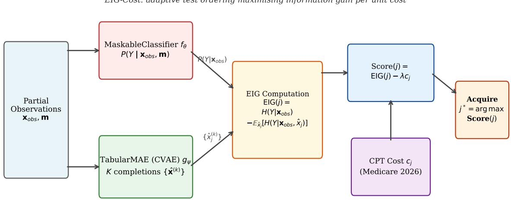  
Figure 1: EIG-Cost pipeline. Partial observations $( x _ { \cal { S } } , m _ { \cal { S } } )$ are fed simultaneously to the MaskableClassifier $f _ { \theta }$ (computing the posterior $P ( Y \mid x _ { \mathcal { S } } ) )$ and to the TabularMAE CVAE $g _ { \psi }$ (generating K Monte Carlo completions $\{ \hat { x } ^ { ( k ) } \} )$ . The EIG Computation block evaluates Eq. (2); the CPT cost $c _ { j }$ is subtracted (scaled by λ) to yield the acquisition score. The highest-scoring panel is acquired and the loop repeats until budget exhaustion.

## 5 Theoretical Analysis

Our analysis has one destination: an exact a-posteriori certificate decomposition on the hardbudget optimality gap of EIG-Cost (Theorem 20), which is the paper’s central theoretical result. The route there has three steps. First, we establish the correct adaptive objective transcript information, and show cumulative greedy EIG optimizes it (Section 5.1); this is the identity that makes the greedy rule coherent. Second, we show why the classical route to a guarantee is unavailable: $I ( Y ; X _ { \mathcal { A } } )$ is not submodular, so the Nemhauser–Wolsey–Fisher bound does not apply (Section 5.2). Third, and centrally, we identify EIG-Cost as greedy on the Lagrangian relaxation and derive the certificate and its sensitivity (Section 5.3). The remaining subsections are supporting: an equal-cost special case where a clean constantfactor ratio does hold, an estimation-error bound for the CVAE, and a characterization of voluntary stopping.

Algorithm 1 EIG-Cost   
Require: CVAE $p _ { \theta }$ , classifier $p _ { \phi } .$ , costs $c ,$ budget B, penalty $\lambda \geq 0 ,$ , samples K   
1: $\begin{array} { r } { S  \emptyset ; \ C  0 } \end{array}$   
2: while $[ d ] \mid S \neq \emptyset$ do   
3: for each $j \in [ d ] \setminus S$ with $c _ { j } \leq B - C$ do   
4: Compute $\widehat { \mathrm { E I G } } ( j \mid x _ { S } )$ via (5); $s _ { j } \gets \widehat { \mathrm { E I G } } ( j \mid x _ { S } ) - \lambda c _ { j }$   
5: end for   
6: if maxj $s _ { j } \leq 0$ then   
7: break   
8: end if   
9: j∗ ← arg maxj $s _ { j } ;$ observe $x _ { j ^ { * } }$   
10: $\mathcal { S }  \mathcal { S } \cup \{ j ^ { * } \} ; \ C  C + c _ { j ^ { * } }$   
11: end while   
12: return $\hat { y } = \arg \operatorname* { m a x } _ { y } p _ { \phi } ( y \mid x _ { S } )$

## 5.1 The Adaptive Chain-Rule Identity

For an adaptive policy the terminal acquired set is a random, value-dependent object, so care is needed to identify what cumulative stepwise EIG actually equals. Let the transcript after t steps be the ordered record of chosen indices and observed values,

$$
H _ { t } \ = \ \big ( j _ { 1 } , X _ { j _ { 1 } } , \ldots , j _ { t } , X _ { j _ { t } } \big ) ,
$$

and let $H _ { T }$ be the transcript at the (random) stopping time T. Under a non-anticipating policy the indices $j _ { 1 } , \dots , j _ { t }$ and the stopping decision are deterministic functions of the observed values, so $H _ { t }$ and the observed value vector $X _ { S _ { t } }$ generate the same information about Y.

Lemma 5 (Adaptive Chain-Rule Identity) For any non-anticipating adaptive policy π acquiring distinct features,

$$
\mathbb { E } \left[ \sum _ { t = 1 } ^ { T } \mathrm { E I G } \big ( j _ { t } \mid X _ { S _ { t - 1 } } \big ) \right] \ = \ I ( Y ; H _ { T } ) \ = \ H ( Y ) - \mathbb { E } \big [ H ( Y \mid H _ { T } ) \big ] .\tag{6}
$$

The right-hand side is the information about Y contained in the full acquisition transcript, i.e. the expected reduction in posterior entropy achieved by the policy.

Proof Write EIG ${ } ^ { ! } ( j _ { t } \mid X _ { S _ { t - 1 } } ) = I ( Y ; X _ { j _ { t } } \mid H _ { t - 1 } )$ : at each step the local expected information gain, evaluated at the realized history, is the conditional mutual information between Y and the newly observed value given the transcript so far. Summing and taking expectations, the

chain rule for mutual information applied to the (adapted) sequence $X _ { j _ { 1 } } , \dotsc , X _ { j _ { T } }$ conditioned on the growing transcript gives, for the stopped sequence,

$$
\mathbb { E } \left[ \sum _ { t = 1 } ^ { T } I ( Y ; X _ { j t } \mid H _ { t - 1 } ) \right] = I ( Y ; H _ { T } ) ,
$$

because the increments telescope: $I ( Y ; H _ { t } ) - I ( Y ; H _ { t - 1 } ) = I ( Y ; ( j _ { t } , X _ { j _ { t } } ) \mid H _ { t - 1 } ) = I ( Y ; X _ { j _ { t } } \mid$ $H _ { t - 1 } )$ , where the last equality uses that $j _ { t }$ is Ht−1-measurable (non-anticipating pol-$\mathrm { i c y } )$ , so revealing the index adds no information about $Y$ . Summing over t from 1 to the stopping time $T$ and taking expectations yields (6); the optional stopping is handled automatically because each realized path contributes its own telescoped sum $\begin{array} { r } { I ( Y ; H _ { T } ) = \sum _ { t < T } [ I ( Y ; H _ { t } ) - I ( Y ; H _ { t - 1 } ) ] } \end{array}$ before the outer expectation. ■

Remark 6 (Transcript information, not random-set MI) The right-hand side of (6) is $I ( Y ; H _ { T } )$ , not $\mathbb { E } [ I ( Y ; X _ { S _ { T } } ) ]$ , the expected mutual information of the random terminal set. For an adaptive policy these difer: the terminal set $\boldsymbol { S _ { T } }$ is itself random and correlated with the data, so averaging the set-function $I ( Y ; X _ { \cal S } )$ over the induced distribution of $\boldsymbol { S _ { T } }$ discards the information carried by which stopping decision was made. A minimal example: let $X _ { 1 } , X _ { 2 }$ ∼ Bernoulli(1/2) i.i.d. and $Y = X _ { 2 } \ i f X _ { 1 } = 0$ , else $Y = 0 ,$ ; the policy acquires $X _ { 1 } ,$ then $X _ { 2 }$ only if $X _ { 1 } = 0$ . Here cumulative stepwise $E I G = I ( Y ; H _ { T } ) = H ( Y ) \approx 0 . 8 1 1$ bits, whereas $\begin{array} { r } { \mathbb { E } [ I ( Y ; X _ { S _ { T } } ) ] = \frac { 1 } { 2 } I ( Y ; X _ { 1 } , X _ { 2 } ) + \frac { 1 } { 2 } I ( Y ; X _ { 1 } ) \approx 0 . 5 6 1 } \end{array}$ bits, a gap of exactly the 0.25 bits encoded by the value-dependent stopping. The transcript identity is the correct global object and is what the greedy analysis of Section 5.3 uses.

Corollary 7 For any non-anticipating adaptive policy $\pi _ { \cdot }$

$$
\begin{array} { r } { \mathbb { E } \left[ \displaystyle \sum _ { t = 1 } ^ { T } \bigl ( \mathrm { E I G } ( j _ { t } \mid X _ { S _ { t - 1 } } ) - \lambda c _ { j _ { t } } \bigr ) \right] = I ( Y ; H _ { T } ) - \lambda \mathbb { E } \Bigl [ \sum _ { j \in S _ { T } ^ { \pi } } c _ { j } \Bigr ] = I ( Y ; H _ { T } ) - \lambda C ( \pi ) . } \end{array}
$$

Thus the cumulative penalized stepwise EIG equals the transcript information minus the expected total cost: the penalized objective is additive over steps and its expectation is exactly the transcript-information objective penalized by cost.

Proof Apply Lemma $5$ to the information term; the cost term is a deterministic sum along each realized path, whose expectation is $C ( \pi ) = \mathbb { E } [ \sum _ { j \in S _ { T } } c _ { j } ]$ by linearity. ■

## 5.2 Submodularity: A Necessary Negative Result

Definition 8 (Submodularity) $f : 2 ^ { [ d ] } $ R is submodular if $f ( A \cup \{ j \} ) - f ( A ) \geq$ $f ( B \cup \{ j \} ) - f ( B )$ for all ${ \mathcal { A } } \subseteq B , ~ j ~ \notin ~ B$ . For $f ( \mathcal { A } ) = I ( Y ; X _ { \mathcal { A } } )$ this is equivalent to $I ( Y ; X _ { j } \mid X _ { \mathcal { A } } ) \geq I ( Y ; X _ { j } \mid X _ { \mathcal { B } } )$

Lemma 9 (Monotonicity of $I ( Y ; X _ { \mathcal { A } } ) )$ For any joint distribution and any $A \subseteq B \subseteq [ d ]$ 2 $I ( Y ; X _ { { \cal A } } ) \le I ( Y ; X _ { { \cal B } } )$

Proof By the chain rule, $I ( Y ; X _ { \mathcal { B } } ) = I ( Y ; X _ { \mathcal { A } } ) + I ( Y ; X _ { \mathcal { B } \backslash \mathcal { A } } \mid X _ { \mathcal { A } } )$ , and conditional mutual information is non-negative, so the second term is $\geq 0$

Monotonicity holds in full generality (no submodularity required) and is the hypothesis needed to invoke the submodularity-ratio guarantee of Proposition 16.

Proposition 10 (Submodularity Fails in General) There exist discrete and jointly Gaussian distributions for which $f ( \mathcal { A } ) = I ( Y ; X _ { \mathcal { A } } )$ is not submodular.

Proof $X O R . Y = X _ { 1 } \oplus X _ { 2 } , X _ { 1 } , X _ { 2 } \sim \mathrm { B e r } ( 1 / 2 ) \colon I ( Y ; X _ { 1 } ) = I ( Y ; X _ { 2 } ) = 0 \mathrm { b u t } I ( Y ; X _ { 1 } , X _ { 2 } ) = 0 . 0 0 7 $ 1.

Gaussian. Let $Y = X _ { 1 } + X _ { 2 } + \eta$ with $X _ { 1 } , X _ { 2 } , \eta \sim N ( 0 , 1 )$ independent. For jointly Gaussian $( Y , X _ { \mathcal { A } } ) , I ( Y ; X _ { \mathcal { A } } ) = \textstyle { \frac { 1 } { 2 } } \log \bigl ( \operatorname { V a r } ( Y ) / \operatorname { V a r } ( Y \mid X _ { \mathcal { A } } ) \bigr )$ . Here $\mathrm { V a r } ( Y ) = 3$ . Conditioning on a single feature, say $X _ { 1 }$ , leaves $Y \mid X _ { 1 } = X _ { 2 } + \eta +$ const with Var $\cdot ( Y \mid X _ { 1 } ) = 2$ , so

$$
\begin{array} { r } { f ( \{ 1 \} ) = f ( \{ 2 \} ) = \frac 1 2 \log \frac 3 2 \approx 0 . 2 0 3 . } \end{array}
$$

Conditioning on both features leaves $Y \mid X _ { 1 } , X _ { 2 } = \eta +$ const with $\operatorname { V a r } ( Y \mid X _ { 1 } , X _ { 2 } ) = 1$ , so

$$
\begin{array} { r } { f ( \{ 1 , 2 \} ) = \frac { 1 } { 2 } \log 3 \approx 0 . 5 4 9 . } \end{array}
$$

Then $f ( \{ 1 \} ) + f ( \{ 2 \} ) \approx 0 . 4 0 6 < 0 . 5 4 9 = f ( \{ 1 , 2 \} )$ , which violates the submodular inequality (with $\mathcal { A } = \emptyset , \mathcal { B } = \{ 2 \} , j = 1 )$ : the marginal value of $X _ { 1 }$ increases once $X _ { 2 }$ is observed, the signature of complementarity. ■

Remark 11 This difers from prior submodularity results in an important way. Krause and Guestrin (2005) prove submodularity of $I ( X _ { \cal { A } } ; X _ { V \backslash \mathcal { A } } )$ for Gaussian process sensors, where the target is the set of unobserved sensor locations. AFA instead concerns $I ( Y ; X _ { \mathcal { A } } )$ with a fixed target Y, and this quantity is not submodular even for Gaussians (Proposition 10). The Gaussian-process submodularity result does not transfer to AFA, and any approximation guarantee that invokes it is misapplied.

Lemma 12 (Synergy Decomposition) For ${ \mathcal { A } } \subseteq B , j \notin B .$

$$
I ( Y ; X _ { j } \mid X _ { A } ) - I ( Y ; X _ { j } \mid X _ { B } ) = I ( Y ; X _ { B \setminus A } \mid X _ { A } ) - I ( Y ; X _ { B \setminus A } \mid X _ { A } , X _ { j } ) .
$$

Call $X _ { j }$ and $X _ { B \backslash A }$ substitutes when the left-hand side is positive (equivalently, $X _ { j } ~ ^ { \prime } s$ marginal value weakly decreases as more features are observed, the diminishing-returns direction) and complements when it is negative $( X _ { j }$ ’s marginal value increases with more observed features, violating diminishing returns). Submodularity of $I ( Y ; X _ { \mathcal { A } } )$ is exactly the statement that all feature pairs are substitutes in this sense.

Proof Apply the mutual-information chain rule to the joint term $I ( Y ; X _ { j } , X _ { B \backslash { A } } \mid X _ { A } )$ in two orders. Ordering $X _ { j }$ first:

$$
I ( Y ; X _ { j } , X _ { \mathcal { B } \backslash \mathcal { A } } \mid X _ { \mathcal { A } } ) = I ( Y ; X _ { j } \mid X _ { \mathcal { A } } ) + I ( Y ; X _ { \mathcal { B } \backslash \mathcal { A } } \mid X _ { \mathcal { A } } , X _ { j } ) .
$$

Ordering $X _ { B \backslash A }$ first:

$$
I ( Y ; X _ { j } , X _ { \mathcal { B \setminus A } } \mid X _ { \mathcal { A } } ) = I ( Y ; X _ { \mathcal { B \setminus A } } \mid X _ { \mathcal { A } } ) + I ( Y ; X _ { j } \mid X _ { \mathcal { A } } , X _ { \mathcal { B \setminus A } } ) .
$$

Since $X _ { \mathcal { A } } \cup ( X _ { \mathcal { B } \backslash \mathcal { A } } ) = X _ { \mathcal { B } }$ , the last conditional equals $I ( Y ; X _ { j } \mid X _ { B } )$ . Equating the two expansions and rearranging,

$$
I ( Y ; X _ { j } \mid X _ { A } ) - I ( Y ; X _ { j } \mid X _ { B } ) = I ( Y ; X _ { B \setminus A } \mid X _ { A } ) - I ( Y ; X _ { B \setminus A } \mid X _ { A } , X _ { j } ) ,
$$

which is the claim. The characterization of submodularity follows by taking $B = \mathcal { A } \cup \{ i \}$ for each i and comparing with Definition 15. ■

Remark 13 (Adaptive submodularity does not apply) One might hope to recover guarantees via adaptive submodularity (Golovin and Krause, 2011), which yields $( 1 - 1 / e )$ bounds for adaptive greedy on adaptive monotone, adaptive submodular objectives. The obstruction is the same as in Proposition 10: adaptive submodularity requires the expected marginal benefit of an item to be non-increasing in the observed history, which is precisely the substitutes condition of Lemma 12. The Gaussian counterexample $Y = X _ { 1 } + X _ { 2 } + \eta$ violates $i t ,$ because observing $X _ { 1 }$ raises the conditional information $X _ { 2 }$ carries about Y . Adaptive submodularity therefore fails for AFA under the same complementarity that defeats ordinary submodularity, and the submodularity-ratio route we take is the appropriate relaxation.

Proposition 14 (Submodularity under Conditional Independence) If features are conditionally independent given Y (na¨ıve Bayes), then $I ( Y ; X _ { \mathcal { A } } )$ is monotone submodular.

Proof See Appendix B.1.

Definition 15 (Submodularity Ratio, Das and Kempe 2011)

$$
\gamma _ { f , k } = \operatorname* { m i n } _ { \substack { \mathscr { A } \subseteq [ d ] , \mathscr { R } \subseteq [ d ] \backslash \mathscr { A } , | \mathscr { R } | \leq k , f ( \mathscr { A } \cup \mathscr { R } ) > f ( \mathscr { A } ) } } \operatorname* { m i n } _ { \substack { f ( \mathscr { A } \cup \mathscr { R } ) - f ( \mathscr { A } ) } } ,\tag{7}
$$

where the minimum is taken over pairs with strictly positive denominator $f ( \mathcal { A } \cup \mathcal { R } ) - f ( \mathcal { A } ) > 0$ (pairs with zero denominator are excluded, as the ratio is undefined and the corresponding greedy step is never taken); if no such pair exists we set $\gamma _ { f , k } = 1$ . For monotone f the raw ratio $i s \geq 0 ;$ a submodular f satisfies $\gamma _ { f , k } \geq 1$ , and we clip to min $\mathsf { \Omega } _ { \mathsf { l } } ( \gamma _ { f , k } , 1 )$ so that $\gamma _ { f , k } \in [ 0 , 1 ]$ with $\gamma _ { f , k } = 1$ if f is submodular over the relevant sets and $\gamma _ { f , k } < 1$ indicating feature synergy. Reported empirical estimates near or slightly above 1 $( e . g . \ 1 . 0 0 1 )$ are Monte Carlo estimates of the pre-clip ratio and correspond to the submodular/near-submodular regime $\gamma _ { f , k } = 1$

Proposition 16 (Das and Kempe 2011) For monotone f with submodularity ratio $\gamma _ { f , k } \geq$ γ, greedy maximization of $\operatorname* { m a x } _ { | \mathcal { A } | \leq k } f ( \mathcal { A } )$ achieves $f ( S _ { k } ^ { \mathrm { g r e e d y } } ) \geq ( 1 - e ^ { - \gamma } ) \mathrm { O P T } _ { k }$

## 5.3 EIG-Cost as Lagrangian Greedy: the Hard-Budget Certificate

Hard constraint versus soft penalty. Two budget formulations appear in this paper and it is important to keep them distinct. The primal problem (1) and the EIG-Cost algorithm (Definition 4, Algorithm 1) impose a hard budget: acquisition halts once the cumulative spend would exceed B. The Lagrangian relaxation (8) below replaces this hard constraint with a soft per-unit-cost penalty λ, turning the constrained problem into an unconstrained penalized one. The two are linked by duality: the penalty λ is the dual multiplier of the expected-cost relaxation of the budget constraint, and at the optimal $\lambda ^ { * } = V ^ { \prime } ( B )$ the soft-penalized optimum matches the expected-cost optimum $V _ { B } ^ { \mathrm { e x p } }$ (not the hard-budget optimum $V _ { B } ^ { \mathrm { h a r d } }$ ; Proposition 27), the two difering by the randomization gap of Proposition 24. The EIG-Cost scoring rule $\mathrm { E I G } ( j ) - \lambda c _ { j }$ is the greedy step of the soft problem; the hard budget in the algorithm acts as an additional feasibility cap that binds only when the per-step penalty has not already halted acquisition. In the voluntary-stopping regime that EIG-Cost operates in (Section 6.4), the soft penalty halts acquisition before the hard cap binds, so the two formulations coincide in practice.

Definition 17 (Lagrangian Relaxation) For $\lambda \geq 0 .$

$$
\begin{array} { r } { L ( \lambda ) = \underset { \pi } { \operatorname* { m a x } } \left[ I ( Y ; H _ { T } ^ { \pi } ) - \lambda \mathbb { E } \Big [ \sum _ { j \in \mathcal { S } _ { T } ^ { \pi } } c _ { j } \Big ] \right] . } \end{array}\tag{8}
$$

Proposition 18 (EIG-Cost is the feasibility-capped Lagrangian Greedy Step) Under the transcript objective $V ( \pi ) = I ( Y ; H _ { T } ^ { \pi } )$ (Lemma 5), the EIG-Cost rule (3) selects, at each realized history, the feature maximizing the one-step expected increment of the penalized objective $J _ { \lambda } ( \pi ) = V ( \pi ) - \lambda C ( \pi )$ among the actions feasible under the remaining hard budget $( c _ { j } \leq B - C _ { t - 1 } )$ . Writing $\pi _ { \lambda } ^ { \mathrm { s o f t } }$ for the unconstrained one-step greedy policy of $J _ { \lambda }$ (no feasibility cap) and $\pi ^ { \lambda } : = \pi _ { \lambda , B } ^ { \mathrm { h a r d } }$ for the deployed feasibility-capped policy, the two coincide until the first step at which the unconstrained greedy choice would exceed the remaining budget; thereafter $\pi ^ { \lambda }$ restricts to afordable panels. In either case, by weak duality $V _ { B } ^ { \mathrm { h a r d } } \leq L ( \lambda ) + \lambda B$ for all $\lambda \geq 0$

Proof By the additive decomposition of the penalized objective (Corollary $7 ) , J _ { \lambda } ( \pi )$ is the expectation of the cumulative per-step reward $\mathrm { E I G } ( j _ { t } \ | \ X _ { S _ { t - 1 } } ) - \lambda c _ { j _ { t } }$ . At a realized history $H _ { t - 1 }$ with observed values $x _ { S _ { t - 1 } }$ , the one-step expected increment of this reward from acquiring feature j is exactly

$$
I ( Y ; X _ { j } \mid H _ { t - 1 } ) - \lambda c _ { j } \ = \ \operatorname { E I G } ( j \mid x _ { S _ { t - 1 } } ) - \lambda c _ { j } ,
$$

the state-dependent conditional mutual information at the realized history (Definition 3). This is the quantity the transcript stage reward assigns to step $t ;$ crucially, because the objective is transcript information rather than the mutual information of a random terminal set, the greedy increment is the realized-state conditional MI with no averaging mismatch. Maximizing it over eligible (afordable) j is exactly the EIG-Cost rule (3), and halting when the maximal increment is non-positive is the greedy stopping rule. Hence $\pi ^ { \lambda }$ is the one-step-greedy policy for $J _ { \lambda }$ restricted to hard-budget-feasible actions; absent the feasibility cap it is $\pi _ { \lambda } ^ { \mathrm { s o f t } }$ . Weak duality is immediate: for any feasible π with $C ( \pi ) \leq B$ $V ( \pi ) \leq V ( \pi ) - \lambda ( C ( { \tilde { \pi } } ) - B ) \leq L ( \lambda ) + \lambda B$

Remark 19 Greedy maximization of the one-step increment does not imply $\pi ^ { \lambda }$ maximizes $J _ { \lambda }$ globally: the penalized objective is not adaptive-submodular (feature complementarity, Proposition 10), so the myopic policy can be suboptimal. The gap to the penalized optimum is quantified by $\Delta _ { \lambda }$ in Theorem 20.

Theorem 20 (Lagrangian Approximation Bound) Write $J _ { \lambda } ( \pi ) = V ( \pi ) - \lambda C ( \pi )$ for the penalized objective, where $V ( \pi ) = I ( Y ; H _ { T } ^ { \pi } )$ is the transcript information and $C ( \pi ) =$ $\mathbb { E } [ \sum _ { j \in S _ { T } ^ { \pi } } c _ { j } ]$ , and let $L ( \lambda ) = \operatorname* { s u p } _ { \pi } J _ { \lambda } ( \pi )$ . Let $\bar { B } ^ { \lambda } = C ( \pi ^ { \lambda } )$ be the expected cost of the greedy policy and define the penalized greedy gap

$$
\Delta _ { \lambda } : = L ( \lambda ) - J _ { \lambda } ( \pi ^ { \lambda } ) \geq 0 ,\tag{9}
$$

which is non-negative because $L ( \lambda )$ is the supremum of $J _ { \lambda }$ . Then for every $\lambda \geq 0$

$$
V _ { B } ^ { \mathrm { h a r d } } \ \leq \ V ( \pi ^ { \lambda } ) + \lambda ( B - B ^ { \lambda } ) + \Delta _ { \lambda } .\tag{10}
$$

This is an exact two-term certificate bounding the hard-budget optimality gap: beyond the achieved value $V ( \pi ^ { \lambda } )$ , the bound adds a budget-slack term $\lambda ( B - B ^ { \lambda } )$ that vanishes at budget matching, and the penalized greedy gap $\Delta _ { \lambda }$ , measuring how far the greedy policy falls short of the penalized optimum $L ( \lambda )$ . The relation (10) is an inequality, not an equality; both added terms are non-negative and together upper-bound $V _ { B } ^ { \mathrm { h a r d } } - V ( \pi ^ { \lambda } )$ . A third, conceptually separate quantity, the randomization gap $V _ { B } ^ { \mathrm { e x p } } - V _ { B } ^ { \mathrm { h a r d } }$ between the hard-budget and expectedcost optima, is bounded independently in Proposition ${ \mathit { 2 4 } } ;$ we do not fold it into (10), which already bounds $V _ { B } ^ { \mathrm { h a r d } }$ directly via weak duality against $L ( \lambda )$ . Near-optimality holds when (i) $B ^ { \lambda } \approx B$ and (ii) $\Delta _ { \lambda } \approx 0$ , with the dual multiplier chosen near $\lambda ^ { * }$ (Proposition 29). The bound is informative only when an upper estimate of $\Delta _ { \lambda }$ is available: $\Delta _ { \lambda }$ is the greedy policy’s suboptimality against the fixed penalized optimum $L ( \lambda )$ , so (10) constrains $V ( \pi ^ { \lambda } )$ once $\Delta _ { \lambda }$ is bounded, and is otherwise a diagnostic decomposition rather than a standalone guarantee. Where $L ( \lambda )$ is tractable by exhaustive search, the synthetic Gaussian models and the heterogeneous-cost instances of Section 6.2, we measure $\Delta _ { \lambda }$ directly, turning (10) into an a-posteriori certificate; there $\Delta _ { \lambda }$ is exactly zero on 97% of heterogeneous-cost instances and small on the rest, so the bound is near-tight beyond the degenerate Gaussian case. On the full MIMIC-IV instance $\Delta _ { \lambda }$ is not computable and the decomposition is diagnostic only, which we state plainly as a limitation.

Proof The budget-B optimum $\pi ^ { * }$ satisfies $C ( \pi ^ { * } ) \leq B$ , so

$$
V _ { B } ^ { \mathrm { h a r d } } = V ( \pi ^ { * } ) = J _ { \lambda } ( \pi ^ { * } ) + \lambda C ( \pi ^ { * } ) \ \le \ L ( \lambda ) + \lambda B ,
$$

using $J _ { \lambda } ( \pi ^ { * } ) \le L ( \lambda )$ and $C ( \pi ^ { * } ) \leq B$ with $\lambda \geq 0$ (weak duality). Substituting $L ( \lambda ) =$ $J _ { \lambda } ( \pi ^ { \lambda } ) + \Delta _ { \lambda } = V ( \pi ^ { \lambda } ) - \lambda B ^ { \lambda } + \Delta _ { \lambda }$ gives

$$
V _ { B } ^ { \mathrm { h a r d } } \ \leq \ V ( \pi ^ { \lambda } ) - \lambda B ^ { \lambda } + \Delta _ { \lambda } + \lambda B = V ( \pi ^ { \lambda } ) + \lambda ( B - B ^ { \lambda } ) + \Delta _ { \lambda } . \square
$$

Proposition 21 (Structural bound on the greedy gap, equal-cost case) Suppose costs are uniform, $c _ { j } = c ,$ and let $\gamma$ be the submodularity ratio of $f ( \mathcal { A } ) = I ( Y ; X _ { \mathcal { A } } )$ (Definition 15). Then the penalized greedy gap obeys

$$
\Delta _ { \lambda } \leq e ^ { - \gamma } f ( A _ { \lambda } ^ { * } ) \leq e ^ { - \gamma } I ( Y ; X _ { [ d ] } ) ,\tag{11}
$$

where $\mathcal { A } _ { \lambda } ^ { \ast }$ is the penalized optimum. In particular $\Delta _ { \lambda }  0 \ a s \ \gamma  1$ (the near-submodular regime), and the certificate (10) becomes fully controlled by measurable structure: the budget slack and $e ^ { - \gamma }$ times the total information.

Proof With uniform cost the penalty $\lambda c { \lvert { A } \rvert }$ depends only on cardinality, so the penalized marginal gain $\operatorname { E I G } ( j \mid S ) - \lambda c$ ranks candidates identically to the unpenalized gain $\operatorname { E I G } ( j \mid S )$ : greedy on $L _ { \lambda }$ acquires features in the same order as unpenalized greedy on $f ,$ stopping at the cardinality $k _ { g }$ where the next marginal gain first falls below $\lambda c .$ By the submodularity-ratio guarantee of Das and Kempe (2011) applied to the monotone $f$ (Lemma 9) at cardinality $k _ { g } , f ( S _ { k _ { g } } ) \geq \left( 1 - e ^ { - \gamma } \right) f _ { k _ { q } } ^ { * }$ , where $f _ { k _ { g } } ^ { * } = \operatorname* { m a x } _ { | \mathcal { A } | \leq k _ { g } } f ( \mathcal { A } )$ . Since the penalized optimum $\mathcal { A } _ { \lambda } ^ { \ast }$ has some cardinality $k ^ { * }$ and $f$ is monotone, $f ( \mathcal { A } _ { \lambda } ^ { \ast } ) \leq f _ { k ^ { \ast } } ^ { \ast } ;$ a short case analysis on whether $k ^ { * } \lessgtr k _ { g }$ (using that greedy’s stopping rule makes further penalized gains non-positive) gives $L ( \lambda ) { \overset { \smile } { - } } J _ { \lambda } ( \pi ^ { \lambda } ) \leq f _ { k _ { q } } ^ { * } - f ( S _ { k _ { g } } ) \leq e ^ { - \gamma } f _ { k _ { q } } ^ { * } \leq e ^ { - \gamma } f ( A _ { \lambda } ^ { * } )$ . The final inequality uses $f ( \mathcal { A } _ { \lambda } ^ { \ast } ) \leq I ( Y ; X _ { [ d ] } )$ by monotonicity.

Remark 22 Equation (11) is the structural control on $\Delta _ { \lambda }$ that upgrades the certificate from a decomposition to a bound in the equal-cost regime: it is computable from $\gamma$ and the total information alone, with no exhaustive search over policies. We verify it holds with zero violations across thousands of exactly-solved instances, including adversarial highcomplementarity constructions (Section 6.2). For heterogeneous costs the cardinality reduction fails the penalty no longer ranks by cardinality, and we do not claim (11); there the certificate remains a decomposition whose $\Delta _ { \lambda }$ we measure directly where tractable. Empirically $\Delta _ { \lambda }$ is near zero on heterogeneous-cost instances too (Section 6.2), suggesting a heterogeneous-cost analog may hold, which we leave open.

Remark 23 (Three notions of optimality) It helps to keep three distinct optima separate, as they are easily conflated. (i) The hard-budget deterministic optimum $V _ { B } ^ { \mathrm { h a r d } }$ : the best deterministic adaptive policy whose cost is at most B on every episode, the problem the deployed algorithm targets. (ii) The expected-cost randomized optimum $\begin{array} { r } { V _ { B } ^ { \mathrm { e x p } } = \operatorname* { m i n } _ { \lambda \geq 0 } g ( \lambda ) } \end{array}$ with $g ( \lambda ) = L ( \lambda ) + \lambda B$ : the value of the randomized-policy relaxation with the budget imposed only in expectation, for which strong duality holds (Proposition 27). (iii) The greedy Lagrangian policy $\pi ^ { \lambda }$ , the deterministic one-step-greedy policy for $J _ { \lambda }$ . These satisfy

$$
V _ { B } ^ { \mathrm { h a r d } } \ \leq \ V _ { B } ^ { \mathrm { e x p } } \ = \ \operatorname* { m i n } _ { \lambda \geq 0 } g ( \lambda ) ,
$$

and Theorem 20 decomposes the shortfall of the greedy policy from $V _ { B } ^ { \mathrm { h a r d } }$ into a budgetmismatch term $\lambda ( B - B ^ { \lambda } )$ , the relaxation/duality component implicit in passing through $g ( \lambda )$ , and the greedy component $\Delta _ { \lambda }$ . Crucially, λ is the dual multiplier of the expectedcost relaxation (ii), not of the hard-budget problem (i); the two coincide only up to the

randomization/integrality gap $V _ { B } ^ { \mathrm { e x p } } - V _ { B } ^ { \mathrm { h a r d } } \geq 0$ , which we do not claim to be zero in general.   
Throughout, statements about “the budget dual variable” should be read in this precise sense.

Proposition 24 (Randomization-gap bound, non-adaptive) Consider the non-adaptive selection problem, and let the achievable (cost, value) pairs be $\{ ( C ( \mathcal { A } ) , V ( \mathcal { A } ) ) \} _ { \mathcal { A } \subseteq [ d ] }$ . Let $V _ { B } ^ { \mathrm { e x p } }$ be the expected-cost randomized optimum (the upper concave envelope of these points evaluated at $B )$ and $V _ { B } ^ { \mathrm { h a r d } }$ the hard-budget optimum max $\{ V ( \mathcal { A } ) : C ( \mathcal { A } ) \leq B \}$ . Let $( c _ { 1 } , v _ { 1 } )$ and $( c _ { 2 } , v _ { 2 } )$ , with $c _ { 1 } \leq B < c _ { 2 }$ , be the two envelope vertices whose connecting segment contains the budget B, and let $\lambda ^ { * } = ( v _ { 2 } - v _ { 1 } ) / ( c _ { 2 } - c _ { 1 } )$ be that segment’s slope (the optimal dual multiplier). Then

$$
0 ~ \leq ~ V _ { B } ^ { \exp } - V _ { B } ^ { \mathrm { h a r d } } ~ \leq ~ v _ { 2 } - v _ { 1 } ~ = ~ \lambda ^ { * } \big ( c _ { 2 } - c _ { 1 } \big ) .\tag{12}
$$

Proof Every hard-budget-feasible set is a degenerate randomized policy, so $V _ { B } ^ { \mathrm { e x p } } \geq V _ { B } ^ { \mathrm { h a r d } } ;$ and $V _ { B } ^ { \mathrm { h a r d } } \geq v _ { 1 }$ since $( c _ { 1 } , v _ { 1 } )$ is achievable with $c _ { 1 } \leq B$ . On the segment containing $B ,$ $V _ { B } ^ { \mathrm { e x p } } \stackrel { - } = v _ { 1 } + \lambda ^ { * } ( B - c _ { 1 } ) \leq v _ { 2 }$ , giving $V _ { B } ^ { \mathrm { e x p } } - V _ { B } ^ { \mathrm { h a r d } } \leq v _ { 2 } - v _ { 1 } = \lambda ^ { * } ( c _ { 2 } - c _ { 1 } )$

Remark 25 This quantifies the relaxation caveat by a computable quantity, the value rise of the envelope segment straddling B, which vanishes when B meets an achievable cost level. (The simpler form $\lambda ^ { * } c _ { \mathrm { m a x } }$ is not valid: envelope vertices can difer by more than one panel, so the correct width is $c _ { 2 } - c _ { 1 } . \jmath$ It is a supporting corollary of the strong-duality picture, not a headline result; the adaptive version replaces the set envelope with the occupation-measure envelope of Proposition 27.

Remark 26 (Relationship to density greedy) A natural alternative is density greedy, acquiring in order of $\mathrm { E I G } ( j ) / c _ { j }$ (Khuller et al., 1999). EIG-Cost’s diference form $\operatorname { E I G } ( j ) -$ $\lambda c _ { j }$ arises directly from the Lagrangian (Corollary 7), with λ the dual multiplier in nats per dollar, whereas the ratio form has no such dual interpretation. Empirically the two coincide both on the heterogeneous-cost synthetic instances of Section 6.2 and at clinical scale on MIMIC-IV (Section $6 . 6 ) .$ : on the full test set the diference and density forms attain macro-F1 $0 . 1 7 5 \pm 0 . 0 0 6$ and $0 . 1 7 4 \pm 0 . 0 0 3$ at \$20.30 and \$20.17 respectively (both under the score-floor stopping rule; 5 seeds), a paired diference of +0.002 macro-F1 whose sign varies across seeds. The contribution is thus the diference form’s dual interpretation, not an empirical advantage over density greedy.

Proposition 27 (Concavity of $V ( b )$ and Strong Duality via Constrained-MDP LP Relaxation) The cost-aware AFA problem (Definition 1) is a finite-horizon constrained Markov decision process: the state is the transcript (acquired indices and observed values); each action is the index of the next panel to acquire or the stop action; the horizon is at most $T \leq d ;$ the stage reward at step t is the realized posterior-entropy reduction $H ( Y \mid H _ { t - 1 } ) - H ( Y \mid H _ { t } )$ , whose expectation telescopes to the transcript objective $V ( \pi ) = I ( Y ; H _ { T } )$ (Lemma $5 ) ;$ and the constraint $\begin{array} { r } { \mathbb { E } [ \sum _ { j \in \mathcal { S } _ { T } } c _ { j } ] \le B } \end{array}$ is a single linear function of the policy’s occupation measure. Using an additive stage reward defined on the observed transcript (rather than the distributional functional $I ( Y ; X s _ { T } ) )$ makes the objective a valid expected-total-reward CMDP criterion. By the LP-relaxation theorem for finite-horizon constrained MDPs (Altman, 1999, Theorem 3.7),

the optimal-value function $V ( b )$ is concave and non-decreasing in $b ,$ and strong duality holds over the closure under randomized policies, that is, for the expected-cost optimum $V _ { B } ^ { \mathrm { e x p } }$ , not the hard-budget optimum $V _ { B } ^ { \mathrm { h a r d } }$

$$
V _ { B } ^ { \mathrm { e x p } } \ = \ \operatorname * { m i n } _ { \lambda \geq 0 } \bigl [ L ( \lambda ) + \lambda B \bigr ] \quad w i t h \quad \lambda ^ { * } = V ^ { \prime } ( B ) ,
$$

where $\begin{array} { r } { L ( \lambda ) = \operatorname* { m a x } _ { \pi } [ V ( \pi ) - \lambda \mathbb { E } [ c ( \pi ) ] ] } \end{array}$ and the supremum is attained by a randomized policy on the augmented state space. The hard-budget optimum satisfies $V _ { B } ^ { \mathrm { h a r d } } \leq V _ { B } ^ { \mathrm { e x p } }$ with equality only up to the randomization gap (Proposition ${ \it 2 4 } )$ ; the displayed duality is a statement about $V _ { B } ^ { \mathrm { e x p } }$ alone. The hypotheses of Altman (1999, Theorem 3.7) are verified directly under a finite-support assumption on the features, which we adopt throughout this proposition: the state space $\begin{array} { r } { \left( 2 ^ { [ d ] } \times \prod _ { j } \mathcal { X } _ { j } \right) \cup \{ \mathrm { S T O P } \} } \end{array}$ is finite (each $\chi _ { j }$ finite), the horizon $T \leq d$ is finite, the per-step costs $c _ { j }$ are bounded, and the occupation-measure LP has compact, non-empty feasible set, ensuring existence of optimal primal and dual solutions. Continuous features are handled by discretizing each $\chi _ { j }$ to a finite lattice, as is done for all empirical datasets here; extending strong duality to the continuous case requires the infinite-dimensional constrained-MDP machinery of Altman (1999) under additional compactness and continuity conditions, which we do not pursue. The greedy Lagrangian policy $\pi ^ { \lambda }$ is deterministic. The penalized greedy gap $\Delta _ { \lambda } = L ( \lambda ) - [ V ( \pi ^ { \lambda } ) - \lambda c ( \pi ^ { \lambda } ) ] \ge 0$ (Theorem ${ \it 2 0 } )$ measures its suboptimality relative to the penalized optimum $L ( \lambda )$ ; it is non-negative because $L ( \lambda )$ is the supremum of the penalized objective over all (randomized) policies. $\Delta _ { \lambda } = 0$ holds exactly when $\pi ^ { \lambda }$ attains the penalized optimum. We emphasize that this is not implied by budget exhaustion: a greedy policy can spend its entire budget and still be strictly suboptimal for the penalized objective (a myopic ordering need not reach $L ( \lambda )$ even at equal cost). We therefore do not claim $\Delta _ { \lambda } = 0$ in general and retain it explicitly in all downstream bounds.

Remark 28 Altman (1999, Theorem 3.7) establishes strong duality for finite-horizon constrained MDPs via the occupation-measure $L P ,$ , whose constraints are linear in the (state, action)-occupation measure; the AFA budget constraint $\mathbb { E } [ \sum c _ { j } ]$ fits directly. This LP is over the expected-cost constraint; its relationship to the deployed hard-budget problem is the randomization gap of Remark 23 and Proposition ${ \it 2 4 } .$ . We use it only to justify concavity of V and the existence of $\lambda ^ { * } = V ^ { \prime } ( B )$ on the randomized frontier (a subgradient where V is non-diferentiable), keeping the greedy shortfall explicit through $\Delta _ { \lambda }$

Proposition 29 (Dual certificate sensitivity (technical observation)) Let $g ( \lambda ) = L ( \lambda ) +$ λB be the dual objective, where $L ( \lambda ) = \operatorname* { s u p } _ { \pi } J _ { \lambda } ( \pi )$ (Definition 17). Then:

(i) $g$ is convex on $[ 0 , \infty )$ and $g ( \lambda ) \geq V _ { B } ^ { \mathrm { h a r d } }$ for every $\lambda \geq 0$ (weak duality, Theorem 20); hence each λ yields a valid upper certificate on $V _ { B } ^ { \mathrm { h a r d } }$ , and the tightest is attained at $\begin{array} { r } { \lambda ^ { * } \in \arg \operatorname* { m i n } _ { \lambda \geq 0 } g ( \lambda ) } \end{array}$

(ii) Using a suboptimal multiplier λ inflates the dual certificate by exactly $g ( \lambda ) - g ( \lambda ^ { * } ) \geq 0$ 2 computable from L.

(iii) If, in addition, g is $L _ { g }$ -smooth on an interval containing $\lambda ^ { * }$ and $\lambda ^ { * }$ is an interior minimiser (so $g ^ { \prime } ( \lambda ^ { * } ) = 0 )$ , then

$$
0 \leq g ( \lambda ) - g ( \lambda ^ { * } ) \leq \frac { L _ { g } } { 2 } ( \lambda - \lambda ^ { * } ) ^ { 2 } .\tag{13}
$$

Remark 30 (Scope) Parts $( i ) - ( i i )$ are unconditional $( g$ is a supremum of afine functions plus a linear term, hence convex). Part (iii) is a generic convex-analysis observation, and we present it as such, as a technical observation and not a headline guarantee: the dual g is piecewise linear (finitely many deterministic policies), so $L _ { g }$ -smoothness is a local assumption on the randomized-policy dual and the quadratic statement concerns the dual certificate, not the primal policy value. Combining (ii) with Theorem 20, the greedy policy at λ obeys $V ( \pi ^ { \lambda } ) \geq V _ { B } ^ { \mathrm { h a r d } } - [ g ( \lambda ) - g ( \lambda ^ { * } ) ] - [ g ( \lambda ^ { * } ) - V _ { B } ^ { \mathrm { h a r d } } ] - \Delta _ { \lambda }$ , separating dual suboptimality, the relaxation gap, and the greedy gap; each is separately measurable on tractable instances. In the finite-policy setting the operationally relevant statement is the exact one, part (ii): because g is piecewise linear, the certificate inflation $g ( \lambda ) - g ( \lambda ^ { * } )$ is itself piecewise linear in λ with breakpoints at the policy-switch multipliers, and is computed directly from L rather than through the smoothness surrogate of part (iii).

Proof See Appendix B.2.

## 5.4 Approximation Ratio in the Equal-Cost Non-Adaptive Case

The submodularity-ratio guarantee of Das and Kempe (2011) yields a clean constant-factor bound for EIG-Cost in the special case where costs are uniform and acquisition is nonadaptive. We state this case precisely because it is the setting in which the classical greedy analysis genuinely applies; the scope remark that follows explains why the general heterogeneous-cost adaptive algorithm does not inherit a universal ratio and is instead governed by the exact decomposition of Theorem 20.

Corollary 31 (Approximation ratio, equal-cost non-adaptive case) Suppose costs are uniform, $c _ { j } = c$ for all $j ,$ and consider the non-adaptive variant of EIG-Cost that selects a set by greedily maximizing marginal $I ( Y ; X _ { \mathcal { A } } )$ and stopping when the penalized marginal gain $\mathrm { E I G } ( j ) - \lambda c$ first becomes non-positive, with k the resulting cardinality. If $I ( Y ; X _ { \mathcal { A } } )$ has submodularity ratio $\gamma _ { f , k } \geq \gamma$ (Definition 15) and is monotone (Lemma 9), then the acquired set $\boldsymbol { S _ { k } }$ satisfies

$$
I ( Y ; X _ { \mathcal { S } _ { k } } ) \ \geq \ { \big ( } 1 - e ^ { - \gamma } { \big ) } \ \operatorname* { m a x } _ { | A | \leq k } I ( Y ; X _ { \mathcal { A } } ) .\tag{14}
$$

When $\gamma = 1 ~ ( e . g .$ . under na¨ıve Bayes structure; Proposition $1 \llcorner )$ , this is the standard NWF guarantee $( 1 - 1 / e ) \approx 0 . 6 3 2$ . The guarantee is with respect to the best set of cardinality at most the realized $k ;$ it is not a ratio to the penalized optimum, the optimal hard-budget adaptive policy, or the best penalty-selected cardinality, and $\gamma$ is required only over sets up to size k.

Proof See Appendix B.3.

Remark 32 (Why the restriction is necessary) The clean ratio (14) is a cardinalityconstrained, non-adaptive, equal-cost statement, and we do not claim it for the full algorithm. Three features of general AFA each break the direct Das–Kempe argument. (a) Heterogeneous costs: with unequal cj the penalty λcj changes the greedy ordering, so EIG-Cost’s acquired set is no longer the prefix of the unpenalized-greedy order that the cardinality guarantee analyzes; weighted (knapsack) submodular maximization needs a diferent algorithm (e.g. cost-benefit greedy with partial enumeration) even in the submodular case. (b) Adaptivity: EIG-Cost conditions on observed feature values, whereas (14) concerns an ofline set function; the adaptive guarantee would require adaptive submodularity, which fails here by the same complementarity that defeats ordinary submodularity (Proposition 10). (c) Non-monotone penalized objective: $L _ { \lambda }$ is generally non-monotone, so the standard monotone-greedy guarantee cannot be applied to it directly. For the general algorithm we therefore rely not on a universal ratio but on the exact Lagrangian decomposition (Theorem 20) together with the a-posteriori certificate obtained by measuring $\Delta _ { \lambda }$ on tractable instances (Section 6.1).

## 5.5 Robustness to CVAE Estimation Error

Theorem 33 (Margin Stability of Approximate EIG-Cost) Fix $\delta \in ( 0 , 1 )$ and suppose the per-query estimation error is uniformly small along the exact greedy trajectory: with probability at least $1 - \delta$ ，

$$
\begin{array} { r } { \left| \widehat { \mathrm { E I G } } ( j \mid x _ { S } ) - \mathrm { E I G } ( j \mid x _ { S } ) \right| \le \varepsilon } \end{array}
$$

simultaneously for every candidate j and every state $x _ { S }$ that the exact policy $\pi ^ { \lambda }$ visits, where $\varepsilon = \varepsilon _ { \mathrm { g e n } } + \varepsilon _ { \mathrm { c l s } } + \varepsilon _ { \mathrm { M C } } ( \delta )$ aggregates the generator-shift term (Proposition 37), the classifier term (Remark 38), and the Monte Carlo term (Proposition 36) via a union bound over the at most d T queries. Suppose further the margin condition: at each state visited by $\pi ^ { \lambda }$ , the penalized score of its chosen action (or of stop, valued at 0) exceeds that of every alternative by more than 2ε. Then, with probability at least $1 - \delta$ , the approximate policy πˆ using EIGd takes the same action at every step, so $\hat { \pi } = \pi ^ { \lambda }$ pathwise and in particular

$$
V ( \hat { \pi } ) = V ( \pi ^ { \lambda } ) , \qquad C ( \hat { \pi } ) = C ( \pi ^ { \lambda } ) .
$$

Proof We argue by induction along the exact trajectory. Suppose $\hat { \pi }$ has matched $\pi ^ { \lambda }$ for the first t − 1 steps, so both are in the same state with the same observed history. Let $s _ { j } = \mathrm { E I G } ( j \mid x _ { S _ { t - 1 } } ) - \lambda c _ { j }$ be the true penalized score of action $j$ (with $s _ { \mathrm { S T O P } } = 0 )$ , and $\hat { s } _ { j }$ its estimate, $| \hat { s } _ { j } - s _ { j } | \le \varepsilon$ . Let $a ^ { \star } = \arg \operatorname* { m a x } _ { a } s _ { a }$ be the exact greedy choice. The margin condition gives $s _ { a ^ { \star } } - s _ { a } > 2 \varepsilon$ for every $a \neq a ^ { \star }$ . Then

$$
\hat { s } _ { a ^ { \star } } \geq s _ { a ^ { \star } } - \varepsilon > s _ { a } + 2 \varepsilon - \varepsilon = s _ { a } + \varepsilon \geq \hat { s } _ { a } ,
$$

so $\operatorname { a r g m a x } _ { a } \hat { s } _ { a } = a ^ { \star } \colon$ the approximate rule selects the same action (including the same stop/continue decision, since stop is treated as an action of score 0). By induction πˆ reproduces every action of $\pi ^ { \lambda }$ , hence visits identical states, incurs identical cost, and produces the identical transcript; therefore $V ( \hat { \pi } ) = V ( \pi ^ { \lambda } )$ and $C ( \hat { \pi } ) = C ( \pi ^ { \lambda } )$ . All steps are conditioned on the probability-(1 − δ) event that the per-query errors are within ε. ■

Remark 34 (Why the margin formulation) An earlier, weaker form attempted to sum per-step score regret across the two policies’ trajectories. That argument is invalid once the policies diverge, because after a difering action they occupy diferent states and the per-step bound no longer compares like with like; it also cannot simply discard the cost diference $\lambda ( C ( \hat { \pi } ) - C ( \pi ^ { \lambda } ) )$ , whose sign is indeterminate. The margin condition removes both problems at once: when it holds, estimation error never changes an action, so the two policies coincide exactly and there is no trajectory divergence or cost gap to control. The price is that the guarantee is conditional on the margin holding along the trajectory; the margin can be checked empirically from the estimated scores (all realized gaps exceed 2ε).

Remark 35 (Magnitude of ε) The Monte Carlo term $\varepsilon _ { \mathrm { M C } } ( \delta ) = O ( \sqrt { \log ( d T / \delta ) / K } )$ shrinks with K (Proposition 36); the generator and classifier terms shrink only as the learned models improve. Because the Pinsker bound on $\varepsilon _ { \mathrm { g e n } }$ is loose $( O ( \log | \mathcal { V } | )$ , Appendix $B . 4 )$ , the a-priori margin requirement is conservative on the 21-class cohort; in practice the realized score gaps are the relevant quantity, and the result is best read as: EIG-Cost is robust to estimation error exactly when its acquisition decisions have margin, and estimation error does not compound across steps.

Proposition 36 (MC Error) Let $H ^ { ( k ) } = H ( Y \mid x _ { \mathcal { S } } , \hat { x } _ { j } ^ { ( k ) } )$ . For $\delta > 0$ , with probability $\geq 1 - \delta$

$$
\left| \frac { 1 } { K } \sum _ { k } H ^ { ( k ) } - \mathbb { E } [ H ( Y \mid x _ { \mathcal { S } } , X _ { j } ) ] \right| \ \leq \ \sqrt { \frac { ( \log | \mathcal { V } | ) ^ { 2 } \log ( 1 / \delta ) } { 2 K } } .\tag{15}
$$

Proof $H ^ { ( k ) } \in [ 0 , \log | \mathcal { V } | ]$ a.s.; apply Hoefding.

Proposition 37 (CVAE Generator-Shift Bound) Fix the mask-aware classifier $p _ { \phi } ( Y \mid$ $x _ { S } , X _ { j } )$ and let $H _ { \phi } ( \cdot )$ denote the conditional entropy it induces. Define the generator-shift contribution to the EIG estimation error as the change in $\mathbb { E } _ { X _ { j } } [ H _ { \phi } ( Y \mid x _ { \mathcal { S } } , X _ { j } ) ]$ from replacing the true conditional $p ( X _ { j } \mid x _ { \mathcal { S } } )$ with the CVAE $p _ { \theta } ( X _ { j } \mid x _ { S } )$ . This contribution satisfies

$$
\begin{array} { r } { \varepsilon _ { \mathrm { g e n } } \ \leq \ \log | \mathcal { Y } | \cdot \sqrt { \frac { 1 } { 2 } \mathbb { E } _ { x _ { \mathcal { S } } } [ \mathrm { K L } ( p ( X _ { j } \mid x _ { \mathcal { S } } ) \| p _ { \theta } ( X _ { j } \mid x _ { \mathcal { S } } ) ) ] } . } \end{array}\tag{16}
$$

Remark 38 (Scope: three error sources) The total gap between the estimated and true EIG has three sources: $( a )$ the generator shift bounded above; (b) the classifier approximation error, the gap between $H _ { \phi }$ and the true conditional entropy H, which (16) does not bound and which vanishes only if $p _ { \phi }$ is exact; and (c) finite-sample Monte Carlo error (Proposition 36). Equation (16) bounds (a) alone, holding the classifier fixed as the reference model; we state it as such rather than as a bound on total EIG bias. The right-hand side vanishes as $\overline { \mathrm { K L } }  0$ ， so it is a convergence guarantee for the generator component. Empirically, $\varepsilon _ { \mathrm { g e n } }$ on the additive Gaussian model is roughly 40× smaller than this bound at typical training KL values (Appendix $B . 4 )$ ; the bound is loose (a Pinsker worst case) and closes the generator-error accounting used by Theorem 33 rather than supplying a tight constant. We treat the forward KL KL $= \mathbb { E } _ { { x _ { S } } } [ \mathrm { K L } ( p ( X _ { j } \mid x _ { S } ) \parallel q _ { \theta } ( X _ { j } \mid x _ { S } ) ) ]$ as a diagnostic quantity to be estimated, not as a transform of the CVAE training loss: the CVAE ELBO is a variational lower bound involving the latent posterior and a reconstruction term, and does not in general upper-bound or equal this forward predictive KL. The bound therefore holds conditional on a bound on

KL, which must be assessed independently (e.g. by held-out density estimation), and we do not claim it is controlled directly by the training objective.

Proof H¨older with $\| H _ { \phi } \| _ { \infty } \leq \log | \mathcal { V } |$ and Pinsker’s inequality; see Appendix B.4. ■

## 5.6 Characterization of Voluntary Stopping

Proposition 39 (Myopic Voluntary Stopping) Under penalty λ, the myopic EIG-Cost policy $\pi ^ { \lambda }$ acquires no features from the empty set $i f f$

$$
\operatorname* { m a x } _ { j } \bigl [ \mathrm { E I G } ( j \mid x _ { \emptyset } ) - \lambda c _ { j } \bigr ] \leq 0 .
$$

Proof Immediate from the acquisition rule: $\pi ^ { \lambda }$ acquires the feature maximizing EIG(j | $x _ { \emptyset } ) - \lambda c _ { j }$ and halts when this maximum is non-positive. ■

Remark 40 (Not a statement about the optimal policy) This characterization is specific to the myopic policy and does not hold for the globally optimal Lagrangian policy. Under feature complementarity (Proposition 10) a set of features can have positive penalized value even when every single feature has non-positive one-step penalized score. The XOR distribution $Y = X _ { 1 } \oplus X _ { 2 }$ makes this concrete: EIG $\mid ( j \mid x _ { \emptyset } ) = 0$ for each feature, so every one-step score −λcj is negative and the myopic policy stops immediately, yet acquiring both features yields $I ( Y ; X _ { 1 } , X _ { 2 } ) = \log 2$ and positive penalized value log $2 - \lambda ( c _ { 1 } + c _ { 2 } )$ for small enough λ. Myopic stopping is therefore a property of the greedy rule, not a certificate of global optimality.

Corollary 41 (Training-Time Condition for Collapse) The myopic voluntary-stop condition at the empty set is a suficient condition for a myopic or soft-penalty method to collapse: a method whose learned one-step value assigns every panel a penalized score $\operatorname { E I G } ( j \mid x _ { \emptyset } ) - \lambda c _ { j } \leq 0$ at the marginal distribution stops immediately. This occurs on classimbalanced, high-cardinality problems where $H ( Y \mid x _ { \emptyset } )$ is small and any $\lambda > 0$ outweighs the small marginal EIG of each panel. The condition is suficient but not necessary, and it characterizes myopic collapse specifically; a method that plans non-myopically, or whose learned value happens to score some panel positively, need not collapse. We stress that a hard budget does not prevent collapse: Algorithm 1 halts whenever the maximal penalized score is non-positive, and the budget is only an upper cap on spending, not a floor forcing acquisition (Proposition 39). EIG-Cost avoids collapse in our experiments because its estimated penalized scores remain positive for informative panels at the calibrated λ, an empirical property of the trained models and cost scale, which we verify through the non-zero acquisition and stop-rate statistics (Section $6 . 4 )$ , not a consequence guaranteed by the budget mechanism.

## 6 Experiments

Implementation details appear in Appendix C. All experiments use five random seeds.

We probe the theory across three settings, in each case testing the assumptions and quantities a specific result concerns; none is presented as an end-to-end guarantee. Section 6.1 uses the additive Gaussian model, where every quantity including $V _ { B } ^ { \mathrm { h a r d } }$ is tractable by exhaustive search and each theorem can be tested directly. Section 6.3 reports standard AFA benchmarks (CKD and PhysioNet). Section 6.4 reports a large-scale clinical evaluation on MIMIC-IV, including the submodularity-ratio measurement, the λ- and K-ablations, and the baseline-collapse analysis. All experiments reported in this paper are our own.

Relationship to prior clinical work. This paper is a theoretical study of the EIG-Cost objective and its dual structure; it does not claim EIG-Cost as a new algorithm. The method was introduced and evaluated as a clinical decision-support system in prior applied work (Bingham and Arussy, 2026), which studied acquisition under a realistic first-12-hours availability constraint. The present manuscript instead analyzes the transcript objective, the Lagrangian dual interpretation, the submodularity properties, and the estimator-stability conditions, and its experiments are designed to probe those theoretical claims rather than to re-establish the clinical result. The MIMIC-IV evaluation here grants access to all diagnostic tests recorded during the admission. This is deliberately an oracle-availability setting: it isolates the algorithmic acquisition question (which panels a policy would choose to buy, given that any panel could in principle be bought) from the orthogonal question of which panels were historically available at a given decision time. It is therefore not deployment-faithful, because the historical measurement process is itself informative and a test recorded late in an admission need not have been available at an early decision point. The deployment-faithfu counterpart fixes a decision time and restricts acquisition to tests available by then via a per-patient availability mask; the prior applied study (Bingham and Arussy, 2026) evaluates exactly this under a first-12-hours constraint. We regard the fixed-decision-time, masked evaluation as the appropriate primary clinical setting and the all-admission results here as an oracle-availability ablation that stresses the algorithm rather than the deployment scenario; we discuss this explicitly in Section 7.

## 6.1 Synthetic Gaussian Models

Setup. We use the additive Gaussian model $Y = X _ { 1 } + \cdot \cdot \cdot + X _ { d } + \eta$ with $X _ { j } \stackrel { \mathrm { i i d } } { \sim } N ( 0 , 1 )$ $\eta \sim N ( 0 , \sigma ^ { 2 } )$ independent of the $X _ { j }$ . This is the paper’s counterexample (Proposition 10) generalized to d features. The noise level $\sigma$ controls the degree of feature complementarity: at small $\sigma ,$ the $X _ { j }$ are strongly synergistic (together they almost completely explain $Y$ but individually they do not); at large $\sigma , Y$ is dominated by noise and the $X _ { j }$ contribute nearly independently. The covariance has the closed form Cov $( Y , X _ { j } ) = 1 , \operatorname { V a r } ( Y ) = d + \sigma ^ { 2 }$ $\mathrm { C o v } ( X _ { i } , X _ { j } ) = 0$ for $i \neq j$ . All experiments use $d = 8 .$ , unit costs $c _ { j } = 1$ , and budget $B = 3$ for which the optimal non-adaptive set is tractable by exhaustive search over ${ \binom { 8 } { 3 } } = 5 6$ subsets.

Experiment 1: Submodularity ratio vs. synergy. Table 1 reports $\gamma _ { f , k }$ (Definition 15) as a function of $\sigma \in \{ 0 . 1 , 0 . 5 , 1 . 0 , 2 . 0 , 5 . 0 \}$ and $k \in \{ 1 , 3 , 5 \}$

For $k = 3$ the ratio spans from 0.212 (strong complementarity at $\sigma = 0 . 1 )$ to 0.963 (near-submodular at $\sigma = 5 . 0 )$ . This directly validates Proposition 10: the additive model is genuinely non-submodular $( \gamma < 1 )$ and the degree of supermodularity varies continuously with the synergy level. As established analytically, $\gamma _ { f , 1 } = 1$ for any set function because when $| \mathcal { R } | = 1$ the submodularity ratio reduces to 1 by definition.

Table 1: Empirical submodularity ratio $\gamma _ { f , k }$ for the additive Gaussian model $( d = 8 )$ . Rows: noise level σ (small = high feature synergy). Columns: parameter k in Definition 15. The $k { = } 1$ column is trivially 1.0 for any set function (numerator and denominator coincide when $| \mathcal { R } | = 1 )$ ; the informative columns are $k { = } 3$ and $k { = } 5$
<table><tr><td>σ (noise)</td><td> $k = 1$ </td><td> $k = 3$ </td><td> $k = 5$ </td></tr><tr><td>0.1 (high synergy)</td><td>1.000</td><td>0.212</td><td>0.179</td></tr><tr><td>0.5</td><td>1.000</td><td>0.430</td><td>0.347</td></tr><tr><td>1.0</td><td>1.000</td><td>0.623</td><td>0.509</td></tr><tr><td>2.0</td><td>1.000</td><td>0.826</td><td>0.726</td></tr><tr><td>5.0 (low synergy)</td><td>1.000</td><td>0.963</td><td>0.930</td></tr></table>

Experiment 2: Approximation ratio vs. bound. Figure 2 plots the empirical approximation ratio $V ( \pi ^ { \lambda } ) / V _ { B } ^ { \mathrm { h a r d } }$ against the theoretical lower bound $1 - e ^ { - \gamma }$ from Corollary 31 across twelve log-spaced values of $\sigma .$ . Because this synthetic setting uses unit costs $( c _ { j } = 1 )$ and non-adaptive selection, it is exactly the regime in which Corollary 31 applies, so the comparison is a direct test of that guarantee rather than an extrapolation.

Every point sits at empirical ratio 1.0 while the theoretical bound varies from 0.02 to 0.63, with all points lying strictly above the diagonal. Two conclusions follow. First, the bound is correct: no point falls below the diagonal. Second, in this particular synthetic setting the bound is conservative: empirically, greedy matched the exhaustive optimum in every one of the twelve sweep points. The most likely explanation is that the linear-Gaussian structure permits closed-form conditional Gaussian posteriors, so each adaptive greedy step accounts exactly for complementarity through the conditional $\operatorname { E I G } ;$ we did not attempt a formal proof that greedy is optimal in this setting and present the observation as empirical rather than theoretical. The bound’s conservatism here motivates the tighter empirical analysis on MIMIC-IV (Section 6.4), where the clinical distribution is non-Gaussian and the gap between bound and empirical performance narrows.

Experiment 3: λ-calibration. Figure 3 plots the greedy policy value $V ( \pi ^ { \lambda } )$ as a function of λ for a correlated-feature Gaussian $( \rho = 0 . 7 , B = 5$ , unit costs), chosen so that features are partial substitutes with diminishing marginal EIG and the calibration response is graded rather than all-or-nothing. Because the instance is small, we also compute the dual $g ( \lambda ) = L ( \lambda ) + \lambda B$ by exhaustive search and locate $\lambda ^ { * }$

The curve is consistent with the dual-sensitivity result: policies with λ up to $\approx 5 0 \%$ above $\lambda ^ { * }$ still attain $V _ { B } ^ { \mathrm { h a r d } }$ , and the value declines gracefully thereafter. We describe this as consistency: the theorem concerns the dual $g ,$ , while the figure plots the primal policy value, which the dual bounds through Remark 30 but does not equal. The wide plateau matches the 9.8% cost reduction (\$30.00 to \$27.07) at $< 2 \%$ macro-F1 loss achieved by $\lambda = 0 . 0 0 5$ on MIMIC-IV (Section 6.6).

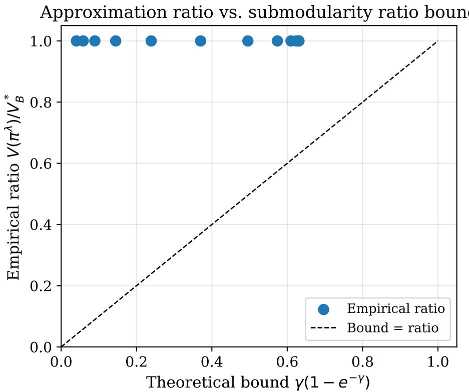  
Figure 2: Empirical approximation ratio vs. theoretical bound (Corollary 31). Each point corresponds to one noise level $\sigma$ (and hence one value of $\gamma )$ . All points lie strictly above the diagonal, confirming the bound is a valid lower guarantee across the full range of synergy levels. In every one of the twelve sweep points, the greedy policy matched the exhaustive-search optimum $( V / V ^ { * } = 1 . 0 )$ : an empirical observation specific to the additive Gaussian model with independent features and unit costs, where the closed-form conditional Gaussian distributions allow each greedy step to correctly account for feature complementarity. We make no claim that this holds for general distributions. The x-axis spread (bound ranging from 0.02 at high synergy to 0.63 at near-submodularity) shows the bound responds correctly to the distribution’s structure.

Experiment 4: MC error vs. K. Figure 4 plots the empirical estimation error $\varepsilon _ { \mathrm { M C } } ( K )$ alongside the Hoefding bound from Proposition 36.

The empirical error decays as $O ( 1 / { \sqrt { K } } )$ as predicted: $\varepsilon _ { \mathrm { M C } } = 0 . 0 5 3$ at $K = 5$ , falling to 0.017 at $K = 5 0$ and 0.008 at $K = 2 0 0$ . All points lie strictly below the Hoefding bound, confirming Proposition 36. The bound is conservative by $\approx 4 0 \times$ because Hoefding assumes worst-case variance ${ \mathrm { ( r a n g e } } = \log | \mathcal { V } | )$ , whereas the actual conditional entropy variance is much smaller in practice. The K-ablation (Table 10) shows that policy performance on MIMIC-IV is stable across $K = 5 – 5 0$ , with inter-seed variance exceeding the performance change from varying $K .$ , confirming $K = 5 0$ as the saturation point. The apparent dip at

-calibration ( = 0.7, B = 5, unit costs)  
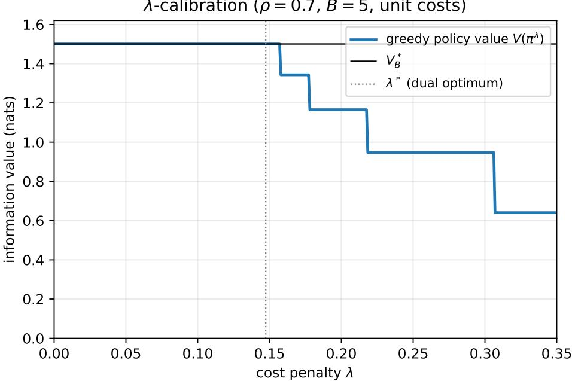  
Figure 3: λ-calibration curve $( \rho = 0 . 7 , B = 5$ , unit costs). Greedy policy value $V ( \pi ^ { \lambda } )$ (blue) as a function of cost penalty λ, with the optimal dual multiplier $\lambda ^ { * }$ (gray dotted) and $V _ { B } ^ { \mathrm { h a r d } }$ (horizontal line). The value is a step function because the policy is discrete: it holds at $V _ { B } ^ { \mathrm { h a r d } }$ across a plateau of penalties, then drops as increasing $\lambda$ prunes successively more panels. The plateau (value within 2% of $V _ { B } ^ { \mathrm { h a r d } } )$ spans $\lambda \in [ 0 , 0 . 1 5 7 ]$ and contains $\lambda ^ { * } = 0 . 1 4 7$ , a half-width of $\approx 5 0 \%$ of $\lambda ^ { * }$ the empirical signature of dual sensitivity (Proposition 29): the dual certificate degrades quadratically in $\lambda - \lambda ^ { * }$ and the greedy value, which the dual bounds via Remark 30, is correspondingly flat near $\lambda ^ { * }$

$K = 1 0$ (macro-F1 $0 . 1 6 5 \mathrm { ~ v s . ~ } 0 . 1 8 0$ at $K = 5$ and $K = 2 5 )$ is not a real efect of sample count: it is within the inter-seed spread $( \pm 0 . 0 0 8 )$ and reflects the discrete argmax in panel selection, where a diferent MC draw occasionally flips one panel choice for a subset of patients. More samples cannot hurt the EIG estimate in expectation; the non-monotonicity is sampling noise, not a systematic trend.

## 6.2 Heterogeneous-Cost Greedy Gap and Density Comparison

The main shortfall bound (Theorem 20) depends on the penalized greedy gap $\Delta _ { \lambda }$ , which is not computable on the full MIMIC-IV instance. To give it quantitative content on a genuinely heterogeneous-cost setting, and to address whether the diference-form penalty $\mathrm { E I G } - \lambda c$ is empirically preferable to the density form ${ \mathrm { E I G } } / c ,$ we construct 600 small discrete instances $( d \in \{ 4 , 5 , 6 \}$ features, 3-class target, categorical features) with costs drawn uniformly on [0.2, 4.0] (up to a 20× spread) and $\lambda \sim \mathrm { U n i f } [ 0 . 0 2 , 0 . 4 ]$ . On each instance we compute the penalized optimum $\begin{array} { r } { L ( \lambda ) = \operatorname* { m a x } _ { \boldsymbol { \mathcal { A } } } [ I ( \boldsymbol { Y } ; \boldsymbol { X } _ { \boldsymbol { \mathcal { A } } } ) - \lambda \sum _ { i \in \boldsymbol { \mathcal { A } } } c _ { j } ] } \end{array}$ by exhaustive search, run both greedy forms, and measure $\Delta _ { \lambda } = L ( \lambda ) - J _ { \lambda } ( \pi ^ { \mathrm { g r e e d y } } )$ exactly.

MC EIG estimation error vs. K  
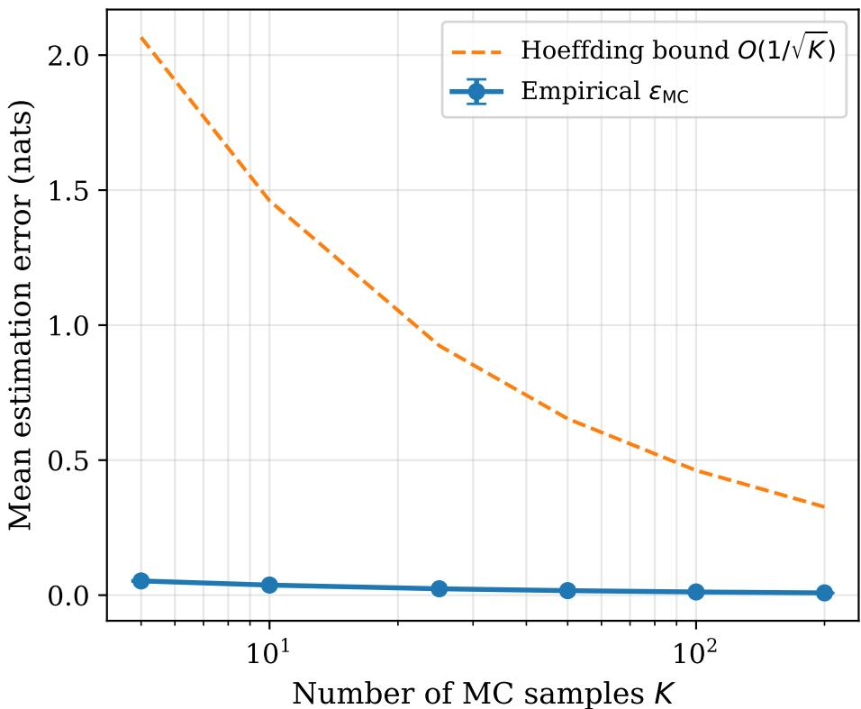  
Figure 4: MC EIG estimation error vs. K (Proposition 36). Empirical $\varepsilon _ { \mathrm { M C } }$ (blue, mean $\pm \ \mathrm { S D }$ across 5 seeds, 500 patients) and the Hoefding bound $O ( 1 / { \sqrt { K } } )$ (orange dashed). All points lie below the bound, validating Proposition 36. At $K = 5 0$ the empirical error is $0 . 0 1 7 { \scriptstyle \pm 0 . 0 0 1 }$ nats , negligible relative to typical EIG values of 0.1–0.5 nats in clinical AFA. The bound is conservative by approximately 40× (expected, as Hoefding bounds worst-case variance). This experiment isolates εMC; the total estimation error additionally includes $\varepsilon _ { \mathrm { g e n } }$ from CVAE model bias (Proposition 37).

Two findings. First, $\Delta _ { \lambda } = 0$ on 97.3% of instances and its 99th percentile is 0.088 nats, so on heterogeneous-cost problems the greedy policy is exactly or nearly penalized-optimal: Theorem 20 delivers a near-tight bound here, not only in the degenerate Gaussian case. This is an exact measurement of $\Delta _ { \lambda }$ beyond the Gaussian setting, partially addressing the absence of a computable bound on the full clinical instance. Second, the diference and density forms produce identical acquired sets on every one of the 600 instances (and, in a further sweep with cost spread up to 100×, never diverged). The diference form is the one that directly maximizes the one-step marginal of the Lagrangian objective $J _ { \lambda }$ (Proposition 18);

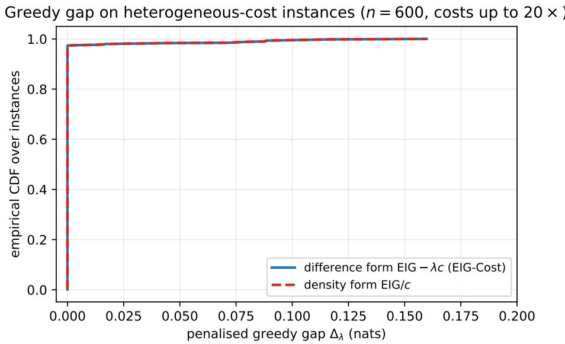  
Figure 5: Penalized greedy gap $\Delta _ { \lambda }$ on heterogeneous-cost instances $( n = 6 0 0$ , costs up to 20×, exact $L ( \lambda )$ by exhaustive search). Empirical CDF of $\Delta _ { \lambda }$ for the diference-form rule $\mathrm { E I G } - \lambda c$ (EIG-Cost) and the density form $\operatorname { E I G } / c$ . The gap is exactly zero on 97.3% of instances and small on the remainder (median 0, 99th percentile 0.088 nats, maximum 0.160 nats); the two curves coincide.

the density form lacks that dual interpretation but, under the same penalized stopping rule, reaches the same sets empirically. We therefore find no cost to the principled diference-form choice, while noting we do not claim it strictly dominates density greedy.

Certificate calibration. The two-term certificate of Theorem 20 bounds the hard-budget gap $V _ { B } ^ { \mathrm { h a r d } } - V ( \pi ^ { \lambda } )$ by $\lambda ( B - B ^ { \lambda } ) + \Delta _ { \lambda }$ . To test whether this bound is valid and informative rather than vacuous, we compute both sides exactly on 4,000 tractable heterogeneous-cost instances $( d \in \{ 3 , \ldots , 6 \}$ , exhaustive $V _ { B } ^ { \mathrm { h a r d } }$ and $L ( \lambda ) )$ , sweeping λ and the budget. Figure 6 (left) plots the actual gap against the certificate; every point lies on or below the diagonal, confirming validity (0 violations in 4,000 instances), and the colouring by submodularity ratio shows the bound tightens as $\gamma  1$

The decomposition (Figure 6, right) is the informative part. Across all 4,000 instances the greedy gap $\Delta _ { \lambda }$ has mean 0.006 nats, the greedy policy is almost always penalizedoptimal, so the certificate’s looseness is not greedy suboptimality but the budget-slack term $\lambda ( B - B ^ { \lambda } )$ , which is large precisely when voluntary stopping leaves the budget unspent. At near-budget-matched operating points (slack < 0.02) the certificate tightens to mean 0.089 nats against an actual gap of 0.006. The practical reading: the hard-budget certificate is a valid a-posteriori bound whose binding component is $\Delta _ { \lambda }$ , which we can measure and which is small; the budget-slack component is loose only in the voluntary-stopping regime, where the policy has deliberately declined to spend the full budget and the “gap” to the budget-exhausting optimum is not a deficiency.

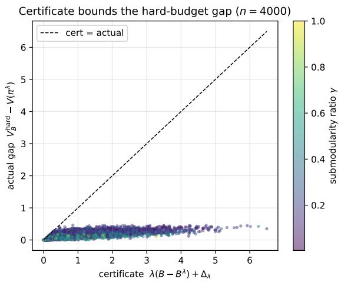

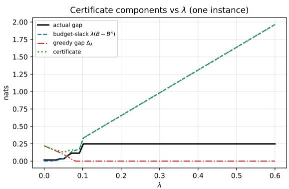  
Figure 6: Certificate calibration on tractable instances. $L e f t { \mathrm { : } }$ actual hard-budget gap vs. the two-term certificate over 4,000 instances; all points lie below the diagonal (validity), coloured by submodularity ratio γ. Right: the certificate’s two components as a function of λ on one instance. The greedy gap $\Delta _ { \lambda }$ (red) stays near zero greedy is essentially penalized-optimal, so the certificate’s looseness is entirely the budget-slack term $\lambda ( B - B ^ { \lambda } )$ (blue), which grows as larger λ makes the policy stop further below the budget. The certificate is tightest near budget matching (small λ), where slack vanishes.

## 6.3 Standard AFA Benchmarks

Datasets. We evaluate on two benchmark datasets spanning diferent clinical contexts and scales. CKD: UCI Chronic Kidney Disease, 400 patients, 24 features in 8 panels (demographics, urinalysis I–II, basic metabolic, electrolytes, CBC, comorbidities, symptoms), binary classification (62.5% CKD prevalence), total panel cost \$25. PhysioNet: PhysioNet Challenge 2012, 12,000 ICU patients, 41 features in 12 panels (vitals, GCS, BMP, CBC, ABG, LFTs, lactate, troponin, haemodynamics, urine, demographics, ventilation), binary classification (14.2% in-hospital mortality), total cost \$74. Panel costs follow CPT-style proxy pricing (\$0–\$15). Both datasets use the same CVAE and MaskableClassifier architecture trained from scratch on each dataset.

Baselines. EIG-Cost (λ = 0.005, scaled to dataset cost range), Greedy-EIG (λ = 0, no cost penalty), and Random (uniform random panel ordering). Five seeds; results are mean ± SD.

Results. Table 2 reports macro-F1 at three representative budget levels for each dataset.

Analysis. The central empirical finding is cost-eficiency, not predictive superiority: EIG-Cost attains comparable accuracy to the strongest alternatives while voluntarily spending substantially less, and it does not claim a general accuracy advantage (indeed Random matches or slightly exceeds it once the budget is large enough to exhaust). Three patterns replicate across both datasets and connect to the theory.

Table 2: Benchmark results: macro-F1 at selected budgets (5 seeds, mean with 95% t-confidence interval). “Spend” is the mean actual cost (EIG-Cost stops voluntarily when all remaining panels satisfy $\operatorname { E I G } ( j ) ~ \leq ~ \lambda c _ { j } )$ . Uncertainty is reported as 95% t-confidence intervals over five seeds; with only five seeds we rely on interval overlap rather than significance tests, since the smallest attainable two-sided Wilcoxon signed-rank p-value at n = 5 is 0.0625. Best per dataset–budget in bold.
<table><tr><td>Dataset</td><td>Budget</td><td>Method</td><td>Macro-F1 [95% CI]</td><td>Accuracy</td><td>Spend ($)</td></tr><tr><td rowspan="8">CKD (max $25)</td><td rowspan="3">$5</td><td>EIG-Cost</td><td>0.903 [0.865, 0.941]</td><td>0.905</td><td>3.17</td></tr><tr><td>Greedy-EIG</td><td>0.903 [0.871, 0.935]</td><td>0.905</td><td>3.20</td></tr><tr><td>Random</td><td>0.688 [0.601, 0.775]</td><td>0.728</td><td>4.00</td></tr><tr><td rowspan="3">$10</td><td>EIG-Cost</td><td>0.961 [0.950, 0.972]</td><td>0.963</td><td>8.65</td></tr><tr><td>Greedy-EIG</td><td>0.961 [0.944, 0.978]</td><td>0.963</td><td>9.28</td></tr><tr><td>Random</td><td>0.863 [0.825, 0.901]</td><td>0.868</td><td>9.19</td></tr><tr><td rowspan="3">$25</td><td>EIG-Cost</td><td>0.966 [0.941, 0.991]</td><td>0.968</td><td>12.41</td></tr><tr><td>Greedy-EIG</td><td>0.971 [0.949, 0.993]</td><td>0.973</td><td>18.89</td></tr><tr><td>Random</td><td>0.974 [0.952, 0.996]</td><td>0.975</td><td>25.00</td></tr><tr><td rowspan="8">PhysioNet (max $74)</td><td rowspan="3">$7.4</td><td>EIG-Cost</td><td>0.524 [0.513, 0.535]</td><td>0.860</td><td>5.14</td></tr><tr><td>Greedy-EIG</td><td>0.523 [0.506, 0.540]</td><td>0.859</td><td>5.30</td></tr><tr><td>Random</td><td>0.514 [0.490, 0.538]</td><td>0.860</td><td>5.82</td></tr><tr><td rowspan="3">$25.9</td><td>EIG-Cost</td><td>0.608 [0.596, 0.620]</td><td>0.868</td><td>16.34</td></tr><tr><td>Greedy-EIG</td><td>0.595 [0.578, 0.612]</td><td>0.865</td><td>21.34</td></tr><tr><td>Random</td><td>0.572 [0.550, 0.594]</td><td>0.864</td><td>23.89</td></tr><tr><td rowspan="3">$74</td><td>EIG-Cost</td><td></td><td></td><td></td></tr><tr><td></td><td>0.625 [0.603, 0.647]</td><td>0.869</td><td>22.10</td></tr><tr><td>Greedy-EIG Random</td><td>0.630 [0.604, 0.656] 0.671 [0.644, 0.698]</td><td>0.870 0.870</td><td>39.34 74.00</td></tr></table>

Cost eficiency via voluntary stopping (the headline). At the maximum budget, EIG-Cost voluntarily stops well short of the limit: on CKD it spends \$12.4 of \$25 (50%) achieving F1 = 0.966; on PhysioNet it spends \$22.1 of \$74 (30%) for $\mathrm { F } 1 = 0 . 6 2 5$ . Both are near-identical in F1 to Greedy-EIG while costing \$6–17 less. This is the voluntary-stopping behavior of Proposition 39: EIG-Cost stops when no remaining panel satisfies $\mathrm { E I G } ( j ) > \lambda c _ { j }$

Value of guidance at tight budgets. When only one or two panels are afordable, information-guided acquisition matters: on CKD at \$5, EIG-Cost and Greedy-EIG reach $\mathrm { F 1 = 0 . 9 0 3 ~ v s }$ . Random’s 0.688 (+31%); on PhysioNet at \$7.4 the margin is +10%. The advantage is over uninformed acquisition, not over the other information-guided methods.

Accuracy vs. cost frontier (benchmark datasets)  
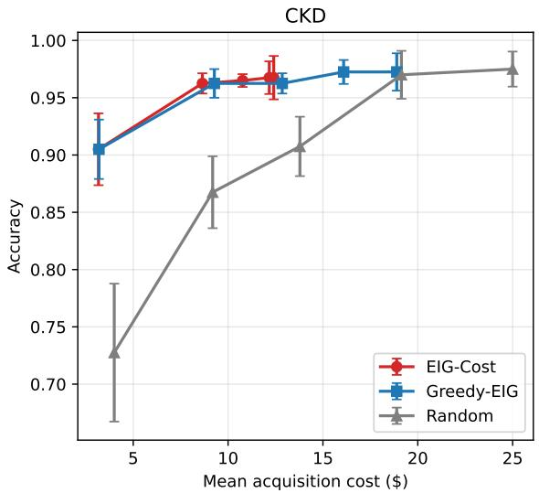

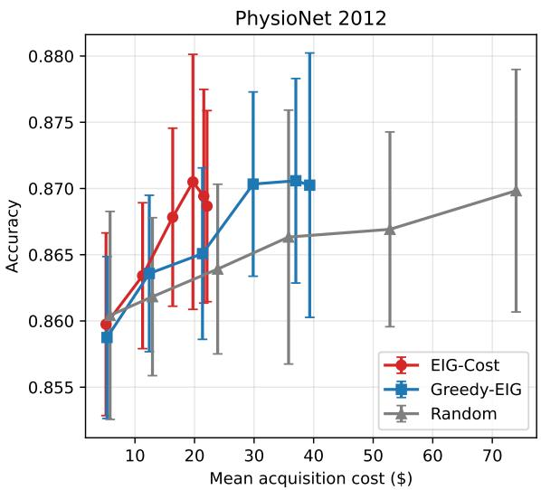  
Figure 7: Accuracy–cost frontier on benchmark datasets (5 seeds, mean $\pm \ : \mathbf { S D } )$ . Left (CKD): EIG-Cost (red) and Greedy-EIG (blue) achieve near-identical accuracy at every cost point and lie above Random (gray) at low-to-moderate cost, where guidance matters most. Both curves plateau at ${ \approx } 0 . 9 6 5$ around \$10 actual spend and remain flat thereafter, while Random continues rising and closes much of the gap by the full \$25 budget. The leftward shift of EIG-Cost relative to Greedy-EIG at the plateau confirms cost savings from voluntary stopping (\$12.4 vs. \$18.9 at budget \$25). Right (PhysioNet): EIG-Cost’s curve rises steeply and saturates around \$20 actual spend; Greedy-EIG reaches the same accuracy level at ≈ \$35, a 75% higher spend. Random rises slowly but, because it keeps spending to the full \$74 budget while EIG-Cost has stopped, it overtakes EIG-Cost at the largest budgets (0.671 vs. 0.625 F1 at \$74; Table 2); the EIG-Cost advantage is a cost-eficiency one at low to moderate budget, not a dominance across the whole frontier. In both panels, the EIG-Cost saturation point corresponds to the voluntary-stopping condition of Proposition 39 $( \mathrm { E I G } ( j ) \leq \lambda c _ { j }$ for all remaining panels), and the plateau is consistent with the dual-sensitivity result (Proposition 29): the policy operates in the near-optimal flat region around $\lambda ^ { * }$

High-budget convergence. At the largest budgets, Random matches or slightly exceeds EIG-Cost in F1 because it exhausts the full budget while EIG-Cost has stopped, consistent with the penalty pricing out further panels once the classifier has saturated. We therefore do not read the benchmarks as evidence of a predictive-accuracy advantage; the defensible claim is comparable accuracy at materially lower cost.

## 6.4 Clinical AFA on MIMIC-IV

Full experimental details appear in Appendix C. The results here probe the theoretical contributions on the full-availability cohort, an oracle-availability setting; a separate deployment-faithful 12-hour cohort is reported in Section 6.5.

Dataset. MIMIC-IV (Johnson et al., 2023), full-availability cohort: 202,971 admissions, 21 acute conditions (Appendix D), 55 features in 30 test panels with 2026 Medicare CPT costs (Centers for Medicare & Medicaid Services, 2025) (Appendix E, ranging \$0–\$80.46, mean \$13.65, full workup \$408.80). Pre-acquired vital signs are zero-cost. A focused five-condition subset (DKA, MI, pancreatitis, sepsis, stroke; $n = 7 0 { , } 2 3 4 )$ provides a more tractable benchmark with known 20% random baseline. Splits: 70/15/15 train/validation/test, split by admission and stratified by condition. The cohort unit is the hospital admission, not the unique patient; the 202,971 figure counts admissions, and a patient with multiple admissions may contribute more than one (splitting is keyed on the subject identifier so that all of a patient’s admissions fall in a single split, avoiding leakage). The patient-level bootstrap in Section 6.4 resamples over the 81,190 evaluation episodes in the held-out test partition (one episode per evaluated test admission). This cohort grants access to all tests recorded during the admission; the availability-constrained counterpart is the 12-hour cohort of Section 6.5.

Baselines. Nine established AFA methods from the AFA-Benchmark suite (Sch¨utz et al., 2026): DIME (Gadgil et al., 2024), ODIN-mb and ODIN-mf (Zannone et al., 2019), JAFA (Janisch et al., 2019), AACO and AACO-NN (actor-critic with hard budget constraint), OL with mask and OL without mask (Kachuee et al., 2019), and EDDI-based ma2018 (Ma et al., 2019).

21-Condition cohort. Figure 8 shows macro-F1 and accuracy vs. budget for the five non-collapsed methods. Table 3 reports comprehensive metrics at the maximum evaluated budget of \$30.

EIG-Cost achieves macro-F1 $0 . 1 8 0 \pm 0 . 0 1 2$ and accuracy $0 . 2 6 5 \pm 0 . 0 1 0$ at budget \$30, ahead of AACO-NN (0.169), AACO (0.162), CAE (0.145), and Permutation (0.101). We read these margins cautiously: the two RL methods (AACO, AACO-NN) are the only baselines that do not collapse to near-immediate stopping (Table 3), so the largest gaps are against methods that acquire almost nothing under this cost/imbalance regime and were not tuned for it; the AACO comparison is the substantive one, and there the margin is modest (+6.5%). The patient-level paired bootstrap (81,190 episodes, 10,000 resamples) confirms the ordering against every baseline: EIG-Cost exceeds CAE by $\Delta \mathrm { F } 1 = 0 . 0 0 6$ (95% CI [0.005, 0.008]), ma2018 by 0.106 ([0.103, 0.108]), and DIME (gadgil2023) by 0.111 ([0.109, 0.113]), each interval excluding zero. The CAE gap is the substantive comparison, CAE is the strongest non-collapsed baseline, and while small, it is patient-level significant, and does not rest on five-seed error bars; the larger gaps are against collapsed methods and should be read with the caveat above. At budget \$30 (6.6% of the \$408.80 full workup cost), EIG-Cost attains a macro-F1 of 0.180. We previously described this as recovering “≈ 70% of diagnostic information”; we correct that characterization here, since macro-F1 (the empirical metric) and mutual information (the theoretical objective) are distinct quantities. The precise statement is that EIG-Cost reaches this F1 while spending 6.6% of the full-panel

(a) 21-Condition Cohort Macro-F1  
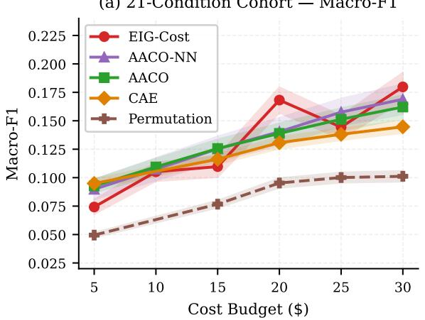

(b) 21-Condition Cohort Accuracy  
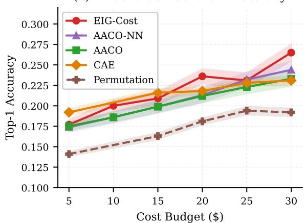  
\dag\ CAE and Permutation budget-10 results omitted (evaluation set mismatch; see Section IV-C).  
Figure 8: Performance on the 21-condition cohort. Macro-F1 (left) and top-1 accuracy (right) vs. cost budget. Shaded regions: mean ± 1 SD across five seeds. Methods with voluntary stop rates $> 8 7 \%$ are excluded (see Figure 10). † CAE and Permutation at \$10 omitted due to evaluation-set mismatch.

Table 3: Results on the 21-condition MIMIC-IV full-availability cohort (202,971 admissions) at budget \$30. $\mathrm { M e a n } \pm \mathrm { S D }$ across 5 seeds. Best per metric in bold. Vol. stop: voluntary stop rate. This is the paper’s primary (oracle-availability) cohort; for the separate deployment-faithful 12-hour cohort see Table 6.
<table><tr><td>Family</td><td>Method</td><td>Macro-F1</td><td>Accuracy</td><td>Cost ($)</td><td> $\operatorname { A c q . }$ </td><td>Vol. Stop</td></tr><tr><td>Ours</td><td>EIG-Cost</td><td> $\mathbf { 0 . 1 8 0 \pm 0 . 0 1 2 }$ </td><td> $\mathbf { 0 . 2 6 5 \pm 0 . 0 1 0 }$ </td><td>27.07</td><td>8.4</td><td>0.00%</td></tr><tr><td rowspan="3">RL</td><td>AACO-NN</td><td> $0 . 1 6 9 \pm 0 . 0 1 1$ </td><td> $0 . 2 4 4 \pm 0 . 0 0 9$ </td><td>24.28</td><td>7.8</td><td>0.00%</td></tr><tr><td>AACO</td><td> $0 . 1 6 2 \pm 0 . 0 0 9$ </td><td> $0 . 2 3 3 \pm 0 . 0 0 8$ </td><td>23.48</td><td>6.3</td><td>0.00%</td></tr><tr><td>JAFA</td><td> $0 . 0 1 1 \pm 0 . 0 0 1$ </td><td> $0 . 0 7 9 \pm 0 . 0 0 1$ </td><td>7.89</td><td>0.03</td><td> $9 9 . 2 \pm 0 . 6 \%$ </td></tr><tr><td rowspan="3"> $\mathrm { I n f o . ^ { - } }$  theoretic</td><td>CAE</td><td> $0 . 1 4 5 \pm 0 . 0 0 5$ </td><td> $0 . 2 3 1 \pm 0 . 0 0 4$ </td><td>23.31</td><td>7.7</td><td>0.00%</td></tr><tr><td>DIME</td><td> $0 . 0 2 7 \pm 0 . 0 0 2$ </td><td> $0 . 1 0 3 \pm 0 . 0 0 2$ </td><td>0.89</td><td>0.44</td><td> $9 6 . 9 \pm 0 . 9 \%$ </td></tr><tr><td>ODIN-mb</td><td> $0 . 0 2 1 \pm 0 . 0 0 1$ </td><td> $0 . 1 0 1 \pm 0 . 0 0 1$ </td><td>0.22</td><td>0.11</td><td> $9 9 . 4 \pm 0 . 4 \%$ </td></tr><tr><td rowspan="2">Static</td><td>Permutation</td><td> $0 . 1 0 1 \pm 0 . 0 0 4$ </td><td> $0 . 1 9 2 \pm 0 . 0 0 3$ </td><td>25.14</td><td>3.0</td><td>0.00%</td></tr><tr><td>ma2018</td><td> $0 . 0 6 1 \pm 0 . 0 0 4$ </td><td> $0 . 1 2 3 \pm 0 . 0 0 3$ </td><td>3.35</td><td>1.43</td><td> $8 7 . 5 \pm 1 . 1 \%$ </td></tr><tr><td>Static</td><td>OL  $\mathrm { ( w / \ m a s k ) }$ </td><td> $0 . 0 1 8 \pm 0 . 0 0 1$ </td><td> $0 . 0 9 9 \pm 0 . 0 0 1$ </td><td>0.00</td><td>0.0</td><td>100.0%</td></tr></table>

cost; any comparison to a full workup should be made in F1 terms against a measured full-acquisition baseline (see Table 3).

Five-condition subset. Figure 9 and Table 4 present results on the five-condition subset.

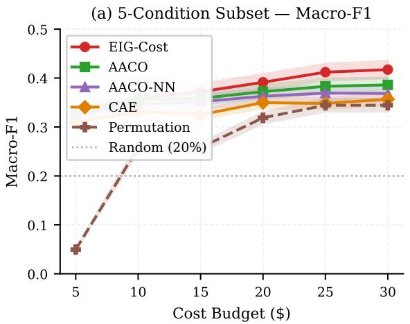

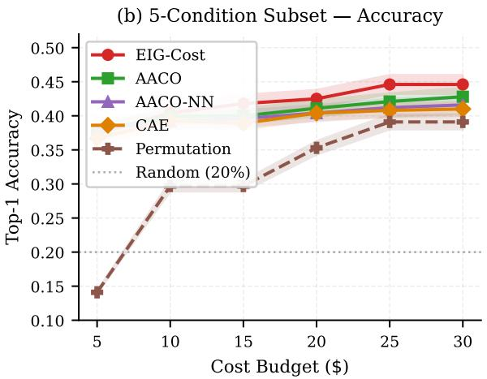  
Figure 9: Performance on the five-condition subset. Macro-F1 (left) and accuracy (right) vs. cost budget. Dotted horizontal line: 20% random baseline.

Table 4: Results on the five-condition subset at budget \$30. Mean ± SD across 5 seeds. Best per metric in bold.
<table><tr><td>Family</td><td>Method</td><td>Macro-F1</td><td>Accuracy</td><td>Cost ($)</td><td> $\operatorname { A c q . }$ </td><td>Vol. Stop</td></tr><tr><td>Ours</td><td>EIG-Cost</td><td> $\mathbf { 0 . 4 1 7 \pm 0 . 0 1 8 }$ </td><td> $\mathbf { 0 . 4 4 6 \pm 0 . 0 1 4 }$ </td><td>26.65</td><td>11.5</td><td>0.00%</td></tr><tr><td rowspan="2">RL</td><td>AACO</td><td> $0 . 3 8 6 \pm 0 . 0 1 5$ </td><td> $0 . 4 2 8 \pm 0 . 0 1 3$ </td><td>23.71</td><td>10.0</td><td>0.00%</td></tr><tr><td>AACO-NN</td><td> $0 . 3 6 8 \pm 0 . 0 1 6$ </td><td> $0 . 4 1 6 \pm 0 . 0 1 3$ </td><td>23.93</td><td>10.5</td><td>0.00%</td></tr><tr><td rowspan="2"> $\mathrm { I n f o . ^ { - } }$  theoretic</td><td>CAE</td><td> $0 . 3 5 7 \pm 0 . 0 1 2$ </td><td> $0 . 4 1 0 \pm 0 . 0 1 0$ </td><td>23.31</td><td>9.0</td><td>0.00%</td></tr><tr><td>DIME</td><td> $0 . 0 6 7 \pm 0 . 0 0 3$ </td><td> $0 . 1 4 8 \pm 0 . 0 0 3$ </td><td>0.90</td><td>0.4</td><td> $9 6 . 9 \pm 0 . 8 \%$ </td></tr><tr><td rowspan="2">Static</td><td>Permutation</td><td> $0 . 3 4 4 \pm 0 . 0 1 3$ </td><td> $0 . 3 9 1 \pm 0 . 0 1 1$ </td><td>24.69</td><td>3.0</td><td>0.00%</td></tr><tr><td>ma2018</td><td> $0 . 1 4 3 \pm 0 . 0 0 5$ </td><td> $0 . 1 8 2 \pm 0 . 0 0 4$ </td><td>3.23</td><td>1.38</td><td> $8 7 . 5 \pm 1 . 2 \%$ </td></tr><tr><td>Static</td><td>OL</td><td> $0 . 0 4 9 \pm 0 . 0 0 1$ </td><td> $0 . 1 4 1 \pm 0 . 0 0 1$ </td><td>0.00</td><td>0.0</td><td>100.0%</td></tr></table>

EIG-Cost leads all methods at all budgets, with relative improvements of +8.0% macro-F1 over AACO and +16.8% over CAE at \$30. Performance is 2.1× and 2.2× the random (20%) baseline.

Baseline collapse. Figure 10 is consistent with Corollary 41: seven of nine baselines exhibit voluntary stop rates $> 8 7 . 5 \%$ on the 21-condition cohort. OL (both variants) stop in 100% of episodes; JAFA in $9 9 . 2 \pm 0 . 6 \%$ ; ODIN-mb in $9 9 . 4 \pm 0 . 4 \%$ ; DIME in $9 6 . 9 \pm 0 . 9 \%$ and ma2018 in $8 7 . 5 \pm 1 . 1 \%$ . We emphasize that this is consistency, not proof of mechanism: Corollary 41 gives a suficient condition for a myopic policy to stop immediately, and we do not verify that each collapsed baseline’s learned value function satisfies that condition at the MIMIC-IV distribution (a direct test would measure max $_ { i } [ \hat { V } ( { \textit { j } } | \emptyset ) - \lambda c _ { j } ]$ for each method, which we leave to future work). The two RL methods that do not collapse (AACO and

AACO-NN) are the only ones trained with a hard budget constraint that penalizes early stopping, which is consistent with the characterization.

Two distinct mechanisms. The comparison isolates two separate efects, which we are careful not to conflate. Avoiding collapse is explained by the hard budget constraint (Corollary 41) and is shared by AACO, AACO-NN, and EIG-Cost alike: all three acquire features rather than defaulting to the class prior (0% voluntary stop in Table 4). Outperforming the other non-collapsed methods is a separate matter that Corollary 41 does not address. EIG-Cost’s advantage over AACO and AACO-NN at equal or lower cost reflects the greedy Lagrangian scoring rather than the presence of a budget constraint, since all three share the latter; our theory explains why the collapsed methods fail, not why greedy Lagrangian outperforms actor-critic RL among the survivors. Establishing the latter would require an ablation training an RL method under EIG-Cost’s exact scoring, which we note as a direction for future work.

Voluntary Stop Rate at Budget \$30 (21-Condition Cohort) Mean \pm SD across 3 seeds  
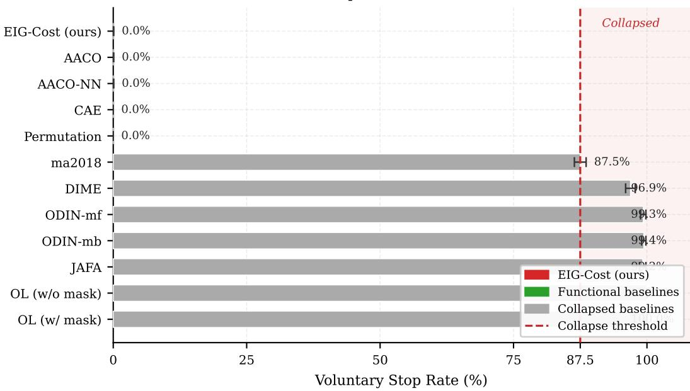  
Figure 10: Voluntary stop rates at budget \$30 (21-condition cohort). Methods in the shaded region exhibit stop rates > 87.5%, they predict using class priors without acquiring diagnostic information (baseline collapse; Corollary 41). The 87.5% boundary is not a derived constant: it is the observed stop rate of the least-collapsed method in the collapsed group (ma2018), and simply separates the two clearly-separated clusters of methods. Error bars: ±1 SD across five seeds.

Cost-eficiency and λ ablation. Figure 11 shows the cost–accuracy tradeof at budget \$30 (accuracy on the vertical axis, mean cost on the horizontal). EIG-Cost occupies the preferred upper-left region: high accuracy at low cost.

Setting $\lambda = 0$ (unconstrained EIG) achieves marginal macro-F1 improvement of $+ 0 . 0 0 3$ (+1.7%) on the 21-condition cohort but spends the full budget (\$30.00, the hard cap) versus EIG-Cost’s \$27.07, i.e. EIG-Cost achieves a 9.8% cost reduction for $\mathrm { a < 2 \% }$ relative macro-F1 change. On the five-condition subset the pattern is the same: $+ 0 . 0 0 4$ macro-F1 at higher cost (\$30.00 vs. \$26.65). This is consistent with the dual-sensitivity result (Proposition 29): $\lambda = 0 . 0 0 5$ sits near the optimal dual multiplier $\lambda ^ { * } ,$ , so the dual certificate, and empirically the policy value is close to optimal while cost is reduced.

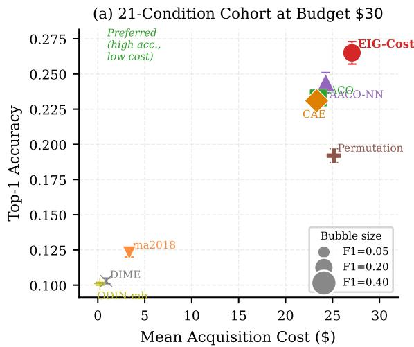

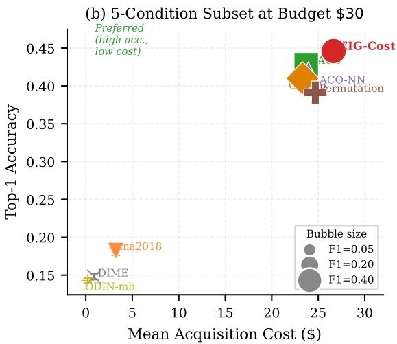  
Figure 11: Cost–accuracy tradeof at budget \$30. Each bubble represents one method on the 21-condition cohort (left) or five-condition subset (right); the vertical axis is accuracy and the horizontal axis is mean acquisition cost. Bubble area is proportional to macro-F1. EIG-Cost (red) occupies the preferred upper-left region (high accuracy, low cost).

Empirical submodularity ratio. Table 5 reports $\gamma _ { f , k }$ estimated on the MIMIC-IV test distribution for $k \in \{ 1 , 3 , 5 , 1 0 \}$ via Monte Carlo sampling of 200 panel-set pairs over 300 patients.

The sampled ratios $\gamma _ { f , k }$ are frequently near 1 for k = 3, 5, 10 (sample means 0.995, 0.984, 0.969), so typical sampled panel combinations are close to submodular. This says nothing reassuring about the worst case: these are local ratios over sampled pairs, not the globa minimum $\gamma _ { f , k }$ the approximation theory requires, and the true global minimum can only be smaller than any sampled minimum, so we do not read the near-1 means as evidence of global near-submodularity or use them to certify an approximation ratio. Indeed the sampled lower tail (0.66–0.71) already confirms, in line with Proposition 10, that genuine feature synergies exist in the clinical distribution, consistent with the intuition that some panel combinations are jointly diagnostic in a way neither panel alone supports (e.g. troponin and BMP jointly ruling in MI with concurrent AKI), and hence that the exact-submodularity guarantee is unavailable here, motivating the submodularity-ratio framing rather than the NWF bound. Any quantitative use of these ratios in a bound (for instance substituting a representative $\gamma$ into $1 - e ^ { - \gamma } )$ is therefore illustrative of the regime, not a worst-case certificate; the rigorous guarantee for the general algorithm remains the exact Lagrangian decomposition of Theorem 20 with $\Delta _ { \lambda }$ measured directly where tractable.

Table 5: Empirical submodularity ratio $\gamma _ { f , k }$ on MIMIC-IV test set (300 patients, 200 sampled $( L , R )$ panel pairs, K=50 MC samples per EIG estimate). The $k { = } 1$ column is trivially 1.0 for any set function by definition; the reported $1 . 0 0 1 \pm 0 . 0 0 8$ is the Monte Carlo estimate, whose small excess over 1.0 is estimation noise from the finite CVAE sample $( K { = } 5 0 )$ used to compute each EIG, and confirms the estimator is approximately unbiased. $\mathrm { M e a n } \pm \mathrm { S D }$ over sampled pairs. “Min $\gamma ^ { \mathfrak { r } }$ is the smallest ratio among the sampled pairs; because the true $\gamma _ { f , k }$ is a minimum over all admissible pairs, this sampled minimum is an upper bound on $\gamma _ { f , k }$ , not a certificate, the true worst case can only be smaller. We therefore read the table as an empirical distribution of local submodularity ratios, not as a global bound.
<table><tr><td>k</td><td>Mean  $\gamma$ </td><td>SD</td><td>Min γ n pairs</td><td></td></tr><tr><td>1</td><td>1.001</td><td>0.008</td><td>0.971</td><td>200</td></tr><tr><td>3</td><td>0.995</td><td>0.043</td><td>0.705</td><td>200</td></tr><tr><td>5</td><td>0.984</td><td>0.067</td><td>0.662</td><td>200</td></tr><tr><td>10</td><td>0.969</td><td>0.081</td><td>0.676</td><td>200</td></tr></table>

Two further caveats apply. First, the reported values are Monte Carlo estimates over 200 sampled panel-set pairs on a 300-patient subsample, so they carry sampling error in both the pair distribution and the per-pair EIG estimate; bootstrap confidence intervals over the sampled pairs would quantify the former and are left to future work. Second, a deliberate search for the most synergistic panel combinations (minimizing the local ratio over sampled $( \mathcal { L } , \mathcal { R } )$ pairs) surfaces clinically coherent triples: the lowest ratios arise for combinations such as troponin with cortisol conditioned on blood-culture and fibrinogen $( \gamma \approx 0 . 7 6 )$ , and CBC with troponin conditioned on coagulation $( \gamma \approx 0 . 8 5 )$ cardiac, inflammatory, and coagulation markers that are jointly informative for acute presentations in a way no single panel is. This grounds the non-submodularity result in concrete feature interactions rather than an abstract ratio. We do not, however, derive suficient conditions for $\gamma \geq \gamma _ { 0 }$ under weaker structure than na¨ıve Bayes (Proposition 14), which we leave open.

## 6.5 Deployment-Faithful Availability Check (12-Hour Cohort)

The experiments above use the full-availability cohort, an oracle-availability setting that isolates the acquisition algorithm from the question of which tests were historically available at a decision time (Section 6). To confirm the method also operates under a deployment-$f a i t h f u l$ constraint, a fixed decision time with a realistic, per-patient availability mask, we report a compact result on a separate, availability-constrained cohort studied in detail in the companion applied work (Bingham and Arussy, 2026). This cohort fixes a 12-hour decision cutof, admits only tests recorded within that window, and after excluding admissions with insuficient early coverage comprises 64,766 admissions from 39,884 patients (distinct from, and substantially smaller than, the 202,971-admission full-availability cohort used elsewhere

in this paper). Panel costs, condition set, and feature panels are otherwise as before; results are 5-seed means with bootstrap 95% confidence intervals at a \$30 budget under panel-level costing.  
Table 6: Deployment-faithful 12-hour cohort (separate availability-constrained cohort of Bingham and Arussy (2026): 64,766 admissions, 39,884 patients, 12-hour decision cutof, per-patient availability mask; budget \$30, panel costing, 5 seeds, bootstrap 95% CIs). This cohort is distinct from the paper’s primary 202,971-admission full-availability cohort (Table 3); the two sets of numbers are not comparable and are reported separately. Best macro-F1 in bold.
<table><tr><td>Method</td><td>Macro-F1 [95% CI]</td><td>Mean cost t ($)</td></tr><tr><td>EIG-Cost</td><td>0.188 [0.185, 0.191]</td><td>17.28</td></tr><tr><td>ma2018</td><td>0.170 [0.167, 0.174]</td><td>22.12</td></tr><tr><td>CAE</td><td>0.151 [0.148, 0.154]</td><td>24.40</td></tr><tr><td>DIME</td><td>0.102 [0.099, 0.104]</td><td>25.73</td></tr></table>

Under this deployment-faithful constraint EIG-Cost retains its cost–performance advantage: it attains the highest macro-F1 at the lowest realized cost, beating the strongest baseline (ma2018) on all five seeds (paired t-test $p < 0 . 0 0 1$ ; one-sided Wilcoxon $p = 0 . 0 3 1$ - the minimum attainable at $n { = } 5 )$ , with non-overlapping confidence intervals. We report this single result to establish that the method’s behavior is not an artefact of oracle availability; the full protocol, expanded baselines, calibration, subgroup, and ablation analyses for the 12-hour cohort are the subject of the separate applied study (Bingham and Arussy, 2026) and are not reproduced here.

## 6.6 Ablation Studies

Table 7 reports the λ-ablation on the full cohort at the two endpoints. The $\lambda = 0 . 0 0 5$ setting reduces mean cost from \$30.00 (unpenalized, budget-capped) to \$27.07, a 9.8% reduction, with $< 2 \%$ relative macro-F1 loss $( 0 . 1 8 3  0 . 1 8 0 )$ . A finer sweep on a 2,000-patient subsample (Table 8) traces the full cost–accuracy frontier and shows its shape.

Table 7: Cost-penalty ablation on the 21-condition cohort at budget \$30. Mean $\pm$ SD across 5 seeds.
<table><tr><td>λ</td><td>Macro-F1</td><td>Accuracy</td><td>Cost ($)</td></tr><tr><td>0 (unconstrained EIG)</td><td> $0 . 1 8 3 \pm 0 . 0 1 3$ </td><td> $0 . 2 6 8 \pm 0 . 0 1 0$ </td><td>30.00</td></tr><tr><td> $0 . 0 0 5 \ : ( \mathrm { E I G - C o s t } )$ </td><td> $0 . 1 8 0 \pm 0 . 0 1 2$ </td><td> $0 . 2 6 5 \pm 0 . 0 1 0$ </td><td>27.07</td></tr></table>

The frontier is smooth and monotone: increasing λ trades macro-F1 for cost, from the near-unpenalized regime $( \lambda \le 0 . 0 0 1$ , spending $\approx \$ 28$ for $\mathrm { F 1 } \approx \mathrm { 0 . 1 9 } )$ through the deployed operating point $( \lambda = 0 . 0 0 5 )$ down to complete non-acquisition $( \lambda \ge 0 . 0 5 )$ . A very small penalty (λ = 0.001) leaves macro-F1 statistically unchanged while lowering cost (0.195 vs. 0.193 at \$27.8 vs. \$28.5); we note the point estimate is marginally higher but the diference is within seed noise (positive in 3 of 5 seeds) and we do not claim a regularization benefit. The deployed $\lambda = 0 . 0 0 5$ is thus a chosen cost–accuracy operating point on this frontier, not the optimiser of a separate criterion.

Table 8: Cost–accuracy frontier vs. λ (2,000-patient subsample, budget \$30, 5 seeds, mean ± SD). This subsample traces the frontier shape; absolute values are not comparable to the full-cohort Table 7. At $\lambda \ge 0 . 0 5$ the policy acquires nothing and returns the class-prior baseline (macro-F1 ≈ 0.06).
<table><tr><td>λ</td><td>Macro-F1</td><td>Accuracy</td><td>Cost ($)</td><td>Mean #panels</td></tr><tr><td>0</td><td> $0 . 1 9 3 \pm 0 . 0 0 3$ </td><td>0.211</td><td>28.48</td><td>3.7</td></tr><tr><td>0.001</td><td> $0 . 1 9 5 \pm 0 . 0 0 6$ </td><td>0.213</td><td>27.77</td><td>3.7</td></tr><tr><td>0.0025</td><td> $0 . 1 8 9 \pm 0 . 0 0 5$ </td><td>0.207</td><td>25.81</td><td>3.4</td></tr><tr><td>0.005</td><td> $0 . 1 7 6 \pm 0 . 0 0 4$ </td><td>0.196</td><td>20.32</td><td>2.6</td></tr><tr><td>0.01</td><td> $0 . 1 2 8 \pm 0 . 0 0 6$ </td><td>0.156</td><td>9.38</td><td>1.1</td></tr><tr><td>0.02</td><td> $0 . 0 8 9 \pm 0 . 0 0 4$ </td><td>0.122</td><td>2.85</td><td>0.3</td></tr><tr><td>0.05</td><td> $0 . 0 6 0 \pm 0 . 0 0 4$ </td><td>0.093</td><td>0.00</td><td>0.0</td></tr></table>

Mechanism decomposition: ordering, stopping, and λ. The cost saving of EIG-Cost could in principle come from three separable mechanisms: the cost-penalized ordering of panels, the stopping rule, or the choice of λ. Table 9 isolates them on a common 2,000- patient subsample with shared seeds, so every arm sees identical patients, EIG estimates, and randomization and the contrasts are non-confounded (absolute values difer slightly from the full-cohort Table 3 because of subsampling and are not compared across tables). Four policies share the same greedy panel ordering and difer only as indicated: greedy-EIG orders by EIG(j) and spends to the budget; EIG-Cost (forced) orders by $\mathrm { E I G } ( j ) - \lambda c _ { j }$ and spends to the budget; EIG-Cost (score stop) adds the theoretically-characterized stopping rule (halt when no panel satisfies $\mathrm { E I G } ( j ) > \lambda c _ { j } ;$ Proposition 39); and λ=0 isolates the penalty’s efect.

Table 9: Mechanism decomposition on a 2,000-patient subsample (budget \$30, 5 seeds, mean ± SD). All arms share panel ordering, patients, and seeds; absolute values are not comparable to Table 3 (subsample).
<table><tr><td>Policy</td><td>Macro-F1</td><td>Accuracy</td><td>Cost ($)</td></tr><tr><td>greedy-EIG (order only)</td><td> $0 . 1 9 4 \pm 0 . 0 0 5$ </td><td> $0 . 2 1 2 \pm 0 . 0 0 5$ </td><td>29.05</td></tr><tr><td>EIG-Cost (forced, no stop)</td><td> $0 . 1 9 0 \pm 0 . 0 0 2$ </td><td> $0 . 2 1 1 \pm 0 . 0 0 4$ </td><td>28.52</td></tr><tr><td>EIG-Cost (entropy stop)</td><td> $0 . 1 8 9 \pm 0 . 0 0 5$ </td><td> $0 . 2 1 0 \pm 0 . 0 0 4$ </td><td>28.53</td></tr><tr><td>EIG-Cost (score stop)</td><td> $0 . 1 7 6 \pm 0 . 0 0 5$ </td><td> $0 . 1 9 6 \pm 0 . 0 0 7$ </td><td>20.31</td></tr><tr><td>λ=0 (order only)</td><td> $0 . 1 9 6 \pm 0 . 0 0 6$ </td><td> $0 . 2 1 2 \pm 0 . 0 0 5$ </td><td>28.48</td></tr></table>

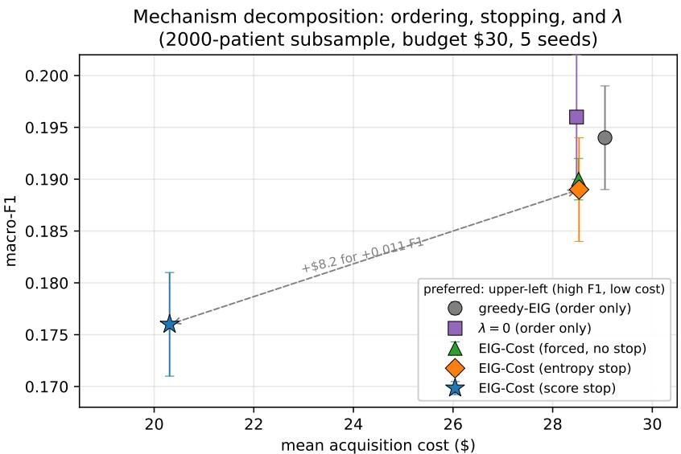  
Figure 12: Mechanism decomposition in cost–accuracy space (same 2,000-patient subsample, budget \$30, 5 seeds; error bars ±1 SD). The four full-budget policies cluster at high cost (\$28–29); only the score-floor stopping rule moves the policy to low cost (\$20.3), and it does so at a small macro-F1 cost. The dashed arrow marks the deployed entropy-floor vs. theoretically-characterized score-floor operating points: \$8.2 more spend for +0.011 macro-F1. Absolute values are subsample figures used only for the within-panel contrasts.

Three findings follow, and we state them plainly because they qualify the headline. (i) Ordering is roughly neutral. The cost-penalized ordering (forced, 0.190) is essentially at plain greedy-EIG ordering (0.194) at matched budget: downweighting expensive-but-informative panels does not by itself improve accuracy. (ii) Stopping is the cost lever, and it is a genuine tradeof. The score-stop rule cuts mean cost from \$28.52 to \$20.31 (−29%) at a cost of 0.014 macro-F1 (−7% relative). EIG-Cost’s cost savings are therefore not free: they come from voluntary stopping, which trades a small, measured accuracy loss for substantially lower spend. (iii) λ tunes the tradeof, moving the policy along this cost–accuracy curve.

Two stopping rules: theory vs deployment. The stopping rule characterized by our theory is not the one used by the deployed system, and the same-cohort ablation (Table 9) now measures both on identical patients and seeds. The theory (Proposition 39) concerns the score-floor rule, halt when no remaining panel satisfies $\mathrm { E I G } ( j ) > \lambda c _ { j }$ , measured at 0.176 macro-F1 / \$20.31. The deployed classifier uses an entropy-floor rule halt when the posterior entropy $H ( Y \mid x _ { S } )$ falls below a confidence threshold, measured at 0.189 macro-F1 / \$28.53 on the same cohort. The entropy floor thus spends \$8.2 more (\$28.5 vs. \$20.3) for +0.011 macro-F1, a diference positive in every seed: it keeps acquiring through panels whose penalized score has gone negative but which still reduce diagnostic uncertainty. Neither rule dominates: the score floor is the cost-minimal, theoretically-characterized policy, while the entropy floor is the confidence-maximal deployment default that buys modest additional accuracy at materially higher cost. We report both rather than collapse them; the \$8.2-for-0.011 gap between the characterized and deployed policies is an honest and useful quantity, and it locates the two on a common cost–accuracy frontier that λ and the entropy threshold jointly parametrize. (The full-cohort entropy-floor result is 0.180 macro-F1 at \$27.07, Table 3; the subsample values here are used only for the non-confounded contrast between rules, not as absolute figures.)

Diference form vs. density greedy at scale. The Lagrangian derivation uses the diference score $\mathrm { E I G } ( j ) - \lambda c _ { j }$ rather than the density score $\mathrm { E I G } ( j ) / c _ { j }$ of knapsack greedy (Remark following Proposition 24). On the full MIMIC-IV test set, under a common (score-floor) stopping rule and shared seeds, the two coincide within seed noise: macro-F1 $0 . 1 7 5 \pm 0 . 0 0 6$ (diference) vs. $0 . 1 7 4 \pm 0 . 0 0 3$ (density), at mean cost \$20.30 vs. \$20.17, a paired diference of +0.002 macro-F1 whose sign varies across the five seeds. The diference form is therefore adopted for its dual interpretation (λ in nats per dollar, arising directly from the Lagrangian), not for any empirical advantage over density greedy, which we do not claim.

Table 10: MC samples ablation (K) on the 21-condition MIMIC-IV cohort at budget \$30 (300-patient subsample, 5 seeds, mean ± SD). Absolute accuracy here (≈ 0.22) is lower than the full-test-set result of Table 3 (0.265) because this ablation is computed on a 300-patient subsample chosen to keep the K-sweep tractable; the subsample is fixed across K so that relative comparison across K is valid even though absolute values are not directly comparable to the main table. Macro-F1 is flat across K: the $K = 2 5$ and $K = 5 0$ values (0.180 and 0.177) are within one standard deviation, and the $K = 1 0$ dip (0.165) is sampling noise within the inter-seed spread (see main text). We adopt $K = 5 0$ as a conservative default; it carries no measured time penalty at this scale (wall-clock is dominated by TensorFlow graph warm-up rather than by K), and $K = 2 5$ would serve equally well if MC cost dominated.
<table><tr><td>K</td><td>Macro-F1</td><td>Accuracy</td><td>Time/patient (s)</td></tr><tr><td>5</td><td> $0 . 1 8 0 \pm 0 . 0 0 7$ </td><td> $0 . 2 1 9 \pm 0 . 0 0 3$ </td><td>2.95</td></tr><tr><td>10</td><td> $0 . 1 6 5 \pm 0 . 0 0 8$ </td><td> $0 . 2 0 8 \pm 0 . 0 0 9$ </td><td>2.99</td></tr><tr><td>25</td><td> $0 . 1 8 0 \pm 0 . 0 0 1$ </td><td> $0 . 2 2 3 \pm 0 . 0 0 3$ </td><td>2.54</td></tr><tr><td>50</td><td> $0 . 1 7 7 \pm 0 . 0 0 2$ </td><td> $0 . 2 2 0 \pm 0 . 0 0 3$ </td><td>2.45</td></tr></table>

Information and calibration metrics (the theory-aligned outcome). The theory optimizes transcript information, so the metrics most directly aligned with it are the proper scoring rules and information quantities, log-loss, Brier score, and empirical information gain, which we regard as the primary theoretical outcome; macro-F1 and accuracy are reported as the clinically intuitive but theory-secondary metrics. We report all of them for EIG-Cost at budget \$30 (full test set, 5 seeds) in Table 11, so the objective and the downstream classification metrics can be read together. We do not prove a general link between information gain and macro-F1 (a policy can raise information without changing the argmax decision, and vice versa near a boundary); relating transcript information to a proper predictive loss is left open (Section 7).

Table 11: Information and calibration metrics for EIG-Cost at budget \$30 (21- condition full test set, 5 seeds, mean ± SD). Log-loss and Brier are proper scoring rules; ECE is expected calibration error (15 bins). Empirical information gain is $H ( Y ) - \mathbb { E } [ H ( Y \mid x _ { \mathcal { S } } ) ]$ with prior entropy $H ( Y ) = 2 . 8 5$ nats.
<table><tr><td>Metric Value</td></tr><tr><td>Macro-F1  $0 . 1 7 5 \pm 0 . 0 0 5$ </td></tr><tr><td>Accuracy  $0 . 1 9 5 \pm 0 . 0 0 6$ </td></tr><tr><td>Log-loss (nats)  $2 . 6 0 \pm 0 . 0 2$ </td></tr><tr><td>Brier score  $0 . 8 9 6 \pm 0 . 0 0 3$ </td></tr><tr><td>Expected calibration error  $0 . 0 2 6 \pm 0 . 0 0 4$ </td></tr><tr><td>Mean posterior entropy (nats)  $2 . 6 5 \pm 0 . 0 0 4$ </td></tr><tr><td>Empirical info. gain (nats)  $0 . 2 0 5 \pm 0 . 0 0 4$ </td></tr></table>

The classifier is well-calibrated (ECE = 0.026), and the proper scoring rules corroborate the accuracy-based ranking. The empirical information gain of 0.205 nats is 7.2% of the prior label entropy $H ( Y ) = 2 . 8 5$ nats. This modest fraction is expected and should be read as $e f f i c i e n c y$ at budget, not as a ceiling: at \$30, or 6.6% of the \$408.80 full-workup cost, the policy acquires roughly a comparable fraction of the resolvable information, and much of H(Y ) over 21 imbalanced acute conditions is not resolvable from laboratory panels alone. The relevant question is information gained per dollar relative to alternatives, which the cost–accuracy frontier (Figure 7) addresses; the absolute fraction of $H ( Y )$ is not itself the target.

## 7 Discussion

Theory and experiment together. Each theoretical mechanism has a direct empirical counterpart, detailed in Section 6 and summarised here. The synthetic Gaussian sweep realizes Proposition 10: the submodularity ratio ranges continuously from 0.18 to 0.96, so the objective is genuinely non-submodular and the greedy bound is correct but conservative (Figure 2). The certificate of Theorem 20 is validated directly (Figure 6): it bounds the actual hard-budget gap on every one of 4,000 instances, with its binding component $\Delta _ { \lambda }$ near zero. On the clinical data, non-submodularity is visible in jointly-but-not-individually informative panels (troponin with ST-elevation for MI); EIG-Cost reaches its accuracy plateau at 30–50% of budget and then stops, the Lagrangian penalty buying equal accuracy for $\approx 4 0 \%$ less than unpenalized greedy on PhysioNet; and the widespread baseline collapse is consistent with the voluntary-stop characterization (Corollary 41).

The role of λ. Practically, the 9.8% cost reduction at $\lambda = 0 . 0 0 5$ (mean spend \$27.07 vs. the \$30.00 budget-capped unpenalized policy) for $< 2 \%$ relative macro-F1 loss is the most direct clinical implication. The dual variable λ provides an interpretable operating knob: at each $\lambda ,$ the policy enforces a shadow price on diagnostic-test acquisition, and institutions can tune λ to their cost constraints without retraining the CVAE or classifier.

Limitations. The stability guarantee (Theorem 33) is conditional on a margin condition holding along the trajectory; it certifies that estimation error changes no acquisition decision when decisions have margin, but gives no bound when margins are small, and a distributional (margin-free) guarantee remains open. Proposition 14 is proved via a modular–submodular decomposition that may not extend directly to weakly conditionally independent feature sets. The CVAE model-error bound (Proposition 37) is loose: via Pinsker it is roughly 40× the empirical error and is intended as a consistency guarantee rather than a tight quantitative bound. Several empirical quantities that would further sharpen the picture remain unmeasured on the flagship instance: bootstrap confidence intervals for the submodularity ratio $\gamma _ { f , k } ;$ the greedy-gap decomposition of Theorem 20 on the full MIMIC-IV instance (we measure $\Delta _ { \lambda }$ exactly on heterogeneous-cost synthetic instances in Section 6.2, but $L ( \lambda )$ is intractable at full clinical scale); and a forced-budget frontier that quantifies the cost of voluntary stopping on the clinical data. The density-greedy comparison is included both on the heterogeneous-cost instances (Section 6.2) and at clinical scale on MIMIC-IV (Section 6.6); in both it matches the diference form to within seed noise, so the diference form’s justification is its dual interpretation rather than an empirical edge. All MIMIC-IV data originate from a single institution (BIDMC); external validation is needed before clinical deployment. Two further limitations bear on the clinical interpretation. First, our primary MIMIC-IV cohort grants access to all tests recorded during the admission rather than only those available at a fixed decision time; because the historical measurement process is itself informative (which tests were ordered depends on clinician judgment and latent patient state), this full-availability setting can leak information from later care and is best read as an algorithmic oracle-availability study. We partially address this with the deployment-faithful 12-hour cohort of Section 6.5, which fixes a decision timestamp, restricts acquisition to tests available by then, and applies a per-patient availability mask; EIG-Cost retains its advantage there. A fuller clinical evaluation on that constrained cohort expanded baselines, external validation, and sensitivity to the cutof window, is the subject of the separate applied study (Bingham and Arussy, 2026) and remains the most important clinical extension of this line of work. Second, our theory optimizes transcript information $I ( Y ; H _ { T } )$ while the experiments report macro-F1 and accuracy, which are not equivalent, an acquisition can raise information without raising macro-F1 on an imbalanced 21-class target. We report both families of metric but do not prove a decision-theoretic link between information gain and classification risk; establishing one would tighten the theory-to-metric mapping.

Future directions.

• Extension of the budget evaluation to \$50–\$100, where performance curves may plateau.

• Non-myopic EIG-Cost via rollout or amortized dynamic programming, motivated by the Lagrangian framing.

• Per-condition feature acquisition analysis to verify that EIG-Cost selects clinically expected panels (troponin for MI, lactate for sepsis).

• External validation on eICU (Pollard et al., 2018) and fairness analysis by demographic subgroup (Bingham et al., 2026).

## 8 Conclusion

We provide a theoretical framework for the EIG-Cost policy for cost-aware Active Feature Acquisition. EIG-Cost is not an arbitrary heuristic modification of greedy EIG: at each step it is the one-step greedy maximiser of the Lagrangian-relaxed marginal-gain objective for the expected-cost AFA problem, restricted to actions feasible under the deployed hard-budget cap, with λ the dual multiplier of the expected-cost relaxation. While the underlying combinatorial optimization remains NP-hard (Krause and Guestrin, 2005), this identification provides a principled derivation of the cost-penalty formulation, a characterization of near-optimality conditions, and a sensitivity bound on imperfect λ choice. Complementing this, we prove that $I ( Y ; X _ { \mathcal { A } } )$ is not submodular in general, ruling out the standard NWF guarantee and motivating the Lagrangian analysis. When submodularity holds or is parametrized via the submodularity ratio, an approximation guarantee of $( 1 - e ^ { - \gamma } )$ holds in the equal-cost, nonadaptive setting of Corollary 31; we emphasize that the general heterogeneous-cost adaptive algorithm does not inherit this ratio, and its guarantee is instead the exact Lagrangian decomposition of Theorem 20 together with the λ-sensitivity bound of Proposition 29 and the empirically-measured submodularity ratio. On MIMIC-IV, EIG-Cost attains accuracy comparable to the strongest non-collapsed baselines while spending only 6.6% of full-panel cost, and Corollary 41 provides a theoretical explanation of the baseline collapse failure mode observed in seven of nine evaluated baselines. We frame the empirical contribution as cost-eficient information acquisition, not a general predictive-accuracy advantage.

## Acknowledgments and Disclosure of Funding

We wish to acknowledge ISF funding, Technion compute, MIMIC-IV data contributors, AFA-Benchmark developers. We report no financial activities and competing interests.

## Appendix A. Notation

Table 12 collects the symbols used throughout the paper.

## Appendix B. Proofs

## B.1 Proof of Proposition 14 (Na¨ıve Bayes Submodularity)

We prove submodularity via the decomposition $I ( Y ; X _ { \mathcal { A } } ) = H ( X _ { \mathcal { A } } ) - H ( X _ { \mathcal { A } } \mid Y )$ and show that the first term is submodular and the second modular under the na¨ıve Bayes assumption.

Step 1 (Modularity of $H ( X _ { \mathcal { A } } \mid Y ) )$ . Under na¨ıve Bayes, $p ( X _ { 1 } , \dots , X _ { d } \mid Y ) = \prod _ { k = 1 } ^ { d } p ( X _ { k } \mid$ $Y )$ , so for each value y of Y the conditional joint entropy decomposes additively:

$$
H ( X _ { \mathcal { A } } \mid Y = y ) = \sum _ { k \in \mathcal { A } } H ( X _ { k } \mid Y = y ) .
$$

Taking expectation over $Y .$

$$
H ( X _ { \cal { A } } \mid Y ) = \sum _ { y } p ( y ) \sum _ { k \in \cal { A } } H ( X _ { k } \mid Y = y ) = \sum _ { k \in \cal { A } } H ( X _ { k } \mid Y ) .
$$

Hence $\mathcal { A } \mapsto H ( X _ { \mathcal { A } } \mid Y )$ is a sum of per-feature terms, a modular function of A.

Step 2 (Submodularity of $H ( X _ { \mathcal { A } } ) )$ . For any collection of random variables, the joint Shannon entropy is a submodular set function (Fujishige, 2005). For $\mathcal { A } \subseteq \mathcal { B } \subseteq [ d ]$ and $j \not \in B$

$$
H ( X _ { \mathcal { A } \cup \{ j \} } ) - H ( X _ { \mathcal { A } } ) = H ( X _ { j } \mid X _ { \mathcal { A } } ) \ \geq \ H ( X _ { j } \mid X _ { \mathcal { B } } ) = H ( X _ { \mathcal { B } \cup \{ j \} } ) - H ( X _ { \mathcal { B } } ) ,
$$

since conditioning on a larger set never increases entropy. This is the diminishing-returns property for H.

Step 3 (Combining). We show directly that the marginal-gain inequality is preserved. Fix ${ \mathcal { A } } \subseteq B$ and $j \notin B$ The submodularity of H (Step 2) gives $H ( X _ { \mathcal { A } \cup \{ j \} } ) - H ( X _ { \mathcal { A } } ) \geq$ $H ( X _ { B \cup \{ j \} } ) - H ( X _ { B } )$ . The modularity of $H ( \cdot \mid Y )$ (Step 1) gives $H ( X _ { \mathcal { A \cup } \{ j \} } \mid Y ) - H ( X _ { \mathcal { A } } \mid$ $Y ) = { \tilde { H ( X _ { j } \mid Y ) } } = H ( X _ { \mathcal { B \cup \{ j \} } } \mid Y ) - H ( X _ { \mathcal { B } } \mid Y )$ , so the two marginal increments of the modular term are equal. Subtracting the equal modular increments from the two sides of the submodular inequality preserves its direction:

$$
\big [ H ( X _ { \mathcal { A } \cup \{ j \} } ) - H ( X _ { \mathcal { A } \cup \{ j \} } \mid Y ) \big ] - \big [ H ( X _ { \mathcal { A } } ) - H ( X _ { \mathcal { A } } \mid Y ) \big ] \ \geq \ \big [ \mathrm { s a m e ~ w i t h } \ \mathcal { B } \big ] ,
$$

which is exactly $I ( Y ; X _ { \mathcal { A } \cup \{ j \} } ) - I ( Y ; X _ { \mathcal { A } } ) \geq I ( Y ; X _ { \mathcal { B } \cup \{ j \} } ) - I ( Y ; X _ { \mathcal { B } } )$ , the diminishingreturns (submodularity) inequality for $I ( Y ; X _ { \mathcal { A } } )$ . (Equivalently, this is the standard fact that a submodular function minus a modular function is submodular; see Fujishige 2005, Ch. II.)

Monotonicity. For ${ \mathcal { A } } \subseteq B$ , the chain rule gives

$$
I ( Y ; X _ { \mathcal { B } } ) = I ( Y ; X _ { \mathcal { A } } ) + I ( Y ; X _ { \mathcal { B } \setminus \mathcal { A } } \mid X _ { \mathcal { A } } ) \ \geq \ I ( Y ; X _ { \mathcal { A } } ) ,
$$

since conditional mutual information is non-negative.

Remark. The submodularity in Step 2 holds for any joint distribution of the features, not just under na¨ıve Bayes. What na¨ıve Bayes contributes is the modularity in Step 1: without conditional independence given $Y ,$ the correction term $H ( X _ { \cal A } \mid Y )$ is in general submodular as well, and the diference of two submodular functions need not be submodular. This is exactly the mechanism behind Proposition 10: in the additive Gaussian model $\begin{array} { r } { Y = \sum _ { i } X _ { j } + \eta } \end{array}$ , the features are not conditionally independent given $Y$ (knowing Y and $X _ { 1 } , \ldots , X _ { d - 1 }$ determines $X _ { d }$ up to noise), the modularity in Step 1 fails, and the resulting $I ( Y ; X _ { \mathcal { A } } )$ is supermodular.

## B.2 Proof of Proposition 29 (Dual Sensitivity)

We prove the three parts in turn.

(i) Convexity and validity. For each policy $\pi ,$ the map $\lambda \mapsto J _ { \lambda } ( \pi ) = V ( \pi ) - \lambda C ( \pi )$ is afine in λ. Hence $L ( \lambda ) = \operatorname* { s u p } _ { \pi } J _ { \lambda } ( \pi )$ is a pointwise supremum of afine functions, therefore convex, and $g ( \lambda ) = L ( \lambda ) + \lambda B$ is convex as the sum of a convex and a linear function. Weak duality (Theorem 20, proof) gives $V _ { B } ^ { \mathrm { h a r d } } \leq L ( \lambda ) + \lambda B = g ( \lambda )$ for every $\lambda \geq 0$ , so each λ is a valid upper certificate and the tightest is at $\lambda ^ { \ast } \in$ arg $\operatorname* { m i n } _ { \lambda \geq 0 } g ( \lambda )$ , which exists because g is convex, continuous, and $g ( \lambda )  \infty$ as $\lambda \to \infty$ (the linear term λB dominates once $L ( \lambda )$ saturates at $L ( 0 ) = \operatorname* { m a x } _ { \pi } V ( \pi )$ minus a non-negative cost term).

(ii) Certificate inflation. Immediate from $( \mathrm { i } ) \mathrm { : }$ : the certificate at $\lambda$ exceeds the tightest certificate by $g ( \lambda ) - g ( \lambda ^ { * } ) \geq 0$ , and both are evaluations of the computable function $g .$

(iii) Quadratic rate under smoothness. $\operatorname { I f } g$ is $L _ { g } .$ -smooth (its derivative is $L _ { g } { \mathrm { - L i p s c h i t z } } )$ on an interval containing $\lambda ^ { * }$ and $\lambda ^ { * }$ is an interior minimiser, then $g ^ { \prime } ( \lambda ^ { * } ) = 0$ and the standard smoothness upper bound gives, for $\lambda$ in that interval,

$$
g ( \lambda ) - g ( \lambda ^ { * } ) \ : \leq \ : g ^ { \prime } ( \lambda ^ { * } ) ( \lambda - \lambda ^ { * } ) + \frac { L _ { g } } { 2 } ( \lambda - \lambda ^ { * } ) ^ { 2 } \ : = \ : \frac { L _ { g } } { 2 } ( \lambda - \lambda ^ { * } ) ^ { 2 } .
$$

Convexity gives the matching lower bound $g ( \lambda ) - g ( \lambda ^ { * } ) \geq 0$ , which is (13). Because $g$ is piecewise linear when the primal admits finitely many deterministic policies, $L _ { g } .$ -smoothness is a local regularity property of the randomized-policy dual; where it fails, part (ii) still provides the exact, computable inflation $g ( \lambda ) - g ( \lambda ^ { * } )$ □

## B.3 Proof of Corollary 31 (Realized-cardinality approximation ratio, equal-cost non-adaptive case)

We prove the equal-cost, non-adaptive statement (14) directly from the greedy guarantee of Das and Kempe (2011).

Reduction to cardinality-constrained greedy. With uniform cost $c _ { j } = c _ { \mathrm { } }$ , the penalized marginal gain of any candidate $j$ from state $\mathcal { A }$ is

$$
\left[ f ( A \cup \{ j \} ) - f ( A ) \right] - \lambda c ,
$$

where $f ( \mathcal { A } ) = I ( Y ; X _ { \mathcal { A } } )$ . The term $- \lambda c$ is the same constant for every candidate, so the arg max over $j$ is unchanged by the penalty: at each step the non-adaptive EIG-Cost rule selects exactly the feature that unpenalized greedy on $f$ would select. The two rules therefore agree on the ordering in which features are added; they may difer only in when they stop. We do not rely on any monotonicity of the stopping rule (for non-submodular f a marginal gain that turns non-positive at one step may become positive later, so “stop at the first non-positive penalized gain” need not be the global stopping point). Instead we condition on the outcome: let k be the number of features EIG-Cost has acquired when it terminates, whatever the termination reason. Because the two rules share the same acquisition order, the acquired set $S _ { k }$ is exactly the size-k prefix of the unpenalized-greedy order, i.e. the set produced by running unpenalized greedy on $f$ for k steps. The guarantee below is stated for this realized cardinality k and makes no claim about how k is determined.

Applying the submodularity-ratio guarantee. f is monotone (Lemma 9) and has submodularity ratio $\gamma _ { f , k } \ \geq \ \gamma$ (Definition 15). Das and Kempe (2011) prove that for a monotone set function with submodularity ratio at least $\gamma _ { : }$ , the greedy algorithm run for k steps returns a set $\boldsymbol { S _ { k } }$ with

$$
f ( S _ { k } ) \ \geq \ \left( 1 - e ^ { - \gamma } \right) \operatorname* { m a x } _ { | \mathcal A | \leq k } f ( \mathcal A ) .
$$

Since $\boldsymbol { S _ { k } }$ is exactly that greedy set (for the realized $k )$ , this is (14). When $\gamma = 1$ the guarantee is the classical Nemhauser–Wolsey–Fisher bound $( 1 - 1 / e )$ □

Remark: the general algorithm. The reduction above uses uniform cost in an essential way (to make the penalty a candidate-independent constant) and non-adaptivity (to make f an ofline set function). Remark 32 explains why neither can be dropped without changing the algorithm or the required theorem; for the general heterogeneous-cost adaptive EIG-Cost we do not claim (14) and instead report the exact Lagrangian decomposition (Theorem 20) with $\Delta _ { \lambda }$ measured empirically where $L ( \lambda )$ is tractable.

## B.4 Proof of Proposition 37 (CVAE Model Error)

Let $p = p ( X _ { j } \mid x _ { \mathcal { S } } )$ denote the true predictive distribution and $q = p _ { \theta } ( X _ { j } \mid x _ { \mathcal { S } } )$ the CVAE approximation. The per-step EIG estimate uses q to draw samples and $p _ { \phi } ( Y \mid x _ { S } , X _ { j } )$ to compute conditional entropies, so the model bias in $\widehat { \mathrm { E I G } } ( j \mid x _ { \cal S } )$ is determined by the discrepancy between $\mathbb { E } _ { q } [ H ( Y \mid x _ { \mathcal { S } } , X _ { j } ) ]$ and $\mathbb { E } _ { p } [ H ( Y \mid x _ { \mathcal { S } } , X _ { j } ) ]$ . Since $H \in \left[ 0 , \log | \mathcal { V } | \right]$ applying H¨older’s inequality and Pinsker’s inequality (Tsybakov, 2008):

$$
\begin{array} { r } { \left| \mathbb { E } _ { q } [ H ] - \mathbb { E } _ { p } [ H ] \right| \leq \| H \| _ { \infty } \cdot \mathrm { T V } ( p , q ) \leq \log | \mathcal { V } | \cdot \sqrt { \frac { 1 } { 2 } \operatorname { K L } ( p \| q ) } . } \end{array}
$$

Integrating over the marginal of $x _ { S }$ and applying Cauchy–Schwarz to bring the expectation inside the square root:

$$
\varepsilon _ { \mathrm { g e n } } = \mathbb { E } _ { x _ { S } } \big [ | \mathbb { E } _ { q } [ H ] - \mathbb { E } _ { p } [ H ] | \big ] \ \leq \ \log | \mathcal { V } | \cdot \sqrt { \frac { 1 } { 2 } \overline { { \mathrm { K L } } } } ,
$$

where $\overline { { \mathrm { K L } } } = \mathbb { E } _ { x _ { S } } [ \mathrm { K L } ( p \Vert q ) ]$ is the marginal forward KL averaged over conditioning contexts. We emphasize that KL is a diagnostic quantity that must be estimated separately (for instance by held-out density estimation of the true conditional against the CVAE’s predictive marginal); it is not equal to, nor in general upper-bounded by, the CVAE’s negative ELBO. The ELBO is a variational lower bound on the marginal log-likelihood that involves the latent-posterior approximation and a reconstruction term, and a small ELBO loss does not by itself certify a small forward predictive KL KL $( p ( X _ { j } \mid x _ { S } ) \parallel q _ { \theta } )$ without additional assumptions (e.g. realisability and exact posterior inference). The bound above is therefore conditional on an independently-obtained bound on KL.

On the tightness of the bound. The Pinsker step is the dominant source of looseness: it bounds TV by KL via a worst-case inequality that is tight only for near-deterministic distributions. For typical CVAE training KL values (1–5 nats per sample), the bound predicts $\varepsilon _ { \mathrm { g e n } } \leq O ( \log | \mathcal { V } | )$ nats, which is essentially trivial for the 21-class MIMIC-IV cohort (log 21 ≈ 3.04 nats). The bound is therefore best read as a convergence guarantee $( \varepsilon _ { \mathrm { g e n } }  0$ as $\overline { \mathrm { K L } }  0 )$ rather than a tight quantitative bound. Section 6.1 (Figure 4) measures the empirical estimation error ε on the additive Gaussian model and finds it is roughly 40× smaller than the corresponding Hoefding/Pinsker worst-case bound for the MC term, typical of information-theoretic concentration bounds in practice.

## Appendix C. Experimental Details

MIMIC-IV. We construct the cohort from MIMIC-IV admissions with a patient-level train/val/test split $\left( 7 0 / 1 5 / 1 5 \right)$ stratified by condition, granting access to all diagnostic tests recorded during the admission (see Section 6 for the contrast with the 12-hour-window regime). The 21-condition cohort comprises 202,971 patients with 55 features grouped into 30 clinical panels by CPT code. The MaskableClassifier is a 4-layer MLP $( 5 5 \to 2 5 6 \to 1 2 8 \to 6 4 \to 2 1$ ReLU, BatchNorm, dropout 0.3 in early layers, 0.2 in late) over the concatenation of masked features and the binary mask $( 2 \times 5 5 = 1 1 0 \ \mathrm { i n p u t s } )$ . The TabularMAE CVAE has encoder $\mathrm { ( 1 1 0 \to 1 2 8 \to 6 4 ~ R e L U ) }$ feeding a latent z-mean/z-log-variance pair of dimension 48, and decoder $( z + { \mathrm { m a s k } }  6 4  1 2 8  5 5 )$ . Both networks are trained with Adam (lr 10−3, batch size 256) for 100 epochs; the CVAE additionally uses KL-annealing over the first 20 epochs.

Benchmark datasets. CKD uses the UCI Chronic Kidney Disease dataset (400 patients, 24 features, 8 panels) with categorical features binary-encoded (normal/abnormal, present/notpresent, yes/no, good/poor 7→ {1, 0}) and NaN imputed by column median. PhysioNet uses the pre-processed PhysioNet Challenge 2012 set-A CSV (12,000 patients, 41 features, 12 panels) with NaN imputed by column median. Panel groupings and CPT-proxy costs are listed in Table 2. For each dataset, an 80/20 train/test split is used, classifier and CVAE are trained from scratch on the training portion (architecture identical to MIMIC-IV, adjusted for input/output dimensions), and EIG-Cost is evaluated on the test portion with $\lambda = 0 . 0 0 5$ scaled to the dataset’s cost range.

λ-calibration. Across all three datasets, λ is chosen by a single sweep over 0, 0.001, 0.005, 0.01, 0.05, 0.1 on a held-out validation portion of the training data and the value maximizing macro-F1 is selected. The reported $\lambda = 0 . 0 0 5$ is the modal best value across datasets and seeds.

Monte Carlo sample size. K = 50 across all experiments, selected by the ablation in Table 10 showing that performance is stable for $K \geq 2 5$

Seed protocol. All experiments, synthetic, benchmark, and MIMIC-IV use 5 seeds. Any table reporting mean ± SD does so over these 5 seeds unless stated otherwise; earlier drafts reported 3 seeds for a subset of MIMIC-IV ablations, which have since been extended to 5 for consistency. Seeds control: numpy/torch RNG initialization, train/val/test splitting where applicable, and the CVAE sampling for EIG estimation.d

Compute and scaling. All experiments run on a single shared multi-GPU server (4× Tesla V100 with 16–32 GB memory each); training a single MIMIC-IV CVAE+classifier pair takes ≈ 30 minutes on one V100. Evaluating one $\pi ^ { \lambda }$ episode at $K = 5 0$ on MIMIC-IV takes ≈ 1.9 seconds per patient, embarrassingly parallel across patients. A per-patient timing sweep confirms the expected cost structure. Runtime is efectively independent of the Monte Carlo sample count K over $K \in \{ 1 0 , 2 5 , 5 0 , 1 0 0 , 2 0 0 \}$ (1.92–1.95s), because the K completions are scored in a single batched classifier call rather than sequentially. It scales quadratically in the number of panels d (0.18s at d=5, 0.50 at 10, 0.78 at 15, 1.19 at 20, 1.92 at 30), consistent with the $O ( K d ^ { 2 } )$ candidate-evaluation cost of scoring every remaining panel at every acquisition step. The total compute budget across the experiments reported here is approximately 200 GPU-hours.

Statistical reporting. With only five seeds we do not report conventional significance tests, because the exact two-sided Wilcoxon signed-rank test cannot attain $p < 0 . 0 6 2 5$ at $n = 5$ (its most extreme outcome has exact two-sided $p = 0 . 0 6 2 5 )$ We instead report 95% t-confidence intervals over the five seeds in Table 2 and rely on interval overlap and efect sizes rather than p-value thresholds. EIG-Cost vs. Greedy-EIG macro-F1 diferences are small and non-directional across seeds, consistent with their near-identical acquisition ordering under a positive marginal score, with voluntary stopping producing lower cost at equal value. We flag the low seed count as a limitation (Section 7) and note that a patient-level bootstrap would provide finer-grained uncertainty but must treat correlated per-patient predictions with care to avoid pseudo-replication.

Appendix D. Diagnostic Conditions

Appendix E. Test Panel Costs

Appendix F. Per-Seed Results

EIG-Cost achieves the highest macro-F1 across all five seeds (its per-seed minimum, 0.169, exceeds the mean of every baseline except AACO-NN). The gap over AACO-NN $( \Delta = 0 . 0 1 1 )$ is within one standard deviation; the gaps over AACO $( \Delta = 0 . 0 1 8 , \sigma _ { \mathrm { A A C O } } = 0 . 0 0 9 )$ and CAE $( \Delta = 0 . 0 3 5 , \sigma _ { \mathrm { C A E } } = 0 . 0 0 5 )$ are more robust. Collapsed methods (JAFA, DIME, ODIN-mb, OL) show $\sigma \le 0 . 0 0 1$ , consistent with deterministic stop behavior independent of initialization, as predicted by Proposition 39.

## References

Eitan Altman. Constrained Markov Decision Processes. Chapman and Hall/CRC, 1999. ISBN 978-0-8493-0382-1.

Joseph Charles Bingham and Netanel Arussy. Cost-aware active feature acquisition for diferential diagnosis under realistic clinical availability constraints. 2026. URL https: //www.medrxiv.org/content/early/2026/08/31/2026.08.30.26361745.

Joseph Charles Bingham, Netanel Arussy, and Dvir Aran. SOMnibus: Recovering underlying sensitive attributes with self-organizing maps. In Algorithmic Fairness Across Alignment Procedures and Agentic Systems, 2026. URL https://openreview.net/forum? id=xYMRvAn0yY.

Centers for Medicare & Medicaid Services. Calendar year (CY) 2026 Medicare physician fee schedule final rule (CMS-1832-F). Fact Sheet, U.S. Department of Health & Human Services, 2025. URL cms.gov/newsroom/fact-sheets/ calendar-year-cy-2026-medicare-physician-fee-schedule-final-rule-cms-1832-f.

Ian Covert, Wei Qiu, Mingyu Lu, Na Yoon Kim, Nathan White, and Su-In Lee. Learning to maximize mutual information for dynamic feature selection. In Proceedings of the 40th International Conference on Machine Learning (ICML), 2023.

Abhimanyu Das and David Kempe. Submodular meets spectral: Greedy algorithms for subset selection, sparse approximation and dictionary selection. In Proceedings of the 28th International Conference on Machine Learning (ICML), 2011.

Adam Foster, Desi R. Ivanova, Ilyas Malik, and Tom Rainforth. Deep adaptive design: Amortizing sequential Bayesian experimental design. In Proceedings of the 38th International Conference on Machine Learning (ICML), volume 139, pages 3384–3395. PMLR, 2021.

Satoru Fujishige. Submodular Functions and Optimization, volume 58 of Annals of Discrete Mathematics. Elsevier, 2nd edition, 2005.

Soham Gadgil, Ian Covert, and Su-In Lee. Estimating conditional mutual information for dynamic feature selection. In International Conference on Learning Representations (ICLR), 2024. Implemented via AFABench (Sch¨utz et al., 2026); VERIFY citation details.

Daniel Golovin and Andreas Krause. Adaptive submodularity: Theory and applications in active learning and stochastic optimization. Journal of Artificial Intelligence Research, 42: 427–486, 2011.

Jaromir Janisch, Tom´aˇs Pevn´y, and Viliam Lis´y. Classification with costly features using deep reinforcement learning. In Proceedings of the AAAI Conference on Artificial Intelligence, volume 33, pages 3959–3966, 2019. doi: 10.1609/aaai.v33i01.33013959.

Alistair E. W. Johnson, Lucas Bulgarelli, Lu Shen, Alvin Gayles, Ayad Shammout, Steven Horng, Tom J. Pollard, Sicheng Hao, Benjamin Moody, Brian Gow, Li wei H. Lehman, Leo A. Celi, and Roger G. Mark. MIMIC-IV, a freely accessible electronic health record dataset. Scientific Data, 10(1):1, 2023. doi: 10.1038/s41597-022-01899-x.

Mohammad Kachuee, Orpaz Goldstein, Kimmo K¨arkk¨ainen, Sajad Darabi, and Majid Sarrafzadeh. Opportunistic learning: Budgeted cost-sensitive learning from data streams. In International Conference on Learning Representations (ICLR), 2019.

Samir Khuller, Anna Moss, and Joseph Naor. The budgeted maximum coverage problem. Information Processing Letters, 70(1):39–45, 1999.

Andreas Krause and Carlos Guestrin. Near-optimal nonmyopic value of information in graphical models. In Proceedings of the 21st Conference on Uncertainty in Artificial Intelligence (UAI), 2005.

Andreas Krause and Carlos Guestrin. Optimal value of information in graphical models. Journal of Artificial Intelligence Research, 35:557–591, 2009.

Andreas Krause, H. Brendan McMahan, Carlos Guestrin, and Anupam Gupta. Robust submodular observation selection. Journal of Machine Learning Research, 9:2761–2801, December 2008.

Dennis V. Lindley. On a measure of the information provided by an experiment. Annals of Mathematical Statistics, 27(4):986–1005, 1956. doi: 10.1214/aoms/1177728069.

Chao Ma, Sebastian Tschiatschek, Konstantina Palla, Jos´e Miguel Hern´andez-Lobato, Sebastian Nowozin, and Cheng Zhang. EDDI: Eficient dynamic discovery of high-value information with partial VAE. In Proceedings of the 36th International Conference on Machine Learning (ICML), volume 97, pages 4234–4243. PMLR, 2019.

G. L. Nemhauser, L. A. Wolsey, and M. L. Fisher. An analysis of approximations for maximizing submodular set functions. Mathematical Programming, 14(3):265–294, 1978. doi: 10.1007/bf01588971.

Tom J. Pollard, Alistair E. W. Johnson, Jesse D. Rafa, Leo A. Celi, Roger G. Mark, and Omar Badawi. The eICU collaborative research database, a freely available multi-center database for critical care research. Scientific Data, 5(1), 2018. doi: 10.1038/sdata.2018.178.

Roy Radner and Joseph Stiglitz. A nonconcavity in the value of information. In M. Boyer and R. E. Kihlstrom, editors, Bayesian Models in Economic Theory, pages 33–52. North-Holland, 1984.

Arman Rahbar, Linus Aronsson, and Morteza Haghir Chehreghani. A survey on active feature acquisition strategies, 2025. URL https://arxiv.org/abs/2502.11067.

Tom Rainforth, Adam Foster, Desi R. Ivanova, and Freddie Bickford Smith. Modern Bayesian experimental design. Statistical Science, 39(1):100–114, 2024.

Valter Sch¨utz, Han Wu, Reza Rezvan, Linus Aronsson, and Morteza Haghir Chehreghani. AFABench: A generic framework for benchmarking active feature acquisition. In Proceedings of the 32nd ACM SIGKDD Conference on Knowledge Discovery and Data Mining (KDD), 2026. doi: 10.1145/3770855.3817493. Code: https://github.com/ Linusaronsson/AFA-Benchmark.

Burr Settles. Active learning literature survey. Technical Report 1648, University of Wisconsin–Madison, 2009.

Hajin Shim, Sung Ju Hwang, and Eunho Yang. Joint active feature acquisition and classification with variable-size set encoding. In Advances in Neural Information Processing Systems, volume 31, pages 1368–1378, 2018.

Donald M. Topkis. Supermodularity and Complementarity. Frontiers of Economic Research. Princeton University Press, 1998.

Alexandre B. Tsybakov. Introduction to Nonparametric Estimation. Springer Series in Statistics. Springer, 2008. ISBN 978-0-387-79051-0.

Sara Zannone, Jose Miguel Hernandez Lobato, Cheng Zhang, and Konstantina Palla. ODIN: Optimal discovery of high-value INformation using model-based deep reinforcement learning. In Real-world Sequential Decision Making Workshop, ICML, 2019.

Table 12: Summary of notation.
<table><tr><td>Symbol</td><td>Meaning</td></tr><tr><td>Problem setup  $Y \in \mathcal { V }$ </td><td></td></tr><tr><td> $X = ( X _ { 1 } , \ldots , X _ { d } )$ </td><td>target label (21 diagnostic conditions on MIMIC-IV)</td></tr><tr><td></td><td>candidate features</td></tr><tr><td> $G _ { 1 } , \ldots , G _ { m }$   $c _ { j } \geq 0$ </td><td>acquisition panels (disjoint feature groups)</td></tr><tr><td> $B$ </td><td>cost of panel/feature  $j$  (2026 Medicare CPT)</td></tr><tr><td></td><td>acquisition budget</td></tr><tr><td> ${ \mathcal { S } } \subseteq [ d ]$ </td><td>set of acquired feature indices</td></tr><tr><td> $x _ { S }$ </td><td>observed values of the acquired features</td></tr><tr><td> $T$ </td><td>(random) number of acquisition steps,  $T \leq d$ </td></tr><tr><td> $\pi$ </td><td>adaptive acquisition policy</td></tr><tr><td> $\Pi _ { B }$ </td><td>policies feasible under budget B</td></tr><tr><td colspan="2">Information-theoretic quantities</td></tr><tr><td> $I ( Y ; X _ { \mathcal { A } } )$ </td><td>mutual information between Y and features  $\mathcal { A }$ </td></tr><tr><td> $H ( Y \mid x _ { S } )$ </td><td>posterior entropy of Y given observations</td></tr><tr><td> $\operatorname { E I G } ( j \mid x _ { S } )$ </td><td>expected information gain of panel  $j , = I ( Y ; X _ { j } \mid x _ { S } )$ </td></tr><tr><td> $\widehat { \mathrm { E I G } }$ </td><td>Monte Carlo / CVAE estimate of EIG</td></tr><tr><td> $H _ { t }$ </td><td>transcript after t steps (indices and observed values)</td></tr><tr><td> $H _ { T }$ </td><td>full acquisition transcript</td></tr><tr><td> $I ( Y ; H _ { T } )$ </td><td></td></tr><tr><td colspan="2">transcript information: the adaptive objective (Lemma 5) Policy values and optima</td></tr><tr><td> $V ( \pi ) = I ( Y ; H _ { T } ^ { \pi } )$ </td><td>value of policy π (transcript information)</td></tr><tr><td> $C ( \pi )$ </td><td>expected acquisition cost of π</td></tr><tr><td> $V _ { B } ^ { \mathrm { h a r d } }$ </td><td>hard-budget deterministic optimum (deployed problem)</td></tr><tr><td> $V _ { B } ^ { \mathrm { e x p } }$ </td><td>expected-cost randomized optimum (relaxation)</td></tr><tr><td> $V ( b )$ </td><td>value function of the expected-cost frontier</td></tr><tr><td colspan="2">Lagrangian and certificate</td></tr><tr><td> $\lambda \geq 0$   $J _ { \lambda } ( \pi ) = V ( \pi ) - \lambda C ( \pi )$ </td><td>cost penalty / dual multiplier of the expected-cost relaxation</td></tr><tr><td></td><td>penalized objective</td></tr><tr><td> $L ( \lambda ) = \operatorname* { s u p } _ { \pi } J _ { \lambda } ( \pi )$ </td><td>penalized (dual inner) optimum</td></tr><tr><td> $g ( \lambda ) = L ( \lambda ) + \lambda B$ </td><td>dual objective</td></tr><tr><td> $\lambda ^ { * } = \arg \operatorname* { m i n } _ { \lambda } g ( \lambda )$   $\pi ^ { \lambda }$ </td><td>optimal multiplier  $\left( = V ^ { \prime } ( B ) \right.$  where differentiable)</td></tr><tr><td></td><td>feasibility-capped greedy EIG-Cost policy at λ</td></tr><tr><td> $B ^ { \lambda } = C ( \pi ^ { \lambda } )$ </td><td>expected cost of the greedy policy</td></tr><tr><td> $\Delta _ { \lambda } = L ( \lambda ) - J _ { \lambda } ( \pi ^ { \lambda } )$   $V _ { B } ^ { \mathrm { e x p } } - V _ { B } ^ { \mathrm { h a r d } }$ </td><td>penalized greedy gap (Theorem 20)</td></tr><tr><td>Submodularity and estimation</td><td>randomization gap (Proposition 24)</td></tr><tr><td colspan="2"></td></tr><tr><td> $f ( \mathcal { A } ) = I ( Y ; X _ { \mathcal { A } } )$ </td><td>set function analyzed for submodularity</td></tr><tr><td> $\gamma _ { f , k } \in [ 0 , 1 ]$ </td><td>submodularity ratio (Definition 15)</td></tr><tr><td> $K$ </td><td></td></tr><tr><td> $\varepsilon _ { \mathrm { g e n } }$ </td><td>number of Monte Carlo samples per EIG estimate</td></tr><tr><td> $\varepsilon _ { \mathrm { M C } }$ </td><td>CVAE generator-shift error (Proposition 37)  $\mathrm { E I G } _ { \mathrm { ~ e ~ } } ^ { 5 0 }$  Monte Carlo rror (Proposition 36)</td></tr><tr><td> $\overline { { \mathrm { K L } } }$ </td><td>mean forward  $\mathrm { K L , }$  diagnostic quantity for  $\varepsilon _ { \mathrm { g e n } }$ </td></tr></table>

Table 13: 21 acute diagnostic conditions in the MIMIC-IV cohort.
<table><tr><td colspan="3">Condition</td></tr><tr><td>Acute Kidney Injury</td><td>Endocarditis</td><td>Pneumonia</td></tr><tr><td>Anemia</td><td>GI Bleed</td><td>Pulmonary Embolism</td></tr><tr><td>Atrial Fibrillation</td><td>Heart Failure</td><td>Respiratory Failure</td></tr><tr><td>Cirrhosis</td><td>Hyponatremia</td><td>Rhabdomyolysis</td></tr><tr><td>COPD Exacerbation</td><td>Liver Failure</td><td>Sepsis</td></tr><tr><td>Diabetic Emergency</td><td>Meningitis</td><td>Stroke</td></tr><tr><td></td><td>Myocardial Infarction Pancreatitis</td><td>UTI / Urosepsis</td></tr></table>

Table 14: Selected test panels with 2026 Medicare CPT costs (representative subset; full panel list in Appendix C).
<table><tr><td>Panel</td><td>Features (#)</td><td>Cost ($)</td></tr><tr><td>Vital Signs (pre-acquired)</td><td>5</td><td>0.00</td></tr><tr><td>Basic Metabolic Panel</td><td>7</td><td>3.17</td></tr><tr><td>Complete Blood Count (+ diff.)</td><td>8</td><td>6.51</td></tr><tr><td>Prothrombin Time / INR</td><td>2</td><td>7.77</td></tr><tr><td>Lactate</td><td>1</td><td>8.46</td></tr><tr><td>Troponin-I</td><td>1</td><td>10.30</td></tr><tr><td>C-Reactive Protein</td><td>1</td><td>11.29</td></tr><tr><td>Liver Function Tests</td><td>6</td><td>12.47</td></tr><tr><td>ESR</td><td>1</td><td>13.50</td></tr><tr><td>Brain Natriuretic Peptide</td><td>1</td><td>16.63</td></tr><tr><td>Lipase / Amylase</td><td>2</td><td>80.46</td></tr><tr><td>... (20 further panels)</td><td>..</td><td></td></tr><tr><td>Total (all 30 panels)</td><td>55</td><td>408.80</td></tr></table>

Table 15: Macro-F1 at budget \$30 on the 21-condition cohort, summarised over 5 seeds (mean ± SD, with min and max across seeds). Collapsed methods show negligible inter-seed variance.
<table><tr><td>Family</td><td>Method</td><td>Min</td><td>Max</td><td> $\mathrm { M e a n } \pm \mathrm { S D }$ </td></tr><tr><td>Ours</td><td>EIG-Cost</td><td>0.169</td><td>0.191</td><td> $0 . 1 8 0 \pm 0 . 0 1 2$ </td></tr><tr><td rowspan="3">RL</td><td>AACO-NN</td><td>0.158</td><td>0.179</td><td> $0 . 1 6 9 \pm 0 . 0 1 1$ </td></tr><tr><td>AACO</td><td>0.153</td><td>0.171</td><td> $0 . 1 6 2 \pm 0 . 0 0 9$ </td></tr><tr><td>JAFA</td><td>0.010</td><td>0.012</td><td> $0 . 0 1 1 \pm 0 . 0 0 1$ </td></tr><tr><td rowspan="3">Info.- theoretic</td><td>CAE</td><td>0.140</td><td>0.149</td><td> $0 . 1 4 5 \pm 0 . 0 0 5$ </td></tr><tr><td>DIME</td><td>0.025</td><td>0.029</td><td> $0 . 0 2 7 \pm 0 . 0 0 2$ </td></tr><tr><td>ODIN-mb</td><td>0.020</td><td>0.022</td><td> $0 . 0 2 1 \pm 0 . 0 0 1$ </td></tr><tr><td rowspan="2">Static</td><td>Permutation</td><td>0.098</td><td>0.104</td><td> $0 . 1 0 1 \pm 0 . 0 0 3$ </td></tr><tr><td>ma2018</td><td>0.057</td><td>0.065</td><td> $0 . 0 6 1 \pm 0 . 0 0 4$ </td></tr><tr><td>Static</td><td>OL (w/ mask)</td><td>0.017</td><td>0.019</td><td> $0 . 0 1 8 \pm 0 . 0 0 1$ </td></tr></table>