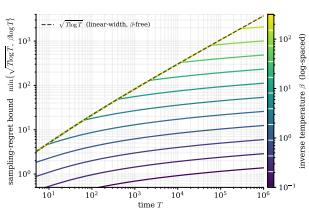
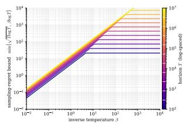

# The Tilted Sampling Problem: Optimism, Posterior Sampling, and Logarithmic Regret

Mohammad Pedramfar

Siamak Ravanbakhsh

Mila – Québec AI Institute, McGill University {mohammad.pedramfar,siamak.ravanbakhsh}@mila.quebec

## Abstract

Many modern learning systems are used not to select a single best action, but to sample diverse high-quality outputs. Examples include entropy-regularized reinforcement learning, RLHF, and reward-guided generative modeling. Motivated by these settings, we study tilted sampling: an online learning problem in which the goal is to sample from the Gibbs distribution induced by an unknown reward function. We define sampling regret as the temperature-normalized cumulative KL divergence between the learner’s distribution and the Gibbs target, corresponding to the suboptimality gap in entropy-regularized reward maximization. Our framework generalizes recent sampling-based and KL-regularized formulations in bandits and reinforcement learning. Our main contribution is a general regret framework that captures the diferent uncertainty structure of tilted sampling and classical regret minimization. While standard regret scales as $\widetilde { O } ( \sqrt { T } )$ due to first-order uncertainty, sampling regret is governed by squared confidence widths, yielding logarithmic-in-T regret in standard settings at fixed temperature. We develop sampling analogues of UCB and Thompson sampling (UCS and TS2) and provide unified regret decompositions that explain and extend recent logarithmic guarantees, including the first Bayesian samplingregret decomposition based on new bounds for posterior-random Gibbs distributions. Our results show that learning to sample from a softoptimal distribution is statistically distinct from learning to identify a hard optimum.

  
(a) Bound vs. horizon T.

  
(b) Bound vs. inverse temperature.  
Figure 1: Schematic sampling-regret upper bound $R ( T , \beta ) = \operatorname* { m i n } \{ \sqrt { T \log T } , \beta \log T \}$ illustrating the complementary linear- and squared-width bounds for UCS and $\mathrm { T S ^ { 2 } }$ in Theorems 3 and 4. (a) For fixed $\beta$ and $T >$ 1, the square-root branch is active when $T / \log T \le \beta ^ { 2 }$ and the logarithmic branch when $T / \log T \geq \beta ^ { 2 }$ . The large-horizon crossover satisfies $T ^ { \star } ( \beta ) = \beta ^ { 2 } \log T ^ { \star } ( \beta )$ ， with $T ^ { \star } ( \beta ) \sim 2 \beta ^ { 2 } \log \beta$ as $\beta \to \infty ;$ beyond it the bound follows β log T. (b) For each T the bound is linear in $\beta$ up to the kink $\beta ^ { \star } ( T ) = \sqrt { T / \log T }$ and saturates at $\sqrt { T \log T }$ beyond it.

## 1 INTRODUCTION

Classical bandit and reinforcement learning problems are formulated around optimization: the goal is to identify and repeatedly select actions with maximal reward [28, 3, 51]. Given an unknown reward function $f _ { \theta } ,$ performance is measured by regret relative to a maximizer arg maxa $f _ { \theta } ( a )$ . This formulation is appropriate when the desired behavior is a single best decision.

Many modern learning systems, however, are not used in this way. Large language models generate text by sampling [37], difusion models generate images by sampling [22], and stochastic policies in reinforcement learning sample actions [20]. In these settings, the output of the system is inherently distributional. The goal is often not to collapse onto one maximizer, but to bias a base distribution toward high-reward outputs while preserving diversity, entropy, or proximity to a reference model.

This structure appears explicitly in RLHF and preference-based fine-tuning, where the idealized KLregularized policy has the form

$$
\pi ^ { * } ( a ) \propto \pi _ { \mathrm { r e f } } ( a ) \exp ( \beta r ( a ) ) .
$$

It also appears in entropy-regularized reinforcement learning and maximum-entropy control [67, 19], as well as reward-guided generative modeling [15]. Abstractly, these settings lead to the Gibbs distribution

$$
S _ { \beta , t } ( f _ { \theta } ) ( d a ) = \frac { \exp ( \beta f _ { \theta } ( a ) ) } { Z _ { \beta , t } ( f _ { \theta } ) } \mu _ { t } ( d a ) ,
$$

where $\mu _ { t }$ is a base measure on the available action set $\boldsymbol { A } _ { t }$ and $\beta > 0$ is an inverse-temperature parameter.

This paper studies the online learning problem induced by this target. The learner interacts with the environment and aims to sample from the unknown Gibbs distribution rather than identify a single optimal action. We call this problem tilted sampling.

Our work builds directly on the multi-armed sampling framework of Pedramfar and Ravanbakhsh [39], which introduced the finite-armed analogue of this problem and showed that sampling can require substantially less explicit exploration than optimization. We generalize this framework beyond finite arms to general action spaces, time-varying feasible sets, function classes, and Bayesian posterior sampling.

Sampling regret. We measure performance via the cumulative KL divergence between the learner’s sampling distribution and the Gibbs target:

$$
\operatorname { S R e g r e t } ( T ) = { \frac { 1 } { \beta } } \sum _ { t = 1 } ^ { T } D _ { \operatorname { K L } } { \big ( } S _ { \beta , t } ( g _ { t } ) \| S _ { \beta , t } ( f _ { \theta } ) { \big ) } ~ .
$$

This objective coincides with the suboptimality gap of entropy-regularized reward maximization [67, 19].

A diferent uncertainty structure. The main conceptual message is that learning to sample is statistically distinct from learning to optimize. Classical regret is driven by first-order uncertainty and scales as $\widetilde { \cal O } ( \sqrt { T } )$ in standard models [3]. In contrast, sampling regret can be controlled by second-order uncertainty through squared confidence widths. This leads to logarithmicin-T regret in many settings at fixed temperature. Such logarithmic guarantees have been established in KLregularized bandits [66] and greedy RLHF analyses [58]. Our contribution is a unified framework of confidencewidth decompositions that explains and extends these results across sampling algorithms and function classes.

Bayesian regret. Beyond frequentist algorithms, we also introduce Bayesian sampling regret. This leads to $\mathrm { T S ^ { 2 } }$ , a Thompson-style sampling algorithm. Unlike classical Thompson sampling [47], this requires controlling KL divergence between random Gibbs distributions. Its analysis requires new KL-divergence bounds for posterior-random Gibbs distributions and provides the first Bayesian regret decomposition for sampling objectives.

Algorithms and contributions. Our framework develops the tilted-sampling counterpart of the confidencewidth approach to learning to optimize under bandit feedback [46].

We provide the first general regret framework for learning soft-optimal (Gibbs) distributions under bandit feedback, unifying optimistic and greedy analyses and establishing a Bayesian sampling-regret decomposition.

Our contributions are:

• A general framework for tilted sampling beyond the finite-armed setting to time-varying action sets, function classes, and the Bayesian setting.

• We introduce Sampling With Confidence (SWC) framework, Upper Confidence Sampling (UCS), and Thompson Sampling for Sampling (TS2).

• We show that the UCS and SWC regret decompositions generalize, simplify, and unify prior logarithmic-regret analyses for optimistic and greedy sampling methods through modelindependent confidence-width bounds.

• We give a novel Bayesian sampling-regret decomposition for $\mathrm { T S ^ { 2 } }$ , based on new KL-divergence bounds for posterior-sampled Gibbs distributions.

• Our regret decompositions extend to both directions of KL, providing a unified analysis of forward and reverse KL-divergences. In particular, the UCS and $\mathrm { T S ^ { 2 } }$ analyses yield simultaneous control of both quantities with identical bounds under the same confidence event and no exponential dependence on $\beta C$

• We show that second-order uncertainty control yields logarithmic-in-time sampling regret in standard models for fixed temperature.

• We provide a black-box transfer of confidence-set and width-process analyses from UCB and Thompson sampling to tilted sampling under direct noisy reward feedback, yielding guarantees for the corresponding UCS and $\mathrm { T S ^ { 2 } }$ procedures.

## 2 PROBLEM SETUP AND REGRET DECOMPOSITION

We study a sequential decision problem over $T$ rounds. Let A be the action space and let $\mathcal { F } = \{ f _ { \theta } : \mathcal { A }  \mathbb { R } \ \vert$ $\theta \in \Omega \}$ be the parameterized objective class. At each round t, the agent observes the available action set $\boldsymbol { A } _ { t } \subseteq \boldsymbol { A }$ together with the history

$$
H _ { t } = ( A _ { 1 } , A _ { 1 } , Y _ { 1 } , \ldots , A _ { t - 1 } , A _ { t - 1 } , Y _ { t - 1 } ) ,
$$

selects an action $A _ { t } \in { \mathcal { A } } _ { t }$ , and receives $Y _ { t } = f _ { \theta } ( A _ { t } ) + \varepsilon _ { t } .$ where $\theta \in \Omega$ is unknown, and $\mathbb { E } [ \varepsilon _ { t } \mid H _ { t } , \mathcal { A } _ { t } , \mathcal { A } _ { t } , \theta ] = 0$ We assume $f ( a ) \in [ 0 , C ]$ for all $f \in { \mathcal { F } }$ and $a \in A .$ In the Bayesian setting, we assume that θ is drawn from a prior distribution $\rho$ over the parameter space.

Let $A _ { t } ^ { \star } \in \arg \operatorname* { m a x } _ { a \in \mathcal { A } _ { t } } f _ { \theta } ( a )$ denote the optimal action. Throughout, all argmax operations are assumed to use a fixed measurable tie-breaking rule. The regret and Bayesian regret are

$$
\begin{array} { r l } & { \mathrm { R e g r e t } ( T ) = \sum _ { t = 1 } ^ { T } \left( f _ { \theta } \big ( A _ { t } ^ { \star } \big ) - f _ { \theta } \big ( A _ { t } \big ) \right) , } \\ & { \mathrm { B a y e s R e g r e t } ( T ) = \mathbb { E } _ { \theta \sim \rho } \biggl [ \sum _ { t = 1 } ^ { T } \left( f _ { \theta } \big ( A _ { t } ^ { \star } \big ) - f _ { \theta } \big ( A _ { t } \big ) \right) \biggr ] , } \end{array}
$$

where the expectation in BayesRegret(T) is taken over the prior on θ as well as the randomness of the algorithm and observations.

Confidence sets. Let $\mathcal { F } _ { t } = \mathcal { F } _ { t } ( H _ { t } , \mathcal { A } _ { t } ) \subseteq \mathcal { F }$ be confidence sets constructed from the revealed information. Intuitively, $\mathcal { F } _ { t }$ collects functions that are statistically plausible given the observed data and the sequence of available action sets. In many models, these arise from concentration inequalities or posterior credible regions (e.g., least-squares ellipsoids in linear models).

At each time step t, we define upper and lower confidence bounds only over the realized action set $\boldsymbol { A } _ { t }$ More precisely, for $a \in A _ { t } .$ , let $U _ { t } ( a ) = \operatorname* { s u p } _ { f \in { \mathcal { F } } _ { t } } f ( a )$ $L _ { t } ( a ) = \operatorname* { i n f } _ { f \in { \mathcal { F } } _ { t } } f ( a )$ , and $w _ { \mathcal { F } _ { t } } ( a ) = U _ { t } ( a ) \stackrel { } { - } L _ { t } ( a )$

Confidence sets play a central role in both algorithm design and analysis. For UCB, the upper envelope $U _ { t }$ induces optimism, encouraging exploration of actions with high uncertainty. For TS, while the algorithm itself does not explicitly use $\mathcal { F } _ { t } .$ these sets provide a convenient analytical tool to control regret. In particular, the width $w _ { \mathcal { F } _ { t } } ( a )$ quantifies the uncertainty about the reward of action a, and bounding the cumulative width along the trajectory will be the key step in our regret analysis.

Algorithms. We consider two canonical approaches to balancing exploration and exploitation. The $U p \mathbf { . }$ per Confidence Bound (UCB) algorithm selects actions optimistically according to the confidence sets:

$$
A _ { t } \in \arg \operatorname* { m a x } _ { a \in \mathcal { A } _ { t } } U _ { t } ( a ) .
$$

This strategy favors actions with high upper confidence bounds, thereby directing exploration toward actions whose rewards are uncertain. The Thompson Sampling (TS) algorithm instead randomizes according to the posterior distribution. At each round, it samples $\tilde { \theta } _ { t }$ ∼ $\rho ( \cdot \mid H _ { t } , \mathcal { A } _ { t } )$ and selects

$$
A _ { t } \in \arg \operatorname* { m a x } _ { a \in \mathcal { A } _ { t } } f _ { \tilde { \theta } _ { t } } ( a ) .
$$

UCB explores via optimism, while TS explores via randomized models sampled from the current posterior.

Regret Decomposition Although these algorithms are operationally diferent—one deterministic and optimistic, the other randomized and Bayesian—their regret can be analyzed through a common lens. In particular, both admit bounds in terms of the confidence widths $w _ { \mathcal { F } _ { t } } ( A _ { t } )$ , which capture the uncertainty encountered along the realized sequence of actions. The following result is classical. [46] We include it here for completeness.

Theorem 1. Let E denote the event $\{ f _ { \theta } \in \cap _ { t = 1 } ^ { T } \mathcal { F } _ { t } \}$ with the confidence sets and history generated by the algorithm under consideration. For UCB with fixed unknown $\theta \in \Omega ,$ , let E and P denote expectation and probability over observation noise and environmental or algorithmic randomness. Then

$$
\begin{array} { r } { \mathbb { E } [ \mathrm { R e g r e t } ( T ) ] \leq \mathbb { E } \left[ \sum _ { t = 1 } ^ { T } w _ { \mathcal { F } _ { t } } ( A _ { t } ) \right] + C T \mathbb { P } ( \mathcal { E } ^ { c } ) . } \end{array}
$$

For Thompson sampling with $\theta \sim \rho _ { ; }$ let E and P denote expectation and probability under the joint law of the prior draw, observations, environment, and posteriorsampling algorithm. Then

$$
\begin{array} { r } { \mathrm { B a y e s R e g r e t } ( T ) \leq \mathbb { E } \left[ \sum _ { t = 1 } ^ { T } w _ { \mathcal { F } _ { t } } ( A _ { t } ) \right] + 2 C T \mathbb { P } ( \mathcal { E } ^ { c } ) . } \end{array}
$$

See Appendix B for the proof.

## 3 TILTED SAMPLING

We now introduce a distributional analogue of bandit optimization: the learner aims to match the Gibbs distribution induced by the unknown reward function. Measuring regret by KL divergence leads to bounds in terms of squared confidence widths. When these widths accumulate logarithmically, the resulting sampling-regret guarantees are logarithmic in T for fixed temperature.

## 3.1 Sampling Objective

Because the available action set may vary with time, the relevant Gibbs distribution is defined on the currently revealed set $\boldsymbol { A } _ { t }$ rather than on the ambient action space ${ \mathcal { A } } .$ Fix $\beta > 0$ , and let $\mu$ be a base probability measure on ${ \mathcal { A } } .$ For each round $t ,$ let $\mu _ { t }$ denote the conditional measure

$$
\mu _ { t } ( B ) = \mu ( B \mid A _ { t } ) = { \frac { \mu ( B \cap A _ { t } ) } { \mu ( A _ { t } ) } } ,
$$

whenever $\mu ( \mathcal { A } _ { t } ) > 0$ . For any measurable function $f ,$ define the Gibbs distribution on $\boldsymbol { A } _ { t }$

$$
S _ { \beta , t } ( f ) ( d a ) = \frac { 1 } { Z _ { \beta , t } ( f ) } \exp ( \beta f ( a ) ) \mu _ { t } ( d a ) ,
$$

where $\begin{array} { r } { Z _ { \beta , t } ( f ) = \int _ { \mathcal { A } _ { t } } \exp ( \beta f ( a ) ) \mu _ { t } ( d a ) } \end{array}$ . Equivalently, $S _ { \beta , t } ( f )$ is the Gibbs tilt of the conditioned base measure $\mu _ { t } .$

The target distribution which we wish to learn is $S _ { \beta , t } ( f _ { \theta } )$ , which concentrates mass on high-reward actions while preserving exploration through temperature $\beta ^ { - 1 }$

Remark 1. To ensure that $\mu _ { t } = \mu ( \cdot \mid A _ { t } )$ is well defined, it sufices that each $\boldsymbol { A } _ { t }$ be measurable and satisfy $\mu ( \mathcal { A } _ { t } ) > 0$ almost surely. We assume throughout that these and any additional regularity conditions needed to define the Gibbs measures $S _ { \beta , t } ( f )$ hold. If A is finite or countable and $\mu$ has full support, these conditions are automatic.

## 3.2 Interaction Model

At each round $t ,$ the learner selects a function $g _ { t } : \mathcal { A } _ { t } $ R based on the history $H _ { t }$ and the revealed action set $\boldsymbol { \mathcal { A } } _ { t }$ , and samples

$$
A _ { t } \sim S _ { \beta , t } ( g _ { t } ) .
$$

This contrasts with the standard bandit setting, where a single action is selected deterministically or via TS. Here, the learner controls a full distribution over actions.

Note that, while the goal is to match the target distribution induced by $f _ { \theta } ,$ the learner may choose to act based on some $g _ { t } \notin { \mathcal { F } } .$ . However, as we will see in Upper Confidence Sampling (UCS) algorithm below, even if $g _ { t }$ is not in ${ \mathcal F } ,$ it is beneficial for it to be close to functions in the confidence set $\mathcal { F } _ { t }$ so that the action may provide more valuable information.

## 3.3 Sampling Regret

We measure performance via the divergence between the induced sampling distribution and the target distribution. We define the (cumulative) sampling regret

<table><tr><td>Bandit Optimization Tilted Sampling</td><td></td></tr><tr><td>max  $f ( a )$ </td><td> $\pi \propto \exp ( \beta f )$ </td></tr><tr><td> $\operatorname { N o n - s m o o t h }$ </td><td> $\mathrm { S m o o t h \ ( K L ) }$ </td></tr><tr><td> $\mathrm { F i r s t - o r d e r }$ </td><td>Second-order</td></tr><tr><td> $\sum w _ { t }  \sqrt { T }$ </td><td> $\sum w _ { t } ^ { 2 } \to \log T$ </td></tr><tr><td> $\mathrm { \overline { { U } C B } \mathrm { ~ / ~ T S } }$ </td><td> $\mathrm { \overline { { U } } C S ~ / ~ T S ^ { 2 } }$ </td></tr></table>

Table 1: Optimization vs. sampling. KL geometry smooths the objective, converting first-order uncertainty into second-order regret.

as

$$
\begin{array} { r } { \operatorname { S R e g r e t } ( T ) = \frac { 1 } { \beta } \sum _ { t = 1 } ^ { T } D _ { \mathrm { K L } } \big ( S _ { \beta , t } ( g _ { t } ) \parallel S _ { \beta , t } ( f _ { \theta } ) \big ) , } \end{array}
$$

and the Bayesian sampling regret as

$$
\begin{array} { r } { \mathrm { B S R e g r e t } ( T ) = \frac { 1 } { \beta } \mathbb { E } \left[ \sum _ { t = 1 } ^ { T } D _ { \mathrm { K L } } \big ( S _ { \beta , t } ( g _ { t } ) \| S _ { \beta , t } ( f _ { \theta } ) \big ) \right] , } \end{array}
$$

where the expectation is taken over $\theta \sim \rho$ and all randomness in the learner and observations. These notions of regret capture how well the learner approximates the optimal sampling distribution, rather than how well it identifies optimal actions.

Table 1 summarizes the key structural diference between bandit optimization and tilted sampling.

Regularized-value interpretation. Sampling regret is the suboptimality gap of KL-regularized reward maximization. For a distribution π on $\boldsymbol { A } _ { t }$ with finite $D _ { \mathrm { K L } } ( \pi \Vert \mu _ { t } )$ , define

$$
\begin{array} { r } { J _ { \beta , t , f } ( \pi ) = \operatorname { \mathbb { E } } _ { A \sim \pi } [ f ( A ) ] - \frac { 1 } { \beta } D _ { \mathrm { K L } } ( \pi \| \mu _ { t } ) . } \end{array}
$$

The Gibbs distribution $S _ { \beta , t } ( f )$ maximizes this objective, and its density gives the exact identity

$$
\begin{array} { r } { J _ { \beta , t , f } \big ( S _ { \beta , t } ( f ) \big ) - J _ { \beta , t , f } ( \pi ) = \frac { 1 } { \beta } D _ { \mathrm { K L } } \big ( \pi \| S _ { \beta , t } ( f ) \big ) . } \end{array}
$$

With $\textit { f } = \textit { f } _ { \theta }$ and $\pi ~ = ~ S _ { \beta , t } ( g _ { t } )$ , this identity expresses each term in sampling regret as the learner’s regularized-value gap. The factor $1 / \beta$ gives this gap the units and scale of reward regret, linking distribution matching to the zero-temperature optimization limit.

Bandit optimization as a limit of tilted sampling. The Gibbs sampling operator $S _ { \beta , t }$ interpolates between difuse sampling and hard maximization. Under mild regularity conditions, as $\beta \to \infty$ , the measure $S _ { \beta , t } ( f )$ concentrates on the maximizers of $f$ over $\boldsymbol { \mathcal { A } } _ { t } .$ . Thus UCS and $\mathrm { T S ^ { 2 } }$ recover UCB and Thompson sampling in the zero-temperature limit. $\mathrm { A }$ precise statement is given in Appendix C.

Alternative sampling regrets. The reverse-KL regret above is our primary notion of sampling regret because it has an exact entropy-regularized value interpretation and recovers classical regret in the zerotemperature limit. Following the multi-armed sampling literature [39], it is also natural to consider two other discrepancies between the learner’s sampling distribution and the target Gibbs distribution.

First, one may define the total-variation sampling regret

$$
\begin{array} { r } { \mathrm { T V - S R e g r e t } ( T ) = \frac { 1 } { \sqrt { \beta } } \sum _ { t = 1 } ^ { T } d _ { \mathrm { T V } } \big ( S _ { \beta , t } ( g _ { t } ) , S _ { \beta , t } ( f _ { \theta } ) \big ) . } \end{array}
$$

Unlike reverse-KL regret, total-variation regret does not coincide with entropy-regularized value suboptimality and does not recover the usual notion of regret as $\beta \to \infty$

Second, one may consider the forward-KL sampling regret

$$
\begin{array} { r } { \mathrm { F K L - S R e g r e t } ( T ) = \frac { 1 } { \beta } \sum _ { t = 1 } ^ { T } D _ { \mathrm { K L } } \big ( S _ { \beta , t } ( f _ { \theta } ) \big | \big | S _ { \beta , t } ( g _ { t } ) \big ) . } \end{array}
$$

Forward KL is a natural complementary measure: while reverse KL penalizes the learner for placing mass where the target places little mass, forward KL penalizes the learner for failing to cover regions where the target places mass.

Our main results focus on reverse-KL regret because of its variational interpretation. Nevertheless, our decompositions also control these alternative regret notions. In particular, SWC and UCS obtain matching reverse- and forward-KL bounds from Lemma 4, while $\mathrm { T S ^ { 2 } }$ obtains them through the same Bayesian KL-divergence argument. Total-variation regret can be related to KL regret via Pinsker’s inequality, $\begin{array} { r } { d _ { \mathrm { T V } } ( \pi , \pi ^ { * } ) \leq \sqrt { \frac { 1 } { 2 } D _ { \mathrm { K L } } ( \pi \| \pi ^ { * } ) } } \end{array}$ . Specifically, we see that

$$
\begin{array} { r l } & { \mathrm { T V - S R e g r e t } ( T ) = \displaystyle \frac { 1 } { \sqrt { \beta } } \sum _ { t = 1 } ^ { T } d _ { \mathrm { T V } } \big ( S _ { \beta , t } ( g _ { t } ) , S _ { \beta , t } ( f _ { \theta } ) \big ) } \\ & { \qquad \le \frac { 1 } { \sqrt { \beta } } \sum _ { t = 1 } ^ { T } \sqrt { \frac { 1 } { 2 } D _ { \mathrm { K L } } \left( S _ { \beta , t } ( g _ { t } ) , S _ { \beta , t } ( f _ { \theta } ) \right) } } \\ & { \qquad \le \sqrt { \frac { T } { 2 \beta } \sum _ { t = 1 } ^ { T } D _ { \mathrm { K L } } \left( S _ { \beta , t } ( g _ { t } ) , S _ { \beta , t } ( f _ { \theta } ) \right) } } \\ & { \qquad = \sqrt { \frac { T } { 2 } \mathrm { S R e g r e t } ( T ) } . } \end{array}
$$

Because of the symmetry, the same bound also holds if we replace SRegret with FKL-SRegret. Thus, if either of the KL regrets is logarithmic, then the total variation regret is $\mathcal { \tilde { O } } ( \sqrt { T } )$ . In the following, we analyze reverse-KL and forward-KL sampling regrets.

## 3.4 Algorithms

As before, we define confidence sets $\mathcal { F } _ { t }$ . We consider two natural analogues of UCB and TS. In Upper Confidence Sampling (UCS), we choose $g _ { t } = U _ { t }$ . In other words, we sample according to the upper confidence function $A _ { t } \sim S _ { \beta , t } ( U _ { t } )$

On the other hand, in Thompson Sampling for Sampling $( T S ^ { 2 } )$ , we sample $\tilde { \theta } _ { t } \sim \rho ( \cdot \mid H _ { t } , \mathcal { A } _ { t } )$ and select $g _ { t } = f _ { \tilde { \theta } _ { t } }$ . Thus, we have $A _ { t } \sim S _ { \beta , t } ( f _ { \tilde { \theta } _ { t } } )$ .

Note that if we replace $S _ { \beta }$ with arg max, then these algorithms reduce to classical UCB and TS. More precisely, under mild regularity assumptions, $S _ { \beta } ( f )$ concentrates on the maximizers of $f$ as $\beta \to \infty ;$ when the maximizer is unique, this convergence is to the corresponding Dirac measure. Therefore, UCS and $\mathrm { T S ^ { 2 } }$ can be viewed as smooth generalizations of UCB and Thompson sampling, with the Gibbs operator interpolating between sampling and maximization.

We say an algorithm follows the Sampling With Confidence (SWC) framework, if we have

$$
L _ { t } ( a ) \leq g _ { t } ( a ) \leq U _ { t } ( a ) ,
$$

for all $a \in \mathcal A _ { t }$ . Note that this does not require $g _ { t }$ to belong to $\mathcal { F } _ { t }$ or even $\mathcal { F }$ . Rather, it controls the range of possible values of $g _ { t } ( a )$ with the uncertainty induced by the confidence sets. Clearly UCS follows the SWC framework, since it chooses $g _ { t } = U _ { t }$

## 3.5 Sampling Regret Decomposition

The regret decompositions connect KL divergence between Gibbs distributions to uncertainty in their reward functions. Global Gibbs inequalities control the discrepancy between $S _ { \beta , t } ( g _ { t } )$ and $S _ { \beta , t } ( f _ { \theta } )$ through function diferences evaluated at sampled actions. Confidence bounds then control these diferences by $w _ { \mathcal { F } _ { t } }$ , yielding linear- and squared-width decompositions. SWC, UCS, and $\mathrm { T S ^ { 2 } }$ use this common structure in diferent ways.

Throughout this section, the SWC and UCS bounds use a fixed unknown θ, with E and P taken over observation noise and environmental or algorithmic randomness. The $\mathrm { T S ^ { 2 } }$ bounds use the joint Bayesian law with $\theta \sim$ $\rho ,$ including the prior draw and posterior-sampling randomness. Confidence events and width processes are evaluated under the corresponding algorithm’s law. Theorem 2 (Sampling Regret for SWC framework). Let E denote the event $\{ f _ { \theta } \in \cap _ { t = 1 } ^ { T } \mathcal { F } _ { t } \}$ . If the agent

$$
\begin{array} { r l } & { \mathbb { E } [ \mathrm { S R e g r e t } ( T ) ] \leq \frac { 1 } { 2 } \beta \exp ( \beta C ) \mathbb { E } \left[ \sum _ { t = 1 } ^ { T } ( w _ { \mathcal { F } _ { t } } ( A _ { t } ) ) ^ { 2 } \right] } \\ & { \qquad + 2 C T \mathbb { P } ( \xi ^ { c } ) . } \end{array}
$$

Moreover, the same bound holds with E[SRegret(T)] replaced by E[FKL-SRegret(T)].

The idea of the proof is to use Lemma 4 to bound $D _ { \mathrm { K L } }$ with the squared gap between $g _ { t }$ and $f _ { \theta }$ . See Appendix F for the detailed proof.

From prediction error to sampling regret. The squared-width structure begins with prediction error. For an SWC procedure with $\pi _ { t } = S _ { \beta , t } ( g _ { t } )$ , the confidence event $f _ { \boldsymbol { \theta } } \in \mathcal { F } _ { t }$ gives

$$
\begin{array} { r } { \mathbb { E } _ { A \sim \pi _ { t } } \Big [ ( g _ { t } ( A ) - f _ { \theta } ( A ) ) ^ { 2 } \Big ] \leq \mathbb { E } _ { A \sim \pi _ { t } } \Big [ w _ { \mathcal { F } _ { t } } ( A ) ^ { 2 } \Big ] . } \end{array}
$$

This bound has unit constant and weights reward errors according to the learner’s sampling distribution, giving little weight to errors in rarely sampled regions. The global Gibbs/KL inequalities in Lemmas 4 and 6 convert such prediction-error control into bounds on the discrepancy from the target distribution. They extend the local quadratic geometry of KL to finitetime guarantees throughout learning. Accumulating the squared widths determines the time dependence, while the conversion to KL determines the temperature dependence. For generic SWC, this conversion gives the exponential factor in Theorem 2. Optimism and posterior averaging lead to the sharper bounds below.

Optimism and exploration. Greedy sampling based on a reward estimate $g _ { t }$ is an SWC procedure whenever the estimate lies within the confidence envelope. At finite $\beta ,$ , Gibbs sampling can explore beyond the current estimated maximizers. As β increases, this exploration diminishes as the distribution concentrates on those maximizers. In the hard-maximization limit, a greedy rule can repeatedly select an apparently superior, well-estimated action while overlooking an underestimated alternative. Optimism directs exploration toward uncertain actions to avoid this failure. For UCS, it also removes the exponential factor from the squaredwidth bound and provides a temperature-independent linear-width bound.

Theorem 3 (Sampling Regret of UCS). Let E denote the event $\{ f _ { \theta } \in \cap _ { t = 1 } ^ { T } \mathcal { F } _ { t } \}$ . For UCS, we have

$$
\begin{array} { r l } & { \mathbb { E } [ \mathrm { S R e g r e t } ( T ) ] \leq \mathbb { E } \Big [ \sum _ { t = 1 } ^ { T } w _ { \mathcal { F } _ { t } } ( A _ { t } ) \Big ] + 2 C T \mathbb { P } ( \mathcal { E } ^ { c } ) , } \\ & { \mathbb { E } [ \mathrm { S R e g r e t } ( T ) ] \leq \frac { 1 } { 2 } \beta \mathbb { E } \Big [ \sum _ { t = 1 } ^ { T } ( w _ { \mathcal { F } _ { t } } ( A _ { t } ) ) ^ { 2 } \Big ] + 2 C T \mathbb { P } ( \mathcal { E } ^ { c } ) . } \end{array}
$$

Moreover, both inequalities remain valid with E[SRegret(T)] replaced by E[FKL-SRegret(T)].

See Appendix G for the proof.

Theorem 4 (Bayesian Sampling Regret of $\mathrm { T S ^ { 2 } } )$ . Let E denote the event $\{ f _ { \theta } \in \cap _ { t = 1 } ^ { T } \mathcal { F } _ { t } \}$ . For $T S ^ { 2 }$ , we have

$$
\begin{array} { r } { \mathrm { B S R e g r e t } ( T ) \le \mathbb { E } \left[ \sum _ { t = 1 } ^ { T } w _ { \mathcal { F } _ { t } } ( A _ { t } ) \right] + 4 C T \mathbb { P } ( \mathcal { E } ^ { c } ) , } \end{array}
$$

$$
\begin{array} { r } { \mathrm { B S R e g r e t } ( T ) \leq \beta \mathbb { E } \Big [ \sum _ { t = 1 } ^ { T } ( w _ { \mathcal { F } _ { t } } ( A _ { t } ) ) ^ { 2 } \Big ] + 4 C T \mathbb { P } ( \mathcal { E } ^ { c } ) . } \end{array}
$$

Moreover, both inequalities remain valid with BSRegret(T) replaced by E[FKL-BSRegret(T)].

Posterior exchangeability gives $\mathrm { T S ^ { 2 } }$ its two-sided KL guarantee: conditional on the history and action set, the true parameter and posterior draw are i.i.d., and restricting to the confidence event preserves this symmetry. Swapping them equates the expected directed-KL terms; Lemma 6 yields the squared-width bound, while Lemma 5 gives the linear-width bound. For UCS, pointwise optimism controls both KL directions with identical exponential-free bounds; generic SWC incurs the factor exp(βC). See Appendices G, F, and H for details.

Role of $\beta$ and geometric regimes. UCS and $\mathrm { T S ^ { 2 } }$ admit temperature-independent linear-width bounds and temperature-dependent squared-width bounds. Write $D = ( 1 + \gamma _ { T } ) d _ { E }$ in Theorem 5; up to logarithmic factors, the resulting guarantee is min $\left\{ { \sqrt { D T } } , \beta D \right\}$ , so the squared-width bound is smaller when $\beta \leq \sqrt { T / D }$ Figure 1 illustrates the schematic case $D \asymp \log T$ , with crossover $\beta ^ { \star } ( T ) = \sqrt { T / \log T }$ Thus, at fixed $\beta ,$ the logarithmic branch is eventually smaller as $T$ grows; at fixed $T ,$ suficiently large $\beta$ favors the square-root branch. The crossover depends on statistical complexity and reward normalization.

By contrast, writing $\begin{array} { r } { W _ { 2 } ( T ) ~ = ~ \mathbb { E } [ \sum _ { t = 1 } ^ { T } w _ { \mathcal { F } _ { t } } ( A _ { t } ) ^ { 2 } ] } \end{array}$ generic SWC’s reverse- and forward-KL bounds are sublinear when $\beta \exp ( \beta C ) W _ { 2 } ( T ) = o ( T )$ , assuming sublinear confidence-failure terms. No temperatureindependent sublinear guarantee holds uniformly over SWC, which includes greedy procedures whose hardmaximization limits can incur linear regret. This contrast highlights the additional guarantees of UCS and $\mathrm { T S ^ { 2 } }$

## 4 A BLACK-BOX TRANSFER OF CONFIDENCE-WIDTH ANALYSES TO SAMPLING REGRET

Theorems 3 and 4 separate the analysis of tilted sampling into two components: a Gibbs/KL decomposition and a statistical bound on the accumulated confidence widths. This separation provides a black-box transfer principle for analyses in the UCB and Thompsonsampling framework of Russo and Van Roy [46]. Replacing maximization with Gibbs sampling gives UCS and $\mathrm { T S ^ { 2 } } ;$ supplying bounds on their width processes gives sampling-regret guarantees for every fixed $\beta > 0$ Linear-width bounds give temperature-independent guarantees, and squared-width bounds give the complementary temperature-dependent guarantees.

The underlying model has direct noisy reward feedback and no unknown transition dynamics. The statistical inputs are confidence sets valid under the sampling procedure and bounds on the widths along its action sequence. These inputs can come from standard confidence-set and Eluder-dimension arguments or from other model-specific constructions. Each construction can be combined with the same Gibbs/KL decomposition.

Self-normalized concentration and Eluder-dimension arguments used in bandit optimization often control squared widths as well as linear widths. The following subsections develop this route using the framework of Russo and Van Roy [46, 45]: we construct confidence sets, bound their squared-width process, and combine these bounds with the sampling-regret decompositions.

## 4.1 Confidence Sets

We now discuss a general construction of confidence sets based on least-squares estimation. The key point is that this construction, together with standard concentration results and Eluder-dimension arguments, is classical and independent of the sampling objective itself.

Assume throughout that the observation noise is conditionally σ-sub-Gaussian. Define the cumulative squared loss $\begin{array} { r } { L _ { 2 , t } ( f ) = \sum _ { s < t } ( f ( A _ { s } ) - Y _ { s } ) ^ { 2 } } \end{array}$ , and let $\hat { f } _ { t } ^ { \mathrm { L S } } \in \arg \operatorname* { m i n } _ { f \in \mathcal { F } } L _ { 2 , t } ( f )$ denote a least-squares estimator. For a function $h : { \mathcal { A } }  \mathbb { R }$ , define the empirical norm $\begin{array} { r } { \| h \| _ { 2 , E _ { t } } ^ { 2 } : = \sum _ { s < t } h ( A _ { s } ) ^ { 2 } } \end{array}$ . Following [46], we consider confidence sets of the form

$$
\mathcal { F } _ { t } = \left\{ f \in \mathcal { F } : \| f - \hat { f } _ { t } ^ { \mathrm { L S } } \| _ { 2 , E _ { t } } \leq \sqrt { \gamma _ { t } } \right\} ,
$$

where the increasing sequence $\gamma _ { t }$ is chosen so that the confidence sets contain $f _ { \theta }$ uniformly over time with high probability. In the setting considered in [46], noise is assumed to be sub-Gaussian and $\gamma _ { t }$ depends on the sub-Gaussian noise parameter, the confidence level, and the metric entropy of ${ \mathcal F } .$ . More precisely, if $\dim _ { K } ( { \mathcal { F } } )$ denotes the Kolmogorov dimension of ${ \mathcal F } .$ then Propositions 6 and 7 of [46] show that, for a fixed horizon $T _ { \mathrm { : } }$ one may choose an increasing sequence $\gamma _ { t }$ such that max $_ { 1 \leq t \leq T } \gamma _ { t } = \widetilde { O } \bigl ( 1 + \mathrm { d i m } _ { K } ( \mathcal { F } ) \bigr )$ and the confidence event ${ \mathcal { E } } = \left\{ f _ { \theta } \in \cap _ { t = 1 } ^ { \dot { T } } { \mathcal { F } } _ { t } \right\}$ satisfies $\mathbb { P } ( \mathcal { E } ^ { c } ) \leq$ $1 / T$ In particular, for standard finite-dimensional parametric classes, one may choose $\operatorname* { m a x } _ { 1 \leq t \leq T } \gamma _ { t } \ =$ $\widetilde O ( d )$ , where d is the efective dimension of the model class. If $\mathcal { F }$ is finite, one may choose, for every $t \leq T$ we have $\gamma _ { t } = 8 \sigma ^ { 2 } \log ( 2 | \mathcal { F } | \dot { T } )$ , which follows directly from the finite-class confidence bound in [46].

## 4.2 Eluder Dimension and the Squared Width Process

We now introduce the complexity measure controlling the squared width process. We begin by recalling the standard notion of Eluder dimension introduced in [46]. Definition 1. Let $\mathcal { F }$ be a class of functions $f :$ $A  \mathbb { R }$ and let $\varepsilon > 0$ . An action $a \ \in \ A$ is said to be ε-dependent on $\{ a _ { 1 } , \ldots , a _ { n } \}$ if for all $f , g \in { \mathcal { F } }$ $\textstyle \sum _ { i = 1 } ^ { n } ( f ( a _ { i } ) - g ( a _ { i } ) ) ^ { 2 } \leq { \dot { \varepsilon } } ^ { 2 }$ implies that $| f ( a ) - g ( a ) | \leq \varepsilon$ Otherwise, a is ε-independent. The ε-eluder dimension $\dim _ { E } ( { \mathcal { F } } , \varepsilon )$ is the length of the longest sequence $( a _ { 1 } , \ldots , a _ { d } )$ such that each $a _ { t }$ is ε-independent of $\{ a _ { 1 } , \dotsc , a _ { t - 1 } \}$

Eluder dimension controls how long uncertainty can persist along a trajectory of actions. To quantify accumulated squared uncertainty, we use a squaredratio variant of the eluder coeficient in Zhang [64, Definition 17.17]. The historical discussion in Section 17.6 of that book traces the eluder-coeficient concept to Dann et al. [12], where it is called a decoupling coeficient. The definition below uses an untruncated sum of squared ratios, whereas Zhao et al. [66, Definition 3.3] clips each squared term at one.

Definition 2. Let $\mathcal { F }$ be a class of functions $f : { \mathcal { A } }  \mathbb { R } .$ and fix $\epsilon > 0$ . Given a history of actions $A _ { 1 } , \dotsc , A _ { t - 1 }$ define the local uncertainty at action $a \in { \mathcal { A } }$ by

$$
\sigma ( a ) : = \operatorname* { s u p } _ { f , g \in { \mathcal { F } } } { \frac { | f ( a ) - g ( a ) | } { \sqrt { \epsilon + \sum _ { s < t } ( f ( A _ { s } ) - g ( A _ { s } ) ) ^ { 2 } } } } .
$$

Note that the function σ depends on $a , \epsilon , { \mathcal { F } }$ , and the sequence of actions $\{ A _ { i } \} _ { i = 1 } ^ { t - 1 }$ . When there is no ambiguity, we use $\sigma _ { t } ( a )$ to denote $\sigma \left( a ; \epsilon , \mathcal { F } , \{ A _ { i } \} _ { i = 1 } ^ { t - 1 } \right)$ The squared eluder coeficient $\mathrm { E C } ^ { \mathrm { { \dot { \mathrm { s q } } } } } ( \epsilon , \mathcal { F } , T )$ is the smallest number d such that, for every action sequence $a _ { 1 } , \dots , a _ { T }$ and every sequence of function pairs $( f _ { t } , g _ { t } ) _ { t = 1 } ^ { T }$ with $f _ { t } , g _ { t } \in \mathcal { F }$

$$
\sum _ { t = 1 } ^ { T } \frac { ( f _ { t } ( a _ { t } ) - g _ { t } ( a _ { t } ) ) ^ { 2 } } { \epsilon + \sum _ { s < t } ( f _ { t } ( a _ { s } ) - g _ { t } ( a _ { s } ) ) ^ { 2 } } \leq d .
$$

The importance of this quantity comes from the following elementary observation. Once confidence sets are defined through empirical least-squares constraints, the definition itself immediately yields bounds for both the width process and the squared width process. See Appendix I for the proof of the following proposition. Proposition 1. For every $a \in { \mathcal { A } }$ and every $\epsilon > 0 \AA$ , we have $w _ { \mathcal { F } _ { t } } ( a ) \leq \sqrt { \epsilon + 4 \gamma _ { t } } \sigma _ { t } ( a )$ . Thus

$$
\sum _ { t = 1 } ^ { T } w _ { \mathcal { F } _ { t } } ^ { 2 } ( A _ { t } ) \leq ( \epsilon + 4 \gamma _ { T } ) \mathrm { E C } ^ { \mathrm { s q } } ( \epsilon , \mathcal { F } , T ) ,
$$

$$
\sum _ { t = 1 } ^ { T } w _ { \mathcal { F } _ { t } } ( A _ { t } ) \leq \sqrt { ( \epsilon + 4 \gamma _ { T } ) \operatorname { E C } ^ { \mathrm { s q } } ( \epsilon , \mathcal { F } , T ) T } .
$$

Thus the same second-order quantity simultaneously controls both the sampling regret bounds of Section 3 and the classical width process appearing in RL regret analyses. The next result shows that the squared Eluder coeficient remains closely connected to the classical Eluder dimension.

The Tilted Sampling Problem: Optimism, Posterior Sampling, and Logarithmic Regret
<table><tr><td>Problem</td><td> $\gamma _ { T }$ </td><td> $d _ { E }$ </td><td> $( 1 + \gamma _ { T } ) d _ { E }$ </td><td>Prior special case</td></tr><tr><td>K-armed bandit</td><td> ${ \widetilde { O } } ( \log K )$ </td><td> ${ \widetilde { O } } ( K )$ </td><td> ${ \widetilde { O } } ( K \log K )$ </td><td>SWC–RKL/FKL [39]</td></tr><tr><td>Finite class  $\mathcal { F }$ </td><td> ${ \widetilde { O } } ( \log | { \mathcal { F } } | )$ </td><td> $d _ { E }$ </td><td> $\widetilde { O } ( d _ { E } \log | \mathcal { F } | )$ </td><td>UCS-RKL [66] Greedy-RKL-pref. [58]</td></tr><tr><td>Linear bandit (d-dim.)</td><td> $\widetilde O ( d )$ </td><td> $\widetilde O ( d )$ </td><td> $\widetilde O ( d ^ { 2 } )$ </td><td></td></tr><tr><td>Sparse linear (s-sparse)</td><td> ${ \widetilde { O } } ( s \log d )$ </td><td> $\widetilde O ( d )$ </td><td> ${ \widetilde { O } } ( s d \log d )$ </td><td></td></tr><tr><td>GLM (d-dim.)</td><td> $\widetilde O ( d )$ </td><td> $\widetilde O ( d )$ </td><td> $\widetilde O ( d ^ { 2 } )$ </td><td></td></tr></table>

Table 2: Complexity instantiations for Theorem 5. Here $d _ { E } = \mathrm { E C } ^ { \mathrm { s q } } ( 1 , \mathcal { F } , T )$ , and rates suppress logarithmic factors in T and problem-dependent constants. Substituting the fourth column into Theorem 5 gives two-sided UCS, $\mathrm { T S ^ { 2 } }$ , and SWC regret bounds. The final column records the limited prior special cases: Pedramfar and Ravanbakhsh [39] treat finite-armed SWC for both KL directions, with bounded noise assumed for forward KL; Zhao et al. [66] establish the finite-class result only for UCS and reverse $\operatorname { K L } ;$ and Wu et al. [58] analyze greedy sampling under preference feedback, with reverse-KL-equivalent regret in the Bradley–Terry specialization. Our SWC result instead uses direct reward feedback. For finite ${ \mathcal { F } } _ { : }$ , cardinality controls $\gamma _ { T }$ , while $d _ { E }$ remains a separate, model-dependent exploration complexity. The sparse-linear row uses the generic ambient-dimensional bound on $d _ { E } ;$ sharper rates require additional structure. The generalized-linear row assumes the usual quantitative regularity conditions on the link function.

Proposition 2. Assume that for some constants $a , b \geq$ 0 and a non-negative function c, we have dim $\iota _ { E } ( \mathcal { F } , \varepsilon ) \leq$ $c ( T ) \varepsilon ^ { - a } \log ( 1 / \varepsilon ) ^ { b }$ , for all $\varepsilon > 0$ . Then

$$
\mathrm { E C } ^ { \mathrm { s q } } ( \epsilon , \mathcal { F } , T ) = \tilde { O } \left( \left( \epsilon ^ { - 1 } + c ( T ) ( 1 + \epsilon ^ { - 1 } ) \right) T ^ { a / ( a + 2 ) } \right) .
$$

## 4.3 General Regret Guarantees

We now combine the regret decompositions of Section 3 with the confidence-set and Eluder-type analysis developed above. Specifically, using Theorems 2, 3, 4, Proposition 1 and the discussion in Subsection 4.1, we immediately obtain the following theorem.

Theorem 5. For UCS and SWC, use expected sampling regret with fixed unknown θ; for $T S ^ { 2 }$ , use Bayesian sampling regret with $\theta \sim \rho .$ . Expectations and confidence-event probabilities follow the corresponding algorithm’s law, as in Section 3.5. If confidence sets are chosen as discussed in Subsection 4.1 with $\mathbb { P } ( \mathcal { E } ^ { c } ) = O ( 1 / T )$ , then reverse- and forward-KL regret of UCS and $T S ^ { 2 }$ are bounded by

$$
\tilde { O } \left( \operatorname* { m i n } \left\{ \sqrt { ( 1 + \gamma _ { T } ) d _ { E } T } , \beta ( 1 + \gamma _ { T } ) d _ { E } \right\} \right) ,
$$

where $d _ { E } : = \mathrm { E C } ^ { \mathrm { s q } } ( 1 , \mathcal { F } , T )$ . Moreover, for any algorithm that follows SWC framework with respect to such a choice of confidence sets, both reverse- and forward-KL regrets are bounded by

$$
\tilde { O } ( \beta \exp ( \beta C ) ( 1 + \gamma _ { T } ) d _ { E } ) .
$$

In particular, the choice $\gamma _ { T } = \tilde { O } ( 1 + \mathrm { d i m } _ { K } ( \mathcal { F } ) )$ recovers the corresponding bounds in terms of Kolmogorov dimension.

Theorem 5 instantiates the sampling-regret decompositions with confidence-radius and squared-width bounds. This gives a common route from model-specific complexity bounds to guarantees for UCS, $\mathrm { T S ^ { \bar { 2 } } }$ , and SWC. The squared-width UCS bound recovers the optimistic decomposition of Zhao et al. [66] in their bandit setting when paired with their confidence sets and width bound. Finite-armed SWC procedures connect to the sampling framework of Pedramfar and Ravanbakhsh [39]. The greedy analysis of Wu et al. [58] uses pairwise preference feedback; adapting its proof strategy to direct reward feedback gives the corresponding SWC-type reverse-KL guarantee. Table 2 lists model-specific instantiations, and Appendix A details these connections.

## 5 LIMITATIONS AND FUTURE DIRECTIONS

The logarithmic-in-T guarantees hold at fixed β. UCS and $\mathrm { T S ^ { 2 } }$ also admit temperature-independent linearwidth bounds, while generic SWC incurs the factor $\exp ( \beta C )$ for both KL directions. A matching lower bound for the joint dependence on T, β, and functionclass complexity remains open. The analysis assumes bounded rewards, direct noisy reward feedback, and exact Gibbs sampling. Accounting for approximatesampling error and computational cost, together with empirical evaluation, are natural directions for future work.

## Acknowledgements

This research is in part supported by CIFAR AI Chairs and the NSERC Discovery program.

## REFERENCES

[1] Akhound-Sadegh, T., Rector-Brooks, J., Bose, A. J., Mittal, S., Lemos, P., Liu, C.-H., Sendera, M., Ravanbakhsh, S., Gidel, G., Bengio, Y., Malkin, N., and Tong, A. (2024). Iterated denoising energy matching for sampling from Boltzmann densities. In International Conference on Machine Learning.

[2] Andrieu, C. and Thoms, J. (2008). A tutorial on adaptive MCMC. Statistics and Computing, 18:343– 373.

[3] Auer, P., Cesa-Bianchi, N., and Fischer, P. (2002). Finite-time Analysis of the Multiarmed Bandit Problem. Machine Learning, 47(2):235–256.

[4] Azar, M. G., Guo, Z. D., Piot, B., Munos, R., Rowland, M., Valko, M., and Calandriello, D. (2024). A General Theoretical Paradigm to Understand Learning from Human Preferences. In Proceedings of The 27th International Conference on Artificial Intelligence and Statistics, pages 4447–4455. PMLR.

[5] Bakry, D., Gentil, I., and Ledoux, M. (2014). Analysis and Geometry of Markov Difusion Operators. Springer.

[6] Bengio, E., Jain, M., Korablyov, M., Precup, D., and Bengio, Y. (2021). Flow network based generative models for non-iterative diverse candidate generation. In Advances in Neural Information Processing Systems.

[7] Bengio, Y., Lahlou, S., Deleu, T., Hu, E. J., Tiwari, M., and Bengio, E. (2023). GFlowNet foundations. Journal of Machine Learning Research, 24.

[8] Berner, J., Richter, L., and Ullrich, K. (2024). An optimal control perspective on difusion-based generative modeling. Transactions on Machine Learning Research.

[9] Black, K., Janner, M., Du, Y., Kostrikov, I., and Levine, S. (2024). Training difusion models with reinforcement learning. In International Conference on Learning Representations.

[10] Cen, S., Cheng, C., Chen, Y., Wei, Y., and Chi, Y. (2022). Fast global convergence of natural policy gradient methods with entropy regularization. Operations Research, 70(4):2563–2578.

[11] Christiano, P. F., Leike, J., Brown, T., Martic, M., Legg, S., and Amodei, D. (2017). Deep Reinforcement Learning from Human Preferences. In Advances in Neural Information Processing Systems, volume 30. Curran Associates, Inc.

[12] Dann, C., Mohri, M., Zhang, T., and Zimmert, J. (2021). A provably eficient model-free posterior sampling method for episodic reinforcement learning. In Advances in Neural Information Processing Systems, volume 34, pages 12040–12051.

[13] Del Moral, P., Doucet, A., and Jasra, A. (2006). Sequential Monte Carlo samplers. Journal of the Royal Statistical Society: Series B, 68(3):411–436.

[14] Dembo, A. and Zeitouni, O. (2009). Large Deviations Techniques and Applications. Springer Berlin Heidelberg.

[15] Dhariwal, P. and Nichol, A. (2021). Difusion Models Beat GANs on Image Synthesis. In Advances in Neural Information Processing Systems, volume 34, pages 8780–8794. Curran Associates, Inc.

[16] Dudík, M., Hofmann, K., Schapire, R. E., Slivkins, A., and Zoghi, M. (2015). Contextual Dueling Bandits. In Proceedings of The 28th Conference on Learning Theory, pages 563–587. PMLR.

[17] Ellis, R. S. (2006). Entropy, Large Deviations, and Statistical Mechanics. Springer Berlin Heidelberg.

[18] Fan, Y., Watkins, O., Du, Y., Liu, H., Ryu, M., Boutilier, C., Abbeel, P., Ghavamzadeh, M., Lee, K., and Lee, K. (2023). DPOK: Reinforcement learning for fine-tuning text-to-image difusion models. Advances in Neural Information Processing Systems.

[19] Haarnoja, T., Tang, H., Abbeel, P., and Levine, S. (2017). Reinforcement Learning with Deep Energy-Based Policies. In Proceedings of the 34th International Conference on Machine Learning, pages 1352–1361. PMLR.

[20] Haarnoja, T., Zhou, A., Abbeel, P., and Levine, S. (2018). Soft Actor-Critic: Of-Policy Maximum Entropy Deep Reinforcement Learning with a Stochastic Actor. In Proceedings of the 35th International Conference on Machine Learning, pages 1861–1870. PMLR.

[21] Hastings, W. K. (1970). Monte Carlo sampling methods using Markov chains and their applications. Biometrika, 57(1):97–109.

[22] Ho, J., Jain, A., and Abbeel, P. (2020). Denoising Difusion Probabilistic Models. In Advances in Neural Information Processing Systems, volume 33, pages 6840–6851. Curran Associates, Inc.

[23] Jain, M., Bengio, E., Hernández-García, A., Rector-Brooks, J., Dossou, B. F. P., Ekbote, C., Fu, J., Zhang, T., Kilgour, M., Zhang, D., Simine, L., Das, P., and Bengio, Y. (2022). Biological sequence design with GFlowNets. In International Conference on Machine Learning.

[24] Kappen, H. J. (2005). Path integrals and symmetry breaking for optimal control theory. Jour-

nal of statistical mechanics: theory and experiment, 2005(11):P11011–P11011.

[25] Kim, M., Choi, S., Yun, T., Bengio, E., Feng, L., Rector-Brooks, J., Ahn, S., Park, J., Malkin, N., and Bengio, Y. (2025). Adaptive teachers for amortized samplers. In International Conference on Learning Representations.

[26] Kim, M., Yun, T., Bengio, E., Zhang, D., Bengio, Y., Ahn, S., and Park, J. (2024). Local search GFlowNets. In International Conference on Learning Representations.

[27] Lahlou, S., Deleu, T., Lemos, P., Zhang, D., Volokhova, A., Hernández-García, A., Ezzine, L. N., Bengio, Y., and Malkin, N. (2023). A theory of continuous generative flow networks. In International Conference on Machine Learning.

[28] Lai, T. and Robbins, H. (1985). Asymptotically efficient adaptive allocation rules. Advances in Applied Mathematics, 6(1):4–22.

[29] Levine, S. (2018). Reinforcement Learning and Control as Probabilistic Inference: Tutorial and Review. arXiv:1805.00909 [cs].

[30] Madan, K., Rector-Brooks, J., Korablyov, M., Bengio, E., Jain, M., Nica, A., Bosc, T., Bengio, Y., and Malkin, N. (2023). Learning GFlowNets from partial episodes for improved convergence and stability. In International Conference on Machine Learning.

[31] Malkin, N., Jain, M., Bengio, E., Sun, C., and Bengio, Y. (2022). Trajectory balance: Improved credit assignment in GFlowNets. In Advances in Neural Information Processing Systems.

[32] Metropolis, N., Rosenbluth, A. W., Rosenbluth, M. N., Teller, A. H., and Teller, E. (1953). Equation of state calculations by fast computing machines. The Journal of Chemical Physics, 21(6):1087–1092.

[33] Midgley, L. I., Stimper, V., Simm, G. N. C., Schölkopf, B., and Hernández-Lobato, J. M. (2023). Flow annealed importance sampling bootstrap. In International Conference on Learning Representations.

[34] Neal, R. M. (2011). MCMC using Hamiltonian dynamics. In Handbook of Markov Chain Monte Carlo. Chapman & Hall/CRC.

[35] Neu, G., Jonsson, A., and Gómez, V. (2017). A unified view of entropy-regularized Markov decision processes. arXiv:1705.07798 [cs].

[36] Noé, F., Olsson, S., Köhler, J., and Wu, H. (2019). Boltzmann generators: Sampling equilibrium states of many-body systems with deep learning. Science, 365(6457).

[37] Ouyang, L., Wu, J., Jiang, X., Almeida, D., Wainwright, C., Mishkin, P., Zhang, C., Agarwal, S., Slama, K., Ray, A., et al. (2022). Training language models to follow instructions with human feedback. Advances in neural information processing systems, 35:27730–27744.

[38] Pan, L., Zhang, D., Courville, A., Huang, L., and Bengio, Y. (2023). Generative augmented flow networks. In International Conference on Learning Representations.

[39] Pedramfar, M. and Ravanbakhsh, S. (2025). Multi-Armed Sampling Problem and the End of Exploration. arXiv:2507.10797 [cs].

[40] Rafailov, R., Sharma, A., Mitchell, E., Manning, C. D., Ermon, S., and Finn, C. (2023). Direct Preference Optimization: Your Language Model is Secretly a Reward Model. Advances in Neural Information Processing Systems, 36:53728–53741.

[41] Rawlik, K., Toussaint, M., and Vijayakumar, S. (2012). On stochastic optimal control and reinforcement learning by approximate inference. In Proceedings of Robotics: Science and Systems VIII.

[42] Rector-Brooks, J., Madan, K., Jain, M., Korablyov, M., Liu, C.-H., Chandar, S., Malkin, N., and Bengio, Y. (2023). Thompson sampling for improved exploration in GFlowNets. In ICML 2023 Workshop on Structured Probabilistic Inference & Generative Modeling.

[43] Roberts, G. O. and Rosenthal, J. S. (2009). Examples of adaptive MCMC. Journal of Computational and Graphical Statistics, 18(2):349–367.

[44] Roberts, G. O. and Tweedie, R. L. (1996). Exponential convergence of Langevin distributions and their discrete approximations. Bernoulli, 2(4):341– 363.

[45] Russo, D. and Van Roy, B. (2013). Eluder Dimension and the Sample Complexity of Optimistic Exploration. In Advances in Neural Information Processing Systems, volume 26. Curran Associates, Inc.

[46] Russo, D. and Van Roy, B. (2014). Learning to Optimize Via Posterior Sampling. Technical Report arXiv:1301.2609, arXiv. arXiv:1301.2609 [cs] type: article.

[47] Russo, D. J., Van Roy, B., Kazerouni, A., Osband, I., and Wen, Z. (2018). A tutorial on thompson sampling. Foundations and Trends in Machine Learning, 11(1):1–96.

[48] Schulman, J., Wolski, F., Dhariwal, P., Radford, A., and Klimov, O. (2017). Proximal Policy Optimization Algorithms. arXiv:1707.06347 [cs].

[49] Sendera, M., Kim, M., Mittal, S., Lemos, P., Scimeca, L., Rector-Brooks, J., Adam, A., Bengio, Y., and Malkin, N. (2024). Improved of-policy training of difusion samplers. In Advances in Neural Information Processing Systems.

[50] Shen, M. W., Bengio, E., Hajiramezanali, E., Loukas, A., Cho, K., and Biancalani, T. (2023). Towards understanding and improving GFlowNet training. In International Conference on Machine Learning.

[51] Sutton, R. S. and Barto, A. G. (2018). Reinforcement Learning: An Introduction. MIT Press. Google-Books-ID: uWV0DwAAQBAJ.

[52] Theodorou, E., Buchli, J., and Schaal, S. (2010). A generalized path integral control approach to reinforcement learning. The Journal of Machine Learning Research, 11:3137–3181.

[53] Todorov, E. (2006). Linearly-solvable Markov decision problems. In Advances in Neural Information Processing Systems, volume 19. MIT Press.

[54] Vargas, F., Grathwohl, W., and Doucet, A. (2023). Denoising difusion samplers. In International Conference on Learning Representations.

[55] Vargas, F., Padhy, S., Blessing, D., and Nüsken, N. (2024). Transport meets variational inference: Controlled Monte Carlo difusions. In International Conference on Learning Representations.

[56] Vempala, S. and Wibisono, A. (2019). Rapid convergence of the unadjusted Langevin algorithm: Isoperimetry sufices. In Advances in Neural Information Processing Systems.

[57] Wang, C., Jiang, Y., Yang, C., Liu, H., and Chen, Y. (2024). Beyond Reverse KL: Generalizing Direct Preference Optimization with Diverse Divergence Constraints. International Conference on Learning Representations, 2024:10450–10480.

[58] Wu, D., Shi, C., Yang, J., and Shen, C. (2025). Greedy Sampling Is Provably Eficient for RLHF. arXiv:2510.24700 [cs] version: 1.

[59] Xiong, W., Dong, H., Ye, C., Wang, Z., Zhong, H., Ji, H., Jiang, N., and Zhang, T. (2024). Iterative Preference Learning from Human Feedback: Bridging Theory and Practice for RLHF under KLconstraint. In Proceedings of the 41st International Conference on Machine Learning, pages 54715–54754. PMLR.

[60] Yuan, H., Yuan, Z., Tan, C., Wang, W., Huang, S., and Huang, F. (2023). RRHF: Rank Responses to Align Language Models with Human Feedback. Advances in Neural Information Processing Systems, 36:10935–10950.

[61] Yue, Y., Broder, J., Kleinberg, R., and Joachims, T. (2012). The K-armed dueling bandits problem. Journal of Computer and System Sciences, 78(5):1538–1556.

[62] Zhang, D., Chen, R. T. Q., Liu, C.-H., Courville, A., and Bengio, Y. (2024). Difusion generative flow samplers: Improving learning signals through partial trajectory optimization. In International Conference on Learning Representations.

[63] Zhang, Q. and Chen, Y. (2022). Path integral sampler: A stochastic control approach for sampling. In International Conference on Learning Representations.

[64] Zhang, T. (2023). Mathematical Analysis of Machine Learning Algorithms. Cambridge University Press.

[65] Zhao, H., Ye, C., Gu, Q., and Zhang, T. (2025a). Sharp Analysis for KL-Regularized Contextual Bandits and RLHF. Advances in Neural Information Processing Systems, 38:107964–108002.

[66] Zhao, H., Ye, C., Xiong, W., Gu, Q., and Zhang, T. (2025b). Logarithmic Regret for Online KL-Regularized Reinforcement Learning. In Proceedings of the 42nd International Conference on Machine Learning, pages 77864–77884. PMLR.

[67] Ziebart, B. D., Maas, A., Bagnell, J. A., and Dey, A. K. (2008). Maximum entropy inverse reinforcement learning. In Proceedings of the 23rd AAAI Conference on Artificial Intelligence, pages 1433–1438.

[68] Zoghi, M., Whiteson, S., Munos, R., and Rijke, M. (2014). Relative Upper Confidence Bound for the K-Armed Dueling Bandit Problem. In Proceedings of the 31st International Conference on Machine Learning, pages 10–18. PMLR.

## A RELATED WORKS

Our work builds on the multi-armed sampling framework of [39], extending it beyond the finite-armed setting to general action spaces and learning models.

Entropy-regularized reinforcement learning and maximum-entropy control. Entropy-regularized reinforcement learning provides a principled framework for trading of reward maximization with stochasticity, robustness, and exploration. Early formulations appear in maximum entropy inverse reinforcement learning [67], where optimal policies take a Gibbs-Boltzmann form. Closely related ideas arise in linearly-solvable Markov decision processes and KL control [53], as well as path-integral control formulations [24, 52], which derive stochastic optimal policies through exponential transformations of value functions.

These viewpoints were later unified under the framework of reinforcement learning as probabilistic inference [29], building on earlier connections between stochastic control and approximate inference [41]. This connection also underlies mirror-descent and policy optimization methods with entropy regularization [35, 48]. It has further been shown that such entropy-regularized formulations can lead to strong optimization guarantees, including fast convergence of natural policy gradient methods under suitable conditions [10]. Building on this foundation, a sequence of modern deep RL algorithms explicitly optimize entropy-regularized objectives, including soft Q-learning [19] and Soft Actor-Critic [20], which solve problems of the form

$$
\operatorname* { m a x } _ { \pi } \mathbb { E } _ { a \sim \pi } [ f _ { \theta } ( a ) ] - \frac { 1 } { \beta } D _ { \mathrm { K L } } ( \pi \| \mu ) .
$$

In all these formulations, the optimal policy is given by a Gibbs distribution, establishing a direct link between entropy-regularized control and Boltzmann sampling.

Despite the central role of Gibbs policies in this literature, most prior work assumes that the reward or value function is known (or can be optimized via function approximation) and focuses on computing or approximating the optimal policy. In contrast, tilted sampling studies the statistical problem of learning the Gibbs-optimal distribution from bandit feedback when the reward function is initially unknown. This shift—from solving a regularized control problem to learning a distributional target—leads to a diferent regret notion and a distinct uncertainty structure governed by second-order efects.

RLHF, preference-based learning, and fine-tuning. Reinforcement learning from human feedback (RLHF) and preference-based learning provide a practical instantiation of KL-regularized objectives for aligning generative models. Early work introduced learning from pairwise preferences using reward models and reinforcement learning [11], while large-scale systems such as InstructGPT combine preference modeling with KL-constrained policy optimization [37], typically implemented using proximal policy optimization [48]. These approaches optimize KL-regularized RL objectives leading to Gibbs-form solutions.

More recent methods such as direct preference optimization (DPO) [40] and ranking-based approaches [60] optimize similar objectives without explicit reinforcement learning. Variants and extensions further explore alternative regularization schemes and divergences, including formulations beyond reverse KL [4, 57].

These objectives implicitly define a target sampling distribution, but the statistical problem of learning this distribution under feedback has received comparatively little attention, with only recent work beginning to study RLHF from an online learning perspective [66].

Theoretical RLHF and preference-based online learning. A growing body of work studies preferencebased learning and RLHF from a theoretical perspective. Early work on dueling bandits and preference learning analyzes regret under pairwise feedback [61, 68, 16]. More recent work considers RLHF-style settings with KL-regularized objectives and online feedback, establishing regret guarantees for optimistic and greedy methods [59, 65, 66, 58]. These works highlight that KL-regularized objectives can admit improved regret behavior compared to classical bandits.

Our work is complementary to this line of research. Rather than focusing on specific feedback models or algorithmic variants, we study the general problem of learning to sample from Gibbs distributions under bandit feedback. This perspective isolates the role of the sampling objective itself, leading to a unified regret framework governed by second-order uncertainty.

Connections to MCMC and adaptive sampling. Sampling from a Gibbs or Boltzmann distribution has long been studied in computational statistics, primarily through Markov Chain Monte Carlo (MCMC) — including Metropolis–Hastings, Langevin, and Hamiltonian Monte Carlo [32, 21, 34, 44]. Adaptive MCMC [2, 43] and Sequential Monte Carlo samplers [13] extend these schemes by tuning proposal distributions or particle systems from past samples. In all of these settings, however, the target density — equivalently, the reward $f _ { \theta } \mathrm { ~ - ~ }$ is assumed known and queryable pointwise; the dificulty is purely computational, and the associated complexity measures are mixing-time quantities such as spectral gaps and log-Sobolev constants [5, 56]. Tilted sampling instead targets the statistical problem of approximating a Gibbs distribution whose generating reward is unknown and accessed only through noisy bandit feedback, with regret controlled by a cumulative confidence-width process rather than a mixing time.

GFlowNets and amortized samplers. GFlowNets [6, 7] learn an amortized policy that generates compositional objects with probability proportional to a given reward R(x) $R ( x )$ , with a growing line of work on training objectives — flow matching, detailed, trajectory, and sub-trajectory balance [31, 30] — and continuous, energybased, or difusion variants [27, 62, 49]. Because GFlowNets are trained of-policy, exploration is itself an active subject: tempered or augmented forward policies and prioritized replay [38, 50], local-search refinement of trajectories [26], adaptive teacher proposals [25], Thompson-sampling-style heuristics for GFlowNet rollouts [42], and GFlowNet-driven active learning with epistemic uncertainty estimates [23]. These works treat exploration empirically and almost always assume that R is queryable; analyses focus on training-loss consistency rather than regret under bandit feedback. Tilted sampling complements this literature by providing a regret-theoretic counterpart: UCS and $\mathrm { T S ^ { 2 } }$ realize optimism and posterior-sampling exploration directly in the Gibbs-sampling regime, and our confidence-width decompositions quantify the sampling regret of these exploration strategies across general reward-function classes.

Neural samplers for unnormalized targets. A recent body of work develops neural samplers for unnormalized densities, including difusion-based samplers such as Path Integral Samplers [63], Denoising Difusion Samplers [54], and iterated denoising-energy matching [1]; controlled-difusion and stochastic-optimal control approaches [55, 8]; and normalizing-flow Boltzmann generators [36]. Mode coverage is a central practical concern in this literature, and explicit exploration mechanisms have been proposed to address it: Flow-Annealed Importance Sampling Bootstrap [33] couples a flow proposal with annealed importance sampling to escape mode collapse, and difusion-based samplers such as iDEM [1] rely on replay bufers and score-based exploration noise to cover multimodal targets. As with GFlowNets, however, these methods assume access to the unnormalized target $\exp ( \beta f _ { \theta } ) \mu$ during training; closer to bandit feedback are RL-based fine-tuning methods for difusion and language models such as DDPO [9] and DPOK [18], which optimize a learned reward via policy gradients but without regret guarantees. Our framework is complementary: it formalizes the online-learning problem underlying these procedures and shows that, under bandit feedback and a KL-regularized objective, the regret for matching a Gibbs target admits a second-order upper bound in the confidence widths, with $\beta$ smoothly interpolating between distribution matching and hard optimization.

## B PROOF OF THEOREM 1

Proof. Regret decomposition for UCB: Fix $t \geq 1$ . Add and subtract $U _ { t } ( A _ { t } ^ { \star } )$

$$
\begin{array} { r l } & { f _ { \theta } ( A _ { t } ^ { \star } ) - f _ { \theta } ( A _ { t } ) = \big ( f _ { \theta } ( A _ { t } ^ { \star } ) - U _ { t } ( A _ { t } ^ { \star } ) \big ) + \big ( U _ { t } ( A _ { t } ^ { \star } ) - U _ { t } ( A _ { t } ) \big ) + \big ( U _ { t } ( A _ { t } ) - f _ { \theta } ( A _ { t } ) \big ) } \\ & { \qquad \leq \big ( f _ { \theta } ( A _ { t } ^ { \star } ) - U _ { t } ( A _ { t } ^ { \star } ) \big ) + \big ( U _ { t } ( A _ { t } ) - f _ { \theta } ( A _ { t } ) \big ) , } \end{array}
$$

because $U _ { t } ( A _ { t } ) \geq U _ { t } ( A _ { t } ^ { \star } )$ . On the event $f _ { \boldsymbol { \theta } } \in \mathcal { F } _ { t }$ , we have

$$
f _ { \theta } ( A _ { t } ^ { \star } ) \leq U _ { t } ( A _ { t } ^ { \star } ) \quad { \mathrm { ~ a n d ~ } } \quad f _ { \theta } ( A _ { t } ) \geq L _ { t } ( A _ { t } ) ,
$$

so

$$
f _ { \theta } ( A _ { t } ^ { \star } ) - f _ { \theta } ( A _ { t } ) \leq U _ { t } ( A _ { t } ) - L _ { t } ( A _ { t } ) = w _ { \mathcal { F } _ { t } } ( A _ { t } ) .
$$

If the confidence condition fails, the regret is at most $C .$ Summing over t and taking expectations of the failure indicator yields the result.

Regret decomposition for TS: For each t, define

$$
A _ { t } ^ { \star } \in \arg \operatorname* { m a x } _ { a \in \mathcal { A } _ { t } } f _ { \theta } ( a ) .
$$

Condition on $( H _ { t } , A _ { t } )$ . Since $\tilde { \theta } _ { t } \sim \rho ( \cdot \mid H _ { t } , \mathcal { A } _ { t } )$ and $\theta \mid ( H _ { t } , \mathcal { A } _ { t } ) \sim \rho ( \cdot \mid H _ { t } , \mathcal { A } _ { t } )$ , the random variables $\tilde { \theta } _ { t }$ and θ have the same conditional distribution given $( H _ { t } , A _ { t } )$ . Therefore, because $A _ { t }$ is a measurable function of $\tilde { \theta } _ { t }$ and $A _ { t } ^ { \star }$ is a measurable function of $\theta ,$ we have the conditional identity

$$
\operatorname { \mathbb { E } } \left[ U _ { t } ( A _ { t } ) \mid H _ { t } , \mathcal { A } _ { t } \right] = \operatorname { \mathbb { E } } \left[ U _ { t } ( A _ { t } ^ { \star } ) \mid H _ { t } , \mathcal { A } _ { t } \right] .
$$

Using this, we obtain

$$
\begin{array} { r } { \mathbb { E } \left[ f _ { \theta } ( A _ { t } ^ { \star } ) - f _ { \theta } ( A _ { t } ) \ | \ H _ { t } , \mathcal { A } _ { t } \right] = \mathbb { E } \left[ U _ { t } ( A _ { t } ) - f _ { \theta } ( A _ { t } ) \ | \ H _ { t } , \mathcal { A } _ { t } \right] + \mathbb { E } \left[ f _ { \theta } ( A _ { t } ^ { \star } ) - U _ { t } ( A _ { t } ^ { \star } ) \ | \ H _ { t } , \mathcal { A } _ { t } \right] . } \end{array}
$$

Summing over t and taking expectations yields

$$
\begin{array} { r } { \mathrm { B a y e s R e g r e t } ( T ) = \mathbb { E } \Big [ \sum _ { t = 1 } ^ { T } \big ( U _ { t } ( A _ { t } ) - f _ { \theta } ( A _ { t } ) \big ) \Big ] + \mathbb { E } \Big [ \sum _ { t = 1 } ^ { T } \big ( f _ { \theta } ( A _ { t } ^ { \star } ) - U _ { t } ( A _ { t } ^ { \star } ) \big ) \Big ] . } \end{array}
$$

Let $\mathcal { E } _ { t } : = \{ f _ { \theta } \in \mathcal { F } _ { t } \}$ . On $\mathcal { E } _ { t } .$ , the second term is nonpositive since

$$
f _ { \theta } ( A _ { t } ^ { \star } ) \leq U _ { t } ( A _ { t } ^ { \star } ) ,
$$

and the first term satisfies

$$
U _ { t } ( A _ { t } ) - f _ { \theta } ( A _ { t } ) \leq U _ { t } ( A _ { t } ) - L _ { t } ( A _ { t } ) = w _ { \mathscr F _ { t } } ( A _ { t } ) .
$$

On $\mathcal { E } _ { t } ^ { c }$ , each of $U _ { t } ( A _ { t } ) - f _ { \theta } ( A _ { t } )$ and $f _ { \theta } ( A _ { t } ^ { \star } ) - U _ { t } ( A _ { t } ^ { \star } )$ is at most C. Therefore,

$$
\begin{array} { r l r } & { } & { \mathrm { B a y e s R e g r e t } ( T ) \leq \mathbb { E } \Big [ \sum _ { t = 1 } ^ { T } w _ { \mathcal { F } _ { t } } ( A _ { t } ) \Big ] + 2 C \sum _ { t = 1 } ^ { T } \mathbb { P } ( \mathcal { E } _ { t } ^ { c } ) } \\ & { } & { \leq \mathbb { E } \Big [ \sum _ { t = 1 } ^ { T } w _ { \mathcal { F } _ { t } } ( A _ { t } ) \Big ] + 2 C T \mathbb { P } ( \mathcal { E } ^ { c } ) . } \end{array}
$$

## C BANDIT OPTIMIZATION AS A LIMIT OF TILTED SAMPLING

The following result is classical and may be seen as an application of Varadhan’s lemma. $( \mathrm { S e e , \ e . g . , \ [ 1 4 , 1 7 ] ) }$ Here we include a proof for completeness.

Lemma 1. Assume $\mathcal { A }$ is a metric space with a Borel probability measure $\mu .$ Let $f : { \mathcal { A } }  \mathbb { R }$ be bounded and continuous and define

$$
M : = \operatorname* { s u p } _ { a \in { \mathcal { A } } } f ( a ) , \qquad { \mathcal { A } } ^ { * } : = \operatorname { a r g m a x } _ { a \in { \mathcal { A } } } f ( a ) = \{ a \in { \mathcal { A } } : f ( a ) = M \} .
$$

Then the following are true.

(i) $I f A ^ { * }$ is nonempty and $\mathcal A ^ { \ast } \subseteq \operatorname { s u p p } ( \mu )$ , then

$$
\operatorname* { l i m } _ { \beta \to \infty } \mathbb { E } _ { a \sim S _ { \beta } ( f ) } [ f ( a ) ] = M .
$$

Moreover, any weak limit of $S _ { \beta } ( f )$ , as $\beta \to \infty$ , has zero measure on $\mathcal { A } \backslash \mathcal { A } ^ { * }$

(ii) If $\mu ( { \mathcal { A } } ^ { * } ) > 0$ , then the measures $S _ { \beta } ( f )$ converge setwise (and hence weakly) as $\beta \to \infty$ to the probability measure $\mu ^ { * }$ given by

$$
\mu ^ { * } ( E ) : = \frac { \mu ( E \cap \mathcal { A } ^ { * } ) } { \mu ( \mathcal { A } ^ { * } ) } .
$$

In particular, $\mu ^ { * } ( { \mathcal { A } } \setminus { \mathcal { A } } ^ { * } ) = 0$ and lim $\mathsf { \iota } _ { \beta \to \infty } \mathbb { E } _ { a \sim S _ { \beta } ( f ) } [ f ( a ) ] = M$

Note that if $\mathcal { A } ^ { \ast } = \{ a ^ { \ast } \}$ is a singleton, then the only probability measure ν such that $\nu ( \mathcal { A } \setminus \mathcal { A } ^ { * } ) = 0$ is the Dirac measure at $a ^ { * }$

Remark 2 (Zero-measure maximizers). If $\mu ( { \mathcal { A } } ^ { * } ) = 0$ , then setwise convergence in part (ii) cannot hold, since each $S _ { \beta } ( f )$ is absolutely continuous with respect to µ and hence assigns zero mass to $\ b { A } ^ { * }$ for every $\beta < \infty$ , whereas any weak limit is supported on $\ b { A } ^ { * }$ by part (i). Thus one can only expect weak convergence, and even this may fail to be unique without further assumptions.

In general, $S _ { \beta } ( f )$ concentrates on $\ b { A } ^ { * }$ as $\beta  \infty .$ , but the limiting distribution (if it exists) depends on the loca behavior of $f$ and $\mu$ near $\mathcal { A } ^ { \ast }$ . For example, if $A \subset \mathbb { R } ^ { d }$ , µ has a continuous density, $f \in C ^ { 2 }$ , and $\mathcal { A } ^ { \ast } = \{ a _ { 1 } , \ldots , a _ { k } \}$ consists of finitely many nondegenerate maximizers, then Laplace’s method yields weak convergence to a discrete measure supported on $\mathcal { A } ^ { \ast }$ with weights determined by second-order asymptotics of $f$ and $\mu$ at the maximizers. More generally, analogous descriptions hold when $\ b { A } ^ { * }$ is a smooth manifold under suitable nondegeneracy conditions. These phenomena are classical and can be understood via Laplace asymptotics or, more abstractly, through the Laplace principle in large deviations theory; see, $\mathrm { e . g . , [ 1 4 , 1 7 ] }$

Proof. We first prove an auxiliary claim. For $\varepsilon > 0$ , define

$$
A _ { \varepsilon } : = \{ a \in { \mathcal { A } } : f ( a ) \leq M - \varepsilon \} .
$$

If $\mu ( A _ { \varepsilon / 2 } ^ { c } ) > 0$ , then we have

$$
\operatorname* { l i m } _ { \beta  \infty } S _ { \beta } ( f ) ( A _ { \varepsilon } ) = 0 .
$$

Proof of the claim.

Define the function $g _ { \varepsilon } ( a ) : = f ( a ) - M + \varepsilon$ . Then for all $a \in { \mathcal { A } } .$ we have $e ^ { \beta f ( a ) } = e ^ { \beta ( M - \varepsilon ) } e ^ { \beta g _ { \varepsilon } ( a ) }$ , and the factor $e ^ { \beta ( M - \varepsilon ) }$ cancels in the ratio defining $S _ { \beta } ( f ) ( A _ { \varepsilon } )$ , yielding

$$
S _ { \beta } ( f ) ( A _ { \varepsilon } ) = \frac { \int _ { A _ { \varepsilon } } e ^ { \beta g _ { \varepsilon } ( a ) } d \mu ( a ) } { \int _ { A } e ^ { \beta g _ { \varepsilon } ( a ) } d \mu ( a ) } .
$$

On $A _ { \varepsilon }$ , we have $f ( a ) \leq M - \varepsilon$ , hence $g _ { \varepsilon } ( a ) \leq 0$ and so $e ^ { \beta g _ { \varepsilon } ( a ) } \leq 1$ for all $a \in A _ { \varepsilon } , \beta > 0$ . Therefore,

$$
\int _ { A _ { \varepsilon } } e ^ { \beta g _ { \varepsilon } ( a ) } d \mu ( a ) \leq \mu ( A _ { \varepsilon } ) .
$$

On the other hand, we have

$$
A _ { \varepsilon / 2 } ^ { c } = { \mathcal { A } } \setminus A _ { \varepsilon / 2 } = \{ a \in { \mathcal { A } } : f ( a ) > M - \varepsilon / 2 \} \subseteq \{ a \in { \mathcal { A } } : f ( a ) > M - \varepsilon \} = A _ { \varepsilon } ^ { c } ,
$$

and over the set $A _ { \varepsilon / 2 } ^ { c } ,$ we have $g _ { \varepsilon } ( a ) = f ( a ) - M + \varepsilon > \varepsilon / 2$ . Hence for all $a \in A _ { \varepsilon / 2 } ^ { c }$ and all $\beta > 0$ , we have $e ^ { \beta g _ { \varepsilon } ( a ) } \geq e ^ { \beta \varepsilon / 2 }$ 2, so

$$
\int _ { A _ { \varepsilon / 2 } ^ { c } } e ^ { \beta g _ { \varepsilon } ( a ) } d \mu ( a ) \geq e ^ { \beta \varepsilon / 2 } \mu ( A _ { \varepsilon / 2 } ^ { c } ) .
$$

Therefore

$$
\int _ { A } e ^ { \beta g _ { \varepsilon } ( a ) } d \mu ( a ) \geq \int _ { A _ { \varepsilon / 2 } ^ { c } } e ^ { \beta g _ { \varepsilon } ( a ) } d \mu ( a ) \geq e ^ { \beta \varepsilon / 2 } \mu ( A _ { \varepsilon / 2 } ^ { c } ) .
$$

Combining the bounds on numerator and denominator, we obtain

$$
S _ { \beta } ( f ) ( A _ { \varepsilon } ) \le \frac { \mu ( A _ { \varepsilon } ) } { e ^ { \beta \varepsilon / 2 } \mu ( A _ { \varepsilon / 2 } ^ { c } ) } = \frac { \mu ( A _ { \varepsilon } ) } { \mu ( A _ { \varepsilon / 2 } ^ { c } ) } e ^ { - \beta \varepsilon / 2 } \xrightarrow [ \beta  \infty ] { } 0 .
$$

Proof of $( i )$ . The function $f$ is continuous, the set $A _ { \varepsilon } ^ { c } \supseteq A ^ { * }$ is open. Since $\mathcal A ^ { \ast } \subseteq \operatorname { s u p p } ( \mu )$ , by definition we have $\mu ( U ) > 0$ for any open sets $U$ that intersects $\ b { A } ^ { * }$ . In particular, we have $\mu ( A _ { \varepsilon / 2 } ^ { c } ) > 0$ . Hence we may use the above claim to see that

$$
\operatorname* { l i m } _ { \beta  \infty } S _ { \beta } ( f ) ( A _ { \varepsilon } ) = 0 ,
$$

for all $\varepsilon > 0$

First we prove the claim regarding the expectation. Let $m : = \operatorname* { i n f } _ { a \in { \mathcal { A } } } f ( a )$ , which is finite since $f$ is bounded. For every $\varepsilon > 0 ,$ , we have

$$
\begin{array} { r } { { \mathbb { E } } _ { a \sim S _ { \beta } ( f ) } [ f ( a ) ] \geq ( M - \varepsilon ) S _ { \beta } ( f ) ( A _ { \varepsilon } ^ { c } ) + m S _ { \beta } ( f ) ( A _ { \varepsilon } ) . } \end{array}
$$

Since $S _ { \beta } ( f ) ( A _ { \varepsilon } )  0$ , it follows that

$$
\operatorname* { l i m } _ { \beta  \infty } \operatorname* { i n f } _ { \mathbb { E } _ { a \sim S _ { \beta } ( f ) } [ f ( a ) ] \geq M - \varepsilon . }
$$

Letting $\varepsilon \downarrow 0$ and using $f ( a ) \leq M$ gives

$$
\operatorname* { l i m } _ { \beta \to \infty } \mathbb { E } _ { a \sim S _ { \beta } ( f ) } [ f ( a ) ] = M .
$$

Now suppose $\left( \beta _ { n } \right)$ is any sequence with $\beta _ { n } \to \infty$ , and suppose $S _ { \beta _ { n } } ( f )$ converges weakly to some probability measure ν on A. Since the set $B _ { \varepsilon } : = \{ a \in { \mathcal { A } } : f ( a ) < M - \varepsilon \} \subseteq A _ { \varepsilon }$ is open, by the Portmanteau theorem we have

$$
\nu ( B _ { \varepsilon } ) \leq \operatorname* { l i m } _ { n \to \infty } S _ { \beta _ { n } } ( f ) ( B _ { \varepsilon } ) \leq \operatorname* { l i m } _ { n \to \infty } S _ { \beta _ { n } } ( f ) ( A _ { \varepsilon } ) = 0 .
$$

Thus

$$
\nu ( A \setminus A ^ { * } ) = \nu \left( \bigcup _ { k = 1 } ^ { \infty } \{ a \in A : f ( a ) < M - 1 / k \} \right) = \nu \left( \bigcup _ { k = 1 } ^ { \infty } B _ { 1 / k } \right) \leq \sum _ { k = 1 } ^ { \infty } \nu ( B _ { 1 / k } ) = 0 .
$$

That is, any weak limit ν of $S _ { \beta } ( f )$ is supported on $\ b { A } ^ { * }$

Proof of (ii). Similar to before, we write $f ( a ) = M + ( f ( a ) - M )$ and factor out $e ^ { \beta M }$ to see that

$$
S _ { \beta } ( f ) ( E ) = \frac { \int _ { E } e ^ { \beta ( f ( a ) - M ) } d \mu ( a ) } { \int _ { A } e ^ { \beta ( f ( b ) - M ) } d \mu ( b ) } .
$$

Define

$$
D _ { \beta } : = \int _ { A } e ^ { \beta ( f ( b ) - M ) } d \mu ( b ) = \int _ { A ^ { * } } e ^ { \beta ( f ( b ) - M ) } d \mu ( b ) + \int _ { A \backslash A ^ { * } } e ^ { \beta ( f ( b ) - M ) } d \mu ( b ) .
$$

On $\ b { A } ^ { * }$ we have $f ( b ) = M$ , so $f ( b ) - M = 0$ and $e ^ { \beta ( f ( b ) - M ) } = 1$ . Thus

$$
\int _ { A ^ { * } } e ^ { \beta ( f ( b ) - M ) } d \mu ( b ) = \mu ( A ^ { * } ) .
$$

For $\varepsilon > 0$ and define

$$
C _ { \varepsilon } : = (  { \boldsymbol { A } } \setminus  { \boldsymbol { A } } ^ { * } ) \setminus  { \boldsymbol { A } } _ { \varepsilon } = \{ b \in  { \boldsymbol { A } } \backslash  { \boldsymbol { A } } ^ { * } : f ( b ) > M - \varepsilon \} .
$$

Then $\mathcal { A } \setminus \mathcal { A } ^ { * } = \mathcal { A } _ { \varepsilon } \cup C _ { \varepsilon }$ and $A _ { \varepsilon } \cap C _ { \varepsilon } = \varnothing .$ . On $A _ { \varepsilon }$ , we have $f ( b ) - M \leq - \varepsilon .$ , so

$$
0 \leq e ^ { \beta ( f ( b ) - M ) } \leq e ^ { - \beta \varepsilon } ,
$$

and hence

$$
0 \leq \int _ { A _ { \varepsilon } } e ^ { \beta ( f ( b ) - M ) } d \mu ( b ) \leq e ^ { - \beta \varepsilon } \mu ( A _ { \varepsilon } ) \xrightarrow [ \beta  \infty ] { } 0 .
$$

On $C _ { \varepsilon } ,$ we have $f ( b ) - M < 0$ , hence $0 < e ^ { \beta ( f ( b ) - M ) } < 1$ , so

$$
0 \leq \int _ { C _ { \varepsilon } } e ^ { \beta \left( f \left( b \right) - M \right) } d \mu ( b ) \leq \mu ( C _ { \varepsilon } ) .
$$

$\operatorname { A s } \varepsilon \downarrow 0 ,$ , the sets $C _ { \varepsilon }$ form a decreasing sequence with $\cap _ { \varepsilon > 0 } C _ { \varepsilon } = \varnothing$ . Since $\mu$ is finite, continuity from above implies that $\mu ( C _ { \varepsilon } ) \to 0$ as $\varepsilon \to 0$ . Therefore

$$
\begin{array} { r l } & { \displaystyle \operatorname* { l i m } _ { \beta \to \infty } \int _ { A \backslash A ^ { * } } e ^ { \beta ( f ( b ) - M ) } d \mu ( b ) \leq \operatorname* { l i m } _ { \varepsilon \to 0 } \left( \operatorname* { l i m } _ { \beta \to \infty } \int _ { A _ { \varepsilon } } e ^ { \beta ( f ( b ) - M ) } d \mu ( b ) + \mu ( C _ { \varepsilon } ) \right) } \\ & { \quad \quad \quad = \displaystyle \operatorname* { l i m } _ { \varepsilon \to 0 } \mu ( C _ { \varepsilon } ) = 0 . } \end{array}
$$

Thus

$$
\operatorname * { l i m } _ { \beta \to \infty } D _ { \beta } = \mu ( \mathcal { A } ^ { * } ) + \operatorname * { l i m } _ { \beta \to \infty } \int _ { \mathcal { A } \backslash \mathcal { A } ^ { * } } e ^ { \beta ( f ( b ) - M ) } d \mu ( b ) = \mu ( \mathcal { A } ^ { * } ) .
$$

Now fix any measurable $E \subseteq A$ . We have

$$
\int _ { E } e ^ { \beta ( f ( a ) - M ) } d \mu ( a ) = \int _ { E \cap A ^ { * } } e ^ { \beta ( f ( a ) - M ) } d \mu ( a ) + \int _ { E \setminus A ^ { * } } e ^ { \beta ( f ( a ) - M ) } d \mu ( a ) .
$$

On $E \cap { \mathcal { A } } ^ { * } , f ( a ) = M ;$ , so the first integral is $\mu ( E \cap { \mathcal { A } } ^ { * } )$ . On $E \backslash A ^ { * }$ we have $f ( a ) < M$ , and by the same argument as above, the second integral tends to 0 as $\beta \to \infty$ . Hence

$$
\operatorname* { l i m } _ { \beta \to \infty } \int _ { E } e ^ { \beta ( f ( a ) - M ) } d \mu ( a ) = \mu ( E \cap \mathcal { A } ^ { * } ) .
$$

Combining this with lim $1 _ { \beta \to \infty } D _ { \beta } = \mu ( A ^ { * } )$ , we obtain

$$
\operatorname* { l i m } _ { \beta \to \infty } S _ { \beta } ( f ) ( E ) = \operatorname* { l i m } _ { \beta \to \infty } { \frac { \int _ { E } e ^ { \beta ( f ( a ) - M ) } d \mu ( a ) } { D _ { \beta } } } = { \frac { \mu ( E \cap { \mathcal { A } } ^ { \ast } ) } { \mu ( { \mathcal { A } } ^ { \ast } ) } } = : \mu ^ { \ast } ( E ) .
$$

This is convergence for each measurable E, i.e. setwise convergence. In particular, it implies weak convergence of the measures $S _ { \beta } ( f )$ to $\mu ^ { * }$ as $\beta \to \infty$ . Using Portmanteau theorem, we have

$$
\operatorname* { l i m } _ { \beta \to \infty } \mathbb { E } _ { a \sim S _ { \beta } ( f ) } [ f ( a ) ] = \mathbb { E } _ { a \sim \mu ^ { * } } [ f ( a ) ] = M .
$$

## D FREQUENTIST BOUNDS ON KL-DIVERGENCE

Lemma 2. Let $( \mathcal { X } , \nu )$ be a measure space and let $f : \mathcal { X } \to \mathbb { R }$ be a random variable.

(i) $I f f$ is non-negative, then

$$
\mathbb { E } [ f ] + \log ( \mathbb { E } [ \exp ( - f ) ] ) \leq \mathbb { E } [ f ] .
$$

(ii) $I f f \geq - M$ for some $M \geq 0$ , then

$$
\begin{array} { r } { \mathbb { E } [ f ] + \log ( \mathbb { E } [ \exp ( - f ) ] ) \le \frac { 1 } { 2 } \exp ( M ) \mathbb { E } [ f ^ { 2 } ] . } \end{array}
$$

Proof. (i): The claim follows from the fact that $f \geq 0$ and therefore

$$
\begin{array} { r } { \log ( \mathbb { E } [ \exp ( - f ) ] ) \leq \log ( \mathbb { E } [ \exp ( 0 ) ] ) = 0 . } \end{array}
$$

(ii): For $x \in \mathbb { R }$ , Taylor’s theorem with the Lagrange remainder gives

$$
\begin{array} { r } { \exp ( - x ) = 1 - x + \frac { 1 } { 2 } \exp ( - \xi _ { 1 } ) x ^ { 2 } , \exp ( - x ) = 1 - x + \frac { x ^ { 2 } } { 2 } - \frac { 1 } { 6 } \exp ( - \xi _ { 2 } ) x ^ { 3 } , } \end{array}
$$

For some $\xi _ { 1 } , \xi _ { 2 }$ between 0 and x. Hence, for all $x \in [ - M , 0 ]$ , we have $0 \le - \xi _ { 1 } \le M$ and

$$
\exp ( - x ) \leq 1 - x + { \frac { \exp ( - \xi _ { 1 } ) x ^ { 2 } } { 2 } } \leq 1 - x + { \frac { \exp ( M ) x ^ { 2 } } { 2 } } .
$$

On the other hand, for all $x \geq 0$ , we have $- x ^ { 3 } \leq 0$ and

$$
\exp ( - x ) = 1 - x + \frac { x ^ { 2 } } { 2 } - \frac { \exp ( - \xi _ { 2 } ) x ^ { 3 } } { 6 } \leq 1 - x + \frac { x ^ { 2 } } { 2 } .
$$

Hence the point-wise bound $\begin{array} { r } { \exp ( - x ) \leq 1 - x + \frac { 1 } { 2 } \exp ( M ) x ^ { 2 } } \end{array}$ holds for all $x \ge - M$ . Applying this with $x = f ( s )$ for $s \in \mathcal { X }$ and taking expectations yields

$$
\begin{array} { r } { \mathbb { E } [ \exp ( - f ) ] \ \leq \ 1 - \mathbb { E } [ f ] + \frac { 1 } { 2 } \exp ( M ) \mathbb { E } [ f ^ { 2 } ] . } \end{array}
$$

Since logarithm is increasing and $\log ( u ) \leq u - 1$ for all $u > 0$ , we obtain

$$
\begin{array} { r } { \log ( \mathbb { E } [ \exp ( - f ) ] ) \ \leq \ \mathbb { E } [ \exp ( - f ) ] - 1 \ \leq \ - \mathbb { E } [ f ] + \frac { 1 } { 2 } \exp ( M ) \mathbb { E } [ f ^ { 2 } ] , } \end{array}
$$

which completes the proof.

Remark 3. The constant $1 / 2$ is optimal among bounds of the form ex $\geqslant ( - x ) \leq 1 - x + c x ^ { 2 }$ valid for all $x \geq 0 ,$ since

$$
\operatorname* { s u p } _ { x > 0 } { \frac { \exp ( - x ) - 1 + x } { x ^ { 2 } } } = { \frac { 1 } { 2 } } .
$$

Lemma 3. Let $( \mathcal { X } , \nu )$ be a probability space and let $f : \mathcal { X } \to \mathbb { R }$ be a measurable function.

(i) $I f f$ is nonnegative, then

$$
- \frac { \mathbb { E } [ f \exp ( - f ) ] } { \mathbb { E } [ \exp ( - f ) ] } - \log \mathbb { E } [ \exp ( - f ) ] \leq \mathbb { E } [ f ] .
$$

(ii) $I f f \geq - M$ for some $M \geq 0$ , then

$$
- { \frac { \mathbb { E } [ f \exp ( - f ) ] } { \mathbb { E } [ \exp ( - f ) ] } } - \log \mathbb { E } [ \exp ( - f ) ] \leq { \frac { 1 } { 2 } } \exp ( M ) \mathbb { E } [ f ^ { 2 } ] .
$$

Proof. (i): If $\mathbb { E } [ f ] = \infty$ , the claim is immediate. Otherwise, since $f \geq 0$ , we have

$$
- \frac { \mathbb { E } [ f \exp ( - f ) ] } { \mathbb { E } [ \exp ( - f ) ] } \leq 0 .
$$

Moreover, Jensen’s inequality gives

$$
\begin{array} { r } { \log \mathbb { E } [ \exp ( - f ) ] \geq \mathbb { E } [ \log \exp ( - f ) ] = - \mathbb { E } [ f ] . } \end{array}
$$

Combining these inequalities proves the first claim.

(ii): We first prove the claim when f is bounded. Define

$$
\phi ( s ) : = \log \mathbb { E } [ \exp ( - s f ) ] , \qquad 0 \leq s \leq 1 ,
$$

and let $\nu _ { s }$ be the probability measure with density

$$
\frac { d \nu _ { s } } { d \nu } = \frac { \exp ( - s f ) } { \mathbb { E } [ \exp ( - s f ) ] } .
$$

Write $\mathbb { E } _ { s }$ for expectation under $\nu _ { s }$ . Boundedness of $f$ justifies diferentiation under the expectation, giving

$$
\phi ^ { \prime } ( s ) = - \mathbb { E } _ { s } [ f ] , \qquad \phi ^ { \prime \prime } ( s ) = \operatorname { V a r } _ { s } ( f ) .
$$

Since $\phi ( 0 ) = 0$ , Taylor’s theorem with integral remainder, expanded about $s = 1$ and evaluated at $s = 0$ , gives

$$
0 = \phi ( 0 ) = \phi ( 1 ) - \phi ^ { \prime } ( 1 ) + \int _ { 0 } ^ { 1 } s \phi ^ { \prime \prime } ( s ) d s ,
$$

and hence

$$
\phi ^ { \prime } ( 1 ) - \phi ( 1 ) = \int _ { 0 } ^ { 1 } s \phi ^ { \prime \prime } ( s ) d s .
$$

Therefore, the expression in the second claim equals

$$
- { \frac { \mathbb { E } [ f \exp ( - f ) ] } { \mathbb { E } [ \exp ( - f ) ] } } - \log \mathbb { E } [ \exp ( - f ) ] = \phi ^ { \prime } ( 1 ) - \phi ( 1 ) = \int _ { 0 } ^ { 1 } s \phi ^ { \prime \prime } ( s ) d s = \int _ { 0 } ^ { 1 } s \operatorname { V a r } _ { s } ( f ) d s .
$$

Thus

$$
- { \frac { \mathbb { E } [ f \exp ( - f ) ] } { \mathbb { E } [ \exp ( - f ) ] } } - \log \mathbb { E } [ \exp ( - f ) ] = \int _ { 0 } ^ { 1 } s \operatorname { V a r } _ { s } ( f ) d s \leq \int _ { 0 } ^ { 1 } s \mathbb { E } _ { s } [ f ^ { 2 } ] d s .\tag{1}
$$

Next we claim that

$$
\operatorname { C o v } _ { s } ( f ^ { 2 } , f ) \ge - M \mathbb { E } _ { s } [ f ^ { 2 } ] .
$$

To see this, fix s and let F have the distribution of $f$ under $\nu _ { s }$ . Write

$$
\mu : = \mathbb { E } _ { s } [ F ] , \qquad q : = \mathbb { E } _ { s } [ F ^ { 2 } ] .
$$

If $\mu \leq 0$ , then $F ^ { 2 } ( F + M ) \geq 0$ implies

$$
\mathrm { C o v } _ { s } ( F ^ { 2 } , F ) + M q = \mathbb { E } _ { s } [ F ^ { 3 } ] - \mathbb { E } _ { s } [ F ^ { 2 } ] \mathbb { E } _ { s } [ F ] + M \mathbb { E } _ { s } [ F ^ { 2 } ] = \mathbb { E } _ { s } [ F ^ { 2 } ( F + M ) ] - \mu q \ge 0 .
$$

If $\mu > 0$ , the Cauchy–Schwarz inequality gives

$$
\mathbb { E } _ { s } [ F ^ { 2 } ( F + M ) ] \geq \frac { \mathbb { E } _ { s } [ F ( F + M ) ] ^ { 2 } } { \mathbb { E } _ { s } [ F + M ] } = \frac { ( q + M \mu ) ^ { 2 } } { \mu + M } .
$$

Moreover, $q \geq \mu ^ { 2 }$ by Jensen’s inequality, and

$$
\begin{array} { c } { { ( q + M \mu ) ^ { 2 } - \mu q ( \mu + M ) = q ^ { 2 } + 2 M \mu q + M ^ { 2 } \mu ^ { 2 } - \mu ^ { 2 } q - M \mu q } } \\ { { { } } } \\ { { { } = q ( q - \mu ^ { 2 } ) + M \mu q + M ^ { 2 } \mu ^ { 2 } \geq 0 . } } \end{array}
$$

Thus $\mathbb { E } _ { s } [ F ^ { 2 } ( F + M ) ] \geq \mu q$ , which again gives $\operatorname { C o v } _ { s } ( F ^ { 2 } , F ) + M q \ge 0$ and proves the claim.

Diferentiating the second moment under $\nu _ { s }$ now gives

$$
\begin{array} { l } { \displaystyle \frac { d } { d s } \mathbb { E } _ { s } [ f ^ { 2 } ] = \frac { d } { d s } \frac { \mathbb { E } [ f ^ { 2 } \exp ( - s f ) ] } { \mathbb { E } [ \exp ( - s f ) ] } } \\ { \displaystyle \qquad = - \frac { \mathbb { E } [ f ^ { 3 } \exp ( - s f ) ] } { \mathbb { E } [ \exp ( - s f ) ] } + \frac { \mathbb { E } [ f ^ { 2 } \exp ( - s f ) ] \mathbb { E } [ f \exp ( - s f ) ] } { \mathbb { E } [ \exp ( - s f ) ] ^ { 2 } } } \\ { \displaystyle \qquad = - \mathbb { E } _ { s } [ f ^ { 3 } ] + \mathbb { E } _ { s } [ f ^ { 2 } ] \mathbb { E } _ { s } [ f ] } \\ { \displaystyle \qquad = - \operatorname { C o v } _ { s } ( f ^ { 2 } , f ) \leq M \mathbb { E } _ { s } [ f ^ { 2 } ] . } \end{array}
$$

Set $q ( s ) : = \mathbb { E } _ { s } [ f ^ { 2 } ]$ . Since $q ^ { \prime } ( s ) \leq M q ( s )$ and $q ( 0 ) = \mathbb { E } [ f ^ { 2 } ]$ , the integrating factor satisfies

$$
{ \frac { d } { d s } } { \big ( } \exp ( - M s ) q ( s ) { \big ) } = \exp ( - M s ) { \big ( } q ^ { \prime } ( s ) - M q ( s ) { \big ) } \leq 0 .
$$

Thus $\exp ( - M s ) q ( s ) \leq q ( 0 )$ , and therefore

$$
\mathbb { E } _ { s } [ f ^ { 2 } ] \le \exp ( s M ) \mathbb { E } [ f ^ { 2 } ] .
$$

Consequently, using Equation 1, we have

$$
\begin{array} { r l } {  { - \frac { \mathbb { E } [ f \exp ( - f ) ] } { \mathbb { E } [ \exp ( - f ) ] } - \log \mathbb { E } [ \exp ( - f ) ] \le \int _ { 0 } ^ { 1 } s \mathbb { E } _ { s } [ f ^ { 2 } ] d s } } \\ & { \le \mathbb { E } [ f ^ { 2 } ] \int _ { 0 } ^ { 1 } s \exp ( s M ) d s } \\ & { \le \frac { 1 } { 2 } \exp ( M ) \mathbb { E } [ f ^ { 2 } ] , } \end{array}
$$

which proves the second claim when f is bounded.

For a general measurable $f \geq - M ,$ , the left-hand side is finite because $\exp ( - f )$ and $f \exp ( - f )$ are bounded, and $\mathbb { E } [ \exp ( - f ) ] > 0 . \ \mathrm { H } \ \mathbb { E } [ f ^ { 2 } ] = \infty$ , the claim is therefore immediate. Otherwise, let $f _ { n } : = f \wedge n$ . Each $f _ { n }$ is bounded and satisfies $f _ { n } \geq - M$ , so the bounded case gives

$$
- \frac { \mathbb { E } \left[ f _ { n } \exp ( - f _ { n } ) \right] } { \mathbb { E } \left[ \exp ( - f _ { n } ) \right] } - \log \mathbb { E } \left[ \exp ( - f _ { n } ) \right] \leq \frac { 1 } { 2 } \exp ( M ) \mathbb { E } [ f _ { n } ^ { 2 } ] .
$$

Since $f _ { n }  f ,$ the functions $\exp ( - f _ { n } )$ and $f _ { n } \exp ( - f _ { n } )$ are uniformly bounded, while $f _ { n } ^ { 2 } \leq f ^ { 2 }$ . Dominated convergence therefore gives

$$
\begin{array} { r } { \mathbb { E } [ \exp ( - f _ { n } ) ]  \mathbb { E } [ \exp ( - f ) ] , \qquad \mathbb { E } [ f _ { n } \exp ( - f _ { n } ) ]  \mathbb { E } [ f \exp ( - f ) ] , \qquad \mathbb { E } [ f _ { n } ^ { 2 } ]  \mathbb { E } [ f ^ { 2 } ] . } \end{array}
$$

Since the limiting denominator is positive, passing to the limit proves the second claim in general.

Lemma 4. Let $( \mathcal { X } , \nu )$ be a probability space, $f _ { 1 } , f _ { 2 } : \mathcal { X }  \mathbb { R }$ be measurable and let $\pi _ { 1 } = S _ { \beta } ( f _ { 1 } )$ and $\pi _ { 2 } = S _ { \beta } ( f _ { 2 } )$ be the corresponding Gibbs distributions with parameter $\beta > 0$

(i) If $f _ { 1 } \geq f _ { 2 }$ , then

$$
\operatorname* { m a x } \{ D _ { \mathrm { K L } } ( \pi _ { 1 } \| \pi _ { 2 } ) , D _ { \mathrm { K L } } ( \pi _ { 2 } \| \pi _ { 1 } ) \} \le \beta \mathbb { E } _ { \pi _ { 1 } } \left[ f _ { 1 } - f _ { 2 } \right] .
$$

(ii) If there is $M \geq 0$ such that $f _ { 1 } - f _ { 2 } \geq - M$ , then

$$
\begin{array} { r } { \operatorname* { m a x } \{ D _ { \mathrm { K L } } ( \pi _ { 1 } \| \pi _ { 2 } ) , D _ { \mathrm { K L } } ( \pi _ { 2 } \| \pi _ { 1 } ) \} \le \frac { 1 } { 2 } \beta ^ { 2 } \exp ( \beta M ) \mathbb { E } _ { \pi _ { 1 } } \left[ ( f _ { 1 } - f _ { 2 } ) ^ { 2 } \right] . } \end{array}
$$

(iii) If there is $M \geq 0$ such that $| f _ { 1 } - f _ { 2 } | \le M$ , then

$$
\operatorname* { m a x } \{ D _ { \mathrm { K L } } ( \pi _ { 1 } \| \pi _ { 2 } ) , D _ { \mathrm { K L } } ( \pi _ { 2 } \| \pi _ { 1 } ) \} \le 2 \beta M .
$$

Proof. Let $g = f _ { 1 } - f _ { 2 }$ . We have

$$
\begin{array} { r l } { \log \Big ( \frac { d \pi _ { 1 } } { d \pi _ { 2 } } ( s ) \Big ) = \log \Big ( \frac { d X _ { \beta } ( f _ { 1 } ) } { d S _ { \beta } ( f _ { 2 } ) } ( s ) \Big ) } \\ & { = \log \Big ( \frac { \exp ( \beta f _ { 1 } ( s ) ) } { \exp ( \beta f _ { 2 } ( s ) ) } \Big ) + \log \left( \frac { \int \exp ( \beta f _ { 2 } ( s ^ { \prime } ) ) d \nu ( s ^ { \prime } ) } { \int \exp ( \beta f _ { 1 } ( s ^ { \prime } ) ) d \nu ( s ^ { \prime } ) } \right) } \\ & { = \beta ( f _ { 1 } ( s ) - f _ { 2 } ( s ) ) + \log \left( \frac { \int \exp ( \beta ( f _ { 2 } ( s ^ { \prime } ) - f _ { 1 } ( s ^ { \prime } ) ) ) \exp ( \beta f _ { 1 } ( s ^ { \prime } ) ) d \nu ( s ^ { \prime } ) } { \int \exp ( \beta f _ { 1 } ( s ^ { \prime } ) ) d \nu ( s ^ { \prime } ) } \right) } \\ & { = \beta g ( s ) + \log \left( \int \exp ( - \beta g ( s ^ { \prime } ) ) S _ { \beta } ( f _ { 1 } ) ( s ^ { \prime } ) d \nu ( s ^ { \prime } ) \right) } \\ & { = \beta g ( s ) + \log \Big ( \mathbb { E } _ { \pi _ { 1 } } \left[ \exp ( - \beta g ) \right] \Big ) . } \end{array}
$$

Therefore

$$
D _ { \mathrm { K L } } ( \pi _ { 1 } | | \pi _ { 2 } ) = \mathbb { E } _ { \pi _ { 1 } } \left[ \log \left( \frac { d \pi _ { 1 } } { d \pi _ { 2 } } ( s ) \right) \right] = \mathbb { E } _ { \pi _ { 1 } } \left[ \beta g ( s ) \right] + \log \left( \mathbb { E } _ { \pi _ { 1 } } \left[ \exp ( - \beta g ) \right] \right) .\tag{2}
$$

For the opposite direction, similarly,

$$
\log \left( \frac { d \pi _ { 2 } } { d \pi _ { 1 } } ( s ) \right) = - \log \left( \frac { d \pi _ { 1 } } { d \pi _ { 2 } } ( s ) \right) = - \beta g ( s ) - \log \left( \mathbb { E } _ { \pi _ { 1 } } [ \exp ( - \beta g ) ] \right) .
$$

Therefore,

$$
D _ { \mathrm { K L } } ( \pi _ { 2 } | | \pi _ { 1 } ) = \mathbb { E } _ { \pi _ { 2 } } \left[ \log \left( \frac { d \pi _ { 2 } } { d \pi _ { 1 } } ( s ) \right) \right] = - \beta \mathbb { E } _ { \pi _ { 2 } } [ g ] - \log \left( \mathbb { E } _ { \pi _ { 1 } } [ \exp ( - \beta g ) ] \right) .
$$

Using the density of $\pi _ { 2 }$ with respect to $\pi _ { 1 }$ , we also have

$$
\mathbb { E } _ { \pi _ { 2 } } [ g ] = \mathbb { E } _ { \pi _ { 1 } } \left[ g \frac { d \pi _ { 2 } } { d \pi _ { 1 } } \right] = \frac { \mathbb { E } _ { \pi _ { 1 } } [ g \exp ( - \beta g ) ] } { \mathbb { E } _ { \pi _ { 1 } } [ \exp ( - \beta g ) ] } .
$$

Substituting this identity yields

$$
D _ { \mathrm { K L } } ( \pi _ { 2 } \| \pi _ { 1 } ) = - \frac { \mathbb { E } _ { \pi _ { 1 } } [ \beta g \exp ( - \beta g ) ] } { \mathbb { E } _ { \pi _ { 1 } } [ \exp ( - \beta g ) ] } - \log \left( \mathbb { E } _ { \pi _ { 1 } } [ \exp ( - \beta g ) ] \right) .\tag{3}
$$

Now (i) and (ii) follow directly from Equations 2 and 3 and Lemmas 2 and 3. For (iii), the assumption $| g | \leq M$ gives

$$
\exp ( - \beta M ) \leq \mathbb { E } _ { \pi _ { 1 } } [ \exp ( - \beta g ) ] \leq \exp ( \beta M ) .
$$

Together with the two log-density-ratio identities above, this implies

$$
\left| \log \left( \frac { d \pi _ { 1 } } { d \pi _ { 2 } } ( s ) \right) \right| = \left| \log \left( \frac { d \pi _ { 2 } } { d \pi _ { 1 } } ( s ) \right) \right| \leq 2 \beta M .
$$

Taking the corresponding expectations proves (iii).

## E BAYESIAN BOUNDS ON KL-DIVERGENCE

Lemma 5. Let $( \mathcal { X } , \nu )$ be a measure space and let G be a class of real valued bounded measurable functions over X and assume ϱ is a probability measure over G. Then

$$
\begin{array} { r l } & { \mathbb { E } _ { f _ { 1 } , f _ { 2 } \sim \varrho } \left[ D _ { \mathrm { K L } } ( S _ { \beta } ( f _ { 1 } ) \| S _ { \beta } ( f _ { 2 } ) ) \right] = \beta \mathbb { E } _ { f _ { 1 } , f _ { 2 } \sim \varrho } \left[ \mathbb { E } _ { s \sim S _ { \beta } ( f _ { 1 } ) } \left[ f _ { 1 } ( s ) - f _ { 2 } ( s ) \right] \right] } \\ & { \qquad \quad \leq \beta \mathbb { E } _ { f \sim \varrho } \left[ \mathbb { E } _ { s \sim S _ { \beta } ( f ) } \left[ w ( s ) \right] \right] , } \end{array}
$$

where $\begin{array} { r } { w ( s ) : = \operatorname* { s u p } _ { f \in { \mathcal { G } } } f ( s ) - \operatorname* { i n f } _ { f \in { \mathcal { G } } } f ( s ) } \end{array}$

Proof. We have

$$
\begin{array} { r l } & { D _ { \mathrm { K L } } ( S _ { \beta } ( f _ { 1 } ) | | S _ { \beta } ( f _ { 2 } ) ) = \mathbb { E } _ { S _ { \beta } ( f _ { 1 } ) } \left[ \log \left( \frac { d S _ { \beta } ( f _ { 1 } ) } { d S _ { \beta } ( f _ { 2 } ) } ( s ) \right) \right] } \\ & { \qquad = \mathbb { E } _ { S _ { \beta } ( f _ { 1 } ) } \left[ \beta ( f _ { 1 } ( s ) - f _ { 2 } ( s ) ) - \log Z _ { \beta } ( f _ { 1 } ) + \log Z _ { \beta } ( f _ { 2 } ) \right] . } \end{array}
$$

Since $f _ { 2 }$ and $f _ { 1 }$ are both sampled according to the same distribution, namely $\varrho ,$ we have

$$
\begin{array} { r } { \mathbb { E } _ { f _ { 2 } , f _ { 1 } \sim \varrho } \left[ - \log Z _ { \beta } ( f _ { 1 } ) + \log Z _ { \beta } ( f _ { 2 } ) \right] = 0 . } \end{array}
$$

Therefore

$$
\begin{array} { r l } { \mathbb { E } _ { f _ { 2 } , f _ { 1 } \sim \varrho } \left[ D _ { \mathrm { K L } } ( S _ { \beta } ( f _ { 1 } ) \| S _ { \beta } ( f _ { 2 } ) ) \right] = \mathbb { E } _ { f _ { 2 } , f _ { 1 } \sim \varrho } \left[ \mathbb { E } _ { S _ { \beta } ( f _ { 1 } ) } \left[ \beta ( f _ { 1 } ( s ) - f _ { 2 } ( s ) ) - \log Z _ { \beta } ( f _ { 1 } ) + \log Z _ { \beta } ( f _ { 2 } ) \right] \right] } & { } \\ & { = \beta \mathbb { E } _ { f _ { 1 } , f _ { 2 } \sim \varrho } \left[ \mathbb { E } _ { s \sim S _ { \beta } ( f _ { 1 } ) } \left[ f _ { 1 } ( s ) - f _ { 2 } ( s ) \right] \right] } \\ & { \le \beta \mathbb { E } _ { f \sim \varrho } \left[ \mathbb { E } _ { s \sim S _ { \beta } ( f ) } \left[ w ( s ) \right] \right] , } \end{array}
$$

where the inequality follows from the fact that $f _ { 1 } ( s ) - f _ { 2 } ( s ) \leq w ( s )$

Lemma 6. Let $( \mathcal { X } , \nu )$ be a measure space and let G be a class of real valued bounded measurable functions over X . Define the function $\begin{array} { r } { w ( s ) : = \operatorname* { s u p } _ { f \in { \mathcal { G } } } f ( s ) - \operatorname* { i n f } _ { f \in { \mathcal { G } } } f ( s ) } \end{array}$ . Then, for any $f _ { 1 } , f _ { 2 } \in \mathcal { G }$ , we have

$$
\begin{array} { r } { D _ { \mathrm { K L } } ( \pi _ { 1 } \| \pi _ { 2 } ) + D _ { \mathrm { K L } } ( \pi _ { 2 } \| \pi _ { 1 } ) \leq \beta ^ { 2 } \left( \mathbb { E } _ { s \sim \pi _ { 1 } } \left[ ( w ( s ) ) ^ { 2 } \right] + \mathbb { E } _ { s \sim \pi _ { 2 } } \left[ ( w ( s ) ) ^ { 2 } \right] \right) . } \end{array}
$$

where $\pi _ { 1 } : = S _ { \beta } ( f _ { 1 } )$ and $\pi _ { 2 } : = S _ { \beta } ( f _ { 2 } )$ . Moreover, $i f \varrho$ is a probability measure over ${ \mathcal { G } } ,$ then we have

$$
\begin{array} { r } { \mathbb { E } _ { f _ { 1 } , f _ { 2 } \sim \varrho } D _ { \mathrm { K L } } ( S _ { \beta } ( f _ { 1 } ) \| S _ { \beta } ( f _ { 2 } ) ) \le \beta ^ { 2 } \mathbb { E } _ { f \sim \varrho } \left[ \mathbb { E } _ { s \sim S _ { \beta } ( f ) } \left[ w ( s ) ^ { 2 } \right] \right] . } \end{array}
$$

Proof. Fix $f _ { 1 } , f _ { 2 } \in \mathcal { G }$ and define

$$
g : = f _ { 2 } - f _ { 1 } , \quad a : = \frac { 1 } { \beta } \log \mathbb { E } _ { \pi _ { 1 } } [ \exp ( \beta g ) ] , \quad u : = \beta ( g - a ) .
$$

Then, as we saw in the proof of Lemma 4, we have

$$
\log \left( \frac { d \pi _ { 1 } } { d \pi _ { 2 } } ( s ) \right) = - \beta g ( s ) + \log \Big ( \mathbb { E } _ { \pi _ { 1 } } \left[ \exp ( \beta g ) \right] \Big ) = - \beta g ( s ) + \beta a = - u .
$$

We compute

$$
D _ { \mathrm { K L } } ( \pi _ { 1 } | | \pi _ { 2 } ) = \mathbb { E } _ { \pi _ { 1 } } \left[ \log \frac { d \pi _ { 1 } } { d \pi _ { 2 } } \right] = - \int u d \pi _ { 1 } , \qquad D _ { \mathrm { K L } } ( \pi _ { 2 } | | \pi _ { 1 } ) = \mathbb { E } _ { \pi _ { 2 } } \left[ \log \frac { d \pi _ { 2 } } { d \pi _ { 1 } } \right] = \int u d \pi _ { 2 } .
$$

Hence

$$
D _ { \mathrm { K L } } ( \pi _ { 1 } \| \pi _ { 2 } ) + D _ { \mathrm { K L } } ( \pi _ { 2 } \| \pi _ { 1 } ) = \int ( e ^ { u } - 1 ) u d \pi _ { 1 } .
$$

Using the inequality

$$
( e ^ { u } - 1 ) u \leq { \frac { e ^ { u } + 1 } { 2 } } u ^ { 2 } \quad { \mathrm { f o r ~ a l l ~ } } u \in \mathbb { R } ,
$$

we obtain

$$
D _ { \mathrm { K L } } ( \pi _ { 1 } \| \pi _ { 2 } ) + D _ { \mathrm { K L } } ( \pi _ { 2 } \| \pi _ { 1 } ) \leq \frac { 1 } { 2 } \int ( e ^ { u } + 1 ) u ^ { 2 } d \pi _ { 1 } .
$$

Since $d \pi _ { 2 } = e ^ { u } d \pi _ { 1 }$ , this becomes

$$
\frac { 1 } { 2 } \left( \int u ^ { 2 } d \pi _ { 1 } + \int u ^ { 2 } d \pi _ { 2 } \right) = \frac { \beta ^ { 2 } } { 2 } \left( \int ( g - a ) ^ { 2 } d \pi _ { 1 } + \int ( g - a ) ^ { 2 } d \pi _ { 2 } \right) .
$$

Let

$$
m _ { 1 } : = \int g d \pi _ { 1 } , \qquad m _ { 2 } : = \int g d \pi _ { 2 } .
$$

Define

$$
\psi ( t ) : = \log \int e ^ { t g } d \pi _ { 1 } .
$$

Then $\psi$ is convex, $\psi ^ { \prime } ( 0 ) = m _ { 1 } , \psi ^ { \prime } ( \beta ) = m _ { 2 }$ , and

$$
a = \frac { \psi ( \beta ) - \psi ( 0 ) } { \beta } .
$$

Thus

$$
m _ { 1 } \leq a \leq m _ { 2 } .
$$

Define

$$
F ( c ) : = \int ( g - c ) ^ { 2 } d \pi _ { 1 } + \int ( g - c ) ^ { 2 } d \pi _ { 2 } .
$$

Since $F$ is convex in c and $a \in [ m _ { 1 } , m _ { 2 } ]$

$$
F ( a ) \leq \operatorname* { m a x } \{ F ( m _ { 1 } ) , F ( m _ { 2 } ) \} .
$$

A direct computation gives

$$
F ( m _ { 1 } ) = \int g ^ { 2 } d \pi _ { 1 } + \int g ^ { 2 } d \pi _ { 2 } - 2 m _ { 1 } m _ { 2 } ,
$$

and similarly for $F ( m _ { 2 } )$ . Hence

$$
{ \cal F } ( a ) \le \int g ^ { 2 } d \pi _ { 1 } + \int g ^ { 2 } d \pi _ { 2 } - 2 m _ { 1 } m _ { 2 } .
$$

Using

$$
- 2 m _ { 1 } m _ { 2 } \leq m _ { 1 } ^ { 2 } + m _ { 2 } ^ { 2 } \leq \int g ^ { 2 } d \pi _ { 1 } + \int g ^ { 2 } d \pi _ { 2 } ,
$$

we obtain

$$
\int ( g - a ) ^ { 2 } d \pi _ { 1 } + \int ( g - a ) ^ { 2 } d \pi _ { 2 } \leq 2 \left( \int g ^ { 2 } d \pi _ { 1 } + \int g ^ { 2 } d \pi _ { 2 } \right) .
$$

Therefore

$$
D _ { \mathrm { K L } } ( \pi _ { 1 } \| \pi _ { 2 } ) + D _ { \mathrm { K L } } ( \pi _ { 2 } \| \pi _ { 1 } ) \leq \beta ^ { 2 } \left( \int g ^ { 2 } d \pi _ { 1 } + \int g ^ { 2 } d \pi _ { 2 } \right) .
$$

Substituting $g = f _ { 2 } - f _ { 1 }$

$$
\begin{array} { r l } & { D _ { \mathrm { K L } } ( \pi _ { 1 } | | \pi _ { 2 } ) + D _ { \mathrm { K L } } ( \pi _ { 2 } | | \pi _ { 1 } ) \le \beta ^ { 2 } \left( \displaystyle \int ( f _ { 1 } - f _ { 2 } ) ^ { 2 } d \pi _ { 1 } + \displaystyle \int ( f _ { 1 } - f _ { 2 } ) ^ { 2 } d \pi _ { 2 } \right) } \\ & { \qquad \le \beta ^ { 2 } \left( \displaystyle \int w ^ { 2 } d \pi _ { 1 } + \displaystyle \int w ^ { 2 } d \pi _ { 2 } \right) . } \end{array}
$$

Now take expectation over independent $f _ { 1 } , f _ { 2 } \sim \varrho$ . Since w is fixed by $\mathcal { G }$ and both functions have the same law,

$$
\mathbb { E } _ { f _ { 1 } , f _ { 2 } } \bigg [ \int w ^ { 2 } d S _ { \beta } ( f _ { 1 } ) \bigg ] = \mathbb { E } _ { f _ { 1 } , f _ { 2 } } \bigg [ \int w ^ { 2 } d S _ { \beta } ( f _ { 2 } ) \bigg ] = \mathbb { E } _ { f \sim \varrho } \Big [ \mathbb { E } _ { s \sim S _ { \beta } ( f ) } [ w ( s ) ^ { 2 } ] \Big ] \ .
$$

Both width terms therefore reduce to the same expectation under the mixture obtained by drawing $f \sim \varrho$ and then sampling from $S _ { \beta } ( f )$ . Exchangeability also gives

$$
\mathbb { E } _ { f _ { 1 } , f _ { 2 } } D _ { \mathrm { K L } } ( S _ { \beta } ( f _ { 1 } ) \Vert S _ { \beta } ( f _ { 2 } ) ) = \mathbb { E } _ { f _ { 1 } , f _ { 2 } } D _ { \mathrm { K L } } ( S _ { \beta } ( f _ { 2 } ) \Vert S _ { \beta } ( f _ { 1 } ) ) .
$$

Thus

$$
2 \mathbb { E } _ { f _ { 1 } , f _ { 2 } } D _ { \mathrm { K L } } ( S _ { \beta } ( f _ { 1 } ) \| S _ { \beta } ( f _ { 2 } ) ) \leq 2 \beta ^ { 2 } \mathbb { E } _ { f _ { 1 } , f _ { 2 } } \int w ^ { 2 } d S _ { \beta } ( f _ { 1 } ) = 2 \beta ^ { 2 } \mathbb { E } _ { f \sim \varrho } \left[ \mathbb { E } _ { s \sim S _ { \beta } ( f ) } \left[ w ( s ) ^ { 2 } \right] \right] ,
$$

and dividing by $2 \textrm { y }$ ields the stated bound under the Gibbs mixture, with coeficient $\beta ^ { 2 }$

## F PROOF OF THEOREM 2

Proof. Let $\mathcal { E } _ { t } = \{ f _ { \theta } \in \mathcal { F } _ { t } \}$ . Since $0 \leq L _ { t } \leq g _ { t } \leq U _ { t } \leq C$ and $0 \leq f _ { \theta } \leq C$ , we have $| g _ { t } - f _ { \theta } | \leq C$ . Thus Lemma 4(iii) bounds either directed instantaneous KL regret by 2C.

On $\mathcal { E } _ { t } .$ we have $g _ { t } \geq L _ { t } \geq 0$ and $f _ { \theta } \leq U _ { t } \leq C$ . Therefore $g _ { t } - f _ { \theta } \geq - C$ and we may use Lemma 4(ii) to see that

$$
\frac { 1 } { \beta } \operatorname* { m a x } \Big \{ D _ { \mathrm { K L } } \big ( S _ { \beta , t } ( g _ { t } ) | | S _ { \beta , t } ( f _ { \theta } ) \big ) , D _ { \mathrm { K L } } \big ( S _ { \beta , t } ( f _ { \theta } ) | | S _ { \beta , t } ( g _ { t } ) \big ) \Big \} \leq \frac { 1 } { 2 } \beta \exp ( \beta C ) \mathbb { E } \Big [ w _ { \mathscr F _ { t } } ( A _ { t } ) ^ { 2 } \ | \ H _ { t } , \mathcal { A } _ { t } \Big ] \ .
$$

Taking expectation and summing over $t = 1 , \dots , T$ completes the proof.

## G PROOF OF THEOREM 3

Proof. Let $\mathcal { E } _ { t } = \{ f _ { \theta } \in \mathcal { F } _ { t } \}$ . On $\mathcal { E } _ { t } ,$ optimism and the confidence bounds give $0 \le g _ { t } - f _ { \theta } = U _ { t } - f _ { \theta } \le w _ { \mathcal { F } _ { t } }$ on $\boldsymbol { \mathcal { A } } _ { t } .$ Applying Lemma 4 with $f _ { 1 } = U _ { t }$ and $f _ { 2 } = f _ { \theta }$ , part (i) yields the linear-width bound. The nonnegative gap allows $M = 0$ in part (ii), so $\exp ( \beta M ) = 1$ and the squared-width bound follows. Thus, on $\mathcal { E } _ { t }$

$$
\begin{array} { r l } & { \frac { 1 } { \beta } \operatorname* { m a x } \Bigl \{ D _ { \mathrm { K L } } \left( S _ { \beta , t } ( g _ { t } ) \| S _ { \beta , t } ( f _ { \theta } ) \right) , D _ { \mathrm { K L } } \bigl ( S _ { \beta , t } ( f _ { \theta } ) \| S _ { \beta , t } ( g _ { t } ) \bigr ) \Bigr \} \leq \mathbb { E } \bigl [ w _ { \mathcal { F } _ { t } } ( A _ { t } ) \ | \ H _ { t } , \mathcal { A } _ { t } \bigr ] , } \\ & { \frac { 1 } { \beta } \operatorname* { m a x } \Bigl \{ D _ { \mathrm { K L } } \left( S _ { \beta , t } ( g _ { t } ) \| S _ { \beta , t } ( f _ { \theta } ) \right) , D _ { \mathrm { K L } } \bigl ( S _ { \beta , t } ( f _ { \theta } ) \| S _ { \beta , t } ( g _ { t } ) \bigr ) \Bigr \} \leq \frac { 1 } { 2 } \beta \mathbb { E } \bigl [ ( w _ { \mathcal { F } _ { t } } ( A _ { t } ) ) ^ { 2 } \ | \ H _ { t } , \mathcal { A } _ { t } \bigr ] . } \end{array}
$$

Since $0 \leq U _ { t } , f _ { \theta } \leq C$ , on $\mathcal { E } _ { t } ^ { c }$ either directed KL regret is at most 2C by Lemma 4(iii). Taking expectations over all randomness and summing over $t = 1 , \dots , T$ completes the proof. □

## H PROOF OF THEOREM 4

Proof. Fix $t \geq 1$ . Let $\rho _ { t } ^ { 1 }$ denote the posterior $\rho ( \cdot \mid H _ { t } , { \mathcal { A } } _ { t } )$ . Then, since $\mathrm { T S ^ { 2 } }$ samples from the posterior, conditioned on $( H _ { t } , A _ { t } )$ the distribution of $\tilde { \theta } _ { t }$ is also $\rho _ { t } ^ { 1 }$ . Let $\rho _ { t } ^ { 2 }$ denote $\rho _ { t } ^ { 1 }$ conditioned on $f _ { \boldsymbol { \theta } } \in \mathcal { F } _ { t }$ . Since θ and $\tilde { \theta } _ { t }$ are conditionally i.i.d. given $( H _ { t } , A _ { t } )$ , ρ2 is also the conditional law of $\tilde { \theta } _ { t }$ given $g _ { t } \in \mathcal { F } _ { t }$ . Let $\mathcal { E } _ { t }$ and $\mathcal { E } _ { t } ^ { \prime }$ denote the events $f _ { \boldsymbol { \theta } } \in \mathcal { F } _ { t }$ and $g _ { t } \in \mathcal { F } _ { t } .$ , respectively, and define $\mathcal { G } _ { t } : = \mathcal { E } _ { t } \cap \mathcal { E } _ { t } ^ { \prime }$ . Given $\left( H _ { t } , \mathcal { A } _ { t } , \mathcal { G } _ { t } \right)$ , the parameters remain independent with common law $\rho _ { t } ^ { 2 } \colon$ each confidence restriction conditions one of the two independent draws. We work on histories with $\mathbb { P } ( \mathcal { G } _ { t } \mid H _ { t } , \mathcal { A } _ { t } ) > 0 ;$ when this conditional probability is zero, the good-event contribution vanishes. Therefore, using Lemma 5, we have

$$
\begin{array} { r } { \frac { 1 } { \beta } \mathbb { E } _ { \theta , \tilde { \theta } _ { t } \sim \rho _ { t } ^ { 2 } } D _ { \mathrm { K L } } \big ( S _ { \beta , t } ( g _ { t } ) \| S _ { \beta , t } ( f _ { \theta } ) \big ) \leq \mathbb { E } _ { \tilde { \theta } _ { t } \sim \rho _ { t } ^ { 2 } } \Big [ \mathbb { E } _ { A \sim S _ { \beta , t } ( g _ { t } ) } \left[ w _ { \mathcal { F } _ { t } } ( A ) \right] \Big ] = \mathbb { E } \big [ w _ { \mathcal { F } _ { t } } ( A _ { t } ) \big | H _ { t } , \mathcal { A } _ { t } , \mathcal { G } _ { t } \big ] } \end{array}
$$

Applying the posterior-averaged part of Lemma 6 to the function law induced by $\rho _ { t } ^ { 2 }$ gives the squared-width bound. The Gibbs mixture in the lemma samples $\tilde { \theta } _ { t } \sim \rho _ { t } ^ { 2 }$ and then $A \sim S _ { \beta , t } ( g _ { t } )$ , which is the action law of $\mathrm { T S ^ { 2 } }$ conditional on $\left( H _ { t } , \mathcal { A } _ { t } , \mathcal { G } _ { t } \right)$ . Hence

$$
\begin{array} { r l } & { \frac { 1 } { \beta } \mathbb { E } _ { \theta , \bar { \theta } _ { t } \sim \rho _ { t } ^ { 2 } } D _ { \mathrm { K L } } \big ( S _ { \beta , t } ( g _ { t } ) \| S _ { \beta , t } ( f _ { \theta } ) \big ) \leq \beta \mathbb { E } _ { \bar { \theta } _ { t } \sim \rho _ { t } ^ { 2 } } \bigg [ \mathbb { E } _ { A \sim S _ { \beta , t } ( g _ { t } ) } \left[ ( w _ { \mathcal { F } _ { t } } ( A ) ) ^ { 2 } \right] \bigg ] } \\ & { \qquad = \beta \mathbb { E } \Big [ ( w _ { \mathcal { F } _ { t } } ( A _ { t } ) ) ^ { 2 } \Big | H _ { t } , \mathcal { A } _ { t } , \mathcal { G } _ { t } \Big ] . } \end{array}
$$

Exchanging $\theta$ and $\tilde { \theta } _ { t }$ leaves the expected KL on the left unchanged. The forward-KL bound therefore has the same constants, confidence event $\mathcal { G } _ { t } .$ , and width expectations.

Since $g _ { t }$ is sampled from the posterior and $f _ { \theta }$ has the same conditional law given $( H _ { t } , A _ { t } )$ , we have

$$
\mathbb { P } ( \xi _ { t } ^ { c } \mid H _ { t } , \mathcal { A } _ { t } ) = \mathbb { P } ( ( \xi _ { t } ^ { \prime } ) ^ { c } \mid H _ { t } , \mathcal { A } _ { t } ) .
$$

Therefore,

$$
\mathbb { P } ( \mathcal { G } _ { t } ^ { c } \mid H _ { t } , \mathcal { A } _ { t } ) \le \mathbb { P } ( \mathcal { E } _ { t } ^ { c } \mid H _ { t } , \mathcal { A } _ { t } ) + \mathbb { P } ( ( \mathcal { E } _ { t } ^ { \prime } ) ^ { c } \mid H _ { t } , \mathcal { A } _ { t } ) = 2 \mathbb { P } ( \mathcal { E } _ { t } ^ { c } \mid H _ { t } , \mathcal { A } _ { t } ) .
$$

Taking expectations yields

$$
\mathbb { P } ( \mathcal { G } _ { t } ^ { c } ) \leq 2 \mathbb { P } ( \mathcal { E } _ { t } ^ { c } ) \leq 2 \mathbb { P } ( \mathcal { E } ^ { c } ) ,
$$

since $\begin{array} { r } { \mathcal { E } ^ { c } = \bigcup _ { s = 1 } ^ { T } \mathcal { E } _ { s } ^ { c } } \end{array}$ and hence $\mathcal { E } _ { t } ^ { c } \subseteq \mathcal { E } ^ { c }$

The following argument applies to either KL direction; we display the reverse direction. On $\mathcal { G } _ { t }$ , the per-round regret is bounded by the conditional expectation above. Since $g _ { t }$ and $f _ { \theta }$ take values in $[ 0 , C ]$ , on $\mathcal { G } _ { t } ^ { c }$ either directed instantaneous KL regret is at most $2 C$ by Lemma 4(iii). Therefore,

$$
\begin{array} { r l } & { \frac { 1 } { \beta } \mathbb { E } \Big [ D _ { \mathrm { K L } } \big ( S _ { \beta , t } ( g _ { t } ) \| S _ { \beta , t } ( f _ { \theta } ) \big ) \mid H _ { t } , \mathcal { A } _ { t } \Big ] \leq \mathbb { E } \big [ w _ { \mathcal { F } _ { t } } ( A _ { t } ) \mathbf { 1 } _ { \mathcal { G } _ { t } } \mid H _ { t } , \mathcal { A } _ { t } \big ] + 2 C \mathbb { P } ( \mathcal { G } _ { t } ^ { c } \mid H _ { t } , \mathcal { A } _ { t } ) } \\ & { \qquad \leq \mathbb { E } \big [ w _ { \mathcal { F } _ { t } } ( A _ { t } ) \mid H _ { t } , \mathcal { A } _ { t } \big ] + 2 C \mathbb { P } ( \mathcal { G } _ { t } ^ { c } \mid H _ { t } , \mathcal { A } _ { t } ) . } \end{array}
$$

Similarly,

$$
\begin{array} { r l } & { \frac { 1 } { \beta } \mathbb { E } \Big [ D _ { \mathrm { K L } } \big ( S _ { \beta , t } ( g _ { t } ) \| S _ { \beta , t } ( f _ { \theta } ) \big ) \mid H _ { t } , \mathcal { A } _ { t } \Big ] \leq \beta \mathbb { E } \Big [ { w _ { \mathcal { F } _ { t } } } ( A _ { t } ) ^ { 2 } \mathbf { 1 } _ { \mathcal { G } _ { t } } \mid H _ { t } , \mathcal { A } _ { t } \Big ] + 2 C \mathbb { P } ( \mathcal { G } _ { t } ^ { c } \mid H _ { t } , \mathcal { A } _ { t } ) } \\ & { \qquad \leq \beta \mathbb { E } \Big [ { w _ { \mathcal { F } _ { t } } } ( A _ { t } ) ^ { 2 } \mid H _ { t } , \mathcal { A } _ { t } \Big ] + 2 C \mathbb { P } ( \mathcal { G } _ { t } ^ { c } \mid H _ { t } , \mathcal { A } _ { t } ) . } \end{array}
$$

Taking expectations over all randomness and summing over $t = 1 , \dots , T$ completes the proof.

## I BOUNDING WIDTH PROCESS WITH SQUARED ELUDER COEFFICIENT

Proof of Proposition 1. The geometry of these confidence sets directly constrains pairwise disagreements. Indeed, for any $f , g \in \mathcal { F } _ { t }$

$$
\| f - g \| _ { 2 , E _ { t } } \le \| f - \hat { f } _ { t } ^ { \mathrm { L S } } \| _ { 2 , E _ { t } } + \| g - \hat { f } _ { t } ^ { \mathrm { L S } } \| _ { 2 , E _ { t } } \le 2 \sqrt { \gamma _ { t } } ,
$$

and therefore

$$
\sum _ { s < t } ( f ( A _ { s } ) - g ( A _ { s } ) ) ^ { 2 } \leq 4 \gamma _ { t } .
$$

Hence,

$$
\begin{array} { r l } & { | f ( a ) - g ( a ) | = \displaystyle \frac { | f ( a ) - g ( a ) | } { \sqrt { \epsilon + \sum _ { s < t } ( f ( A _ { s } ) - g ( A _ { s } ) ) ^ { 2 } } \sqrt { \epsilon + \sum _ { s < t } ( f ( A _ { s } ) - g ( A _ { s } ) ) ^ { 2 } } } } \\ & { \quad \quad \quad \le \sqrt { \epsilon + 4 \gamma _ { t } } \displaystyle \frac { | f ( a ) - g ( a ) | } { \sqrt { \epsilon + \sum _ { s < t } ( f ( A _ { s } ) - g ( A _ { s } ) ) ^ { 2 } } } . } \end{array}
$$

Taking the supremum over $f , g \in \mathcal { F } _ { t }$ on the left-hand side and over $f , g \in { \mathcal { F } }$ on the right-hand side yields

$$
w _ { \mathcal { F } _ { t } } ( a ) \leq \sqrt { \epsilon + 4 \gamma _ { t } } \sigma _ { t } ( a ) ,
$$

as claimed. To prove the second claim, we note that $\gamma _ { t }$ is increasing and, for every realized action sequence $A _ { 1 } , \ldots , A _ { T }$ , the definition directly implies that

$$
\sum _ { t = 1 } ^ { T } \sigma _ { t } ( A _ { t } ) ^ { 2 } \leq \mathrm { E C } ^ { \mathrm { s q } } ( \epsilon , \mathcal { F } , T ) ,
$$

Hence, by Cauchy–Schwarz inequality,

$$
\sum _ { t = 1 } ^ { T } \sigma _ { t } ( A _ { t } ) \leq \sqrt { \left( \sum _ { t = 1 } ^ { T } \sigma _ { t } ( A _ { t } ) ^ { 2 } \right) T } \leq \sqrt { \mathrm { E C } ^ { \mathrm { s q } } ( \epsilon , \mathcal { F } , T ) T } .
$$

## J ELUDER DIMENSION VS. SQUARED ELUDER COEFFICIENT

Lemma 7. Assume ${ \mathcal { F } } \subseteq \{ f : { \mathcal { A } } \to [ 0 , C ] \}$ . Fix $\epsilon > 0 , \theta \in ( 0 , 1 / 2 ]$ , and define

$$
M : = \lceil \theta \log _ { 2 } ( T ) \rceil , \quad \alpha _ { k } : = 2 ^ { - k } C ,
$$

for $k = 0 , \ldots , M + 1$ . Then, $f o r \epsilon > 0$ and $T \geq \operatorname* { m a x } \{ 3 2 , \epsilon C ^ { - 2 } \}$ , we have

$$
\begin{array} { r } { \mathrm { E C } ^ { \mathrm { s q } } ( \epsilon , \mathcal { F } , T ) \le \displaystyle \frac { C ^ { 2 } } { \epsilon } T ^ { 1 - 2 \theta } + \displaystyle \sum _ { k = 0 } ^ { M } \left( 3 6 \log _ { 2 } ( T ) + \frac { 4 \alpha _ { k + 1 } ^ { 2 } } { \epsilon } \right) \dim _ { E } ( \mathcal { F } , \alpha _ { k + 1 } ) . } \end{array}
$$

Proof. Fix an arbitrary action sequence $a _ { 1 } , \dots , a _ { T }$ and arbitrary function pairs $( f _ { t } , g _ { t } ) _ { t = 1 } ^ { T }$ with $f _ { t } , g _ { t } \in \mathcal { F }$ Define

$$
\alpha _ { \operatorname* { m i n } } : = C T ^ { - \theta } \in ( 0 , C ) , \quad \Delta _ { t } ( a ) : = f _ { t } ( a ) - g _ { t } ( a ) , \quad P _ { t } : = \sum _ { s < t } \Delta _ { t } ( a _ { s } ) ^ { 2 } .
$$

We need to bound

$$
S : = \sum _ { t = 1 } ^ { T } \frac { \Delta _ { t } ( a _ { t } ) ^ { 2 } } { \epsilon + P _ { t } } .
$$

First consider rounds with small current disagreement:

$$
S _ { 0 } : = \{ t : | \Delta _ { t } ( a _ { t } ) | \leq \alpha _ { \operatorname* { m i n } } \} .
$$

For these rounds,

$$
\frac { \Delta _ { t } ( a _ { t } ) ^ { 2 } } { \epsilon + P _ { t } } \leq \frac { \alpha _ { \mathrm { m i n } } ^ { 2 } } { \epsilon } .
$$

Therefore,

$$
\sum _ { t \in S _ { 0 } } \frac { \Delta _ { t } ( a _ { t } ) ^ { 2 } } { \epsilon + P _ { t } } \leq \frac { T \alpha _ { \operatorname* { m i n } } ^ { 2 } } { \epsilon } = \frac { C ^ { 2 } } { \epsilon } T ^ { 1 - 2 \theta } .
$$

It remains to control the rounds with $| \Delta _ { t } ( a _ { t } ) | > \alpha _ { \operatorname* { m i n } }$ . For $k = 0 , \ldots , M$ , define

$$
\begin{array} { r } { S _ { k } : = \left\{ t : \alpha _ { k + 1 } < | \Delta _ { t } ( a _ { t } ) | \leq \alpha _ { k } \right\} . } \end{array}
$$

The sets $\boldsymbol { S _ { k } }$ cover all remaining rounds.

Fix k. We further decompose $\scriptstyle { S _ { k } }$ according to the size of the past disagreement. Define the low-denominator set

$$
S _ { k , - } : = \left\{ t \in S _ { k } : \epsilon + P _ { t } < \alpha _ { k + 1 } ^ { 2 } \right\} .
$$

For $\ell \geq 0 .$ , define

$$
\begin{array} { r } { S _ { k , \ell } : = \left\{ t \in S _ { k } : 2 ^ { \ell } \alpha _ { k + 1 } ^ { 2 } \leq \epsilon + P _ { t } < 2 ^ { \ell + 1 } \alpha _ { k + 1 } ^ { 2 } \right\} . } \end{array}
$$

We first control $\boldsymbol { S } _ { k , - }$ . Let $t _ { 1 } < \cdots < t _ { m }$ be its elements. For every $j \leq m$

$$
\sum _ { i < j } \Delta _ { t _ { j } } ( a _ { t _ { i } } ) ^ { 2 } \le P _ { t _ { j } } < \alpha _ { k + 1 } ^ { 2 } ,
$$

while

$$
\begin{array} { r } { \left| \Delta _ { t _ { j } } ( a _ { t _ { j } } ) \right| > \alpha _ { k + 1 } . } \end{array}
$$

Thus $a _ { t _ { 1 } } , \ldots , a _ { t _ { m } }$ is an $\alpha _ { k + 1 }$ -eluder-independent sequence, and hence

$$
| S _ { k , - } | \leq \dim _ { E } ( { \mathcal F } , \alpha _ { k + 1 } ) .
$$

Moreover, for $t \in S _ { k , - }$ ，

$$
\frac { \Delta _ { t } ( a _ { t } ) ^ { 2 } } { \epsilon + P _ { t } } \leq \frac { \alpha _ { k } ^ { 2 } } { \epsilon } = \frac { 4 \alpha _ { k + 1 } ^ { 2 } } { \epsilon } .
$$

Therefore,

$$
\sum _ { t \in S _ { k , - } } \frac { \Delta _ { t } ( a _ { t } ) ^ { 2 } } { \epsilon + P _ { t } } \leq \frac { 4 \alpha _ { k + 1 } ^ { 2 } } { \epsilon } \dim _ { E } ( \mathcal { F } , \alpha _ { k + 1 } ) .
$$

Since $f _ { t } , g _ { t } \in [ 0 , C ]$ , we have $| \Delta _ { t } ( a ) | \le C$ and hence

$$
P _ { t } \leq T C ^ { 2 } .
$$

Therefore $\mathcal { S } _ { k , \ell }$ is empty unless

$$
2 ^ { \ell } \alpha _ { k + 1 } ^ { 2 } \le \epsilon + T C ^ { 2 } ,
$$

which implies that

$$
2 T C ^ { 2 } \geq \epsilon + T C ^ { 2 } \geq 2 ^ { \ell } \alpha _ { k + 1 } ^ { 2 } = 2 ^ { \ell - 2 ( k + 1 ) } C ^ { 2 } \geq 2 ^ { \ell - 2 ( M + 1 ) } C ^ { 2 } .
$$

Hence, using $T \geq 3 2$ and $\begin{array} { r } { M < \theta \log _ { 2 } ( T ) + 1 \leq \frac { 1 } { 2 } \log _ { 2 } ( T ) + 1 } \end{array}$ , we see that

$$
2 ^ { \ell } \leq 2 ^ { 2 M + 3 } T \leq 2 ^ { \log _ { 2 } ( T ) + 5 } T = 3 2 T ^ { 2 } \leq T ^ { 3 } .
$$

Thus, for each $k ,$ no more than

$$
L _ { k } : = 3 \log _ { 2 } ( T )
$$

values of ℓ can occur.

We now bound the size of $\mathcal { S } _ { k , \ell }$ using only the ordinary eluder dimension. Let

$$
t _ { 1 } < t _ { 2 } < \cdots < t _ { m }
$$

be the elements of $\mathcal { S } _ { k , \ell }$

For each $j \leq m ,$ , since $t _ { 1 } , \ldots , t _ { j - 1 } < t _ { j }$ , we have

$$
\sum _ { i < j } \Delta _ { t _ { j } } ( a _ { t _ { i } } ) ^ { 2 } \leq \sum _ { s < t _ { j } } \Delta _ { t _ { j } } ( a _ { s } ) ^ { 2 } = P _ { t _ { j } } < 2 ^ { \ell + 1 } \alpha _ { k + 1 } ^ { 2 } .
$$

Also, since $t _ { j } \in S _ { k }$

$$
\begin{array} { r } { \left| \Delta _ { t _ { j } } ( a _ { t _ { j } } ) \right| > \alpha _ { k + 1 } . } \end{array}
$$

We claim that the sequence $a _ { t _ { 1 } } , \ldots , a _ { t _ { m } }$ can be partitioned into at most

$$
q _ { \ell } : = 2 ^ { \ell + 1 } + 1
$$

subsequences, each of which is $\alpha _ { k + 1 }$ -eluder independent.

To see this, assign the points greedily to $q _ { \ell }$ blocks. Suppose we are assigning $a _ { t _ { j } }$ . For each block $B ,$ let

$$
R _ { B } ( j ) : = \sum _ { i < j : a _ { t _ { i } } \in B } \Delta _ { t _ { j } } ( a _ { t _ { i } } ) ^ { 2 } .
$$

If every block satisfied $R _ { B } ( j ) > \alpha _ { k + 1 } ^ { 2 } .$ then summing over all blocks would give

$$
\sum _ { i < j } \Delta _ { t _ { j } } ( a _ { t _ { i } } ) ^ { 2 } > q _ { \ell } \alpha _ { k + 1 } ^ { 2 } > 2 ^ { \ell + 1 } \alpha _ { k + 1 } ^ { 2 } ,
$$

contradicting the bound above. Hence there exists a block B with

$$
R _ { B } ( j ) \leq \alpha _ { k + 1 } ^ { 2 } .
$$

Assign $\boldsymbol { a } _ { t _ { j } }$ to such a block.

Now consider any one block. When a point $a _ { t _ { j } }$ is assigned to this block, we have

$$
\sum _ { i < j : a _ { t _ { i } } \in B } ( f _ { t _ { j } } ( a _ { t _ { i } } ) - g _ { t _ { j } } ( a _ { t _ { i } } ) ) ^ { 2 } \leq \alpha _ { k + 1 } ^ { 2 } ,
$$

while

$$
| f _ { t _ { j } } ( a _ { t _ { j } } ) - g _ { t _ { j } } ( a _ { t _ { j } } ) | = | \Delta _ { t _ { j } } ( a _ { t _ { j } } ) | > \alpha _ { k + 1 } .
$$

Therefore, each point in the block is $\alpha _ { k + 1 }$ -independent of its predecessors in that block. Thus the length of each block is at most

$$
\dim _ { E } ( { \mathcal { F } } , \alpha _ { k + 1 } ) .
$$

Since there are at most $q _ { \ell }$ blocks,

$$
\vert S _ { k , \ell } \vert \leq q _ { \ell } \dim _ { E } ( \mathcal { F } , \alpha _ { k + 1 } ) \leq ( 2 ^ { \ell + 1 } + 1 ) \dim _ { E } ( \mathcal { F } , \alpha _ { k + 1 } )
$$

For $t \in S _ { k , \ell } .$

$$
\Delta _ { t } ( a _ { t } ) ^ { 2 } \leq \alpha _ { k } ^ { 2 } = 4 \alpha _ { k + 1 } ^ { 2 } ,
$$

and

$$
\epsilon + P _ { t } \geq 2 ^ { \ell } \alpha _ { k + 1 } ^ { 2 } .
$$

Hence

$$
\frac { \Delta _ { t } ( a _ { t } ) ^ { 2 } } { \epsilon + P _ { t } } \leq \frac { 4 } { 2 ^ { \ell } } .
$$

Therefore,

$$
\sum _ { t \in S _ { k , \ell } } \frac { \Delta _ { t } ( a _ { t } ) ^ { 2 } } { \epsilon + P _ { t } } \leq \frac { 4 } { 2 ^ { \ell } } | S _ { k , \ell } | \leq 1 2 \dim _ { E } ( \mathcal { F } , \alpha _ { k + 1 } ) .
$$

The sets $\mathbf { \delta } S _ { k , - }$ and $S _ { k , \ell } , \ell = 0 , \ldots , \lfloor L _ { k } \rfloor$ , partition $\boldsymbol { S _ { k } }$ . Combining the low-denominator bound with the sum over the dyadic levels gives

$$
\sum _ { t \in S _ { k } } \frac { \Delta _ { t } ( a _ { t } ) ^ { 2 } } { \epsilon + P _ { t } } \leq \left( 3 6 \log _ { 2 } ( T ) + \frac { 4 \alpha _ { k + 1 } ^ { 2 } } { \epsilon } \right) \dim _ { E } ( \mathcal { F } , \alpha _ { k + 1 } ) .
$$

Finally, summing over $k = 0 , \ldots , M$ and adding the contribution of $ { \boldsymbol { S } } _ { 0 }$ yields

$$
S \le \frac { C ^ { 2 } } { \epsilon } T ^ { 1 - 2 \theta } + \sum _ { k = 0 } ^ { M } \left( 3 6 \log _ { 2 } ( T ) + \frac { 4 \alpha _ { k + 1 } ^ { 2 } } { \epsilon } \right) \dim _ { E } ( \mathcal { F } , \alpha _ { k + 1 } ) .
$$

Since the action sequence and function-pair sequence were arbitrary, the same bound holds for $\mathrm { E C } ^ { \mathrm { s q } } ( \epsilon , \mathcal { F } , T )$ Since $k \geq 0$ , we have $\alpha _ { k + 1 } \leq C / 2$ , and therefore

$$
\frac { 4 \alpha _ { k + 1 } ^ { 2 } } { \epsilon } \leq \frac { C ^ { 2 } } { \epsilon } .
$$

Moreover, if $\alpha _ { k + 1 } ^ { 2 } \leq \epsilon ,$ then $S _ { k , - } = \emptyset$ , so the corresponding low-denominator term vanishes entirely. □ Corollary 1. Suppose that for every $\varepsilon > 0$

$$
\dim _ { E } ( { \mathcal { F } } , \varepsilon ) \leq c ( T ) \varepsilon ^ { - a } \log _ { 2 } ( 1 / \varepsilon ) ^ { b }
$$

for some constants $a , b \geq 0$ and some non-negative function c. Then, for all $\epsilon > 0$ and $T \geq \operatorname* { m a x } \{ 3 2 , 1 6 C ^ { - 2 } , \epsilon C ^ { - 2 } \}$ the following bounds hold.

(i) $H a > 0$ , then

$$
\begin{array} { l } { { \displaystyle \mathrm { E C } ^ { \mathrm { s q } } ( \epsilon , { \mathcal F } , T ) \le \frac { C ^ { 2 } } { \epsilon } T ^ { a / ( a + 2 ) } } } \\ { { \displaystyle \qquad + c ( T ) \frac { 2 ^ { 3 a } } { 2 ^ { a } - 1 } C ^ { - a } T ^ { a / ( a + 2 ) } \log _ { 2 } ( T ) ^ { b } \left( 3 6 \log _ { 2 } ( T ) + \frac { C ^ { 2 } } { \epsilon } \right) } } \\ { { \displaystyle \qquad = \tilde { \cal O } \left( \left( \frac 1 \epsilon + c ( T ) \left( 1 + \frac 1 \epsilon \right) \right) T ^ { a / ( a + 2 ) } \right) . } } \end{array}
$$

(ii) $H a = 0$ , then

$$
\begin{array} { r l } & { \mathrm { E C } ^ { \mathrm { s q } } ( \epsilon , \mathcal { F } , T ) \leq \displaystyle \frac { C ^ { 2 } } { \epsilon } + 3 6 c ( T ) \log _ { 2 } ( T ) ^ { b + 2 } + \frac { C ^ { 2 } } { \epsilon } c ( T ) \log _ { 2 } ( T ) ^ { b + 1 } } \\ & { \quad \quad \quad = \tilde { O } \left( \frac { 1 } { \epsilon } + c ( T ) \left( 1 + \frac { 1 } { \epsilon } \right) \right) . } \end{array}
$$

Proof. By Lemma $^ { 7 , }$ for any $0 < \theta \leq 1 / 2$ , with

$$
M = \lceil \theta \log _ { 2 } ( T ) \rceil \leq \left\lceil { \frac { 1 } { 2 } } \log _ { 2 } ( T ) \right\rceil < { \frac { 1 } { 2 } } \log _ { 2 } ( T ) + 1 , \qquad \alpha _ { k } = 2 ^ { - k } C ,
$$

we have

$$
\begin{array} { r } { \mathrm { E C } ^ { \mathrm { s q } } ( \epsilon , \mathcal { F } , T ) \le \displaystyle \frac { C ^ { 2 } } { \epsilon } T ^ { 1 - 2 \theta } + \displaystyle \sum _ { k = 0 } ^ { M } \left( 3 6 \log _ { 2 } ( T ) + \frac { 4 \alpha _ { k + 1 } ^ { 2 } } { \epsilon } \right) \dim _ { E } ( \mathcal { F } , \alpha _ { k + 1 } ) . } \end{array}
$$

First suppose $a > 0$ and choose $\textstyle \theta = { \frac { 1 } { a + 2 } }$ . Then $\textstyle 1 - 2 \theta = { \frac { a } { a + 2 } }$ , so the first term becomes

$$
\frac { C ^ { 2 } } { \epsilon } T ^ { a / ( a + 2 ) } .
$$

Next, since

$$
\alpha _ { k + 1 } = 2 ^ { - ( k + 1 ) } C ,
$$

the assumed Eluder-dimension growth gives

$$
\begin{array} { r } { \dim _ { E } ( \mathcal F , \alpha _ { k + 1 } ) \le c ( T ) 2 ^ { a ( k + 1 ) } C ^ { - a } \left( k + 1 + \log _ { 2 } ( 1 / C ) \right) ^ { b } . } \end{array}
$$

We have $T \geq 1 6 C ^ { - 2 }$ . Therefore, for $k \leq M$ 2

$$
k + 1 + \log _ { 2 } ( 1 / C ) \leq M + 1 + \log _ { 2 } ( 1 / C ) < \frac { 1 } { 2 } \log _ { 2 } ( T ) + 2 + \log _ { 2 } ( 1 / C ) \leq \log _ { 2 } ( T ) .
$$

Hence

$$
\sum _ { k = 0 } ^ { M } \mathrm { d i m } _ { E } ( \mathcal { F } , \alpha _ { k + 1 } ) \leq c ( T ) C ^ { - a } \log _ { 2 } ( T ) ^ { b } \sum _ { k = 0 } ^ { M } 2 ^ { a ( k + 1 ) } .
$$

The geometric sum satisfies

$$
\sum _ { k = 0 } ^ { M } 2 ^ { a ( k + 1 ) } = 2 ^ { a } \frac { 2 ^ { a ( M + 1 ) } - 1 } { 2 ^ { a } - 1 } \leq \frac { 2 ^ { a } } { 2 ^ { a } - 1 } 2 ^ { a ( M + 1 ) } .
$$

Since

$$
M = \left\lceil { \frac { 1 } { a + 2 } } \log _ { 2 } ( T ) \right\rceil ,
$$

we have

$$
M + 1 \leq \frac { 1 } { a + 2 } \log _ { 2 } ( T ) + 2 ,
$$

and therefore

$$
2 ^ { a ( M + 1 ) } \leq 2 ^ { 2 a } T ^ { a / ( a + 2 ) } .
$$

Combining these inequalities,

$$
\sum _ { k = 0 } ^ { M } \mathrm { d i m } _ { E } ( \mathcal { F } , \alpha _ { k + 1 } ) \leq c ( T ) \frac { 2 ^ { 3 a } } { 2 ^ { a } - 1 } C ^ { - a } T ^ { a / ( a + 2 ) } \log _ { 2 } ( T ) ^ { b } .
$$

Since $4 \alpha _ { k + 1 } ^ { 2 } \le C ^ { 2 }$ , we also have

$$
4 \sum _ { k = 0 } ^ { M } \alpha _ { k + 1 } ^ { 2 } \dim _ { E } ( { \mathcal F } , \alpha _ { k + 1 } ) \leq C ^ { 2 } \sum _ { k = 0 } ^ { M } \dim _ { E } ( { \mathcal F } , \alpha _ { k + 1 } ) .
$$

Substituting this into Lemma $7$ proves the $a > 0$ bound.

Now suppose $a = 0$ and choose $\textstyle \theta = { \frac { 1 } { 2 } }$ . We have

$$
\begin{array} { r } { \mathrm { d i m } _ { E } ( \mathcal { F } , \alpha _ { k + 1 } ) \leq c ( T ) \left( k + 1 + \log _ { 2 } ( 1 / C ) \right) ^ { b } . } \end{array}
$$

As before,

$$
k + 1 + \log _ { 2 } ( 1 / C ) < \log _ { 2 } ( T ) .
$$

Therefore,

$$
\sum _ { k = 0 } ^ { M } \dim _ { E } ( \mathcal F , \alpha _ { k + 1 } ) \leq c ( T ) ( M + 1 ) \log _ { 2 } ( T ) ^ { b } < c ( T ) \log _ { 2 } ( T ) ^ { b + 1 } .
$$

Again using $4 \alpha _ { k + 1 } ^ { 2 } \le C ^ { 2 }$ gives

$$
4 \sum _ { k = 0 } ^ { M } \alpha _ { k + 1 } ^ { 2 } \dim _ { E } ( { \mathcal F } , \alpha _ { k + 1 } ) < C ^ { 2 } c ( T ) \log _ { 2 } ( T ) ^ { b + 1 } .
$$

Substituting this into Lemma $7$ gives

$$
\operatorname { E C } ^ { \operatorname { s q } } ( \epsilon , \mathcal { F } , T ) \leq \frac { C ^ { 2 } } { \epsilon } + 3 6 c ( T ) \log _ { 2 } ( T ) ^ { b + 2 } + \frac { C ^ { 2 } } { \epsilon } c ( T ) \log _ { 2 } ( T ) ^ { b + 1 } .
$$

This proves the claim.

## K EXTENDED COMPARISON AND ALGORITHMS

<table><tr><td></td><td>Bandit Optimization</td><td>Tilted Sampling</td></tr><tr><td>Target</td><td> $\arg \operatorname* { m a x } _ { a \in \mathcal { A } _ { t } } f _ { \theta } ( a )$ </td><td> $S _ { \beta , t } ( f _ { \theta } ) \propto \exp ( \beta f _ { \theta } ) \mu _ { t }$ </td></tr><tr><td>Learner&#x27;s choice</td><td> $\mathrm { a c t i o n } \ A _ { t } \in \mathcal { A } _ { t }$ </td><td> $\mathrm { d i s t r i b u t i o n } \ A _ { t } \sim S _ { \beta , t } ( g _ { t } )$ </td></tr><tr><td>Performance metric</td><td> $f _ { \theta } ( A _ { t } ^ { \star } ) - f _ { \theta } ( A _ { t } )$ </td><td> $\begin{array} { r l } { \frac { 1 } { \beta } D _ { \mathrm { K L } } ( S _ { \beta , t } ( g _ { t } ) \Vert S _ { \beta , t } ( f _ { \theta } ) ) } & { { } } \end{array}$ </td></tr><tr><td>Geometry</td><td>non-smooth (hard arg max) smooth</td><td> $( \mathrm { K L ~ } /$  Fisher)</td></tr><tr><td>Uncertainty order</td><td> $\mathrm { f i r s t - o r d e r } \ w \mathcal { F } _ { t } \left( A _ { t } \right)$ </td><td>second-order  $w _ { \mathcal { F } _ { t } } ( A _ { t } ) ^ { 2 }$ </td></tr><tr><td>Width process</td><td> $\sum _ { \gamma } { T } _ { t = 1 } ^ { T } w _ { \mathcal { F } _ { t } } ( A _ { t } )$ </td><td> $\textstyle \sum _ { t = 1 } ^ { T } w _ { \mathcal { F } _ { t } } ( A _ { t } ) ^ { 2 }$ </td></tr><tr><td>Typical scaling</td><td> $\widetilde { \mathcal { O } } ( \sqrt { T } )$ </td><td> ${ \bar { \mathcal { O } } } ( \log T )$  (fixed β)</td></tr><tr><td>Optimistic algo.</td><td>UCB</td><td> $\mathrm { U C S }$ </td></tr><tr><td>Bayesian algo.</td><td>TS</td><td> $\mathrm { T S ^ { 2 } }$ </td></tr><tr><td>Limit as  $\beta \to \infty$ </td><td></td><td>recovers UCB and TS</td></tr></table>

Table 3: Optimization vs. sampling. KL geometry smooths the objective, converting first-order uncertainty in classical bandit optimization into second-order regret in tilted sampling. The Gibbs operator $S _ { \beta , t }$ interpolates between the two regimes: as $\beta \to \infty$ the sampling targets concentrate on maximizers and tilted sampling recovers bandit optimization under the regularity conditions discussed in Appendix C.

Algorithm 1: Upper Confidence Sampling (UCS)   
Input : horizon $\overline { { T ; } }$ inverse temperature $\overline { { \beta > 0 ; } }$ base measure $\mu ;$ confidence-set rule $\mathcal { F } _ { ( \cdot ) }$   
Initialize history $H _ { 1 } \gets \emptyset$   
for $t = 1 , 2 , \dots , T$ do   
Observe available action set $\boldsymbol { A } _ { t }$   
Form conditioned base measure $\mu _ { t } ( \cdot )  \mu ( \cdot \mid { \mathcal { A } } _ { t } )$   
Construct confidence set $\mathcal { F } _ { t } \gets \mathcal { F } _ { t } ( H _ { t } , \mathcal { A } _ { t } )$   
Compute upper envelope $U _ { t } ( a ) \gets \operatorname* { s u p } _ { f \in { \mathcal { F } } _ { t } } f ( a )$ for $a \in A _ { t }$   
Sample action $A _ { t } \sim S _ { \beta , t } ( U _ { t } ) \propto \exp \bigl ( \beta \dot { U } _ { t } ( a ) \bigr ) \mu _ { t } ( d a )$   
Observe reward $Y _ { t } = f _ { \theta } ( A _ { t } ) + \varepsilon _ { t }$   
Update history $H _ { t + 1 }  H _ { t } \cup \{ ( A _ { t } , A _ { t } , Y _ { t } ) \}$   
end

Algorithm 2: Thompson Sampling for Sampling $\mathrm { ( T S ^ { 2 } ) }$   
Input : horizon $\overline { { T ; } }$ inverse temperature $\overline { { \beta > 0 ; } }$ base measure $\mu ;$ prior $\rho$ on $\theta \in \Omega .$   
Initialize history $H _ { 1 } \gets \emptyset$   
for $t = 1 , 2 , \dots , T$ do   
Observe available action set $\boldsymbol { A } _ { t }$   
Form conditioned base measure $\mu _ { t } ( \cdot )  \mu ( \cdot \mid { \mathcal { A } } _ { t } )$   
Sample parameter from posterior $\tilde { \theta } _ { t } \sim \rho ( \cdot \mid H _ { t } , \mathcal { A } _ { t } )$   
Set $g _ { t } \gets f _ { \tilde { \theta } _ { t } }$   
Sample action $A _ { t } \sim S _ { \beta , t } ( f _ { \tilde { \theta } _ { t } } ) \ \propto \ \exp \bigl ( \beta f _ { \tilde { \theta } _ { t } } ( a ) \bigr ) \mu _ { t } ( d a )$   
Observe reward $Y _ { t } = f _ { \theta } ( A _ { t } ) + \varepsilon _ { t }$   
Update history $H _ { t + 1 }  H _ { t } \cup \{ ( A _ { t } , A _ { t } , Y _ { t } ) \}$   
end