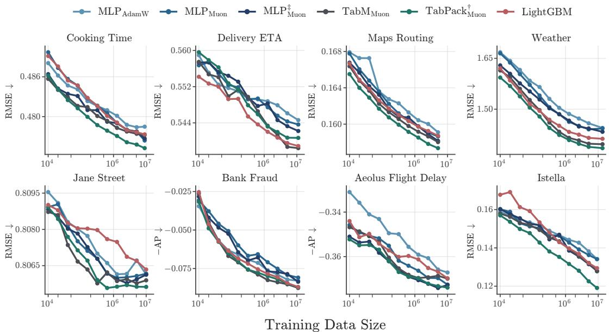
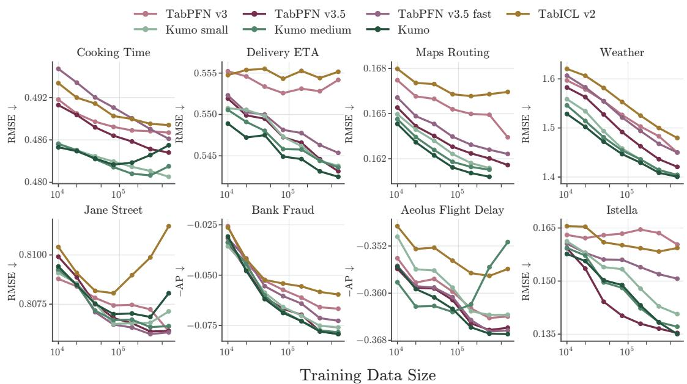
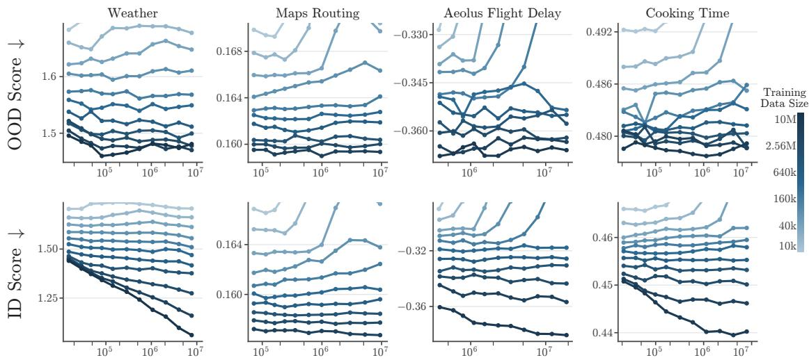
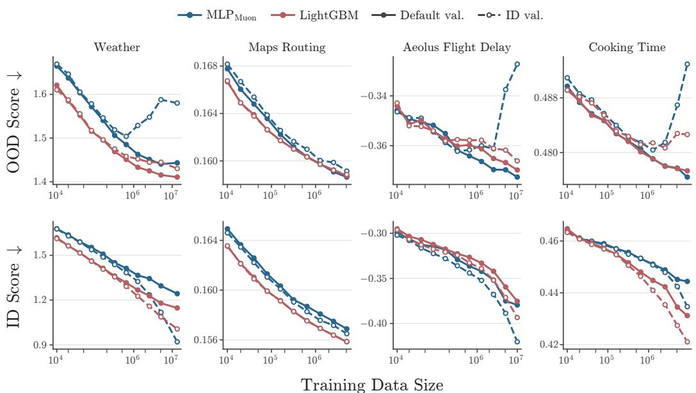
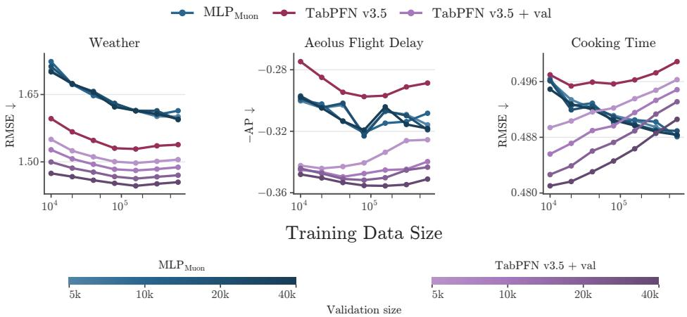
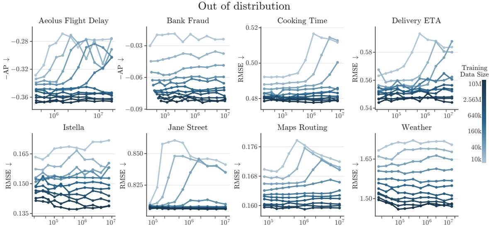
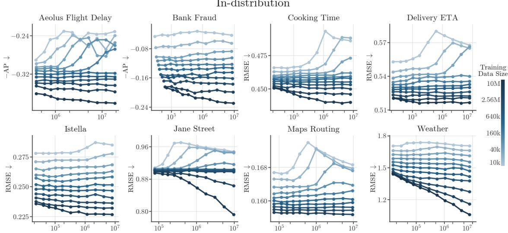
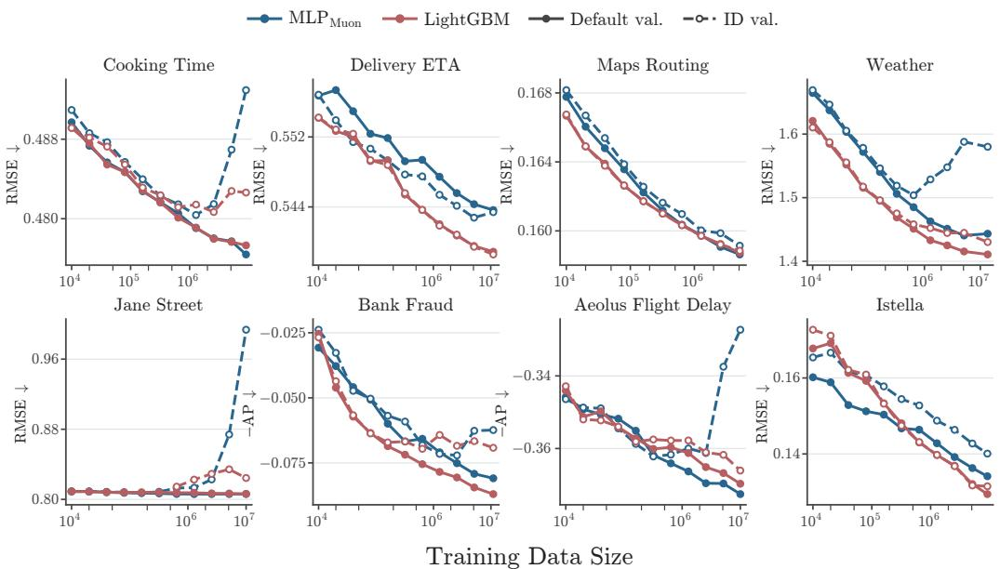
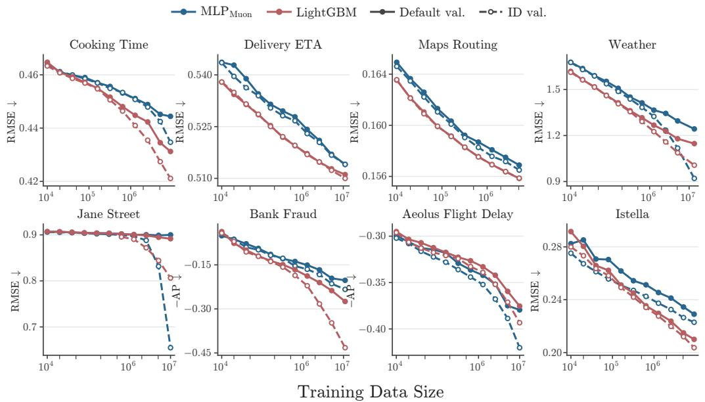

# On Data Scaling in Tabular ML: More Data, Better Generalization?

Ivan Rubachevα, β, Nikita Lazarevβ, α, Artem Babenkoα, β

αYandex, βHSE University

## Abstract

Recent work in tabular machine learning has emphasized the importance of diverse and realistic evaluation settings. The niche of large-scale (1M+) data, however, remains under-explored. To study training-data scaling, we assemble eight realworld tabular datasets with up to around ten million training examples, retaining the natural distribution shifts of the tasks and using random-split evaluation as a control. We find that GBDTs and MLP-based models show broadly similar scaling trends, with gains from both additional training data and algorithmic improvements. Tabular foundation models show more varied scaling behavior, with recent versions benefiting more consistently from larger contexts even under distribution shift. However, scaling training data under distribution shift introduces new challenges: in-distribution and out-of-distribution performance mostly improve together at smaller scales but can diverge at larger scales. We examine this through MLP capacity sweeps and comparisons of the validation distributions used for tuning and early stopping in MLPs and GBDTs. We also compare common practices of using validation data, contrasting its use for model selection in MLP pipelines with using it for in-context fitting in tabular foundation model pipelines. Under stronger shifts, MLPs selected using validation representative of the evaluation conditions generally maintain or improve performance as training data grows. In contrast, including such examples in context improves foundation-model performance, but does not prevent deterioration with increasing training size in our experiments.

Code: github.com/yandex-research/tabular-dl-more-data

## 1. Introduction

Machine Learning (ML) on tabular data has recently grown more popular and mature. The field had its foundation model moment [1–4], produced improvements to MLP-based DL models [5–7], and started forming sound benchmarking practices [8–10].

Recent work has highlighted the importance of focusing on more diverse and realistic evaluation settings in tabular ML. One such setting concerns the presence of distribution shift between training and evaluation, which is common in many practical tabular prediction tasks [11–13]. Another practically important aspect is the availability of large amounts of data in some applications where tabular ML methods are used [14–16]. This practical relevance, together with the role of data scaling in the success of DL in other modalities [17–19], motivates a deliberate study of data scaling in tabular ML.

To study data scaling in settings relevant to real-world applications of tabular ML, we need large datasets with task-specific evaluation splits that retain natural distribution shifts, which remain scarce in existing benchmarks. To enable this study, we assemble a collection of eight datasets from prior work, open ML competitions and adjacent domains, with training sizes reaching around ten million examples. Modern tabular benchmarks typically compare methods across vast collections of datasets [9, 10] of diferent properties. Across these datasets, sample size varies together with the prediction task, feature space, and evaluation conditions. Comparing performance across tasks of diferent sizes therefore does not isolate the efect of dataset size. We instead study scaling within individual tasks, varying training size from 10 000 to around ten million examples while keeping features and evaluation sets fixed. We use natural shifted evaluation alongside in-distribution controls and examine whether gains from additional data persist under distribution shift, and how this depends on model selection.

First, we evaluate GBDTs, MLP-based models and tabular foundation models across training sizes. Non-foundation DL models and GBDTs show similar scaling trends, with taskdependent saturation, and improvements to architectures and training procedures remain beneficial across scales. Foundation models (TabICL v2, Kumo, TabPFN v3 and v3.5) difer substantially, with recent versions benefiting more consistently from larger contexts.

Our analysis further shows that the benefits of additional data increasingly depend on model selection considerations. First, we perform wide sweeps of MLP parameter sizes and hyperparameter configurations, varying the validation distribution used for tuning and early stopping. In the in-distribution evaluation setting, tuning favors larger models, increasingly with the growing training set size. When using shifted validation and test splits, however, increasing model size beyond moderate parameter counts brings little or no consistent benefit, even as additional training data continues to improve performance. This growing disagreement over model capacity suggests that the choice of validation distribution becomes more consequential at larger scales. We test this directly for MLPs and GBDTs, comparing ID- and OOD-based tuning and early stopping. With OOD validation, OOD performance generally remains stable or improves as training size grows. With ID validation, additional data can instead improve ID performance while worsening OOD performance on several tasks, after a certain training set size threshold, with more pronounced performance deterioration observed in MLPs.

This leads us to investigate how validation, better aligned with the held-out test distribution, is used in diferent tabular modeling paradigms. Typical MLP pipelines use validation as a held-out signal for hyperparameter tuning and early stopping. In our experiments with stronger distribution shifts, OOD performance under this procedure generally remains stable or improves as training size grows. In ICL-based foundation models, using validation as a separate signal is not natively supported; a common default is to add it to the context. Our experiments show that this improves performance, however, it does not prevent OOD performance decrease as we scale the training dataset size, hinting that ICL-based foundation models may also have a hard time balancing both ID and OOD performance.

This motivates further investigation of how best to use data more aligned with the deployment/test distribution in both MLP-based models and PFNs. This raises the question of how to combine its roles in model selection and training while mitigating the negative ID–OOD relationship that can arise as in-domain data scales.

We summarize our contributions as follows:

• We study how training data size and natural distribution shift jointly afect tabular models, with in-distribution evaluation as a control. To this end, we assemble eight tabular datasets with up to around ten million training examples, and vary training size within each task while keeping features and evaluation sets fixed.

• We find broadly similar scaling trends across parametric models (GBDTs and MLPbased models), with improvements to architectures and training procedures remaining beneficial across scales we consider. Tabular foundation models show substantially different scaling behavior across pretrained versions, with recent models benefiting more consistently from larger contexts, even in challenging out-of-distribution conditions.

• We find that the validation distribution becomes increasingly important for OOD generalization as training data scales. On several datasets, additional training data improves ID performance but worsens OOD performance when MLPs are selected using ID validation, exhibiting an “accuracy on the wrong line”-like pattern [20] on real tabular tasks with natural shifts. LightGBM also shows sensitivity to the validation distribution, but ID-based selection mainly leads to smaller OOD gains or mild deterioration.

• We explore the above efect further and find that validation aligned with the evaluation distribution helps MLP-based models improve as in-distribution training set size grows as it constrains model selection (including tuning and early stopping). For ICL-based foundation models, a common strategy of using the whole available data for in-context “training” improves the overall performance but does not prevent OOD performance decrease at larger training set scales.

## 2. Related Work

Tabular ML Evaluation. Modern tabular ML benchmarks typically compare models across a set of diverse tabular prediction tasks [6, 9, 10]. Recent work has extended these evaluations to tasks with temporal and grouped components with natural distribution shifts [12, 13]. Evaluations at multi-million-sample scales have sometimes appeared in prior work [5, 6, 10, 21, 22], though controlled within-task data scaling on diverse realistic tabular datasets has received relatively little attention. We complement the existing eforts with a systematic study of within-task data scaling up to around ten million training examples under natural distribution shifts, with in-distribution evaluation as a control.

Data Scaling. Our focus on scaling the available task-specific training data is closely related to the study of Hestness et al. [17], they observed predictable gains from additional data across language, vision, and speech domains, with model improvements primarily shifting the scaling curves rather than changing their power-law exponents. We observe similar trends for parametric tabular models. In deep learning recommendation models, Ardalani et al. [18] likewise found continued gains from additional data but limited returns to parameter scaling in the architectures studied. We find a related contrast in tabular prediction, where the benefits of additional capacity strongly depend on the evaluation distribution.

For tabular foundation models, multiple existing works study the scaling of the in-context learning pretraining stage [3, 23, 24], in contrast we study the downstream task scaling, increasing the in-context examples, which is closer in spirit to many-shot in-context learning [25]. We observe substantial diferences in scaling behavior across diferent pretrained model versions, with recent models benefiting more consistently from larger contexts and, in some cases, continuing to improve with up to one million context examples.

Domain Generalization. Understanding how models generalize beyond their training distribution is a long-standing question in deep learning [26–28]. One prominent observation, put forward by Miller et al. [29] as “accuracy on the line,” is that models with better in-distribution (ID) performance tend to perform better out of distribution (OOD). In tabular ML, Gardner et al. [11], Nastl and Hardt [30] report similar positive correlations. However, Teney et al. [31] show that ID and OOD performance can also be negatively correlated on real-world datasets. Of particular relevance to data scaling, Sanyal et al. [20] show how label noise and nuisance features can produce negative correlations, with additional training data improving ID performance while worsening OOD performance. We investigate how this relationship depends on training-set size in real-world tabular tasks, and what it implies for model selection across scales.

## 3. Setup

## 3.1 Datasets

We use eight tasks, summarized in Table 3. For Cooking Time, Delivery ETA, Maps Routing, and Weather from TabReD [12], we retain the existing features and temporal splits and use the larger training sets. We additionally prepare the following four tasks, contributing feature-construction and split recipes for future work.

Jane Street. We use the public training data from the Jane Street forecasting competition,1 which contains anonymized financial market observations derived from production trading systems. The task is to predict the anonymized market response responder\_6 from market features and historical responses. Following the competition protocol and public solutions, we construct lag features, including responses from earlier validation and test observations. We use the final two periods of 100 date timestamps each for validation and test, respectively, and the preceding data for training.

Aeolus Flight Delay. We use the tabular component of the Aeolus dataset [32]. The task is to predict whether a flight will depart more than 15 minutes late. We construct calendar and route features, airport-level weather climatology, and smoothed historical delay rates for airports, carriers, and carrier–airport pairs. Historical delay rates use only trainingperiod flights scheduled on earlier calendar days. We use 2016–2022 for training, 2023 for validation, and 2024 for test.

Bank Fraud. We use the Guardian task from Data Fusion Contest 2026.2 The task is to identify fraudulent transactions using transaction information and customer history. Following public solutions, we construct transaction features and unlabeled customerhistory features from the released logs. We use the final two consecutive two-week periods for validation and test, respectively, and the preceding data for training. Following the post-competition analysis, for each customer in an evaluation period, we retain all days with fraud if any are present, and sample one random day otherwise. For training, we sample negatives at a 15% rate. We draw ID splits from the training period with the same class balance as the temporal splits. We use larger evaluation sets than for most other tasks to reduce noise in AP estimates, since positives constitute only about 0.5% of evaluation examples.

Istella. We use the Istella22 search relevance dataset [33]. The task is to estimate the relevance of a document to a search query. We treat the graded relevance labels as regression targets and retain the 200 non-constant query-document features. We combine the oficial training and validation partitions for training, and construct validation and test sets from disjoint query groups in the oficial test partition, whose distribution difers from those of the training and validation partitions. Each holdout contains approximately 600 000 query-document pairs, about 40% of the oficial test partition, sampled by query group. We use these larger evaluation sets to reduce noise in performance estimates, since they contain only 895 validation and 860 test query groups.

## 3.2 Evaluation Protocol

In this section we describe the details of our evaluation protocol, which we reuse in the next sections.

Dataset splits. Each task has validation and test sets under its temporal or query-based split for out-of-distribution (OOD) evaluation, together with historical row holdouts as in-distribution (ID) controls. ID rows are reserved before subsampling and match the OOD holdout sizes. For each dataset, validation and test sets remain fixed across all training sizes and models. All models use the same training subsets at each size. Training subsets are nested and the sizes are doubling from 10 000 to 5 120 000, followed by the largest subset which is capped at 10M for datasets significantly larger than this size, and kept for others.

Non-foundation tabular ML models. We evaluate XGBoost, LightGBM, MLP, MLP with piecewise-linear embeddings (denoted by MLP‡) [34], MLP trained with Muon optimizer [35], TabM [5], TabPack and TabPack with its variant of periodic embeddings [6] (denoted by TabPack†). We tune each method using Optuna [36] separately at each dataset and training size with 100 trials, except TabPack, which selects a greedy ensemble from 64 sampled configurations.

Tabular foundation models. We evaluate TabICLv2 [2], TabPFN v3, v3.5 and its fast variant [4], and Kumo Tabular in its small, medium, and large variants [37]. For all models we use the provided default configurations.

Result reporting. We evaluate ten seeds for each model. We report means and standard deviations of test scores. For regression, we use root mean squared error (RMSE). For binary classification, we use average precision (AP), since positive classes are substantially less frequent than negatives.

## 4. Empirical Training Data Scaling Results

We start with experiments on how test performance changes as training sets grow under the benchmark’s default splits with natural distribution shifts. We first report scaling trends for parametric tabular models in subsection 4.1, and then study tabular foundation models in subsection 4.2.

## 4.1 Parametric Tabular Models

Results for a representative set of tabular ML models trained with increasing dataset sizes are summarized in Figure 1, for more models see tables in the Appendix G. Our findings are summarized below.

Scaling data provides significant improvements. Overall we see that increasing the training-set size improves test performance across a broad range of parametric models. On many tasks improvements continue through the largest training sizes, approaching ten million examples. The extent of these gains depends on the task: Jane Street largely saturates around one million examples, while improvements on Weather become smaller at the largest sizes.

Method improvements remain relevant as data scales. Muon often improves vanilla MLP performance across training sizes, numerical feature embeddings provide further gains on several tasks. TabPack† ranks among the top methods across most sizes considered. Although the benefits of individual changes vary across tasks and sizes and are quite noisy, additional data does not eliminate performance gaps. Improvements to models and training procedures thus complement improvements seen from data scaling at this scale.

Overall gains from additional data follow broadly similar trends across diferent methods within each task. This is consistent with Hestness et al. [17], who found that model improvements in other deep learning domains mainly shift the data-scaling curves while leaving their power-law exponents largely unchanged. To assess whether the similar scaling trends could be observed across methods on datasets from our evaluation we compare power-law fits with individual and shared exponents in Appendix A and find that individual exponents provide small improvements in fit quality (with the exception of Jane Street dataset).

  
Figure 1 | Performance of parametric models across training-set sizes. Horizontal axis shows the number of training examples on a logarithmic scale. We report RMSE for regression and negative average precision (−AP) for classification, so lower is better on every plot. On most tasks, additional training data improves performance across methods, improvements to architectures and training procedures also remain beneficial across scales.

Takeaway. Improvements to architectures and training procedures remain beneficial as training data grows, complementing the gains from additional data. TabPack [6] ofers a favorable performance–runtime trade-of among the evaluated parametric methods, combining competitive predictive performance with eficient training and model selection (Appendix C).

## 4.2 Tabular Foundation Models

Results for tabular foundation model in-context training set scaling are summarized in Figure 2. We outline our findings below.

Additional context improves performance under distribution shift. Increasing the incontext training-set size improves test performance on many tasks, with gains continuing up to around one million examples in some cases. The extent of these gains depends on the task: curves on Jane Street, Cooking Time and Aeolus Flight Delay can flatten or reverse at larger context sizes for some models (more on that in subsection 5.3).

Scaling behavior difers across pretrained models. Unlike the broadly similar scaling trends of parametric models, foundation models difer substantially in their gains from additional context. Kumo, TabPFN v3.5 and its fast variant show more consistent improvements with larger contexts than earlier TabPFN v3 and TabICL v2.

Scaling behavior also difers within a model family. We observe diferent scaling trends both across Kumo model sizes and between TabPFN v3.5 and its fast variant. The small, medium and large Kumo variants difer in both parameter count and the number of synthetic tables used for pretraining [37], yet larger variants do not consistently benefit more from additional context. TabPFN v3.5 and its fast variant also difer in the magnitude of their gains from larger contexts. How these diferences relate to model capacity, pretraining and inference configurations remains an open question.

  
Figure 2 | Performance of tabular foundation models across training-set sizes. The figure follows Figure 1 conventions. Tabular foundation models also improve with in-context training set scale, but the scaling trends vary significantly across diferent models.

Takeaway. Recent tabular foundation models benefit more consistently from larger contexts even under natural distribution shifts, providing encouraging evidence that this paradigm can scale in challenging real-world settings. However, scaling behavior varies substantially across models, and understanding the roles of model capacity, pretraining, and inference configurations remains an open question.

## 5. Data Scale, Generalization and Model Selection

Sections 4.1 and 4.2 showed that additional training data improves out-of-distribution test performance for most models and tasks. In this section, we present a more nuanced picture: model selection, particularly the use of validation aligned with the target distribution, becomes increasingly important for OOD generalization as training data grows. We use in-distribution validation and test splits as controls for the analysis.

In subsection 5.1, we sweep MLP widths and hyperparameters across training sizes. We find that in-distribution and out-of-distribution evaluation increasingly “disagree” on the benefits of model capacity. In subsection 5.2, we show that this disagreement matters for model selection, starting at around 1M examples scale in our setup. In subsection 5.3, we examine how common defaults in MLP and tabular foundation model pipelines difer in their use of target-aligned validation data, and what these choices imply for generalization as training data grows.

  
MLP Parameter Count  
Figure 3 | MLP width sweeps across training sizes. Top row: OOD test performance; bottom row: ID controls. The horizontal axis shows parameters per MLP on a logarithmic scale; darker curves indicate larger training sets. Learning rate, weight decay, and checkpoint are selected on the corresponding validation split. We report RMSE for all datasets except Aeolus Flight Delay, where we report negative average precision (−AP). Lower is better. Gains from increasing model size are limited under distribution shift, but become more pronounced with larger training sets under ID evaluation

## 5.1 Model Capacity Across Training Sizes

To study how training size and model capacity jointly afect performance, we run a large sweep of MLPs over widths, hyperparameters, and training sizes. Batched packed hyperparameter ensembles introduced in [6] make such a sweep relatively inexpensive and allow us to eficiently explore a large space of MLP models. The setup is as follows:

• Models. MLPs with three hidden blocks and 11 widths from 64 to 1936, spanning approximately $1 0 ^ { 4 }$ to $1 0 ^ { 7 }$ parameters.

• Hyperparameters. For each width, one pack of 100 MLPs covering a $1 0 \times 1 0$ grid of learning rates and weight decays.

• Training. AdamW for 100 000 steps with batch size 1 024, evaluating every 1 000 steps.

• Selection. For each width and training size, we select the learning rate, weight decay, and checkpoint on either the OOD or the ID validation set. Both protocols share the same training runs.

In total, we train 95 700 MLPs across eight datasets. Beyond the selected models, the stored trajectories give an overview of learning dynamics across training sizes and capacities, and allow for experimenting with diferent model and hyperparameter selection strategies post hoc. Results of the sweeps are summarized in Figure 3. Results on all datasets are in Appendix E. Below we provide our key takeaways.

ID and OOD evaluation “disagree” on model capacity at scale. On OOD test sets, more training data improves performance. But, larger models bring little or no consistent gain (one can achieve best performance with around 100k parameters, on most datasets). In contrast, on in-distribution controls, larger models improve performance on almost all datasets, and these gains grow with training size. Ardalani et al. [18] similarly report stronger gains from data than from parameters in the MLP components of DLRMs. In our setting, the benefit of capacity depends on the evaluation distribution. As training size grows, ID and OOD validation therefore increasingly favor diferent models. We examine the implications of this phenomenon in the next section.

## 5.2 Validation Distribution at Scale

If ID and OOD validation favor diferent models, the choice of validation distribution should increasingly afect OOD performance as training data scales. We test this hypothesis on MLPs and LightGBM.

  
Figure 4 | Validation distribution afects ID and OOD scaling in MLP with Muon and LightGBM. Solid curves with filled circles use OOD validation (“Default val.”); dashed curves with open circles use ID validation. We report RMSE for all datasets except Aeolus Flight Delay, where we report negative average precision (−AP). Lower is better in all panels. At larger training sizes, ID validation can improve ID performance while OOD performance deteriorates; conversely, OOD validation can improve OOD performance at the cost of ID performance.

We use the Muon optimizer for MLPs. We run each model using either the default OOD validation set or the ID validation set for hyperparameter tuning and early stopping, keeping training subsets and tuning budgets fixed. We evaluate both protocols on OOD test sets, with ID evaluation as a control. Results are summarized in Figure 4; results on all eight datasets are provided in Appendix F.

Accuracy on the wrong line. With OOD-based selection, OOD performance generally improves or saturates as training size grows. At smaller training sizes, switching to ID validation usually makes little diference to OOD performance. At larger sizes, however, ID-based selection can lead to OOD deterioration despite continued improvements in ID performance. This divergence is particularly pronounced for MLPs on Weather, Aeolus Flight Delay, and Cooking Time, consistent with previously reported inverse ID–OOD relationships [20, 31], but observed on real tabular tasks with natural distribution shifts here. For LightGBM, ID-based selection often leads to smaller OOD gains or milder deterioration.

Takeaway. Our results suggest that validation aligned with the target conditions becomes increasingly important for OOD generalization as training data grows. Prior work has examined model selection under shift and alternative validation protocols [26, 38]. How best to achieve this alignment in practice remains an open, task-dependent question for researchers and practitioners; we highlight that the consequences of these choices can become more pronounced at larger training sizes.

## 5.3 Use of Validation in MLP and Tabular Foundation Model Pipelines

Previous section results showed that, at scale, validation aligned with the test distribution matters for parametric models. The two major modeling paradigms for tabular ML nowadays are parametric models (MLPs in this section) and tabular foundation models. Typical pipelines for these two paradigms difer in how they use validation data. MLP-based models often utilize validation as a held-out signal for model selection (through model tuning and early-stopping). Tabular foundation models do not have a separate validation concept and the default strategy is to fit on all the available data.

  
Figure 5 | Validation as context vs. as a selection signal on restricted training pools of Weather, Aeolus Flight Delay, and Cooking Time. Shades of blue (MLP) and purple (TabPFN v3.5 with appended validation) indicate validation sizes from 5 000 to 40 000. Conventions follow Figure 1. TabPFN benefits from additional validation examples, but adding more training data can hurt performance. The MLP benefits more consistently from additional training data, but gains little from larger validation sets.

We try to compare the two strategies and modeling paradigms in this section. To imitate the efect we observed in the previous sections at sub-1M scale we manually increase the level of distribution shift between training and evaluation, intuitively this should move the ID–OOD tradeof to smaller scale datasets. We achieve this diferently by taking diferent subsets of the training data on Weather, Aeolus Flight Delay and Cooking Time datasets that are more OOD compared to the validation and test sets (interpretable strategies are described in Appendix B). We then repeat the protocol of data scaling, but additionally we also vary the representative validation set size and evaluate two models: MLP and TabPFNv3.5. Results are summarized in Figure 5. Our key takeaways are as follows:

Validation as additional context. Using representative validation examples in-context yields large gains at small training sizes, and larger validation sets provide increasingly larger gains. This is expected as using more relevant data for training should improve performance.

Validation as a model-selection signal. However, we see on all three datasets that using all the test-aligned validation examples in ICL does not save tabular foundation models from the “accuracy on the wrong line” like behaviour and, with the amount of in-distribution data increasing, out-of-distribution performance starts to degrade. MLP, which uses validation for model selection, is generally more stable, and even improves as training size grows at this scale, and this does not really depend on the validation set size.

Takeaway. These two observations together illustrate that the optimal strategy of target aligned validation is not yet settled in both paradigms. MLP-like non-foundation models could benefit from procedures like refitting, and foundation models could benefit from having a more explicit way to control model selection, or specify the “shift direction” with some hold-out validation.

## 6. Limitations

Our work is a controlled study rather than a benchmark. In all the experiments we keep validation and test sets fixed across training sizes for comparability, which may be less representative of real-world practice at small training sizes, but provides cleaner signal for studying the efects of scaling training data.

We do not directly compare parametric models and tabular foundation models. The two paradigms currently operate at diferent scales (10M scale is handled relatively easily for nonfoundation models, but 1M is the current limit for foundation models), running foundation models on ten million examples requires additional techniques such as context subsampling or retrieval, which could potentially introduce confounding efects. Furthermore, as section 5 shows, a proper comparison also depends on how each paradigm uses validation data, and there is no settled answer to this yet. We also use eight datasets, the representative minimum we considered suficient for studying within-task scaling.

## 7. Conclusion

Large training sets are common in practical and important tabular applications but they were rarely studied in tabular ML. We assembled a representative set of datasets and studied this regime. We find that progress that the tabular ML community has made holds up to scaling data. Non-foundation model architectural improvements complement improvements from scaling training data, foundation models continue to improve, and also show promising scaling trends, even in challenging realistic conditions.

However, our analysis showed that increasing training data scale, in the presence of distribution shifts introduces new challenges. At small scales, ID and OOD performance mostly improve together. At larger scales, they can diverge, making OOD generalization a more important concern. This raises questions we find worth pursuing in future work. How should target-aligned data be split between fitting and model selection as in-domain data grows? Can foundation models be given an efective mechanism to treat validation examples diferently from training examples? How do model-level generalization interventions interact with hyperparameter tuning at scale, are there new generalization inducing methods to be discovered that are particularly interesting at scale.

## Reproducibility statement

We supply the minimal code needed for dataset preprocessing and running the experiments in supplementary materials. Dataset sources, feature construction, and splits are described in section 3. Hyperparameter spaces, tuning protocols, and training details are described in Appendix D.

## References

[1] Noah Hollmann, Samuel Müller, Lennart Purucker, Arjun Krishnakumar, Max Körfer, Shi Bin Hoo, Robin Tibor Schirrmeister, and Frank Hutter. Accurate predictions on small data with a tabular foundation model. Nature, 637(8045):319–326, January 2025. ISSN 1476-4687. doi: 10.1038/s41586-024-08328-6.

[2] Jingang Qu, David Holzmüller, Gaël Varoquaux, and Marine Le Morvan. TabICLv2: A better, faster, scalable, and open tabular foundation model, September 2026.

[3] Xingxuan Zhang, Gang Ren, Hao Yuan, Hao Zou, Hongze Tan, Hui Wang, Jianhao Song, Jiansheng Li, Jiayao Zhang, Jinghan Zhang, Kaifang Li, Lang Mo, Li Mao, Mingchao Hao, Nuo Xu, Rui Ding, Ruiji Zhang, Shuyang Li, Siyu Mei, Tianyang Zhang, Weiyang Mu, Yancheng Dong, Yongxian Wei, Yuan Xue, Yuanrui Wang, Yue He, Zijia Yang, Ziyun Li, Dongzhe Li, Fuqiang Wang, Jiandong Liu, Jiawei Chen, Jiaxin Du, Kaijie Cheng, Kehan Li, Lei Sun, Linjun Zhou, Ningbo Dai, Qi Wang, Renzhe Xu, Shaoxing Du, Shumeng Yang, Wang Lu, Wenjing Chu, Xiannan Huang, Xiaoyu Lin, Xing Ai, Xinyan Han, Xuanyue Li, Xuanyue Su, Xukun Zhang, Yan Lu, Yaxin Zhang, Yi Qin, Yifei Huang, Yihan Xu, Yongle Lv, Yuanyuan Jiang, Yushan Han, and Peng Cui. LimiX-2: A Contextual Mechanism Network Towards General Structured-Data Intelligence, September 2026.

[4] Benjamin Jäger, Nick Erickson, Léo Grinsztajn, Felix Birkel, Klemens Flöge, Oscar Key, Kürşat Kaya, Jonas Kübler, Adèle Frankel, Tobias Schröder, Anurag Garg, Jan Hendrik Metzen, David Salinas, Simon Bing, Kristina Collins, Tuana Çelik, Vahid Balazadeh, Lydia Sidhoum, Tomás Pereda, Brendan Roof, Andrej Tschalzev, Siyuan Guo, Philipp Singer, Lennart Purucker, Jake Robertson, Marie Salmon, Philipp Jund, Jerry Chen, Diana Kriuchkova, Arthur Cahu, Eliott Kalfon, Adrian Hayler, Georg Grab, Vitor Monteiro, Lilly Wehrhahn, Dominik Safaric, Clara Cornu, Alan Arazi, Rylee Grace, Simone Alessi, Mihir Manium, Bernhard Schölkopf, Yann LeCun, Madelon Hulsebos, Sauraj Gambhir, Noah Hollmann, and Frank Hutter. TabPFN-3.5: Technical Report, September 2026.

[5] Yury Gorishniy, Akim Kotelnikov, and Artem Babenko. TabM: Advancing Tabular Deep Learning with Parameter-Eficient Ensembling, February 2025.

[6] Yury Gorishniy, Akim Kotelnikov, Ivan Rubachev, and Artem Babenko. TabPack: Eficient Hyperparameter Ensembles for Tabular Deep Learning. In Forty-Third International Conference on Machine Learning, June 2026.

[7] David Holzmüller, Léo Grinsztajn, and Ingo Steinwart. Better by default: Strong pre-tuned MLPs and boosted trees on tabular data. In Advances in Neural Information Processing Systems, volume 37, pages 26577–26658. Curran Associates, Inc., 2024. doi: 10.52202/079017-0837.

[8] Yury Gorishniy, Ivan Rubachev, Valentin Khrulkov, and Artem Babenko. Revisiting Deep Learning Models for Tabular Data. In Advances in Neural Information Processing Systems, volume 34, pages 18932–18943. Curran Associates, Inc., 2021.

[9] Nick Erickson, Lennart Purucker, Andrej Tschalzev, David Holzmüller, Prateek Mutalik Desai, David Salinas, and Frank Hutter. TabArena: A Living Benchmark for Machine Learning on Tabular Data, November 2025.

[10] Si-Yang Liu, Hao-Run Cai, Qi-Le Zhou, Huai-Hong Yin, Tao Zhou, Jun-Peng Jiang, and Han-Jia Ye. Talent: A tabular analytics and learning toolbox. Journal of Machine Learning Research, 26(226):1–16, 2025.

[11] Josh Gardner, Zoran Popovic, and Ludwig Schmidt. Benchmarking Distribution Shift in Tabular Data with TableShift, February 2024.

[12] Ivan Rubachev, Nikolay Kartashev, Yury Gorishniy, and Artem Babenko. TabReD: Analyzing Pitfalls and Filling the Gaps in Tabular Deep Learning Benchmarks. In The Thirteenth International Conference on Learning Representations, October 2024.

[13] Lennart Purucker, Andrej Tschalzev, Nick Erickson, Gioia Blayer, David Holzmüller, Alan Arazi, Alexander Pfeferle, Mustafa Tajjar, Gaël Varoquaux, and Frank Hutter. Beyond IID: How General Are Tabular Foundation Models, Really?, June 2026.

[14] Rohan Anil, Sandra Gadanho, Da Huang, Nijith Jacob, Zhuoshu Li, Dong Lin, Todd Phillips, Cristina Pop, Kevin Regan, Gil I. Shamir, Rakesh Shivanna, and Qiqi Yan. On the Factory Floor: ML Engineering for Industrial-Scale Ads Recommendation Models, September 2022.

[15] Lixin Zou, Haitao Mao, Xiaokai Chu, Jiliang Tang, Wenwen Ye, Shuaiqiang Wang, and Dawei Yin. A Large Scale Search Dataset for Unbiased Learning to Rank. Advances in Neural Information Processing Systems, 35:1127–1139, December 2022. doi: 10. 52202/068431-0083.

[16] Alexander Ploshkin, Vladislav Tytskiy, Alexey Pismenny, Vladimir Baikalov, Evgeny Taychinov, Artem Permiakov, Daniil Burlakov, and Eugene Krofto. Yambda-5B — A Large-Scale Multi-Modal Dataset for Ranking and Retrieval. In Proceedings of the Nineteenth ACM Conference on Recommender Systems, RecSys ’25, pages 894–901, New York, NY, USA, September 2025. Association for Computing Machinery. ISBN 979-8-4007-1364-4. doi: 10.1145/3705328.3748163.

[17] Joel Hestness, Sharan Narang, Newsha Ardalani, Gregory Diamos, Heewoo Jun, Hassan Kianinejad, Md Mostofa Ali Patwary, Yang Yang, and Yanqi Zhou. Deep Learning Scaling is Predictable, Empirically, December 2017.

[18] Newsha Ardalani, Carole-Jean Wu, Zeliang Chen, Bhargav Bhushanam, and Adnan Aziz. Understanding Scaling Laws for Recommendation Models, August 2022.

[19] Lilian Weng. Scaling Laws, Carefully. https://lilianweng.github.io/posts/2026-06-24- scaling-laws/, June 2026.

[20] Amartya Sanyal, Yaxi Hu, Yaodong Yu, Yian Ma, Yixin Wang, and Bernhard Schölkopf. Accuracy on the wrong line: On the pitfalls of noisy data for out-of-distribution generalisation. In Proceedings of The 28th International Conference on Artificial Intelligence and Statistics, pages 2170–2178. PMLR, April 2025.

[21] Prior Labs. TabPFN scaling mode: Built for production. Scaled to millions. https://priorlabs.ai/tabpfn/large-data, 2025.

[22] Ronald Richman. Scaling Laws, Tabular Data and Actuarial Ratemaking Models, January 2026.

[23] Google Research. TabFM: Tabular Foundation Models. Google\~Research, September 2026.

[24] Junwei Ma, Valentin Thomas, Rasa Hosseinzadeh, Alex Labach, Jesse C. Cresswell, Keyvan Golestan, Guangwei Yu, Anthony L. Caterini, and Maksims Volkovs. Tab-DPT: Scaling Tabular Foundation Models on Real Data. In The Thirty-Ninth Annual Conference on Neural Information Processing Systems, October 2025.

[25] Rishabh Agarwal, Avi Singh, Lei M. Zhang, Bernd Bohnet, Luis Rosias, Stephanie Chan, Biao Zhang, Ankesh Anand, Zaheer Abbas, Azade Nova, John D. Co-Reyes, Eric Chu, Feryal Behbahani, Aleksandra Faust, and Hugo Larochelle. Many-Shot In-Context Learning, October 2024.

[26] Ishaan Gulrajani and David Lopez-Paz. In Search of Lost Domain Generalization, July 2020.

[27] Pang Wei Koh, Shiori Sagawa, Henrik Marklund, Sang Michael Xie, Marvin Zhang, Akshay Balsubramani, Weihua Hu, Michihiro Yasunaga, Richard Lanas Phillips, Irena Gao, Tony Lee, Etienne David, Ian Stavness, Wei Guo, Berton A. Earnshaw, Imran S. Haque, Sara Beery, Jure Leskovec, Anshul Kundaje, Emma Pierson, Sergey Levine, Chelsea Finn, and Percy Liang. WILDS: A Benchmark of in-the-Wild Distribution Shifts, July 2021.

[28] Andrey Malinin, Neil Band, Ganshin, Alexander, German Chesnokov, Yarin Gal, Mark J. F. Gales, Alexey Noskov, Andrey Ploskonosov, Liudmila Prokhorenkova, Ivan Provilkov, Vatsal Raina, Vyas Raina, Roginskiy, Denis, Mariya Shmatova, Panos Tigas, and Boris Yangel. Shifts: A Dataset of Real Distributional Shift Across Multiple Large-Scale Tasks, February 2022.

[29] John P. Miller, Rohan Taori, Aditi Raghunathan, Shiori Sagawa, Pang Wei Koh, Vaishaal Shankar, Percy Liang, Yair Carmon, and Ludwig Schmidt. Accuracy on the Line: On the Strong Correlation Between Out-of-Distribution and In-Distribution Generalization. In Proceedings of the 38th International Conference on Machine Learning, pages 7721–7735. PMLR, July 2021.

[30] Vivian Y. Nastl and Moritz Hardt. Do causal predictors generalize better to new domains?, October 2024.

[31] Damien Teney, L. I. N. Yong, Seong Joon Oh, and Ehsan Abbasnejad. ID and OOD Performance Are Sometimes Inversely Correlated on Real-world Datasets. In Thirty-Seventh Conference on Neural Information Processing Systems, November 2023.

[32] Lin Xu, Xinyun Yuan, Yuxuan Liang, Suwan Yin, and Yuankai Wu. Aeolus: A Multistructural Flight Delay Dataset. In The Thirty-Ninth Annual Conference on Neural Information Processing Systems Datasets and Benchmarks Track, October 2025.

[33] Domenico Dato, Sean MacAvaney, Franco Maria Nardini, Rafaele Perego, and Nicola Tonellotto. The Istella22 Dataset: Bridging Traditional and Neural Learning to Rank Evaluation. In Proceedings of the 45th International ACM SIGIR Conference on Research and Development in Information Retrieval, SIGIR ’22, pages 3099–3107, New York, NY, USA, July 2022. Association for Computing Machinery. ISBN 978-1-4503-8732-3. doi: 10.1145/3477495.3531740.

[34] Yury Gorishniy, Ivan Rubachev, and Artem Babenko. On Embeddings for Numerical Features in Tabular Deep Learning. In Advances in Neural Information Processing Systems, volume 35, pages 24991–25004. Curran Associates, Inc., 2022. doi: 10. 52202/068431-1812.

[35] Yury Gorishniy, Ivan Rubachev, Dmitrii Feoktistov, and Artem Babenko. Benchmarking Optimizers for MLPs in Tabular Deep Learning, April 2026.

[36] Takuya Akiba, Shotaro Sano, Toshihiko Yanase, Takeru Ohta, and Masanori Koyama. Optuna: A Next-generation Hyperparameter Optimization Framework. In Proceedings ofthe 25thACM SIGKDD International Conference on Knowledge Discovery & Data Mining,

pages 2623–2631, Anchorage AK USA, July 2019. ACM. ISBN 978-1-4503-6201-6. doi: 10.1145/3292500.3330701.

[37] Qu, Jingang, Hudovernik, Valter, Jurkovic, Martin, Lorenz, Cedric, Nitta, Akihiro, Gordeev, Dmitry, Lopez, Federico, Bendias, Ramona, Titericz, Jr., Gilberto, Sokolovski, Aleksandar S., Hulseman, Isabel, Leskovec, Jure, and Fey, Matthias. NVIDIA Kumo Tabular Sets a New Accuracy-Eficiency Frontier for Tabular Prediction. https://huggingface.co/blog/nvidia/kumo-tabular, October 2026.

[38] Hao-Run Cai and Han-Jia Ye. Understanding the Limits of Deep Tabular Methods with Temporal Shift. https://arxiv.org/abs/2502.20260v2, February 2025.

## A. Shared scaling exponents across methods

We compare method-specific and dataset-shared power-law exponents using 71 primary-test learning curves from nine parametric methods on eight datasets. Each point averages ten seeds; curves require at least five completed sizes $N \geq 1 0 ^ { 4 }$ . We fit

$$
E _ { d , m } ( N ) = a _ { d , m } ( N / 1 0 ^ { 4 } ) ^ { - b } + c _ { d , m } , \qquad b = b _ { d , m } \mathrm { o r } b _ { d } ,\tag{1}
$$

where E is RMSE or $1 - \mathrm { A P }$ . Amplitudes and asymptotes remain method-specific; a shared exponent is estimated separately for each dataset.

We minimize the mean squared residual for each curve. For the shared fit, we normalize each curve by its error at the smallest training size, then sum the mean squared residuals across methods. The bounds are $a , c \geq 0 , 1 0 ^ { - 4 } \leq b \leq 3 ,$ and $c \leq 1$ for classification.

<table><tr><td>Dataset</td><td> $b _ { d }$ </td><td> $R _ { \mathrm { i n d } } ^ { 2 }$ </td><td> $R _ { \mathrm { s h a r e d } } ^ { 2 }$ </td><td> $\Delta R ^ { 2 }$ </td></tr><tr><td>Cooking Time</td><td>0.1625</td><td>0.9938</td><td>0.9931</td><td>0.0006</td></tr><tr><td>Delivery ETA</td><td>0.0055</td><td>0.9727</td><td>0.9673</td><td>0.0054</td></tr><tr><td>Maps Routing</td><td>0.1811</td><td>0.9935</td><td>0.9929</td><td>0.0006</td></tr><tr><td>Weather</td><td>0.1843</td><td>0.9921</td><td>0.9904</td><td>0.0017</td></tr><tr><td>Jane Street</td><td>0.3403</td><td>0.9312</td><td>0.9024</td><td>0.0288</td></tr><tr><td>Bank Fraud</td><td>0.3373</td><td>0.9930</td><td>0.9849</td><td>0.0082</td></tr><tr><td>Aeolus Flight Delay</td><td>0.0985</td><td>0.9663</td><td>0.9632</td><td>0.0031</td></tr><tr><td>Istella</td><td>0.0401</td><td>0.9773</td><td>0.9752</td><td>0.0021</td></tr></table>

Table 1 | Dataset-shared exponents and mean in-sample $R ^ { 2 }$ over methods. $\Delta R ^ { 2 } = R _ { \mathrm { i n d } } ^ { 2 } - R _ { \mathrm { s h a r e d } } ^ { 2 } ,$ computed before rounding.

Sharing the exponent reduces mean in-sample $R ^ { 2 }$ by less than 0.01 on 7 of eight datasets (Table 1). Jane Street is the main exception. This supports similar scaling across methods within most datasets over the observed size range, while allowing diferent error levels and asymptotes.

## B. Dataset construction for the validation-data experiment

To study adaptation to temporal out-of-distribution (OOD) data, we restrict which historical periods contribute training examples while keeping the original temporal validation and test periods:

• Weather: the latest 10% of training rows. We keep the latest 10% of the original training rows in chronological order, covering the late part of spring 2023, with validation in June and testing in July. Restricting seasonal coverage makes the model transfer from a narrow recent window to a later part of the seasonal cycle. Additional training examples from this window do not restore the missing seasonal coverage.

• Aeolus Flight Delay: March–December 2020. From the benchmark’s existing training pool, we retain only flights with scheduled departures from March 1 through December 31, 2020. Validation uses 2023 and testing uses 2024. This isolates the pandemic-era period and excludes the more recent 2021–2022 training data, increasing temporal separation and testing transfer across periods with potentially diferent trafic and delay patterns. The restriction applies to training rows; the original historical-context features are retained.

• Cooking Time: the earliest 25% of training rows. We keep the earliest 25% of the original training rows in chronological order. Validation remains December 21–27, 2023, and testing starts on December 28. Removing the later training rows widens the gap to evaluation, exposing the model to changes in the order population and cooking-time relationships that may occur over time. Increasing the training size still draws examples only from the earlier period.

## C. Hyperparameter selection and evaluation runtime

Table 2 reports hyperparameter selection plus single-seed training and evaluation time on the full training splits of the main benchmark. Each value adds the recorded selection timer to the mean individual evaluation time over ten random seeds; ± denotes the sample standard deviation of evaluation time across seeds. Neural-model runs use a single NVIDIA A100 GPU with 80 GB of memory. For TabPack, the reported cost includes joint pack training and validation-based ensemble selection, without a separate hyperparameter-tuning phase of independent training runs.

Our scaling results show that parametric models benefit from additional data with broadly similar trends within each task, while diferences in predictive performance remain relevant across training sizes. When additional data provides steady gains without widening the performance gap between methods, computational eficiency becomes an important practical consideration. In this setting, TabPack is an attractive option: it remains competitive with the strongest tuned baselines at training scales of order $1 0 ^ { 7 }$ examples, while combining training and model selection within one pack. The substantially lower recorded runtimes in Table 2 support this eficiency advantage.
<table><tr><td>Method</td><td>Cooking</td><td>Delivery</td><td>Weather</td><td></td><td>Jane Street Bank Fraud</td><td>Aeolus</td><td>Istella</td></tr><tr><td>XGBoost</td><td> $2 4 . 4 7 \pm 0 . 0 3$ </td><td> $3 4 . 2 9 \pm 0 . 2 1$ </td><td> $2 9 . 3 7 \pm 0 . 0 1$ </td><td> $3 1 . 2 6 \pm 0 . 1 4$ </td><td> $5 1 . 3 2 \pm 0 . 2 5$ </td><td> $7 . 7 2 \pm 0 . 0 1$ </td><td> $3 4 . 2 4 \pm 0 . 0 9$ </td></tr><tr><td>LightGBM</td><td> $5 5 . 6 3 \pm 0 . 0 7$ </td><td> $7 0 . 7 7 \pm 0 . 0 6$ </td><td> $1 3 0 . 2 4 \pm 0 . 0 8$ </td><td> $1 4 5 . 7 8 \pm 0 . 7 6$ </td><td> $6 6 . 9 7 \pm 0 . 4 3$ </td><td> $1 2 7 . 0 3 \pm 0 . 7 3$ </td><td> $4 6 . 2 8 \pm 0 . 0 7$ </td></tr><tr><td> $\mathrm { M L P _ { A d a m W } }$ </td><td> $3 . 7 3 \pm 0 . 0 1$ </td><td> $9 . 9 5 \pm 0 . 0 7$ </td><td> $7 . 2 7 \pm 0 . 0 4$ </td><td> $3 . 3 9 \pm 0 . 0 1$ </td><td> $7 . 6 2 \pm 0 . 0 4$ </td><td> $7 . 9 9 \pm 0 . 0 7$ </td><td> $1 4 . 0 3 \pm 0 . 1 3$ </td></tr><tr><td> $\mathrm { M L P _ { M u o n } }$ </td><td> $1 0 . 5 5 \pm 0 . 0 6$ </td><td> $1 4 . 4 4 \pm 0 . 1 1$ </td><td> $1 0 . 7 6 \pm 0 . 0 4$ </td><td> $6 . 6 7 \pm 0 . 0 1$ </td><td> $1 3 . 3 0 \pm 0 . 0 2$ </td><td> $1 9 . 5 8 \pm 0 . 0 8$ </td><td> $1 4 . 8 1 \pm 0 . 1 1$ </td></tr><tr><td> $\mathrm { M L P _ { A d a m W } ^ { \ddagger } }$ </td><td> $1 5 . 4 6 \pm 0 . 1 7$ </td><td> $1 8 . 9 9 \pm 0 . 1 2$ </td><td> $1 5 . 4 6 \pm 0 . 0 5$ </td><td> $7 . 9 6 \pm 0 . 0 3$ </td><td> $1 4 . 6 5 \pm 0 . 0 4$ </td><td> $1 4 . 7 6 \pm 0 . 1 8$ </td><td> $2 1 . 5 7 \pm 0 . 2 2$ </td></tr><tr><td> $\mathrm { M L P _ { M u o n } ^ { \ddagger } }$ </td><td> $2 0 . 3 6 \pm 0 . 1 1$ </td><td> $2 8 . 4 1 \pm 0 . 4 0$ </td><td> $2 4 . 2 9 \pm 0 . 1 1$ </td><td> $9 . 9 8 \pm 0 . 0 2$ </td><td> $1 7 . 2 0 \pm 0 . 0 6$ </td><td> $3 1 . 7 4 \pm 0 . 1 7$ </td><td> $3 4 . 5 3 \pm 0 . 2 4$ </td></tr><tr><td> $\mathrm { T a b M _ { M u o n } }$ </td><td> $2 2 . 8 0 \pm 0 . 2 6$ </td><td> $3 7 . 7 8 \pm 0 . 1 8$ </td><td> $4 2 . 1 2 \pm 0 . 2 9$ </td><td> $1 7 . 0 7 \pm 0 . 0 7$ </td><td> $4 0 . 2 6 \pm 0 . 4 1$ </td><td> $5 2 . 5 1 \pm 0 . 2 2$ </td><td> $6 7 . 0 6 \pm 0 . 2 1$ </td></tr><tr><td> $\mathbf { T a b P a c k _ { M u o n } }$ </td><td> ${ \bf 1 . 0 9 \pm 0 . 0 5 }$ </td><td> ${ \bf 1 . 7 4 \pm 0 . 0 8 }$ </td><td> ${ \bf 1 . 6 0 \pm 0 . 0 7 }$ </td><td> ${ \bf 1 . 3 7 \pm 0 . 0 4 }$ </td><td> ${ \bf 1 . 6 7 \pm 0 . 0 4 }$ </td><td> ${ \bf 3 . 0 3 \pm 0 . 0 7 }$ </td><td> ${ \bf 1 . 3 5 \pm 0 . 0 5 }$ </td></tr><tr><td> $\mathbf { T a b P a c k } _ { \mathbf { M u o n } } ^ { \dagger }$ </td><td> ${ \bf 6 . 0 6 \pm 0 . 0 5 }$ </td><td> ${ \bf 8 . 7 2 \pm 0 . 0 7 }$ </td><td> ${ \bf 4 . 9 2 \pm 0 . 0 5 }$ </td><td> ${ \bf 3 . 5 8 \pm 0 . 0 8 }$ </td><td> $\mathbf { 4 . 0 8 \pm 0 . 0 9 }$ </td><td> ${ \bf 3 . 9 7 \pm 0 . 1 1 }$ </td><td> ${ \bf 5 . 8 9 \pm 0 . 0 8 }$ </td></tr></table>

Table 2 | Hyperparameter selection plus single-seed training and evaluation time on the full training splits, in hours; ± denotes the sample standard deviation of evaluation time over ten seeds. TabPack’s cost includes pack training and ensemble selection. Together with the broadly similar scaling trends and competitive predictive performance, these runtimes highlight TabPack as an eficient alternative to separately tuned models at large training sizes. TabPack rows are shown in bold.

## D. Preprocessing and hyperparameter tuning

## D.1 Dataset Metadata

Table 3 | Dataset statistics (rounded). Training counts are in millions; validation and test counts are in thousands, per evaluation condition. The first four datasets are from TabReD. OOD splits are temporal except for Istella (query-based). R: regression; B: binary classification.
<table><tr><td>Dataset</td><td>Train (M)</td><td>Val. (K)</td><td>Test (K)</td><td>Features</td><td>Task</td></tr><tr><td>Maps Routing</td><td>5.12</td><td>60</td><td>60</td><td>986</td><td>R</td></tr><tr><td>Cooking Time</td><td>9.00</td><td>51</td><td>42</td><td>192</td><td>R</td></tr><tr><td>Delivery ETA</td><td>11.08</td><td>34</td><td>37</td><td>223</td><td>R</td></tr><tr><td>Weather</td><td>13.54</td><td>42</td><td>41</td><td>103</td><td>R</td></tr><tr><td>Istella</td><td>9.21</td><td>600</td><td>600</td><td>200</td><td>R</td></tr><tr><td>Jane Street</td><td>10.00</td><td>93</td><td>93</td><td>94</td><td>R</td></tr><tr><td>Aeolus Flight Delay</td><td>10.00</td><td>100</td><td>100</td><td>91</td><td>B</td></tr><tr><td>Bank Fraud</td><td>10.97</td><td>591</td><td>590</td><td>119</td><td>B</td></tr></table>

## D.2 Experimental setup

Data preprocessing. Our default numerical preprocessing for MLP, MLP-PLE, TabM and TabPack is quantile normalization to a normal distribution [5, 8]. Missing numerical values are filled with zero, constant columns are removed, and binary features are treated as categorical. MLP, MLP-PLE, TabM and TabPack use one-hot categorical encoding; tree models use native categorical handling without additional numerical normalization. Except for Kumo, regression targets are standardized using training statistics; predictions are transformed back before evaluation. Foundation-model preprocessing is described below.

Training neural networks. We minimize mean squared error for regression and binary cross-entropy for classification, using constant learning rates. MLP/MLP-PLE and TabM use gradient clipping at norm 1 and patience parameter 16. Batch size depends on the training set size N as follows.
<table><tr><td>Training set size N Batch size</td></tr><tr><td>N ≤ 20 000 256</td></tr><tr><td>20 000 &lt; N &lt; 160 000 512</td></tr><tr><td>160 000 ≤ N &lt; 1 280 000 1024</td></tr><tr><td>1 280 000 ≤ N &lt; 5 120 000 2048</td></tr><tr><td>N ≥ 5120 000 4096</td></tr></table>

Hyperparameter tuning and evaluation. We use 100 TPE trials per dataset and training size for MLP, MLP-PLE, TabM, XGBoost and LightGBM. TabPack does not require a separate hyperparameter-tuning phase; its pack-based model selection is described below. We select minimum validation RMSE or maximum AP. Selected configurations are retrained for evaluation. Hyperparameters and checkpoints are selected using the validation split. The tables below give the default search spaces.

## D.2.1 Tabular foundation models

We use pretrained models without task-specific fine-tuning or hyperparameter search. In the main scaling experiments, the context contains only the sampled training subset. Validation examples are appended only in the experiment of subsection 5.3. All three model families receive numerical features without additional normalization and ordinal-encoded categories, retaining their internal preprocessing.

TabPFN. We evaluate v3, v3.5 and the v3.5 fast variant [4] with their provided pretrained weights and default estimator configurations. The v3.5 variants use the September 2026 standard and fast checkpoints, respectively. We explicitly identify categorical columns to the estimator. Regression targets are standardized using training statistics, and predictions are transformed back before evaluation.

TabICL. We evaluate TabICL v2 [2] with its provided pretrained weights and default ensemble and preprocessing settings. Regression targets and predictions use the same standardization procedure as TabPFN.

Kumo. We evaluate the small, medium and large Kumo Tabular variants [37], pretrained on approximately 35, 71 and 137 million artificial tables, respectively. Ordinal-encoded categorical features are passed as categorical variables. Kumo handles regression-target scaling internally, and we average the predicted quantiles to obtain point predictions. We use eight estimators and query batches of 1 024 rows, with mixed-precision inference.

## D.3 MLP and MLP-PLE

Both variants use the same backbone space. MLP-PLE adds quantile-based piecewiselinear embeddings [5, 34], with training-set bin boundaries, a learned projection and no embedding activation. Either AdamW or Muon is used.

<table><tr><td>Parameter</td><td>Distribution or value</td></tr><tr><td>Number of blocks</td><td>UniformInt[1, 6]</td></tr><tr><td>Hidden width</td><td>UniformInt[64, 1024], step 16</td></tr><tr><td>Dropout</td><td>{0, Uniform[0, 0.5]}</td></tr><tr><td>Embedding width (PLE only)</td><td>UniformInt[8, 32], step 4</td></tr><tr><td>Number of bins (PLE only)</td><td>UniformInt[2, 128]</td></tr></table>

## D.4 TabM

TabM uses k = 16 ensemble members with independent training batches and Muon optimization.
<table><tr><td>Parameter</td><td>Distribution or value</td></tr><tr><td>Ensemble size k</td><td>16</td></tr><tr><td>Number of blocks</td><td>UniformInt[1, 5]</td></tr><tr><td>Hidden width</td><td>UniformInt[64, 1024], step 16</td></tr><tr><td>Dropout</td><td>{0, Uniform[0, 0.5]}</td></tr></table>

## D.5 TabPack

TabPack uses 64 independently parameterized ReLU networks with Muon. Configurations are sampled by random search. The cosine variant TabPack† concatenates each numerical input with d − 1 learned cosine features and applies an elementwise afine transform, where d is the embedding width.

<table><tr><td>Parameter</td><td>Distribution or value</td></tr><tr><td>Number of blocks</td><td>UniformInt[1, 4]; cosine: UniformInt[1, 3]</td></tr><tr><td>Hidden width</td><td>384</td></tr><tr><td>Dropout</td><td>{0, Uniform[0, 0.5]}</td></tr><tr><td>Embedding width</td><td>UniformInt[8, 32], step 4</td></tr><tr><td>Initialization scale</td><td>LogUniform[0.01, 10]</td></tr><tr><td>Sampled configurations</td><td>64</td></tr><tr><td>Maximum ensemble size</td><td>32</td></tr></table>

## D.6 Optimizers

Optimizer and architecture parameters are tuned jointly. AdamW is used alone for the AdamW variants and as the auxiliary optimizer for Muon. Below, (A) denotes MLP/MLP-PLE and (B) denotes TabM/TabPack, including cosine. The dropout choice {0, Uniform[0, 0.5]} is categorical, with equal probabilities under random search.

AdamW and auxiliary AdamW
<table><tr><td>Parameter</td><td>Distribution</td></tr><tr><td>Learning rate</td><td>(A) LogUniform[3 · 10−5, 10−3] (B) LogUniform[10−4, 0.005]</td></tr><tr><td>Weight decay</td><td>(A) LogUniform[0.005, 5]</td></tr><tr><td></td><td>(B) LogUniform[0.001, 1]</td></tr><tr><td></td><td>Muon Distribution</td></tr><tr><td>Parameter Muon learning rate</td><td>(A) LogUniform[10−4, 0.03]</td></tr></table>

Muon uses the auxiliary AdamW rate above; its weight decay follows the same ranges.

## D.7 Gradient-boosted trees

XGBoost and LightGBM use at most 10,000 trees and early stopping after 300 rounds without validation improvement.

<table><tr><td>Parameter</td><td>Distribution or value</td></tr><tr><td>Maximum depth</td><td>UniformInt[3, 10]</td></tr><tr><td>Minimum child weight</td><td>LogUniform[10−4, 100]</td></tr><tr><td>Row subsampling</td><td>Uniform[0.5, 1]</td></tr><tr><td>Feature subsampling</td><td>Uniform[0.5, 1]</td></tr><tr><td>Learning rate</td><td>LogUniform[0.001, 1]</td></tr><tr><td>Split penalty γ</td><td>{0, LogUniform[0.001, 100]}</td></tr><tr><td>l1 and l2 regularization</td><td>{0, LogUniform[10−4, 5]}, separately</td></tr><tr><td>Growth policy</td><td>{depthwise, lossguide}</td></tr></table>

LightGBM
<table><tr><td>Parameter</td><td>Distribution or value</td></tr><tr><td>Number of leaves</td><td>UniformInt[2, 256]</td></tr><tr><td>Minimum child samples</td><td>UniformInt[5, 256]</td></tr><tr><td>Minimum leaf Hessian sum</td><td>0.001</td></tr><tr><td>Row subsampling</td><td>Uniform[0.5, 1], every round</td></tr><tr><td>Feature subsampling</td><td>Uniform[0.5, 1]</td></tr><tr><td>Learning rate</td><td>LogUniform[0.005, 0.1]</td></tr><tr><td>l2 regularization</td><td>{0, LogUniform[0.1, 10]}</td></tr><tr><td>Extra trees</td><td>{false, true}</td></tr></table>

For both tree models, zero-or-log-uniform parameters use a categorical switch.

## E. Full model-size sweeps

Figures 6 and 7 show the model-size sweeps on all eight datasets. For each training-set size and MLP width, we select the learning rate, weight decay, and checkpoint using the corresponding validation split. Darker curves indicate larger training sets. The metrics are RMSE and negative average precision; lower is better. Only completed runs are shown.

  
MLP Parameter Count  
Figure 6 | Default protocol: temporal validation and test splits, or query for Istella. Points show seed means; shaded bands show one standard deviation where multiple seeds are available.

  
MLP Parameter Count  
Figure 7 | IID protocol: checkpoint and hyperparameter selection on IID validation, evaluation on IID test. Points show seed means; error bars show one standard deviation where multiple seeds are available.

## F. MLP and LightGBM with diferent validation splits

Figures 8 and 9 compare MLP with Muon and LightGBM using default and ID validation on all eight datasets. Each figure evaluates both validation protocols on the same test split. Points show mean test scores. The metrics are RMSE and negative average precision; lower is better.

  
Figure 8 | OOD test results: temporal test splits, or query for Istella. Blue curves show MLP with Muon; red curves show LightGBM. Solid curves with filled circles use default validation (temporal, or query-based for Istella); dashed curves with open circles use ID validation.

  
Figure 9 | In-distribution test results: both validation protocols are evaluated on IID test. Colors and line styles follow Figure 8.

## G. Full results for parametric methods

Primary-test means and sample standard deviations. —: no result. Bold marks first place and italics second place among multi-seed runs at each size (sequential Welch tests, twosided unadjusted $p < 0 . 0 5 )$ . ‡: piecewise linear embeddings; †: cosine feature embeddings. “full” is the full training split.

Cooking Time / RMSE ↓
<table><tr><td rowspan=1 colspan=12>Training set size</td></tr><tr><td rowspan=1 colspan=12>Method         10k    20k    40k    80k   160k  320k  640k  1.28M 2.56M 5.12M   full</td></tr><tr><td rowspan=2 colspan=12>0.4893 0.4873 0.4853 0.4844 0.4827 0.4816 0.4803 0.4790 0.4781 0.4778 0.4769XGBoost±0.0001                                      ±0.0000±0.0000±0.0001 ±0.0000±0.0001±0.0001</td></tr><tr><td rowspan=1 colspan=1></td><td rowspan=1 colspan=1>±0.0000</td><td rowspan=1 colspan=1></td><td rowspan=1 colspan=1>±0.0000</td><td rowspan=1 colspan=1>±0.0000</td><td rowspan=1 colspan=1>±0.0000</td><td rowspan=1 colspan=1></td><td rowspan=1 colspan=1>±0.0000</td><td rowspan=1 colspan=1>±0.0001</td><td rowspan=1 colspan=1>±0.0001</td></tr><tr><td rowspan=2 colspan=2>0.4891LightGBM     ±0.0001</td><td rowspan=1 colspan=1>0.4876</td><td rowspan=1 colspan=1>0.4854</td><td rowspan=1 colspan=1>0.4847</td><td rowspan=1 colspan=1>0.4828</td><td rowspan=1 colspan=1>0.4816</td><td rowspan=1 colspan=1>0.4801</td><td rowspan=1 colspan=1>0.4791</td><td rowspan=1 colspan=1>0.4780</td><td rowspan=1 colspan=1>0.4777</td><td rowspan=1 colspan=1>0.4773</td></tr><tr><td rowspan=1 colspan=1>±0.0001</td><td rowspan=1 colspan=1>±0.0001</td><td rowspan=1 colspan=1>±0.0001</td><td rowspan=1 colspan=1>±0.0001</td><td rowspan=1 colspan=1>±0.0001</td><td rowspan=1 colspan=1>±0.0001</td><td rowspan=1 colspan=1>±0.0001</td><td rowspan=1 colspan=1>±0.0001</td><td rowspan=1 colspan=1>±0.0001</td><td rowspan=1 colspan=1>±0.0001</td></tr><tr><td rowspan=2 colspan=2>MLPAdamW  0.4881</td><td rowspan=1 colspan=1>0.4862</td><td rowspan=1 colspan=1>0.4847</td><td rowspan=1 colspan=1>0.4841</td><td rowspan=1 colspan=2>0.4823 0.4816</td><td rowspan=1 colspan=2>0.4810 0.4801</td><td rowspan=1 colspan=1>0.4788</td><td rowspan=1 colspan=1>0.4784</td><td rowspan=1 colspan=1>0.4785</td></tr><tr><td rowspan=1 colspan=1></td><td rowspan=1 colspan=1>±0.0004</td><td rowspan=1 colspan=1>±0.0004</td><td rowspan=1 colspan=1>±0.0004</td><td rowspan=1 colspan=1>±0.0003</td><td rowspan=1 colspan=1>±0.0002</td><td rowspan=1 colspan=1>±0.0004</td><td rowspan=1 colspan=1>±0.0004</td><td rowspan=1 colspan=1>±0.0004</td><td rowspan=1 colspan=1>±0.0007</td><td rowspan=1 colspan=1>±0.0006</td></tr><tr><td rowspan=2 colspan=1>MLPMuon</td><td rowspan=1 colspan=1>0.4897</td><td rowspan=1 colspan=1>0.4873</td><td rowspan=1 colspan=1>0.4857</td><td rowspan=1 colspan=1>0.4847</td><td rowspan=1 colspan=1>0.4828</td><td rowspan=1 colspan=1>0.4817</td><td rowspan=1 colspan=1>0.4805</td><td rowspan=1 colspan=1>0.4791</td><td rowspan=1 colspan=1>0.4780</td><td rowspan=1 colspan=1>0.4777</td><td rowspan=1 colspan=1>0.4764</td></tr><tr><td rowspan=1 colspan=1>±0.0005</td><td rowspan=1 colspan=1>±0.0002</td><td rowspan=1 colspan=1>±0.0002</td><td rowspan=1 colspan=1>±0.0003</td><td rowspan=1 colspan=1>±0.0003</td><td rowspan=1 colspan=1>±0.0003</td><td rowspan=1 colspan=1>±0.0004</td><td rowspan=1 colspan=1>±0.0003</td><td rowspan=1 colspan=1>±0.0005</td><td rowspan=1 colspan=1>±0.0006</td><td rowspan=1 colspan=1>±0.0002</td></tr><tr><td rowspan=2 colspan=1>MLPAdamW</td><td rowspan=1 colspan=1>0.4871</td><td rowspan=1 colspan=1>0.4853</td><td rowspan=1 colspan=1>0.4836</td><td rowspan=1 colspan=1>0.4824</td><td rowspan=1 colspan=1>0.4818</td><td rowspan=1 colspan=1>0.4810</td><td rowspan=1 colspan=1>0.4798</td><td rowspan=1 colspan=1>0.4794</td><td rowspan=1 colspan=1>0.4778</td><td rowspan=1 colspan=1>0.4778</td><td rowspan=1 colspan=1>0.4770</td></tr><tr><td rowspan=1 colspan=1>±0.0004</td><td rowspan=1 colspan=1>±0.0003</td><td rowspan=1 colspan=1>±0.0003</td><td rowspan=1 colspan=1>±0.0004</td><td rowspan=1 colspan=1>±0.0004</td><td rowspan=1 colspan=1>±0.0006</td><td rowspan=1 colspan=1>±0.0003</td><td rowspan=1 colspan=1>±0.0008</td><td rowspan=1 colspan=1>±0.0004</td><td rowspan=1 colspan=1>±0.0005</td><td rowspan=1 colspan=1>±0.0004</td></tr><tr><td rowspan=2 colspan=1>MLPMMuon</td><td rowspan=1 colspan=1>0.4864</td><td rowspan=1 colspan=1>0.4842</td><td rowspan=1 colspan=1>0.4834</td><td rowspan=1 colspan=1>0.4831</td><td rowspan=1 colspan=1>0.4810</td><td rowspan=1 colspan=1>0.4810</td><td rowspan=1 colspan=1>0.4792</td><td rowspan=1 colspan=1>0.4790</td><td rowspan=1 colspan=1>0.4780</td><td rowspan=1 colspan=1>0.4778</td><td rowspan=1 colspan=1>0.4767</td></tr><tr><td rowspan=1 colspan=1>±0.0010</td><td rowspan=1 colspan=1>±0.0003</td><td rowspan=1 colspan=1>±0.0001</td><td rowspan=1 colspan=1>±0.0010</td><td rowspan=1 colspan=1>±0.0004</td><td rowspan=1 colspan=1>±0.0004</td><td rowspan=1 colspan=1>±0.0005</td><td rowspan=1 colspan=1>±0.0004</td><td rowspan=1 colspan=1>±0.0005</td><td rowspan=1 colspan=1>±0.0003</td><td rowspan=1 colspan=1>±0.0004</td></tr><tr><td rowspan=2 colspan=1>TabMMuon</td><td rowspan=1 colspan=1>0.4857</td><td rowspan=1 colspan=1>0.4840</td><td rowspan=1 colspan=1>0.4829</td><td rowspan=1 colspan=1>0.4816</td><td rowspan=1 colspan=1>0.4814</td><td rowspan=1 colspan=1>0.4801</td><td rowspan=1 colspan=1>0.4794</td><td rowspan=1 colspan=1>0.4783</td><td rowspan=1 colspan=1>0.4778</td><td rowspan=1 colspan=1>0.4774</td><td rowspan=1 colspan=1>0.4772</td></tr><tr><td rowspan=1 colspan=1>±0.0004</td><td rowspan=1 colspan=1>±0.0004</td><td rowspan=1 colspan=1>±0.0004</td><td rowspan=1 colspan=1>±0.0003</td><td rowspan=1 colspan=1>±0.0004</td><td rowspan=1 colspan=1>±0.0002</td><td rowspan=1 colspan=1>±0.0002</td><td rowspan=1 colspan=1>±0.0003</td><td rowspan=1 colspan=1>±0.0002</td><td rowspan=1 colspan=1>±0.0002</td><td rowspan=1 colspan=1>±0.0002</td></tr><tr><td rowspan=2 colspan=2>TabPackMuon 0.4890±0.0003</td><td rowspan=1 colspan=1>0.4865</td><td rowspan=1 colspan=1>0.4849</td><td rowspan=1 colspan=1>0.4828</td><td rowspan=1 colspan=1>0.4816</td><td rowspan=1 colspan=1>0.4803</td><td rowspan=1 colspan=1>0.4793</td><td rowspan=1 colspan=1>0.4780</td><td rowspan=1 colspan=1>0.4769</td><td rowspan=1 colspan=1>0.4766</td><td rowspan=1 colspan=1>0.4762</td></tr><tr><td rowspan=1 colspan=1>±0.0003</td><td rowspan=1 colspan=1>±0.0002</td><td rowspan=1 colspan=1>±0.0003</td><td rowspan=1 colspan=1>±0.0002</td><td rowspan=1 colspan=1>±0.0002</td><td rowspan=1 colspan=1>±0.0001</td><td rowspan=1 colspan=1>±0.0002</td><td rowspan=1 colspan=1>±0.0001</td><td rowspan=1 colspan=1>±0.0001</td><td rowspan=1 colspan=1>±0.0003</td></tr><tr><td rowspan=1 colspan=2>TabPack      0.4862Muon±0.0003</td><td rowspan=1 colspan=1>0.4841</td><td rowspan=1 colspan=1>0.4825</td><td rowspan=1 colspan=1>0.4813</td><td rowspan=1 colspan=1>0.4800</td><td rowspan=1 colspan=1>0.4787</td><td rowspan=1 colspan=1>0.4779</td><td rowspan=1 colspan=1>0.4771</td><td rowspan=1 colspan=1>0.4761</td><td rowspan=1 colspan=1>0.4758</td><td rowspan=1 colspan=1>0.4753</td></tr><tr><td></td><td></td><td></td><td></td><td></td><td></td><td></td><td></td><td></td><td></td><td></td><td rowspan=1 colspan=1>±0.0002</td></tr></table>

Delivery ETA / RMSE ↓
<table><tr><td rowspan="2">Method</td><td colspan="11">Training set size</td></tr><tr><td>10k</td><td>20k</td><td>40k</td><td>80k</td><td>160k</td><td>320k</td><td>640k</td><td>1.28M</td><td>2.56M</td><td>5.12M</td><td>full</td></tr><tr><td>XGBoost</td><td>0.5549 ±0.0001</td><td>0.5529 ±0.0001</td><td>0.5528 ±0.0001</td><td>0.5503 ±0.0001</td><td>0.5491 ±0.0001</td><td>0.5458 ±0.0001</td><td>0.5442 ±0.0002</td><td>0.5422 ±0.0001</td><td>0.5406 ±0.0001</td><td>0.5394 ±0.0001</td><td>0.5380 ±0.0001</td></tr><tr><td>LightGBM</td><td>0.5542 ±0.0001</td><td>0.5527 ±0.0001</td><td>0.5520 ±0.0001</td><td>0.5492 ±0.0001</td><td>0.5493 ±0.0001</td><td>0.5454 ±0.0001</td><td>0.5437 ±0.0001</td><td>0.5420 ±0.0002</td><td>0.5407 ±0.0001</td><td>0.5395 ±0.0001</td><td>0.5389 ±0.0001</td></tr><tr><td>MLPAdamW</td><td>0.5589 ±0.0017</td><td>0.5551 ±0.0006</td><td>0.5524 ±0.0009</td><td>0.5517 ±0.0009</td><td>0.5510 ±0.0008</td><td>0.5493 ±0.0006</td><td>0.5492 ±0.0005</td><td>0.5488 ±0.0012</td><td>0.5479 ±0.0013</td><td>0.5461 ±0.0011</td><td>0.5446 ±0.0010</td></tr><tr><td>MLPMuon</td><td>0.5567 ±0.0005</td><td>0.5573 ±0.0016</td><td>0.5549 ±0.0008</td><td>0.5524 ±0.0011</td><td>0.5519 ±0.0008</td><td>0.5492 ±0.0005</td><td>0.5494 ±0.0009</td><td>0.5474 ±0.0006</td><td>0.5456 ±0.0009</td><td>0.5443 ±0.0016</td><td>0.5436 ±0.0011</td></tr><tr><td>MLP AdamW</td><td>0.5570 ±0.0018</td><td>0.5583 ±0.0025</td><td>0.5564 ±0.0019</td><td>0.5566 ±0.0017</td><td>0.5549 ±0.0010</td><td>0.5529 ±0.0015</td><td>0.5503 ±0.0016</td><td>0.5469 ±0.0015</td><td>0.5476 ±0.0029</td><td>0.5463 ±0.0015</td><td>0.5434 ±0.0020</td></tr><tr><td>MLP Muon</td><td>0.5573 ±0.0028</td><td>0.5574 ±0.0009</td><td>0.5552 ±0.0011</td><td>0.5544 ±0.0009</td><td>0.5531 ±0.0016</td><td>0.5496 ±0.0014</td><td>0.5477 ±0.0012</td><td>0.5483 ±0.0027</td><td>0.5446 ±0.0011</td><td>0.5433 ±0.0013</td><td>0.5422 ±0.0010</td></tr><tr><td>TabMMuon</td><td>0.5575 ±0.0021</td><td>0.5547 ±0.0010</td><td>0.5541 ±0.0015</td><td>0.5499 ±0.0004</td><td>0.5513 ±0.0010</td><td>0.5497 ±0.0008</td><td>0.5466 ±0.0005</td><td>0.5434 ±0.0009</td><td>0.5413 ±0.0005</td><td>0.5387 ±0.0003</td><td>0.5384</td></tr><tr><td>TabPackMuon</td><td>0.5596 ±0.0009</td><td>0.5575 ±0.0007</td><td>0.5552 ±0.0007</td><td>0.5538 ±0.0006</td><td>0.5521 ±0.0005</td><td>0.5503 ±0.0003</td><td>0.5493 ±0.0004</td><td>0.5470 ±0.0004</td><td>0.5440 ±0.0006</td><td>0.5413 ±0.0005</td><td>±0.0002 0.5408 ±0.0003</td></tr><tr><td>TabPack 十 Muon</td><td>0.5596 ±0.0004</td><td>0.5578 ±0.0007</td><td>0.5563 ±0.0007</td><td>0.5527 ±0.0007</td><td>0.5514 ±0.0004</td><td>0.5479 ±0.0004</td><td>0.5459 ±0.0004</td><td>0.5432 ±0.0004</td><td>0.5420 ±0.0003</td><td>0.5407 ±0.0004</td><td>0.5407 ±0.0004</td></tr></table>

Maps Routing / RMSE ↓
<table><tr><td rowspan="2">Method</td><td colspan="10">Training set size</td></tr><tr><td>10k</td><td>20k</td><td>40k</td><td>80k</td><td>160k</td><td>320k</td><td>640k</td><td>1.28M</td><td>2.56M</td><td>5.12M</td></tr><tr><td>XGBoost</td><td>0.1665 ±0.0000</td><td>0.1649 ±0.0000</td><td>0.1640 ±0.0000</td><td>0.1627 ±0.0000</td><td>0.1619 ±0.0000</td><td>0.1611 ±0.0000</td><td>0.1604 ±0.0000</td><td>0.1598 ±0.0000</td><td>0.1591 ±0.0000</td><td>0.1585 ±0.0001</td></tr><tr><td>LightGBM</td><td>0.1667 ±0.0001</td><td>0.1649 ±0.0000</td><td>0.1639 ±0.0000</td><td>0.1626 ±0.0000</td><td>0.1617 ±0.0000</td><td>0.1610 ±0.0000</td><td>0.1603 ±0.0001</td><td>0.1597 ±0.0000</td><td>0.1592 ±0.0000</td><td>0.1587 ±0.0000</td></tr><tr><td>MLPAdamW</td><td>0.1679 ±0.0002</td><td>0.1673 ±0.0004</td><td>0.1673 ±0.0011</td><td>0.1636 ±0.0001</td><td>0.1627 ±0.0003</td><td>0.1623 ±0.0003</td><td>0.1613 ±0.0001</td><td>0.1604 ±0.0001</td><td>0.1600 ±0.0003</td><td>0.1591 ±0.0001</td></tr><tr><td>MLPMuon</td><td>0.1678 ±0.0002</td><td>0.1660 ±0.0001</td><td>0.1648 ±0.0001</td><td>0.1636 ±0.0002</td><td>0.1622 ±0.0001</td><td>0.1612 ±0.0001</td><td>0.1604 ±0.0000</td><td>0.1597 ±0.0001</td><td>0.1591 ±0.0001</td><td>0.1586 ±0.0002</td></tr><tr><td>MLP AdamW</td><td>0.1675 ±0.0002</td><td>0.1662 ±0.0003</td><td>0.1646 ±0.0004</td><td>0.1633 ±0.0001</td><td>0.1621 ±0.0002</td><td>0.1612 ±0.0001</td><td>0.1604 ±0.0001</td><td>0.1595 ±0.0002</td><td>0.1591 ±0.0001</td><td>0.1584 ±0.0001</td></tr><tr><td>MLPM Muon</td><td>0.1668 ±0.0001</td><td>0.1657 ±0.0002</td><td>0.1642 ±0.0001</td><td>0.1632 ±0.0003</td><td>0.1617 ±0.0001</td><td>0.1608 ±0.0001</td><td>0.1607 ±0.0002</td><td>0.1598 ±0.0002</td><td>0.1589 ±0.0001</td><td>0.1582 ±0.0001</td></tr><tr><td>TabMMuon</td><td>0.1664 ±0.0001</td><td>0.1648 ±0.0002</td><td>0.1637 ±0.0001</td><td>0.1622 ±0.0001</td><td>0.1613 ±0.0001</td><td>0.1606 ±0.0001</td><td>0.1598 ±0.0001</td><td>0.1592 ±0.0001</td><td>0.1586 ±0.0001</td><td>0.1580 ±0.0001</td></tr><tr><td>TabPackMuon</td><td>0.1673 ±0.0001</td><td>0.1654 ±0.0001</td><td>0.1643 ±0.0001</td><td>0.1627 ±0.0001</td><td>0.1616 ±0.0000</td><td>0.1606 ±0.0001</td><td>0.1598 ±0.0001</td><td>0.1590 ±0.0001</td><td>0.1584 ±0.0001</td><td>0.1577 ±0.0000</td></tr><tr><td>TabPack Muon</td><td>0.1655 ±0.0001</td><td>0.1640 ±0.0001</td><td>0.1629 ±0.0001</td><td>0.1617 ±0.0001</td><td>0.1607 ±0.0001</td><td>0.1599 ±0.0001</td><td>0.1591 ±0.0001</td><td>0.1585 ±0.0000</td><td>0.1578 ±0.0001</td><td>0.1574 ±0.0000</td></tr></table>

Weather / RMSE ↓
<table><tr><td rowspan=1 colspan=12>Training set size</td></tr><tr><td rowspan=1 colspan=12>Method         10k    20k    40k    80k   160k  320k  640k  1.28M 2.56M 5.12M   full</td></tr><tr><td rowspan=2 colspan=2>1.6161XGBoost       ±0.0006</td><td rowspan=1 colspan=1>1.5875</td><td rowspan=1 colspan=1>1.5582</td><td rowspan=1 colspan=1>1.5232</td><td rowspan=1 colspan=1>1.4984</td><td rowspan=1 colspan=1>1.4716</td><td rowspan=1 colspan=1>1.4466</td><td rowspan=1 colspan=1>1.4318</td><td rowspan=1 colspan=1>1.4221</td><td rowspan=1 colspan=1>1.4136</td><td rowspan=1 colspan=1>1.4073</td></tr><tr><td rowspan=1 colspan=1></td><td rowspan=1 colspan=1>±0.0007</td><td rowspan=1 colspan=1>±0.0006</td><td rowspan=1 colspan=1>±0.0008</td><td rowspan=1 colspan=1>±0.0009</td><td rowspan=1 colspan=1>±0.0006</td><td rowspan=1 colspan=1>±0.0005</td><td rowspan=1 colspan=1>±0.0004</td><td rowspan=1 colspan=1>±0.0004</td><td rowspan=1 colspan=1>±0.0014</td><td rowspan=1 colspan=1>±0.0007</td></tr><tr><td rowspan=2 colspan=1>LightGBM</td><td rowspan=1 colspan=1>1.6208</td><td rowspan=1 colspan=1>1.5848</td><td rowspan=1 colspan=1>1.5520</td><td rowspan=1 colspan=1>1.5156</td><td rowspan=1 colspan=1>1.4952</td><td rowspan=1 colspan=1>1.4690</td><td rowspan=1 colspan=1>1.4512</td><td rowspan=1 colspan=1>1.4330</td><td rowspan=1 colspan=1>1.4250</td><td rowspan=1 colspan=1>1.4154</td><td rowspan=1 colspan=1>1.4128</td></tr><tr><td rowspan=1 colspan=1>±0.0007</td><td rowspan=1 colspan=1>±0.0011</td><td rowspan=1 colspan=1>±0.0011</td><td rowspan=1 colspan=1>±0.0013</td><td rowspan=1 colspan=1>±0.0008</td><td rowspan=1 colspan=1>±0.0007</td><td rowspan=1 colspan=1>±0.0017</td><td rowspan=1 colspan=1>±0.0008</td><td rowspan=1 colspan=1>±0.0007</td><td rowspan=1 colspan=1>±0.0011</td><td rowspan=1 colspan=1>±0.0000</td></tr><tr><td rowspan=2 colspan=1>MLPAdamW</td><td rowspan=1 colspan=1>1.6680</td><td rowspan=1 colspan=1>1.6425</td><td rowspan=1 colspan=1>1.6157</td><td rowspan=1 colspan=1>1.5841</td><td rowspan=1 colspan=1>1.5654</td><td rowspan=1 colspan=1>1.5306</td><td rowspan=1 colspan=1>1.5040</td><td rowspan=1 colspan=1>1.4861</td><td rowspan=1 colspan=1>1.4725</td><td rowspan=1 colspan=1>1.4585</td><td rowspan=1 colspan=1>1.4448</td></tr><tr><td rowspan=1 colspan=1>±0.0051</td><td rowspan=1 colspan=1>±0.0029</td><td rowspan=1 colspan=1>±0.0035</td><td rowspan=1 colspan=1>±0.0040</td><td rowspan=1 colspan=1>±0.0044</td><td rowspan=1 colspan=1>±0.0067</td><td rowspan=1 colspan=1>±0.0042</td><td rowspan=1 colspan=1>±0.0050</td><td rowspan=1 colspan=1>±0.0052</td><td rowspan=1 colspan=1>±0.0057</td><td rowspan=1 colspan=1>±0.0030</td></tr><tr><td rowspan=2 colspan=2>MLPMuon     1.6647±0.0026</td><td rowspan=1 colspan=1>1.6375</td><td rowspan=1 colspan=1>1.6035</td><td rowspan=1 colspan=1>1.5720</td><td rowspan=1 colspan=1>1.5403</td><td rowspan=1 colspan=1>1.5061</td><td rowspan=1 colspan=1>1.4851</td><td rowspan=1 colspan=1>1.4627</td><td rowspan=1 colspan=1>1.4511</td><td rowspan=1 colspan=1>1.4406</td><td rowspan=1 colspan=1>1.4433</td></tr><tr><td rowspan=1 colspan=1>±0.0017</td><td rowspan=1 colspan=1>±0.0030</td><td rowspan=1 colspan=1>±0.0033</td><td rowspan=1 colspan=1>±0.0036</td><td rowspan=1 colspan=1>±0.0025</td><td rowspan=1 colspan=1>±0.0041</td><td rowspan=1 colspan=1>±0.0033</td><td rowspan=1 colspan=1>±0.0027</td><td rowspan=1 colspan=1>±0.0018</td><td rowspan=1 colspan=1>±0.0031</td></tr><tr><td rowspan=2 colspan=2>MLP         1.6374AdamW±0.0043</td><td rowspan=1 colspan=1>1.6133</td><td rowspan=1 colspan=1>1.5881</td><td rowspan=1 colspan=1>1.5670</td><td rowspan=1 colspan=1>1.5412</td><td rowspan=1 colspan=1>1.5227</td><td rowspan=1 colspan=1>1.5045</td><td rowspan=1 colspan=1>1.4909</td><td rowspan=1 colspan=1>1.4692</td><td rowspan=1 colspan=1>1.4495</td><td rowspan=1 colspan=1>1.4389</td></tr><tr><td rowspan=1 colspan=1>±0.0030</td><td rowspan=1 colspan=1>±0.0042</td><td rowspan=1 colspan=1>±0.0032</td><td rowspan=1 colspan=1>±0.0029</td><td rowspan=1 colspan=1>±0.0032</td><td rowspan=1 colspan=1>±0.0051</td><td rowspan=1 colspan=1>±0.0042</td><td rowspan=1 colspan=1>±0.0023</td><td rowspan=1 colspan=1>±0.0043</td><td rowspan=1 colspan=1>±0.0034</td></tr><tr><td rowspan=2 colspan=2>MLP        1.6292Muon     ±0.0057</td><td rowspan=1 colspan=1>1.6045</td><td rowspan=1 colspan=1>1.5762</td><td rowspan=1 colspan=1>1.5526</td><td rowspan=1 colspan=1>1.5286</td><td rowspan=1 colspan=1>1.5028</td><td rowspan=1 colspan=1>1.4855</td><td rowspan=1 colspan=1>1.4663</td><td rowspan=1 colspan=1>1.4491</td><td rowspan=1 colspan=1>1.4433</td><td rowspan=1 colspan=1>1.4334</td></tr><tr><td rowspan=1 colspan=1>±0.0042</td><td rowspan=1 colspan=1>±0.0013</td><td rowspan=1 colspan=1>±0.0039</td><td rowspan=1 colspan=1>±0.0023</td><td rowspan=1 colspan=1>±0.0032</td><td rowspan=1 colspan=1>±0.0043</td><td rowspan=1 colspan=1>±0.0037</td><td rowspan=1 colspan=1>±0.0018</td><td rowspan=1 colspan=1>±0.0056</td><td rowspan=1 colspan=1>±0.0041</td></tr><tr><td rowspan=2 colspan=2>TabMMuon   1.6143±0.0031</td><td rowspan=1 colspan=1>1.5939</td><td rowspan=1 colspan=1>1.5603</td><td rowspan=1 colspan=1>1.5273</td><td rowspan=1 colspan=1>1.4974</td><td rowspan=1 colspan=1>1.4607</td><td rowspan=1 colspan=1>1.4335</td><td rowspan=1 colspan=1>1.4156</td><td rowspan=1 colspan=1>1.4078</td><td rowspan=1 colspan=1>1.3982</td><td rowspan=1 colspan=1>1.3968</td></tr><tr><td rowspan=1 colspan=1>±0.0033</td><td rowspan=1 colspan=1>±0.0042</td><td rowspan=1 colspan=1>±0.0038</td><td rowspan=1 colspan=1>±0.0037</td><td rowspan=1 colspan=1>±0.0030</td><td rowspan=1 colspan=1>±0.0034</td><td rowspan=1 colspan=1>±0.0016</td><td rowspan=1 colspan=1>±0.0039</td><td rowspan=1 colspan=1>±0.0048</td><td rowspan=1 colspan=1>±0.0047</td></tr><tr><td rowspan=2 colspan=2>TabPackMuon 1.6531±0.0012</td><td rowspan=1 colspan=1>1.6246</td><td rowspan=1 colspan=1>1.5887</td><td rowspan=1 colspan=1>1.5473</td><td rowspan=1 colspan=1>1.5123</td><td rowspan=1 colspan=1>1.4793</td><td rowspan=1 colspan=1>1.4532</td><td rowspan=1 colspan=1>1.4324</td><td rowspan=1 colspan=1>1.4192</td><td rowspan=1 colspan=1>1.4086</td><td rowspan=1 colspan=1>1.4027</td></tr><tr><td rowspan=1 colspan=1>±0.0016</td><td rowspan=1 colspan=1>±0.0015</td><td rowspan=1 colspan=1>±0.0024</td><td rowspan=1 colspan=1>±0.0006</td><td rowspan=1 colspan=1>±0.0013</td><td rowspan=1 colspan=1>±0.0012</td><td rowspan=1 colspan=1>±0.0017</td><td rowspan=1 colspan=1>±0.0017</td><td rowspan=1 colspan=1>±0.0010</td><td rowspan=1 colspan=1>±0.0012</td></tr><tr><td rowspan=2 colspan=2>TabPack      1.5934Muon ±0.0024</td><td rowspan=1 colspan=1>1.5683</td><td rowspan=1 colspan=1>1.5379</td><td rowspan=1 colspan=1>1.5049</td><td rowspan=1 colspan=1>1.4785</td><td rowspan=1 colspan=1>1.4448</td><td rowspan=1 colspan=1>1.4241</td><td rowspan=1 colspan=1>1.4090</td><td rowspan=1 colspan=1>1.3980</td><td rowspan=1 colspan=1>1.3890</td><td rowspan=1 colspan=1>1.3852</td></tr><tr><td rowspan=1 colspan=1>±0.0009</td><td rowspan=1 colspan=1>±0.0013</td><td rowspan=1 colspan=1>±0.0013</td><td rowspan=1 colspan=1>±0.0017</td><td rowspan=1 colspan=1>±0.0017</td><td rowspan=1 colspan=1>±0.0011</td><td rowspan=1 colspan=1>±0.0013</td><td rowspan=1 colspan=1>±0.0011</td><td rowspan=1 colspan=1>±0.0011</td><td rowspan=1 colspan=1>±0.0016</td></tr></table>

Jane Street / RMSE ↓
<table><tr><td rowspan="2">Method</td><td colspan="10">Training set size</td></tr><tr><td>10k</td><td>20k</td><td>40k</td><td>80k</td><td>160k</td><td>320k</td><td>640k</td><td>1.28M</td><td>2.56M</td><td>5.12M</td><td>full</td></tr><tr><td>XGBoost</td><td>0.8090 ±0.0001</td><td>0.8087 ±0.0001</td><td>0.8081 ±0.0001</td><td>0.8075 ±0.0001</td><td>0.8084 ±0.0001</td><td>0.8080 ±0.0001</td><td>0.8078 ±0.0001</td><td>0.8073 ±0.0001</td><td>0.8068 ±0.0001</td><td>0.8072 ±0.0000</td><td>0.8062 ±0.0002</td></tr><tr><td>LightGBM</td><td>0.8090 ±0.0001</td><td>0.8088 ±0.0000</td><td>0.8083 ±0.0001</td><td>0.8080 ±0.0000</td><td>0.8080 ±0.0001</td><td>0.8080 ±0.0001</td><td>0.8076 ±0.0001</td><td>0.8075 ±0.0001</td><td>0.8069 ±0.0001</td><td>0.8067 ±0.0001</td><td>0.8063 ±0.0000</td></tr><tr><td>MLPAdamW</td><td>0.8095 ±0.0006</td><td>0.8091 ±0.0004</td><td>0.8083 ±0.0003</td><td>0.8080 ±0.0003</td><td>0.8077 ±0.0005</td><td>0.8070 ±0.0005</td><td>0.8066 ±0.0003</td><td>0.8061 ±0.0002</td><td>0.8062 ±0.0002</td><td>0.8067 ±0.0003</td><td>0.8061 ±0.0002</td></tr><tr><td>MLPMuon</td><td>0.8089 ±0.0001</td><td>0.8090 ±0.0004</td><td>0.8082 ±0.0001</td><td>0.8075 ±0.0001</td><td>0.8071 ±0.0003</td><td>0.8068 ±0.0002</td><td>0.8062 ±0.0003</td><td>0.8060 ±0.0002</td><td>0.8060 ±0.0002</td><td>0.8061 ±0.0002</td><td>0.8062 ±0.0003</td></tr><tr><td>MLP AdamW</td><td>0.8091 ±0.0002</td><td>0.8089 ±0.0002</td><td>0.8081 ±0.0004</td><td>0.8070 ±0.0004</td><td>0.8066 ±0.0002</td><td>0.8063 ±0.0002</td><td>0.8069 ±0.0006</td><td>0.8063 ±0.0003</td><td>0.8062 ±0.0003</td><td>0.8065 ±0.0003</td><td>0.8067 ±0.0005</td></tr><tr><td>MLP Muon</td><td>0.8088 ±0.0001</td><td>0.8085 ±0.0002</td><td>0.8080 ±0.0002</td><td>0.8078 ±0.0002</td><td>0.8073 ±0.0003</td><td>0.8068 ±0.0006</td><td>0.8062 ±0.0003</td><td>0.8059 ±0.0003</td><td>0.8058 ±0.0002</td><td>0.8059 ±0.0002</td><td>0.8061 ±0.0003</td></tr><tr><td>TabMMuon</td><td>0.8087 ±0.0000</td><td>0.8086 ±0.0001</td><td>0.8074 ±0.0003</td><td>0.8067 ±0.0002</td><td>0.8063 ±0.0001</td><td>0.8058 ±0.0002</td><td>0.8062 ±0.0002</td><td>0.8059 ±0.0001</td><td>0.8059 ±0.0001</td><td>0.8058 ±0.0001</td><td>0.8059</td></tr><tr><td>TabPackMuon</td><td>0.8088 ±0.0001</td><td>0.8084 ±0.0001</td><td>0.8073 ±0.0002</td><td>0.8068 ±0.0002</td><td>0.8065 ±0.0001</td><td>0.8061 ±0.0001</td><td>0.8060 ±0.0001</td><td>0.8058 ±0.0001</td><td>0.8059 ±0.0001</td><td>0.8058 ±0.0001</td><td>±0.0001 0.8059</td></tr><tr><td>TabPack 十 Muon</td><td>0.8089 ±0.0001</td><td>0.8084 ±0.0001</td><td>0.8077 ±0.0001</td><td>0.8071 ±0.0001</td><td>0.8067 ±0.0003</td><td>0.8059 ±0.0001</td><td>0.8056 ±0.0001</td><td>0.8056 ±0.0001</td><td>0.8057 ±0.0002</td><td>0.8056 ±0.0002</td><td>±0.0002 0.8056 ±0.0001</td></tr></table>

Bank Fraud Datafusion / AP ↑
<table><tr><td rowspan="2">Method</td><td colspan="10">Training set size</td></tr><tr><td>10k</td><td>20k</td><td>40k</td><td>80k</td><td>160k</td><td>320k</td><td>640k</td><td>1.28M</td><td>2.56M</td><td>5.12M</td><td>full</td></tr><tr><td>XGBoost</td><td>0.0293 ±0.0015</td><td>0.0423 ±0.0012</td><td>0.0542 ±0.0007</td><td>0.0622 ±0.0005</td><td>0.0676 ±0.0004</td><td>0.0697 ±0.0003</td><td>0.0738 ±0.0004</td><td>0.0772 ±0.0001</td><td>0.0795 ±0.0003</td><td>0.0829 ±0.0004</td><td>0.0849 ±0.0017</td></tr><tr><td>LightGBM</td><td>0.0254 ±0.0013</td><td>0.0461 ±0.0003</td><td>0.0572 ±0.0003</td><td>0.0635 ±0.0003</td><td>0.0686 ±0.0003</td><td>0.0718 ±0.0004</td><td>0.0755 ±0.0005</td><td>0.0785 ±0.0002</td><td>0.0806 ±0.0004</td><td>0.0844 ±0.0004</td><td>0.0870 ±0.0007</td></tr><tr><td>MLPAdamW</td><td>0.0345 ±0.0017</td><td>0.0458 ±0.0016</td><td>0.0566 ±0.0008</td><td>0.0632 ±0.0011</td><td>0.0659 ±0.0011</td><td>0.0693 ±0.0012</td><td>0.0713 ±0.0018</td><td>0.0762 ±0.0011</td><td>0.0790 ±0.0011</td><td>0.0822 ±0.0009</td><td>0.0829 ±0.0006</td></tr><tr><td>MLPMuon</td><td>0.0307 ±0.0017</td><td>0.0378 ±0.0011</td><td>0.0459 ±0.0011</td><td>0.0507 ±0.0009</td><td>0.0599 ±0.0013</td><td>0.0667 ±0.0015</td><td>0.0657 ±0.0008</td><td>0.0709 ±0.0012</td><td>0.0751 ±0.0008</td><td>0.0792 ±0.0012</td><td>0.0809 ±0.0012</td></tr><tr><td>MLP AdamW</td><td>0.0299 ±0.0032</td><td>0.0465 ±0.0018</td><td>0.0555 ±0.0015</td><td>0.0625 ±0.0015</td><td>0.0670 ±0.0014</td><td>0.0722 ±0.0014</td><td>0.0755 ±0.0013</td><td>0.0782 ±0.0011</td><td>0.0784 ±0.0018</td><td>0.0814 ±0.0028</td><td>0.0825 ±0.0023</td></tr><tr><td>MLP Muon</td><td>0.0283 ±0.0016</td><td>0.0420 ±0.0008</td><td>0.0484 ±0.0007</td><td>0.0524 ±0.0013</td><td>0.0644 ±0.0008</td><td>0.0698 ±0.0008</td><td>0.0678 ±0.0021</td><td>0.0769 ±0.0012</td><td>0.0773 ±0.0008</td><td>0.0786 ±0.0022</td><td>0.0836 ±0.0012</td></tr><tr><td>TabMMuon</td><td>0.0264 ±0.0051</td><td>0.0449 ±0.0023</td><td>0.0570 ±0.0009</td><td>0.0669 ±0.0009</td><td>0.0710 ±0.0008</td><td>0.0758 ±0.0006</td><td>0.0789 ±0.0005</td><td>0.0825 ±0.0009</td><td>0.0839 ±0.0005</td><td>0.0853 ±0.0010</td><td>0.0876</td></tr><tr><td>TabPackMuon</td><td>0.0279 ±0.0021</td><td>0.0393 ±0.0013</td><td>0.0474 ±0.0014</td><td>0.0518 ±0.0009</td><td>0.0582 ±0.0013</td><td>0.0661 ±0.0013</td><td>0.0696 ±0.0010</td><td>0.0763 ±0.0007</td><td>0.0787 ±0.0008</td><td>0.0823 ±0.0007</td><td>±0.0009 0.0848</td></tr><tr><td>TabPack 十 Muon</td><td>0.0317 ±0.0017</td><td>0.0489 ±0.0015</td><td>0.0576 ±0.0006</td><td>0.0647 ±0.0008</td><td>0.0704 ±0.0008</td><td>0.0757 ±0.0006</td><td>0.0777 ±0.0007</td><td>0.0800 ±0.0007</td><td>0.0820 ±0.0007</td><td>0.0848 ±0.0004</td><td>±0.0007 0.0871 ±0.0005</td></tr></table>

Aeolus Flight Delay / AP ↑
<table><tr><td rowspan="2">Method</td><td colspan="10">Training set size</td></tr><tr><td>10k</td><td>20k</td><td>40k</td><td>80k</td><td>160k</td><td>320k</td><td>640k</td><td>1.28M</td><td>2.56M</td><td>5.12M</td><td>full</td></tr><tr><td>XGBoost</td><td>0.3503 ±0.0005</td><td>0.3551 ±0.0004</td><td>0.3562 ±0.0003</td><td>0.3581 ±0.0003</td><td>0.3628 ±0.0005</td><td>0.3630 ±0.0003</td><td>0.3656 ±0.0002</td><td>0.3655 ±0.0002</td><td>0.3648 ±0.0002</td><td>0.3689 ±0.0002</td><td>0.3712 ±0.0005</td></tr><tr><td>LightGBM</td><td>0.3440 ±0.0020</td><td>0.3513 ±0.0011</td><td>0.3498 ±0.0008</td><td>0.3541 ±0.0006</td><td>0.3572 ±0.0007</td><td>0.3601 ±0.0006</td><td>0.3597 ±0.0003</td><td>0.3612 ±0.0004</td><td>0.3651 ±0.0002</td><td>0.3668 ±0.0002</td><td>0.3697 ±0.0000</td></tr><tr><td>MLPAdamW</td><td>0.3310 ±0.0016</td><td>0.3358 ±0.0023</td><td>0.3410 ±0.0014</td><td>0.3431 ±0.0013</td><td>0.3495 ±0.0017</td><td>0.3499 ±0.0010</td><td>0.3556 ±0.0019</td><td>0.3591 ±0.0011</td><td>0.3607 ±0.0022</td><td>0.3658 ±0.0009</td><td>0.3671 ±0.0018</td></tr><tr><td>MLPMuon</td><td>0.3458 ±0.0009</td><td>0.3492 ±0.0009</td><td>0.3506 ±0.0008</td><td>0.3518 ±0.0013</td><td>0.3551 ±0.0020</td><td>0.3618 ±0.0012</td><td>0.3641 ±0.0008</td><td>0.3663 ±0.0011</td><td>0.3696 ±0.0008</td><td>0.3696 ±0.0013</td><td>0.3726 ±0.0009</td></tr><tr><td>MLP AdamW</td><td>0.3441 ±0.0015</td><td>0.3451 ±0.0025</td><td>0.3447 ±0.0034</td><td>0.3520 ±0.0005</td><td>0.3548 ±0.0018</td><td>0.3592 ±0.0016</td><td>0.3639 ±0.0023</td><td>0.3683 ±0.0021</td><td>0.3684 ±0.0012</td><td>0.3698 ±0.0028</td><td>0.3728 ±0.0018</td></tr><tr><td>MLP Muon</td><td>0.3510 ±0.0022</td><td>0.3537 ±0.0017</td><td>0.3533 ±0.0031</td><td>0.3582 ±0.0025</td><td>0.3621 ±0.0028</td><td>0.3659 ±0.0014</td><td>0.3691 ±0.0019</td><td>0.3706 ±0.0010</td><td>0.3722 ±0.0010</td><td>0.3741 ±0.0012</td><td>0.3727 ±0.0010</td></tr><tr><td>TabMMuon</td><td>0.3468 ±0.0009</td><td>0.3487 ±0.0016</td><td>0.3508 ±0.0014</td><td>0.3532 ±0.0011</td><td>0.3604 ±0.0015</td><td>0.3653 ±0.0011</td><td>0.3681 ±0.0010</td><td>0.3696 ±0.0008</td><td>0.3693 ±0.0008</td><td>0.3686 ±0.0007</td><td>0.3699 ±0.0010</td></tr><tr><td>TabPackMuon</td><td>0.3456 ±0.0012</td><td>0.3487 ±0.0014</td><td>0.3506</td><td>0.3549</td><td>0.3577 ±0.0009</td><td>0.3632 ±0.0009</td><td>0.3666 ±0.0010</td><td>0.3681</td><td>0.3703</td><td>0.3718</td><td>0.3729</td></tr><tr><td>TabPack Muon</td><td>0.3522 ±0.0012</td><td>0.3549 ±0.0009</td><td>±0.0010 0.3548 ±0.0009</td><td>±0.0010 0.3569 ±0.0016</td><td>0.3620 ±0.0009</td><td>0.3669 ±0.0007</td><td>0.3690 ±0.0012</td><td>±0.0009 0.3697 ±0.0010</td><td>±0.0011 0.3721 ±0.0009</td><td>±0.0011 0.3732 ±0.0008</td><td>±0.0007 0.3739 ±0.0012</td></tr></table>

Istella / RMSE ↓
<table><tr><td rowspan=1 colspan=12>Training set size</td></tr><tr><td rowspan=1 colspan=12>Method         10k    20k    40k    80k   160k  320k  640k  1.28M 2.56M 5.12M   full</td></tr><tr><td rowspan=2 colspan=9>0.1661 0.1639 0.1619 0.1594 0.1542 0.1477 0.14270.1397XGBoost±0.0004                                               ±0.0004</td><td rowspan=1 colspan=2>0.1381 0.1332</td><td rowspan=1 colspan=1>0.1319</td></tr><tr><td rowspan=1 colspan=1>±0.0003</td><td rowspan=1 colspan=1>±0.0002</td><td rowspan=1 colspan=1>±0.0002</td><td rowspan=1 colspan=1>±0.0002</td><td rowspan=1 colspan=1>±0.0002</td><td rowspan=1 colspan=1></td><td rowspan=1 colspan=1></td><td rowspan=1 colspan=1>±0.0003</td><td rowspan=1 colspan=1>±0.0005</td><td rowspan=1 colspan=1>±0.0004</td></tr><tr><td rowspan=2 colspan=1>LightGBM</td><td rowspan=1 colspan=1>0.1678</td><td rowspan=1 colspan=1>0.1692</td><td rowspan=1 colspan=1>0.1613</td><td rowspan=1 colspan=1>0.1592</td><td rowspan=1 colspan=1>0.1533</td><td rowspan=1 colspan=1>0.1481</td><td rowspan=1 colspan=1>0.1430</td><td rowspan=1 colspan=1>0.1397</td><td rowspan=1 colspan=1>0.1369</td><td rowspan=1 colspan=1>0.1321</td><td rowspan=1 colspan=1>0.1294</td></tr><tr><td rowspan=1 colspan=1>±0.0003</td><td rowspan=1 colspan=1>±0.0010</td><td rowspan=1 colspan=1>±0.0003</td><td rowspan=1 colspan=1>±0.0005</td><td rowspan=1 colspan=1>±0.0002</td><td rowspan=1 colspan=1>±0.0005</td><td rowspan=1 colspan=1>±0.0002</td><td rowspan=1 colspan=1>±0.0003</td><td rowspan=1 colspan=1>±0.0006</td><td rowspan=1 colspan=1>±0.0002</td><td rowspan=1 colspan=1>±0.0003</td></tr><tr><td rowspan=2 colspan=2>MLPAdamW  0.1589</td><td rowspan=1 colspan=3>0.1568 0.1550 0.1533</td><td rowspan=1 colspan=1>0.1517</td><td rowspan=1 colspan=1>0.1490</td><td rowspan=1 colspan=1>0.1467</td><td rowspan=1 colspan=1>0.1442</td><td rowspan=1 colspan=1>0.1427</td><td rowspan=1 colspan=1>0.1382</td><td rowspan=1 colspan=1>0.1342</td></tr><tr><td rowspan=1 colspan=1></td><td rowspan=1 colspan=1>±0.0010</td><td rowspan=1 colspan=1>±0.0012</td><td rowspan=1 colspan=1>±0.0009</td><td rowspan=1 colspan=1>±0.0010</td><td rowspan=1 colspan=1>±0.0012</td><td rowspan=1 colspan=1>±0.0010</td><td rowspan=1 colspan=1>±0.0010</td><td rowspan=1 colspan=1>±0.0017</td><td rowspan=1 colspan=1>±0.0010</td><td rowspan=1 colspan=1>±0.0011</td></tr><tr><td rowspan=2 colspan=1>MLPMuon</td><td rowspan=1 colspan=1>0.1602</td><td rowspan=1 colspan=1>0.1589</td><td rowspan=1 colspan=1>0.1529</td><td rowspan=1 colspan=1>0.1512</td><td rowspan=1 colspan=1>0.1503</td><td rowspan=1 colspan=1>0.1467</td><td rowspan=1 colspan=1>0.1464</td><td rowspan=1 colspan=1>0.1428</td><td rowspan=1 colspan=1>0.1392</td><td rowspan=1 colspan=1>0.1363</td><td rowspan=1 colspan=1>0.1341</td></tr><tr><td rowspan=1 colspan=1>±0.0015</td><td rowspan=1 colspan=1>±0.0064</td><td rowspan=1 colspan=1>±0.0009</td><td rowspan=1 colspan=1>±0.0005</td><td rowspan=1 colspan=1>±0.0008</td><td rowspan=1 colspan=1>±0.0005</td><td rowspan=1 colspan=1>±0.0005</td><td rowspan=1 colspan=1>±0.0007</td><td rowspan=1 colspan=1>±0.0003</td><td rowspan=1 colspan=1>±0.0003</td><td rowspan=1 colspan=1>±0.0006</td></tr><tr><td rowspan=2 colspan=1>MLPAdamW</td><td rowspan=1 colspan=1>0.1582</td><td rowspan=1 colspan=1>0.1553</td><td rowspan=1 colspan=1>0.1517</td><td rowspan=1 colspan=1>0.1500</td><td rowspan=1 colspan=1>0.1497</td><td rowspan=1 colspan=1>0.1477</td><td rowspan=1 colspan=1>0.1446</td><td rowspan=1 colspan=1>0.1417</td><td rowspan=1 colspan=1>0.1373</td><td rowspan=1 colspan=1>0.1351</td><td rowspan=1 colspan=1>0.1302</td></tr><tr><td rowspan=1 colspan=1>±0.0008</td><td rowspan=1 colspan=1>±0.0011</td><td rowspan=1 colspan=1>±0.0008</td><td rowspan=1 colspan=1>±0.0006</td><td rowspan=1 colspan=1>±0.0005</td><td rowspan=1 colspan=1>±0.0011</td><td rowspan=1 colspan=1>±0.0014</td><td rowspan=1 colspan=1>±0.0011</td><td rowspan=1 colspan=1>±0.0008</td><td rowspan=1 colspan=1>±0.0010</td><td rowspan=1 colspan=1>±0.0011</td></tr><tr><td rowspan=2 colspan=1>MLPMuon</td><td rowspan=1 colspan=1>0.1603</td><td rowspan=1 colspan=1>0.1575</td><td rowspan=1 colspan=1>0.1555</td><td rowspan=1 colspan=1>0.1525</td><td rowspan=1 colspan=1>0.1519</td><td rowspan=1 colspan=1>0.1445</td><td rowspan=1 colspan=1>0.1468</td><td rowspan=1 colspan=1>0.1386</td><td rowspan=1 colspan=1>0.1355</td><td rowspan=1 colspan=1>0.1315</td><td rowspan=1 colspan=1>0.1280</td></tr><tr><td rowspan=1 colspan=1>±0.0027</td><td rowspan=1 colspan=1>±0.0021</td><td rowspan=1 colspan=1>±0.0017</td><td rowspan=1 colspan=1>±0.0007</td><td rowspan=1 colspan=1>±0.0021</td><td rowspan=1 colspan=1>±0.0013</td><td rowspan=1 colspan=1>±0.0017</td><td rowspan=1 colspan=1>±0.0007</td><td rowspan=1 colspan=1>±0.0010</td><td rowspan=1 colspan=1>±0.0004</td><td rowspan=1 colspan=1>±0.0008</td></tr><tr><td rowspan=2 colspan=1>TabMMuon</td><td rowspan=1 colspan=1>0.1579</td><td rowspan=1 colspan=1>0.1562</td><td rowspan=1 colspan=1>0.1532</td><td rowspan=1 colspan=1>0.1520</td><td rowspan=1 colspan=1>0.1494</td><td rowspan=1 colspan=1>0.1454</td><td rowspan=1 colspan=1>0.1434</td><td rowspan=1 colspan=1>0.1395</td><td rowspan=1 colspan=1>0.1357</td><td rowspan=1 colspan=1>0.1322</td><td rowspan=1 colspan=1>0.1278</td></tr><tr><td rowspan=1 colspan=1>±0.0010</td><td rowspan=1 colspan=1>±0.0006</td><td rowspan=1 colspan=1>±0.0004</td><td rowspan=1 colspan=1>±0.0002</td><td rowspan=1 colspan=1>±0.0006</td><td rowspan=1 colspan=1>±0.0006</td><td rowspan=1 colspan=1>±0.0003</td><td rowspan=1 colspan=1>±0.0004</td><td rowspan=1 colspan=1>±0.0004</td><td rowspan=1 colspan=1>±0.0010</td><td rowspan=1 colspan=1>±0.0007</td></tr><tr><td rowspan=3 colspan=2>TabPackMuon±0.0004TabPack      0.1570Muon±0.0007</td><td rowspan=1 colspan=3>TabPackMuen 0.1576</td><td rowspan=1 colspan=1>0.1553</td><td rowspan=1 colspan=1>0.1520</td><td rowspan=1 colspan=1>0.1505</td><td rowspan=1 colspan=1>0.1478</td><td rowspan=1 colspan=1>0.1453</td><td rowspan=1 colspan=1>0.1431</td><td rowspan=1 colspan=1>0.1402</td></tr><tr><td rowspan=1 colspan=1>±0.0006</td><td rowspan=1 colspan=1>±0.0003</td><td rowspan=1 colspan=1>±0.0005</td><td rowspan=1 colspan=1>±0.0005</td><td rowspan=1 colspan=1>±0.0003</td><td rowspan=1 colspan=1>±0.0003</td><td rowspan=1 colspan=1>±0.0003</td><td rowspan=1 colspan=1>±0.0003</td><td rowspan=1 colspan=1>±0.0004</td><td rowspan=1 colspan=1>±0.0002</td></tr><tr><td rowspan=1 colspan=1>0.1536</td><td rowspan=1 colspan=1>0.1499</td><td rowspan=1 colspan=1>0.1477</td><td rowspan=1 colspan=1>0.1428</td><td rowspan=1 colspan=1>0.1381</td><td rowspan=1 colspan=1>0.1353</td><td rowspan=1 colspan=1>0.1316</td><td rowspan=1 colspan=1>0.1281</td><td rowspan=1 colspan=1>0.1226</td><td rowspan=1 colspan=1>0.1191</td></tr></table>

## H. Full results for foundation models

Primary-test means and sample standard deviations. —: no result. OOM: out of memory. Bold marks first place and italics second place among multi-seed runs at each size (sequential Welch tests, two-sided unadjusted $p < 0 . 0 5 )$ . Sizes without any foundation-model result are omitted.

Cooking Time / RMSE ↓
<table><tr><td></td><td colspan="7">Training set size</td></tr><tr><td>Method</td><td>10k</td><td>20k</td><td>40k</td><td>80k</td><td>160k</td><td>320k</td><td>640k</td></tr><tr><td rowspan="2">TabICL v2</td><td>0.4940</td><td>0.4920</td><td>0.4911</td><td>0.4894</td><td>0.4890</td><td>0.4883</td><td>0.4881</td></tr><tr><td>±0.0006</td><td>±0.0006</td><td>±0.0006</td><td>±0.0006</td><td>±0.0006</td><td>±0.0006</td><td>±0.0006</td></tr><tr><td rowspan="2">TabPFN v3</td><td>0.4917</td><td>0.4897</td><td>0.4886</td><td>0.4878</td><td>0.4873</td><td>0.4872</td><td>0.4870</td></tr><tr><td>±0.0005</td><td>±0.0002</td><td>±0.0002</td><td>±0.0003</td><td>±0.0002</td><td>±0.0003</td><td>±0.0004</td></tr><tr><td rowspan="2">TabPFN v3.5 fast</td><td>0.4961</td><td>0.4941</td><td>0.4920</td><td>0.4906</td><td>0.4891</td><td>0.4875</td><td>0.4862</td></tr><tr><td>±0.0015</td><td>±0.0017</td><td>±0.0019</td><td>±0.0017</td><td>±0.0014</td><td>±0.0012</td><td>±0.0011</td></tr><tr><td rowspan="2">TabPFN v3.5</td><td>0.4909</td><td>0.4895</td><td>0.4878</td><td>0.4866</td><td>0.4858</td><td>0.4847</td><td>0.4842</td></tr><tr><td>±0.0012</td><td>±0.0013</td><td>±0.0012</td><td>±0.0012</td><td>±0.0011</td><td>±0.0009</td><td>±0.0009</td></tr><tr><td rowspan="2">Kumo small</td><td>0.4855</td><td>0.4845</td><td>0.4837</td><td>0.4829</td><td>0.4822</td><td>0.4816</td><td>0.4808</td></tr><tr><td>±0.0001</td><td>±0.0001</td><td>±0.0001</td><td>±0.0001</td><td>±0.0002</td><td>±0.0002</td><td>±0.0002</td></tr><tr><td rowspan="2">Kumo medium</td><td>0.4854</td><td>0.4845</td><td>0.4833</td><td>0.4821</td><td>0.4812</td><td>0.4810</td><td>0.4823</td></tr><tr><td>±0.0001</td><td>±0.0001</td><td>±0.0001</td><td>±0.0001</td><td>±0.0001</td><td>±0.0002</td><td>±0.0005</td></tr><tr><td rowspan="2">Kumo large</td><td>0.4850</td><td>0.4844</td><td>0.4834</td><td>0.4825</td><td>0.4828</td><td>0.4839</td><td>0.4852</td></tr><tr><td>±0.0002</td><td>±0.0001</td><td>±0.0001</td><td>±0.0002</td><td>±0.0003</td><td>±0.0003</td><td>±0.0003</td></tr></table>

Delivery ETA / RMSE ↓
<table><tr><td></td><td colspan="7">Training set size</td></tr><tr><td>Method</td><td>10k</td><td>20k</td><td>40k</td><td>80k</td><td>160k</td><td>320k</td><td>640k</td></tr><tr><td>TabICL v2</td><td>0.5548 ±0.0005</td><td>0.5554 ±0.0003</td><td>0.5555 ±0.0004</td><td>0.5543 ±0.0004</td><td>0.5553 ±0.0006</td><td>0.5544 ±0.0006</td><td>0.5552 ±0.0008</td></tr><tr><td>TabPFN v3</td><td>0.5552 ±0.0005</td><td>0.5546 ±0.0004</td><td>0.5534 ±0.0004</td><td>0.5526 ±0.0002</td><td>0.5531 ±0.0004</td><td>0.5528 ±0.0004</td><td>0.5542 ±0.0008</td></tr><tr><td>TabPFN v3.5 fast</td><td>0.5523 ±0.0004</td><td>0.5503 ±0.0006</td><td>0.5500 ±0.0006</td><td>0.5481 ±0.0006</td><td>0.5478 ±0.0006</td><td>0.5463 ±0.0007</td><td>0.5454 ±0.0007</td></tr><tr><td>TabPFN v3.5</td><td>0.5519 ±0.0005</td><td>0.5499 ±0.0004</td><td>0.5495 ±0.0005</td><td>0.5472 ±0.0006</td><td>0.5466 ±0.0007</td><td>0.5446 ±0.0005</td><td>0.5431 ±0.0005</td></tr><tr><td>Kumo small</td><td>0.5507 ±0.0002</td><td>0.5506 ±0.0004</td><td>0.5498 ±0.0004</td><td>0.5473 ±0.0004</td><td>0.5462 ±0.0004</td><td>0.5444 ±0.0005</td><td>0.5438 ±0.0005</td></tr><tr><td>Kumo medium</td><td>0.5505 ±0.0004</td><td>0.5491 ±0.0006</td><td>0.5480 ±0.0004</td><td>0.5458 ±0.0004</td><td>0.5458 ±0.0004</td><td>0.5444 ±0.0002</td><td>0.5436 ±0.0004</td></tr><tr><td>Kumo large</td><td>0.5489 ±0.0001</td><td>0.5472 ±0.0002</td><td>0.5475 ±0.0003</td><td>0.5449 ±0.0002</td><td>0.5446 ±0.0001</td><td>0.5431 ±0.0004</td><td>0.5425 ±0.0005</td></tr></table>

Maps Routing / RMSE ↓
<table><tr><td></td><td colspan="7">Training set size</td></tr><tr><td>Method</td><td>10k</td><td>20k</td><td>40k</td><td>80k</td><td>160k</td><td>320k</td><td>640k</td></tr><tr><td>TabICL v2</td><td>0.1680 ±0.0003</td><td>0.1670 ±0.0003</td><td>0.1670 ±0.0003</td><td>0.1663 ±0.0003</td><td>0.1662 ±0.0003</td><td>0.1663 ±0.0003</td><td>0.1664 ±0.0003</td></tr><tr><td>TabPFN v3</td><td>0.1672 ±0.0002</td><td>0.1661 ±0.0001</td><td>0.1660 ±0.0001</td><td>0.1653 ±0.0001</td><td>0.1650 ±0.0001</td><td>0.1649 ±0.0001</td><td>0.1634 ±0.0008</td></tr><tr><td>TabPFN v3.5 fast</td><td>0.1661 ±0.0002</td><td>0.1648 ±0.0001</td><td>0.1643 ±0.0001</td><td>0.1635 ±0.0001</td><td>0.1629 ±0.0001</td><td>0.1626 ±0.0001</td><td>0.1623 ±0.0001</td></tr><tr><td>TabPFN v3.5</td><td>0.1654 ±0.0001</td><td>0.1642 ±0.0001</td><td>0.1635 ±0.0001</td><td>0.1628 ±0.0001</td><td>0.1624 ±0.0000</td><td>0.1620 ±0.0000</td><td>0.1616 ±0.0001</td></tr><tr><td>Kumo small</td><td>0.1650 ±0.0001</td><td>0.1639 ±0.0001</td><td>0.1632 ±0.0001</td><td>0.1623</td><td>0.1617 ±0.0002</td><td>0.1614</td><td>OOM</td></tr><tr><td>Kumo medium</td><td>0.1646</td><td>0.1634</td><td>0.1626</td><td>±0.0001 0.1618</td><td>0.1615</td><td>±0.0002 0.1613</td><td>OOM</td></tr><tr><td>Kumo large</td><td>±0.0001 0.1643 ±0.0001</td><td>±0.0002 0.1631 ±0.0001</td><td>±0.0001 0.1622 ±0.0001</td><td>±0.0001 0.1614 ±0.0001</td><td>±0.0001 0.1611 ±0.0001</td><td>±0.0001 0.1608 ±0.0001</td><td>OOM</td></tr></table>

Weather / RMSE ↓
<table><tr><td rowspan="2">Method</td><td colspan="7">Training set size</td></tr><tr><td>10k</td><td>20k</td><td>40k</td><td>80k</td><td>160k</td><td>320k</td><td>640k</td></tr><tr><td>TabICL v2</td><td>1.6205 ±0.0042</td><td>1.6064 ±0.0039</td><td>1.5815 ±0.0039</td><td>1.5530 ±0.0036</td><td>1.5252 ±0.0035</td><td>1.5000 ±0.0032</td><td>1.4797 ±0.0033</td></tr><tr><td>TabPFN v3</td><td>1.5968</td><td>1.5785</td><td>1.5550</td><td>1.5266</td><td>1.5030</td><td>1.4831</td><td>1.4501</td></tr><tr><td>TabPFN v3.5 fast</td><td>±0.0021 1.6066</td><td>±0.0023 1.5829</td><td>±0.0020 1.5543</td><td>±0.0024 1.5216</td><td>±0.0016 1.4939</td><td>±0.0017 1.4678</td><td>±0.0022 1.4500</td></tr><tr><td>TabPFN v3.5</td><td>±0.0041 1.5826</td><td>±0.0041 1.5630</td><td>±0.0043 1.5275</td><td>±0.0047 1.4917</td><td>±0.0052 1.4628</td><td>±0.0049 1.4364</td><td>±0.0045 1.4208</td></tr><tr><td>Kumo small</td><td>±0.0037 1.5587</td><td>±0.0041 1.5342</td><td>±0.0052 1.4936</td><td>±0.0056 1.4582</td><td>±0.0057 1.4357</td><td>±0.0062 1.4147</td><td>±0.0057 1.4021</td></tr><tr><td>Kumo medium</td><td>±0.0017 1.5460</td><td>±0.0018 1.5142</td><td>±0.0013 1.4809</td><td>±0.0016 1.4542</td><td>±0.0016 1.4360</td><td>±0.0015 1.4144</td><td>±0.0013 1.4045</td></tr><tr><td>Kumo large</td><td>±0.0009 1.5285 ±0.0008</td><td>±0.0011 1.5023 ±0.0007</td><td>±0.0016 1.4720 ±0.0008</td><td>±0.0011 1.4467 ±0.0014</td><td>±0.0012 1.4292 ±0.0015</td><td>±0.0013 1.4087</td><td>±0.0018 1.4006 ±0.0013</td></tr></table>

Jane Street / RMSE ↓
<table><tr><td></td><td colspan="7">Training set size</td></tr><tr><td>Method</td><td>10k</td><td>20k</td><td>40k</td><td>80k</td><td>160k</td><td>320k</td><td>640k</td></tr><tr><td>TabICL v2</td><td>0.8104 ±0.0002</td><td>0.8091 ±0.0001</td><td>0.8082 ±0.0001</td><td>0.8081 ±0.0002</td><td>0.8090 ±0.0003</td><td>0.8099 ±0.0004</td><td>0.8115 ±0.0004</td></tr><tr><td>TabPFN v3</td><td>0.8088 ±0.0000</td><td>0.8084 ±0.0000</td><td>0.8078 ±0.0001</td><td>0.8074 ±0.0001</td><td>0.8075 ±0.0001</td><td>0.8072 ±0.0001</td><td>0.8061 ±0.0001</td></tr><tr><td>TabPFN v3.5 fast</td><td>0.8092 ±0.0001</td><td>0.8085 ±0.0001</td><td>0.8071 ±0.0001</td><td>0.8065 ±0.0001</td><td>0.8063 ±0.0001</td><td>0.8060 ±0.0001</td><td>0.8061 ±0.0001</td></tr><tr><td>TabPFN v3.5</td><td>0.8099 ±0.0001</td><td>0.8089 ±0.0001</td><td>0.8075 ±0.0001</td><td>0.8068 ±0.0001</td><td>0.8065 ±0.0001</td><td>0.8061 ±0.0001</td><td>0.8061 ±0.0001</td></tr><tr><td>Kumo small</td><td>0.8091 ±0.0001</td><td>0.8086 ±0.0000</td><td>0.8075 ±0.0001</td><td>0.8065 ±0.0001</td><td>0.8065 ±0.0002</td><td>0.8066 ±0.0003</td><td>0.8071 ±0.0008</td></tr><tr><td>Kumo medium</td><td>0.8093 ±0.0001</td><td>0.8085 ±0.0000</td><td>0.8072</td><td>0.8067</td><td>0.8067</td><td>0.8063</td><td>0.8064</td></tr><tr><td>Kumo large</td><td>0.8094 ±0.0001</td><td>0.8085 ±0.0000</td><td>±0.0000 0.8075 ±0.0001</td><td>±0.0000 0.8070 ±0.0001</td><td>±0.0001 0.8070 ±0.0001</td><td>±0.0001 0.8068 ±0.0002</td><td>±0.0002 0.8081 ±0.0011</td></tr></table>

Bank Fraud Datafusion / AP ↑
<table><tr><td></td><td colspan="7">Training set size</td></tr><tr><td>Method</td><td>10k</td><td>20k</td><td>40k</td><td>80k</td><td>160k</td><td>320k</td><td>640k</td></tr><tr><td>TabICL v2</td><td>0.0263 ±0.0014</td><td>0.0421 ±0.0006</td><td>0.0523 ±0.0007</td><td>0.0542 ±0.0005</td><td>0.0556 ±0.0004</td><td>0.0583 ±0.0006</td><td>0.0596 ±0.0006</td></tr><tr><td>TabPFN v3</td><td>0.0257 ±0.0017</td><td>0.0443 ±0.0013</td><td>0.0528 ±0.0012</td><td>0.0573 ±0.0005</td><td>0.0612 ±0.0019</td><td>0.0659 ±0.0016</td><td>0.0667 ±0.0017</td></tr><tr><td>TabPFN v3.5 fast</td><td>0.0317 ±0.0007</td><td>0.0417 ±0.0009</td><td>0.0555 ±0.0007</td><td>0.0604 ±0.0014</td><td>0.0641 ±0.0014</td><td>0.0713 ±0.0014</td><td>0.0727 ±0.0013</td></tr><tr><td>TabPFN v3.5</td><td>0.0339 ±0.0009</td><td>0.0473 ±0.0012</td><td>0.0611 ±0.0007</td><td>0.0667 ±0.0007</td><td>0.0697 ±0.0007</td><td>0.0779 ±0.0005</td><td>0.0793 ±0.0006</td></tr><tr><td>Kumo small</td><td>0.0357 ±0.0009</td><td>0.0458 ±0.0010</td><td>0.0587 ±0.0007</td><td>0.0658 ±0.0005</td><td>0.0702 ±0.0006</td><td>0.0751 ±0.0002</td><td>0.0760 ±0.0004</td></tr><tr><td>Kumo medium</td><td>0.0336 ±0.0010</td><td>0.0444 ±0.0006</td><td>0.0600 ±0.0004</td><td>0.0680 ±0.0004</td><td>0.0729 ±0.0003</td><td>0.0774</td><td>0.0784 ±0.0004</td></tr><tr><td>Kumo large</td><td>0.0308 ±0.0004</td><td>0.0479 ±0.0004</td><td>0.0619 ±0.0005</td><td>0.0687 ±0.0005</td><td>0.0728 ±0.0005</td><td>±0.0003 0.0780 ±0.0005</td><td>0.0793 ±0.0009</td></tr></table>

Aeolus Flight Delay / AP ↑
<table><tr><td rowspan="2">Method</td><td colspan="7">Training set size</td></tr><tr><td>10k</td><td>20k</td><td>40k</td><td>80k</td><td>160k</td><td>320k</td><td>640k</td></tr><tr><td>TabICL v2</td><td>0.3486</td><td>0.3525</td><td>0.3523</td><td>0.3545</td><td>0.3566</td><td>0.3571</td><td>0.3559</td></tr><tr><td>TabPFN v3</td><td>±0.0014 0.3541</td><td>±0.0010 0.3582</td><td>±0.0015 0.3576</td><td>±0.0018 0.3598</td><td>±0.0022 0.3626</td><td>±0.0026 0.3642</td><td>±0.0035 0.3640</td></tr><tr><td>TabPFN v3.5 fast</td><td>±0.0003 0.3554</td><td>±0.0004 0.3588</td><td>±0.0005 0.3590</td><td>±0.0006 0.3607</td><td>±0.0008 0.3646</td><td>±0.0008 0.3665</td><td>±0.0008 0.3663</td></tr><tr><td></td><td>±0.0006 0.3559</td><td>±0.0005 0.3591</td><td>±0.0008 0.3592</td><td>±0.0010 0.3612</td><td>±0.0009 0.3651</td><td>±0.0009 0.3662</td><td>±0.0010 0.3659</td></tr><tr><td>TabPFN v3.5</td><td>±0.0006 0.3504</td><td>±0.0003 0.3559</td><td>±0.0004 0.3562</td><td>±0.0006 0.3591</td><td>±0.0004 0.3631</td><td>±0.0008 0.3637</td><td>±0.0011 0.3637</td></tr><tr><td>Kumo small</td><td>±0.0008 0.3582</td><td>±0.0007</td><td>±0.0006</td><td>±0.0007</td><td>±0.0006</td><td>±0.0005</td><td>±0.0006</td></tr><tr><td>Kumo medium</td><td>±0.0008</td><td>0.3623 ±0.0006</td><td>0.3622 ±0.0006</td><td>0.3632 ±0.0007</td><td>0.3619 ±0.0007</td><td>0.3556 ±0.0013</td><td>0.3513 ±0.0021</td></tr><tr><td>Kumo large</td><td>0.3555 ±0.0004</td><td>0.3593 ±0.0003</td><td>0.3607 ±0.0005</td><td>0.3627 ±0.0006</td><td>0.3658 ±0.0007</td><td>0.3669 ±0.0008</td><td>0.3669 ±0.0005</td></tr></table>

Istella / RMSE ↓
<table><tr><td></td><td colspan="7">Training set size</td></tr><tr><td>Method</td><td>10k</td><td>20k</td><td>40k</td><td>80k</td><td>160k</td><td>320k</td><td>640k</td></tr><tr><td>TabICL v2</td><td>0.1655 ±0.0007</td><td>0.1654 ±0.0009</td><td>0.1610 ±0.0006</td><td>0.1601 ±0.0006</td><td>0.1593 ±0.0009</td><td>0.1584 ±0.0011</td><td>0.1594 ±0.0013</td></tr><tr><td>TabPFN v3</td><td>0.1630 ±0.0005</td><td>0.1622 ±0.0005</td><td>0.1630 ±0.0005</td><td>0.1634 ±0.0004</td><td>0.1646 ±0.0002</td><td>0.1636 ±0.0028</td><td>0.1603 ±0.0003</td></tr><tr><td>TabPFN v3.5 fast</td><td>0.1606 ±0.0006</td><td>0.1580 ±0.0009</td><td>0.1561 ±0.0006</td><td>0.1560 ±0.0007</td><td>0.1539 ±0.0005</td><td>0.1519 ±0.0005</td><td>0.1507 ±0.0005</td></tr><tr><td>TabPFN v3.5</td><td>0.1593 ±0.0008</td><td>0.1535 ±0.0017</td><td>0.1441 ±0.0010</td><td>0.1402 ±0.0009</td><td>0.1379 ±0.0007</td><td>0.1366 ±0.0004</td><td>0.1353 ±0.0005</td></tr><tr><td>Kumo small</td><td>0.1612 ±0.0013</td><td>0.1580 ±0.0014</td><td>0.1539 ±0.0010</td><td>0.1534 ±0.0013</td><td>0.1478 ±0.0010</td><td>0.1428 ±0.0011</td><td>0.1407</td></tr><tr><td>Kumo medium</td><td>0.1594</td><td>0.1572 ±0.0014</td><td>0.1496</td><td>0.1481</td><td>0.1423</td><td>0.1384</td><td>±0.0016 0.1371</td></tr><tr><td>Kumo large</td><td>±0.0013 0.1576 ±0.0009</td><td>0.1556 ±0.0008</td><td>±0.0015 0.1502 ±0.0012</td><td>±0.0016 0.1489 ±0.0013</td><td>±0.0017 0.1431 ±0.0015</td><td>±0.0021 0.1383 ±0.0012</td><td>±0.0025 0.1350 ±0.0018</td></tr></table>