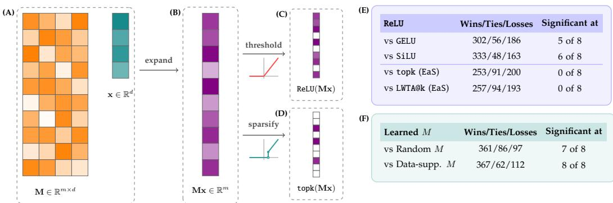
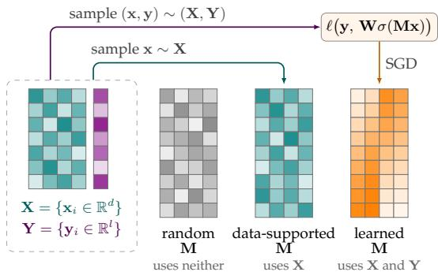
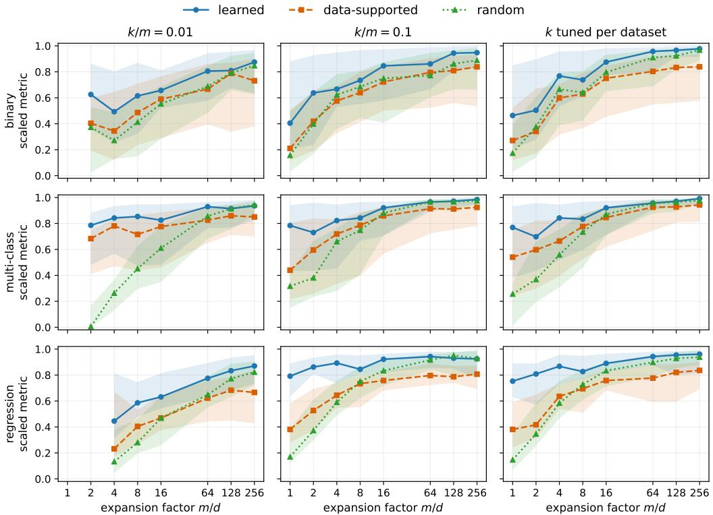
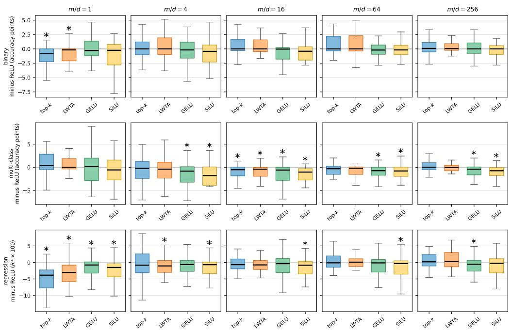
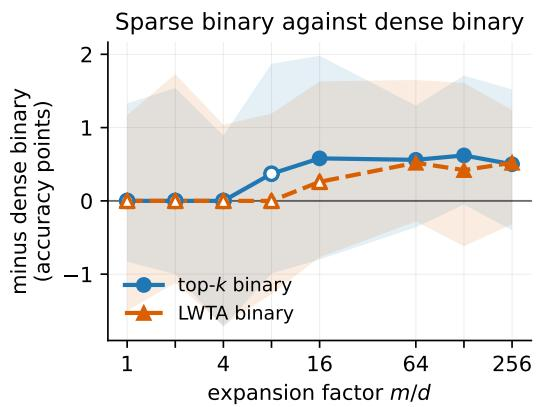
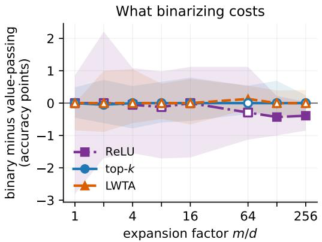
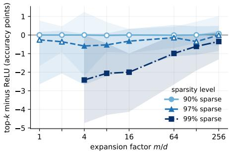
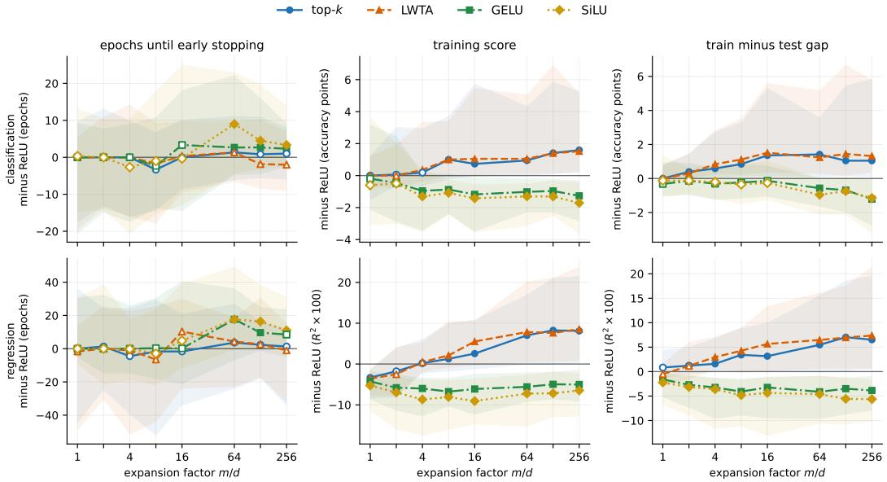

# On Learning Expand-and-Sparsify Representations

Alireza Asghari Wichita State University axasghari@shockers.wichita.edu

Parikshit Ram IBM Research parikshit.ram@ibm.com

Kaushik Sinha Wichita State University kaushik.sinha@wichita.edu

## Abstract

Expand-and-sparsify (EaS) representations lift an input to a much higher dimension through a linear map and keep only the k largest coordinates. Existing theory builds that map at random and needs the expanded dimension to grow exponentially in the input dimension, which puts the construction out of practical reach. We ask what is gained by learning the map by gradient descent instead, and how that gain depends on how wide the expansion is. We sweep 73 OpenML classifi cation tasks and 48 regression tasks under a protocol that holds the datasets, expanded dimensions, sparsity levels and splits fixed across every method, and we summarise each comparison by a median over datasets and a Wilcoxon signed rank test. We report four findings. First, learning the expansion helps most when the expansion is narrowest, and its advantage over a random map decays to nothing by the widest expansions we run, so a learned EaS layer can be made small. Second, with the map learned, a top-k representation that keeps at most a tenth of its coordinates is indistinguishable from a dense ReLU layer of the same expanded dimension at every expansion factor we test, while GELU and SiLU are not. Third, when the representation is forced to be binary the sparse code is the better of the two, and the reason is that binarization costs it nothing while it costs the dense layer accuracy. Fourth, how sparse the representation can be is governed by how wide it is: the sparsity level that is free rises as the expansion grows, so there is no fixed limit on how sparse it can be. The regression tasks reproduce the first finding and qualify the second and third.

## 1 Introduction

Expand-and-sparsify or EaS representations are generated by projecting inputs in $\mathbb { R } ^ { d }$ to a much larger dimensionality $\mathbb { R } ^ { m }$ with $m \gg d ,$ followed by a sparsification step which zeros out all but the top k values in the m-dimensional representation, with $k \ll m$ . This scheme is neuro-biologically inspired, where the top-k sparsification is achieved via inhibitory signals common in biological systems. For example, a version of this is seen in the olfactory circuit of fruit-flies [Turner et al., 2008, Caron et al., 2013], olfactory circuit of rodents, the visual cortex of cats, and the electrosensory system of electric fish [Stettler and Axel, 2009, Olshausen and Field, 2004, Chacron et al., 2011]. This representation scheme has been used for locality sensitive hashing [Dasgupta et al., 2017] and outlier detection [Dasgupta et al., 2018]. Subsequent theoretical studies have shown that a linear model on top of these representations can approximately express any sufficiently smooth function [Dasgupta and Tosh, 2020, Sinha, 2024].

While these representations come with interesting theoretical properties, their practical viability has not been established to the best of our knowledge. The theoretical studies rely on expansions via prescribed constructions, and require $m \sim O ( \exp ( d ) )$ , thus limiting practical use. Learned expansions for supervised problems via stochastic gradient descent (SGD) and backpropagation with more practical values of $m \gg d$ have not been explored. Expanded representations (with more practical values of $m \geq d )$ are often employed in the single-hidden-layer feedforward networks, serving as channel mixers in architectures such as the Transformer [Vaswani et al., 2017] or the MLPmixer [Tolstikhin et al., 2021], and we think it is important to understand the capabilities of (learned) EaS representations relative to the commonly used learned unrestricted expanded representations.

<table><tr><td colspan="3"></td></tr><tr><td>ReLU</td><td>Wins/Ties/Losses Significant at</td><td></td></tr><tr><td>VS GELU</td><td>302/56/186</td><td>5 of 8</td></tr><tr><td>vs SiLU</td><td>333/48/163</td><td>6 of 8</td></tr><tr><td>vs topk (EaS)</td><td>253/91/200</td><td>0 of 8</td></tr><tr><td>vs LWTA@k (EaS)</td><td>257/94/193</td><td>0 of 8</td></tr></table>

<table><tr><td colspan="3"></td></tr><tr><td>Learned M</td><td>Wins/Ties/Losses Significant at</td><td></td></tr><tr><td>vs Random M</td><td>361/86/97</td><td>7 of 8</td></tr><tr><td>vs Data-supp. M</td><td>367/62/112</td><td>8 of 8</td></tr></table>

Figure 1: What we compare, and what we find. (A) A linear operator M $\in \mathbb { R } ^ { m \times d }$ is applied to the input $\mathbf { x } \in \mathbb { R } ^ { d }$ , giving us (B) an expanded representation Mx $\in \mathbb { R } ^ { m }$ , which is then either (C) thresholded, giving a dense ReLU layer, or (D) sparsified, giving the $\mathtt { E a S }$ representation. (E) The table compares ReLU against alternate activations with M learned throughout — GELU and SiLU are other dense activations, and $\tt t o p k$ and $\mathbb { L } \mathbb { W } \mathbb { T } \mathbb { A } \mathbb { Q } \mathbb { k }$ serve as EaS versions with different sparsification schemes. (F) The table compares a learned M against theoretical constructions from Dasgupta and Tosh [2020] with topk activation throughout. We summarize the results in the form of wins/ties/losses over the (dataset, $m / d )$ configurations, and “significant $\mathrm { { a t } } ^ { \dag }$ counts how many of the 8 expansion factors reach $p < 0 . 0 5$ under a two-sided Wilcoxon signed rank test (per-expansion factor results are in fig. 4 and table 1; more details are presented in section E and section F). The results show that the learned EaS representations not only significantly improve upon the theoretical constructions, but also provide competitive performance to standard activations used infeedforward networks.

Consequently, we believe that EaS can enable unique advantages in practical architectures. Because the expanded representation is extremely $( k \ll m )$ and predictably (always k nonzeros) sparse, (i) we can use sparse linear algebra kernels when available, (ii) we need only load the rows of the next layer’s weights that correspond to the k nonzeros, (iii) we need only backpropagate through those same k nodes [Gupta et al., 2021], and (iv) any cache of intermediate activations [Grave et al., 2017, Wimbauer et al., 2024] shrinks by the same factor. Section B works through what each of these is worth.

Research question. Given these motivations for EaS representations, here we focus on understanding whether learning the EaS representations via standard SGD (i) not only improves over the existing theoretical EaS constructions, but also (ii) produces representations that are competitive with existing unrestricted expanded representations in terms of expressivity and generalization.

Findings. We consider an evaluation across 73 OpenML classification tasks (binary and multi-class) and 48 OpenML regression tasks, controlling for the expanded dimension (with the expansion factor $m / d \in [ 1 , 2 5 6 ] \rangle$ and the sparsity $( k \le 0 . 1 m )$ , training over roughly 50,000 configurations (more than 160,000 training runs across three train/validation/test splits for each configuration). 1 Every number below is a median over datasets of the per-dataset difference, with significance from a two-sided Wilcoxon signed rank test. We make the following observations (see summary in fig. 1).

• Learned EaS representations outperform the theoretical constructions, and by the largest margin where the expansion is narrowest. That learning helps is expected, since only it sees the labels; the useful part is the decay. Against a data-independent construction the median gain falls from 3.0 accuracy points at $m = d \mathrm { t o } 0 . 1 3 \mathrm { a t } m = 2 5 6 d .$ , significant up to $m = 1 2 8 d ( p \leq 0 . 0 0 6 )$ but not beyond. Regression behaves the same way, with a median gain of 0.185 in $R ^ { 2 }$ at $m = d .$ Against the data-supported construction the gain does not decay: it stays between 0.65 and 1.68 points across the whole range and is significant at every expansion factor $( p \leq 0 . 0 0 1 1 )$ . A learned EaS representation can therefore be made small, tolerating smaller values of $m \geq d .$

• Learned EaS representations at $k \leq 0 .$ .1m are competitive with unrestricted ones. Against a ReLU layer of the same expanded dimension we see no significant difference at any expansion factor, with the median difference between −0.22 and +0.05 points and $p \ge 0 . 1 7 7$ throughout. This is not something every alternative achieves: GELU and SiLU both fall significantly short of ReLU over most of the range. On regression the same parity holds for $m \geq 4 d ;$ below that the EaS representation trails ReLU significantly, by a median 0.04 in $R ^ { 2 }$ at $m = d$ and 0.03 at $m = 2 d$

• If the representation is restricted to be binary, the learned EaS representation is the better of the two from $m = 1 6 d$ onward, by 0.50 to 0.62 accuracy points. Comparing each activation against its own value-passing form shows why: binarizing topk costs nothing at any expansion factor, while binarizing ReLU costs 0.4 points at $m \geq 1 2 8 d$ . The sparse code is not gaining, it is simply not losing, since it already carries its information in which coordinates fire rather than how strongly. On regression binarizing costs every activation something, but it costs topk less than ReLU, so the binarized EaS representation is again ahead, at $m = 1 6 d$ to 128d.

• How sparse the representation can be is governed by how large the expanded dimension is. At 90% sparsity it matches ReLU everywhere; at 99% it falls behind, but the deficit shrinks monotonically from 2.4 points at $m = 4 d$ to 0.35 at $m = 2 5 6 d$ . There is no single sparsity level at which EaS begins to lose; instead, the larger the expanded dimension, the sparser the representation can be before it costs accuracy.

Together these indicate that the practical benefits of EaS representations described above may be available without losing much in expressivity or generalization, which makes a case for their wider use in modern architectures.

Related work. EaS representations were introduced as a model of the fly olfactory circuit and used for similarity search [Dasgupta et al., 2017] and novelty detection [Dasgupta et al., 2018], and later applied to supervised classification [Sinha and Ram, 2021, Ram and Sinha, 2022]. Their expressivity has been studied theoretically by Dasgupta and Tosh [2020], Sinha [2024] and Sinha and Tosh [2026], all of whom construct the expansion by sampling its rows from a fixed distribution rather than by learning them. Two lines of work do learn the projection: Ryali et al. [2020] train it with an unsupervised, biologically motivated rule for similarity search, and Liang et al. [2021] train the same circuit on text to produce word embeddings. Both learn the expansion, but neither measures the resulting representation against a dense layer of the same expanded dimension under a fixed sparsity budget, which is the comparison we make. Sparsification by competition among units, without the expansion, was studied by Srivastava et al. [2013], and top-k activations have been used inside the feedforward block of a Transformer to reduce the memory cost of backpropagation [Gupta et al., 2021]. We further elaborate on how our setting relates to each of these in section A, including the sense in which Dasgupta and Tosh [2020, §5] already consider a data-dependent expansion.

## 2 Problem and Experimental Setup

The model. We consider supervised learning problems, given training data ${ \cal { S } } = \{ ( { \bf { x } } _ { i } , { \bf { y } } _ { i } ) , i =$ $1 , \ldots , n \}$ with input features $\mathbf { x } _ { i } \in \mathbb { R } ^ { d }$ and the output $\mathbf { y } _ { i } \in \mathcal { V } \subset \mathbb { R } ^ { l }$ , and a model of the form

$$
f ( \mathbf { x } ; \mathbf { W } , \mathbf { M } ) = \mathbf { W } \mathbf { z } , \quad \mathbf { z } \triangleq \sigma ( \mathbf { M } \mathbf { x } ) \in \mathbb { R } ^ { m } , \quad \mathbf { M } \in \mathbb { R } ^ { m \times d } , \mathbf { W } \in \mathbb { R } ^ { l \times m } .\tag{1}
$$

Here M is the expansion matrix, σ is a nonlinear activation, W is the linear readout, and (W, M) are the learnable parameters. If l is the number of classes, f is a multi-class classifier; if $l = d ,$ this model is the feedforward channel mixer used in the Transformer and the MLP-Mixer. With σ a standard activation such as ReLU, eq. (1) is a single-hidden-layer feedforward network; with σ the topk function we get $\| \mathbf { z } \| _ { 0 } = k$ , which is the EaS representation. We can further restrict the representation to be binary, $\mathbf { z } \in \{ 0 , 1 \} ^ { m }$ , in which case a standard activation reduces to the Heaviside function while the EaS representation has exactly k ones and $( m - k )$ zeros. Given a loss $\ell ,$ we learn (W, M) by minimizing the population loss $\begin{array} { r l } { } & { { } \dot { \sum _ { i = 1 } ^ { n } \ell } ( \mathbf { y } _ { i } , \mathbf { W } \cdot \boldsymbol { \sigma } ( \mathbf { M } \mathbf { \dot { x } } _ { i } ) ) } \end{array}$ with SGD, for different activations and different values of m and k. With theoretical constructions of M, we learn only W.

Constructions of the expansion matrix. We compare three ways of obtaining the expansion matrix M (fig. 2), holding everything else fixed. In the learned construction, M is trained by SGD jointly with the readout W. In the datasupported construction, the m rows of M are drawn from the training inputs with replacement, so that the expansion directions lie in the support of the data, which is the setting Dasgupta and Tosh [2020, §5] analyze. In the dataindependent construction, the rows are drawn i.i.d. from a fixed distribution (the uniform distribution on the unit sphere in $\mathbb { R } ^ { d }$ , drawn by normalizing samples from $\mathcal { N } ( 0 , \pmb { I } _ { d } ) )$ . In all three cases, W is fitted by SGD on all n training points.

  
Figure 2: The three constructions of M and what each may use. The random (data-independent) M uses neither X nor Y, the data-supported M samples its rows from X, and the learned M is trained by SGD on a loss that sees both.

Drawing with replacement matters for two reasons. It keeps the construction defined for every dataset at every expanded dimension, including $m > n ,$ so the three constructions are compared on the same datasets throughout. And it is i.i.d. sampling from the empirical distribution, whereas drawing m distinct points is not i.i.d. at all. The cost is that M can hold at most n distinct rows, which section 3.1 shows is what eventually limits this construction.

Activations. The sparse activations are topk and local winner-take-all (LWTA@k), which splits the representation into blocks of size $( m / k )$ and selects the top-1 in each block [Srivastava et al., 2013], resulting in one nonzero per block; with blocks of size round $| ( m / k ) \rrangle$ that is exactly k nonzeros when k divides m and can be slightly more otherwise (section F). We treat LWTA@k as an alternative sparsification scheme within EaS rather than as a separate method: both keep (about) k of the m coordinates and so carry the same sparsity budget, and they differ only in which k survive. The topk activation lets all m units compete, while LWTA@k lets them compete only inside blocks of size $( m / k )$ . For any single input the two coincide under a permutation of the rows of M that puts the k winners in distinct blocks, and when M is learned the assignment of directions to blocks is learned along with the directions, so the network can partly arrange that for itself. We therefore expect the two to behave similarly, and section 3.2 finds that they do. We run each of them in a value-passing form, which forwards the surviving pre-activations, and in a binary form, which forwards their indicator and is trained through a straight-through estimator. The dense baselines are ReLU, GELU and SiLU. Binarizing any of these three gives the same function, the indicator of a positive pre-activation, so there is one dense binary baseline rather than three and we run only that one. The binary forms are evaluated against each other in section 3.3 and are not mixed into the comparisons among value-passing activations.

Parameterization. We report results as functions of the expansion factor $m / d$ and the sparsity level $k / m$ rather than of m and $k .$ These are equivalent, but the ratios are comparable across datasets of differing dimension, and k on its own cannot be separated from m in our grid: since $k = ( k / m ) \cdot ( m / d ) \cdot d ,$ a large absolute k arises only at a large expanded dimension. We sweep $m / d \in$ {1, 2, 4, 8, 16, 64, 128, 256} and $k / m \in \{ 0 . 0 0 1 , 0 . 0 1 , 0 . 0 3 , 0 . 0 5 , 0 . 1 0 \}$ , restricting throughout to $k \le 0 . 1 m$

Data. We use 73 classification tasks from OpenML, admitted by input dimension $d \in [ 8 , 1 2 0 ]$ and sample size $n \in [ 3 0 0 , 2 0 0 0 0 ]$ , with missing values imputed and categorical features one-hot encoded. Of these, 37 are binary and 36 are multi-class. We use a further 48 regression tasks admitted by the same criteria. We deliberately chose a large and varied set of tasks so that we can see how generally the behaviour of EaS holds.

Protocol. Every construction sees identical datasets, expanded dimensions, sparsity levels and train/test splits, so all comparisons are paired. We repeat every configuration on 3 random train/ validation/test splits $( 7 0 / 1 0 / 2 0$ , stratified for classification), with a different seed for each, and report the mean test score. We train with Adam at a learning rate of $1 0 ^ { - 3 }$ , no weight decay and a batch size of 256, for up to 300 epochs with early stopping at a patience of 30. For each (dataset, $m / d ,$ activation, construction) configuration we select k on validation accuracy and report the corresponding test accuracy; the dense activations have no k and are unaffected by this selection. We cap $m \leq 3 0 { , } 0 0 0$ due to computational limitations.

Two things follow from that cap and from k being an integer, and both change which datasets are available at a given expansion factor. A dataset drops out at the wide end when $m = ( m / d )$ · d exceeds the cap, which happens first for the highest-dimensional datasets. And it drops out at the narrow end when m is too small for any integer k to satisfy $k \le 0 . 1 m$ , which happens first for the lowest-dimensional ones. The pool is therefore not the same at every $m / d ,$ so we compare methods only within an expansion factor and never read a trend along a row of counts. Section F gives the pool sizes at each expansion factor and which of the two causes is responsible.

Statistics. For each expanded dimension, we compare two methods only on the datasets where both are available, so every comparison is paired. Within a given $m / d$ we use the same set of datasets for every method being compared, so that a method is never scored on an easier subset than the one it is being compared against. We report raw metrics (accuracy $\in [ 0 , 1 ]$ for classification, and $R ^ { 2 }$ for regression), except in $\mathrm { f i g } .$ 3 where we use the scaled form of the metrics to aggregate performance across datasets [Ram and Sinha, 2022]. Because $R ^ { 2 }$ is unbounded below, we verify every regression conclusion twice, once with $R ^ { 2 }$ floored at zero and once left raw, and we say so wherever the two disagree. In both cases k is chosen on the raw validation score, so flooring changes what is reported but not which model is selected. When comparing a pair of methods we report the median difference, the inter-quartile range, the number of datasets on which the first method wins, ties or loses, and the p-value of a two-sided Wilcoxon signed rank test. We count a tie when the difference is at most 0.001 (that is 0.1 percentage points of accuracy or 0.001 in $R ^ { 2 } )$

## 3 Main Results

We organise the results around the four findings. Section 3.1 compares the three ways of building M. Section 3.2 compares the sparse representation against unrestricted ones at the same expanded dimension. Section 3.3 restricts both to binary codes. Section 3.4 fixes the sparsity level instead of tuning it. Classification and regression are reported together in each except section 3.4, which is classification only, and every comparison is paired within an expansion factor as described in section 2.

## 3.1 What is gained by learning the expansion?

Here we compare the performance of the learned expansion matrix to existing theoretical constructions, and the results are presented in fig. 3. We first compare the learned expansion to the data-independent one. The learned expansion gives higher accuracy at every expansion factor we consider, and the improvement is largest when the expansion is narrowest. The median gain over datasets is 3.0 accuracy points at $m = d ,$ and it drops to 2.55 points at m = 4d, 1.0 point at $m = 1 6 d$ and 0.13 points at $m = 2 5 6 d$ . We see a significant difference at every expansion factor up to $m = 1 2 8 d$ $( p \leq 0 . 0 0 6$ , and $p < 1 0 ^ { - 4 }$ for $m \leq 1 6 d )$ , and no significant difference at $m = 2 5 6 d ( p = 0 . 1 2 7 )$ . The regression tasks behave the same way: learning the projection is worth a median 0.185 in $R ^ { 2 }$ at $m = d ,$ , that gain falls to 0.002 at $m = 2 5 6 d .$ , and it is significant at every expansion factor up to and including $m = 6 4 d$ but at neither of the two widest $( p \ge 0 . 1 4 )$ , with $\dot { R } ^ { 2 }$ raw or floored at zero. In other words, learning the expansion gives much of what a larger expanded dimension would have given anyway, and once it is large enough there is little left for learning to add. In practice this says a learned EaS layer can be made small.

  
Figure 3: Scaled metrics (accuracy for classification, $R ^ { 2 }$ for regression; higher is better) of the three constructions of M against the expansion factor $( m / d )$ , with topk sparsification throughout. Rows are task types (binary classification, multi-class classification and regression) and columns are sparsity levels $( k / m )$ , with the rightmost column selecting k on validation. Each line is the median over datasets and the ribbon is the inter-quartile range. As discussed in section 2, evaluations for $k < 1$ and $m > 3 0 0 0 0$ are skipped so results for small $m / d$ and small $k / m$ are absent when d is small. Learned EaS improves upon both theoretical constructions at small expansion factors in every panel. As the expansion grows the random construction catches up, while the data-supported one mostly stays below (section 3.1).

We next compare the learned expansion to the data-supported one. Here the gain does not decay with the expanded dimension. It is 0.90 points at $m = d ,$ 1.18 at $m = 8 d ,$ 0.65 at $m = 6 4 d$ and 1.12 at $m = 2 5 6 d ,$ and we see a significant difference at every expansion factor $( p \leq 0 . 0 0 1 1 )$ , on a pool that stays between 57 and 71 datasets throughout. On regression the gain shrinks, from 0.13 in $R ^ { 2 }$ at $m = d$ to 0.03 at $m = 2 5 6 d .$ , but it too is significant at every expansion factor $( p < 1 0 ^ { - 4 } , R ^ { 2 }$ raw or floored). So against a projection drawn without reference to the data learning stops paying once the expansion is wide, and against one whose rows come from the data it keeps paying. Section G traces this difference to the data-supported M running out of distinct rows as m grows, on regression as on classification.

  
Figure 4: Per-dataset differences against ReLU at equal expanded dimension, with M learned for both methods and k selected on validation for the sparse activations. Rows are task types and columns are expansion factors. Each box is the distribution over datasets of the difference for one activation, so values above zero mean the activation beats ReLU on that dataset. Within a panel every activation is scored on the same datasets, and a star marks a significant difference from ReLU in that panel (two-sided Wilcoxon, $p < 0 . 0 5 )$ . Whiskers extend to 1.5 times the interquartile range and outliers are not drawn. All differences are multiplied by 100: accuracy differences in percentage points for classification and differences in $R ^ { 2 }$ for regression.

## 3.2 How does EaS fare against unrestricted expanded representations?

Here we compare the learned EaS representations to standard (dense) expanded representations, and the results are presented in fig. 4 and table 1. In fig. 4 we can see that the boxes for topk and LWTA@k sit on zero at every expansion factor while those for GELU and SiLU sit below it once $m \geq 4 d ,$ , and the table makes this precise. The EaS representation at $k \leq 0$ .1m is statistically indistinguishable from the unrestricted one at every expansion factor we study regardless of whether we use topk or LWTA@k for the sparsification (as we had expected): For topk, the median difference stays between −0.22 and +0.05 accuracy points and no Wilcoxon test reaches significance $( p \ge 0 . 1 7 7 ) ;$ for LWTA@k, $p \ge 0 . 1 0 5$ . The smooth activations instead do not necessarily match ReLU. GELU falls short of ReLU by a median 0.16 to 0.44 points and is significantly behind at $m / d \in \{ 4 , 8 , 1 6 , 6 4 , 1 2 8 \}$ , and SiLU falls short by 0.25 to 0.92 points and is significantly behind at every expansion factor from $m = 4 d$ upwards. Parity with ReLU is therefore not something every alternative activation achieves. EaS trains no slower, but its train–test gap is larger (section I).

On the regression tasks, the EaS representation matches ReLU once the expansion is at least 4d. With topk it is significantly worse only at $m = d \mathrm { a n d } m = 2 d .$ . From $m = 4 d$ upwards no test is significant $( p \geq 0 . 0 7 0 )$ and the median difference stays within 0.014 of zero, whether $R ^ { 2 }$ is left raw or floored at zero. LWTA@k behaves the same way from $m = 8 d \left( p \geq 0 . 0 8 2 \right)$ ). It is also significantly behind at $m = 4 d ,$ , but that result disappears when we remove the few configurations where LWTA@k keeps more than k units (section F). As on classification, the smooth activations fall short of ReLU: GELU is significantly behind at $m / d \in \{ 1 , 2 , 8 , 2 5 6 \}$ , and SiLU at every expansion factor up to $m = 6 4 d ( { \mathrm { a n d a t } } m = 2 5 6 d$ when $R ^ { 2 }$ is floored), by medians of 0.003 to 0.010 and 0.003 to 0.018 in $R ^ { 2 }$ respectively. Table 4 gives every value. This range overlaps the one where learning M still pays:

Table 1: Each activation against ReLU at equal expanded dimension on the 73 classification tasks, with M learned for both methods. Each cell gives wins/ties/losses over datasets and, in parentheses, the p-value of a two-sided Wilcoxon signed rank test on the per-dataset differences; a star marks $p < 0 . 0 5$ . Within a column every activation is scored on the same datasets. Five of the eight expansion factors are shown here; table 2 in the section E gives all eight.
<table><tr><td>activation</td><td> $m / d = 1$ </td><td> $m / d = 4$ </td><td> $m / d = 1 6$ </td><td> $m / d = 6 4$ </td><td> $m / d = 2 5 6$ </td></tr><tr><td>top-k</td><td>17/15/25 (.198)</td><td>27/9/35 (.585)</td><td>24/12/35 (.727)</td><td>27/9/35 (.800)</td><td>31/9/27 (.321)</td></tr><tr><td>LWTA</td><td>19/14/24 (.517)</td><td>25/9/37 (.425)</td><td>25/11/35 (.373)</td><td>21/16/34 (.725)</td><td>28/13/26 (.616)</td></tr><tr><td>GELU</td><td>25/3/29 (.899)</td><td>23/4/44 (.023)*</td><td>19/10/42 (.002)*</td><td>21/8/42 (.005)*</td><td>22/8/37 (.101)</td></tr><tr><td>SiLU</td><td>21/6/30 (.255)</td><td> $2 1 / 4 / 4 6 ( . 0 0 1 ) ^ { * }$ </td><td> $1 5 / 6 / 5 0 ( < . 0 0 1 ) ^ { \ast }$ </td><td>21/6/44 (.002)*</td><td> $2 0 / 1 1 / 3 6 ( . 0 0 7 ) ^ { \ast }$ </td></tr></table>

  
Figure 5: The effect of binarizing expanded representations on classification tasks. [Left] The signed difference between the accuracy of the binarized EaS and binarized ReLU representations (higher values indicate better EaS performance relative to the dense versions). [Right] Per-method performance degradation due to binarization (lower values imply larger degradations). Lines are medians over datasets and ribbons the interquartile range; filled markers are significant under a two-sided Wilcoxon signed rank test $( p < 0 . 0 5 )$ and hollow ones are not. Table 3 gives every value.

at $m = 4 d$ the learned M is ahead of a random one by a median 0.09 in $R ^ { 2 }$ , and it stays significantly ahead through $m = 6 4 d$ . So between $m = 4 d$ and $m = 6 4 d$ the representation can be both learned and sparse at no measurable cost.

We state two important qualifications: (i) The sparsity level k is selected on validation for the EaS representations, and the dense representations do not have any such equivalent knob. (ii) The aggregated classification results in table 1 hide a difference between the task types: topk is behind ReLU on the binary tasks at $m = d \left( 0 . 8 5 \right.$ points, $p = 0 . 0 0 0 5 )$ and on the multi-class tasks at $m = 8 d$ and $m = 1 6 d ( 0 . 4 9$ and 0.52 points, $p \leq 0 . 0 4 1 )$ . These are three small significant results out of the sixteen comparisons obtained by splitting each of the eight expansion factors by task type, and fig. 4 marks those at the expansion factors it shows.

## 3.3 How robust is EaS to binarization of expanded representations?

We now restrict the expanded representation to be binary, so that the expanded representations post-activation $\mathbf { z } = \sigma ( \mathbf { M } \mathbf { x } ) \in \{ 0 , 1 \} ^ { m }$ ; we learn the model parameters using the straight-through estimator. Figure 5 shows the classification comparisons and table 3 gives every value; the regression results close this section. Binarizing ReLU, GELU or SiLU gives the same function, so there is a single dense binary baseline.

On classification, the binarized EaS representation is the better of the two once the expanded dimension is large. With topk sparsification, we see no significant difference for $m \leq 8 d _ { \mathrm { \Omega } }$ , and then a median advantage of 0.58 points at m = 16d $( p = 0 . 0 4 3 )$ , 0.56 at m = 64d $( p = 0 . 0 2 3 )$ , 0.62 at $m = 1 2 8 d ( p = 0 . 0 0 0 3 )$ and 0.50 at m = 256d $( p = 0 . 0 0 2 )$ . The binarized LWTA@k sparsification behaves the same way, reaching a median advantage of 0.52 points at $m = 2 5 6 d \ : ( p = 0 . 0 0 5 )$ . So the advantage appears once m is at least 16d.

That advantage could stem from the EaS representations improving or the dense one degrading. We separate the two by comparing each activation against its own value-passing form, which tells us what binarization costs it. Binarizing ReLU costs a median 0.43 points at $m = 1 2 8 d ( p = 0 . 0 2 7 )$ and 0.39 points at $m = 2 5 6 d \ : ( p = 0 . 0 0 4 )$ , and nothing detectable at smaller expanded dimensions. Binarizing topk costs nothing at any expansion factor we study: the median difference is zero throughout and no test comes close to significance $( p \geq 0 . 2 2 9 )$ . Binarizing LWTA@k is the same, with one exception at $m = 6 4 d$ where it is a small gain of 0.13 points $( p = 0 . 0 2 5 )$ ).

These results indicate that the advantage of EaS under binarization is not that the sparse representation improves, but that it loses nothing while the dense one loses about 0.4 accuracy points. The EaS representation can carry information in its nonzero coordinates and thus appears to handle the binarization without any degradation. The memory and compute savings of a binary representation (section B) are therefore available from EaS at no measurable cost in accuracy.

In regression (with 48 datasets) binarized topk representation is the better than binarized ReLU representations once the expansion is large — by a median 0.014, 0.028 and 0.017 in $R ^ { 2 }$ at $m = 1 6 d ,$ 64d and 128d $( p \leq 0 . 0 3 1 , R ^ { 2 }$ raw or floored), with no significant difference below $m = 1 6 d$ or at $m = 2 5 6 d$ . Binarized LWTA@k is ahead of ReLU at $m = 6 4 d$ and 128d. The reason differs from classification. On regression, binarizing costs every activation something: topk loses a median 0.010 to 0.037 in $R ^ { 2 }$ , significantly at every expansion factor, and ReLU loses 0.015 to 0.068, significantly everywhere except at $m = 2 5 6 d$ with $R ^ { 2 }$ floored. The EaS representation keeps its advantage because it loses less, not because it loses nothing. See detailed results in table 4 in section E.

## 3.4 How sparse can the representation be?

In section 3.2 we selected k on validation, so the sparsity level that ended up being used is tuned. Here we fix it instead (fig. 6, table 5), do no selection over $k ,$ and ask at which expanded dimensions each level is affordable. The point is not that more sparsity costs more accuracy, which is expected, but the rate at which a larger expanded dimension buys that cost back.

At 90% sparsity $( k / m = 0 . 1 0 )$ the EaS representation matches ReLU at every expansion factor, with a median difference of zero and no significant difference anywhere $( p \geq 0 . 2 1 )$ . At 99% sparsity $( k / m = 0 . 0 1 )$ it is behind, and significantly so from $m = 4 d$ upwards, but the deficit shrinks monotonically as the expanded dimension grows: 2.42 points at $m = 4 d ,$ 2.06 at $m = 8 d , 2 . 0 0$ at m = 16d, 0.99 at $m = 6 4 d ,$ 0.61 at $m = 1 2 8 d$ and 0.35 at $m = 2 5 6 d$ . The 97% level sits between the two. It is significantly behind ReLU at $m / d \in \{ 4 , 8 , 1 6 \}$ , by a median 0.59, 0.53 and 0.33 points, and we see no significant difference from $m = 6 4 d$ onwards.

Figure 6: The signed difference between topk based EaS at a fixed sparsity $( k / m )$ and dense ReLU representations with varying expansion factors $( m / d )$ . Lines are medians over datasets, ribbons the interquartile range; filled markers are significant $( p < 0 . 0 5 )$ . A point is drawn only where at least 30 datasets are present: 99% sparsity leaves 8 and 23 datasets at $m = d$ and $m = 2 d .$ . Table 5 gives every value.

We see the expected behaviour, with the cost of a sparsity level falling as the expanded dimension grows. What the numbers add is the exchange rate: the sparsity level that is free moves from 90% at m = 4d to 97% at $m = 6 4 d$ . There is therefore no single sparsity level at which EaS begins to lose; instead, the larger the expanded dimension, the sparser the representation can be before it costs accuracy.

## 4 Concluding Remarks

In this work, we considered an elaborate evaluation with 121 datasets spanning binary/multiclass classification and regression and roughly 50,000 configurations to study the empirical behaviour of the neurobiologically inspired and theoretically motivated EaS representations. Our results support the practical viability of these representations when learned via standard SGD: First, we see that the learned EaS representations perform significantly better than the existing theoretical constructions, especially when $m \in [ d , 2 5 6 d ]$ are of practical sizes (as opposed to the required $m \sim$ $O ( \exp ( d ) )$ for the theoretical constructions). Then, we see that these learned EaS representations are quite competitive to the standard expanded representation obtained with ReLU networks (and similar activations), and when restricted to binary representations, EaS even outperforms standard representations once the expansion is large enough.

Limitations. The main limitation of our work is that it is an empirical study without theoretical guarantees for the learned representations, limited to single-hidden-layer networks applied to tabular datasets (albeit over 120 of them). Our choice of this network is due to its prevalence in architectures such as Transformers and MLP-Mixers. However, we do not directly consider such architectures in our evaluations as they would introduce confounders that would make it hard to isolate the effect of the EaS representations. One thing of note is that the explicit k-sparsification in EaS representations allows us to tune the sparsity level $( k / m )$ in a problem specific manner, whereas the existing unrestricted expanded representations do not have any such knob (see section C). Furthermore, within our elaborate evaluation, we end up with some inconsistencies. First, the minimal sparsity requirement of $k \geq 1$ and the computational limit of $m \leq 3 0 0 0 0$ leads to situations where some configurations are not valid for datasets whose d is either too large or too small. While we do not have any solution for this, we report the size of the dataset pool for each expansion in section F. Second, with the data-supported construction, when m is large relative to n, the expansion matrix M ends up with repeated rows, thereby introducing redundancies and hampering the benefits of the expansion. Again, we do not have a solution for this but we report it in detail in section G.

## AI use statement

In this work, we used generative AI tools for writing and editing portions of the text, for writing the experiment, analysis and plotting code (including the dataset preprocessing) from which every figure and table is generated, for proposing experimental designs and diagnostics, for helping interpret results, and for retrieving and summarizing prior work. We have not used generative AI tools to generate the research question or the hypotheses, which are the authors’ own, and the remaining categories requiring disclosure are not applicable to this work.

We have reviewed all AI-assisted work. All code was run by the authors and its outputs verified; the analysis was cross-checked against a second, independently written script. Every citation and every attribution of a result to prior work was checked by the authors against the original paper; two claims of novelty produced this way were incorrect and were withdrawn following that check. We take responsibility for the final content of this work, including text, claims or artifacts produced with the aid of generative AI.

## References

S. Boucheron, O. Bousquot, and G. Lugosi. Theory of classification : A survey of some recent advances. ESAIM: Probability and Statistics, 9:323–375, 2005.

Sophie J. C Caron, Vanessa Ruta, L. F Abbott, and Richard Axel. Random convergence of olfactory inputs in the drosophila mushroom body. Nature, 497(7447):113–117, 2013. URL https: //doi.org/10.1038/nature12063.

M. Chacron, A. Longtin, and L. Maler. Efficient computation via sparse coding in electrosensory neural networks. Current Opinion in Neurobiology, 21(5):752–760, 2011. URL https://doi. org/10.1016/j.conb.2011.05.016.

Sanjoy Dasgupta and Christopher Tosh. Expressivity of expand-and-sparsify representations, 2020. URL https://arxiv.org/abs/2006.03741.

Sanjoy Dasgupta, Charles F. Stevens, and Saket Navlakha. A neural algorithm for a fundamental computing problem. Science, 358(6364):793–796, 2017. doi: 10.1126/science.aam9868. URL https://doi.org/10.1126/science.aam9868.

Sanjoy Dasgupta, Timothy C. Sheehan, Charles F. Stevens, and Saket Navlakha. A neural data structure for novelty detection. Proceedings of the National Academy of Sciences, 115(51): 13093–13098, 2018. URL https://doi.org/10.1073/pnas.1814448115.

Edouard Grave, Armand Joulin, and Nicolas Usunier. Improving neural language models with a continuous cache. In International Conference on Learning Representations, 2017. URL https://openreview.net/forum?id=B184E5qee.

Ankit Gupta, Guy Dar, Shaya Goodman, David Ciprut, and Jonathan Berant. Memory-efficient transformers via top-k attention. In Proceedings ofthe Second Workshop on Simple and Efficient Natural Language Processing, pages 39–52, 2021. URL https://aclanthology.org/ 2021.sustainlp-1.5.

Yuchen Liang, Chaitanya Ryali, Benjamin Hoover, Leopold Grinberg, Saket Navlakha, Mohammed J Zaki, and Dmitry Krotov. Can a fruit fly learn word embeddings? In International Conference on Learning Representations, 2021. URL https://openreview.net/forum?id= xfmSoxdxFCG.

Bruno A Olshausen and David J Field. Sparse coding of sensory inputs. Current Opinion in Neurobiology, 14(4):481–487, 2004. URL https://doi.org/10.1016/j.conb.2004. 07.007.

Parikshit Ram and Kaushik Sinha. Federated nearest neighbor classification with a colony of fruit-flies. In Proceedings ofthe AAAI Conference on Artificial Intelligence, volume 36, pages 8097–8105, 2022. URL https://doi.org/10.1609/aaai.v36i7.20775.

Chaitanya Ryali, John Hopfield, Leopold Grinberg, and Dmitry Krotov. Bio-inspired hashing for unsupervised similarity search. In International conference on machine learning, pages 8295–8306. PMLR, 2020. URL https://proceedings.mlr.press/v119/ryali20a.html.

Shai Shalev-Shwartz and Shai Ben-David. Understanding Machine Learning: From Theory to Algorithms. Cambridge University Press, 2014. ISBN 9781107057135.

Kaushik Sinha. Non-parametric classification via expand-and-sparsify representation. In Advances in Neural Information Processing Systems, pages 29657–29696, 2024. URL https://doi.org/ 10.52202/079017-0933.

Kaushik Sinha and Parikshit Ram. Fruit-fly inspired neighborhood encoding for classification. In Proceedings of the 27th ACM SIGKDD Conference on Knowledge Discovery & Data Mining, pages 1470–1480, 2021. doi: 10.1145/3447548.3467246. URL https://doi.org/10. 1145/3447548.3467246.

Kaushik Sinha and Christopher Tosh. Optimal rates for density and mode estimation with expand-andsparsify representations. In Proceedings ofthe International Conference on Artificial Intelligence and Statistics, 2026. URL https://openreview.net/forum?id=kHuqnMOJwD.

Rupesh Kumar Srivastava, Jonathan Masci, Sohrob Kazerounian, Faustino Gomez, and Jurgen¨ Schmidhuber. Compete to compute. In Advances in Neural Information Processing Systems, 2013. URL https://dl.acm.org/doi/10.5555/2999792.2999870.

Dan D. Stettler and Richard Axel. Representations of odor in the piriform cortex. Neuron, 63(6): 854–864, 2009. URL https://doi.org/10.1016/j.neuron.2009.09.005.

Ilya O Tolstikhin, Neil Houlsby, Alexander Kolesnikov, Lucas Beyer, Xiaohua Zhai, Thomas Unterthiner, Jessica Yung, Andreas Steiner, Daniel Keysers, Jakob Uszkoreit, et al. Mlp-mixer: An all-mlp architecture for vision. Advances in neural information processing systems, 34: 24261–24272, 2021. URL https://proceedings.neurips.cc/paper/2021/hash/ cba0a4ee5ccd02fda0fe3f9a3e7b89fe-Abstract.html.

Glenn C. Turner, Maxim Bazhenov, and Gilles Laurent. Olfactory representations by drosophila mushroom body neurons. Journal of Neurophysiology, 99(2):734–746, 2008. URL https: //doi.org/10.1152/jn.01283.2007.

Ashish Vaswani, Noam Shazeer, Niki Parmar, Jakob Uszkoreit, Llion Jones, Aidan N Gomez, Łukasz Kaiser, and Illia Polosukhin. Attention is all you need. Advances in neural information processing systems, 30, 2017. URL https://proceedings.neurips.cc/paper/2017/hash/ 3f5ee243547dee91fbd053c1c4a845aa-Abstract.html.

Felix Wimbauer, Bichen Wu, Edgar Schoenfeld, Xiaoliang Dai, Ji Hou, Zijian He, Artsiom Sanakoyeu, Peizhao Zhang, Sam Tsai, Jonas Kohler, Christian Rupprecht, Daniel Cremers, Peter Vajda, and Jialiang Wang. Cache me if you can: Accelerating diffusion models through block caching. In 2024 IEEE/CVF Conference on Computer Vision and Pattern Recognition (CVPR), pages 6211–6220, 2024. URL https://doi.org/10.1109/CVPR52733.2024.00594.

Tong Zhang. Statistical behavior and consistency of classification methods based on convex risk minimization. The Annals ofStatistics, 32(1):56–134, Feb 2004.

## A Related work

Expand-and-sparsify representations. An EaS representation maps $\mathbf { x } \in \mathbb { R } ^ { d }$ to a much higherdimensional sparse code by applying a linear map $\mathbf { M } \in \mathbb { R } ^ { m \times d }$ with $m \gg d$ and retaining only the $k \ll$ m largest coordinates. The construction formalizes a circuit in the Drosophila olfactory system, in which a d = 50-dimensional signal is lifted to roughly $m = 2 { , } 0 0 0$ Kenyon cells through a connectivity pattern that appears random, after which feedback from a single inhibitory neuron suppresses all but the 5% $( k / m = 0 . 0 5 )$ highest-firing cells [Dasgupta et al., 2017, 2018]. Similar motifs are reported in the olfactory system of rodents, the visual cortex of cats and the electrosensory system of electric fish. Dasgupta and Tosh [2020] give the framework we adopt: the rows of M are drawn i.i.d. from a distribution ν over $\mathbb { R } ^ { d }$ , and Mx is sparsified either by k-winner-take-all or by k-thresholding. Dasgupta and Tosh [2020, Theorem 3] establishes universal approximation under k-WTA with ν uniform on $\mathbb { S } ^ { d - 1 }$ (the d dimensional unit sphere), provided $k \geq c _ { o } ( d \log m + \log 1 / \delta )$ we restate their results, and the corresponding lower bounds on k from Sinha [2024] and Sinha and Tosh [2026], in section D.

Data-dependent expansions. Dasgupta and Tosh [2020, §5] analyze what they call a datadependent expansion mapping, in which the rows of M are drawn i.i.d. from a distribution ν whose support coincides with the support of the data distribution, so the rows of M take values over the same support as the inputs. Their Theorem 9 gives an approximation bound under this assumption with two properties the data-independent bounds lack: k may be taken as small as desired, and there is no dependence on the ambient dimension $d ,$ even in the constants. They describe this as “mild data-dependence” and note it “leads to significantly better approximation”, and their stated open problem is “more sophisticated forms of adaptivity, for instance based on a clustering of the data”.

The subsequent literature nonetheless works in the data-independent setting. Sinha and Ram [2021] and Ram and Sinha [2022] take $\mathbf { M } \in \{ 0 , 1 \} ^ { m \times d }$ random with $s \ll$ d nonzero entries per row. Sinha [2024] draws the rows i.i.d. uniform on $\mathrm { \bar { S } } ^ { d - \bar { 1 } }$ or i.i.d. Gaussian $\mathcal { N } ( \mathbf { 0 } , \pmb { I } _ { d } )$ , and closes by noting that “in both algorithms, the projection directions are chosen in a data-independent manner”, with data-dependent choices left to future work. Sinha and Tosh [2026] likewise sample the rows from a fixed ν.

Sparsity level and expanded dimension, empirically. Ram and Sinha [2022] tune over 70 OpenML datasets with $k \in [ 8 , 2 5 6 ]$ and $m \in [ 2 d , 2 0 4 8 d ]$ , and in a per-parameter study observe that for fixed k, increasing m improves accuracy but only up to a bound, and that increasing k helps “up to a point after which it can hurt performance unless m is increased as well”, since it reduces the sparsity of the code. Section 3.4 quantifies the same interaction against a ReLU baseline, which their study does not include.

Competition as an activation function. Srivastava et al. [2013] propose local winner-take-all layers, in which units are partitioned into blocks and only the maximum within each block propagates its activation. Their framework permits any block size and any activation, but in order to study competition in isolation they take the activation to be the identity and use blocks of size two throughout, which fixes the sparsity of the layer at exactly 50%. We are explicitly interested in the EaS setting where we first have an expansion to m dimensions followed by a k-sparsification with $k \ll m$ . Thus, our setting introduces the expansion, and the high sparsity regime, neither of which is considered in Srivastava et al. [2013]. But we consider LWTA@k as a different sparsification scheme in addition to topk considered in existing literature on EaS representations for completeness.

## B What the sparsity is worth in practice

Section 3 measures accuracy. This appendix sets out what an extremely $( k \ll m )$ and predictably (always exactly k nonzeros) sparse expanded representation buys in compute and memory, which is the reason the accuracy question is worth asking at all.

Loading the next layer’s weights. With $\mathbf { z } \in \mathbb { R } ^ { m }$ as a k-sparse EaS representation, only the k nonzero coordinates of z contribute to Wz, so only the k columns of $\mathbf { W } \in \mathbb { R } ^ { l \times m }$ that multiply them need to be loaded. For a single input this is a factor $m / k$ fewer columns, which at our loosest setting is 10 and at our tightest is 1000. With a batch of b inputs the union of the active coordinates is what matters, so at most bk columns are needed. That bound is attained only when no two inputs in the batch share an active coordinate. In practice inputs that are close to each other activate overlapping sets, so the number of columns actually loaded is smaller than $b k ,$ , and how much smaller depends on how correlated the batch is. Overall, this allows for a reduction of the memory overhead from the naive $O ( l m )$ to load the whole W to $O ( l b k )$ where we just load the “batch-activated” rows of W. Sparse linear algebra kernels can also reduce the naive computational complexity of Wz from $O ( l m )$ to $O ( l k )$ for each z.

Backpropagation and caching. The same argument applies to the backward pass: gradients flow only through the k nodes that were active, so the memory needed to backpropagate through the layer scales with k rather than m [Gupta et al., 2021]. Where intermediate activations are cached rather than recomputed [Grave et al., 2017, Wimbauer et al., 2024], a representation with exactly k nonzeros can be stored as k index-value pairs instead of m values, which is a factor $m / 2 k$ in the value-passing form and $m / k$ indices alone in the binary form considered in section 3.3.

Binary codes. A binary EaS representation is fixed entirely by which k coordinates are active, so it can be stored as k indices of $\lceil \log _ { 2 } m \rceil$ bits each and no values; at $m = 3 0 { , } 0 0 0$ that is 15 bits per active unit. The next layer then needs no multiplications, since Wz is the sum of the k columns of W that z selects. A binarized ReLU layer shares the second property, but the number of units it activates varies from input to input, so its storage cannot be fixed in advance. Section 3.3 shows that on classification EaS gets these savings at no measurable cost in accuracy.

Why predictability matters. A representation that is merely sparse on average still has to be allocated for its worst case. Top-k is sparse by construction, with the same count for every input, so the working set is known ahead of time and does not have to be sized for an unlucky batch. This is the property that separates EaS from sparsity that emerges from a ReLU, and it is why we hold k fixed rather than letting the layer choose how many units to activate.

## C The tuning asymmetry

We select k on validation for top-k and LWTA, while ReLU, GELU and SiLU have no comparable hyper-parameter, so part of what section 3.2 compares is the freedom to tune. Two things bound that freedom. Every setting we allow keeps at most a tenth of the coordinates, so the sparse activation are under a constraint the dense ones do not face even at their loosest. And section 3.4 repeats the comparison at fixed sparsity levels with no selection over k at all, where the 90% level matches ReLU at every expansion factor. A reader who wants the strictest reading should take that result rather than section 3.2 as the headline. Validation also tends to pick the loosest level we allow: the selected $k / m$ is the top of our grid (0.10) in about half of the classification configurations and in 59% to 69% of the regression ones, so the cap $k \leq 0$ .1m binds for the sparse activations rather than being a formality.

## D Theoretical guarantees and the resulting constraint on $k$

This appendix collects the results referred to in section A. Nothing here is ours; we state it because the constraint it places on k is what makes our sparsity grid a departure from the theory rather than an instance of it.

Approximation under a data-independent projection. Dasgupta and Tosh [2020] draw the rows of M i.i.d. from a distribution ν over $\mathbb { R } ^ { d }$ and sparsify y = Mx either by k-winner-take-all or by k-thresholding, in which each coordinate has its own threshold $\tau _ { j }$ set so that $z _ { j }$ fires a $k / m$ fraction of the time. Their Theorem 3 establishes a universal approximation property under k-WTA with ν uniform on $\mathbb { S } ^ { d - 1 }$ : for λ-Lipschitz $f : \mathbb { R } ^ { d }  \mathbb { R }$ , an explicitly specified linear function of $\mathbf { z } = \mathrm { t o p k } ( \mathbf { M } \mathbf { x } )$ , denoted by ${ \widehat { f } } : \mathbb { R } ^ { d }  \mathbb { R } ,$ attains $\begin{array} { r } { \operatorname* { s u p } _ { \mathbf { x } } | \widehat { f } ( \mathbf { x } ) - f ( \mathbf { x } ) | \leq c _ { d } \lambda ( 4 k / m ) ^ { 1 / ( d - 1 ) } } \end{array}$ whenever $k \geq c _ { o } ( d \log m + \log 1 / \delta )$ . Their Theorem 4 shows that this scheme is not adaptive to manifold structure, since on a one-dimensional circle in $\mathbb { S } ^ { d - 1 }$ most $z _ { j }$ are never activated, while their Theorem 8 shows that k-thresholding is.

Approximation under a data-supported projection. Theorem 9 of Dasgupta and Tosh [2020] gives an optimal k of $d _ { o } / 2$ under their data-dependent sampling, an absolute quantity fixed by the intrinsic dimension $d _ { o }$ . We do not use this as a prescription: $d _ { o }$ is not known in practice, and parameterizing by $k = s { \cdot } m$ has the practical advantage of controlling the sparsity of the representation directly, which is the quantity we want to vary.

The lower bounds on k. The guarantees above constrain k from below. Dasgupta and Tosh [2020] require $k \geq c _ { o } ( d \log m + \log 1 / \delta )$ for their cell-diameter bound; Theorem 3.12 of Sinha [2024] carries the same condition, and its empirical section accordingly sets k = d log m; Lemma 5.2 of Sinha and Tosh [2026] requires $k > C _ { \delta } ^ { 2 }$ d log m. These are lower bounds ensuring the response regions are well estimated, not prescriptions for an optimal k, and they sit inside asymptotic regimes far from what is reachable in practice: Corollary 3.13 of Sinha [2024] sets $m = { k \check { n } ^ { ( \check { d } - 1 ) / ( 2 \beta + d - 1 ) } }$ which is exponentially large in d. We therefore parameterize by $k = s \cdot m$ and report results as functions of s. Since our m is not exponential in d, the extreme sparsity regime we work in, $k \le 0 . 1 m$ is outside the range these bounds cover, and our results should be read as evidence about that regime rather than as a test of the theory.

## E Wins, ties and losses at every expansion factor

The tables below give every comparison of section 3 at every expansion factor: table 2 the classification comparisons against ReLU summarized in table 1, table 4 the same comparisons and the binary ones on the regression tasks, table 3 the binary codes on classification, and table 5 the fixed sparsity levels of section 3.4.

Table 2: Table 1 at every expansion factor. Each cell gives wins/ties/losses and, below it, the Wilcoxon p-value; a star marks $p < 0 . 0 5$
<table><tr><td>activation</td><td> $m / d = 1$ </td><td> $m / d = 2$ </td><td> $m / d = 4$ </td><td> $m / d = 8$ </td><td> $m / d = 1 6$ </td><td> $m / d = 6 4$ </td><td> $m / d = 1 2 8$ </td><td> $m / d = 2 5 6$ </td></tr><tr><td rowspan="3">top-k</td><td>17/15/25</td><td>22/13/31</td><td>27/9/35</td><td>22/12/37</td><td>24/12/35</td><td>27/9/35</td><td>30/12/28</td><td>31/9/27</td></tr><tr><td>(.198)</td><td>(.686)</td><td>(.585)</td><td>(.178)</td><td>(.727)</td><td>(.800)</td><td>(.574)</td><td>(.321)</td></tr><tr><td>19/14/24</td><td>20/15/31</td><td>25/9/37</td><td>24/8/39</td><td>25/11/35</td><td>21/16/34</td><td>31/8/31</td><td>28/13/26</td></tr><tr><td rowspan="2">LWTA</td><td>(.517)</td><td>(.370)</td><td>(.425)</td><td>(.105)</td><td>(.373)</td><td>(.725)</td><td>(.757)</td><td>(.616)</td></tr><tr><td>25/3/29</td><td>31/5/30</td><td>23/4/44*</td><td>22/7/42*</td><td>19/10/42*</td><td>21/8/42*</td><td>23/11/36*</td><td>22/8/37</td></tr><tr><td rowspan="2">GELU</td><td>(.899)</td><td>(.922)</td><td>(.023)</td><td>(.014)</td><td>(.002)</td><td>(.005)</td><td>(.044)</td><td></td></tr><tr><td>21/6/30</td><td>28/3/35</td><td>21/4/46*</td><td>20/4/47*</td><td>15/6/50*</td><td>21/6/44*</td><td>17/8/45*</td><td>(.101) 20/11/36*</td></tr><tr><td>SiLU</td><td>(.255)</td><td>(.321)</td><td>(.001)</td><td>(.002)</td><td>(&lt;.001)</td><td>(.002)</td><td>(.003)</td><td>(.007)</td></tr></table>

Table 3: Binary codes (section 3.3). The first two rows compare each binarized sparse code against the binarized dense layer; the last three give what binarizing costs each activation, as its binary form minus its own value-passing form. Each cell gives the median difference in accuracy points, wins/ties/losses over datasets and the two-sided Wilcoxon p-value; a star marks $p < 0 . 0 5$ . M is learned on both sides.
<table><tr><td>comparison</td><td> $m / d = 1$ </td><td> $m / d = 2$ </td><td> $m / d = 4$ </td><td> $m / d = 8$ </td><td> $m / d = 1 6$ </td><td> $m / d = 6 4$ </td><td> $m / d = 1 2 8$ </td><td> $m / d = 2 5 6$ </td></tr><tr><td>top-k bin. — ReLU bin.</td><td>0.00 26/13/18 (.821)</td><td>0.00 26/11/29 (.709)</td><td>0.00 30/8/33 (.301)</td><td>+0.37 38/5/28 (.274)</td><td>+0.58 40/4/27* (.043)</td><td>+0.56 44/5/22* (.023)</td><td>+0.62 48/5/17* (&lt;.001)</td><td>+0.50 43/2/22* (.002)</td></tr><tr><td>LWTA bin. — ReLU bin.</td><td>0.00 22/12/23 (.710) 0.00</td><td>0.00 28/10/28 (.920) 0.00</td><td>0.00 30/8/33 (.513)</td><td>0.00 31/9/31 (.709)</td><td>+0.26 36/9/26 (.189)</td><td>+0.52 44/8/19* (.011)</td><td>+0.42 42/5/23* (.034)</td><td>+0.52 44/3/20* (.005)</td></tr><tr><td>ReLU bin. - ReLU</td><td>21/17/35 (.226) 0.00</td><td>27/14/31 (.860) -0.05</td><td>-0.05 27/9/36 (.669) 0.00</td><td>-0.12 26/9/36 (.291)</td><td>0.00 28/9/34 (.356)</td><td>-0.29 29/6/36 (.703)</td><td>-0.43 21/10/39* (.027)</td><td>-0.39 16/8/43* (.004)</td></tr><tr><td>top-k bin. − top-k</td><td>20/18/19 (.816)</td><td>20/14/32 (.680)</td><td>26/11/34 (.465)</td><td>0.00 28/12/31 (.987)</td><td>0.00 30/11/30 (.507)</td><td>0.00 33/9/29 (.229)</td><td>0.00 30/13/27 (.565)</td><td>0.00 25/16/26 (.978)</td></tr><tr><td>LWTA bin. – LWTA</td><td>0.00 12/18/27 (.074)</td><td>0.00 23/13/30 (1.000)</td><td>0.00 30/9/32 (.886)</td><td>0.00 26/16/29 (.666)</td><td>0.00 30/14/27 (.438)</td><td>+0.13 36/16/19* (.025)</td><td>0.00 25/18/27 (.779)</td><td>0.00 29/12/26 (.476)</td></tr></table>

Table 4: The comparisons of table 2 and table 3 on the 48 regression tasks, where the metric is $R ^ { 2 }$ , reported raw, with k chosen on the raw validation score. Each cell gives the median difference, wins/ties/losses and the Wilcoxon p-value; a star marks $p < 0 . 0 5$ The top block scores every activation on the same datasets within each expansion factor, 32 at $m = d ,$ 48 at $m = 8 d$ and $m = 1 6 d ,$ and 46 at $m = 2 5 6 d ;$ the bottom block pairs each comparison on its own datasets. With $R ^ { 2 }$ floored at zero every verdict is the same except two, both at m = 256d: SiLU becomes significantly behind ReLU and binarizing ReLU is no longer significant.
<table><tr><td>comparison</td><td> $m / d = 1$ </td><td>m/d = 2</td><td>m/d = 4</td><td> $m / d = 8$ </td><td>m/d = 16</td><td> $m / d = 6 4$ </td><td> $m / d = 1 2 8$ </td><td> $m / d = 2 5 6$ </td></tr><tr><td>top-k</td><td>-0.038 6/0/26* (&lt;.001)</td><td>-0.030 8/1/34* (&lt;.001)</td><td>-0.008 16/1/29 (.116)</td><td>-0.014 15/1/32 (.070)</td><td>-0.007 15/1/32 (.332)</td><td>-0.001 22/1/24 (.747)</td><td>-0.001 21/3/23 (.522)</td><td>0.002 26/3/17 (.186)</td></tr><tr><td>LWTA</td><td>-0.030 6/0/26* (.001)</td><td>-0.025 8/0/35* (&lt;.001)</td><td>-0.011 14/1/31* (.023)</td><td>-0.011 15/1/32 (.082)</td><td>-0.007 15/2/31 (.120)</td><td>0.001 23/3/21 (.861)</td><td>0.001 23/4/20 (.273)</td><td>0.002 25/1/20 (.251)</td></tr><tr><td>GELU</td><td>-0.008 10/1/21* (.025)</td><td>-0.010 15/0/28* (.017)</td><td>-0.006 16/4/26 (.068)</td><td>-0.003 16/2/30* (.025)</td><td>-0.004 19/2/27 (.155)</td><td>-0.001 20/3/24 (.214)</td><td>-0.001 19/4/24 (.210)</td><td>-0.006 15/1/30* (.024)</td></tr><tr><td>SiLU</td><td>-0.015 6/1/25* (.003)</td><td>-0.018 14/1/28* (.002)</td><td>-0.007 12/3/31* (.004)</td><td>-0.009 15/3/30* (.003)</td><td>-0.009 15/3/30* (.017)</td><td>-0.003 15/4/28* (.030)</td><td>-0.001 21/2/24 (.218)</td><td>-0.003 15/1/30 (.080)</td></tr><tr><td>top-k bin. — ReLU bin.</td><td>-0.035 11/0/21 (.243)</td><td>-0.007 20/0/23 (.518)</td><td>0.010 27/1/18 (.132)</td><td>0.009 28/0/20 (.102)</td><td>0.014 30/0/18* (.030)</td><td>0.028 35/0/12* (.001)</td><td>0.017 29/3/15* (.009)</td><td>0.016 26/0/20 (.068)</td></tr><tr><td>LWTA bin. — ReLU bin.</td><td>-0.039 10/0/22 (.102)</td><td>-0.010 18/2/23 (.254)</td><td>0.006 24/0/22 (.519)</td><td>-0.003 23/1/24 (.397)</td><td>0.009 25/2/21 (.165)</td><td>0.027 30/2/15* (.012)</td><td>0.009 27/2/18* (.046)</td><td>0.012 28/0/18 (.082)</td></tr><tr><td>ReLU bin. - ReLU</td><td>-0.068 7/0/41* (&lt;.001)</td><td>-0.051 5/0/43* (&lt;.001)</td><td>-0.045 9/0/39* (&lt;.001)</td><td>-0.023 11/0/37* (&lt;.001)</td><td>-0.025 16/1/31* (.002)</td><td>-0.024 13/0/34* (.003)</td><td>-0.021 18/0/29* (.012)</td><td>-0.015 16/0/30* (.027)</td></tr><tr><td>top-k bin. − top-k</td><td>-0.037 6/0/26* (&lt;.001)</td><td>-0.037 7/0/36* (&lt;.001)</td><td>-0.028 6/1/39* (&lt;.001)</td><td>-0.021 10/0/38* (&lt;.001)</td><td>-0.022 4/2/42* (&lt;.001)</td><td>-0.011 10/3/34* (.001)</td><td>-0.010 8/3/36* (&lt;.001)</td><td>-0.013 5/2/39* (&lt;.001)</td></tr><tr><td>LWTA bin. – LWTA</td><td>-0.055 4/0/28* (&lt;.001)</td><td>-0.033 7/1/35* (&lt;.001)</td><td>-0.029 6/2/38* (&lt;.001)</td><td>-0.025 6/1/41* (&lt;.001)</td><td>-0.021 9/0/39* (&lt;.001)</td><td>-0.016 9/0/38* (&lt;.001)</td><td>-0.013 7/0/40* (&lt;.001)</td><td>-0.011 8/4/34* (&lt;.001)</td></tr></table>

Table 5: Fixed sparsity levels (section 3.4): top-k at a fixed $k / m ,$ with no selection over $k ,$ minus ReLU at the same expanded dimension. Each cell gives the median difference in accuracy points, wins/ties/losses over datasets and the two-sided Wilcoxon p-value; a star marks $p < 0 . 0 5$ . M is learned on both sides.
<table><tr><td>comparison</td><td> $m / d = 1$ </td><td> $m / d = 2$ </td><td> $m / d = 4$ </td><td> $m / d = 8$ </td><td> $m / d = 1 6$ </td><td> $m / d = 6 4$ </td><td> $m / d = 1 2 8$ </td><td> $m / d = 2 5 6$ </td></tr><tr><td> $9 0 \% ( k / m = 0 . 1 )$ </td><td>0.00 18/19/27</td><td>0.00 22/14/33</td><td>0.00 25/13/34</td><td>-0.02 23/14/34</td><td>0.00 21/18/32</td><td>-0.01 27/12/32</td><td>0.00 32/12/26</td><td>+0.07 31/9/27</td></tr><tr><td> $9 7 \% ( k / m = 0 . 0 3 )$ </td><td>(.328) -0.26 10/5/15 (.237)</td><td>(.391) -0.36 13/11/24 (.111)</td><td>(.350) -0.59 16/12/38*</td><td>(.518) -0.53 18/9/44* (.003)</td><td>(.324) -0.33 22/7/42*</td><td>(.592) -0.14 22/12/37</td><td>(.324) -0.35 25/7/38</td><td>(.211) -0.01 27/8/32</td></tr><tr><td>99%  $( k / m = 0 . 0 1 )$ </td><td>-3.28 1/2/5 (.076)</td><td>0.00 6/7/10 (.118)</td><td>(.002) -2.42 6/7/28* (&lt;.001)</td><td>-2.06 5/7/41* (&lt;.001)</td><td>(.033) -2.00 5/6/54* (&lt;.001)</td><td>(.171) -0.99 16/5/50* (&lt;.001)</td><td>(.230) -0.61 16/9/45* (.008)</td><td>(.434) -0.35 18/10/39* (.039)</td></tr></table>

## F Dataset counts per expansion factor

The number of datasets entering each comparison changes with $m / d ,$ for three separate reasons, and we list them here so that no count in the main text is unexplained.

Table 6: Datasets supporting each group of methods at each expansion factor.
<table><tr><td></td><td> $m / d { = } 1$ </td><td>2</td><td>4</td><td>8</td><td>16</td><td>64</td><td>128</td><td>256</td></tr><tr><td>dense activations</td><td>73</td><td>72</td><td>72</td><td>71</td><td>71</td><td>71</td><td>70</td><td>67</td></tr><tr><td>sparse activations</td><td>57</td><td>66</td><td>71</td><td>71</td><td>71</td><td>71</td><td>70</td><td>67</td></tr><tr><td>data-supported M</td><td>57</td><td>66</td><td>68</td><td>71</td><td>71</td><td>71</td><td>70</td><td>67</td></tr></table>

First, the integer-k floor. The smallest sparsity level an integer k can reach is $k / m = 1 / m$ , so a dataset admits a sparse method at $k \le 0 . 1 m$ only when $m \geq 1 0 . { \mathrm { A t } } m = d $ this excludes the eight datasets with $d < 1 0 .$ , taking the pool from 73 to 65. It does not account for the whole of the first column: the observed count is $5 7 ,$ eight lower again. That remainder is coverage of our sweep rather than a property of the method, and it is visible on its own at $m = 2 d$ , where the floor binds on no dataset in our pool yet the sparse methods are supported by 66 rather than 73. From $m = 4 d$ onwards the two rows agree to within one dataset.

Second, the $m \leq 3 0 { , } 0 0 0$ cap, which is what reduces both rows from 71 to 67 between $m = 6 4 d$ and $m = 2 5 6 d$ . This affects every method equally and so does not bias any comparison.

Third, two gaps that are not about expansion factors at all. Three of the 76 admissible classification tasks are absent because they one-hot encode to an input dimension of roughly 10,000, which made every expansion too expensive for our budget. And our two sweeps used different sparsity grids, so the 95% level is defined over only part of the expansion range and we do not report it.

The regression pool behaves the same way. The paired comparison against ReLU rests on 32 of the 48 tasks at $m = d ,$ 43 at $m = 2 d ,$ , 46 at $m = 4 d$ and all 48 from $m = 8 d$ onwards. The integer-k floor admits 41, 48, 48 and 48 at those four expansion factors, so here too it sets the shape of the narrow end without being the whole of it, and the residual is again sweep coverage.

Table 7 gives the number of datasets behind every point of fig. 3, where a dataset counts only if all three constructions of M are present at that expansion factor and sparsity level. A dash marks a point supported by fewer than 10 datasets, which the figure omits.

Table 7: Datasets behind each point of fig. 3, by task type, sparsity level and expansion factor.
<table><tr><td>task</td><td> $k / m$ </td><td> $m / d { = } 1$ </td><td>2</td><td>4</td><td>8</td><td>16</td><td>64</td><td>128</td><td>256</td></tr><tr><td>binary</td><td>0.01</td><td>一</td><td>12</td><td>26</td><td>28</td><td>37</td><td>37</td><td>37</td><td>35</td></tr><tr><td></td><td>0.1</td><td>27</td><td>34</td><td>34</td><td>35</td><td>37</td><td>37</td><td>37</td><td>35</td></tr><tr><td></td><td>tuned</td><td>30</td><td>34</td><td>35</td><td>37</td><td>37</td><td>37</td><td>37</td><td>35</td></tr><tr><td>multi-class</td><td>0.01</td><td>一</td><td>14</td><td>19</td><td>28</td><td>34</td><td>34</td><td>33</td><td>32</td></tr><tr><td></td><td>0.1</td><td>22</td><td>30</td><td>31</td><td>33</td><td>34</td><td>34</td><td>33</td><td>32</td></tr><tr><td></td><td>tuned</td><td>27</td><td>32</td><td>33</td><td>34</td><td>34</td><td>34</td><td>33</td><td>32</td></tr><tr><td>regression</td><td>0.01</td><td>一</td><td>一</td><td>16</td><td>27</td><td>33</td><td>32</td><td>32</td><td>31</td></tr><tr><td></td><td>0.1</td><td>17</td><td>19</td><td>31</td><td>32</td><td>33</td><td>32</td><td>32</td><td>31</td></tr><tr><td></td><td>tuned</td><td>19</td><td>29</td><td>32</td><td>33</td><td>33</td><td>32</td><td>32</td><td>31</td></tr></table>

How many units LWTA@k keeps. LWTA@k keeps one unit per block of size round $( m / k )$ , which is $\lceil m / \mathrm { r o u n d } ( m / k ) \rceil$ units: exactly k when k divides m, and otherwise usually k or $k + 1$ . Among the configurations selected on validation, 63% keep exactly k units, 33% keep $k + 1$ , 4% keep between $k + 2$ and $k + 8 ,$ and two keep $k - 1$ . The realised sparsity then exceeds $k / m = 0 . 1 0 5$ in about 4% of the classification configurations and 7% of the regression ones, all at $m \leq 1 6 d .$ . Removing them changes no classification conclusion, and on regression it removes only the significance of LWTA@k’s deficit at $m = 4 d$

## G Distinct rows of the data-supported expansion

Table 8: How many of the m rows of a data-supported M are distinct. The rows are drawn from the training inputs with replacement, so the count is bounded by n and the fraction falls as m grows. D is the number of (dataset, sparsity level) configurations entering the column. Each row is a separate median over those configurations, so the last row is the median of the per-configuration fraction and not the quotient of the two rows above it.
<table><tr><td></td><td> $m / d { = } 1$ </td><td>2</td><td>4</td><td>8</td><td>16</td><td>64</td><td>128</td><td>256</td></tr><tr><td>configurations D</td><td>120</td><td>166</td><td>192</td><td>207</td><td>237</td><td>275</td><td>285</td><td>276</td></tr><tr><td>median m</td><td>58</td><td>106</td><td>184</td><td>296</td><td>592</td><td>2304</td><td>4096</td><td>6912</td></tr><tr><td>median distinct rows</td><td>54</td><td>102</td><td>158</td><td>244</td><td>326</td><td>622</td><td>665</td><td>693</td></tr><tr><td>median fraction distinct</td><td>96.9%</td><td>94.7%</td><td>89.9%</td><td>85.2%</td><td>75.6%</td><td>38.5%</td><td>21.6%</td><td>12.0%</td></tr></table>

The difference between the two comparisons in section 3.1 has a cause we can measure. The rows of a data-supported M are training points, so it can never hold more than n distinct directions however large m becomes, while the other two constructions hold $m$ . The fraction of M that is distinct falls from 97% at $m = d$ to 76% at $m = 1 6 d$ and 12% at $m = 2 5 6 d$ (table 8). Compared against a data-independent M, the sampled one wins at $m = d ,$ 2d and 4d, by a median 1.64, 1.55 and 0.91 points, all significant; is indistinguishable at $m = 8 d$ and $m = 1 6 d ;$ and loses from $m = 6 4 d ,$ by $0 . 4 1 , 0 . 3 8$ and 0.77 points, again all significant. The sign changes in exactly the range where the fraction of distinct rows falls through three quarters, which is what we would expect if its advantage comes from the directions being real data and its disadvantage from there not being enough of them. Regression shows the same crossover at the same expansion factors: the sampled M is ahead of a data-independent one at $m \leq 4 d ,$ , by a median 0.044, 0.024 and 0.013 in $R ^ { 2 }$ $( p \leq 0 . 0 2 5 )$ , indistinguishable at $m = 8 d$ and $m = 1 6 d .$ , and behind from $m = 6 4 d ,$ , by 0.019 to 0.024 $( p < 0 . 0 0 0 2 )$ , with $R ^ { 2 }$ raw or floored.

The saturation is a property of sampling with replacement rather than of our data: once m exceeds the training set size, no further distinct rows are available to draw. Its consequence is the crossover above: identical rows give identical pre-activations, so a top-k over a saturated M is choosing among ties, and the expansion has far fewer distinct directions than its nominal size.

## H Approximation and generalization results

In this section we bound the excess Bayes risk when $M \in \mathbb { R } ^ { m \times d }$ is random and $\mathbf { w } \in \mathbb { R } ^ { m }$ is learned via SGD using binary cross entropy (bce) loss in the binary classification setting. SGD learns a function from the following function class:

$$
{ \mathcal { F } } = \{ f ( \mathbf { x } ; \mathbf { w } ) = W \cdot \sigma ( \mathbf { M } \mathbf { x } ) : \mathbf { w } \in \mathbb { R } ^ { m } , \| \mathbf { w } \| _ { 2 } \leq R \}
$$

where σ is the k winners-take-all activation such that for any $\mathbf { z } \in \mathbb { R } ^ { m } , \sigma ( \mathbf { z } )$ sets the largest k entries of z to 1 and the rest to zero.

We first show that the bce loss and logistic loss are mathematically equivalent as this will help us work with logistic loss instead of bce loss. For any $f \in \mathcal { F } , \mathrm { l e t } z = f ( \mathbf { x } ; \mathbf { w } )$ . Then the bce loss is defined as:

$$
\mathtt { b c e } ( y , z ) = - y \ln ( s ( z ) ) - ( 1 - y ) \ln ( 1 - s ( z ) )\tag{2}
$$

where $s ( z ) = 1 / ( 1 + e ^ { - z } )$ is the sigmoid function. Note that $y \in \{ 0 , 1 \}$ . Next, the logistic loss function is defined as:

$$
\mathtt { l o g i s t i c } ( y ^ { \prime } , z ) = \mathtt { l o g } _ { 2 } ( 1 + e ^ { - y ^ { \prime } z } ) = \mathtt { l o g } _ { 2 } e \cdot \ln ( 1 + e ^ { - y ^ { \prime } z } )\tag{3}
$$

Note that here $y ^ { \prime } \in \{ - 1 , 1 \}$ . It is easy to use the transformation $y ^ { \prime } = 2 y - 1$ and write the logistic loss in terms of y as follows:

$$
\mathtt { l o g i s t i c } ( y , z ) = \log _ { 2 } ( 1 + e ^ { - ( 2 y - 1 ) z } ) = \log _ { 2 } e \cdot \ln ( 1 + e ^ { - ( 2 y - 1 ) z } )\tag{4}
$$

Lemma H.1. The bce loss given in equation 2 and the $\_ { _ { D Q } } \_ { _ { S } } \ t _ { 1 C }$ loss given in equation 4 are equivalent.

Proof. For $y = 1$

$$
\begin{array} { r c l } { \displaystyle \mathrm { b c e } ( 1 , z ) } & { = } & { \displaystyle - \ln s ( z ) = \ln ( 1 + e ^ { - z } ) = \left( \frac { 1 } { \log _ { 2 } e } \right) \cdot \log ^ { \mathrm { i } } \mathrm { s t i c } ( 1 , z ) . } \end{array}
$$

Similarly, for $y = 0$

$$
{ \begin{array} { r c l } { \displaystyle \mathrm { b c e } ( 0 , z ) } & { = } & { \displaystyle - \ln ( 1 - s ( z ) ) = - \ln \left( { \frac { e ^ { - z } } { 1 + e ^ { - z } } } \right) = \ln ( 1 + e ^ { - z } ) + z } \\ & { = } & { \displaystyle \ln \left( { \frac { 1 + e ^ { z } } { e ^ { z } } } \right) + z = \ln ( 1 + e ^ { z } ) = \left( { \frac { 1 } { \log _ { 2 } e } } \right) \cdot \log \mathrm { i } \sec \mathrm { i } \cot ( 0 , z ) . } \end{array} }
$$

From now on, we will assume that the labels come from the set $\{ 1 , - 1 \}$ and because of the equivalency above, use the logistic loss given in equation 3.

To formalize the learning problem, we introduce a probabilistic setting, and let $( \mathbf { X } , Y )$ be an $\mathcal { X } \times \{ 1 , - 1 \}$ - valued random pair, modeling observation and its corresponding class. The distribution of the random pair $( \mathbf { X } , Y )$ may be described by the probability distribution of X (given by the probabilities $\operatorname* { P r } ( \mathbf { X } \in A ) = \mu ( A )$ for all measurable subsets $A \subset { \mathcal { X } } )$ and conditional probability, $\eta ( \mathbf { x } ) = \mathrm { P r } ( Y = 1 | \mathbf { X } = x )$ . For any classifier $g : \mathcal { X }  \{ 1 , - 1 \}$ , its probability of error (also known as risk) is given by

$$
L ( g ) = \mathrm { P r } ( g ( \mathbf { X } ) \neq Y )\tag{5}
$$

and given a training set $( \mathbf { x } _ { 1 } , y _ { 1 } ) , \dotsc , ( \mathbf { x } _ { n } , y _ { n } )$ sampled i.i.d. from ${ \mathcal { X } } \times \{ 1 , - 1 \}$ , its empirical version is given by:

$$
L _ { n } ( g ) = \frac { 1 } { n } \sum _ { i = 1 } ^ { n } \mathbb { I } _ { \{ g ( \mathbf { x } _ { i } ) \neq y _ { i } \} }\tag{6}
$$

Given η, one may easily construct a classifier with minimal probability of error, known as the Bayes optimal classifier as follows:

$$
g ^ { \ast } ( \mathbf { x } ) = \left\{ { \begin{array} { l l } { 1 , } & { { \mathrm { i f ~ } } \eta ( \mathbf { x } ) \geq 0 } \\ { - 1 , } & { { \mathrm { o t h e r w i s e } } } \end{array} } \right.\tag{7}
$$

The minimal risk $L ^ { * } \triangleq L ( g ^ { * } )$ Given a training set $( \mathbf { x } _ { 1 } , y _ { 1 } ) , \dotsc , ( \mathbf { x } _ { n } , y _ { n } )$ sampled i.i.d. from ${ \mathcal { X } } \times \{ 1 , - 1 \}$ , we learn a function $f _ { n } \in \mathcal { F }$ by minimizing empirical logistic loss using SGD and we aim to bound $L ( f _ { n } ) - L ^ { * }$

Theorem H.2. Let $f _ { n } \in \mathcal { F }$ be the solutionfor the setting where M is random and W is obtained by minimizing empirical logistic loss using SGD. For the EaS representation, let $k \leq 0$ .1m. Fix any $\delta \in ( 0 , 1 )$ . Then with probability at least $1 - 2 \delta$

$$
L ( f _ { n } ) - L ^ { * } \leq \underbrace { O \left( \left( { \frac { m k } { n } } \right) ^ { 1 / 4 } \right) } _ { e s t i m a t i o n e r r o r } + \underbrace { O \left( \left( { \frac { d \log m } { m } } \right) ^ { 1 / 2 ( d - 1 ) } \right) } _ { a p p r o x i m a t i o n e r r o r } .
$$

Proof. Consider the logit cost function $\phi ( x ) = \log _ { 2 } ( 1 + e ^ { x } )$ , which is a non-negative non-decreasing convex function satisfying li $\mathrm { n } _ { x \to - \infty } \phi ( x ) = 0$ and $\phi ( 0 ) = 1$ . For any function $f : \mathcal { X }  \{ 1 , - 1 \}$ note that cost functional $A ( f ) = \mathbb { E } \phi ( - Y f ( \mathbf { X } ) )$ ) is the expected logistic loss and its empirical version

is $\begin{array} { r } { A _ { n } ( f ) = \frac { 1 } { n } \sum _ { i = 1 } ^ { n } \phi ( - y _ { i } f ( \mathbf { x } _ { i } ) ) } \end{array}$ . It is easy to check that $L ( f ) \leq A ( f )$ and $L _ { n } ( f ) \leq A _ { n } ( f )$ . Note that for any $x \in \mathcal { X }$ , we have

$$
\mathbb { E } [ \phi ( - Y f ( \mathbf { X } ) ) | \mathbf { X } = \mathbf { x } ] = \eta ( \mathbf { x } ) \phi ( - f ( \mathbf { x } ) ) + ( 1 - \eta ( \mathbf { x } ) ) \phi ( f ( \mathbf { x } ) )
$$

For each $\eta ( \mathbf { x } ) \in [ 0 , 1 ]$ , define $h _ { \eta ( \mathbf { x } ) } ( \alpha ) = \eta ( \mathbf { x } ) \phi ( - \alpha ) + ( 1 - \eta ( \mathbf { x } ) ) \phi ( \alpha )$ . Therefore, the function $f ^ { * }$ that minimizes the cost functional $A ( f )$ is given by

$$
f ^ { * } ( \mathbf { x } ) = \underset { \alpha } { \arg \operatorname* { m i n } } h _ { \eta ( \mathbf { x } ) } ( \alpha )
$$

Since $h _ { \eta }$ is strictly convex and differentiable, $f ^ { * }$ is well defined and the minimum is achieved for the value of α for which $h _ { \eta } ^ { \prime } ( \alpha ) = 0$ , that is when,

$$
( 1 - \eta ) \phi ^ { \prime } ( \alpha ) - \eta \phi ^ { \prime } ( - \alpha ) = 0
$$

Since $\phi ^ { \prime } ( \alpha ) = e ^ { \alpha } / ( 1 + e ^ { \alpha } )$ and $\phi ^ { \prime } ( - \alpha ) = e ^ { - \alpha } / ( 1 + e ^ { - \alpha } ) = 1 / ( 1 + e ^ { \alpha } )$ , plugging in these values and simplifying yields $\begin{array} { r } { \alpha = \ln \left( \frac { \eta } { 1 - \eta } \right) } \end{array}$ , that is $\begin{array} { r } { f ^ { * } ( \mathbf { x } ) = \ln \left( \frac { \eta ( \mathbf { x } ) } { 1 - \eta ( \mathbf { x } ) } \right) } \end{array}$ . Note that $f ^ { * } ( \mathbf { x } )$ is positive if and only if $\eta ( \mathbf { x } ) > 1 / 2$ . Therefore, the function $g ^ { * } ( \mathbf { x } ) = \mathrm { \ i } _ { \{ f ^ { * } ( \mathbf { x } ) > 0 \} } - 1$ is the Bayes optimal classifier.

Let $A ^ { * } = A ( f ^ { * } ) = \operatorname* { i n f } _ { f } A ( f )$ . Now we want to bound the excess probability of error $L ( f ) - L ^ { * }$ in terms of $A ( f ) - A ^ { * }$ . Towards this end we use an inequality from [Zhang, 2004] which says that if the function $\boldsymbol { H } : [ 0 , 1 ] $ R defined by $\begin{array} { r } { H ( \eta ) = \operatorname* { i n f } _ { \alpha } h _ { \eta } ( \alpha ) } \end{array}$ and cost function ϕ is such that for some positive constants $s \geq 1$ and $c \geq 0$ it satisfies

$$
( 1 / 2 - \eta ) ^ { s } \leq c ^ { s } ( 1 - H ( \eta ) ) , \eta \in [ 0 , 1 ]\tag{8}
$$

then, for any function $f : \mathcal { X } $ R it holds that

$$
L ( f ) - L ^ { * } \leq 2 c \left( A ( f ) - A ^ { * } \right) ^ { 1 / s }
$$

In our case, since $\begin{array} { r } { \alpha = \ln \left( \frac { \eta } { 1 - \eta } \right) } \end{array}$ minimizes $h _ { \eta } ( \alpha )$ , plugging in this value and simplifying yields $H ( n ) = 2 \eta ( 1 - \eta )$ . Therefore, equation 8 holds with $s = 1$ and $c = 1 / \sqrt { 2 }$

Let $f _ { n } \in \mathcal { F }$ be the function obtained by minimizing empirical logistic loss using SGD. Let $f ^ { \dagger } \in { \mathcal { F } }$ whose weight vector $\mathbf { w } = ( w _ { 1 } , \dots , w _ { m } )$ is specified by $\begin{array} { r } { w _ { j } = f ^ { * } ( C _ { j } ) = ( 1 / \mu ( C _ { j } ) ) \int _ { C _ { i } } f ^ { * } d \mu , } \end{array}$ where $C _ { j } = \{ \mathbf { x } \in \mathcal { X } : z _ { j } = 1 , \mathbf { z } = \sigma ( M x ) \}$ (see [Dasgupta and Tosh, 2020] for details). Then we have,

$$
\begin{array} { r l } { \Delta ( f _ { N } ) - L ^ { * } \simeq } & { \leq \sqrt { 2 } \left( 4 ( \mathrm { L } f _ { N } ) - 4 \right) ^ { 2 } } \\ & { = \sqrt { 2 } \left( 4 ( \mathrm { L } f _ { N } ) - \frac { \hbar \omega } { \mathrm { R } f _ { N } ^ { 2 } } \right) ( f ) + \frac { \hbar \omega } { \mathrm { R } f _ { N } } \frac { 4 ( \mathrm { L } f _ { N } ) - \hbar ( \mathrm { L } f _ { N } ) + \left( \mathrm { L } f _ { N } \right) - 4 ( \mathrm { L } f _ { N } ) } { \omega } } \\ &  \leq \sqrt { \sqrt { 3 + ( \mathrm { L } f _ { N } ) - \frac { \hbar \omega } { \mathrm { R } f _ { N } ^ { 2 } } \times 4 ( \mathrm { L } f _ { N } ) } } - \sqrt { \frac { \hbar \omega } { \mathrm { R } f _ { N } ^ { 2 } + ( \mathrm { L } f _ { N } ) - \hbar ( \mathrm { L } f _ { N } ) + \sqrt { \frac { \hbar \omega } { \mathrm { R } f _ { N } ^ { 2 } + ( \mathrm { L } f _ { N } ) - \hbar ( \mathrm { L } f _ { N } ) } } } } \\ & { \leq \sqrt { \frac { \hbar \omega \exp { \left( \mathrm { L } f _ { N } \right) } - 4 \omega } { \sqrt { 2 } \omega } } \frac { \sqrt { \frac { \hbar \omega } { \mathrm { R } f _ { N } ^ { 2 } } } } { \left( \mathrm { L } f _ { N } \right) - \hbar ( \mathrm { L } f _ { N } ) } \frac { \sqrt { \frac { \hbar \omega } { \mathrm { R } f _ { N } ^ { 2 } } } } { \left( \mathrm { L } f _ { N } \right) - \hbar ( \mathrm { L } f _ { N } ) } } \\ &  = \sqrt { \frac { \hbar \omega \exp { \left( \mathrm { L } f _ { N } \right) } - 4 ( \mathrm { L } f _ { N } ) } { \sqrt { 2 \omega } } - \frac { \hbar ( \mathrm { L } f _ { N } ) } { \sqrt { 2 } \omega ( \mathrm { L } f _ { N } ) - \hbar ( \mathrm { L } f _ { N } ) } } \\ \end{array}
$$

where, inequality a follows using elementary inequality (for example, see (2) of [Boucheron et al., 2005]) and inequality b follows from Lemma H.3. Inequality c is due to Lemma H.4, and inequality d is due to our choice of $k \le 0 . 1 m$ □

Lemma H.3. (Estimation error) Let B denote a uniform upper bound on $\phi ( - f ( x ) y )$ and let $L _ { \phi } = 1$ be the Lipschitz constant of the logit costfunction $\phi ( x ) = \log _ { 2 } ( 1 + e ^ { x } )$ . Fix any $\delta \in ( 0 , 1 )$ . Then there exists a positive constant $c > 0$ such that with probability at least $1 - \delta ,$ , thefollowing holds:

$$
\operatorname* { s u p } _ { f \in \mathcal { F } } | A ( f ) - A _ { n } ( f ) | \leq c \sqrt { \frac { m k } { n } } + B \sqrt { \frac { 2 \log ( 2 / \delta ) } { n } } .
$$

Proof. Let H be the class of functions $\mathcal { X } \times \{ 1 , - 1 | $ R of the form $- f ( \mathbf { x } ) y , f \in \mathcal { F } .$ For the training set $( \mathbf { x } _ { 1 } , y _ { 1 } ) , \dotsc , ( \mathbf { x } _ { n } , y _ { n } )$ , let $\mathbf { z } _ { 1 } ^ { n } = ( ( \mathbf { x } _ { 1 } , y _ { 1 } ) , \dots , ( \mathbf { x } _ { n } , y _ { n } ) )$ and $\mathbf { x } _ { 1 } ^ { n } = \left( \mathbf { x } _ { 1 } , \ldots , \mathbf { x } _ { n } \right)$ . Let ${ \mathcal { F } } ( \mathbf { x } _ { 1 } ^ { n } ) = \left\{ ( ( f ( \mathbf { x } _ { 1 } ) , \ldots , f ( \mathbf { x } _ { n } ) ) : f \in { \mathcal { F } } \right\}$ and $\mathcal { H } ( \mathbf { z } _ { 1 } ^ { n } ) = \left\{ ( ( - f ( \mathbf { x } _ { 1 } ) y _ { 1 } , \hdots , - f ( \mathbf { x } _ { n } ) y _ { n } ) : f \in \mathcal { F } \right\}$ where $\mathbf { z } _ { 1 } , \ldots , \mathbf { z } _ { n } \triangleq ( \mathbf { x } _ { 1 } , y _ { 1 } ) , \ldots , ( \mathbf { x } _ { n } , y _ { n } )$ . Using Theorem 3.2 of [Boucheron et al., 2005], with probability at least $1 - \delta .$

$$
\begin{array} { r c l } { \displaystyle \operatorname* { s u p } _ { f \in \mathcal { F } ^ { * } } | A ( f ) - A _ { n } ( f ) | } & { \leq } & { \displaystyle 2 R ( \phi \circ \mathcal { H } ( \mathfrak { L } _ { 1 } ^ { n } ) ) + D \sqrt { \frac { \log ( 2 / \delta ) } { n } } } \\ & { \overset { \varepsilon } { \leq } } & { \displaystyle 2 L _ { \phi } \mathcal { R } ( \mathcal { H } ( \mathfrak { L } _ { 1 } ^ { n } ) ) + D \sqrt { \frac { 2 \log ( 2 / \delta ) } { n } } } \\ & { = } & { \displaystyle 2 R ( \mathcal { H } ( \mathfrak { L } _ { 1 } ^ { n } ) ) + B \sqrt { \frac { 2 \log ( 2 / \delta ) } { n } } } \\ & { \overset { b } { = } } & { \displaystyle 2 R ( \mathcal { F } ( \mathfrak { L } _ { 1 } ^ { n } ) ) + B \sqrt { \frac { 2 \log ( 2 / \delta ) } { n } } } \\ & { \overset { \varepsilon } { \leq } } & { \displaystyle \frac { 2 R \operatorname* { m a x } _ { i } \| \sigma ( \mathrm { M a x } _ { i } ) \| _ { 2 } } { \sqrt { n } } + B \sqrt { \frac { 2 \log ( 2 / \delta ) } { n } } } \\ & { \overset { d } { \leq } } & { \displaystyle \sqrt { \frac { m k } { n } } + B \sqrt { \frac { 2 \log ( 2 / \delta ) } { n } } } \end{array}
$$

where, inequality a is due to contraction principle (Theorem 3.3 of [Boucheron et al., 2005], equality b is due to the fact that Radamacher complexity $\mathcal { R } ( \mathcal { H } ( \mathbf { z } _ { 1 } ^ { n } ) ) = \mathcal { R } ( \mathcal { F } ( \mathbf { z } _ { 1 } ^ { n } ) )$ (again, due to Theorem 3.3 of [Boucheron et al., 2005], and inequality c is due to Theorem 26.10 of [Shalev-Shwartz and Ben-David, 2014]. Finally, inequality d follows from the fact that w beining a vector in $\mathbb { R } ^ { m }$ , the quantity R which is an upper bound on $\| W \| _ { 2 }$ must be $O ( { \sqrt { m } } )$ . Also, for any $\mathbf { x } \in \mathbb { R } ^ { d }$ , since $\sigma ( \mathbf { M x } )$ is a k-sparse vector the quantity ma $\mathrm { x } _ { i } \| \sigma ( \mathbf { M } \mathbf { x } _ { i } \| _ { 2 } = O ( \sqrt { k } )$ □

Lemma H.4. (Approximation error) Let $f ^ { \dagger } \in { \mathcal { F } }$ and $f ^ { * } \in { \mathcal { F } }$ be as defined above. Assume $f ^ { * }$ to be λ Lipschitz. Pick any $\delta \in ( 0 , 1 )$ . Then with probability at least $1 - \delta ,$ , over the choice ofM, we have,

$$
| A ( f ^ { \dagger } ) - A ^ { * } | \leq c _ { d } \lambda \left( \frac { 2 k } { m } + \frac { 2 c _ { 0 } ( d \log m + \log ( 1 / \delta ) ) } { m } \right) ^ { 1 / ( d - 1 ) }
$$

where $c _ { d }$ is a constant that depends on d and $c _ { 0 }$ is a positive constant.

Proof.

$$
\begin{array} { r l } { | A ( f ^ { \dagger } ) - A ^ { * } | } & { = ~ | A ( f ^ { \dagger } ) - A ( f ^ { * } ) | } \\ { = } & { | \mathbb { E } ( \log _ { 2 } ( 1 + e ^ { - y f ^ { \dagger } ( \mathbf { x } ) } ) - \mathbb { E } ( \log _ { 2 } ( 1 + e ^ { - y f ^ { * } ( \mathbf { x } ) } ) ) ) | } \\ { = } & { ~ | \mathbb { E } ( \log _ { 2 } ( 1 + e ^ { - y f ^ { \dagger } ( \mathbf { x } ) } - \log _ { 2 } ( 1 + e ^ { - y f ^ { * } ( \mathbf { x } ) } ) ) | } \\ { \overset { a } { \leq } } & { \mathbb { E } | ( \log _ { 2 } ( 1 + e ^ { - y f ^ { \dagger } ( \mathbf { x } ) } - \log _ { 2 } ( 1 + e ^ { - y f ^ { * } ( \mathbf { x } ) } ) ) ) | } \\ { \overset { b } { \leq } } & { \mathbb { E } | y f ^ { \dagger } ( \mathbf { x } ) - y f ^ { * } ( \mathbf { x } ) | = \mathbb { E } | f ^ { \dagger } ( \mathbf { x } ) - f ^ { * } ( \mathbf { x } ) | } \\ { \overset { c } { \leq } } & { ~ c _ { d } \lambda ( \frac { 2 k } { m } + \frac { 2 c _ { 0 } ( d \log m + \log ( 1 / \delta ) ) } { m } ) ^ { 1 / ( d - 1 ) } } \end{array}
$$

where, inequality a is due to Jensen’s inequality, inequality b follows from the fact that the function $f ( t ) = \log _ { 2 } ( 1 + e ^ { - t } )$ is 1-Lipschitz. Inequality c holds with probability at least 1 − δ and follows from Theorem 3 of [Dasgupta and Tosh, 2020]. □

## I Convergence and generalization gap

Beyond test performance, we ask whether a learned EaS representation takes longer to train than a dense one, and whether it overfits more. Both can be read from the runs behind section 3.2 without training anything new. For every configuration we record the number of epochs after which early stopping ended training (patience 30, at most 300 epochs) and the training score of the model that early stopping kept, each averaged over the three splits; the generalization gap is the training score minus the test score. We compare each activation against ReLU exactly as in section 3.2: M and w are learned in both, k is selected on validation and every quantity is read from the selected configuration, the comparison is paired within each expansion factor, and significance is a two-sided Wilcoxon signed rank test. Figure 7 shows the median differences for every activation, and tables 9 and 10 give the numbers for the sparse ones.

Convergence. The sparse activations do not take longer to train. The number of epochs until early stopping is not significantly different from ReLU at any expansion factor, on classification or on regression, for topk $( p \geq 0 . 1 6 6 )$ or for LWTA@k $( p \ge 0 . 1 0 0 )$ . The medians stay within 3.3 epochs of ReLU on classification and within 4.5 (topk) and $1 0 . 3 \left( \mathrm { L W T A @ k } \right)$ on regression, against median training lengths of 57 and 106 epochs. It is the smooth dense activations that train longer: from $m = 6 4 d ,$ , GELU and SiLU stop a median 2.3 to 9.0 epochs later than ReLU on classification and 8.5 to 17.7 epochs later on regression, significantly at every one of these expansion factors except GELU on regression at $m = 2 5 6 d \ : ( p = 0 . 0 8 0 )$ . Two remarks qualify this. First, epochs measure optimization progress rather than wall-clock time, which depends on how the selection of the k largest units is implemented (section B). Second, the 300-epoch cap stopped a few runs before early stopping did (on all three splits in 2 of 544 classification cells for topk and 4 of 567 for ReLU, and in 14 of 357 and 42 of 380 regression cells); the cap truncates ReLU more often, so it does not make the sparse activations look faster than they are.

Generalization gap. The sparse activations do have a larger gap between training and test score than ReLU. For topk the difference is significant at every expansion factor on classification and from $m = 4 d$ on regression, and it is larger at wider expansions: a median of 0.85 to 1.41 accuracy points from $m = 8 d ,$ , and 0.055 to 0.070 in $R ^ { 2 }$ from $m = 6 4 d .$ . LWTA@k is the same (significant at 7 and 6 of the 8 expansion factors). The larger gap comes from the training score, not from the test score: from $m = 8 d ,$ topk reaches a significantly higher training score than ReLU on both tasks (by a median 0.73 to 1.59 accuracy points and 0.013 to 0.083 in $R ^ { 2 } )$ , while its test score is not significantly different at any expansion factor on classification and from $m = 4 d$ on regression (section 3.2). Where topk does trail ReLU on regression, at $m = d$ and $m = 2 d ,$ , its training score is lower too (by a median 0.033 and 0.018 in $R ^ { 2 }$ , significantly at $m = d , p = 0 . 0 0 2 )$ , so there the sparse representation underfits rather than overfits. The smooth activations go the other way: GELU and SiLU reach a lower training score than ReLU (significantly at 6 of the 8 expansion factors on classification and at all 8 on regression) and have a smaller gap (from $m = 6 4 d$ on classification and at every expansion factor on regression), while their test score is also lower.

  
Figure 7: Convergence and generalization gap against ReLU at equal expanded dimension, with M and w learned for both methods and k selected on validation for the sparse activations. [Left] Epochs until early stopping ended training. [Middle] Training score. [Right] Training minus test score. Top row: the 73 classification tasks, in accuracy points; bottom row: the 48 regression tasks, in $R ^ { 2 }$ multiplied by 100. Lines are medians over datasets, ribbons the interquartile range; filled markers are significant (two-sided Wilcoxon, $p < 0 . 0 5 )$ and hollow ones are not. The test-score comparison is in fig. 4.

In summary, learning an EaS representation by gradient descent is not slower than learning a dense ReLU representation of the same size, and the learned EaS representation fits the training data more closely without losing test performance (from $m = 4 d$ on regression). Its gap is therefore larger, not smaller: the additional fit to the training data does not carry over to the test data. As in section C, k is selected for the sparse activations while ReLU has no comparable choice. That selection, like early stopping, uses the validation score and never the training score, so a higher training score is not what it optimizes for: the values of k chosen for their validation score also turn out to fit the training data more closely than ReLU.

Table 9: Convergence and generalization gap on the 73 classification tasks: each sparse activation minus ReLU, with M and w learned in both and k selected on validation. Epochs are counted until early stopping ended training; the training score and the gap (training minus test score) are in accuracy points. Each cell gives the median difference, wins/ties/losses over datasets and the two-sided Wilcoxon p-value; a star marks $p < 0 . 0 5$ . The test-score comparison is in table 2.
<table><tr><td>comparison</td><td> $m / d = 1$ </td><td> $m / d = 2$ </td><td> $m / d = 4$ </td><td>m/d = 8</td><td> $m / d = 1 6$ </td><td> $m / d = 6 4$ </td><td> $m / d = 1 2 8$ </td><td> $m / d = 2 5 6$ </td></tr><tr><td>epochs, top-k</td><td>0.0 18/12/27 (.245)</td><td>0.0 28/11/27 (.847)</td><td>0.0 29/8/34 (.479)</td><td>-3.3 28/4/39 (.166)</td><td>0.0 34/4/33 (.788)</td><td>+1.3 38/1/32 (.361)</td><td>+0.8 37/2/31 (.465)</td><td>+1.0 39/0/28 (.277)</td></tr><tr><td>epochs, LWTA</td><td>0.0 16/13/28 (.163)</td><td>0.0 29/10/27 (.893)</td><td>0.0 34/5/32 (.821)</td><td>-1.7 31/4/36 (.352)</td><td>+0.3 36/4/31 (.923)</td><td>+1.3 38/4/29 (.474)</td><td>-1.8 31/1/38 (.936)</td><td>-2.0 29/0/38 (.500)</td></tr><tr><td>training score, top-k</td><td>0.00 23/13/21 (.874)</td><td>+0.06 31/13/22 (.105)</td><td>+0.19 36/9/26 (.056)</td><td>+1.00 40/10/21* (&lt;.001)</td><td>+0.73 46/9/16* (&lt;.001)</td><td>+0.95 51/8/12* (&lt;.001)</td><td>+1.41 52/10/8* (&lt;.001)</td><td>+1.59 52/7/8* (&lt;.001)</td></tr><tr><td>training score, LWTA</td><td>0.00 24/14/19 (.555)</td><td>0.00 31/14/21 (.143)</td><td>+0.36 38/11/22* (.009)</td><td>+1.00 47/7/17* (&lt;.001)</td><td>+1.05 51/11/9* (&lt;.001)</td><td>+1.05 53/13/5* (&lt;.001)</td><td>+1.40 53/9/8* (&lt;.001)</td><td>+1.52 55/9/3* (&lt;.001)</td></tr><tr><td>gap, top-k</td><td>+0.01 26/16/15* (.032)</td><td>+0.39 42/12/12* (&lt;.001)</td><td>+0.59 51/10/10* (&lt;.001)</td><td>+0.85 55/7/9* (&lt;.001)</td><td>+1.36 53/8/10* (&lt;.001)</td><td>+1.41 53/7/11* (&lt;.001)</td><td>+1.05 53/7/10* (&lt;.001)</td><td>+1.05 50/8/9* (&lt;.001)</td></tr><tr><td>gap, LWTA</td><td>0.00 24/14/19 (.320)</td><td>+0.29 41/15/10* (&lt;.001)</td><td>+0.84 56/6/9* (&lt;.001)</td><td>+1.11 57/8/6* (&lt;.001)</td><td>+1.52 58/9/4* (&lt;.001)</td><td>+1.24 58/8/5* (&lt;.001)</td><td>+1.44 55/8/7* (&lt;.001)</td><td>+1.32 54/8/5* (&lt;.001)</td></tr></table>

Table 10: The comparisons of table 9 on the 48 regression tasks, with the training score and the gap in $R ^ { 2 }$ , reported raw. The test-score comparison is in table 4.
<table><tr><td>comparison</td><td> $m / d = 1$ </td><td> $m / d = 2$ </td><td> $m / d = 4$ </td><td> $m / d = 8$ </td><td> $m / d = 1 6$ </td><td> $m / d = 6 4$ </td><td> $m / d = 1 2 8$ </td><td> $m / d = 2 5 6$ </td></tr><tr><td>epochs, top-k</td><td>0.0 15/5/12 (.683)</td><td>+1.3 24/3/16 (.984)</td><td>-4.5 20/1/25 (.245)</td><td>-1.7 22/1/25 (.377)</td><td>-1.7 22/0/26 (.335)</td><td>+3.7 28/0/19 (.615)</td><td>+2.3 27/0/20 (.676)</td><td>+1.3 24/0/22 (.611)</td></tr><tr><td>epochs, LWTA</td><td>-1.7 10/5/17 (.100)</td><td>0.0 20/3/20 (.614)</td><td>-1.0 20/2/24 (.246)</td><td>-6.5 21/0/27 (.343)</td><td>+10.3 28/0/20 (.678)</td><td>+4.3 25/0/22 (.800)</td><td>+2.7 27/0/20 (.804)</td><td>-1.0 22/0/24 (.523)</td></tr><tr><td>training score, top-k</td><td>-0.033 7/0/25* (.002)</td><td>-0.018 15/0/28 (.136)</td><td>+0.002 23/0/23 (.315)</td><td>+0.013 28/1/19* (.019)</td><td>+0.026 29/1/18* (.004)</td><td>+0.070 34/0/13* (&lt;.001)</td><td>+0.083 33/2/12* (&lt;.001)</td><td>+0.081 36/1/9* (&lt;.001)</td></tr><tr><td>training score, LWTA</td><td>-0.036 7/0/25* (&lt;.001)</td><td>-0.025 16/0/27 (.160)</td><td>+0.005 23/2/21 (.169)</td><td>+0.021 28/1/19* (.006)</td><td>+0.055 31/3/14* (&lt;.001)</td><td>+0.078 36/1/10* (&lt;.001)</td><td>+0.076 37/1/9* (&lt;.001)</td><td>+0.085 36/0/10* (&lt;.001)</td></tr><tr><td>gap, top-k</td><td>+0.008 18/1/13 (.472)</td><td>+0.012 29/0/14 (.067)</td><td>+0.016 32/3/11* (.001)</td><td>+0.034 33/2/13* (&lt;.001)</td><td>+0.032 35/1/12* (&lt;.001)</td><td>+0.055 34/4/9* (&lt;.001)</td><td>+0.070 35/2/10* (&lt;.001)</td><td>+0.065 36/1/9* (&lt;.001)</td></tr><tr><td>gap, LWTA</td><td>-0.005 13/1/18 (.438)</td><td>+0.012 28/1/14 (.104)</td><td>+0.030 36/1/9* (&lt;.001)</td><td>+0.043 35/3/10* (&lt;.001)</td><td>+0.057 37/4/7* (&lt;.001)</td><td>+0.065 37/2/8* (&lt;.001)</td><td>+0.070 39/1/7* (&lt;.001)</td><td>+0.074 38/0/8* (&lt;.001)</td></tr></table>