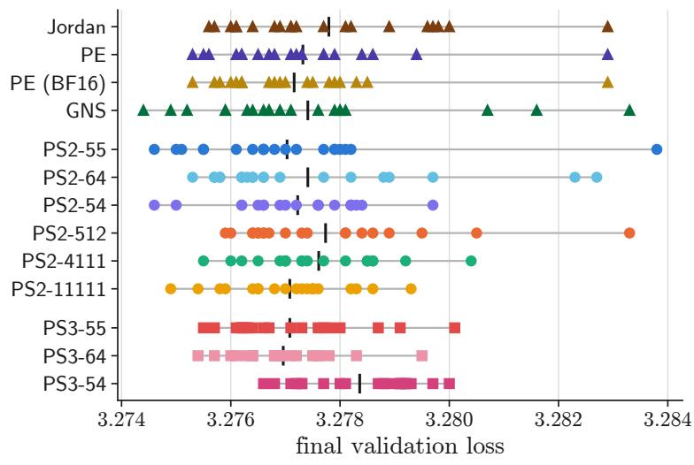
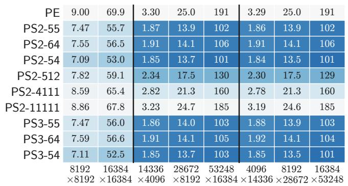
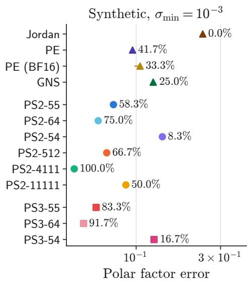
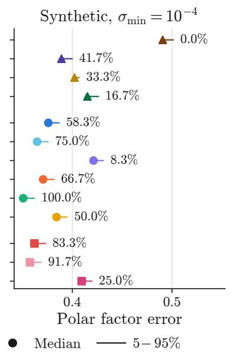
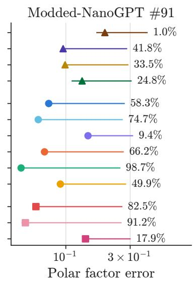
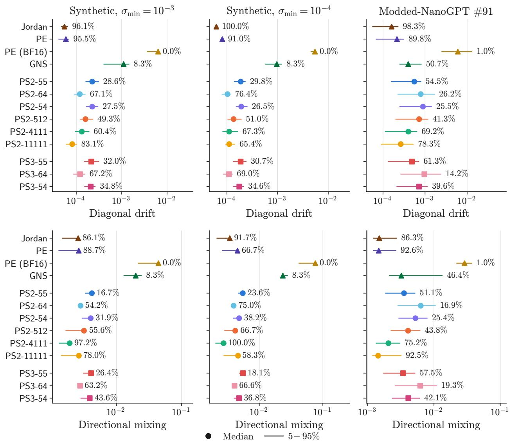
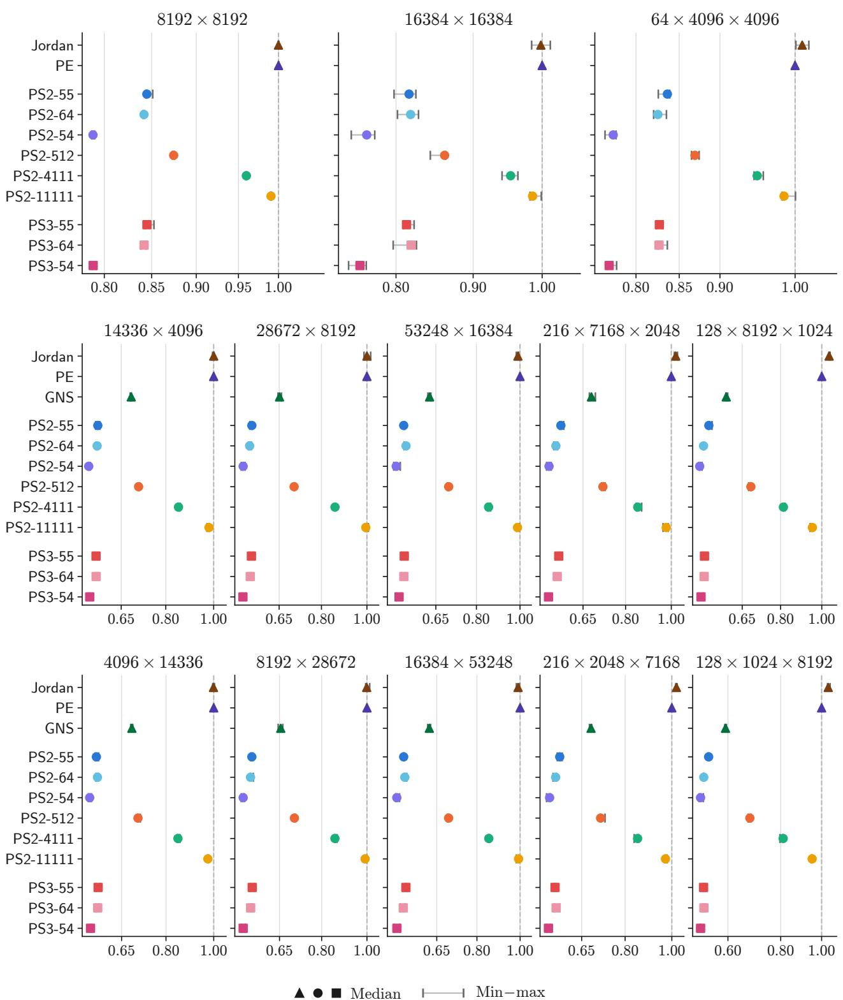

# Polar Switch: Fast Muon Orthogonalization with Polynomial Circuits∗

Zhehang Du Weijie Su†

October 19, 2026

## Abstract

Muon, a 2024-born optimizer for language models, difers from the 2015-born spectral gradient descent [1, 2] mainly in its fast, GPU-friendly Newton–Schulz polynomial for orthogonalizing the gradient matrix. Accordingly, a line of research proposes faster polynomial iterations for gradient orthogonalization, such as Polar Express and Gram Newton–Schulz, both built on quintic polynomials. In this paper, we introduce Polar Switch, a new approach to polynomial gradient orthogonalization. Using simple polynomial circuits, Polar Switch reaches a given high polynomial degree at a lower FLOP cost than quintic iterations. We define a circuit as a short sequence of symmetric matrix products on a few square bufers, and circuits with k products form a restricted family of odd polynomials of degree up to 2k+1 + 1. We choose the sequence of products in each circuit, their coeficients, and how the circuits are composed by numerically minimizing a worst-case bound on the polar approximation error. This minimization is subject to a $\mathrm { F L O P }$ budget that accounts for symmetric matrix multiplication kernels and a rounding constraint for numerical stability in half precision. Our two recommended Polar Switch methods have 15.5–18.7% lower runtime than Polar Express on square matrices and 8.6–16.2% lower runtime than Gram Newton–Schulz on rectangular matrices with aspect ratios 3.25, 3.5, and 8, with comparable approximation accuracy. In pretraining Modded-NanoGPT #91, Qwen3-0.6B, and Gemma 3-1B, Polar Switch reaches final validation losses similar to those of established orthogonalization methods. Across the more than 14 million matrices that each of the two recommended methods orthogonalized in these runs, the estimated output spectral norms never exceed the designed bounds by more than 3%, demonstrating their numerical stability.

## 1 Introduction

For years, Adam [3] and AdamW [4] have been the go-to optimizers for training large language models (LLMs) [5]. Both scale the momentum coordinatewise, without explicitly accounting for the matrix structure of the parameters. Muon [6] takes a diferent approach in that it uses the matrix structure of the momentum and approximates its polar factor to form the update. Studies have shown that Muon can reach the same training loss as AdamW with less computation [7, 8], and it has since been used to train several frontier open-weight LLMs, including Kimi K3 [9], GLM-5 [10], Step 3.5 Flash [11], DeepSeek-V4 [12], and Qwen3.8-Flash-Next [13]. This advantage comes with additional computation at each optimizer step, because Muon must approximate the polar factor. The question is therefore how to compute this approximation accurately and eficiently.

Let $W \in \mathbb { R } ^ { n \times m }$ be a matrix-shaped parameter, ∇W its gradient, and M its momentum matrix. Without loss of generality, let $n \leq m$ , because matrices with more rows than columns are handled by transposition. With momentum coeficient $\mu$ and learning rate η, a simplified Muon update is

$$
M \gets \mu M + \nabla W , \qquad W \gets W - \eta \mathrm { p o l a r } ( M ) .
$$

If $M = U \Sigma V ^ { \mathsf { T } }$ is the compact singular value decomposition (SVD), then $\mathrm { p o l a r } ( M ) = U V ^ { \mathsf { T } }$ [14]. However, computing an SVD at every optimizer step is expensive for LLM training. Muon approximates the polar factor using polynomial iterations inspired by Newton–Schulz [6]. First, we normalize M as $X  M / ( \| M \| _ { F } + \epsilon )$ with a small $\epsilon > 0 \ ( 1 0 ^ { - 7 }$ in our implementation), so that all singular values of X lie in [0, 1]. At iteration t, we choose a quintic polynomial $p _ { t } ( x ) = c _ { t } x + b _ { t } x ^ { 3 } + a _ { t } x ^ { 5 }$ with coeficients $a _ { t } , b _ { t } , c _ { t }$ and compute

$$
A  X X ^ { \mathsf { T } } , \qquad Z  b _ { t } A + a _ { t } A ^ { 2 } , \qquad X  Z X + c _ { t } X .\tag{1}
$$

Let $\boldsymbol { X } = \boldsymbol { U \Sigma V } ^ { \top }$ be the compact SVD of X. The update is $X  U ( c _ { t } \Sigma + b _ { t } \Sigma ^ { 3 } + a _ { t } \Sigma ^ { 5 } ) V ^ { \mathsf { T } }$ . Suppose that, at each iteration $t , p _ { t } ( \sigma ) \geq 0$ for every singular value σ of the current matrix X. The iteration replaces each singular value σ by $p _ { t } ( \sigma )$ . After T iterations, each initial singular value σ becomes $( p _ { T } \circ \cdots \circ p _ { 1 } ) ( \sigma )$ . Approximating the polar factor in Muon therefore requires this composition to approximate one on the positive initial singular values.

The classical Newton–Schulz iteration uses $p _ { t } ( x ) = ( 3 x - x ^ { 3 } ) / 2$ , whose repeated application converges to one for $0 < x \le 1$ [14]. Muon uses Jordan’s fixed quintic $p _ { t } ( x ) = 3 . 4 4 4 5 x - 4 . 7 7 5 x ^ { 3 } + 2 . 0 3 1 5 x ^ { 5 } \ [ 6$ ]. Polar Express (PE) uses minimax approximation to choose a diferent quintic polynomial at each iteration, minimizing its maximum deviation from one over the current singular value interval [15]. Jordan’s method and Polar Express difer in their coeficients, but both use quintic iterations. We therefore ask the following question:

## Under a fixed FLOP budget for matrix orthogonalization, do repeated quintic iterations yield the most accurate polar approximation?

We answer this question negatively with Polar Switch, which replaces repeated quintic iterations with a few high-degree polynomial circuits. Each circuit is a short sequence of symmetric matrix products on a small number of square bufers. For example, the first circuit of Polar Switch 3-55 (PS3-55) uses three square bufers $B _ { 1 } , B _ { 2 } , B _ { 3 } \in \mathbb { R } ^ { n \times n }$ , with the coeficients $a _ { \tau } , b _ { \tau } , c _ { \tau }$ given in Algorithm A.1:

$$
\begin{array} { r l } { B _ { 1 } \gets X X ^ { \top } , \quad B _ { 2 } \gets a _ { 1 } B _ { 1 } ^ { 2 } + b _ { 1 } B _ { 1 } + c _ { 1 } I , \quad B _ { 3 } \gets a _ { 2 } B _ { 2 } ^ { 2 } + b _ { 2 } B _ { 2 } + c _ { 2 } I , \quad B _ { 2 } \gets a _ { 3 } B _ { 3 } ^ { 2 } + b _ { 3 } B _ { 3 } + c _ { 3 } I , } & { } \\ & { B _ { 3 } \gets a _ { 4 } B _ { 2 } ^ { 2 } + b _ { 4 } B _ { 3 } + c _ { 4 } I , \quad B _ { 1 } \gets a _ { 5 } B _ { 3 } ^ { 2 } + b _ { 5 } B _ { 1 } + c _ { 5 } I , \quad X \gets B _ { 1 } X . } \end{array}\tag{2}
$$

Each squaring doubles the degree in $X X ^ { \mathsf { T } }$ , to 2, 4, 8, 16, and 32, so the circuit applies an odd polynomial of degree 65 to the singular values. Polar Switch searches numerically for the circuits and their coeficients that approximate the polar factor most accurately under a FLOP budget. Table 1 compares Polar Switch with the quintic baselines. Polar Switch 2-55 (PS2-55) and PS3-55 use fewer FLOPs than Polar Express and Gram Newton–Schulz and less memory than Gram Newton–Schulz.

We make three contributions. (i) We introduce Polar Switch, a FLOP-eficient orthogonalization method for Muon based on high-degree polynomial circuits. (ii) We develop eficient GPU implementations of Polar Switch with two or three square bufers. Each kernel combines a matrix product and its additions before one float16 store, and we select coeficients that try to keep this half-precision computation numerically stable. (iii) Across three LLM pretraining setups, Polar Switch reaches final validation losses similar to those of established orthogonalization methods.

The remainder of the paper is structured as follows. Section 2 reviews related work. Section 3 presents Polar Switch, explains how we design its circuits and coeficients under a FLOP budget, and describes its GPU implementation. Section 4 compares Polar Switch with quintic baselines in LLM pretraining, runtime, and approximation accuracy. Appendix A gives the theory, the numerical search, and the coeficients of Polar Switch. Appendix B gives the detailed experimental setup for LLM pretraining and the runtime and approximation accuracy experiments.

Table 1: Memory in matrix elements, FLOPs, and final singular value intervals for $X \in \mathbb { R } ^ { n \times m }$ with $n \leq m$ and $\alpha = m / n$ . In exact arithmetic, each method maps singular values in [0.001, 1] into its final interval. Jordan and Gram Newton–Schulz multiply the output of their final iteration by a constant that centers this interval at one. Algorithm A.1 gives the iterations of Polar Switch.
<table><tr><td>Method</td><td>Memory</td><td>FLOPs</td><td>Final interval</td></tr><tr><td>Jordan [6]</td><td> $n ^ { 2 } ( 2 \alpha + 2 )$ </td><td> $( 1 5 \alpha + 5 ) n ^ { 3 }$ </td><td>[0.562544, 1.437456]</td></tr><tr><td>Polar Express [15]</td><td> $n ^ { 2 } ( 2 \alpha + 2 )$ </td><td> $( 1 5 \alpha + 5 ) n ^ { 3 }$ </td><td>[0.858872, 1.141128]</td></tr><tr><td>Gram Newton-Schulz [16]</td><td> $n ^ { 2 } ( 2 \alpha + 4 )$ </td><td> $( 6 \alpha + 1 4 ) n ^ { 3 }$ </td><td>[0.787021, 1.212979]</td></tr><tr><td>Polar Switch 2-55</td><td> $n ^ { 2 } ( 2 \alpha + 2 )$ </td><td> $( 6 \alpha + 1 0 ) n ^ { 3 }$ </td><td>[0.872263, 1.106236]</td></tr><tr><td>Polar Switch 2-64</td><td> $n ^ { 2 } ( 2 \alpha + 2 )$ </td><td> $( 6 \alpha + 1 0 ) n ^ { 3 }$ </td><td>[0.897110, 1.081213]</td></tr><tr><td>Polar Switch 2-54</td><td> $n ^ { 2 } ( 2 \alpha + 2 )$ </td><td> $( 6 \alpha + 9 ) n ^ { 3 }$ </td><td>[0.771715, 1.201363]</td></tr><tr><td>Polar Switch 2-512</td><td> $n ^ { 2 } ( 2 \alpha + 2 )$ </td><td> $( 9 \alpha + 8 ) n ^ { 3 }$ </td><td>[0.894082, 1.091006]</td></tr><tr><td>Polar Switch 2-4111</td><td> $n ^ { 2 } ( 2 \alpha + 2 )$ </td><td> $( 1 2 \alpha + 7 ) n ^ { 3 }$ </td><td>[0.930600, 1.056149]</td></tr><tr><td>Polar Switch 2-11111</td><td> $n ^ { 2 } ( 2 \alpha + 2 )$ </td><td> $( 1 5 \alpha + 5 ) n ^ { 3 }$ </td><td>[0.867287,1.118678]</td></tr><tr><td>Polar Switch 3-55</td><td> $n ^ { 2 } ( { \bf 2 } \alpha + { \bf 3 } )$ </td><td> $( 6 \alpha + 1 0 ) n ^ { 3 }$ </td><td>[0.898309, 1.080954]</td></tr><tr><td>Polar Switch 3-64</td><td> $n ^ { 2 } ( 2 \alpha + 3 )$ </td><td> $( 6 \alpha + 1 0 ) n ^ { 3 }$ </td><td>[0.913241, 1.070202]</td></tr><tr><td>Polar Switch 3-54</td><td> $n ^ { 2 } ( 2 \alpha + 3 )$ </td><td> $( 6 \alpha + 9 ) n ^ { 3 }$ </td><td>[0.800196, 1.178895]</td></tr></table>

## 2 Related Work

Polar approximation and polynomial design. Polynomial polar iterations [17] and matrix sign methods [14, 18] are used in eigenvalue algorithms [19, 20], control, and model reduction [21]. Rational alternatives include sign iterations [22], QR-based dynamically weighted Halley (QDWH) [23], and Zolotarev approximants [24]. Polar iterations also have backward stability analyses [25]. Broader work covers matrix roots [26–30], fractional powers [31], general matrix function computation [32–36], and manifold retractions using projected polynomials [37]. Minimax approximation minimizes the largest error over an interval, with solutions characterized by equioscillation [38] and computed by Remez methods [39]. Related problems include polynomial sign approximation [40], rational minimax [41] and AAA approximation [42], and Parks–McClellan filter design [43, 44]. Paterson–Stockmeyer [45] and related methods [46] reduce the number of matrix multiplications. Other work characterizes which polynomials can be evaluated with a fixed number of products [47]. Chebyshev acceleration [48] constructs odd polynomials with large derivatives at zero to increase small singular values more quickly. Polar Express [15] proves that greedy minimax fitting is optimal for a prescribed degree sequence, and its implementation uses quintics. Dynamic programming has also been used to select minimax compositions for homomorphic comparison under multiplication and depth constraints [49]. Polar Switch selects high-degree circuits under FLOP and bufer budgets that account for symmetric GPU kernels and adds a half-precision rounding constraint for numerical stability.

Eficient Muon orthogonalization. Equivalent formulas can round diferently because their intermediate computations difer [50], and small singular values are sensitive to reduced precision [51]. Mixed precision is studied in linear algebra [52–54] and training [55, 56]. Gram Newton–Schulz [16] accumulates square multipliers between rectangular updates, and Dion3 [57] uses it for distributed training. AMO [58] adapts iteration counts, Dion [59] uses low-rank updates, Dion2 [60] selects rows or columns, Hierarchical Muon [61] uses tiles, and CacheMuon [62] reuses transforms. Turbo-Muon [63] uses an almost-orthogonal preconditioner for faster updates, and PRISM [64] computes matrix functions adaptively. IFNSO [65] replaces the iterations with one polynomial in selected matrix powers and learns its coeficients. A cubic Newton–Schulz schedule [66] uses ten instead of fifteen dominant matrix products and reaches a similar validation loss. MuonBP [67], CMuon [68], and DMuon [69] support distributed computation. Polar Switch builds on polynomial Newton–Schulz iterations with eficient GPU implementations.

Muon and matrix optimization. Muon [6] forms matrix updates by approximately orthogonalizing matrix momentum and has been used for eficient LLM training [7, 8]. Other optimizers use diagonal gradient statistics, as in AdaGrad [70], or factored second moments, as in Adafactor [71]. K-FAC [72] and EKFAC [73] approximate curvature using Kronecker factors. Shampoo [74] and Distributed Shampoo [75] use matrix preconditioners, and SOAP [76] applies Adam in the eigenbasis of Shampoo’s preconditioners. Spectral descent [1, 2] exploits singular vectors. Analyses of Muon cover finite Newton–Schulz iterations [77], inexact polar updates [78], modular duality [79], norm-constrained optimization [80], preconditioning [81] (including PolarGrad [82] and Newton–Muon [83]), curvature [84], stability [85, 86], convergence [87, 88], and batch size [89]. Broader spectral scaling theory addresses feature learning [90]. Extensions add symmetry constraints [91] or change the normalization [92], the preconditioning [93], the optimization subspace [94], or the coordinate system [95]. Activation-Keyed Momentum (AK-Momentum) [96] introduces anisotropic momentum. DeMuon [97] addresses decentralized optimization. Applications include difusion training [98], low-rank adaptation with ISO-LoRA [99], and LLM training [100]. Polar Switch changes Muon’s polar approximation by designing the polynomial circuits used to form its matrix updates.

## 3 Polar Switch

We develop Polar Switch in three steps. First, we define polynomial circuits and how they change the singular values (Section 3.1). Second, we describe how we implement each circuit on a GPU in half-precision floating point and how we try to make it numerically stable (Section 3.2). Third, we state the design problem that Polar Switch uses to choose its circuits and their coeficients, and we give the resulting Polar Switch methods (Sections 3.3 and 3.4).

## 3.1 Polynomial Circuits

Let $X \in \mathbb { R } ^ { n \times m }$ with $n \leq m$ . Each outer iteration t (Definition 3.1) calculates a polynomial $h _ { t } ( X X ^ { \mathsf { T } } )$ of the Gram matrix and updates $X  h _ { t } ( X X ^ { \top } ) X$ . Evaluating a high-degree polynomial $h _ { t }$ at $X X ^ { \mathsf { T } }$ needs intermediate matrices, and the GPU memory limits how many of them we can store. Polar Switch therefore stores them in $g \geq 2$ reusable square bufers $B _ { 1 } , \dots , B _ { g } \in \mathbb { R } ^ { n \times n }$

Definition 3.1 (Outer iteration and circuit). An outer iteration updates X with a circuit, a fixed sequence of bufer updates that forms a straight-line program [101]. The circuit first stores $X X ^ { \mathsf { T } }$ in $B _ { 1 }$ and then performs k inner iterations $\tau = 1 , \dots , k$ in sequence:

$$
B _ { w _ { \tau } } \gets a _ { \tau } B _ { i _ { \tau } } B _ { j _ { \tau } } + b _ { \tau } B _ { r _ { \tau } } + c _ { \tau } I , \qquad w _ { \tau } , i _ { \tau } , j _ { \tau } , r _ { \tau } \in \{ 1 , \dots , g \} , \quad w _ { \tau } \notin \{ i _ { \tau } , j _ { \tau } \} .\tag{3}
$$

The output bufer is $B _ { w _ { \tau } }$ , the two factors are $B _ { i _ { \tau } }$ and $B _ { j _ { \tau } }$ , the addend is $B _ { r _ { \tau } } ,$ and $a _ { \tau } , b _ { \tau } , c _ { \tau }$ are real coeficients. We call k the inner depth. The outer iteration ends with $X \gets B _ { w _ { k } } X$ . A circuit obeys three rules. First, an inner iteration reads only bufers that hold values, namely $B _ { 1 }$ and the bufers that earlier inner iterations wrote, so $i _ { \tau } , j _ { \tau } , r _ { \tau } \in \{ w _ { 0 } , w _ { 1 } , \dots , w _ { \tau - 1 } \}$ with $w _ { 0 } = 1$ . Second, the output index is not a factor index, $w _ { \tau } \notin \{ i _ { \tau } , j _ { \tau } \}$ . Third, the output index can be the addend index, $w _ { \tau } = r _ { \tau }$ Section 3.2 uses the GPU kernel to explain the second and third rules. Algorithm 1 gives the general form of Polar Switch, and Algorithm A.1 gives the circuits and coeficients of each method. Each outer iteration t has its own circuit, and we omit t from its indices and coeficients.

Algorithm 1 General form of Polar Switch   
Input: $\overline { { X \in \mathbb { R } ^ { n \times m } , n \leq m ; \ : T } }$ outer iterations, where outer iteration t has a circuit (Definition 3.1)   
with $k _ { t }$ inner iterations   
Output: Approximation to the polar factor of X   
1: X ← float32(X); X ← X/(∥X∥F + 10−7); X ← float16(X)   
2: for $t = 1 , \dots , T$ do   
3: $B _ { 1 }  X X ^ { \mathsf { T } }$   
4: for $\tau = 1 , \ldots , k _ { t }$ do   
5: $B _ { w _ { \tau } }  a _ { \tau } B _ { i _ { \tau } } B _ { j _ { \tau } } + b _ { \tau } B _ { r _ { \tau } } + c _ { \tau } I$ ▷ One fused kernel; wτ $\not \in \{ i _ { \tau } , j _ { \tau } \}$   
6: end for   
7: $X \gets B _ { w _ { k _ { t } } } X$   
8: end for   
9: return $X$

Each initialized bufer holds a polynomial in $X X ^ { \mathsf { T } }$ , because $B _ { 1 } = X X ^ { \mathsf { T } }$ and each inner iteration combines bufers with a product, a sum, and a diagonal shift. Let $\boldsymbol { X } = \boldsymbol { U \Sigma V } ^ { \top }$ be the compact SVD of X, so that $X X ^ { \mathsf { T } } = U \Sigma ^ { 2 } U ^ { \mathsf { T } }$ . Then after inner iteration $\tau ,$ each initialized bufer is $B _ { i } = U \beta _ { i } ^ { ( \tau ) } ( \Sigma ) U ^ { \top } , ^ { 1 }$ where the polynomials $\beta _ { i } ^ { ( \tau ) }$ in the singular value x follow the scalar circuit

$$
\beta _ { 1 } ^ { ( 0 ) } = x ^ { 2 } , \qquad \beta _ { w _ { \tau } } ^ { ( \tau ) } = a _ { \tau } \beta _ { i _ { \tau } } ^ { ( \tau - 1 ) } \beta _ { j _ { \tau } } ^ { ( \tau - 1 ) } + b _ { \tau } \beta _ { r _ { \tau } } ^ { ( \tau - 1 ) } + c _ { \tau } , \qquad \beta _ { i } ^ { ( \tau ) } = \beta _ { i } ^ { ( \tau - 1 ) } ( i \neq w _ { \tau } ) , \qquad \tau = 1 , \dots , k .\tag{4}
$$

The last output bufer holds $B _ { w _ { k } } = h _ { t } ( X X ^ { \mathsf { T } } )$ . The outer iteration gives $\begin{array} { r } { h _ { t } ( X X ^ { \mathsf { T } } ) X = U p _ { t } ( \Sigma ) V ^ { \mathsf { T } } } \end{array}$ with the odd polynomial $p _ { t } ( x ) = x \beta _ { w _ { k } } ^ { ( k ) } = x h _ { t } ( x ^ { 2 } )$ of degree $1 + 2 \deg h _ { t }$ . Thus, it replaces each singular value x with $p _ { t } ( x )$ , provided $p _ { t } ( x ) \geq 0$ . After T outer iterations with polynomials $p _ { 1 } , \ldots , p _ { T }$ , the result is $U p ( \Sigma ) V ^ { \mathsf { T } }$ with $p = p _ { T } \circ \cdots \circ p _ { 1 }$

Definition 3.2 (Circuit family). Let $\mathcal { C } _ { k } ^ { g }$ be the set of circuits with inner depth k on g square bufers, over all bufer indices $w _ { \tau } , i _ { \tau } , j _ { \tau } , r _ { \tau }$ and coeficients $a _ { \tau } , b _ { \tau } , c _ { \tau } , \tau = 1 , \dots , k$ . A circuit $C \in \mathcal { C } _ { k } ^ { g }$ calculates the polynomial $p _ { C } ( x ) = x \beta _ { w _ { k } } ^ { ( k ) }$ in (4). The family

$$
\mathcal { P } _ { k } ^ { g } = \left\{ p _ { C } : C \in \mathcal { C } _ { k } ^ { g } \right\}
$$

is the set of odd polynomials that k inner iterations on g square bufers can calculate.

Let $\mathcal { O } _ { 2 ^ { k + 1 } + 1 }$ be the set of odd polynomials of degree at most $2 ^ { k + 1 } + 1$ . The degree of a product is at most the sum of the degrees of its factors, so k inner iterations give deg $h _ { t } \leq 2 ^ { k }$ , and

$$
\begin{array} { r } { \mathcal { P } _ { k } ^ { g } \subseteq \mathcal { O } _ { 2 ^ { k + 1 } + 1 } . } \end{array}\tag{5}
$$

A polynomial in $\mathcal { O } _ { 2 ^ { k + 1 } + 1 }$ has $2 ^ { k } + 1$ coeficients, but for fixed bufer indices, a polynomial in $\mathcal { P } _ { k } ^ { g }$ depends on only the 3k coeficients $a _ { \tau } , b _ { \tau } , c _ { \tau } , \tau = 1 , \dots , k . ^ { 2 }$ A central step of Polar Switch is to optimize the circuits in $\mathcal { C } _ { k } ^ { g }$

For example, the first circuit of PS3-55 in (2) is in $\mathcal { C } _ { 5 } ^ { 3 } .$ , and each inner iteration squares the output of the previous one $( i _ { \tau } = j _ { \tau } = w _ { \tau - 1 } , a _ { \tau } \neq 0 )$ . Thus, deg $h _ { t }$ doubles to 2, 4, 8, 16, and 32, and $p _ { t }$ has degree $6 5 = 2 ^ { k + 1 } + 1$ , the largest degree in (5). The iterations of Jordan [6], Polar Express, and Gram Newton–Schulz can also be written as circuits.

Example 3.3 (Standard quintic Newton–Schulz). The quintic iteration (1) of Jordan [6] and Polar Express adds the linear term $c _ { t } X$ in the final update $X  Z X + c _ { t } X$ . Since $( Z + c _ { t } I ) X = Z X + c _ { t } X$ it is equivalent in exact arithmetic to a circuit with one inner iteration on $g = 2$ bufers:

$$
B _ { 2 }  a _ { t } B _ { 1 } ^ { 2 } + b _ { t } B _ { 1 } + c _ { t } I , \qquad X  B _ { 2 } X .
$$

In finite precision, the two forms can give diferent results, because they round diferent intermediate matrices.

Polar Express [15, Remark 3.2] permits diferent polynomial degrees across iterations, but its implementation uses degree five. The remark refers to dynamic programming that chooses the best sequence of polynomial iterations under a budget on the number of multiplications [49]. If each matrix multiplication has the same cost, a nonic iteration (four multiplications) is 33% more expensive than a quintic iteration (three). However, the FLOP cost on GPUs is diferent from the number of matrix multiplications. With symmetric kernels, a quintic iteration costs $( 3 \alpha + 1 ) n ^ { 3 }$ FLOPs and a nonic iteration costs $( 3 \alpha + 2 ) n ^ { 3 } \ \mathrm { F L O P s }$ , where $\alpha = m / n$ (Proposition 3.5). A nonic iteration thus needs only 25% more FLOPs at $\alpha = 1$ , and less for rectangular matrices. Polynomial iterations of higher degree therefore need fewer FLOPs on GPUs than the multiplication count suggests. This lower cost can allow more accurate polar approximations under the same FLOP budget, and Polar Switch uses it to construct circuits of high degree.

Example 3.4 (Gram Newton–Schulz). The standard Gram Newton–Schulz (GNS) iteration [16] uses the coeficients $( a _ { j } , b _ { j } , c _ { j } ) , j = 1 , \ldots , 5$ , of Polar Express, with an extra safety factor 1.05. Starting from $R _ { 0 } \gets X X ^ { \top }$ , the iterations are:

$$
\begin{array} { r l r } & { Z _ { 1 }  b _ { 1 } R _ { 0 } + a _ { 1 } R _ { 0 } ^ { 2 } , } & { Q _ { 1 }  Z _ { 1 } + c _ { 1 } I , } & { Y _ { 1 }  R _ { 0 } Z _ { 1 } + c _ { 1 } R _ { 0 } , } & { R _ { 1 }  Z _ { 1 } Y _ { 1 } + c _ { 1 } Y _ { 1 } , } \\ & { Z _ { 2 }  b _ { 2 } R _ { 1 } + a _ { 2 } R _ { 1 } ^ { 2 } , } & { Q _ { 2 }  Q _ { 1 } Z _ { 2 } + c _ { 2 } Q _ { 1 } , } & { X  Q _ { 2 } X , } & { R _ { 2 }  X X ^ { \top } , } \\ & { Z _ { 3 }  b _ { 3 } R _ { 2 } + a _ { 3 } R _ { 2 } ^ { 2 } , } & { Q _ { 3 }  Z _ { 3 } + c _ { 3 } I , } & { Y _ { 3 }  R _ { 2 } Z _ { 3 } + c _ { 3 } R _ { 2 } , } & { R _ { 3 }  Z _ { 3 } Y _ { 3 } + c _ { 3 } Y _ { 3 } , } \\ & { Z _ { 4 }  b _ { 4 } R _ { 3 } + a _ { 4 } R _ { 3 } ^ { 2 } , } & { Q _ { 4 }  Q _ { 3 } Z _ { 4 } + c _ { 4 } Q _ { 3 } , } & { Y _ { 4 }  R _ { 3 } Z _ { 4 } + c _ { 4 } R _ { 3 } , } & { R _ { 4 }  Z _ { 4 } Y _ { 4 } + c _ { 4 } Y _ { 4 } , } \\ & { Z _ { 5 }  b _ { 5 } R _ { 4 } + a _ { 5 } R _ { 4 } ^ { 2 } , } & { Q _ { 5 }  Q _ { 4 } Z _ { 5 } + c _ { 5 } Q _ { 4 } , } & { X  Q _ { 5 } X . } \end{array}
$$

We use the names of the oficial code, except for $Y _ { j } . \ R _ { j }$ tracks the Gram matrix after quintic step $j , Q _ { j }$ collects the matrix that multiplies X, and $Z _ { j }$ and $Y _ { j }$ are intermediate matrices. In exact arithmetic, it has the equivalent circuit form

$$
\begin{array} { r l r } { B _ { 1 } \gets X X ^ { \mathsf { T } } } & { B _ { 2 } \gets a _ { 1 } B _ { 1 } ^ { 2 } + b _ { 1 } B _ { 1 } + c _ { 1 } I } & { B _ { 3 } \gets B _ { 1 } B _ { 2 } , ~ B _ { 1 } \gets B _ { 2 } B _ { 3 } } \\ & { B _ { 3 } \gets a _ { 2 } B _ { 1 } ^ { 2 } + b _ { 2 } B _ { 1 } + c _ { 2 } I } & { B _ { 1 } \gets B _ { 2 } B _ { 3 } } & { X \gets B _ { 1 } X } \\ { B _ { 1 } \gets X X ^ { \mathsf { T } } } & { B _ { 2 } \gets a _ { 3 } B _ { 1 } ^ { 2 } + b _ { 3 } B _ { 1 } + c _ { 3 } I } & { B _ { 3 } \gets B _ { 1 } B _ { 2 } , ~ B _ { 1 } \gets B _ { 2 } B _ { 3 } } \\ & { B _ { 3 } \gets a _ { 4 } B _ { 1 } ^ { 2 } + b _ { 4 } B _ { 1 } + c _ { 4 } I } & { B _ { 4 } \gets B _ { 2 } B _ { 3 } , ~ B _ { 2 } \gets B _ { 1 } B _ { 3 } , ~ B _ { 1 } \gets B _ { 3 } B _ { 2 } } \\ & { B _ { 3 } \gets a _ { 5 } B _ { 1 } ^ { 2 } + b _ { 5 } B _ { 1 } + c _ { 5 } I } & { B _ { 2 } \gets B _ { 4 } B _ { 3 } } & { X \gets B _ { 2 } X . } \end{array}
$$

Each row runs from left to right, and a product without coeficients has $a _ { \tau } = 1$ and $b _ { \tau } = c _ { \tau } = 0$

The two outer iterations of GNS have inner depths 5 and 9 on $g = 4$ bufers, so they are circuits in $\mathcal { C } _ { 5 } ^ { 4 }$ and $\mathcal { C } _ { 9 } ^ { 4 }$ . Their polynomials have degrees 25 and 125, but 5 and 9 inner iterations can reach the full degrees 65 and 1025 in (5). The gap comes from the mixed products $( i _ { \tau } \neq j _ { \tau } )$ , such as $B _ { 3 } \gets B _ { 1 } B _ { 2 }$ and $B _ { 1 }  B _ { 2 } B _ { 3 }$ , which track the Gram matrix of the updated X.

Polar Switch does not impose full degree as a constraint when optimizing its circuits and their coeficients, but all circuits we found reach full degree. For example, when $g = 2$ , the alternating writes of our search (Section 3.4) make each inner iteration square the output of the previous one $( i _ { \tau } = j _ { \tau } = w _ { \tau - 1 } )$ , and for $g = 3$ , all circuits that we found also do so, so they reach the full degree. For example, PS3-55 has inner depths 5 and 5 and degrees 65 and 65 (Algorithm A.1). This suggests the hypothesis that, for a given inner depth, the most accurate way to approximate the polar factor is to use the highest possible degree, even within the restricted family $\mathcal { P } _ { k } ^ { g }$ . To reach the full degree $2 ^ { k + 1 } + 1$ , the largest degree among the bufers must double at every inner iteration. Then only the output of the previous inner iteration has the largest degree, so each inner iteration must square it, and a circuit with a mixed product has a lower degree. This explains why GNS reaches a lower total degree, $2 5 \cdot 1 2 5 = 3 1 2 5$ , than PS2-55, 65 · 65 = 4225, at a higher FLOP cost (Table 1).

## 3.2 GPU Implementation, Cost, and Rounding

In Algorithm 1, each inner iteration τ runs as one GPU kernel. Each bufer holds a polynomial in $X X ^ { \mathsf { T } }$ (Section 3.1), and polynomials in the same symmetric matrix are symmetric and commute, so each product $B _ { i _ { \tau } } B _ { j _ { \tau } } = B _ { j _ { \tau } } B _ { i _ { \tau } }$ is symmetric. A symmetric matrix multiplication kernel calculates only one triangle of such a product and copies it to the other triangle. Polar Switch extends such a kernel from the QuACK kernel library (Appendix B). For inner iteration $\tau ,$ the kernel multiplies the product by $a _ { \tau }$ , adds $b _ { \tau } B _ { r _ { \tau } }$ , and adds $c _ { \tau }$ to each diagonal entry in its epilogue, without allocating an identity matrix.3 The kernel therefore writes each output $B _ { w } .$ to memory once, and the additions need no separate kernels or extra matrices.

This kernel explains the second and third rules of Definition 3.1. Each entry of the product $B _ { i _ { \tau } } B _ { j _ { \tau } }$ needs a full row and a full column of the two factors, so the kernel still reads the factors while it writes the output, and the output cannot overwrite a factor $( w _ { \tau } \notin \{ i _ { \tau } , j _ { \tau } \} )$ . Each entry of the output needs only the same entry of the addend $B _ { r _ { \tau } } ,$ so the output can overwrite the addend $( w _ { \tau } = r _ { \tau } )$

The circuits of Polar Switch use g square bufers $B _ { 1 } , \ldots , B _ { g } $ , each containing $n ^ { 2 }$ elements. They also use two rectangular bufers, each containing mn elements. One holds the current matrix X. The other holds the result of the update $X \gets B _ { w _ { k } } X$ in Algorithm 1. The result needs a separate bufer because the multiplication still needs the entries of the current X. Once the update is complete, the result becomes the new X.

The products of a circuit have diferent costs on a GPU, so we count FLOPs. We count only the leading-order FLOPs of matrix products, because they are dominant for large matrices. Let $\alpha = m / n \geq 1$ be the aspect ratio. A symmetric kernel halves the FLOPs of a product because it calculates only one triangle.

Proposition 3.5 (Cost and memory of an outer iteration). An outer iteration with inner depth k costs

$$
\underbrace { \alpha n ^ { 3 } } _ { X X ^ { \mathsf { T } } } + \underbrace { k n ^ { 3 } } _ { k \ p r o d u c t s \ B _ { i _ { \tau } } B _ { j _ { \tau } } } + \underbrace { 2 \alpha n ^ { 3 } } _ { B _ { w _ { k } } X } = ( 3 \alpha + k ) n ^ { 3 } \ F L O P s .
$$

With $g$ square bufers and two rectangular bufers, a method stores $n ^ { 2 } ( 2 \alpha + g )$ elements.

Proof. The outer iteration calculates three types of products. The Gram matrix $X X ^ { \mathsf { T } }$ is symmetric, and it costs $m n ^ { 2 } = \alpha n ^ { 3 } \ \mathrm { F L O P s }$ . Each of the k inner iterations calculates a symmetric $n \times n$ product $B _ { i _ { \tau } } B _ { j _ { \tau } }$ , which costs $n ^ { 3 } \mathrm { F L O P s }$ . The final update $B _ { w _ { k } } X$ is a general product, and it costs $2 m n ^ { 2 } = 2 \alpha n ^ { 3 }$ FLOPs. The $g$ square bufers hold $g n ^ { 2 }$ elements, and the two rectangular bufers hold $2 m n = 2 \alpha n ^ { 2 }$ elements. □

We now explain how Polar Switch tries to keep its half-precision computation numerically stable. Polar Switch normalizes X in float32 and converts it to $\mathtt { f l o a t 1 6 . ^ { 4 } }$ During the iterations, X and all bufers are stored in float16. Each product runs on float16 Tensor Cores and accumulates in float32. The epilogue applies the scaling by $a _ { \tau }$ , the addend $b _ { \tau } B _ { r _ { \tau } }$ , and the diagonal shift $c _ { \tau } I$ in float32, and then the kernel converts the result to float16 and stores it in $B _ { w _ { \tau } }$ . This avoids an additional square bufer and an intermediate float16 matrix, which reduces memory trafic and avoids an additional rounding step. The main rounding of an inner iteration is likely the float16 store of its result, which rounds each entry to the nearest float16 value. The Gram matrix $B _ { 1 }  X X ^ { \mathsf { T } }$ and the output $X \gets B _ { w _ { k } } X$ are stored in the same way, so an outer iteration with inner depth k has $k + 2$ stores. To try to select coeficients $a _ { \tau } , b _ { \tau } , c _ { \tau }$ for which the circuit stays stable under these roundings, we add a multiplicative factor for each store to the scalar circuit (4).

Definition 3.6 (Perturbed outer iteration). Let $C \in \mathcal { C } _ { k } ^ { g }$ be a circuit with bufer indices $w _ { \tau } , i _ { \tau } , j _ { \tau } , r _ { \tau }$ and coeficients $a _ { \tau } , b _ { \tau } , c _ { \tau } , \tau = 1 , \dots , k$ , let $s \geq 1$ be a safety factor, and let $\mathbf { v } = ( v _ { 0 } , \ldots , v _ { k + 1 } ) \in [ s ^ { - 1 } , s ] ^ { k + 2 }$ The perturbed outer iteration is

$$
\begin{array} { r l } & { \widetilde { \beta } _ { 1 } ^ { ( 0 ) } = v _ { 0 } x ^ { 2 } , \qquad \widetilde { \beta } _ { w _ { \tau } } ^ { ( \tau ) } = v _ { \tau } \Big ( a _ { \tau } \widetilde { \beta } _ { i _ { \tau } } ^ { ( \tau - 1 ) } \widetilde { \beta } _ { j _ { \tau } } ^ { ( \tau - 1 ) } + b _ { \tau } \widetilde { \beta } _ { r _ { \tau } } ^ { ( \tau - 1 ) } + c _ { \tau } \Big ) , } \\ & { \widetilde { \beta } _ { i } ^ { ( \tau ) } = \widetilde { \beta } _ { i } ^ { ( \tau - 1 ) } \left( i \neq w _ { \tau } \right) , \qquad \tau = 1 , \dots , k , \qquad \widetilde { p } _ { C } ( x ; \mathbf { v } ) = v _ { k + 1 } x \widetilde { \beta } _ { w _ { k } } ^ { ( k ) } . } \end{array}\tag{6}
$$

The rounding factors $v _ { 0 } , v _ { \tau }$ , and $v _ { k + 1 }$ model the stores of the Gram matrix, of inner iteration $\tau ,$ and of the output. For $\mathbf { v } = ( 1 , \ldots , 1 ) , \widetilde { p } _ { C } ( x ; \mathbf { v } ) = p _ { C } ( x )$

## 3.3 Design Problem

In exact arithmetic, after the normalization in Algorithm 1, each singular value of X is at most one. As in Polar Express, we optimize the polynomials for singular values in $[ \ell _ { 0 } , 1 ]$ with $\ell _ { 0 } = 0 . 0 0 1$ (Appendix A explains this choice). We fix the number g of square bufers. A schedule $( k _ { 1 } , \ldots , k _ { T } )$ lists the inner depths of $T$ outer iterations, and its cost is $\textstyle \sum _ { t = 1 } ^ { T } ( 3 \alpha + k _ { t } ) n ^ { 3 }$ FLOPs (Proposition 3.5). We want to find the schedule and the polynomials $p _ { t } \in \mathcal { P } _ { k _ { t } } ^ { g }$ with the smallest worst-case error under a FLOP budget $f _ { \mathrm { m a x } } n ^ { 3 }$ . In matrix form, the problem is

$$
\begin{array} { r l } & { \underset { T \geq 1 , \ k _ { 1 } , \ldots , k _ { T } \geq 1 } { \operatorname* { m i n } } \quad \underset { p _ { t } \in \mathcal { P } _ { k _ { t } } ^ { g } , \ t = 1 , \ldots , T } { \operatorname* { i n f } } \ \underset { \sigma _ { i } ( X ) \in [ \ell _ { 0 } , 1 ] , \ i = 1 , \ldots , n } { \operatorname* { m a x } } \| \mathrm { p o l a r } ( X ) - p ( X ) \| _ { 2 } , } \\ & { \sum _ { t = 1 } ^ { T } ( 3 \alpha + k _ { t } ) { \leq } f _ { \operatorname* { m a x } } } \end{array}\tag{7}
$$

where $\sigma _ { 1 } ( X ) , \ldots , \sigma _ { n } ( X )$ are the singular values of X, $p = p _ { T } \circ \cdots \circ p _ { 1 }$ is the composition that the circuits calculate, and $p ( X ) = U p ( \Sigma ) V ^ { \mathsf { T } }$ for the compact SVD $\boldsymbol { X } = \boldsymbol { U \Sigma V } ^ { \top }$ is the output of the T outer iterations in exact arithmetic.

Proposition 3.7 (Scalar reduction). The matrix problem (7) has the same objective, and hence the same value and the same minimizers when they exist, as the scalar minimax problem

$$
\begin{array} { r l } { \displaystyle } & { \operatorname* { m i n } _ { \substack { T \geq 1 , ~ k _ { 1 } , \ldots , k _ { T } \geq 1 } } \quad \displaystyle \operatorname* { i n f } _ { \substack { p _ { t } \in { \mathcal { P } _ { k _ { t } } ^ { g } } , ~ t = 1 , \ldots , T } } \operatorname* { m a x } _ { x \in [ \ell _ { 0 } , 1 ] } | 1 - p ( x ) | . } \\ { \sum _ { t = 1 } ^ { T } ( 3 \alpha + k _ { t } ) { \leq } f _ { \operatorname* { m a x } } } & { } \end{array}\tag{8}
$$

Proof. Since $\mathrm { p o l a r } ( X ) = U V ^ { \mathsf { T } }$ and U and V have orthonormal columns, the spectral norm satisfies

$$
\| \operatorname { p o l a r } ( X ) - p ( X ) \| _ { 2 } = \| I - p ( \Sigma ) \| _ { 2 } = \operatorname* { m a x } _ { 1 \leq i \leq n } \vert 1 - p ( \sigma _ { i } ( X ) ) \vert \leq \operatorname* { m a x } _ { x \in [ \ell _ { 0 } , 1 ] } \vert 1 - p ( x ) \vert .
$$

The bound is attained when at least one singular value of X is a maximizer of $| 1 - p ( x ) |$ on $[ \ell _ { 0 } , 1 ]$ , and such an X is admissible in (7). Thus, the two problems have the same objective for each schedule and each choice of $p _ { t } \in \mathcal { P } _ { k _ { t } } ^ { g } , t = 1 , . . . , T$ □

We design the approximation in (8) through intervals $[ \ell _ { t } , u _ { t } ]$ with $0 \leq \ell _ { t } \leq u _ { t } , u _ { t } > 0$ , and $( p _ { t } \circ \cdot \cdot \cdot \circ p _ { 1 } ) ( [ \ell _ { 0 } , 1 ] ) \subseteq [ \ell _ { t } , u _ { t } ]$ in exact arithmetic, $t = 1 , \dots , T$ . Problem (8) asks for a final interval $[ \ell _ { T } , u _ { T } ]$ that is as close to one as possible. Only the ratios $\ell _ { t } / u _ { t }$ matter, because an outer iteration can scale its output by any $\lambda > 0$ , and the next outer iteration can undo this scaling, without additional matrix products. First, multiplying the coeficients $a _ { k _ { t } } , b _ { k _ { t } } , c _ { k _ { t } }$ of the last inner iteration of outer iteration t by λ multiplies $B _ { w _ { k } }$ and the output $B _ { w _ { k _ { t } } X }$ by λ, so $[ \ell _ { t } , u _ { t } ]$ becomes $[ \lambda \ell _ { t } , \lambda u _ { t } ]$ . Second, outer iteration $t + 1$ then receives λX in place of $X$ , so its Gram matrix $B _ { 1 }$ is multiplied by $\lambda ^ { 2 }$ . While $B _ { 1 }$ holds this Gram matrix, we divide $a _ { \tau }$ by $\lambda ^ { 2 }$ for each factor $B _ { 1 }$ and $b _ { \tau }$ by $\lambda ^ { 2 }$ if the addend is $B _ { 1 }$ For example, in the first inner iteration $B _ { w _ { 1 } }  a _ { 1 } B _ { 1 } ^ { 2 } + b _ { 1 } B _ { 1 } + c _ { 1 } I$ , we divide $a _ { 1 }$ by $\lambda ^ { 4 }$ and $b _ { 1 }$ by $\lambda ^ { 2 }$ Then each inner iteration of outer iteration $t + 1$ stores the same matrix as before. Third, we divide $a _ { k _ { t + 1 } } , b _ { k _ { t + 1 } } , c _ { k _ { t + 1 } }$ by λ, so $B _ { w _ { k _ { t + 1 } } }$ is divided by λ, and the output $B _ { w _ { k _ { t + 1 } } } ( \lambda X )$ is the same as before. Thus, all later outer iterations give the same outputs as before. For $t \stackrel { } { = } T$ , no outer iteration follows, and the final centering (Proposition A.6) chooses the scale. Therefore, we fix $u _ { t } = 1$ for all t and maximize the lower endpoint $\ell _ { T }$

In the rounding model (6), we also require each perturbed outer iteration to map [0, 1] into [0, 1], so that each output is a valid input of the next one. We choose each $p _ { t } \in \mathcal { P } _ { k _ { t } } ^ { g }$ through a circuit $C _ { t } \in \mathcal { C } _ { k _ { t } } ^ { g }$ with $p _ { t } = p _ { C _ { t } }$ . For g square bufers, a FLOP budget $f _ { \mathrm { m a x } } n ^ { 3 }$ , and a largest inner depth $k _ { \mathrm { m a x } }$ , this gives the Polar Switch design problem

$$
\begin{array} { r l } & { \underset { T \geq 1 , \ldots , k _ { T } \leq k _ { \operatorname* { m a x } } } { \operatorname* { m a x } } \ \underset { \ell _ { t } \in \mathcal { C } _ { k _ { t } } ^ { 9 } , \ell _ { t } \in [ 0 , 1 ] } { \operatorname* { m a x } } \ \underset { \ell = 1 , \ldots , T } { \operatorname* { m a x } } \ \underset { \ell = 1 , \ldots , T } { \operatorname* { m a x } } } \\ & { \qquad \mathrm { s . t . } \quad p _ { C _ { t } } ( [ \ell _ { t - 1 } , 1 ] ) \subseteq [ \ell _ { t } , 1 ] , \quad 0 \leq \widetilde { p } _ { C _ { t } } ( x ; \mathbf { v } ) \leq 1 , \quad x \in [ 0 , 1 ] , \ \mathbf { v } \in [ s ^ { - 1 } , s ] ^ { k _ { t } + 2 } , t = 1 , \ldots , T ; } \end{array}\tag{9}
$$

The second constraint keeps each perturbed output in [0, 1] for all inputs in [0, 1], which is a design rule for numerical stability. After centering, a feasible point of (9) has worst-case error at most $( 1 - \ell _ { T } ) / ( 1 + \ell _ { T } )$ in (7) (Proposition A.6).

## 3.4 Solving the Design Problem

For a given number g of square bufers, we must find the schedule $( k _ { 1 } , \ldots , k _ { T } )$ , and, for each $k _ { t } .$ a circuit $C _ { t } \in \mathcal { C } _ { k _ { t } } ^ { g }$ , which consists of its bufer indices $w _ { \tau } , i _ { \tau } , j _ { \tau } , r _ { \tau }$ and its coeficients $a _ { \tau } , b _ { \tau } , c _ { \tau }$ . Appendix A treats (9) in four steps. First, for a fixed schedule, greedy circuits, which make each $\ell _ { t }$ as large as possible, are optimal (Theorem A.4), as for the quintic compositions of Polar Express. Second, if the per-iteration problems are solved exactly, dynamic programming over costs selects the schedule with the largest $\ell _ { T }$ (Proposition A.7). Only this step depends on the aspect ratio $\alpha ,$ through the cost $( 3 \alpha + k _ { t } ) n ^ { 3 }$ of each outer iteration; the per-iteration problems and their circuits do not. Third, for each inner depth $k _ { t }$ , we find the circuit numerically with a solver that GPT-6 Astra helped design, and interval arithmetic certifies the result (Appendix A.2). Fourth, a final scaling centers the interval $[ \ell _ { T } , 1 ]$ at one (Proposition A.6), and a rescaling of the bufers keeps their values in range for float16 (Appendix A.2).

For $g = 2 ,$ our numerical search uses alternating writes. Call the two bufers A and B. An inner iteration that writes into B cannot read B as a factor, so both factors are $A ,$ and it has the form $B  a _ { \tau } A ^ { 2 } + b _ { \tau } A + c _ { \tau } I$ or $B  a _ { \tau } A ^ { 2 } + b _ { \tau } B + c _ { \tau } I$ . The next inner iteration in this search writes into A, and it has the form $A  a _ { \tau + 1 } B ^ { 2 } + b _ { \tau + 1 } B + c _ { \tau + 1 } I$ or $A  a _ { \tau + 1 } B ^ { 2 } + b _ { \tau + 1 } A + c _ { \tau + 1 } I$ . With this alternating write order fixed, only the addend of each inner iteration, A or B, remains to be chosen. With $k = 6$ inner iterations, this gives $2 ^ { 5 } = 3 2$ alternating bufer patterns, because the first addend must be A, and we enumerate all of these patterns.

For $g = 3$ , the factors and the addends have many more choices. Thus, we optimize only the fixed schedules $( 5 , 5 ) , ( 6 , 4 )$ , and (5, 4), and we reduce the search space with degree-bound pruning designed with the help of GPT-6 Astra (Appendix A.2). The local search may still miss the optimal solution.

Our solutions are not guaranteed to be globally optimal. The problem is nonconvex, so a local search can stop at a local optimum. Also, the rounding constraint must hold for all inputs and all rounding factors. The local search checks it only on samples, and we certify every accepted circuit by interval arithmetic, which becomes expensive as k grows.

We use $s = 1 . 0 0 5$ . The name Polar Switch $g \ – k _ { 1 } \dots k _ { T }$ , or $\mathsf { P S } g \ – k _ { 1 } \dots k _ { T }$ , gives the number g of square bufers and the schedule $( k _ { 1 } , \ldots , k _ { T } )$ , with each inner depth written as one digit. PS2 and PS3 denote the methods with $g = 2$ and $g = 3$ . For example, PS2-55 uses $g = 2$ and $k _ { 1 } = k _ { 2 } = 5$ . For $g = 2$ and each number of outer iterations $T = 2 , 3 , 4 , 5$ , we use the schedule with $k _ { \operatorname* { m a x } } = 5$ and the smallest total inner depth $k _ { 1 } + \cdots + k _ { T }$ whose centered final interval, as in Table 1, has a lower endpoint of at least 0.85. For a fixed T, the cost 3α $T + k _ { 1 } + \cdot \cdot \cdot + k _ { T }$ orders the schedules in the same way for every α, so this choice does not depend on α. A variant of the dynamic program of Appendix A.1 that keeps one schedule for each cost and each T gives the schedules of PS2-55, PS2-512, PS2-4111, and PS2-11111 for $g = 2$ . We also include PS2-54 and PS2-64 with fixed schedules, for which we optimize only the circuits. PS2-54 costs $n ^ { 3 }$ fewer FLOPs than PS2-55 and does not reach 0.85, and PS2-64 has a better final interval than PS2-55 at the same cost. For g = 3, PS3-55, PS3-64, and PS3-54 use the fixed schedules above. Table 1 gives the memory, FLOPs, and final intervals of all methods, and Algorithm A.1 gives all Polar Switch methods.

## 4 Experiments

Each experiment run uses a single NVIDIA B200 GPU. In Section 4.1, we compare Polar Switch with the baselines in LLM training by final validation loss and numerical stability. In Section 4.2, we compare the runtime and the approximation accuracy. The four baselines are Jordan, PE, and PE (BF16) (Algorithm B.1), and GNS (Appendix B). PE (BF16) uses the coeficients of PE with bfloat16 storage and products and the normalization of Algorithm B.1. Jordan and GNS are centered at the last iteration. They multiply the output of their last iteration by a constant, so that their final interval is symmetric about one.5 Appendix B gives the details of the experimental setup.

## 4.1 LLM Experiments

We use three LLM pretraining setups, which are Modded-NanoGPT #91 [102], Qwen3-0.6B [103], and Gemma 3-1B [104]. In each setup, all methods use the same training settings, and only the polar approximation for the matrix updates of Muon (NorMuon in Modded-NanoGPT #91) changes. Table 2 summarizes the setups, and Appendix B gives the implementation details.

Modded-NanoGPT #91 uses the training script of short-track record #91 of the Modded-NanoGPT speedrun benchmark [102]. Figure 1 shows the final validation losses of Modded-NanoGPT #91, with the same 20 seeds for each method (left), and of Qwen3-0.6B and Gemma 3-1B (right). Polar Switch reaches final validation losses similar to those of the baselines.

We also measure the numerical stability of all methods by how much the spectral norm of each output exceeds its designed bound. At each training step, the polar approximation receives 104 matrices in Modded-NanoGPT #91, 196 in Qwen3-0.6B (7 in each of its 28 layers), and 182 in Gemma 3-1B (7 in each of its 26 layers). For each matrix that the polar approximation returns, we estimate its spectral norm with Lanczos iteration and compare it with the upper endpoint of the method’s final interval in Table 1. Modded-NanoGPT #91 trains 20 seeds for 1,290 steps, Qwen3-0.6B trains for 22,889 steps,

Table 2: LLM training setups. Of the Polar Switch methods, the Gemma 3-1B setup uses only the methods with two outer iterations. Total FLOPs are estimated for one run and depend on the orthogonalization method.
<table><tr><td>Model</td><td>Parameters</td><td>Tokens</td><td>Total FLOPs</td><td>Seeds</td><td>Total runs</td></tr><tr><td>Modded-NanoGPT #91</td><td>637,656,487</td><td>343,408,640</td><td> $( 2 . 4 1 3 - 2 . 4 1 8 ) \times 1 0 ^ { 1 7 }$ </td><td>20</td><td>260</td></tr><tr><td>Qwen3-0.6B</td><td>596,049,920</td><td>12,000,428,032</td><td> $( 5 . 1 4 8 - 5 . 1 5 5 ) \times 1 0 ^ { 1 9 }$ </td><td>1</td><td>13</td></tr><tr><td>Gemma 3-1B</td><td>999,885,952</td><td>22,000,173,056</td><td> $\left( 1 . 3 6 0  – 1 . 3 6 3 \right) \times 1 0 ^ { 2 0 }$ </td><td>1</td><td>10</td></tr></table>

and Gemma 3-1B trains for 41,962 steps. Thus, each method returns 2,683,200, 4,486,244, and 7,637,084 matrices in the three setups. Table 3 counts the matrices whose estimate exceeds the bound by 3–30%, 30–300%, and more than 300%. Only GNS and the circuits with inner depth 6 have such matrices.

<table><tr><td>Method</td><td>Qwen3-0.6B</td><td>Gemma 3-1B</td></tr><tr><td>Jordan</td><td>2.6252</td><td>2.5534</td></tr><tr><td>PE</td><td>2.6255</td><td>2.5523</td></tr><tr><td>PE (BF16)</td><td>2.6260</td><td>2.5523</td></tr><tr><td>GNS</td><td>2.6250</td><td>2.5515</td></tr><tr><td>PS2-55</td><td>2.6257</td><td>2.5520</td></tr><tr><td>PS2-64</td><td>2.6258</td><td>2.5524</td></tr><tr><td>PS2-54</td><td>2.6257</td><td>2.5525</td></tr><tr><td>PS2-512</td><td>2.6258</td><td>一</td></tr><tr><td>PS2-4111</td><td>2.6257</td><td>一</td></tr><tr><td>PS2-11111</td><td>2.6260</td><td></td></tr><tr><td>PS3-55</td><td>2.6255</td><td>2.5524</td></tr><tr><td>PS3-64</td><td>2.6257</td><td>2.5522</td></tr><tr><td>PS3-54</td><td>2.6266</td><td>2.5533</td></tr></table>

Figure 1: Final validation loss of Modded-NanoGPT #91 (left), and of Qwen3-0.6B and Gemma 3-1B (right). On the left, markers show runs with the same 20 seeds, vertical ticks show means, and bars span the minimum and maximum. Triangles mark baselines, circles mark PS2, and squares mark PS3. On the right, all methods use the same seed, and a dash marks methods not trained on Gemma 3-1B.

In Modded-NanoGPT #91 training, PS2-64 and PS3-64 exceeded their bounds by more than 3% on 9 and 38 of 2,683,200 matrices, and PS3-64 also on 2 of 7,637,084 matrices in Gemma 3-1B training (Table 3), so we recommend inner depths of at most 5. A possible reason is that the rounding model (6) does not include two efects of the float16 stores. First, the store errors are additive. Let $E = \tt f l o a t 1 6 ( A ) - A$ be the error of storing a matrix A in float16. Without overflow or underflow, each entry of E is at most $2 ^ { - 1 1 }$ (the unit roundof of float16) times the magnitude of the same entry of A, so $\| E \| _ { 2 } \leq 2 ^ { - 1 1 } { \sqrt { n } } \| A \| _ { 2 }$ . For $n = 2 0 4 8$ and $\| A \| _ { 2 } = 1$ , this bound is about 0.022, which is larger than the smallest singular value 0.001 that the circuits must amplify. With this additive error, the rounding constraint in (9) would be nearly impossible to satisfy, so the rounding model (6) uses multiplicative factors.

Second, E is in general not a polynomial in $X X ^ { \mathsf { T } }$ , so the bufers can stop commuting, the singular values can drift, and the singular directions can mix (Appendix B.2). These errors can grow with the inner depth. Gram Newton–Schulz also recomputes its Gram matrix from X after two iterations for stability [16]. We recommend PS2-55 and PS3-55, the bold rows of Table 1.

Table 3: Number of matrices whose spectral norm estimate exceeds the bound in column Bound, the upper endpoint in Table 1 rounded up to four decimals, by 3–30%, 30–300%, and more than 300%, out of 2,683,200 for Modded-NanoGPT #91, 4,486,244 for Qwen3-0.6B, and 7,637,084 for Gemma 3-1B per method. PE (BF16) uses the bound of PE. A dash marks methods not trained on Gemma 3-1B.
<table><tr><td rowspan="2">Method</td><td rowspan="2">Bound</td><td colspan="3">Modded-NanoGPT #91</td><td colspan="3">Qwen3-0.6B</td><td colspan="3">Gemma 3-1B</td></tr><tr><td>3-30</td><td>30-300</td><td>&gt;300</td><td>3-30</td><td>30-300</td><td>&gt;300</td><td>3-30</td><td>30-300</td><td>&gt;300</td></tr><tr><td>Jordan</td><td>1.4375</td><td>0</td><td>0</td><td>0</td><td>0</td><td>0</td><td>0</td><td>0</td><td>0</td><td>0</td></tr><tr><td>PE</td><td>1.1412</td><td>0</td><td>0</td><td>0</td><td>0</td><td>0</td><td>0</td><td>0</td><td>0</td><td>0</td></tr><tr><td>PE (BF16)</td><td>1.1412</td><td>0</td><td>0</td><td>0</td><td>0</td><td>0</td><td>0</td><td>0</td><td>0</td><td>0</td></tr><tr><td>GNS</td><td>1.2130</td><td>4</td><td>0</td><td>0</td><td>0</td><td>0</td><td>0</td><td>0</td><td>0</td><td>0</td></tr><tr><td>PS2-55</td><td>1.1063</td><td>0</td><td>0</td><td>0</td><td>0</td><td>0</td><td>0</td><td>0</td><td>0</td><td>0</td></tr><tr><td>PS2-64</td><td>1.0813</td><td>6</td><td>3</td><td>0</td><td>0</td><td>0</td><td>0</td><td>0</td><td>0</td><td>0</td></tr><tr><td>PS2-54</td><td>1.2014</td><td>0</td><td>0</td><td>0</td><td>0</td><td>0</td><td>0</td><td>0</td><td>0</td><td>0</td></tr><tr><td>PS2-512</td><td>1.0911</td><td>0</td><td>0</td><td>0</td><td>0</td><td>0</td><td>0</td><td></td><td></td><td>一</td></tr><tr><td>PS2-4111</td><td>1.0562</td><td>0</td><td>0</td><td>0</td><td>0</td><td>0</td><td>0</td><td>一</td><td></td><td>一</td></tr><tr><td>PS2-11111</td><td>1.1187</td><td>0</td><td>0</td><td>0</td><td>0</td><td>0</td><td>0</td><td>一</td><td>一</td><td>一</td></tr><tr><td>PS3-55</td><td>1.0810</td><td>0</td><td>0</td><td>0</td><td>0</td><td>0</td><td>0</td><td>0</td><td>0</td><td>0</td></tr><tr><td>PS3-64</td><td>1.0703</td><td>33</td><td>5</td><td>0</td><td>0</td><td>0</td><td>0</td><td>2</td><td>0</td><td>0</td></tr><tr><td>PS3-54</td><td>1.1789</td><td>0</td><td>0</td><td>0</td><td>0</td><td>0</td><td>0</td><td>0</td><td>0</td><td>0</td></tr></table>

## 4.2 Runtime and Approximation Accuracy

Figure 2 shows the runtimes on synthetic single matrices and batches, and the runtime ratios relative to PE and GNS. For PS2-55 and PS3-55, the median runtime ratios are 0.813–0.845 relative to PE on the square shapes and 0.838–0.914 relative to GNS on the rectangular shapes, that is, 15.5–18.7% and 8.6–16.2% lower runtime.6

Let X be the input of a polar approximation, let $X _ { T }$ be its output, and let n be the smaller dimension of X. Let $U { \boldsymbol { \Sigma } } V ^ { \mathsf { T } }$ be the compact SVD of float64(X), so that polar $( X ) = U V ^ { \mathsf { T } }$ . We convert $X _ { T }$ to float64 and calculate the polar factor error in float64:

$$
\frac { \| X _ { T } - \mathrm { p o l a r } ( X ) \| _ { F } } { \sqrt { n } } .\tag{10}
$$

We measure this error in three steps. First, we generate synthetic matrices. They are square and rectangular, with random singular vectors and geometrically spaced singular values (Appendix B.2). Before rounding to float16, each matrix has unit Frobenius norm and minimum singular value $\sigma _ { \mathrm { m i n } } = 1 0 ^ { - 3 } \ \mathrm { { o r } \ 1 0 ^ { - 4 } }$ . Second, we collect Modded-NanoGPT #91 matrices from one training run in which NorMuon uses PE, so only PE updates the model. We randomly sample 323 of its 1,290 steps (25%) and keep all 104 matrices that PE receives at each sampled step, which gives 33,592 matrices.

<table><tr><td rowspan=2 colspan=1>PEPS2-55</td><td rowspan=1 colspan=1>72.9</td><td rowspan=1 colspan=1>97.4</td><td rowspan=1 colspan=1>18.2</td><td rowspan=1 colspan=1>96.3</td><td rowspan=1 colspan=1>18.2</td></tr><tr><td rowspan=1 colspan=1>59.8</td><td rowspan=1 colspan=1>55.7</td><td rowspan=1 colspan=1>9.70</td><td rowspan=1 colspan=1>55.9</td><td rowspan=1 colspan=1>9.72</td></tr><tr><td rowspan=1 colspan=1>PS2-64</td><td rowspan=1 colspan=1>60.0</td><td rowspan=1 colspan=1>55.3</td><td rowspan=1 colspan=1>9.58</td><td rowspan=1 colspan=1>55.2</td><td rowspan=1 colspan=1>9.57</td></tr><tr><td rowspan=1 colspan=1>PS2-54</td><td rowspan=1 colspan=1>56.3</td><td rowspan=1 colspan=1>53.6</td><td rowspan=1 colspan=1>9.44</td><td rowspan=1 colspan=1>53.5</td><td rowspan=1 colspan=1>9.38</td></tr><tr><td rowspan=1 colspan=1>PS2-512</td><td rowspan=1 colspan=1>62.6</td><td rowspan=1 colspan=1>68.6</td><td rowspan=1 colspan=1>12.5</td><td rowspan=1 colspan=1>68.3</td><td rowspan=1 colspan=1>12.5</td></tr><tr><td rowspan=1 colspan=1>PS2-4111</td><td rowspan=1 colspan=1>68.7</td><td rowspan=1 colspan=1>81.5</td><td rowspan=1 colspan=1>15.0</td><td rowspan=1 colspan=1>80.7</td><td rowspan=1 colspan=1>14.9</td></tr><tr><td rowspan=1 colspan=1>PS2-11111</td><td rowspan=1 colspan=1>71.3</td><td rowspan=1 colspan=1>93.5</td><td rowspan=1 colspan=1>17.5</td><td rowspan=1 colspan=1>92.7</td><td rowspan=1 colspan=1>17.5</td></tr><tr><td rowspan=1 colspan=1>PS3-55</td><td rowspan=1 colspan=1>59.4</td><td rowspan=1 colspan=1>55.0</td><td rowspan=1 colspan=1>9.42</td><td rowspan=1 colspan=1>54.1</td><td rowspan=1 colspan=1>9.34</td></tr><tr><td rowspan=1 colspan=1>PS3-64</td><td rowspan=1 colspan=1>60.2</td><td rowspan=1 colspan=1>55.6</td><td rowspan=1 colspan=1>9.66</td><td rowspan=1 colspan=1>55.2</td><td rowspan=1 colspan=1>9.56</td></tr><tr><td rowspan=1 colspan=1>PS3-54</td><td rowspan=1 colspan=1>56.4</td><td rowspan=1 colspan=1>53.5</td><td rowspan=1 colspan=1>9.51</td><td rowspan=1 colspan=1>53.6</td><td rowspan=1 colspan=1>9.39</td></tr><tr><td rowspan=1 colspan=6>64 × 4096 216 × 7168 128 × 8192 216 × 2048 128 × 1024×4096   ×2048   ×1024    ×7168   ×8192</td></tr></table>

<table><tr><td rowspan=1 colspan=2>GNS</td><td rowspan=1 colspan=1>2.24</td><td rowspan=1 colspan=2>16.3</td><td rowspan=1 colspan=1>120</td><td rowspan=1 colspan=1>2.25</td><td rowspan=1 colspan=2>16.3</td><td rowspan=1 colspan=1>119</td></tr><tr><td rowspan=1 colspan=2>PS2-55</td><td rowspan=1 colspan=1>1.87</td><td rowspan=1 colspan=2>13.9</td><td rowspan=1 colspan=1>102</td><td rowspan=1 colspan=1>1.86</td><td rowspan=1 colspan=2>13.9</td><td rowspan=1 colspan=1>102</td></tr><tr><td rowspan=1 colspan=2>PS2-64</td><td rowspan=1 colspan=1>1.91</td><td rowspan=1 colspan=2>14.1</td><td rowspan=1 colspan=1>106</td><td rowspan=1 colspan=1>1.91</td><td rowspan=1 colspan=2>14.1</td><td rowspan=1 colspan=1>106</td></tr><tr><td rowspan=1 colspan=2>PS2-54</td><td rowspan=1 colspan=1>1.85</td><td rowspan=1 colspan=2>13.7</td><td rowspan=1 colspan=1>101</td><td rowspan=1 colspan=1>1.84</td><td rowspan=1 colspan=2>13.5</td><td rowspan=1 colspan=1>101</td></tr><tr><td rowspan=1 colspan=2>PS2-512</td><td rowspan=1 colspan=1>2.34</td><td rowspan=1 colspan=2>17.5</td><td rowspan=1 colspan=1>130</td><td rowspan=1 colspan=1>2.30</td><td rowspan=1 colspan=2>17.5</td><td rowspan=1 colspan=1>129</td></tr><tr><td rowspan=1 colspan=2>PS2-4111</td><td rowspan=1 colspan=1>2.82</td><td rowspan=1 colspan=2>21.3</td><td rowspan=1 colspan=1>160</td><td rowspan=1 colspan=1>2.78</td><td rowspan=1 colspan=2>21.3</td><td rowspan=1 colspan=1>160</td></tr><tr><td rowspan=1 colspan=2>PS2-11111</td><td rowspan=1 colspan=1>3.23</td><td rowspan=1 colspan=2>24.7</td><td rowspan=1 colspan=1>185</td><td rowspan=1 colspan=1>3.19</td><td rowspan=1 colspan=2>24.6</td><td rowspan=1 colspan=1>185</td></tr><tr><td rowspan=1 colspan=2>PS3-55</td><td rowspan=1 colspan=1>1.86</td><td rowspan=1 colspan=2>14.0</td><td rowspan=1 colspan=1>103</td><td rowspan=1 colspan=1>1.88</td><td rowspan=1 colspan=2>13.9</td><td rowspan=1 colspan=1>103</td></tr><tr><td rowspan=1 colspan=2>PS3-64</td><td rowspan=1 colspan=1>1.91</td><td rowspan=1 colspan=2>14.1</td><td rowspan=1 colspan=1>105</td><td rowspan=1 colspan=1>1.92</td><td rowspan=1 colspan=2>14.1</td><td rowspan=1 colspan=1>104</td></tr><tr><td rowspan=1 colspan=2>PS3-54</td><td rowspan=1 colspan=1>1.85</td><td rowspan=1 colspan=2>13.7</td><td rowspan=1 colspan=1>103</td><td rowspan=1 colspan=1>1.85</td><td rowspan=1 colspan=2>13.5</td><td rowspan=1 colspan=1>101</td></tr><tr><td rowspan=1 colspan=10>2867253248 4096 8192 16384×4096×8192×16384×14336×28672×53248</td></tr><tr><td rowspan=1 colspan=1>GNS</td><td></td><td rowspan=1 colspan=2>65.9</td><td rowspan=1 colspan=2>10.9</td><td rowspan=1 colspan=2>65.6</td><td rowspan=1 colspan=2>10.8</td></tr><tr><td rowspan=1 colspan=1>PS2-55</td><td></td><td rowspan=1 colspan=2>55.7</td><td rowspan=1 colspan=2>9.70</td><td rowspan=1 colspan=2>55.9</td><td rowspan=1 colspan=2>9.72</td></tr><tr><td rowspan=1 colspan=1>PS2-64</td><td rowspan=1 colspan=3>55.3</td><td rowspan=1 colspan=2>9.58</td><td rowspan=1 colspan=2>55.2</td><td rowspan=1 colspan=2>9.57</td></tr><tr><td rowspan=1 colspan=1>PS2-54</td><td rowspan=1 colspan=3>53.6</td><td rowspan=1 colspan=2>9.44</td><td rowspan=1 colspan=2>53.5</td><td rowspan=1 colspan=2>9.38</td></tr><tr><td rowspan=1 colspan=1>PS2-512</td><td rowspan=1 colspan=3>68.6</td><td rowspan=1 colspan=2>12.5</td><td rowspan=1 colspan=2>68.3</td><td rowspan=1 colspan=2>12.5</td></tr><tr><td rowspan=1 colspan=1>PS2-4111</td><td rowspan=1 colspan=3>81.5</td><td rowspan=1 colspan=2>15.0</td><td rowspan=1 colspan=2>80.7</td><td rowspan=1 colspan=2>14.9</td></tr><tr><td rowspan=1 colspan=1>PS2-11111</td><td rowspan=1 colspan=3>93.5</td><td rowspan=1 colspan=2>17.5</td><td rowspan=1 colspan=2>92.7</td><td rowspan=1 colspan=2>17.5</td></tr><tr><td rowspan=1 colspan=1>PS3-55</td><td rowspan=1 colspan=3>55.0</td><td rowspan=1 colspan=2>9.42</td><td rowspan=1 colspan=2>54.1</td><td rowspan=1 colspan=2>9.34</td></tr><tr><td rowspan=1 colspan=1>PS3-64</td><td rowspan=1 colspan=3>55.6</td><td rowspan=1 colspan=2>9.66</td><td rowspan=1 colspan=2>55.2</td><td rowspan=1 colspan=2>9.56</td></tr><tr><td rowspan=1 colspan=1>PS3-54</td><td rowspan=1 colspan=3>53.5</td><td rowspan=1 colspan=2>9.51</td><td rowspan=1 colspan=2>53.6</td><td rowspan=1 colspan=2>9.39</td></tr></table>

Figure 2: Median runtime in milliseconds for single matrices (top) and batches (bottom). Colors show median runtime ratios relative to PE (left) and GNS (right, rectangular shapes only). Values below one indicate lower runtime. Column labels give tensor dimensions, with the batch size first.  

  
Figure 3: Polar factor error (10) on synthetic matrices with minimum singular value $\sigma _ { \mathrm { m i n } } = 1 0 ^ { - 3 } ~ \mathrm { ( l e f t ) }$ and $\sigma _ { \mathrm { m i n } } = 1 0 ^ { - 4 }$ (middle), 1,500 matrices each, and on 33,592 matrices from one Modded-NanoGPT #91 run with PE (right). Percentages give the fraction of pairs of a matrix and another method of the panel in which the method has the smaller error, and a tie counts as half.

Third, we apply all methods to the same matrices and calculate the polar factor error of each output. In all three panels of Figure 3, PS2-55 and PS3-55 have smaller median polar factor errors than PE and GNS. Figure 3 compares this error across all methods, and Appendix B.2 gives two more diagnostics.

## 5 Conclusion and Future Work

We introduced Polar Switch, which replaces the quintic iterations in Muon with a few polynomial circuits of high degree. We select these circuits and their coeficients under a FLOP budget, and our GPU implementations run them in float16 on two or three square bufers. In our experiments, PS2-55 and PS3-55 reduced runtime by 15.5–18.7% relative to Polar Express on square matrices and by 8.6–16.2% relative to Gram Newton–Schulz on rectangular matrices, and they gave final validation losses similar to those of established orthogonalization methods in LLM pretraining.

Limitations. Problem (9) is not convex. Its constraints must hold for all inputs and all rounding factors. Thus, our local search and interval certification use much computation. They give certified feasible circuits, but these circuits are not necessarily globally optimal. The number of bufer patterns increases quickly with the number $g$ of square bufers and the inner depth k. Thus, for $g = 3$ , we searched only three fixed schedules. For $g \geq 4$ , a full search is not practical. The rounding model (6) is only a scalar model of the float16 rounding. It does not include additive store errors or bufers that stop commuting. The circuits with inner depth 6 satisfy its constraint, but they exceeded their bounds in training (Section 4.1).

Objectives of the design problem. Problem (9) maximizes the final lower endpoint for inputs in $[ \ell _ { 0 } , 1 ]$ . For inputs below $\ell _ { 0 }$ , it only requires that each circuit, also under the rounding model (6), maps [0, 1] into [0, 1]. Thus, it does not control the amplification of singular values below $\ell _ { 0 } ,$ and $\ell _ { 0 } = 0 . 0 0 1$ may not be the best choice for all models. We could add a slope objective to problem (9), so that it both reduces the approximation error on $[ \ell _ { 0 } , 1 ]$ and increases the slope $p ^ { \prime } ( 0 )$ of the composition p to amplify very small singular values. This slope has been maximized for Chebyshev-type polynomials [48]. Future research could test whether this improves training. Also, problem (9) maximizes the lower endpoint $\ell _ { T }$ of the exact polynomials and uses the rounding model (6) only in its range constraint. We could also require $\widetilde { p } _ { C _ { t } } ( [ \ell _ { t - 1 } , 1 ] ; \mathbf { v } ) \subseteq [ \ell _ { t } , 1 ]$ for all $\mathbf { v } \in [ s ^ { \prime - 1 } , s ^ { \prime } ] ^ { k _ { t } + 2 }$ , with a second factor $s ^ { \prime } \in [ 1 , s ]$ . For $s ^ { \prime } = 1$ , this is the first constraint of (9). For $s ^ { \prime } > 1 , \ell _ { T }$ would also be a lower bound under the rounding model with factor $s ^ { \prime } .$ , but the largest $\ell _ { T }$ would not increase as $s ^ { \prime }$ increases.

Mixed precision storage. The kernel for each inner iteration computes $B _ { w _ { \tau } }  a _ { \tau } B _ { i _ { \tau } } B _ { j _ { \tau } } + b _ { \tau } B _ { r _ { \tau } + c _ { \tau } I } .$ The matrix product uses fast Tensor Cores operating in half precision, with accumulation and additions in float32. The kernel then rounds the result to float16 before storing it. This rounding happens at every inner iteration and may be the main source of rounding error in our circuits. We could instead store the result of each inner iteration in float32. For PS2, two float32 square bufers use the same memory in bytes as the four float16 square bufers of GNS, without changing the FLOP count. Reducing this rounding error could allow a smaller safety factor s. PS2 could then become more accurate and more numerically stable.

Circuits without diagonal shifts. Each inner iteration of Polar Switch adds $c _ { \tau } I .$ . GNS keeps this identity term out of the updates that track the Gram matrix, which can make these updates more numerically stable. We could also adapt problem (9) to circuits without this term by setting $c _ { \tau } = 0$ in (3) and adding the constant term only in the final update, $X  B _ { w _ { k } } X + c X$

Approximation error and training quality. In our experiments, a smaller polar factor error (10) did not give a clearly lower validation loss. Jordan has the largest polar factor error (Figure 3), but after centering it gave losses similar to those of the other methods. PE (BF16) has more than 15 times the diagonal drift and directional mixing of PE (Figure 4), but it also gave similar losses (Figure 1). In GPT-2 training, more iterations or an exact SVD also did not decrease the final loss [15, 66]. Thus, other properties of the update may determine training quality. Candidates are the update norm (footnote 5), the singular directions that the update amplifies, and postprocessing, such as in NorMuon [92]. Also, all methods use the same learning rates and weight decay, which we did not tune for each method, and the best values may difer between orthogonalization methods. Further experiments could test these efects

Integration with other Muon variants. Future work could replace the quintic iterations of MuonBP [67], Hierarchical Muon [61], and Dion3 [57] with Polar Switch circuits. Polar Switch could also refresh the cached transform in CacheMuon [62]. These combinations could reduce training time.

## Acknowledgments

This work was supported in part by the Wharton AI Fund. GPT-6 Astra and GPT-5.6 Sol were used to assist with theory and mathematical proofs, experimental design, code development, and data analysis.

## References

[1] David Carlson, Volkan Cevher, and Lawrence Carin. Stochastic spectral descent for restricted Boltzmann machines. In Guy Lebanon and S. V. N. Vishwanathan, editors, Proceedings of the Eighteenth International Conference on Artificial Intelligence and Statistics, volume 38 of Proceedings of Machine Learning Research, pages 111–119. PMLR, 2015.

[2] David Carlson, Edo Collins, Ya-Ping Hsieh, Lawrence Carin, and Volkan Cevher. Preconditioned spectral descent for deep learning. In C. Cortes, N. Lawrence, D. Lee, M. Sugiyama, and R. Garnett, editors, Advances in Neural Information Processing Systems, volume 28. Curran Associates, Inc., 2015.

[3] Diederik P. Kingma and Jimmy Ba. Adam: A method for stochastic optimization. In International Conference on Learning Representations, 2015.

[4] Ilya Loshchilov and Frank Hutter. Decoupled weight decay regularization. In International Conference on Learning Representations, 2019.

[5] Tom Brown, Benjamin Mann, Nick Ryder, Melanie Subbiah, Jared D Kaplan, Prafulla Dhariwal, Arvind Neelakantan, Pranav Shyam, Girish Sastry, Amanda Askell, Sandhini Agarwal, Ariel Herbert-Voss, Gretchen Krueger, Tom Henighan, Rewon Child, Aditya Ramesh, Daniel Ziegler, Jefrey Wu, Clemens Winter, Chris Hesse, Mark Chen, Eric Sigler, Mateusz Litwin, Scott Gray, Benjamin Chess, Jack Clark, Christopher Berner, Sam McCandlish, Alec Radford, Ilya Sutskever, and Dario Amodei. Language models are few-shot learners. In H. Larochelle, M. Ranzato, R. Hadsell, M.F. Balcan, and H. Lin, editors, Advances in Neural Information Processing Systems, volume 33, pages 1877–1901. Curran Associates, Inc., 2020.

[6] Keller Jordan, Yuchen Jin, Vlado Boza, Jiacheng You, Franz Cesista, Laker Newhouse, and Jeremy Bernstein. Muon: An optimizer for hidden layers in neural networks, 2024. URL https://kellerjordan.github.io/posts/muon/.

[7] Jingyuan Liu, Jianlin Su, Xingcheng Yao, Zhejun Jiang, Guokun Lai, Yulun Du, Yidao Qin, Weixin Xu, Enzhe Lu, Junjie Yan, Yanru Chen, Huabin Zheng, Yibo Liu, Shaowei Liu, Bohong Yin, Weiran He, Han Zhu, Yuzhi Wang, Jianzhou Wang, Mengnan Dong, Zheng Zhang, Yongsheng Kang, Hao Zhang, Xinran Xu, Yutao Zhang, Yuxin Wu, Xinyu Zhou, and Zhilin Yang. Muon is scalable for LLM training. arXiv preprint arXiv:2502.16982, 2025.

[8] Essential AI, Ishaan Shah, Anthony M. Polloreno, Karl Stratos, Philip Monk, Adarsh Chaluvaraju, Andrew Hojel, Andrew Ma, Anil Thomas, Ashish Tanwer, Darsh J Shah, Khoi Nguyen, Kurt Smith, Michael Callahan, Michael Pust, Mohit Parmar, Peter Rushton, Platon Mazarakis, Ritvik Kapila, Saurabh Srivastava, Somanshu Singla, Tim Romanski, Yash Vanjani, and Ashish Vaswani. Practical eficiency of Muon for pretraining. arXiv preprint arXiv:2505.02222, 2025.

[9] Kimi Team. Kimi K3: Open frontier intelligence. arXiv preprint arXiv:2607.24653, 2026.

[10] GLM-5 Team. GLM-5: from vibe coding to agentic engineering. arXiv preprint arXiv:2602.15763, 2026.

[11] StepFun Team. Step 3.5 Flash: Open frontier-level intelligence with 11B active parameters. arXiv preprint arXiv:2602.10604, 2026.

[12] DeepSeek-AI. DeepSeek-V4: Towards highly eficient million-token context intelligence. arXiv preprint arXiv:2606.19348, 2026.

[13] Zihan Qiu, Zekun Wang, Xiao Li, Yanpeng Li, Yang Xu, Yixuan Wang, Huaqing Zhang, Rui Men, Bochao Mao, Chengruidong Zhang, Fan Zhou, Hao Luo, Haofeng Huang, Haoran Lian, Haoyan Huang, Hongqing Chen, Jianwei Zhang, Jing Xu, Junjie Wang, Langshi Chen, Liangyu Wang, Linlang Jiang, Man Yuan, Minmin Sun, Peng Jin, Siqi Zhang, Siyu Wang, Xingzhang Ren, Yakai Wang, Yi Zhang, Yiming Dong, Yizhong Cao, Yubo Ma, Yunfei Mao, Bo Zheng, and Dayiheng Liu. On the design of Qwen3.8-Next architecture: Evaluation, eficiency, and training stability. arXiv preprint arXiv:2608.30320, 2026.

[14] Nicholas J. Higham. Functions of Matrices: Theory and Computation. Society for Industrial and Applied Mathematics, 2008. ISBN 9780898717778. doi: 10.1137/1.9780898717778.

[15] Noah Amsel, David Persson, Christopher Musco, and Robert M. Gower. The Polar Express: Optimal matrix sign methods and their application to the Muon algorithm. In C. Vondrick, B. Hariharan, C. Rafel, L. Pinto, D. Yang, and A. Faust, editors, International Conference on Learning Representations, volume 2026, pages 138323–138360, 2026.

[16] Jack Zhang, Noah Amsel, Berlin Chen, and Tri Dao. Gram Newton–Schulz, 2026. URL https://dao-ailab.github.io/blog/2026/gram-newton-schulz/.

[17] Å. Björck and C. Bowie. An iterative algorithm for computing the best estimate of an orthogonal matrix. SIAM Journal on Numerical Analysis, 8(2):358–364, 1971. ISSN 1095-7170. doi: 10.1137/0708036.

[18] Nicholas J. Higham. Computing the polar decomposition—with applications. SIAM Journal on Scientific and Statistical Computing, 7(4):1160–1174, 1986. ISSN 2168-3417. doi: 10.1137/0907079.

[19] Eugene D. Denman and Alex N. Beavers. The matrix sign function and computations in systems. Applied Mathematics and Computation, 2(1):63–94, 1976. ISSN 0096-3003. doi: 10.1016/0096-3003(76)90020-5.

[20] Yuji Nakatsukasa and Nicholas J. Higham. Stable and eficient spectral divide and conquer algorithms for the symmetric eigenvalue decomposition and the SVD. SIAM Journal on Scientific Computing, 35(3):A1325–A1349, 2013. ISSN 1095-7197. doi: 10.1137/120876605.

[21] J. D. Roberts. Linear model reduction and solution of the algebraic Riccati equation by use of the sign function. International Journal of Control, 32(4):677–687, 1980. ISSN 1366-5820. doi: 10.1080/00207178008922881.

[22] Charles Kenney and Alan J. Laub. Rational iterative methods for the matrix sign function. SIAM Journal on Matrix Analysis and Applications, 12(2):273–291, 1991. ISSN 1095-7162. doi: 10.1137/0612020.

[23] Yuji Nakatsukasa, Zhaojun Bai, and François Gygi. Optimizing Halley’s iteration for computing the matrix polar decomposition. SIAM Journal on Matrix Analysis and Applications, 31(5): 2700–2720, 2010. ISSN 1095-7162. doi: 10.1137/090774999.

[24] Yuji Nakatsukasa and Roland W. Freund. Computing fundamental matrix decompositions accurately via the matrix sign function in two iterations: The power of Zolotarev’s functions. SIAM Review, 58(3):461–493, 2016. ISSN 1095-7200. doi: 10.1137/140990334.

[25] Yuji Nakatsukasa and Nicholas J. Higham. Backward stability of iterations for computing the polar decomposition. SIAM Journal on Matrix Analysis and Applications, 33(2):460–479, 2012. ISSN 1095-7162. doi: 10.1137/110857544.

[26] Nicholas J. Higham. Computing real square roots of a real matrix. Linear Algebra and its Applications, 88-89:405–430, 1987. ISSN 0024-3795. doi: 10.1016/0024-3795(87)90118-2.

[27] Nicholas J. Higham. Stable iterations for the matrix square root. Numerical Algorithms, 15(2): 227–242, 1997. ISSN 1572-9265. doi: 10.1023/a:1019150005407.

[28] Edvin Deadman, Nicholas J. Higham, and Rui Ralha. Blocked Schur Algorithms for Computing the Matrix Square Root, pages 171–182. Springer Berlin Heidelberg, 2013. ISBN 9783642368035. doi: 10.1007/978-3-642-36803-5\_12.

[29] Dario A. Bini, Nicholas J. Higham, and Beatrice Meini. Algorithms for the matrix pth root. Numerical Algorithms, 39(4):349–378, 2005. ISSN 1572-9265. doi: 10.1007/s11075-004-6709-8.

[30] Bruno Iannazzo. On the Newton method for the matrix pth root. SIAM Journal on Matrix Analysis and Applications, 28(2):503–523, 2006. ISSN 1095-7162. doi: 10.1137/050624790.

[31] Nicholas J. Higham and Lijing Lin. A Schur–Padé algorithm for fractional powers of a matrix. SIAM Journal on Matrix Analysis and Applications, 32(3):1056–1078, 2011. ISSN 1095-7162. doi: 10.1137/10081232x.

[32] Philip I. Davies and Nicholas J. Higham. A Schur–Parlett algorithm for computing matrix functions. SIAM Journal on Matrix Analysis and Applications, 25(2):464–485, 2003. ISSN 1095-7162. doi: 10.1137/s0895479802410815.

[33] Nicholas Hale, Nicholas J. Higham, and Lloyd N. Trefethen. Computing Aα, log(A), and related matrix functions by contour integrals. SIAM Journal on Numerical Analysis, 46(5):2505–2523, 2008. ISSN 1095-7170. doi: 10.1137/070700607.

[34] Stefan Güttel. Rational Krylov approximation of matrix functions: Numerical methods and optimal pole selection. GAMM-Mitteilungen, 36(1):8–31, 2013. ISSN 1522-2608. doi: 10.1002/ga mm.201310002.

[35] Nicholas J. Higham. The scaling and squaring method for the matrix exponential revisited. SIAM Journal on Matrix Analysis and Applications, 26(4):1179–1193, 2005. ISSN 1095-7162. doi: 10.1137/04061101x.

[36] Awad H. Al-Mohy and Nicholas J. Higham. Computing the action of the matrix exponential, with an application to exponential integrators. SIAM Journal on Scientific Computing, 33(2): 488–511, 2011. ISSN 1095-7197. doi: 10.1137/100788860.

[37] Evan S. Gawlik and Melvin Leok. High-order retractions on matrix manifolds using projected polynomials. SIAM Journal on Matrix Analysis and Applications, 39(2):801–828, 2018. ISSN 1095-7162. doi: 10.1137/17m1130459.

[38] Lloyd N. Trefethen. Approximation Theory and Approximation Practice, Extended Edition. Society for Industrial and Applied Mathematics, 2019. ISBN 9781611975949. doi: 10.1137/1.9781611975 949.

[39] Ricardo Pachón and Lloyd N. Trefethen. Barycentric-Remez algorithms for best polynomial approximation in the chebfun system. BIT Numerical Mathematics, 49(4):721–741, 2009. ISSN 1572-9125. doi: 10.1007/s10543-009-0240-1.

[40] Alexandre Eremenko and Peter Yuditskii. Uniform approximation of sgn x by polynomials and entire functions. Journal d’Analyse Mathématique, 101(1):313–324, 2007. ISSN 1565-8538. doi: 10.1007/s11854-007-0011-3.

[41] Silviu-Ioan Filip, Yuji Nakatsukasa, Lloyd N. Trefethen, and Bernhard Beckermann. Rational minimax approximation via adaptive barycentric representations. SIAM Journal on Scientific Computing, 40(4):A2427–A2455, 2018. ISSN 1095-7197. doi: 10.1137/17m1132409.

[42] Yuji Nakatsukasa, Olivier Sète, and Lloyd N. Trefethen. The AAA algorithm for rational approximation. SIAM Journal on Scientific Computing, 40(3):A1494–A1522, 2018. ISSN 1095- 7197. doi: 10.1137/16m1106122.

[43] T. Parks and J. McClellan. Chebyshev approximation for nonrecursive digital filters with linear phase. IEEE Transactions on Circuit Theory, 19(2):189–194, 1972. ISSN 0018-9324. doi: 10.1109/tct.1972.1083419.

[44] J. McClellan, T. Parks, and L. Rabiner. A computer program for designing optimum FIR linear phase digital filters. IEEE Transactions on Audio and Electroacoustics, 21(6):506–526, 1973. ISSN 0018-9278. doi: 10.1109/tau.1973.1162525.

[45] Michael S. Paterson and Larry J. Stockmeyer. On the number of nonscalar multiplications necessary to evaluate polynomials. SIAM Journal on Computing, 2(1):60–66, 1973. ISSN 1095-7111. doi: 10.1137/0202007.

[46] J. Sastre. Eficient evaluation of matrix polynomials. Linear Algebra and its Applications, 539: 229–250, 2018. ISSN 0024-3795. doi: 10.1016/j.laa.2017.11.010.

[47] Elias Jarlebring and Gustaf Lorentzon. The polynomial set associated with a fixed number of matrix-matrix multiplications. SIAM Journal on Applied Algebra and Geometry, 10(3):549–581, 2026. ISSN 2470-6566. doi: 10.1137/25m1779036.

[48] Ekaterina Grishina, Matvey Smirnov, and Maxim Rakhuba. Accelerating Newton–Schulz iteration for orthogonalization via Chebyshev-type polynomials. arXiv preprint arXiv:2506.10935, 2026.

[49] Eunsang Lee, Joon-Woo Lee, Jong-Seon No, and Young-Sik Kim. Minimax approximation of sign function by composite polynomial for homomorphic comparison. IEEE Transactions on Dependable and Secure Computing, 19(6):3711–3727, 2022. ISSN 2160-9209. doi: 10.1109/tdsc.2021.3105111.

[50] Nicholas J. Higham. Accuracy and Stability of Numerical Algorithms: Second Edition. Society for Industrial and Applied Mathematics, 2002. ISBN 9780898718027. doi: 10.1137/1.9780898718027.

[51] Christos Boutsikas, Petros Drineas, and Ilse C. F. Ipsen. Small singular values can increase in lower precision. SIAM Journal on Matrix Analysis and Applications, 45(3):1518–1540, 2024. ISSN 1095-7162. doi: 10.1137/23m1557209.

[52] Marc Baboulin, Alfredo Buttari, Jack Dongarra, Jakub Kurzak, Julie Langou, Julien Langou, Piotr Luszczek, and Stanimire Tomov. Accelerating scientific computations with mixed precision algorithms. Computer Physics Communications, 180(12):2526–2533, 2009. ISSN 0010-4655. doi: 10.1016/j.cpc.2008.11.005.

[53] Erin Carson and Nicholas J. Higham. A new analysis of iterative refinement and its application to accurate solution of ill-conditioned sparse linear systems. SIAM Journal on Scientific Computing, 39(6):A2834–A2856, 2017. ISSN 1095-7197. doi: 10.1137/17m1122918.

[54] Ahmad Abdelfattah, Hartwig Anzt, Erik G Boman, Erin Carson, Terry Cojean, Jack Dongarra, Alyson Fox, Mark Gates, Nicholas J Higham, Xiaoye S Li, Jennifer Loe, Piotr Luszczek, Srikara Pranesh, Siva Rajamanickam, Tobias Ribizel, Barry F Smith, Kasia Swirydowicz, Stephen Thomas, Stanimire Tomov, Yaohung M Tsai, and Ulrike Meier Yang. A survey of numerical linear algebra methods utilizing mixed-precision arithmetic. The International Journal of High Performance Computing Applications, 35(4):344–369, 2021. ISSN 1741-2846. doi: 10.1177/10943420211003313.

[55] Suyog Gupta, Ankur Agrawal, Kailash Gopalakrishnan, and Pritish Narayanan. Deep learning with limited numerical precision. In Francis Bach and David Blei, editors, Proceedings of the 32nd International Conference on Machine Learning, volume 37 of Proceedings of Machine Learning Research, pages 1737–1746. PMLR, 2015.

[56] Naigang Wang, Jungwook Choi, Daniel Brand, Chia-Yu Chen, and Kailash Gopalakrishnan. Training deep neural networks with 8-bit floating point numbers. In S. Bengio, H. Wallach, H. Larochelle, K. Grauman, N. Cesa-Bianchi, and R. Garnett, editors, Advances in Neural Information Processing Systems, volume 31. Curran Associates, Inc., 2018.

[57] Noah Amsel, Jack Zhang, Kwangjun Ahn, Ali Naeimi, Austin Feng, Berlin Chen, Tri Dao, and John Langford. Dion3: Full-stack orthogonal updates. arXiv preprint arXiv:2608.11612, 2026.

[58] Xinlin Zhuang, Panyi Ouyang, Yichen Li, Jiangming Shi, Yizhang Chen, Shuman Liu, Ying Qian, Weiyang Liu, Haibo Zhang, and Imran Razzak. AMO: Operator-level adaptive Muon orthogonalization. arXiv preprint arXiv:2605.17806, 2026.

[59] Kwangjun Ahn, Byron Xu, Natalie Abreu, Ying Fan, Gagik Magakyan, Pratyusha Sharma, Zheng Zhan, and John Langford. Dion: Distributed orthonormalized updates. arXiv preprint arXiv:2504.05295, 2025.

[60] Kwangjun Ahn, Noah Amsel, and John Langford. Dion2: A simple method to shrink matrix in Muon. arXiv preprint arXiv:2512.16928, 2025.

[61] Ziyuan Tang, Tianshi Xu, Yousef Saad, and Yuanzhe Xi. Hierarchical Muon: Tiled Newton–Schulz updates for eficient Muon optimization. arXiv preprint arXiv:2606.27216, 2026.

[62] Bishnu Dev, Sushil Bohara, Martin Takáč, and Samuel Horváth. CacheMuon: Using temporal preconditioning to approximate polar factor. arXiv preprint arXiv:2606.16371, 2026.

[63] Thibaut Boissin, Thomas Massena, Franck Mamalet, and Mathieu Serrurier. Turbo-Muon: Almost-orthogonal pre-conditioning for fast Muon updates. arXiv preprint arXiv:2512.04632, 2026.

[64] Shenghao Yang, Zhichao Wang, Oleg Balabanov, N. Benjamin Erichson, and Michael W. Mahoney. PRISM: Distribution-free adaptive computation of matrix functions for accelerating neural network training. arXiv preprint arXiv:2601.22137, 2026.

[65] Chen Hu, Qianxi Zhao, Xiaochen Yuan, Hong Zhang, Ding Yuan, Yanbin Wu, and Xiying Li. IFNSO: Iteration-free Newton-Schulz orthogonalization. arXiv preprint arXiv:2602.02500, 2026.

[66] Hua Huang. How much orthogonalization does Muon need? arXiv preprint arXiv:2606.00371, 2026.

[67] Ahmed Khaled, Kaan Ozkara, Tao Yu, Mingyi Hong, and Youngsuk Park. MuonBP: Faster Muon via block-periodic orthogonalization. In C. Vondrick, B. Hariharan, C. Rafel, L. Pinto, D. Yang, and A. Faust, editors, International Conference on Learning Representations, volume 2026, pages 17389–17416, 2026.

[68] Chuyan Chen, Peng Sun, and Kun Yuan. CMuon: Accelerating and stabilizing difusion transformer training via chunked momentum orthogonalization. arXiv preprint arXiv:2608.02502, 2026.

[69] Vincent Chen, Starrick Liu, Regis Cheng, Dance Yang, Shalfun Li, Ryan Yu, Lucy Liang, Hang Su, Roy Gan, Hao Wang, and Qian Wang. DMuon: Eficient distributed Muon training with near-Adam overhead. arXiv preprint arXiv:2606.27153, 2026.

[70] John Duchi, Elad Hazan, and Yoram Singer. Adaptive subgradient methods for online learning and stochastic optimization. Journal of Machine Learning Research, 12(61):2121–2159, 2011.

[71] Noam Shazeer and Mitchell Stern. Adafactor: Adaptive learning rates with sublinear memory cost. In Jennifer Dy and Andreas Krause, editors, Proceedings of the 35th International Conference on Machine Learning, volume 80 of Proceedings of Machine Learning Research, pages 4596–4604. PMLR, 2018.

[72] James Martens and Roger Grosse. Optimizing neural networks with Kronecker-factored approximate curvature. In Francis Bach and David Blei, editors, Proceedings of the 32nd International Conference on Machine Learning, volume 37 of Proceedings of Machine Learning Research, pages 2408–2417. PMLR, 2015.

[73] Thomas George, César Laurent, Xavier Bouthillier, Nicolas Ballas, and Pascal Vincent. Fast approximate natural gradient descent in a Kronecker factored eigenbasis. In S. Bengio, H. Wallach, H. Larochelle, K. Grauman, N. Cesa-Bianchi, and R. Garnett, editors, Advances in Neural Information Processing Systems, volume 31. Curran Associates, Inc., 2018.

[74] Vineet Gupta, Tomer Koren, and Yoram Singer. Shampoo: Preconditioned stochastic tensor optimization. In Jennifer Dy and Andreas Krause, editors, Proceedings of the 35th International Conference on Machine Learning, volume 80 of Proceedings of Machine Learning Research, pages 1842–1850. PMLR, 2018.

[75] Hao-Jun Michael Shi, Tsung-Hsien Lee, Shintaro Iwasaki, Jose Gallego-Posada, Zhijing Li, Kaushik Rangadurai, Dheevatsa Mudigere, and Michael Rabbat. A distributed data-parallel PyTorch implementation of the distributed Shampoo optimizer for training neural networks at-scale. arXiv preprint arXiv:2309.06497, 2023.

[76] Nikhil Vyas, Depen Morwani, Rosie Zhao, Itai Shapira, David Brandfonbrener, Lucas Janson, and Sham Kakade. SOAP: Improving and stabilizing Shampoo using Adam for language modeling. In Y. Yue, A. Garg, N. Peng, F. Sha, and R. Yu, editors, International Conference on Learning Representations, volume 2025, pages 93423–93444, 2025.

[77] Gyu Yeol Kim and Min-hwan Oh. Convergence of Muon with Newton–Schulz. In C. Vondrick, B. Hariharan, C. Rafel, L. Pinto, D. Yang, and A. Faust, editors, International Conference on Learning Representations, volume 2026, pages 45672–45718, 2026.

[78] Egor Shulgin, Sultan AlRashed, Francesco Orabona, and Peter Richtárik. Beyond the ideal: Analyzing the inexact Muon update. arXiv preprint arXiv:2510.19933, 2025.

[79] Jeremy Bernstein and Laker Newhouse. Modular duality in deep learning. In Aarti Singh, Maryam Fazel, Daniel Hsu, Simon Lacoste-Julien, Felix Berkenkamp, Tegan Maharaj, Kiri Wagstaf, and Jerry Zhu, editors, Proceedings of the 42nd International Conference on Machine Learning, volume 267 of Proceedings of Machine Learning Research, pages 3920–3930. PMLR, 2025.

[80] Thomas Pethick, Wanyun Xie, Kimon Antonakopoulos, Zhenyu Zhu, Antonio Silveti-Falls, and Volkan Cevher. Training deep learning models with norm-constrained LMOs. In Aarti Singh, Maryam Fazel, Daniel Hsu, Simon Lacoste-Julien, Felix Berkenkamp, Tegan Maharaj, Kiri Wagstaf, and Jerry Zhu, editors, Proceedings of the 42nd International Conference on Machine Learning, volume 267 of Proceedings of Machine Learning Research, pages 49069–49104. PMLR, 2025.

[81] Jianhao Ma, Yu Huang, Yuejie Chi, and Yuxin Chen. Preconditioning benefits of spectral orthogonalization in Muon. arXiv preprint arXiv:2601.13474, 2026.

[82] Tim Tsz-Kit Lau, Qi Long, and Weijie Su. PolarGrad: A class of matrix-gradient optimizers from a unifying preconditioning perspective. arXiv preprint arXiv:2505.21799, 2026.

[83] Zhehang Du and Weijie Su. The Newton-Muon optimizer. arXiv preprint arXiv:2604.01472, 2026.

[84] Weijie Su. Isotropic curvature model for understanding deep learning optimization: Is gradient orthogonalization optimal? arXiv preprint arXiv:2511.00674, 2025.

[85] Tien-Phat Nguyen, Truong Nguyen, Minh-Phuc Truong, Tuc Nguyen, James Bailey, and Trung Le. Spectral flattening is all Muon needs: How orthogonalization controls learning rate and convergence. arXiv preprint arXiv:2605.13079, 2026.

[86] Xianbiao Qi, Marco Chen, Jiaquan Ye, Yelin He, and Rong Xiao. Delving into Muon and beyond: Deep analysis and extensions. arXiv preprint arXiv:2602.04669, 2026.

[87] Wei Shen, Ruichuan Huang, Minhui Huang, Cong Shen, and Jiawei Zhang. On the convergence analysis of Muon. arXiv preprint arXiv:2505.23737, 2026.

[88] Jiaxiang Li and Mingyi Hong. A note on the convergence of Muon. arXiv preprint arXiv:2502.02900, 2025.

[89] Naoki Sato, Hiroki Naganuma, and Hideaki Iiduka. Convergence bound and critical batch size of Muon optimizer. arXiv preprint arXiv:2507.01598, 2026.

[90] Greg Yang, James B. Simon, and Jeremy Bernstein. A spectral condition for feature learning. arXiv preprint arXiv:2310.17813, 2024.

[91] Tim Tsz-Kit Lau and Weijie Su. Symmetry-compatible principle for optimizer design: Embeddings, LM heads, SwiGLU MLPs, and MoE routers. arXiv preprint arXiv:2605.18106, 2026.

[92] Zichong Li, Liming Liu, Chen Liang, Weizhu Chen, and Tuo Zhao. NorMuon: Making Muon more eficient and scalable. In Proceedings of the 43rd International Conference on Machine Learning, 2026.

[93] Chenrui Xu, Wenjing Yan, and Ying-Jun Angela Zhang. FISMO: Fisher-structured momentumorthogonalized optimizer. arXiv preprint arXiv:2601.21750, 2026.

[94] Yehonathan Refael, Guy Smorodinsky, Tom Tirer, and Ofir Lindenbaum. SUMO: Subspace-aware moment-orthogonalization for accelerating memory-eficient LLM training. In Advances in Neural Information Processing Systems 38, NeurIPS 2025, pages 163456–163487. Neural Information Processing Systems Foundation, Inc. (NeurIPS), 2025. doi: 10.52202/085713-4926.

[95] Wenbo Gong, Javier Zazo, Qijun Luo, Puqian Wang, James Hensman, and Chao Ma. ARO: A new lens on matrix optimization for large models. arXiv preprint arXiv:2602.09006, 2026.

[96] Euijin Hong and Guannan Qu. Activation-Keyed Momentum: An anisotropic momentum update via the delta rule. arXiv preprint arXiv:2608.19491, 2026.

[97] Chuan He, Shuyi Ren, Jingwei Mao, and Erik G. Larsson. DeMuon: A decentralized Muon for matrix optimization over graphs. arXiv preprint arXiv:2510.01377, 2025.

[98] Chenghao Li, Xiao Han, Xinxin Huang, Wei Liu, Boyang Li, Bing Xiao, Heran Zhang, Juanma Perez Rua, Ke Xu, Kangning Liu, Linjun Kuang, Na Li, Tan Wang, Tian Xie, Wei Peng, Yang Pei, Yifan Xu, Yuanhao Zhai, Yuwei Lin, Zhe Wang, Zihao He, Daniel Li, Junbiao Tang, Ziyang Jiang, and Dake Chen. Scaling Muon for difusion transformers. arXiv preprint arXiv:2608.20818, 2026.

[99] Zihan Zhu, Zhehang Du, Xuyang Chen, Tim Tsz-Kit Lau, Jiayuan Wu, X. Y. Han, Qi Long, and Weijie Su. Rank-eficient LoRA via joint tangent-space optimization under isotropic curvature. arXiv preprint arXiv:2609.12123, 2026.

[100] Mikail Khona, Aditya Vavre, Boxiang Wang, Deyu Fu, Hao Wu, Mike Chrzanowski, Bryan Catanzaro, Dheevatsa Mudigere, Jef Pool, Michael Lightstone, Mohammad Shoeybi, Mostofa Patwary, Nima Tajbakhsh, and Tijmen Blankevoort. SOAP, Muon, and beyond: Pushing LLM pretraining scales. arXiv preprint arXiv:2607.20548, 2026.

[101] Gary L. Miller, Vijaya Ramachandran, and Erich Kaltofen. Eficient parallel evaluation of straight-line code and arithmetic circuits. SIAM Journal on Computing, 17(4):687–695, 1988. doi: 10.1137/0217044. URL https://doi.org/10.1137/0217044.

[102] Keller Jordan, Jeremy Bernstein, Brendan Rappazzo, @fernbear.bsky.social, Vlado Boza, Jiacheng You, Franz Cesista, Braden Koszarsky, and @Grad62304977. Modded-NanoGPT: Speedrunning the NanoGPT baseline, 2024. URL https://github.com/KellerJordan/modded-nanogpt.

[103] An Yang, Anfeng Li, Baosong Yang, Beichen Zhang, Binyuan Hui, Bo Zheng, Bowen Yu, Chang Gao, Chengen Huang, Chenxu Lv, Chujie Zheng, Dayiheng Liu, Fan Zhou, Fei Huang, Feng Hu, Hao Ge, Haoran Wei, Huan Lin, Jialong Tang, Jian Yang, Jianhong Tu, Jianwei Zhang, Jianxin Yang, Jiaxi Yang, Jing Zhou, Jingren Zhou, Junyang Lin, Kai Dang, Keqin Bao, Kexin Yang, Le Yu, Lianghao Deng, Mei Li, Mingfeng Xue, Mingze Li, Pei Zhang, Peng Wang, Qin Zhu, Rui Men, Ruize Gao, Shixuan Liu, Shuang Luo, Tianhao Li, Tianyi Tang, Wenbiao Yin, Xingzhang Ren, Xinyu Wang, Xinyu Zhang, Xuancheng Ren, Yang Fan, Yang Su, Yichang Zhang, Yinger Zhang, Yu Wan, Yuqiong Liu, Zekun Wang, Zeyu Cui, Zhenru Zhang, Zhipeng Zhou, and Zihan Qiu. Qwen3 technical report. arXiv preprint arXiv:2505.09388, 2025.

[104] Gemma Team. Gemma 3 technical report. arXiv preprint arXiv:2503.19786, 2025.

[105] Lozko B Milev and Szilárd Gy Révész. Bernstein’s inequality for multivariate polynomials on the standard simplex. Journal of Inequalities and Applications, 2005(2):604086, 2005. ISSN 1029-242X. doi: 10.1155/jia.2005.145. URL http://dx.doi.org/10.1155/JIA.2005.145.

[106] Philippe Tillet, H. T. Kung, and David Cox. Triton: an intermediate language and compiler for tiled neural network computations. In Proceedings of the 3rd ACM SIGPLAN International Workshop on Machine Learning and Programming Languages, PLDI ’19, pages 10–19. ACM, 2019. doi: 10.1145/3315508.3329973.

[107] Ted Zadouri, Markus Hoehnerbach, Jay Shah, Timmy Liu, Vijay Thakkar, and Tri Dao. FlashAttention-4: Algorithm and kernel pipelining co-design for asymmetric hardware scaling. arXiv preprint arXiv:2603.05451, 2026.

[108] Guilherme Penedo, Hynek Kydlíček, Loubna Ben Allal, Anton Lozhkov, Margaret Mitchell, Colin Rafel, Leandro Von Werra, and Thomas Wolf. The FineWeb datasets: Decanting the web for the finest text data at scale. In A. Globerson, L. Mackey, D. Belgrave, A. Fan, U. Paquet, J. Tomczak, and C. Zhang, editors, Advances in Neural Information Processing Systems, volume 37, pages 30811–30849. Curran Associates, Inc., 2024. doi: 10.52202/079017-0970.

[109] Sharan Chetlur, Clif Woolley, Philippe Vandermersch, Jonathan Cohen, John Tran, Bryan Catanzaro, and Evan Shelhamer. cuDNN: Eficient primitives for deep learning. arXiv preprint arXiv:1410.0759, 2014.

## A Solving the Polar Switch Optimization Problem

This appendix treats problem (9) of Section 3.3. As in Polar Express, we use the initial interval $[ \ell _ { 0 } , 1 ] = [ 0 . 0 0 1 , 1 ]$ after Frobenius normalization [15, Section 3.3]. In the GPT-2 Small experiments of Polar Express, validation loss was less sensitive to removing or reversing singular directions below $0 . 0 0 1 \sigma _ { \mathrm { m a x } }$ than below $0 . 0 1 \sigma _ { \mathrm { m a x } }$ , where $\sigma _ { \mathrm { m a x } }$ is the largest singular value of the momentum matrix [15, Appendix H.1, Figure 9]. For $X \in \mathbb { R } ^ { n \times m }$ with $n \leq m , \alpha = m / n$ , and singular values in $[ \ell _ { 0 } , 1 ]$ , the problem uses the circuits of inner depth k on $g \geq 2$ square bufers with $w _ { 0 } = 1$ (Definitions 3.1 and 3.2), their polynomials $p _ { C }$ from (4), and their perturbed polynomials $\widetilde { p } _ { C }$ from (6) with $s = 1 . 0 0 5$

$$
\begin{array} { r l } & { \mathcal { C } _ { k } ^ { q } = \left\{ C = ( w _ { r } , i _ { \tau } , j _ { \tau } , r _ { \tau } , a _ { \tau } , b _ { \tau } , c _ { \tau } ) _ { \tau = 1 } ^ { k } : w _ { \tau } \in \{ 1 , \dots , g \} , i _ { \tau } , j _ { \tau } , r _ { \tau } \in \{ w _ { 0 } , w _ { 1 } , \dots , w _ { \tau - 1 } \} \right. } \\ & { \qquad \left. w _ { \tau } \notin \{ i _ { \tau } , j _ { \tau } \} , a _ { \tau } , b _ { \tau } , c _ { \tau } \in \mathbb { R } , \tau = 1 , \dots , k \right\} , } \\ & { \beta _ { 1 } ^ { ( 0 ) } = x ^ { 2 } , \qquad \widetilde { \beta } _ { 1 } ^ { ( 0 ) } = v _ { 0 } x ^ { 2 } , } \\ & { \beta _ { w _ { \tau } } ^ { ( r ) } = a _ { \tau } \beta _ { i _ { \tau } } ^ { ( - 1 ) } \beta _ { j } ^ { ( r - 1 ) } + b _ { \tau } \beta _ { \tau } ^ { ( \tau - 1 ) } + c _ { \tau } , } \\ & { \widetilde { \beta } _ { i _ { \tau } } ^ { ( r ) } = v _ { \tau } \left( a _ { \tau } \widetilde { \beta } _ { i _ { \tau } } ^ { ( - r ) } \widetilde { \beta } _ { j _ { \tau } } ^ { ( - r ) } + b _ { \tau } \widetilde { \beta } _ { \tau } ^ { ( r - 1 ) } + c _ { \tau } \right) , } \\ & { \beta _ { i } ^ { ( r ) } = \beta _ { i } ^ { ( \tau - 1 ) } , \qquad \widetilde { \beta } _ { i } ^ { ( r ) } = \widetilde { \beta } _ { i } ^ { ( \tau - 1 ) } \quad ( i \neq w _ { \tau } ) , \qquad r = 1 , \dots , k , } \\ & { p _ { C } ( x ) = x \beta _ { w _ { i } , i } ^ { ( k ) } , } \\ &  \psi ( x ; \mathbf { v } ) = v _ { k + 1 } \widetilde { \beta } _  i \end{array}
$$

An outer iteration with $C \in \mathcal { C } _ { k } ^ { g }$ costs $( 3 \alpha + k ) n ^ { 3 }$ leading-order FLOPs (Proposition 3.5). For a budget $f _ { \mathrm { m a x } } n ^ { 3 }$ and a largest inner depth $k _ { \operatorname* { m a x } } .$ problem (9) is

$$
\begin{array} { r l } & { \underset { T \geq 1 , \ldots , k _ { T } \leq k _ { \operatorname* { m a x } } } { \operatorname* { m a x } } \ \underset { C _ { t } \in C _ { k _ { t } } ^ { 0 } , \ell _ { t } \in [ 0 , 1 ] } { \operatorname* { m a x } } \ \ell _ { T } } \\ & { \qquad \quad \sum _ { t = 1 } ^ { T } ( 3 \alpha + k _ { t } ) \zeta f _ { \operatorname* { m a x } } \quad \ell = 1 , \ldots , T } \\ & { \qquad \mathrm { s . t . } \quad p _ { C _ { t } } \big ( [ \ell _ { t - 1 } , 1 ] \big ) \subseteq [ \ell _ { t } , 1 ] , \quad 0 \leq \tilde { p } _ { C _ { t } } \big ( x ; \mathbf { v } \big ) \leq 1 , \quad x \in [ 0 , 1 ] , \ \mathbf { v } \in [ s ^ { - 1 } , s ] ^ { k _ { t } + 2 } , t = 1 , \ldots , T ; } \end{array}
$$

For a feasible point of (9) with $\ell _ { T } > 0$ , centering the output interval $[ \ell _ { T } , 1 ]$ at one gives, in exact arithmetic, a worst-case error of at most $( 1 - \ell _ { T } ) / ( 1 + \ell _ { T } )$ in (7) (Lemma A.5 and Proposition A.6).

Appendix A.1 reduces (9) to one problem per outer iteration, bounds the error after centering, and chooses the schedule, and Appendix A.2 solves the problem of one outer iteration numerically, rescales the circuits for float16, and lists all Polar Switch methods.

## A.1 Greedy Circuits and Optimal Schedules

In problem (9), the constraints on $C _ { t }$ are $p _ { C _ { t } } ( [ \ell _ { t - 1 } , 1 ] ) \subseteq [ \ell _ { t } , 1 ]$ and the rounding constraint, so they depend on the earlier outer iterations only through $\ell _ { t - 1 }$ . For one outer iteration, this gives the following problem.

Definition A.1 (Per-iteration problem). For $k \geq 1$ and $\ell \in [ 0 , 1 ]$ 2

$$
F _ { k } ^ { g } ( \ell ) = \operatorname* { s u p } _ { C \in \mathcal { C } _ { k } ^ { g } } \operatorname* { m i n } _ { x \in [ \ell , 1 ] } p _ { C } ( x ) \qquad \mathrm { s u b j e c t ~ t o } \quad 0 \leq \widetilde { p } _ { C } ( y ; { \mathbf { v } } ) \leq 1 \quad ( y \in [ 0 , 1 ] , { \mathbf { v } } \in [ s ^ { - 1 } , s ] ^ { k + 2 } ) .\tag{11}
$$

For a schedule $( k _ { 1 } , \ldots , k _ { T } )$ , let $\ell _ { 0 } ^ { \star } = \ell _ { 0 }$ and ℓ⋆t = Fgkt (ℓ⋆t−1), t = 1, . . . , T.

The supremum is over a nonempty set, because every circuit with $a _ { \tau } = b _ { \tau } = c _ { \tau } = 0$ satisfies the constraint of (11). Since $\mathbf { v } = ( 1 , \ldots , 1 )$ gives $0 \leq p _ { C } \leq 1 \ \mathrm { o n } \ [ 0 , 1 ] , \ F _ { k } ^ { g } ( \ell ) \in [ 0 , 1 ]$

Lemma A.2 (Monotonicity). $I f 0 \leq \ell \leq \bar { \ell } \leq 1$ , then $F _ { k } ^ { g } ( \ell ) \leq F _ { k } ^ { g } ( \bar { \ell } )$

Proof. Let $0 \leq \ell \leq \bar { \ell } \leq 1$ , and let C satisfy the constraint of (11). Since $[ \bar { \ell } , 1 ] \subseteq [ \ell , 1 ]$ , we have $\begin{array} { r } { \operatorname* { m i n } _ { x \in [ \bar { \ell } , 1 ] } p _ { C } ( x ) \geq \operatorname* { m i n } _ { x \in [ \ell , 1 ] } p _ { C } ( x ) } \end{array}$ . The constraint of (11) does not depend on ℓ, so both suprema in (11) range over the same circuits. Taking the supremum over these circuits gives $F _ { k } ^ { g } ( \bar { \ell } ) \ge F _ { k } ^ { g } ( \ell ) . \qquad \boxed { }$

Theorem A.4 uses circuits that attain the supremum in (11). The next lemma shows that such circuits exist.

Lemma A.3 (Attainment). $I f s > 1$ , then for $k \geq 1$ and $\ell \in [ 0 , 1 ]$ , the supremum in (11) is attained.

Proof. There are finitely many bufer patterns $( w _ { \tau } , i _ { \tau } , j _ { \tau } , r _ { \tau } ) _ { \tau = 1 } ^ { k }$ , and the supremum in (11) is the largest of the suprema over these patterns. Thus, we fix one pattern. Then C is determined by its coeficients $a _ { \tau } , b _ { \tau } , c _ { \tau } , \tau = 1 , \dots , k$ , and it sufices to show that the supremum over these coeficients is attained. Step 1 shows linear independence, Step 2 turns it into a bound on the coeficients, Step 3 normalizes the stored values, and Step 4 concludes by compactness.

Setup. For $\theta = 1 , \ldots , k$ , inner iteration θ stores $\widetilde { \beta } _ { w \theta } ^ { \left( \theta \right) }$ in (6). We say that inner iteration 0 stores $\widetilde { \beta } _ { w _ { 0 } } ^ { ( 0 ) } = v _ { 0 } x ^ { 2 }$ . For inner iteration $\tau ,$ let $\theta _ { i } = \operatorname* { m a x } \{ \theta \in \{ 0 , \dots , \tau - 1 \} : w _ { \theta } = i _ { \tau } \}$ , and define $\theta _ { j }$ and $\theta _ { r }$ in the same way with $j _ { \tau }$ and $r _ { \tau }$ . Then (6) reads

$$
\begin{array} { r l r } { \widetilde { \beta } _ { w _ { \tau } } ^ { ( \tau ) } = v _ { \tau } \gamma _ { \tau } , } & { { } } & { \gamma _ { \tau } = a _ { \tau } \widetilde { \beta } _ { w _ { \dot { \theta } _ { i } } } ^ { ( \theta _ { i } ) } \widetilde { \beta } _ { w _ { \theta _ { j } } } ^ { ( \theta _ { j } ) } + b _ { \tau } \widetilde { \beta } _ { w _ { \theta _ { r } } } ^ { ( \theta _ { r } ) } + c _ { \tau } . } \end{array}
$$

We write $\mathbb { R } [ x , v _ { 0 } , \ldots , v _ { \theta } ]$ for the polynomials in $x , v _ { 0 } , \ldots , v _ { \theta }$ with real coeficients, and $\mathbb { R } [ x ]$ when $\theta = - 1$ By induction on $\tau , \tilde { \beta } _ { w _ { \tau } } ^ { ( \tau ) } \in \mathbb { R } [ x , v _ { 0 } , \ldots , v _ { \tau } ]$ has total degree at most $2 ^ { \tau + 2 } - 1$ , and $\gamma _ { \tau } \in \mathbb { R } [ x , v _ { 0 } , \ldots , v _ { \tau - 1 } ]$ Let

$$
\mathcal { Q } = \Big \{ f \in \mathbb { R } [ x , \mathbf { v } ] : \ \deg f \leq 2 ^ { k + 2 } \Big \} , \qquad \Omega = [ 0 , 1 ] \times [ s ^ { - 1 } , s ] ^ { k + 2 } , \qquad \| f \| _ { \Omega } = \operatorname* { m a x } _ { ( x , \mathbf { v } ) \in \Omega } | f ( x , \mathbf { v } ) |
$$

for each polynomial $f$ in x and v. Since $s > 1$ , the set Ω has a nonempty interior. A polynomial that is zero on a set with a nonempty interior is the zero polynomial, so $\| f \| _ { \Omega } = 0$ implies $f = 0$ . Thus, $\| \cdot \| _ { \Omega }$ is a norm on every finite-dimensional space of polynomials in x and v, such as Q. For $\theta = 0 , \ldots , k$ , let

$$
S _ { \theta } = \{ v _ { \theta } q \in \mathcal { Q } : \ q \in \mathbb { R } [ x , v _ { 0 } , \ldots , v _ { \theta - 1 } ] , \ 1 \leq \| v _ { \theta } q \| _ { \Omega } \leq s \} .
$$

Each $\scriptstyle { \mathcal { S } } _ { \theta }$ is the intersection of a linear subspace of Q with the closed and bounded set $\left\{ f \in \mathcal { Q } : 1 \leq \right.$ $\| f \| _ { \Omega } \leq s \}$ . Since Q has finite dimension, $\scriptstyle { \mathcal { S } } _ { \theta }$ is compact.

Step 1. For $\rho \in \{ i , j , r \}$ , let $f _ { \rho } = v _ { \theta _ { \rho } } q _ { \rho } \ne 0$ with $q _ { \rho } \in \mathbb { R } [ x , v _ { 0 } , \ldots , v _ { \theta _ { \rho } - 1 } ]$ . Assume that $f _ { \rho } = f _ { \rho ^ { \prime } }$ whenever $\rho , \rho ^ { \prime } \in \{ i , j , r \}$ satisfy $\theta _ { \rho } = \theta _ { \rho ^ { \prime } }$ . We show that the polynomials $f _ { i } f _ { j } , f _ { r }$ , and 1 are linearly independent, that is,

$$
a f _ { i } f _ { j } + b f _ { r } + c = 0 \quad \Longrightarrow \quad a = b = c = 0 .
$$

Let $\theta = \operatorname* { m a x } ( \theta _ { i } , \theta _ { j } , \theta _ { r } )$ , and compare the coeficients of the powers of v . If $\theta _ { r } < \theta$ , then only $a f _ { i } f _ { j }$ has positive degree in vθ, so $a = 0$ , and $b v _ { \theta _ { r } } q _ { r } + c = 0$ gives $b = c = 0$ . If $\theta _ { r } = \theta > \theta _ { i } , \theta _ { j }$ , then only $b f _ { r }$ has positive degree in vθ, so $b = 0$ , and $a f _ { i } f _ { j } + c = 0$ gives $a = c = 0$ , because $f _ { i } f _ { j }$ has positive degree in $v _ { \operatorname* { m a x } ( \theta _ { i } , \theta _ { j } ) }$ . If $\theta _ { r } = \theta _ { i } = \theta > \theta _ { j }$ , then $f _ { r } = f _ { i }$ , and the coeficient of $v _ { \theta }$ is $q _ { r } ( a f _ { j } + b )$ , so $a f _ { j } + b = 0$ which gives $a = b = 0$ and then $c = 0$ . The case $\theta _ { r } = \theta _ { j } = \theta > \theta _ { i }$ follows by exchanging i and $j .$ . If $\theta _ { i } = \theta _ { i } = \theta _ { r } = \theta$ , then $f _ { i } = f _ { j } = f _ { r }$ , and the three terms have degrees 2, 1, and 0 in $v _ { \theta } .$ , so $a = b = c = 0$

Step 2. We turn Step 1 into a bound on the coeficients. For $f _ { i } , f _ { j } , f _ { r } \in \mathcal { Q }$ and $a , b , c \in \mathbb { R }$ , the function $\Phi ( f _ { i } , f _ { j } , f _ { r } , a , b , c ) = \| a f _ { i } f _ { j } + b f _ { r } + c \| _ { \Omega }$ is continuous. Let

$$
\begin{array} { r } {  { \mathcal { D } } _ { \tau } = \Big \{ ( f _ { i } , f _ { j } , f _ { r } , a , b , c ) : \ f _ { \rho } \in  { \mathcal { S } } _ { \theta _ { \rho } } , \ f _ { \rho } = f _ { \rho ^ { \prime } } \ \mathrm { i f } \ \theta _ { \rho } = \theta _ { \rho ^ { \prime } } , \ \operatorname* { m a x } ( | a | , | b | , | c | ) = 1 \Big \} . } \end{array}
$$

This set is compact, because each $\scriptstyle { \mathcal { S } } _ { \theta }$ is compact, the conditions $f _ { \rho } = f _ { \rho ^ { \prime } }$ define a closed set, and $\{ ( a , b , c ) : \operatorname* { m a x } ( | a | , | b | , | c | ) = 1 \}$ is compact. On $\mathcal { D } _ { \tau }$ , each $f _ { \rho }$ is nonzero and has the form of Step 1, and $( a , b , c ) \neq 0$ . By Step 1 $, a f _ { i } f _ { j } + b f _ { r } + c$ is a nonzero polynomial, so $\Phi > 0$ on $\mathcal { D } _ { \tau }$ . Thus, Φ has a positive minimum $\delta _ { \tau }$ on $\mathcal { D } _ { \tau }$ . For $( a , b , c ) \neq 0$ , dividing $a , b , c$ by max $( | a | , | b | , | c | )$ gives $\Phi ( f _ { i } , f _ { j } , f _ { r } , a , b , c ) \geq$ max $( | a | , | b | , | c | ) \delta _ { \tau }$ . Thus, with $K _ { \tau } = 1 / \delta _ { \tau }$ ，

$$
\operatorname* { m a x } ( \vert a \vert , \vert b \vert , \vert c \vert ) \leq K _ { \tau } \| a f _ { i } f _ { j } + b f _ { r } + c \| _ { \Omega }
$$

for all $a , b , c \in \mathbb { R }$ and all $f _ { \rho } \in S _ { \theta _ { \ell } }$ with $f _ { \rho } = f _ { \rho ^ { \prime } } \mathrm { i f } \theta _ { \rho } = \theta _ { \rho ^ { \prime } }$ . The same argument, with Step 1 for $a = 0$ or $b = 0$ , gives such a bound for $ b f _ { r } + c , a f _ { i } f _ { j } + c ,$ and $^ { c , }$ which occur when a factor or the addend is zero (Step 3). We take K as the largest of these finitely many constants, over all $\tau$

Step 3. We normalize the stored values without changing pC or $\widetilde { p } _ { C }$ . Fix $1 \leq \theta < k$ and $\kappa \neq 0$ Multiply $a _ { \theta } , b _ { \theta } , c _ { \theta }$ by κ. For each $\tau > \theta .$ , replace $a _ { \tau }$ by $\kappa ^ { - e \tau } a _ { \tau }$ , where $e _ { \tau } \in \{ 0 , 1 , 2 \}$ is the number of $\rho \in \{ i , j \}$ with $\theta _ { \rho } = \theta _ { ; }$ , and replace $b _ { \tau }$ by $b _ { \tau } / \kappa$ if $\theta _ { r } = \theta$ . By induction on $\tau ,$ the new value stored by inner iteration $\theta$ is $\kappa \widetilde { \beta } _ { w _ { \theta } } ^ { ( \theta ) }$ , and all other stored values do not change. Indeed, for $\tau = \theta$ the values that it reads do not change, so the new value is $v _ { \theta } \kappa \gamma _ { \theta }$ . For $\tau > \theta ,$ , each factor or addend equal to the value stored by inner iteration $\theta$ is multiplied by $\kappa ,$ and the new coeficients cancel this factor. Since $\theta < k .$ the value ${ \widetilde \beta } _ { w _ { k } } ^ { ( k ) }$ does not change, so $\widetilde { p } _ { C } = v _ { k + 1 } x \widetilde { \beta } _ { w _ { k } } ^ { ( k ) }$ and $p _ { C }$ , its value at $\mathbf { v } = ( 1 , \ldots , 1 )$ , do not change. In particular, the rescaled circuit satisfies the constraint of (11).

We apply this rescaling for $\theta = 1 , \ldots , k - 1$ in increasing order, with $\kappa = 1 / | | \widetilde { \beta } _ { w _ { \theta } } ^ { ( \theta ) } | | _ { \Omega }$ when $\widetilde { \beta } _ { w _ { \theta } } ^ { ( \theta ) } \neq 0$ Each rescaling changes only its own stored value, so afterwards $\| \widetilde { \beta } _ { w _ { \theta } } ^ { ( \theta ) } \| _ { \Omega } = 1$ for each $1 \leq \theta < k$ with $\begin{array} { r } { \widetilde { \beta } _ { w _ { \theta } } ^ { ( \theta ) } \neq 0 . \mathrm { ~ H ~ } \widetilde { \beta } _ { w _ { \theta } } ^ { ( \theta ) } = 0 } \end{array}$ , we set to zero each $a _ { \tau }$ with $\theta _ { i } = \theta$ or $\theta _ { j } = \theta$ and each $b _ { \tau }$ with $\theta _ { r } = \theta$ . These coeficients multiply the zero polynomial, so no stored value changes. Since $\| \widetilde { \beta } _ { w _ { 0 } } ^ { ( 0 ) } \| _ { \Omega } = \| v _ { 0 } x ^ { 2 } \| _ { \Omega } = s .$ we have $\widetilde { \beta } _ { w _ { \theta _ { \rho } } } ^ { ( \theta _ { \rho } ) } \in S _ { \theta _ { \rho } }$ for each τ and $\rho \in \{ i , j , r \}$ with $\widetilde { \beta } _ { w _ { \theta _ { \rho } } } ^ { ( \theta _ { \rho } ) } \neq 0$ . Step 2 then gives max $( | a _ { \tau } | , | b _ { \tau } | , | c _ { \tau } | ) \leq$ $K \lVert \gamma _ { \tau } \rVert _ { \Omega }$ for $\tau = 1 , \dots , k$

It remains to bound $\| \gamma _ { \tau } \| _ { \Omega }$ . On Ω, we have $v _ { \tau } \geq s ^ { - 1 }$ , so $| \gamma _ { \tau } | \leq s | \widetilde { \beta } _ { w _ { \tau } } ^ { ( \tau ) } |$ and $\lVert \gamma _ { \tau } \rVert _ { \Omega } \leq s \lVert \widetilde { \beta } _ { w _ { \tau } } ^ { ( \tau ) } \rVert _ { \Omega }$ . For $\tau < k , \| \widetilde { \beta } _ { w _ { \tau } } ^ { ( \tau ) } \| _ { \Omega } \leq 1$ . For $\tau = k$ , the constraint of (11) gives $0 \leq v _ { k + 1 } x \widetilde { \beta } _ { w _ { k } } ^ { ( k ) } \leq 1$ on $\Omega ,$ and $v _ { k + 1 } \geq s ^ { - 1 }$ , so $\| \boldsymbol { x } \widetilde { \beta } _ { w _ { k } } ^ { ( k ) } \| _ { \Omega } \leq s$ . The map $f \mapsto \| x f \| _ { \Omega }$ is also a norm on $\mathcal { Q } ,$ because x $: f = 0$ on Ω implies $f = 0 , \ \mathrm { A l l }$ norms on the finite-dimensional space $\mathcal { Q }$ are equivalent, so there is $K ^ { \prime } > 0$ with $\| f \| _ { \Omega } \leq K ^ { \prime } \| x f \| _ { \Omega }$ for all $f \in \mathcal { Q }$ . Thus, $\| \widetilde { \beta } _ { w _ { k } } ^ { ( k ) } \| _ { \Omega } \leq K ^ { \prime } s$ , and

$$
\operatorname* { m a x } ( | a _ { \tau } | , | b _ { \tau } | , | c _ { \tau } | ) \leq R , \qquad R = K s \operatorname* { m a x } ( 1 , K ^ { \prime } s ) , \qquad \tau = 1 , \ldots , k .
$$

Step 4. Let $\mathcal { F } \subseteq \mathbb { R } ^ { 3 k }$ be the set of coeficients $( a _ { \tau } , b _ { \tau } , c _ { \tau } ) _ { \tau = 1 } ^ { k }$ that satisfy the constraint of (11). For each $( x , \mathbf { v } ) \in \Omega , \widetilde { p } _ { C } ( x ; \mathbf { v } )$ is a polynomial in the coeficients, so the coeficients with $0 \leq \widetilde { p } _ { C } ( x ; { \mathbf v } ) \leq 1$ form a closed set. The set $\mathcal { F }$ is the intersection of these closed sets, so it is closed. Thus, $\mathcal { F } \cap [ - R , R ] ^ { 3 k }$ is compact, and it contains the zero coeficients. Since $p _ { C } ( x )$ is jointly continuous in x and the coeficients, and [ℓ, 1] is compact, min $\iota _ { x \in [ \ell , 1 ] } p _ { C } ( x )$ is continuous in the coeficients. Thus, it attains its maximum on $\mathcal { F } \cap [ - R , R ] ^ { 3 k }$ . By Step 3, every point of $\mathcal { F }$ has the same $p _ { C }$ as a point of $\mathcal { F } \cap [ - R , R ] ^ { 3 k }$ . Hence, this maximum is the supremum over ${ \mathcal F } .$ , and the supremum in (11) is attained. □

The next theorem shows that, for a fixed schedule, we can solve (9) one outer iteration after another, as Polar Express shows for quintic compositions [15]. No other feasible circuits for this schedule give larger lower endpoints.

Theorem A.4 (Greedy optimality). Let $( k _ { 1 } , \ldots , k _ { T } )$ be a schedule, and let $C _ { t } \in \mathcal { C } _ { k _ { t } } ^ { g }$ and $\ell _ { t } \in [ 0 , 1 ]$ R $t = 1 , \ldots , T ,$ , satisfy the constraints of (9). Then the following hold.

$$
( i ) \ ( p _ { C _ { t } } \circ \cdot \cdot \cdot \circ p _ { C _ { 1 } } ) ( [ \ell _ { 0 } , 1 ] ) \subseteq [ \ell _ { t } , 1 ] \ f o r \ t = 1 , \dots , T .
$$

(ii) ${ \ell _ { t } \leq \ell _ { t } ^ { \star } }$ for $t = 1 , \dots , T$ (Definition A.1).

(iii) $I f C _ { t } ^ { \star } \in \mathcal { C } _ { k { t } } ^ { g }$ satisfies the constraint of (11) and $\begin{array} { r } { \operatorname* { m i n } _ { x \in [ \ell _ { t - 1 } ^ { \star } , 1 ] } p _ { C _ { t } ^ { \star } } ( x ) = \ell _ { t } ^ { \star } ~ f o r ~ t = 1 , \ldots , T } \end{array}$ , then $C _ { t } ^ { \star }$ and $\ell _ { t } ^ { \star } , t = 1 , \ldots , T$ , satisfy the constraints of (9).

Since $s > 1$ , circuits as in (iii) exist for this schedule (Lemma A.3), and they attain the optimal value $\ell _ { T } ^ { \star }$ of (9) for this schedule. We call circuits as in (iii) greedy.

Proof. We prove (i) and (ii) by induction on t. For $t = 0 ,$ , the composition is the identity, so the set in (i) is $[ \ell _ { 0 } , 1 ]$ , and $\ell _ { 0 } = \ell _ { 0 } ^ { \star }$ . Assume that (i) and (ii) hold for $t - 1$

(i) The composition of the first t − 1 outer iterations maps $[ \ell _ { 0 } , 1 ]$ into $[ \ell _ { t - 1 } , 1 ]$ , and the first constraint of (9) gives $p _ { C _ { t } } ( [ \ell _ { t - 1 } , 1 ] ) \subseteq [ \ell _ { t } , 1 ]$ , so the composition of the first t outer iterations maps $[ \ell _ { 0 } , 1 ]$ into $[ \ell _ { t } , 1 ]$

(ii) The second constraint of (9) is the constraint of (11), so $C _ { t }$ is admissible in the supremum that defines $F _ { k _ { t } } ^ { g } ( \ell _ { t - 1 } )$ . The first constraint gives $\begin{array} { r } { \ell _ { t } \leq \operatorname* { m i n } _ { x \in [ \ell _ { t - 1 } , 1 ] } p _ { C _ { t } } ( x ) \leq F _ { k _ { t } } ^ { g } ( \ell _ { t - 1 } ) } \end{array}$ . Because $\ell _ { t - 1 } \leq \ell _ { t - 1 } ^ { \star }$ Lemma A.2 gives $F _ { k _ { t } } ^ { g } ( \ell _ { t - 1 } ) \le F _ { k _ { t } } ^ { g } ( \ell _ { t - 1 } ^ { \star } ) = \ell _ { t } ^ { \star }$

(iii) With $\mathbf { v } = ( 1 , \ldots , 1 )$ , the constraint of (11) gives $p _ { C _ { t } ^ { \star } } ( x ) \leq 1$ for $x \in [ 0 , 1 ]$ . Together with $\begin{array} { r } { \operatorname* { m i n } _ { x \in [ \ell _ { t - 1 } ^ { \star } , 1 ] } p _ { C _ { t } ^ { \star } } ( x ) = \ell _ { t } ^ { \star } } \end{array}$ , this gives $p _ { C _ { t } ^ { \star } } ( [ \ell _ { t - 1 } ^ { \star } , 1 ] ) \subseteq [ \ell _ { t } ^ { \star } , 1 ]$

By Lemma A.3, the supremum in (11) is attained at each $\ell _ { t - 1 } ^ { \star }$ , so greedy circuits exist. By (ii), no feasible point has $\ell _ { T } > \ell _ { T } ^ { \star }$ , and by (iii), greedy circuits attain $\ell _ { T } ^ { \star }$ □

By Theorem A.4(i), the composition of all $T$ outer iterations maps $[ \ell _ { 0 } , 1 ]$ into $[ \ell _ { T } , 1 ]$ . The next lemma gives the constant that centers $[ \ell _ { T } , 1 ]$ at one.

Lemma A.5 (Final centering). For $\ell \in ( 0 , 1 ]$ 2

$$
\operatorname* { m i n } _ { \lambda > 0 } \operatorname* { m a x } _ { y \in [ \ell , 1 ] } | 1 - \lambda y | = \frac { 1 - \ell } { 1 + \ell } ,
$$

and $\lambda = 2 / ( 1 + \ell )$ attains the minimum. This minimum strictly decreases in $\ell .$

Proof. Fix $\lambda > 0$ . The function $y \mapsto | 1 - \lambda y |$ is convex, so its maximum on $[ \ell , 1 ]$ is attained at an endpoint. Since $\ell \leq 1$ , we have $1 - \lambda \ell \geq 1 - \lambda$ and $\lambda - 1 \geq \lambda \ell - 1$ , so this maximum is max $( 1 - \lambda \ell , \lambda - 1 )$ . The first term decreases and the second term increases in $\lambda ,$ so their maximum is smallest when they are equal, that is, when $\lambda ( 1 + \ell ) = 2$ . Then both terms equal $( 1 - \ell ) / ( 1 + \ell ) = 2 / ( 1 + \ell ) - 1$ , which strictly decreases in ℓ. □

The next proposition bounds the error of the centered output of any feasible point of (9).

Proposition A.6 (Error bound after centering). Let $C _ { t }$ and $\ell _ { t } , t = 1 , \ldots , T$ , satisfy the constraints of (9) with $\ell _ { T } > 0$ , and let $\widehat { C } _ { T }$ be $C _ { T }$ with the coeficients of its last inner iteration multiplied by $\lambda = 2 / ( 1 + \ell _ { T } )$ Then, in exact arithmetic, $\widehat { p } = p _ { \widehat { C } _ { T } } \circ p _ { C _ { T - 1 } } \circ \cdot \cdot \cdot \circ p _ { C _ { 1 } }$ satisfies m $\mathfrak { L } \mathbf { x } _ { x \in [ \ell _ { 0 } , 1 ] } | 1 - \widehat { p } ( x ) | \leq ( 1 - \ell _ { T } ) / ( 1 + \ell _ { T } )$ and $\| \mathrm { p o l a r } ( X ) - \widehat { p } ( X ) \| _ { 2 } \leq ( 1 - \widehat { \ell } _ { T } ) / ( 1 + \ell _ { T } )$ for every $X \in \mathbb { R } ^ { n \times m }$ with singular values in $[ \ell _ { 0 } , 1 ]$

Proof. The last inner iteration of $C _ { T }$ is linear in $a _ { k _ { T } } , b _ { k _ { T } } , c _ { k _ { T } }$ , and no later inner iteration reads its output. Thus, $\beta _ { w _ { k _ { T } } } ^ { ( k _ { T } ) }$ and $p _ { C _ { T } }$ are multiplied by λ, so $p _ { \widehat { C } _ { T } } = \lambda p _ { C _ { T } }$ . By Theorem $\mathrm { A } . 4 ( \mathrm { i } ) , p _ { C _ { T } } \circ \cdot \cdot \cdot \circ p _ { C _ { 1 } }$ maps $[ \ell _ { 0 } , 1 ]$ into $[ \ell _ { T } , 1 ]$ , so $\widehat { p }$ maps it into $[ \lambda \ell _ { T } , \lambda ]$ . By Lemma $\mathrm { A . 5 }$ , $\begin{array} { r } { \operatorname* { n a x } _ { x \in [ \ell _ { 0 } , 1 ] } | 1 - \widehat { p } ( x ) | \leq \operatorname* { m a x } _ { y \in [ \ell _ { T } , 1 ] } | 1 - \lambda y | = } \end{array}$ $( 1 - \ell _ { T } ) / ( 1 + \ell _ { T } )$ . The bound on $\| \mathrm { p o l a r } ( X ) - { \widehat { p } } ( X ) \| _ { 2 }$ follows as in the proof of Proposition 3.7.

Thus, for each schedule, greedy circuits attain the largest $\ell _ { T }$ in (9), and centering their output gives the error bound $( 1 - \ell _ { T } ^ { \star } ) / ( 1 + \ell _ { T } ^ { \star } )$ , which strictly decreases in $\ell _ { T } ^ { \star }$ (Lemma $\mathrm { A . 5 } )$ . It remains to choose the schedule with $\begin{array} { r } { \sum _ { t = 1 } ^ { T } ( 3 \alpha + k _ { t } ) \le f _ { \operatorname* { m a x } } } \end{array}$ and $k _ { t } \leq k _ { \operatorname* { m a x } }$ that maximizes $\ell _ { T } ^ { \star }$ , by dynamic programming over the cost, as in [49].

Proposition A.7 (Optimal schedule under a FLOP budget). Let $0 < \ell _ { 0 } < 1 , \alpha \geq 1$ , and 3α $+ 1 \leq$ $f _ { \mathrm { m a x } } < \infty$ . For a cost $f ,$ let $L ( f )$ be the largest $\ell _ { T } ^ { \star }$ over the schedules with $\textstyle \sum _ { t = 1 } ^ { T } ( 3 \alpha + k _ { t } ) = f$ and $k _ { t } \leq k _ { \operatorname* { m a x } } ,$ , and let $L ( 0 ) = \ell _ { 0 }$ . Then

$$
L ( f ) = \operatorname* { m a x } _ { 1 \leq k \leq k _ { \mathrm { m a x } } } F _ { k } ^ { g } ( L ( f - 3 \alpha - k ) ) ,
$$

over the k for which $L ( f - 3 \alpha - k )$ is defined. A schedule that attains $\operatorname* { m a x } _ { 0 < f \leq f _ { \operatorname* { m a x } } } L ( f )$ maximizes $\ell _ { T } ^ { \star }$ subject to $\begin{array} { r } { \sum _ { t = 1 } ^ { T } ( 3 \alpha + k _ { t } ) \le f _ { \operatorname* { m a x } } } \end{array}$ and $k _ { t } \leq k _ { \operatorname* { m a x } }$ . With greedy circuits, this schedule solves (9).

Proof. Each outer iteration costs $3 \alpha + k _ { t } \ge 3 \alpha + 1 > 0$ . Thus, a schedule of cost f has $T \leq f / ( 3 \alpha + 1 )$ and with $k _ { t } \leq k _ { \operatorname* { m a x } }$ there are finitely many such schedules, so each $L ( f )$ is a maximum.

We first show that $L ( f )$ is at most the right-hand side. Let $( k _ { 1 } , \ldots , k _ { T } )$ have cost $f > 0$ . Removing kT gives a schedule of cost $f - 3 \alpha - k _ { T }$ whose lower endpoint satisfies $\ell _ { T - 1 } ^ { \star } \leq L ( f - 3 \alpha - k _ { T } )$ . If $T = 1$ this is the empty schedule with $\ell _ { 0 } ^ { \star } = L ( 0 )$ . By Lemma A.2, $\ell _ { T } ^ { \star } = F _ { k _ { T } } ^ { g } ( \ell _ { T - 1 } ^ { \star } ) \leq F _ { k _ { T } } ^ { g } ( L ( f - 3 \alpha - k _ { T } ) )$ , so $L ( f )$ is at most the right-hand side.

Conversely, for each admissible k, appending k to a schedule that attains $L ( f - 3 \alpha - k )$ gives a schedule of cost f with $\ell _ { T } ^ { \star } = F _ { k } ^ { g } ( L ( f - 3 \alpha - k ) )$ . Hence, $L ( f )$ is at least the right-hand side.

Since $3 \alpha + k > 0$ , the recursion expresses $L ( f )$ through values of L at smaller costs. Thus, we can compute $L ( f )$ for all costs $f \leq f _ { \mathrm { m a x } }$ in increasing order and keep, for each cost, a schedule that attains $L ( f )$ . A schedule with the largest $L ( f )$ over $0 < f \le f _ { \mathrm { m a x } }$ maximizes $\ell _ { T } ^ { \star }$ over all feasible schedules. By Theorem A.4, the supremum of $\ell _ { T }$ in (9) for each schedule is $\ell _ { T } ^ { \star }$ , so this schedule with greedy circuits solves (9). □

## A.2 Numerical Search and Coeficients

Appendix A.1 reduces (9) to the per-iteration problem (11). We solve (11) numerically, for one inner depth k and one input interval [ℓ, 1] at a time. For $g = 2$ , we use this search in place of each $F _ { k } ^ { g }$ in the recursion of Proposition A.7. For $g = 3$ , we fix the schedules $( 5 , 5 ) , ( 6 , 4 )$ , and $( 5 , 4 )$ , and we apply the search to their outer iterations in order, starting from $[ \ell _ { 0 } , 1 ]$ (Section 3.4).

Sampled problem. We call $( w _ { \tau } , i _ { \tau } , j _ { \tau } , r _ { \tau } ) _ { \tau = 1 } ^ { k }$ the bufer pattern of $C \in \mathcal { C } _ { k } ^ { g }$ . For each bufer pattern, the search optimizes only $a _ { \tau } , b _ { \tau } , c _ { \tau } , \tau = 1 , \dots , k$ . For $g = 2 ,$ it tries all $2 ^ { k - 1 }$ alternating bufer patterns, for example 32 for $k = 6$ (Section 3.4). For $g = 3$ , it first removes some patterns (degree-bound pruning below). Problem (11) has a constraint for every $y \in [ 0 , 1 ]$ and every v, so the search replaces $[ \ell , 1 ]$ $[ 0 , 1 ]$ , and $[ s ^ { - 1 } , s ] ^ { k + 2 }$ with finite sets $\mathcal { X } \subseteq [ \ell , 1 ] , \mathcal { Y } \subseteq [ 0 , 1 ]$ , and $\mathcal { V } \subseteq [ s ^ { - 1 } , s ] ^ { k + 2 }$ , and it computes a local solution of

$$
\operatorname* { m a x } _ { \substack { a , b , r , c , c \in \mathbb { R } , \tau = 1 , \ldots , k } } \operatorname* { m i n } _ { \substack { x \in \mathcal { X } } } p _ { C } ( x ) \qquad \mathrm { s u b j e c t ~ t o } \quad 0 \leq \widetilde { p } _ { C } ( y ; { \mathbf v } ) \leq 1 \quad ( y \in \mathcal { Y } , { \mathbf v } \in \mathcal { V } ) .\tag{12}
$$

At the start, X contains 161 geometrically and 161 uniformly spaced points in $[ \ell , 1 ] , \mathcal { V }$ also contains 33 uniformly spaced points in $[ 0 , \ell ]$ , and V contains random points and corners of $[ s ^ { - 1 } , s ] ^ { k + 2 }$ . The search solves (12) by local optimization from several starting coeficients, which are random or come from earlier runs. Each start gives one candidate circuit.

Adversarial points. A candidate can violate the constraint of (11) between the points of $\mathcal { X } , \mathcal { y }$ , and V. Thus, at regular intervals during the local optimization, the search finds the inputs and rounding factors where $p _ { C }$ is smallest on $[ \ell , 1 ]$ and where $\widetilde { p } _ { C }$ is nearest to 0 or 1. It finds these points by local minimization from the worst points of $\mathcal { X } , \mathcal { y }$ , and V, and adds them to these sets.

Certification. Finite sets cannot show the constraint of (11) for all inputs and rounding factors. Thus, we accept a candidate only after interval arithmetic with outward rounding shows that

$$
p _ { C } ( [ \ell , 1 ] ) \subseteq [ \ell ^ { \prime } , 1 ] , \qquad \widetilde { p } _ { C } \Big ( [ 0 , 1 ] ; [ s ^ { - 1 } , s ] ^ { k + 2 } \Big ) \subseteq [ 0 , 1 ] , \qquad \ell ^ { \prime } > 0 .
$$

We say that this check certifies the candidate. Interval arithmetic computes intervals that contain all exact values of $p _ { C }$ and $\widetilde { p } _ { C }$ , and outward rounding keeps them valid in floating-point arithmetic. Certification is expensive, so we certify only the best candidates on $x , y .$ , and $\nu .$

Refinement. Certification also gives several points: the points in the whole domain where it finds pC smallest on [ℓ, 1] and $\widetilde { p } _ { C }$ nearest to 0 or 1. The search adds these points to X , Y, and $\nu ,$ runs the local optimization again from the candidate, and certifies the new candidate. It repeats this for a few rounds, until $\ell ^ { \prime }$ stops increasing. Over all bufer patterns and starting coeficients, the search returns the accepted candidate with the largest $\ell ^ { \prime } ,$ and the search for the next outer iteration uses $[ \ell ^ { \prime } , 1 ]$ . After the rescaling for float16 below, we certify the rescaled circuit again.

Degree-bound pruning. For $g = 3$ , the search removes bufer patterns before the local optimization. The bufer pattern bounds the degree of $p _ { C }$ . A polynomial of bounded degree that satisfies the constraint of (11) and is zero at zero cannot increase arbitrarily fast, so inequalities for bounded polynomials, such as the Bernstein–Szegő inequality [105], bound $p _ { C } ( \ell )$ . The search removes a pattern when this bound is at most the certified $\ell ^ { \prime }$ of the best circuit found so far for the same k and [ℓ, 1].

Rescaling for float16. In exact arithmetic, each outer iteration before centering maps [0, 1] into $[ 0 , 1 ]$ , but the stored values $\beta _ { w _ { \tau } } ^ { ( \tau ) } ( x )$ can be very large or very small. We can rescale them, because each $\beta _ { w _ { \tau } } ^ { ( \tau ) }$ before the last inner iteration has a free scale. For example, the first two inner iterations of PS2-55 in Algorithm A.1 are, with coeficients rounded to four significant digits,

$$
B \gets A ^ { 2 } - 1 . 0 3 9 A + 0 . 0 0 1 1 3 8 I , \qquad A \gets 1 6 4 . 1 B ^ { 2 } + 4 9 . 5 8 B + 0 . 0 0 0 5 0 0 1 I .
$$

For $\kappa \neq 0$ , replacing them by

$$
B  \kappa \Big ( A ^ { 2 } - 1 . 0 3 9 A + 0 . 0 0 1 1 3 8 I \Big ) , \qquad A  \frac { 1 6 4 . 1 } { \kappa ^ { 2 } } B ^ { 2 } + \frac { 4 9 . 5 8 } { \kappa } B + 0 . 0 0 0 5 0 0 1 I
$$

multiplies the first stored value by κ and does not change the second, so $p _ { C }$ and $\widetilde { p } _ { C }$ do not change. Step 3 of the proof of Lemma A.3 gives this rescaling for any circuit. Before we use the circuits, we choose the scales so that a certified upper bound on ma $\mathrm { x } _ { x \in [ 0 , 1 ] } | \beta _ { w _ { \tau } } ^ { ( \tau ) } ( x ) |$ lies in [1/16, 1024] for each $\tau = 1 , \dots , k - 1$ . The rescaling does not change $\widetilde { p } _ { C }$ , so the rescaled circuits still satisfy the rounding constraint of (11) before centering.

Polar Switch methods. Algorithm A.1 gives all Polar Switch methods after this rescaling, with the bufers $B _ { 1 } , B _ { 2 } , B _ { 3 }$ of Algorithm 1 written as $A , B , C$ and with each coeficient ±1 written as its sign only. Section 4.1 recommends inner depths of at most five. The comment after each $A  X X ^ { \mathsf { T } }$ shows how the outer iteration maps the singular values in exact arithmetic, starting from [0.001, 1], and the last outer iteration includes the centering factor $2 / ( 1 + \ell _ { T } )$ of Proposition A.6. The rounding constraint keeps each exact output below one, so the final intervals are not symmetric about one.

Output: Approximation to the polar factor of X   
1: $X \gets \texttt { f l o a t } 3 2 ( X ) ; \quad X \gets X / ( \| X \| _ { F } + 1 0 ^ { - 7 } ) ; \quad X \gets \texttt { f l o a t } 6 ( X )$   
2: switch the method do   
3: case ${ \mathsf { P S 2 } } { \mathsf { - } } 5 5 { \mathsf { : } }$   
4: $A  X X ^ { \mathsf { T } }$ ▷ Outer iteration 1: [0.001, 1] → [0.045888, 0.979992]   
5: $B  A ^ { 2 } - 1 . 0 3 9 3 7 2 6 8 8 6 1 7 1 1 8 A + 0 . 0 0 1 1 3 7 6 8 2 5 9 3 9 1 1 8 7 6 4 I$   
6: $A  1 6 4 . 0 7 6 4 4 5 1 3 4 2 8 0 4 8 B ^ { 2 } + 4 9 . 5 8 0 6 1 2 2 3 8 7 9 7 0 3 B + 0 . 0 0 0 5 0 0 0 8 9 0 5 9 0 5 0 9 4 4 D ^ { 2 }$   
7: $B  A ^ { 2 } + 4 . 2 3 8 5 1 9 0 1 5 1 1 1 0 7 2 A + 2 . 9 0 9 6 0 3 6 0 8 1 0 9 6 9 9 6 I$   
8: $A  B ^ { 2 } - 0 . 7 0 9 9 6 4 3 1 7 9 3 4 1 2 1 1 A - 3 . 1 8 8 8 4 5 1 3 7 2 5 7 4 6 9 I$   
9: $B  A ^ { 2 } + 0 . 1 0 1 1 6 4 2 7 2 5 9 0 9 0 4 9 5 B + 0 . 3 6 9 8 7 1 9 5 5 7 3 4 1 6 2 3 7 I$   
10: $X  B X$   
11: $A  X X ^ { \mathsf { T } }$ ▷ Outer iteration 2: [0.045888, 0.979992] → [0.872263, 1.106236]   
12: $B \gets 3 . 6 0 2 3 2 7 4 9 8 5 4 1 9 3 0 2 A ^ { 2 } - 6 . 0 5 3 7 1 7 1 3 3 7 1 2 3 1 2 A + 0 . 0 3 6 2 1 2 0 4 5 0 8 0 7 7 0 7 9 $   
13: $A  B ^ { 2 } + 2 . 8 2 2 1 7 6 9 6 2 2 5 9 6 1 6 2 B + 1 . 4 5 3 4 4 3 5 7 1 3 6 4 6 8 6 5 I$   
14: $B  A ^ { 2 } + 0 . 5 2 8 7 6 3 3 5 5 3 2 5 6 3 6 1 B - 0 . 1 5 8 5 5 5 3 2 0 5 3 7 1 4 8 5 8 I$   
15: $A  B ^ { 2 } - 0 . 3 8 8 0 2 8 4 7 2 5 3 3 2 1 1 3 A - 0 . 7 4 5 8 1 9 1 4 1 3 7 4 7 1 3 I$   
16: $B  A ^ { 2 } + 2 . 0 7 2 3 1 4 1 7 6 4 1 3 3 9 4 B + 3 . 2 8 7 6 2 8 4 0 3 4 0 9 0 7 1 I$   
17: $X  B X$   
18: case PS2-64:   
19: $A  X X ^ { \mathsf { T } }$ ▷ Outer iteration 1: [0.001, 1] → [0.078772, 0.983217]   
20: B ← 11.497164886604264A2 − 12.511452967934748A + 0.004636590213080262I   
21: $A  B ^ { 2 } + 3 . 5 7 3 4 4 9 5 6 4 4 4 2 1 4 5 B + 0 . 0 0 0 1 4 8 2 4 5 8 0 2 5 7 5 8 6 1 2 I$   
22: $B \gets A ^ { 2 } + 3 . 7 6 4 7 7 0 9 1 9 8 3 7 8 5 8 7 A + 0 . 0 0 0 5 6 0 2 8 6 3 9 7 1 0 0 2 6 6 7 I$   
23: $A  B ^ { 2 } + 4 . 4 0 6 1 1 1 8 4 4 1 0 0 2 6 1 B + 3 . 3 6 2 4 0 4 1 9 4 7 7 5 4 0 5 8 I$   
24: $B  A ^ { 2 } - 1 . 2 2 4 2 5 0 2 5 9 5 1 0 3 4 9 5 B - 4 . 4 6 4 8 6 9 4 6 8 7 7 6 3 9 2 I$   
25: A ← B2 + 0.28137156744401426A + 1.0392921163482471I   
26: $X  A X$   
27: $A  X X ^ { \mathsf { T } }$ ▷ Outer iteration 2: [0.078772, 0.983217] → [0.897110, 1.081213]   
28: B ← 5.598448569756209A2 − 6.500656412649984A + 1.4867267155400337I   
29: $A  B ^ { 2 } - 0 . 9 8 4 6 4 6 2 0 9 4 7 6 5 3 5 8 A - 1 . 9 1 7 5 8 0 8 5 6 8 1 2 2 5 5 I$   
30: $B  A ^ { 2 } + 3 . 2 5 0 2 8 7 7 9 3 0 2 0 9 3 4 4 A + 1 . 9 5 9 0 8 8 3 0 3 3 0 6 0 7 4 I$   
31: $A  B ^ { 2 } + 1 . 4 4 0 7 8 5 0 4 3 7 7 5 8 0 2 5 A + 4 . 7 0 9 4 8 5 9 5 7 9 3 4 9 3 8 I$   
32: $X  A X$   
33: case PS2-54:   
34: $A  X X ^ { \mathsf { T } }$ ▷ Outer iteration 1: [0.001, 1] → [0.045888, 0.979992]   
35: $B  A ^ { 2 } - 1 . 0 3 9 3 7 2 6 8 8 6 1 7 1 1 8 A + 0 . 0 0 1 1 3 7 6 8 2 5 9 3 9 1 1 8 7 6 4 I$   
36: $A  1 6 4 . 0 7 6 4 4 5 1 3 4 2 8 0 4 8 B ^ { 2 } + 4 9 . 5 8 0 6 1 2 2 3 8 7 9 7 0 3 B + 0 . 0 0 0 5 0 0 0 8 9 0 5 9 0 5 0 9 4 4 D ^ { 2 }$   
37: $B  A ^ { 2 } + 4 . 2 3 8 5 1 9 0 1 5 1 1 1 0 7 2 A + 2 . 9 0 9 6 0 3 6 0 8 1 0 9 6 9 9 6 I$   
38: $A  B ^ { 2 } - 0 . 7 0 9 9 6 4 3 1 7 9 3 4 1 2 1 1 A - 3 . 1 8 8 8 4 5 1 3 7 2 5 7 4 6 9 I$   
39: $B  A ^ { 2 } + 0 . 1 0 1 1 6 4 2 7 2 5 9 0 9 0 4 9 5 B + 0 . 3 6 9 8 7 1 9 5 5 7 3 4 1 6 2 3 7 I$   
40: $X  B X$   
41: $A  X X ^ { \mathsf { T } }$ ▷ Outer iteration 2: [0.045888, 0.979992] → [0.771715, 1.201363]   
42: $B \gets 6 . 9 0 1 8 5 0 9 0 0 1 1 6 8 8 4 A ^ { 2 } - 7 . 8 1 4 6 7 4 2 9 2 1 6 0 2 9 6 A + 1 . 6 5 2 9 2 5 7 9 6 0 3 2 7 4 0 4 I$   
43: $A  B ^ { 2 } - 0 . 9 8 2 7 2 8 4 7 7 1 1 5 9 4 6 4 A - 2 . 4 8 5 6 1 8 0 8 1 0 1 2 9 6 3 I$   
44: $B  A ^ { 2 } + 3 . 8 9 9 2 8 6 3 6 4 4 1 6 7 4 A + 2 . 6 9 1 1 6 2 3 2 5 8 3 4 2 6 2 I$   
45: $A  B ^ { 2 } + 1 . 1 9 3 3 9 0 3 2 2 8 0 2 5 4 0 4 A + 4 . 5 4 8 8 2 3 7 0 8 1 4 1 4 3 2 I$   
46: $X  A X$   
47: case PS2-512:   
48: $A  X X ^ { \mathsf { T } }$ ▷ Outer iteration 1: [0.001, 1] → [0.045888, 0.979992]

49: B ← −12.809232808247291A2 + 13.313566743030574A − 0.014572841207339851I   
50: A ← −B2 + 3.870693349203208B − 0.0005000890581930987I   
51: B ← −A2 + 4.238519015153693A − 2.909603608169363I   
52: A ← B2 + 0.7099643179547215A − 3.1888451373814886I   
53: B ← A2 − 0.1011642725968188B + 0.3698719557629632I   
54: X ← BX   
55: A ← XXT ▷ Outer iteration 2: [0.045888, 0.979992] → [0.183165, 0.987609]   
56: B ← 7.900332287031677A2 − 10.949298810612854A + 4.014586689560672I   
57: X ← BX   
58: A ← XXT ▷ Outer iteration 3: [0.183165, 0.987609] → [0.894082, 1.091006]   
59: B ← −6.169925115269519A2 + 7.663095425175341A − 1.9889058140650846I   
60: A ← B2 − 1.0658391416925121A + 1.8937604780225805I   
61: X ← AX   
62: case PS2-4111:   
63: A ← XXT ▷ Outer iteration 1: [0.001, 1] → [0.024769, 0.957717]   
64: B ← −A2 + 1.1102700886611114A − 0.004239199255238769I   
65: A ← −146.1291296102139B2 + 48.29423778494536B − 2.470081603735498I   
66: B ← −A2 − 4.60219907694991B + 6.153664831948212I   
67: A ← B2 − 7.931721104744646B + 15.885015057782338I   
68: X ← AX   
69: A ← XXT ▷ Outer iteration 2: [0.024769, 0.957717] → [0.101332, 0.987609]   
70: B ← 8.471969885110855A2 − 11.606992370953925A + 4.098200452703165I   
71: X ← BX   
72: A ← XXT ▷ Outer iteration 3: [0.101332, 0.987609] → [0.375000, 0.987609]   
73: B ← 6.524428222537468A2 − 9.349022444806094A + 3.7960064446656627I   
74: X ← BX   
75: A ← XXT ▷ Outer iteration 4: [0.375000, 0.987609] → [0.930600, 1.056149]   
76: B ← 2.599619231760616A2 − 4.624248122492742A + 3.0804743574608175I   
77: X ← BX   
78: case PS2-11111:   
79: A ← XXT ▷ Outer iteration 1: [0.001, 1] → [0.004191, 0.987609]   
80: B ← 9.141188870286298A2 − 12.372497198168581A + 4.191604898553078I   
81: X ← BX   
82: A ← XXT ▷ Outer iteration 2: [0.004191, 0.987609] → [0.017516, 0.987609]   
83: B ← 9.049938391659953A2 − 12.268381113002091A + 4.179133497635361I   
84: X ← BX   
85: A ← XXT ▷ Outer iteration 3: [0.017516, 0.987609] → [0.072222, 0.987609]   
86: B ← 8.673507075405423A2 − 11.838007913719911A + 4.126813472556659I   
87: X ← BX   
88: A ← XXT ▷ Outer iteration 4: [0.072222, 0.987609] → [0.278599, 0.987609]   
89: B ← 7.222927473854947A2 − 10.16475257798277A + 3.910313522197052I   
90: X ← BX   
91: A ← XXT ▷ Outer iteration 5: [0.278599, 0.987609] → [0.867287, 1.118678]   
92: B ← 3.8847023442663615A2 − 6.353149203553178A + 3.582738700662502I   
93: X ← BX   
94: case PS3-55:   
95: A ← XXT ▷ Outer iteration 1: [0.001, 1] → [0.046460, 0.978218]   
96: B ← −A2 + 1.0372630529657008A − 0.0011080641835321228I   
97: C ← −169.7011946136095B2 + 50.90200678616221B − 0.0004999998950287138I

98: B ← −C2 + 4.259459173066772C − 2.9027674651455544I   
99: $C \gets B ^ { 2 } + 0 . 6 3 2 6 5 1 8 0 3 3 9 0 6 3 5 2 C - 3 . 1 0 5 5 8 4 5 4 9 3 1 2 8 0 0 5 I$   
100: $A  C ^ { 2 } - 0 . 5 1 5 7 5 6 3 6 4 5 7 0 6 9 5 5 A + 0 . 5 6 1 4 1 1 1 7 5 9 1 0 7 2 3 3 I$   
101: $X  A X$   
102: $A  X X ^ { \mathsf { T } }$ ▷ Outer iteration 2: [0.046460, 0.978218] → [0.898309, 1.080954]   
103: $B \gets 7 . 2 8 1 1 0 3 2 0 1 2 8 5 6 3 A ^ { 2 } - 7 . 9 7 4 5 3 5 4 1 2 4 1 0 2 3 2 A + 0 . 0 4 1 6 7 6 5 5 8 9 7 7 1 5 5 7 3 4 I$   
104: $C \gets B ^ { 2 } + 2 . 6 7 1 5 6 7 3 9 9 3 9 7 1 2 4 3 B + 1 . 4 9 5 5 5 3 6 2 2 5 8 8 6 3 9 I$   
105: $A  C ^ { 2 } - 1 . 1 0 3 7 5 9 3 8 1 6 7 2 2 0 8 A - 0 . 3 4 2 6 2 9 6 6 2 1 3 5 2 2 8 6 I$   
106: $B  A ^ { 2 } - 0 . 3 9 5 3 0 5 6 9 9 1 4 3 3 7 8 5 4 B - 1 . 1 7 2 9 0 4 8 4 4 9 8 0 1 1 8 I$   
107: $A  B ^ { 2 } + 2 . 6 7 1 3 2 9 9 5 6 8 7 0 2 3 1 6 A + 3 . 4 9 9 1 9 8 1 1 1 1 0 9 6 6 2 6 I$   
108: $X  A X$   
109: case ${ \mathsf { P S 3 - } } 6 4 \colon$   
110: $A  X X ^ { \mathsf { T } }$ ▷ Outer iteration 1: [0.001, 1] → [0.084881, 0.983377]   
111: $B \gets 1 3 . 6 1 3 0 3 7 8 0 4 4 9 3 5 9 A ^ { 2 } - 1 3 . 8 2 6 5 4 6 6 1 0 0 7 8 0 4 4 A + 0 . 0 0 4 4 1 6 6 7 3 1 0 8 9 1 2 6 1 4 I$   
112: $C \gets B ^ { 2 } + 3 . 6 7 3 5 3 5 3 2 4 5 9 8 9 3 7 B + 0 . 0 0 0 1 4 5 2 4 8 7 2 9 5 8 7 6 0 9 4 I$   
113: $B  C ^ { 2 } + 3 . 8 9 5 4 8 0 1 6 1 0 5 5 9 1 5 8 C + 0 . 0 0 0 5 6 8 0 2 4 4 1 9 5 4 0 4 8 5 1 I$   
114: $C \gets B ^ { 2 } + 4 . 4 5 4 3 1 7 4 7 9 6 5 0 6 8 2 B + 3 . 3 8 9 3 4 4 0 8 8 9 7 4 5 5 2 5 I$   
115: $B  C ^ { 2 } - 1 . 0 8 5 3 0 7 8 6 0 8 9 5 9 0 2 4 B - 4 . 3 6 6 6 2 9 6 7 9 2 6 8 3 2 3 I$   
116: $A  B ^ { 2 } - 1 . 7 9 6 3 3 7 0 1 7 0 3 2 4 8 8 8 A + 1 . 8 6 9 3 0 2 3 2 3 0 2 9 4 2 6 6 I$   
117: $X  A X$   
118: $A  X X ^ { \mathsf { T } }$ ▷ Outer iteration 2: [0.084881, 0.983377] → [0.913241, 1.070202]   
119: $B \gets - 6 . 5 9 2 4 5 1 4 4 3 6 1 3 5 4 4 A ^ { 2 } + 8 . 2 3 9 7 3 3 1 3 1 4 1 6 5 3 7 A - 0 . 1 5 3 6 4 9 4 8 2 7 8 9 8 6 5 6 5 I$   
120: $C \gets - B ^ { 2 } + 2 . 4 0 5 7 0 0 5 8 3 5 3 0 0 4 B - 0 . 8 9 5 1 4 0 7 9 8 1 1 3 5 7 3 6 I$   
121: $B \gets - C ^ { 2 } + 0 . 9 4 2 5 9 2 1 1 3 0 5 1 9 8 2 B - 1 . 5 8 8 5 4 5 7 8 4 0 1 0 4 8 3 7 I$   
122: $A  B ^ { 2 } - 1 . 1 3 5 5 3 5 7 3 3 0 5 8 5 0 1 9 A + 2 . 0 1 4 0 7 2 7 8 7 9 6 6 7 0 9 7 I$   
123: $X  A X$   
124: case PS3-54:   
125: $A  X X ^ { \mathsf { T } }$ ▷ Outer iteration 1: [0.001, 1] → [0.046460, 0.978218]   
126: $B \gets - A ^ { 2 } + 1 . 0 3 7 2 6 3 0 5 2 9 6 5 7 0 0 8 A - 0 . 0 0 1 1 0 8 0 6 4 1 8 3 5 3 2 1 2 2 8 I$   
127: $C \gets - 1 6 9 . 7 0 1 1 9 4 6 1 3 6 0 9 5 B ^ { 2 } + 5 0 . 9 0 2 0 0 6 7 8 6 1 6 2 2 1 B - 0 . 0 0 0 4 9 9 9 9 8 9 5 0 2 8 7 1 3 8 { \cal I }$   
128: $B \gets - C ^ { 2 } + 4 . 2 5 9 4 5 9 1 7 3 0 6 6 7 7 2 C - 2 . 9 0 2 7 6 7 4 6 5 1 4 5 5 5 4 4 I$   
129: $C \gets B ^ { 2 } + 0 . 6 3 2 6 5 1 8 0 3 3 9 0 6 3 5 2 C - 3 . 1 0 5 5 8 4 5 4 9 3 1 2 8 0 0 5 I$   
130: $A  C ^ { 2 } - 0 . 5 1 5 7 5 6 3 6 4 5 7 0 6 9 5 5 A + 0 . 5 6 1 4 1 1 1 7 5 9 1 0 7 2 3 3 I$   
131: $X  A X$   
132: $A  X X ^ { \mathsf { T } }$ ▷ Outer iteration 2: [0.046460, 0.978218] → [0.800196, 1.178895]   
133: $B \gets - 8 . 5 7 0 2 2 3 1 6 6 0 7 9 0 6 6 A ^ { 2 } + 9 . 8 3 0 9 0 9 7 8 6 2 6 4 4 3 3 A - 1 . 8 6 4 9 3 9 9 5 2 5 0 2 0 4 8 2 I$   
134: $C \gets - B ^ { 2 } - 1 . 3 3 7 7 0 6 4 1 2 3 4 0 4 7 4 A + 1 . 4 2 2 0 3 6 5 8 7 3 1 5 3 4 5 5 I$   
135: $B  - C ^ { 2 } + 2 . 1 8 4 6 9 1 2 7 5 6 6 8 6 0 4 A + 0 . 3 2 1 6 0 3 6 7 5 7 5 0 3 7 0 4 7 I$   
136: $A  B ^ { 2 } - 9 . 4 0 9 8 6 0 5 9 5 9 9 0 5 8 7 A + 4 . 3 1 7 5 3 9 0 7 5 3 2 9 3 9 5 I$   
137: $X  A X$   
138: end switch   
139: return X

## B Experimental Settings and Additional Results

Each run uses one NVIDIA B200 GPU with PyTorch 2.14.0 and CUDA 13.0. Polar Switch, Jordan, and PE use the symmetric and rectangular matrix multiplication kernels of QuACK, from the package quack-kernels7 0.6.5. We extend their epilogue with NVIDIA’s CUTLASS8 domain-specific language (DSL) 4.8.0 to add optional diagonal shifts, through a PyTorch custom operator. QuACK requires both matrix dimensions to be at least 256 and multiples of 8. For smaller matrices, such as the $1 9 2 \times 7 6 8$ matrices of Modded-NanoGPT #91, we fall back to a Triton [106] implementation of the same method, with Triton9 3.8.0. GNS uses the oficial Gram Newton–Schulz code [16].10

Algorithm A.1 gives the Polar Switch methods, and Table 4 gives the coeficients of the baselines. Jordan uses the fixed quintic coeficients of the Muon implementation [6] with 5 iterations. PE uses the coeficients of the oficial Polar Express code [15]11 with 5 iterations.12 PE (BF16) uses the same coeficients with bfloat16 storage and products. Jordan, PE, and PE (BF16) follow Algorithm B.1. GNS uses the five coeficient triples of the oficial code, restarts after its second quintic iteration, and centers the output of its last iteration at one. In training, GNS falls back to PE for square matrices, as in the oficial code.

Table 4: Baseline coeficients for $p _ { t } ( x ) = c _ { t } x + b _ { t } x ^ { 3 } + a _ { t } x ^ { 5 }$ , including the safety factor of each method. Jordan and GNS are centered at the last iteration.
<table><tr><td>Method</td><td>Iteration t</td><td>Ct</td><td> $b _ { t }$ </td><td> $a _ { t }$ </td></tr><tr><td rowspan="2">Jordan</td><td>1-4</td><td>3.4445</td><td>-4.775</td><td>2.0315</td></tr><tr><td>5</td><td>4.117967776458191</td><td>-5.708606802899656</td><td>2.4286983706996126</td></tr><tr><td rowspan="5">PE</td><td>1</td><td>8.156554524902461</td><td>-22.483292925577953</td><td>15.878769915207457</td></tr><tr><td>2</td><td>4.042929935166734</td><td>-2.8089174659087113</td><td>0.500017845105131</td></tr><tr><td>3</td><td>3.891667802292659</td><td>-2.772484153217684</td><td>0.506064817850339</td></tr><tr><td>4</td><td>3.2857536577556523</td><td>-2.3681294933425354</td><td>0.4644902423300304</td></tr><tr><td>5</td><td>2.3465413258596395</td><td>-1.709782838268708</td><td>0.42323551169305257</td></tr><tr><td rowspan="5">GNS</td><td>1</td><td>7.892582874424408</td><td>-20.38301394587957</td><td>13.555306149406924</td></tr><tr><td>2</td><td>3.911484868135431</td><td>-2.5464635929060884</td><td>0.4268988319673074</td></tr><tr><td>3</td><td>3.760657955697423</td><td>-2.512819018216563</td><td>0.4323647349070073</td></tr><tr><td>4</td><td>3.160399673686287</td><td>-2.149649518898498</td><td>0.3996366907664389</td></tr><tr><td>5</td><td>2.365477637327074</td><td>-1.5563980023821433</td><td>0.3542623265416755</td></tr></table>

## B.1 LLM Experiments

Modded-NanoGPT #91. We use the training script of record #91 of the Modded-NanoGPT short track [102].13 The model has 11 blocks, width 768, and 6 attention heads. The original script uses FlashAttention-3, and we use FlashAttention-4 [107]14 to run it on the B200 GPU. We train on GPT-2- tokenized FineWeb [108] for 1,250 scheduled steps followed by 40 extension steps. NorMuon [92] updates hidden matrix weights with base learning rate 0.023, and Adam updates the remaining parameters with base learning rate 0.008. We retain the script’s momentum, parameter-specific learning rates, weight decay, and learning-rate schedule. All methods use seeds 0–19. Final validation loss is measured on the first 10,485,760 tokens of the GPT-2-tokenized FineWeb validation shard.

Algorithm B.1 Quintic baselines Jordan, PE, and PE (BF16)   
Input: $X \in \mathbb { R } ^ { n \times m } , n \leq m ;$ coeficients $( a _ { t } , b _ { t } , c _ { t } ) _ { t = 1 } ^ { 5 }$ from Table 4; precision ∈ {float16, bfloat16}   
Output: Approximation to the polar factor of X   
1: if precision is float16 then ▷ Jordan and PE, as in Algorithm 1   
2: X ← float32(X); X ← X/(∥X∥F + 10−7); X ← float16(X)   
3: else ▷ PE (BF16)   
4: $X  \mathsf { b f l o a t 1 6 } ( X / ( \| X \| _ { F } + 0 . 0 1 ) / 1 . 0 2 )$   
5: end if   
6: for $t = 1 , \ldots , 5$ do   
7: $A  X X ^ { \mathsf { T } } ; Z  b _ { t } A + a _ { t } A ^ { 2 } ; X  Z X + c _ { t } X$ ▷ Stored in the chosen precision   
8: end for   
9: return X

Qwen3-0.6B. We use the Qwen3-0.6B [103] architecture with random initialization. Training uses FineWeb-Edu [108] sample-100BT, using the Qwen/Qwen3-0.6B tokenizer, for 22,889 steps of 524,288 tokens. Each step accumulates gradients over 8 microbatches of 32 sequences of length 2,048. Attention uses the fused attention kernel of cuDNN [109] (nvidia-cudnn-frontend $1 . 3 0 . 0 ) ^ { 1 5 }$ , and the gated MLP uses the fused MLP kernel of QuACK. Muon updates hidden matrix weights, and AdamW updates other parameters with moment decay rates 0.9 and 0.95. Both optimizers have weight decay 0.1, and we clip the gradient norm at 1. The learning rate increases linearly to 0.0015 during the first 1% of training, then follows cosine decay to 0.00015. Muon uses momentum 0.95 and scales each matrix update by $0 . 2 { \sqrt { m } } ,$ , where m is the larger dimension of the matrix. Validation uses a fixed sequence of 8,388,608 held-out FineWeb-Edu tokens.

Gemma 3-1B. We use the Gemma 3-1B [104] architecture with random initialization. Training uses FineWeb-Edu [108] sample-100BT, using the google/gemma-3-1b-pt tokenizer, for 41,962 steps of 524,288 tokens. Each step accumulates gradients over 8 microbatches of 32 sequences of length 2,048. Attention uses the fused attention kernel of cuDNN [109] (nvidia-cudnn-frontend 1.30.0), and the gated MLP uses the fused MLP kernel of QuACK. Muon updates hidden matrix weights, and AdamW updates other parameters with moment decay rates 0.9 and 0.95. Both optimizers have weight decay 0.1, and we clip the gradient norm at 1. The learning rate increases linearly to 0.0005 during the first 1% of training, then follows cosine decay to 0.00005. Muon uses momentum 0.95 and scales each matrix update by $0 . 2 { \sqrt { m } } .$ , where m is the larger dimension of the matrix. Validation uses a fixed sequence of 8,388,608 held-out FineWeb-Edu tokens.

## B.2 Runtime and Approximation Accuracy

Test matrices. For timing measurements, we generate matrices by sampling independent N (0, 1) entries in float32. We consider single matrices and batches. The single matrices have sizes $8 1 9 2 \times 8 1 9 2$ 16384×16384, 4096×14336, 14336×4096, 8192×28672, 28672×8192, 16384×53248, and 53248×16384. The batched tensors have sizes $6 4 \times 4 0 9 6 \times 4 0 9 6 , 2 1 6 \times 2 0 4 8 \times 7 1 6 8 , 2 1 6 \times 7 1 6 8 \times 2 0 4 8 , 1 2 8 \times 1 0 2 4 \times 8 1 9 2 ,$ and $1 2 8 \times 8 1 9 2 \times 1 0 2 4$ . The first dimension of each batched tensor is its batch size.

To study how accurately each method approximates the polar factor, we construct matrices with geometrically spaced singular values and random singular vectors. These matrices have dimensions $2 0 4 8 \times 2 0 4 8 , 1 0 2 4 \times 3 5 8 4$ , and $3 5 8 4 \times 1 0 2 4$ . For dimensions $n \times m$ equal to $2 0 4 8 \times 2 0 4 8 ~ \mathrm { o r } ~ 1 0 2 4 \times 3 5 8 4 .$ we generate independent $n \times n$ and $m \times n$ Gaussian matrices in float64, with independent $\mathcal { N } ( 0 , 1 )$ entries. A reduced QR decomposition factors each matrix into a matrix with n orthonormal columns and an $n \times n$ upper triangular matrix. Denote the orthonormal factors by $U \in \mathbb { R } ^ { n \times n }$ and $V \in \mathbb { R } ^ { m \times n }$

We choose a target minimum singular value $\sigma _ { \mathrm { m i n } } \in \{ 1 0 ^ { - 3 } , 1 0 ^ { - 4 } \}$ . For $\gamma \in ( 0 , 1 )$ , we set $\sigma _ { i }$ proportional to $\gamma ^ { ( i - 1 ) / ( n - 1 ) } , i = 1 , \dots , n$ , scaled so that $\begin{array} { r } { \sum _ { i } \sigma _ { i } ^ { 2 } = 1 } \end{array}$ . These singular values are geometrically spaced and give a matrix of unit Frobenius norm. We select γ by bisection so that the smallest singular value $\sigma _ { n }$ equals $\sigma _ { \mathrm { m i n } }$ . We form $U \mathrm { d i a g } ( \sigma _ { 1 } , \ldots , \sigma _ { n } ) V ^ { \mathsf { T } }$ in float64 and convert it to the stored input X in float16. For each of the dimensions 2048 × 2048 and $1 0 2 4 \times 3 5 8 4$ , we generate 500 independent pairs of Gaussian matrices. Each pair determines $U , V .$ , which are shared across both values of $\sigma _ { \mathrm { m i n } } .$ Every method receives the same stored inputs. The 3584 × 1024 inputs are transposes of the stored $1 0 2 4 \times 3 5 8 4$ inputs. In total, this gives 3,000 synthetic inputs, with 500 for each of the 3 dimensions and each of the 2 values of $\sigma _ { \mathrm { m i n } }$ . The Polar Switch circuits are designed for singular values in [0.001, 1] (Appendix A), so the spectra with $\sigma _ { \mathrm { m i n } } = 1 0 ^ { - 4 }$ contain singular values below this interval.

Reference computation. After generating the test matrix X, we apply Polar Switch as in Algorithms 1 and A.1, Jordan, PE, and PE (BF16) as in Algorithm B.1, and GNS with its oficial code. For tall inputs, the code forms $X ^ { \mathsf { T } } X$ and applies polynomial multipliers on the right. This is equivalent to processing the transpose and transposing the output back. Figures 3 and 4 show each synthetic spectrum and the Modded-NanoGPT #91 matrices in separate panels, with equal weight per matrix.

Diagonal drift and directional mixing. As in Section 4.2, X is the input, $X _ { T }$ is the output, n is the smaller dimension of X, and $U { \boldsymbol { \Sigma } } V ^ { \mathsf { T } }$ is the compact SVD of float64(X), where $\Sigma = \operatorname { d i a g } ( \sigma _ { 1 } , \dots , \sigma _ { n } )$ Let p be the scalar map of the method, including its normalization. In exact arithmetic, the output is $U p ( \Sigma ) V ^ { \mathsf { T } } \colon$ : it has the same singular vectors as X, and each singular value $\sigma _ { j }$ becomes $p ( \sigma _ { j } )$ . With $X _ { T }$ converted to float64, let $H _ { T } = U ^ { \mathsf { T } } X _ { T } V \in \mathbb { R } ^ { n \times n }$ and $R _ { T } = X _ { T } - U H _ { T } V ^ { \dagger }$ , so that $H _ { T } = p ( \Sigma )$ and $R _ { T } = 0$ in exact arithmetic. We define

$$
\mathrm { d i a g o n a l \ d r i f t } = \frac { 1 } { \sqrt { n } } \biggl ( \sum _ { i = 1 } ^ { n } ( ( H _ { T } ) _ { i i } - p ( \sigma _ { i } ) ) ^ { 2 } \biggr ) ^ { 1 / 2 } ,\tag{13}
$$

$$
\mathrm { d i r e c t i o n a l \ m i x i n g } = \frac { 1 } { \sqrt { n } } \left( \sum _ { i \ne j } ( H _ { T } ) _ { i j } ^ { 2 } + \| R _ { T } \| _ { F } ^ { 2 } \right) ^ { 1 / 2 } .\tag{14}
$$

Diagonal drift measures how much rounding changes the singular values along the singular vectors of X, and directional mixing measures how much rounding moves the output into other directions (Figure 4). Together, they give the total rounding error: by the definition of $R _ { T } , X _ { T } - U p ( \Sigma ) V ^ { \mathsf { T } } =$ $U ( H _ { T } - p ( \Sigma ) ) V ^ { \mathsf { T } } + R _ { T }$ , so

$$
\begin{array} { l } { \displaystyle \| X _ { T } - U p ( \Sigma ) V ^ { \top } \| _ { F } ^ { 2 } = \Big \| U ( H _ { T } - p ( \Sigma ) ) V ^ { \top } \Big \| _ { F } ^ { 2 } + 2 \mathrm { t r } \Big ( ( H _ { T } - p ( \Sigma ) ) ^ { \top } U ^ { \top } R _ { T } V \Big ) + \| R _ { T } \| _ { F } ^ { 2 } } \\ { = \| H _ { T } - p ( \Sigma ) \| _ { F } ^ { 2 } + \| R _ { T } \| _ { F } ^ { 2 } = \displaystyle \sum _ { i = 1 } ^ { n } ( ( H _ { T } ) _ { i i } - p ( \sigma _ { i } ) ) ^ { 2 } + \displaystyle \sum _ { i \neq j } ( H _ { T } ) _ { i j } ^ { 2 } + \| R _ { T } \| _ { F } ^ { 2 } } \\ { = n \Big ( ( \mathrm { d i a g o n a l ~ d r i f t } ) ^ { 2 } + \displaystyle \big ( \mathrm { d i r e c t i o n a l ~ m i x i n g } \big ) ^ { 2 } \Big ) . } \end{array}
$$

The first line expands the square and uses the cyclic property of the trace. The second line uses $U ^ { \mathsf { T } } U = V ^ { \mathsf { T } } V = I , U ^ { \mathsf { T } } R _ { T } V = H _ { T } - H _ { T } = 0$ , and that $p ( \Sigma )$ is diagonal, so the of-diagonal entries of $H _ { T } - p ( \Sigma )$ are those of $H _ { T }$

  
Figure 4: Diagonal drift (top) and directional mixing (bottom), defined in (13) and (14), with the panels and conventions of Figure 3.

Runtime measurement. For each tensor shape, we time all methods in five runs. Each run starts a new Python process, uses the same input for every method, and compiles each method with torch.compile before timing. The calls of diferent methods are interleaved: each round calls every method once. After warm-up calls, each method has at least 30 timed calls per run for single matrices and at least 15 for batches. We time each call with CUDA events, so a runtime covers one orthogonalization call on a single matrix or on a whole batch. The runtime of a method is the median time of its calls in a run, and we report the median of these runtimes over the five runs. For a runtime ratio, we divide the time of each call by the time of the reference call in the same round, where the reference method is PE, and also GNS for rectangular inputs, and we take the same two medians. Figure 5 shows the ratios relative to PE for square (top), tall (middle), and wide (bottom) inputs, and its bars span the minimum and maximum of each ratio over the five runs.

  
Figure 5: Runtime ratios relative to PE. Values below one indicate lower runtime. GNS appears only for rectangular shapes, because it falls back to PE for square matrices. Markers show medians across five runs, and bars span the minimum and maximum.