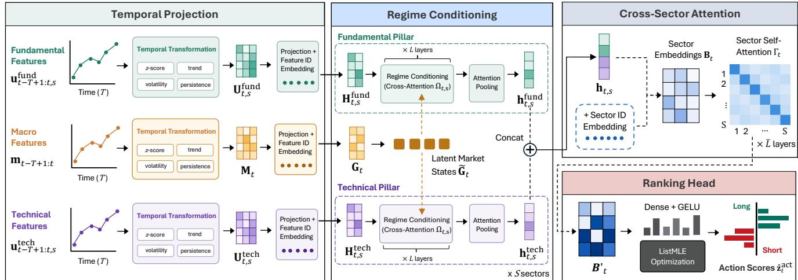
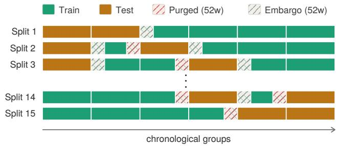
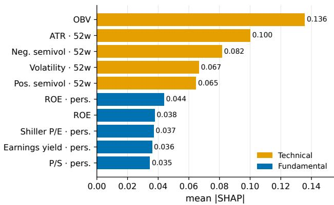
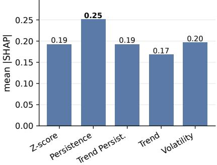
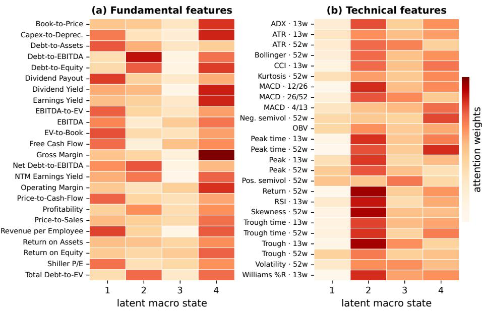
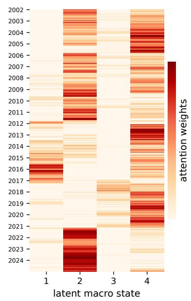
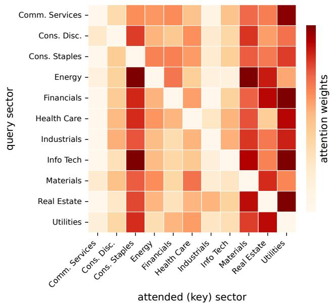

# Regime-Aware Interpretable Ranking for Sector Rotation

Kelvin J.L. Koa   
Asian Institute of Digital Finance,   
National University of Singapore   
Singapore   
kelvin.koa@u.nus.edu   
Shuowei Feng∗   
Asian Institute of Digital Finance,   
National University of Singapore   
Singapore   
e1539221@u.nus.edu   
Eugene Y. Wen†   
Manulife   
Toronto, Ontario, Canada   
eugene\_wen@manulife.com   
Ziling Liu∗   
Asian Institute of Digital Finance,   
National University of Singapore   
Singapore   
e1547130@u.nus.edu   
Ruoyu Liang∗   
Asian Institute of Digital Finance,   
National University of Singapore   
Singapore   
e1576578@u.nus.edu   
Xuan Yao   
Asian Institute of Digital Finance,   
National University of Singapore   
Singapore   
yaoxuan@nus.edu.sg Hugo Lamarre†   
Manulife Investment Management Montreal, Quebec, Canada   
hugo\_lamarre@manulifeam.com   
Xinyang Li∗   
Asian Institute of Digital Finance,   
National University of Singapore   
Singapore   
e1561242@u.nus.edu Mathieu Giroux†   
Manulife Investment Management Montreal, Quebec, Canada   
mathieu\_giroux@manulifeam.com   
Ke-Wei Huang   
Asian Institute of Digital Finance,   
National University of Singapore   
Singapore   
dishkw@nus.edu.sg

## Abstract

Sector rotation is a common decision in benchmark-relative portfolio management, where portfolio managers rank sectors for overweight and underweight positions. We formulate this task as ranking sector actions by expected future risk-adjusted active performance, measured with forward sector–benchmark Sharpe ratios. Such rankings should preserve temporal information, express model outputs through economically familiar signal characteristics, account for changes in signal relevance across macroeconomic environments, and capture dependencies among sectors. We propose RegimeRank, an interpretable sector-ranking model that represents fundamental and technical signals through expert-defined temporal characteristics, conditions them on learned macro factors via cross-attention, and models cross-sector dependencies through self attention. Expected-gradient attributions identify the contributions of individual signal–transformation pairs, while macroeconomic and cross-sector attention maps provide diagnostics of the learned conditioning and relational structure. We evaluate RegimeRank

on weekly S&P 500 data from 2002 to 2024 under combinatorial purged cross-validation, where it outperforms representative ranking and machine-learning baselines across multiple ranking metrics. Ablation studies support the contributions of latent macro states, regime conditioning, and cross-sector modelling, while attribution and attention analyses illustrate the temporal characteristics, macro states, and sector relationships underlying its rankings.

## CCS Concepts

• Information systems → Learning to rank; • Computing methodologies → Machine learning; • Applied computing → Economics.

## Keywords

portfolio ranking, sector rotation, interpretable machine learning

## ACM Reference Format:

Kelvin J.L. Koa, Ziling Liu, Xinyang Li, Shuowei Feng, Ruoyu Liang, Mathieu Giroux, Eugene Y. Wen, Xuan Yao, Ke-Wei Huang, and Hugo Lamarre. 2026. Regime-Aware Interpretable Ranking for Sector Rotation. In 7th ACM International Conference on AI in Finance (ICAIF ’26), November 14–17, 2026, Milan, AA, Italy. ACM, New York, NY, USA, 9 pages. https://doi.org/10.1145/ 3858063.3858823

## 1 Introduction

Sector rotation is a core decision in active portfolio management, in which portfolio managers (PMs) determine which sectors to overweight as economic conditions evolve [27, 28]. The economic significance of this decision is reflected in the persistent dispersion of sector returns: between 1989 and 2025, the average calendar-year diference between the best- and worst-performing S&P 500 sectors was approximately 45 percentage points [29]. Such dispersion creates both an opportunity and a risk for benchmarked portfolios: overweighting the right sectors can enhance active performance.

Table 1: Comparison of methodological capabilities across financial and AI-based asset-ranking approaches.
<table><tr><td>Approach</td><td>Ranking Formulation</td><td>Temporal Dynamics</td><td>Regime Aware</td><td>Asset Relational</td><td>Mechanism Interpretability</td><td>Attribution Interpretability</td></tr><tr><td>Asset Ranking in Finance</td><td></td><td></td><td></td><td></td><td></td><td></td></tr><tr><td>RankNet / ListNet [40]</td><td>√</td><td>X</td><td>x</td><td>x</td><td></td><td>x</td></tr><tr><td>Cross-sectional LTR [31]</td><td>√</td><td>x</td><td>x</td><td>x</td><td>v√</td><td>x</td></tr><tr><td>Listwise Node2Vec [35]</td><td>√</td><td>√</td><td>x</td><td>√</td><td>√</td><td>x</td></tr><tr><td>Long-Short Listwise LTR [44]</td><td>√</td><td>x</td><td>x</td><td>x</td><td>√</td><td>x</td></tr><tr><td>SABER [23]</td><td>√</td><td>x</td><td>x</td><td>x</td><td>√</td><td>x</td></tr><tr><td>Asset Ranking in AI</td><td></td><td></td><td></td><td></td><td></td><td></td></tr><tr><td>RSR [13]</td><td>√</td><td>√</td><td>x</td><td>v√</td><td>x</td><td>x</td></tr><tr><td>STHAN-SR [37]</td><td>√</td><td>√</td><td>x</td><td></td><td>x</td><td>x</td></tr><tr><td>RT-GCN [45]</td><td>√</td><td>√</td><td>x</td><td>√</td><td>x</td><td>x</td></tr><tr><td>ADB-TRM [9]</td><td>√</td><td>√</td><td>√</td><td>√</td><td>x</td><td>x</td></tr><tr><td>PDU [15]</td><td>√</td><td>√</td><td>x</td><td>√</td><td>x</td><td>x</td></tr><tr><td>REGIMERANK (Ours)</td><td>√</td><td>√</td><td>√</td><td>√</td><td>√</td><td>√</td></tr></table>

The central challenge is not to identify sector winners and losers ex post, but to rank their relative attractiveness ex ante. Because portfolio tilts naturally emerge from an ordering of sectors, we formulate sector rotation as a learning-to-rank problem [1, 31, 35, 44]. This formulation avoids requiring precise return forecasts—a par ticularly dificult task in financial markets [13, 23]—and instead focuses the model on the relative ordering that directly informs overweight and underweight decisions. We rank portfolios on forward Sharpe ratios to ensure that a sector is rewarded for return earned per unit ofrisk. This is consistent with benchmarked mandates to surface best risk-adjusted opportunities. Our model combines funda mental and technical signals, conditioning both on macroeconomic indicators that characterize the prevailing market environment.

Predictive accuracy alone, however, is insuficient. PMs remain accountable to investment and risk committees and must therefore be able to understand and communicate the rationale behind a recommended sector tilt. We consequently target two complementary forms of interpretability. Mechanism interpretability requires the model’s internal components to correspond to economically meaningful operations, whereas attribution interpretability requires an individual ranking outcome to be traced to the signals that drive it. Existing sequential models make this alignment dificult because they typically encode historical observations into latent representations. Post-hoc methods such as TimeSHAP [5] can attribute a prediction to particular time steps, but PMs more commonly reason in terms of higher-level characteristics such as trend, persistence, and volatility. An interpretable sector ranking model should preserve temporal information while expressing it through concepts that can be related to investment reasoning.

A common sector-allocation workflow suggests three additional modeling requirements. First, PMs form complementary views from fundamental signals, such as valuations, earnings, and growth, and technical signals, such as momentum, volume, and volatility, before combining them into an overall conviction. Second, the relevance of these signals may vary across macroeconomic environments: a low valuation, for example, may indicate an oversold investment opportunity in one environment but deteriorating fundamentals in another. Third, sectors cannot be evaluated independently. Sectors exposed to common inflation, commodity, or interest-rate forces often move jointly, so information about one sector may afect the relative attractiveness of others. These considerations motivate a model that separately represents fundamental and technical information, conditions their interpretation on the macroeconomic environment, and jointly models cross-sector dependencies.

We propose RegimeRank, an interpretable learning-to-rank architecture with four components. First, a temporal-projection layer represents each signal through expert-defined characteristics [6, 11]. Second, a macro-conditioning module uses cross-attention to condition these signal representations on learned macroeconomic factors, allowing their relevance to vary across market environments [7, 30]. Temporal projection and macro conditioning are applied separately within fundamental and technical encoders, preserving the distinction between the two information pillars. Third, a cross-sector self-attention layer then propagates information across sectors exposed to related economic forces [13, 24, 32, 37]. Finally, a listwise ranking head [43] converts the resulting sector representations into an ordering of overweight and underweight opportunities.

Through extensive experiments, we show that RegimeRank outperforms representative ranking, machine-learning and deeplearning baselines across multiple evaluation metrics in a simulation study applied to the S&P 500 sectors. Ablation studies demonstrate the contribution of each architectural component, while analyses of Shapley values [25] and attention weights [3, 10] provide insights into the temporal characteristics, market regimes, and sector interdependencies underlying its rankings.

## 2 Related Work

## 2.1 Asset Ranking

Asset ranking has emerged as an active research area across both the finance and artificial intelligence (AI) literature. In both communities, the formulation is motivated by the relative nature of investment decisions [35]: investors primarily need to identify relative winners, a target that generalizes better and is more robust than predicting exact future returns [13, 31]. Finance works build upon this formulation by incorporating financial structure, such as news sentiment [40], long-short strategies [44] and price stochasticity [23] into the ranking optimization. AI works instead extend the learning machinery, through graph convolutions [45], adversarial training [9] and contrastive learning [15]. As summarized in Table 1, few surveyed methods combine temporal or regime structure with mechanisms a PM could interpret, and we are not aware of existing approaches that provide attribution over their ranking outcomes.

  
Figure 1: Overall framework for RegimeRank. The solid Regime Conditioning box is the per-sector plate, replicated � times, and the dashed boxes are the two per-pillar encoders, conditioned on the shared latent states $\widetilde { \mathbf { G } } _ { t }$ (dashed arrows). Boxes are labelled by their outputs, and the pillar embeddings are concatenated before the Cross-Sector Atention component.

## 2.2 Model Interpretability

Interpretability in financial models [21, 22, 39] has been approached from two complementary directions. Mechanism interpretability seeks economically meaningful explanations of model behavior, with examples ranging from nonlinear factor interpretations of neural networks [18] to attention-based asset-pricing models [19] and graph-based dependency modeling [36]. Attribution interpretability, in contrast, focuses on identifying the signals responsible for model predictions through methods such as SHAP [25], LIME [34], TreeInterpreter [38], Accumulated Local Efects [2], and attentionbased explanations [10, 26].

## 3 The RegimeRank Framework

## 3.1 Architecture Overview

The goal is to rank sector overweights and underweights relative to a benchmark. RegimeRank (Figure 1) proceeds in four stages:

(1) Temporal Projection. Encode each feature’s recent history into a fixed-length temporal summary (trend, volatility, etc.).

(2) Regime conditioning. Let sector signals attend to macro indicators so that the same valuation or momentum reading can mean diferent things under diferent economic regimes.

(3) Cross-sector attention. Allow sectors to exchange information; e.g., a rally in cyclicals informs the outlook for defensives.

(4) Ranking head. Map the resulting sector embeddings to scalar scores whose ordering defines the recommended tilt ranking. Stages 1–2 run independently for each information pillar (fundamentals and technicals); the per-pillar embeddings are concatenated before stage 3. This separation reflects how practitioners typically form a fundamental view and a technical view before combining them into a single conviction.

## 3.2 Notation Conventions

Lowercase bold denotes vectors (u), uppercase bold denotes matrices (W), and uppercase italics denote dimensions (�, � , �, �). Subscripts are reserved for integer indices (e.g., � for time steps, � for sectors). Superscripts identify the block or parameter family (e.g., $\mathbf { W } ^ { Q } , \mathbf { h } ^ { \mathrm { f u n d } } )$ . A hat marks predictions (zˆ). Parentheses index vector entries (�(�) is the �-th entry of y), and primes mark successive residual updates within a block (H, H′, H′′).

## 3.3 Problem Setting

For each sector $s \in \{ 1 , . . . , S \}$ at timestamp �, we observe a sectorspecific feature vector ${ \mathbf { u } } _ { t , s } \in \mathbb { R } ^ { F }$ (fundamental and technical signals, processed in separate pillars) and a shared macro vector $\mathbf { m } _ { t } \in \mathbb { R } ^ { N }$ Each action corresponds to overweighting or underweighting a sector against the benchmark; we index actions by $a \in \{ 1 , . . . , 2 S \}$ Let $\mathbf { y } _ { t } ^ { \mathrm { o w } } \in \mathbb { R } ^ { S }$ denote the vector offorward Sharpe ratios calculated on the sector returns in excess of the benchmark return1. The action-level target stacks overweight and underweight sides:

$$
\begin{array} { r } { \mathbf { y } _ { t } ^ { \mathrm { a c t } } = \left[ \begin{array} { l } { \mathbf { y } _ { t } ^ { \mathrm { o w } } } \\ { - \mathbf { y } _ { t } ^ { \mathrm { o w } } } \end{array} \right] \in \mathbb { R } ^ { 2 S } . } \end{array}
$$

The learning target is the permutation $\pi _ { t }$ that sorts actions from best to worst by realized quality: $: \pi _ { t } ( 1 )$ is the index of the highest-valued action, $\pi _ { t } ( 2 S )$ the lowest. Formally, $y _ { t } ^ { \mathrm { a c t } } ( \pi _ { t } ( 1 ) ) \geq y _ { t } ^ { \mathrm { a c t } } ( \pi _ { t } ( 2 ) ) \geq$ $\cdots \geq y _ { t } ^ { \mathrm { a c t } } ( \pi _ { t } ( 2 S ) )$ . The model produces scores $\hat { \mathbf { z } } _ { t } ^ { \mathrm { a c t } } \in \mathbb { R } ^ { 2 S }$ whose induced ordering is trained to match $\pi _ { t }$ via a listwise likelihood. The supervision is purely ordinal $( \hat { \mathbf { z } } _ { t } ^ { \mathrm { a c t } }$ is identified only up to orderpreserving transformations), consistent with the motivation that relative rankings are more robust than exact performance levels.

## 3.4 Temporal Projection

The temporal projection, regime conditioning, and attention pooling stages are applied independently to the fundamental and technical pillars. We describe a single pillar and suppress the pillar tag until the merge; the other pillar is identical. Within a pillar, � denotes that pillar’s feature count.

The model ingests a cross-sectional snapshot, so temporal dy namics must be encoded explicitly. Each feature’s values over a lookback window of length � are mapped by a transformation operator T to a �-dimensional vector of temporal summaries (�-scores, trend, volatility, persistence). For sector-specific features:

$$
\mathbf { U } _ { t , s } = \mathcal { T } \big ( \mathbf { u } _ { t - T + 1 : t , s } \big ) \in \mathbb { R } ^ { F \times P } ,
$$

where each row holds the $P$ transformed values of one feature.

These are projected onto a �-dimensional hidden space:

$$
\mathbf { H } _ { t , s } = \mathbf { U } _ { t , s } \mathbf { W } ^ { U } + \mathbf { E } ^ { U } \in \mathbb { R } ^ { F \times D } ,
$$

where $\mathbf { W } ^ { U } \in \mathbb { R } ^ { P \times D }$ is the learned projection matrix and $\mathbf { E } ^ { U } \in \mathbb { R } ^ { F \times D }$ contains learned feature-identity embeddings that disambiguate features with otherwise identical transformed values. The shared macro features are processed analogously:

$$
\mathbf { M } _ { t } = \mathcal { T } \big ( \mathbf { m } _ { t - T + 1 : t } \big ) \in \mathbb { R } ^ { N \times P } , \qquad \mathbf { G } _ { t } = \mathbf { M } _ { t } \mathbf { W } ^ { M } + \mathbf { E } ^ { M } \in \mathbb { R } ^ { N \times D } ,
$$

with $\mathbf { W } ^ { M } \in \mathbb { R } ^ { P \times D }$ and $\mathbf { E } ^ { M } \in \mathbb { R } ^ { N \times D }$

3.4.1 Transformation-level Atribution. For interpretability, we compute approximate SHAP values via expected gradients [12] on the transformed inputs before projection. Let $\mathbf { X } _ { t , s } = \left( \mathbf { U } _ { t , s } , \mathbf { M } _ { t } \right)$ collect the transformations for sector �. The attribution is:

$$
\begin{array} { r l } & { \Phi _ { t , a , s } \approx \mathbb { E } _ { \mathbf { X } ^ { \prime } , \beta \sim \mathcal { U } ( 0 , 1 ) } \left[ \left. \left( \mathbf { X } _ { t , s } - \mathbf { X } ^ { \prime } \right) \odot \nabla _ { \mathbf { X } _ { t , s } } \hat { z } _ { t } ^ { \mathrm { a c t } } ( a ) \right| _ { \mathbf { X } ^ { \prime } + \beta ( \mathbf { X } _ { t , s } - \mathbf { X } ^ { \prime } ) } \right] , } \end{array}
$$

where $\mathbf { X ^ { \prime } }$ is a background observation and $\beta \sim \mathcal { U } ( 0 , 1 )$ . The values approximate how much each feature transformation contributes to the action score relative to the background distribution.

## 3.5 Regime Conditioning

The informational value of sector signals is regime-dependent [33]: the same signal may be bullish in one regime and bearish in another. We reduce the macro features to � latent market states:

$$
\widetilde { \mathbf { G } } _ { t } = \mathbf { W } ^ { R } \mathbf { G } _ { t } \in \mathbb { R } ^ { R \times D } ,
$$

where $\mathbf { W } ^ { R } \in \mathbb { R } ^ { R \times N }$ mixes across the feature axis (not the hidden axis); each row represents a latent aspect of the prevailing regime. In practice, the projection and reduction are factored into two stages with an intermediate normalization.

We then condition sector features on these states via multi-head cross-attention, using the sector features as queries and the latent macro states as keys and values. We define:

$$
{ \bf Q } _ { t , s } = { \bf H } _ { t , s } { \bf W } ^ { Q } \in \mathbb { R } ^ { F \times d } , \qquad { \star _ { t } } = \widetilde { \bf G } _ { t } { \bf W } ^ { \star } \in \mathbb { R } ^ { R \times d } , \star \in \{ K , V \} ,
$$

where $\mathbf { W } ^ { Q } \in \mathbb { R } ^ { D \times d }$ and $\mathbf { W } ^ { K } , \mathbf { W } ^ { V } \in \mathbb { R } ^ { D \times d }$ , and � is the attention projection width. The attention weights and residual update are computed as:

$$
\Omega _ { t , s } = \mathrm { s o f t m a x } \left( \frac { \mathbf { Q } _ { t , s } \mathbf { K } _ { t } ^ { \top } } { \sqrt { d } } \right) \in \mathbb { R } ^ { F \times R } .
$$

The context is projected back via a residual connection:

$$
\mathbf { H } _ { t , s } ^ { \prime } = \mathbf { H } _ { t , s } + \bigl ( \Omega _ { t , s } \mathbf { V } _ { t } \bigr ) \mathbf { W } ^ { O } \in \mathbb { R } ^ { F \times D } ,
$$

where $\mathbf { W } ^ { O } \in \mathbb { R } ^ { d \times D }$ . Following the block convention, a positionwise FFN (with GELU activation) completes each layer:

$$
\mathbf { H } _ { t , s } ^ { \prime \prime } = \mathbf { H } _ { t , s } ^ { \prime } + \mathrm { F F N } \big ( \mathrm { L a y e r N o r m } \big ( \mathbf { H } _ { t , s } ^ { \prime } \big ) \big ) .
$$

Multi-head attention with � stacked layers is used, each layer recomputing $\Omega _ { t , s }$ from its input. The attention map $\Omega _ { t , s }$ is directly inspectable: it shows how strongly the model conditions each signal on the prevailing macro environment; cheap valuations may signal opportunity in one regime and a value trap in another.

3.5.1 Atention Pooling and Pillar Merge. The regime-conditioned features are aggregated into an embedding via attention pooling:

$$
\alpha _ { t , s } = \mathrm { s o f t m a x } \left( \mathbf { H } _ { t , s } ^ { \prime \prime } \mathbf { w } ^ { p } + b ^ { p } \right) \in \mathbb { R } ^ { F } , \qquad \mathbf { h } _ { t , s } = \mathbf { H } _ { t , s } ^ { \prime \prime } \mathbf { \Phi } ^ { \top } \alpha _ { t , s } \in \mathbb { R } ^ { D } ,
$$

where $\mathbf { w } ^ { p } \in \mathbb { R } ^ { D }$ and $b ^ { p } \in \mathbb { R }$ are learned pooling parameters. The weights $\alpha _ { t , s }$ are inspectable and indicate the relative contribution of each feature under the current regime.

This encoder runs independently for each pillar. The downstream sector embedding concatenates the pillar embeddings:

$$
\mathbf { h } _ { t , s } = \left[ \mathbf { h } _ { t , s } ^ { \mathrm { f u n d } } ; \mathbf { h } _ { t , s } ^ { \mathrm { t e c h } } \right] \in \mathbb { R } ^ { D } ,
$$

where $D = D ^ { \mathrm { f u n d } } + D ^ { \mathrm { t e c h } }$ denotes the combined dimension.

## 3.6 Cross-Sector Attention

Sector rankings are shaped by interdependencies: cyclicals move together and against defensives as the outlook shifts [13, 35]. To model this, we stack the sector embeddings and add learned sectoridentity embeddings (analogous to positional encodings [42]):

$$
\mathbf { B } _ { t } = \left[ \begin{array} { l } { \mathbf { h } _ { t , 1 } ^ { \top } } \\ { \vdots } \\ { \mathbf { h } _ { t , S } ^ { \top } } \end{array} \right] + \mathbf { E } \in \mathbb { R } ^ { S \times D } .
$$

We define:

$$
\bar { \star } _ { t } = { \bf B } _ { t } \bar { \bf W } ^ { \star } \in \mathbb { R } ^ { S \times \bar { d } } , \qquad \star \in \{ Q , K , V \} ,
$$

where $\bar { \mathbf { W } } ^ { Q } , \bar { \mathbf { W } } ^ { K } , \bar { \mathbf { W } } ^ { V } \in \mathbb { R } ^ { D \times \bar { d } }$ , with projection width ${ \bar { d } } .$ Self-attention is applied:

$$
\Gamma _ { t } = \mathrm { s o f t m a x } \bigg ( \frac { \bar { \bf Q } _ { t } \bar { \bf K } _ { t } ^ { \top } } { \sqrt { \bar { d } } } \bigg ) \in \mathbb { R } ^ { S \times S } .
$$

The context is projected and combined via a residual:

$$
\mathbf { B } _ { t } ^ { \prime } = \mathbf { B } _ { t } + \bigl ( \Gamma _ { t } \bar { \mathbf { V } } _ { t } \bigr ) \bar { \mathbf { W } } ^ { O } \in \mathbb { R } ^ { S \times D } ,
$$

where $\bar { \mathbf { W } } ^ { O } \in \mathbb { R } ^ { \bar { d } \times D }$ . The map $\Gamma _ { t }$ surfaces the cross-sector relationships encoded by the network; a portfolio manager can compare these against their own reading of the cross-section.

A position-wise FFN with GELU activation completes each block (following the pre-norm convention):

$$
\mathbf { B } _ { t } ^ { \prime \prime } = \mathbf { B } _ { t } ^ { \prime } + \mathrm { F F N } \big ( \mathrm { L a y e r N o r m } ( \mathbf { B } _ { t } ^ { \prime } ) \big ) .
$$

Multi-head attention and �¯ layers, each recomputing �� from its input, produce the final sector embeddings $\mathbf { B } _ { t } ^ { \prime \prime }$

## 3.7 Ranking Head

The sector embeddings are passed through a GELU dense layer:

$$
\begin{array} { r } { \mathbf { Z } _ { t } = \mathrm { G E L U } \big ( \mathbf { B } _ { t } ^ { \prime \prime } \mathbf { W } ^ { g } \big ) \in \mathbb { R } ^ { S \times D } , } \end{array}
$$

where $\mathbf { W } ^ { g } \in \mathbb { R } ^ { D \times D }$ . The readout is sector-specific: each sector � has its own weight vector $\mathbf { w } _ { s } ^ { z } \in \mathbb { R } ^ { D }$ and bias $b _ { s } ^ { z } ,$ , reflecting the fact that the dimensions of the shared embedding relevant for ranking difer across sectors. Writing $\mathbf { z } _ { t , s } = \mathbf { Z } _ { t } \left[ s , : \right]$ , the overweight-side score is:

$$
\hat { z } _ { t , s } ^ { \mathrm { 0 w } } = \mathbf { z } _ { t , s } ^ { \top } \mathbf { w } _ { s } ^ { z } + b _ { s } ^ { z } , \qquad s = 1 , \ldots , S .
$$

Overweight–underweight antisymmetry is enforced by negation:

$$
\begin{array} { r } { \hat { \mathbf { z } } _ { t } ^ { \mathrm { a c t } } = \left[ \hat { \mathbf { z } } _ { t } ^ { \mathrm { o w } } \right] \in \mathbb { R } ^ { 2 S } . } \end{array}
$$

Since each position is a sector–benchmark spread, overweighting and underweighting are opposite trades, justifying the sign flip.

The model is trained with the ListMLE objective [43]:

$$
\mathcal { L } _ { t } = - \sum _ { k = 1 } ^ { 2 S } \log \left( \frac { \exp \bigl ( \hat { z } _ { t } ^ { \mathrm { a c t } } ( \pi _ { t } ( k ) ) \bigr ) } { \sum _ { j = k } ^ { 2 S } \exp \bigl ( \hat { z } _ { t } ^ { \mathrm { a c t } } ( \pi _ { t } ( j ) ) \bigr ) } \right) ,
$$

where $\pi _ { t }$ orders actions from best to worst by realized rank. Although the 2� scores are determined by � overweight scores through antisymmetry, applying ListMLE to the full list emphasizes both the strongest overweight and strongest underweight candidates.

## 4 Experiment

## 4.1 Dataset

We source weekly sector-level fundamental, technical and shared macro data from Bloomberg, covering 11 sectors with 49 sectorspecific features and 156 shared macro features. Available dates range from January 2002 to December 2024; as the label requires a full forward year, the last usable observation date is December 2023. Fundamental data is point-in-time. The target ranking is constructed from the 1-year forward Sharpe, computed from weekly returns over the following 52 weeks.

4.1.1 Combinatorial Purged Cross-Validation. To account for the overlapping forward labels and prevent information leakage, we adopt combinatorial purged cross-validation (CPCV) [4, 17].

The complete sample is first divided chronologically into six groups; see Figure 2. For each split, two groups are selected as the test set, while the remaining groups are used for training. This gives a total of ${ \binom { 6 } { 2 } } = 1 5$ train-test combinations.

Purge and embargo. The purge and embargo lengths arise from two distinct channels: the forward label horizon and the backward feature window. Preceding each test group we purge 52 weeks, matching the label span exactly—a training observation at � carries a label realised over [�, � +52]—thereby removing in full the channel through which target information propagates directly. Following each test group we set an embargo of 52 weeks. This addresses a weaker channel: a training observation placed shortly afterwards draws part of its inputs from realisations inside the test period for calculating temporal transformations such as volatility, trend, etc.

Because we use weekly observations with a 52-week forward label, consecutive training examples exhibit overlap in their target windows. Specifically, the full sample of roughly 1,200 weeks yields only about 23 non-overlapping label periods. Consequently, each training fold contains roughly 13–15 independent periods, and each test fold contains fewer than 8. The cross-section ofers limited additional independence, as sector returns are highly contemporaneously correlated and the regime-conditioning component encounters only a modest number of distinct macroeconomic regimes over 2002–2024. This constraint on independent samples is inherent to long-horizon financial prediction rather than specific to our setup. It directly motivates our combinatorial design: while a single hold-out split would rely on a fragile number of independent periods, evaluating across all 15 combinations exposes each model to a substantially broader range of market conditions.

  
Figure 2: We adopt combinatorial purged cross-validation, which is often used in financial machine learning [4, 17].

## 4.2 Baselines

We benchmark RegimeRank against four groups of baselines.

The first group, Naive Benchmarks, contains a random ranking model, which establishes the chance level for each performance metric, and a 12-month momentum rule, which ranks the long and short sector actions based solely on their trailing 12-month performance. The next two groups contain state-of-the-art asset ranking models discussed in Table 2.

For Asset Ranking in Finance, we have: RankNet and List-Net [40], Cross-sectional Learning to Rank (LTR) [31], Listwise Node2Vec [35], Long-Short Listwise LTR [44], and Stochastic-Aware Bootstrap Ensemble Ranking (SABER) [23].

For Asset Ranking in AI, we have: Relational Stock Ranking (RSR) [13], Spatio Temporal Hypergraph Attention Network for Stock Ranking (STHAN-SR) [37], Relational Temporal Graph Convolutional Network (RT-GCN) [45], Automatic De-Biased Temporal-Relational Modeling (ADB-TRM) [9], and Progressive Dependency representation learning with Uncertain risk contrasting (PDU) [15].

In the final group, we compare with general machine learning methods fitted with the same listwise ranking head used in our model. These are: OLS, ElasticNet [46], XGBoost [8], a graph neural network (GNN) [20], and a Difusion model [14].

Table 2: Performance comparison of ranking baselines and general methods utilizing a ranking head. Each cell reports the mean and standard deviation (in subscript) across 5 runs. The best baselines are underlined, and the best results are bolded.
<table><tr><td></td><td>Mean Spearman</td><td>Pred Acc</td><td>NDCG@3</td><td>NDCG@5</td><td>NDCG@11</td></tr><tr><td>Naive Benchmarks</td><td></td><td></td><td></td><td></td><td></td></tr><tr><td>Random Ranking</td><td> $0 . 0 0 9 5 _ { \pm 0 . 0 1 4 3 }$ </td><td> $0 . 5 0 2 9 _ { \pm 0 . 0 0 5 2 }$ </td><td> $0 . 5 2 1 9 _ { \pm 0 . 0 0 6 7 }$ </td><td> $0 . 5 4 2 2 _ { \pm 0 . 0 0 6 8 }$ </td><td> $0 . 6 1 4 2 _ { \pm 0 . 0 0 4 9 }$ </td></tr><tr><td>12-Month Momentum</td><td> $- 0 . 0 4 9 5 _ { \pm 0 . 0 0 0 0 }$ </td><td> $0 . 4 8 1 3 _ { \pm 0 . 0 0 0 0 }$ </td><td> $0 . 5 0 9 7 _ { \pm 0 . 0 0 0 0 }$ </td><td> $0 . 5 2 3 1 _ { \pm 0 . 0 0 0 0 }$ </td><td> $0 . 5 9 0 1 _ { \pm 0 . 0 0 0 0 }$ </td></tr><tr><td>Asset Ranking in Finance</td><td></td><td></td><td></td><td></td><td></td></tr><tr><td>RankNet [40]</td><td> $- 0 . 0 2 4 3 _ { \pm 0 . 0 7 8 3 }$ </td><td> $0 . 4 9 1 3 _ { \pm 0 . 0 2 7 5 }$ </td><td> $0 . 5 1 3 6 _ { \pm 0 . 0 2 5 1 }$ </td><td> $0 . 5 3 1 1 _ { \pm 0 . 0 2 6 3 }$ </td><td> $0 . 6 0 0 7 _ { \pm 0 . 0 3 2 5 }$ </td></tr><tr><td>ListNet [40]</td><td> $- 0 . 0 2 4 4 _ { \pm 0 . 0 7 8 2 }$ </td><td> $0 . 4 9 1 2 _ { \pm 0 . 0 2 7 4 }$ </td><td> $0 . 5 1 3 7 _ { \pm 0 . 0 2 5 1 }$ </td><td> $0 . 5 3 0 9 _ { \pm 0 . 0 2 6 4 }$ </td><td> $0 . 6 0 0 7 _ { \pm 0 . 0 3 2 5 }$ </td></tr><tr><td>Cross-sectional LTR [31]</td><td> $0 . 0 0 8 0 _ { \pm 0 . 0 0 6 1 }$ </td><td> $0 . 5 0 3 1 _ { \pm 0 . 0 0 2 1 }$ </td><td> $0 . 5 2 2 0 _ { \pm 0 . 0 0 2 1 }$ </td><td> $0 . 5 4 2 3 _ { \pm 0 . 0 0 1 8 }$ </td><td> $0 . 6 1 3 6 _ { \pm 0 . 0 0 2 3 }$ </td></tr><tr><td>Listwise Node2Vec [35]</td><td> $0 . 0 1 2 5 _ { \pm 0 . 0 1 1 6 }$ </td><td> $0 . 5 0 4 5 _ { \pm 0 . 0 0 4 0 }$ </td><td> $0 . 5 3 3 6 _ { \pm 0 . 0 0 6 7 }$ </td><td> $0 . 5 4 9 4 _ { \pm 0 . 0 0 5 4 }$ </td><td> $0 . 6 1 7 2 _ { \pm 0 . 0 0 4 6 }$ </td></tr><tr><td>Long-Short Listwise LTR [44]</td><td> $0 . 0 4 7 6 _ { \pm 0 . 0 2 9 2 }$ </td><td> $0 . 5 1 6 1 _ { \pm 0 . 0 0 9 9 }$ </td><td> $0 . 5 3 7 0 _ { \pm 0 . 0 2 2 1 }$ </td><td> $0 . 5 5 6 6 _ { \pm 0 . 0 1 9 0 }$ </td><td> $0 . 6 3 0 2 _ { \pm 0 . 0 1 0 0 }$ </td></tr><tr><td>SABER [23]</td><td> $- 0 . 0 8 1 8 _ { \pm 0 . 0 0 1 2 }$ </td><td> $0 . 4 7 0 8 _ { \pm 0 . 0 0 0 4 }$ </td><td> $0 . 4 9 9 1 _ { \pm 0 . 0 0 0 4 }$ </td><td> $0 . 5 1 2 4 _ { \pm 0 . 0 0 0 4 }$ </td><td> $0 . 5 7 7 5 _ { \pm 0 . 0 0 0 1 }$ </td></tr><tr><td>Asset Ranking in AI</td><td></td><td></td><td></td><td></td><td></td></tr><tr><td>RSR [13]</td><td> $0 . 0 2 4 0 _ { \pm 0 . 0 0 7 3 }$ </td><td> $0 . 5 0 8 5 _ { \pm 0 . 0 0 2 8 }$ </td><td> $0 . 5 3 0 7 _ { \pm 0 . 0 0 3 1 }$ </td><td> $0 . 5 5 0 1 { _ { \pm 0 . 0 0 2 8 } }$ </td><td> $0 . 6 1 9 0 _ { \pm 0 . 0 0 2 7 }$ </td></tr><tr><td>STHAN-SR [37]</td><td> $0 . 0 0 3 5 _ { \pm 0 . 0 2 8 7 }$ </td><td> $0 . 4 9 7 3 _ { \pm 0 . 0 1 6 2 }$ </td><td> $0 . 5 1 1 6 _ { \pm 0 . 0 1 0 6 }$ </td><td> $0 . 5 3 5 0 _ { \pm 0 . 0 1 1 5 }$ </td><td> $0 . 6 1 1 2 _ { \pm 0 . 0 1 0 4 }$   $\yen 123,456,789$ </td></tr><tr><td>RT-GCN [45]</td><td> $0 . 0 0 6 2 _ { \pm 0 . 0 1 8 7 }$ </td><td> $0 . 5 0 1 5 _ { \pm 0 . 0 0 6 4 }$ </td><td> $0 . 5 1 9 4 { \scriptstyle \pm 0 . 0 0 7 3 }$ </td><td> $0 . 5 3 9 9 _ { \pm 0 . 0 0 7 7 }$ </td><td> $0 . 6 1 3 4 { \scriptstyle \pm 0 . 0 0 6 8 }$ </td></tr><tr><td>ADB-TRM [9]</td><td> $0 . 0 0 9 4 _ { \pm 0 . 0 0 6 4 }$ </td><td> $0 . 5 0 2 8 _ { \pm 0 . 0 0 2 2 }$ </td><td> $0 . 5 2 4 8 _ { \pm 0 . 0 0 4 6 }$ </td><td> $0 . 5 4 2 1 { _ { \pm 0 . 0 0 4 0 } }$ </td><td> $0 . 6 1 6 9 _ { \pm 0 . 0 0 2 3 }$ </td></tr><tr><td>PDU [15]</td><td> $0 . 0 0 8 8 _ { \pm 0 . 0 1 8 8 }$ </td><td> $0 . 5 0 3 2 _ { \pm 0 . 0 0 6 5 }$ </td><td> $0 . 5 2 4 5 _ { \pm 0 . 0 0 7 5 }$ </td><td> $0 . 5 4 3 9 _ { \pm 0 . 0 0 8 1 }$ </td><td> $0 . 6 1 3 8 _ { \pm 0 . 0 0 7 0 }$ </td></tr><tr><td>ML + Ranking Head</td><td></td><td></td><td></td><td></td><td></td></tr><tr><td>OLS</td><td> $- 0 . 0 0 0 1 { \scriptstyle \pm 0 . 0 0 0 0 }$ </td><td> $0 . 4 9 9 5 _ { \pm 0 . 0 0 0 0 }$ </td><td> $0 . 5 1 5 2 _ { \pm 0 . 0 0 0 0 }$ </td><td> $0 . 5 3 7 4 { \scriptstyle \pm 0 . 0 0 0 0 }$ </td><td> $0 . 6 1 0 4 _ { \pm 0 . 0 0 0 0 }$ </td></tr><tr><td>ElasticNet [46]</td><td> $0 . 0 3 2 2 { \scriptstyle \pm 0 . 0 0 0 0 }$ </td><td> $0 . 5 1 1 2 _ { \pm 0 . 0 0 0 0 }$ </td><td> $0 . 5 4 2 1 { _ { \pm 0 . 0 0 0 0 } }$ </td><td> $0 . 5 5 7 9 _ { \pm 0 . 0 0 0 0 }$ </td><td> $0 . 6 2 2 1 { _ { \pm 0 . 0 0 0 0 } }$ </td></tr><tr><td>XGBoost [8]</td><td> $0 . 0 3 9 1 { _ { \pm 0 . 0 0 4 7 } }$ </td><td> $0 . 5 1 3 9 _ { \pm 0 . 0 0 1 5 }$ </td><td> $0 . 5 3 7 4 { \scriptstyle \pm 0 . 0 0 2 2 }$ </td><td> $0 . 5 5 7 0 { \scriptstyle \pm 0 . 0 0 2 3 }$ </td><td> $0 . 6 2 5 1 { \scriptstyle \pm 0 . 0 0 2 7 }$ </td></tr><tr><td>GNN [20]</td><td> $0 . 0 4 6 3 _ { \pm 0 . 0 1 2 1 }$ </td><td> $0 . 5 1 6 5 _ { \pm 0 . 0 0 3 9 }$ </td><td> $0 . 5 4 4 0 _ { \pm 0 . 0 0 3 9 }$ </td><td> $0 . 5 6 1 1 { \scriptstyle \pm 0 . 0 0 4 0 }$ </td><td> $0 . 6 2 9 0 _ { \pm 0 . 0 0 4 9 }$ </td></tr><tr><td>Diffusion [14]</td><td> $\underline { { 0 . 0 7 0 8 } } _ { \pm 0 . 0 1 7 8 }$ </td><td> $\underline { { 0 . 5 2 4 6 } } _ { \pm 0 . 0 0 6 3 }$ </td><td> $\underline { { 0 . 5 4 9 1 } } _ { \pm 0 . 0 1 0 7 }$ </td><td> $\underline { { 0 . 5 7 0 2 } } _ { \pm 0 . 0 0 9 2 }$ </td><td> $\underline { { 0 . 6 3 7 7 } } _ { \pm 0 . 0 0 7 2 }$ </td></tr><tr><td>Our Model</td><td></td><td></td><td></td><td></td><td></td></tr><tr><td>REGIMERANK</td><td> $\mathbf { 0 . 0 9 9 } 7 _ { \pm 0 . 0 1 6 3 }$ </td><td> $\mathbf { 0 . 5 3 5 0 _ { \pm 0 . 0 0 6 2 } }$ </td><td> $\mathbf { 0 . 5 7 0 8 _ { \pm 0 . 0 1 1 8 } }$ </td><td> $\mathbf { 0 . 5 8 7 0 _ { \pm 0 . 0 1 0 0 } }$ </td><td> $\mathbf { 0 . 6 4 9 8 _ { \pm 0 . 0 0 6 3 } }$ </td></tr></table>

## 4.3 Experimental Settings

The Adam optimizer is used to optimize the model, with an initial learning rate of $1 \times 1 0 ^ { - 3 }$ and a weight decay of $1 \times 1 0 ^ { - 4 }$ . The batch size is set to 64. All models are trained for a fixed budget of 80 epochs, applied uniformly across methods. We set the learnt embedding dimension to $D \ = \ 1 2 8 .$ , with a feed-forward hidden dimension of 512 and a dropout rate of 0.1.

For both the regime-conditioning cross-attention and cross-sector self-attention components, we use 4 attention heads. The crosssector self-attention block is also repeated across � = 2 layers.

## 4.4 Evaluation Metrics

We evaluate models over multiple out-of-sample metrics: Pairwise accuracy measures the ratio of ranking pairs that are ordered correctly by the model; Spearman’s rank correlation [41] evaluates the correlation between the set of predicted and realized rankings; Normalized Discounted Cumulative Gain (NDCG) [16] calculates the relevance of the results discounted by their position in the list. Specifically, we use NDCG@3, NDCG@5 and NDCG@11. Higher values indicate better performance for all metrics.

## 5 Results

All experiments are repeated five times and the mean and standard deviation are reported. Reported standard deviations are computed across the five training runs and reflect run-to-run stability. As the 15 test combinations overlap by construction, their dispersion does not constitute an independent error bar.

## 5.1 Performance Comparison.

Table 2 reports the ranking results. We can observe the following:

• Overall, RegimeRank matches or exceeds well-established ranking baselines, suggesting that the constraints of interpretability and expert-informed structure cost little in ranking accuracy.

• The naive benchmarks calibrate the table. Random ranking pins each metric at its chance level (accuracy ≈ 0.50, NDCG@3 ≈ 0.52), revealing that several published baselines sit at or below chance. The 12-month momentum rule falls below random, indicating that trailing one-year sector performance mean-reverts at this horizon rather than persisting.

• Among the finance baselines, the strongest add structure to the plain cross-sectional objective: Listwise Node2Vec encodes asset relationships through node embeddings, and Long-Short Listwise LTR optimizes a relative rather than absolute target. Both improve on Cross-sectional LTR: the first suggesting a sector’s rank depends on other sectors, the second that a relative target is the more informative signal. Our architecture combines both.

• The AI ranking models underperform the simpler baselines and exhibit high variance. RSR is the strongest of this group, benefiting from temporal-relational modeling, whereas the more complex graph and hypergraph models (i.e., STHAN-SR, RT-GCN) collapse to near-zero mean Spearman with high variance. With the smaller sector-level universe, these high-capacity relational models appear more prone to overfitting.

Table 3: Ablation study. Each cell reports the mean and standard deviation (in subscript) across 5 runs.
<table><tr><td></td><td>Mean Spearman</td><td>Pred Acc</td><td>NDCG@3</td><td>NDCG@5</td><td>NDCG@11</td></tr><tr><td>w/o Latent Market States</td><td> $0 . 0 6 6 2 _ { \pm 0 . 0 3 0 1 }$ </td><td> $0 . 5 2 3 2 _ { \pm 0 . 0 1 0 8 }$ </td><td> $0 . 5 5 3 0 _ { \pm 0 . 0 1 4 4 }$ </td><td> $0 . 5 7 0 4 { \scriptstyle \pm 0 . 0 1 4 5 }$ </td><td> $0 . 6 3 6 5 _ { \pm 0 . 0 1 1 9 }$ </td></tr><tr><td>w/o Regime Conditioning</td><td> $0 . 0 8 7 0 _ { \pm 0 . 0 1 3 5 }$ </td><td> $0 . 5 3 0 0 _ { \pm 0 . 0 0 4 4 }$ </td><td> $0 . 5 5 9 3 _ { \pm 0 . 0 0 5 8 }$ </td><td> $0 . 5 7 7 1 { _ { \pm 0 . 0 0 5 8 } }$ </td><td> $0 . 6 4 4 9 _ { \pm 0 . 0 0 5 6 }$ </td></tr><tr><td>w/o Sector Self-Attention</td><td> $0 . 0 3 5 8 { \scriptstyle \pm 0 . 0 1 8 6 }$ </td><td> $0 . 5 1 2 5 _ { \pm 0 . 0 0 7 0 }$ </td><td> $0 . 5 3 7 2 _ { \pm 0 . 0 1 0 4 }$ </td><td> $0 . 5 5 6 0 _ { \pm 0 . 0 0 9 6 }$ </td><td> $0 . 6 2 4 0 _ { \pm 0 . 0 0 7 1 }$ </td></tr><tr><td>REGIMERANK (Ours)</td><td> $\mathbf { 0 . 0 9 9 } 7 _ { \pm 0 . 0 1 6 3 }$ </td><td> $\mathbf { 0 . 5 3 5 0 _ { \pm 0 . 0 0 6 2 } }$ </td><td> $\mathbf { 0 . 5 7 0 8 _ { \pm 0 . 0 1 1 8 } }$ </td><td> $\mathbf { 0 . 5 8 7 0 _ { \pm 0 . 0 1 0 0 } }$ </td><td> $\mathbf { 0 . 6 4 9 8 _ { \pm 0 . 0 0 6 3 } }$ </td></tr></table>

• ElasticNet and XGBoost perform well with a ranking head, consistent with the paucity of independent observations at our horizon: a one-year forward target over two decades yields few efectively independent outcomes, which favours parsimonious models. The strongest baseline, Difusion, leads on every metric; its denoising formulation handles the noise inherent in financial signals, while GNN, which learns sector relations, follows close behind.

• RegimeRank achieves the best result on every metric. It improves mean Spearman correlation by 40.8% over the strongest baseline and lifts pairwise accuracy by 2.0% (relative). Notably, its largest relative gains fall on the top-ranked NDCG (NDCG@3/@5), the metrics most relevant to portfolio positioning.

• SABER scores poorly here, perhaps because it optimizes a riskshrunk portfolio objective rather than a ranking one, a gap that an economic evaluation might close or reverse.

## 5.2 Ablation Study.

Table 3 reports the contribution of each component, measured by removing it from the full model. We observe the following:

• Sector self-attention matters most, with the largest drop on every metric: sector interdependencies are central to the task.

• Latent market states come second: removing them lowers the mean and raises the run-to-run variance on every metric. Conditioning on raw macro features directly performs worse than removing regime conditioning altogether, indicating that the latent-state bottleneck is what makes macro information usable.

• Regime conditioning contributes the smallest yet consistent increment: the prevailing macro state still adds information that the sector-level features alone do not carry.

## 5.3 Interpretability Study.

Feature Attribution. Next, we interpret the feature and transform importance through their SHAP values $\Phi _ { t }$ . We can observe:

• From Figure 3, the five largest attributions are all technical signals, each exceeding the strongest fundamental. For a one-year forward Sharpe target, price and volatility dynamics carry more of the ranking signal than valuation fundamentals — OBV (onbalance volume) leads, ahead of 52-week ATR (average true range), semivolatility and volatility.

• From Figure 4, persistence is the most influential temporal trans formation, ahead of �-score, trend-persistence, volatility and trend. The pattern also holds within the fundamental pillar, where the most influential features come from the persistence channel rather than any other transformation.

  
Figure 3: Top-5 attributions for each feature type.

  
Figure 4: Attribution by temporal transformation.

• This supports the autocorrelation premise behind our transformationprojection layer: how strongly a signal continues appears more informative for cross-sectional ranking than its level or direction.

Macro Regime Conditioning. We interpret the latent macro states through their cross-attention weights $\Omega _ { t } ^ { ( s ) }$ . We observe:

• From Figure 5, feature importance varies with the learnt regimes: technical features weigh most heavily under latent state 2, fundamentals under latent state 4. The active states thus separate into price-driven and valuation-driven regimes, recovering a regime-dependence of signal informativeness that a standard cross-sectional model discards by construction.

• From Figure 6, these states align with recognisable market periods. State 2 dominates the volatile 2002–2010 window, peaking around the 2008 Global Financial Crisis, and resurges over 2021–2024; state 4 activates in the calmer intervening years. The remaining states stay largely dormant. The model therefore reweights features as conditions change, leaning on technical signals in stressed markets and on fundamentals when volatility subsides.

  
Figure 5: Attention weights for (a) fundamental and (b) technical features.  
Figure 6: Attention weights over time.

Cross-Sector Interdependencies. We also study the sector interdependencies using their self-attention weights Γ�. We can see:

• In Figure 7, the sample-averaged attention concentrates on a few sectors: nearly every query sector attends strongly to Real Estate, Materials, Consumer Staples and Utilities.

• The diagonal is weak, indicating that sectors draw on other sectors’ signals rather than reinforcing their own, whose information is already preserved through the residual connection B�.

• The learnt structure is economically coherent, with strong attention between cyclical sectors (e.g., Energy and Materials) and among the rate-sensitive Real Estate, Financials and Utilities, consistent with a risk-based view of the cross-section [19].

## 6 Conclusion

We presented RegimeRank, an interpretable cross-sectional rank ing model for long-short sector allocation that recovers temporal dynamics through signal transformation projections and conditions features on latent macro regimes via cross-attention. Across our experiments it ranks ahead of the baselines we consider on several ranking metrics, while its SHAP values and attention weights expose attributions over feature transformations, macro regimes, and sector interdependencies that portfolio managers can inspect. Overall, these findings highlight the complementary roles of temporal signal representations, macroeconomic conditioning, and crosssector interactions in producing interpretable sector rankings.

  
Figure 7: Cross-sector self-attention weights.

Future Work. Three directions follow. First, we plan to evaluate economic value directly, translating the top-ranked over- and underweights into portfolio positions and measuring the fund performance they induce, net of turnover and trading costs. Second, we plan to add a sentiment pillar, which the architecture accommodates as-is, to test whether news and analyst signals rank sectors beyond fundamentals and technicals. Third, we plan to translate the structured attributions into verbal explanations through large language models, producing rationales PMs can read directly.

## References

[1] Mohammad Alsulmi. 2022. From Ranking Search Results to Managing Investment Portfolios: Exploring Rank-Based Approaches for Portfolio Stock Selection. Electronics 11, 23 (2022), 4019.

[2] Daniel W. Apley and Jingyu Zhu. 2020. Visualizing the Efects of Predictor Variables in Black Box Supervised Learning Models. Journal ofthe Royal Statistical Society Series B: Statistical Methodology 82, 4 (2020), 1059–1086.

[3] Dzmitry Bahdanau, Kyunghyun Cho, and Yoshua Bengio. 2015. Neural Machine Translation by Jointly Learning to Align and Translate. In International Conference on Learning Representations (ICLR).

[4] David H. Bailey, Jonathan M. Borwein, Marcos López de Prado, and Qiji Jim Zhu. 2017. The Probability of Backtest Overfitting. The Journal ofComputational Finance 20, 4 (2017), 39–69.

[5] João Bento, Pedro Saleiro, André F. Cruz, Mário A.T. Figueiredo, and Pedro Bizarro. 2021. TimeSHAP: Explaining Recurrent Models through Sequence Perturbations. In Proceedings ofthe 27th ACM SIGKDD Conference on Knowledge Discovery & Data Mining (KDD ’21). ACM, 2565–2573.

[6] Anna Carbone, Giuliano Castelli, and H. Eugene Stanley. 2004. Time-Dependent Hurst Exponent in Financial Time Series. Physica A: Statistical Mechanics and its Applications 344, 1-2 (2004), 267–271.

[7] Luyang Chen, Markus Pelger, and Jason Zhu. 2024. Deep Learning in Asset Pricing. Management Science 70, 2 (2024), 714–750.

[8] Tianqi Chen and Carlos Guestrin. 2016. XGBoost: A Scalable Tree Boosting System. In Proceedings ofthe 22nd ACM SIGKDD International Conference on Knowledge Discovery and Data Mining (KDD ’16). ACM, 785–794.

[9] Weijun Chen, Shun Li, Xipu Yu, Heyuan Wang, Wei Chen, and Tengjiao Wang. 2024. Automatic De-Biased Temporal-Relational Modeling for Stock Investment Recommendation. In Proceedings of the Thirty-Third International Joint Conference on Artificial Intelligence (IJCAI-24). 1999–2008.

[10] Kevin Clark, Urvashi Khandelwal, Omer Levy, and Christopher D. Manning. 2019. What Does BERT Look At? An Analysis of BERT’s Attention. In Proceedings of the 2019 ACL Workshop BlackboxNLP: Analyzing and Interpreting Neural Networks for NLP. Association for Computational Linguistics, 276–286.

[11] Rama Cont. 2001. Empirical Properties of Asset Returns: Stylized Facts and Statistical Issues. Quantitative Finance 1, 2 (2001), 223–236.

[12] Gabriel Erion, Joseph D. Janizek, Pascal Sturmfels, Scott M. Lundberg, and Su-In Lee. 2021. Improving Performance of Deep Learning Models with Axiomatic Attribution Priors and Expected Gradients. Nature Machine Intelligence 3, 7 (2021), 620–631.

[13] Fuli Feng, Xiangnan He, Xiang Wang, Cheng Luo, Yiqun Liu, and Tat-Seng Chua. 2019. Temporal Relational Ranking for Stock Prediction. ACM Transactions on Information Systems 37, 2 (2019), 27:1–27:30.

[14] Jonathan Ho, Ajay Jain, and Pieter Abbeel. 2020. Denoising Difusion Probabilistic Models. In Advances in Neural Information Processing Systems 33 (NeurIPS 2020). 6840–6851.

[15] Li Huang, Yanzhe Xie, Qiang Gao, Kunpeng Zhang, Guisong Liu, and Xueqin Chen. 2025. Progressive Dependency Representation Learning for Stock Ranking in Uncertain Risk Contrasting. In Proceedings ofthe 31st ACM SIGKDD Conference on Knowledge Discovery and Data Mining V.1 (KDD ’25). ACM, 532–543.

[16] Kalervo Järvelin and Jaana Kekäläinen. 2002. Cumulated Gain-Based Evaluation of IR Techniques. ACM Transactions on Information Systems 20, 4 (2002), 422–446.

[17] Jacques Joubert, Dragan Sestovic, Illya Barziy, Walter Distaso, and Marcos López de Prado. 2024. Enhanced Backtesting for Practitioners. The Journal ofPortfolio Management 51, 2 (2024), 12–27.

[18] Bryan T. Kelly, Boris Kuznetsov, Semyon Malamud, and Teng Andrea Xu. 2024. Large (and Deep) Factor Models. arXiv preprint arXiv:2402.06635 (2024).

[19] Bryan T. Kelly, Boris Kuznetsov, Semyon Malamud, and Teng Andrea Xu. 2025. Artificial Intelligence Asset Pricing Models. Working Paper 33351. National Bureau of Economic Research.

[20] Thomas N. Kipf and Max Welling. 2017. Semi-Supervised Classification with Graph Convolutional Networks. In International Conference on Learning Representations (ICLR).

[21] Kelvin J.L. Koa, Jan Chen, Yunshan Ma, Huanhuan Zheng, and Tat-Seng Chua. 2026. Reasoning on Time-Series for Financial Technical Analysis. In International Conference on Learning Representations (ICLR). 64059–64079.

[22] Kelvin J.L. Koa, Filip Orestav, Shengqiong Wu, Michael J. Wooldridge, and Ke-Wei Huang. 2026. Self-Evolving Multi-Agent Symbolic Discovery for Financial Fundamental Analysis. arXiv preprint arXiv:2609.32746 (2026).

[23] Eleftherios Kouloumpris, Konstantinos Moutsianas, and Ioannis P. Vlahavas. 2024. SABER: Stochastic-Aware Bootstrap Ensemble Ranking for Portfolio Manage ment. Expert Systems with Applications 249 (2024), 123637.

[24] Marcos López de Prado. 2016. Building Diversified Portfolios that Outperform Out of Sample. The Journal ofPortfolio Management 42, 4 (2016), 59–69.

[25] Scott M. Lundberg and Su-In Lee. 2017. A Unified Approach to Interpreting Model Predictions. In Advances in Neural Information Processing Systems 30 (NIPS 2017). 4765–4774.

[26] Evelyn J. Mannix, Liam Hodgkinson, and Howard D. Bondell. 2025. ComFe: An Interpretable Head for Vision Transformers. Transactions on Machine Learning Research (2025).

[27] Tobias J. Moskowitz and Mark Grinblatt. 1999. Do Industries Explain Momentum? The Journal ofFinance 54, 4 (1999), 1249–1290.

[28] Edward S. O’Neal. 2000. Industry Momentum and Sector Mutual Funds. Financial Analysts Journal 56, 4 (2000), 37–49.

[29] Amit Pathak. 2026. The S&P 500 Sector Indices: The Blueprint for Precision Analysis. Index Education, S&P Dow Jones Indices.

[30] Markus Pelger and Ruoxuan Xiong. 2022. State-Varying Factor Models of Large Dimensions. Journal ofBusiness & Economic Statistics 40, 3 (2022), 1315–1333

[31] Daniel Poh, Bryan Lim, Stefan Zohren, and Stephen Roberts. 2021. Building Cross-Sectional Systematic Strategies by Learning to Rank. The Journal ofFinancial Data Science 3, 2 (2021), 70–86.

[32] Daniel Poh, Bryan Lim, Stefan Zohren, and Stephen Roberts. 2022. Enhancing Cross-Sectional Currency Strategies by Context-Aware Learning to Rank with Self-Attention. The Journal ofFinancial Data Science 4, 3 (2022), 89–107.

[33] Bruno Rémillard, Alexandre Hocquard, Hugo Lamarre, and Nicolas Papageorgiou. 2017. Option Pricing and Hedging for Discrete Time Regime-Switching Models. Modern Economy 8, 8 (2017), 1005–1032.

[34] Marco Túlio Ribeiro, Sameer Singh, and Carlos Guestrin. 2016. “Why Should I Trust You?”: Explaining the Predictions of Any Classifier. In Proceedings ofthe 22nd ACM SIGKDD International Conference on Knowledge Discovery and Data Mining (KDD ’16). ACM, 1135–1144.

[35] Suman Saha, Junbin Gao, and Richard Gerlach. 2021. Stock Ranking Prediction Using List-Wise Approach and Node Embedding Technique. IEEE Access 9 (2021), 88981–88996.

[36] Bhaskarjit Sarmah, Nayana Nair, Riya Jain, Dhagash Mehta, and Stefano Pasquali. 2024. Learning Embedded Representation of the Stock Correlation Matrix Using Graph Machine Learning. In Proceedings of the 2024 IEEE Symposium on Computational Intelligence for Financial Engineering and Economics (CIFEr). IEEE, 1–9.

[37] Ramit Sawhney, Shivam Agarwal, Arnav Wadhwa, Tyler Derr, and Rajiv Ratn Shah. 2021. Stock Selection via Spatiotemporal Hypergraph Attention Network: A Learning to Rank Approach. In Proceedings ofthe AAAI Conference on Artificial Intelligence, Vol. 35. 497–504.

[38] Pulkit Sharma, Shezan Rohinton Mirzan, Apurva Bhandari, Anish Pimpley, Abhiram Eswaran, Soundar Srinivasan, and Liqun Shao. 2020. Evaluating Tree Explanation Methods for Anomaly Reasoning: A Case Study of SHAP Tree-Explainer and TreeInterpreter. In Advances in Conceptual Modeling: ER 2020 Workshops (Lecture Notes in Computer Science, Vol. 12584). Springer, 35–45.

[39] Galit Shmueli. 2010. To Explain or to Predict? Statistical Science 25, 3 (2010), 289–310.

[40] Qiang Song, Anqi Liu, and Steve Y. Yang. 2017. Stock Portfolio Selection Using Learning-to-Rank Algorithms with News Sentiment. Neurocomputing 264 (2017), 20–28.

[41] Charles Spearman. 1904. The Proof and Measurement of Association between Two Things. The American Journal ofPsychology 15, 1 (1904), 72–101.

[42] Ashish Vaswani, Noam Shazeer, Niki Parmar, Jakob Uszkoreit, Llion Jones, Aidan N. Gomez, Łukasz Kaiser, and Illia Polosukhin. 2017. Attention Is All You Need. In Advances in Neural Information Processing Systems 30 (NIPS 2017). 5998–6008.

[43] Fen Xia, Tie-Yan Liu, Jue Wang, Wensheng Zhang, and Hang Li. 2008. Listwise Approach to Learning to Rank: Theory and Algorithm. In Proceedings of the 25th International Conference on Machine Learning (ICML ’08). ACM, 1192–1199.

[44] Xin Zhang, Lan Wu, and Zhixue Chen. 2022. Constructing Long-Short Stock Portfolio with a New Listwise Learn-to-Rank Algorithm. Quantitative Finance 22, 2 (2022), 321–331.

[45] Zetao Zheng, Jie Shao, Jia Zhu, and Heng Tao Shen. 2023. Relational Temporal Graph Convolutional Networks for Ranking-Based Stock Prediction. In Proceedings of the 39th IEEE International Conference on Data Engineering (ICDE). IEEE, 123–136.

[46] Hui Zou and Trevor Hastie. 2005. Regularization and Variable Selection via the Elastic Net. Journal of the Royal Statistical Society Series B: Statistical Methodology 67, 2 (2005), 301–320.