# Reinforcement Learning Controllers for Fusion Scenario Development

Evgeny Adishchev, Maxim Nurgaliev, Dmitry Sorokin, Alexander Granovsky, Maksim Stokolesov, Igor Prokofyev, Eduard Khairutdinov, Georgy Subbotin Next Step Fusion s.a.r.l.

October 6, 2026

## Abstract

Scenario development, the design of the waveforms that take a tokamak discharge from breakdown to flat-top, is still an iterative, labour-intensive process. Every candidate scenario has to be simulated with a controller in the loop, and the classical shape and current controllers need low-level actuator references. So the process is iterative and includes a number of trial-and-error steps. We propose to replace the per-scenario controller tuning by a single goal-conditioned reinforcement-learning controller trained once, in advance, against a free-boundary equilibrium and transport simulator. A scenario is then specified only by the target waveforms of the physical quantities of interest (plasma current, line-averaged electron density, LCFS shape, x-point positions), and the controller produces the coil-current and fueling commands that realise them. We demonstrate the approach on an EAST plasma-current ramp-up: the controller takes over a small limited plasma, ramps the current and the density, grows the cross-section, forms two x-points and holds a double-null diverted configuration against sampled shape targets for the rest of a 1.2 s episode. The neural network controller is trained using TQC algorithm. On 1024 test scenarios sampled from a low-discrepancy scrambled Sobol sequence in 11-dimensional target space, the controller forms the divertor in 86% of the cases, holds it for more than 0.5 s in 67% and reaches the end of the episode in a diverted state in 58%, with flat-top tracking errors of a few kA in plasma current, $\sim 0 . 1 5 \times 1 0 ^ { 1 9 } \ \mathrm { m } ^ { - 3 }$ in density, ∼ 2 cm in position and ∼ 8 cm in x-point location; the failures concentrate at the high-current density (J) region which is believed to be physically or from engineering perspective not feasible within ohmic mode.

## 1 Motivation

This paper presents a tokamak operating scenario as the time history of the MHD states, coils’ currents, other actuators including fueling and heating from breakdown to the flat-top and later to the ramp down. Its development is one of the most time-consuming activities in the preparation of an experimental campaign, as it is largely an unstructured trial-and-error process [1, 2, 3]. The scenario development is done with integrated simulators, those inputs are actuator values and outputs—plasma states evolved over a discharge. In operations the actuators depend on the plasma state and determined by a controller—typically PID using specific set points. During scenario design and optimization the set points are not known yet, the scenario designer therefore iterates: propose waveforms, re-tune the controller, simulate. Exploratory optimisation is particularly limited—small modifications frequently lose the equilibrium or hit a coil limit, and each failed attempt costs a simulation and a manual diagnosis.

Our proposal is to run these simulations in advance. Instead of tuning a controller for every candidate scenario we train, once, a goal-conditioned controller that receives the target waveforms of the physical quantities of interest together with the plasma state (MHD and kinetic) and produces the actuator commands. Once such a controller exists, a scenario is specified entirely in physical terms—“ramp to 300 kA in 0.6 s, reach $\bar { n } _ { e } = 2 \times 1 0 ^ { 1 9 } ~ \mathrm { m } ^ { - 3 }$ form a double-null shape with elongation 1.9 and these x-point radii”—and each iteration of the design loop is a single closed-loop simulation that is, by construction, consistent with the plant model. The capable simulator intrinsically takes engineering boundary conditions into accout and produces a scenario that fits for purpose and also feasible to the device. Variations can be explored interactively, and the controller’s own test statistics tell the designer which region of the target space is reachable.

The dimensionality of the problem rules out exhaustive search: the state of a free-boundary equilibrium coupled to a transport model has hundreds of degrees of freedom, the actuator space has about a dozen continuous channels, and a scenario is a path through this space over a thousand control steps. Approximate, learned solutions are needed, and deep reinforcement learning (RL) using neural networks as universal approximators is the natural tool for the complex system with nonlinear evolution and control dynamics: it optimises a closed-loop policy directly against a simulator, handles continuous multi-input multi-output control, and has already been shown to control tokamak plasmas in simulation and on real devices. Magnetic control by RL has been demonstrated on TCV [4], DIII-D [5, 6], EAST [7], HL-3 [8] and EXL-50U [9, 10]; kinetic and 0-D scenario quantities have been controlled on KSTAR [11, 12] and JT-60SA [13], and RL has been used for proactive instability avoidance on DIII-D [14] and for robust ramp-down trajectory design on TCV [15]. Most of these works controls a plasma that already exists in its target configuration (static shape hold, disturbance rejection, profile regulation) or produces feed-forward trajectories. The present work addresses the scenario itself: the controller has to carry the plasma through the qualitatively diferent limited and diverted phases of a ramp-up, with the limiter-to-divertor transition—a discrete event that classical control systems handle by switching control laws—learned as part of the policy. We focus on ramp up to flat-top transition excluding breakdown itself and ramp down.

For this paper we applied the method to EAST device and produced a controller for ofline use. The controller develops scenarios in a wide range of target shapes and kinetic characteristics. This range covers a substantional subspace of double null configurations achievable without external heating.

## 2 Scenario Development as a Control Task

To an operator, a scenario is a small set of time histories of physical quantities: the plasma current $\left( I _ { P } \right)$ , the line-averaged electron density $( n _ { e } )$ and a parametrised description of the plasma boundary—the inner-wall gap, the minor radius, the elongation, the triangularity, the squareness, the positions of two x-points. Between the scenario and the machine sits a controller that has to turn the desired history of the plasma states into a history of power system and fuelling commands.

Such a controller must be goal-conditioned: the target parameters enter as inputs, so that the same controller serves every scenario in the family. The targets move throughout the discharge, and the controller has to track ramps rather than regulate about a fixed point. And it must handle the phase structure of a ramp-up on its own: a scenario begins with a small plasma leaning on the inner wall and ends with a diverted plasma whose x-points are themselves tracked quantities; the targets that exist in the second phase do not exist in the first, the failure modes difer, and the transition between the two is a discrete event that has to happen at the right moment (chosen by the controller) and from the right state.

We cast the problem as an episodic RL task. An episode starts a few tens of milliseconds after breakdown from a realistic early-discharge equilibrium and lasts a fixed physical time, we used 1.2 s. Targets values are determined as piece wise linear quantities starting from the initial state (at $T = 0$ control error = 0), going at a constant pace to the final values and at a certain moment change to constants. The change to constant phase may vary between targets and when all of them are at the constant phase, this is a discharge flat top. The controller observes the plasma, the coil currents and the current targets at every millisecond and commands changes of the coil currents and of the fueling rate. It is rewarded at every step for how close the achieved quantities are to their targets, and the episode ends early if the equilibrium is lost, if an operational limit is violated, or if a tracked quantity leaves a tolerance band.

Three properties of ramp-up physics make this harder than the static control tasks addressed by the earlier RL work and shape the design choices of the next section. First, the current, the density and the shape are coupled through transport. Second, the actuators act on diferent time-scales: a coil current changes within milliseconds, the density responds to the gas valve over tens to hundreds of miliseconds, so the efect of a fueling decision is only visible far beyond the horizon over which a learning algorithm naturally assigns credit. Third, and most importantly, the decisive event of the scenario—a limiter-to-divertor transition that survives—only occurs after a few hundred steps of control of the limited plasma, and a controller that never attempts it is rewarded comfortably for holding a stable limited plasma. Discovering the transition is as much an exploration and optimization problem as a control problem.

## 3 RL Algorithm Set-up (MDP)

## 3.1 Environment

We used NSFsim, a free-boundary Grad–Shafranov equilibrium solver coupled to a one-dimensional transport model [16] which is able to simulate any axisymmetric fusion device. The device description—coils, vessel, limiter, magnetic probes and flux loops—is configured separately, in the control task we assume that the simulator is verified. The results below use the EAST 2021 configuration: major radius 1.85 m, toroidal field 1.8 T on axis, twelve poloidal-field coils (PF1–PF8 and PF11–PF14, of which PF1–PF6 form the central solenoid), one in-vessel coil (IC) and a 90-element model of the conducting vessel. The equilibrium and the transport equations are advanced with a time step of 1 ms.

Every episode starts from the same reconstructed early-discharge equilibrium: a circular plasma limited on the inner wall with minor radius 0.20 m, I ≈ 41 kA and the magnetic axis at the midplane. The vertical stability is controlled with the conventional vertical stability controller which calculates the compensation $B _ { R }$ field and applies it through the IC coil. Everything else is under the policy’s control from the first step. The control step is the same 1 ms and the episode is truncated at 1.2 s, i.e. 1200 control steps, unless it terminates earlier.

The controller commands are changes of the currents in PF1–PF8 and PF11–PF14. Three up–down pairs of the central-solenoid coils are driven symmetrically (PF2 with PF1, PF4 with PF3, PF6 with PF5), which leaves nine independent coil channels. The change per step is bounded by the supply voltage limit and the coil self-inductance, and the currents themselves by the rated 12.5 kA, so the power-supply capability enters through the action space. The tenth channel is the neutral gas source, parametrised as a rate-limited change of a fueling level that is converted into an edge-localised deuterium particle source. In the same manner as for the coils the policy output is a change of the fuelling rate from the previous step.

The controller observes the quantities a shape and current controller would be given by a real-time equilibrium reconstruction, plus the targets: the plasma current and the coil currents with their time derivatives. The target shape is parametrized by magnetic center R position, minor radius, inner-wall gap, elongation, coordinates of x-points and four values of squareness. The model is fed by the eight pivot points instead of mixed length and unitless quantities. These are right, left, top, bottom points of the separatrix plus four points which are determined by the squareness for each quadrant. Additional observations are the flux imbalance between the two nulls; a few scalar equilibrium and profile quantities. The full list is given in A.

Table 1: Scenario target ranges, sampled uniformly and independently at every training episode. Each target is a ramp from the value measured at hand-over to the sampled final value, reached at the sampled time.
<table><tr><td>Quantity</td><td>Symbol</td><td>Final value</td><td>Ramp end  $[ \mathrm { s } ]$ </td></tr><tr><td>Plasma current</td><td> $I _ { p }$ </td><td> $2 0 0 { - } 3 5 0 \ \mathrm { k A }$ </td><td>0.4-1.0</td></tr><tr><td>Line-averaged density</td><td> $\bar { n } _ { e }$ </td><td> $1 . 5 { - } 3 . 0 \times 1 0 ^ { 1 9 } \ \mathrm { m ^ { - 3 } }$ </td><td>0.4-1.0</td></tr><tr><td>Inner-wall boundary radius</td><td> $R _ { \mathrm { i n } }$ </td><td>1.40–1.53 m</td><td>0.4-1.0</td></tr><tr><td>Minor radius</td><td> $a$ </td><td>0.24–0.36 m</td><td>0.4-1.0</td></tr><tr><td>Elongation</td><td> $\varkappa$ </td><td>1.7-2.0</td><td>0.4-1.0</td></tr><tr><td>Squareness (4 quadrants)</td><td> $\zeta$ </td><td>0.2-0.4</td><td>0.4-1.0</td></tr><tr><td>Lower / upper x-point radius</td><td> $R _ { x 1 } , R _ { x 2 }$ </td><td>1.53-1.63 m</td><td>0.5-1.0</td></tr><tr><td>Vertical position of the centre</td><td> $Z _ { \mathrm { m a g } }$ </td><td>0 (fixed)</td><td>0.03</td></tr></table>

Table 1 lists the ranges from which the scenario targets are drawn.

## 3.2 Reward Engineering

The reward contains several components lying in $[ 0 ; 1 ]$ . Each reward component starts with some scalar error $d _ { k } ( g , s ) \geq 0 \mathrm { . }$ —a distance between the target g and the state s—with a transform onto [0, 1]. The transform is the Lorentzian

$$
r _ { k } = \frac { 1 } { 1 + ( d _ { k } / \gamma _ { k } ) ^ { 2 } } ,\tag{1}
$$

so that if $\gamma _ { k }$ is the error the component is worth one half and $\frac { 1 } { 3 } \gamma _ { k }$ delivers the reward of 0.9.

The components are combined into a single value with a Boltzmann-weighted smooth minimum that lies between the smallest and the largest component

$$
R = \sum _ { k } w _ { k } r _ { k } , \qquad w _ { k } = \frac { \exp ( \beta r _ { k } ) } { \sum _ { j } \exp ( \beta r _ { j } ) } , \qquad \beta = - 5 ,\tag{2}
$$

With $\beta < 0$ the combined reward is dominated by the worst component. This is a deliberate choice: a plain weighted sum lets the policy trade one objective for another, whereas the smooth minimum only pays for improving whichever objective is currently worst, so a converged policy satisfies all of them to a comparable degree.

The components fall into three groups. Tracking components measure the distance of the plasma current, the line-averaged density, the geometric centre, the eight pivot points (reduced to a scalar by the same formula $^ { 2 , }$ with positive $\beta = 5$ it turns into the smooth maximum instead if minimum), so that the worst point drives the component without the discontinuity of a hard maximum), the two x-points, the flux imbalance between the two nulls $\left( | \psi ( x _ { 1 } ) - \psi ( x _ { 2 } ) | \right)$ ), and the normalised poloidal flux at the eight pivot points from their targets. Operational-limit components price the spread of the six central-solenoid currents, the current in the in-vessel IC coil as a proxy to vertical stability, and the margin of every coil to its max current. A limiter component rewards a contact point on the midplane, i.e. a plasma that leans on the inner wall symmetrically before it is diverted.

The episodes are phased. Phase 0 is the limited plasma, and the phase 1 is the diverted plasma. The phase progression happened when the controller collects 10 observations of the diverted plasma (regardless in a row or in a flickering manner) with $I _ { P } > 1 0 0 ~ \mathrm { k A }$ and also if the termination criteria for the phase 1 is not met (see below). The phase is (0 or 1) is added to the reward on top of smooth minimum of the components. This design sends a strong signal to the algorithm to transit to the diverted mode, allowing a short deviation of other targets (namely shape and position) for a higher reward value in several dozens of control cycles. Some reward components are phase specific. If a component is not used in a phase, it does not enter the smooth minimum averaging.

## 3.3 Episode termination

An episode terminates when some criteria is met. The first series of criteria is plasma survival: the MHD equilibrium existence, the $I _ { P }$ being above 20 kA regardless of the target, the minor radius to be above 0.2 m and the edge safety factor above 2.0.

Another set of criteria is tied to the target. An episode is terminated if pivot points deviate more than 0.2 m to their target, $I _ { P } .$ —more than 50 kA etc.

The third series of criteria is phase 1 (the diverted plasma) specific. The flux imbalance between x-points must be below 0.1 and x-point distance to target must be under 0.2 m during phase 1. Touching a wall causes termination as well.

And lastly there is an engineering criterion, the CS spread (maximum current minus minimum current) must not grow more than 9.5 kA of the starting value. This focuses the model to use CS for the plasma current control only and not going to diferent direction efectively using PF5-6 for shaping.

Maximum length of an episode is 1.2 s, i.e. 1200 steps. Reaching 1200 steps is marked as truncation rather then termination and not penalized.

## 3.4 RL Algorithm

We use an of-policy maximum-entropy actor–critic. The actor is a Gaussian policy with a tanh squashing, trained with the soft actor–critic objective and automatic temperature tuning [17]; the critic is the truncated quantile ensemble of TQC [18]: three networks each predicting 25 quantiles of the return distribution, whose pooled atoms are sorted and the largest few dropped before the bootstrap target is formed. Both networks are two-layer perceptrons of width 256 with SiLU activations on top of a running input normaliser (Welford’s algorithm). The critic additionally carries an auxiliary head that predicts the shape scalars (triangularity, elongation and squareness) which are not present in the observations directly; its mean-squared loss, added to the policy loss with a small weight, provides a training signal while successful experience is not yet collected. The discount factor of 0.99 gives an efective horizon of 100 ms, long enough to cover the vessel eddy-current response and the coil slew limits. Learning rates, batch and replay sizes and the remaining hyperparameters are listed in D.

## 4 Results

The controller reported below is trained with the configuration of Section 3 on the target ranges of table 1. All the results of this section are obtained with a single model, the checkpoint after about 4.0 million updates, run as a deterministic policy.

## 4.1 The developed controller

Figures 1, 2 and 3 show three test episodes: a low-current discharge $( I _ { p } ^ { \mathrm { t } } = 2 1 7 \mathrm { k A }$ at $\bar { n } _ { e } ^ { \mathrm { t } } = 2 . 2 \times 1 0 ^ { 1 9 } ~ \mathrm { m } ^ { - 3 } )$ , a high-current discharge at low density $\mathrm { ( 3 2 3 ~ k A }$ $1 . 7 \times 1 0 ^ { 1 9 } \ \mathrm { m ^ { - 3 } } )$ and a high-current, high-density discharge relevant for the long-pulse discharges (300 kA, $2 . 8 \times 1 0 ^ { 1 9 } ~ \mathrm { { m ^ { - 3 } } ) }$ . On the last combination the model demonstrated the lowest shape control accuracy. In all three episodes we use ramp up duration of 0.6 s, the plasma is diverted from the transition to the end of the 1.2 s episode without a single step back to the limiter.

Up to the transition the three episodes evolve alike. The current is ramped from 39 kA at hand-over at 0.3–0.5 $\mathrm { M A } / \mathrm { s }$ , fastest for the highest target, while the cross-section grows from the circular 0.20 m start plasma leaning on the inner wall. Both x-points are formed at 0.20–0.21 s in all three cases, at $I _ { p } \approx 1 0 0 ~ \mathrm { k A }$ independent of the target, with the elongation already at 1.8 at that moment.

During the flat-top $\left( t \geq 0 . 6 ~ \mathrm { s } \right)$ the low-current and the high-current, highdensity episodes hold the current within 2–3 kA of the target (a steady bias of $- 2 \ \mathrm { k A } )$ , the density within $0 . 1 { - } 0 . 1 5 \times 1 0 ^ { 1 9 } ~ \mathrm { m ^ { - 3 } }$ , the geometric centre within 0.5–2 cm, the eight boundary points within 2.4–3.9 cm on average (7–10 cm at the worst point) and the x-points within 5–10 cm.

The operational limits are respected with margin in all three episodes. The largest coil current is 10.4–11.1 kA (PF5) against the 12.5 kA rating, the invessel coil stays below 0.7 kA (2.0 kA in the high-current, low-density case), and the solenoid current spread grows by 3.5–4.6 kA. Finally, in all three episodes the safety factor on axis settles at 0.5–0.6; the edge safety factor stays above 5, so the $q _ { \mathrm { e d g e } } < 2$ termination never approaches (see section 5).

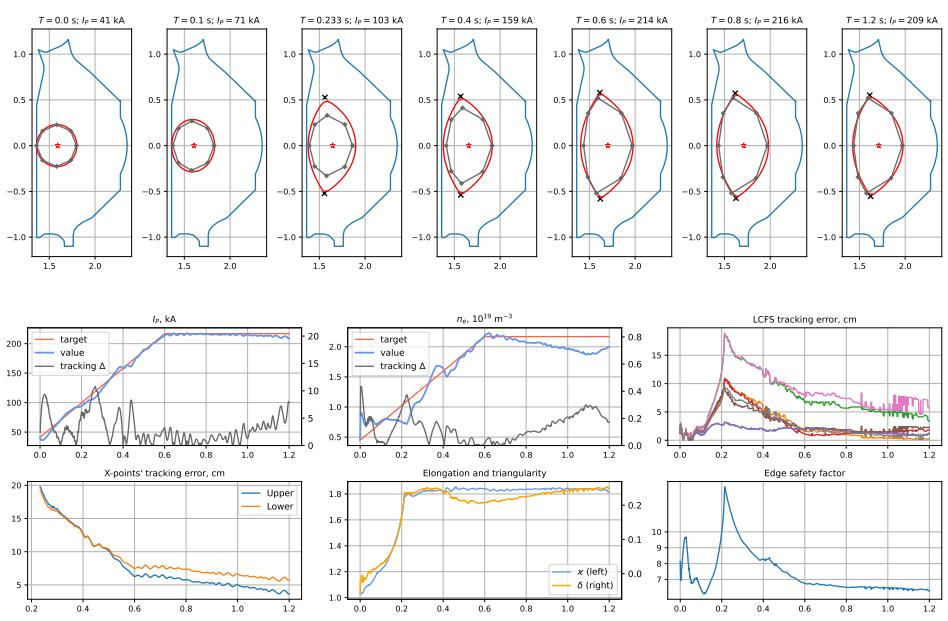  
Figure 1: Test episode with a low-current target: $I _ { p } ^ { \mathrm { t } } = 2 1 7$ kA, $\bar { n } _ { e } ^ { \mathrm { t } } = 2 . 2 \times$ $1 0 ^ { \overset { \sim } { 1 } 9 } \mathrm { ~ m ~ } ^ { - 3 }$ , a = 0.27 m, $\varkappa = 1 . 9 5$ , targets reached at 0.6 s. The plasma is diverted at 0.21 s and held to the end of the episode.

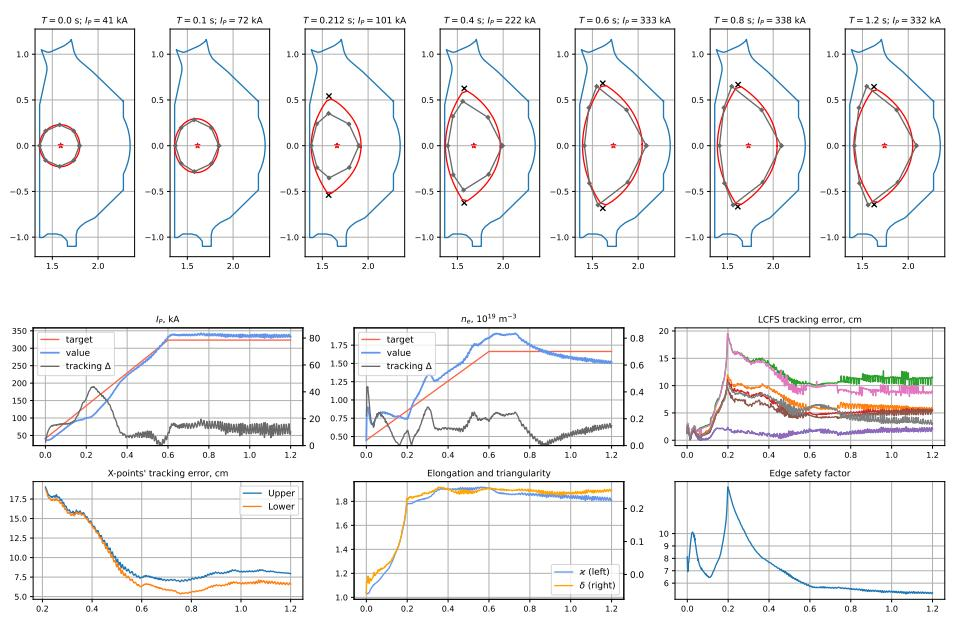  
Figure 2: Test episode with a high-current, low-density target: $I _ { p } ^ { \mathrm { t } } = 3 2 3 \ \mathrm { k A }$ $\bar { n } _ { e } ^ { \mathrm { t } } = 1 . 7 \times 1 0 ^ { 1 9 } \ \mathrm { m } ^ { - 3 } , \ a = 0 . 3 4$ m, $\varkappa = 1 . 9 2$ . The plasma is diverted at 0.20 s and held to the end of the episode; the current settles 13 kA above its target.

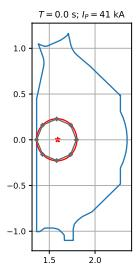

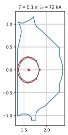

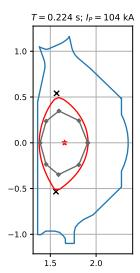

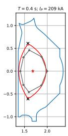

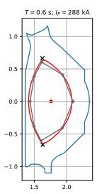

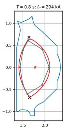

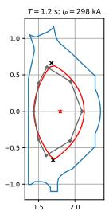

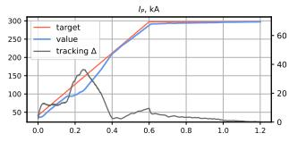

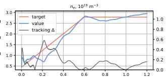

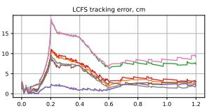

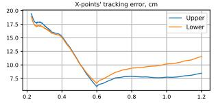

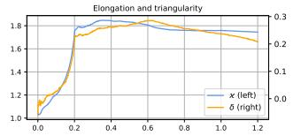

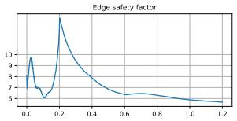  
Figure 3: Test episode with a high-current, high-density target, the target relevant to the long-pulse targets: $I _ { p } ^ { \mathrm { t } } = 2 9 7 \mathrm { k A } , \bar { n } _ { e } ^ { \mathrm { t } } = 2 . 8 { \times } 1 0 ^ { 1 9 } \mathrm { m } ^ { - 3 } , a = 0 . 3 3 \mathrm { m }$ $\varkappa = 1 . 8 3$ . The plasma is diverted at 0.20 s and held to the end of the episode at a Greenwald fraction of 0.36.

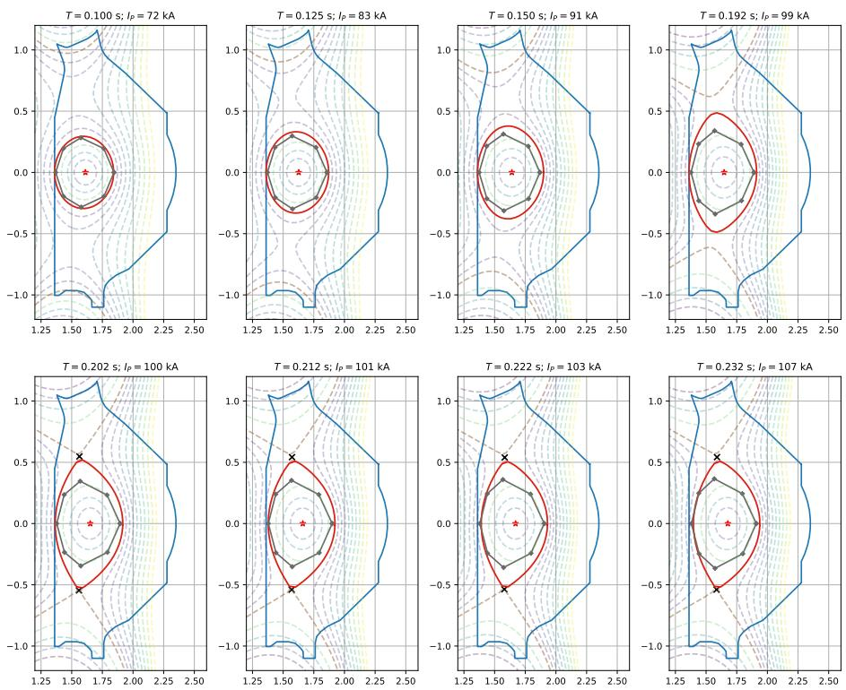  
Figure 4: The evolution of plasma around limited to diverted mode transition

## 4.2 Wall disconnect optimization

As discussed earlier, the transition to the diverted configuration is highly rewarded. This makes the other reward components more loose around the transition (except those accompanied with termination criteria). In the observed behavior the model elongates the plasma much faster than piecewise linear ramp-up stipulates (Figure 4) The model demonstrates the similar plasma evolution around the transition with much higher elongation as the target requests and larger plasma volume. This behavior shows up in almost all the model checkpoints with various hyperparameters and random seeds. We argue, that the model optimizes the smoothness of the transition and the plasma stability. This may require a special shape.

Table 2: Test on 1024 Sobol scenarios, by target plasma current.
<table><tr><td></td><td colspan="4">n divertor formed  ${ \mathrm { h e l d } } \geq 0 . 1 ~ \mathrm { s }$   $\mathrm { h e l d } \geq 0 . 5 ~ \mathrm { s }$ </td></tr><tr><td> $I _ { p } ^ { \mathrm { t } }$  200–250 kA</td><td>341</td><td>1.00 0.98</td><td>0.85</td><td>0.73</td></tr><tr><td>rp 250–300 kA</td><td>341</td><td>0.98 0.95</td><td>0.84</td><td>0.74</td></tr><tr><td> $\hat { I _ { p } ^ { \mathrm { t } } }$  300–350 kA</td><td>342 0.59</td><td>0.38</td><td>0.33</td><td>0.28</td></tr><tr><td>all</td><td>1024 0.86</td><td>0.77</td><td>0.67</td><td>0.58</td></tr></table>

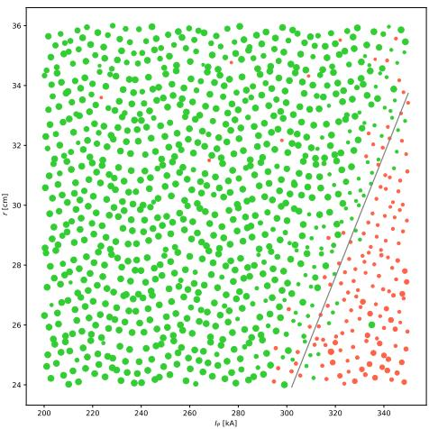  
Figure 5: Test on 1024 Sobol scenarios. Color = plasma successfully changed mode to diverted, size = episode length (the majority of simulations lasted full 1200 steps)

## 4.3 Estimating the area of expertise

To test the controller and determine its capabilities we have run an extensive test with 1024 diferent targets (shape, $I _ { P }$ and $n _ { e } )$ . We sampled space-filling set of scenarios from a low-discrepancy scrambled Sobol sequence in the 11- dimensional parameters space (the four squarenesses, $I _ { p } , \bar { n } _ { e } , R _ { \mathrm { i n } } , R _ { x 1 } , R _ { x 2 }$ , a and κ), with every target reached at 0.6 s. Each scenario is run once with the deterministic policy, and we recorded the episode length, the time spent in the diverted phase, the termination reason and the full state history. A scenario is considered successful (binary metric) if it reached the diverted mode. We’ve got 876 (85.5%) success episodes: Table 2.

The combination of target plasma current and minor radius is by far the dominant predictor of success (Figure 5). The discharge is likely successful if $r > 0 . 2 0 4 4 8 \cdot I _ { P } - 3 7 . 8 3 \ : ( I _ { P }$ is in kA, r is in cm).

## 5 Discussion, Possible Next Steps and Applications

We have shown that a single goal-conditioned RL controller can execute an EAST ramp-up scenario in a free-boundary equilibrium plus transport simulator from a small limited plasma to a held double-null configuration, tracking sampled current, shape targets and electron density by a single controller, and that it does so for a large majority of the scenarios in an 11-dimensional target space. The controller is a complete closed-loop scenario executor: given the target waveforms it produces coil-current and fueling commands at 1 kHz with no scenario-specific tuning, and its test over the target space gives the scenario designer a map of what is reachable—here, that everything below 300 kA in a 0.6 s ramp is reliably reachable.

The limitations include the control quality. It is adequate for the scenario design, but not directly applicable to the real time control. However the control quality can be improved with longer training and more aggressive margins. For example, x-point accuracy is about 8 cm and the current accuracy is ≈ 10 kA during the flat-top in some regimes. A conventional controller in a Plasma Control System can achieve a better performance.

An optimization procedure run on top of this controller (ML or not) may produce a higher level controller which can reach more high-level plasma performance metrics. Ultimately, the simulator can be coupled with heating controller and target the energy gain.

## References

[1] Yong-Su Na et al 2025 Integrated operation scenarios: Chapter 6 of the special issue on the path to tokamak burning plasma operation Nucl. Fusion 65 093001

[2] Humphreys D et al 2015 Novel aspects of plasma control in ITER Phys. Plasmas 22 021806

[3] De Tommasi G 2019 Plasma magnetic control in tokamak devices J. Fusion Energy 38 406–36

[4] Degrave J et al 2022 Magnetic control of tokamak plasmas through deep reinforcement learning Nature 602 414–9

[5] Subbotin G F, Sorokin D I et al 2026 Demonstration of reconstruction-free static magnetic control of DIII-D plasma with deep reinforcement learning Nucl. Fusion 66 026040

[6] Sorokin D I et al 2026 Dynamic plasma shape control with arbitrary sensor subsets arXiv:2605.15935

[7] Zhang Y et al 2026 Isoflux plasma shape control under large transient disturbances on EAST via reinforcement learning Nucl. Fusion 66 086012

[8] Magnetic control of HL-3 through deep reinforcement learning 2024 arXiv:2409.09238

[9] Ding Y et al 2026 Advantage-level aggregation reinforcement learning for x-point target magnetic configuration control in an EXL-50U experimentcalibrated simulation environment arXiv:2608.20834

[10] Guo X et al 2026 State-space model-enabled reinforcement learning for magnetic configuration control on EXL-50U arXiv:2608.21737

[11] Seo J et al 2021 Feedforward beta control in the KSTAR tokamak by deep reinforcement learning Nucl. Fusion 61 106010

[12] Seo J et al 2022 Development of an operation trajectory design algorithm for control of multiple 0D parameters using deep reinforcement learning in KSTAR Nucl. Fusion 62 086049

[13] Wakatsuki T, Yoshida M, Narita E, Suzuki T and Hayashi N 2023 Simultaneous control of safety factor profile and normalized beta for JT-60SA using reinforcement learning Nucl. Fusion 63 076017

[14] Seo J et al 2024 Avoiding fusion plasma tearing instability with deep reinforcement learning Nature 626 746–51

[15] Wang A et al 2025 Learning plasma dynamics and robust rampdown trajectories with predict-first experiments at TCV arXiv:2502.12327

[16] Clark R, Nurgaliev M, Khayrutdinov E et al 2025 Validation of NSFsim as a Grad–Shafranov equilibrium solver at DIII-D Fusion Eng. Des. 211 114765

[17] Haarnoja T, Zhou A, Abbeel P and Levine S 2018 Soft actor-critic: ofpolicy maximum entropy deep reinforcement learning with a stochastic actor Proc. 35th Int. Conf. on Machine Learning (ICML)

[18] Kuznetsov A, Shvechikov P, Grishin A and Vetrov D 2020 Controlling overestimation bias with truncated mixture of continuous distributional quantile critics Proc. 37th Int. Conf. on Machine Learning (ICML)

## A Observations

Table 3: Inputs of the policy network (109 values). “ofset” means the quantity is given as achieved minus target; “derivative” means its one-step finite diference is appended. The critic receives the same inputs plus actions.
<table><tr><td>Input</td><td>Size</td><td>Form</td></tr><tr><td>Goal: target centre, 8 boundary points,  $I _ { p } , \bar { n } _ { e }$ </td><td>20</td><td>raw</td></tr><tr><td>Plasma current</td><td>1</td><td>raw, derivative</td></tr><tr><td>Coil currents (13 coils)</td><td>13</td><td>raw, derivative</td></tr><tr><td>Boundary points (8, R and Z)</td><td>16</td><td>offset, derivative</td></tr><tr><td>Limiter contact point</td><td>2</td><td>raw</td></tr><tr><td>Lower and upper x-point</td><td>4</td><td>offset</td></tr><tr><td>Diverted flag</td><td>1</td><td>raw</td></tr><tr><td>Flux imbalance between nulls  $\psi _ { x 1 } - \psi _ { x 2 }$ </td><td>1</td><td>raw</td></tr><tr><td>Separatrix flux</td><td>1</td><td>raw</td></tr><tr><td>Normalised flux at the 8 target boundary points</td><td>8</td><td>raw</td></tr><tr><td> $\ell _ { i } , q _ { \mathrm { a x i s } } , q _ { \mathrm { e d g e } } , \beta _ { N }$ </td><td>4</td><td>raw</td></tr><tr><td>Loop voltage, plasma resistance</td><td>2</td><td>raw</td></tr><tr><td>Average electron and ion temperature</td><td>2</td><td>raw</td></tr><tr><td>Line-averaged density</td><td>1</td><td>offset</td></tr><tr><td>Fueling level</td><td>1</td><td>raw</td></tr><tr><td>Instability growth increment, VDE estimate</td><td>2</td><td>raw</td></tr></table>

## B Reward components

Table 4: Reward components of the EAST ramp-up task with the margin γ of their Lorentzian transform (the error at which the component is worth one half). All components have unit weight in the smooth minimum of equation (2). Phase membership: L = limited, D = diverted.
<table><tr><td>Component</td><td>Error d</td><td>γ</td><td>Phase</td></tr><tr><td>plasma current</td><td> $| I _ { p } - I _ { p } ^ { \mathrm { t } } |$ </td><td> $5 0 ~ \mathrm { k A }$ </td><td> $\mathrm { L } , \mathrm { D }$ </td></tr><tr><td>density</td><td> $| \bar { n } _ { e } - \bar { n } _ { e } ^ { \mathrm { t } } |$ </td><td> $2 . 0 \times 1 0 ^ { 1 9 } ~ \mathrm { m ^ { - 3 } }$ </td><td> $\mathrm { L } , \mathrm { D }$ </td></tr><tr><td>centre</td><td> $\| C - C ^ { \mathrm { t } } \|$ </td><td> $0 . 1 5 \mathrm { ~ m ~ }$ </td><td> $\mathrm { L } , \mathrm { D }$ </td></tr><tr><td>boundary shape</td><td> $\begin{array} { r } { \mathrm { s o f t m a x } _ { i } \| p _ { i } - p _ { i } ^ { \mathrm { t } } \| \ ( 8 \mathrm { p o i n t s } , } \end{array}$  relative to the centre)</td><td>0.6 m</td><td> $\mathrm { L } , \mathrm { D }$ </td></tr><tr><td>flux at target points</td><td> $\mathrm { s o f t m a x } _ { i } | \psi _ { N } ( p _ { i } ^ { \mathrm { t } } ) - 1 |$ </td><td>0.5</td><td> $\mathrm { L } , \mathrm { D }$ </td></tr><tr><td>limiter contact height</td><td> $| Z _ { \mathrm { l i m } } - Z ^ { \mathrm { t } } |$ </td><td>0.3 m</td><td> $\mathrm { L }$ </td></tr><tr><td>lower  $/$  upper x-point</td><td> $\| x _ { 1 , 2 } - x _ { 1 , 2 } ^ { \mathrm { t } } \|$ </td><td>0.3 m</td><td>D</td></tr><tr><td>double-null balance</td><td> $| \psi _ { x 1 } - \psi _ { x 2 } |$ </td><td>0.3</td><td>D</td></tr><tr><td>CS current spread</td><td> $\Delta I _ { \mathrm { C S } } ( t ) - \Delta I _ { \mathrm { C S } } ( 0 )$ </td><td>9 kA</td><td> $\mathrm { L } , \mathrm { D }$ </td></tr><tr><td>IC current PF current limits</td><td> $| I _ { \mathrm { I C } } |$   $\operatorname* { m a x } _ { c } | I _ { c } | / I _ { c } ^ { \operatorname* { m a x } }$  , piecewise:</td><td>5 kA</td><td> $\mathrm { L } , \mathrm { D }$ </td></tr><tr><td></td><td>up to  $9 5 \%  1 ; \ 1 0 0 \% $ </td><td></td><td></td></tr><tr><td></td><td>0.05; 95% to 100% linear</td><td></td><td> $\mathrm { L } , \mathrm { D }$ </td></tr></table>

## C Termination conditions

Table 5: Termination conditions by phase. The episode ends on the first condition that holds; its name is recorded as the termination reason.
<table><tr><td>Condition</td><td>Threshold</td><td>Phase</td></tr><tr><td>current tracking</td><td> $| I _ { p } - I _ { p } ^ { \mathrm { t } } | > 5 0 \ \mathrm { k A }$ </td><td> $\mathrm { L } , \mathrm { D }$ </td></tr><tr><td>current collapse</td><td> $I _ { p } < 2 \bar { 0 } \ \mathrm { k A }$ </td><td> $\mathrm { L }$ </td></tr><tr><td>minor radius</td><td> $a < 0 . 2 \mathrm { ~ m ~ }$ </td><td> $\mathrm { L } , \mathrm { D }$ </td></tr><tr><td>edge safety factor</td><td> $q _ { \mathrm { e d g e } } < 2$ </td><td> $\mathrm { L } , \mathrm { D }$ </td></tr><tr><td>CS current spread</td><td> $\mathrm { g r o w t h } > 9 . 5 ~ \mathrm { k A }$ </td><td> $\mathrm { L } , \mathrm { D }$ </td></tr><tr><td>boundary shape</td><td> $\operatorname* { m a x } _ { i } \| p _ { i } - p _ { i } ^ { \mathrm { t } } \| > 0 . 2$  m</td><td> $\mathrm { L } , \mathrm { D }$ </td></tr><tr><td>wall contact outside the inner wall</td><td> $R _ { \mathrm { l i m } } > 1 . 5 ~ \mathrm { m }$ </td><td> $\mathrm { L }$ </td></tr><tr><td>loss of divertor</td><td></td><td>D</td></tr><tr><td>x-point tracking</td><td> $\| x _ { 1 , 2 } - x _ { 1 , 2 } ^ { \mathrm { t } } \| > 0 . 2 \mathrm { ~ m ~ }$ </td><td>D</td></tr><tr><td>double-null imbalance</td><td> $| \psi _ { x 1 } - \psi _ { x 2 } | > 0 . 1$ </td><td>D</td></tr><tr><td>time limit (truncation)</td><td> $t \geq 1 . 2 ~ \mathrm { s }$ </td><td> $\mathrm { L } , \mathrm { D }$ </td></tr></table>

## D Hyperparameters

Table 6: Agent and training hyperparameters.
<table><tr><td>Algorithm</td><td>SAC objective, TQC critic, automatic entropy tuning of the pooled 75</td></tr><tr><td>Critics / quantiles per critic / atoms dropped</td><td> $3 ~ / ~ 2 5 ~ / ~ 3$ </td></tr><tr><td>Networks</td><td> $\mathrm { M L P ~ 2 5 6 \times 2 5 6 , \mathrm { S i L U } }$ </td></tr><tr><td>Input normalisation</td><td>running Welford statistics</td></tr><tr><td>Actor input / output</td><td>109 / 10 (9 coil-current changes, 1 fueling change)</td></tr><tr><td>Critic input</td><td>109 observations + 10 actions</td></tr><tr><td>Auxiliary head Discount γ / Polyak τ</td><td>6 shape scalars, mean-squared loss, weight 0.1  $0 . 9 9 \mathrm { ~ / ~ } 0 . 0 0 5$ </td></tr><tr><td>Learning rates (actor, critic, temperature)</td><td> $3 \times 1 0 ^ { - 5 }$ </td></tr><tr><td>Batch / replay size</td><td> $1 0 2 4 / 1 0 ^ { 6 }$ </td></tr><tr><td>Gradient updates per simulator step</td><td>1</td></tr><tr><td>Training budget</td><td> $4 \times 1 0 ^ { 6 }$  updates</td></tr><tr><td>Simulator instances</td><td>50</td></tr><tr><td>Control step / episode</td><td>1 ms / 1.2 s (1200 steps)</td></tr><tr><td>Fueling level range / change per step</td><td> $[ 5 \times 1 0 ^ { 3 } , 2 \times 1 0 ^ { 4 } ] ~ / \pm 2 5 0$ </td></tr><tr><td></td><td></td></tr></table>