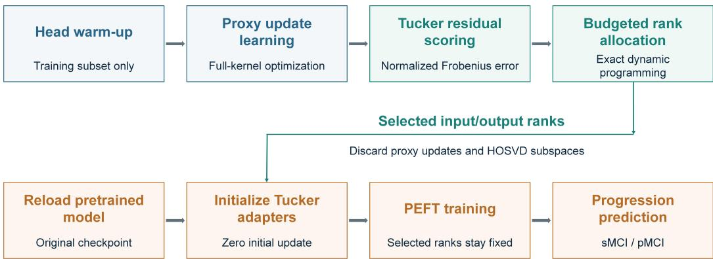
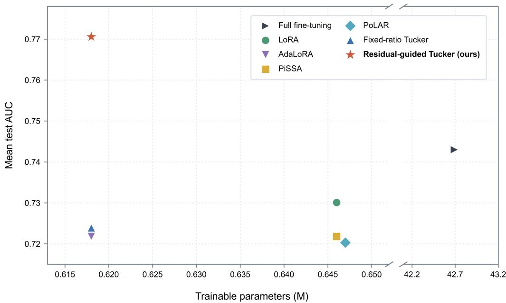
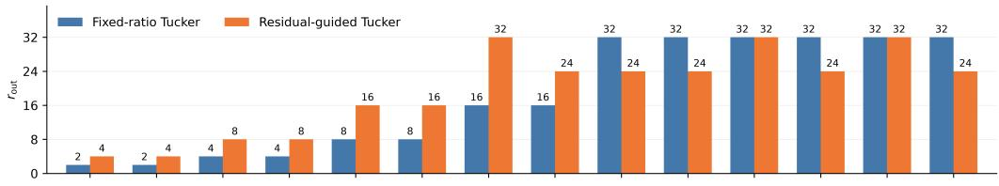
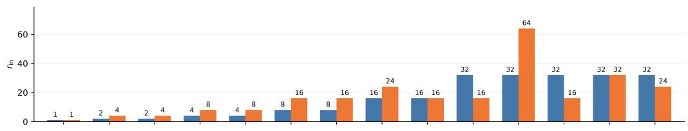
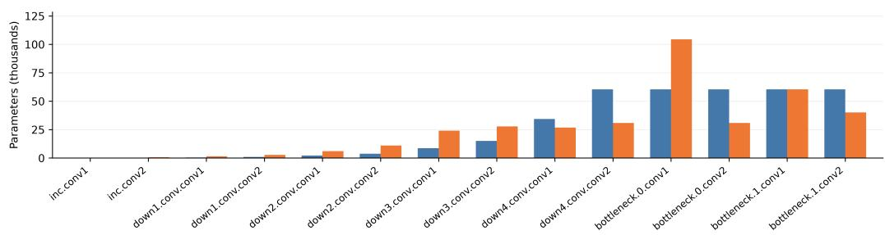

# Residual-Guided Adaptive Tucker Rank Allocation for Parameter-Eficient MCI Conversion Prediction

Guanghua Hea,b, Hancan Zhub,∗, Gaohang Yuc,∗∗, An Zhanga, for the Alzheimer’s Disease Neuroimaging Initiative1

aDepartment of Mathematics, Hangzhou Dianzi University, Hangzhou, 310018, China bSchool of Mathematics, Physics and Information, Shaoxing University, Shaoxing, 312000, China

cDepartment of Mathematics, Zhejiang University of Science and Technology, Hangzhou, 310023, China

## Abstract

Allocating limited trainable capacity across convolutional layers is a central challenge in parameter-eficient fine-tuning (PEFT) of pretrained threedimensional (3D) networks. We propose Residual-Guided Adaptive Tucker Rank Allocation, which jointly selects input- and output-channel ranks under a fixed adapter-parameter budget while preserving the spatial kernel modes. To guide rank selection, we learn task-specific proxy updates from downstream training data and approximate them using candidate Tucker rank pairs. A perturbation analysis bounds the output discrepancy between the fixed proxy network and its Tucker approximation in terms of layerwise reconstruction residuals, motivating residual-based allocation. We normalize each squared residual by the corresponding proxy-update energy to compare relative approximation errors across layers. Dynamic programming minimizes their sum under a global budget constraint that accounts for both channel factors and

the Tucker core. This yields a globally optimal allocation over the specified candidate rank pairs. We evaluate the method on the Alzheimer’s Disease Neuroimaging Initiative (ADNI) cohort for predicting conversion from mild cognitive impairment to Alzheimer’s disease within 36 months, using hippocampal segmentation pretraining. Across five random seeds, the proposed method achieves a mean area under the receiver operating characteristic curve (AUC) of 0.7706, compared with 0.7239 for fixed-ratio Tucker adaptation and 0.7430 for full fine-tuning. The total number of trainable parameters is limited to approximately 0.618 million, accounting for only 1.45% of the full model. Adaptive Tucker rank allocation thus provides an efective approach to parameter-eficient transfer learning in 3D medical imaging.

Keywords: parameter-eficient fine-tuning, Tucker decomposition, adaptive rank allocation, budget-constrained optimization, 3D convolution, medical image transfer learning

## 1. Introduction

Adapting pretrained three-dimensional (3D) networks to small labeled cohorts is an important problem in medical image analysis. Volumetric pretraining can provide useful anatomical representations, as demonstrated by Med3D and Models Genesis [1, 2]. However, these representations must be adapted when the downstream objective difers from the pretraining task. For example, hippocampal segmentation provides local anatomical supervision, whereas predicting conversion from mild cognitive impairment (MCI) to Alzheimer’s disease (AD) requires subject-level information relevant to a future clinical outcome [3, 4]. The challenge is to learn progression-related representations from limited labeled data while updating only a small fraction of the pretrained network’s parameters.

Parameter-eficient fine-tuning (PEFT) reduces the number of trainable parameters by retaining a largely frozen backbone and optimizing a small set of task-specific parameters. Bottleneck adapters and Low-Rank Adaptation (LoRA) are representative approaches [5, 6], with medical-imaging studies demonstrating their applicability to data-limited transfer [7, 8]. Beyond choosing an adapter parameterization, a key design question is how to distribute trainable capacity across layers. AdaLoRA, Explained Variance Adaptation (EVA), and GoRA address this question through importance scores, activation statistics, or gradients that guide matrix-rank allocation [9, 10, 11]. These approaches incorporate task information into capacity allocation, rather than determining layerwise ranks solely from parameter dimensions.

For 3D convolutional networks, capacity allocation must also account for the tensor structure of the adapted kernels. Each kernel has distinct input-channel, output-channel, and spatial modes. Matrix unfolding preserves its entries, but a single matrix-rank constraint does not separately specify the ranks of the two channel modes. Tensor-based PEFT methods, including FLoRA, ofer parameterizations that retain multidimensional update structure [12]. In channel-mode Tucker adaptation, input- and output-channel ranks can be selected independently while the spatial kernel dimensions remain unchanged. However, the product of these ranks determines the channel dimensions of the shared core, coupling their parameter costs. Rank allocation therefore requires evaluating the approximation quality and cost of each rank pair under a global budget. Fixed-ratio allocation sets both ranks from channel dimensions, without assessing how well the resulting capacity represents a downstream task-specific update.

We address this limitation with Residual-Guided Adaptive Tucker Rank Allocation, hereafter referred to as residual-guided Tucker. The method uses normalized reconstruction residuals of task-specific proxy updates learned from downstream training data to guide joint input- and output-channel rank selection. A perturbation analysis bounds the output discrepancy between the fixed proxy network and its Tucker approximation in terms of layerwise reconstruction errors, providing theoretical support for residualbased allocation. Dynamic programming minimizes the sum of normalized residuals under a fixed adapter-parameter budget. We evaluate the method by transferring an encoder pretrained for hippocampal segmentation to 36- month MCI conversion prediction on the Alzheimer’s Disease Neuroimaging Initiative (ADNI) cohort [13]. Comparisons with fixed-ratio Tucker and other PEFT baselines, together with ablation studies, assess predictive performance, parameter eficiency, and the role of the allocation criterion.

The main contributions are as follows:

1. Task-conditioned Tucker rank allocation. We formulate joint inputand output-channel rank selection for additive 3D Tucker adapters under a global parameter budget. Normalized reconstruction residuals of downstream proxy updates guide allocation, with exact parameter costs accounting for both channel factors and their shared core.

2. Theoretical support and exact optimization. We relate layerwise reconstruction errors to an output-perturbation bound for the fixed proxy network, providing a theoretical basis for residual-based allocation. Dynamic programming yields a globally optimal solution over the specified discrete candidate rank pairs.

3. Evaluation of segmentation-to-progression transfer. We evaluate the method on ADNI for MCI conversion prediction using hippocampal segmentation pretraining. Comparisons and ablations examine the efects of rank allocation and residual normalization. On the evaluated split, residual-guided Tucker achieves a higher mean area under the receiver operating characteristic curve (AUC) than fixed-ratio Tucker under the same adapter-budget ceiling.

## 2. Related Work

## 2.1. MRI-based progression prediction and medical transfer learning

Magnetic resonance imaging (MRI) research on Alzheimer’s disease encompasses diagnostic classification [14] and the prediction of future clinical progression. Basaia et al. investigate AD classification and MCI conversion prediction from a single MRI [15], whereas Spasov et al. combine imaging and non-imaging inputs in a compact multitask model for conversion prediction [4]. Alongside these predictive models, anatomical supervision has been explored for learning disease-related representations. Liu et al. integrate hippocampal segmentation with AD-related classification, connecting regional anatomical features with subject-level diagnostic prediction [3].

Volumetric pretraining provides representations that can be transferred to downstream medical imaging tasks. Med3D learns from segmentation supervision, while Models Genesis uses self-supervised restoration to learn transferable 3D features [1, 2]. Building on pretrained representations, medical PEFT studies investigate adaptation with a limited number of trainable parameters [7, 16]. Med-Tuning extends this direction to volumetric segmentation through an eficient tuning framework [8].

## 2.2. Low-rank adaptation, initialization, and rank allocation

Evidence that pretrained language models can be fine-tuned within lowdimensional parameter subspaces supports the development of compact adaptation methods [17]. Bottleneck adapters introduce trainable feature transformations, whereas LoRA represents additive weight updates as products of two low-rank factors [5, 6]. Subsequent work refines the parameterization and initialization of these updates. DoRA separates weight magnitude from direction [18], while PoLAR introduces a polar-inspired representation and optimization scheme [19]. PiSSA initializes adaptation from principal singular components of pretrained weights [20]. LoRA-GA instead uses downstream gradients to align the initial low-rank update direction with the full-fine-tuning gradient [21].

Rank allocation determines how adaptation capacity is distributed across layers under a parameter budget. AdaLoRA adjusts ranks by pruning singular components according to estimated importance [9]. EVA combines activationbased initialization with rank redistribution guided by explained variance [10], while GoRA uses gradient information to guide both rank allocation and initialization [11]. These methods incorporate information from model parameters, activations, or gradients into the selection of layerwise adaptation capacity.

## 2.3. Tensor-structured adaptation and budgeted approximation

Tensor-structured adapters use factorization and parameter sharing to construct compact trainable updates. Compacter employs Kronecker-based hypercomplex layers, while LoRETTA uses tensor-train parameterizations [22, 23]. FacT tensorizes vision-transformer weights and factorizes their increments into lightweight components [24]. FLoRA preserves the multidimensional structure of weight updates [12], whereas TuckA combines Tucker experts with hierarchical routing [25]. Applications to medical image segmentation include tensor CUR adaptation in tCURLoRA [26] and principal tensor singular-component tuning in LoRA-PT [27].

Tensor compression provides approximation techniques and optimization formulations relevant to rank allocation. Tucker decomposition and higherorder singular value decomposition (HOSVD) provide low-rank representations along individual tensor modes [28, 29]. Kim et al. apply Tucker decomposition to convolutional kernels [30], while ADA-Tucker explores adaptable tensorization through dimension adjustment [31]. BATUDE incorporates Tucker rank selection into budget-constrained compression [32]. ROCKET combines reconstruction-error criteria with a multiple-choice knapsack formulation and dynamic programming for layerwise compression [33].

Our method formulates task-conditioned Tucker rank allocation as a budget-constrained approximation problem for downstream proxy updates. Normalized reconstruction residuals quantify the relative approximation error of each candidate rank pair, while exact parameter costs capture the coupling between the two channel ranks. This formulation connects task-specific update structure with joint rank selection for 3D convolutional adapters, while preserving the spatial kernel dimensions.

## 3. Method

## 3.1. Overview and notation

Figure 1 outlines the three stages of residual-guided Tucker. First, calibration using only training data estimates task-specific proxy updates for the selected convolutional kernels. Second, candidate Tucker rank pairs are evaluated by normalized reconstruction residuals and jointly selected under a global adapter-parameter budget. Finally, PEFT training starts from the original pretrained checkpoint with newly initialized adapters at the selected ranks.

Let $\ell \in \{ 1 , \ldots , L \}$ index the adapted layers and $q$ index the candidate rank pairs within each layer. The rank pair for layer ℓ is $\pmb { r } _ { \ell } = ( r _ { \mathrm { o u t } , \ell } , r _ { \mathrm { i n } , \ell } )$ and $\pmb { r } = ( \pmb { r } _ { 1 } , \dots , \pmb { r } _ { L } )$ denotes the network-wide rank configuration. For the pretrained kernel $\mathcal { W } _ { \ell }$ , we distinguish the trainable adapter update $\Delta { \boldsymbol { \nu } _ { \ell } }$ from the calibrated proxy update $\Delta { \mathcal { W } _ { \ell } ^ { \mathrm { p r o x y } } }$ . Both have the same dimensions as $\begin{array} { r } { \mathcal { W } _ { \ell } , } \end{array}$ but the proxy update is held fixed during rank selection and serves as the approximation target in the analysis. We denote the tensor Frobenius norm by $\| \cdot \| _ { F }$ , the Euclidean norm of vectorized features or logits by $\| \cdot \| _ { 2 }$ , and the operator norm induced by the Euclidean norm by $\| \cdot \| _ { \mathrm { o p } } .$

## 3.2. Channel-mode Tucker adaptation and parameter budget

For each adapted layer ℓ, the pretrained convolutional kernel is

$$
\mathcal { W } _ { \ell } \in \mathbb { R } ^ { C _ { \mathrm { o u t } , \ell } \times C _ { \mathrm { i n } , \ell } \times k _ { \ell , 1 } \times k _ { \ell , 2 } \times k _ { \ell , 3 } } ,
$$

with spatial volume $K _ { \ell } = k _ { \ell , 1 } k _ { \ell , 2 } k _ { \ell , 3 }$ . We parameterize its additive update using a channel-mode Tucker decomposition, retaining the original spatial dimensions:

$$
\Delta \mathcal { W } _ { \ell } = \mathcal { G } _ { \ell } \times _ { 1 } U _ { \mathrm { o u t } , \ell } \times _ { 2 } U _ { \mathrm { i n } , \ell } ,\tag{1}
$$

where $\times _ { n }$ denotes the mode-n tensor–matrix product,

$$
\begin{array} { r } { U _ { \mathrm { o u t } , \ell } \in \mathbb { R } ^ { C _ { \mathrm { o u t } , \ell } \times r _ { \mathrm { o u t } , \ell } } , \qquad U _ { \mathrm { i n } , \ell } \in \mathbb { R } ^ { C _ { \mathrm { i n } , \ell } \times r _ { \mathrm { i n } , \ell } } , } \end{array}
$$

Table 1: Main notation for residual-guided Tucker allocation.
<table><tr><td>Symbol</td><td>Meaning</td></tr><tr><td> $w _ { \ell } , \Delta w _ { \ell }$ </td><td>Pretrained kernel and trainable adapter update at layer  $\ell$ </td></tr><tr><td> $\Delta { \mathcal { W } _ { \ell } ^ { \mathrm { p r o x y } } }$ </td><td>Calibration-induced kernel update, held fixed during rank allocation</td></tr><tr><td> $r _ { \ell } , r _ { \ell , q }$   $r , \mathcal { R }$ </td><td>Channel-rank pair at layer  $\ell$  and its qth candidate pair Network-wide rank configuration and Cartesian product</td></tr><tr><td> $\mathcal { H } _ { s } ( \mathcal { X } )$ </td><td>of layerwise candidate sets Channel-mode HOSVD approximation of  $\mathcal { X }$  at rank</td></tr><tr><td> $\mathcal { E } _ { \ell } ( r _ { \ell } ) , \mathcal { E } _ { \ell , q }$ </td><td>pair s Proxy-update reconstruction residual tensor and its candidate-indexed form</td></tr><tr><td> $Z _ { \ell }$ </td><td>Proxy-update energy,  $\| \Delta \mathcal { W } _ { \ell } ^ { \mathrm { p r o x y } } \| _ { F } ^ { 2 }$ </td></tr><tr><td> $d _ { \ell , q }$ </td><td>Normalizedsquared reconstructionresidual,  $\| \mathcal { E } _ { \ell , q } \| _ { F } ^ { 2 } / \operatorname* { m a x } ( Z _ { \ell } , \varepsilon )$ </td></tr><tr><td> $S _ { \ell , q }$ </td><td>Candidate allocation score;  $S _ { \ell , q } = d _ { \ell , q }$  for the proposed method</td></tr><tr><td> $p _ { \ell , q } , B _ { \mathrm { a d p } }$ </td><td>Candidate adapter-parameter cost and total adapter- budget ceiling</td></tr><tr><td> $\kappa \ell ^ { } ( x ) , \bar { \kappa } \ell$ </td><td>Layerwise output-perturbation coefficient and its root- mean-square value over inputs</td></tr><tr><td> $C$ </td><td>Rank-independent coefficient in the normalized-residual perturbation bound</td></tr></table>

and

$$
\mathcal { G } _ { \ell } \in \mathbb { R } ^ { r _ { \mathrm { o u t } , \ell } \times r _ { \mathrm { i n } , \ell } \times k _ { \ell , 1 } \times k _ { \ell , 2 } \times k _ { \ell , 3 } } .
$$

The adapted kernel is $\mathcal { W } _ { \ell } + \Delta \mathcal { W } _ { \ell }$ , with $\mathcal { W } _ { \ell }$ frozen during PEFT. The integer channel ranks satisfy $1 \leq r _ { \mathrm { o u t } , \ell } \leq C _ { \mathrm { o u t } , \ell }$ and $1 \leq r _ { \mathrm { i n } , \ell } \leq C _ { \mathrm { i n } , \ell }$ . They determine the factor widths and bound the corresponding mode-unfolding ranks of the update, which may be lower.

The two channel factors and the Tucker core contain

$$
p _ { \ell } ( \pmb { r } _ { \ell } ) = C _ { \mathrm { o u t } , \ell } r _ { \mathrm { o u t } , \ell } + C _ { \mathrm { i n } , \ell } r _ { \mathrm { i n } , \ell } + K _ { \ell } r _ { \mathrm { o u t } , \ell } r _ { \mathrm { i n } , \ell }\tag{2}
$$

trainable parameters. This expression counts all stored factor and core entries, rather than the intrinsic degrees of freedom of the represented update. The

  
Figure 1: Overview of residual-guided Tucker. Task-specific proxy updates provide normal ized reconstruction residuals for joint input- and output-channel rank allocation under a fixed adapter-parameter budget. Final PEFT training starts from the original pretrained checkpoint with adapters initialized to produce zero updates at the selected ranks.

bilinear core term couples the input- and output-channel ranks, so their parameter costs must be considered jointly. Across the adapted layers, rank selection is subject to

$$
\sum _ { \ell = 1 } ^ { L } p _ { \ell } ( \pmb { r } _ { \ell } ) \leq B _ { \mathrm { a d p } } ,\tag{3}
$$

where $B _ { \mathrm { a d p } }$ is the total adapter-parameter budget.

The total trainable parameter count additionally includes the common components trained by all compared adapter methods. Their contribution is fixed across these methods and is specified in Section 4.3.

## 3.3. Proxy calibration and residual scoring

We draw a class-balanced calibration subset $\mathcal { D } _ { \mathrm { c a l } }$ from the downstream training partition. The classification head is first warmed up with the encoder frozen, allowing it to adapt to the pretrained representation before kernel calibration.

We then hold all other model parameters fixed and optimize the selected full convolutional kernels for $T _ { \mathrm { p } }$ steps. The resulting displacement for layer ℓ is

$$
\Delta \mathcal { W } _ { \ell } ^ { \mathrm { p r o x y } } = \mathcal { W } _ { \ell } ^ { ( T _ { \mathrm { p } } ) } - \mathcal { W } _ { \ell } ^ { ( 0 ) } .\tag{4}
$$

Here ${ \mathcal W } _ { \ell } ^ { ( t ) }$ denotes the kernel after t calibration steps, with $\mathcal { W } _ { \ell } ^ { ( 0 ) } = \mathcal { W } _ { \ell }$ . The displacements provide task-conditioned references for rank scoring, without assuming convergence to optimal downstream updates. They are held fixed during candidate evaluation. Calibration settings are given in Section 4.4.

Channel-mode approximation. To evaluate candidate ranks, we approximate each proxy update along its two channel modes. Let X denote the proxy update $\Delta { \mathcal { W } _ { \ell } ^ { \mathrm { p r o x y } } }$ at a given layer. Choose orthonormal left-singular bases of its output- and input-channel unfoldings, ordered by nonincreasing singular values. Let $P _ { \mathrm { o u t } } ( r _ { \mathrm { o u t } } ; \mathcal { X } )$ and $P _ { \mathrm { i n } } ( r _ { \mathrm { i n } } ; \mathcal { X } )$ denote the orthogonal projectors onto the leading $r _ { \mathrm { o u t } }$ and $r _ { \mathrm { i n } }$ basis vectors, respectively. Within subspaces associated with repeated singular values, any orthonormal basis may be chosen, provided that it is held fixed across candidate ranks. For a rank pair $\pmb { s } = ( r _ { \mathrm { o u t } } , r _ { \mathrm { i n } } )$ , the channel-mode HOSVD approximation [28, 29] is

$$
\mathcal { H } _ { s } ( \mathcal { X } ) = \mathcal { X } \times _ { 1 } P _ { \mathrm { o u t } } ( r _ { \mathrm { o u t } } ; \mathcal { X } ) \times _ { 2 } P _ { \mathrm { i n } } ( r _ { \mathrm { i n } } ; \mathcal { X } ) .\tag{5}
$$

For fixed X and s, the two mode projections commute, and their composition is an orthogonal projection with respect to the Frobenius inner product.

Normalized residual score. For a rank pair $\mathbf { \nabla } r _ { \ell } .$ , define

$$
\mathscr { E } _ { \ell } ( \pmb { r } _ { \ell } ) = \Delta \mathscr { W } _ { \ell } ^ { \mathrm { p r o x y } } - \mathscr { H } _ { r _ { \ell } } ( \Delta \mathscr { W } _ { \ell } ^ { \mathrm { p r o x y } } ) , \qquad \mathscr { Z } _ { \ell } = \| \Delta \mathscr { W } _ { \ell } ^ { \mathrm { p r o x y } } \| _ { F } ^ { 2 } .\tag{6}
$$

The normalized residual is

$$
d _ { \ell } ( \pmb { r } _ { \ell } ) = \frac { \| \mathcal { E } _ { \ell } ( \pmb { r } _ { \ell } ) \| _ { F } ^ { 2 } } { \operatorname* { m a x } ( Z _ { \ell } , \varepsilon ) } , \qquad \varepsilon > 0 .\tag{7}
$$

Orthogonality gives $\| \mathcal { E } _ { \ell } ( \boldsymbol { r } _ { \ell } ) \| _ { F } ^ { 2 } = Z _ { \ell } - \| \mathcal { H } _ { \boldsymbol { r } _ { \ell } } ( \Delta \mathcal { W } _ { \ell } ^ { \mathrm { p r o x y } } ) \| _ { F } ^ { 2 }$ , and hence $0 \leq d _ { \ell } \leq 1$ For $Z _ { \ell } \geq \varepsilon$ , the score is exactly the fraction of discarded proxy energy. Here ε is a small numerical floor. Below this floor the score is a stabilized residual, with value zero for a zero update. Normalization removes the direct energy-scale preference of an absolute residual; it does not estimate predictive importance or the fraction of task performance lost.

For candidate $r _ { \ell , q }$ , we write $\mathcal { E } _ { \ell , q } ~ = ~ \mathcal { E } _ { \ell } ( r _ { \ell , q } )$ and $d _ { \ell , q } = d _ { \ell } ( r _ { \ell , q } )$ . The allocation score is

$$
S _ { \ell , q } = d _ { \ell , q } .\tag{8}
$$

These scores compare candidate approximations on a common relative scale;   
their connection to network perturbation is established next.

## 3.4. Approximation analysis

Although channel-mode HOSVD does not necessarily yield the best approximation at prescribed ranks, its reconstruction error admits a bound in terms of the unfolding singular values.

Lemma 1 (Channel-truncated HOSVD residual). Let $\{ \sigma _ { \mathrm { o u t } , i } \}$ and $\{ \sigma _ { \mathrm { i n } , j } \}$ denote the singular values of the output- and input-channel unfoldings of X. Then

$$
\left\| \mathcal { X } - \mathcal { H } _ { ( r _ { \mathrm { o u t } } , r _ { \mathrm { i n } } ) } ( \mathcal { X } ) \right\| _ { F } ^ { 2 } \leq \sum _ { i > r _ { \mathrm { o u t } } } \sigma _ { \mathrm { o u t } , i } ^ { 2 } + \sum _ { j > r _ { \mathrm { i n } } } \sigma _ { \mathrm { i n } , j } ^ { 2 } .\tag{9}
$$

The proof is given in Appendix Appendix A. The proposed allocator uses the actual HOSVD reconstruction residual, while Eq. (9) provides its approximation-theoretic interpretation.

Consider a fixed calibration run with finite candidate sets $\mathcal { R } _ { \ell }$ and $\mathcal { R } =$ $\Pi _ { \ell = 1 } ^ { L } \mathcal { R } _ { \ell }$ . Let $f ^ { \mathrm { p r o x y } }$ denote the evaluation-mode network with kernels $\mathcal { W } _ { \ell } +$ $\Delta { \mathcal { W } _ { \ell } ^ { \mathrm { p r o x y } } }$ . For $\boldsymbol { r } \in \mathcal { R }$ , let $\widehat { f } _ { r }$ denote the network obtained by replacing each proxy update with $\mathcal { H } _ { r _ { \ell } } ( \Delta \mathcal { W } _ { \ell } ^ { \mathrm { p r o x y } } )$ . Both networks share all other parameters, with fixed batch normalization (BatchNorm) statistics and disabled dropout. The truncated proxy network is used only for analysis and is distinct from the model used for final PEFT training.

For each $\boldsymbol { r } \in \mathcal { R }$ , consider intermediate networks formed by replacing the adapted nodes one at a time in topological order. Assume that the common input feature at node ℓ has norm at most $B _ { \ell } ( x )$ and that the downstream mapping is $D _ { \ell } { \mathrm { - L i p s c h i t z } }$ with respect to the node output. Let $A _ { \ell } [ \mathcal { E } ]$ denote the convolution operator induced by a kernel perturbation $\mathcal { E } .$ . For fixed input dimensions and convolution settings, this mapping is linear and bounded, so a constant $\beta _ { \ell }$ exists such that

$$
\| \mathcal { A } _ { \ell } [ \mathcal { E } ] \| _ { \mathrm { o p } } \leq \beta _ { \ell } \| \mathcal { E } \| _ { F } .\tag{10}
$$

Define

$$
\kappa _ { \ell } ( x ) = D _ { \ell } B _ { \ell } ( x ) \beta _ { \ell } , \qquad \bar { \kappa } _ { \ell } = \bigl ( \mathbb { E } \kappa _ { \ell } ( X ) ^ { 2 } \bigr ) ^ { 1 / 2 } .\tag{11}
$$

Here the expectation is over input volumes X, conditional on the fixed calibration. Because the candidate sets are finite, uniform bounds can be established over the intermediate networks using the Lipschitz properties of their constituent operations. Residual connections are included in the downstream mapping, with unafected bypass inputs held fixed. A finite second moment of X ensures $\bar { \kappa } _ { \ell } < \infty$ . These bounds are independent of the selected rank configuration and are not used as allocation weights.

Theorem 1 (Output perturbation under Tucker approximation). For a fixed calibrated proxy network, suppose that the input-feature bounds $B _ { \ell } ( x )$ , downstream Lipschitz constants $D _ { \ell }$ , and convolution-operator bounds $\beta _ { \ell }$ hold uniformly over all intermediate-network comparisons associated with $\boldsymbol { r } \in \mathcal { R }$ Then, for every $\boldsymbol { r } \in \mathcal { R }$ 2

$$
\Vert f ^ { \mathrm { p r o x y } } ( \boldsymbol { x } ) - \widehat { f } _ { r } ( \boldsymbol { x } ) \Vert _ { 2 } \leq \sum _ { \ell = 1 } ^ { L } \kappa _ { \ell } ( \boldsymbol { x } ) \Vert \mathcal { E } _ { \ell } ( \boldsymbol { r } _ { \ell } ) \Vert _ { F } .\tag{12}
$$

If $\bar { \kappa } _ { \ell } < \infty$ for all ℓ, then

$$
\begin{array} { r l r } {  { \mathbb { E } \| f ^ { \mathrm { p r o x y } } ( X ) - \widehat { f } _ { r } ( X ) \| _ { 2 } ^ { 2 } \le ( \sum _ { \ell = 1 } ^ { L } \bar { \kappa } _ { \ell } \| { \mathscr { E } _ { \ell } ( { \pmb r } _ { \ell } ) } \| _ { F } ) ^ { 2 } } } \\ & { } & { \le L \displaystyle \sum _ { \ell = 1 } ^ { L } \bar { \kappa } _ { \ell } ^ { 2 } \| { \mathscr { E } _ { \ell } ( { \pmb r } _ { \ell } ) } \| _ { F } ^ { 2 } . } \end{array}\tag{13}
$$

The expectation is conditional on the fixed calibration.

Proof. Fix $r \in \mathcal { R }$ and order the adapted nodes topologically. Let $F _ { r } ^ { ( m ) }$ use untruncated proxy updates at nodes $1 , \ldots , m$ and truncated updates at the remaining nodes, with all other parameters fixed. Then $F _ { r } ^ { ( L ) } = f ^ { \mathrm { p r o x y } }$ 2 $F _ { r } ^ { ( 0 ) } = { \widehat { f } } _ { r }$ , and

$$
f ^ { \mathrm { p r o x y } } ( x ) - \widehat { f } _ { r } ( x ) = \sum _ { \ell = 1 } ^ { L } \bigl ( F _ { r } ^ { ( \ell ) } ( x ) - F _ { r } ^ { ( \ell - 1 ) } ( x ) \bigr ) .\tag{14}
$$

Each adjacent pair difers only at node ℓ and shares the same input feature map $z _ { \ell } ( x )$ , satisfying $\| z _ { \ell } ( x ) \| _ { 2 } \leq B _ { \ell } ( x )$ . The convolution outputs difer by $\mathcal { A } _ { \ell } [ \mathcal { E } _ { \ell } ( \pmb { r } _ { \ell } ) ] z _ { \ell } ( \pmb { x } )$ . Using the downstream Lipschitz bound gives

$$
\begin{array} { r } { \| F _ { r } ^ { ( \ell ) } ( x ) - F _ { r } ^ { ( \ell - 1 ) } ( x ) \| _ { 2 } \leq D _ { \ell } \| A _ { \ell } [ \mathcal { E } _ { \ell } ( \pmb { r } _ { \ell } ) ] z _ { \ell } ( x ) \| _ { 2 } } \\ { \leq D _ { \ell } \beta _ { \ell } B _ { \ell } ( x ) \| \mathcal { E } _ { \ell } ( \pmb { r } _ { \ell } ) \| _ { F } . } \end{array}\tag{15}
$$

Summing over layers proves Eq. (12). Since the residual tensors are fixed after calibration, Minkowski’s inequality yields

$$
\Big ( \mathbb { E } \| f ^ { \mathrm { p r o x y } } ( X ) - \widehat { f _ { r } } ( X ) \| _ { 2 } ^ { 2 } \Big ) ^ { 1 / 2 } \leq \sum _ { \ell = 1 } ^ { L } \bar { \kappa } _ { \ell } \| \mathcal { E } _ { \ell } ( \pmb { r } _ { \ell } ) \| _ { F } .
$$

Squaring and applying Cauchy–Schwarz gives Eq. (13).

Corollary 1 (Uniform bound for the unweighted relative residual). Let

$$
C = \operatorname* { m a x } _ { 1 \leq \ell \leq L } \left\{ \bar { \kappa } _ { \ell } ^ { 2 } \operatorname* { m a x } ( Z _ { \ell } , \varepsilon ) \right\} .\tag{16}
$$

Then $C$ is independent of $\boldsymbol { r } \in \mathcal { R }$ , and

$$
\mathbb { E } \| f ^ { \mathrm { p r o x y } } ( X ) - \widehat { f } _ { r } ( X ) \| _ { 2 } ^ { 2 } \leq L C \sum _ { \ell = 1 } ^ { L } d _ { \ell } ( \pmb { r } _ { \ell } ) .\tag{17}
$$

Proof. By Eq. (7),

$$
\lVert \mathcal { E } _ { \ell } ( \pmb { r } _ { \ell } ) \rVert _ { F } ^ { 2 } = \operatorname* { m a x } ( Z _ { \ell } , \varepsilon ) d _ { \ell } ( \pmb { r } _ { \ell } ) .
$$

Consequently,

$$
\begin{array} { r l r } {  { L \sum _ { \ell = 1 } ^ { L } \bar { \kappa } _ { \ell } ^ { 2 } \| \mathcal { E } _ { \ell } ( { \pmb r } _ { \ell } ) \| _ { F } ^ { 2 } = L \sum _ { \ell = 1 } ^ { L } \bar { \kappa } _ { \ell } ^ { 2 } \operatorname* { m a x } ( Z _ { \ell } , \varepsilon ) d _ { \ell } ( \pmb r _ { \ell } ) } } \\ & { } & { \leq L C \sum _ { \ell = 1 } ^ { L } d _ { \ell } ( \pmb r _ { \ell } ) . ~ } \end{array}
$$

Combining this with Eq. (13) proves the result.

For fixed calibration and candidate sets, Eq. (17) shows that minimizing the sum of normalized residuals also minimizes the stated upper bound on the expected squared output discrepancy between the proxy network and its Tucker approximation. This provides theoretical justification for the proposed allocation objective. The efect of residual normalization is further evaluated in Section 5.2.

## 3.5. Budget-constrained rank allocation and final training

We construct candidates around a reference allocation with channel ratio $\rho \in ( 0 , 1 ]$ . Its layerwise anchor ranks are

$$
r _ { \mathrm { o u t } , \ell } ^ { 0 } = \operatorname* { m a x } \left( 1 , \left\lceil \rho C _ { \mathrm { o u t } , \ell } \right\rceil \right) , \qquad r _ { \mathrm { i n } , \ell } ^ { 0 } = \operatorname* { m a x } \left( 1 , \left\lceil \rho C _ { \mathrm { i n } , \ell } \right\rceil \right) .\tag{18}
$$

Candidate rank pairs are formed by scaling the two anchors independently with a finite set of positive multipliers M and mapping the results to valid integer ranks. The candidate set includes the anchor pair and assigns positive

ranks to every selected layer. We set the shared budget to the cost of the reference allocation,

$$
B _ { \mathrm { a d p } } = \sum _ { \ell = 1 } ^ { L } p _ { \ell } ( \pmb { r } _ { \ell } ^ { 0 } ) , \qquad \pmb { r } _ { \ell } ^ { 0 } = ( r _ { \mathrm { o u t } , \ell } ^ { 0 } , r _ { \mathrm { i n } , \ell } ^ { 0 } ) .
$$

This construction compares the adaptive and fixed-ratio allocations under the same ceiling. The values of $\rho , \mathcal { M }$ , and the resulting budget are given in Section 4.4.

Using the scores in Eq. (8), we associate each candidate with its exact parameter cost. For candidate $q$ in layer $\ell ,$ set $p _ { \ell , q } = p _ { \ell } ( r _ { \ell , q } )$ using Eq. (2). A candidate is Pareto-dominated if another candidate in the same layer has no greater cost and no greater score, with at least one strict inequality. Dominated candidates are removed, and one representative is retained for identical cost–score pairs. Reindex the retained candidates as $q = 1 , \ldots , Q _ { \ell }$ The discrete allocation problem is

$$
\operatorname* { m i n } _ { q _ { 1 } , \dots , q _ { L } } \sum _ { \ell = 1 } ^ { L } S _ { \ell , q _ { \ell } } \quad \mathrm { s . t . } \quad \sum _ { \ell = 1 } ^ { L } p _ { \ell , q _ { \ell } } \leq B _ { \mathrm { a d p } } .\tag{19}
$$

Selecting one candidate per layer under a shared budget gives a multiple-choice knapsack problem. Integer parameter costs permit an exact budget-indexed dynamic program. The anchor configuration is feasible before pruning because its cost defines $B _ { \mathrm { a d p } } ^ { }$ ; dominance pruning preserves feasibility even if an anchor is removed.

Proposition 1 (Exact budgeted allocation). Assume that $p _ { \ell , q }$ and $B _ { \mathrm { a d p } }$ are nonnegative integers and that the finite candidate table admits a feasible allocation. For integer $b \in \{ 0 , \ldots , B _ { \mathrm { a d p } } \}$ , let $V ( \ell , b )$ be the minimum cumulative score obtained by selecting exactly one candidate from each of the first ℓ layers, with total cost at most b. Set $V ( 0 , b ) = 0$ , assign +∞ to infeasible states, and define the minimum over an empty set $a s + \infty$ . Then, for $\ell = 1 , \ldots , L ,$

$$
V ( \ell , b ) = \operatorname* { m i n } _ { \stackrel { 1 \leq q \leq Q _ { \ell } } { p _ { \ell , q } \leq b } } \left\{ V ( \ell - 1 , b - p _ { \ell , q } ) + S _ { \ell , q } \right\} .\tag{20}
$$

Recording a minimizing candidate at each finite state with $\ell \geq 1$ and backtracking from $V ( L , B _ { \mathrm { a d p } } )$ returns a globally optimal solution of Eq. (19) over the retained discrete candidate sets.

Proof. Any feasible allocation for the first ℓ layers selects a candidate q at layer ℓ, leaving a budget of $b - p _ { \ell , q }$ for the preceding layers. Its cumulative score is therefore at least $V ( \ell - 1 , b - p _ { \ell , q } ) + S _ { \ell , q }$ . Conversely, whenever this value is finite, an optimal allocation for the preceding layers combined with candidate q attains it. Minimizing over all candidates with $p _ { \ell , q } \le b$ proves Eq. (20).

Starting from $V ( 0 , b ) = 0$ , induction on ℓ establishes optimality for every state. Backtracking through the recorded minimizing candidates recovers an allocation attaining $V ( L , B _ { \mathrm { a d p } } )$ . Pareto pruning preserves the optimal objective value because any removed candidate can be replaced by a retained candidate from the same layer with no greater cost or score. □

The dense dynamic program has pseudo-polynomial time complexity

$$
O \left( B _ { \mathrm { a d p } } \sum _ { \ell = 1 } ^ { L } Q _ { \ell } \right) .
$$

It requires $O ( B _ { \mathrm { a d p } } )$ memory for objective values and $O ( L B _ { \mathrm { a d p } } )$ for backtracking. Our implementation uses sparse integer-cost states and prunes dominated cost–score states after each layer, preserving the optimal objective value.

Final PEFT training. After rank allocation, the calibration model is discarded, and final training starts from the original pretrained checkpoint. Tucker adapters are initialized with Xavier-uniform channel factors and zeroinitialized cores, ensuring zero initial updates. The adapters and common trainable components (Section 4.3) are then jointly optimized, while the adapted pretrained kernels remain frozen. The selected ranks remain fixed throughout training, whereas the factor subspaces are learned independently of the HOSVD bases. The same initialization scheme is used for residual-guided and fixed-ratio Tucker.

Algorithm 1 summarizes the complete procedure. Calibration and rank allocation use only training data, while checkpoint and decision-threshold selection rely exclusively on validation data.

## 4. Experimental Setup

## 4.1. Pretraining dataset and downstream cohort

Hippocampal segmentation dataset. Source pretraining uses the EADC–ADNI dataset, where EADC denotes the European Alzheimer’s Disease Consortium.

Algorithm 1 Residual-guided Tucker rank allocation and training   
Input: Pretrained checkpoint, training and validation partitions, candidate rank   
sets, and adapter budget $B _ { \mathrm { a d p } }$   
Output: Selected ranks, trained adapters and common components, and a decision   
threshold.   
1. Sample a class-balanced calibration subset from the training partition and warm   
up the classification head with the encoder frozen.   
2. With all other parameters fixed, optimize the selected full kernels on the   
calibration subset to obtain $\Delta { \mathcal { W } _ { \ell } ^ { \mathrm { p r o x y } } }$   
3. Evaluate candidate parameter costs using Eq. (2) and normalized HOSVD   
residual scores using Eq. (8). Remove duplicate and dominated candidates.   
4. Solve Eq. (19) by dynamic programming.   
(a) Initialize $V ( 0 , b ) = 0$ for all integer budgets $b = 0 , \ldots , B _ { \mathrm { a d p } } .$ . Set all states   
with $\ell \geq 1$ to +∞.   
(b) For $\ell = 1 , \ldots , L ,$ , update $V ( \ell , b )$ using Eq. (20) for each budget b. At each   
finite state, store a minimizing candidate index as $A ( \ell , b )$   
(c) Set $b = B _ { \mathrm { a d p } }$ and backtrack for $\ell = L , \ldots , 1$ . Recover $q _ { \ell } ^ { * } = A ( \ell , b )$ and the   
selected rank pair $\pmb { r } _ { \ell } ^ { * } = \pmb { r } _ { \ell , q _ { \ell } ^ { * } }$ , then update $b \gets b - p \ell , q _ { \ell } ^ { * }$   
5. Discard the calibration model and reload the original pretrained checkpoint.   
Initialize adapters at the selected ranks with random channel factors and zero   
cores.   
6. Train the adapters and common components on the training partition, keeping   
the selected ranks and adapted pretrained kernels fixed. Select the checkpoint   
by validation AUC and determine its decision threshold on the validation set.

The dataset contains 135 T1-weighted MRI scans with manual hippocampal annotations based on the Harmonized Hippocampal Protocol (HarP) [34]. After excluding five scans with inconsistent annotations, the remaining 130 volumes are divided into 90 training and 40 validation volumes. All downstream methods use the same pretrained segmentation checkpoint. The network architecture and pretraining protocol are described in Section 4.3.

MCI conversion cohort. The downstream task is to predict conversion from MCI to AD within 36 months using baseline T1-weighted MRI. Imaging data and longitudinal diagnoses are obtained from the Alzheimer’s Disease

Table 2: Baseline characteristics of the ADNI cohort.
<table><tr><td>Characteristic</td><td>sMCI  $n = 3 0 5$ </td><td>pMCI  $n = 2 6 4$ </td><td>Total  $n = 5 6 9$ </td></tr><tr><td> $\mathrm { A g e \ ( y e a r s ) , \ m e a n \pm S D ^ { a } }$ </td><td> $7 1 . 6 9 \pm 7 . 6 3$ </td><td> $7 3 . 9 3 \pm 7 . 0 7$ </td><td> $7 2 . 7 3 \pm 7 . 4 5$ </td></tr><tr><td>Female, n (%)</td><td>120 (39.34)</td><td>105 (39.77)</td><td>225 (39.54)</td></tr><tr><td>Male, n (%)</td><td>185 (60.66)</td><td>159 (60.23)</td><td>344 (60.46)</td></tr></table>

aAge data are available for 304 sMCI and 264 pMCI participants. SD denotes standard deviation.

Neuroimaging Initiative (ADNI), a multicenter longitudinal study (https: //adni.loni.usc.edu) [13, 35].

Each participant contributes one baseline T1-weighted MRI scan. Participants diagnosed with AD within 36 months are classified as progressive MCI (pMCI), the positive class, whereas stable MCI (sMCI) is defined by at least 36 months of follow-up without conversion to AD. The resulting cohort comprises 569 participants (305 sMCI and 264 pMCI), including 248 from ADNI1, 233 from ADNI2, and 88 from ADNI3. Baseline characteristics are summarized in Table 2.

## 4.2. Preprocessing and data split

Both pretraining and downstream MRI scans undergo skull stripping, afine registration to the Montreal Neurological Institute 152 (MNI152) standard brain template, and resampling to 1 mm isotropic resolution on a 182 × $2 1 8 \times 1 8 2$ grid. For segmentation pretraining, intensities are normalized using the mean and standard deviation of positive-intensity voxels, followed by random cropping to $1 2 8 \times 1 2 8 \times 1 2 8$ voxels. Random flipping and intensity augmentation are applied during training. For downstream classification, volumes are center-cropped to $1 2 8 \times 1 2 8 \times 1 2 8$ voxels, with zero padding where necessary. Intensities are then normalized using the mean and standard deviation of nonzero voxels, with $1 0 ^ { - 8 }$ added to the denominator while preserving the zero-valued background.

The dataset is divided into training, validation, and test sets at a ratio of 60:20:20. The training set contains 341 participants (183 sMCI and 158 pMCI), while the validation and test sets each contain 114 participants (61 sMCI and 53 pMCI). Calibration and model training use the training set, while checkpoint and decision-threshold selection use the validation set. The test set is reserved for final evaluation.

## 4.3. Network and training protocol

The downstream model reuses the encoder and bottleneck of a 3D residual U-Net pretrained for hippocampal segmentation [36, 37]. The backbone processes single-channel $1 2 8 \times 1 2 8 \times 1 2 8$ volumes with channel widths of 32, 64, 128, 256, and 512. It consists of seven residual double-convolution blocks, each with two bias-free $3 \times 3 \times 3$ convolutions, and five channelchanging shortcuts using $1 \times 1 \times 1$ convolutions followed by BatchNorm. The segmentation decoder is replaced by global average pooling and a two-layer classification head that maps 512 features to two output logits through 128 hidden units. The rectified linear unit (ReLU) activation is applied after the hidden layer, with dropout $( p = 0 . 2 )$ before each fully connected layer.

All adapter methods target the 14 main-path $3 \times 3 \times 3$ convolutions, whose pretrained weights remain frozen. The adapters are trained jointly with the classification head, five shortcut convolutions, and BatchNorm afine parameters, which together contribute 250,082 common trainable parameters.

Source pretraining. The segmentation network is trained from scratch for 500 epochs using Adam with a Dice-based loss, a batch size of $2 ,$ an initial learning rate of $1 0 ^ { - 4 }$ , and weight decay of $2 \times 1 0 ^ { - 5 }$

Downstream training. All methods are trained for 100 epochs using Adam with a batch size of 2 and a base learning rate of $1 0 ^ { - 4 }$ . Class-weighted crossentropy is used, with weights calculated from the training set. Weight decay is set to $1 0 ^ { - 5 }$ for weight tensors and zero for biases and BatchNorm afine parameters. Training uses automatic mixed precision (AMP) with dynamic gradient scaling, without data augmentation.

BatchNorm running statistics are frozen during PEFT, whereas full finetuning updates all 42.69 million model parameters and BatchNorm running statistics. Each method is evaluated over five random seeds (42, 3407, 2024, 2025, and 2026). The checkpoint with the highest validation AUC is selected from each run, subject to the method-specific rules in Section 4.5.

## 4.4. Calibration and rank-allocation settings

For each run, a class-balanced subset of 68 training participants (34 per class, approximately 20% of the training set) is used for calibration. The classification head is first warmed up for 100 steps with a batch size of 2, followed by two epochs of proxy optimization with a batch size of 1 $( T _ { \mathrm { p } } = 1 3 6$ steps). Both stages minimize unweighted cross-entropy using Adam with a learning rate of $1 0 ^ { - 4 }$ and zero weight decay. Head dropout is enabled during warm-up but disabled during proxy optimization, while encoder BatchNorm running statistics remain frozen throughout calibration.

Candidate ranks are constructed as described in Section 3.5, using a reference ratio $\rho = 1 / 1 6$ and multipliers

$$
\begin{array} { r } { \mathcal { M } = \{ 0 . 5 , 0 . 7 5 , 1 . 0 , 1 . 5 , 2 . 0 \} . } \end{array}\tag{21}
$$

Input- and output-channel anchor ranks are scaled independently, rounded to the nearest integer (with half-integer ties rounded upward), and clipped to the corresponding channel dimensions. The adapter budget is set to $B _ { \mathrm { a d p } } = 3 6 7 , 8 1 9$ , matching fixed-ratio Tucker. Including the common trainable components, the total trainable-parameter ceiling is approximately 0.618 million (1.45% of the full model). The numerical floor in Eq. (7) is set to $\varepsilon = 1 0 ^ { - 1 2 }$

Calibration and rank allocation are performed independently for each random seed. Before final PEFT training, the seed is reset to its run-specific value. Both residual-guided and fixed-ratio Tucker use Xavier-uniform initialization for channel factors and zero initialization for Tucker cores.

## 4.5. Comparative methods and ablation controls

We compare residual-guided Tucker with full fine-tuning, four matrixbased PEFT methods, and fixed-ratio Tucker. The matrix-based baselines include LoRA [6], which uses low-rank additive updates; AdaLoRA [9], which dynamically allocates ranks based on component importance; PiSSA [20], which initializes low-rank factors from principal singular components while retaining a frozen residual; and PoLAR [19], which uses direction factors and a dense scale matrix with landing-field optimization. Fixed-ratio Tucker uses the parameterization in Eq. (1) with $\rho = 1 / 1 6$ , providing a direct comparison under the same adapter-parameter budget.

All matrix-based methods unfold each selected kernel into a $C _ { \mathrm { o u t } } \times ( C _ { \mathrm { i n } } K )$ matrix. LoRA, PiSSA, and PoLAR use rank 4 to obtain parameter counts comparable to those of the Tucker methods. All adapter methods target the same convolutional kernels and optimize the common trainable components defined in Section 4.3. They follow the same training protocol without method-specific hyperparameter search.

AdaLoRA uses a parameter-cost budget based on fixed-ratio Tucker and retains an importance-ranked subset of components, allowing a small budget overshoot. Its reported parameter count corresponds to the final compact allocation, although the training model and optimizer retain their initial tensor shapes. Checkpoint selection is restricted to epochs after rank allocation is finalized. Further implementation details are provided in Appendix Appendix B.

Ablation controls include head-only tuning and common-only tuning, the latter optimizing the classification head, channel-changing shortcuts, and BatchNorm afine parameters without adapters. To evaluate residual normalization, we also consider an absolute-residual variant that uses squared Frobenius reconstruction errors without normalization by proxy-update energy. All other settings, including calibration, candidate construction, parameter budget, initialization, and final training, are identical to those of residualguided Tucker.

## 4.6. Evaluation metrics and eficiency protocol

Predictive performance is evaluated using the area under the receiver operating characteristic curve (AUC), accuracy (ACC), F1 score, sensitivity (SEN), and specificity (SPE). Results are reported as the mean and sample standard deviation across five random seeds on the same test cohort. For threshold-dependent metrics, the decision threshold maximizes validation specificity subject to

$$
\mathrm { S E N } _ { \mathrm { v a l } } ( t ) \geq 0 . 7 0 .\tag{22}
$$

The selected threshold is applied unchanged to the test set.

Computational eficiency is evaluated using trainable parameter counts, floating-point operation counts (FLOPs) for forward passes, peak training memory, and test-set processing time. Peak training memory and test time are measured on an NVIDIA GeForce RTX 4090 D graphics processing unit (GPU) with a batch size of 2. Cold-forward FLOPs include adapter reconstruction, whereas warm-forward FLOPs reuse cached updates. Test time includes data loading and transfer. AdaLoRA is evaluated using its final compact configuration. Calibration and initialization are excluded from these benchmarks, so the reported memory reflects final-model training rather than the complete adaptation process.

For residual-guided Tucker, preparation time is measured separately, covering model setup, checkpoint loading, calibration, candidate evaluation, rank allocation, and final-model initialization. The measured interval also includes an auxiliary squared-gradient computation not used for rank allocation.

## 5. Results

## 5.1. Predictive performance

Residual-guided Tucker achieved the highest mean AUC among the compared methods (0.7706; Table 3 and Figure 2), exceeding fixed-ratio Tucker by 4.67 percentage points and full fine-tuning by 2.76 points. The comparison with fixed-ratio Tucker used the same update parameterization and adapterbudget ceiling, supporting the benefit of residual-guided rank allocation in the evaluated setting. The proposed method also achieved a higher mean AUC than the matrix-adapter baselines, whose mean AUCs ranged from 0.7203 to 0.7301. It used approximately 0.618 million trainable parameters, corresponding to 1.45% of the full model.

For threshold-dependent metrics, residual-guided Tucker achieved the highest mean ACC (0.7035), F1 score (0.6763), and sensitivity (0.6755). Compared with fixed-ratio Tucker, mean sensitivity increased from 0.5736 to 0.6755, while mean specificity remained 0.7279 at the reported precision. Full fine-tuning achieved the highest mean specificity (0.7639), reflecting a diferent sensitivity–specificity trade-of at the validation-selected thresholds.

## 5.2. Ablation studies

Contribution of trainable components. Training the common components in addition to the classification head increased mean AUC from 0.6820 to 0.7250 (Table 4). Adding fixed-ratio Tucker adapters yielded a mean AUC of 0.7239, suggesting that additional adapter capacity alone did not improve discrimination in this setting. Residual-guided Tucker achieved a mean AUC of 0.7706, exceeding the common-components-only control by 4.56 percentage points. This improvement was accompanied by higher mean sensitivity (0.6755 versus 0.5321) and lower mean specificity (0.7279 versus 0.7672).

Efect of residual normalization. We compared allocations based on normalized and absolute reconstruction errors:

$$
S _ { \ell , q } ^ { \mathrm { r e l } } = \frac { \Vert \mathcal { E } _ { \ell , q } \Vert _ { F } ^ { 2 } } { \operatorname* { m a x } ( Z _ { \ell } , \varepsilon ) } , \qquad S _ { \ell , q } ^ { \mathrm { a b s } } = \Vert \mathcal { E } _ { \ell , q } \Vert _ { F } ^ { 2 } .\tag{23}
$$

Both variants used the same adapter-budget ceiling and difered only in the allocation score, with all other settings matched as described in Section 4.5.

Table 3: Predictive performance of the compared methods. Performance values are means across five seeds, with sample SDs in parentheses below. Bold denotes the highest mean in each performance column. For AdaLoRA, the parameter count refers to the final compact allocation.
<table><tr><td>Method</td><td>Trainable (M)</td><td>AUC</td><td>ACC</td><td>F1</td><td>SEN</td><td>SPE</td></tr><tr><td>Full fine-tuning</td><td>42.691</td><td>0.7430 (0.0099)</td><td>0.6684 (0.0218)</td><td>0.6100 (0.0229)</td><td>0.5585 (0.0413)</td><td>0.7639 (0.0539)</td></tr><tr><td>LoRA</td><td>0.646</td><td>0.7301 (0.0243)</td><td>0.6579 (0.0206)</td><td>0.6194 (0.0403)</td><td>0.6038 (0.0789)</td><td>0.7049 (0.0544)</td></tr><tr><td>AdaLoRA</td><td>0.618</td><td>0.7218 (0.0102)</td><td>0.6632 (0.0338)</td><td>0.6368 (0.0457)</td><td>0.6377 (0.0631)</td><td>0.6852 (0.0356)</td></tr><tr><td>PiSSA</td><td>0.646</td><td>0.7218 (0.0186)</td><td>0.6579 (0.0317)</td><td>0.6022 (0.0309)</td><td>0.5585 (0.0605)</td><td>0.7443 (0.0849)</td></tr><tr><td>PoLAR</td><td>0.647</td><td>0.7203 (0.0156)</td><td>0.6579 (0.0240)</td><td>0.6001 (0.0570)</td><td>0.5623 (0.1135)</td><td>0.7410 (0.0700)</td></tr><tr><td>Fixed-ratio Tucker</td><td>0.618</td><td>0.7239 (0.0093)</td><td>0.6561 (0.0209)</td><td>0.6046 (0.0542)</td><td>0.5736 (0.0958)</td><td>0.7279 (0.0526)</td></tr><tr><td>Residual-guided Tucker (ours)</td><td>0.618</td><td>0.7706 (0.0381)</td><td>0.7035 (0.0474)</td><td>0.6763 (0.0694)</td><td>0.6755 (0.1079)</td><td>0.7279 (0.0587)</td></tr></table>

The normalized score achieved a mean AUC of 0.7706, compared with 0.7524 for the absolute score, an increase of 1.82 percentage points (Table 5). Mean sensitivity increased from 0.6226 to 0.6755, while mean specificity decreased from 0.7475 to 0.7279.

## 5.3. Layerwise rank and parameter allocation

Residual-guided Tucker redistributed adapter capacity across layers and channel modes relative to fixed-ratio Tucker (Figure 3, seed 42). Outputchannel ranks increased in the initial block and the first three downsampling blocks, but decreased in both convolutions of the fourth downsampling block and the second convolution of each bottleneck block. Input-channel ranks increased in the second convolution of the initial block, throughout the first three downsampling blocks, and in the first bottleneck convolution. They decreased in the second convolution of the fourth downsampling block and the second convolution of each bottleneck block; the remaining input-channel ranks were unchanged.

The two channel ranks did not necessarily change together. For example, the first bottleneck convolution retained an output rank of 32 while its input rank increased from 32 to 64, whereas the following convolution used output and input ranks of 24 and 16, respectively. The corresponding parameter allocation increased capacity in the earlier blocks and the first bottleneck convolution while reducing it in several later convolutions. Overall, the selected configuration used 99.93% of the shared adapter budget, leaving 270 parameters unused. These patterns reflect proxy reconstruction quality and coupled parameter costs, rather than direct measures of anatomical or predictive importance.

  
Figure 2: Mean test AUC versus trainable parameter count for the compared methods. The horizontal axis is broken to separate the PEFT methods from full fine-tuning; the two segments use diferent scales. M denotes millions of parameters. For AdaLoRA, the parameter count refers to the final compact allocation.

## 5.4. Parameter and computational eficiency

Residual-guided Tucker combined a small trainable parameter count with reduced peak training memory (Table 6). For the evaluated configuration (seed 42), the adapters contained 0.368 million parameters, bringing the total trainable count to 0.618 million, or 1.45% of the full model. Peak allocated memory during final training was 2.235 gibibytes (GiB), a 17.31% reduction relative to full fine-tuning (2.703 GiB).

These parameter and memory savings were achieved with forward computational costs comparable to those of full fine-tuning. A cold forward pass required 316.203 billion floating-point operations (GFLOPs), compared with 313.801 GFLOPs for full fine-tuning, with the additional cost arising from adapter reconstruction. Caching the reconstructed updates reduced the warm-forward cost to 313.801 GFLOPs, equal to that of full fine-tuning. Test-set processing times were similar across methods. For residual-guided Tucker, preparation, including model setup, calibration, rank allocation, and final-model initialization, required approximately 26 s in the seed-42 run, accounting for 1.5% of the total preparation and training time.

Table 4: Contribution of the trainable components. Values are means across five seeds, with sample SDs in parentheses below. Common denotes the classification head, channelchanging shortcuts, and BatchNorm afine parameters.
<table><tr><td>Configuration</td><td>Trainable (M)</td><td>AUC</td><td>ACC</td><td>F1</td><td>SEN</td><td>SPE</td></tr><tr><td>Head-only</td><td>0.066</td><td>0.6820 (0.0107) (0.0229) (0.0128) (0.0103)</td><td>0.6351</td><td>0.5520</td><td>0.4830</td><td>0.7672 (0.0484)</td></tr><tr><td>Common only Fixed-ratio Tucker</td><td>0.250</td><td></td><td>(0.0133) (0.0164) (0.0290) (0.0488) (0.0425)</td><td></td><td></td><td>0.72500.65790.5903 0.53210.7672</td></tr><tr><td>+ common Residual-guided Tucker</td><td>0.618</td><td>(0.0093) (0.0209) (0.0542) (0.0958) (0.0526)</td><td></td><td></td><td></td><td>0.72390.6561 0.60460.57360.7279</td></tr><tr><td>+ common</td><td>0.618</td><td>0.77060.70350.67630.67550.7279 (0.0381) (0.0474) (0.0694) (0.1079) (0.0587)</td><td></td><td></td><td></td><td></td></tr></table>

Table 5: Efect of residual normalization under a common adapter-budget ceiling. Values are means across five seeds, with sample SDs in parentheses below. Bold denotes the higher mean in each column.
<table><tr><td>Allocation score</td><td>AUC</td><td>ACC</td><td>F1</td><td>SEN</td><td>SPE</td></tr><tr><td>Absolute residual</td><td>0.7524 (0.0253)</td><td>0.6895 (0.0395)</td><td>0.6480 (0.0647)</td><td>0.6226 (0.0962)</td><td>0.7475 (0.0220)</td></tr><tr><td>Normalized residual (proposed)</td><td>0.7706 (0.0381)</td><td>0.7035 (0.0474)</td><td>0.6763 (0.0694)</td><td>0.6755 (0.1079)</td><td>0.7279 (0.0587)</td></tr></table>

## 6. Discussion

## 6.1. Task-conditioned allocation of adapter capacity

The comparison with fixed-ratio Tucker suggests that the distribution of adapter capacity across layers afects adaptation performance under a fixed adapter budget. The component ablations provide complementary evidence:

  
Figure 3: Layerwise channel ranks and adapter parameter counts for residual-guided Tucker and fixed-ratio Tucker (seed 42).

adding fixed-ratio Tucker adapters did not improve mean AUC over tuning the common components alone, whereas residual-guided Tucker achieved a higher mean AUC than both configurations while sharing the fixed-ratio method’s adapter-budget ceiling. These findings support task-conditioned capacity allocation in the evaluated setting. Normalization measures reconstruction error relative to each layer’s proxy-update energy, reducing the influence of diferences in update magnitude. The normalization ablation provides empirical support for this relative scoring criterion.

Building on tensor adaptation and budgeted factorization [12, 32, 33], the method uses task-specific weight displacements to guide joint selection of inputand output-channel ranks while accounting for their coupled parameter costs. This formulation links capacity allocation to the structure of downstream updates while preserving the spatial kernel modes and respecting a shared adapter budget.

Table 6: Parameter and computational eficiency. FLOPs are measured for a cold forward pass, and memory denotes peak allocated memory during final training. Trainable parameter percentages are relative to full fine-tuning. Test-set processing time includes data loading and transfer. AdaLoRA is evaluated at its final compact allocation. Measurements exclude calibration and initialization.
<table><tr><td>Method</td><td>Adapter Trainable Trainable FLOPs Peak memory Test time (M)</td><td>(M)</td><td>(%)</td><td>(G)</td><td>(GiB)</td><td>(s)</td></tr><tr><td>Full fine-tuning</td><td></td><td>42.691</td><td>100.00</td><td>313.801</td><td>2.703</td><td>4.955</td></tr><tr><td>LoRA</td><td>0.396</td><td>0.646</td><td>1.51</td><td>314.141</td><td>2.233</td><td>4.943</td></tr><tr><td>AdaLoRA</td><td>0.368</td><td>0.618</td><td>1.45</td><td>314.095</td><td>2.258</td><td>4.948</td></tr><tr><td>PiSSA</td><td>0.396</td><td>0.646</td><td>1.51</td><td>314.141</td><td>2.233</td><td>4.998</td></tr><tr><td>PoLAR</td><td>0.397</td><td>0.647</td><td>1.51</td><td>314.141</td><td>2.233</td><td>4.994</td></tr><tr><td>Fixed-ratio Tucker Residual-guided Tucker (ours)</td><td>0.368</td><td>0.618</td><td>1.45</td><td>316.543</td><td>2.235</td><td>5.134 5.049</td></tr></table>

## 6.2. Theoretical rationale for rank allocation

The analysis connects proxy-update approximation with rank allocation under a shared parameter budget. For a fixed calibrated proxy network, the perturbation bound relates channel-mode reconstruction errors to changes in network outputs. This connection gives reconstruction quality a network-level interpretation: approximating a task-specific update controls a source of output discrepancy in the proxy network. It therefore motivates evaluating candidate ranks by the update information they preserve, complementing rank choices based solely on layer dimensions.

The optimization formulation accounts for the interaction between the two channel ranks. Each rank pair determines both approximation quality and parameter cost, including the bilinear contribution of the Tucker core. Selecting ranks jointly across layers allows these competing demands to be resolved under a shared budget. Dynamic programming yields a globally optimal solution for the specified candidate sets and scores, ensuring that the allocation objective is minimized without relying on a greedy sequence of local rank decisions. This guarantee concerns the discrete approximation surrogate, whose relevance to prediction is assessed through final training.

Final training retains the selected ranks while reinitializing the adapters, so proxy approximation determines capacity without restricting the learned updates to the proxy singular subspaces. This separation allows the final adapters to learn representations suited to the downstream objective within the selected configuration. Normalization further expresses reconstruction errors relative to each layer’s proxy-update energy, placing layers on a common relative scale. The perturbation analysis motivates residual-based approximation, while the normalization ablation provides empirical support for this particular scoring choice. Together, the analysis and experiments connect the design of the allocation criterion, its exact optimization, and its utility in downstream adaptation.

## 6.3. Limitations and future directions

The findings are based on the evaluated ADNI cohort and experimental configuration, and further validation is needed to establish their applicability to routine clinical populations. Results across five seeds characterize training variability within this setting, with prediction consistency remaining an important consideration for further development. Although the method reduces trainable parameters and peak memory during final PEFT training, dense forward computation remains comparable to that of full fine-tuning. Calibration also contributes preparation time and temporary memory requirements to the overall adaptation cost.

Future work will investigate whether MRI-based progression estimates can complement clinical assessment of patients with MCI. Independent, multicenter validation should examine performance across scanners, acquisition protocols, and patient populations, with attention to risk calibration, subgroup performance, and prediction consistency. Prospective studies could then assess whether integrating model predictions into clinical workflows provides additional value for follow-up planning or trial recruitment. These evaluations would help identify appropriate operating thresholds and clarify the role of the approach in clinical decision support.

## 7. Conclusion

We introduced residual-guided Tucker for task-conditioned allocation of adapter capacity in pretrained 3D networks. The method uses normalized reconstruction residuals of training-derived proxy updates to jointly select input- and output-channel ranks under a fixed adapter-parameter budget. A fixed-network perturbation analysis motivates residual-based allocation, and dynamic programming yields an exact solution for the specified candidate ranks and scores. On the ADNI dataset, residual-guided Tucker achieved a higher mean AUC than fixed-ratio Tucker for MCI conversion prediction under the same adapter-budget ceiling, with total trainable parameters corresponding to 1.45% of the full model. These findings support task-conditioned rank allocation as a promising approach to parameter-eficient transfer in 3D medical imaging and motivate further evaluation across cohorts, architectures, and parameter budgets.

## Acknowledgements

Data collection and sharing for the Alzheimer’s Disease Neuroimaging Initiative (ADNI) are funded by the National Institute on Aging (National Institutes of Health Grant U19 AG024904). The grantee organization is the Northern California Institute for Research and Education. In the past, ADNI has also received funding from the National Institute of Biomedical Imaging and Bioengineering, the Canadian Institutes of Health Research, and private sector contributions through the Foundation for the National Institutes of Health (FNIH), including generous contributions from the following: AbbVie; Alzheimer’s Association; Alzheimer’s Drug Discovery Foundation; Araclon Biotech; BioClinica, Inc.; Biogen; Bristol-Myers Squibb Company; CereSpir, Inc.; Cogstate; Eisai Inc.; Elan Pharmaceuticals, Inc.; Eli Lilly and Company; EuroImmun; F. Hofmann-La Roche Ltd and its afiliated company Genentech, Inc.; Fujirebio; GE Healthcare; IXICO Ltd.; Janssen Alzheimer Immunotherapy Research & Development, LLC.; Johnson & Johnson Pharmaceutical Research & Development LLC.; Lumosity; Lundbeck; Merck & Co., Inc.; Meso Scale Diagnostics, LLC.; NeuroRx Research; Neurotrack Technologies; Novartis Pharmaceuticals Corporation; Pfizer Inc.; Piramal Imaging; Servier; Takeda Pharmaceutical Company; and Transition Therapeutics.

## CRediT authorship contribution statement

Guanghua He: Conceptualization, Methodology, Writing – original draft. Hancan Zhu: Software, Investigation, Writing – review & editing. Gaohang Yu: Supervision, Validation. An Zhang: Validation, Formal analysis.

## Declaration of competing interest

The authors declare that they have no known financial conflicts of interest or personal relationships that could have influenced the research presented in

this manuscript.

## Data availability

The imaging and clinical data used in this study were obtained from the Alzheimer’s Disease Neuroimaging Initiative (ADNI) database and are accessible to approved researchers through the LONI Image and Data Archive (IDA), subject to the ADNI Data Use Agreement. Details on data access are available at https://adni.loni.usc.edu/data-samples/adni-data/.

## Appendix A. Proof of the channel-mode HOSVD residual bound

Proof of Lemma 1. Let $P _ { 1 } = P _ { \mathrm { o u t } } ( r _ { \mathrm { o u t } } ; \mathcal { X } )$ and $P _ { 2 } = P _ { \mathrm { i n } } ( r _ { \mathrm { i n } } ; \mathcal { X } )$ . Adding and subtracting ${ \mathcal { X } } \times _ { 1 } P _ { 1 }$ gives

$$
\begin{array} { r l } & { \mathcal { X } - \mathcal { X } \times _ { 1 } P _ { 1 } \times _ { 2 } P _ { 2 } = ( \mathcal { X } - \mathcal { X } \times _ { 1 } P _ { 1 } ) } \\ & { \qquad + ( \mathcal { X } \times _ { 1 } P _ { 1 } - \mathcal { X } \times _ { 1 } P _ { 1 } \times _ { 2 } P _ { 2 } ) . } \end{array}\tag{A.1}
$$

Since $P _ { 1 }$ is an orthogonal projector, the two terms are orthogonal in the Frobenius inner product. Thus,

$$
\begin{array} { r l } & { \| \mathcal { X } - \mathcal { X } \times _ { 1 } P _ { 1 } \times _ { 2 } P _ { 2 } \| _ { F } ^ { 2 } = \| \mathcal { X } - \mathcal { X } \times _ { 1 } P _ { 1 } \| _ { F } ^ { 2 } } \\ & { \qquad + \| \mathcal { X } \times _ { 1 } P _ { 1 } - \mathcal { X } \times _ { 1 } P _ { 1 } \times _ { 2 } P _ { 2 } \| _ { F } ^ { 2 } . } \end{array}\tag{A.2}
$$

Mode products on distinct modes commute, and orthogonal projections are nonexpansive. Therefore,

$$
\begin{array} { r } { \| ( { \mathcal { X } } - { \mathcal { X } } \times _ { 2 } P _ { 2 } ) \times _ { 1 } P _ { 1 } \| _ { F } \leq \| { \mathcal { X } } - { \mathcal { X } } \times _ { 2 } P _ { 2 } \| _ { F } . } \end{array}\tag{A.3}
$$

By the Eckart–Young theorem, the projection errors along the two channel modes satisfy

$$
\Vert \mathcal { X } - \mathcal { X } \times _ { 1 } P _ { 1 } \Vert _ { F } ^ { 2 } = \sum _ { i > r _ { \mathrm { o u t } } } \sigma _ { \mathrm { o u t } , i } ^ { 2 } ,\tag{A.4}
$$

$$
\| \mathcal { X } - \mathcal { X } \times _ { 2 } P _ { 2 } \| _ { F } ^ { 2 } = \sum _ { j > r _ { \mathrm { i n } } } \sigma _ { \mathrm { i n } , j } ^ { 2 } .\tag{A.5}
$$

Combining these results yields Eq. (9).

## Appendix B. Implementation of matrix-adapter baselines

All four baselines adapt the same 14 convolutional kernels, unfolded as $W _ { 0 } \in \mathbb { R } ^ { m \times n }$ , where $m = C _ { \mathrm { o u t } }$ and $n = 2 7 C _ { \mathrm { i n } }$ . Each method retains 250,082 common trainable parameters, with an efective adapter scaling factor of $s = 1$

$L o R A ~ / 6 J .$ LoRA uses $\Delta W = s B A$ with rank $r = 4$ and $\alpha _ { \mathrm { L o R A } } = 4$ , where $s = \alpha _ { \mathrm { L o R A } } / r$ . Kaiming-uniform initialization of A and zero initialization of B ensure zero initial updates. Dropout is applied only in the classification head. The adapter and total trainable parameter counts are 396,396 and 646,478, respectively.

AdaLoRA [9]. AdaLoRA uses $\Delta W = s P \mathrm { d i a g } ( e ) Q$ with an initial rank of 6. The factors P and Q are initialized from a Gaussian distribution with standard deviation 0.02, while $e = 0$ . Component importance is estimated from moving averages of absolute parameter–gradient products and their absolute deviations, both with decay 0.85. Each component score combines its singular-value importance with the mean importance of the corresponding factor column and row.

We adapt AdaLoRA’s rank-count budget to a parameter-cost budget. For $T$ training steps, let $t _ { w } = [ 0 . 1 T ] , t _ { e } = T - [ 0 . 2 T ]$ $b _ { 0 }$ denote the initial adapter parameter count, and $b _ { * } = 3 6 7 , 8 1 9$ . The budget schedule is

$$
b ( t ) = \left\{ \begin{array} { l l } { b _ { 0 } , } & { t \leq t _ { w } , } \\ { b _ { \ast } + \left( b _ { 0 } - b _ { \ast } \right) \left( 1 - \displaystyle \frac { t - t _ { w } } { t _ { e } - t _ { w } } \right) ^ { 3 } , } & { t _ { w } < t < t _ { e } , } \\ { b _ { \ast } , } & { t \geq t _ { e } . } \end{array} \right.\tag{B.1}
$$

Masks are updated every 100 steps after warm-up and finalized at $t _ { e }$ . Each component costs $m + n + 1$ parameters. The importance-ranked prefix closest to the target budget is retained, with ties favoring lower cost. The final compact adapter contains 368,162 parameters, exceeding the target by 343 (0.093%), and has 618,244 total trainable parameters.

Masked components may regrow before $t _ { e }$ but remain masked thereafter. After $t _ { e }$ , the training objective includes an orthogonality penalty of 0.5 times the mean layerwise value of $\| P ^ { \top } P - I \| _ { F } ^ { 2 } + \| Q Q ^ { \top } - I \| _ { F } ^ { 2 }$ , computed over retained components. Checkpoint selection by validation AUC begins after rank allocation is finalized. The saved factors are compact, while the training model and optimizer retain their initial tensor shapes.

PiSSA. PiSSA uses rank $r \ = \ 4$ and initializes its factors using an exact reduced singular value decomposition (SVD) in 32-bit floating-point precision (FP32) on the CPU. For the leading singular triplets $U _ { r } , \Sigma _ { r } , V _ { r }$

$$
B _ { 0 } = U _ { r } ( \Sigma _ { r } / s ) ^ { 1 / 2 } , \quad A _ { 0 } = ( \Sigma _ { r } / s ) ^ { 1 / 2 } V _ { r } ^ { \top } , \quad W _ { \mathrm { r e s } } = W _ { 0 } - s B _ { 0 } A _ { 0 } .\tag{B.2}
$$

The frozen residual and trainable factors reconstruct $W _ { 0 }$ at initialization up to numerical precision. Parameter counts are identical to those of LoRA.

$P o L A R$ . PoLAR [19] uses $\Delta W = s X \Theta Y ^ { \top }$ with rank $r = 4$ , where $X \in$ $\mathbb { R } ^ { m \times r }$ $Y \in \mathbb { R } ^ { n \times r }$ , and $\boldsymbol { \Theta } \in \mathbb { R } ^ { r \times r }$ . The factors X and Y are initialized with orthonormal columns obtained by QR decomposition of Gaussian random matrices. The matrix Θ is initialized to zero. After AMP gradient unscaling, the gradient $G _ { X }$ is replaced by the landing field

$$
\begin{array} { r } { \Gamma _ { X } = \frac 1 2 \left[ G _ { X } \big ( X ^ { \top } X \big ) - X \big ( G _ { X } ^ { \top } X \big ) \right] + 4 \lambda _ { \mathrm { P } } X \big ( X ^ { \top } X - I \big ) , \qquad \lambda _ { \mathrm { P } } = 5 \times 1 0 ^ { - 3 } . } \end{array}\tag{B.3}
$$

The same update rule applies to $Y$ , while $\Theta$ uses its Euclidean gradient. Adam uses the common learning rate and weight decay $1 0 ^ { - 5 }$ for all factors, without per-step QR retraction. The adapter and total trainable parameter counts are 396,620 and 646,702, respectively.

## References

[1] S. Chen, K. Ma, and Y. Zheng, “Med3D: Transfer learning for 3D medical image analysis,” arXiv preprint arXiv:1904.00625, 2019. https: //arxiv.org/abs/1904.00625.

[2] Z. Zhou, V. Sodha, M. M. R. Siddiquee, R. Feng, N. Tajbakhsh, M. B. Gotway, and J. Liang, “Models Genesis: Generic autodidactic models for 3D medical image analysis,” in Medical Image Computing and Computer Assisted Intervention, 2019, pp. 384–393. https://doi.org/10.1007/ 978-3-030-32251-9\_42.

[3] M. Liu, F. Li, H. Yan, K. Wang, Y. Ma, Alzheimer’s Disease Neuroimaging Initiative, L. Shen, and M. Xu, “A multi-model deep convolutional neural network for automatic hippocampus segmentation and classification in Alzheimer’s disease,” NeuroImage, vol. 208, Art. no. 116459, 2020. https://doi.org/10.1016/j.neuroimage.2019.116459.

[4] S. Spasov, L. Passamonti, A. Duggento, P. Liò, N. Toschi, and Alzheimer’s Disease Neuroimaging Initiative, “A parameter-eficient deep learning approach to predict conversion from mild cognitive impairment to Alzheimer’s disease,” NeuroImage, vol. 189, pp. 276–287, 2019. https://doi.org/10.1016/j.neuroimage.2019.01.031.

[5] N. Houlsby, A. Giurgiu, S. Jastrzebski, B. Morrone, Q. de Laroussilhe, A. Gesmundo, M. Attariyan, and S. Gelly, “Parameter-eficient transfer learning for NLP,” in Proceedings of the International Conference on Machine Learning, vol. 97, 2019, pp. 2790–2799. https://proceedings. mlr.press/v97/houlsby19a.html.

[6] E. J. Hu, Y. Shen, P. Wallis, Z. Allen-Zhu, Y. Li, S. Wang, L. Wang, and W. Chen, “LoRA: Low-rank adaptation of large language models,” in International Conference on Learning Representations, 2022. https: //openreview.net/forum?id=nZeVKeeFYf9.

[7] R. Dutt, L. Ericsson, P. Sanchez, S. A. Tsaftaris, and T. Hospedales, “Parameter-eficient fine-tuning for medical image analysis: The missed opportunity,” in Proceedings of Medical Imaging with Deep Learning, vol. 250, 2024, pp. 406–425. https://proceedings.mlr.press/v250/ dutt24a.html.

[8] J. Shen, W. Wang, C. Chen, J. Jiao, J. Liu, Y. Zhang, S. Song, and J. Li, “Med-Tuning: A new parameter-eficient tuning framework for medical volumetric segmentation,” in Proceedings of Medical Imaging with Deep Learning, vol. 250, 2024, pp. 1412–1433. https://proceedings.mlr. press/v250/shen24a.html.

[9] Q. Zhang, M. Chen, A. Bukharin, P. He, Y. Cheng, W. Chen, and T. Zhao, “Adaptive budget allocation for parameter-eficient fine-tuning,” in International Conference on Learning Representations, 2023. https: //iclr.cc/virtual/2023/poster/11863.

[10] F. Paischer, L. Hauzenberger, T. Schmied, B. Alkin, M. P. Deisenroth, and S. Hochreiter, “Parameter eficient fine-tuning via explained variance adaptation,” in Advances in Neural Information Processing Systems, vol. 38, 2025. https://doi.org/10.52202/085713-1539.

[11] H. He, P. Ye, Y. Ren, Y. Yuan, L. Zhou, S. Ju, and L. Chen, “GoRA: Gradient-driven adaptive low rank adaptation,” in Advances in Neural Information Processing Systems, vol. 38, 2025. https://proceedings.neurips.cc/paper\_files/paper/2025/hash/ a5e4907a40c0dcb8433a35c714ba9d79-Abstract-Conference.html.

[12] C. Si, X. Wang, X. Yang, Z. Xu, Q. Li, J. Dai, Y. Qiao, X. Yang, and W. Shen, “Maintaining structural integrity in parameter spaces for parameter eficient fine-tuning,” in International Conference on Learning Representations, 2025. https://proceedings.iclr.cc/paper\_files/paper/2025/hash/ 08487598819cba9feca884ef0d442950-Abstract-Conference.html.

[13] C. R. Jack, Jr., M. A. Bernstein, N. C. Fox, P. Thompson, G. Alexander, D. Harvey, B. Borowski, P. J. Britson, J. L. Whitwell, C. Ward, and others, “The Alzheimer’s Disease Neuroimaging Initiative (ADNI): MRI methods,” Journal of Magnetic Resonance Imaging, vol. 27, no. 4, pp. 685– 691, 2008. https://doi.org/10.1002/jmri.21049.

[14] J. Wen, E. Thibeau-Sutre, M. Diaz-Melo, J. Samper-González, A. Routier, S. Bottani, D. Dormont, S. Durrleman, N. Burgos, O. Colliot, Alzheimer’s Disease Neuroimaging Initiative, and Australian Imaging Biomarkers and Lifestyle flagship study of ageing, “Convolutional neural networks for classification of Alzheimer’s disease: Overview and reproducible evaluation,” Medical Image Analysis, vol. 63, Art. no. 101694, 2020. https://doi.org/10.1016/j.media.2020.101694.

[15] S. Basaia, F. Agosta, L. Wagner, E. Canu, G. Magnani, R. Santangelo, M. Filippi, and Alzheimer’s Disease Neuroimaging Initiative, “Automated classification of Alzheimer’s disease and mild cognitive impairment using a single MRI and deep neural networks,” NeuroImage: Clinical, vol. 21, Art. no. 101645, 2019. https://doi.org/10.1016/j.nicl. 2018.101645.

[16] C. Lian, H.-Y. Zhou, Y. Yu, and L. Wang, “Less could be better: Parameter-eficient fine-tuning advances medical vision foundation models,” arXiv preprint arXiv:2401.12215, 2024. https://arxiv.org/abs/ 2401.12215.

[17] A. Aghajanyan, S. Gupta, and L. Zettlemoyer, “Intrinsic dimensionality explains the efectiveness of language model fine-tuning,” in Proceedings of the 59th Annual Meeting of the Association for Computational Linguistics and the 11th International Joint Conference on Natural Language Processing (Volume 1: Long Papers), 2021, pp. 7319–7328. https://doi.org/10.18653/v1/2021.acl-long.568.

[18] S.-Y. Liu, C.-Y. Wang, H. Yin, P. Molchanov, Y.-C. F. Wang, K.- T. Cheng, and M.-H. Chen, “DoRA: Weight-decomposed low-rank adaptation,” in Proceedings of the 41st International Conference on Machine Learning, vol. 235, 2024, pp. 32100–32121. https://proceedings.mlr. press/v235/liu24bn.html.

[19] K. Lion, L. Zhang, B. Li, and N. He, “PoLAR: Polar-Decomposed Low-Rank Adapter Representation,” Advances in Neural Information Processing Systems, vol. 38, 2025. https://doi.org/10.52202/085713-4996.

[20] F. Meng, Z. Wang, and M. Zhang, “PiSSA: Principal singular values and singular vectors adaptation of large language models,” in Advances in Neural Information Processing Systems, vol. 37, 2024. https://proceedings.neurips.cc/paper\_files/paper/2024/hash/ db36f4d603cc9e3a2a5e10b93e6428f2-Abstract-Conference.html.

[21] S. Wang, L. Yu, and J. Li, “LoRA-GA: Low-rank adaptation with gradient approximation,” in Advances in Neural Information Processing Systems, vol. 37, 2024. https://doi.org/10.52202/079017-1741.

[22] R. Karimi Mahabadi, J. Henderson, and S. Ruder, “Compacter: Eficient low-rank hypercomplex adapter layers,” in Advances in Neural Information Processing Systems, vol. 34, 2021. https://proceedings.neurips.cc/paper/2021/hash/ 081be9fdff07f3bc808f935906ef70c0-Abstract.html.

[23] Y. Yang, J. Zhou, N. Wong, and Z. Zhang, “LoRETTA: Low-rank economic tensor-train adaptation for ultra-low-parameter fine-tuning of large language models,” in Proceedings of the 2024 Conference of the North American Chapter of the Association for Computational Linguistics: Human Language Technologies (Volume 1: Long Papers), 2024, pp. 3161– 3176. https://doi.org/10.18653/v1/2024.naacl-long.174.

[24] S. Jie and Z.-H. Deng, “FacT: Factor-tuning for lightweight adaptation on vision transformer,” in Proceedings of the AAAI Conference on Artificial Intelligence, vol. 37, no. 1, 2023, pp. 1060–1068. https://doi.org/10. 1609/aaai.v37i1.25187.

[25] Q. Lei, Z. Yang, Q. Xu, C. Hua, P. Wen, and Q. Huang, “TuckA: Hierarchical compact tensor experts for eficient fine-tuning,” in Proceedings of the AAAI Conference on Artificial Intelligence, vol. 40, no. 27, pp. 22814– 22822, 2026. https://doi.org/10.1609/aaai.v40i27.39444.

[26] G. He, W. Cheng, H. Zhu, X. Cai, and G. Yu, “tCURLoRA: Tensor CUR decomposition based low-rank parameter adaptation and its application in medical image segmentation,” in Medical Image Computing and Computer Assisted Intervention – MICCAI 2025, Lecture Notes in Computer Science, vol. 15975, 2026, pp. 576–585. https: //doi.org/10.1007/978-3-032-05325-1\_55.

[27] G. He, W. Cheng, H. Zhu, and G. Yu, “LoRA-PT: Low-rank adapting UN-ETR for hippocampus segmentation using principal tensor singular values and vectors,” Artificial Intelligence in Medicine, vol. 170, Art. no. 103254, 2025. https://doi.org/10.1016/j.artmed.2025.103254.

[28] T. G. Kolda and B. W. Bader, “Tensor decompositions and applications,” SIAM Review, vol. 51, no. 3, pp. 455–500, 2009. https://doi.org/10. 1137/07070111X.

[29] L. De Lathauwer, B. De Moor, and J. Vandewalle, “A multilinear singular value decomposition,” SIAM Journal on Matrix Analysis and Applications, vol. 21, no. 4, pp. 1253–1278, 2000. https://doi.org/10.1137/ S0895479896305696.

[30] Y.-D. Kim, E. Park, S. Yoo, T. Choi, L. Yang, and D. Shin, “Compression of deep convolutional neural networks for fast and low power mobile applications,” in International Conference on Learning Representations, 2016. https://arxiv.org/abs/1511.06530.

[31] Z. Zhong, F. Wei, Z. Lin, and C. Zhang, “ADA-Tucker: Compressing deep neural networks via adaptive dimension adjustment Tucker decomposition,” Neural Networks, vol. 110, 2019, pp. 104–115. https: //doi.org/10.1016/j.neunet.2018.10.016.

[32] M. Yin, H. Phan, X. Zang, S. Liao, and B. Yuan, “BATUDE: Budgetaware neural network compression based on Tucker decomposition,” in Proceedings of the AAAI Conference on Artificial Intelligence, vol. 36, no. 8, 2022, pp. 8874–8882. https://doi.org/10.1609/aaai.v36i8. 20869.

[33] A. Ali, B. Mohammad, D. Makhov, D. Shopkhoev, M. Zhussip, and S. Lefkimmiatis, “ROCKET: Rapid optimization via calibrationguided knapsack enhanced truncation for eficient model compression, arXiv preprint arXiv:2602.11008, 2026. https://arxiv.org/abs/2602. 11008.

[34] M. Boccardi, M. Bocchetta, F. C. Morency, D. L. Collins, M. Nishikawa, R. Ganzola, M. J. Grothe, D. Wolf, A. Redolfi, M. Pievani, L. Antelmi, A. Fellgiebel, H. Matsuda, S. Teipel, S. Duchesne, C. R. Jack, Jr., G. B. Frisoni, and the EADC–ADNI Working Group, “Training labels for hippocampal segmentation based on the EADC-ADNI harmonized hippocampal protocol,” Alzheimer’s & Dementia, vol. 11, no. 2, 2015, pp. 175–183. https://doi.org/10.1016/j.jalz.2014.12.002.

[35] Alzheimer’s Disease Neuroimaging Initiative, “ADNI Data,” online resource, accessed September 28, 2026. https://adni.loni.usc.edu/ data-samples/adni-data/.

[36] O. Ronneberger, P. Fischer, and T. Brox, “U-Net: Convolutional networks for biomedical image segmentation,” in Medical Image Computing and Computer-Assisted Intervention, 2015, pp. 234–241. https://doi.org/ 10.1007/978-3-319-24574-4\_28.

[37] K. He, X. Zhang, S. Ren, and J. Sun, “Deep residual learning for image recognition,” in Proceedings of the IEEE Conference on Computer Vision and Pattern Recognition, 2016, pp. 770–778. https://doi.org/10.1109/ CVPR.2016.90.