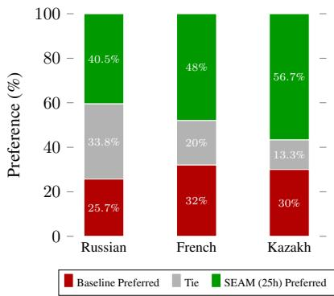
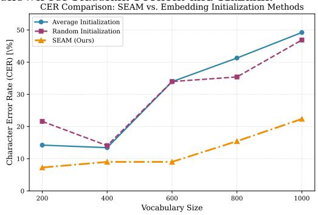
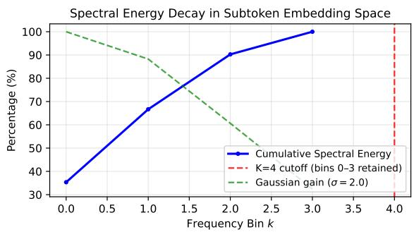

# SEAM: Spectral Embedding Alignment and Merging for Low-Resource TTS

Walaa Othman ITMO University SPC RAS walaa\_othman@itmo.ru

Baher Mohammad ITMO University MWS AI

Stamatios Lefkimmiatis ITMO University MWS AI

Ammar Ali   
ITMO University   
MWS AI   
ammarali32@itmo.ru

## Abstract

Expanding the vocabulary of conditional textto-speech (TTS) models typically requires extensive fine-tuning with paired audio, creating a major bottleneck for low-resource and crosslingual adaptation. To address this, we introduce SEAM, a zero-audio initialization method that constructs embeddings for unseen tokens from known subtokens. Unlike standard pooling strategies that ignore sequential structure, SEAM applies a spectral filter to preserve temporal phonetic order and uses closed-form ridge regression to align the new embeddings with the pretrained conditioning manifold. Across three languages and two TTS architectures, SEAM approaches or matches baseline performance using up to four times less training data, reducing sample complexity by 75% compared to random initialization and mean pooling. Our approach provides a lightweight, reproducible, and theoretically grounded solution for vocabulary expansion in low-resource speech synthesis.

## 1 Introduction

The rapid proliferation of Agentic AI has positioned text-to-speech (TTS) systems as foundational voice interfaces for autonomous, multimodal agents. As these agents scale to global deployments, the ability to rapidly adapt to new languages particularly low-resource and under-documented ones has become a critical bottleneck. Extending conditional TTS models to novel linguistic settings is fundamentally constrained by vocabulary expansion: every unseen phonetic or graphemic unit requires a corresponding embedding in the model’s conditioning space. In practice, these tokens are initialized randomly and fine-tuned with extensive paired audio, a requirement that is infeasible when target-language data is scarce or costly to collect. This initialization bottleneck severely limits crosslingual generalization and perpetuates a stark accessibility gap in speech technology.

We address this gap with SEAM (Spectral Embedding Alignment & Merging), a principled, selfcalibrating initialization method. SEAM treats subtoken embeddings as a discrete signal, applies spectral low-pass filtering to preserve lowfrequency phonetic compositionality, and projects the result onto the pretrained embedding manifold via closed-form ridge regression. Grounded in the Lipschitz continuity of conditional generation, our approach is designed to promote acoustic stability and compositional faithfulness from the initialization stage. Our contributions are: 1) A spectrally grounded merging operator that preserves temporal phonetic structure and suppresses boundary artifacts; 2) A closed-form, self-calibration protocol that requires no gradient-based optimization or target-language audio; 3) Data-efficiency gains over standard initialization heuristics, enabling rapid vocabulary expansion for low-resource TTS.

## 2 Related Work

Recent cross-lingual and low-resource TTS research has focused on model-level adaptation strategies, including zero-shot multi-speaker transfer via external speaker encoders (Casanova et al., 2022), cross-lingual phoneme sharing (Huang et al., 2022b), and meta-learning for rapid speaker alignment (Huang et al., 2022a). While these methods improve transferability, they typically assume access to substantial target-language data for embedding alignment or rely on gradient-based optimization that becomes unstable when data is extremely scarce. Consequently, the foundational step of vocabulary expansion remains underexplored. Current practice adapts heuristics from language modeling, most notably decomposing unseen tokens into known subtokens and averaging their embeddings (Tikhomirov and Chernyshev, 2024). Although computationally trivial, this permutationinvariant pooling discards the strict temporal order and articulatory dynamics essential to speech synthesis, forcing the model to relearn sequential structure from scratch during fine-tuning and inflating sample complexity. Our method provides an order-preserving, spectrally grounded initialization that aligns novel embeddings with the pretrained manifold, thereby stabilizing optimization and drastically reducing the target-language data required for subsequent adaptation. To our knowledge, no prior work proposes an audio-guided initialization specifically for vocabulary expansion in autoregressive transformer-based TTS, making the zero-audio property of SEAM particularly important.

## 3 Method

We address the problem of initializing conditioning embeddings for novel phonetic tokens in llmdiffusion based TTS systems. Let $\nu _ { \mathrm { o l d } }$ denote a pretrained vocabulary with embedding lookup $E : \mathcal { V } _ { \mathrm { o l d } } \to \mathbb { R } ^ { d }$ , and let $\Phi _ { \theta }$ be the conditional generator. For a new token $t \in \mathcal { V } _ { \mathrm { n e w } }$ decomposable into known subtokens $\{ s _ { 1 } , \ldots , s _ { m } \} \subset \mathcal { V } _ { \mathrm { o l d } }$ we seek a conditioning vector $c _ { t } \in \mathbb { R } ^ { d }$ that satisfies: (i) stability under the generative process, (ii) preservation of temporal phonetic order, and (iii) alignment with the pretrained embedding manifold. We achieve this via a spectral merging operator Ψ, calibrated in closed form.

## 3.1 Continuity Principle

Well-trained conditional TTS generators assume that the mapping from conditioning embeddings to audio is locally smooth: small, structured changes in the input should produce bounded, predictable changes in the output. To respect this property, our initialization must construct new token embeddings as smooth functions of their constituent subtokens, explicitly preserving their sequential order. This prevents distributional shifts during early fine-tuning. A formal continuity assumption and order-sensitivity analysis are provided in Appendix A.1 and A.2.

## 3.2 Spectral Merging Operator

We define a spectral merging operator $\Psi : \tau :$ $\cup _ { m = 1 } ^ { M } \mathbb { R } ^ { m \times d }  \mathbb { R } ^ { d }$ that maps a variable-length sequence of subtoken embeddings to a single conditioning vector. To preserve sequential structure while satisfying the continuity principle, we treat the embedding matrix ${ \bf S } = [ { \bf e } _ { 1 } ; \ldots ; { \bf e } _ { m } ] \in \mathbb { R } ^ { m \times d }$ as a set of d discrete signals and apply a two-stage pipeline.

Fourier Downsampling. For each embedding dimension $j \in \{ 1 , \ldots , d \}$ , we compute the discrete Fourier transform $( \mathrm { D F T } ) \hat { \mathbf { S } } _ { j } ( k )$ . In speech representations, low-frequency components capture slow, global phonetic compositionality, whereas highfrequency components often reflect sharp boundary artifacts between subtokens (Rabiner and Juang, 1993). We therefore apply a Gaussian low-pass filter:

$$
\tilde { \mathbf { S } } _ { j } ( k ) = \hat { \mathbf { S } } _ { j } ( k ) \cdot \exp \left( - \frac { k ^ { 2 } } { 2 \sigma ^ { 2 } } \right) ,\tag{1}
$$

retaining only the first $K _ { \mathrm { e f f } }$ frequency bins, where $K _ { \mathrm { e f f } } ~ = ~ \mathrm { m i n } ( K , \lfloor m / 2 \rfloor + 1 )$ , to obtain $\tilde { S } ^ { \downarrow } \in$ $\mathbb { C } ^ { K _ { \mathrm { e f f } } \times d }$ . In practice, we use $K = 4$ as the default maximum number of retained bins. This operation projects the subtoken sequence onto a smooth, bandlimited subspace that naturally suppresses discontinuities at token boundaries.

Linear Readout. We reconstruct a conditioning vector by flattening the real and imaginary components of the filtered coefficients into a feature vector $\phi ( \mathbf { S } ) \in \mathbb { R } ^ { 2 K d }$ , followed by a linear projection:

$$
\Psi ( \mathbf { S } ) = \mathbf { W } \phi ( \mathbf { S } ) + \mathbf { b } , \quad \mathbf { W } \in \mathbb { R } ^ { d \times 2 K d } , \ \mathbf { b } \in \mathbb { R } ^ { d } .\tag{2}
$$

Critically, by preserving the complex DFT coefficients, Ψ remains sensitive to phase information, which directly encodes the temporal progression of the subtoken sequence. Unlike mean pooling, which is permutation-invariant, under the conditions of Proposition 1, our operator is ordersensitive: reversing the input order produces a different output embedding. $( \Psi ( \mathbf { S } ) \ \neq \ \Psi ( \mathbf { S } ^ { \mathrm { r e v } } )$ for non-palindromic sequences). A formal ordersensitivity analysis is provided in Appendix A.2.

## 3.3 Closed-Form Self-Calibration

To align the spectral operator Ψ with the geometry of the pretrained conditioning space C without requiring target-language audio, we derive the projection parameters $( \mathbf { W } , \mathbf { b } )$ analytically. For each token $t \in \mathcal { V } _ { \mathrm { o l d } }$ that admits a valid subtoken decomposition, we construct a self-supervised pair $( \mathbf { S } ^ { ( i ) } , \mathbf { c } _ { \mathrm { t a r g e t } } ^ { ( i ) } = E ( t ) )$ . Decompositions are obtained using the original BPE tokenizer that generated $\nu _ { \mathrm { o l d } }$ , ensuring all constituent subtokens belong to the pretrained vocabulary. Stacking N such pairs yields a feature matrix $\dot { \mathbf { X } } \in \mathbb { R } ^ { N \times 2 K d }$ and target matrix $\mathbf { Y } \in \mathbb { R } ^ { N \times d }$ . We solve the ridge regression objective:

$$
\operatorname* { m i n } _ { \mathbf { W } , \mathbf { b } } \left\| \mathbf { X } \mathbf { W } ^ { \top } + \mathbf { 1 6 } ^ { \top } - \mathbf { Y } \right\| _ { F } ^ { 2 } + \lambda \| \mathbf { W } \| _ { F } ^ { 2 } ,\tag{3}
$$

which admits the closed-form solution:

$$
\begin{array} { r } { \left[ \mathbf { W } ^ { \ast \top } \right] = \left( \tilde { \mathbf { X } } ^ { \top } \tilde { \mathbf { X } } + \lambda \mathbf { R } \right) ^ { - 1 } \tilde { \mathbf { X } } ^ { \top } \mathbf { Y } , } \end{array}\tag{4}
$$

where $\tilde { \mathbf { X } } = [ \mathbf { X } \mid \mathbf { 1 } ]$ augments the features with a bias column, and $\mathbf { R } = \mathrm { d i a g } ( 1 , \ldots , 1 , 0 )$ excludes the bias term from $L _ { 2 }$ regularization. The matrix $\mathbf { W } ^ { * }$ and vector $\mathbf { b } ^ { * }$ are obtained from the first 2Kd rows and the final row of the solution, respectively. This calibration protocol ensures: (i) manifold alignment by minimizing projection error onto C; (ii) order consistency by learning from linguistically ordered subtoken sequences; and (iii) continuity preservation by bounding the conditioning error, which directly limits acoustic deviation via Assumption 1.

Non-Latin Script Handling. For languages with non-Latin orthographies (e.g., Cyrillic), we first transliterate the target token into an English IPA representation using a standard mapping table. This phonetic string is then segmented into subtokens from $\nu _ { \mathrm { o l d } }$ , yielding the sequence $\mathbf { s } _ { 1 } , \ldots , \mathbf { s } _ { m }$ . At inference, the novel embedding is computed as $\mathbf { c } _ { \mathrm { n e w } } = \Psi ^ { * } ( \mathbf { S } _ { \mathrm { n e w } } ) = \mathbf { W } ^ { * } \phi ( \mathbf { S } _ { \mathrm { n e w } } ) + \mathbf { b } ^ { * }$ and subsequently norm-normalized to match the statistical distribution of the pretrained embeddings. Default values for the hyperparameters are $K = 4 , \sigma = 2 . 0$ and $\lambda = 1 e ^ { - 6 }$ we refer to Appendix.A.2 for more details.

SEAM Algorithm Summary. Given subtoken embed  
dings $\mathbf { s } _ { 1 } , \ldots , \mathbf { s } _ { m } \in \mathbb { R } ^ { d }$ , let $K _ { \mathrm { e f f } } =$ min $( K , \lfloor m / 2 \rfloor + 1 ) \colon$   
$\hat { \mathbf { S } } ( k ) = \sum _ { n = 1 } ^ { m } \mathbf { s } _ { n } e ^ { - 2 \pi i k ( n - 1 ) / m } ,$   
SˆLP(k) = Sˆ(k) · e−k2/(2σ2), k = 0, . . . , Kef − 1,   
ϕ(s1:m) = - Re(SˆLP(0)), Im(SˆLP(0)), . . . ,   
Re(SˆLP(Kef − 1)), Im(SˆLP(Kef − 1))⊤,   
cnew = W ϕ(s1:m) + b,   
W⊤   
 b⊤ = X˜ ⊤X˜ + λR−1X˜ ⊤Y.

Implementation summary. The SEAM algorithm proceeds in two stages:

1. Learning the projector. From the old vocabulary $\mathcal { V } _ { \mathrm { o l d } } .$ , we collect self-supervised training pairs $( S ^ { ( i ) } , c _ { \mathrm { t a r g e t } } ^ { ( i ) } )$ by decomposing each existing token t into its constituent subtokens $\{ s _ { 1 } , \ldots , s _ { m } \}$ (all also in $\nu _ { \mathrm { o l d } } )$ using the original BPE tokenizer, and setting $c _ { \mathrm { t a r g e t } } ^ { ( i ) } = E ( t )$ . For each such pair we compute the spectral feature vector $\phi ( S ^ { ( i ) } )$ and then solve the ridge regression problem (Eq. 3) to obtain the closed-form linear projection W, b.

2. Embedding a new token. For a novel token tnew (e.g., a Kazakh Cyrillic word), we first map it to an English IPA representation using a standard transliteration table. We then decompose this IPA string into subtokens present in $\nu _ { \mathrm { o l d } }$ , obtaining $\mathbf { s } _ { 1 } , \ldots , \mathbf { s } _ { m } .$ . The final embedding is computed as $\begin{array} { r } { \mathbf { c } _ { \mathrm { n e w } } = \mathbf { W } \phi ( \mathbf { s } _ { 1 } , \dots , \mathbf { s } _ { m } ) + \mathbf { \Sigma } ^ { . } } \end{array}$ b and normalized to match the average norm of the original ones.

## 4 Experiments

We evaluate SEAM across three diverse languages Russian (Slavic, Cyrillic), Kazakh (Turkic, Cyrillic/Latin), and French (Latin) to assess its effectiveness in low-resource and cross-lingual adaptation. All primary experiments use Chatterbox (Resemble AI, 2025) as the TTS backbone. In this paper we mainly focus on three core evaluation dimensions: (1) sample efficiency under fixed training budgets (5h, 25h, and 100h), quantified via automatic speech recognition metrics (CER); and (2) perceptual quality, validated through a native-speaker Side-By-Side comparison (SBS) study. (3) New Vocabulary size investigate how other methods perform in comparison with SEAM when the number of new added tokens increases. Experiments with a different architecture, VibeVoice (Peng et al., 2025), and dataset-split robustness are provided in Appendix B.

## 4.1 Experimental Setup

Evaluation metrics. We evaluate model performance using the Character Error Rate (CER), computed via pretrained automatic speech recognition (ASR) models. Specifically, we employ nvidia/stt\_kk\_ru\_fastconformer\_hybrid\_large, nvidia/stt\_fr\_fastconformer\_hybrid\_large\_pc for Russian, Kazakh and French; refer to Appendix B.2 for a detailed analysis of these ASR baselines. All reported results are averaged across three independent random seeds. Evaluation is performed on a fixed set of 100 audio samples drawn from rulibrispeech, KazakhTTS, and AdrienB134/frenchunique-speaker-tts.

Baselines. We compare against: 1) Random: $c _ { t } \sim \mathcal { N } ( 0 , \sigma ^ { 2 } I )$ with σ matched to pretrained embedding norm.

Mean: $\begin{array} { r } { c _ { t } = \frac { 1 } { m } \sum _ { i = 1 } ^ { m } E ( s _ { i } ) } \end{array}$ , the arithmetic mean of subtoken embeddings.

All methods are fine-tuned under identical optimization schedules. Implementation details and additional metrics are provided in Appendix B.1.

Transliteration We transliterate non-Latin scripts using the transliterate library (English/Russian), qazaq\_transliterator (Kazakh), and standard text normalization (French).

## 4.2 Sample Efficiency Under Fixed Budgets

Table 1 reports CER after training on 5h, 25h and 100h budgets. SEAM provides its largest gains in low-resource regimes. At 25h, SEAM improves over mean initialization by 2.22 CER points on Russian, 10.63 points on Kazakh, and 0.87 points on French. Against random initialization, the corresponding improvements are 9.16, 27.34, and 3.77. Notably, SEAM approaches or matches the performance of baselines trained on 100h, corresponding to a 4× reduction in required data. At 100h, all methods converge, with differences falling within ASR evaluation variance, confirming that SEAM’s primary advantage is sample efficiency rather than asymptotic performance. It is important to mention that the increase in CER from 5h to 25h for Random/Mean on Kazakh is attributable to word-level overlap variance across data splits in this extremely low-resource regime

## 4.3 Human Evaluation

We conduct a blind Side-by-Side (SBS) preference study with 5 native speakers per language. Each annotator evaluates 25 synthesized utterances, comparing audio from two conditions: (1) Model A (Ours): SEAM-initialized embeddings, fine-tuned on 25h of speech. (2) Model B (Baseline): mean initialization, fine-tuned on 100h of speech.

For each pair, annotators select their preferred sample based on overall quality (naturalness + intelligibility), or indicate a tie. Evaluation criteria and annotator instructions are provided in Appendix C. Figure 1 visualizes the SBS preference distribution. Model A (SEAM) against mean initialization that was trained on 4x more data across three languages. We refer to Appendix C.3 for detailed information about the SBS study.

## 4.4 Sensitivity to Vocabulary Expansion Size

We investigate the sensitivity of our method to vocabulary expansion size by varying the number of newly added tokens $\left( \left| \mathcal { V } _ { \mathrm { n e w } } \right| \right. \quad \in$ {200, 400, 600, 800, 1000}) and evaluating CER after fine-tuning on 25 hours of data. As shown in Figure 2, SEAM scales gracefully, exhibiting only marginal performance degradation as $| \nu _ { \mathrm { n e w } } |$ increases. In contrast, both random and average initialization suffer sharp deterioration beyond 500 tokens, demonstrating that SEAM produces robust embeddings even under substantial vocabulary expansion. While we constrained $| \mathcal { V } _ { \mathrm { n e w } } | = 2 0 0$ in our main experiments to ensure a competitive comparison, larger vocabularies inherently yield shorter token sequences and faster inference. Notably, SEAM’s relative advantage becomes increasingly pronounced at higher expansion sizes, highlighting its strong scalability and efficiency in practical deployment scenarios.

Table 1: CER (%) after training on fixed data budgets. Lower is better. SEAM achieves comparable performance to baselines with up to 4× less data for some languages.
<table><tr><td>Language</td><td>Budget</td><td>Init</td><td>CER</td><td>WER</td></tr><tr><td rowspan="9">Russian</td><td rowspan="3">5 h</td><td>Random</td><td>20.8</td><td>42.49</td></tr><tr><td>Mean</td><td>17.53</td><td>36.73</td></tr><tr><td>SEAM</td><td>14.88</td><td>34.41</td></tr><tr><td rowspan="3">25 h</td><td>Random</td><td>17.66</td><td>27.18</td></tr><tr><td>Mean</td><td>10.72</td><td>24.58</td></tr><tr><td>SEAM</td><td>8.50</td><td>20.01</td></tr><tr><td rowspan="3">100 h</td><td>Random</td><td>7.62</td><td>18.40</td></tr><tr><td>Mean</td><td>9.64</td><td>19.87</td></tr><tr><td>SEAM</td><td>7.68</td><td>16.92</td></tr><tr><td rowspan="9">Kazakh</td><td rowspan="3">5 h</td><td>Random</td><td>11.62</td><td>26.3</td></tr><tr><td>Mean</td><td>8.55</td><td>20.9</td></tr><tr><td>SEAM</td><td>4.99</td><td>15.12</td></tr><tr><td rowspan="3">25 h</td><td>Random</td><td>32.60</td><td>39.89</td></tr><tr><td>Mean</td><td>15.89</td><td>21.60</td></tr><tr><td>SEAM</td><td>5.26</td><td>13.19</td></tr><tr><td rowspan="3">100 h</td><td>Random</td><td>9.54</td><td>16.90</td></tr><tr><td>Mean</td><td>8.50</td><td>16.02</td></tr><tr><td>SEAM</td><td>4.39</td><td>11.11</td></tr><tr><td rowspan="8">French</td><td rowspan="3">5 h</td><td>Random</td><td>19.07</td><td>34.27</td></tr><tr><td>Mean</td><td>18.28</td><td>34.61</td></tr><tr><td>SEAM</td><td>17.86</td><td>31.7</td></tr><tr><td rowspan="3">25 h</td><td>Random</td><td>15.70</td><td>29.68</td></tr><tr><td>Mean</td><td>12.80</td><td>25.82</td></tr><tr><td>SEAM</td><td>11.93</td><td>23.20</td></tr><tr><td rowspan="3">100 h</td><td>Random</td><td>16.93</td><td>23.85</td></tr><tr><td>Mean</td><td>9.06</td><td>17.20</td></tr><tr><td>SEAM</td><td>9.26</td><td>17.59</td></tr></table>

## 4.5 Extended Baseline Comparison

We compare SEAM with three additional orderaware initialization strategies on Russian with a 5- hour budget under identical optimization schedules. Position-Aware Pooling extracts permutationvariant statistics (mean, max, first, last, and positionally weighted sum) and projects them via closed-form ridge regression with $\lambda = 1 0 ^ { - 6 }$ Attention Pooling applies fixed random query vectors for scaled dot-product attention over subtoken embeddings, followed by ridge projection, with no learned parameters. Learned Attention trains a single-head attention layer via AdamW (lr $= 5 \times 1 0 ^ { - 4 } )$ on the same self-supervised pairs used by SEAM, and is the strongest order-aware baseline. SEAM outperforms all baselines because its spectral low-pass filter suppresses high-frequency tokenizer-boundary artifacts, explaining the poor results of Position-Aware Pooling (CER 23.37%) and Attention Pooling (CER 20.14%), which treat all frequency components equally. Learned Attention is competitive (CER 15.30%) but converges poorly under the limited calibration data, yielding approximately 10% lower cosine similarity to ground-truth embeddings and higher MSE than SEAM’s closed-form solution. This confirms that gradient-based attention requires substantially more data than SEAM’s analytic ridge regression in the extreme low-resource initialization setting.

Figure 1: Side-by-Side human preference results: SEAM-initialized model (25h training) vs. meanpooling baseline (100h training). Green indicates preference for SEAM despite using 4× less data. Results are shown for Russian, French, and Kazakh.  
  
Figure 2: CER versus vocabulary expansion size. SEAM maintains robust performance as vocabulary size increases, while mean and random initialization degrade

## 4.6 Ablation: Order Sensitivity

To test whether temporal order preservation drives SEAM’s gains, we disrupt subtoken order before spectral filtering on Russian with a 5-hour finetuning budget.

Table 2: Extended baseline comparison on Russian (5h fine-tuning). Lower is better.
<table><tr><td>Initialization Method</td><td>CER (%)</td><td>WER (%)</td></tr><tr><td>Random</td><td>20.80</td><td>42.49</td></tr><tr><td>Mean Pooling</td><td>17.53</td><td>36.73</td></tr><tr><td>Position-Aware Pooling</td><td>23.37</td><td>54.70</td></tr><tr><td>Attention Pooling</td><td>20.14</td><td>50.03</td></tr><tr><td>Learned Attention</td><td>15.30</td><td>42.86</td></tr><tr><td>SEAM (Ours)</td><td>14.88</td><td>34.41</td></tr></table>

Table 3: Order sensitivity ablation on Russian (5h).
<table><tr><td>Method</td><td>CER (%)</td><td>WER (%)</td></tr><tr><td>SEAM (Original)</td><td>14.88</td><td>34.41</td></tr><tr><td>SEAM (Reversed)</td><td>19.67</td><td>51.99</td></tr><tr><td>SEAM (Shuffled)</td><td>22.91</td><td>53.66</td></tr></table>

Reversed strictly inverts the subtoken sequence $( s _ { 1 } , \ldots , s _ { m } \to s _ { m } , \ldots , s _ { 1 } )$ , while Shuffled randomly permutes it (seed=42), completely destroying temporal order. In both cases, spectral filtering and ridge regression are applied identically to the original SEAM pipeline.

Reversal increases CER by 4.79 absolute points (14.88% → 19.67%), while shuffling increases it by 8.03 points (14.88% → 22.91%). Shuffling also nearly doubles WER (34.41% → 53.66%). Since shuffling is more damaging than reversal, SEAM relies not only on sequence directionality but on the precise temporal phonetic trajectory encoded in the DFT phase. This confirms that order-preserving spectral merging, rather than ridge alignment alone, is the primary source of SEAM’s advantage.

## 5 Conclusion

We presented SEAM, a zero-audio initialization method for low-resource TTS vocabulary expansion. By spectrally merging subtoken embeddings and aligning them via closed-form regression, SEAM preserves phonetic order and reduces sample complexity by up to 4× across languages and architectures. While dependent on subtoken decomposability and IPA transliteration, SEAM offers a lightweight, reproducible pathway to stabilize early-stage TTS adaptation.

Acknowledgments This research was supported as part of the ITMO University Research Projects in AI Initiative.

## 6 Limitations

Despite its data efficiency, SEAM operates within three primary constraints:

• Subtoken & IPA Dependency: Initialization requires reliable decomposition into known subtokens. For non-Latin scripts or languages lacking robust IPA transliteration tables, mapping errors may propagate to the conditioning space.

• Fine-Tuning Requirement: SEAM addresses the initialization bottleneck but does not replace downstream adaptation; acoustic alignment still requires paired target-language audio but much less than other initialization methods.

• Evaluation Variance in Extreme Low-Resource Regimes: At very small budgets, word-level overlap between training and test splits can inflate metrics non-monotonically, as observed for Kazakh.

## 7 Ethical Considerations

SEAM aims to reduce barriers for low-resource language TTS, promoting equitable access to speech technology. However, like all voice synthesis methods, it carries dual-use risks: malicious actors could exploit improved initialization for unauthorized voice cloning or disinformation. We mitigate this by releasing only embedding initialization code not full model weights and requiring explicit consent for any deployment involving human voices. All experiments use publicly available, ethically sourced corpora. We encourage adopters to follow local regulations and community guidelines, particularly when working with under-documented languages.

## References

Edresson Casanova, Julian Weber, Christopher Dane Shulby, Arnaldo Cândido Júnior, Eren Gölge, and Moacir A. Ponti. 2022. Yourtts: Towards zero-shot multi-speaker TTS and zero-shot voice conversion for everyone. In International Conference on Machine Learning, ICML 2022, 17-23 July 2022, Baltimore, Maryland, USA, Proceedings of Machine Learning Research, pages 2709–2720. PMLR.

Sitan Chen, Sinho Chewi, Jerry Li, Yuanzhi Li, Adil Salim, and Anru Zhang. 2023. Sampling is as easy as learning the score: theory for diffusion models

with minimal data assumptions. In The Eleventh International Conference on Learning Representations, ICLR 2023, Kigali, Rwanda, May 1-5, 2023. OpenReview.net.

Zhihao Du, Qian Chen, Shiliang Zhang, Kai Hu, Heng Lu, Yexin Yang, Hangrui Hu, Siqi Zheng, Yue Gu, Ziyang Ma, Zhifu Gao, and Zhijie Yan. 2024. Cosyvoice: A scalable multilingual zero-shot textto-speech synthesizer based on supervised semantic tokens. CoRR, abs/2407.05407.

Sung-Feng Huang, Chyi-Jiunn Lin, Da-Rong Liu, Yi-Chen Chen, and Hung-yi Lee. 2022a. Meta-tts: Meta-learning for few-shot speaker adaptive textto-speech. IEEE ACM Trans. Audio Speech Lang. Process., 30:1558–1571.

Wei-Ping Huang, Po-Chun Chen, Sung-Feng Huang, and Hung-yi Lee. 2022b. Few shot cross-lingual TTS using transferable phoneme embedding. In 23rd Annual Conference ofthe International Speech Communication Association, Interspeech 2022, Incheon, Korea, September 18-22, 2022, pages 4566–4570. ISCA.

Puyuan Peng, Po-Yao Huang, Shang-Wen Li, Abdelrahman Mohamed, and David Harwath. 2024. Voicecraft: Zero-shot speech editing and text-to-speech in the wild. In Proceedings ofthe 62nd Annual Meeting ofthe Associationfor Computational Linguistics (Volume 1: Long Papers), ACL 2024, Bangkok, Thailand, August 11-16, 2024, pages 12442–12462. Association for Computational Linguistics.

Zhiliang Peng, Jianwei Yu, Wenhui Wang, Yaoyao Chang, Yutao Sun, Li Dong, Yi Zhu, Weijiang Xu, Hangbo Bao, Zehua Wang, Shaohan Huang, Yan Xia, and Furu Wei. 2025. Vibevoice technical report. CoRR, abs/2508.19205.

Lawrence R. Rabiner and Biing-Hwang Juang. 1993. Fundamentals of speech recognition. Prentice Hall signal processing series. Prentice Hall.

Resemble AI. 2025. Chatterbox-TTS. https:// github.com/resemble-ai/chatterbox. GitHub repository.

Mikhail Tikhomirov and Daniil Chernyshev. 2024. Facilitating large language model russian adaptation with learned embedding propagation. CoRR, abs/2412.21140.

Chengyi Wang, Sanyuan Chen, Yu Wu, Ziqiang Zhang, Long Zhou, Shujie Liu, Zhuo Chen, Yanqing Liu, Huaming Wang, Jinyu Li, Lei He, Sheng Zhao, and Furu Wei. 2023. Neural codec language models are zero-shot text to speech synthesizers. CoRR, abs/2301.02111.

## A Theoretical Overview

## A.1 Continuity Principle and Acoustic Stability

Let $\mathcal { C } \subset \mathbb { R } ^ { d }$ denote the pretrained conditioning space and $\mathcal { X } \subset \mathbb { R } ^ { D }$ the acoustic output space. The TTS generator defines a stochastic mapping $\mathbf { x } =$ $\Phi _ { \theta } ( \mathbf { c } , \mathbf { z } )$ , where $\mathbf { c } \in { \mathcal { C } }$ is a conditioning vector and $\mathbf { z } \sim \mathcal { N } ( \mathbf { 0 } , \mathbf { I } )$ represents diffusion or autoregressive noise. Under standard regularity conditions for modern generative audio models, the conditional expectation operator is Lipschitz continuous (Chen et al., 2023):

Assumption 1 (Lipschitz Continuity). There exists a constant $L > 0$ such thatfor all $\mathbf { c } _ { a } , \mathbf { c } _ { b } \in \mathcal { C }$ :

$$
\begin{array} { r } { \left| \left| \mathbb { E } _ { \mathbf { z } } [ \Phi _ { \theta } ( \mathbf { c } _ { a } , \mathbf { z } ) ] - \mathbb { E } _ { \mathbf { z } } [ \Phi _ { \theta } ( \mathbf { c } _ { b } , \mathbf { z } ) ] \right| \right| _ { 2 } \leq L \| \mathbf { c } _ { a } - \mathbf { c } _ { b } \| _ { 2 } . } \end{array}\tag{5}
$$

Intuition for TTS. Assumption 1 formalizes a fundamental property of stable generative models: the acoustic output space is metrically aligned with the conditioning manifold. Consequently, large or erratic perturbations to a token embedding can cause disproportionate acoustic artifacts, distributional shift, or gradient instability during fine-tuning. To mitigate this, the embedding $\mathbf { c } _ { t }$ for a novel token must be constructed as a smooth, structurepreserving function of its subtoken embeddings $\{ { \bf e } _ { i } = E ( s _ { i } ) \} _ { i = 1 } ^ { m }$ . By enforcing temporal order and spectral smoothness (Section 3.2), SEAM ensures that $\lVert \mathbf { c } _ { t } - \mathbf { c } _ { \mathrm { r e f } } \rVert _ { 2 }$ remains small for phonetically similar tokens, thereby bounding the expected acoustic deviation during early adaptation stages and stabilizing optimization from step zero.

## A.2 Order-Sensitivity Analysis

Proposition 1 (Order sensitivity; sufficient conditions). Let

$$
S = [ s _ { 1 } ; \ldots ; s _ { m } ] \in \mathbb { R } ^ { m \times d } , \qquad m \ge 2 ,
$$

and let

$$
S ^ { \mathrm { r e v } } = [ s _ { m } ; \ldots ; s _ { 1 } ]
$$

denote the linearly reversed sequence. Let

$$
K _ { \mathrm { e f f } } = \operatorname* { m i n } \left( K , \left\lfloor { \frac { m } { 2 } } \right\rfloor + 1 \right)\tag{6}
$$

denote the number of unique retained DFT bins. Suppose that:

$$
I . \ K _ { \mathrm { e f f } } \geq 2 ;
$$

2. at least one retained non-DC bin is reversal-asymmetric, i.e., there exist $k \in$ $\{ 1 , \ldots , K _ { \mathrm { e f f } } - 1 \}$ and embedding dimension j such that

$$
e ^ { - 2 \pi i k ( m - 1 ) / m } \hat { S } _ { j } [ k ] ^ { * } \neq \hat { S } _ { j } [ k ] ;\tag{7}
$$

3. the projection matrix W does not annihilate the corresponding feature difference.

Then

$$
\Psi ( S ^ { \mathrm { r e v } } ) \neq \Psi ( S ) .\tag{8}
$$

Proof. For each embedding dimension $j ,$ define the DFT coefficient

$$
\hat { S } _ { j } [ k ] = \sum _ { n = 0 } ^ { m - 1 } S _ { j } [ n ] e ^ { - 2 \pi i k n / m } .\tag{9}
$$

For the linearly reversed sequence $S ^ { \mathrm { r e v } } [ n ] =$ $S [ m - 1 - n ]$ , the DFT satisfies

$$
\begin{array} { l } { { \displaystyle \hat { S } _ { j } ^ { \mathrm { r e v } } [ k ] = \sum _ { n = 0 } ^ { m - 1 } S _ { j } [ m - 1 - n ] e ^ { - 2 \pi i k n / m } } } \\ { { \displaystyle \qquad = e ^ { - 2 \pi i k ( m - 1 ) / m } \sum _ { r = 0 } ^ { m - 1 } S _ { j } [ r ] e ^ { 2 \pi i k r / m } } } \\ { { \displaystyle \qquad = e ^ { - 2 \pi i k ( m - 1 ) / m } \hat { S } _ { j } [ - k ] } } \\ { { \displaystyle \qquad = e ^ { - 2 \pi i k ( m - 1 ) / m } \hat { S } _ { j } [ k ] ^ { * } } , } \end{array}\tag{10}
$$

where the last equality follows because each embedding dimension is real-valued.

Thus, reversal changes the complex phase structure of the retained spectrum. For real-valued embedding dimensions, this generally affects the imaginary components retained by $\phi ( S )$ . If at least one retained non-DC frequency component is reversalasymmetric, then

$$
\phi ( S ^ { \mathrm { r e v } } ) \neq \phi ( S ) .\tag{11}
$$

If, in addition, W does not annihilate this difference, i.e.,

$$
W \left( \phi ( S ^ { \mathrm { r e v } } ) - \phi ( S ) \right) \neq 0 ,\tag{12}
$$

then

$$
\Psi ( S ^ { \mathrm { r e v } } ) = W \phi ( S ^ { \mathrm { r e v } } ) + b \neq W \phi ( S ) + b = \Psi ( S ) .\tag{13}
$$

□

This is a sufficient-condition statement rather than an unconditional guarantee. If all retained spectral coefficients are reversal-invariant, for example when only the DC component or other perfectly symmetric components are retained, the operator may map $S$ and $S ^ { \mathrm { r e v } }$ to the same conditioning vector. The proposition therefore requires asymmetry in at least one retained non-DC frequency bin.

Choice of K and $\sigma \cdot$ We set $K = 4$ as the default maximum number of retained frequency bins and $\sigma = 2 . 0$ . For short subtoken sequences, K should be interpreted as an upper bound: the number of unique retained DFT coefficients is effectively

$$
K _ { \mathrm { e f f } } = \operatorname* { m i n } \left( K , \left\lfloor \frac { m } { 2 } \right\rfloor + 1 \right) .
$$

The low-pass argument is strongest when the sequence length permits $K _ { \mathrm { e f f } } \ll m / 2$ , so that the retained coefficients remain well below the Nyquist region where boundary artifacts dominate. For very short decompositions, the sufficient conditions of Proposition 1 may not hold, and the ordersensitivity claim is instead supported empirically by the order-perturbation ablation in Table 3.

Empirical spectral analysis (Figure 3) shows that cumulative energy exceeds 99% by $k = 3$ , indicating that the subtoken embedding trajectory is effectively bandlimited. Retaining bins $k \in \{ 0 , 1 , 2 , 3 \}$ therefore preserves the dominant low-frequency phonetic structure while strongly attenuating highfrequency boundary artifacts. The Gaussian gain with $\sigma = 2 . 0$ satisfies

$$
G ( k ) = \exp \left( - \frac { k ^ { 2 } } { 2 \sigma ^ { 2 } } \right) ,
$$

giving

$$
G ( 0 ) = 1 . 0 , G ( 1 ) \approx 0 . 8 8 ,
$$

$$
G ( 2 ) \approx 0 . 6 1 , G ( 3 ) \approx 0 . 3 2 , G ( 4 ) \approx 0 . 1 4 .
$$

Thus, high-frequency components are suppressed by more than 85% by $k = 4$

## B Further Experiments

## B.1 Implementation details.

All experiments were conducted on a single workstation equipped with an NVIDIA RTX 3090 GPU (24 GB VRAM) and an Intel Core i9-14900K CPU (24 cores, 32 logical processors, 3.2 GHz base clock). Training pipelines were implemented using the Hugging Face transformers and accelerate ecosystems with mixed-precision (bf16) enabled.

  
Figure 3: Spectral energy decay in subtoken embedding sequences. Cumulative energy (blue) exceeds 99% by $k = 3 ,$ confirming bandlimited compositionality. The Gaussian filter $\sigma = 2 . 0$ (green) suppresses highfrequency noise while retaining bins $k \in \{ 0 , 1 , 2 , 3 \}$ (red dashed line). This empirically validates $( K =$ $4 , \sigma = 2 . 0 )$ without hyperparameter tuning.

Chatterbox (0.5B) Fine-Tuning. We perform full-parameter fine-tuning of the English-only Chatterbox base model. Optimization uses AdamW with a learning rate of $5 \times 1 0 ^ { - 4 }$ , 10% warmup steps, and a cosine decay schedule. The per-device batch size is 8 with 8 gradient accumulation steps (effective batch size 64) over 1 epoch. Data loading utilizes 8 workers with pinned memory disabled to optimize CPU–GPU transfer. All automatic metrics are computed post-hoc on the held-out test set.

VibeVoice (1.5B) Fine-Tuning. For crossarchitecture validation, we adapt VibeVoice using Low-Rank Adaptation (LoRA). We apply LoRA to all linear projection layers (q\_proj, k\_proj, v\_proj, o\_proj, gate\_proj, up\_proj, down\_proj) with rank $r = 1 2 8$ and scaling factor $\alpha = 2 5 6$ . The diffusion head is frozen , and loss weights are set to 1.4 for the diffusion objective and 0.04 for cross-entropy. Training uses a learning rate of $5 \times 1 0 ^ { - 5 }$ , a cosine scheduler with 3% warmup, maximum gradient norm of 0.8, and voice prompt dropout of 0.2. The effective batch size is 16 (4 per device × 4 accumulation steps) over 3 epochs, with a DDPM set to 10 steps to stabilize diffusion sampling.

All runs use fixed random seeds for reproducibility, and hyperparameters are kept constant across languages to ensure fair comparison.

Ridge Regularization. The ridge regression regularization coefficient in Eq. 3 is set to $\lambda = 1 0 ^ { - 6 }$ for all experiments across all languages and architectures. This value provides minimal regularization sufficient to ensure numerical stability of the closed-form solution (Eq. 4) without biasing the projection away from the least-squares optimum. No language-specific or architecture-specific tuning of λ was performed.

IPA Transliteration Setup. For languages with non-Latin orthographies, SEAM requires mapping target-language tokens to an English IPA representation before subtoken decomposition. We use the following tools:

• Russian: The transliterate Python library maps Cyrillic graphemes to their English IPA equivalents. Standard Russian phonological rules (vowel reduction, consonant palatalization) are applied during normalization.

• Kazakh: The qazaq\_transliterator library handles Cyrillic-to-Latin conversion, followed by IPA mapping. Kazakh-specific vowel harmony and consonant assimilation rules are respected during transliteration.

• French: Standard orthographic-to-phonemic normalization is applied, handling liaison, elision, and nasal vowel conventions.

The resulting IPA strings are segmented using the original BPE tokenizer that generated $\nu _ { \mathrm { o l d } }$ , ensuring all constituent subtokens belong to the pretrained vocabulary.

## B.2 ASR Evaluation Baseline

To establish the error floor of our automatic evaluation pipeline, we evaluated the pretrained ASR models on the original, human-recorded audio from each test set (i.e., ground-truth speech, not synthesized). Table 4 reports the resulting Character and Word Error Rates. These values represent the irreducible lower bound for CER/WER in our TTS evaluations: synthesized output is unlikely to achieve a lower error rate than the ASR model’s performance on clean, native speech.

Table 4: ASR baseline performance on original humanrecorded audio. Lower is better. These values define the error floor for TTS evaluation.
<table><tr><td>Language</td><td>CER (%)</td><td>WER (%)</td></tr><tr><td>Russian</td><td>4.88</td><td>14.68</td></tr><tr><td>French</td><td>0.63</td><td>3.30</td></tr><tr><td>Kazakh</td><td>0.98</td><td>5.68</td></tr></table>

These results indicate that the ASR models exhibit high accuracy on French and Kazakh (CER $< 1 \% )$ , while Russian presents a more challenging evaluation setting (CER ≈ 5%). Consequently, when interpreting the TTS results in Table 1, the effective TTS-induced error for Russian should be understood relative to this 4.88% baseline. For instance, SEAM’s 7.68% CER at 100h corresponds to an approximate TTS-specific error of $7 . 6 8 - 4 . 8 8 = 2 . 8 0 \%$ , confirming that the synthesized speech remains close to human-level intelligibility. This baseline analysis ensures that reported improvements reflect genuine gains in synthesis quality rather than artifacts of ASR model variance.

## B.3 Evaluation metrics.

In this research, we reported:

• Objective: Character Error Rate (CER) using pretrained ASR models.

• Efficiency: training data count with the corresponding CER at each count.

• Human: Side By Side (SBS) (see Section 4.3).

## B.4 LLM Usage

We acknowledge the use of a large language model (LLM) for editing aid during manuscript preparation. The LLM was employed exclusively for language polishing, including grammar correction, syntactic refinement, and improving the clarity and formatting of figures and visualizations.

## B.5 Ablation: Sensitivity to Dataset Splits

To evaluate SEAM’s sensitivity to training data composition, we conduct an ablation study on the Kazakh corpus using three independent random splits. Each split preserves the same dataset size, speaker diversity, and phonemic coverage while varying the exact utterance selection. All models are fine-tuned under identical optimization schedules and evaluated on a fixed held-out test set. Performance remains highly consistent across partitions: the WER ranges from 14.97% to 16.51% (mean: 15.61%, $\sigma = 0 . 6 6 )$ and the CER ranges from 4.79% to 5.67% (mean: 5.27%, σ = 0.36). The low standard deviations $( \sigma _ { \mathrm { W E R } } ^ { 2 } = 0 . 4 3 .$ $\sigma _ { \mathrm { C E R } } ^ { 2 } = 0 . 1 3 )$ confirm that SEAM’s performance is robust to partition-level variations in the training data. The low standard deviation across splits indicates that SEAM’s initialization is robust to dataset composition and does not rely on high-quality subsets.

Non-Monotonic Kazakh Trend (5h → 25h). Table 1 reveals a counter-intuitive increase in CER from the 5h to the 25h budget for Random and Mean initialization on Kazakh (e.g., Random: 11.62% → 32.60%). We clarify that this nonmonotonic behavior is an artifact of word-level (token-level) lexical overlap between the training and test splits, rather than a failure of model capacity. Although we enforce strict utterance-level disjointness between training and test sets, in extremely low-resource regimes the specific utterances randomly sampled for the 5h subset may contain a higher density of words that also appear in the 100-utterance test set, artificially inflating performance metrics. Conversely, the 25h subset introduces greater lexical diversity and reduced overlap with the test set, making evaluation inherently harder. Critically, this pattern is consistent across all initialization methods, SEAM also exhibits a modest increase (4.99% → 5.26%) confirming that the trend is driven by data composition rather than any method-specific deficiency. At 100h, all methods stabilize, and SEAM achieves its lowest Kazakh CER of 4.39%, well above the ASR error floor of 0.98% (Table 4).

## B.6 Ablation: Cross-Architecture Generalization

To assess the architectural agnosticism of our approach, we apply SEAM to VibeVoice, a decoderbased speech model. We fine-tune VibeVoice on a 5-hour Russian corpus using three embedding initialization strategies. As shown in Table 5, SEAM achieves a CER of 6.14%, significantly outperforming both average (8.34%) and random (9.26%) initialization. This result confirms that SEAM’s embedding quality generalizes beyond the primary architecture, maintaining a consistent performance advantage under low-resource fine-tuning conditions.

Table 5: CER (%) for VibeVoice fine-tuned on Russian (5 hours) under different embedding initialization strategies. Lower is better.
<table><tr><td>Language</td><td>Initialization</td><td>Hours</td><td>CER (%)</td></tr><tr><td>Russian</td><td>Random</td><td>5</td><td>9.26</td></tr><tr><td>Russian</td><td>Average</td><td>5</td><td>8.34</td></tr><tr><td>Russian</td><td>SEAM (Ours)</td><td>5</td><td>6.14</td></tr></table>

## B.7 Ablation: Audio-Guided Initialization

To assess whether incorporating target-language audio during initialization improves upon SEAM’s zero-audio design, we conduct an ablation comparing zero-audio SEAM against an audio-guided variant. We note that, to the best of our knowledge, no prior published work proposes an independent audio-guided initialization method specifically for vocabulary expansion in autoregressive transformer-based TTS. We therefore position this experiment as an ablation validating the zero-audio property, rather than a comparison against an existing baseline.

The Audio-Guided variant proceeds in two stages: (1) SEAM initialization is applied identically to the zero-audio setting; (2) the newly initialized embeddings and the LM head are further refined via AdamW optimization on 1 hour of calibration audio from the target language before the main fine-tuning phase begins.

Results. Table 6 reports the training loss dynamics for both variants on Russian (5h budget).

Table 6: Training loss dynamics: Zero-audio SEAM vs. Audio-Guided variant (Russian, 5h). The audio-guided variant exhibits severe optimization instability.
<table><tr><td>Variant</td><td>Initial Loss</td><td>Final Loss</td></tr><tr><td>SEAM (Zero-Audio)</td><td>10.2</td><td>~4.0</td></tr><tr><td>Audio-Guided</td><td>7.2</td><td>~10.0</td></tr></table>

While audio-guided refinement achieves a lower initial training loss (7.2 vs. 10.2), it introduces severe optimization instability. The refinement step causes embedding norms to inflate to atypical values, distorting the geometric alignment established by SEAM’s closed-form calibration. When the main fine-tuning phase begins from this checkpoint, the loss spikes from 7.2 to 15.0 before slowly recovering to approximately 10.0 still substantially worse than zero-audio SEAM’s converged loss of ∼4.0. In contrast, zero-audio SEAM converges smoothly and monotonically from 10.2 to ∼4.0.

This result demonstrates that SEAM’s zeroaudio initialization is not merely a convenience but a deliberate design choice. The closed-form ridge regression produces embeddings that are geometrically well-calibrated to the pretrained manifold; subsequent audio-guided refinement disrupts this calibration, causing the model to fall into a poor local minimum that requires significantly more data to escape. The absence of any independent audiobased initialization baseline in the literature further underscores that SEAM’s zero-audio property fills a genuine methodological gap.

## C Side-by-Side (SBS) Human Evaluation Guidelines

Annotators evaluated synthesized audio samples using a Side-by-Side (SBS) preference framework, focusing on two orthogonal dimensions: Realism (acoustic naturalness) and Linguistic Correctness (fidelity to orthographic and phonological norms of the target language). Below are the standardized criteria and decision protocols provided to annotators.

## C.1 Dimension 1: Realism (Naturalness)

Annotators rated each sample on a 5-point scale. The following anchors guided the assessment:

• 5 (Excellent): Indistinguishable from professional human speech. Prosody is fluid, timbre is natural, and paralinguistic cues (e.g., breath, micro-pauses) are appropriately integrated.

• 4 (Good): Largely natural but exhibits minor artifacts, such as slight pitch irregularities, mild robotic timbre, or subtle prosodic mismatches (e.g., flattened intonation on interrogatives). Comprehension remains effortless.

• 3 (Fair): Noticeable synthesis artifacts or pacing irregularities (e.g., unnatural pauses, fragmented rhythm), but speech remains fully intelligible. Pronunciation may occasionally mismatch syntactic context.

• 2 (Poor): Severe articulation errors, phoneme hallucinations, or repetitive stuttering. Speech is strained or partially unintelligible, significantly impeding comprehension.

• 1 (Bad): Highly robotic, garbled, or completely unintelligible. Contains nonsensical syllable sequences or arbitrary breaks that destroy syntactic coherence.

## C.2 Dimension 2: Linguistic Correctness

Linguistic correctness measures adherence to the phonological, morphological, and orthographic conventions of the target language (French, Kazakh, or Russian). Annotators identified and penalized the following error categories:

## • Phoneme & Stress Accuracy:

– Russian/Kazakh: Correct realization of vowel reduction (akanye), palatalization (soft vs. hard consonants), and lexical stress placement. Misplaced stress that changes word meaning is a critical error.

– French: Correct liaison, elision, and nasal vowel production. Failure to apply obligatory liaison (e.g., les\_amis) or incorrect nasalization (e.g., bon vs. bonne) is penalized.

– Kazakh: Accurate pronunciation of vowel harmony and consonant assimilation rules. Errors in front/back vowel alignment within a word constitute a linguistic error.

## • Lexical & Orthographic Fidelity:

– Any substitution, omission, or addition of words compared to the reference text is penalized.

– Numbers, abbreviations, and proper nouns must be pronounced according to target-language conventions (e.g., Russian: “1995” → tysyacha devyatsot devyanosto pyat’; French: “M. Dupont” → monsieur Dupont; Kazakh: “2024” → eki my´n jıyrma tört).

– For Cyrillic scripts (Russian/Kazakh), the model must distinguish visually similar letters with distinct phonemes.

## • Prosody & Intonation:

– Intonation contours must match sentence type (e.g., rising pitch for questions in French/Russian; declarative fall for statements).

– Sentence-level stress and phrasing should reflect syntactic boundaries. Arbitrary pauses within phrases or unnatural emphasis on function words are penalized.

## C.3 Scoring and Preference Decision

For each side-by-side trial, annotators assessed both Model A and Model B against the above criteria. The final preference was determined as follows:

• If one model demonstrated significantly higher realism and/or fewer linguistic errors, it was selected as preferred.

• If both models exhibited comparable levels of quality and error rates, the annotator selected “Tie.”

• Each linguistic error (phoneme, stress, lexical, or prosodic) resulted in a proportional downgrade in the overall quality assessment for that sample.

• Annotators were instructed to prioritize intelligibility over minor prosodic artifacts when making close calls.

## Annotator Instructions.

1. Listen to both samples (A and B) for the same input text before making a decision.

2. Evaluate each dimension independently, then aggregate for the final preference.

3. If audio quality issues (e.g., clipping, background noise) affect both samples equally, ignore them and focus on synthesis artifacts.

4. When in doubt, select “Tie” rather than guessing.

Statistical Reliability. To quantify the reliability of the SBS preferences, we analyze the aggregate preference counts (N = 125 per language; 5 annotators × 25 samples), excluding ties. We compute the SEAM preference proportion among non-tie judgments and report 95% Wilson confidence intervals (Table 7). An exact binomial test against the null hypothesis of equal preference (p = 0.5) indicates that SEAM’s preference is statistically significant across all three languages: Russian $( p = 0 . 0 4 1 )$ , Kazakh (p = 0.002), and French $( p < 0 . 0 0 1 )$ . This confirms the robustness of the perceptual quality gains.

<table><tr><td>Lang.</td><td>SEAM % (Non-Tie)</td><td>95% CI</td><td>p-val</td></tr><tr><td>Russian</td><td>61.4%</td><td>[50.4, 71.4]</td><td>0.041</td></tr><tr><td>Kazakh</td><td>65.1%</td><td>[55.6, 73.6]</td><td>0.002</td></tr><tr><td>French</td><td>70.6%</td><td>[60.2, 79.2]</td><td>&lt;.001</td></tr></table>

Table 7: SBS preference statistics (N = 125 per language; 5 annotators × 25 samples). “SEAM % (Non-Tie)” represents the preference rate excluding ties. 95% Wilson confidence intervals and exact binomial p-values (against p = 0.5) demonstrate statistical significance across all evaluated languages.

## D Extended Related Work

Cross-Lingual and Zero-Shot TTS Adaptation. Recent advances in zero-shot and cross-lingual

TTS have dramatically expanded speaker and language coverage. Models such as VALL-E, Voice-Craft, and CosyVoice leverage discrete acoustic tokenizers and autoregressive or diffusionbased decoding to synthesize speech from short prompts (Wang et al., 2023; Peng et al., 2024; Du et al., 2024). While highly effective for wellresourced languages, their adaptation to underdocumented languages remains constrained by the need for paired text-speech data or languagespecific phoneme inventories . Cross-lingual transfer methods typically rely on shared phoneme spaces, speaker-invariant conditioning, or metalearning for rapid alignment (Casanova et al., 2022). However, these approaches still require substantial target-language fine-tuning to stabilize novel token embeddings, leaving the foundational step of vocabulary expansion underexplored.

Vocabulary Expansion and Subtoken Initialization. The standard pipeline for handling outof-vocabulary (OOV) tokens decomposes unseen units into known subtokens via byte-pair encoding (BPE) or phoneme-grapheme mappings, then initializes embeddings using random draws or arithmetic mean pooling (Tikhomirov and Chernyshev, 2024). While computationally trivial, mean pooling is permutation-invariant and discards the sequential articulatory structure essential to speech synthesis.

Positioning. SEAM bridges these research threads by introducing a unified, zero-audio pipeline that combines spectral low-pass filtering with closed-form ridge regression. Unlike iterative alignment methods, SEAM computes the optimal projection analytically, ensuring geometric stability from step zero. By explicitly retaining DFT phase information, it overcomes the permutation invariance of mean pooling while avoiding the data dependencies of contrastive alignment. This positions SEAM as a lightweight, theoretically grounded complement to modern zero-shot and cross-lingual TTS frameworks, specifically targeting the sampleefficiency bottleneck in vocabulary expansion.