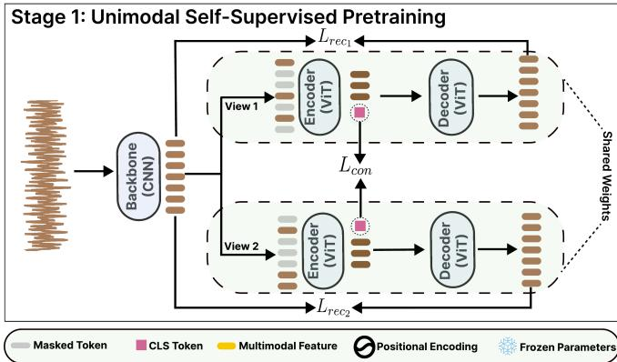
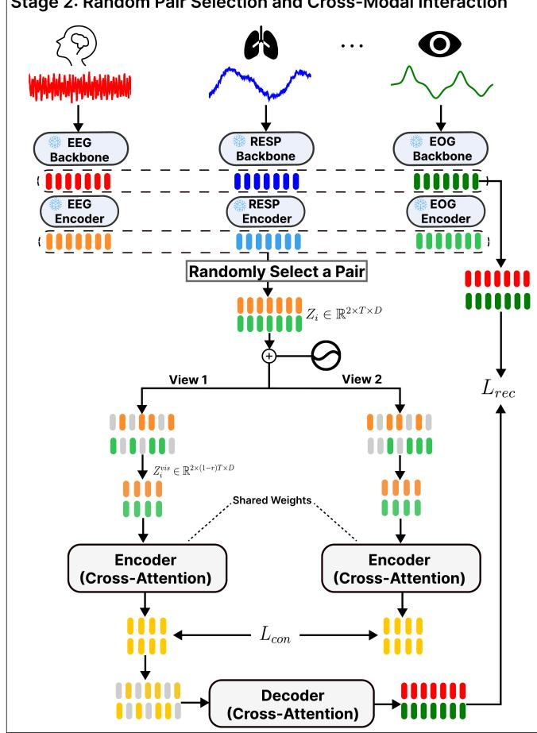

# SLEEPPAIRNET: LEARNING MULTIMODAL PEDIATRIC SLEEP REPRESENTATIONS WITH RANDOM-PAIR CROSS-ATTENTION

Saurav Raj Pandey

Department of Computer Science University of North Carolina at Chapel Hill Chapel Hill, NC, USA

Harlin Lee

School of Data and Information Sciences University of North Carolina at Chapel Hill Chapel Hill, NC, USA

## ABSTRACT

Analyzing physiological sleep signals is important for assessing sleep quality and detecting sleep-related disorders. Learning inter-modal relationships across physiological signals can provide richer representations for downstream sleep analysis. We introduce SleepPairNet, a multimodal selfsupervised learning (SSL) framework that learns pairwise interactions between physiological signals through crossattention. We propose a random modality-pair selection strategy that exposes the model to diverse signal pairs during pretraining, enabling flexibility across modality combinations at test time. Pretrained on the NCH dataset, SleepPairNet outperforms the evaluated SSL baselines on all respiratory tasks while remaining competitive on EEG-related tasks, and shows even stronger results when transferred to the external CHAT dataset.

Index Terms— pediatric sleep, self-supervised learning, cross-attention, multimodal learning, transfer learning

## 1. INTRODUCTION

Sleep is crucial to the physical and mental well-being of children, with poor sleep associated with adverse outcomes such as anxiety, depression, and hypertension [1]. In clinical practice, polysomnography (PSG) records multiple physiological signals (EEG, EOG, EMG, etc.) overnight, but its analysis requires costly expert annotations of sleep stages and events. Self-supervised learning (SSL) can leverage unlabeled PSG data to learn representations transferable to downstream tasks with limited labeled data, reducing annotation requirements and improving generalization.

Recent sleep SSL methods have increasingly incorporated multiple physiological signals and explored flexible designs for varying channel configurations. Cross-attention provides a natural mechanism for learning relationships between modalities by allowing representations from one physiological signal to directly attend to those of another, but remains relatively underexplored in sleep SSL.

We propose SleepPairNet, a multimodal SSL framework for pediatric PSG that learns cross-modal representations

through cross-attention. We introduce a random modalitypair strategy that samples a new signal pair at each training mini-batch, exposing a single model to diverse modality combinations. Pretrained on NCH, SleepPairNet outperforms the evaluated SSL baselines on respiratory-related tasks (apnea, hypopnea, and oxygen desaturation detection) while remaining close on EEG-related tasks (sleep scoring and EEG arousal detection). When transferred to CHAT without further SSL or backbone fine-tuning, it achieves even larger respiratory-task gains and stronger relative performance on EEG-related tasks.

## 2. RELATED WORK

Sleep SSL has largely focused on learning representations from unimodal EEG, including BENDR [2], EEGPT [3], and NeuroNet [4]. More recent approaches have extended SSL to multimodal physiological signals, including COCOA [5], SleepFM [6], SynthSleepNet [7], and PedSleepMAE [8]. SleepFM is channel-agnostic and handles variability in channel number via attention pooling, while SynthSleepNet and PedSleepMAE assume fixed input modalities.

Cross-attention has been used to model EEG–EOG interactions in supervised sleep scoring [9, 10]. Outside sleep, CardioFM [11] and MultiSSL [12] explore cross-modal attention in SSL but use fixed sets of two to three modalities. In contrast, SleepPairNet applies cross-attention to randomly sampled physiological signal pairs during SSL, enabling one model to learn across diverse modality combinations.

Random channel selection has also been used in supervised sleep models: U-Sleep [13] samples random EEG/EOG channels for montage robustness, and wav2sleep [14] randomly drops signals to handle variable inputs. SleepPair-Net brings random selection to SSL, sampling heterogeneous modality pairs to learn transferable cross-modal relationships.

## 3. METHODOLOGY

We describe our datasets and SleepPairNet’s training strategy.   
All code will be made public upon acceptance of the paper.

Stage 2: Random Pair Selection and Cross-Modal Interaction  
  
Fig. 1. Overview of SleepPairNet’s architecture.

## 3.1. Dataset and Preprocessing

We pretrain SleepPairNet on the publicly available Nationwide Children’s Hospital (NCH) Sleep DataBank, a large pediatric PSG dataset collected in clinical settings [15]. We use 2,379 overnight PSGs containing 16 channels spanning EEG, EOG, EMG, respiratory, and other physiological signals.

For cross-dataset evaluation, we use 422 baseline PSGs from the Childhood Adenotonsillectomy Trial (CHAT) [16, 17] dataset, restricted to 12 channels overlapping with NCH and used only to evaluate NCH-pretrained representations.

Both datasets provide 30-second annotations for sleep stages (Wake, N1, N2, N3, and REM) and clinically relevant events, including apnea, hypopnea, EEG arousal, and oxygen desaturation. We treat each non-overlapping 30-second epoch as an individual sample, standardize each channel to zero mean and unit variance, and use patient-level 80/10/10 train/validation/test splits.

## 3.2. SleepPairNet Architecture

As shown in Figure 1, SleepPairNet treats each PSG channel as a modality and uses two-stage pretraining: (1) unimodal SSL per channel and (2) bimodal SSL on randomly sampled modality pairs.

## 3.2.1. Stage 1: Unimodal Self-Supervised Pretraining

We independently pretrain a separate NeuroNet [4] for each of the 16 physiological channels, retaining its original architecture and SSL objectives while adapting preprocessing and training configurations to our experimental setting. Briefly, a CNN backbone produces frame-level features to which positional encodings are added. Two views are then generated using independent random masking, with 75% of the tokens masked in each view. The visible tokens from each view are passed through a Vision Transformer (ViT) encoder, while a smaller Transformer decoder reconstructs the corresponding CNN backbone features at the masked positions. The CLS tokens from both views are projected into a contrastive space and trained with the NT-Xent loss [18].

The training objective is

$$
L _ { \mathrm { t o t } } = L _ { \mathrm { r e c _ { 1 } } } + L _ { \mathrm { r e c _ { 2 } } } + \alpha L _ { \mathrm { c o n } } ,\tag{1}
$$

where $L _ { \mathrm { r e c _ { 1 } } }$ and $L _ { \mathrm { r e c } _ { 2 } }$ are masked reconstruction losses, $L _ { \mathrm { c o n } }$ is the NT-Xent loss, and α controls its contribution.

## 3.2.2. Stage 2: Random Pair Selection and Cross-Modal Interaction

After Stage 1, each channel’s pretrained CNN backbone and encoder are frozen and used to obtain $h _ { m } \in \mathbb { R } ^ { ( T + 1 ) \times D }$ for each modality $m ,$ , where T and D denote the number of temporal tokens and embedding dimension, respectively. At each iteration, we randomly select two of the 16 channels, discard their CLS tokens, and stack the temporal tokens of each sample i to form $Z _ { i } \in \mathbb { R } ^ { 2 \times T \times D }$

After adding positional encodings to $Z _ { i }$ , we independently mask each modality at masking ratio $r = 0 . 5$ , yielding $\bar { Z } _ { i } ^ { \mathrm { v i s } } ~ \in ~ \mathbb { R } ^ { 2 \times ( 1 - r ) T \times \bar { D } }$ . Then, $Z _ { i } ^ { \mathrm { v i s } }$ is processed by a cross-attention Transformer encoder, where the tokens of each modality serve as queries and attend to the keys and values derived exclusively from the other modality. A crossattention Transformer decoder restores the masked positions using learned mask tokens and reconstructs the corresponding frame-level CNN features. Reconstruction loss is computed only at masked positions.

For contrastive learning, we generate two independently masked views of the same modality pair. For each view, we average the encoder representations across both modalities and temporal tokens to obtain a single multimodal representation, which is projected into a contrastive space and trained with the NT-Xent loss. Reconstruction is performed on only one view, giving the overall training objective $L _ { \mathrm { r e c } } + L _ { \mathrm { c o n } }$

## 3.3. Downstream Classification

## 3.3.1. Linear Probing and Channel Selection

We evaluate representations before and after SleepPairNet’s Stage-2 cross-modal pretraining. Given the stacked Stage-1 representations $Z _ { i } ~ \in ~ \mathbf { \bar { R } } ^ { 2 \times T \times D }$ defined in Section 3.2.2, our “Concat” ablation mean-pools each modality over the temporal dimension to obtain two D-dimensional vectors, which are concatenated and provided as input to a linear classifier for each downstream task.

For SleepPairNet, we set $r = 0 .$ , such that $Z _ { i } ^ { \mathrm { v i s } } = Z _ { i } .$ , and pass $Z _ { i }$ through the cross-attention encoder. We then apply the same temporal mean-pooling, concatenation, and linear classification as in Concat. This comparison isolates the contribution of Stage-2 cross-modal pretraining.

For each task, we use individual-channel rankings from [19], obtained by linear probing on a subset of the NCH train split, as a starting point for selecting modality pairs. We evaluate combinations of highly ranked channels and additional task-relevant pairs identified using domain knowledge (e.g., $\mathrm { { S p O _ { 2 } } }$ and CAPNO for respiratory events), selecting the pair with the highest SleepPairNet validation F1 for each task.

For NCH, all representation models are frozen after SSL and only the linear classifiers are trained for each task. For CHAT, NCH-pretrained representations are transferred directly without further self-supervised training or backbone fine-tuning, and only linear classifiers are trained. Classweighted cross-entropy is used to address class imbalance.

## 3.3.2. Baselines

All representation models are pretrained on the same NCH train split. Aside from our “Concat” ablation, we compare against SleepFM, PedSleepMAE, SynthSleepNet, and NeuroNet. SleepFM and PedSleepMAE are evaluated using the same task-specific modality pairs as SleepPairNet, so that all multimodal methods receive identical inputs, while unimodal NeuroNet is evaluated separately on each modality of the pair. Since SleepFM does not specify a linear-probing procedure, we follow [19] by mean-pooling its temporal embeddings separately for each modality and concatenating the resulting representations. For PedSleepMAE, we follow the authors’ original linear-probing implementation.

For SynthSleepNet, we restrict evaluation to modality configurations studied in the original work [7], rather than extending the framework to previously unevaluated respiratory modalities. EEG, EOG, and EMG in our SynthSleepNet experiments correspond to EEG C4–M1, EOG LOC–M2, and EMG CHIN1–CHIN2, respectively.

## 4. RESULTS AND DISCUSSION

Table 1 shows the linear-probing results on the NCH test set. Given the extreme class imbalance in event-detection tasks, we emphasize F1 and AUPRC as the primary evaluation metrics. SleepPairNet outperforms all evaluated baselines on respiratory tasks in both metrics, with the largest gains for hypopnea: 5.8 percentage points (pp) in F1 and AUPRC. For sleep scoring and arousal, SynthSleepNet and SleepFM perform best, respectively.

Table 2 evaluates transfer to CHAT by freezing the NCHpretrained models and fitting only a linear probe. SleepPair-Net again outperforms all baselines on every respiratory task, with gains larger than on NCH (up to 14.4 pp in AUPRC for desaturation). Some NCH channels are unavailable in CHAT: for apnea, EOG ROC–M1 is replaced by EEG F3–M2, and for hypopnea, EEG CZ–O1 is replaced by EEG F4–M1. Even with these substituted pairs, SleepPairNet gains 5.4 and 13.1 pp in F1, respectively, showing that a single model transfers across both cohorts and channel combinations. For sleep scoring, its gap to SynthSleepNet narrows to 2.6 pp in F1 and 2.4 pp in AUPRC.

The Concat ablation shows that Stage-2 cross-modal pretraining adds consistent respiratory gains: SleepPairNet improves F1 over Concat by 3.6–4.8 pp on NCH and 4.3–14.6 pp on CHAT, while the two stay within 2.2 pp on sleep scoring and arousal. Concat itself is also often competitive with existing multimodal SSL models, suggesting that the Stage-1 encoders provide a strong foundation for Stage 2.

The remaining EEG-task gap may partly reflect each model’s pretraining. SleepFM is pretrained jointly on brain activity (EEG, EOG), respiratory, and EMG signals, while the evaluated SynthSleepNet models are pretrained on EEG– EOG/EMG combinations, potentially favoring sleep scoring and arousal. SleepPairNet instead samples pairs from all 16 channels, trading repeated exposure to EEG-centric pairs for broader coverage of physiological signals. On CHAT, however, it narrows its EEG-task gaps and widens its respiratory gains. This suggests exposure to diverse pairs may yield representations that transfer more robustly to new cohorts.

Random-pair training also provides flexibility across channel combinations. Fixed-combination models such as SynthSleepNet require new multimodal pretraining whenever the combination changes (e.g., EEG–EOG to EEG–RESP). In contrast, a single SleepPairNet model handles all 120 pairs of its 16 channel-specific encoders without further cross-modal pretraining, reducing compute and storage costs.

Table 1. NCH linear-probing results (mean (SD) over linear-probe seeds 41–43). Bold/underline: best/second-best. Parentheses under task name: binary-task prevalence. Shaded : ∆F1/∆AUPRC of best Ours vs. best non-Ours; green = gain.
<table><tr><td rowspan="3">Model</td><td rowspan="3">Modalities</td><td colspan="5">Performance (%)</td></tr><tr><td></td><td>Apnea</td><td>EEG Arousal</td><td>Oxygen Desat.</td><td>Hypopnea</td></tr><tr><td>Sleep Scoring</td><td>(0.8%)</td><td>(4.6%)</td><td>(8.7%)</td><td>(1.9%)</td></tr><tr><td rowspan="3">SleepFM</td><td></td><td>Acc. F1 ROC PR</td><td>Acc. F1 ROC PR</td><td>Acc. F1 ROC PR</td><td>Acc. F1 ROC PR</td><td>Acc. F1 ROC PR</td></tr><tr><td></td><td>66.8 60.1 88.5 64.7</td><td>98.2 14.8 80.4 7.3</td><td>92.8 41.7 87.4 36.0</td><td>84.8 36.2 77.8 31.9</td><td>96.3 17.5 77.8 10.7</td></tr><tr><td>C1, C2</td><td>(0.0) (0.1) (0.1) (0.1)</td><td>(0.0) (0.2) (0.1) (0.2)</td><td>(0.1) (0.2) (0.1) (0.5)</td><td>(0.3) (0.1) (0.1) (0.1)</td><td>(0.1) (0.3) (0.1) (0.1)</td></tr><tr><td>PedSleepMAE</td><td>C1, C2</td><td>60.5 46.2 84.1 53.5 (1.0) (1.5) (0.1) (0.2)</td><td>97.8 11.4 74.1 4.4 (0.2) (0.1) (0.1) (0.0)</td><td>87.4 24.4 75.3 13.9 (0.6) (0.1) (0.0) (0.0)</td><td>81.3 27.0 69.7 21.1</td><td>94.0 14.9 73.0 7.2 (0.1) (0.1) (0.2)</td></tr><tr><td rowspan="4">SynthSleepNet</td><td></td><td></td><td></td><td></td><td>(0.2) (0.0) (0.0) (0.0)</td><td>(0.0)</td></tr><tr><td></td><td>74.8 67.2 92.5 72.2</td><td>92.2 5.5 73.6 2.6</td><td>93.2 40.1 84.3 33.0</td><td>71.3 26.7 70.9 18.0</td><td>93.3 10.1 73.2 5.6</td></tr><tr><td>EEG, EOG</td><td>(0.3) (0.2) (0.0) (0.0)</td><td>(5.5) (0.4) (1.1) (0.3)</td><td>(0.1) (0.2) (0.3) (0.2)</td><td>(0.9) (0.1) (0.1) (0.1)</td><td>(0.3) (0.4) (0.4) (0.2)</td></tr><tr><td>EEG, EMG</td><td>65.9 91.9 71.2 73.2</td><td>95.2 8.3 77.0 3.7</td><td>93.0 41.6 86.8 35.4</td><td>71.9 27.1 71.5 18.6</td><td>90.8 11.7 76.3 6.5</td></tr><tr><td rowspan="4">NeuroNet</td><td></td><td>(0.3) (0.2) (0.0) (0.1)</td><td>(0.1) (0.2) (0.8) ) (0.2)</td><td>(0.2) (0.2) (0.1) (0.1)</td><td>(1.1) (0.2) (0.2) (0.1)</td><td>(1.5) (1.0) (0.9) (0.6)</td></tr><tr><td></td><td>65.3 56.8 86.0 61.3</td><td>98.3 19.7 83.8 10.8</td><td>92.2 29.4 75.5 20.2</td><td>78.7 29.5 72.6 20.5</td><td>89.3 6.8 64.4 3.7</td></tr><tr><td>C1</td><td>(1.6) (0.4) (0.3) (0.3)</td><td>(0.0) (0.3) (0.1) (0.0)</td><td>(0.1) (0.7) (0.5) (0.7)</td><td>(0.8) (1.2) (0.9) (0.7)</td><td>(0.4) (1.1) (0.1) (0.4)</td></tr><tr><td></td><td>64.657.2 86.8 61.5</td><td>94.1 4.3 67.6 2.0</td><td>91.1 34.3 84.4 26.5</td><td>87.2 40.3 79.6 36.1</td><td>96.2 24.4 81.9 15.3</td></tr><tr><td rowspan="4">Ours</td><td>C2 C1, C2</td><td>(1.3) (0.6) (0.3) (0.4)</td><td>(3.7) (0.8) (2.9) (0.4)</td><td>(0.1) (0.1) (0.3) (0.3)</td><td>(0.1) (0.0) (0.0) (0.1)</td><td>(0.1) (0.1) (0.1) (0.1)</td></tr><tr><td>(Concat)</td><td>72.0 63.6 90.2 68.2 (1.6) (0.5) (0.2) (0.4)</td><td>97.9 17.8 84.3 9.6 (0.2) (0.7) (0.7) (0.5)</td><td>92.5 37.7 85.0 30.5 (0.3) (0.9) (0.7) (0.9)</td><td>87.2 41.5 80.9 36.6</td><td>96.8 25.4 83.4 17.8</td></tr><tr><td>C1, C2</td><td>71.2</td><td>97.9 21.7 87.3 12.5</td><td>92.0 36.7 84.8 29.3</td><td>(0.0) (0.6) (0.4) (0.8)</td><td>(0.0) (0.1) (0.8) (0.1)</td></tr><tr><td>(SleepPairNet)</td><td>63.4 90.2 68.2 (0.4) (0.3) (0.1) (0.2)</td><td>(0.0) (0.1) (0.1) (0.0)</td><td>(0.2) (0.3) (0.1) (0.4)</td><td>88.3 45.1 82.9 41.7 (0.2) (0.2) (0.0) (0.4)</td><td>96.4 30.2 85.8 21.1 (0.4) (0.3) (0.1) (0.2)</td></tr><tr><td>ΔF1/ΔAUPRC</td><td></td><td>-3.6/-4.0</td><td>+2.0 +1.7</td><td>-4.0/-5.5</td><td>+4.8 1+5.6</td><td>+5.81+5.8</td></tr></table>

Note: Task-specific $\left( c _ { 1 } , c _ { 2 } \right)$ pairs: Sleep = (EEG C4–M1, EOG LOC–M2); Apnea = (SpO2, EOG ROC–M1); Arousal = (EEG C4–M1, EMG CHIN1–CHIN2); Desaturation = (CAPNO, SpO2); Hypopnea = (EEG CZ–O1, SpO2). Concat and SleepPairNet use mean-pooled Stage-1 and Stage-2 representations, respectively. F1 is macro-F1 for sleep scoring and binary F1 otherwise; ROC/PR denote AUROC/AUPRC.

Table 2. Evaluation of NCH-pretrained models on the external CHAT cohort. Layout and conventions as in Table 1.
<table><tr><td rowspan="3">Model</td><td rowspan="3">Modalities</td><td colspan="6">Performance (%)</td></tr><tr><td></td><td>Apnea</td><td>EEG Arousal</td><td colspan="2">Oxygen Desat.</td><td>Hypopnea</td></tr><tr><td>Sleep Scoring</td><td>(2.4%)</td><td>(8.0%)</td><td colspan="2">(17.0%)</td><td>(3.9%)</td></tr><tr><td rowspan="3">SleepFM</td><td></td><td>Acc. F1 ROC PR</td><td>Acc. F1 ROC PR</td><td>Acc. F1 ROC PR</td><td>Acc. F1 ROC PR</td><td>Acc. 90.4</td><td>F1 ROC PR</td></tr><tr><td></td><td>70.9 65.5 90.7 68.9</td><td>92.7 10.7 73.9 5.4</td><td>90.3 52.6 90.6 49.2</td><td>81.6 52.3</td><td>82.6 49.2</td><td>19.7 79.1 12.4</td></tr><tr><td>C1, C2</td><td>(0.1) (0.2) (0.1) (0.1)</td><td>(0.1) (0.1) (0.2) (0.1)</td><td>(0.1) (0.1) (0.0) (0.1)</td><td>(0.0) (0.0)</td><td>(0.1) (0.1)</td><td>(0.1) (0.0) (0.1) (0.1)</td></tr><tr><td rowspan="2">PedSleepMAE</td><td></td><td>44.5 38.1 74.3 39.1</td><td>41.4 4.9 60.2 3.0</td><td>78.4 27.1 71.2 16.5</td><td>67.4 40.9</td><td>71.4 33.5 84.3</td><td>11.9 67.4 6.1</td></tr><tr><td>C1, C2</td><td>(0.9) (0.5) (0.1) (0.2)</td><td>(5.1) (0.2) (0.0) (0.0)</td><td>(0.8) (0.1) (0.0) (0.0)</td><td>(0.0) (0.0)</td><td>(0.0) (0.0)</td><td>(2.0) (0.2) (0.1) (0.0)</td></tr><tr><td rowspan="2">SynthSleepNetEEG, EMG</td><td></td><td>74.9 69.4 92.7 72.8</td><td>92.9 13.3 77.3 7.2</td><td>89.9 50.6 89.9 46.7</td><td>72.5 36.3</td><td>69.5 28.4</td><td>89.4 14.7 72.1 8.1</td></tr><tr><td></td><td>(0.3) (0.3) (0.1) (0.2)</td><td>(0.6) (0.1) (0.2) (0.0)</td><td>(0.1) (0.1) (0.0) (0.0)</td><td>(0.1) (0.1)</td><td>(0.1) (0.1)</td><td>(0.4) (0.3) (0.1) (0.1)</td></tr><tr><td rowspan="4">NeuroNet</td><td></td><td>67.7 61.5 88.5 64.6</td><td>89.9 10.8 72.5 5.2</td><td>88.2 44.6 84.8 36.7</td><td>50.9 28.8</td><td>56.2 21.5</td><td>89.4 9.8 69.0 6.0</td></tr><tr><td>C1</td><td>(1.6) (0.9) (0.4) (0.8)</td><td>(0.9) (0.3) (0.6) (0.1)</td><td>(0.8) ) (1.3) (0.5) (1.2)</td><td>(0.5) (0.1)</td><td>(0.0) (0.0)</td><td>(0.2) (0.8) (1.4) (0.4)</td></tr><tr><td></td><td>53.9 49.8 81.9 52.1</td><td>91.3 13.0 68.6 5.8</td><td>89.5 47.9 89.4 41.7</td><td>74.9 48.2</td><td>79.847.1</td><td>88.0 20.3 76.8 14.8</td></tr><tr><td>C2</td><td>(0.6) (0.3) (0.1) (0.1)</td><td>(0.2) (0.2) (0.3) (0.1)</td><td>(0.3) (0.2) (0.1) (0.1)</td><td>(0.0) (0.0)</td><td>(0.0) (0.1)</td><td>(0.1) (0.0) (0.0) (0.1)</td></tr><tr><td rowspan="4">Ours</td><td>C1, C2</td><td>72.4 67.3 91.9 71.4</td><td>93.4 14.4 76.7 7.2</td><td>91.1 54.2 91.3 48.7</td><td>75.0 47.8</td><td>79.2 46.3 90.9</td><td>24.0 80.9 16.2</td></tr><tr><td>(Concat)</td><td>(0.8) (0.6) (0.1) (0.4)</td><td>(0.4) (0.4) (0.2) (0.2)</td><td>(0.4) (0.6) (0.2) (0.7)</td><td>(0.0) (0.0)</td><td>(0.0) (0.1)</td><td>(0.5) (0.9) (0.1) (0.9)</td></tr><tr><td>C1, C2</td><td>72.1 66.8 91.5 70.4</td><td>94.4 18.7 81.4 9.9</td><td>90.1 52.0 90.8 46.6</td><td>87.9</td><td>62.4 87.0 63.6</td><td>93.4 33.4 85.7 24.5</td></tr><tr><td>(SleepPairNet)</td><td>(0.5) (0.4) (0.1) (0.2)</td><td>(0.1) (0.1) ) (0.2) (0.1)</td><td>(0.5) (0.6) (0.1) (0.6)</td><td>(0.0) (0.1)</td><td> (0.0) (0.1)</td><td>(0.1) (0.2) (0.2) (0.2)</td></tr><tr><td colspan="2">ΔF1/ΔAUPRC</td><td>-2.1/-1.4</td><td>+5.4 +2.7</td><td>+1.6 1–0.5</td><td>+10.1</td><td>+14.4</td><td>+13.11+9.7</td></tr></table>

Note: Task-specific $\left( c _ { 1 } , c _ { 2 } \right)$ pairs: Sleep = (EEG C4–M1, EMG CHIN1–CHIN2); Apnea = (EEG F3–M2, SpO ); Arousal = (EEG C4–M1, EMG CHIN1–CHIN2); Desaturation = (CAPNO, SpO2); Hypopnea = (EEG F4–M1, SpO2).

## 5. CONCLUSION

We introduced SleepPairNet, which learns multimodal sleep representations through random-pair cross-attention. Sleep-PairNet outperforms the evaluated baselines on respiratory tasks on NCH, with even larger gains on the external CHAT cohort, while remaining competitive on EEG-related tasks. Future work could compare random- and fixed-pair pretraining, evaluate on held-out channel pairs, and extend SleepPair-

Net beyond pairs to larger sets of physiological signals.

## 6. ACKNOWLEDGEMENT

The Childhood Adenotonsillectomy Trial (CHAT) was supported by the National Institutes of Health (HL083075, HL083129, UL1-RR-024134, UL1 RR024989). The National Sleep Research Resource was supported by the National Heart, Lung, and Blood Institute (R24 HL114473,

75N92019R002). This work was partially supported by the AI Acceleration Program at UNC Chapel Hill.

## 7. REFERENCES

[1] Goran Medic, Micheline Wille, and Michiel EH Hemels, “Short- and long-term health consequences of sleep disruption,” Nature and Science of Sleep, vol. 9, pp. 151–161, 2017.

[2] Demetres Kostas, Stephane Aroca-Ouellette, and Frank Rudzicz, “BENDR: Using transformers and a contrastive self-supervised learning task to learn from massive amounts of EEG data,” Frontiers in Human Neuroscience, vol. 15, pp. 653659, 2021.

[3] Guangyu Wang, Wenchao Liu, Yuhong He, Cong Xu, Lin Ma, and Haifeng Li, “EEGPT: Pretrained transformer for universal and reliable representation of EEG signals,” Advances in Neural Information Processing Systems, vol. 37, pp. 39249–39280, 2024.

[4] Cheol-Hui Lee, Hakseung Kim, Hyun-jee Han, Min-Kyung Jung, Byung C Yoon, and Dong-Joo Kim, “NeuroNet: A novel hybrid self-supervised learning framework for sleep stage classification using single-channel EEG,” arXiv preprint arXiv:2404.17585, 2024.

[5] Shohreh Deldari, Hao Xue, Aaqib Saeed, Daniel V Smith, and Flora D Salim, “COCOA: Cross modality contrastive learning for sensor data,” Proceedings ofthe ACM on Interactive, Mobile, Wearable and Ubiquitous Technologies, vol. 6, no. 3, pp. 1–28, 2022.

[6] Rahul Thapa, Magnus Ruud Kjaer, Bryan He, Ian Covert, Hyatt Moore IV, Umaer Hanif, Gauri Ganjoo, M Brandon Westover, Poul Jennum, Andreas Brink-Kjaer, et al., “A multimodal sleep foundation model for disease prediction,” Nature Medicine, vol. 32, no. 2, pp. 752–762, 2026.

[7] Cheol-Hui Lee, Hakseung Kim, Byung Chul Yoon, and Dong-Joo Kim, “Toward foundational model for sleep analysis using a multimodal hybrid-selfsupervised learning framework,” IEEE Transactions on Cybernetics, vol. 55, no. 12, pp. 5619–5632, 2025.

[8] Saurav Raj Pandey, Aaqib Saeed, and Harlin Lee, “Ped-SleepMAE: Generative model for multimodal pediatric sleep signals,” in 2024 IEEE EMBS International Conference on Biomedical and Health Informatics (BHI). IEEE, 2024, pp. 1–8.

[9] Wei Yu and Jinlong Yang, “CASleepNet: A cross attention-based multimodal fusion approach for sleep staging with EEG and EOG,” in ICASSP 2025 - 2025 IEEE International Conference on Acoustics, Speech and Signal Processing (ICASSP), 2025, pp. 1–5.

[10] Ranran Gui, Chen Wang, Qunfeng Niu, and Li Wang, “MFSleepNet: An interactive multimodal fusion framework for automatic sleep staging,” Sensors, vol. 26, no. 10, pp. 3085, 2026.

[11] Md Hassanuzzaman, Tilendra Choudhary, Alasdair Gent, Mihai V Podgoreanu, Suresh Mitu Agarwal, Vijay Krishnamoorthy, Sivasubramanium Bhavani, Philip Yang, Annette Esper, and Rishikesan Kamaleswaran, “CardioFM: A multimodal foundation model for joint ECG and PPG representation learning,” Research Square preprint, 2026.

[12] Zhixiang Xue, Guopeng Yang, Xuchu Yu, Anzhu Yu, Yinggang Guo, Bing Liu, and Jianan Zhou, “Multimodal self-supervised learning for remote sensing data land cover classification,” Pattern Recognition, vol. 157, pp. 110959, 2025.

[13] Mathias Perslev, Sune Darkner, Lykke Kempfner, Miki Nikolic, Poul Jørgen Jennum, and Christian Igel, “U-Sleep: resilient high-frequency sleep staging,” npj Digital Medicine, vol. 4, no. 1, pp. 72, 2021.

[14] Jonathan F Carter and Lionel Tarassenko, “wav2sleep: a unified multi-modal approach to sleep stage classification from physiological signals,” arXiv preprint arXiv:2411.04644, 2024.

[15] Harlin Lee, Boyue Li, Shelly DeForte, Mark L Splaingard, Yungui Huang, Yuejie Chi, and Simon L Linwood, “A large collection of real-world pediatric sleep studies,” Scientific Data, vol. 9, no. 1, pp. 421, 2022.

[16] Guo-Qiang Zhang, Licong Cui, Remo Mueller, Shiqiang Tao, Matthew Kim, Michael Rueschman, Sara Mariani, Daniel Mobley, and Susan Redline, “The National Sleep Research Resource: towards a sleep data commons,” Journal ofthe American Medical Informatics Association, vol. 25, no. 10, pp. 1351–1358, 2018.

[17] Carole L Marcus, Renee H Moore, Carol L Rosen,´ Bruno Giordani, Susan L Garetz, H Gerry Taylor, Ron B Mitchell, Raouf Amin, Eliot S Katz, Raanan Arens, et al., “A randomized trial of adenotonsillectomy for childhood sleep apnea,” New England Journal of Medicine, vol. 368, no. 25, pp. 2366–2376, 2013.

[18] Ting Chen, Simon Kornblith, Mohammad Norouzi, and Geoffrey Hinton, “A simple framework for contrastive learning of visual representations,” in Proceedings of the 37th International Conference on Machine Learning. 2020, vol. 119, pp. 1597–1607, PMLR.

[19] Saurav Raj Pandey and Harlin Lee, “BiTimeCross-Net: Time-aware self-supervised learning for pediatric sleep,” arXiv preprint arXiv:2602.02769, 2026.