# SPLASH: Contrastive Audit Pressure for Detecting and Localizing Security Hallucinations in Generated Code

MIRZA MASFIQUR RAHMAN∗†, Purdue University, USA

MD AJWAD AKIL, Purdue University, USA

IMTIAZ KARIM, University of Texas at Dallas, USA

ASHISH KUNDU, Cisco Research, USA

RAMANA KOMPELLA, Cisco Research, USA

ELISA BERTINO, Purdue University, USA

Code generated by large language models often passes every functional test while remaining insecure. These security hallucinations are common, written with high confidence, and repeated across samples, so neither the generator’s own uncertainty nor static analyzers reliably catch them. We introduce SPLASH, which is guided by a new measure called audit pressure. It contrasts teacher-forced log-probabilities for the generated program under a security review and a style review. Aggregated to statements and programs, and grounded in a probabilistic model of competing edits, audit pressure allows SPLASH to choose the secure program among a model’s candidate programs and locate the vulnerable statement, with no model training, CWE-specific rules, or internal access to the generating model. On 63,684 programs generated by 12 models for 899 tasks SPLASH picks secure code in 74% of cases, places the vulnerable statement first in 58% of insecure programs, and chooses better than a frontier LLM judge.

CCS Concepts: • Security and privacy → Software and application security.

Additional Key Words and Phrases: Code Generation, Security, Hallucination, Large Language Models

## 1 Introduction

Large language models (LLMs) [8, 14, 36] now produce syntactically and functionally correct pro-grams from natural-language specifications and are widely integrated into commercial development workflows [27, 41]. The standard practice for validating generated code is functional testing: if the program passes its test suite, it is considered ready to deploy. However, a program can satisfy every functional requirement while containing a security vulnerability that no unit test exercises.

A model asked to hash a user’s password may write sha256(pw) without a salt: the code compiles, returns the expected digest, and passes the unit test. The secure alternative, bcrypt with a random salt, is rarely among the model’s likely continuations. This is a security hallucination [5, 44] (Definition 2.1): a functionally correct program that fails its security test. For capable models, the same model that writes unsalted SHA-256 can identify the flaw when asked to review it, showing that the security knowledge is present but remains inactive during generation. Security hallucinations are also produced with high confidence and reproduced consistently across independent samples, making them invisible to methods that rely on output variation.

Security hallucinations are common. Among working programs from open-weight models in our evaluation, 24–60% fail their security tests. Frontier models are safer (Claude Opus 5: 6%, GPT-5.6 Sol: 8%), but agentic pipelines retain roughly a third of their working solutions insecure.

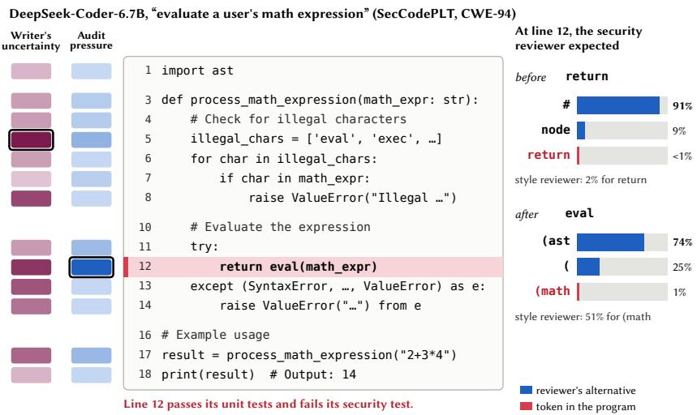  
Fig. 1. A working but insecure program. DeepSeek-Coder-6.7B evaluates the user’s expression with eval (line 12; CWE-94), which passes the unit tests and fails the security test. Left: the writer’s own uncertainty peaks on the blocklist (line 5), not on the flaw; audit pressure (our method) peaks on line 12. Right: at line 12 the security reviewer expected a comment before return (91%) and (ast after eval (74%), and gave the program’s own tokens under 1%; the style reviewer gives them far more (2% and 51%).

Such frequent nature and confident behavior of the models positions it as a critical concern in software development lifecycle.

Limitations of existing approaches. Hallucination detectors for natural language measure variation in the generator’s output distribution [7, 16, 18, 23, 25], but security hallucinations violate their shared assumption as 86% of insecure working programs have only insecure siblings, and generation uncertainty is weak (AUROC 0.61). Static analyzers [4, 34, 38, 47] produce a CWEmatched finding on only 15% of security hallucinations. Generation-time defenses [11, 12, 48] reduce vulnerability rates by 25–35% but require training access and do not eliminate hallucinations. Post-hoc methods such as process reward models [49] and steering vectors [37] need labeled data and white-box access. LLM-as-judge approaches can name flawed lines but give no graded score to rank candidates and cost an API call per program.

Research challenges. Three properties make security hallucinations resistant to the approaches above. (C1) The generator’s own token distribution carries little signal about security: when code is written with near-zero entropy, the tokens reveal negligible information about any downstream property (Proposition 2.2). (C2) The vulnerability is typically an absence rather than a presence (missing validation, omitted salt), so there is no token to flag. (C3) Whether code is insecure depends more on the task than on the model (57% of variance vs 6%), so absolute scores do not transfer across tasks for any judge. SPLASH therefore asks the two questions a developer actually has: which candidate should I keep, and which line should I review?

Our approach. We present SPLASH (Statement-level Pressure Localization via Audit against Security Hallucinations). At its core is audit pressure, a novel method that reads the model’s distribution under review (addressing C1): an auditor model reads a candidate program under two instructions, a security-review and a style-review, and the program is scored token by token via teacher forcing with nothing sampled. The method records positive audit pressure wherever the security reviewer would have written diferent code but the style reviewer is far more willing to reproduce the token. Because teacher-forced copying reveals where the reviewer wanted to insert code, the pressure of a missing check lands on the line where it would have been written (addressing C2). Figure 1 shows the concept: on eval(math\_expr), the security reviewer expected (ast after eval, i.e. parsing the input safely, while style reviewer accepts it far more readily.

The per-token log-probability diference between the two instructions decomposes exactly into a log Bayes factor by the chain rule. Under a formal model of competing edits (§4), this token-level pressure aggregates to statement scores and program scores with a probabilistic interpretation. The decomposition enables two outputs from the same pass: (1) selecting the most secure candidate (by lowest program score) and (2) localizing the vulnerable statement (by highest statement score). Because only within-task comparisons are needed, the task-level shifts that defeat cross-task classification do not afect either output (addressing C3). SPLASH applies to code from any source - open-weight models, closed-API models, and agentic pipelines, with no training, no CWE-specific rules, and no labeled data.

In practice. Security tests do not exist in ordinary development as they must be written per task by someone who already knows the vulnerability. Developers have, at most, unit tests. Although we use security tests in our evaluation to measure efectiveness of SPLASH], it does not rely on them as inputs. Meanwhile, sampling several candidates is already a common practice (IDE suggestions, best-of-�, agent retries), but there is no established way to choose among them for security. Audit pressure fills this slot as it requires no training, no per-CWE rules, no generator weights, and no paid API. It works with whatever unit tests exist and also without any (Figure 5b), and points the reviewer at the line; e.g., the vulnerable statement is in the top 3 in 85% of cases.

Findings. We evaluate SPLASH on 899 tasks with executable security tests across 12 generators:

• Selection. SPLASH picks secure code in 74% of decisive candidate pools (random: 54%, uncertainty: 65%), closing 46% of the gap to a perfect pick. On held-out tasks, the gain is within two points. On agentic code, SPLASH picks secure in 76% of pools (random: 57%).

• Localization. SPLASH places the vulnerable statement first in 58% of insecure programs (random: 9%) and identifies the exact changed line in 77% of benchmark reference pairs.

• Practitioner comparison. SPLASH selects secure code more often than a frontier LLM judge (77% vs. 68%) while requiring only local inference rather than per-query API calls. Although the judge localizes more precisely on its sample (70% vs. 54% top-1), SPLASH provides both selection and localization from the same pass.

Contributions. We make the following contributions in this paper:

• Problem characterization. We provide the first study showing that security hallucinations are written confidently and repeated across samples, across 12 generators and 899 tested tasks, establishing that generation uncertainty and static analysis both miss most of them (§6.1).

• Method and system. We introduce audit pressure, a training-free, model-agnostic signal grounded in a formal model of competing edits, and build SPLASH, a pipeline that takes gener-ated code from any source and produces per-statement localization and per-pool candidate selection (§4, §3).

• Rigorous evaluation. We show that SPLASH achieves consistent gains across benchmarks, temperatures, model sizes, and beats random chance on 16 of 17 CWE types, comparing against static analyzers, a frontier LLM judge, and the generator’s own uncertainty (§6.2–§6.5). The code and artifacts of SPLASH are publicly available at: https://github.com/Prometheused SPLASH

## 2 Background

In this section, we discuss relevant background on code generation, security hallucination, and code security analysis.

## 2.1 Code Generation and Generation Uncertainty

Given the prompt and the tokens generated so far, an autoregressive code model writes a program one token at a time, sampling each token from its predicted distribution [8, 13, 14, 36]. Varying the random seed or the sampling temperature, a single prompt yields many distinct candidate programs that share the same functional intent but may difer in correctness, style, and security. For a prompt � and a generated program $P = \left( c _ { 1 } , \ldots , c _ { n } \right)$ , the generation uncertainty of model � is

$$
U ( P ) = - { \frac { 1 } { n } } \sum _ { t = 1 } ^ { n } \log p _ { M } { \bigl ( } c _ { t } \mid x , c _ { < t } { \bigr ) } ,\tag{1}
$$

which is high when the model is unsure of the tokens. It serves as our main baseline (§5).

## 2.2 Security Hallucinations

A hallucination in code generation is typically defined as output that deviates from the intended behavior: the program does not compile, fails its tests, or solves the wrong problem [21, 35, 42]. We define a stricter variant.

Definition 2.1 (Security hallucination). A security hallucination is a generated program � that passes every functional test and fails at least one security test: Func(�) = 1 and Sec(�) = 0. A program is secure and working if Func $( P ) = 1$ and Sec $( P ) = 1$

Security hallucinations are dangerous because they appear correct - the program runs, returns the right outputs, and often passes a developer’s spot checks. Hallucination detectors rely on the model hesitating or disagreeing with itself across samples [7, 23]. However, security hallucinations tend to be confident and repeated across samples. The following bound makes it precise why confident code carries little evidence.

Proposition 2.2 (Entropy bounds what a window can reveal). Let $r ( \cdot \mid u )$ be the distribution the generator samples from after prefix � and $H _ { r } ( u )$ its entropy. For a window $W = \left( Y _ { a } , \ldots , Y _ { b - 1 } \right)$ starting at position � and ending at stopping time $b ,$ and for every function � of the finished program (in particular $\beta = \mathsf { S e c } )$

$$
I \big ( \beta ( P ) ; W \mid u _ { 0 } \big ) \ \leq \ \mathbb { E } \left[ \sum _ { t = a } ^ { b - 1 } H _ { r } ( Y _ { < t } ) \Bigg | \ u _ { 0 } \right] .\tag{2}
$$

A statement written with near-zero entropy therefore reveals almost nothing about Sec(�) to any function of the generator’s own token distribution.

## 2.3 Static Analysis

Vulnerability types are documented by the Common Weakness Enumeration (CWE) [24]. Static analyzers such as Semgrep [38], Bandit [34], Cppcheck [4], and Flawfinder [47] flag vulnerable patterns without executing the code. They are fast and deterministic, and they excel at flagging dangerous code that is present (e.g., eval on user input, SQL built by string formatting), but a flaw that consists of a missing check (absent input validation, an omitted salt, no authorization guard) often leaves no pattern for a rule to match.

## 3 Overview

We first define the two tasks this paper addresses, then identify the research challenges, and finally outline how audit pressure addresses each one.

## 3.1 Problem Statement

Let $\boldsymbol { S } = ( x , T _ { f } , T _ { s } , C )$ be a task with prompt �, functional and security test suites, and CWE classes. A generator produces � candidate programs. We address two tasks:

Choosing. Given a pool $Q = \{ P _ { 1 } , \ldots , P _ { k } \}$ of candidate programs for one task (optionally restricted to those passing functional tests), select the program most likely to be secure and working:

$$
\operatorname { p i c k } ( Q ) = \arg \operatorname* { m i n } _ { P \in Q } g ( P ) ,
$$

where � is a scoring rule (higher = more likely insecure).

Locating. Given a single insecure program � with statement rows $\mathcal { R } ( P ) = \{ s _ { 1 } , . . . , s _ { R } \}$ , rank statements by their likelihood of containing the vulnerability:

$$
\operatorname { l o c a t e } ( P ) = \arg \operatorname* { m a x } _ { s \in { \mathcal { R } } ( P ) } g ( s ) .
$$

Both of these compare programs or statements within one coding task, by design.

## 3.2 Challenges

Detecting and localizing security flaws in generated code faces four research challenges that existing hallucination-detection and static-analysis methods do not overcome.

C1: Security hallucinations are written confidently, so the generator’s own distribution carries no feedback. Hallucination detectors exploit model hesitation [7, 23, 25]: token probabilities spread across alternatives and diferent samples produce diferent outputs. Security hallucina- tions show the opposite pattern as 86% of insecure working programs have only insecure siblings across independent samples, and generation uncertainty ranks insecurity at AUROC 0.61 overall ( §6.1). Proposition 2.2 confirms that confidently written flaws are invisible to every function of the generator’s token distribution.

C2: The dominant vulnerability pattern is an absence instead of presence. A security hallucination typically omits a necessary security evaluation check rather than inserting a dangerous function call. Because the flaw is in non-generated code, syntactic pattern matching cannot detect it: static analyzers find a CWE-matched issue in only 15% of insecure programs, and nearly as often in secure ones (i.e., 12% false positives). An efective diferentiating signal must reason about what should be in the code, not only about what is already there.

C3: Task-level label shifts defeat program-level detection. Whether generated code is insecure depends more on the task than the model. Task identity alone explains 57% of the variance in whether a working program is insecure, whereas generator identity explains 6%. Any score applied across tasks inherits these base-rate shifts. The problem is worst when a task’s security tests enforce requirements the prompt never states. On these tasks every code-level judge, including a yes/no verdict, performs poorly.

C4: Localization requires token-level attribution without training data. A binary verdict per program cannot isolate the security flaw. Any measure must decompose to individual tokens and aggregate to statements. Because the missing security check is not in the generated program, the auditor’s disagreement appears at the tokens just after the gap: this is where the auditor would have started writing the check, but the program continues with other code instead. The method must therefore attribute pressure to a line that follows the absent code, not to the absent code itself.

## 3.3 Our Approach

We now briefly address the challenges above. We discuss the detailed method in $\ S 4$

Addressing C1: Read a model’s distribution under a review instruction. The securit knowl edge needed to identify a flaw is present in a capable language model but remains inactive during code generation. Fundamentally, the model can not review the code while writing it. Audit pressure activates it: a separate audit reads the finished program under a security-review prompt and scores based on how willing it is to copy each token. Where the auditor would have written diferent code, its copy probability drops, revealing the flaw. This also opens the possibility for the generator model to audit itself or for a separate model to audit it. Since the auditor reads finished code, not the generator’s writing-time distribution, C1’s entropy bound (Prop. 2.2) does not apply to the auditor.

Addressing C2: Contrastive framing isolates security from style. A security-review prompt alone does not separate security concerns from general code-quality concerns. Audit pressure subtracts the score under a style-review prompt from the score under a security-review prompt, token by token, isolating the security-specific reluctance. Crucially, this detects absences: where the security reviewer would have inserted a check before a line, those tokens receive high probability under the style frame and low probability under the security frame, producing a positive pressure measure even though the vulnerability is based on missing artifacts in the program (§4.4).

Addressing C3: Within-task ranking instead of cross-task detection. We frame the problem as within-task comparisons. For choosing a secure program, all candidates in a pool share the same prompt, so diferences in how often a task produces insecure code do not afect the ranking (Lemma 4.4). For locating vulnerable statements, all statements belong to the same program, so program-level biases cancel out. This invariance is why audit pressure succeeds at choosing and locating security hallucinations even without task specific security tests (§6.5).

Addressing C4: Exact per-token decomposition via the chain rule. The log-probability diference between the two review frames decomposes exactly into one term per token without any approximation, gradient or training requirement. Each token’s contribution is assigned to the corresponding code statement. For a missing check, this places the pressure on the line after the gap. Summing over a statement’s tokens gives the statement score—the highest-scoring statement is the localization output. Under a competing-edits model, higher statement scores correspond to higher probabilities suggesting the auditor’s fix would begin there (Theorem 4.1, §4.3).

## 4 Detailed Design of SPLASH

Figure 2 shows the overview of SPLASH. We now describe each component in detail.

## 4.1 Task Corpus, Generation, and Extraction

A task $S = ( x , \ell , \sigma , T _ { f } , T _ { s } , C )$ consists of a natural-language prompt �, a programming language ℓ, an optional function signature $\sigma ,$ functional and security test suites $T _ { f }$ and $T _ { s }$ , and the CWE classes C the task exercises. The prompt never mentions a CWE or any particular security requirement. We curated 899 tasks with executable security tests that come from SecCodePLT [28], CWEval [33], and 16 tasks we authored for under-represented CWEs (❶); see $\ S 5$ for benchmarks and counts. We build our custom adapter that can parse data from any of the above-mentioned benchmarks into a uniform task schema.

For each task, � programs are sampled from a generator � (❷). As model responses often contain multiple code blocks accompanied by natural language prose, we apply a code extraction strategy based on scoring. Scores are assigned based on their likelihood of being a complete, valid program (e.g., for Python, blocks tagged with \`\`\`���ℎ��...\`\`\`, contain keywords like “import", “def", etc.). The top-scoring code block is extracted from each response. Sibling blocks are merged only when the best block does not parse. Reasoning traces from thinking models are discarded. Any model can serve as the generator, including closed-API models and agentic pipelines, because audit pressure requires only the finished source code. The generator’s per-token log-probabilities, when available, serve as a baseline (generation uncertainty) but are not used by audit pressure.

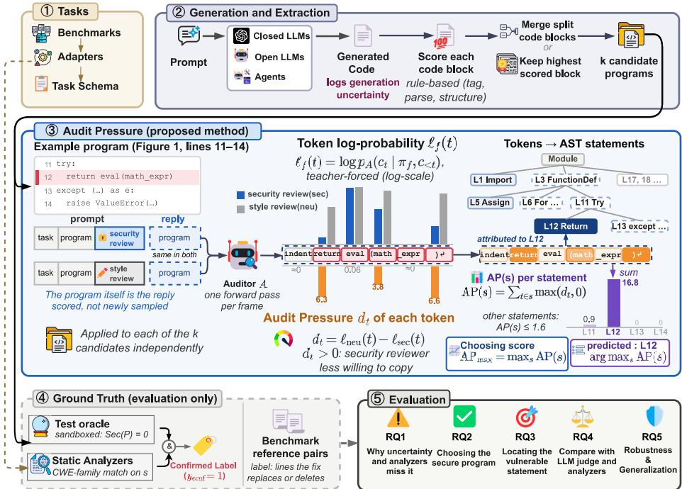  
Fig. 2. Overview of SPLASH. Tasks with executable security tests enter the pipeline (❶). Each program’s topscoring fenced code block is extracted (❷). Comments are blanked, and an auditor model scores every token under a security-review and a style-review prompt; the per-token diference (audit pressure) is aggregated to statements and to the whole program (❸). An independent oracle provides ground-truth labels used only for evaluation (❹), and five research questions measure efectiveness (❺).

## 4.2 Audit Pressure: Scoring Programs Under Review

Audit pressure is the core contribution of SPLASH, computed in step ❸. The core idea is simple: we show the finished program to an auditor model under two review instructions and measure how much less willing the security reviewer is to reproduce each token.

Comment blanking. Before scoring, all comments are removed from program � to produce �˜, preserving every line break so that line numbers and statement rows remain unchanged. Without this step, a comment such as # prevent path traversal would let the auditor read the developer’s claim rather than reason from the code.

Frames. A frame � is a chat prompt $\pi _ { f } ( x , \tilde { P } )$ that presents the task and the comment-blanked code, pre-filling the assistant turn with an opening code fence. We define three frames, none of which names the task’s CWE:

sec: “Review this implementation for security vulnerabilities, as an attacker would. If nothing needs fixing, output it unchanged. Output only the code.”

neu: the same with “. . . for readability and style” and “revised”.

verdict: “Does this implementation contain a security vulnerability? Answer with Yes or No only.” Because $\tilde { P }$ is already visible in the prompt, outputting it unchanged is the default: the auditor copies unless it sees a reason to edit.

Scoring and audit pressure. Each frame is scored in a single forward pass with teacher forcing. The reply is $r = \tilde { P } \parallel \mathsf { \bar { \backslash } } \mathsf { n } ^ { \cdot \cdot \cdot }$ (the comment-blanked code followed by the closing fence), tokenized into $c _ { 1 } , \ldots , c _ { n }$ . For every token position �:

$$
\ell _ { f } ( t ) = \log p _ { A } \big ( c _ { t } \mid \pi _ { f } ( x , \tilde { P } ) , c _ { < t } \big ) .\tag{3}
$$

All frames score the same token ids, so the log-probabilities are directly comparable. The audit pressure of token � is

$$
d _ { t } = \ell _ { \mathsf { n e u } } ( t ) - \ell _ { \mathsf { s e c } } ( t ) .\tag{4}
$$

A positive $d _ { t }$ means the security reviewer is less willing to copy this token than the style reviewer. The contrast removes what makes a token hard to copy under any review and isolates the security- specific reluctance. Summed over the program, audit pressure equals a log Bayes factor by the chain rule:

$$
\sum _ { t = 1 } ^ { n } d _ { t } = \log p _ { A } ( \mathbf { c } \mid \pi _ { \mathsf { n e u } } ) - \log p _ { A } ( \mathbf { c } \mid \pi _ { \mathsf { s e c } } ) .\tag{5}
$$

Two passes per program sufice. One the other hand, the verdict frame produces a binary readout:

$$
v ( P ) = \frac { \mathcal { P } _ { A } ( \mathrm { Y e s } \mid \pi _ { v \mathrm { e r d i c t } } ) } { \mathcal { P } _ { A } ( \mathrm { Y e s } \mid \pi _ { \mathrm { v e r d i c t } } ) + p _ { A } ( \mathrm { N o } \mid \pi _ { \mathrm { v e r d i c t } } ) } ,\tag{6}
$$

measuring the auditor’s direct belief that the program is vulnerable. Both readouts come from the same model on the same code; their relationship is explored in $\ S 6 . 2$

## 4.3 The Reviewer as an Edit Process

The log-probabilities in Eq. (3) have a natural interpretation as edit hazards. Let $C \sim p _ { A } ( \cdot \mid \pi _ { f } )$ be the reply the auditor would actually write. Its divergence time is $\tau _ { f } = \operatorname* { m i n } \{ t : C _ { t } \neq c _ { t } \}$ , and its edit hazard at position � is $h _ { f } ( t ) = \operatorname* { P r } [ \tau _ { f } = t \mid \tau _ { f } \geq t ]$ . The security reviewer may start an edit for the same reasons as the style reviewer (formatting, naming) or because it sees a vulnerability. We model the second as an independent clock.

Assumption 1 (Competing edits). There exist security-edit hazards $\lambda _ { t } \in [ 0 , 1 )$ such that

$$
1 - h _ { \mathsf { s e c } } ( t ) = { \big ( } 1 - h _ { \mathsf { n e u } } ( t ) { \big ) } { \big ( } 1 - \lambda _ { t } { \big ) } , \qquad t = 1 , \ldots , n .\tag{7}
$$

Theorem 4.1 (Audit pressure is the security-edit hazard). Under Assumption 1, for every token �, every statement �, and the program $P { : }$

$$
d _ { t } = - \log ( 1 - \lambda _ { t } ) ~ \geq ~ 0 ,\tag{8}
$$

$$
\begin{array} { r } { \mathrm { A P } ( s ) = \sum _ { t \in B ( s ) } d _ { t } = - \log ( 1 - \pi _ { s } ) , } \end{array}\tag{9}
$$

$$
\begin{array} { r } { \sum _ { t = 1 } ^ { n } d _ { t } = - \log \rho ( P ) , } \end{array}\tag{10}
$$

where $\pi _ { s } = \operatorname* { P r } [ \tau ^ { \lambda } \in B ( s ) \mid \tau ^ { \lambda } \ge$ min $B ( s ) ]$ is the probability that the security fix begins in statement �, and $\rho ( P ) = \mathrm { P r } [ \tau ^ { \lambda } = \infty ]$ is the probability that nothing needs fixing.

Proof sketch. Since $\left\{ C _ { < t } = c _ { < t } \right\} = \left\{ \tau _ { f } \geq t \right\}$ , we have $p _ { A } ( c _ { t } \mid \pi _ { f } , c _ { < t } ) = 1 - h _ { f } ( t )$ , so $\ell _ { f } ( t ) =$ $\log ( 1 { - } h _ { f } ( t ) )$ . Combined with Eq. $( 7 ) , d _ { t } = \log \left( 1 - h _ { \mathrm { n e u } } ( t ) \right) - \log \left[ \left( 1 - h _ { \mathrm { n e u } } ( t ) \right) \left( 1 - \lambda _ { t } \right) \right] = - \log \left( 1 - \lambda _ { t } \right)$ Summing over a statement’s token block and over all tokens gives (9) and (10) by telescoping. □

Clipping. When $d _ { t } ~ < ~ 0$ , the implied $\lambda _ { t }$ is negative, violating Assumption 1. Replacing $d _ { t }$ with $\operatorname* { m a x } ( d _ { t } , 0 )$ sets $\lambda _ { t }$ to zero, the smallest hazard the assumption allows, zeroing out style-only dis- agreements. All scores below use this positive part.

## 4.4 Statement and Program Scores

Attribution. A program’s statement rows are its leaf AST statements (Python ast, $\mathrm { C } / \mathrm { C } { + + }$ via tree-sitter), with compound-statement headers split at clause boundaries so that every source line belongs to exactly one row. Token � is attributed to the row owning the first non-whitespace character of $\tilde { P }$ at or after the token’s start. This rule matters as the pressure of a missing check appears on the whitespace or first token where the check would have been inserted, and the attribution carries that pressure to the correct line.   
Scores.

Definition 4.2 (Statement and program scores).

$$
\mathrm { A P } ( s ) = \sum _ { t \in B ( s ) } \operatorname* { m a x } ( d _ { t } , 0 ) , \qquad \mathrm { A P } _ { \operatorname* { m a x } } ( P ) = \operatorname* { m a x } _ { s \in \mathcal { R } ( P ) } \mathrm { A P } ( s ) , \qquad \mathrm { A P } _ { \Sigma } ( P ) = \sum _ { t = 1 } ^ { n } \operatorname* { m a x } ( d _ { t } , 0 ) ,\tag{11}
$$

where $B ( s )$ is the set of token positions attributed to row � and $\mathcal { R } ( P )$ is the set of statement rows.

Here, AP(�) is the locating score: the statement with the largest audit pressure is the most likely site of a security fix (Theorem 4.1, Eq. 9). $\mathrm { A P } _ { \operatorname* { m a x } }$ is the choosing score: the candidate whose most contested statement carries the least pressure is the one most likely to be copied unchanged by the security reviewer.

Why $\mathrm { A P } _ { \operatorname* { m a x } }$ rather than $\mathrm { A P } _ { \Sigma }$ . Under i.i.d. measurement noise $\varepsilon _ { t } \sim { \cal N } ( 0 , \sigma ^ { 2 } )$ , the noise floor of $\mathrm { A P _ { \Sigma } }$ on a secure program grows as $\sigma n / { \sqrt { 2 \pi } } ,$ , penalizing longer programs (which are typically the secure ones, since they add checks and error handling). $\mathrm { A P } _ { \operatorname* { m a x } } \mathrm { \tilde { \it s } }$ noise floor depends on one statement’s length � and only $O ( { \sqrt { \log R } } )$ on the number of rows $R { : }$

Proposition 4.3 (Length bias of summed pressure). Let $\hat { d } _ { t } = d _ { t } + \varepsilon _ { t }$ with $\varepsilon _ { t } \ i . i . d . \ N ( 0 , \sigma ^ { 2 } )$ , and let � be a secure program $( d _ { t } = 0 )$ with � tokens, rows ofat most � tokens, and $| { \mathcal { R } } | = R$ rows. Then

$$
\mathbb { E } [ \widehat { \mathrm { A P } } _ { \Sigma } ] = \frac { \sigma } { \sqrt { 2 \pi } } n , \qquad \mathbb { E } [ \widehat { \mathrm { A P } } _ { \mathrm { m a x } } ] \leq \frac { \sigma } { \sqrt { 2 \pi } } m + \sigma \sqrt { 2 m \log R } .\tag{12}
$$

## 4.5 Choosing and Locating

A pool � is a set of candidate programs for one task from one generator, optionally restricted to those passing functional tests (❹). A rule � assigns each program a score (higher means more likely insecure). Its pick is arg min $\scriptstyle { \mathsf { i } } _ { P \in Q } g ( P )$ . Choosing depends only on the within-task order of scores:

Lemma 4.4 (Choosing sees only within-task order). Let $\phi _ { x }$ be strictly increasing for every task � and define $g ^ { \prime } ( P ) = \phi _ { x ( P ) } ( g ( P ) )$ . Then pic $\mathfrak { c } _ { g ^ { \prime } } ( Q ) = \mathrm { p i c k } _ { g } ( Q )$ for every pool, so the secure-pick rate and within-task AUROC are unchanged.

This invariance is why SPLASH ranks within a task. Tasks whose security tests check an unstated limit shift every code-level judge in the same direction for all of that task’s candidates. Such shifts change scores across tasks but cannot move a pick, because the candidates share the task.

The within-task AUROC bounds how often a pick succeeds:

Theorem 4.5 (Secure picks from within-task ranking). Fix a task and let scores within the secure and insecure groups each be i.i.d., continuous, and independent ofeach other, with within-task AUROC �. For a pool with $g \geq 1$ good and $b \geq 1$ bad candidates,

$$
A ^ { b } \ \leq \ \operatorname* { P r } [ \mathit { p i c k i s g o o d } ] \ \leq \ 1 - ( 1 - A ) ^ { g } ,\tag{13}
$$

with equality when $g = b = 1$

Locating ranks the statements of a single insecure program by $\operatorname { A P } ( s )$ , which by Theorem 4.1 is equivalent to ranking by $\pi _ { s } .$ , the probability that the security fix begins in statement �. We measure localization with hit@� (§5).

## 4.6 Ground Truth: Labels Independent of the Method

Labels are constructed in step $\mathbf { \otimes } ,$ , entirely independently of audit pressure.

Program-level labels. Every program runs inside a sandboxed executor (no network, read-only filesystem, memory and time limits). A program is a security hallucination if it passes all functional tests and fails at least one security test. Programs the sandbox could not measure are excluded. Statement-level labels. On generated code, a statement is labeled vulnerable when a staticanalyzer finding in the task’s CWE family sits on it and the program failed its security test:

$$
y _ { \mathrm { c o n f } } ( s ) = \left\{ \begin{array} { l l } { 1 } & { \mathrm { ~ i f ~ } \mathrm { S e c } ( P ) = 0 \mathrm { ~ a n d ~ } m ( s ) = 1 , } \\ { 0 } & { \mathrm { ~ i f ~ } \mathrm { S e c } ( P ) = 1 , \mathrm { ~ o r ~ } \mathrm { S e c } ( P ) = 0 , m ( s ) = 0 , \ M ( P ) \neq \emptyset , } \\ { \perp } & { \mathrm { ~ o t h e r w i s e ~ } ( \mathrm { e x c l u d e d } ) , } \end{array} \right.\tag{14}
$$

where $m ( s ) = 1$ if a analyzer finding whose CWE family intersects C is attached to �. The analyzer says where, and the executed security test says whether. On benchmark reference pairs that difer by a known edit, the vulnerable lines are those the line dif replaces or deletes, requiring no analyzer.

Finally, step ❺ evaluates SPLASH with five research questions. We discuss the evaluation in $\ S 6 .$ AI Usage Note. AI coding assistants (such as Claude Opus) were used for implementation and debugging of the main framework of SPLASH and for plotting data. All AI-assisted implementations were reviewed by the authors, and reported numbers come from executed runs of the code.

## 5 Experimental Setup

A securit hallucination can onl be established b executin a securit test. Several widel used security benchmarks provide prompts without executable tests (SecurityEval [39], LLMSecEval [45]) and some provide only functional tests (HumanEval+ [22]). On the latter, insecurity could only be estimated by static analysis, which misses most security hallucinations (§6.1). We therefore evaluate on the 899 tasks that carry both functional and security tests: SecCodePLT [28] (819 Python tasks), CWEval [33] (64 tasks in Python, C, and C++), and 16 tasks we authored for CWE types under-represented in the public benchmarks.

Authored tasks. The 16 new tasks we add span six vulnerability families: cryptography (password hashing, encryption with randomized IV—CWE-327/916/759, CWE-329/1204), injection (SQL injection, XSS sanitization, command injection, unsafe YAML deserialization—CWE-89, CWE-79/94, CWE-78/88, CWE-502), file handling (upload validation, zip-slip extraction—CWE-434/22, CWE-22/409), authentication (SSL certificate verification, API request signing, JWT verification, password-reset tokens—CWE-295/297, CWE-522/798, CWE-347/345, CWE-330/613), input validation (email regex DoS—CWE-1333), and memory safety (C++ fixed-bufer copy—CWE-120/787). Each task with executable tests carries both a functional and a security test, and the security test checks an observable consequence $( \mathbf { e . g . }$ , “two hashes of the same password must difer”) rather than a specific API, so it accepts any correct implementation.

Generators. We generate code with 11 open models spanning six families (Qwen2.5-Coder 1.5B/7B/32B, Qwen3.6-27B, DeepSeek-Coder 6.7B/33B/V2-Lite-16B, Llama-3.1-8B, Granite-3.3-8B, GLM-4.7-Flash-30B, Nemotron-3-Nano-4B). Each model generates at $T \in \{ 0 . 2 , 0 . 8 \}$ with three seeds, producing six samples per task per model. A fast API model (GPT-4.1-mini) also falls under this setting. Two frontier models (Claude Opus 5, GPT-5.6 Sol), and two agents (Qwen2.5-Coder-7B and Qwen3-8B in a 10-step tool loop) are tested over the 80 CWEval and authored tasks at $T = 0 . 8 .$

Open models are HuggingFace checkpoints run locally with vLLM [20] (bf16 up to 8B parameters, 4-bit AWQ above). GPT-4.1-mini and GPT-5.6 Sol, and Claude Opus 5 are accessed through their respective APIs [1, 30]. All local models, including the auditor, run on a single NVIDIA RTX 3090 (24 GB) each, on a machine with 3x such GPUs, 256 GB RAM, and AMD Ryzen 24-core CPU.

Testing. Every program runs in a Bubblewrap sandbox (no network, read-only filesystem, memory and time limits) [3]. Programs the sandbox could not measure are excluded and never counted as failures. Of 64,137 measured programs, 38,774 work; 14,495 of those are insecure.

Auditor. We use two variations of auditing: (1) self-audit and (2) fixed audit. For the rest of the paper, we call them as AP (self) and AP (fixed). Qwen2.5-Coder-32B-Instruct (AWQ 4-bit) is used as the fixed auditor. Audit Pressure needs two prompts per program, so a batch of 1,000 programs takes approximately 20–35 minutes on one RTX 3090 GPU. Every setting (frame wording, score definition $\left( \mathrm { A P _ { m a x } } \right)$ , auditor identity, comment removal) was frozen on a pilot run over 70% of tasks (selected by a deterministic hash of the task identifier). The main run was scored once and no setting was adjusted after seeing main-run results. The remaining 30% (“held-out tasks”) were never examined during any design decision.

Baselines. We use the following baselines: (1) Random pick; lowest generation uncertainty (the generator’s per-token log-probability, averaged); most check lines (if/raise/assert/try/throw count); fewest static-analyzer findings in the task’s CWE family (Bandit, Semgrep, cppcheck, Flawfinder); AP (self) (each open generator audits its own code); 32B yes/no (the auditor’s onetoken �(Yes) verdict); GPT-5.6 Sol as an LLM judge that names vulnerable lines. Because the judge is an API model, we ran it on a seeded random sample of 148 tasks with 6 generators (5,276 programs, 398 insecure programs with confirmed vulnerable statements). All comparisons with the judge use exactly this sample.

Evaluation protocol. We define the following terminologies for our evaluation: (i) Pool: A set of candidates for one task from one model. We report results on pools where the choice matters, i.e., those including at least one secure and one insecure working program. (ii) Secure picks: share of pools whose pick is secure and working. (iii) Gap closed: the gain over random choice divided by (100% − random). (iv) Hit@�: the vulnerable statement is among the top �.

## 6 Evaluation

We answer five research questions to evaluate SPLASH:

• RQ1. Why do existing signals miss security hallucinations? (§6.1)

• RQ2. Can audit pressure choose the secure program among a model’s samples? (§6.2)

• RQ3. Does audit pressure locate the vulnerable statement? (§6.3)

• RQ4. How does it compare with what practitioners would use instead? (§6.4)

• RQ5. How robust is SPLASH across various settings? (§6.5)

## 6.1 RQ1: Why Do Existing Signals Miss Security Hallucinations?

Every model writes security hallucinations. Figure 3(a) shows the insecure share of working programs across 899 tested tasks: 24–60% for the 11 open generators, 21% for GPT-4.1-mini. Frontier models are safer (Claude Opus 5: 6%, GPT-5.6 Sol: 8% on 80 tasks), but agents keep roughly a third of their working solutions insecure (31% and 34%, Figure 3b), and the generator’s own uncertainty over the agent’s edits does not flag them (AUROC 0.40).

The task as decider. Task identity explains 57% of the variance in insecurity; the generator only 6%. The CWE alone predicts whether a working program is insecure at AUROC 0.77 (Figure 3c). Security hallucinations are consistent. Of 14 495 insecure working programs, 86% have only insecure siblings—other samples from the same generator, task, and temperature (Figure 4c)— defeating detectors that rely on output variation [7, 23, 25]. Frontier models (GPT-5.6-Sol, Claude

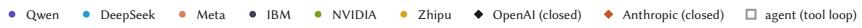

(a) All 899 tested tasks  
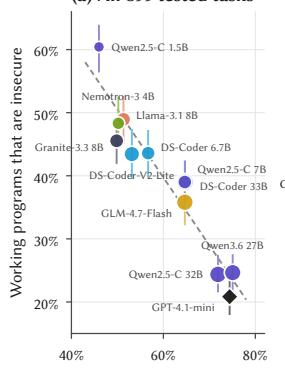  
Programs that work (pass unit tests)

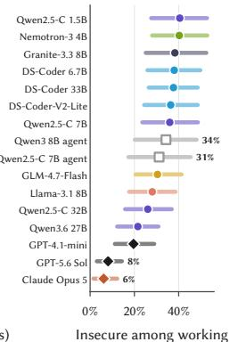

(b) w/ closed models, agents (c) Insecure rate per CWE  
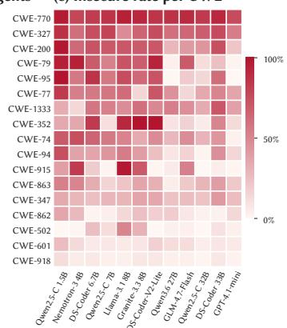  
Fig. 3. (a) Per generator: share that work vs. share insecure (899 tasks, 95% intervals). (b) Adding closed models and agents on 80 tasks. (c) Insecure rate by CWE and generator.  
(b) Per-task AUROC, median marked (c) Repeated across samples

(a) 300 tasks, one dot each  
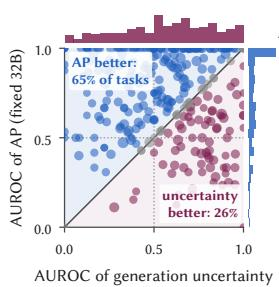

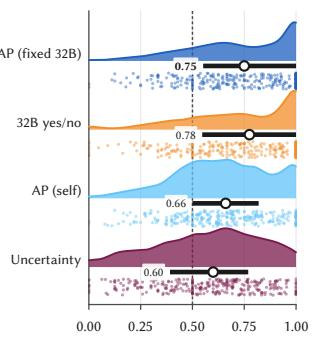

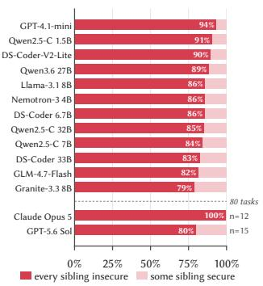  
AUROC per task  
Fig. 4. (a) Per-task AUROC: AP (fixed 32B) vs uncertainty (300 tasks). (b) Distribution across four methods. (c) Insecure programs whose siblings are all insecure.

Opus 5) hallucinate less, but when a candidate program from them contains security hallucinations, their siblings also contain them prevalently. Fig 4c depicts the scenario.

Generation uncertainty fails at both levels. Uncertainty ranks insecure programs at AUROC 0.61 overall and 0.47 on CWEval, where confident code is more often insecure. On 300 tasks with enough same-model pairs, AP (fixed 32B) ranks better in 65% of tasks (Figure 4a, b). At the statement level, uncertainty places the vulnerable statement first in only 5% of programs, below the 9% expected by random order (Table 1). Static analyzers cover 15% of security hallucinations—and 12% of secure programs, suggesting high false positive rate.

Summary: Security hallucinations afect every model (24–60% open, 6–8% frontier) and are written confidently: 86% have only insecure siblings. Generation uncertainty (AUROC 0.61) and static analyzers (15% coverage) both miss most of them.

## 6.2 RQ2: Can Audit Pressure Choose the Secure Program?

All results use the 11 open generators, unit tests run first, pools where the choice matters. A random pick selects secure code 54.0% of the time at � = 6 and 50.0% at � = 2.

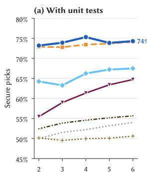

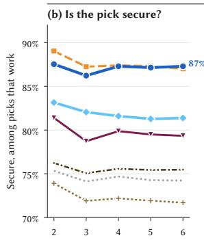  
Candidate programs per task (k)

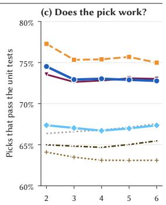  
Fig. 5. Secure picks among � candidates (11 generators, decisive pools). (a) With unit tests. Without: (b) security of working picks and (c) share of programs that work.

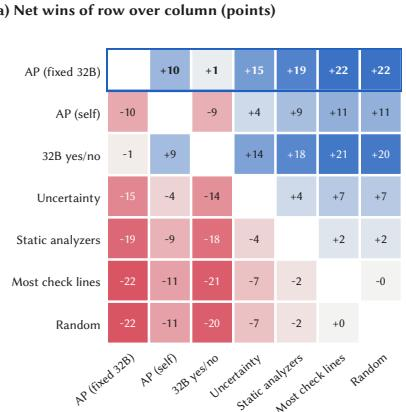

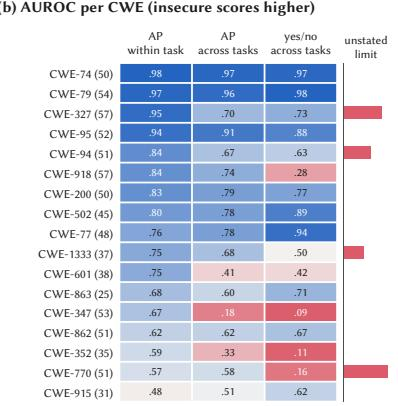  
Fig. 6. (a) Net wins in percentage points of row over column (1,305 pools). (b) AUROC per CWE (17 CWEs, ≥25 tasks); bar: tasks testing an unstated limit.

Capable models audit their own code. AP (self) beats the generator’s own uncertainty for 8 of 11 generators (Table 2), but small models fail at self-audit: AP (self) falls below uncertainty for Qwen2.5-Coder-1.5B (50 vs 66%), DeepSeek-Coder-V2-Lite (57 vs 64%), and Granite-3.3-8B (58 vs 67%), suggesting a fixed auditor can be more useful for smaller models.

A fixed auditor does best. At � = 6, AP (fixed 32B) reaches 74.3% secure picks, 32B yes/no 74.2%, AP (self) 67.5%, uncertaint 64.7%, static anal zers 55.7%, random 54.0% (Fi ure 5a). The advantage appears already at � = 2 (73.2% vs 55.5%). Over 1,305 decisive pools, AP (fixed 32B) gains +21.6 points over random [18.8, 24.1], closing 46% of the gap to a perfect pick, and nets +15 over uncertainty and +19 over static analyzers head to head (Figure 6a). AP (fixed 32B) is best for 7 of 11 generators on choosing, 32B yes/no for 4 (Table 2). Removing the 32B auditor’s own programs leaves the result unchanged (74.5% of 1,218 pools vs 52.6% random). The bound of Theorem 4.5 holds in practice: in pools with a single insecure candidate, where it guarantees at least the within-task AUROC (0.72), AP (fixed 32B) picks the secure program 86% of the time.

The yes/no verdict ties for choosing but cannot locate. The 32B auditor’s yes/no answer matches AP for choosing (74.2% vs 74.3%, net wins +1), but gives one bit per program. The distinction matters in RQ3, where audit pressure’s per-statement ranking enables localization.

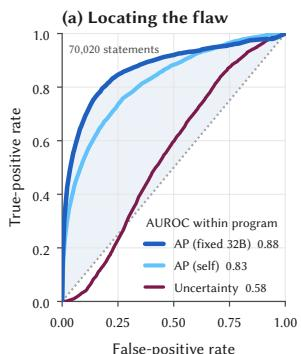  
False-positive rate

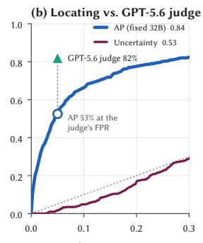  
False-positive rate

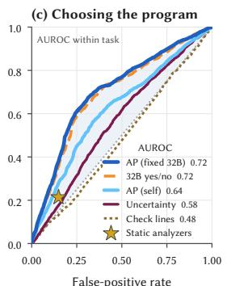  
Fig. 7. (a) Statement ROC (3,910 programs from the 11 open generators). (b) Judge’s sample at low FPR; circle: AP at the judge’s rate. (c) Program ROC within a task; star: static analyzers.

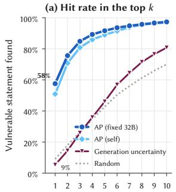

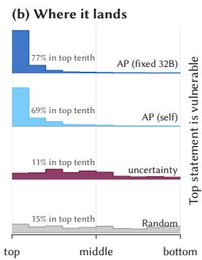

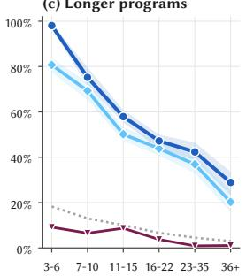  
Statements inspected (k) Position of the vulnerable statement in the ranking Statements in the program  
Fig. 8. (a) Hit@� (4,091 insecure programs, all generators). (b) Where vulnerable statement lands. (c) Top-1 by prog. length.

Without unit tests, a pick must both work and be secure. Among picks that work, AP (fixed 32B) chooses secure code 87% of the time and AP (self) 81%, against 79% for uncertainty and 74% for random (Figure 5b). Uncertainty’s advantage lies in avoiding programs that fail their tests (Figure 5c), the job unit tests normally do.

Summary: AP (fixed 32B) selects secure code in 74% of decisive pools at � = 6, closing 46% of the gap to a perfect pick (+21.6 pp over random, +15 net wins over uncertainty). The 32B yes/no verdict ties for choosing but cannot locate.

## 6.3 RQ3: Does Audit Pressure Locate the Vulnerable Statement?

On 4 091 insecure generated programs, AP (fixed 32B) places the vulnerable statement first in 58% of cases (85% at top 3, 97% at top 10; Table 1). AP (self) reaches 51% at top 1, uncertainty only 5%—below the 9% from random order. Statement AUROC: 0.88 for AP (fixed 32B), 0.83 for AP (self), 0.58 for uncertainty (Figure 7a). AP (fixed 32B) is best for 9 of 11 generators on locating; AP (self) for 3 (Table 2). Top-1 hit rate degrades gracefully with program size: 98% for 3–6 statements, 58% for 11–15, 29% for 36+ (random: 3%; Figure 8c).

Reference solutions. On 808 reference pairs from SecCodePLT—where the label is the exact changed line, no analyzer involved—AP (fixed 32B) identifies it in 77% of pairs (random: 27%; within one line: 89% vs 61%).

The frontier judge locates better on its sample. On the judge’s sample (148 tasks × 6 generators), GPT-5.6 Sol places the vulnerable statement first in 70% of insecure programs, vs AP (fixed 32B) 54% and AP (self) 57% (Table 1). At 5% false positives: 82% vs 53% (Figure 7b). AP ranks every statement of all 4 091 insecure programs from the same pass that also chooses—and as RQ4 shows, it chooses better.

Table 1. Locating the vulnerable statement: share of insecure programs whose top-ranked statement (top 3) is the vulnerable one (%). Generated code: statements where a static finding in the task’s CWE family agrees with a failed security test. Reference solutions: the lines the secure reference changes. AP (self) excludes GPT-4.1-mini, which has no open weights.
<table><tr><td>Programs (n)</td><td>Method</td><td>Top 1 Top 3</td><td></td></tr><tr><td>Generated (4,091)</td><td>Random order</td><td>9</td><td>26</td></tr><tr><td rowspan="7">Judge sample (398)</td><td>Uncertainty</td><td>5</td><td>26</td></tr><tr><td>AP (self)</td><td>51</td><td>81</td></tr><tr><td>AP (fixed 32B)</td><td>58</td><td>85</td></tr><tr><td>Random order</td><td>8</td><td>25</td></tr><tr><td>Uncertainty</td><td>5</td><td>23</td></tr><tr><td>AP (self)</td><td>57</td><td>84</td></tr><tr><td>AP (fixed 32B)</td><td>54</td><td>80</td></tr><tr><td rowspan="2">Reference, exact (808)</td><td>GPT-5.6 judge</td><td>70</td><td>95</td></tr><tr><td>AP (fixed 32B)</td><td>77</td><td>97</td></tr><tr><td rowspan="2">Reference, ±1 (819)</td><td>Random order</td><td>27</td><td>68</td></tr><tr><td>AP (fixed 32B)</td><td>89</td><td>99</td></tr><tr><td></td><td>Random order</td><td>61</td><td>93</td></tr></table>

Table 2. Every method on every open generator. Choose: secure picks (%). Locate: top-1 hit (%); yes/no cannot locate. Best per row in bold. Locate uses the 3,910 insecure programs of the 11 open generators.
<table><tr><td></td><td colspan="7">Choose: secure picks (%)</td><td colspan="7">Locate: top 1 (%)</td></tr><tr><td></td><td></td><td colspan="3">Baselines</td><td colspan="3"></td><td colspan="3"></td><td colspan="3">Baselines</td></tr><tr><td>Generator</td><td>n</td><td>Rand.</td><td>Static</td><td>Unc.</td><td>32B yes/no</td><td>Self</td><td>Fixed 32B</td><td>n</td><td>Rand.</td><td>Unc.</td><td>32B yes/no</td><td>Self</td><td>Fixed 32B</td></tr><tr><td>Qwen2.5-C-1.5B</td><td>104</td><td>56</td><td>57</td><td>66</td><td>78</td><td>50</td><td>84</td><td>549</td><td>10</td><td>2</td><td>1</td><td>41</td><td>71</td></tr><tr><td>Nemotron-3-4B</td><td>110</td><td>47</td><td>47</td><td>55</td><td>68</td><td>56</td><td>75</td><td>304</td><td>10</td><td>5</td><td>一</td><td>54</td><td>71</td></tr><tr><td>DS-Coder-6.7B</td><td>136</td><td>51</td><td>55</td><td>52</td><td>74</td><td>64</td><td>72</td><td>477</td><td>11</td><td>9</td><td>=</td><td>53</td><td>60</td></tr><tr><td>Qwen2.5-C-7B</td><td>135</td><td>53</td><td>61</td><td>62</td><td>78</td><td>76</td><td>81</td><td>362</td><td>9</td><td>7</td><td>一</td><td>54</td><td>68</td></tr><tr><td>Granite-3.3-8B</td><td>153</td><td>50</td><td>52</td><td>67</td><td>73</td><td>58</td><td>68</td><td>475</td><td>10</td><td>9</td><td>1</td><td>55</td><td>50</td></tr><tr><td>Llama-3.1-8B</td><td>132</td><td>50</td><td>50</td><td>52</td><td>73</td><td>61</td><td>77</td><td>520</td><td>7</td><td>3</td><td></td><td>60</td><td>45</td></tr><tr><td>DS-Coder-V2-Lite</td><td>84</td><td>54</td><td>60</td><td>64</td><td>69</td><td>57</td><td>68</td><td>374</td><td>10</td><td>3</td><td></td><td>47</td><td>51</td></tr><tr><td>Qwen3.6-27B</td><td>68</td><td>57</td><td>56</td><td>60</td><td>71</td><td>68</td><td>76</td><td>129</td><td>5</td><td>5</td><td>一</td><td>25</td><td>47</td></tr><tr><td>GLM-4.7-Flash</td><td>151</td><td>55</td><td>56</td><td>62</td><td>75</td><td>67</td><td>70</td><td>163</td><td>8</td><td>2</td><td></td><td>38</td><td>53</td></tr><tr><td>Qwen2.5-C-32B</td><td>87</td><td>56</td><td>58</td><td>64</td><td>68</td><td>72</td><td>72</td><td>166</td><td>10</td><td>4</td><td>=</td><td>61</td><td>61</td></tr><tr><td>DS-Coder-33B</td><td>145</td><td>54</td><td>58</td><td>54</td><td>75</td><td>74</td><td>77</td><td>391</td><td>10</td><td>10</td><td>一</td><td>55</td><td>67</td></tr><tr><td>All generators</td><td>1,305</td><td>53</td><td>55</td><td>60</td><td>73</td><td>64</td><td>74</td><td>3,910</td><td>9</td><td>6</td><td>=</td><td>51</td><td>59</td></tr><tr><td>Held-out tasks</td><td>392</td><td>52</td><td>54</td><td>62</td><td>72</td><td>61</td><td>71</td><td>1,239</td><td>11</td><td>7</td><td>=</td><td>57</td><td>63</td></tr><tr><td>Wins (of 11)</td><td></td><td>0</td><td>0</td><td>0</td><td>4</td><td>1</td><td>7</td><td></td><td>0</td><td>0</td><td>一</td><td>3</td><td>9</td></tr></table>

Summary: AP (fixed 32B) places the vulnerable statement first in 58% of insecure programs (random: 9%) and identifies the exact changed line in 77% of reference pairs. Generation uncertainty fails at localization entirely (5% top-1, below random).

## 6.4 RQ4: Comparison with Practitioner Alternatives

Table 3 compares all methods on the judge’s sample (148 tasks × 6 generators). With unit tests (120 decisive pools), AP (fixed 32B) picks secure code in 76.7% [69.2, 83.3] of pools, the GPT-5.6 Sol judge 68.0% [62.7, 73.6], uncertainty 52.5%, random 52.9%. AP picks secure code more often, but the intervals overlap (Figure 9a).

Beside static analyzers. At the analyzers’ false-alarm rate (12%, 3,506 working programs on the judge’s sample), static analyzers flag 18% of security hallucinations, the GPT-5.6 Sol judge 21%, 32B yes/no 27%, AP (fixed 32B) 32%, and AP combined with analyzers 37% (Figure 9b).

Table 3. What practitioners could use instead, on the GPT-5.6 judge’s sample (148 tasks, 6 generators). Choose: secure picks among the model’s own samples of a task, where they include both a secure and an insecure working program. Locate: the top statement is the vulnerable one (ties broken at random; the judge names lines without ranking). A local pass is one forward pass of the auditor over the program; AP needs one per review prompt.
<table><tr><td>Method</td><td>API Locates</td><td></td><td>Cost Choose (%) Locate (%)</td><td></td></tr><tr><td>Static analyzers</td><td>no</td><td>yes</td><td>free</td><td>55</td></tr><tr><td>Lowest generation uncertainty</td><td>no</td><td>yes</td><td>logprobs of the generator</td><td>52 5</td></tr><tr><td>Most check lines (text rule)</td><td>no</td><td>no</td><td>free</td><td>54</td></tr><tr><td>32B yes/no</td><td>no</td><td>no</td><td>1 local pass</td><td>75</td></tr><tr><td>GPT-5.6 Sol judge</td><td>yes</td><td>yes</td><td>$7.3 per 1k programs</td><td>68 70</td></tr><tr><td>AP (self)</td><td>no</td><td>yes</td><td>2 local passes</td><td>70 57</td></tr><tr><td>AP (fixed 32B)</td><td>no</td><td>yes</td><td>2 local passes</td><td>77 54</td></tr></table>

Static analyzers (Bandit, Semgrep, cppcheck, Flawfinder) choose the candidate with the fewest findings in the task’s CWE family; they are not scored on locating, because the localization labels are built from their findings. At the analyzers’ false-alarm rate (12%), they flag 18% of security hallucinations on this sample, the judge 21%, AP (fixed 32B) 32%, and AP and the analyzers together 37% (Figure 9b).

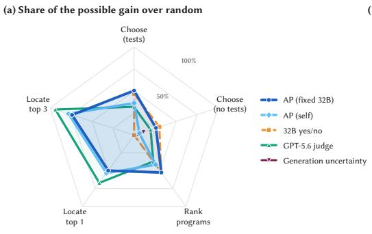  
(b) Security hallucinations flagged

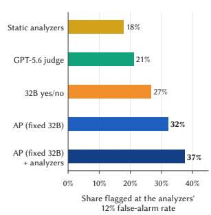  
Fig. 9. Judge’s sample (148 tasks × 6 generators). (a) Share of the possible gain over random on five measures. (b) Hallucinations flagged at the analyzers’ 12% false-alarm rate.

Table 4. Qualitative comparison. ✓ = supported, = partial, ✗ = not supported. \* = open-weight generators.
<table><tr><td>Method</td><td>Selects</td><td>Localizes</td><td>Statement Rank</td><td>Any Gen.</td><td>No train.</td><td>Local Infer.</td></tr><tr><td>Static Tools [4, 34, 38, 47]</td><td>x</td><td>0</td><td>x</td><td>√</td><td>√</td><td>√</td></tr><tr><td>Gen. Uncertainty [7]</td><td>①</td><td>x</td><td>x</td><td>x</td><td>√</td><td>√</td></tr><tr><td>SVEN [11]</td><td>x</td><td>x</td><td>x</td><td>x</td><td>x</td><td>√</td></tr><tr><td>LLM judge [29]</td><td>①</td><td>√</td><td>x</td><td>√</td><td>√</td><td>x</td></tr><tr><td>32B yes/no [14]</td><td>√</td><td>x</td><td>x</td><td>√</td><td>√</td><td>√</td></tr><tr><td>AP (self)</td><td>√</td><td></td><td>√</td><td>①*</td><td>√</td><td></td></tr><tr><td>AP (fixed 32B)</td><td>√</td><td></td><td>√</td><td></td><td>√</td><td>J</td></tr></table>

Cost and generality. AP requires two local forward passes per program (∼20–35 min/1k on one 24 GB GPU); the judge costs \$7.3/1k through an API. Because AP reads only the finished code, it needs no generator probabilities: on GPT-4.1-mini’s 168 insecure programs it places the vulnerable statement first 24% of the time (random: 5%), and on agentic code it picks secure code in 76% of 25 pools without tests (random: 57%).

Summary: AP selects secure code more often than a GPT-5.6 Sol judge (77% vs. 68%) at the cost of local GPU time instead of \$7.3/1k API calls. The judge localizes better on its sample (70% vs. 54% top-1). AP (fixed 32B) is the only method that selects, localizes with a per-statement ranking, and works on code from any generator without training (Table 4).

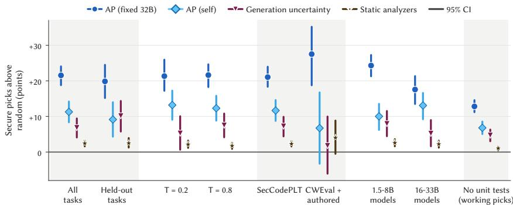  
Fig. 10. Gain over random in secure picks (pp, 95% intervals) per seting. Last column: without tests, working picks only.

## 6.5 RQ5: Robustness & Generalization

Held-out tasks. On the 30% of tasks never used to choose any setting (392 pools), AP (fixed 32B) gains +19.9 points over random [15.2, 24.5], within two points of the main result (Figure 10).

Temperature and benchmarks. The gain over random is stable across temperatures (+21.3 at � = 0.2, +21.6 at � = 0.8) and benchmarks (+21.1 on SecCodePLT, +27.5 [18.8, 35.2] on CWEval and authored tasks, 101 pools; Figure 10).

Model size. AP (fixed 32B) gains +24.3 points for 1.5–8B generators and +17.6 for 16–33B, helping more where the generator is weaker.

Per CWE. Within each task, AP (fixed 32B) beats chance in 16 of 17 CWEs with at least 25 tasks (the exception is CWE-915, AUROC 0.48; Figure 6b). Reversals occur across tasks for CWE-347 (AP 0.18, yes/no 0.09) and CWE-352 (0.33, 0.11), and for the yes/no answer on CWE-770 (0.16), where 98% of tasks test a limit the prompt never states.

Summary: Results hold on held-out tasks (within 2 pp), across temperatures, benchmarks, model sizes, and 16 of 17 CWE types.

## 7 Related Work

Hallucination detection. Natural-language hallucination detectors rely on the model’s own uncertainty or self-consistency [6, 7, 16, 18, 23, 25]. Among them, semantic entropy clusters completions by meaning [7], probes distill this into a linear classifier on hidden states [18], P(True) asks the model to rate its own answer [16], SelfCheckGPT flags unreproduced statements [23], chain-of-verification has models fact-check themselves [6], and self-contradiction detectors work within single responses [25]. Models encode correctness in hidden states without surfacing it [31], though such probes degrade under perturbation [10]. Security hallucinations violate the shared assumption ( §6.1). Code-specific work classifies hallucination types [21, 42], applies SelfCheckGPT to code without addressing security [15], and measures package hallucination at 5–22% [19, 40], but none separates secure from insecure code among functionally correct programs.

Secure code generation. Studies report 40-76% of generated programs are vulnerable [17, 32, 43]. Benchmarks with executable security tests include SecCodePLT [28], CWEval [33], CodeSecEval [46], and SecureAgentBench [2]. SecurityEval [39] and LLMSecEval [45] provide security prompts without executable tests, and HumanEval+ [22] targets correctness. Generation-time defenses steer models via prefix vectors [11],security instruction tuning [12], preference learning [48], or prompt engineering [9, 26], but all require training access or prompt control. Post-generation, static analyzers cover only 15% of security hallucinations. SecCodePRM [49] trains a process reward model on step-level annotations; and per-vulnerability steering vectors reduce insecure generation by up to 74% but need white-box access to the generator [37]. Audit pressure requires no training or labeled data and produces both a program ranking and a per-statement localization from two teacher-forced passes on code from any source.

## 8 Threats to Validity

Internal validity. Frame wording, $\operatorname { A P } _ { \operatorname* { m a x } } ,$ and comment blanking were frozen on a 70% pilot split selected by a deterministic hash of the task identifier. The main run was scored once, and the 30% held-out split reproduces the secure-pick gain over random within two points (§6.5). The fixed auditor is also one of the generators and might prefer its own code, but removing its programs leaves the result unchanged (74.5% of 1 218 pools, §6.2).

External validity. SecCodePLT, a python-based dataset, contributes 91% of programs. CWEval and authored tasks, which include C/C++, show a larger gain (§6.5). Benchmark datasets are public, so memorization is possible. However, our authored tasks are not public. We use one fixed auditor (Qwen2.5-Coder-32B). Self-audit across 11 generators from six families confirms the measure is not specific to one model (§6.2), though other fixed auditors may behave slightly diferently. Samples for frontier models and a ents are small (tested on 80 tasks), so those results are directional.

Construct validity. We equate secure as a ground truth with passing the task’s security tests. A test can miss a vulnerability, or check a requirement the prompt never states. Statement labels require a CWE-matched analyzer finding, so localization is evaluated only on flaws the analyzers can place, under-representing missing-check vulnerabilities. As a second evaluation free of this bias, we use 808 benchmark reference pairs whose label is the line the secure version changes (77% top-1, §6.3). By design, SPLASH ranks within a task.

## 9 Conclusion

We presented SPLASH, a post-hoc method for choosing secure code and locating security hallucinations from LLM-generated code. Its core idea is audit pressure, which measures the reluctance of a security reviewer to reproduce each token compared to a style reviewer. Two teacher-forced passes provide both a program ranking and a statement ranking, with no training, no access to the generator, and no CWE-specific rules. On 899 curated tasks across 12 generators, SPLASH picks the secure candidate in 74% of pools where the choice matters, which is better than the generator model’s own uncertainty (65%). It further places the vulnerable statement first in 58% of insecure programs, within the top three in 85%, and chooses secure code more often than a frontier LLM judge (77% vs. 68%), all while running locally. Audit pressure transfers efectively to agentic code (76% secure picks) and complements static analyzers. Because audit pressure shows exactly where a security reviewer would change the code, it is a natural starting point for automated program repair.

## 10 Data Availability

We open-source the code and artifacts of SPLASH at https://github.com/Prometheused/SPLASH.

## References

[1] Anthropic. 2026. Anthropic API Platform. https://platform.claude.com/

[2] Junkai Chen, Huihui Huang, Yunbo Lyu, Junwen An, Jieke Shi, Chengran Yang, Ting Zhang, Haoye Tian, Yikun Li, Zhenhao Li, Xin Zhou, Xing Hu, and David Lo. 2026. SecureVibeBench: Benchmarking Secure Vibe Coding of AI Agents via Reconstructing Vulnerability-Introducing Scenarios. In Proceedings ofthe 64th Annual Meeting ofthe Association for Computational Linguistics (Volume 1: Long Papers), Maria Liakata, Viviane P. Moreira, Jiajun Zhang, and David Jurgens (Eds.). Association for Computational Linguistics, San Diego, California, United States, 24144–24168. doi:10.18653/v1/2026.acl-lon .110

[3] Containers. 2026. Bubblewrap Sandboxing tool. https://github.com/containers/bubblewrap

[4] Cppcheck team. 2019. Cppcheck: A Tool for Static C/C++ Code Analysis. https://cppcheck.sourceforge.io/ Version 1.90.

[5] Salma Daoud. 2026. Security-Related Code Hallucinations in Large Language Models: A Systematic Literature Review. In 2026 International Symposium ofSystems, Advanced Technologies and Knowledge (ISSATK). 1–6. doi:10.1109/ ISSATK69667.2026.11566869

[6] Shehzaad Dhuliawala, Mojtaba Komeili, Jing Xu, Roberta Raileanu, Xian Li, Asli Celikyilmaz, and Jason Weston. 2024. Chain-of-Verification Reduces Hallucination in Large Language Models. In Findings ofthe Association for Computational Linguistics: ACL 2024, Lun-Wei Ku, Andre Martins, and Vivek Srikumar (Eds.). Association for Computationa Linguistics, Bangkok, Thailand, 3563–3578. doi:10.18653/v1/2024.findings-acl.212

[7] Sebastian Farquhar, Jannik Kossen, Lorenz Kuhn, and Yarin Gal. 2024. Detecting hallucinations in large language models using semantic entropy. Nature 630, 8017 (June 2024), 625–630. doi:10.1038/s41586-024-07421-0

[8] Daya Guo, Qihao Zhu, Dejian Yang, Zhenda Xie, Kai Dong, Wentao Zhang, Guanting Chen, Xiao Bi, Y. Wu, Y.K. Li, Fuli Luo, Yingfei Xiong, and Wenfeng Liang. 2024. DeepSeek-Coder: When the Large Language Model Meets Programming – The Rise of Code Intelligence. https://arxiv.org/abs/2401.14196

[9] Hossein Haji our Keno Hassler Thorsten Holz Lea Schönherr and Mario Fritz. 2024. CodeLMSec Benchmark: Systematically Evaluating and Finding Security Vulnerabilities in Black-Box Code Language Models . In 2024 IEEE Conference on Secure and Trustworthy Machine Learning (SaTML). IEEE Computer Society, Los Alamitos, CA, USA, 684–709. doi:10.1109/SaTML59370.2024.00040

[10] Patrick Haller, Mark Ibrahim, Polina Kirichenko, Levent Sagun, and Samuel J Bell. 2025. LLM Knowledge is Brittle: Truthfulness Representations Rely on Superficial Resemblance. arXiv preprint arXiv:2510.11905 (2025).

[11] Jingxuan He and Martin Vechev. 2023. Large Language Models for Code: Security Hardening and Adversarial Testing. In Proceedings ofthe 2023 ACM SIGSAC Conference on Computer and Communications Security. 1865–1879. doi:10.1145/3576915.3623175

[12] Jingxuan He, Mark Vero, Gabriela Krasnopolska, and Martin Vechev. 2024. Instruction tuning for secure code generation. In Proceedings ofthe 41st International Conference on Machine Learning (Vienna, Austria) (ICML’24). JMLR.org, Article 723, 20 pages.

[13] Ari Holtzman, Jan Buys, Li Du, Maxwell Forbes, and Yejin Choi. 2020. The Curious Case of Neural Text Degeneration. In International Conference on Learning Representations. https://openreview.net/forum?id=rygGQyrFvH

[14] Binyuan Hui, Jian Yang, Zeyu Cui, Jiaxi Yang, Dayiheng Liu, Lei Zhang, Tianyu Liu, Jiajun Zhang, Bowen Yu, Keming Lu, Kai Dang, Yang Fan, Yichang Zhang, An Yang, Rui Men, Fei Huang, Bo Zheng, Yibo Miao, Shanghaoran Quan, Yunlong Feng, Xingzhang Ren, Xuancheng Ren, Jingren Zhou, and Junyang Lin. 2024. Qwen2.5-Coder Technica Report. arXiv preprint arXiv:2409.12186 (2024).

[15] Waka Ito, Yui Obara, Miyu Sato, and Kimio Kuramitsu. 2025. Hallucination Detection on Code Generation with SelfCheckGPT. Journal of Information Processing 33 (2025), 487–493. doi:10.2197/ipsjjip.33.487

[16] Saurav Kadavath, Tom Conerly, Amanda Askell, Tom Henighan, Dawn Drain, Ethan Perez, Nicholas Schiefer, Zac Hatfield-Dodds, Nova DasSarma, Eli Tran-Johnson, et al. 2022. Language models (mostly) know what they know. arXiv preprint arXiv:2207.05221 (2022).

[17] Raphaël Khoury, Anderson R. Avila, Jacob Brunelle, and Baba Mamadou Camara. 2023. How Secure is Code Generated by ChatGPT?. In 2023 IEEE International Conference on Systems, Man, and Cybernetics (SMC). 2445–2451. doi:10.1109 SMC53992.2023.10394237

[18] Jannik Kossen, Jiatong Han, Muhammed Razzak, Lisa Schut, Shreshth Malik, and Yarin Gal. 2024. Semantic Entropy Probes: Robust and Cheap Hallucination Detection in LLMs. arXiv:2406.15927 [cs.CL]

[19] Arjun Krishna, Erick Galinkin, Leon Derczynski, and Jefrey Martin. 2025. Importing Phantoms: Measuring LLM Package Hallucination Vulnerabilities. arXiv preprint arXiv:2501.19012 (2025).

[20] Woosuk Kwon, Zhuohan Li, Siyuan Zhuang, Ying Sheng, Lianmin Zheng, Cody Hao Yu, Joseph Gonzalez, Hao Zhang, and Ion Stoica. 2023. Eficient Memory Management for Large Language Model Serving with PagedAttention. In Proceedings ofthe 29th Symposium on Operating Systems Principles (Koblenz, Germany) (SOSP ’23). Association for Computing Machinery, New York, NY, USA, 611–626. doi:10.1145/3600006.3613165

[21] Fang Liu, Yang Liu, Lin Shi, Zhen Yang, Li Zhang, Xiaoli Lian, Zhongqi Li, and Yuchi Ma. 2026. Beyond Functional Correctness: Exploring Hallucinations in LLM-Generated Code. IEEE Transactions on Software Engineering 52, 3 (2026), 1037–1055. doi:10.1109/TSE.2026.3657432

[22] Jiawei Liu, Chunqiu Steven Xia, Yuyao Wang, and Lingming Zhang. 2023. Is Your Code Generated by ChatGPT Really Correct? Rigorous Evaluation of Large Language Models for Code Generation. Advances in neural information processing systems 36 (2023), 21558–21572. doi:10.52202/075280-0943

[23] Potsawee Manakul, Adian Liusie, and Mark Gales. 2023. SelfCheckGPT: Zero-Resource Black-Box Hallucination Detection for Generative Large Language Models. In Proceedings of the 2023 Conference on Empirical Methods in Natural Language Processing, Houda Bouamor, Juan Pino, and Kalika Bali (Eds.). Association for Computational Linguistics,

Singapore, 9004–9017. doi:10.18653/v1/2023.emnlp-main.557

[24] MITRE Corporation. 2024. CWE: Common Weakness Enumeration. https://cwe.mitre.org

[25] Niels Mündler, Jingxuan He, Slobodan Jenko, and Martin Vechev. 2024. Self-contradictory Hallucinations of Large Language Models: Evaluation, Detection and Mitigation. In The Twelfth International Conference on Learning Representations. https://openreview.net/forum?id=EmQSOi1X2

[26] Mahmoud Nazzal, Issa Khalil, Abdallah Khreishah, and NhatHai Phan. 2024. PromSec: Prompt Optimization for Secure Generation of Functional Source Code with Large Language Models (LLMs). In Proceedings of the 2024 on ACM SIGSAC Conference on Computer and Communications Security. 2266–2280.

[27] New Market Pitch. 2026. AI Assistant Market Growth. https://newmarketpitch.com/blogs/news/ai-code-assistantcursor-vs-github-copilot

[28] Yuzhou Nie, Zhun Wang, Yu Yang, Ruizhe Jiang, Yuheng Tang, Xander Davies, Yarin Gal, Bo Li, Wenbo Guo, and Dawn Song. 2025. SeCodePLT: A Unified Platform for Evaluating the Security ofCode GenAI. (2025). arXiv:2410.11096 [cs.CR] htt s://arxiv.or /abs/2410.11096

[29] OpenAI. 2026. GPT-5.6 Sol: A Next Generation Model. https://openai.com/index/previewing-gpt-5-6-sol/

[30] OpenAI. 2026. OpenAI API Models. https://openai.com/api/

[31] Hadas Orgad, Michael Toker, Zorik Gekhman, Roi Reichart, Idan Szpektor, Hadas Kotek, and Yonatan Belinkov. 2025. LLMs Know More Than They Show: On the Intrinsic Representation of LLM Hallucinations. In The Thirteenth International Conference on Learning Representations. https://openreview.net/forum?id=KRnsX5Em3W

[32] Hammond Pearce, Baleegh Ahmad, Benjamin Tan, Brendan Dolan-Gavitt, and Ramesh Karri. 2022. Asleep at the Keyboard? Assessing the Security of GitHub Copilot’s Code Contributions. In 2022 IEEE Symposium on Security and Privacy (SP). 754–768. doi:10.1109/SP46214.2022.9833571

[33] Jinjun Peng, Leyi Cui, Kele Huang, Junfeng Yang, and Baishakhi Ray. 2025. CWEval: Outcome-driven Evaluation on Functionality and Security of LLM Code Generation. In 2025 IEEE/ACM International Workshop on Large Language Models for Code (LLM4Code). IEEE, 33–40. doi:10.1109/LLM4Code66737.2025.00009

[34] Python Code Quality Authority (PyCQA). 2026. Bandit. https://github.com/PyCQA/bandit Version 1.9.4.

[35] Mirza Masfiqur Rahman and Ashish Kundu. 2024. Code Hallucination. arXiv:2407.04831 [cs.AI]

[36] Baptiste Roziere, Jonas Gehring, Fabian Gloeckle, Sten Sootla, Itai Gat, Xiaoqing Ellen Tan, Yossi Adi, Jingyu Liu, Romain Sauvestre, Tal Remez, et al. 2023. Code llama: Open foundation models for code. arXiv preprint arXiv:2308.12950 (2023).

[37] Gustavo Sandoval, Brendan Dolan-Gavitt, and Siddharth Garg. 2026. Surgical Repair of Insecure Code Generation in LLMs. arXiv preprint arXiv:2604.16697 (2026).

[38] Semgrep, Inc. 2024. Semgrep. https://github.com/semgrep/semgrep Version 1.101.0.

[39] Mohammed Latif Siddiq and Joanna C. S. Santos. 2022. SecurityEval Dataset: Mining Vulnerability Examples to Evaluate Machine Learning-Based Code Generation Techniques. In Proceedings of the 1st International Workshop on Mining Software Repositories Applications for Privacy and Security (MSR4P&S22). doi:10.1145/3549035.3561184

[40] Joseph Spracklen, Raveen Wijewickrama, A H M Nazmus Sakib, Anindya Maiti, Bimal Viswanath, and Murtuza Jadliwala. 2025. We Have a Package for You! A Comprehensive Analysis of Package Hallucinations by Code Generating LLMs. In 34th USENIX Security Symposium (USENIX Security 25). USENIX Association, Seattle, WA, 3687–3706. https://www.usenix.org/conference/usenixsecurity25/presentation/spracklen

[41] Tech Xplore. 2026. AI Written Software Statistics. https://techxplore.com/news/2026-01-ai-software-code.html

[42] Yuchen Tian, Weixiang Yan, Qian Yang, Xuandong Zhao, Qian Chen, Wen Wang, Ziyang Luo, Lei Ma, and Dawn Song. 2025. CodeHalu: Investigating Code Hallucinations in LLMs via Execution-based Verification. In Proceedings ofthe AAAI Conference on Artificial Intelligence, Vol. 39. https://ojs.aaai.org/index.php/AAAI/article/view/34717

[43] Norbert Tihanyi, Tamas Bisztray, Ridhi Jain, Mohamed Amine Ferrag, Lucas C Cordeiro, and Vasileios Mavroeidis. 2023. The FormAI Dataset: Generative AI in Software Security through the Lens of Formal Verification. In Proceedings of the 19th international conference on predictive models and data analytics in software engineering. 33–43.

[44] Calvin Tjoaquinn and Sani Muhamad Isa. 2026. Characterizing phantom security functions in LLM-generated code: A linguistic and taxonomic analysis across programming languages. Edelweiss Applied Science and Technology 10, 6 (2026), 234–246. doi:10.55214/2576-8484.v10i6.13075

[45] Catherine Tony, Markus Mutas, Nicolás E. Díaz Ferreyra, and Riccardo Scandariato. 2023. LLMSecEval: A Dataset of Natural Language Prompts for Security Evaluations. In 2023 IEEE/ACM 20th International Conference on Mining Software Repositories (MSR). 588–592. doi:10.1109/MSR59073.2023.00084

[46] Jiexin Wang, Liuwen Cao, Xitong Luo, Yang Cao, Zhenghao Li, Yunyi Xiao, Mengchen Zhao, Adam Jatowt, and Yi Cai. 2026. Toward Secure Code Generation: Bridging Correctness and Security via Task-Adaptive Vulnerability Modeling and Execution-Based Benchmarking. In Proceedings ofthe 35th ACM SIGSOFT International Symposium on Software Testing and Analysis (ISSTA). Oakland, CA, USA. doi:10.1145/3832159

[47] David A. Wheeler. 2019. Flawfinder. https://dwheeler.com/flawfinder/ Version 2.0.10.

[48] Xiangzhe Xu, Zian Su, Jinyao Guo, Kaiyuan Zhang, Zhenting Wang, and Xiangyu Zhang. 2025. PROSEC: fortifying code LLMs with proactive security alignment. In Proceedings ofthe 42nd International Conference on Machine Learning (Vancouver, Canada) (ICML’25). JMLR.org, Article 2784, 16 pages.

[49] Weichen Yu, Ravi Mangal, Yinyi Luo, Kai Hu, Jingxuan He, Corina S. Pasareanu, and Matt Fredrikson. 2026. Sec-CodePRM: A Process Reward Model for Code Security. In Proceedings ofthe 43rd International Conference on Machine Learning (ICML).