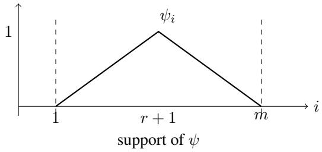
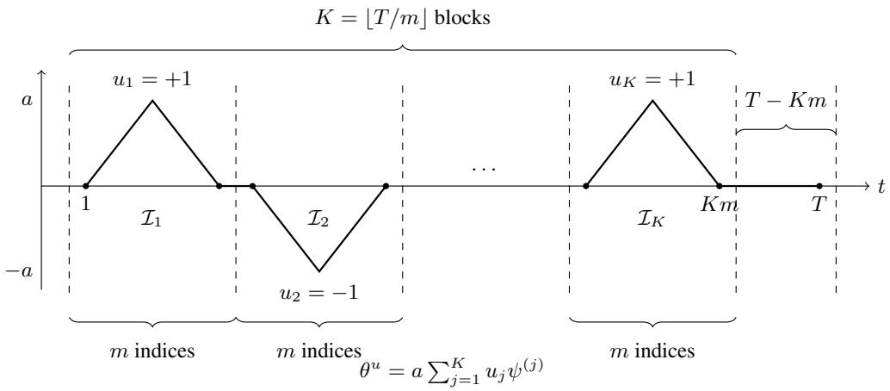

# STOCHASTIC TRACKING OF DRIFTING AFFINE FIXED POINTS

Sajad Khodadadian

Grado Department of Industrial and Systems Engineering Virginia Tech

## ABSTRACT

Linear stochastic approximation (SA) is widely used to estimate fixed points from noisy observations, but most finite-time analyses assume that the underlying operator remains fixed. We study linear SA with time-varying affine operators, where the fixed points change over time and the observation noise may be correlated across rounds. For constant-stepsize updates, we establish a bound on the cumulative expected squared distance between the iterates and the corresponding fixed points. The bound accounts for the initial error, observation noise, and changes in the fixed points over time. We also establish lower bounds for scalar Gaussian models, showing that, under specified conditions, a suitably chosen constant stepsize achieves the smallest possible worst-case cumulative error up to constant factors, even compared with estimators that use future observations. These results further quantify the effect of temporal correlation on estimation accuracy. Since choosing an appropriate stepsize generally requires knowledge of the noise level and how much the fixed points change, we develop an adaptive method that uses an additional bounded, unbiased observation of the fixed point to achieve an almost optimal algorithm without needing the knowledge of the noise level and the fixed point variation over time. Finally, we apply our results to value-function estimation using synchronous tabular temporal-difference learning in changing environments, assuming generative-model access and a common invariant distribution.

## 1 INTRODUCTION

Reinforcement learning algorithms often operate in environments whose conditions change over time. A navigation system may encounter changing traffic conditions, while a recommendation system may face shifts in user preferences. In such settings, the rewards and consequences of an action can change, making earlier observations less representative of the decisions the learner currently faces. These challenges have motivated a growing literature on reinforcement learning in nonstationary environments (Cheung et al., 2020; Wei & Luo, 2021).

A basic part of this problem is keeping value estimates up to date. Policy evaluation estimates the expected future reward obtained by following a given policy, and these estimates support policy improvement in many reinforcement learning algorithms. Finite-time analyses of temporal-difference (TD) learning typically study a fixed policy in a fixed environment (Bhandari et al., 2021; Khamaru et al., 2021). When rewards or transition probabilities change, however, the value function changes as well. Even when the environment remains fixed, changing the policy can change its value function and a critic that evaluates the current policy must keep its estimates up to date as the policy changes (Walton, 2020). The learner must therefore maintain accurate estimates throughout learning, while the quantity being estimated continues to move.

Tracking a changing value function requires balancing responsiveness and noise reduction. A small step size reduces the influence of individual noisy observations but can leave the estimate slow to respond to change. A large step size responds more quickly but produces larger fluctuations. Correlation between observations adds another difficulty: when errors persist across successive samples, averaging them may reduce noise more slowly than it would with independent samples. A useful analysis must account for both the movement of the target and the information available in the observations.

This tradeoff is well established in stochastic tracking and time-varying optimization (Bastianello et al., 2024; Cutler et al., 2023; Sahu et al., 2026). For exact contractive updates, Hadiji et al. (2026) bound cumulative squared tracking error using the sum of squared changes in the target. This measure captures the difference between gradual movement and abrupt changes, even when the overall displacement is the same. We build on this deterministic result to study how temporally correlated observation noise affects the tracking guarantee.

We consider a deterministic sequence of affine contractions $F _ { t } ( x ) = M _ { t } x + b _ { t }$ , each with its own fixed point. At each round, the learner observes a noisy evaluation of the current map and updates its estimate using a constant step size. This formulation includes discounted Bellman updates under the conditions of our TD application. The affine structure allows us to separate the error caused by initialization and target movement from the error caused by noise. We use this separation to obtain a cumulative mean-square bound that retains the deterministic tracking terms and makes the contribution of temporal correlation explicit.

## Our contributions.

1. A bound on tracking error. We bound the total expected squared distance between the learner’s estimates and the changing fixed points. The bound separates the contributions of the initial error, observation noise, and target movement. It shows how the step size and correlation between observations affect tracking accuracy, extending an existing guarantee for exact updates to noisy observations (Theorem 3).

2. Limits on tracking accuracy. For a scalar model with Gaussian noise, we establish a worst-case lower bound on the error of any estimator, even one that can use future observations. Over specified ranges of target movement, this lower bound matches, up to constant factors, the guarantee achieved by a suitably chosen step size. We also establish how temporal correlation increases this unavoidable error (Theorems 5 and 7).

3. Combining trackers with different step sizes. The appropriate step size depends on the noise level and target movement, which may be unknown. We therefore run several trackers with different step sizes and combine their predictions. To compare their accuracy, the method uses additional bounded observations that are unbiased estimates of the current target. The combined prediction has total expected squared error at most that of the best tracker in the collection plus an explicit penalty that grows logarithmically with the number of trackers (Theorem 9).

4. Application to policy evaluation. We apply the tracking bound to synchronous tabular TD with changing rewards and transition probabilities, assuming simulator access and a common invariant distribution. Appendix E gives the tracking guarantees, constructs the additional target observations needed for adaptation, and quantifies their sampling cost. We also extend the analysis to coupled linear updates under explicit contraction assumptions (Appendix F).

Section 2 discusses prior work, Section 3 gives the problem formulation, and Sections 4–5 present the results and their scope. Complete proofs appear in the appendix.

## 2 RELATED WORK

Tracking and dynamic regret. Besbes et al. (2015) establish variation-dependent minimax guarantees for nonstationary stochastic optimization, using a budget on changes in the objective. Yang et al. (2016) study moving minimizers under exact and noisy gradient feedback, while Zhang et al. (2017) introduce squared path length into dynamic-regret bounds with multiple gradient queries. For contractive updates, Bernstein & Dall’Anese (2018) analyze asynchronous tracking. Madden et al. (2021) establish asymptotic tracking bounds and lower bounds for first-order methods in time-varying optimization, while Hadiji et al. (2026) bound cumulative squared error by quadratic path variation. With noisy feedback, Bastianello et al. (2024) treat general time-varying operators, and Cutler et al. (2023) separate optimization, noise, and minimizer drift. Sahu et al. (2026) study the same stepsize tradeoff and the limitations of momentum in nonstationary optimization. Section 5 compares the assumptions and guarantees with our affine result.

Sequence estimation and adaptation. The scalar class $\begin{array} { r } { \sum _ { t < T } ( \theta _ { t + 1 } - \theta _ { t } ) ^ { 2 } \le W } \end{array}$ is a discrete Sobolev class. Sadhanala et al. (2016) give its minimax estimation bounds. Baby & Wang (2019,

Section 3.5) obtain online forecasting guarantees that adapt to unknown variation, with the same leading rate up to logarithmic factors and additional terms. Their method assumes a known horizon and sub-Gaussian noise parameter, uses noisy scalar target observations, and requires no separate validation stream. Baby & Wang (2021) develop variation-adaptive guarantees for exp-concave online learning, including squared loss. Correlated errors in nonparametric regression are also well studied (Opsomer et al., 2001). Our Gaussian results specialize this setting to affine queries and keep the finite-horizon dependence on the covariance factor explicit. For general affine maps, we assume a target-validation oracle and apply standard exponential weighting (Cesa-Bianchi & Lugosi, 2006) to tracking recursions.

Stochastic approximation. Konda & Tsitsiklis (2003) study slowly changing Markov statistics with decreasing stepsizes, and Kumar et al. (2019) analyze constant-stepsize tracking. For fixed targets, finite-sample analyses cover general norms, multiplicative noise, and high-probability guarantees (Chen et al., 2020; Chandak, 2026; Diakonikolas, 2026). Related two-timescale results are discussed alongside the extension in Appendix F.

Policy evaluation and nonstationary RL. Finite-time bounds for stationary TD are established by Bhandari et al. (2021). In an instance-dependent analysis of tabular policy evaluation, Khamaru et al. (2021) show that standard TD can be suboptimal and establish near-optimal guarantees for variance-reduced stochastic approximation methods. Totaro & Jonsson (2021) propose a Kalmanstyle approach to changing value parameters. Most nonstationary RL theory concerns control and exploration (Cheung et al., 2020; Mao et al., 2021; Wei & Luo, 2021; Zhou et al., 2022; Feng et al., 2023; Jali et al., 2026). Closer to our application, Walton (2020) analyzes tabular TD and Q-learning along a changing Markov trajectory. Our TD guarantee concerns cumulative estimation error under synchronous generative access.

## 3 PROBLEM FORMULATION

We study the problem of tracking a changing fixed point using noisy observations. Fix a horizon $T \geq 2 .$ . At each time $t = 1 , \dots , T$ , consider an affine map

$$
F _ { t } ( x ) = M _ { t } x + b _ { t } , \qquad M _ { t } \in \mathbb { R } ^ { d \times d } , \quad b _ { t } \in \mathbb { R } ^ { d } .
$$

The sequence of maps is deterministic and may change over time. We equip $\mathbb { R } ^ { d }$ with a fixed inner product $\langle \cdot , \cdot \rangle$ and its associated norm $\| x \| = { \sqrt { \langle x , x \rangle } }$ . We write $\left\| \cdot \right\| _ { \mathrm { o p } }$ for the induced operator norm. Assumption 1 (Uniform contraction). There is a constant $\kappa \in ( 0 , 1 ]$ such that $\| M _ { t } \| _ { \mathrm { o p } } \leq 1 - \kappa f o r$ every $t = 1 , \dots , T$

Under this assumption, each map has a unique fixed point,

$$
\boldsymbol { x } _ { t } ^ { * } = \boldsymbol { F } _ { t } ( \boldsymbol { x } _ { t } ^ { * } ) = ( I - M _ { t } ) ^ { - 1 } \boldsymbol { b } _ { t } .
$$

The learner’s task is to estimate $\boldsymbol { x } _ { t } ^ { * }$ at each time t using the observations available before that time.

Observations and updates. The learner starts from a deterministic initial estimate $x _ { 1 } \in \mathbb { R } ^ { d }$ . Let $\mathcal { F } _ { t }$ denote the information available before the observation at time t, including past observations and any internal randomness used by the learner. The estimate $x _ { t }$ is ${ \mathcal { F } } _ { i }$ -measurable. After forming this estimate, the learner receives a noisy evaluation of the current map:

$$
{ \widehat F } _ { t } ( x _ { t } ) = F _ { t } ( x _ { t } ) + \xi _ { t + 1 } , \qquad t = 1 , \ldots , T - 1 ,
$$

where the observation error $\xi _ { t + 1 }$ is $\mathcal { F } _ { t + 1 }$ -measurable.

We analyze the update

$$
x _ { t + 1 } = ( 1 - \eta ) x _ { t } + \eta \widehat { F } _ { t } ( x _ { t } ) , \qquad t = 1 , \ldots , T - 1 ,\tag{1}
$$

with a constant stepsize $\eta \in ( 0 , 1 ]$ . Thus, each new estimate combines the previous estimate with the latest noisy evaluation.

Noise assumptions. We allow observation errors to be correlated across time. In addition to requiring each error to have mean zero and bounded second moment, we control how much noise can accumulate in a linear combination of observations.

Assumption 2 (Noise and temporal correlation). There are constants $\sigma ^ { 2 } \geq 0$ and $\tau \geq 1$ such that, for every $t = 1 , \dots , T - 1$

$$
\mathbb { E } [ \xi _ { t + 1 } ] = 0 , \qquad \mathbb { E } \left\| \xi _ { t + 1 } \right\| ^ { 2 } \leq \sigma ^ { 2 } .
$$

Moreover, for every integer $1 \leq n \leq T - 1$ and every collection of deterministic matrices $C _ { 1 } , \ldots , C _ { n } ^ { \mathbf { \bar { \alpha } } } \in \mathbb { R } ^ { d \times \tilde { d } }$

$$
\mathbb { E } \left\| \sum _ { s = 1 } ^ { n } C _ { s } \xi _ { s + 1 } \right\| ^ { 2 } \leq \tau \sigma ^ { 2 } \sum _ { s = 1 } ^ { n } \left\| C _ { s } \right\| _ { \mathrm { o p } } ^ { 2 } .\tag{2}
$$

Here, $\sigma ^ { 2 }$ bounds the size of an individual observation error, while τ controls the effect of temporal correlation on accumulated noise. A standard special case is martingale-difference noise:

$$
\begin{array} { r } { \mathbb { E } [ \xi _ { t + 1 } \mid \mathcal { F } _ { t } ] = 0 , \qquad \mathbb { E } [ \| \xi _ { t + 1 } \| ^ { 2 } \mid \mathcal { F } _ { t } ] \le \sigma ^ { 2 } . } \end{array}
$$

These conditions imply Assumption 2 with $\tau = 1$ . The general assumption requires only unconditional mean-zero errors and therefore also permits correlated noise. For example, centered scalar noise with

$$
\mathbb { E } [ \xi _ { s + 1 } \xi _ { t + 1 } ] = \sigma ^ { 2 } \chi ^ { | s - t | } , \qquad 0 \le \chi < 1 ,
$$

satisfies the assumption with $\tau = ( 1 + \chi ) / ( 1 - \chi )$ . Proposition 14 gives the corresponding matrix result.

Tracking objective. We measure performance by the cumulative expected squared distance between the learner’s estimates and the current fixed points:

$$
\mathcal { E } _ { T } : = \sum _ { t = 1 } ^ { T } \mathbb { E } \left. x _ { t } - x _ { t } ^ { * } \right. ^ { 2 } .
$$

To describe how much the target changes, we use its squared variation,

$$
W _ { T } : = \sum _ { t = 1 } ^ { T - 1 } \left\| x _ { t + 1 } ^ { * } - x _ { t } ^ { * } \right\| ^ { 2 } .
$$

This quantity captures the magnitudes of successive changes and distinguishes movement concentrated in a few rounds from movement spread more evenly over time. For example, a displacement $v \in \mathbb { R } ^ { d }$ made in one jump contributes $\left\| v \right\| ^ { 2 }$ , whereas the same displacement spread evenly over $T - 1$ steps contributes $\left\| v \right\| ^ { 2 } / ( T - 1 )$

Our goal is to bound ${ \mathcal { E } } _ { T }$ in terms of the initial error, the contraction strength, the noise, and the target variation, and to understand how the stepsize affects tracking accuracy.

## 4 MAIN RESULTS

## 4.1 FINITE-TIME TRACKING BOUND

We first bound the cumulative tracking error for any constant stepsize. The result quantifies the effects of initialization, observation noise, and movement of the fixed points.

Theorem 3 (Cumulative tracking error). Suppose Assumptions 1–2 hold. For every constant stepsize $\eta \in ( 0 , 1 ]$

$$
\left| \mathcal { E } _ { T } \leq \frac { { \left\| x _ { 1 } - x _ { 1 } ^ { * } \right\| } ^ { 2 } } { \eta \kappa } + \frac { \eta \tau \sigma ^ { 2 } T } { \kappa ( 2 - \eta \kappa ) } + \frac { W _ { T } } { \eta ^ { 2 } \kappa ^ { 2 } } . \right|\tag{3}
$$

The first term bounds the contribution of the initial estimation error. The second accounts for accumulated observation noise, while the third accounts for the lag behind the moving target. Increasing the stepsize reduces the initialization and movement terms but increases the noise term. The covariance factor τ enters only through the noise term.

To obtain an explicit stepsize choice, we next assume exact initialization, $x _ { 1 } = x _ { 1 } ^ { * }$ . This removes the first term and isolates the tradeoff between noise and target movement. Using $2 - \eta \kappa \geq 1$ , we obtain the simpler bound

$$
{ \mathcal E } _ { T } \le \frac { \tau \sigma ^ { 2 } T } { \kappa } \eta + \frac { W _ { T } } { \kappa ^ { 2 } } \eta ^ { - 2 } .
$$

Minimizing this expression over positive stepsizes gives the following corollary, provided the minimizing stepsize does not exceed one.

Corollary 4 (Tracking bound with a tuned stepsize). Under the assumptions of Theorem 3, suppose $x _ { 1 } = x _ { 1 } ^ { * } , W _ { T } > 0$ , and $\tau \sigma ^ { 2 } > 0 .$ . Define $\begin{array} { r } { \eta _ { \mathrm { b a l } } : = \left( \frac { 2 W _ { T } } { \kappa \tau \sigma ^ { 2 } T } \right) ^ { 1 / 3 } . ~ I f \eta _ { \mathrm { b a l } } \leq 1 } \end{array}$ , running the iteration with η = ηbal gives

$$
\mathcal { E } _ { T } < 2 \frac { ( \tau \sigma ^ { 2 } T ) ^ { 2 / 3 } W _ { T } ^ { 1 / 3 } } { \kappa ^ { 4 / 3 } } .
$$

The tuned stepsize increases with target variation and decreases with the noise level and covariance factor. This choice requires knowledge of those quantities and minimizes the simplified upper bound above. Theorem 3 itself requires neither exact initialization nor positive noise or variation, and remains valid for every $\eta \in ( 0 , 1 ]$

## 4.2 A SCALAR GAUSSIAN BENCHMARK

We next examine whether the tracking rate in Corollary 4 can be improved when the observation noise is independent. We consider a scalar model in which noisy operator evaluations can be converted into direct observations of the changing target.

Consider the affine maps

$$
F _ { t } ^ { \theta } ( x ) = ( 1 - \kappa ) x + \kappa \theta _ { t } ,
$$

whose fixed points are $\theta _ { t }$ . These are also the Bellman maps of a one-state reward process with discount factor $1 - \kappa$ and mean reward $\kappa \theta _ { t }$

At each round, the learner may make at most q queries, where $q \geq 1$ is an integer. Query locations may depend on previous observations. The response to the ith query at location x is

$$
\begin{array} { r } { { \sf O } _ { t , i } ( x ) = F _ { t } ^ { \theta } ( x ) + \varepsilon _ { t , i } , } \end{array}
$$

where the errors are independent across queries and rounds, with $\varepsilon _ { t , i } \sim \mathcal { N } ( 0 , \sigma ^ { 2 } )$ and $\sigma ^ { 2 } > 0$

For a variation budget $W > 0$ , define the target class

$$
\Theta _ { T } ( W ) : = \left\{ \theta \in \mathbb { R } ^ { T } : \theta _ { 1 } = 0 , \quad \sum _ { t = 1 } ^ { T - 1 } ( \theta _ { t + 1 } - \theta _ { t } ) ^ { 2 } \leq W \right\} .
$$

Thus, W bounds the variation of every sequence in the class, whereas $W _ { T }$ denotes the variation of an individual sequence. The initial target $\theta _ { 1 } = 0$ is known to the learner.

When κ is known, each response can be transformed as

$$
\frac { \mathrm { O } _ { t , i } ( x ) - ( 1 - \kappa ) x } { \kappa } = \theta _ { t } + \frac { \varepsilon _ { t , i } } { \kappa } .
$$

The query location disappears from this expression. Averaging q transformed responses therefore gives a Gaussian observation of $\theta _ { t }$ with variance

$$
\nu ^ { 2 } : = \frac { \sigma ^ { 2 } } { q \kappa ^ { 2 } } .
$$

The problem reduces to estimating a sequence from noisy observations under a bound on its squared increments. Writing $( D \theta ) _ { t } = \theta _ { t + 1 } - \theta _ { t }$ , this constraint is $\left\| \boldsymbol { D } \theta \right\| _ { 2 } ^ { 2 } \leq W$ , commonly called a discrete Sobolev constraint. Its estimation rates are classical (Sadhanala et al., 2016). The following theorem specializes the lower bound to our query model, with an explicit variation range and a fixed initial target.

Theorem 5 (Gaussian lower bound for moderate variation). In the scalar model above, suppose the learner is told $\kappa , \sigma ^ { 2 } , q , W$ , and $\theta _ { 1 } = 0 .$ . Let $\nu ^ { 2 } = \sigma ^ { 2 } / ( q \kappa ^ { 2 } )$ . There is a universal constant $c > 0$ such that,for $T \geq 1 6$ and

$$
\frac { 1 6 \nu ^ { 2 } } { T ^ { 2 } } \leq W \leq \frac { \nu ^ { 2 } T } { 3 2 } ,
$$

$$
\operatorname* { i n f } _ { \widehat { \theta } } \operatorname* { s u p } _ { \theta \in \Theta _ { T } ( W ) } \mathbb { E } _ { \theta } \sum _ { t = 1 } ^ { T } ( \widehat { \theta } _ { t } - \theta _ { t } ) ^ { 2 } \geq c \frac { ( \sigma ^ { 2 } T / q ) ^ { 2 / 3 } W ^ { 1 / 3 } } { \kappa ^ { 4 / 3 } } .
$$

The infimum allows estimators to use all $q T$ observations before producing any estimate. The bound therefore also applies to online algorithms, which have access only to past observations.

The appendix gives a self-contained proof with $c = 1 / 4 0 9 6$ . We now compare this lower bound with the constant-stepsize tracker. Averaging q independent responses at each update reduces the oracle noise variance to $\sigma ^ { 2 } / q ,$ , allowing us to apply Theorem 3 with this smaller variance.

Corollary 6 (Matching tracking guarantee). In the same scalar model, start from $x _ { 1 } = 0 .$ . At each update time $t = 1 , \dots , \top - 1$ , make q queries at the current iterate and average the responses. Define

$$
\eta _ { q , \mathrm { b a l } } : = \left( \frac { 2 q W } { \kappa \sigma ^ { 2 } T } \right) ^ { 1 / 3 } .
$$

$I f \eta _ { q , \mathrm { b a l } } \leq 1$ , running the iteration in equation 1 with $\eta = \eta _ { q }$ ,bal gives

$$
\operatorname* { s u p } _ { \theta \in \Theta _ { T } ( W ) } \mathbb { E } _ { \theta } \sum _ { t = 1 } ^ { T } ( x _ { t } - \theta _ { t } ) ^ { 2 } < 2 \frac { ( \sigma ^ { 2 } T / q ) ^ { 2 / 3 } W ^ { 1 / 3 } } { \kappa ^ { 4 / 3 } } .
$$

Consequently, for $T \geq 1 6$ , the upper and lower bounds agree up to universal constants whenever

$$
\frac { 1 6 \nu ^ { 2 } } { T ^ { 2 } } \leq W \leq \operatorname* { m i n } \left\{ \frac { \nu ^ { 2 } T } { 3 2 } , \frac { \kappa ^ { 3 } \nu ^ { 2 } T } { 2 } \right\} .
$$

Within this range, the constant-stepsize tracker attains the smallest possible worst-case error up to constants, despite using only past observations. The two upper restrictions on $W$ come from the lower-bound theorem and the requirement that the balancing stepsize be at most one.

## 4.3 THE COST OF TEMPORAL CORRELATION

The previous subsection considered independent observation errors. We now allow errors to be correlated across rounds and show that the dependence on τ in the tuned tracking bound is necessary over a specified range of target variation.

We retain the scalar maps $F _ { t } ^ { \theta }$ and target class $\Theta _ { T } ( W )$ from Section 4.2. The ith query at round t uses error $\varepsilon _ { t , i } .$ . For each $i = 1 , \ldots , q$ , the sequence $( \varepsilon _ { t , i } ) _ { t = 1 } ^ { T }$ is jointly Gaussian, with

$$
\mathbb { E } [ \varepsilon _ { t , i } ] = 0 , \qquad \mathbb { E } [ \varepsilon _ { s , i } \varepsilon _ { t , i } ] = \sigma ^ { 2 } \chi ^ { | s - t | } , \qquad \chi = \frac { \tau - 1 } { \tau + 1 } .
$$

Sequences corresponding to different query indices are independent. Thus, $\tau = 1$ gives independent errors, while larger values of τ give more persistent temporal correlation. Averaging the q responses at each round produces noise satisfying Assumption 2 with variance parameter $\sigma ^ { 2 } / q$ and the same covariance factor τ.

Theorem 7 (Gaussian lower bound with temporal correlation). Let $T \geq 1 6 , \sigma ^ { 2 } > 0 , q \geq 1$ be an integer, $1 \leq \tau \leq T / 8 ,$ , and $\nu ^ { 2 } = \sigma ^ { 2 } / ( q \kappa ^ { 2 } )$ . For the correlated observations above, if

$$
\frac { 4 \tau \nu ^ { 2 } } { T ^ { 2 } } \leq W \leq \frac { \nu ^ { 2 } T } { 1 2 8 \tau ^ { 2 } } ,
$$

then

$$
\operatorname* { i n f } _ { \widehat { \theta } } \operatorname* { s u p } _ { \theta \in \Theta _ { T } ( W ) } \mathbb { E } _ { \theta } \sum _ { t = 1 } ^ { T } ( \widehat { \theta } _ { t } - \theta _ { t } ) ^ { 2 } \geq \frac { 1 } { 8 1 9 2 } \frac { ( \tau \sigma ^ { 2 } T / q ) ^ { 2 / 3 } W ^ { 1 / 3 } } { \kappa ^ { 4 / 3 } } .
$$

The bound holds even ifthe learner knows $\kappa , \sigma ^ { 2 } , q , W , \tau$ , and $\theta _ { 1 } = 0 ,$ , and receives all qT observations before estimating the targets.

To compare this lower bound with the tracker, start from $x _ { 1 } = 0$ , average q responses at each of the first $T - 1$ update times, and choose

$$
\eta = \left( \frac { 2 q W } { \kappa \tau \sigma ^ { 2 } T } \right) ^ { 1 / 3 } .
$$

If $W \le \kappa ^ { 3 } \tau \nu ^ { 2 } T / 2$ , this stepsize is at most one. Theorem 3 then bounds the worst-case cumulative error over $\Theta _ { T } ( W )$ by a quantity smaller than $2 ( \tau \nu ^ { 2 } T ) ^ { 2 / 3 } W ^ { 1 / 3 }$ . Consequently, the upper and lower bounds match up to universal constants whenever

$$
\frac { 4 \tau \nu ^ { 2 } } { T ^ { 2 } } \leq W \leq \operatorname* { m i n } \left\{ \frac { \nu ^ { 2 } T } { 1 2 8 \tau ^ { 2 } } , \frac { \kappa ^ { 3 } \tau \nu ^ { 2 } T } { 2 } \right\} .
$$

Under the theorem’s conditions, this interval is nonempty when $\kappa T \geq 2$ . Within this range, the factor $\tau ^ { 2 / 3 }$ is unavoidable in the Gaussian model, even when the noise covariance is known. Appendix C.4 proves the lower bound using target sequences that change slowly relative to the decay of noise correlations.

A constant-target example. To isolate the effect of temporal correlation, consider a target that remains fixed at zero: $\theta _ { t } = 0$ for every $t \geq 1$ . Initialize the tracker at $x _ { 1 } = 0$ , so there is no initial error or target movement, and all subsequent estimation error comes from observation noise. For this calculation, extend the Gaussian noise model to all $t \geq 1$ and allow any $\tau \geq 1$ . With $q$ averaged responses per update and a fixed stepsize $\eta \in ( 0 , 1 ]$ , write $r = 1 - \eta \kappa$ . The limiting mean-square error is

$$
\operatorname* { l i m } _ { t \to \infty } \mathbb { E } x _ { t } ^ { 2 } = \frac { \eta \sigma ^ { 2 } } { q \kappa ( 2 - \eta \kappa ) } \frac { 1 + r \chi } { 1 - r \chi } .\tag{4}
$$

Indeed, expanding the recursion gives $\mathbb { E } x _ { t } ^ { 2 } = ( \eta ^ { 2 } \sigma ^ { 2 } / q ) \sum _ { i , j = 0 } ^ { t - 2 } r ^ { i + j } \chi ^ { | i - j | }$ ; summing the resulting geometric series yields equation 4.

The first factor in equation 4 is the limiting error under independent noise. Temporal correlation multiplies it by

$$
\frac { 1 + r \chi } { 1 - r \chi } = \frac { 2 \tau - \eta \kappa ( \tau - 1 ) } { 2 + \eta \kappa ( \tau - 1 ) } .
$$

When $\eta \kappa \tau$ is small, this multiplier is approximately $\tau .$ In this regime, the tracker averages observations over a period longer than the noise remains strongly correlated. The upper restriction on W in Theorem 7 ensures that $\eta \kappa \tau \leq 1 / 4$ for the balancing stepsize, placing the matching result in this regime.

For a fixed positive stepsize, the limiting error instead approaches $\sigma ^ { 2 } / ( q \kappa ^ { 2 } )$ as $\tau  \infty$ . Thus, the error does not continue to grow proportionally to τ when correlations persist much longer than the tracker’s averaging period. The general upper bound can overestimate the correlation cost in that setting.

## 4.4 ADAPTATION USING TARGET VALIDATION

The tuned stepsizes above depend on the target variation and noise parameters, which may be unknown. We run several copies of the tracking iteration, each with a different constant stepsize, and form a weighted average of their predictions. After predicting at round t, we receive an additional observation of $\boldsymbol { x } _ { t } ^ { * }$ whose conditional mean, given the learner’s history, is $\boldsymbol { x } _ { t } ^ { * }$ . We score each tracker by its squared distance to this observation and assign larger weights to trackers with smaller cumulative scores.

Additional target observations. Let $\mathcal { X }$ be a known nonempty closed convex set containing every fixed point $\boldsymbol { x } _ { t } ^ { * }$ and contained in a ball of known radius $B > 0$ . Let $\mathcal { G } _ { t }$ contain all information available before the validation observation at round t, including the history, the internal iterates of all trackers, and their current weights.

Assumption 8 (Target validation). At each round $t = 1 , \dots , T$ , after forming its prediction, the learner receives a validation vector $Y _ { t } \in \mathcal { X }$ satisfying

$$
\mathbb { E } [ Y _ { t } \mid { \mathcal G } _ { t } ] = x _ { t } ^ { * } .\tag{5}
$$

For $t < T ,$ , conditional on $\mathcal { G } _ { t } , Y _ { t }$ is independent of the collection of operator samples used to update the trackers at round t.

Combining the trackers. Set $J = \left\lceil \log _ { 2 } T \right\rceil$ and run $J + 1$ trackers with stepsizes $\eta _ { j } = 2 ^ { - j }$ $j = 0 , \ldots , J .$ We refer to these trackers as experts. Expert j maintains an internal iterate $x _ { t , j }$ and predicts $\widetilde { x } _ { t , j } = \Pi _ { \chi } ( x _ { t , j } )$ , where $\Pi _ { \mathcal { X } }$ is the nearest-point projection onto $\mathcal { X }$ with respect to the norm $\lVert \cdot \rVert$ introduced in Section 3. The internal iterates follow the original affine update; projection is used to bound the predictions that are combined and scored.

At each update, expert j receives $\widehat { F } _ { t , j } ( x _ { t , j } ) = F _ { t } ( x _ { t , j } ) + \xi _ { t + 1 , j }$ . For each fixed $j ,$ assume that its noise sequence satisfies Assumption 2 with the same parameters $( \sigma ^ { 2 } , \tau )$ . Different experts may share update samples, and their noise sequences need not be independent. Algorithm 1 combines the projected predictions by exponential weighting. Experts whose past predictions were closer to the validation observations receive larger weights.

Algorithm 1 META-TRACK: combining trackers with target validation   
1: Set $J = \lceil \log _ { 2 } T \rceil$ and $\lambda = 1 / ( 8 B ^ { 2 } )$   
2: For each $j = 0 , \ldots , J ,$ set $\eta _ { j } ^ { \cdot } \overset { \cdot } { = } 2 ^ { - j } , p _ { 1 , j } = 1 / ( J + 1 )$ , and $x _ { 1 , j } = x _ { 1 }$   
3: for $t = 1 , \dots , T \mathbf { d o }$   
4: Set $\widetilde { x } _ { t , j } = \Pi _ { \chi } ( x _ { t , j } )$ for every $j .$   
5: Predict $\begin{array} { r } { \bar { x } _ { t } = \sum _ { j = 0 } ^ { J } p _ { t , j } \widetilde { x } _ { t , j } . } \end{array}$   
6: Observe the validation vector $Y _ { t } .$   
7: if $t < T$ then   
8: Set $p _ { t + 1 , j } \propto p _ { t , j } \exp \{ - \lambda \| \widetilde { x } _ { t , j } - Y _ { t } \| ^ { 2 } \}$ and normalize the weights to sum to one.   
9: Obtain the operator observations $\widehat { F } _ { t , j } ( x _ { t , j } )$ for all experts.   
10: Update $x _ { t + 1 , j } = ( 1 - \eta _ { j } ) x _ { t , j } + \eta _ { j } \widehat { F } _ { t , j } ( x _ { t , j } )$ for every $j .$   
11: end if   
12: end for

Theorem 9 (Adaptation with target validation). Suppose Assumptions 1 and 8 hold, and each expert’s noise sequence satisfies Assumption 2 with the same parameters $( \sigma ^ { 2 } , \tau )$ . Then Algorithm 1 satisfies

$$
\sum _ { t = 1 } ^ { T } \mathbb { E } \left\| \bar { x } _ { t } - x _ { t } ^ { * } \right\| ^ { 2 } \leq \operatorname* { m i n } _ { 0 \leq j \leq J } \sum _ { t = 1 } ^ { T } \mathbb { E } \left\| x _ { t , j } - x _ { t } ^ { * } \right\| ^ { 2 } + 8 B ^ { 2 } \log ( J + 1 ) ,\tag{6a}
$$

$$
\leq 4 \operatorname* { i n f } _ { \eta \in [ 1 / T , 1 ] } \left\{ \frac { \| x _ { 1 } - x _ { 1 } ^ { * } \| ^ { 2 } } { \eta \kappa } + \frac { \eta \tau \sigma ^ { 2 } T } { \kappa ( 2 - \eta \kappa ) } + \frac { W _ { T } } { \eta ^ { 2 } \kappa ^ { 2 } } \right\} + 8 B ^ { 2 } \log ( J + 1 ) .\tag{6b}
$$

$I f x _ { 1 } = x _ { 1 } ^ { * } , W _ { T } > 0 , \tau \sigma ^ { 2 } > 0 ,$ , and the balancing stepsize $\eta _ { \mathrm { b a l } }$ from Corollary 4 lies in $[ 1 / T , 1 ]$ , then

$$
\sum _ { t = 1 } ^ { T } \mathbb { E } \left\| \bar { x } _ { t } - x _ { t } ^ { * } \right\| ^ { 2 } < 8 \frac { ( \tau \sigma ^ { 2 } T ) ^ { 2 / 3 } W _ { T } ^ { 1 / 3 } } { \kappa ^ { 4 / 3 } } + 8 B ^ { 2 } \log ( 1 + \lceil \log _ { 2 } T \rceil ) .
$$

Equation 6a bounds the combined predictor’s cumulative expected squared error by the smallest such error among the $J + 1$ fixed-stepsize trackers, plus $8 B ^ { 2 } \log ( J + 1 )$ . Equation 6b gives an explicit guarantee in terms of initialization, noise, and target variation. It is obtained by applying Theorem 3 to the trackers and comparing the stepsize grid with all $\eta \in [ 1 / T , 1 ]$ , which introduces the factor four. Appendix D gives the proof.

The algorithm uses $J + 1 = O ( \log T )$ trackers and does not require knowledge of $W _ { T } , \sigma ^ { 2 }$ , or τ. With separate pointwise queries, it uses $J + 1$ operator calls per update. It also requires one validation observation per prediction round. Excluding operator evaluations and projections, computing the tracker updates, combining their predictions, and updating their weights requires $O ( T ( J + 1 ) d )$ arithmetic operations, assuming that squared norms can be computed in $O ( d )$ operations.

Direct smoothing of validation observations. The additional target observations also support a simpler tracker that uses no operator evaluations. For a fixed $a \in ( 0 , 1 ]$ , initialize $u _ { 1 } = x _ { 1 }$ and update

$$
u _ { t + 1 } = ( 1 - a ) u _ { t } + a Y _ { t } , \qquad t = 1 , \dots , T - 1 .
$$

Conditional unbiasedness and boundedness imply $\mathbb { E } [ \left. Y _ { t } - x _ { t } ^ { * } \right. ^ { 2 } | \mathcal { G } _ { t } ] \leq B ^ { 2 }$ . Applying Theorem 3 to this recursion gives

$$
\sum _ { t = 1 } ^ { T } \mathbb { E } \left\| u _ { t } - x _ { t } ^ { * } \right\| ^ { 2 } \leq \frac { \left\| x _ { 1 } - x _ { 1 } ^ { * } \right\| ^ { 2 } } { a } + \frac { a B ^ { 2 } T } { 2 - a } + \frac { W _ { T } } { a ^ { 2 } } .
$$

Appendix D gives the details.

At $a = \eta \kappa$ , this bound has the same initialization and movement terms as the operator-tracking bound in Theorem 3. The respective noise coefficients are $B ^ { 2 }$ for direct smoothing and $\tau \sigma ^ { 2 } / \kappa ^ { 2 }$ for operator tracking. Thus, the operator-tracking bound has a smaller noise term when $\tau \sigma ^ { 2 } / \kappa ^ { 2 } < B ^ { 2 }$ . This comparison concerns the upper bounds; it does not establish that either method always has smaller actual error.

## 4.5 APPLICATIONS AND EXTENSIONS

Appendix E applies our results to synchronous tabular TD when rewards and transition probabilities change. This application requires a simulator that can sample from every state and assumes that all transition kernels share the same invariant distribution. When this distribution is known, we also show how additional simulator rollouts provide the target observations needed for stepsize adaptation and quantify their sampling cost. Appendix F extends the analysis to two coupled linear updates, each with its own stepsize, and gives tracking bounds under additional contraction assumptions.

## 5 DISCUSSION AND COMPARISON WITH PRIOR WORK

Our analysis builds on the deterministic tracking guarantee of Hadiji et al. (2026). For the affine updates considered here, Theorem 3 retains their initialization and target-movement terms and adds a noise term that accounts for temporal correlation. Earlier stochastic analyses already describe the tradeoff between noise reduction and responsiveness to change, including in nonlinear settings (Bas tianello et al., 2024; Cutler et al., 2023). The deterministic affine structure allows us to separate the effects of initialization and target movement from accumulated observation noise. We use this separation to obtain a bound in terms of squared target variation and the covariance condition in Assumption 2. Table 1 in Appendix G summarizes the assumptions and guarantees of selected prior results.

The Gaussian benchmarks clarify when this bound is sharp. For independent observations, the dependence on the horizon and squared target variation agrees with classical results for estimating sequences with bounded squared increments (Sadhanala et al., 2016). Our formulation makes the dependence on the contraction strength and number of operator queries explicit. It also identifies variation ranges in which a suitably chosen constant stepsize attains the smallest possible worstcase error up to constant factors. The correlated Gaussian benchmark further shows that the $\tau ^ { 2 / 3 }$ dependence in the tuned bound is unavoidable in the matching range described in Section $4 . 3$ . These optimality statements concern the specified scalar Gaussian models and variation ranges.

The adaptive result addresses how to choose among stepsizes when the noise level and target variation are unknown. Adaptation to unknown variation is already possible in scalar forecasting: Baby & Wang (2019) obtain guarantees directly from noisy target observations, without a separate validation stream. Our method combines affine trackers using standard exponential weighting (Cesa-Bianchi & Lugosi, 2006) and requires additional bounded, unbiased observations of the current fixed point. Theorem 9 compares its cumulative expected error with that of the best fixed-stepsize tracker in the collection. The additional observations also support direct smoothing, as discussed in Section 4.4.

For policy evaluation, the sampling model is an essential distinction. Walton (2020) studies asynchronous TD and Q-learning using observations from a changing Markov trajectory. Our TD application assumes simulator access from every state and transition kernels that share a common invariant distribution. Under these conditions, we obtain cumulative value-estimation bounds and quantify the additional sampling cost of adaptation. Extending the analysis to observations from a single changing trajectory, and adapting the stepsize using operator observations alone, remain directions for further work.

## AI USE STATEMENT

Generative AI tools were used to help draft portions of the text, identify related literature, and prepare LATEX. The authors remain responsible for independently checking every cited source, theorem statement, algebraic derivation, and proof, and for the final content of the manuscript. No experimental data were generated by AI.

## REPRODUCIBILITY STATEMENT

Sections 3–4 state the assumptions, algorithms, and constants for every main-text result and specify which observations are available when each prediction is formed. The appendix gives complete proofs and states the additional localization condition used for the nested fast–slow extension. The paper contains no experiments or datasets.

## REFERENCES

Dheeraj Baby and Yu-Xiang Wang. Online forecasting of total-variation-bounded sequences. In Advances in Neural Information Processing Systems, volume 32, pp. 11071–11081, 2019. URL https://proceedings.neurips.cc/paper\_files/paper/2019/ hash/62e0973455fd26eb03e91d5741a4a3bb-Abstract.html.

Dheeraj Baby and Yu-Xiang Wang. Optimal dynamic regret in exp-concave online learning. In Proceedings ofthe 34th Conference on Learning Theory, volume 134 of Proceedings ofMachine Learning Research, pp. 359–409. PMLR, 2021. URL https://proceedings.mlr.press/ v134/baby21a.html.

Nicola Bastianello, Liam Madden, Ruggero Carli, and Emiliano Dall’Anese. A stochastic operator framework for optimization and learning with sub-Weibull errors. IEEE Transactions on Automatic Control, 69(12):8722–8737, 2024.

Andrey Bernstein and Emiliano Dall’Anese. Asynchronous and distributed tracking of time-varying fixed points. In 2018 IEEE Conference on Decision and Control, pp. 3236–3243. IEEE, 2018.

Omar Besbes, Yonatan Gur, and Assaf Zeevi. Non-stationary stochastic optimization. Operations Research, 63(5):1227–1244, 2015. doi: 10.1287/opre.2015.1408.

Jalaj Bhandari, Daniel Russo, and Raghav Singal. A finite time analysis of temporal difference learning with linear function approximation. Operations Research, 69(3):950–973, 2021.

Guido Carnevale, Nicola Bastianello, Luca Schenato, Giuseppe Notarstefano, and Ruggero Carli. Timescale separation through the lens of operator theory. arXiv preprint arXiv:2608.02443, 2026.

Nicolo Cesa-Bianchi and G\` abor Lugosi.´ Prediction, Learning, and Games. Cambridge University Press, 2006. doi: 10.1017/CBO9780511546921.

Siddharth Chandak. Concentration and mean-square bounds for contractive stochastic approximation: A unified elementary approach. arXiv preprint arXiv:2607.17595, 2026.

Zaiwei Chen, Siva Theja Maguluri, Sanjay Shakkottai, and Karthikeyan Shanmugam. Finite-sample analysis of contractive stochastic approximation using smooth convex envelopes. In Advances in Neural Information Processing Systems, volume 33, pp. 8223–8234, 2020.

Wang Chi Cheung, David Simchi-Levi, and Ruihao Zhu. Reinforcement learning for non-stationary Markov decision processes: The blessing of (more) optimism. In Proceedings of the 37th International Conference on Machine Learning, volume 119 of Proceedings ofMachine Learning Research, pp. 1843–1854. PMLR, 2020.

Joshua Cutler, Dmitriy Drusvyatskiy, and Zaid Harchaoui. Stochastic optimization under distributional drift. Journal ofMachine Learning Research, 24(147):1–56, 2023.

Jelena Diakonikolas. Solving stochastic fixed-point equations with high probability. arXiv preprint arXiv:2607.09097, 2026.

Songtao Feng, Ming Yin, Ruiquan Huang, Yu-Xiang Wang, Jing Yang, and Yingbin Liang. Nonstationary reinforcement learning under general function approximation. In Proceedings of the 40th International Conference on Machine Learning, volume 202 of Proceedings of Machine Learning Research, pp. 9976–10007. PMLR, 2023.

Hedi Hadiji, Sarah Sachs, and Crist´ obal Guzm´ an. Tracking solutions of time-varying variational´ inequalities. Mathematics ofOperations Research, 2026. doi: 10.1287/moor.2024.0571. Articles in Advance.

Shaan Ul Haque, Sajad Khodadadian, and Siva Theja Maguluri. Tight finite time bounds of two-timescale linear stochastic approximation with Markovian noise. arXiv preprint arXiv:2401.00364, 2024.

Neharika Jali, Eshika Pathak, Pranay Sharma, Guannan Qu, and Gauri Joshi. Natural policy gradient for average reward non-stationary reinforcement learning. Transactions on Machine Learning Research, 2026.

Maxim Kaledin, Eric Moulines, Alexey Naumov, Vladislav Tadic, and Hoi-To Wai. Finite time analysis of linear two-timescale stochastic approximation with Markovian noise. In Proceedings of the 33rd Conference on Learning Theory, volume 125 of Proceedings of Machine Learning Research, pp. 2144–2203. PMLR, 2020.

Koulik Khamaru, Ashwin Pananjady, Feng Ruan, Martin J. Wainwright, and Michael I. Jordan. Is temporal difference learning optimal? an instance-dependent analysis. SIAM Journal on Mathematics ofData Science, 3(4):1013–1040, 2021. doi: 10.1137/20M1331524.

Vijay R. Konda and John N. Tsitsiklis. Linear stochastic approximation driven by slowly varying Markov chains. Systems & Control Letters, 50(2):95–102, 2003.

Bhumesh Kumar, Vivek S. Borkar, and Akhil Shetty. Non-asymptotic error bounds for constant stepsize stochastic approximation for tracking mobile agents. Mathematics of Control, Signals, and Systems, 31(4):589–614, 2019.

Jeongyeol Kwon, Luke Dotson, Yudong Chen, and Qiaomin Xie. Two-timescale linear stochastic approximation: Constant stepsizes go a long way. In Proceedings of the 28th International Conference on Artificial Intelligence and Statistics, volume 258 of Proceedings of Machine Learning Research, pp. 3781–3789. PMLR, 2025.

Liam Madden, Stephen Becker, and Emiliano Dall’Anese. Bounds for the tracking error of first-order online optimization methods. Journal ofOptimization Theory and Applications, 189(2):437–457, 2021. doi: 10.1007/s10957-021-01836-9.

Vagul Mahadevan, Claire Chen, Shuze Daniel Liu, and Shangtong Zhang. Convergence of two-timescale Markovian stochastic approximations with applications in reinforcement learning. In Proceedings of the 43rd International Conference on Machine Learning, volume 306 of Proceedings of Machine Learning Research, pp. 85598–85668. PMLR, 2026. URL https://proceedings.mlr.press/v306/mahadevan26a.html.

Weichao Mao, Kaiqing Zhang, Ruihao Zhu, David Simchi-Levi, and Tamer Bas¸ar. Near-optimal model-free reinforcement learning in non-stationary episodic MDPs. In Proceedings ofthe 38th International Conference on Machine Learning, volume 139 of Proceedings of Machine Learning Research, pp. 7447–7458. PMLR, 2021.

Jean Opsomer, Yuedong Wang, and Yuhong Yang. Nonparametric regression with correlated errors. Statistical Science, 16(2):134–153, 2001. doi: 10.1214/ss/1009213287.

Veeranjaneyulu Sadhanala, Yu-Xiang Wang, and Ryan J. Tibshirani. Total variation classes beyond 1d: Minimax rates, and the limitations of linear smoothers. In Advances in Neural Information Processing Systems, volume 29, pp. 3513–3521, 2016. URL https://proceedings.neurips.cc/paper\_files/paper/2016/ hash/17ed8abedc255908be746d245e50263a-Abstract.html.

Sharan Sahu, Cameron J. Hogan, and Martin T. Wells. On the provable suboptimality of momentum SGD in nonstationary stochastic optimization. In Proceedings of the 43rd International Conference on Machine Learning, volume 306 of Proceedings of Machine Learning Research, pp. 107055–107125. PMLR, 2026. URL https://proceedings.mlr.press/v306/ sahu26a.html.

Dhruv Sarkar and Vaneet Aggarwal. Non-expansive two-time-scale stochastic approximation: A fixedschedule one-quarter barrier and bias-corrected acceleration. arXiv preprint arXiv:2607.13414, 2026a.

Dhruv Sarkar and Vaneet Aggarwal. Nonlinear two-time-scale stochastic approximation: A sharp phase transition and how to beat it. arXiv preprint arXiv:2606.14488, 2026b.

Simone Totaro and Anders Jonsson. Fast stochastic Kalman gradient descent for reinforcement learning. In Proceedings of the 3rd Conference on Learning for Dynamics and Control, volume 144 of Proceedings ofMachine Learning Research, pp. 1118–1129. PMLR, 2021.

Alexandre B. Tsybakov. Introduction to Nonparametric Estimation. Springer, New York, 2009.

Neil Walton. An adiabatic theorem for policy tracking with TD-learning. arXiv preprint arXiv:2010.12848, 2020.

Chen-Yu Wei and Haipeng Luo. Non-stationary reinforcement learning without prior knowledge: An optimal black-box approach. In Proceedings ofthe 34th Conference on Learning Theory, volume 134 of Proceedings of Machine Learning Research, pp. 4300–4354. PMLR, 2021.

Tianbao Yang, Lijun Zhang, Rong Jin, and Jinfeng Yi. Tracking slowly moving clairvoyant: Optimal dynamic regret of online learning with true and noisy gradient. In Proceedings of the 33rd International Conference on Machine Learning, volume 48 of Proceedings of Machine Learning Research, pp. 449–457. PMLR, 2016. URL https://proceedings.mlr.press/v48/ yangb16.html.

Lijun Zhang, Tianbao Yang, Jinfeng Yi, Rong Jin, and Zhi-Hua Zhou. Improved dynamic regret for non-degenerate functions. In Advances in Neural Information Processing Systems, volume 30, pp. 732–741, 2017. URL https://arxiv.org/abs/1608.03933.

Huozhi Zhou, Jinglin Chen, Lav R. Varshney, and Ashish Jagmohan. Nonstationary reinforcement learning with linear function approximation. Transactions on Machine Learning Research, 2022.

## APPENDIX ROADMAP

We begin with the preliminary lemmas and the proof of the main tracking bound, including the tuned stepsize guarantee. We then establish the Gaussian lower bounds for independent and temporally correlated noise and identify the conditions under which they match the upper bounds. Appendix D contains the proof of the adaptive tracking result and the analysis of direct smoothing using validation observations. In Appendix E, we apply our results to synchronous tabular TD, construct the unbiased validation observations needed for adaptation, and quantify their sampling cost. Appendix F extends the analysis to linear recursions with two stepsizes, considering both a stacked contraction and a nested fast–slow system. Finally, Appendix G compares our assumptions and guarantees with selected prior work.

## A PRELIMINARY LEMMAS

We first collect the deterministic filter bounds, the covariance bound, and the exponential-weighting inequality used later.

Lemma 10 (Stable products). Let $K _ { 1 } , \ldots , K _ { T - 1 }$ be deterministic matrices, and satisfy $\| K _ { t } \| _ { \mathrm { o p } } \leq$ $\rho < 1$ . For $t > s ,$ define $\Phi ( t , s ) = K _ { t - 1 } \cdot \cdot \cdot K _ { s } ,$ , and let $\Phi ( s , s ) = I .$ . Then $\| \Phi ( t , s ) \| _ { \mathrm { o p } } \leq \rho ^ { t - s }$ and

$$
\sum _ { t = 1 } ^ { T } \left. \Phi ( t , 1 ) u \right. ^ { 2 } \leq \frac { \left. u \right. ^ { 2 } } { 1 - \rho ^ { 2 } } .
$$

Proof. Submultiplicativity gives $\| \Phi ( t , s ) \| _ { \mathrm { o p } } \leq \rho ^ { t - s }$ . Hence

$$
\sum _ { t = 1 } ^ { T } \left\| \Phi ( t , 1 ) u \right\| ^ { 2 } \leq \left\| u \right\| ^ { 2 } \sum _ { k = 0 } ^ { T - 1 } \rho ^ { 2 k } \leq \frac { \left\| u \right\| ^ { 2 } } { 1 - \rho ^ { 2 } } .
$$

Lemma 11 (Deterministic contraction tracking). Suppose ${ d _ { t + 1 } } = K _ { t } d _ { t } - u _ { t }$ and $\| K _ { t } \| _ { \mathrm { o p } } \le \rho < 1$ $f o r t = 1 , \ldots , T - 1$ . Then

$$
\sum _ { t = 1 } ^ { T } \left\| d _ { t } \right\| ^ { 2 } \leq \frac { \left\| d _ { 1 } \right\| ^ { 2 } } { 1 - \rho } + \frac { 1 } { ( 1 - \rho ) ^ { 2 } } \sum _ { t = 1 } ^ { T - 1 } \left\| u _ { t } \right\| ^ { 2 } .
$$

Proof. For nonnegative $a , b ,$

$$
( \rho a + b ) ^ { 2 } \leq \rho a ^ { 2 } + \frac { b ^ { 2 } } { 1 - \rho } ,
$$

because the right-hand side minus the left-hand side equals $\rho ( \sqrt { 1 - \rho } a - b / \sqrt { 1 - \rho } ) ^ { 2 }$ . Therefore

$$
\left\| { d _ { t + 1 } } \right\| ^ { 2 } \leq \rho \left\| { d _ { t } } \right\| ^ { 2 } + \frac { \left\| { u _ { t } } \right\| ^ { 2 } } { 1 - \rho } .
$$

Let $\begin{array} { r } { S _ { T } \ = \ \sum _ { t = 1 } ^ { T } \left\| d _ { t } \right\| ^ { 2 } } \end{array}$ and $\begin{array} { r } { U _ { T } \ = \ \sum _ { t = 1 } ^ { T - 1 } \left. u _ { t } \right. ^ { 2 } } \end{array}$ . Summing the preceding inequality for $t \ =$ $1 , \ldots , T - 1$ gives

$$
S _ { T } - \left\| d _ { 1 } \right\| ^ { 2 } \leq \rho { \left( S _ { T } - \left\| d _ { T } \right\| ^ { 2 } \right) } + \frac { { \cal U } _ { T } } { 1 - \rho } .
$$

Dropping the nonpositive term $- \rho \left\| d _ { T } \right\| ^ { 2 }$ , rearranging, and dividing by $1 - \rho$ prove the claim. Lemma 12 (Stable convolution). For vectors $d _ { 1 } , \dots , d _ { T - 1 }$ and $\rho \in [ 0 , 1 )$

$$
\sum _ { t = 2 } ^ { T } \left( \sum _ { s = 1 } ^ { t - 1 } \rho ^ { t - 1 - s } \left\| d _ { s } \right\| \right) ^ { 2 } \leq \frac { 1 } { ( 1 - \rho ) ^ { 2 } } \sum _ { s = 1 } ^ { T - 1 } \left\| d _ { s } \right\| ^ { 2 } .
$$

Consequently, under the hypotheses of Lemma $I O ,$

$$
\sum _ { t = 2 } ^ { T } \left\| \sum _ { s = 1 } ^ { t - 1 } \Phi ( t , s + 1 ) d _ { s } \right\| ^ { 2 } \leq { \frac { 1 } { ( 1 - \rho ) ^ { 2 } } } \sum _ { s = 1 } ^ { T - 1 } \left\| d _ { s } \right\| ^ { 2 } .
$$

Proof. Let $a _ { s } = \| d _ { s } \|$ . By the Cauchy–Schwarz inequality, for every $t = 2 , \ldots , T$

$$
\left( \sum _ { s = 1 } ^ { t - 1 } \rho ^ { t - 1 - s } a _ { s } \right) ^ { 2 } \leq \left( \sum _ { s = 1 } ^ { t - 1 } \rho ^ { t - 1 - s } \right) \left( \sum _ { s = 1 } ^ { t - 1 } \rho ^ { t - 1 - s } a _ { s } ^ { 2 } \right)
$$

$$
\leq \frac { 1 } { 1 - \rho } \sum _ { s = 1 } ^ { t - 1 } \rho ^ { t - 1 - s } a _ { s } ^ { 2 } ,
$$

where the last inequality follows from the geometric series bound $\begin{array} { r } { \sum _ { s = 1 } ^ { t - 1 } \rho ^ { t - 1 - s } \le ( 1 - \rho ) ^ { - 1 } } \end{array}$ Summing over t and exchanging the order of summation, we obtain

$$
\begin{array} { r l } & { \displaystyle \sum _ { t = 2 } ^ { T } \left( \sum _ { s = 1 } ^ { t - 1 } \rho ^ { t - 1 - s } a _ { s } \right) ^ { 2 } } \\ & { \quad \le \displaystyle \frac { 1 } { 1 - \rho } \sum _ { t = 2 } ^ { T } \sum _ { s = 1 } ^ { t - 1 } \rho ^ { t - 1 - s } a _ { s } ^ { 2 } } \\ & { \quad = \displaystyle \frac { 1 } { 1 - \rho } \sum _ { s = 1 } ^ { T - 1 } a _ { s } ^ { 2 } \sum _ { t = s + 1 } ^ { T } \rho ^ { t - 1 - s } } \\ & { \quad \le \displaystyle \frac { 1 } { ( 1 - \rho ) ^ { 2 } } \sum _ { s = 1 } ^ { T - 1 } a _ { s } ^ { 2 } , } \end{array}
$$

which proves the first inequality.

For the matrix inequality, Lemma 10 gives $\| \Phi ( t , s + 1 ) \| _ { \mathrm { o p } } \leq \rho ^ { t - 1 - s }$ . Hence, by the triangle inequality,

$$
\begin{array} { r l r } {  { \bigg \| \displaystyle \sum _ { s = 1 } ^ { t - 1 } \Phi ( t , s + 1 ) d _ { s } \bigg \| \le \sum _ { s = 1 } ^ { t - 1 } \| \Phi ( t , s + 1 ) d _ { s } \| } } \\ & { } & { \le \displaystyle \sum _ { s = 1 } ^ { t - 1 } \rho ^ { t - 1 - s } \| d _ { s } \| . } \end{array}
$$

Squaring both sides, summing over $t = 2 , \ldots , T$ , and applying the first inequality completes the proof. □

Lemma 13 (Accumulated oracle error). Under Assumption 2 and the hypotheses of Lemma 10,

$$
\sum _ { t = 2 } ^ { T } \mathbb { E } \left\| \sum _ { s = 1 } ^ { t - 1 } \Phi ( t , s + 1 ) \xi _ { s + 1 } \right\| ^ { 2 } \leq \frac { \tau \sigma ^ { 2 } ( T - 1 ) } { 1 - \rho ^ { 2 } } .
$$

Proof. Fix t. Apply equation 2 with $C _ { s } = \Phi ( t , s + 1 )$ for $s < t$ and $C _ { s } = 0$ for $s \geq t .$ . Lemma 10 gives

$$
\mathbb { E } \left\| \sum _ { s = 1 } ^ { t - 1 } \Phi ( t , s + 1 ) \xi _ { s + 1 } \right\| ^ { 2 } \leq \tau \sigma ^ { 2 } \sum _ { s = 1 } ^ { t - 1 } \rho ^ { 2 ( t - 1 - s ) } \leq \frac { \tau \sigma ^ { 2 } } { 1 - \rho ^ { 2 } } .
$$

Finally, summing over $t = 2 , \ldots , T$ proves the result.

Proposition 14 (Geometric centered correlation implies integrated covariance). Suppose $\mathbb { E } [ \xi _ { t + 1 } ] = 0$ for every $t = 1 , \dots , T - 1$ and,for all deterministic linear maps $C _ { s } , C _ { r } : \mathbb { R } ^ { d }  \mathbf { \hat { \mathbb { R } } } ^ { d }$

$$
\begin{array} { r } { \big | \mathbb { E } \left. C _ { s } \xi _ { s + 1 } , C _ { r } \xi _ { r + 1 } \right. \big | \leq \sigma ^ { 2 } \chi _ { \mathrm { c o r r } } ^ { \left| s - r \right| } \left\| C _ { s } \right\| _ { \mathrm { o p } } \left\| C _ { r } \right\| _ { \mathrm { o p } } , \qquad \chi _ { \mathrm { c o r r } } \in [ 0 , 1 ) . } \end{array}
$$

Then Assumption 2 holds with $\tau = ( 1 + \chi _ { \mathrm { c o r r } } ) / ( 1 - \chi _ { \mathrm { c o r r } } )$

Proof. We verify the two conditions in Assumption 2.

First, taking $s = r$ and $C _ { s } = C _ { r } = I$ in the assumed covariance bound gives

$$
\mathbb { E } \left\| \xi _ { s + 1 } \right\| ^ { 2 } \leq \sigma ^ { 2 } .
$$

Together with the assumed mean-zero property, this establishes the first condition.

Next, fix any $1 \leq n \leq T - 1$ and deterministic matrices $C _ { 1 } , \ldots , C _ { n }$ . Expanding the squared norm and taking expectations yields

$$
\begin{array} { r l } { \mathbb { E } \left\| \displaystyle \sum _ { s = 1 } ^ { n } C _ { s } \xi _ { s + 1 } \right\| ^ { 2 } = \displaystyle \sum _ { s = 1 } ^ { n } \sum _ { r = 1 } ^ { n } \mathbb { E } \left. C _ { s } \xi _ { s + 1 } , C _ { r } \xi _ { r + 1 } \right. } & { } \\ & { \leq \sigma ^ { 2 } \displaystyle \sum _ { s = 1 } ^ { n } \sum _ { r = 1 } ^ { n } \chi _ { \mathrm { c o r r } } ^ { \left. s - r \right. } \left\| C _ { s } \right\| _ { \mathrm { o p } } \left\| C _ { r } \right\| _ { \mathrm { o p } } , } \end{array}
$$

where the inequality follows from the assumed covariance bound.

Using $2 a b \leq a ^ { 2 } + b ^ { 2 }$ , we have

$$
\begin{array} { r l } {  { \sum _ { s = 1 } ^ { n } \sum _ { r = 1 } ^ { n } \chi _ { \mathrm { c o r r } } ^ {  s - r  }  C _ { s }  _ { \mathrm { o p } }  C _ { r }  _ { \mathrm { o p } } } } \\ & { \leq \frac { 1 } { 2 } \sum _ { s = 1 } ^ { n } \sum _ { r = 1 } ^ { n } \chi _ { \mathrm { c o r r } } ^ {  s - r  } (  C _ { s }  _ { \mathrm { o p } } ^ { 2 } +  C _ { r }  _ { \mathrm { o p } } ^ { 2 } ) } \\ & { = \sum _ { s = 1 } ^ { n }  C _ { s }  _ { \mathrm { o p } } ^ { 2 } \displaystyle \sum _ { r = 1 } ^ { n } \chi _ { \mathrm { c o r r } } ^ {  s - r  } . } \end{array}
$$

The equality follows by symmetry in s and r.

For each fixed $s ,$ the inner sum satisfies

$$
\begin{array} { l } { \displaystyle \sum _ { r = 1 } ^ { n } \chi _ { \mathrm { c o r r } } ^ { \lfloor s - r \rfloor } = 1 + \displaystyle \sum _ { k = 1 } ^ { s - 1 } \chi _ { \mathrm { c o r r } } ^ { k } + \displaystyle \sum _ { k = 1 } ^ { n - s } \chi _ { \mathrm { c o r r } } ^ { k } } \\ { \displaystyle \qquad \leq 1 + 2 \displaystyle \sum _ { k = 1 } ^ { \infty } \chi _ { \mathrm { c o r r } } ^ { k } } \\ { \displaystyle \qquad = 1 + \frac { 2 \chi _ { \mathrm { c o r r } } } { 1 - \chi _ { \mathrm { c o r r } } } } \\ { \displaystyle \qquad = \frac { 1 + \chi _ { \mathrm { c o r r } } } { 1 - \chi _ { \mathrm { c o r r } } } . } \end{array}
$$

Combining these inequalities gives

$$
\begin{array} { r l r } {  { \mathbb { E } \| \sum _ { s = 1 } ^ { n } C _ { s } \xi _ { s + 1 } \| ^ { 2 } \leq \sigma ^ { 2 } \frac { 1 + \chi _ { \mathrm { c o r r } } } { 1 - \chi _ { \mathrm { c o r r } } } \sum _ { s = 1 } ^ { n } \| C _ { s } \| _ { \mathrm { o p } } ^ { 2 } } } \\ & { } & { = \tau \sigma ^ { 2 } \sum _ { s = 1 } ^ { n } \| C _ { s } \| _ { \mathrm { o p } } ^ { 2 } , \quad } \end{array}
$$

where $\tau = ( 1 + \chi _ { \mathrm { c o r r } } ) / ( 1 - \chi _ { \mathrm { c o r r } } )$ . This establishes equation 2 and completes the proof. □

Lemma 15 (Exp-concavity of squared loss). Let $B > 0 ,$ , let X be convex and contained in a ball of radius B, and let $y \in { \mathcal { X } } .$ . For every $0 < \lambda \leq 1 / ( 8 B ^ { 2 } )$ , the map $x \mapsto \exp ( - \lambda \left\| x - y \right\| ^ { 2 } )$ is concave on X. Consequently,for $x _ { j } \in { \mathcal { X } }$ and a probability vector p,

$$
\left\| \sum _ { j } p _ { j } x _ { j } - y \right\| ^ { 2 } \leq - \lambda ^ { - 1 } \log \sum _ { j } p _ { j } \exp ( - \lambda \left\| x _ { j } - y \right\| ^ { 2 } ) .
$$

Proof. We first show that the function

$$
f ( x ) = \exp ( - \lambda \left\| x - y \right\| ^ { 2 } )
$$

is concave on X whenever $0 < \lambda \leq 1 / ( 8 B ^ { 2 } )$ ).

Fix any $x , x ^ { \prime } \in { \mathcal { X } }$ and consider the line segment

$$
z ( t ) = ( 1 - t ) x + t x ^ { \prime } , \qquad t \in [ 0 , 1 ] .
$$

Since X is convex, $z ( t ) \in \mathcal { X }$ for every $t \in [ 0 , 1 ]$ . Moreover, because $\mathcal { X }$ is contained in a ball of radius B and $y \in { \mathcal { X } }$

$$
\| z ( t ) - y \| \leq 2 B .
$$

Let $h = x ^ { \prime } - x$ and define

$$
g ( t ) = f ( z ( t ) ) = \exp ( - \lambda \left\| z ( t ) - y \right\| ^ { 2 } ) .
$$

Since the norm is induced by an inner product and $z ^ { \prime } ( t ) = h ,$ , differentiation gives

$$
\begin{array} { r l } & { g ^ { \prime } ( t ) = - 2 \lambda g ( t ) \left. z ( t ) - y , h \right. , } \\ & { g ^ { \prime \prime } ( t ) = g ( t ) \left( 4 \lambda ^ { 2 } \left. z ( t ) - y , h \right. ^ { 2 } - 2 \lambda \left\| h \right\| ^ { 2 } \right) . } \end{array}
$$

By the Cauchy–Schwarz inequality,

$$
\begin{array} { r l } & { { { \langle z ( t ) - y , h \rangle } ^ { 2 } } \le \left\| z ( t ) - y \right\| ^ { 2 } \left\| h \right\| ^ { 2 } } \\ & { \qquad \le { 4 B ^ { 2 } } \left\| h \right\| ^ { 2 } . } \end{array}
$$

Substituting this bound into the expression for $g ^ { \prime \prime } ( t )$ yields

$$
\begin{array} { r l r } & { } & { g ^ { \prime \prime } ( t ) \leq g ( t ) \left( 1 6 \lambda ^ { 2 } B ^ { 2 } - 2 \lambda \right) \left. h \right. ^ { 2 } } \\ & { } & { ~ = 2 \lambda g ( t ) \left( 8 \lambda B ^ { 2 } - 1 \right) \left. h \right. ^ { 2 } } \\ & { } & { ~ \leq 0 , } \end{array}
$$

where the last inequality follows from $\lambda \le 1 / ( 8 B ^ { 2 } )$

Thus, $g$ is concave on [0, 1]. Since x and $x ^ { \prime }$ were arbitrary, $f$ is concave on $\mathcal { X } .$

Now let $x _ { j } \in { \mathcal { X } }$ and let $( p _ { j } )$ be a probability vector. By convexity of $x ,$ , the weighted average $\begin{array} { r } { \bar { x } = \sum _ { j } p _ { j } x _ { j } } \end{array}$ belongs to X. Applying Jensen’s inequality to the concave function $f$ gives

$$
\exp ( - \lambda \left\| { \bar { x } } - y \right\| ^ { 2 } ) \geq \sum _ { j } p _ { j } \exp ( - \lambda \left\| x _ { j } - y \right\| ^ { 2 } ) .
$$

Taking logarithms of both sides and dividing by $- \lambda < 0$ reverses the inequality, yielding

$$
\left\| \sum _ { j } p _ { j } x _ { j } - y \right\| ^ { 2 } \leq - { \frac { 1 } { \lambda } } \log \sum _ { j } p _ { j } \exp ( - \lambda \left\| x _ { j } - y \right\| ^ { 2 } ) .
$$

This completes the proof.

## B PROOF OF THE AFFINE TRACKING UPPER BOUND

We combine the deterministic tracking lemma with the covariance bound for the propagated noise.

Proof of Theorem 3. Let $e _ { t } = x _ { t } - x _ { t } ^ { * }$ and $\Delta _ { t } = x _ { t + 1 } ^ { * } - x _ { t } ^ { * }$ . Since $F _ { t } ( x _ { t } ^ { * } ) = x _ { t } ^ { * }$

$$
\begin{array} { r l } & { e _ { t + 1 } = ( 1 - \eta ) ( x _ { t } - x _ { t } ^ { * } ) + \eta \big ( F _ { t } ( x _ { t } ) - F _ { t } ( x _ { t } ^ { * } ) \big ) + \eta \xi _ { t + 1 } - \Delta _ { t } } \\ & { \qquad = K _ { t } e _ { t } + \eta \xi _ { t + 1 } - \Delta _ { t } , } \end{array}
$$

where $K _ { t } = ( 1 - \eta ) I + \eta M _ { t }$ . Here we used the affine identity $F _ { t } ( x _ { t } ) - F _ { t } ( x _ { t } ^ { * } ) = M _ { t } ( x _ { t } - x _ { t } ^ { * } )$

Assumption 1 gives $\| K _ { t } \| _ { \mathrm { o p } } \leq ( 1 - \eta ) + \eta ( 1 - \kappa ) = 1 - \eta \kappa = : \rho < 1 .$

Split $e _ { t } = d _ { t } + n _ { t }$ , where

$$
d _ { 1 } = e _ { 1 } , \quad n _ { 1 } = 0 , \qquad d _ { t + 1 } = K _ { t } d _ { t } - \Delta _ { t } , \qquad n _ { t + 1 } = K _ { t } n _ { t } + \eta \xi _ { t + 1 } .
$$

All $K _ { t } , d _ { t }$ , and $\Delta _ { t }$ are deterministic. Marginal centering in Assumption 2 gives $\mathbb { E } [ n _ { t } ] = 0$ , and therefore

$$
\begin{array} { r } { \mathbb { E } \left\| e _ { t } \right\| ^ { 2 } = \left\| d _ { t } \right\| ^ { 2 } + \mathbb { E } \left\| n _ { t } \right\| ^ { 2 } . } \end{array}
$$

Lemma 11 yields

$$
\sum _ { t = 1 } ^ { T } \left\| d _ { t } \right\| ^ { 2 } \leq \frac { \left\| e _ { 1 } \right\| ^ { 2 } } { 1 - \rho } + \frac { W _ { T } } { ( 1 - \rho ) ^ { 2 } } .
$$

Moreover,

$$
n _ { t } = \eta \sum _ { s = 1 } ^ { t - 1 } \Phi ( t , s + 1 ) \xi _ { s + 1 } .
$$

Lemma 13 gives

$$
\sum _ { t = 1 } ^ { T } \operatorname { \mathbb { E } } \left\| n _ { t } \right\| ^ { 2 } \leq \frac { \eta ^ { 2 } \tau \sigma ^ { 2 } ( T - 1 ) } { 1 - \rho ^ { 2 } } \leq \frac { \eta ^ { 2 } \tau \sigma ^ { 2 } T } { 1 - \rho ^ { 2 } } .
$$

Combining the deterministic and stochastic bounds and using $1 - \rho = \eta \kappa$ and $1 - \rho ^ { 2 } = \eta \kappa ( 2 - \eta \kappa )$ proves equation 3. □

ProofofCorollary 4. When $x _ { 1 } = x _ { 1 } ^ { * }$ , Theorem 3 and $2 - \eta \kappa \geq 1$ give

$$
{ \mathcal E } _ { T } \le a \eta + b \eta ^ { - 2 } , \qquad a = \frac { \tau \sigma ^ { 2 } T } { \kappa } , \quad b = \frac { W _ { T } } { \kappa ^ { 2 } } .
$$

The unconstrained minimizer of this simpler bound is $( 2 b / a ) ^ { 1 / 3 } = \eta _ { \mathrm { b a l } }$ . Substituting it gives

$$
a \eta _ { \mathrm { b a l } } + b \eta _ { \mathrm { b a l } } ^ { - 2 } = ( 2 ^ { 1 / 3 } + 2 ^ { - 2 / 3 } ) a ^ { 2 / 3 } b ^ { 1 / 3 } ,
$$

which is the claimed bound.

## C PROOF OF THE GAUSSIAN LOWER BOUND

Proof of Theorem 5. We prove the lower bound by reducing the oracle model to a Gaussian sequence estimation problem. We first show that the query locations provide no additional information about the target and that the observations at each round can be replaced by their average. We then construct a family of triangular target sequences that satisfy $\theta _ { 1 } = 0$ and the variation budget but are difficult to distinguish from noisy observations. A testing argument converts this difficulty into the desired lower bound on the squared estimation error.

## C.1 REDUCTION TO A GAUSSIAN SEQUENCE EXPERIMENT

Let $\mathsf { O } _ { t , i } ( x )$ denote the ith response to a query x at round t. A possibly adaptive query $x _ { t , i }$ produces

$$
Z _ { t , i } : = \frac { \mathsf { O } _ { t , i } ( x _ { t , i } ) - ( 1 - \kappa ) x _ { t , i } } { \kappa } = \theta _ { t } + \frac { \varepsilon _ { t , i } } { \kappa } .
$$

The transformation removes the known contribution of the query location, leaving a Gaussian observation of $\theta _ { t }$ whose distribution does not depend on $x _ { t , i }$ . Since κ and $x _ { t , i }$ are known to the learner, the transformation is invertible: the original response can be recovered from $Z _ { t , i }$ . This remains true for adaptive queries, since the learner can reconstruct its past responses and choose the same subsequent query locations. Thus, working with the transformed observations does not lose information about the target. For the lower bound, we may also give the learner exactly q observations at every round, since additional observations can only improve estimation accuracy.

Lemma 16 (Sufficiency of the per-round sample mean). For each $t = 1 , \ldots , T ,$ , suppose the learner observes $Z _ { t , 1 } , \ldots , Z _ { t , q } ,$ where $Z _ { t , i } \sim \mathcal { N } ( \dot { \theta _ { t } } , \sigma ^ { 2 } / \kappa ^ { 2 } )$ , independently across queries and rounds. Define

$$
\bar { Z } _ { t } = \frac { 1 } { q } \sum _ { i = 1 } ^ { q } Z _ { t , i } \sim \mathcal { N } ( \theta _ { t } , \nu ^ { 2 } ) , \nu ^ { 2 } = \frac { \sigma ^ { 2 } } { q \kappa ^ { 2 } } .
$$

For estimating $\theta _ { 1 : T }$ under squared loss, it is sufficient to observe the sample means $\bar { Z } _ { 1 } , \dots , \bar { Z } _ { T }$ . In particular, any estimator based on all qT observations can be replaced by an estimator based only on these sample means, without increasing its expected squared error.

Proof. We show that the observations contain no additional information about $\theta _ { 1 : T }$ beyond their sample means.

Fix a round t and write $v ^ { 2 } = \sigma ^ { 2 } / \kappa ^ { 2 }$ . For any possible observations $z _ { t , 1 } , \ldots , z _ { t , q }$ , their joint density is proportional to

$$
\exp \left( - \frac { 1 } { 2 v ^ { 2 } } \sum _ { i = 1 } ^ { q } ( z _ { t , i } - \theta _ { t } ) ^ { 2 } \right) .
$$

The sum in the exponent can be written as

$$
\sum _ { i = 1 } ^ { q } ( z _ { t , i } - \theta _ { t } ) ^ { 2 } = \sum _ { i = 1 } ^ { q } ( z _ { t , i } - \bar { z } _ { t } ) ^ { 2 } + q ( \bar { z } _ { t } - \theta _ { t } ) ^ { 2 } ,
$$

where $\begin{array} { r } { \bar { z } _ { t } = q ^ { - 1 } \sum _ { i = 1 } ^ { q } z _ { t , i } } \end{array}$ . To understand why the sample mean is sufficient, consider the two terms in the preceding identity. The first describes how the observations vary around their sample mean and does not depend on $\theta _ { t }$ . The second contains all the dependence on $\theta _ { t }$ , but involves the observations only through $\bar { z } _ { t }$

Now suppose we condition on the sample mean taking a particular value $\bar { z } _ { t }$ . Among all possible sets of observations with this average, the second term is constant. It therefore cancels when computing the conditional distribution of the observations. The remaining term depends only on the deviations from the sample mean and not on $\theta _ { t }$

Thus, once ${ \bar { Z } } _ { t }$ is known, the conditional distribution of the original $q$ observations does not depend on $\theta _ { t }$ . Since observations are independent across rounds, the same conclusion holds for the entire sequence: the conditional distribution of all $q T$ observations given $\bar { Z } _ { 1 : T }$ does not depend on $\theta _ { 1 : T }$

We now show that using only the sample means does not increase the estimation error. Let $\widehat { \theta }$ be any estimator that uses all $q T$ observations. We construct a new estimator by taking the conditional expectation of $\widehat { \theta }$ given the sample means:

$$
\widetilde { \theta } = \mathbb { E } _ { \theta } [ \widehat { \theta } \mid \bar { Z } _ { 1 : T } ] .
$$

In other words, for a given collection of sample means, $\widetilde { \theta }$ averages the estimates produced by $\widehat { \theta }$ over the possible values of the individual observations consistent with those means.

Although the conditional expectation is written under the distribution indexed by $\theta ,$ the resulting estimator does not require knowledge of $\theta .$ Indeed, we have already shown that the conditional distribution of the individual observations given their sample means is independent of θ. Therefore, the conditional averaging above can be performed using only $\bar { Z } _ { 1 : T }$ , and the same estimator $\widetilde { \theta }$ works for every target sequence.

It remains to compare the estimation errors. Fix any target sequence $\theta .$ Since $\theta$ is deterministic, we have

$$
{ \widetilde { \theta } } - \theta = \mathbb { E } _ { \theta } [ { \widehat { \theta } } - \theta \mid { \bar { Z } } _ { 1 : T } ] .
$$

The squared Euclidean norm is convex, so Jensen’s inequality gives

$$
\begin{array} { r l r } & { } & { { \left. { \widetilde { \theta } - \theta } \right. } _ { 2 } ^ { 2 } = { \left. { \mathbb { E } _ { \theta } [ { \widehat { \theta } - \theta } \mid { \bar { Z } _ { 1 : T } } ] } \right. } _ { 2 } ^ { 2 } } \\ & { } & { \leq { \mathbb { E } _ { \theta } [ \left. { \widehat { \theta } - \theta } \right. } _ { 2 } ^ { 2 } \mid { \bar { Z } _ { 1 : T } } ] . } \end{array}
$$

Taking expectations on both sides and using the law of total expectation yields

$$
\begin{array} { r l } & { \mathbb { E } _ { \theta } \left\| \widetilde { \theta } - \theta \right\| _ { 2 } ^ { 2 } \leq \mathbb { E } _ { \theta } \left[ \mathbb { E } _ { \theta } [ \left\| \widehat { \theta } - \theta \right\| _ { 2 } ^ { 2 } | \bar { Z } _ { 1 : T } ] \right] } \\ & { \qquad = \mathbb { E } _ { \theta } \left\| \widehat { \theta } - \theta \right\| _ { 2 } ^ { 2 } . } \end{array}
$$

Thus, for every estimator based on the full observations, we have constructed an estimator based only on the sample means whose expected squared error is no larger, for every $\theta .$ This proves that restricting attention to the sample means does not increase the minimax estimation risk. □

It remains to lower bound the offline Gaussian sequence model $\bar { Z } _ { t } \sim \mathcal N ( \theta _ { t } , \nu ^ { 2 } )$

  
Figure 1: The triangular sequence $\psi$ on a single block of length $m = 2 r + 1$ . It starts at 0, rises linearly to 1, and then decreases linearly back to 0.

## C.2 TRIANGULAR PACKING

Let $m = 2 r + 1$ be odd with $r \geq 2 ,$ and define $\psi \in \mathbb { R } ^ { m }$ by

$$
\psi _ { i } = \frac { \operatorname * { m i n } \{ i - 1 , m - i \} } { r } , \qquad i = 1 , \ldots , m .
$$

Thus $\psi _ { 1 } = \psi _ { m } = 0$ and the center equals one. Figure 1 shows this function.

Lemma 17 (Triangle geometry). For $m = 2 r + 1$ with $r \geq 2 ,$

$$
{ \frac { m } { 6 } } \leq \| \psi \| _ { 2 } ^ { 2 } \leq m , \qquad \sum _ { i = 1 } ^ { m - 1 } ( \psi _ { i + 1 } - \psi _ { i } ) ^ { 2 } = { \frac { 2 } { r } } \leq { \frac { 8 } { m } } .
$$

Proof. The nonzero values are $1 / r , 2 / r , \ldots , ( r - 1 ) / r , 1 , ( r - 1 ) / r , \ldots , 1 / r ,$ so

$$
\left\| \psi \right\| _ { 2 } ^ { 2 } = 1 + { \frac { 2 } { r ^ { 2 } } } \sum _ { j = 1 } ^ { r - 1 } j ^ { 2 } = 1 + { \frac { ( r - 1 ) ( 2 r - 1 ) } { 3 r } } .
$$

For $r \geq 2 .$ , this lies between $( 2 r + 1 ) / 6 = m / 6$ and $m .$ Each of the 2r nonzero increments has magnitude $1 / r$ , so $\begin{array} { r } { \sum _ { i = 1 } ^ { m - 1 } ( \psi _ { i + 1 } - \psi _ { i } ) ^ { 2 } = \frac { 2 } { r } } \end{array}$ . Finally, $m = 2 r + 1 \leq 4 r$ implies $2 / r \le 8 / m$ □

We now use the triangular sequence $\psi$ to construct a family of target sequences $\theta ^ { u }$ . The goal is to obtain sequences with small squared variation that are difficult to distinguish from noisy observations.

Fix an odd block length $m \leq T$ as above, and let $K = \lfloor T / m \rfloor$ . Divide the first Km time indices into K consecutive blocks of length m:

$$
{ \mathcal { T } } _ { j } = \{ ( j - 1 ) m + 1 , \ldots , j m \} , \qquad j = 1 , \ldots , K .
$$

For each block j, define a vector $\boldsymbol { \psi } ^ { ( j ) } \in \mathbb { R } ^ { T }$ by

$$
\psi _ { t } ^ { ( j ) } = \left\{ \begin{array} { l l } { \psi _ { t - ( j - 1 ) m } , } & { t \in \mathcal { T } _ { j } , } \\ { 0 , } & { t \notin \mathcal { T } _ { j } . } \end{array} \right.
$$

Thus, $\psi ^ { ( j ) }$ agrees with $\psi$ on block j and is zero outside that block.

For each sign vector $u = ( u _ { 1 } , \ldots , u _ { K } ) \in \{ - 1 , + 1 \} ^ { K }$ , define

$$
\theta ^ { u } = a \sum _ { j = 1 } ^ { K } u _ { j } \psi ^ { ( j ) } , \qquad a ^ { 2 } = \frac { \nu ^ { 2 } } { 3 2 m } ,
$$

where $a > 0$ . On block $j ,$ , the resulting sequence is aψ if $u _ { j } = + 1$ and $- a \psi$ if $u _ { j } = - 1$ . Any remaining coordinates after time Km are set to zero. Since $\psi _ { 1 } = \psi _ { m } = 0 .$ , each block begins and ends at zero. In particular, every sequence in this family satisfies $\theta _ { 1 } ^ { u } = 0$ . There are $2 ^ { K }$ possible sequences, corresponding to the different choices of signs. Figure 2 shows this construction.

For each $u ,$ let $\mathbb { P } _ { u }$ denote the joint distribution of the Gaussian observations $\bar { Z } _ { 1 } , \dots , \bar { Z } _ { T }$ when the true target sequence is $\theta ^ { u }$

  
Figure 2: Schematic of the signed triangular construction. The first $K m$ indices form $K = \lfloor T / m \rfloor$ disjoint blocks, each containing m indices. Dashed lines mark the boundaries between blocks; the zero-valued endpoints of adjacent blocks are distinct coordinates. The sequence is zero at the remaining $T - K m$ indices, where $0 \le T - K m < m$ . The figure illustrates a nonzero remainder; this final part is absent when $K m = T .$

Lemma 18 (Budget and neighboring information). For every $u \in \{ - 1 , + 1 \} ^ { K }$ , the constructed target sequence satisfies

$$
\sum _ { t = 1 } ^ { T - 1 } ( \theta _ { t + 1 } ^ { u } - \theta _ { t } ^ { u } ) ^ { 2 } \leq \frac { \nu ^ { 2 } T } { 4 m ^ { 3 } } .
$$

Moreover, iftwo sign vectors u and u′ differ in exactly one coordinate, then

$$
D _ { \mathrm { K L } } ( \mathbb { P } _ { u } \Vert \mathbb { P } _ { u ^ { \prime } } ) \leq \frac { 1 } { 1 6 } .
$$

Proof. We first bound the squared variation of $\theta ^ { u }$ . On block $j ,$ consecutive values differ by

$$
\theta _ { ( j - 1 ) m + i + 1 } ^ { u } - \theta _ { ( j - 1 ) m + i } ^ { u } = a u _ { j } ( \psi _ { i + 1 } - \psi _ { i } ) ,
$$

for $i = 1 , \ldots , m - 1$

Since $u _ { j } ^ { 2 } = 1$ , the squared increments within each block sum to

$$
a ^ { 2 } \sum _ { i = 1 } ^ { m - 1 } ( \psi _ { i + 1 } - \psi _ { i } ) ^ { 2 } .
$$

There is no additional variation between blocks, because each block ends at zero and the next block also begins at zero. The same holds for any unused coordinates after the last block.

Therefore, summing over all K blocks gives

$$
\begin{array} { r l } & { \displaystyle \sum _ { t = 1 } ^ { T - 1 } ( \theta _ { t + 1 } ^ { u } - \theta _ { t } ^ { u } ) ^ { 2 } } \\ & { \quad = K a ^ { 2 } \displaystyle \sum _ { i = 1 } ^ { m - 1 } ( \psi _ { i + 1 } - \psi _ { i } ) ^ { 2 } } \\ & { \quad \le K a ^ { 2 } \displaystyle \sum _ { m } ^ { 8 } } \\ & { \quad \le \displaystyle \frac { T } { m } \frac { \psi ^ { 2 } } { 3 2 m } \frac { 8 } { m } } \\ & { \quad = \displaystyle \frac { \nu ^ { 2 } T } { 4 m ^ { 3 } } , } \end{array}
$$

where the first inequality follows from Lemma 17, and the second uses $K \leq T / m$ and the definition of $a ^ { 2 }$ . This proves the variation bound.

We next bound the KL divergence. Suppose u and $u ^ { \prime }$ differ only in coordinate $j .$ The corresponding target sequences are identical outside block $j$ . On that block, one sequence equals aψ and the other equals −aψ. Consequently,

$$
\theta ^ { u } - \theta ^ { u ^ { \prime } } = \pm 2 a \psi ^ { ( j ) } ,
$$

and hence

$$
\left\| \theta ^ { u } - \theta ^ { u ^ { \prime } } \right\| _ { 2 } ^ { 2 } = 4 a ^ { 2 } \left\| \psi \right\| _ { 2 } ^ { 2 } .
$$

Under $\mathbb { P } _ { u } ,$ the observations are independent Gaussian random variables with means $\theta _ { t } ^ { u }$ and common variance $\nu ^ { 2 }$ . The same variance applies under $\mathbb { P } _ { u ^ { \prime } }$ , but with means $\theta _ { t } ^ { u ^ { \prime } }$ . For two Gaussian distributions with the same covariance matrix $\nu ^ { 2 } I _ { T }$ , the KL divergence equals the squared distance between their mean vectors divided by $2 \nu ^ { 2 }$ . Therefore,

$$
\begin{array} { r l } { D _ { \mathrm { K L } } ( \mathbb { P } _ { u } \| \mathbb { P } _ { u ^ { \prime } } ) } & { = \frac { \Big \| \theta ^ { u } - \theta ^ { u ^ { \prime } } \Big \| _ { 2 } ^ { 2 } } { 2 v ^ { 2 } } } \\ & { = \frac { 4 a ^ { 2 } } { 2 v ^ { 2 } } \frac { \| \psi \| _ { 2 } ^ { 2 } } { 2 } } \\ & { = \frac { 2 a ^ { 2 } } { v ^ { 2 } } \frac { \| \psi \| _ { 2 } ^ { 2 } } { 2 } } \\ & { \leq \frac { 2 a ^ { 2 } m } { v ^ { 2 } } } \\ & { = \frac { 1 } { 1 6 } , } \end{array}
$$

where we used $\left\| \psi \right\| _ { 2 } ^ { 2 } \leq m$ from Lemma 17 and $a ^ { 2 } = \nu ^ { 2 } / ( 3 2 m )$

Thus, changing the sign of any single block produces two target sequences whose observation distributions have KL divergence at most $1 / 1 6 .$ , as claimed. □

## C.3 TESTING REDUCTION AND COMPLETION

We now use the family of target sequences constructed above to establish the lower bound. The main idea is that an accurate estimate of $\theta ^ { u }$ should also identify the sign of the triangular signal on each block. However, Lemma 18 shows that changing the sign of one block produces two Gaussian observation distributions that are difficult to distinguish. We use this observation to obtain a lower bound on the estimation error.

Let $\widehat { \theta } \in \mathbb { R } ^ { T }$ be any estimator of the target sequence. We associate with this estimator a rule for predicting the sign $u _ { j }$ on each block. Recall that the true target on block $\mathcal { T } _ { j }$ is aujψ, so

$$
\left. \theta _ { \mathcal { T } _ { j } } ^ { u } , \psi \right. = a u _ { j } \left. \psi \right. _ { 2 } ^ { 2 } ,
$$

where $\theta _ { \mathcal { T } _ { i } } ^ { u }$ denotes the restriction of $\theta ^ { u }$ to block $\mathcal { T } _ { j }$ . The sign of this inner product is therefore $u _ { j }$ Motivated by this observation, we define

$$
\widehat { u } _ { j } = \left\{ \begin{array} { l l } { + 1 , } & { \left. \widehat { \theta } _ { \mathcal { T } _ { j } } , \psi \right. \geq 0 , } \\ { - 1 , } & { \left. \widehat { \theta } _ { \mathcal { T } _ { j } } , \psi \right. < 0 . } \end{array} \right.
$$

We do not require this to be the optimal estimator of $u _ { j }$ . We use it only to relate errors in estimating the signs to the squared estimation error of ${ \widehat { \theta } } .$

Suppose that $\widehat { u } _ { j } \neq u _ { j }$ . By the definition of $\widehat { u } _ { j }$ , this implies $u _ { j } \left. \widehat { \theta } _ { \mathcal { T } _ { j } } , \psi \right. \leq 0$ . Expanding the squared estimation error on this block, we obtain

$$
\begin{array} { r l } & { \left\| \widehat { \theta } _ { \mathbb { Z } _ { j } } - a u _ { j } \psi \right\| _ { 2 } ^ { 2 } = \left\| \widehat { \theta } _ { \mathbb { Z } _ { j } } \right\| _ { 2 } ^ { 2 } + a ^ { 2 } \left\| \psi \right\| _ { 2 } ^ { 2 } - 2 a u _ { j } \left. \widehat { \theta } _ { \mathbb { Z } _ { j } } , \psi \right. } \\ & { \qquad \geq a ^ { 2 } \left\| \psi \right\| _ { 2 } ^ { 2 } . } \end{array}
$$

Thus, whenever the estimated sign is incorrect, the squared estimation error on that block is at least $a ^ { 2 } \left\| \psi \right\| _ { 2 } ^ { 2 }$

Since the blocks are disjoint, we can sum this inequality over all blocks. The squared errors outside these blocks are nonnegative, so

$$
\begin{array} { r l r } {  { \| \widehat { \theta } - \theta ^ { u } \| _ { 2 } ^ { 2 } \geq \displaystyle \sum _ { j = 1 } ^ { K } \| \widehat { \theta } _ { \mathcal { T } _ { j } } - a u _ { j } \psi \| _ { 2 } ^ { 2 } } } \\ & { } & { \geq a ^ { 2 } \| \psi \| _ { 2 } ^ { 2 } \displaystyle \sum _ { j = 1 } ^ { K } \mathbf { 1 } \{ \widehat { u } _ { j } \neq u _ { j } \} . } \end{array}\tag{7}
$$

Therefore, a lower bound on the probability of incorrectly identifying the signs will also give a lower bound on the squared estimation error.

We next show that each sign has a non-negligible probability of being estimated incorrectly. Fix a block j and fix the signs on all the other blocks. Let $u ^ { + }$ and $u ^ { - }$ denote the two sign vectors that agree on every coordinate except j, where $u _ { j } ^ { + } = + 1$ and $u _ { j } ^ { - } = - 1$

Consider the problem of distinguishing these two possibilities from the Gaussian observations. Let $A _ { j }$ be the event that $\widehat { u } _ { j } = + 1$ . The average probability of making an incorrect decision under the two possibilities is

$$
\begin{array} { r l } { \displaystyle \frac 1 2 \left( \mathbb { P } _ { u ^ { + } } ( A _ { j } ^ { c } ) + \mathbb { P } _ { u ^ { - } } ( A _ { j } ) \right) } & { } \\ { \displaystyle } & { = \displaystyle \frac 1 2 \left( 1 - \mathbb { P } _ { u ^ { + } } ( A _ { j } ) + \mathbb { P } _ { u ^ { - } } ( A _ { j } ) \right) } \\ { \displaystyle } & { \ge \displaystyle \frac 1 2 \left( 1 - \mathrm { T V } ( \mathbb { P } _ { u ^ { + } } , \mathbb { P } _ { u ^ { - } } ) \right) , } \end{array}
$$

where TV denotes total-variation distance. The last inequality follows because total-variation distance bounds the difference between the probabilities assigned to any event by two distributions.

Since $u ^ { + }$ and $u ^ { - }$ differ in exactly one coordinate, Lemma 18 gives

$$
D _ { \mathrm { K L } } ( \mathbb { P } _ { u ^ { + } } \| \mathbb { P } _ { u ^ { - } } ) \leq \frac { 1 } { 1 6 } .
$$

Applying Pinsker’s inequality (Tsybakov, 2009), we obtain

$$
\begin{array} { r l r } {  { \mathrm { T V } ( \mathbb { P } _ { u ^ { + } } , \mathbb { P } _ { u ^ { - } } ) \leq \sqrt { \frac { 1 } { 2 } D _ { \mathrm { K L } } ( \mathbb { P } _ { u ^ { + } } \| \mathbb { P } _ { u ^ { - } } ) } } } \\ & { } & { \leq \sqrt { \frac { 1 } { 3 2 } } < \frac { 1 } { 4 } . \qquad } \end{array}
$$

Consequently,

$$
\frac 1 2 \left( \mathbb { P } _ { u ^ { + } } ( \widehat { u } _ { j } = - 1 ) + \mathbb { P } _ { u ^ { - } } ( \widehat { u } _ { j } = + 1 ) \right) \geq \frac 1 4 .
$$

This bound holds for every choice of the signs on the other $K - 1$ blocks. We can therefore average over all such choices. If all $2 ^ { K }$ sign vectors are assigned equal probability, then, for every block $j$ ,

$$
\frac { 1 } { 2 ^ { K } } \sum _ { u \in \{ - 1 , + 1 \} ^ { K } } \mathbb { P } _ { u } ( \widehat { u } _ { j } \not = u _ { j } ) \geq \frac { 1 } { 4 } .
$$

In other words, even when all the other signs are fixed, the observations do not allow the learner to identify the remaining sign with arbitrarily high accuracy.

We now return to the squared estimation error. Recall that the squared estimation error is at least $a ^ { 2 } \left\| \psi \right\| _ { 2 } ^ { 2 }$ for each block whose sign is estimated incorrectly. Taking expectations on both sides of

equation 7 under $\mathbb { P } _ { u }$ , using the fact that the expectation of an indicator equals the probability of its event, and then averaging over all $2 ^ { K }$ sign vectors gives

$$
\begin{array} { r l } & { \frac { 1 } { 2 ^ { K } } \displaystyle \sum _ { u \in \{ - 1 , + 1 \} ^ { K } } \mathbb { E } _ { u } \left\| \hat { \theta } - \theta ^ { u } \right\| _ { 2 } ^ { 2 } } \\ & { \quad \ge a ^ { 2 } \| \psi \| _ { 2 } ^ { 2 } \displaystyle \sum _ { j = 1 } ^ { K } \frac { 1 } { 2 ^ { K } } \displaystyle \sum _ { u \in \{ - 1 , + 1 \} ^ { K } } \mathbb { P } _ { u } ( \hat { u } _ { j } \ne u _ { j } ) } \\ & { \quad \ge \displaystyle \frac { K } { 4 } a ^ { 2 } \| \psi \| _ { 2 } ^ { 2 } } \\ & { \quad \ge \displaystyle \frac { K } { 4 } \frac { \nu ^ { 2 } } { 3 2 m } \displaystyle \frac { m } { 6 } } \\ & { \quad = \frac { K \nu ^ { 2 } } { 7 6 8 } . } \end{array}
$$

Here, the second inequality uses the lower bound on the sign-error probability, and the third follows from $\left. \psi \right. _ { 2 } ^ { 2 } \geq m / 6$ in Lemma 17, together with $a ^ { 2 } = \nu ^ { 2 } / ( 3 2 m )$

It remains to choose the block length m so that every constructed target sequence belongs to $\Theta _ { T } ( W )$ Define

$$
m _ { 0 } = \left( \frac { \nu ^ { 2 } T } { 4 W } \right) ^ { 1 / 3 } ,
$$

and let m be the smallest odd integer satisfying

$$
m \geq \operatorname* { m a x } \{ 5 , m _ { 0 } \} .
$$

Under the variation range in Theorem 5, we have

$$
\frac { 1 6 \nu ^ { 2 } } { T ^ { 2 } } \leq W \leq \frac { \nu ^ { 2 } T } { 3 2 } ,
$$

which implies

$$
2 \leq m _ { 0 } \leq { \frac { T } { 4 } } .
$$

We now verify two useful bounds on m. If $m _ { 0 } \le 5 ,$ , then $m = 5 ,$ so $m \leq 3 m _ { 0 }$ and $m \leq T / 2$ , since $T \geq 1 6 . { \mathrm { ~ I f ~ } } m _ { 0 } > 5$ , the definition of m gives $m \leq m _ { 0 } + 2 .$ . Hence,

$$
\begin{array} { l } { { m \leq 3 m _ { 0 } , } } \\ { { \quad m \leq \displaystyle \frac { T } { 4 } + 2 \leq \displaystyle \frac { T } { 2 } . } } \end{array}
$$

Thus, in both cases,

$$
m _ { 0 } \leq m \leq 3 m _ { 0 } , \qquad m \leq \frac { T } { 2 } .
$$

By Lemma 18 and the fact that $m \geq m _ { 0 }$ , every constructed sequence satisfies

$$
\begin{array} { r l r } {  { \sum _ { t = 1 } ^ { T - 1 } ( \theta _ { t + 1 } ^ { u } - \theta _ { t } ^ { u } ) ^ { 2 } \leq \frac { \nu ^ { 2 } T } { 4 m ^ { 3 } } } } \\ & { } & { \leq \frac { \nu ^ { 2 } T } { 4 m _ { 0 } ^ { 3 } } = W . } \end{array}
$$

Since the construction also ensures $\theta _ { 1 } ^ { u } = 0$ , all the sequences $\theta ^ { u }$ belong to $\Theta _ { T } ( W )$ .

Moreover, $m \le T / 2$ implies

$$
K = \left\lfloor { \frac { T } { m } } \right\rfloor \geq { \frac { T } { 2 m } } .
$$

We can now complete the lower bound. Since all the constructed sequences belong to $\Theta _ { T } ( W )$ the maximum expected estimation error over this class is at least the average error over the $2 ^ { K }$ constructed sequences. Therefore,

$$
\begin{array} { r l } & { \quad \underset { \Vert \hat { \theta } \in \mathcal { G } : ( W ) } { \operatorname* { s u p } } \mathbb { E } _ { \theta } \Bigg \Vert \hat { \theta } - \theta \bigg \Vert _ { 2 } ^ { 2 } , } \\ & { \quad \quad \quad \geq \frac { 1 } { 2 } \displaystyle \sum _ { \mathcal { M } \leq \{ ( - 1 , + 1 ) ^ { { \alpha } } \} } \mathbb { E } _ { \theta } \bigg \Vert \hat { \theta } - \theta ^ { * } \bigg \Vert _ { 2 } ^ { 2 } } \\ & { \quad \quad \geq \frac { K ^ { \alpha } } { \sqrt { 6 8 } } } \\ & { \quad \quad \geq \frac { K ^ { 3 } } { \sqrt { 3 } 2 W _ { \alpha } } } \\ & { \quad \quad \geq \frac { \nu ^ { 2 } T } { 4 6 0 8 \pi ^ { \alpha } } } \\ & { \quad \quad \quad \geq \frac { 4 ^ { 1 / 3 } } { 4 6 0 8 \pi ^ { \alpha } } } \\ & { \quad \quad \quad \quad \quad \quad \quad \quad \quad \quad \quad \quad \quad \quad \quad \quad \quad \quad \quad \quad \quad \quad \quad } \\ & { \quad \quad \quad \quad \quad \quad \quad \quad \quad \quad \quad \quad \quad \quad \quad \quad \quad \quad \quad \quad \quad \quad \quad } \\ & { \quad \quad \quad \quad \quad \quad \quad \quad \quad \quad \quad \quad \quad \quad \quad \quad \quad \quad \quad \quad \quad \quad \quad \quad \quad \quad } \end{array}
$$

This bound holds for every estimator ${ \widehat { \theta } } .$ Taking the infimum over estimators and substituting $\nu ^ { 2 } = \sigma ^ { 2 } / ( q \kappa ^ { 2 } )$ gives

$$
\begin{array} { r l } & { \underset { \widehat { \theta } } { \operatorname* { i n f } } \underset { \theta \in \Theta _ { T } ( W ) } { \operatorname* { s u p } } \mathbb { E } _ { \theta } \left. \widehat { \theta } - \theta \right. _ { 2 } ^ { 2 } } \\ & { \quad \geq \frac { 1 } { 4 0 9 6 } \frac { \left( \sigma ^ { 2 } T / q \right) ^ { 2 / 3 } W ^ { 1 / 3 } } { \kappa ^ { 4 / 3 } } . } \end{array}
$$

By the reduction in Section C.1, the same lower bound applies to the original oracle model. This proves Theorem 5 with $c = 1 / 4 0 9 6$ □

ProofofCorollary 6. At each update, the learner averages q independent oracle responses. Since each response has noise variance $\scriptstyle { \overline { { \sigma } } } ^ { 2 }$ , the averaged response has noise variance $\sigma ^ { 2 } / q$ . We can therefore apply Theorem 3 with $\tau = 1$ and noise parameter $\sigma ^ { \hat { 2 } } / q$

Recall that $x _ { 1 } = \theta _ { 1 } = 0$ and that every $\theta \in \Theta _ { T } ( W )$ satisfies $W _ { T } \leq W$ . Thus, Theorem 3 gives, for any $\eta \in ( 0 , 1 ]$

$$
\begin{array} { r l } {  { \operatorname* { s u p } _ { \theta \in \Theta _ { T } ( W ) } \mathbb { E } _ { \theta } \sum _ { t = 1 } ^ { T } ( x _ { t } - \theta _ { t } ) ^ { 2 } } } \\ & { \leq \frac { \eta \sigma ^ { 2 } T } { q \kappa ( 2 - \eta \kappa ) } + \frac { W } { \eta ^ { 2 } \kappa ^ { 2 } } } \\ & { \leq \frac { \eta \sigma ^ { 2 } T } { q \kappa } + \frac { W } { \eta ^ { 2 } \kappa ^ { 2 } } , } \end{array}
$$

where the last inequality follows from $2 - \eta \kappa \geq 1$

The first term increases with $\eta ,$ while the second decreases with η. To balance these terms, we choose the stepsize that minimizes the last expression. Differentiating with respect to η and setting the derivative to zero gives

$$
\frac { \sigma ^ { 2 } T } { q \kappa } - \frac { 2 W } { \eta ^ { 3 } \kappa ^ { 2 } } = 0 ,
$$

whose solution is

$$
\eta _ { q , \mathrm { b a l } } = \left( \frac { 2 q W } { \kappa \sigma ^ { 2 } T } \right) ^ { 1 / 3 } .
$$

Under the assumed condition $\eta _ { q , \mathrm { b a l } } \leq 1$ , this is a valid stepsize. Substituting it into the upper bound yields

$$
\begin{array} { r l } & { \underset { \theta \in \Theta _ { T } ( W ) } { \operatorname* { s u p } } \ \mathbb { E } _ { \theta } \underset { t = 1 } { \overset { T } { \sum } } ( x _ { t } - \theta _ { t } ) ^ { 2 } } \\ & { \quad \le \Big ( 2 ^ { 1 / 3 } + 2 ^ { - 2 / 3 } \Big ) \frac { ( \sigma ^ { 2 } T / q ) ^ { 2 / 3 } W ^ { 1 / 3 } } { \kappa ^ { 4 / 3 } } } \\ & { \quad < 2 \frac { ( \sigma ^ { 2 } T / q ) ^ { 2 / 3 } W ^ { 1 / 3 } } { \kappa ^ { 4 / 3 } } , } \end{array}
$$

which proves the claimed tracking guarantee.

It remains to identify the range of W over which this upper bound matches the lower bound in Theorem 5. Recall that the lower bound holds for $T \geq 1 6$ whenever

$$
\frac { 1 6 \nu ^ { 2 } } { T ^ { 2 } } \leq W \leq \frac { \nu ^ { 2 } T } { 3 2 } ,
$$

where $\nu ^ { 2 } = \sigma ^ { 2 } / ( q \kappa ^ { 2 } )$

On the other hand, our chosen stepsize satisfies $\eta _ { q , \mathrm { b a l } } \leq 1$ if and only if

$$
\begin{array} { c } { { W \leq \displaystyle \frac { \kappa \sigma ^ { 2 } T } { 2 q } } } \\ { { = \displaystyle \frac { \kappa ^ { 3 } \nu ^ { 2 } T } { 2 } . } } \end{array}
$$

Combining this condition with the variation range in Theorem 5, we obtain

$$
\frac { 1 6 \nu ^ { 2 } } { T ^ { 2 } } \leq W \leq \operatorname* { m i n } \left\{ \frac { \nu ^ { 2 } T } { 3 2 } , \frac { \kappa ^ { 3 } \nu ^ { 2 } T } { 2 } \right\} .
$$

For $T \geq 1 6 .$ , the first upper limit is always at least the lower endpoint. The second is at least the lower endpoint whenever $\kappa \bar { T } \geq 3 2 ^ { 1 / 3 }$ . Within this range, the upper bound established above and the lower bound in Theorem 5 agree up to universal constant factors. □

## C.4 LOWER BOUND WITH CORRELATED GAUSSIAN NOISE

Proof of Theorem 7. As in the independent-noise case, we begin by removing the known contribution of the query locations. The transformed observations satisfy

$$
Z _ { t , i } = \theta _ { t } + \frac { \varepsilon _ { t , i } } \kappa , \qquad t = 1 , \dots , T , \quad i = 1 , \dots , q .
$$

Unlike the previous setting, the observation errors are now correlated across time.

Recall that $\chi = ( \tau - 1 ) / ( \tau + 1 )$ , and define the $T \times T$ matrix $R _ { \chi }$ by

$$
( R _ { \chi } ) _ { s t } = \chi ^ { | s - t | } .
$$

For each query index i, the observation vector $Z ^ { ( i ) } = ( Z _ { 1 , i } , . . . , Z _ { T , i } )$ is Gaussian with mean $\theta = ( \theta _ { 1 } , \dots , \theta _ { T } )$ and covariance matrix $( \sigma ^ { 2 } / \kappa ^ { 2 } ) R _ { \chi }$ . The q observation vectors are independent of one another.

In this proof, let $\mathbb { P } _ { \theta }$ denote the joint law of $( Z ^ { ( 1 ) } , \dots , Z ^ { ( q ) } )$ under target sequence θ. For the family $\theta ^ { u }$ constructed below, write $\mathbb { P } _ { u } = \mathbb { P } _ { \theta ^ { u } }$ and let $\mathbb { E } _ { u }$ denote expectation under this law.

Consider two possible target sequences $\theta , \theta ^ { \prime } \in \mathbb { R } ^ { T }$ , and let $v = \theta - \theta ^ { \prime }$ . Since the two Gaussian models have the same covariance matrix, the KL divergence between their joint observation distributions is

$$
\begin{array} { r } { D _ { \mathrm { K L } } ( \mathbb { P } _ { \theta } \| \mathbb { P } _ { \theta ^ { \prime } } ) = \frac { q \kappa ^ { 2 } } { 2 \sigma ^ { 2 } } v ^ { \top } R _ { \chi } ^ { - 1 } v } \\ { = \frac { 1 } { 2 \nu ^ { 2 } } v ^ { \top } R _ { \chi } ^ { - 1 } v , } \end{array}
$$

where $\nu ^ { 2 } = \sigma ^ { 2 } / ( q \kappa ^ { 2 } )$ . We will use this expression to measure how difficult it is to distinguish two target sequences.

To bound the KL divergence, we need an expression for the quadratic form $v ^ { \top } R _ { \chi } ^ { - 1 } v$ . A centered Gaussian vector with covariance matrix $R _ { \chi }$ can be generated by

$$
\begin{array} { l } { G _ { 1 } \sim { \cal N } ( 0 , 1 ) , } \\ { G _ { t } = \chi G _ { t - 1 } + \sqrt { 1 - \chi ^ { 2 } } U _ { t } , \qquad t = 2 , \dots , T , } \end{array}
$$

where $G _ { 1 } , U _ { 2 } , \ldots , U _ { T }$ are independent standard normal random variables. Indeed, this construction gives $\mathbb { E } [ G _ { s } G _ { t } ] = \chi ^ { | s - t | }$

Consider the joint probability density of the Gaussian vector $G = ( G _ { 1 } , \dots , G _ { T } ) ^ { \top }$ . Since $G \sim$ $\mathcal { N } ( 0 , R _ { \chi } )$ , its density is

$$
f _ { G } ( g ) = \frac { 1 } { ( 2 \pi ) ^ { T / 2 } \operatorname * { d e t } ( R _ { \chi } ) ^ { 1 / 2 } } \exp \left( - \frac { 1 } { 2 } g ^ { \top } R _ { \chi } ^ { - 1 } g \right) ,
$$

where $g = ( g _ { 1 } , \ldots , g _ { T } ) ^ { \top } \in \mathbb { R } ^ { T }$

We can also compute this density directly from the recursive construction of $G .$ In particular, $G _ { 1 } \sim \mathcal { N } ( 0 , 1 )$ , and for $t \geq 2$

$$
G _ { t } \mid G _ { t - 1 } \sim \mathcal { N } ( \chi G _ { t - 1 } , 1 - \chi ^ { 2 } ) .
$$

Because the recursion defines a Markov process, the joint density factors as

$$
f _ { G } ( g ) = f _ { G _ { 1 } } ( g _ { 1 } ) \prod _ { t = 2 } ^ { T } f _ { G _ { t } | G _ { t - 1 } } ( g _ { t } \mid g _ { t - 1 } ) .
$$

Substituting the corresponding Gaussian densities gives

$$
\begin{array} { l } { { f _ { G } ( g ) = \displaystyle \frac { 1 } { ( 2 \pi ) ^ { T / 2 } ( 1 - \chi ^ { 2 } ) ^ { ( T - 1 ) / 2 } } } } \\ { { \displaystyle ~ \times \exp \left( - \frac { 1 } { 2 } g _ { 1 } ^ { 2 } - \frac { 1 } { 2 ( 1 - \chi ^ { 2 } ) } { \sum _ { t = 2 } ^ { T } ( g _ { t } - \chi g _ { t - 1 } ) ^ { 2 } } \right) . } } \end{array}
$$

These are two expressions for the same Gaussian density. Comparing the quadratic terms in their exponents, we obtain, for every $v \in \mathbb { R } ^ { T }$

$$
v ^ { \top } R _ { \chi } ^ { - 1 } v = v _ { 1 } ^ { 2 } + \frac { 1 } { 1 - \chi ^ { 2 } } \sum _ { t = 2 } ^ { T } ( v _ { t } - \chi v _ { t - 1 } ) ^ { 2 } .
$$

This identity expresses the inverse covariance quadratic form in terms of consecutive differences, which will be useful for bounding the KL divergence between the constructed target sequences.

For $v _ { 1 } = v _ { T } = 0$ , expanding the squares gives

$$
\begin{array} { l } { { \displaystyle v ^ { \top } R _ { \chi } ^ { - 1 } v = \frac { 1 } { 1 - \chi ^ { 2 } } \sum _ { t = 2 } ^ { T } ( v _ { t } - \chi v _ { t - 1 } ) ^ { 2 } } } \\ { { \displaystyle \qquad = \frac { 1 } { 1 - \chi ^ { 2 } } \sum _ { t = 2 } ^ { T } \big ( v _ { t } ^ { 2 } + \chi ^ { 2 } v _ { t - 1 } ^ { 2 } - 2 \chi v _ { t } v _ { t - 1 } \big ) } } \\ { { \displaystyle \qquad = \frac { 1 + \chi ^ { 2 } } { 1 - \chi ^ { 2 } } \| v \| _ { 2 } ^ { 2 } - \frac { 2 \chi } { 1 - \chi ^ { 2 } } \sum _ { t = 1 } ^ { T - 1 } v _ { t + 1 } v _ { t } , } } \end{array}
$$

where the last equality uses $v _ { 1 } = v _ { T } = 0$ , so that both sums of squared coordinates equal $\left\| \boldsymbol { v } \right\| _ { 2 } ^ { 2 } .$

To simplify the cross-product term, observe that

$$
\begin{array} { l } { \displaystyle \sum _ { t = 1 } ^ { T - 1 } ( v _ { t + 1 } - v _ { t } ) ^ { 2 } } \\ { = \displaystyle \sum _ { t = 1 } ^ { T - 1 } \left( v _ { t + 1 } ^ { 2 } + v _ { t } ^ { 2 } - 2 v _ { t + 1 } v _ { t } \right) } \\ { = \displaystyle 2 \left. v \right. _ { 2 } ^ { 2 } - 2 \displaystyle \sum _ { t = 1 } ^ { T - 1 } v _ { t + 1 } v _ { t } . } \end{array}
$$

Rearranging, we obtain

$$
\sum _ { t = 1 } ^ { T - 1 } v _ { t + 1 } v _ { t } = \| v \| _ { 2 } ^ { 2 } - \frac { 1 } { 2 } \sum _ { t = 1 } ^ { T - 1 } ( v _ { t + 1 } - v _ { t } ) ^ { 2 } .
$$

Substituting this identity into the previous expression yields

$$
\begin{array} { l } { { \displaystyle v ^ { \top } R _ { x } ^ { - 1 } v = \frac { 1 + \chi ^ { 2 } } { 1 - \chi ^ { 2 } } \| v \| _ { 2 } ^ { 2 } } } \\ { { \displaystyle \qquad - \frac { 2 \chi } { 1 - \chi ^ { 2 } } \left( \| v \| _ { 2 } ^ { 2 } - \frac { 1 } { 2 } \overbrace { \epsilon _ { ( t + 1 } - v _ { t } ) ^ { 2 } } ^ { \mathcal { T } - 1 } \right) } } \\ { { \displaystyle \qquad = \frac { ( 1 - \chi ) ^ { 2 } } { 1 - \chi ^ { 2 } } \| v \| _ { 2 } ^ { 2 } + \frac { \chi } { 1 - \chi ^ { 2 } } \overbrace { \epsilon _ { ( t + 1 } - v _ { t } ) ^ { 2 } } ^ { \mathcal { T } - 1 } } } \\ { { \displaystyle \qquad = \frac { 1 - \chi } { 1 + \chi } \| v \| _ { 2 } ^ { 2 } + \frac { \chi } { 1 - \chi ^ { 2 } } \overbrace { \epsilon _ { ( t + 1 } - v _ { t } ) ^ { 2 } } ^ { \mathcal { T } - 1 } } } \\ { { \displaystyle \qquad = \frac { 1 } { \tau } \| v \| _ { 2 } ^ { 2 } + \frac { \tau ^ { 2 } - 1 } { 4 \tau } \overbrace { \epsilon _ { ( t + 1 } - v _ { t } ) ^ { 2 } } ^ { \mathcal { T } - 1 } , } } \end{array}
$$

where the last equality follows from $\chi = ( \tau - 1 ) / ( \tau + 1 )$ . This identity is useful because it expresses the KL divergence in terms of the squared norm of v and the sum of its squared increments. Both quantities are controlled by Lemma 17 when v is the difference between two target sequences that differ in the sign of one triangular block. In particular, the squared norm is bounded by a quantity proportional to m, while the sum of squared increments is bounded by a quantity proportional to $1 / m$ . As we show below, choosing the block length m sufficiently large relative to the correlation parameter τ allows us to keep the $\mathrm { \bar { \bf { K L } } }$ divergence small. We can therefore use the same triangular construction as in the independent-noise case, with a different choice of block length and amplitude.

We now construct a family of target sequences using the triangular sequence from Section C.2. The block length must be chosen to account for the temporal correlation. Define

$$
m _ { 0 } = \left( \frac { \tau \nu ^ { 2 } T } { 1 6 W } \right) ^ { 1 / 3 } ,
$$

and let m be the smallest odd integer satisfying $m \geq \operatorname* { m a x } \{ 5 , m _ { 0 } \}$

The assumed range

$$
\frac { 4 \tau \nu ^ { 2 } } { T ^ { 2 } } \leq W \leq \frac { \nu ^ { 2 } T } { 1 2 8 \tau ^ { 2 } }
$$

implies

$$
2 \tau \leq m _ { 0 } \leq \frac { T } { 4 } .
$$

As in the proof of Theorem 5, the choice of m then gives

$$
m _ { 0 } \leq m \leq 3 m _ { 0 } , \qquad m \leq \frac { T } { 2 } .
$$

In particular, $m \geq \tau$ . Moreover, the number of blocks satisfies

$$
K = \left\lfloor { \frac { T } { m } } \right\rfloor \geq { \frac { T } { 2 m } } .
$$

Using this block length, construct the triangular vectors $\psi ^ { ( j ) }$ as before. For each sign vector $u \in \{ - 1 , + 1 \} ^ { K }$ , define

$$
\theta ^ { u } = a \sum _ { j = 1 } ^ { K } u _ { j } \psi ^ { ( j ) } , \qquad a ^ { 2 } = \frac { \tau \nu ^ { 2 } } { 1 2 8 m } .
$$

The construction is identical to the independent-noise case, except for the choice of a. Each block starts and ends at zero, so $\theta _ { 1 } ^ { u } = 0$

We first verify that these target sequences satisfy the variation constraint. By Lemma 17,

$$
\begin{array} { r l } & { \displaystyle \sum _ { t = 1 } ^ { H - 1 } ( \theta _ { t + 1 } ^ { u } - \theta _ { t } ^ { u } ) ^ { 2 } } \\ & { \quad \quad = K a ^ { 2 } \displaystyle \sum _ { i = 1 } ^ { m - 1 } ( \dot { \psi } _ { i + 1 } - \dot { \psi } _ { i } ) ^ { 2 } } \\ & { \quad \le K a ^ { \frac { 3 } { 2 } } \displaystyle \sum _ { m } ^ { 8 } } \\ & { \quad \le \frac { T } { m } \frac { \tau \nu ^ { 2 } } { 1 2 8 m } \frac { 8 } { m } } \\ & { \quad = \frac { \tau \nu ^ { 2 } } { 1 6 m ^ { 3 } } } \\ & { \quad \le W , } \end{array}
$$

where the last inequality uses $m \geq m _ { 0 }$ . Thus, every constructed sequence belongs to $\Theta _ { T } ( W )$ .

Next, consider two sign vectors u and u′ that differ in exactly one coordinate $j .$ Their corresponding target sequences agree outside block $\mathcal { T } _ { j }$ and have opposite signs on that block. Therefore, their difference is

$$
\begin{array} { r } { v = \theta ^ { u } - \theta ^ { u ^ { \prime } } = \pm 2 a \psi ^ { ( j ) } . } \end{array}
$$

Since the triangular signal begins and ends at zero, we have $v _ { 1 } = v _ { T } = 0$ . We can therefore apply the quadratic-form identity derived above.

By Lemma 17,

$$
\left\| v \right\| _ { 2 } ^ { 2 } = 4 a ^ { 2 } \left\| \psi \right\| _ { 2 } ^ { 2 } \leq 4 a ^ { 2 } m ,
$$

and

$$
\begin{array} { c l c r } { \displaystyle \sum _ { t = 1 } ^ { T - 1 } ( v _ { t + 1 } - v _ { t } ) ^ { 2 } = 4 a ^ { 2 } \sum _ { i = 1 } ^ { m - 1 } ( \psi _ { i + 1 } - \psi _ { i } ) ^ { 2 } } \\ { \displaystyle \leq \frac { 3 2 a ^ { 2 } } { m } . } \end{array}
$$

Substituting these bounds into the quadratic-form identity gives

$$
v ^ { \top } R _ { \chi } ^ { - 1 } v \leq 4 a ^ { 2 } \left( \frac { m } { \tau } + \frac { 2 \tau } { m } \right) .
$$

Consequently,

$$
\begin{array} { r l } & { D _ { \mathrm { K L } } ( \mathbb { P } _ { u } \| \mathbb { P } _ { u ^ { \prime } } ) = \frac { v ^ { \top } R _ { x } ^ { - 1 } v } { 2 \nu ^ { 2 } } } \\ & { \qquad \leq \frac { 2 a ^ { 2 } } { \nu ^ { 2 } } \left( \frac { m } { \tau } + \frac { 2 \tau } { m } \right) } \\ & { \qquad \leq \frac { 6 a ^ { 2 } m } { \tau \nu ^ { 2 } } } \\ & { \qquad = \frac { 3 } { 6 4 } < \frac { 1 } { 1 6 } , } \end{array}
$$

where the second inequality uses $m \geq \tau$ , and the equality follows from $a ^ { 2 } = \tau \nu ^ { 2 } / ( 1 2 8 m )$

We can now apply the testing argument in Section C.3. Recall that any estimator $\widehat { \theta }$ of the target sequence can be used to estimate the sign of each triangular block. If the sign on block $j$ is estimated incorrectly, then the squared estimation error on that block is at least $a ^ { 2 } \| \psi \| _ { 2 } ^ { 2 }$

For any two sign vectors that differ only on block $j ,$ Pinsker’s inequality and the KL bound above give

$$
\begin{array} { r l r } {  { \mathrm { T V } ( \mathbb { P } _ { u } , \mathbb { P } _ { u ^ { \prime } } ) \leq \sqrt { \frac { 1 } { 2 } D _ { \mathrm { K L } } ( \mathbb { P } _ { u } \| \mathbb { P } _ { u ^ { \prime } } ) } } } \\ & { } & { < \frac { 1 } { 4 } . } \end{array}
$$

Thus, the average probability of incorrectly identifying the sign on block $j$ under these two possibilities is at least $1 / 4 .$ Since this holds for every choice of the other signs, the same lower bound holds when we average uniformly over all $2 ^ { K }$ sign vectors.

As in the preceding testing argument, we obtain

$$
\begin{array} { l } { \displaystyle \frac { 1 } { 2 ^ { K } } \sum _ { u \in \{ - 1 , + 1 \} ^ { K } } \mathbb { E } _ { u } \left\| \widehat { \theta } - \theta ^ { u } \right\| _ { 2 } ^ { 2 } } \\ { \displaystyle \quad \geq \frac { K } { 4 } a ^ { 2 } \left. \psi \right. _ { 2 } ^ { 2 } } \\ { \displaystyle \quad \geq \frac { K } { 4 } \frac { \tau \nu ^ { 2 } } { 1 2 8 m } \frac { m } { 6 } } \\ { \displaystyle \quad = \frac { K \tau \nu ^ { 2 } } { 3 0 7 2 } , } \end{array}
$$

where the second inequality follows from $\left. \psi \right. _ { 2 } ^ { 2 } \geq m / 6$ in Lemma $^ { 1 7 }$

All the constructed target sequences belong to $\Theta _ { T } ( W )$ . Therefore, the worst-case estimation error over this class is at least their average estimation error. Using $K \ge T / ( 2 m )$ and $m \leq 3 m _ { 0 }$ , we conclude that

$$
\begin{array} { r l r } { \underset { \theta \in \Theta _ { T } ( W ) } { \operatorname* { s u p } } \mathbb { E } _ { \theta } \left. \widehat { \theta } - \theta \right. _ { 2 } ^ { 2 } \geq \frac { K \tau \nu ^ { 2 } } { 3 0 \tau ^ { 2 } } } & { } & \\ & { } & { \geq \frac { \tau \nu ^ { 2 } T } { 6 1 4 4 m } } \\ & { } & { \geq \frac { \tau \nu ^ { 2 } T } { 1 8 4 3 2 m _ { 0 } } } \\ & { } & { = \frac { 1 6 ^ { 1 / 3 } } { 1 8 4 3 2 } ( \tau \nu ^ { 2 } T ) ^ { 2 / 3 } W ^ { 1 / 3 } } \\ & { } & { \geq \frac { 1 } { 8 1 9 2 } ( \tau \nu ^ { 2 } T ) ^ { 2 / 3 } W ^ { 1 / 3 } . } \end{array}
$$

This bound holds for every estimator, including those that use all observations from all T rounds. Taking the infimum over estimators and substituting $\nu ^ { 2 } = \sigma ^ { 2 } / ( q \kappa ^ { 2 } )$ yields

$$
\begin{array} { r l } & { \underset { \widehat { \theta } } { \operatorname* { i n f } } \underset { \theta \in \Theta _ { T } ( W ) } { \operatorname* { s u p } } \mathbb { E } _ { \theta } \left. \widehat { \theta } - \theta \right. _ { 2 } ^ { 2 } } \\ & { \quad \geq \frac { 1 } { 8 1 9 2 } \frac { \left( \tau \sigma ^ { 2 } T / q \right) ^ { 2 / 3 } W ^ { 1 / 3 } } { \kappa ^ { 4 / 3 } } , } \end{array}
$$

which proves the claimed lower bound.

For completeness, we verify the range in which this lower bound matches the tracking upper bound. Let

$$
\bar { \varepsilon } _ { t } = \frac { 1 } { q } \sum _ { i = 1 } ^ { q } \varepsilon _ { t , i }
$$

denote the averaged oracle noise. Since the noise sequences for different query indices are independent,

$$
\begin{array} { c } { { \mathbb { E } [ \bar { \varepsilon } _ { t } ] = 0 , } } \\ { { \mathbb { E } [ \bar { \varepsilon } _ { s } \bar { \varepsilon } _ { t } ] = \displaystyle \frac { \sigma ^ { 2 } } { q } \chi ^ { | s - t | } . } } \end{array}
$$

By Proposition 14, the averaged noise satisfies Assumption 2 with parameters $( \sigma ^ { 2 } / q , \tau )$

We may therefore apply Theorem 3 with $x _ { 1 } = 0$ and $W _ { T } \leq W$ . Choosing

$$
\eta = \left( \frac { 2 q W } { \kappa \tau \sigma ^ { 2 } T } \right) ^ { 1 / 3 }
$$

and balancing the noise and variation terms as in Corollary 4 gives

$$
\begin{array} { c } { { \displaystyle \operatorname* { s u p } _ { \theta \in \Theta _ { T } ( W ) } \mathbb { E } _ { \theta } \sum _ { t = 1 } ^ { T } ( x _ { t } - \theta _ { t } ) ^ { 2 } } } \\ { { < 2 ( \tau \nu ^ { 2 } T ) ^ { 2 / 3 } W ^ { 1 / 3 } , } } \end{array}
$$

provided $\eta \leq 1$

The stepsize condition is equivalent to

$$
W \leq \frac { \kappa ^ { 3 } \tau \nu ^ { 2 } T } { 2 } .
$$

Combining this with the variation range in Theorem 7, the upper and lower bounds agree up to universal constants whenever

$$
\frac { 4 \tau \nu ^ { 2 } } { T ^ { 2 } } \leq W \leq \operatorname* { m i n } \left\{ \frac { \nu ^ { 2 } T } { 1 2 8 \tau ^ { 2 } } , \frac { \kappa ^ { 3 } \tau \nu ^ { 2 } T } { 2 } \right\} .
$$

Under the theorem’s assumption $\tau \leq T / 8$ , this interval is nonempty whenever $\kappa T \geq 2$ □

## D PROOF OF THE ADAPTIVE RESULT

We prove the adaptive guarantee by comparing the squared distances between the trackers’ predictions and the validation observations $\dot { Y _ { t } } .$ . Since these observations are conditionally unbiased estimates of the true fixed points, this comparison also provides a bound on the expected tracking error. We then apply Theorem 3 to compare the trackers in our stepsize grid with any constant stepsize in $[ 1 / T , 1 ]$

Proof of Theorem 9. For each expert $j = 0 , \ldots , J ,$ define its validation loss at round t as

$$
\ell _ { t , j } = \left\| \widetilde { x } _ { t , j } - Y _ { t } \right\| ^ { 2 } .
$$

Similarly, the loss of the combined prediction $\bar { x } _ { t }$ i

$$
{ \bar { \ell } } _ { t } = \| { \bar { x } } _ { t } - Y _ { t } \| ^ { 2 } .
$$

Recall that $\begin{array} { r } { \bar { x } _ { t } = \sum _ { i = 0 } ^ { J } p _ { t , j } \widetilde { x } _ { t , j } } \end{array}$ , where the weights are nonnegative and sum to one. Since all predictions and $Y _ { t }$ belong to X , Lemma 15 gives

$$
\bar { \ell } _ { t } \leq - \frac { 1 } { \lambda } \log \left( \sum _ { j = 0 } ^ { J } p _ { t , j } e ^ { - \lambda \ell _ { t , j } } \right) ,
$$

where $\lambda = 1 / ( 8 B ^ { 2 } )$

To relate this inequality to the cumulative losses, define

$$
Z _ { t } = \sum _ { j = 0 } ^ { J } p _ { 1 , j } \exp \left( - \lambda \sum _ { s = 1 } ^ { t - 1 } \ell _ { s , j } \right) , \qquad t = 1 , \ldots , T + 1 .
$$

Since the initial weights are uniform, $Z _ { 1 } = 1$ . The exponential-weighting update in Algorithm 1 implies

$$
p _ { t , j } = \frac { p _ { 1 , j } \exp \left( - \lambda \sum _ { s = 1 } ^ { t - 1 } \ell _ { s , j } \right) } { Z _ { t } } .
$$

Consequently,

$$
\begin{array} { l } { { \displaystyle \sum _ { j = 0 } ^ { J } p _ { t , j } e ^ { - \lambda \ell _ { t , j } } = \frac { 1 } { Z _ { t } } \sum _ { j = 0 } ^ { J } p _ { 1 , j } \exp \left( - \lambda \sum _ { s = 1 } ^ { t } \ell _ { s , j } \right) } } \\ { { \displaystyle \phantom { \sum _ { j = 0 } ^ { J } p _ { t , j } e ^ { - \lambda \ell _ { t , j } } = \frac { 1 } { Z _ { t } } \sum _ { j = 0 } ^ { J } p _ { 1 , j } \exp \left( - \lambda \sum _ { s = 1 } ^ { t } \ell _ { s , j } \right) } } } \\ { { \displaystyle \phantom { \sum _ { j = 0 } ^ { J } p _ { t , j } \sum _ { j = 1 } ^ { J } p _ { t , j } \exp \left( \frac { 1 } { Z _ { t } } \sum _ { j = 1 } ^ { J } \ell _ { s , j } \right) } } } \end{array}
$$

Substituting this identity into the bound on $\bar { \ell } _ { t }$ yields

$$
{ \bar { \ell } } _ { t } \leq - { \frac { 1 } { \lambda } } \log \left( { \frac { Z _ { t + 1 } } { Z _ { t } } } \right) .
$$

Summing over $t = 1 , \ldots , T _ { \mathrm { { } } }$ , the logarithmic terms telescope, giving

$$
\begin{array} { l } { \displaystyle \sum _ { t = 1 } ^ { T } \bar { \ell } _ { t } \leq - \frac 1 { \lambda } \log \left( \frac { Z _ { T + 1 } } { Z _ { 1 } } \right) } \\ { \displaystyle \qquad = - \frac 1 { \lambda } \log Z _ { T + 1 } . } \end{array}
$$

Here, $Z _ { T + 1 }$ is defined only for the analysis; the algorithm does not need to update its weights after the final round.

For any fixed expert $j ,$ , the definition of $Z _ { T + 1 }$ and the uniform initial weights imply

$$
\begin{array} { l } { \displaystyle Z _ { T + 1 } = \frac { 1 } { J + 1 } \sum _ { k = 0 } ^ { J } \exp \left( - \lambda \sum _ { t = 1 } ^ { T } \ell _ { t , k } \right) } \\ { \displaystyle \geq \frac { 1 } { J + 1 } \exp \left( - \lambda \sum _ { t = 1 } ^ { T } \ell _ { t , j } \right) . } \end{array}
$$

Taking logarithms and combining this with the previous inequality gives

$$
\sum _ { t = 1 } ^ { T } \bar { \ell } _ { t } \leq \sum _ { t = 1 } ^ { T } \ell _ { t , j } + \frac { \log ( J + 1 ) } { \lambda } .
$$

This inequality holds for every expert $j$ and every realization of the validation observations. Thus, the cumulative validation loss of the combined predictor is no larger than that of the best individual expert, apart from the additional term $\lambda ^ { - 1 } \log ( \dot { J } + 1 )$

We now relate the validation losses to the actual tracking errors. Write

$$
Y _ { t } = x _ { t } ^ { * } + \varepsilon _ { t } ^ { \mathrm { v a l } } ,
$$

where $\varepsilon _ { t } ^ { \mathrm { v a l } } = Y _ { t } - x _ { t } ^ { * }$ . By Assumption 8,

$$
\mathbb { E } [ \varepsilon _ { t } ^ { \mathrm { v a l } } \mid \mathcal { G } _ { t } ] = 0 .
$$

For any $\mathcal { G } _ { t }$ -measurable prediction $x ,$ expanding the squared norm gives

$$
\begin{array} { r l } & { \left\| x - Y _ { t } \right\| ^ { 2 } = \left\| x - x _ { t } ^ { * } \right\| ^ { 2 } + \left\| \varepsilon _ { t } ^ { \mathrm { v a l } } \right\| ^ { 2 } } \\ & { \qquad - 2 \left. x - x _ { t } ^ { * } , \varepsilon _ { t } ^ { \mathrm { v a l } } \right. . } \end{array}
$$

Taking conditional expectations, the cross term vanishes because x is $\mathcal { G } _ { t }$ -measurable and the validation error has conditional mean zero. Hence,

$$
\begin{array} { r l } & { \mathbb { E } [ \left\| x - Y _ { t } \right\| ^ { 2 } | \mathcal { G } _ { t } ] = \left\| x - x _ { t } ^ { * } \right\| ^ { 2 } } \\ & { \qquad + \mathbb { E } [ \left\| \varepsilon _ { t } ^ { \mathrm { v a l } } \right\| ^ { 2 } | \mathcal { G } _ { t } ] . } \end{array}
$$

This identity applies both to the combined prediction $\bar { x } _ { t }$ and to each expert’s prediction $\widetilde { x } _ { t , j }$ . In both cases, the expected validation loss equals the expected squared tracking error plus the same validation-noise term.

We can therefore take expectations in the cumulative validation-loss inequality and cancel the common validation-noise terms. For every expert $j ,$ this gives

$$
\begin{array} { l } { \displaystyle \sum _ { t = 1 } ^ { T } \mathbb E \left\| \bar { x } _ { t } - x _ { t } ^ { * } \right\| ^ { 2 } } \\ { \displaystyle \quad \leq \displaystyle \sum _ { t = 1 } ^ { T } \mathbb E \left\| \widetilde x _ { t , j } - x _ { t } ^ { * } \right\| ^ { 2 } + \frac { \log ( J + 1 ) } { \lambda } . } \end{array}
$$

Recall that $\widetilde { x } _ { t , j } = \Pi _ { \chi } ( x _ { t , j } )$ . Since $\mathcal { X }$ is closed and convex and $\boldsymbol { x } _ { t } ^ { * } \in \mathcal { X }$ , projection cannot increase the distance to $\boldsymbol { x } _ { t } ^ { * }$ . Thus,

$$
\lVert \widetilde { \boldsymbol { x } } _ { t , j } - \boldsymbol { x } _ { t } ^ { * } \rVert \leq \lVert \boldsymbol { x } _ { t , j } - \boldsymbol { x } _ { t } ^ { * } \rVert .
$$

Taking the minimum over $j = 0 , \dots , J$ and substituting $\lambda = 1 / ( 8 B ^ { 2 } )$ , we obtain

$$
\begin{array} { r l r } {  { \sum _ { t = 1 } ^ { T } \mathbb { E } \| \bar { x } _ { t } - x _ { t } ^ { * } \| ^ { 2 } } } \\ & { } & { \leq \underset { 0 \leq j \leq J } { \operatorname* { m i n } } \sum _ { t = 1 } ^ { T } \mathbb { E } \| x _ { t , j } - x _ { t } ^ { * } \| ^ { 2 } + 8 B ^ { 2 } \log ( J + 1 ) , } \end{array}
$$

which proves equation 6a.

We next establish equation 6b by comparing the stepsizes in our grid with an arbitrary constant stepsize. Fix any $\eta \in [ 1 / T , 1 ]$ . Since the grid contains the stepsizes $\eta _ { j } = 2 ^ { - j }$ for $j = 0 , \dots , J$ , with $J \overset { = } { = } \lceil \log _ { 2 } T \rceil$ , there is an index j such that

$$
\frac { \eta } { 2 } \leq \eta _ { j } \leq \eta .
$$

Applying Theorem 3 to expert $j$ gives

$$
\begin{array} { r l r } {  { \sum _ { t = 1 } ^ { T } \mathbb { E } \| x _ { t , j } - x _ { t } ^ { * } \| ^ { 2 } } } \\ & { } & { \leq \frac { \| x _ { 1 } - x _ { 1 } ^ { * } \| ^ { 2 } } { \eta _ { j } \kappa } + \frac { \eta _ { j } \tau \sigma ^ { 2 } T } { \kappa ( 2 - \eta _ { j } \kappa ) } + \frac { W _ { T } } { \eta _ { j } ^ { 2 } \kappa ^ { 2 } } . } \end{array}
$$

We now express the right-hand side in terms of $\eta .$ Since $\eta _ { j } \geq \eta / 2$ , the initialization term increases by at most a factor of two, and the variation term by at most a factor of four. Moreover, the function $u \mapsto u / ( 2 - \kappa u )$ is increasing on (0, 1], so $\eta _ { j } \leq \eta$ implies

$$
\frac { \eta _ { j } } { 2 - \eta _ { j } \kappa } \leq \frac { \eta } { 2 - \eta \kappa } .
$$

Combining these observations, we obtain

$$
\begin{array} { r l } & { \displaystyle \sum _ { t = 1 } ^ { T } \mathbb { E } \left\| x _ { t , j } - x _ { t } ^ { * } \right\| ^ { 2 } } \\ & { \quad \leq \frac { 2 \left\| x _ { 1 } - x _ { 1 } ^ { * } \right\| ^ { 2 } } { \eta \kappa } + \frac { \eta \tau \sigma ^ { 2 } T } { \kappa ( 2 - \eta \kappa ) } + \frac { 4 W _ { T } } { \eta ^ { 2 } \kappa ^ { 2 } } } \\ & { \quad \leq 4 \left\{ \frac { \left\| x _ { 1 } - x _ { 1 } ^ { * } \right\| ^ { 2 } } { \eta \kappa } + \frac { \eta \tau \sigma ^ { 2 } T } { \kappa ( 2 - \eta \kappa ) } + \frac { W _ { T } } { \eta ^ { 2 } \kappa ^ { 2 } } \right\} . } \end{array}
$$

Since equation 6a compares the combined predictor with the best expert in the grid, the same upper bound applies to the combined predictor, together with the additional term $8 \bar { B } ^ { 2 } \log ( J + 1 )$ . The inequality holds for every $\eta \in [ \bar { 1 / T } , 1 ]$ , so taking the infimum over this interval proves equation 6b. Finally, suppose $x _ { 1 } = x _ { 1 } ^ { * } , W _ { T } > 0 , \tau \sigma ^ { 2 } > 0 \mathrm { . }$ , and the balancing stepsize $\eta _ { \mathrm { b a l } }$ from Corollary 4 lies in $[ 1 / \dot { T } , 1 ]$ . Applying equation 6b with this stepsize and using Corollary 4 gives

$$
\begin{array} { r l r } {  { \sum _ { t = 1 } ^ { T } \mathbb { E } \| \bar { x } _ { t } - x _ { t } ^ { * } \| ^ { 2 } } } \\ & { } & { < 8 \frac { ( \tau \sigma ^ { 2 } T ) ^ { 2 / 3 } W _ { T } ^ { 1 / 3 } } { \kappa ^ { 4 / 3 } } + 8 B ^ { 2 } \log ( 1 + \lceil \log _ { 2 } T \rceil ) , } \end{array}
$$

which completes the proof.

Proof of the bound for direct smoothing. We now consider the simpler recursion

$$
u _ { t + 1 } = ( 1 - a ) u _ { t } + a Y _ { t } , \qquad u _ { 1 } = x _ { 1 } ,
$$

where $a \in ( 0 , 1 ]$ . Unlike the adaptive algorithm, this recursion uses only the validation observations and does not require operator evaluations.

We first bound the variance of the validation observations. Let c be the center of a ball of radius B containing X. Since $Y _ { t } \in \mathcal { X }$ and $\mathbb { E } [ Y _ { t } \mid { \mathcal { G } } _ { t } ] = x _ { t } ^ { * }$ , the conditional variance identity gives

$$
\begin{array} { r l } & { \mathbb { E } [ \left. Y _ { t } - x _ { t } ^ { * } \right. ^ { 2 } \vert \mathcal { G } _ { t } ] } \\ & { \quad \quad = \mathbb { E } [ \left. Y _ { t } - c \right. ^ { 2 } \vert \mathcal { G } _ { t } ] - \left. x _ { t } ^ { * } - c \right. ^ { 2 } } \\ & { \quad \quad \leq B ^ { 2 } . } \end{array}
$$

Thus, the validation errors $Y _ { t } - x _ { t } ^ { * }$ have conditional mean zero and conditional second moments bounded by $B ^ { 2 }$

To apply Theorem $^ { 3 , }$ consider the time-varying constant map

$$
F _ { t } ( u ) = x _ { t } ^ { * } .
$$

This map has fixed point $\boldsymbol { x } _ { t } ^ { * }$ and contraction gap equal to one. The direct-smoothing recursion can be written as

$$
u _ { t + 1 } = ( 1 - a ) u _ { t } + a \left( F _ { t } ( u _ { t } ) + Y _ { t } - x _ { t } ^ { * } \right) .
$$

Because the validation errors have conditional mean zero given the full past, they form a martingaledifference sequence. Consequently, the noise assumption in Theorem 3 holds with $\sigma ^ { 2 } = B ^ { 2 }$ and $\tau = 1$

Applying Theorem 3 with stepsize a, contraction gap one, and initial iterate $u _ { 1 } = x _ { 1 }$ , we obtain

$$
\sum _ { t = 1 } ^ { T } \mathbb { E } \left\| u _ { t } - x _ { t } ^ { * } \right\| ^ { 2 } \leq \frac { \left\| x _ { 1 } - x _ { 1 } ^ { * } \right\| ^ { 2 } } { a } + \frac { a B ^ { 2 } T } { 2 - a } + \frac { W _ { T } } { a ^ { 2 } } .
$$

This proves the direct-smoothing bound stated in Section 4.4.

To compare this bound with the operator tracking guarantee in Theorem $^ { 3 , }$ set $a = \eta \kappa$ . Under this choice, both bounds have the same initialization and target-movement terms. Their noise terms are, respectively,

$$
\frac { a B ^ { 2 } T } { 2 - a } \qquad \mathrm { a n d } \qquad \frac { a \tau \sigma ^ { 2 } T } { \kappa ^ { 2 } ( 2 - a ) } .
$$

Thus, the operator-tracking upper bound has a smaller noise term whenever $\tau \sigma ^ { 2 } / \kappa ^ { 2 } < B ^ { 2 }$ , as discussed in Section 4.4. □

## E APPLICATION TO TABULAR POLICY EVALUATION

## E.1 MODEL AND GUARANTEES

We now apply our tracking results to tabular policy evaluation when the rewards and transition probabilities change over time. We consider a deterministic sequence of discounted Markov reward processes $( S , P _ { t } , r _ { t } , \gamma )$ , where S is a finite state space, $P _ { t }$ is the transition matrix, $r _ { t }$ is the expected reward vector, and $\gamma \in [ 0 , 1 )$ is the discount factor. The sequence of Markov reward processes is fixed before learning begins.

We assume access to a generative model that can sample rewards and next states from any state. At each round t, the current Markov reward process remains fixed while the learner makes its queries. A query at state $s \in S$ returns a reward R and a next state $S ^ { \prime }$ satisfying

$$
\begin{array} { c } { { | R | \le R _ { \mathrm { m a x } } ~ \mathrm { a . s . } , } } \\ { { \| \mathbb { E } [ R ] = r _ { t } ( s ) , } } \\ { { \mathrm { V a r } ( R ) \le \sigma _ { R } ^ { 2 } , } } \\ { { S ^ { \prime } \sim P _ { t } ( \cdot \mid s ) . } } \end{array}
$$

Each simulator call returns a new sample $( R , S ^ { \prime } )$ based on the queried state s and the current Markov reward process. Conditional on the queried state and all previous observations, the sample follows the reward and transition distributions specified above. Different calls use independent randomness, although the reward and next state returned by the same call may be dependent. In particular, the reward may depend on the next state. For example, transitions to different states may produce different rewards. During a rollout, the next queried state is determined by the previous transition, so the sequence of visited states is generally dependent.

We further assume that all transition matrices share a common invariant distribution µ, with $\mu ,$ $\mu ( s ) > 0$ for every $s \in S$ . Thus,

$$
\mu P _ { t } = \mu , \qquad t = 1 , \ldots , T .
$$

This assumption allows us to use a common norm in which the Bellman operators are contractions. In particular, define

$$
\begin{array} { c } { { \displaystyle \| v \| _ { \mu } ^ { 2 } = \sum _ { s \in { \mathcal S } } \mu ( s ) v ( s ) ^ { 2 } , } } \\ { { \displaystyle \| A \| _ { \mu  \mu } = \operatorname* { s u p } _ { v \neq 0 } \frac { \| A v \| _ { \mu } } { \| v \| _ { \mu } } . } } \end{array}
$$

The common invariant distribution restricts how the transition matrices may change, but does not require them to remain fixed.

At round t, the Bellman operator is

$$
\mathcal { T } _ { t } v = r _ { t } + \gamma P _ { t } v ,
$$

and its unique fixed point is

$$
{ v _ { t } ^ { * } } = ( I - \gamma P _ { t } ) ^ { - 1 } r _ { t } .
$$

Our goal is to track this changing value function.

For synchronous tabular TD, we make one generative-model call from each state at every update round. Let $( R _ { t , s } , S _ { t , s } ^ { \prime } )$ denote the sample obtained from state s at round t. These samples define the random Bellman operator

$$
( \widehat { T } _ { t } v ) ( s ) = R _ { t , s } + \gamma v ( S _ { t , s } ^ { \prime } ) .
$$

Starting from a deterministic vector $v _ { 1 }$ , the TD iteration with constant stepsize $\eta \in ( 0 , 1 ]$ is

$$
\boldsymbol v _ { t + 1 } = ( 1 - \eta ) \boldsymbol v _ { t } + \eta \widehat { \mathcal T } \boldsymbol v _ { t } , \qquad t = 1 , \dots , T - 1 .
$$

The following corollary applies Theorem 3 to this iteration.

Corollary 19 (Synchronous tabular TD). Let $V _ { \mathrm { m a x } } = R _ { \mathrm { m a x } } / ( 1 - \gamma )$ and suppose $\left\| v _ { 1 } \right\| _ { \infty } \leq V _ { \mathrm { m a x } } .$ Define

$$
\sigma _ { \mathrm { T D } } ^ { 2 } = 2 \sigma _ { R } ^ { 2 } + 2 \gamma ^ { 2 } V _ { \mathrm { m a x } } ^ { 2 } ,
$$

$$
W _ { T } ^ { V } = \sum _ { t = 1 } ^ { T - 1 } \left\| v _ { t + 1 } ^ { * } - v _ { t } ^ { * } \right\| _ { \mu } ^ { 2 } .
$$

Then, for every $\eta \in ( 0 , 1 ]$

$$
\begin{array} { r l } & { \displaystyle \sum _ { t = 1 } ^ { T } \mathbb { E } \left\| v _ { t } - v _ { t } ^ { * } \right\| _ { \mu } ^ { 2 } } \\ & { \quad \quad \leq \displaystyle \frac { \| v _ { 1 } - v _ { 1 } ^ { * } \| _ { \mu } ^ { 2 } } { \eta ( 1 - \gamma ) } + \frac { \eta \sigma _ { \mathrm { T D } } ^ { 2 } T } { ( 1 - \gamma ) ( 2 - \eta ( 1 - \gamma ) ) } } \\ & { \quad \quad + \displaystyle \frac { W _ { T } ^ { V } } { \eta ^ { 2 } ( 1 - \gamma ) ^ { 2 } } . } \end{array}
$$

Moreover, define the squared variations ofthe rewards and transition matrices by

$$
W _ { T } ^ { r } = \sum _ { t = 1 } ^ { T - 1 } \left. r _ { t + 1 } - r _ { t } \right. _ { \mu } ^ { 2 } ,
$$

$$
W _ { T } ^ { P } = \sum _ { t = 1 } ^ { T - 1 } \left. P _ { t + 1 } - P _ { t } \right. _ { \mu \to \mu } ^ { 2 } .
$$

Then

$$
W _ { T } ^ { V } \leq \frac { 2 } { ( 1 - \gamma ) ^ { 2 } } \left( W _ { T } ^ { r } + \gamma ^ { 2 } V _ { \mathrm { m a x } } ^ { 2 } W _ { T } ^ { P } \right) .
$$

The first bound controls the cumulative value-estimation error in terms of initialization, sampling noise, and changes in the true value function. The second relates the movement of the value function to changes in rewards and transition probabilities.

We next consider stepsize adaptation. The adaptive algorithm in Section 4.4 requires additional observations that are unbiased estimates of the current fixed point. In the present setting, these are observations of the value vector $v _ { t } ^ { * }$

We construct such observations using generative-model rollouts. The idea is to sample a single reward at a random time, where the probability of selecting that time follows the discount factor γ. Rescaling the sampled reward then gives an unbiased estimate of the discounted value function.

Proposition 20 (An unbiased validation vector). Fix a round t and keep its Markov reward process unchanged throughout thefollowing construction. For every starting state $s \in S _ { : }$ , independently draw an integer $L _ { t , s } \geq 0$ with distribution

$$
\mathbb { P } ( L _ { t , s } = \ell ) = ( 1 - \gamma ) \gamma ^ { \ell } , \qquad \ell = 0 , 1 , \ldots .
$$

Starting from $s ,$ follow the transition matrix $P _ { t }$ for $L _ { t , s }$ steps. At the resulting state, make one additional generative-model call and let $R _ { t , s } ^ { \mathrm { v a l } }$ denote its reward. Define

$$
Y _ { t } ( s ) = \frac { R _ { t , s } ^ { \mathrm { v a l } } } { 1 - \gamma } , \qquad s \in \mathcal { S } .
$$

If the rollouts are independent across starting states and use samples independent of those used for the TD updates, then

$$
\begin{array} { r l } { \mathbb { E } [ Y _ { t } \mid \mathcal { G } _ { t } ] = v _ { t } ^ { * } , } & { } \\ { \left\| Y _ { t } \right\| _ { \mu } \leq V _ { \operatorname* { m a x } } } & { a l m o s t s u r e l y . } \end{array}
$$

The expected number of generative-model calls required to construct $Y _ { t } \ i s \ | S | / ( 1 - \gamma )$

The proposition provides the additional observations required by Assumption 8. Unlike ordinary synchronous TD, the adaptive method needs to know $\mu ,$ since it uses the $L _ { 2 } ( \mu )$ norm to compare the predictions of different trackers.

We can now apply Theorem 9 to obtain an adaptive TD guarantee.

Corollary 21 (Adaptive synchronous TD). Suppose the conditions of Corollary 19 hold, and assume that $\mu$ is known and $R _ { \mathrm { m a x } } > 0 .$ . Run Algorithm 1 in $L _ { 2 } ( \mu )$ with

$$
\begin{array} { r l } & { B = V _ { \mathrm { m a x } } , } \\ & { \chi = \left[ - V _ { \mathrm { m a x } } , V _ { \mathrm { m a x } } \right] ^ { | \boldsymbol { S } | } . } \end{array}
$$

At each update round, use the same sampled Bellman operator for all experts, and construct the validation observation $Y _ { t }$ as in Proposition 20.

Then the combined value estimate $\bar { v } _ { t }$ satisfies

$$
\begin{array} { r l } {  { \sum _ { t = 1 } ^ { T } \mathbb { E } \| \bar { v } _ { t } - v _ { t } ^ { * } \| _ { \mu } ^ { 2 } } } \\ & { \leq 4 \operatorname* { i n f } _ { \eta \in [ 1 / T , 1 ] } \{ \frac { \| v _ { 1 } - v _ { 1 } ^ { * } \| _ { \mu } ^ { 2 } } { \eta ( 1 - \gamma ) } + \frac { \eta \sigma _ { \mathrm { T D } } ^ { 2 } T } { ( 1 - \gamma ) ( 2 - \eta ( 1 - \gamma ) ) } + \frac { W _ { T } ^ { V } } { \eta ^ { 2 } ( 1 - \gamma ) ^ { 2 } } \} } \\ & { + 8 V _ { \mathrm { m a x } } ^ { 2 } \log ( 1 + \lceil \log _ { 2 } T \rceil ) . } \end{array}
$$

The TD updates require $( T - 1 ) | S |$ generative-model calls. The validation observations require an additional expected $T | \mathcal { S } | / ( 1 - \overset { . } { \gamma } )$ calls. Thus, validation requires afactor $1 / ( 1 - \gamma )$ more calls per prediction round than a synchronous TD update.

The adaptive guarantee compares the combined prediction with TD trackers using different constant stepsizes. However, the validation observations can also be used directly, without running TD updates. In particular, the direct-smoothing recursion from Section 4.4 applies with $B = V _ { \mathrm { m a x } }$ and $\bar { W } _ { T } = W _ { T } ^ { V }$

Direct smoothing uses the same validation rollouts but does not require the additional $( T - 1 ) | S |$ calls used for the TD updates. It is therefore a useful baseline under this observation model. Our result establishes the adaptive guarantee relative to the TD trackers, but does not establish a sampling advantage over direct smoothing.

## E.2 PROOFS

ProofofCorollary 19. We verify the contraction and noise conditions of Theorem 3.

First, recall that all transition matrices share the invariant distribution $\mu .$ . For any vector $v \in \mathbb { R } ^ { | s | }$ Jensen’s inequality gives

$$
\begin{array} { l } { \displaystyle \| P _ { t } v \| _ { \mu } ^ { 2 } = \sum _ { s } \mu ( s ) \left( \sum _ { s ^ { \prime } } P _ { t } ( s ^ { \prime } \mid s ) v ( s ^ { \prime } ) \right) ^ { 2 } } \\ { \displaystyle \leq \sum _ { s } \mu ( s ) \sum _ { s ^ { \prime } } P _ { t } ( s ^ { \prime } \mid s ) v ( s ^ { \prime } ) ^ { 2 } } \\ { \displaystyle = \sum _ { s ^ { \prime } } v ( s ^ { \prime } ) ^ { 2 } \sum _ { s } \mu ( s ) P _ { t } ( s ^ { \prime } \mid s ) } \\ { \displaystyle = \sum _ { s ^ { \prime } } \mu ( s ^ { \prime } ) v ( s ^ { \prime } ) ^ { 2 } } \\ { \displaystyle = \| v \| _ { \mu } ^ { 2 } . } \end{array}
$$

The penultimate equality follows from $\mu P _ { t } = \mu$ . Therefore, $\| P _ { t } \| _ { \mu \to \mu } \leq 1$ , and for any two value vectors $v , w$

$$
\begin{array} { r l } & { \left. \mathcal { T } _ { t } v - \mathcal { T } _ { t } w \right. _ { \mu } = \gamma \left. P _ { t } ( v - w ) \right. _ { \mu } } \\ & { \qquad \leq \gamma \left. v - w \right. _ { \mu } . } \end{array}
$$

Thus, the mean Bellman operator is a contraction in $L _ { 2 } ( \mu )$ with contraction gap $\kappa = 1 - \gamma$

We next show that the TD iterates are bounded. Consider the set

$$
\mathcal { X } = [ - V _ { \mathrm { m a x } } , V _ { \mathrm { m a x } } ] ^ { | \mathcal { S } | } .
$$

For any $v \in \mathcal { X }$ and any sampled transition from state s, we have

$$
\begin{array} { r l } & { \left| R _ { t , s } + \gamma v ( S _ { t , s } ^ { \prime } ) \right| \leq R _ { \operatorname* { m a x } } + \gamma V _ { \operatorname* { m a x } } } \\ & { \qquad = V _ { \operatorname* { m a x } } . } \end{array}
$$

Hence, the sampled Bellman operator maps $\mathcal { X }$ into itself. Since the TD update is a convex combination of $v _ { t }$ and $\widehat { \tau } _ { t } v _ { t }$ , it also remains in X. The assumption $v _ { 1 } \in \mathcal { X }$ therefore implies

$$
\left\| v _ { t } \right\| _ { \infty } \le V _ { \mathrm { m a x } } , \qquad t = 1 , \ldots , T .
$$

Moreover, because $| r _ { t } ( s ) | \le R _ { \mathrm { m a x } }$ , the true value functions satisfy

$$
\left\| v _ { t } ^ { * } \right\| _ { \infty } \leq V _ { \mathrm { m a x } } .
$$

We now bound the observation noise. Define

$$
\xi _ { t + 1 } = { \widehat { \mathcal { T } } } _ { t } v _ { t } - { \mathcal { T } } _ { t } v _ { t } .
$$

For each state $s ,$ this noise can be written as

$$
\begin{array} { r l } & { \xi _ { t + 1 } ( s ) = R _ { t , s } - r _ { t } ( s ) } \\ & { \qquad + \gamma \left( v _ { t } ( S _ { t , s } ^ { \prime } ) - ( P _ { t } v _ { t } ) ( s ) \right) . } \end{array}
$$

Conditional on $\mathcal { F } _ { t } ,$ the current iterate $v _ { t }$ is fixed, while the generative-model samples are fresh. The reward and transition assumptions therefore give

$$
\mathbb { E } [ \xi _ { t + 1 } \mid \mathcal { F } _ { t } ] = 0 .
$$

To bound the second moment, we use $( a + b ) ^ { 2 } \leq 2 a ^ { 2 } + 2 b ^ { 2 }$ . This does not require the reward and next state from the same call to be independent. Consequently,

$$
\begin{array} { r l } & { \mathbb { E } [ \| \hat { \varepsilon } _ { k + 1 } \| _ { \infty } ^ { 2 } , \| \mathcal { F } _ { k } ] } \\ & { \quad \le 2 \sum _ { s } \mu ( s ) \mathbb { E } [ ( R _ { 1 } s , - r _ { t } ( s ) ) ^ { 2 } | \mathcal { F } _ { k } ] } \\ & { \quad \quad + 2 \gamma ^ { 2 } \sum _ { s } \mu ( s ) \mathbb { E } [ ( \nu _ { 0 } ( S _ { t , s } ^ { \prime } ) - ( P _ { t } \nu _ { 1 } ) ( s ) ) ^ { 2 } | \mathcal { F } _ { t } ^ { \prime } ] } \\ & { \quad \le 2 \sigma _ { n } ^ { 2 } + 2 \gamma ^ { 2 } \sum _ { s } \mu ( s ) \mathbb { E } [ \nu _ { 0 } ( S _ { t , s } ^ { \prime } ) ^ { 2 } | \mathcal { F } _ { t } ] } \\ & { \quad = 2 \sigma _ { n } ^ { 2 } + 2 \gamma ^ { 2 } \sum _ { s } ^ { 2 } \mu ( s ) \sum _ { s } P _ { t } ( s ^ { \prime } , s ) \mathbb { E } _ { \rho } ( s ^ { \prime } ) | \mathcal { F } _ { t } ) } \\ & { \quad = 2 \sigma _ { n } ^ { 2 } + 2 \gamma ^ { 2 } \sum _ { s } ^ { 2 } \mu ( s ) \sum _ { s ^ { \prime } } ^ { \rho } ( s ^ { \prime } ) \nu _ { 0 } ( s ^ { \prime } ) ^ { 2 } } \\ & { \quad \le 2 \sigma _ { n } ^ { 2 } + 2 \gamma ^ { 2 } \| \sigma _ { n } \| _ { s ^ { \prime } } ^ { 2 } } \\ & { \quad \le 2 \sigma _ { n } ^ { 2 } + 2 \gamma ^ { 2 } \nu _ { \mathrm { m a x } } ^ { 2 } } \\ & { \quad = \sigma _ { n } ^ { 2 } . } \end{array}
$$

Here, we used the common invariant distribution in the second-to-last equality, and the boundedness of $v _ { t }$ in the last inequality.

Thus, the noise is a martingale-difference sequence with conditional second moment bounded by $\sigma _ { \mathrm { T D } } ^ { 2 }$ . It satisfies Assumption 2 with $\tau = 1$

We can now apply Theorem 3 with $\kappa = 1 - \gamma$ and $\sigma ^ { 2 } = \sigma _ { \mathrm { T D } } ^ { 2 }$ . This gives

$$
\begin{array} { r l } & { \displaystyle \sum _ { t = 1 } ^ { T } \mathbb { E } \left\| v _ { t } - v _ { t } ^ { * } \right\| _ { \mu } ^ { 2 } } \\ & { \quad \quad \leq \displaystyle \frac { \left\| v _ { 1 } - v _ { 1 } ^ { * } \right\| _ { \mu } ^ { 2 } } { \eta ( 1 - \gamma ) } + \frac { \eta \sigma _ { \mathrm { T D } } ^ { 2 } T } { ( 1 - \gamma ) ( 2 - \eta ( 1 - \gamma ) ) } } \\ & { \quad \quad + \displaystyle \frac { W _ { T } ^ { V } } { \eta ^ { 2 } ( 1 - \gamma ) ^ { 2 } } , } \end{array}
$$

which proves the first claim.

It remains to relate the value-function variation $W _ { T } ^ { V }$ to changes in the rewards and transition matrices. Recall that the value functions satisfy the Bellman equations

$$
\begin{array} { r } { v _ { t } ^ { * } = r _ { t } + \gamma P _ { t } v _ { t } ^ { * } , \quad } \\ { v _ { t + 1 } ^ { * } = r _ { t + 1 } + \gamma P _ { t + 1 } v _ { t + 1 } ^ { * } . } \end{array}
$$

Subtracting these equations and rearranging gives

$$
\begin{array} { r l } & { ( I - \gamma P _ { t + 1 } ) ( v _ { t + 1 } ^ { * } - v _ { t } ^ { * } ) } \\ & { \quad = ( r _ { t + 1 } - r _ { t } ) + \gamma ( P _ { t + 1 } - P _ { t } ) v _ { t } ^ { * } . } \end{array}
$$

Since $\| P _ { t + 1 } \| _ { \mu \to \mu } \leq 1$ and $\gamma < 1$ , the Neumann series implies

$$
\begin{array} { r } { \left\| ( I - \gamma P _ { t + 1 } ) ^ { - 1 } \right\| _ { \mu \to \mu } \leq \displaystyle \sum _ { k = 0 } ^ { \infty } \gamma ^ { k } } \\ { = \displaystyle \frac { 1 } { 1 - \gamma } . } \end{array}
$$

Multiplying the preceding identity by $( I - \gamma P _ { t + 1 } ) ^ { - 1 }$ and taking norms, we obtain

$$
\begin{array} { r l } {  { \| v _ { t + 1 } ^ { * } - v _ { t } ^ { * } \| _ { \mu } } } \\ & { \leq \frac { 1 } { 1 - \gamma } ( \| r _ { t + 1 } - r _ { t } \| _ { \mu } + \gamma \| P _ { t + 1 } - P _ { t } \| _ { \mu \to \mu } \| v _ { t } ^ { * } \| _ { \mu } ) } \\ & { \leq \frac { 1 } { 1 - \gamma } ( \| r _ { t + 1 } - r _ { t } \| _ { \mu } + \gamma V _ { \operatorname* { m a x } } \| P _ { t + 1 } - P _ { t } \| _ { \mu \to \mu } ) . } \end{array}
$$

Squaring both sides, using $( a + b ) ^ { 2 } \leq 2 a ^ { 2 } + 2 b ^ { 2 }$ , and summing over $t = 1 , \dots , T - 1$ gives

$$
\begin{array} { l } { { \displaystyle W _ { T } ^ { V } \leq \frac { 2 } { ( 1 - \gamma ) ^ { 2 } } \sum _ { t = 1 } ^ { T - 1 } \left( \left. r _ { t + 1 } - r _ { t } \right. _ { \mu } ^ { 2 } + \gamma ^ { 2 } V _ { \operatorname* { m a x } } ^ { 2 } \left. P _ { t + 1 } - P _ { t } \right. _ { \mu \to \mu } ^ { 2 } \right) } } \\ { { \displaystyle \qquad = \frac { 2 } { ( 1 - \gamma ) ^ { 2 } } \left( W _ { T } ^ { r } + \gamma ^ { 2 } V _ { \operatorname* { m a x } } ^ { 2 } W _ { T } ^ { P } \right) , } } \end{array}
$$

as claimed.

ProofofProposition 20. Fix a round t and a starting state $s \in S$ . Let $S _ { 0 } ^ { t , s } = s$ and denote by $S _ { \ell } ^ { t , s }$ the state reached after ℓ transitions under $P _ { t }$

Recall that the random horizon $L _ { t , s }$ has distribution

$$
\mathbb { P } ( L _ { t , s } = \ell ) = ( 1 - \gamma ) \gamma ^ { \ell } , \qquad \ell = 0 , 1 , \ldots .
$$

The horizon is drawn independently of the rollout samples, and the Markov reward process remains fixed during the rollout.

Conditional on $L _ { t , s } = \ell .$ , the learner follows $P _ { t }$ for ℓ steps and then samples a reward at state $S _ { \ell } ^ { t , s }$ The conditional mean of this reward is $r _ { t } ( S _ { \ell } ^ { t , s } )$ . Therefore,

$$
\begin{array} { r l } & { \mathbb { E } [ R _ { t , s } ^ { \mathrm { v a l } } \ | \ L _ { t , s } = \ell , \mathcal { G } _ { t } ] } \\ & { \quad = \mathbb { E } [ r _ { t } ( S _ { \ell } ^ { t , s } ) \ | \ S _ { 0 } ^ { t , s } = s ] } \\ & { \quad = ( P _ { t } ^ { \ell } r _ { t } ) ( s ) . } \end{array}
$$

We now compute the conditional expectation of the validation observation $Y _ { t } ( s ) = R _ { t , s } ^ { \mathrm { v a l } } / ( 1 - \gamma )$ . By conditioning on the random horizon,

$$
\begin{array} { l } { \displaystyle \mathbb { E } [ Y _ { t } ( s ) \mid \mathcal { G } _ { t } ] = \frac { 1 } { 1 - \gamma } \sum _ { \ell = 0 } ^ { \infty } \mathbb { P } ( L _ { t , s } = \ell ) \mathbb { E } [ R _ { t , s } ^ { \mathrm { v a l } } \mid L _ { t , s } = \ell , \mathcal { G } _ { t } ] } \\ { \displaystyle = \frac { 1 } { 1 - \gamma } \sum _ { \ell = 0 } ^ { \infty } ( 1 - \gamma ) \gamma ^ { \ell } ( P _ { t } ^ { \ell } r _ { t } ) ( s ) } \\ { \displaystyle = \sum _ { \ell = 0 } ^ { \infty } \gamma ^ { \ell } ( P _ { t } ^ { \ell } r _ { t } ) ( s ) } \\ { \displaystyle = [ ( I - \gamma P _ { t } ) ^ { - 1 } r _ { t } ] ( s ) } \\ { \displaystyle = v _ { \ell } ^ { * } ( s ) . } \end{array}
$$

The fourth equality follows from the Neumann series, which converges because $\gamma < 1$ and $P _ { t }$ is a transition matrix.

Since this equality holds for every starting state s, we conclude that

$$
\mathbb { E } [ Y _ { t } \mid { \mathcal G } _ { t } ] = v _ { t } ^ { * } .
$$

Thus, $Y _ { t }$ is a conditionally unbiased observation of the current value vector.

Next, the reward bound gives

$$
\begin{array} { r l r } {  { \vert Y _ { t } ( s ) \vert = \frac { \big \vert R _ { t , s } ^ { \mathrm { v a l } } \big \vert } { 1 - \gamma } } } \\ & { } & { \leq \frac { R _ { \operatorname* { m a x } } } { 1 - \gamma } = V _ { \operatorname* { m a x } } . } \end{array}
$$

Consequently,

$$
\begin{array} { l } { \displaystyle \| Y _ { t } \| _ { \mu } ^ { 2 } = \sum _ { s } \mu ( s ) Y _ { t } ( s ) ^ { 2 } } \\ { \displaystyle \qquad \leq V _ { \operatorname* { m a x } } ^ { 2 } \sum _ { s } \mu ( s ) } \\ { \displaystyle \qquad = V _ { \operatorname* { m a x } } ^ { 2 } . } \end{array}
$$

This proves that $\| Y _ { t } \| _ { \mu } \leq V _ { \operatorname* { m a x } }$ almost surely.

It remains to compute the sampling cost. For each starting state, a rollout of length $L _ { t , s }$ uses $L _ { t , s }$ transition samples and one additional call to obtain the final reward. The expected number of calls is therefore

$$
\begin{array} { c } { \displaystyle \mathbb { E } [ L _ { t , s } + 1 ] = \sum _ { \ell = 0 } ^ { \infty } ( \ell + 1 ) ( 1 - \gamma ) \gamma ^ { \ell } } \\ { \displaystyle = \frac { 1 } { 1 - \gamma } . } \end{array}
$$

Since we construct one validation observation for each state, the total expected number of calls per round is

$$
{ \frac { | S | } { 1 - \gamma } } .
$$

Finally, the validation rollouts are generated independently of the samples used for the TD updates. Conditional on $\mathcal { G } _ { t } .$ , this verifies the independence requirement in Assumption 8. □

Proof of Corollary 21. We verify that the conditions of Theorem 9 hold for the synchronous TD application.

Recall that $\mathcal { X } = [ - V _ { \mathrm { m a x } } , V _ { \mathrm { m a x } } ] ^ { | \cal S | }$ . By the proof of Corollary 19, every TD iterate remains in $\mathcal { X }$ The same argument applies to each expert because all experts start from $v _ { 1 }$ and use stepsizes in (0, 1]. Thus, projection onto X does not change their iterates.

Moreover, every true value vector $v _ { t } ^ { * }$ belongs to $\mathcal { X } .$ Since $\mu$ is a probability distribution, every $v \in \mathcal { X }$ satisfies

$$
\left\| v \right\| _ { \mu } ^ { 2 } = \sum _ { s } \mu ( s ) v ( s ) ^ { 2 } \leq V _ { \mathrm { m a x } } ^ { 2 } .
$$

Hence, $\mathcal { X }$ is contained in the radius- $. V _ { \mathrm { m a x } }$ ball of $L _ { 2 } ( \mu )$ , as required by Theorem 9.

At each update round, one collection of samples $( R _ { t , s } , S _ { t , s } ^ { \prime } ) , s \in \mathcal { S } ,$ defines a random Bellman operator. The same samples can be used to evaluate this operator at the current iterate of every expert. In particular, the experts do not need independent collections of generative-model samples.

For each fixed expert, the noise remains conditionally mean zero with second moment bounded by $\sigma _ { \mathrm { T D } } ^ { 2 } ,$ , as established in the proof of Corollary 19. Thus, each expert satisfies Assumption 2 with $\tau = 1$ and $\sigma ^ { 2 } = \sigma _ { \mathrm { T D } } ^ { 2 }$ . The noises of different experts may be dependent, which is allowed by Theorem 9.

Proposition 20 also provides a validation vector $Y _ { t } \in \mathcal { X }$ satisfying

$$
\mathbb { E } [ Y _ { t } \mid { \mathcal G } _ { t } ] = v _ { t } ^ { * } ,
$$

with validation samples independent of the TD update samples. Therefore, Assumption 8 is satisfied with $B = V _ { \mathrm { m a x } }$

We may now apply Theorem 9 with

$$
\begin{array} { r } { \kappa = 1 - \gamma , \ } \\ { \sigma ^ { 2 } = \sigma _ { \mathrm { T D } } ^ { 2 } , \ } \\ { \tau = 1 , \ } \\ { B = V _ { \mathrm { m a x } } . } \end{array}
$$

Substituting these parameters into equation 6b gives

$$
\begin{array} { r l } {  { \sum _ { t = 1 } ^ { T } \mathbb { E } \| \bar { v } _ { t } - v _ { t } ^ { * } \| _ { \mu } ^ { 2 } } } \\ & { \leq 4 \operatorname* { i n f } _ { \eta \in [ 1 / T , 1 ] } \{ \frac { \| v _ { 1 } - v _ { 1 } ^ { * } \| _ { \mu } ^ { 2 } } { \eta ( 1 - \gamma ) } + \frac { \eta \sigma _ { \mathrm { T D } } ^ { 2 } T } { ( 1 - \gamma ) ( 2 - \eta ( 1 - \gamma ) ) } + \frac { W _ { T } ^ { V } } { \eta ^ { 2 } ( 1 - \gamma ) ^ { 2 } } \} } \\ & { + 8 V _ { \operatorname* { m a x } } ^ { 2 } \log ( 1 + \lceil \log _ { 2 } T \rceil ) , } \end{array}
$$

which proves the tracking guarantee.

Finally, we compute the total number of generative-model calls. Since all experts share the same sampled Bellman operator, each TD update requires only one call per state. There are $T - 1$ update rounds, giving

$$
( T - 1 ) | S |
$$

calls in total.

By Proposition 20, each validation vector requires an expected $| S | / ( 1 - \gamma )$ calls. Validation is performed at all T prediction rounds, so its expected total sampling cost is

$$
{ \frac { T | S | } { 1 - \gamma } } .
$$

This establishes the sampling costs stated in the corollary.

## F LINEAR RECURSIONS WITH TWO STEPSIZES

We extend the tracking analysis to linear stochastic approximation with two coupled iterates and different stepsizes. Finite-time analyses of linear two-timescale stochastic approximation include Kaledin et al. (2020); Haque et al. (2024); Kwon et al. (2025). More recent work considers nonlinear recursions, Markovian noise, nonexpansive maps, and operator-based timescale separation (Mahadevan et al., 2026; Sarkar & Aggarwal, 2026b;a; Carnevale et al., 2026).

Here, we focus on tracking when the equilibrium of the coupled system changes over time. We consider two settings. In the first, the full system is contractive in a common quadratic norm. In the second, the slow recursion evolves independently, while the fast recursion depends on the slow iterate. For this nested system, we derive separate tracking bounds and relate the movement of the fast target to changes in the system coefficients and the slow recursion.

We use fixed inner-product norms on $\mathbb { R } ^ { d _ { x } }$ and $\mathbb { R } ^ { d _ { y } }$ , both denoted by ∥·∥. Operator norms are induced by the corresponding domain and codomain norms. In particular, $\left\| \dot { H } _ { t } \right\| _ { \mathrm { o p } }$ is the induced norm of $H _ { t } : \mathbb { R } ^ { d _ { y } }  \mathbb { R } ^ { d _ { x } }$

## F.1 A STACKED CONTRACTION BOUND

We first consider two coupled linear recursions with constant stepsizes $0 < \beta \le \alpha$

$$
\begin{array} { r } { x _ { t + 1 } = x _ { t } + \alpha \left( A _ { 1 1 , t } x _ { t } + A _ { 1 2 , t } y _ { t } + c _ { 1 , t } + \xi _ { t + 1 } \right) , } \\ { y _ { t + 1 } = y _ { t } + \beta \left( A _ { 2 1 , t } x _ { t } + A _ { 2 2 , t } y _ { t } + c _ { 2 , t } + \zeta _ { t + 1 } \right) , } \end{array}
$$

for $t = 1 , \dots , T - 1$ , where $x _ { t } \in \mathbb { R } ^ { d _ { x } }$ and $\boldsymbol { y } _ { t } \in \mathbb { R } ^ { d _ { \boldsymbol { y } } }$ . We assume that the coefficient sequences and the initial iterates are deterministic.

To analyze the two recursions together, define

$$
\begin{array} { r l r } & { } & { z _ { t } = \left[ x _ { t } \right] , \qquad A _ { t } = \left[ A _ { 1 1 , t } \quad A _ { 1 2 , t } \right] , } \\ & { } & { \boldsymbol { z } _ { t } = \left[ y _ { t } \right] , \qquad \boldsymbol { A } _ { t } = \left[ A _ { 2 1 , t } \quad A _ { 2 2 , t } \right] , } \\ & { } & { \boldsymbol { c } _ { t } = \left[ c _ { 1 , t } \right] , \qquad \boldsymbol { D } = \left[ \alpha I _ { d _ { x } } \quad \phantom { \beta } 0 \right] . } \end{array}
$$

Writing $\omega _ { t + 1 } = ( \xi _ { t + 1 } , \zeta _ { t + 1 } )$ , the coupled recursion becomes

$$
z _ { t + 1 } = z _ { t } + D ( A _ { t } z _ { t } + c _ { t } + \omega _ { t + 1 } ) .
$$

We assume that there are a positive definite matrix $Q = Q ^ { \top } \succ 0$ and a constant $\delta \in ( 0 , 1 ]$ such that

$$
K _ { t } ^ { \top } Q K _ { t } \preceq ( 1 - \delta ) ^ { 2 } Q , \qquad K _ { t } = I + D A _ { t } ,\tag{8}
$$

for every t.

Let $\| z \| _ { Q } ^ { 2 } = z ^ { \top } Q z$ . Condition equation 8 implies

$$
\left\| K _ { t } z \right\| _ { Q } \le \left( 1 - \delta \right) \left\| z \right\| _ { Q } .
$$

Thus, every update contracts distances in the same quadratic norm, even though the coefficient matrices may change over time. The condition also guarantees that $A _ { t }$ is invertible, as shown below. We can therefore define the instantaneous equilibrium of the coupled system as

$$
z _ { t } ^ { * } = - A _ { t } ^ { - 1 } c _ { t } .
$$

The following theorem bounds the cumulative tracking error in terms of initialization, noise, and movement of these equilibria.

Theorem 22 (Tracking for a stacked contraction). Suppose $\omega _ { t + 1 } = ( \xi _ { t + 1 } , \zeta _ { t + 1 } )$ is a martingale difference relative to the jointfiltration and

$$
\mathbb { E } [ \| D \omega _ { t + 1 } \| _ { Q } ^ { 2 } \mid \mathcal { F } _ { t } ] \le \bar { \sigma } ^ { 2 } .
$$

Under equation $\begin{array} { r } { \delta , } \end{array}$ define

$$
W _ { T } ^ { z } = \sum _ { t = 1 } ^ { T - 1 } \left\| z _ { t + 1 } ^ { * } - z _ { t } ^ { * } \right\| _ { Q } ^ { 2 } .
$$

Then

$$
\sum _ { t = 1 } ^ { T } \mathbb { E } \left. z _ { t } - z _ { t } ^ { * } \right. _ { Q } ^ { 2 } \leq \frac { \left. z _ { 1 } - z _ { 1 } ^ { * } \right. _ { Q } ^ { 2 } } { \delta } + \frac { \bar { \sigma } ^ { 2 } T } { \delta ( 2 - \delta ) } + \frac { W _ { T } ^ { z } } { \delta ^ { 2 } } .\tag{9}
$$

If

$$
\begin{array} { r } { \mathbb { E } [ \| \xi _ { t + 1 } \| _ { 2 } ^ { 2 } \mid \mathcal { F } _ { t } ] \le \sigma _ { x } ^ { 2 } , } \\ { \mathbb { E } [ \| \zeta _ { t + 1 } \| _ { 2 } ^ { 2 } \mid \mathcal { F } _ { t } ] \le \sigma _ { y } ^ { 2 } , } \end{array}
$$

then one may take

$$
\bar { \sigma } ^ { 2 } = \lambda _ { \mathrm { m a x } } ( Q ) \left( \alpha ^ { 2 } \sigma _ { x } ^ { 2 } + \beta ^ { 2 } \sigma _ { y } ^ { 2 } \right) .
$$

Proof. We first verify that the instantaneous equilibrium $z _ { t } ^ { * }$ is well defined. Suppose $A _ { t } u = 0$ for some vector u. Since $K _ { t } = I + D A _ { t } .$ , we have $K _ { t } u = u$ . On the other hand, condition equation 8 gives

$$
\left. u \right. _ { Q } = \left. K _ { t } u \right. _ { Q } \leq \left( 1 - \delta \right) \left. u \right. _ { Q } .
$$

Because $\delta > 0$ , this is possible only if $u = 0 ,$ . Thus, $A _ { t }$ is invertible, and $z _ { t } ^ { * } = - A _ { t } ^ { - 1 } c _ { t }$ is the unique equilibrium satisfying $A _ { t } z _ { t } ^ { * } + c _ { t } = 0$

To analyze the tracking error, define

$$
\begin{array} { c } { { e _ { t } = z _ { t } - z _ { t } ^ { * } , } } \\ { { \Delta _ { t } ^ { z } = z _ { t + 1 } ^ { * } - z _ { t } ^ { * } . } } \end{array}
$$

Using $A _ { t } z _ { t } ^ { * } + c _ { t } = 0$ in the coupled recursion, we obtain

$$
\begin{array} { r l } & { e _ { t + 1 } = z _ { t } + D ( A _ { t } z _ { t } + c _ { t } + \omega _ { t + 1 } ) - z _ { t + 1 } ^ { * } } \\ & { \qquad = ( I + D A _ { t } ) ( z _ { t } - z _ { t } ^ { * } ) + D \omega _ { t + 1 } - \Delta _ { t } ^ { z } } \\ & { \qquad = K _ { t } e _ { t } + D \omega _ { t + 1 } - \Delta _ { t } ^ { z } . } \end{array}
$$

We separate the error into its deterministic and stochastic components by writing $e _ { t } = d _ { t } + n _ { t }$ , where

$$
\begin{array} { r } { d _ { 1 } = e _ { 1 } , ~ n _ { 1 } = 0 , } \\ { d _ { t + 1 } = K _ { t } d _ { t } - \Delta _ { t } ^ { z } , \qquad } \\ { n _ { t + 1 } = K _ { t } n _ { t } + D \omega _ { t + 1 } . } \end{array}
$$

Since the coefficients, equilibria, and initial iterates are deterministic, $d _ { t }$ is deterministic. Moreover, the martingale-difference assumption implies $\mathbb { E } [ n _ { t } ] = 0$ . Consequently,

$$
\mathbb { E } \left. e _ { t } \right. _ { Q } ^ { 2 } = \left. d _ { t } \right. _ { Q } ^ { 2 } + \mathbb { E } \left. n _ { t } \right. _ { Q } ^ { 2 } .
$$

Let $\rho = 1 - \delta$ . The common contraction condition gives $\| K _ { t } z \| _ { Q } \le \rho \| z \| _ { Q }$ . Applying Lemma 11 in the $Q$ norm to the recursion for $d _ { t }$ , we obtain

$$
\begin{array} { r l r } {  { \sum _ { t = 1 } ^ { T } \| d _ { t } \| _ { Q } ^ { 2 } \le \frac { \| d _ { 1 } \| _ { Q } ^ { 2 } } { 1 - \rho } + \frac { 1 } { ( 1 - \rho ) ^ { 2 } } \sum _ { t = 1 } ^ { T - 1 } \| \Delta _ { t } ^ { z } \| _ { Q } ^ { 2 } } } \\ & { } & { = \frac { \| e _ { 1 } \| _ { Q } ^ { 2 } } { \delta } + \frac { W _ { T } ^ { z } } { \delta ^ { 2 } } . \qquad } \end{array}
$$

We next bound the stochastic component. For $t > s ,$ , let $\Phi ( t , s ) = K _ { t - 1 } \cdot \cdot \cdot K _ { s }$ , with $\Phi ( s , s ) = I$ Unrolling the recursion for $n _ { t }$ gives

$$
n _ { t } = \sum _ { s = 1 } ^ { t - 1 } \Phi ( t , s + 1 ) D \omega _ { s + 1 } .
$$

The matrices $\Phi ( t , s + 1 )$ are deterministic. Since the noise terms form a martingale-difference sequence, their cross terms vanish after taking expectations. Hence,

$$
\begin{array} { r l r } {  { \mathbb { E } \| n _ { t } \| _ { Q } ^ { 2 } = \sum _ { s = 1 } ^ { t - 1 } \mathbb { E } \| \Phi ( t , s + 1 ) D \omega _ { s + 1 } \| _ { Q } ^ { 2 } } } \\ & { } & { \leq \bar { \sigma } ^ { 2 } \displaystyle \sum _ { s = 1 } ^ { t - 1 } \rho ^ { 2 ( t - 1 - s ) } } \\ & { } & { \leq \frac { \bar { \sigma } ^ { 2 } } { 1 - \rho ^ { 2 } } , } \end{array}
$$

where we used the product contraction bound from Lemma 10. Summing over t gives

$$
\begin{array} { r } { \displaystyle \sum _ { t = 1 } ^ { T } \mathbb { E } \left\| n _ { t } \right\| _ { Q } ^ { 2 } \leq \frac { \bar { \sigma } ^ { 2 } ( T - 1 ) } { 1 - \rho ^ { 2 } } } \\ { \leq \displaystyle \frac { \bar { \sigma } ^ { 2 } T } { \delta ( 2 - \delta ) } , } \end{array}
$$

where $1 - \rho ^ { 2 } = \delta ( 2 - \delta )$

Combining the deterministic and stochastic bounds proves equation 9.

Finally, we verify the stated choice of $\bar { \sigma } ^ { 2 }$ . Since $\left\| w \right\| _ { Q } ^ { 2 } \leq \lambda _ { \operatorname* { m a x } } ( Q ) \left\| w \right\| _ { 2 } ^ { 2 }$ , we have

$$
\begin{array} { r l } & { \mathbb { E } [ \| D \omega _ { t + 1 } \| _ { Q } ^ { 2 } \mid \mathcal { F } _ { t } ] } \\ & { \quad \leq \lambda _ { \operatorname* { m a x } } ( Q ) \mathbb { E } [ \| D \omega _ { t + 1 } \| _ { 2 } ^ { 2 } \mid \mathcal { F } _ { t } ] } \\ & { \quad = \lambda _ { \operatorname* { m a x } } ( Q ) \left( \alpha ^ { 2 } \mathbb { E } [ \| \xi _ { t + 1 } \| _ { 2 } ^ { 2 } \mid \mathcal { F } _ { t } ] + \beta ^ { 2 } \mathbb { E } [ \| \zeta _ { t + 1 } \| _ { 2 } ^ { 2 } \mid \mathcal { F } _ { t } ] \right) } \\ & { \quad \leq \lambda _ { \operatorname* { m a x } } ( Q ) \left( \alpha ^ { 2 } \sigma _ { x } ^ { 2 } + \beta ^ { 2 } \sigma _ { y } ^ { 2 } \right) , } \end{array}
$$

which completes the proof.

## F.2 SEPARATE SLOW AND FAST BOUNDS FOR A NESTED SYSTEM

We next consider a system in which the slow recursion evolves independently, while the fast recursion depends on the slow iterate. Specifically, let

$$
\begin{array} { r l } & { y _ { t + 1 } = ( 1 - \beta ) y _ { t } + \beta ( N _ { t } y _ { t } + g _ { t } + \zeta _ { t + 1 } ) , } \\ & { x _ { t + 1 } = ( 1 - \alpha ) x _ { t } + \alpha ( M _ { t } x _ { t } + H _ { t } y _ { t } + f _ { t } + \xi _ { t + 1 } ) , } \end{array}
$$

where

$$
\begin{array} { r } { \| N _ { t } \| _ { \mathrm { o p } } \leq 1 - \kappa _ { y } , } \\ { \| M _ { t } \| _ { \mathrm { o p } } \leq 1 - \kappa _ { x } , } \\ { 0 < \beta \leq \alpha \leq 1 , } \end{array}
$$

for constants $\kappa _ { x } , \kappa _ { y } \in ( 0 , 1 ]$ . As before, all coefficient sequences and initial iterates are deterministic. The slow recursion has an instantaneous fixed point

$$
y _ { t } ^ { * } = ( I - N _ { t } ) ^ { - 1 } g _ { t } .
$$

For the fast recursion, consider the fixed point obtained by holding the slow iterate at a given value y:

$$
\Lambda _ { t } ( y ) = ( I - M _ { t } ) ^ { - 1 } ( H _ { t } y + f _ { t } ) .
$$

Thus, $\boldsymbol y _ { t } ^ { * }$ is the target of the slow recursion, while $\Lambda _ { t } ( y _ { t } )$ is the target of the fast recursion at time t. We measure the corresponding tracking errors by

$$
\begin{array} { r l } & { e _ { t } ^ { y } = y _ { t } - y _ { t } ^ { * } , } \\ & { e _ { t } ^ { x } = x _ { t } - \Lambda _ { t } ( y _ { t } ) . } \end{array}
$$

Define their target variations as

$$
\begin{array} { l } { \displaystyle { W _ { T } ^ { y } = \sum _ { t = 1 } ^ { T - 1 } \left\| y _ { t + 1 } ^ { * } - y _ { t } ^ { * } \right\| ^ { 2 } , } } \\ { \displaystyle { W _ { T } ^ { \Lambda } = \sum _ { t = 1 } ^ { T - 1 } \mathbb E \left\| \Lambda _ { t + 1 } ( y _ { t + 1 } ) - \Lambda _ { t } ( y _ { t } ) \right\| ^ { 2 } . } } \end{array}
$$

There is an important difference between these two quantities. Since the coefficient sequences are deterministic, the slow target $y _ { t } ^ { * }$ and its variation $W _ { T } ^ { y }$ are also deterministic. In contrast, the fast target $\Lambda _ { t } ( y _ { t } )$ depends on the random slow iterate. Its movement therefore reflects both changes in the system coefficients and the stochastic evolution of $y _ { t }$

The following theorem gives separate bounds for the two tracking errors.

Theorem 23 (Separate slow and fast tracking bounds). Suppose $\xi _ { t + 1 }$ and $\zeta _ { t + 1 }$ are martingale differences relative to the jointfiltration, with

$$
\begin{array} { r l } & { \mathbb { E } [ \left. \xi _ { t + 1 } \right. ^ { 2 } | \mathcal { F } _ { t } ] \leq \sigma _ { x } ^ { 2 } , } \\ & { \mathbb { E } [ \left. \zeta _ { t + 1 } \right. ^ { 2 } | \mathcal { F } _ { t } ] \leq \sigma _ { y } ^ { 2 } . } \end{array}
$$

Then the slow tracking error satisfies

$$
\sum _ { t = 1 } ^ { T } \mathbb { E } \left. e _ { t } ^ { y } \right. ^ { 2 } \leq \frac { \left. e _ { 1 } ^ { y } \right. ^ { 2 } } { \beta \kappa _ { y } } + \frac { \beta \sigma _ { y } ^ { 2 } T } { \kappa _ { y } ( 2 - \beta \kappa _ { y } ) } + \frac { W _ { T } ^ { y } } { \beta ^ { 2 } \kappa _ { y } ^ { 2 } } .
$$

The fast tracking error satisfies

$$
\sum _ { t = 1 } ^ { T } \mathbb { E } \left\| e _ { t } ^ { x } \right\| ^ { 2 } \leq \frac { 3 \left\| e _ { 1 } ^ { x } \right\| ^ { 2 } } { \alpha \kappa _ { x } } + \frac { 3 \alpha \sigma _ { x } ^ { 2 } T } { \kappa _ { x } ( 2 - \alpha \kappa _ { x } ) } + \frac { 3 W _ { T } ^ { \Lambda } } { \alpha ^ { 2 } \kappa _ { x } ^ { 2 } } .
$$

Proof. We begin with the slow recursion. Since $y _ { t } ^ { * }$ satisfies $y _ { t } ^ { * } = N _ { t } y _ { t } ^ { * } + g _ { t }$ , subtracting $y _ { t + 1 } ^ { * }$ from the slow update gives

$$
\begin{array} { r l } & { e _ { t + 1 } ^ { y } = ( 1 - \beta ) y _ { t } + \beta ( N _ { t } y _ { t } + g _ { t } + \zeta _ { t + 1 } ) - y _ { t + 1 } ^ { * } } \\ & { \qquad = ( ( 1 - \beta ) I + \beta N _ { t } ) e _ { t } ^ { y } + \beta \zeta _ { t + 1 } - ( y _ { t + 1 } ^ { * } - y _ { t } ^ { * } ) . } \end{array}
$$

The linear coefficient satisfies

$$
\begin{array} { r l } & { \| ( 1 - \beta ) I + \beta N _ { t } \| _ { \mathrm { o p } } \leq ( 1 - \beta ) + \beta ( 1 - \kappa _ { y } ) } \\ & { \qquad = 1 - \beta \kappa _ { y } . } \end{array}
$$

Thus, the slow recursion has the same form as the affine tracking iteration studied in Theorem 3, with stepsize $\beta ,$ contraction gap $\kappa _ { y }$ , and martingale-difference noise $\zeta _ { t + 1 }$ . Applying that theorem with $\tau = 1$ gives

$$
\sum _ { t = 1 } ^ { T } \mathbb { E } \left. e _ { t } ^ { y } \right. ^ { 2 } \leq \frac { \left. e _ { 1 } ^ { y } \right. ^ { 2 } } { \beta \kappa _ { y } } + \frac { \beta \sigma _ { y } ^ { 2 } T } { \kappa _ { y } ( 2 - \beta \kappa _ { y } ) } + \frac { W _ { T } ^ { y } } { \beta ^ { 2 } \kappa _ { y } ^ { 2 } } ,
$$

which proves the first bound.

We now turn to the fast recursion. By the definition of $\Lambda _ { t }$

$$
\Lambda _ { t } ( y _ { t } ) = M _ { t } \Lambda _ { t } ( y _ { t } ) + H _ { t } y _ { t } + f _ { t } .
$$

Subtracting $\Lambda _ { t + 1 } ( y _ { t + 1 } )$ from the fast update and using this identity gives

$$
\begin{array} { c } { { e _ { t + 1 } ^ { x } = ( ( 1 - \alpha ) I + \alpha M _ { t } ) e _ { t } ^ { x } + \alpha \xi _ { t + 1 } } } \\ { { - \left( \Lambda _ { t + 1 } ( y _ { t + 1 } ) - \Lambda _ { t } ( y _ { t } ) \right) . } } \end{array}
$$

For convenience, define

$$
\begin{array} { l } { { K _ { t } ^ { x } = ( 1 - \alpha ) I + \alpha M _ { t } , } } \\ { { \Delta _ { t } ^ { \Lambda } = \Lambda _ { t + 1 } ( y _ { t + 1 } ) - \Lambda _ { t } ( y _ { t } ) . } } \end{array}
$$

The error recursion becomes

$$
e _ { t + 1 } ^ { x } = K _ { t } ^ { x } e _ { t } ^ { x } + \alpha \xi _ { t + 1 } - \Delta _ { t } ^ { \Lambda } .
$$

Moreover,

$$
\| K _ { t } ^ { x } \| _ { \mathrm { o p } } \leq 1 - \alpha \kappa _ { x } = : \rho _ { x } < 1 .
$$

Unlike the slow recursion, the target increment $\Delta _ { t } ^ { \Lambda }$ is random. It may also be correlated with $\xi _ { t + 1 }$ because both recursions evolve using observations from the same time period. We therefore cannot directly use the deterministic–stochastic decomposition from Theorem 3. Instead, we bound the contributions of initialization, observation noise, and target movement separately.

For $t > s ,$ define

$$
\Phi _ { x } ( t , s ) = K _ { t - 1 } ^ { x } \cdot \cdot \cdot K _ { s } ^ { x } , \qquad \Phi _ { x } ( s , s ) = I .
$$

Unrolling the fast error recursion gives

$$
\begin{array} { l } { { \displaystyle e _ { t } ^ { x } = \Phi _ { x } ( t , 1 ) e _ { 1 } ^ { x } } } \\ { { \displaystyle \phantom { \frac { e ^ { x } } { s = 1 } } } } \\ { { \displaystyle \phantom { \frac { e ^ { x } } { s = 1 } } } } \\ { { \displaystyle - \sum _ { s = 1 } ^ { t - 1 } \Phi _ { x } ( t , s + 1 ) \Delta _ { s } ^ { \Lambda } . } } \end{array}
$$

Using $\left\| a + b + c \right\| ^ { 2 } \leq 3 ( \left\| a \right\| ^ { 2 } + \left\| b \right\| ^ { 2 } + \left\| c \right\| ^ { 2 } )$ , we can bound the expected squared error by three corresponding terms.

For the initial error, the stable-product bound in Lemma 10 gives

$$
\begin{array} { r l r } & { } & { \displaystyle \sum _ { t = 1 } ^ { T } \| \Phi _ { x } ( t , 1 ) e _ { 1 } ^ { x } \| ^ { 2 } \leq \frac { \| e _ { 1 } ^ { x } \| ^ { 2 } } { 1 - \rho _ { x } ^ { 2 } } } \\ & { } & \\ & { } & { \qquad \leq \frac { \| e _ { 1 } ^ { x } \| ^ { 2 } } { 1 - \rho _ { x } } } \\ & { } & { \qquad = \frac { \| e _ { 1 } ^ { x } \| ^ { 2 } } { \alpha \kappa _ { x } } . } \end{array}
$$

For the observation noise, the martingale-difference assumption and Lemma 13, applied with $\tau = 1$ give

$$
\begin{array} { r l } & { \alpha ^ { 2 } \displaystyle \sum _ { t = 2 } ^ { T } \mathbb { E } \left\| \displaystyle \sum _ { s = 1 } ^ { t - 1 } \Phi _ { x } ( t , s + 1 ) \xi _ { s + 1 } \right\| ^ { 2 } } \\ & { \quad \leq \displaystyle \frac { \alpha ^ { 2 } \sigma _ { x } ^ { 2 } ( T - 1 ) } { 1 - \rho _ { x } ^ { 2 } } } \\ & { \quad \leq \displaystyle \frac { \alpha \sigma _ { x } ^ { 2 } T } { \kappa _ { x } ( 2 - \alpha \kappa _ { x } ) } . } \end{array}
$$

Finally, consider the contribution of the moving fast target. Lemma 12 applies to the sequence $\Delta _ { 1 } ^ { \Lambda } , \ldots , \Delta _ { T - 1 } ^ { \Lambda }$ for every realization of the slow recursion. Taking expectations in the resulting bound gives

$$
\begin{array} { l } { \displaystyle \sum _ { t = 2 } ^ { T } \mathbb { E } \left\| \displaystyle \sum _ { s = 1 } ^ { t - 1 } \Phi _ { x } ( t , s + 1 ) \Delta _ { s } ^ { \mathbf { \alpha } } \right\| ^ { 2 } } \\ { \displaystyle \quad \leq \frac { 1 } { ( 1 - \rho _ { x } ) ^ { 2 } } \displaystyle \sum _ { s = 1 } ^ { T - 1 } \mathbb { E } \left\| \Delta _ { s } ^ { \mathbf { \alpha } } \right\| ^ { 2 } } \\ { \displaystyle \quad = \frac { W _ { T } ^ { \Delta } } { \alpha ^ { 2 } \kappa _ { x } ^ { 2 } } . } \end{array}
$$

Combining these three bounds yields

$$
\begin{array} { c } { \displaystyle \sum _ { t = 1 } ^ { T } \mathbb { E } \left\| e _ { t } ^ { x } \right\| ^ { 2 } \leq \frac { 3 \left\| e _ { 1 } ^ { x } \right\| ^ { 2 } } { \alpha \kappa _ { x } } + \frac { 3 \alpha \sigma _ { x } ^ { 2 } T } { \kappa _ { x } ( 2 - \alpha \kappa _ { x } ) } } \\ { + \frac { 3 W _ { T } ^ { \Lambda } } { \alpha ^ { 2 } \kappa _ { x } ^ { 2 } } , } \end{array}
$$

as claimed.

The argument does not require independence between the two recursions. In particular, the possible dependence between the fast observation noise and the movement of its target is handled by bounding their contributions separately. □

The fast tracking bound depends on $W _ { T } ^ { \Lambda }$ , which includes the random movement induced by the slow iterate. We next relate this quantity to the slow tracking error and changes in the fast fixed-point map.

For the following results, we assume that the unprojected slow iterates $y _ { 1 } , \ldots , y _ { T }$ remain in a set $\mathcal { V }$ almost surely. This condition may follow from a forward-invariant set or a separate boundedness argument. It does not follow from a second-moment bound on the noise alone.

Proposition 24 (Bounding movement of the fast fixed-point map). Under the assumptions of Theorem 23, suppose that each map $\Lambda _ { t }$ is $L _ { \Lambda } { - } L i p s c h i t z$ on a set $\mathcal { V }$ containing $y _ { 1 } , \ldots , y _ { T }$ almost surely.

Define

$$
\begin{array} { l } { { \displaystyle d _ { t } ^ { \Lambda } = \operatorname* { s u p } _ { y \in \mathcal { V } } \left\| \Lambda _ { t + 1 } ( y ) - \Lambda _ { t } ( y ) \right\| , } } \\ { { \displaystyle \Omega _ { T } ^ { \Lambda } = \sum _ { t = 1 } ^ { T - 1 } ( d _ { t } ^ { \Lambda } ) ^ { 2 } , } } \\ { { \displaystyle \rho _ { y } = \operatorname* { s u p } _ { t } \left\| N _ { t } \right\| _ { \mathrm { o p } } \leq 1 - \kappa _ { y } } . } \end{array}
$$

Then

$$
\begin{array} { r l } & { W _ { T } ^ { \Lambda } \leq 2 \Omega _ { T } ^ { \Lambda } } \\ & { \quad \quad \quad + 2 L _ { \Lambda } ^ { 2 } \beta ^ { 2 } ( 1 + \rho _ { y } ) ^ { 2 } \displaystyle \sum _ { t = 1 } ^ { T - 1 } \mathbb { E } \left. e _ { t } ^ { y } \right. ^ { 2 } } \\ & { \quad \quad \quad + 2 L _ { \Lambda } ^ { 2 } \beta ^ { 2 } \sigma _ { y } ^ { 2 } T . } \end{array}
$$

Proof. We begin by separating the movement of the fast target into two parts. Adding and subtracting $\Lambda _ { t + 1 } ( y _ { t } )$ gives

$$
\begin{array} { r l } & { \Lambda _ { t + 1 } ( y _ { t + 1 } ) - \Lambda _ { t } ( y _ { t } ) } \\ & { \quad \quad = ( \Lambda _ { t + 1 } ( y _ { t + 1 } ) - \Lambda _ { t + 1 } ( y _ { t } ) ) } \\ & { \quad \quad \quad + \left( \Lambda _ { t + 1 } ( y _ { t } ) - \Lambda _ { t } ( y _ { t } ) \right) . } \end{array}
$$

The first term measures the change in the fast target caused by the movement of the slow iterate. The second measures the change in the fast fixed-point map when the slow iterate is held fixed.

By the Lipschitz assumption and the definition of $d _ { t } ^ { \Lambda }$

$$
\begin{array} { r l } & { \left\| \Lambda _ { t + 1 } ( y _ { t + 1 } ) - \Lambda _ { t } ( y _ { t } ) \right\| } \\ & { \quad \leq L _ { \Lambda } \| y _ { t + 1 } - y _ { t } \| + d _ { t } ^ { \Lambda } . } \end{array}
$$

Using $( a + b ) ^ { 2 } \leq 2 a ^ { 2 } + 2 b ^ { 2 }$ and taking expectations gives

$$
\begin{array} { r l } & { \mathbb { E } \left\| \Lambda _ { t + 1 } ( y _ { t + 1 } ) - \Lambda _ { t } ( y _ { t } ) \right\| ^ { 2 } } \\ & { \quad \leq 2 L _ { \Lambda } ^ { 2 } \mathbb { E } \left\| y _ { t + 1 } - y _ { t } \right\| ^ { 2 } + 2 ( d _ { t } ^ { \Lambda } ) ^ { 2 } . } \end{array}
$$

It remains to bound the movement of the slow iterate. Recall that $y _ { t } ^ { * } = N _ { t } y _ { t } ^ { * } + g _ { t }$ . Subtracting yt from the slow update gives

$$
\begin{array} { r l } & { y _ { t + 1 } - y _ { t } = \beta \left( ( N _ { t } - I ) y _ { t } + g _ { t } + \zeta _ { t + 1 } \right) } \\ & { \qquad = \beta \left( ( N _ { t } - I ) e _ { t } ^ { y } + \zeta _ { t + 1 } \right) . } \end{array}
$$

Since $e _ { t } ^ { y }$ is measurable with respect to $\mathcal { F } _ { t }$ and $\mathbb { E } [ \zeta _ { t + 1 } \mid \mathcal { F } _ { t } ] = 0$ , the cross term vanishes after taking expectations. Hence,

$$
\begin{array} { r l } & { \mathbb { E } \left\| y _ { t + 1 } - y _ { t } \right\| ^ { 2 } = \beta ^ { 2 } \mathbb { E } \left\| ( N _ { t } - I ) e _ { t } ^ { y } \right\| ^ { 2 } } \\ & { \qquad + \beta ^ { 2 } \mathbb { E } \left\| \zeta _ { t + 1 } \right\| ^ { 2 } . } \end{array}
$$

Using $\| N _ { t } - I \| _ { \mathrm { o p } } \leq 1 + \| N _ { t } \| _ { \mathrm { o p } } \leq 1 + \rho _ { y }$ , we obtain

$$
\begin{array} { r } { \mathbb { E } \left\| y _ { t + 1 } - y _ { t } \right\| ^ { 2 } \le \beta ^ { 2 } ( 1 + \rho _ { y } ) ^ { 2 } \mathbb { E } \left\| e _ { t } ^ { y } \right\| ^ { 2 } + \beta ^ { 2 } \sigma _ { y } ^ { 2 } . } \end{array}
$$

Substituting this bound into the earlier inequality and summing over $t = 1 , \dots , T - 1$ yields

$$
\begin{array} { r l } & { W _ { T } ^ { \Lambda } \leq 2 \Omega _ { T } ^ { \Lambda } } \\ & { \phantom { \frac { 1 } { 1 } } + 2 L _ { \Lambda } ^ { 2 } \beta ^ { 2 } ( 1 + \rho _ { y } ) ^ { 2 } \displaystyle \sum _ { t = 1 } ^ { T - 1 } \mathbb E \| e _ { t } ^ { y } \| ^ { 2 } } \\ & { \phantom { \frac { 1 } { 1 } } + 2 L _ { \Lambda } ^ { 2 } \beta ^ { 2 } \sigma _ { y } ^ { 2 } ( T - 1 ) } \\ & { \leq 2 \Omega _ { T } ^ { \Lambda } } \\ & { \phantom { \frac { 1 } { 1 } } + 2 L _ { \Lambda } ^ { 2 } \beta ^ { 2 } ( 1 + \rho _ { y } ) ^ { 2 } \displaystyle \sum _ { t = 1 } ^ { T - 1 } \mathbb E \| e _ { t } ^ { y } \| ^ { 2 } } \\ & { \phantom { \frac { 1 } { 1 } } + 2 L _ { \Lambda } ^ { 2 } \beta ^ { 2 } \sigma _ { y } ^ { 2 } T , } \end{array}
$$

which proves the claim.

The preceding proposition separates the movement of the fast target into changes in the fixed-point map, the slow tracking error, and the slow observation noise. The remaining quantity $\Omega _ { T } ^ { \Lambda }$ measures how much the fast fixed-point map changes over time when its argument is held fixed.

We next bound this quantity directly using changes in the coefficients $M _ { t } , H _ { t }$ , and $f _ { t }$

Proposition 25 (Coefficient-based bound). Assume

$$
\begin{array} { r } { \displaystyle \operatorname* { s u p } _ { y \in \mathcal { D } } \left\| y \right\| \leq R _ { y } , } \\ { \displaystyle \bar { H } : = \operatorname* { s u p } _ { t } \left\| H _ { t } \right\| _ { \mathrm { o p } } < \infty , } \\ { \displaystyle \bar { f } : = \operatorname* { s u p } _ { t } \left\| f _ { t } \right\| < \infty . } \end{array}
$$

Define

$$
C _ { \Lambda } = \frac { \bar { H } R _ { y } + \bar { f } } { \kappa _ { x } } ,
$$

$$
W _ { T } ^ { M } = \sum _ { t = 1 } ^ { T - 1 } \left. M _ { t + 1 } - M _ { t } \right. _ { \mathrm { o p } } ^ { 2 } ,
$$

$$
\boldsymbol { W } _ { T } ^ { H } = \sum _ { t = 1 } ^ { T - 1 } \left. \boldsymbol { H } _ { t + 1 } - \boldsymbol { H } _ { t } \right. _ { \mathrm { o p } } ^ { 2 } ,
$$

$$
W _ { T } ^ { f } = \sum _ { t = 1 } ^ { T - 1 } \left\| f _ { t + 1 } - f _ { t } \right\| ^ { 2 } .
$$

Then each $\Lambda _ { t }$ is Lipschitz on $\mathcal { V }$ with common constant

$$
L _ { \Lambda } = \frac { \bar { H } } { \kappa _ { x } } ,
$$

and

$$
\Omega _ { T } ^ { \Lambda } \leq \frac { 3 } { \kappa _ { x } ^ { 2 } } \left( R _ { y } ^ { 2 } W _ { T } ^ { H } + W _ { T } ^ { f } + C _ { \Lambda } ^ { 2 } W _ { T } ^ { M } \right) .
$$

Together with Proposition 24 and Theorem 23, this gives a fast tracking bound in terms of the coefficient variations and the slow tracking error.

Proof. Recall that

$$
\Lambda _ { t } ( y ) = ( I - M _ { t } ) ^ { - 1 } ( H _ { t } y + f _ { t } ) .
$$

Since $\| M _ { t } \| _ { \mathrm { o p } } \leq 1 - \kappa _ { x } < 1$ , the Neumann series gives

$$
\begin{array} { r l r } {  { \big \| ( I - M _ { t } ) ^ { - 1 } \big \| _ { \mathrm { o p } } \leq \sum _ { k = 0 } ^ { \infty } \| M _ { t } \| _ { \mathrm { o p } } ^ { k } } } \\ & { } & { \leq \frac { 1 } { \kappa _ { x } } . } \end{array}
$$

We first verify the Lipschitz condition. For any $y , y ^ { \prime } \in \mathcal { V }$

$$
\begin{array} { r l } { \| \Lambda _ { t } ( y ) - \Lambda _ { t } ( y ^ { \prime } ) \| = \big \| ( I - M _ { t } ) ^ { - 1 } H _ { t } ( y - y ^ { \prime } ) \big \| } & { } \\ { \quad } & { \leq \frac { \| H _ { t } \| _ { \mathrm { o p } } } { \kappa _ { x } } \| y - y ^ { \prime } \| } \\ { \quad } & { \leq \frac { \bar { H } } { \kappa _ { x } } \| y - y ^ { \prime } \| . } \end{array}
$$

Thus, we may take $L _ { \Lambda } = \hat { H } / \kappa _ { x }$

The same resolvent bound gives, for every $y \in \mathcal { V }$

$$
\begin{array} { l } { \displaystyle \| \Lambda _ { t } ( y ) \| \le \frac { 1 } { \kappa _ { x } } \left( \| H _ { t } \| _ { \mathrm { o p } } \| y \| + \| f _ { t } \| \right) } \\ { \displaystyle \le \frac { \bar { H } R _ { y } + \bar { f } } { \kappa _ { x } } } \\ { \displaystyle = C _ { \Lambda } . } \end{array}
$$

We next bound the change in $\Lambda _ { t } ( y )$ between consecutive rounds. From the fixed-point identities

$$
\begin{array} { c } { { ( I - M _ { t } ) \Lambda _ { t } ( y ) = H _ { t } y + f _ { t } , } } \\ { { ( I - M _ { t + 1 } ) \Lambda _ { t + 1 } ( y ) = H _ { t + 1 } y + f _ { t + 1 } , } } \end{array}
$$

we obtain, after subtraction,

$$
\begin{array} { r l } & { ( I - M _ { t + 1 } ) \left( \Lambda _ { t + 1 } ( y ) - \Lambda _ { t } ( y ) \right) } \\ & { \quad = ( H _ { t + 1 } - H _ { t } ) y + ( f _ { t + 1 } - f _ { t } ) } \\ & { \quad \quad + \left( M _ { t + 1 } - M _ { t } \right) \Lambda _ { t } ( y ) . } \end{array}
$$

Multiplying by $( I - M _ { t + 1 } ) ^ { - 1 }$ and taking norms, we have

$$
\begin{array} { r l } {  { \big \| \Lambda _ { t + 1 } ( y ) - \Lambda _ { t } ( y ) \big \| } } \\ & { \leq \frac { 1 } { \kappa _ { x } } ( \| H _ { t + 1 } - H _ { t } \| _ { \mathrm { o p } } \| y \| + \| f _ { t + 1 } - f _ { t } \|  } \\ & { \qquad + \| M _ { t + 1 } - M _ { t } \| _ { \mathrm { o p } } \| \Lambda _ { t } ( y ) \| ) . } \end{array}
$$

Using $\| y \| \le R _ { y }$ and $\| \Lambda _ { t } ( y ) \| \le C _ { \Lambda }$ , then taking the supremum over $y \in \mathcal { V }$ , gives

$$
\begin{array} { r } { d _ { t } ^ { \Lambda } \leq \displaystyle \frac { 1 } { \kappa _ { x } } \left( R _ { y } \left\| H _ { t + 1 } - H _ { t } \right\| _ { \mathrm { o p } } + \left\| f _ { t + 1 } - f _ { t } \right\| \right. } \\ { \left. + C _ { \Lambda } \left\| M _ { t + 1 } - M _ { t } \right\| _ { \mathrm { o p } } \right) . } \end{array}
$$

Finally, applying $( a + b + c ) ^ { 2 } \leq 3 ( a ^ { 2 } + b ^ { 2 } + c ^ { 2 } )$ , we obtain

$$
\begin{array} { r } { ( d _ { t } ^ { \Lambda } ) ^ { 2 } \displaystyle \leq \frac { 3 } { \kappa _ { x } ^ { 2 } } \left( R _ { y } ^ { 2 } \left. H _ { t + 1 } - H _ { t } \right. _ { \mathrm { o p } } ^ { 2 } + \left. f _ { t + 1 } - f _ { t } \right. ^ { 2 } \right. } \\ { \left. + C _ { \Lambda } ^ { 2 } \left. M _ { t + 1 } - M _ { t } \right. _ { \mathrm { o p } } ^ { 2 } \right) . } \end{array}
$$

Summing over $t = 1 , \dots , T - 1$ and using the definitions of $W _ { T } ^ { M } , W _ { T } ^ { H }$ , and $\hat { W } _ { T } ^ { f }$ proves

$$
\begin{array} { l } { \displaystyle \Omega _ { T } ^ { \Lambda } = \sum _ { t = 1 } ^ { T - 1 } ( d _ { t } ^ { \Lambda } ) ^ { 2 } } \\ { \displaystyle \qquad \le \frac { 3 } { \kappa _ { x } ^ { 2 } } \left( R _ { y } ^ { 2 } W _ { T } ^ { H } + W _ { T } ^ { f } + C _ { \Lambda } ^ { 2 } W _ { T } ^ { M } \right) , } \end{array}
$$

as claimed.

## G COMPARISON WITH PRIOR WORK

Table 1 compares our results with selected work on tracking time-varying targets. These results differ in their assumptions, observation models, and measures of target variation, so their bounds are not always directly comparable. We summarize these differences to clarify how our results relate to the existing literature.

Table 1: Comparison of selected tracking and estimation guarantees. Numerical constants are suppressed, and $\widetilde O$ hides logarithmic factors.
<table><tr><td>Work</td><td>Model and observations</td><td>Target variation</td><td>Selected guarantee</td></tr><tr><td>Hadiji et al. (2026), Theorem 2.1</td><td>Contractive updates with exact operator evaluations</td><td>Sum of squared target increments</td><td>Cumulative squared tracking error with initialization and target-movement terms</td></tr><tr><td>Bastianello et al. (2024), Propositions 1 and 3</td><td>General time-varying contractive operators with possibly biased observation errors</td><td>Bound on target movement per round</td><td>Expected-distance tracking under second-moment-bounded additive errors; high-probability guarantees under sub-Weibull error assumptions and additional conditions on the random update operators</td></tr><tr><td>Cutler et al. (2023), Theorem 3 Baby &amp; Wang</td><td>Strongly convex optimization with unbiased stochastic gradients Scalar target observations</td><td>expected squared minimizer increments  $\| D \theta \| _ { 2 } ^ { 2 } \leq W$ </td><td>Uniform bound on Pointwise expected squared tracking error for  $\eta \leq 1 / ( 2 L )$  , with initialization, noise, and movement terms; the latter two scale as  $\eta \sigma ^ { 2 } / m + \Delta ^ { 2 } / ( m ^ { 2 } \eta ^ { 2 } )$  Adaptive high-probability squared-error</td></tr><tr><td>(2019), Section 3.5</td><td>with independent sub-Gaussian noise; known horizon and noise parameter</td><td></td><td>bound  $\widetilde { \cal O } ( T ^ { \overline { { { 2 } } } / 3 } \mathrm { \large W } ^ { 1 / 3 } \nu ^ { 4 / \overline { { { 3 } } } } + \overline { { { U } } } ^ { 2 } + W + \nu ^ { 2 } )$ </td></tr><tr><td>This paper, Theorems 3 and 9</td><td>Deterministic affine contractions with centered fixed-point noise satisfying equation 2 increments,</td><td>Sum of squared  $W _ { T }$ </td><td>Cumulative mean-square tracking bound; stepsize adaptation using additional bounded, unbiased target observations</td></tr></table>

In the optimization row, m and L denote the strong-convexity and smoothness parameters, respectively, and $\Delta ^ { 2 }$ bounds the expected squared minimizer increment at each round. In the forecasting row, $\nu ^ { 2 }$ denotes the noise proxy and $| \theta _ { 1 } | \leq U$

Our tracking bound builds on the deterministic contraction result of Hadiji et al. (2026) by accounting for observation noise and temporal correlation. Compared with stochastic tracking results for more general operators, our analysis uses the affine structure to obtain a cumulative squared-error bound in terms of the quadratic variation $W _ { T }$ . For stepsize adaptation, our approach requires additional unbiased observations of the target, whereas the scalar forecasting method of Baby & Wang (2019) adapts without a separate validation stream. These differences reflect both the scope of our guarantees and the assumptions needed to obtain them.