# Sampling of Signals on Multigraphs: From Removable and Uniqueness sets to Spectral Proxies

Alejandro Parada-Mayorga

Abstract—In this paper, we study the sampling of bandlimited signals on multigraphs, where several graphs with different shift operators are defined on the same set of nodes. Since the shift operators do not commute in general, they admit only a joint block diagonalization, and the frequencies of the multigraph signal model are matrices rather than scalars. Relying on a formal algebraic convolutional signal model, we introduce a notion of frequency and bandwidth for multigraph signals that does not depend on any individual layer, and we extend the notions of removable and uniqueness sets to multigraphs. We prove that the optimality of a sampling set is determined exclusively by the common Fourier basis and its invariant subspaces, and not by any individual layer, although the individual layers provide computable sufficient conditions that certify a sampling set as a uniqueness set. Since identifying which layers provide reliable certificates requires spectral information, we propose an aggregate operator that pools the information of all the layers, is computable directly from the shift operators, and certifies uniqueness without any assumption on the individual layers. This operator leads to a greedy sampling algorithm that does not require computing the joint block diagonalization. Numerical experiments on multigraphs whose layers order the frequencies inconsistently show that the proposed algorithm selects better-conditioned sampling sets and attains lower reconstruction errors than single-layer methods.

Index Terms—Multigraph signal processing, sampling, uniqueness sets, removable sets, algebraic signal processing, joint block diagonalization.

## I. INTRODUCTION

Sampling is a prevalent and essential problem in the processing of information defined on irregular and graph-like structures. Whether the goal is to decide where to place a limited number of sensors, which users to query in a recommender system, or which regions to measure in a brain network, the question is the same: on which subset of the nodes must a signal be observed so that it can be recovered from those observations alone? In graph signal processing (GSP) [1], this problem is fairly well studied for bandlimited signals, and several complementary perspectives are available, including the characterization of uniqueness sets through removable sets [2], [3], sampling theorems for bandlimited graph signals [4], [5], greedy selection based on spectral proxies [6], and random sampling strategies [7]. These approaches share two ingredients: a notion of frequency, provided by the eigendecomposition of a single shift operator, and an ordering of those frequencies, which defines what it means for a signal to be bandlimited.

In many applications, however, the nodes are related to each other in more than one way, and the natural domain of the signals is a multigraph: a collection of graphs – or layers – that share the same node set, each one with its own shift operator [8], [9]. Signal processing on multigraphs is rigorously grounded in algebraic signal processing [8], [9]: the signals are defined once on the common node set, and the convolutional filters are polynomials in the shift operators of the layers. Since these operators do not commute in general, they cannot be jointly diagonalized, and the best one can expect is a joint block diagonalization, in which the minimal invariant subspaces have dimension larger than one, the frequencies are matrices rather than scalars, and each layer orders the invariant subspaces in its own way. Consequently, neither of the two ingredients of GSP sampling is available in its usual form, and, to the best of our knowledge, the sampling problem for multigraph signals has remained open. Existing approaches for structures with several graphs, such as product graphs [10] and tensor models of multilayer networks [11], [12], do not cover this setting, since they define one signal per layer or on a product of node sets, and they rely on a separable or otherwise prescribed coupling between the layers. The basic questions of sampling theory must therefore be revisited: What is a bandlimited signal on a multigraph? When is a subset of the nodes a uniqueness set? Does the optimal sampling set depend on which layer is used to measure the frequencies? And can such a set be found without computing the joint block diagonalization?

In this paper, we answer these questions. We introduce a layer-free notion of frequency, which associates to each invariant subspace the largest singular value of its frequencies across all the layers, and we use it to define the Paley-Wiener spaces of bandlimited multigraph signals. Following the approach of Pesenson [2], [3], [13] and its extension to graphon signals [14], we extend the notions of removable and uniqueness sets to multigraphs, and we show that one informative layer suffices for uniqueness. The central observation of the paper is that the exact optimality of a sampling set is a property of the common Fourier basis of the multigraph, and not of any of its layers. We introduce the spectral reach of a sampling set, we prove that it characterizes uniqueness sets exactly, and we show that, as a consequence, any admissible element of the filter algebra certifies the same optimal sampling sets. Since admissibility cannot be verified without the joint block diagonalization, and generically none of the layers needs to be admissible, we introduce an aggregate operator that pools the spectral information of all the layers and is computable directly from the shift operators. We prove that it certifies uniqueness unconditionally, and we use it to derive a greedy sampling algorithm that extends the algorithm of [6] to multigraphs. In numerical experiments on multigraphs where no layer is admissible, the proposed algorithm attains the smallest reconstruction error in almost every configuration, even when it is compared with the best single layer selected a posteriori.

This paper is organized as follows. In Section II, we introduce the signal model on multigraphs and the notion of bandlimited multigraph signal. In Section III, we extend the notions of removable and uniqueness sets to multigraphs. In Section IV, we discuss the coupled optimality of sampling sets in graphs and multigraphs, and we present the proposed sampling algorithm. In Section V, we present the numerical experiments, and in Section VI, we present some conclusions. The proofs of all the results are presented in Appendix A, and the details of the generation of the multigraphs used in the experiments in $\mathsf { A p - }$ pendix A-K; both appendices are included in the supplementary material.

## II. CONVOLUTIONAL SIGNAL PROCESSING ON MULTIGRAPHS

In our discussion, multigraphs are the domain on which we define the information we want to process. To formally define multigraphs, we start by stating some notation on graphs. We recall that a graph $\mathcal { G } = ( \nu , \mathcal { E } , w )$ is determined by a set of nodes $\nu ,$ a set of edges $\mathcal { E } ,$ , and a weight function $w : \mathcal { E }  \mathbb { R }$ . In our discussion, the set E is a set of unordered pairs, naturally associated with undirected graphs. Then, the element $( i , j ) \in \mathcal { E }$ indicates that there is an edge connecting the nodes i and $j$ in $\nu ,$ and it is completely equivalent to the element $( j , i )$ . On any element $( i , j ) \in \mathcal { E }$ there is an associated weight $w _ { i , j } =$ $w \{ ( i , j ) \} \in \mathbb { R }$ that provides a measure of the strength of the connection between i and $j .$ The values $w _ { i , j }$ are stored in the socalled weight or adjacency matrix W. In particular, $\mathbf { W } ( i , j ) =$ $w _ { i , j } ,$ where $( i , j )$ is the entry in row i and column $j .$ . Building on W it is possible to define on $\mathcal { G }$ other matrix operators, such as the combinatorial Laplacian, the normalized Laplacian, and the random walk Laplacian, among others [1], [15], which are referred to as shift operators and represented with the symbol S. With this basic notation at hand, we are ready to introduce the formal definition of a multigraph following [8].

Definition 1. A multigraph $\mathcal { M } = ( \mathcal { V } , \{ \mathcal { E } _ { r } , w _ { r } \} _ { r = 1 } ^ { R } )$ consists of a collection of graphs $\{ ( \gamma , \mathcal { E } _ { r } , w _ { r } ) \} _ { r = 1 } ^ { R }$ that share the same node set V. Additionally, $i f \thinspace \mathbf { S } _ { r }$ is the shift operator of the graph $( \mathcal { V } , \mathcal { E } _ { r } , w _ { r } )$ , then the collection $\{ \mathbf { S } _ { r } \} _ { r = 1 } ^ { R }$ is called the collection of shift operators of M.

Multigraphs thus provide a means of modeling several distinct types of relationship among a common set of entities. It is important to emphasize that the choice of shift operator is made independently for each graph. For instance, one layer may be represented by an adjacency matrix and another by a Laplacian. For our discussion, the particular choice of the shift operators and their meaning is not central.

## A. Signals and Convolutional Filtering on Multigraphs

Having fixed the domain, we now describe the data that lives on it. In graph signal processing (GSP), a signal is a map from the vertex set into R and is identified with a vector in $\mathbb { R } ^ { | \nu | }$

Since a multigraph shares a single node set across all of its layers, this notion extends to it directly, as follows.

Definition 2. Let $\mathcal { M } = ( \mathcal { V } , \{ \mathcal { E } _ { r } , w _ { r } \} _ { r = 1 } ^ { R } )$ be a multigraph. A signal x on M is a map $\mathbf { x } : \mathcal { V }  \mathbb { R } .$ To emphasize the domain of the signal we represent signals with the symbol $( \mathcal { M } , \mathbf { x } )$

Once a labeling of the nodes is fixed, this map is identified with a vector $\mathbf { x } \in \mathbb { R } ^ { | \nu | }$ carrying one entry per node, whose ith component is the value of the signal at the node indexed by $i \in \nu$

One more notion inherited intuitively from graphs and rigorously justified by algebraic signal processing is that of a convolutional filter, which we formally present in the following definition. Since the shift operators of a multigraph do not commute in general, the filters must be described by polynomials in noncommuting variables. We recall that a noncommutative polynomial in the variables $t _ { 1 } , \dots , t _ { R }$ is a finite linear combination of words $t _ { w } = t _ { r _ { k } } t _ { r _ { k - 1 } } \cdot \cdot \cdot t _ { r _ { 1 } }$ with $r _ { j } \in \{ 1 , \ldots , R \}$ , where the length of the word is $| w | = k$ and the empty word is identified with the unit.

Definition 3. Let $\mathcal { M } ~ = ~ ( \mathcal { V } , \{ \mathcal { E } _ { r } , w _ { r } \} _ { r = 1 } ^ { R } )$ be a multigraph with shift operators $\{ \mathbf { S } _ { r } \} _ { r = 1 } ^ { R }$ and $\begin{array} { r } { \begin{array} { r } { N } { \mathbf { \Phi } = \mathbf { \Phi } | \mathcal { V } | , } \end{array} } \end{array}$ , and let $p$ be a noncommutative polynomial in R variables. Then, we say that $p \left( \mathbf { S } _ { 1 } , \ldots , \mathbf { S } _ { R } \right) \mathbf { \bar { \Psi } } \in \mathbf { \Psi } \mathbb { R } ^ { N \times N }$ is a convolutional filter on $\mathcal { M } .$ Additionally, the action of $p$ on a multigraph signal $( \mathcal { M } , \mathbf { x } )$ produces the signal $( \mathcal { M } , \mathbf { y } )$ , where $\begin{array} { r } { \mathbf { y } = p \left( \mathbf { S } _ { 1 } , \mathbf { S } _ { 2 } , \ldots , \mathbf { S } _ { R } \right) \mathbf { x } . } \end{array}$

It is worth pointing out that although Definition 3 presents filters on multigraphs as simple polynomials, their existence is rigorously grounded in algebraic signal models based on algebras with multiple generators. That is, this is not an ad hoc simplification of what a filter is, but a particular instantiation of a general convolutional filter in an algebraic signal model [16]. In what follows, we denote by $\mathcal { A } ( \mathbf { S } _ { 1 } , \ldots , \mathbf { S } _ { R } )$ the algebra of all convolutional filters on ${ \mathcal { M } } .$ , i.e., the algebra generated by the shift operators, and for a word $w = ( r _ { k } , \ldots , r _ { 1 } )$ we write $\mathbf { S } _ { w } = \mathbf { S } _ { r _ { k } } \cdot \cdot \cdot \mathbf { S } _ { r _ { 1 } }$

## B. Fourier Representations on Multigraphs

In any convolutional signal processing model, the notion of a spectral or Fourier representation is rooted in the algebraic notion of irreducibility [9], [17], [18], which captures the essential notion of invariance with respect to the action of the filters in the signal model. Then, those minimal invariant subspaces are used to build a formal decomposition of the space of signals that, at the same time, translates the filters into local operators over each invariant subspace.

In GSP this specializes to the spectral decomposition of the shift operator in terms of its eigenvectors, since the irreducible subrepresentations in this case are one-dimensional [17], [19]. This translates the representation of a convolutional graph filter into a polynomial acting on the eigenvalues of the shift operator [15], [17], [20].

In a multigraph, the arbitrary nature of the shift operators $\{ \mathbf { S } _ { r } \} _ { r = 1 } ^ { R }$ typically leads to invariant subspaces of dimension larger than one. This translates into a concrete scenario where the $\{ \mathbf { S } _ { r } \} _ { r = 1 } ^ { R }$ are jointly block diagonalizable, instead of jointly diagonalizable, which is the case when all the shift operators commute.

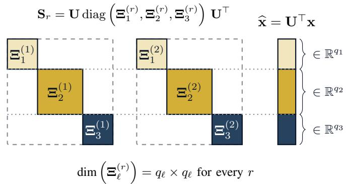

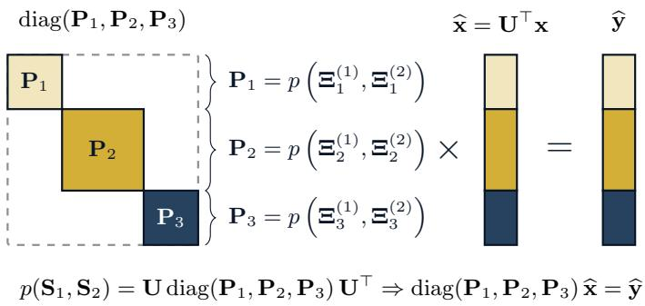  
Figure 1. Fourier representations on a multigraph. The shift operators $\{ \mathbf { S } _ { r } \} _ { r = 1 } ^ { R }$ are jointly block diagonalized by a common orthonormal basis U. The components of $\widehat { \mathbf { x } } = \mathbf { U } ^ { \top } \cdot$ x are grouped by the blocks of the partition, and convolutional filters act blockwise on the spectral representation.

To properly establish the notion of Fourier transform on multigraphs, we start by recalling the basic concept of block diagonalizable matrices. For an integer $Q \in \mathbb { N } ,$ , a partition $\tau _ { Q } =$ $( q _ { 1 } , \dots , q _ { L } )$ is a tuple of positive integers with $\textstyle \sum _ { \ell = 1 } ^ { L } q _ { \ell } = \dot { Q }$ Then, a collection of matrices $\{ \mathbf { S } _ { r } \} _ { r = 1 } ^ { \bar { R } }$ , with $\mathbf { S } _ { r } ~ \in ~ \mathbb { R } ^ { N \times N }$ admits a joint block diagonalization if there exist a partition $\tau _ { N } = ( q _ { 1 } , \dots , q _ { L } )$ and an orthonormal $\mathbf { U } \in \mathbb { R } ^ { N \times N }$ such that

$$
\begin{array} { r } { \mathbf S _ { r } = \mathbf { U } \mathrm { d i a g } \left( \Xi _ { 1 } ^ { ( r ) } , \ldots , \Xi _ { L } ^ { ( r ) } \right) \mathbf { U } ^ { \top } , \quad \Xi _ { \ell } ^ { ( r ) } \in \mathbb { R } ^ { q _ { \ell } \times q _ { \ell } } , } \end{array}\tag{1}
$$

for every $r \ = \ 1 , \ldots , R .$ Throughout, we assume that the partition is maximal, i.e., that the blocks cannot be refined further by any orthonormal change of basis. This guarantees that the subspaces spanned by the columns of U associated with each block are minimal invariant subspaces of the signal model. We denote by $\mathbf { U } _ { \ell } \in \mathbb { R } ^ { N \times q _ { \ell } }$ the submatrix of U whose columns are associated with the ℓth block, and by $\widehat { \mathbf { x } } _ { \ell } = \mathbf { U } _ { \ell } ^ { \top } \mathbf { x } \in \mathbb { R } ^ { q _ { \ell } }$ the corresponding group of coefficients – see Fig. 1.

Then, in the case of a multigraph, the existence of a joint block diagonalization of the shift operators guarantees that there is an orthonormal basis $\mathbf { U } \in \mathbb { R } ^ { \hat { N } \times N }$ that can be used for a decomposition of any multigraph signal $( \mathcal { M } , \mathbf { x } )$ . Additionally, such an orthonormal basis encapsulates the invariances and subspaces dictated by the sizes of the blocks $\Xi _ { \ell } ^ { ( r ) } \in \mathbb { R } ^ { q _ { \ell } \times q _ { \ell } }$ We leverage these concepts to formally introduce the notion of the multigraph Fourier transform in the following definition.

Definition 4. Let M be a multigraph with shift operators $\{ \mathbf { S } _ { r } \} _ { r \equiv 1 } ^ { R }$ satisfying (1) with $\mathbf { U U } ^ { \top } = \bar { \mathbf { I } } = \mathbf { U } ^ { \top } \mathbf { U }$ . Then, we say that $( \widehat { \mathcal { M } } , \widehat { \mathbf { x } } )$ is the multigraph Fourier transform of the signal $( \mathcal { M } , \mathbf { x } )$ , with $\widehat { \mathbf { x } } = \mathbf { U } ^ { \top }$ x and Mc denoting the collection ofblocks $\{ \Xi _ { \ell } ^ { ( r ) } \} _ { \ell , r }$ . We refer to the $\Xi _ { \ell } ^ { ( r ) }$ as the frequencies. The inverse multigraph Fourier transform is determined by the action of U, $i . e . , \ \mathbf { x } = \mathbf { U } \widehat { \mathbf { x } }$

Then, we can see that the dimensions of the invariant subspaces of the signal model on M are $\{ q _ { \ell } \} _ { \ell = 1 } ^ { L }$ . Notice that joint diagonalization $- \ \mathrm { i . e . , } \ q _ { \ell } \ = \ 1$ for all $\ell - \mathrm { i } \mathrm { s }$ guaranteed when $\mathbf { S } _ { i } \mathbf { S } _ { j } = \mathbf { S } _ { j } \mathbf { S } _ { i }$ for all $i , j$ . Notice also that when a joint block diagonalization exists, polynomials in the $\{ \mathbf { S } _ { r } \} _ { r = 1 } ^ { R }$ translate into polynomials in $\Xi _ { \ell } ^ { ( \bar { r } ) }$ . That is, for any convolutional filter $p ( \mathbf { S } _ { 1 } , \ldots , \mathbf { S } _ { R } )$ acting on the multigraph signal $( \mathcal { M } , \mathbf { x } )$ it follows that

$$
\begin{array} { r l } & { \quad p \left( \pmb { \mathrm { S } } _ { 1 } , \ldots , \pmb { \mathrm { S } } _ { R } \right) \mathbf { x } = } \\ & { \quad \quad \quad \quad \quad \mathbf { U } \operatorname { d i a g } \left( p \left( \pmb { \Xi } _ { 1 } ^ { ( 1 ) } , \ldots , \pmb { \Xi } _ { 1 } ^ { ( R ) } \right) , \ldots , p \left( \pmb { \Xi } _ { L } ^ { ( 1 ) } , \ldots , \pmb { \Xi } _ { L } ^ { ( R ) } \right) \right) \widehat { \mathbf { x } } . } \end{array}\tag{2}
$$

That is, the action of a filter on the node domain can be obtained as the inverse multigraph Fourier transform of the spectrally filtered version of the multigraph signal.

Notice that in the frequency domain the filter can be thought of as defined pointwise on the frequencies and acting pointwise on the invariant subspaces associated with the frequencies. Since the polynomial p is noncommutative and the blocks $\Xi _ { \ell } ^ { ( r ) }$ of a given index ℓ do not commute in general, the order of the letters in each word of $p$ is preserved when evaluating $p \left( \Xi _ { \ell } ^ { ( 1 ) } , \ldots , \Xi _ { \ell } ^ { ( R ) } \right)$

Remark 1. On multigraphs, the nature of the frequencies is multivariate: each invariant subspace ℓ carries an R-tuple of matrix frequencies $\left( \boldsymbol { \Xi } _ { \ell } ^ { ( 1 ) } , \ldots , \boldsymbol { \Xi } _ { \ell } ^ { ( \bar { R } ) } \right)$ , so that when thinking of something like a frequency axis one should associate one axis to each of the shift operators of the multigraph. Then, there will be R frequency axes, and this is completely independent of how the invariances take place, i.e., of the dimensions of the blocks $\Xi _ { \ell } ^ { ( r ) }$ For instance, if the shift operators commute, then $\boldsymbol { \Xi } _ { \ell } ^ { ( r ) } \in \mathbb { R } ^ { \mathrm { 1 } \times 1 }$ and the spectral representation of a filter is determined by a scalar multivariate polynomial. However, if the dimension of at least one block is larger than one, the spectral representation of the filter is determined by a multivariate matrix polynomial. That is, the number of independent variables in those polynomials is the same, but their nature differs.

For the developments in this paper we require a total ordering of the blocks. Since the shift operators associated with each layer of the multigraph induce, in general, different orderings – requiring $\sigma _ { \mathrm { m a x } } ( \mathbf { \Xi } _ { \varepsilon } ^ { \mathbf { \breve { ( } } r ) } )$ to be simultaneously nondecreasing in ℓ for every r is generically not satisfiable – we adopt a canonical, layer-free convention. To each block we associate the frequency label

$$
\mu _ { \ell } = \operatorname* { m a x } _ { r = 1 , \ldots , R } \sigma _ { \operatorname* { m a x } } \left( \Xi _ { \ell } ^ { ( r ) } \right) ,\tag{3}
$$

and we order the blocks so that

$$
\mu _ { 1 } \leq \mu _ { 2 } \leq . . . \leq \mu _ { L } .\tag{4}
$$

This convention resembles the typical convention in GSP of ordering the frequencies associated with the graph Fourier transform (GFT), while aggregating the R frequency axes into a single worst-case axis. When the shift operators commute and $R = 1$ , (4) reduces exactly to the usual GSP ordering by $| \lambda _ { \ell } |$

## C. Bandwidth of a Multigraph Signal

Once the ordering of the frequencies in (4) is fixed, it is possible to establish the notion of bandlimitedness of a multigraph signal, following a natural extension of the same concept from GSP. To do so formally, it is essential to emphasize – as in Fig. 1 – that while $\widehat { \mathbf { x } }$ has $N = | \nu |$ components, the association of those components with the frequency domain is determined by the blocks in the joint block diagonalization of the shift operators. For the particular case of Fig. 1, the first Fourier components of $\widehat { \mathbf { x } }$ are associated with the blocks $\Xi _ { 1 } ^ { ( 1 ) }$ and $\Xi _ { 1 } ^ { ( 2 ) }$ precisely because the dimension of the first invariant subspace is $q _ { 1 }$ . In this context, we refer to $\widehat { \mathbf { x } } _ { 1 } = [ \widehat { \mathbf { x } } ( 1 ) , \widehat { \mathbf { x } } ( 2 ) , \ldots , \widehat { \mathbf { x } } ( \bar { q _ { 1 } } ) ] ^ { \top }$ as the Fourier components of $\widehat { \mathbf { x } }$ defined on $\left( \Xi _ { 1 } ^ { ( 1 ) } , \Xi _ { 1 } ^ { ( 2 ) } \right)$ . With this context at hand, we introduce the following definition.

Definition 5. Let $( \mathcal { M } , \mathbf { x } )$ be a multigraph signal on M with shift operators $\{ \mathbf { S } _ { r } \} _ { r = 1 } ^ { R }$ satisfying (1), and let $\omega \geq 0 .$ . We say that $( \mathcal { M } , \mathbf { x } )$ is ω-bandlimited $i f$

$$
\widehat { \bf x } _ { \ell } = { \bf 0 } f o r a l l \ell s u c h t h a t \mu _ { \ell } > \omega ,\tag{5}
$$

where $( \widehat { \mathcal { M } } , \widehat { \mathbf { x } } )$ is the multigraph Fourier transform of $( \mathcal { M } , \mathbf { x } )$ and $\mu _ { \ell }$ is the frequency label in (3). Equivalently, $\widehat { \mathbf { x } } _ { \ell } = \mathbf { 0 }$ whenever $\sigma _ { \mathrm { m a x } } ( \Xi _ { \ell } ^ { ( r ) } ) > \omega$ for some $r \in \{ 1 , \ldots , R \}$ . The set of all ω-bandlimited signals on $\mathcal { M }$ is denoted by $\mathcal { P W } _ { \omega } ( \mathcal { M } )$

Notice from Definition 5 that the multivariate nature of the frequency components is organically covered by the definition: if one thinks in terms of the R frequency axes in the representation of the signal, the bandwidth is established as the same value $\omega$ on all axes, and a group of Fourier components survives only if it is below the bandwidth on every axis. Additionally, denoting by $\ell ( \omega ) = \operatorname* { m a x } \{ \ell : \mu _ { \ell } \leq \omega \}$ (with $\ell ( \omega ) = 0 \mathrm { i f } \ \mu _ { 1 } > \omega )$ and by $\mathcal { R } ( \omega )$ the set of column indices of U associated with the first $\ell ( \omega )$ blocks, we have the compact characterization

$$
\mathcal { P W } _ { \omega } ( \mathcal { M } ) = \mathrm { r a n g e } \left( \mathbf { U } _ { \mathcal { R } \left( \omega \right) } \right) = \bigoplus _ { \ell = 1 } ^ { \ell \left( \omega \right) } \mathrm { r a n g e } \left( \mathbf { U } _ { \ell } \right) ,\tag{6}
$$

which shows that $\mathcal { P W } _ { \omega } ( \mathcal { M } )$ is a subspace of $\mathbb { R } ^ { N }$ of dimension $\textstyle \sum _ { \ell < \ell ( \omega ) } q _ { \ell } .$

Notice also that when talking about the bandwidth in terms of the number of components of xb, it only makes sense to do so taking into account the number and dimensions of the blocks $\Xi _ { \ell } ^ { ( r ) }$ That is, while the value of the bandwidth $\omega$ can be arbitrarily stated on the spectral axes, the number of components associated with each bandwidth has a limited number of possibilities, i.e., the dimension of $\mathcal { P W } _ { \omega } ( \mathcal { M } )$ can only take the $L + 1$ values $\{ 0 , q _ { 1 } , q _ { 1 } + q _ { 2 } , . . . , N \}$ . For instance, in the case of Fig. 1, and assuming all the labels $\mu _ { \ell }$ are different, any multigraph signal can have only four possible bandwidth values when looking at the components of the vector $\widehat { \mathbf { x } }$ directly. This represents a significant contrast with the classical GSP scenario, where on a graph with N nodes the dimension of the bandlimited space can take any value in $\{ 0 , 1 , \ldots , N \}$ . As we will see, this quantization of the admissible bandlimited spaces is one of the structural traits that distinguishes sampling on multigraphs from sampling on graphs.

Before closing this section, we emphasize a structural property of $\mathcal { P W } _ { \omega } ( \mathcal { M } )$ that will be essential for subsequent discussions. Since bandlimitedness in Definition 5 is supported on whole invariant subspaces, and every shift operator preserves every invariant subspace, the bandlimited spaces are invariant not only under each $\mathbf { S } _ { r }$ individually but under the entire algebra of convolutional filters.

Lemma 1. Let M be a multigraph with shift operators $\{ \mathbf { S } _ { r } \} _ { r = 1 } ^ { R }$ satisfying (1). Then, for every $\omega \geq 0$ and every convolutional filter $p ( \mathbf { S } _ { 1 } , \ldots , \mathbf { S } _ { R } ) \in \mathcal { A } ( \mathbf { S } _ { 1 } , \ldots , \mathbf { S } _ { R } )$ , it holds that

$$
\begin{array} { r } { p ( \mathbf { S } _ { 1 } , \ldots , \mathbf { S } _ { R } ) \mathcal { P W } _ { \omega } ( \mathcal { M } ) \subseteq \mathcal { P W } _ { \omega } ( \mathcal { M } ) . } \end{array}\tag{7}
$$

In particular, $\mathbf { S } _ { w } \mathcal { P } \mathcal { W } _ { \omega } ( \mathcal { M } ) \subseteq \mathcal { P } \mathcal { W } _ { \omega } ( \mathcal { M } )$ for every word w.

Proof. See Appendix A-A.

We close this section by showing formally how the bandwidth of a multigraph signal limits the norm of its diffusions through the shift operators. This result, together with its corollary for words, will be fundamental to establishing the sampling results of the following sections.

Theorem 1. Let $( \mathcal { M } , \mathbf { x } )$ be a multigraph signal on the multigraph M with shift operators $\{ \mathbf { S } _ { r } \} _ { r = 1 } ^ { R } .  { I f } \left( \mathcal { M } , \mathbf { x } \right)$ is ω- bandlimited, it follows that

$$
\left\| \mathbf { S } _ { r } \mathbf { x } \right\| _ { 2 } \leq \omega \left\| \mathbf { x } \right\| _ { 2 } \quad { \mathrm { f o r ~ a l l ~ } } r = 1 , \ldots , R .\tag{8}
$$

Proof. See Appendix A-B.

The invariance stated in Lemma 1 allows us to iterate Theorem 1 along arbitrary words of shift operators. The resulting inequality is the multigraph counterpart of the powers of the variation operator used in [6], and it is the property that licenses the higher-order sampling machinery of Section IV.

Corollary 1. Let $( \mathcal { M } , \mathbf { x } )$ be an ω-bandlimited multigraph signal on M. Then, for every word $w = ( r _ { k } , \ldots , r _ { 1 } )$ of length $| w | = k ,$

$$
\left\| \mathbf { S } _ { w } \mathbf { x } \right\| _ { 2 } = \left\| \mathbf { S } _ { r _ { k } } \cdot \cdot \cdot \mathbf { S } _ { r _ { 1 } } \mathbf { x } \right\| _ { 2 } \leq \omega ^ { k } \left\| \mathbf { x } \right\| _ { 2 } .\tag{9}
$$

In particular, $\| \mathbf { S } _ { r } ^ { k } \mathbf { x } \| _ { 2 } { \le } \omega ^ { k } \| \mathbf { x } \| _ { 2 }$ for every r and every $k \in \mathbb N$

Proof. See Appendix $\mathrm { A } { \cdot } \mathrm { C } .$

## III. REMOVABLE AND UNIQUENESS SETS IN MULTIGRAPHS

The concepts of removable and uniqueness sets were introduced by Pesenson for the analysis of bandlimited functions on graphs, manifolds, and Banach spaces [2], [3], [21]. Their definition, although simple, provides a powerful and elegant tool for the characterization of sampling sets. Building on the understanding of this tool, the notion was later extended in [14] for the study of signals on graphons. We now extend this concept to signals on multigraphs, as a tool to characterize sampling sets in a way that is compatible with the characterization of bandlimited signals given in Definition 5. For a subset $s \subseteq \nu ,$ we recall that $\mathbf { \bar { \rho } } _ { L _ { 2 } ( S ) } ( \mathbf { \bar { \rho } } _ { = } \mathbf { \varepsilon } \mathbf { \{ x \in \mathbb { R } ^ { N } \rho : \mathbf { x } | _ { S ^ { c } } = 0 \varepsilon \} } $ denotes the set

□

of all signals with support contained in S, and that for a matrix $\mathbf { A } \in \mathbb { R } ^ { \breve { N } \times N }$ we write $[ \mathbf { A } ] _ { \mathcal { S } , \mathcal { S } }$ for the principal submatrix of A with rows and columns indexed by S.

Definition 6. Let $\mathcal { M } = ( \mathcal { V } , \{ \mathcal { E } _ { r } , w _ { r } \} _ { r = 1 } ^ { R } )$ be a multigraph with shift operators $\{ \mathbf { S } _ { r } \} _ { r = 1 } ^ { R } ,$ , and let $s \subset \nu$ be nonempty. The removable constant of $s$ on the $\mathbf { S } _ { r }$ -axis is

$$
\Lambda _ { r , S } = \operatorname* { i n f } _ { \mathbf { x } \in L _ { 2 } ( S ) , \mathbf { x } \neq \mathbf { 0 } } \frac { \| \mathbf { S } _ { r } \mathbf { x } \| _ { 2 } } { \| \mathbf { x } \| _ { 2 } } ,\tag{10}
$$

so that $\lVert \mathbf { S } _ { r } \mathbf { x } \rVert _ { 2 } \geq ~ \Lambda _ { r , s } \lVert \mathbf { x } \rVert _ { 2 }$ for all $\textbf { x } \in \ L _ { 2 } ( S )$ , and $\Lambda _ { r , S }$ is the largest constant with this property. We say that S is removable on the $\mathbf { S } _ { r }$ -axis if $\Lambda _ { r , S } > 0 .$ . Additionally, we define the aggregated constants

$$
\Lambda _ { \mathcal { S } } ^ { \operatorname* { m i n } } = \operatorname* { m i n } _ { r = 1 , \ldots , R } \Lambda _ { r , \mathcal { S } } , \qquad \Lambda _ { \mathcal { S } } ^ { \operatorname* { m a x } } = \operatorname* { m a x } _ { r = 1 , \ldots , R } \Lambda _ { r , \mathcal { S } } ,\tag{11}
$$

and we say that S is removable $i f \Lambda _ { S } ^ { \mathrm { m a x } } > 0 ,$ i.e., if it is removable on at least one axis. When the axis under consideration is clear from the context, we refer to $s$ as a Λ-removable set with $\Lambda \in \{ \Lambda _ { \mathcal { S } } ^ { \operatorname* { m i n } } , \Lambda _ { \mathcal { S } } ^ { \operatorname* { m a x } } \}$ as appropriate.

From Definition 6 it is worth emphasizing a couple of points. First, since $L _ { 2 } ( S )$ is a finite dimensional subspace, the infimum in (10) is attained, and it admits an exact computational characterization as an eigenvalue problem. This is the content of the following lemma, which also settles exactly when the removable constants are strictly positive.

Lemma 2. Let $s \subset \nu$ be nonempty. Then

$$
\Lambda _ { r , S } = \sqrt { \lambda _ { \operatorname* { m i n } } \Big ( [ \mathbf { S } _ { r } ^ { \top } \mathbf { S } _ { r } ] _ { S , S } \Big ) } = \sigma _ { \operatorname* { m i n } } \big ( \mathbf { S } _ { r } \mathbf { I } _ { \mathcal { V } S } \big ) ,\tag{12}
$$

where $\mathbf { I } _ { \mathcal { V } \mathcal { S } }$ denotes the submatrix of the identity whose columns are indexed by S. Moreover, $\Lambda _ { r , S } > 0$ if and only if

$$
\ker ( \mathbf { S } _ { r } ) \cap L _ { 2 } ( S ) = \{ \mathbf { 0 } \} ,\tag{13}
$$

i.e., if and only if the columns of $\mathbf { S } _ { r }$ indexed by S are linearly independent.

Proof. See Appendix A-D.

Remark 2. Condition (13) shows that, contrary to what a first reading of (10) may suggest, not every subset of V is removable on every axis. A natural example arises when the layer r is endowed with a combinatorial Laplacian and S contains an entire connected component of $( \mathcal { V } , \mathcal { E } _ { r } , w _ { r } )$ . Then, the indicator vector of that component belongs to $L _ { 2 } ( S )$ ∩ ker $( \mathbf { S } _ { r } )$ , so $\Lambda _ { r , S } = 0 \ :$ . Under the aggregated notion of Definition 6, however, such a set may still be removable, provided that at least one other layer satisfies the kernel condition (13). This is a clear indication of the fact that, even when the sampling problem on one layer has degeneracies in terms of the constants $\Lambda _ { r , S }$ , it can still be well defined on the multilayer structure.

Second, the constants $\Lambda _ { r , S }$ can be directly compared with the bandwidth of a signal to establish whether a sampling set allows the unique identification of bandlimited signals. This is the content of the following theorem. Notice that, in view of the Bernstein inequality of Theorem 1 – which controls the diffusion of a bandlimited signal on every axis simultaneously – it suffices that the removability inequality hold on a single axis for uniqueness to follow. Accordingly, the sharp sufficient condition is stated in terms of $\Lambda ^ { \mathrm { m a x } }$ rather than $\Lambda ^ { \mathrm { m i n } }$

Theorem 2. Let $\mathcal { M } = ( \mathcal { V } , \{ \mathcal { E } _ { r } , w _ { r } \} _ { r = 1 } ^ { R } )$ be a multigraph and let $s \subset \nu$ be such that Sc is removable, with aggregated constant $\Lambda _ { S ^ { c } } ^ { \mathrm { m a x } }$ as in Definition 6. Let $( \mathcal { M } , \mathbf { x } )$ and $( \mathcal { M } , \mathbf { y } )$ be ω-bandlimited signals on M. If

$$
\omega < \Lambda _ { S ^ { c } } ^ { \mathrm { m a x } }\tag{14}
$$

and ${ \bf x } | _ { S } = { \bf y } | _ { S }$ , then $\mathbf x = \mathbf y ,$ , and we refer to S as a uniqueness set for ω-bandlimited signals.

## Proof. See Appendix A-E.

Theorem 2 establishes a characterization of a sampling set as a uniqueness set for bandlimited signals. At the same time, the condition $\omega \ : < \ : \Lambda _ { S ^ { c } } ^ { \mathrm { m a x } }$ emphasizes that looking for a good sampling set is equivalent to pursuing a sampling set whose complement leads to the maximum possible removable constant.

Remark 3. The appearance of $\Lambda ^ { \mathrm { m a x } }$ in Theorem 2 deserves emphasis, as it captures one of the distinctive and somewhat surprising features of sampling on multigraphs relative to sampling on any single constituent graph: one informative layer suffices. A layer that is poorly connected on $S ^ { c } - \mathrm { o r }$ even degenerate in the sense of Remark 2 – does not alter the nature of the sampling problem on the multigraph, as long as some other layer separates $L _ { 2 } ( S ^ { c } )$ from the low frequencies. We also note that the numerical values of $\Lambda _ { r , S }$ for different r live on different spectral scales – those of the respective shift operators – so that comparisons across axes, such as the ones implicit in (11), must be interpreted with care. A scale-free treatment of this issue is given in Section IV.

## IV. COUPLED OPTIMALITY OF SAMPLING SETS IN GRAPHS AND MULTIGRAPHS

Given the conditions for uniqueness stated in Theorem 2, it is clear that finding a good sampling set S amounts to finding a set whose complement leads to the maximum possible value of the removable constant, and while this interpretation is direct for graphs [2], [6], [14], [22], the multigraph setting requires a deeper discussion. The removable constants $\Lambda _ { r , S ^ { c } }$ are computed per layer, and one may therefore expect the identity of an optimal sampling set to depend on which layer, or which combination of layers, drives the constants. The central observation of this section is that this expectation is only partially correct as the exact optimality of a sampling set is a property of the common Fourier basis U and the partition $\tau _ { N }$ alone – it does not depend on any particular constituent graph – while the layers re-enter the picture only through the computable estimates of that optimality. We first make the layerfree statement precise, then examine what survives of it at the level of the constants, and finally exploit the gap between the two to design a sampling algorithm.

## A. Optimality Is a Property of the Common Fourier Basis

By Theorem 2 and the characterization $\begin{array} { r l } { \mathcal { P } \mathcal { W } _ { \omega } ( \mathcal { M } ) } & { { } = } \end{array}$ range(UR(ω)) in (6), whether a set S is a uniqueness set for ω- bandlimited signals is a statement about the relative position of the two subspaces $L _ { 2 } ( S ^ { c } )$ and $\mathrm { r a n g e } ( \mathbf { U } _ { \mathcal { R } ( \omega ) } )$ . Neither subspace involves the values of the blocks $\Xi _ { \ell } ^ { ( r ) }$ . In particular, the former is determined by $s ,$ and the latter by U, the partition $\tau _ { N }$ , and the ordering (4). This motivates the following layer-free index of quality for a sampling set.

Definition 7 (Spectral reach). Let M be a multigraph with common Fourier basis U, partition $\tau _ { N } ~ = ~ ( q _ { 1 } , \dots , q _ { L } )$ , and blocks ordered as in (4). For $\mathcal { S } \subseteq \mathcal { V }$ with $S ^ { c } \neq \emptyset ,$ , the spectral reach of S is

$$
\ell ^ { * } ( S ) = \operatorname* { m i n } \left\{ \ell : L _ { 2 } ( S ^ { c } ) \cap \bigoplus _ { j = 1 } ^ { \ell } \operatorname { r a n g e } \left( \mathbf { U } _ { j } \right) \neq \{ \mathbf { 0 } \} \right\} ,\tag{15}
$$

with the convention $\ell ^ { * } ( \mathcal { V } ) = L + 1$ and $\mu _ { L + 1 } = + \infty$

In words, $\ell ^ { * } ( s )$ is the index of the first block of (6) in which a signal supported outside the samples can hide. The minimum in (15) is well defined because at $\ell = L$ the direct sum equals $\mathbb { R } ^ { N }$ , which intersects $L _ { 2 } ( S ^ { c } ) \neq \{ { \bf 0 } \}$ nontrivially. Equivalently, in terms of rank conditions,

$$
\begin{array} { r } { \ell ^ { * } ( \mathcal S ) = \operatorname* { m i n } \left\{ \ell : \mathrm { \ r a n k } \left( \mathbf U _ { \mathcal S , \tau ( 1 : \ell ) } \right) < \sum _ { j = 1 } ^ { \ell } q _ { j } \right\} , } \end{array}\tag{16}
$$

where $\tau ( 1 : \ell )$ collects the column indices of the first ℓ blocks. The next theorem shows that the spectral reach characterizes uniqueness sets exactly, turning the sufficient condition of Theorem 2 into a necessary and sufficient one, at the price of requiring spectral knowledge.

Theorem 3. Let M be a multigraph with blocks ordered as in (4), and let $\mathcal { S } \subseteq \mathcal { V }$ . Then $s$ is a uniqueness set for $\mathcal { P W } _ { \omega } ( \mathcal { M } )$ if and only if

$$
\omega < \mu _ { \ell ^ { * } ( S ) } .\tag{17}
$$

Consequently, for a sampling budget m, the sets that are uniqueness sets for the largest possible family of bandlimited spaces are exactly the maximizers of $\mu _ { \ell ^ { * } } ( \cdot )$ , which coincide with the maximizers of the spectral reach when the labels $\mu _ { \ell }$ are pairwise distinct,

$$
\begin{array} { r } { S ^ { \mathrm { o p t } } \in \underset { | S | = m } { \arg \operatorname* { m a x } } \ell ^ { * } ( S ) = \underset { | S | = m } { \arg \operatorname* { m a x } } \mu _ { \ell ^ { * } ( S ) } . } \end{array}\tag{18}
$$

Proof. See Appendix A-F.

□

Theorem 3 is the rigorous form of the following informal statement: the optimality of a sampling set is evaluated directly on U, since at the end of the day any candidate set is tested against the same basis and the same collection of invariant subspaces, so its optimality cannot depend on any constituent graph individually. The role of the individual layers is to provide rulers – via their removable constants – with which the layerfree quantity $\ell ^ { * } ( s )$ can be estimated without computing U. To formalize in what sense different rulers certify the same optimal sets, we introduce the following class of elements of the filter algebra.

Definition 8. Let M be a multigraph with blocks ordered as in (4). A symmetric filter ${ \bf T } = p ( \mathbf { S } _ { 1 } , \ldots , \mathbf { S } _ { R } ) \in \mathcal { A } ( \mathbf { S } _ { 1 } , \ldots , \mathbf { S } _ { R } )$ with blocks $\Theta _ { \ell } = \ d r _ { p } \left( \Xi _ { \ell } ^ { ( 1 ) } , \dots , \Xi _ { \ell } ^ { ( R ) } \right)$ , is called admissible if its block spectra are separated consistently with the ordering of (4), $i . e . ,$ , if

$$
\operatorname* { m a x } _ { \boldsymbol { \lambda } \in \mathrm { s p e c } ( \Theta _ { \ell } ) } \vert \boldsymbol { \lambda } \vert < \operatorname* { m i n } _ { \boldsymbol { \lambda } \in \mathrm { s p e c } ( \Theta _ { \ell + 1 } ) } \vert \boldsymbol { \lambda } \vert , \qquad \ell = 1 , \ldots , L - 1 .\tag{19}
$$

In particular, a constituent shift operator Sr (when symmetric) is admissible if its own block spectra are separated and ordered consistently with (4).

Since T shares the basis U with the shift operators, its eigenvalues are those of the blocks $\Theta _ { 1 } , \ldots , \Theta _ { L }$ , and condition (19) requires these groups of eigenvalues to occupy disjoint intervals of the $| \lambda | .$ -axis, arranged in the same order as the blocks in (4). Consequently, ordering the eigenvalues of T by magnitude – as is customary in GSP – reproduces the block ordering of $\mathcal { M } ,$ and every low-pass subspace of T whose cutoff falls between two consecutive intervals is a bandlimited space of the multigraph. Admissibility is a genuine restriction: the identity matrix, for instance, belongs to the algebra but is not admissible, since all its blocks share the same spectrum. An admissible T can therefore play the role of the shift operator of a single graph whose bandlimited spaces are those of the multigraph, and a set that is optimal for sampling on this graph should also be optimal for M. The following corollary shows that this is indeed the case: the cutoff frequency computed with respect to any admissible T ranks sampling sets exactly as the spectral reach $\ell ^ { * } ( \cdot )$ of Definition 7 does.

Corollary 2. Let M be a multigraph whose shift operators are jointly block diagonalized by U as in (1), and let ${ \bf T } =$ U $\mathrm { d i a g } ( \mathbf { \Theta } _ { 1 } , \dots , \mathbf { \Theta } _ { L } ) \mathbf { U } ^ { \top }$ be an admissible element of the filter algebra of M. For each ℓ, let $\boldsymbol { \Theta } _ { \ell } = \mathbf { V } _ { \ell } \mathbf { D } _ { \ell } \mathbf { V } _ { \ell } ^ { \top }$ be an eigendecomposition of the symmetric block $\mathbf { \Theta } _ { \Theta _ { \ell } , \ l }$ , with $\mathbf { V } _ { \ell } \in \mathbb { R } ^ { q _ { \ell } \times q _ { \ell } }$ orthonormal, and let

$$
\begin{array} { r } { { \bf U } _ { \bf T } = { \bf U } \ \mathrm { d i a g } \left( { \bf V } _ { 1 } , \ldots , { \bf V } _ { L } \right) , } \end{array}\tag{20}
$$

with $\mathbf { T } \ = \ \mathbf { U _ { T } }$ diag $( \mathbf { D } _ { 1 } , \dots , \mathbf { D } _ { L } ) \mathbf { U } _ { \mathbf { T } } ^ { \top }$ . We regard T as the shift operator of a single graph signal model whose graph Fourier transform is given by $\mathbf { U _ { T } ^ { \top } } ,$ , and we denote by $\omega _ { \mathbf { T } } ( \phi )$ the bandwidth of a signal ϕ in this model, i.e., the largest |λ| among the eigenvalues of T whose corresponding components of $\mathbf { U } _ { \mathbf { T } } ^ { \top } \phi$ are nonzero. For $\mathcal { S } \subseteq \mathcal { V }$ , let

$$
\nu _ { \mathbf { T } } ( S ) = \operatorname* { m i n } _ { \phi \in L _ { 2 } ( S ^ { c } ) , \ \phi \neq \mathbf { 0 } } \omega _ { \mathbf { T } } ( \phi )\tag{21}
$$

be the cutoff frequency of S with respect to T. Then:

(i) $\nu _ { \mathbf { T } } ( S )$ lies in the $\ell ^ { * } ( s )$ -th spectral interval of $\mathbf { T } , \ i . e .$ $\begin{array} { r } { \nu _ { \mathbf { T } } ( S ) \in  | \operatorname* { m i n } _ { \lambda \in \mathrm { s p e c } ( \Theta _ { \ell ^ { * } ( S ) } ) } | \lambda | , \operatorname* { m a x } _ { \lambda \in \mathrm { s p e c } ( \Theta _ { \ell ^ { * } ( S ) } ) } | \lambda | | , } \end{array}$   
(ii) for any two sets $S _ { 1 } , S _ { 2 } , i f \ell ^ { \ast } ( S _ { 1 } ) < \ell ^ { \ast } ( S _ { 2 } )$ then $\nu _ { \mathbf { T } } ( S _ { 1 } ^ { - } ) <$ $\nu _ { \mathbf { T } } ( S _ { 2 } )$

(iii) consequently, every maximizer of $\nu _ { \mathbf { T } } ( \cdot )$ over $\{ S : | S | = m \}$ is a maximizer of the spectral reach $\ell ^ { * } ( \cdot )$ , i.e., an optimal sampling set of the multigraph in the sense of (18).

In particular, the optimal sampling sets certified by any two admissible elements of the algebra coincide at the level of the spectral reach, and they coincide with the optimal sampling sets of the multigraph.

Remark 4 (The Fourier basis of T versus the multigraph Fourier basis). Corollary 2 involves two orthonormal bases, and it is worth making their relationship explicit. The matrix U is the basis of the joint block diagonalization (1): it block diagonalizes T, but since the blocks $\Theta _ { \ell }$ are in general not diagonal, its columns are in general not eigenvectors of T. The matrix $\mathbf { U } _ { \mathbf { T } }$ in (20) is an eigenbasis of $\mathbf { T } ,$ , and it is the Fourier basis of T when T is regarded as the shift operator of a graph. The two bases differ only by the orthogonal rotations $\mathbf { V } _ { \ell } .$ , each acting inside one block. Since these rotations never move energy from one block to another,

$$
\mathrm { r a n g e } \left( \mathbf { U _ { T } } \mathbf { I } _ { \tau \left( \ell \right) } \right) = \mathrm { r a n g e } \left( \mathbf { U } _ { \ell } \right) , \qquad \ell = 1 , \ldots , L ,\tag{22}
$$

where $\mathbf { I } _ { \tau ( \ell ) }$ selects the columns associated with the ℓth block. That is, $\mathbf { U } _ { \mathbf { T } }$ and U define the same invariant subspaces, and therefore the same $\mathbf { \oplus } _ { j \leq \ell } \mathrm { r a n g e } ( \mathbf { U } _ { j } )$ appearing in (6) and in Definition 7.

The role of admissibility is to make this agreement visible from the spectrum of T alone. In the graph signal model of $\mathbf { T } _ { \mathbf { \delta } }$ the eigenvectors are ordered by |λ|, and the bandlimited spaces are spanned by the eigenvectors with |λ| below a threshold. Under (19), the spectral intervals of the blocks are disjoint and increasing in $\ell ,$ so ordering the eigenvalues of T by |λ| reproduces exactly the block ordering of (4): the eigenvectors of T whose eigenvalues lie in the ℓth interval span precisely range $\left( \mathbf { U } _ { \ell } \right)$ . Consequently, every bandlimited space of the graph model of T whose threshold falls in a gap between two intervals coincides with a bandlimited space $\mathcal { P W } _ { \omega } ( \mathcal { M } )$ of the multigraph, and the quantities $\omega _ { \mathbf { T } }$ and $\nu _ { \mathbf { T } }$ only interact with $\mathbf { U } _ { \mathbf { T } }$ through this block-level information. This also shows that $\omega _ { \mathbf { T } } ( \phi )$ , and hence $\nu _ { \mathbf { T } } ( S )$ , does not depend on the choice of the $\mathbf { V } _ { \ell } ,$ which is not unique when a block $\Theta _ { \ell }$ has repeated eigenvalues: by the disjointness of the intervals, each eigenspace of T is contained in a single range $\mathbf { U } _ { \ell } )$ , and $\omega _ { \mathbf { T } } ( \phi )$ is determined by which eigenspaces ϕ has a nonzero projection onto.

If T is not admissible, the bases $\mathbf { U } _ { \mathbf { T } }$ and U are still related as in (20), so the invariant subspaces still agree, but the spectral intervals of different blocks overlap. Ordering the eigenvalues of T by |λ| then interleaves eigenvectors coming from different blocks, the bandlimited spaces of the graph model of T are no longer bandlimited spaces of the multigraph, and $\nu _ { \mathbf { T } }$ may rank sampling sets in an order that is unrelated to the spectral reach $\ell ^ { * }$ . In summary, the coupling expressed by Corollary 2 is not a coincidence between two different bases: it is the statement that, under admissibility, the graph Fourier basis of T and the multigraph Fourier basis induce the same ordered filtration of invariant subspaces, and optimality of a sampling set depends on nothing else.

This result highlights the connection between the algorithms used to find optimal sampling sets in graphs and those that can be developed for multigraphs: any admissible single-operator surrogate certifies the multigraph-optimal sets. Two caveats, however, are essential, and they shape the algorithmic development of Section IV-C.

Remark 5 (Why the coupling cannot be stated at the level of the constants). It is tempting to formulate Corollary 2 directly in terms of the removable constants of Definition $6 , \ \mathrm { e . g . }$ , by claiming that a maximizer of $\Lambda _ { S ^ { c } } ^ { \mathrm { m i n } } ~ = ~ \operatorname* { m i n } _ { r } \Lambda _ { r , S ^ { c } }$ must be a maximizer of $\Lambda _ { r , S ^ { c } }$ for some individual layer r. Such a statement is false in general, due to the usual gap between max–min and min–max: maximizers of a minimum are typically compromise solutions that maximize none of the individual objectives. Schematically, with two layers and three candidate sets ${ \mathcal { A } } , { \mathcal { B } } , { \mathcal { C } }$ of the same size, constants $( \Lambda _ { 1 , \cdot } ) = ( 3 , 1 , 2 )$ and $( \Lambda _ { 2 , \cdot } ) = ( 1 , 3 , 2 )$ give the max–min optimum at C, while layer 1 prefers A and layer 2 prefers B. The obstruction is that the constants $\Lambda _ { r , S }$ measure the common, layer-free quantity $\ell ^ { * } ( s )$ on different spectral scales – those of the respective layers – and, at first order, they are additionally distorted by the non-normal, finite-order effects quantified in Section IV-B. The coupling of optimality across layers is exact at the level of the subspace invariant $\ell ^ { * } ( s )$ (Corollary 2), not at the level of the numerical constants.

Remark 6 (The unknown-graph obstruction). Corollary 2 suggests a direct algorithmic route: pick an admissible element T, and run a single-graph sampling algorithm on it. The difficulty is that admissibility, condition (19), is a spectral property: verifying it requires precisely the joint block diagonalization whose computation we wish to avoid, and, generically, none of the constituent shift operators need be admissible – the layers can order and interleave the block spectra in incompatible ways. In other words, the optimal sampling set can indeed be found by working on a specific single operator, but which operators qualify cannot be known a priori. The resolution, developed in Section $\mathrm { { I V - C } , }$ is that the sufficient conditions for uniqueness – unlike the exact optimality statements – do not require admissibility at all: they hold unconditionally for a canonical, computable aggregate of the layers.

## B. Optimal Sampling in Graphs through Removable Constants

Equation (12), in the terminology of [6], states that $\Lambda _ { r , S ^ { c } }$ is the first order estimate of the cutoff frequency of the sampling set S on the graph $( \mathcal { V } , \mathcal { E } _ { r } , w _ { r } ) ;$ in the notation of [6], $\Lambda _ { r , S ^ { c } } =$ $\Omega _ { 1 } ( S )$ computed with the variation operator $\mathbf { S } _ { r } .$ As indicated in [6], this quantity is obtained as the square root of the smallest eigenvalue of $\big [ \mathbf { S } _ { r } ^ { \top } \mathbf { \bar { S } } _ { r } \big ] _ { S ^ { c } , S ^ { c } }$ , and the estimate is refined by taking powers: the kth order constants

$$
\Lambda _ { r , S ^ { c } } ^ { \left( k \right) } = \left[ \lambda _ { \operatorname* { m i n } } \left( \left[ \left( \mathbf { S } _ { r } ^ { k } \right) ^ { \top } \mathbf { S } _ { r } ^ { k } \right] _ { S ^ { c } , S ^ { c } } \right) \right] ^ { \frac { 1 } { 2 k } }\tag{23}
$$

converge, as $k \ \to \ \infty ,$ , to the smallest layer-r bandwidth attainable by a signal supported on $S ^ { c }$ , i.e., to the exact cutoff frequency (21) with ${ \textbf { T } } = { \textbf { S } } _ { r }$ . This observation is leveraged in [6] to introduce one of the iconic sampling schemes in GSP: the optimal sampling set is approximated by a greedy algorithm that adds one node at a time to S, starting from ${ \mathcal { S } } = \emptyset$ . At each step, the eigenvector associated with the smallest eigenvalue of $\big [ ( \dot { \mathbf { S } } _ { r } ^ { k } ) ^ { \top } \mathbf { S } _ { r } ^ { k } \big ] _ { S ^ { c } , S ^ { c } } ^ { } \ -$ the smoothest signal supported outside the current samples – is computed, and its largest component in absolute value determines the node to be added to S. The greedy step is justified by a binary relaxation of the support constraint, whose gradient with respect to the relaxed indicator concentrates exactly on the squared entries of the smoothest signal [6].

□

From Corollary 2 we can infer that, if one knew an admissible operator for the multigraph – in particular, if one knew which constituent graph, if any, is admissible – then the optimal sampling set of the multigraph could be determined by directly running the algorithm of [6] on that operator. However, as discussed in Remark 6, such knowledge is infeasible in a real problem: it presupposes the spectral information that sampling-without-GFT methods are designed to avoid. The next subsection shows that this obstruction can be dissolved rather than circumvented.

## C. A Sampling Algorithm for Signals on Multigraphs

The key observation is that we do not need to identify a distinguished layer, because we can construct an operator that aggregates all the layers and, by design, lives in the same algebra – hence shares the basis U and the block structure – while being computable directly from the shift operators. For $k \in$ N, define the aggregate operator of order k and the associated cutoff estimate

$$
\mathbf { Q } _ { k } = \sum _ { r = 1 } ^ { R } \left( \mathbf { S } _ { r } ^ { k } \right) ^ { \top } \mathbf { S } _ { r } ^ { k } , \qquad \Gamma _ { k , S } = \left[ \frac { 1 } { R } \lambda _ { \mathrm { m i n } } \Big ( [ \mathbf { Q } _ { k } ] _ { S , S } \Big ) \right] ^ { \frac { 1 } { 2 k } } .\tag{24}
$$

The operator $\mathbf { Q } _ { k }$ is symmetric and positive semidefinite, it is computable without any spectral information, and it belongs to the algebra generated by the shift operators and their transposes. We can see this by taking into account that by (1),

$$
\begin{array} { l } { { { \bf U } ^ { \top } { \bf Q } _ { k } { \bf U } = } } \\ { { \displaystyle \mathrm { d i a g } \left( \sum _ { r = 1 } ^ { R } \left( \Xi _ { 1 } ^ { ( r ) k } \right) ^ { \top } \Xi _ { 1 } ^ { ( r ) k } , \dots , \sum _ { r = 1 } ^ { R } \left( \Xi _ { L } ^ { ( r ) k } \right) ^ { \top } \Xi _ { L } ^ { ( r ) k } \right) , } } \end{array}\tag{25}
$$

so that $\mathbf { Q } _ { k }$ pools, block by block, the spectral information of all the layers. The following theorem shows that the estimates $\Gamma _ { k , S ^ { c } }$ certify uniqueness unconditionally: no admissibility, no knowledge of a distinguished layer, and no monotonicity in k are required, since each order provides an independent sufficient condition.

Theorem 4. Let $\mathcal { M } = ( \mathcal { V } , \{ \mathcal { E } _ { r } , w _ { r } \} _ { r = 1 } ^ { R } )$ be a multigraph, let $s \subset \nu ,$ and let $k \in \mathbb { N } .$ Let $( \mathcal { M } , \mathbf { x } )$ and $( \mathcal { M } , \mathbf { y } )$ be ω-bandlimited signals on M. If

$$
\omega < \Gamma _ { k , S ^ { c } }\tag{26}
$$

and $\mathbf { x } | _ { S } = \mathbf { y } | _ { S }$ , then $\mathbf { x } = \mathbf { y }$ . Consequently, S is a uniqueness set for $\mathcal { P W } _ { \omega } ( \mathcal { M } )$ whenever $\omega < \operatorname* { m a x } _ { k \in \mathcal { K } } \Gamma _ { k , S ^ { c } }$ for any finite collection of orders $\kappa \subset \mathbb { N } .$

Proof. See Appendix A-H.

The next proposition compares the aggregate estimate with the per-layer constants of Definition 6, at matching order $k = 1$ It shows that aggregation is provably at least as good as the worst layer – strictly better whenever the layers disagree – while requiring a single eigenvalue computation instead of R of them. In this precise sense, the multigraph structure helps the sampling problem: the aggregate is never held hostage by a degenerate or poorly connected layer.

Algorithm 1 Greedy sampling set selection on a multigraph   
Input: Shift operators $\{ \mathbf { S } _ { r } \} _ { r = 1 } ^ { R }$ , sampling budget M, order $k \in$   
N.   
Output: Sampling set S with $| S | = M .$   
1: $s  \emptyset$   
2: while $| S | < M$ do   
3: Compute the smallest eigenpair $( \lambda _ { \operatorname* { m i n } } , \psi _ { k } ^ { * } )$ of $[ \mathbf { Q } _ { k } ] _ { S ^ { c } , S ^ { c } }$   
▷ matrix-free, see (29)   
4: $v  \arg \operatorname* { m a x } _ { i \in S ^ { c } } ( \psi _ { k } ^ { * } ( i ) ) ^ { 2 }$   
5: $S  S \cup \{ v \}$   
6: end while   
7: return S

Proposition 1 (Domination of the aggregated constants). For every nonempty $s \subset \nu _ { : }$

$$
\frac { \Lambda _ { \mathcal { S } } ^ { \operatorname* { m a x } } } { \sqrt { R } } \ : \ : \le \ : \Gamma _ { 1 , \mathcal { S } } \qquad a n d \qquad \Lambda _ { \mathcal { S } } ^ { \operatorname* { m i n } } \ : \le \ : \Gamma _ { 1 , \mathcal { S } } ,\tag{27}
$$

and the second inequality is strict whenever the layer constants $\Lambda _ { 1 , S } , \ldots , \Lambda _ { R , S }$ are not all equal.

Proof. See Appendix A-I.

□

Since $\mathbf { Q } _ { k }$ is symmetric, the classical eigenvalue interlacing property yields the monotonicity of the cutoff estimates along nested sampling sets, exactly as in the single-graph case [6]. This is the property that makes a greedy construction meaningful.

Proposition 2 (Monotonicity). Let $S _ { 1 } \subseteq S _ { 2 } \subset \mathcal { V } .$ . Then, for every $k \in \mathbb { N } ,$

$$
\Gamma _ { k , S _ { 1 } ^ { c } } \ \leq \ \Gamma _ { k , S _ { 2 } ^ { c } } .\tag{28}
$$

Proof. See Appendix A-J.

With these ingredients, the sampling scheme is the natural multigraph counterpart of the greedy algorithm of [6], with the matrix $( \mathbf { L } ^ { \top } ) ^ { k } \mathbf { L } ^ { \bar { k } }$ built from the Laplacian L of the graph replaced by the aggregate $\mathbf { Q } _ { k }$ . Starting from ${ \mathcal { S } } = \emptyset .$ , at each step we compute the eigenvector $\psi _ { k } ^ { * }$ associated with the smallest eigenvalue of $[ \mathbf { Q } _ { k } ] _ { S ^ { c } , S ^ { c } } \ -$ the smoothest signal, in the aggregate sense, supported outside the current samples – and we add to S the node where $\psi _ { k } ^ { * }$ carries maximum energy. The greedy step is justified verbatim by the binary relaxation argument of [6]. The derivation there only requires the reduced matrix to be symmetric positive semidefinite, which $[ \mathbf { Q } _ { k } ] _ { S ^ { c } , S ^ { c } }$ is, and the gradient of the relaxed objective with respect to the indicator again concentrates on the squared entries of $\psi _ { k } ^ { * }$ . The procedure is summarized in Algorithm 1.

Complexity. As in [6], the matrix $[ \mathbf { Q } _ { k } ] _ { S ^ { c } , S ^ { c } }$ is never formed explicitly. The step of any iterative smallest-eigenpair solver is the matrix–vector product

$$
[ \mathbf { Q } _ { k } ] _ { \mathcal { S } ^ { c } , \mathcal { S } ^ { c } } \mathbf { z } = \mathbf { I } _ { \mathcal { S } ^ { c } \mathcal { V } } \sum _ { r = 1 } ^ { R } \underbrace { \mathbf { S } _ { r } ^ { \top } \cdot \cdot \cdot \mathbf { S } _ { r } ^ { \top } } _ { k \mathrm { ~ t i m e s } } \underbrace { \mathbf { S } _ { r } \cdot \cdot \cdot \mathbf { S } _ { r } } _ { k \mathrm { ~ t i m e s } } \mathbf { I } _ { \mathcal { V } \mathcal { S } ^ { c } } \mathbf { z } ,\tag{29}
$$

which amounts to 2k sparse matrix–vector products per layer, for a cost of $\scriptstyle O \left( k \sum _ { r = 1 } ^ { R } | { \mathcal { E } } _ { r } | \right)$ per product and $O ( N )$ storage. The per-iteration cost is thus the cost of running the singlegraph method of [6] on each layer once – divided by the fact that only one eigenpair, of the aggregate, is computed, instead of one eigenpair per layer as a per-layer implementation of Definition 6 would require.

Remark 7. The aggregate (24) uses only the powers $\mathbf { S } _ { r } ^ { k }$ , i.e., the constant words. The construction and the proof of Theorem 4 extend verbatim to aggregates over any finite collection W of words of a common length $k ,$

$$
\mathbf { Q } _ { \mathcal { W } } = \sum _ { w \in \mathcal { W } } \mathbf { S } _ { w } ^ { \top } \mathbf { S } _ { w } , \quad \Gamma _ { \mathcal { W } , \mathcal { S } } = \left[ \frac { 1 } { | \mathcal { W } | } \lambda _ { \operatorname* { m i n } } \Big ( [ \mathbf { Q } _ { \mathcal { W } } ] _ { \mathcal { S } , \mathcal { S } } \Big ) \right] ^ { \frac { 1 } { 2 k } } ,\tag{30}
$$

by Corollary 1. Mixed words such as $\mathbf { S } _ { 2 } \mathbf { S } _ { 1 }$ probe the interaction between the layers – information invisible to any constituent graph in isolation – and are the natural candidates for tightening the estimates when the layers are strongly noncommuting. A systematic study of the choice of W is left for future work.

Remark 8. We can now close the loop with Section IV-A. The aggregate $\mathbf { Q } _ { k }$ is “the specific graph” anticipated by Corollary 2: the reduction of the multigraph sampling problem to a singleoperator sampling problem is real, but the single operator need not be one of the R constituents, whose admissibility cannot be verified. It can be taken to be a canonical, computable element of the algebra which shares the basis U by construction. At the exact level, optimality is layer-free, i.e., for $k \to \infty$ the greedy procedure of [6] collapses onto a rank-revealing Gaussian elimination with partial pivoting on the common eigenvector matrix (cf. Proposition 4 of [6]), so that, when run on any admissible element of the algebra, it executes the same elimination on the same U – respecting the block structure – and certifies the same optimal sets, in agreement with Theorem 3. At finite k, the layers genuinely differ: the quality of a given operator as a ruler for $\ell ^ { * } ( s )$ is governed by the separation of its block spectra around the reach, and (25) shows that the aggregate pools the separation of all the layers, with Proposition 1 quantifying that it never does worse than the worst-case per-layer construction. The unknowngraph obstruction of Remark 6 is thus not circumvented but dissolved. More specifically, in exact terms, the choice of operator is irrelevant, and in approximate terms, it is replaced by a computable surrogate.

## V. NUMERICAL EXPERIMENTS AND APPLICATIONS

To evaluate our findings, we conduct a collection of experiments that consider several multigraphs, classes of bandlimited signals, and sampling rates. In the experiment, a bandlimited signal on a multigraph is sampled on a set selected by Algorithm 1, it is then reconstructed from its noisy samples, and the reconstruction error is compared with the errors obtained when the sampling set is instead selected by single-graph methods applied to the individual layers, by a per-layer worst-case greedy rule, and at random. In what follows, we describe how the multigraphs and the signals are generated, the sampling methods under comparison, the methods used to evaluate them, and we then discuss the results.

## A. The Multigraphs

We consider multigraphs with N = 1000 nodes and $R \in$ {2, 3, 4} layers, whose shift operators are synthesized directly from their joint block diagonalization, which gives full control over the invariant subspaces and the frequency labels. The Fourier basis U is the Laplacian eigenbasis of one of three graphs: a random geometric sensor graph and a Swiss-roll graph, generated with PyGSP [23], and a connected nearestneighbor graph built on 1000 points of the Stanford dragon [24], [25]. The block sizes $q _ { \ell }$ are drawn uniformly from $\{ 2 , \ldots , 1 0 \}$ which results in $L$ ≈ 160 blocks shared by all the layers, and each block $\Xi _ { \ell } ^ { ( r ) }$ is a dense symmetric matrix with a random orthonormal eigenbasis and prescribed eigenvalue magnitudes. We consider two regimes. In aligned multigraphs, the eigenvalue magnitudes of every layer increase with ℓ and are separated between consecutive blocks, so that every shift operator is admissible in the sense of Definition 8. In misaligned multigraphs, each block is dominated by a randomly chosen layer, which fixes its label $\mu _ { \ell } .$ , while the remaining layers assign it smaller and widely spread magnitudes, so that the ordering (4) holds but admissibility fails on every layer. We quantify admissibility by the fraction $v _ { r } ~ \in ~ [ 0 , 1 ]$ of consecutive block pairs whose spectral intervals overlap on layer $r ,$ cf. (46), so that $\mathbf { S } _ { r }$ is admissible if and only if $\ v _ { r } \ = \ 0$ . Every aligned realization has $\begin{array} { r l r } { v _ { r } } & { { } = } & { 0 } \end{array}$ on all layers, and every misaligned realization has minr $v _ { r } ~ \geq ~ 0 . 9 2$ . The full construction is described in Appendix A-K. We emphasize that the uniqueness guarantee of Theorem 4, on which Algorithm 1 relies, does not require admissibility, and therefore applies to both regimes.

## B. Signals and Bandwidth Models

As discussed in Section II, the dimension of ${ \mathcal P } { \mathcal W } _ { \omega } ( { \mathcal M } )$ can only take the values $\{ 0 , q _ { 1 } , q _ { 1 } + q _ { 2 } , . . . , N \}$ . Hence, rather than prescribing the bandwidth ω directly, we prescribe the number of Fourier components $K _ { \omega } = | \mathcal { R } ( \omega ) | = \mathrm { d i m } \mathcal { P } \mathcal { W } _ { \omega } ( \mathcal { M } )$ . For each target value in {0.04N, 0.08N, $0 . 1 2 N \} = \{ 4 0 , 8 0 , 1 2 0 \}$ ， we set $K _ { \omega }$ to the block boundary $\textstyle \sum _ { j \leq \ell } q _ { j }$ closest to the target. This guarantees that the bandlimited space consists of whole invariant subspaces, i.e., that no block is truncated, in agreement with Definition 5.

The signals are generated in the spectral domain. We draw a vector $\widehat { \mathbf { x } } \in \mathbb { R } ^ { N }$ whose first $K _ { \omega }$ entries are independent standard Gaussian random variables and whose remaining entries are zero, and we obtain the node-domain signal through the inverse multigraph Fourier transform x = Uxb. The resulting multigraph signal $( \mathcal { M } , \mathbf { x } )$ belongs to $\mathcal { P W } _ { \omega } ( \mathcal { M } )$ , and it is normalized so that $\| \mathbf { x } \| _ { 2 } = 1$

## C. Sampling Methods

We use the following methods for selecting the sampling set S:

• SM1 (aggregate): Algorithm 1, with order $k = 1$

• SM2 (single layer): the method of [6] with the same order $k = 1$ , applied to the shift operator of a single layer $\mathbf { S } _ { r } .$ ignoring the remaining layers. We run this method for every $r = 1 , \ldots , R .$ . In the figures, we report the range of errors over the layers together with the error of the best single layer.

• SM3 (per-layer worst case): a greedy rule driven by the constant $\Lambda ^ { \mathrm { m i n } }$ of Definition 6. At each iteration, the smallest eigenpair of $\big [ \mathbf { S } _ { r } ^ { \top } \mathbf { S } _ { r } \big ] _ { S ^ { c } , S ^ { c } }$ is computed for every layer $r ,$ the layer attaining the smallest eigenvalue is selected, and the node where the corresponding eigenvector has the largest magnitude is added to S. Notice that the layer driving the selection may change between iterations.

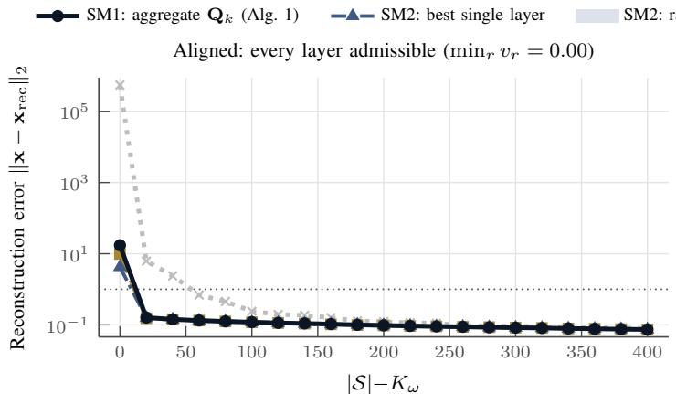

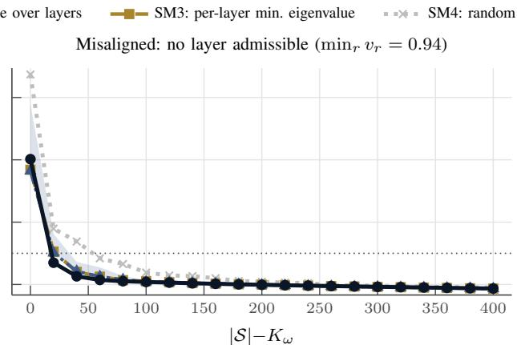

Figure 2. Reconstruction error as a function of the number of samples beyond the bandwidth, $| S | { - } K _ { \omega } ,$ for an aligned (left) and a misaligned (right) multigraph with the sensor-graph Fourier basis, $R = 2$ layers, $K _ { \omega } \approx 0 . 0 8 N$ , and $\mathrm { S N R } { \dot { = } } 1 5 \mathrm { d B }$ . The value of $\operatorname* { m i n } _ { r } v _ { r }$ in each title is the violation fraction (46) of the most admissible layer. The shaded band shows the range of SM2 over the layers. In all the figures, the error of each realization is averaged over 50 signals, and the median over 5 realizations is shown. The dotted line marks $E = 1$  
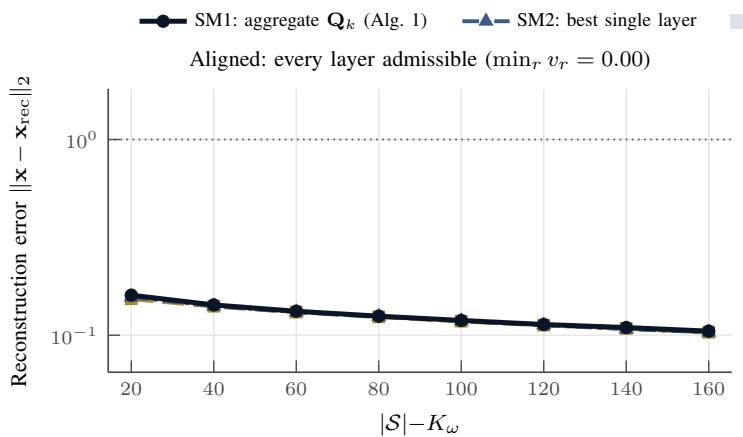

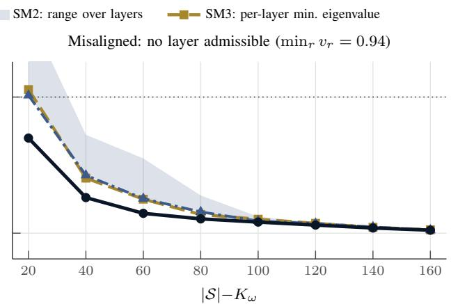  
Figure 3. Detail of Fig. 2 for $2 0 \leq | \mathcal { S } | { - } K _ { \omega } \leq 1 6 0 .$ , without random sampling. The critical size $| \mathcal { S } | = K _ { \omega } ,$ where every method fails, is omitted so that the vertical axis resolves the differences between the methods; the axis is fitted to the curves of the methods, so the range of SM2 over the layers may be clipped.

• SM4 (random): S is drawn uniformly at random, without replacement, from V.

All the greedy methods start from ${ \mathcal { S } } = \emptyset .$

## D. Experiments

The samples are corrupted by additive white Gaussian noise, i.e., we observe $\widetilde { \mathbf { x } } _ { S } = \mathbf { x } _ { S } + \mathbf { n } _ { S }$ , where the entries of $\mathbf { n } _ { S } \in \mathbb { R } ^ { | S | }$ are independent zero-mean Gaussian random variables whose variance is chosen so that the SNR equals 15 dB or 20 dB. The two noise levels correspond to two separate sets of experiments. The signal is reconstructed according to

$$
\mathbf { x } _ { \mathrm { r e c } } = \mathbf { U } _ { \mathcal { R } ( \omega ) } \left( \mathbf { U } _ { \mathcal { S } , \mathcal { R } ( \omega ) } \right) ^ { \dagger } \widetilde { \mathbf { x } } _ { \mathcal { S } } ,\tag{31}
$$

where $( \cdot ) ^ { \dagger }$ denotes the Moore–Penrose pseudoinverse.

For each multigraph, bandwidth, noise level, and sampling method, the sampling set size |S| ranges from $K _ { \omega }$ to $K _ { \omega } + 4 0 0$ in increments of 20. Each experiment consists of 5 independent realizations. In each realization, a new multigraph is generated, i.e., a new partition, new blocks and, for the sensor and Swissroll graphs, a new Fourier basis U. The point cloud is fixed, and so is its basis.

Since the partition changes between realizations, so does the block boundary closest to each target bandwidth, and $K _ { \omega }$ varies by a few units around its target value, e.g., between 76 and 84 for $K _ { \omega } \approx 0 . 0 8 N$ . The results of different realizations are therefore aligned by the number of samples beyond the bandwidth, $| \mathcal { S } | { - } K _ { \omega } ,$ , and the value of $K _ { \omega }$ reported in the titles of the figures is the median over the realizations.

Within a realization, the sampling sets of every method are computed once, 50 bandlimited signals are drawn for each bandwidth, and every signal receives one noise realization per noise level, which is shared by all the sampling methods and set sizes. Hence, all the methods are compared on exactly the same signals and the same noise. Moreover, for a given number of layers R, the aligned and the misaligned multigraphs of a realization share the same partition and the same Fourier basis, and differ only in their blocks. For each realization, we average the error over the 50 signals, and we report the median of these averages over the 5 realizations. We use the median rather than the mean because, in a few realizations, a method selects a set that is not a uniqueness set, or is numerically

SM1: aggregate Q (Alg. 1) SM2: best single layer SM2: range over layers SM3: per-layer min. eigenvalue

SM3: per-layer min. eigenvalue  
Dragon: $K _ { \omega } = 1 2 1$ (12% of N)  
Swiss roll: $K _ { \omega } = 8 0$ (8% of N)  
Dragon: $K _ { \omega } = 4 0$ (4% of N)  
Dragon: $K _ { \omega } = 8 0$ (8% of N)  
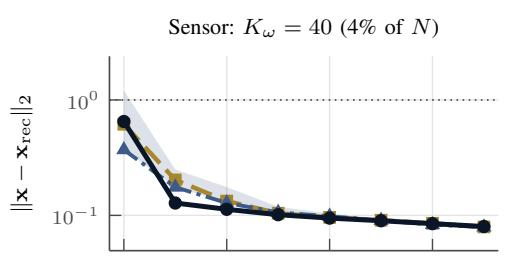

$$
K _ { \omega } = 4 0
$$

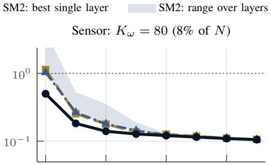

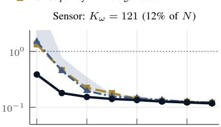

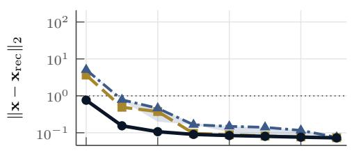

Swiss roll: $K _ { \omega } = 1 2 1$ (12% of N)  
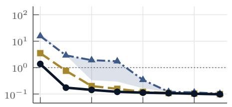

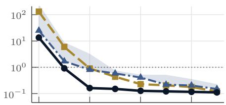

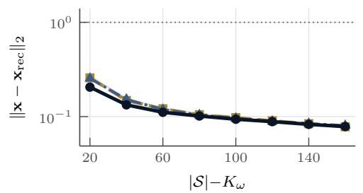

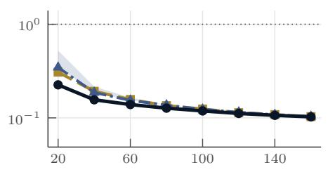

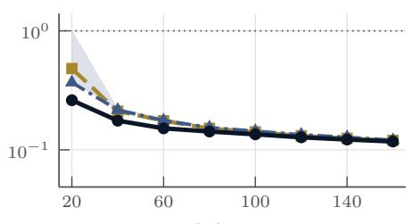

Figure 4. Reconstruction error on misaligned multigraphs with $R = 2$ layers for the three Fourier bases (rows) and the three bandwidths (columns), for $2 0 \leq | S | { - } K _ { \omega } \leq 1 6 0$ and $\mathrm { \bar { S } N R } = 1 5 \mathrm { \bar { d } B }$ . Random sampling is omitted; its errors are reported in Table I.  
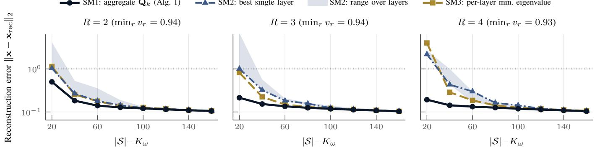  
Figure 5. Effect of the number of layers. Reconstruction error on misaligned multigraphs with the sensor-graph Fourier basis and $R = 2 , 3 , 4$ 4 layers, for $K _ { \omega } \approx 0 . 0 8 N , 2 0 \le | S | - \dot { K } _ { \omega } \le 1 6 0$ , and $\mathrm { S N R } = 1 5 \mathrm { d B }$

indistinguishable from one, in which case the least squares reconstruction amplifies the noise by a large factor, and a single such realization would dominate a mean over five. In addition to the reconstruction error, we report the smallest singular value $\sigma _ { \mathrm { m i n } } ( \mathbf { U } _ { S , \mathcal { R } ( \omega ) } )$ of the sampled basis, which measures the conditioning of the reconstruction problem (31).

## E. Results

Aligned versus misaligned multigraphs. Fig. 2 compares the two regimes on the same partition and the same Fourier basis, and Fig. 3 shows the relevant range in detail. On the aligned multigraph, where every layer is admissible, SM1, the single layers, and SM3 are indistinguishable for $| { \cal S } | \geq K _ { \omega } + 2 0 .$ , in agreement with Corollary 2. When the layers order the invariant subspaces consistently, any of them certifies the optimal sampling sets. On the misaligned multigraph, where no layer is admissible, the methods separate. With only 20 samples beyond the bandwidth, SM1 already provides a meaningful reconstruction, whereas the best single layer and SM3 do not reach errors below 1 until more samples are added.

Robustness across Fourier bases and bandwidths. Fig. 4 shows that this behavior is consistent across the three Fourier bases and the three bandwidths. Over all the misaligned configurations, SM1 attains the smallest error among SM1, SM2, and SM3 in 52 of the 54 combinations of basis, number of layers, bandwidth, and noise level at $| \mathcal { S } | = K _ { \omega } + 2 0$ , and in all of them at $| \mathcal { S } | = K _ { \omega } + 4 0$ and $\lvert S \rvert = K _ { \omega } + 6 0$ . In median, the error of the best single layer, which is selected a posteriori, is 3.7, 1.8, and 1.3 times larger than that of SM1 at these three sizes, and the error of SM3 is 2.4, 1.6, and 1.2 times larger. Table I shows that, for $K _ { \omega } ~ \approx ~ 0 . 0 8 N$ and $| { \cal S } | = K _ { \omega } + 2 0 .$ , SM1 attains the smallest error in all the misaligned configurations and at both noise levels.

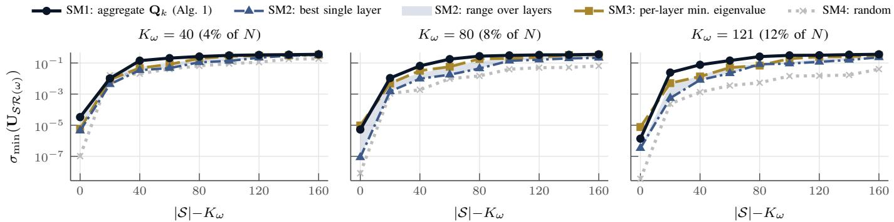  
Figure 6. Conditioning of the sampling sets: smallest singular value of the sampled basis $\mathbf { U } _ { \mathcal { S } , \mathcal { R } ( \omega ) }$ for the misaligned multigraphs with the sensor-graph Fourier basis and $R \stackrel { \bar { ( } } { = } 2$ layers, for the three bandwidths (median over 5 realizations). Larger values correspond to a smaller amplification of the noise in the reconstruction (31).

Table I: Reconstruction error E at $| { \mathcal S } | = K _ { \omega } \mathrm { ~ - ~ }$ + 20 for $K _ { \omega }$ ≈ 0.08N (average over 50 signals, median over 5 realizations), for every Fourier basis, number of layers, regime, and noise level. SM2 (best) and SM2 (worst) are the best and the worst single layer at this sampling set size. The smallest error among SM1, SM2 (best), and SM3 is shown in bold.
<table><tr><td colspan="9">SNR = 15 dB</td><td colspan="4">SNR = 20 dB</td></tr><tr><td>Basis</td><td>R</td><td>Regime</td><td>SM1</td><td>SM2 (best)</td><td>SM2 (worst)</td><td>SM3</td><td>SM4</td><td>SM1</td><td>SM2 (best)</td><td>SM2 (worst)</td><td>SM3</td><td>SM4</td></tr><tr><td rowspan="7">Sensor</td><td>2</td><td>aligned</td><td>0.16</td><td>0.16</td><td>0.16</td><td>0.15</td><td>6.21</td><td>0.09</td><td>0.09</td><td>0.09</td><td>0.09</td><td>3.65</td></tr><tr><td>2</td><td>misaligned</td><td>0.50</td><td>1.03</td><td>4.19</td><td>1.14</td><td>6.21</td><td>0.29</td><td>0.59</td><td>2.45</td><td>0.66</td><td>3.65</td></tr><tr><td>3</td><td>aligned</td><td>0.17</td><td>0.16</td><td>0.16</td><td>0.16</td><td>4.60</td><td>0.09</td><td>0.09</td><td>0.09</td><td>0.09</td><td>2.47</td></tr><tr><td>3</td><td>misaligned</td><td>0.21</td><td>1.01</td><td>6.82</td><td>0.82</td><td>4.60</td><td>0.12</td><td>0.58</td><td>4.47</td><td>0.47</td><td>2.47</td></tr><tr><td>4</td><td>aligned</td><td>0.16</td><td>0.16</td><td>0.16</td><td>0.15</td><td>7.43</td><td>0.09</td><td>0.09</td><td>0.09</td><td>0.09</td><td>5.38</td></tr><tr><td>4</td><td>misaligned</td><td>0.19</td><td>2.18</td><td>2.68</td><td>4.01</td><td>7.43</td><td>0.11</td><td>1.28</td><td>1.73</td><td>1.98</td><td>5.38</td></tr><tr><td>Swiss roll 2</td><td>aligned</td><td>0.15</td><td>0.16</td><td>0.16</td><td>0.16</td><td> $\overline { { 2 . 1 \times 1 0 ^ { 5 } } }$ </td><td>0.08</td><td>0.09</td><td>0.09</td><td>0.09</td><td> $\overline { { 1 . 2 \times 1 0 ^ { 5 } } }$ </td></tr><tr><td></td><td>2</td><td>misaligned</td><td>1.37</td><td>15.56</td><td>19.76</td><td>3.51</td><td> $2 . 1 \times 1 0 ^ { 5 }$ </td><td>0.78</td><td>8.90</td><td>10.76</td><td>1.91</td><td> $1 . 2 \times 1 0 ^ { 5 }$ </td></tr><tr><td rowspan="10">Dragon</td><td>3</td><td>aligned</td><td>0.26</td><td>0.43</td><td>0.75</td><td>0.28</td><td> $2 . 4 \times 1 0 ^ { 4 }$ </td><td>0.14</td><td>0.25</td><td>0.38</td><td>0.17</td><td> $1 . 2 \times 1 0 ^ { 4 }$ </td></tr><tr><td>3</td><td>misaligned</td><td>2.38</td><td>21.69</td><td>52.83</td><td>9.00</td><td> $2 . 4 \times 1 0 ^ { 4 }$ </td><td>1.18</td><td>16.63</td><td>34.15</td><td>4.92</td><td> $1 . 2 \times 1 0 ^ { 4 }$ </td></tr><tr><td>4</td><td>aligned</td><td>0.18</td><td>0.16</td><td>0.18</td><td>0.16</td><td> $3 . 2 \times 1 0 ^ { 5 }$ </td><td>0.10</td><td>0.09</td><td>0.10</td><td>0.09</td><td> $1 . 6 \times 1 0 ^ { 5 }$ </td></tr><tr><td>4</td><td>misaligned</td><td>3.88</td><td>19.68</td><td> $1 . 3 \times 1 0 ^ { 3 }$ </td><td>18.33</td><td> $3 . 2 \times 1 0 ^ { 5 }$ </td><td>1.53</td><td>10.22</td><td> $6 . 3 \times 1 0 ^ { 2 }$ </td><td>9.82</td><td> $1 . 6 \times 1 0 ^ { 5 }$ </td></tr><tr><td>223</td><td>aligned</td><td>0.17</td><td>0.17</td><td>0.17</td><td>0.17</td><td>0.78</td><td>0.09</td><td>0.09</td><td>0.10</td><td>0.10</td><td>0.44</td></tr><tr><td></td><td>misaligned</td><td>0.23</td><td>0.35</td><td>0.52</td><td>0.31</td><td>0.78</td><td>0.13</td><td>0.19</td><td>0.30</td><td>0.18</td><td>0.44</td></tr><tr><td></td><td>aligned</td><td>0.17</td><td>0.17</td><td>0.18</td><td>0.17</td><td>1.31</td><td>0.10</td><td>0.10</td><td>0.10</td><td>0.10</td><td>0.71</td></tr><tr><td>3</td><td>misaligned</td><td>0.19</td><td>0.31</td><td>0.68</td><td>0.26</td><td>1.31</td><td>0.11</td><td>0.18</td><td>0.38</td><td>0.15</td><td>0.71</td></tr><tr><td>4</td><td>aligned</td><td>0.17</td><td>0.17</td><td>0.18</td><td>0.17</td><td>0.82</td><td>0.10</td><td>0.10</td><td>0.10</td><td>0.10</td><td>0.46</td></tr><tr><td>4</td><td>misaligned</td><td>0.19</td><td>0.38</td><td>0.64</td><td>0.25</td><td>0.82</td><td>0.10</td><td>0.21</td><td>0.40</td><td>0.14</td><td>0.46</td></tr></table>

Effect of the number of layers. Fig. 5 shows the misaligned multigraphs with $R = 2 , 3 , 4$ layers. As R grows, each layer dominates a smaller fraction of the blocks, so the information relevant for sampling becomes more fragmented across the layers, and the advantage of SM1 grows accordingly. Over all the misaligned configurations at $| { \cal S } | = K _ { \omega } + 2 0$ , the median ratio between the error of the best single layer and that of SM1 is 1.9, 4.2, and 4.2 for $R = 2 , 3 , 4$ , and the corresponding ratio for SM3 is 2.3, 2.5, and 2.9. The median error of SM1 itself decreases with R, from 0.39 for $R = 2 \ \mathrm { t o } \ 0 . 2 1$ for $R = 3$ and 0.20 for $R = 4 ,$ whereas the median errors of the best single layer (0.76, 0.78, and 1.23) and of SM3 (0.70, 0.51, and 0.68) do not decrease. That is, the additional layers are a source of information for the aggregate operator, while they only dilute the information available to each individual layer.

Conditioning of the sampling sets. The source of these differences is explained by Fig. 6, which shows the smallest singular value of the sampled basis. Over all the misaligned configurations, SM1 selects the best-conditioned set in 96% of the cases at $| { \cal S } | = K _ { \omega } + 2 0$ and in all of them at $K _ { \omega } + 4 0$ and $K _ { \omega } + 6 0 . \mathrm { \ A t \ } | S | = K _ { \omega } + 2 0 , \sigma _ { \mathrm { m i n } } ( \mathbf { U } _ { \mathcal { S } , \mathcal { R } ( \omega ) } )$ for SM1 is, in median, 3.0 times larger than the largest value attained by a single layer and 2.8 times larger than for SM3. We emphasize that, in the misaligned regime, the aggregate operator $\mathbf { Q } _ { 1 }$ is itself not admissible: its violation fraction (46), computed from the blocks in (25), is at least 0.96 in every realization. The advantage of SM1 is therefore not a consequence of Corollary 2, but of the unconditional guarantee of Theorem 4 and of the pooling of the separation of all the layers quantified in Proposition 1, whereas the per-layer worst case of SM3 is limited at every step by the least informative layer – see Remark 3.

## VI. CONCLUSIONS

We studied the sampling of bandlimited signals on multigraphs, where the shift operators of the layers do not commute and admit only a joint block diagonalization. We introduced a layer-free notion of frequency, which allowed us to define bandlimited multigraph signals in a way that is independent of the layer used to measure the frequencies, and we showed that the resulting Paley-Wiener spaces are invariant under the entire algebra of convolutional filters and that their dimensions are quantized by the sizes of the blocks. We extended the notions of removable and uniqueness sets to multigraphs, and we showed that the removability of the complement of a sampling set on a single layer is enough to guarantee uniqueness. That is, one informative layer suffices, and the degeneracies of individual layers do not limit the sampling capacity of the multigraph.

The central conclusion of our analysis is that the exact optimality of a sampling set is a property of the common Fourier basis of the multigraph, and not of any of its constituent graphs. The spectral reach characterizes uniqueness sets exactly, and, as a consequence, every admissible element of the filter algebra certifies the same optimal sampling sets. The layers re-enter the picture only through the computable estimates of optimality, and since admissibility cannot be verified without spectral information, the choice of the operator on which to run a single-graph sampling algorithm is unknown a priori. We showed that this obstruction is dissolved by the aggregate operator $\mathbf { Q } _ { k }$ , which shares the common Fourier basis by construction, pools the information of all the layers, and certifies uniqueness unconditionally. This led to a greedy sampling algorithm for multigraphs that does not require the computation of the joint block diagonalization, and whose cost per iteration is comparable to that of the single-graph algorithm of [6] on each layer.

The numerical experiments are consistent with these results. When every layer is admissible, the proposed algorithm and the single-layer methods are essentially indistinguishable, as predicted by Corollary 2. When no layer is admissible, the proposed algorithm attains the smallest reconstruction error in almost every configuration, even when it is compared with the best single layer selected a posteriori. Its advantage is larger for multigraphs with more layers, and it is explained by the better conditioning of the selected sampling sets.

Several questions remain open. First, the aggregate operator considered here uses only the powers of the shift operators, while mixed words probe the interaction between the layers and may lead to tighter estimates when the layers are strongly noncommuting. The systematic choice of these words is a natural next step. Second, our results assume an exact joint block diagonalization, whereas the shift operators of real multigraphs are generically irreducible, with a single invariant subspace of dimension N. Extending the theory to approximate joint block diagonalizations, where signals are only approximately bandlimited, is essential to bring these results to real data. Finally, the extension of these results to sequences of multigraphs of growing size, in the spirit of the analysis of sampling sets on graphons [14], would allow the comparison and transfer of sampling sets across multigraphs with different numbers of nodes.

## REFERENCES

[1] A. Ortega, P. Frossard, J. Kovacevi ˇ c, J. M. F. Moura, and P. Vandergheynst,´ “Graph signal processing: Overview, challenges, and applications,” Proceedings of the IEEE, vol. 106, no. 5, pp. 808–828, May 2018.

[2] I. Pesenson, “Sampling in Paley-Wiener spaces on combinatorial graphs,” Transactions of the American Mathematical Society, vol. 360, no. 10, pp. 5603–5627, 2008.

[3] ——, “Variational splines and Paley–Wiener spaces on combinatorial graphs,” Constructive Approximation, vol. 29, no. 1, pp. 1–21, Feb 2009. [Online]. Available: https://doi.org/10.1007/s00365-007-9004-9

[4] S. Chen, R. Varma, A. Sandryhaila, and J. Kovaceviˇ c, “Discrete signal´ processing on graphs: Sampling theory,” IEEE Transactions on Signal Processing, vol. 63, no. 24, pp. 6510–6523, 2015.

[5] M. Tsitsvero, S. Barbarossa, and P. Di Lorenzo, “Signals on graphs: Uncertainty principle and sampling,” IEEE Transactions on Signal Processing, vol. 64, no. 18, pp. 4845–4860, 2016.

[6] A. Anis, A. Gadde, and A. Ortega, “Efficient sampling set selection for bandlimited graph signals using graph spectral proxies,” IEEE Transactions on Signal Processing, vol. 64, no. 14, pp. 3775–3789, July 2016.

[7] G. Puy, N. Tremblay, R. Gribonval, and P. Vandergheynst, “Random sampling of bandlimited signals on graphs,” Applied and Computational Harmonic Analysis, vol. 44, no. 2, pp. 446–475, 2018. [Online]. Available: https://www.sciencedirect.com/science/article/pii/S1063520316300215

[8] L. Butler, A. Parada-Mayorga, and A. Ribeiro, “Convolutional learning on multigraphs,” IEEE Transactions on Signal Processing, vol. 71, pp. 933–946, 2023.

[9] A. Parada-Mayorga, L. Butler, and A. Ribeiro, “Convolutional filters and neural networks with noncommutative algebras,” IEEE Transactions on Signal Processing, vol. 71, pp. 2683–2698, 2023.

[10] G. Ortiz-Jimenez, M. Coutino, S. P. Chepuri, and G. Leus, “Sampling´ and reconstruction of signals on product graphs,” in 2018 IEEE Global Conference on Signal and Information Processing (GlobalSIP), 2018, pp. 713–717.

[11] S. Zhang, Q. Deng, and Z. Ding, “Signal processing over multilayer graphs: Theoretical foundations and practical applications,” arXiv preprin arXiv:2108.13638, 2021.

[12] S. Sardellitti, S. Barbarossa, and P. Di Lorenzo, “Enabling prediction via multi-layer graph inference and sampling,” in Proc. 13th Int. Conf. Sampling Theory and Applications (SampTA), 2019, pp. 1–4.

[13] H. Fuhr and I. Z. Pesenson, “Poincare and plancherel polya inequalities in´ harmonic analysis on weighted combinatorial graphs,” SIAM Journal on Discrete Mathematics, vol. 27, no. 4, pp. 2007–2028, 2013.

[14] A. Parada-Mayorga and A. Ribeiro, “Sampling and uniqueness sets in graphon signal processing,” IEEE Transactions on Signal Processing, vol. 73, pp. 2480–2495, 2025.

[15] A. Sandryhaila and J. M. F. Moura, “Discrete signal processing on graphs,” IEEE Transactions on Signal Processing, vol. 61, no. 7, pp. 1644–1656, April 2013.

[16] A. Parada-Mayorga, L. Butler, and A. Ribeiro, “Non commutative convolutional signal models in neural networks: Stability to small deformations,” in ICASSP 2024 - 2024 IEEE International Conference on Acoustics, Speech and Signal Processing (ICASSP), 2024, pp. 7305–7309.

[17] A. Parada-Mayorga and A. Ribeiro, “Algebraic neural networks: Stability to deformations,” IEEE Transactions on Signal Processing, vol. 69, pp. 3351–3366, 2021.

[18] M. Lorenz, A Tour of Representation Theory, ser. Graduate studies in mathematics. American Mathematical Society, 2018. [Online]. Available: https://books.google.com/books?id=PUNwDwAAQBAJ

[19] M. Puschel and J. M. F. Moura, “Algebraic signal processing theory,” 2006.¨

[20] A. Sandryhaila and J. M. F. Moura, “Discrete signal processing on graphs: Graph filters,” in 2013 IEEE International Conference on Acoustics, Speech and Signal Processing, 2013, pp. 6163–6166.

[21] I. Z. Pesenson, “Average sampling and average splines on combinatorial graphs,” arXiv e-prints, p. arXiv:1901.08726, Jan 2019.

[22] A. Parada-Mayorga, “Blue noise and optimal sampling on graphs,” Ph.D. dissertation, University of Delaware, 2019. [Online]. Available: https://proxy.library.upenn.edu/login?url=https://www.proquest.com/ dissertations-theses/blue-noise-optimal-sampling-on-graphs/docview/ 2307785173/se-2?accountid=14707

[23] M. Defferrard, L. Martin, R. Pena, and N. Perraudin, “PyGSP: Graph signal processing in Python,” 2017. [Online]. Available: https: //github.com/epfl-lts2/pygsp/

[24] B. Curless and M. Levoy, “A volumetric method for building complex models from range images,” in Proc. 23rd Annu. Conf. Comput. Graph. Interact. Techn. (SIGGRAPH), 1996, pp. 303–312.

[25] Stanford Computer Graphics Laboratory, “The Stanford 3D scanning repository,” https://graphics.stanford.edu/data/3Dscanrep/.

[26] R. Horn and C. Johnson, Matrix Analysis, ser. Matrix Analysis. Cambridge University Press, 2012. [Online]. Available: https://books. google.com/books?id=5I5AYeeh0JUC

[27] L. Zelnik-Manor and P. Perona, “Self-tuning spectral clustering,” in Advances in Neural Information Processing Systems (NIPS), vol. 17, 2004, pp. 1601–1608.

□

# Supplementary Material

Proofs and Derivations

APPENDIX A PROOFS

## A. Proof of Lemma 1

Proof. Let $\mathbf { x } \in \mathcal { P } \mathcal { W } _ { \omega } ( \mathcal { M } )$ and let $\mathbf { y } = p ( \mathbf { S } _ { 1 } , \ldots , \mathbf { S } _ { R } ) \mathbf { x }$ for an arbitrary convolutional filter p. By the spectral representation of the filter, the Fourier coefficients of y satisfy, block by block,

$$
\begin{array} { r } { \widehat { \mathbf { y } } _ { \ell } = p \Big ( \Xi _ { \ell } ^ { ( 1 ) } , \ldots , \Xi _ { \ell } ^ { ( R ) } \Big ) \widehat { \mathbf { x } } _ { \ell } , \qquad \ell = 1 , \ldots , L . } \end{array}\tag{32}
$$

If ℓ is such that $\mu _ { \ell } > \omega ,$ then $\widehat { \mathbf { x } } _ { \ell } = \mathbf { 0 }$ by Definition 5, and therefore $\widehat { \mathbf { y } } _ { \ell } = p ( \Xi _ { \ell } ^ { ( 1 ) } , \dots , \Xi _ { \ell } ^ { ( R ) } ) \mathbf { 0 } = \mathbf { 0 }$ . Hence y satisfies (5) and $\mathbf { y } \in \mathcal { P } \mathcal { W } _ { \omega } ( \mathcal { M } )$ . The statement for words follows by taking p equal to a single word. □

## B. Proof of Theorem 1

Proof. Since U is orthonormal, and using the block structure (1),

$$
\left. \mathbf { S } _ { r } \mathbf { x } \right. _ { 2 } ^ { 2 } = \left. \operatorname { d i a g } \left( \Xi _ { 1 } ^ { ( r ) } , \ldots , \Xi _ { L } ^ { ( r ) } \right) \widehat { \mathbf { x } } \right. _ { 2 } ^ { 2 } = \sum _ { \ell = 1 } ^ { L } \left. \Xi _ { \ell } ^ { ( r ) } \widehat { \mathbf { x } } _ { \ell } \right. _ { 2 } ^ { 2 } .\tag{33}
$$

Since $( \mathcal { M } , \mathbf { x } )$ is ω-bandlimited, the sum runs only over the blocks with $\mu _ { \ell } ~ \leq ~ \omega$ , and for any such block, $\| \widehat { \mathbf { \Xi } } \| \widehat { \mathbf { \Xi } } _ { \ell } ^ { ( r ) } \widehat { \mathbf { x } } _ { \ell } \| _ { 2 } \leq$ $\sigma _ { \operatorname* { m a x } } ( \Xi _ { \ell } ^ { ( r ) } ) \| \widehat { \mathbf { x } } _ { \ell } \| _ { 2 } \leq \mu _ { \ell } \| \widehat { \mathbf { x } } _ { \ell } \| _ { 2 } \leq \omega \| \widehat { \mathbf { x } } _ { \ell } \| _ { 2 }$ , where the second inequality uses the definition of the frequency label (3). Therefore,

$$
\left. \mathbf { S } _ { r } \mathbf { x } \right. _ { 2 } ^ { 2 } \leq \omega ^ { 2 } \sum _ { \ell : \mu _ { \ell } \leq \omega } \left. \widehat { \mathbf { x } } _ { \ell } \right. _ { 2 } ^ { 2 } = \omega ^ { 2 } \left. \mathbf { x } \right. _ { 2 } ^ { 2 } ,\tag{34}
$$

using again the orthonormality of U.

## C. Proof of Corollary 1

Proof. We proceed by induction on the length $k = | w |$ of the word. The case $k = 1$ is Theorem 1. Assume the claim holds for all words of length $k - 1$ , and let $w = ( r _ { k } , \ldots , r _ { 1 } )$ . Write $\begin{array} { r } { \mathbf { z } = \mathbf { S } _ { r _ { k - 1 } } \cdot \cdot \cdot \mathbf { S } _ { r _ { 1 } \mathbf { X } } . } \end{array}$ , so that $\begin{array} { r } { \mathbf { S } _ { w } \mathbf { x } = \mathbf { S } _ { r _ { k } } \mathbf { z } . } \end{array}$ By Lemma 1, ${ \textbf { z } } \in$ $\mathcal { P W } _ { \omega } ( \mathcal { M } )$ , so Theorem 1 applies to z, and combined with the induction hypothesis,

$$
\begin{array} { r } { \left\| \mathbf { S } _ { w } \mathbf { x } \right\| _ { 2 } = \left\| \mathbf { S } _ { r _ { k } } \mathbf { z } \right\| _ { 2 } \leq \omega \left\| \mathbf { z } \right\| _ { 2 } \leq \omega \cdot \omega ^ { k - 1 } \left\| \mathbf { x } \right\| _ { 2 } = \omega ^ { k } \left\| \mathbf { x } \right\| _ { 2 } . } \end{array}\tag{35}
$$

## D. Proof of Lemma 2

Proof. Any $\mathbf { x } \in L _ { 2 } ( S )$ can be written as $\mathbf { x } = \mathbf { I } _ { \mathcal { V } \mathcal { S } } \mathbf { x } _ { \mathcal { S } }$ with $\mathbf { x } _ { S } \in \mathbb { R } ^ { | S | }$ , and $\| \mathbf { x } \| _ { 2 } = \| \mathbf { x } _ { S } \| _ { 2 }$ . Then

$$
\begin{array} { r } { \| \mathbf { S } _ { r } \mathbf { x } \| _ { 2 } ^ { 2 } = \mathbf { x } _ { S } ^ { \top } \mathbf { I } _ { S \mathcal { V } } \mathbf { S } _ { r } ^ { \top } \mathbf { S } _ { r } \mathbf { I } _ { \mathcal { V } S } \mathbf { x } _ { S } = \mathbf { x } _ { S } ^ { \top } \left[ \mathbf { S } _ { r } ^ { \top } \mathbf { S } _ { r } \right] _ { S , S } \mathbf { x } _ { S } , } \end{array}\tag{36}
$$

so that the infimum in (10) is the minimum of the Rayleigh quotient of the symmetric positive semidefinite matrix $\begin{array} { r c l } { \big [ \bar { \mathbf { S } } _ { r } ^ { \top } \bar { \mathbf { S } } _ { r } \big ] _ { \mathcal { S } . \mathcal { S } } } & { = } & { ( \mathbf { S } _ { r } \bar { \mathbf { I } } _ { \mathcal { V } \mathcal { S } } ) ^ { \top } ( \mathbf { S } _ { r } \bar { \mathbf { I } _ { \mathcal { V } \mathcal { S } } } ) } \end{array}$ , which is attained and equals its smallest eigenvalue; this proves (12). Finally, $\lambda _ { \operatorname* { m i n } } \big ( [ \mathbf { \bar { S } } _ { r } ^ { \top } \mathbf { S } _ { r } ] _ { \mathcal { S } , \mathcal { S } } \big ) > 0$ if and only if ${ \bf S } _ { r } { \bf I } _ { \mathcal { V } \mathcal { S } }$ has full column rank, i.e., if and only if no nonzero $\mathbf { x } \in L _ { 2 } ( S )$ satisfies $\mathbf { S } _ { r } \mathbf { x } = \mathbf { 0 }$ which is (13). □

## E. Proof of Theorem 2

Proof. Let $\mathbf { z } = \mathbf { x } - \mathbf { y }$ . Since $\mathcal { P W } _ { \omega } ( \mathcal { M } )$ is a subspace (cf. (6)), z is ω-bandlimited, and since ${ \bf x } | _ { S } = { \bf y } | _ { S }$ , we have $\mathbf { z } \in L _ { 2 } ( S ^ { c } )$ Suppose, for the sake of contradiction, that $\mathbf { z } \neq \mathbf { 0 } ,$ , and let $r ^ { * }$ be an index attaining the maximum in the definition of $\Lambda _ { S ^ { c } } ^ { \mathrm { m a x } }$ By Definition 6 applied on the $\mathbf { S } _ { r ^ { * } } \mathbf { - } \mathbf { a } \mathbf { x } \mathbf { i } \mathbf { s }$

$$
\left\| \mathbf { S } _ { r ^ { * } } \mathbf { z } \right\| _ { 2 } \geq \Lambda _ { r ^ { * } , S ^ { c } } \left\| \mathbf { z } \right\| _ { 2 } = \Lambda _ { S ^ { c } } ^ { \operatorname* { m a x } } \left\| \mathbf { z } \right\| _ { 2 } ,\tag{37}
$$

while the Bernstein inequality of Theorem 1 gives $\| \mathbf { S } _ { r ^ { * } } \mathbf { z } \| _ { 2 } { \le }$ $\omega \| \mathbf { z } \| _ { 2 }$ . Combining the two, $\Lambda _ { S ^ { c } } ^ { \mathrm { m a x } } \leq \omega$ , which contradicts (14). Hence ${ \bf z = 0 }$ □

## F. Proof of Theorem 3

Proof. We first note the standard equivalence: S is a uniqueness set for $\mathcal { P W } _ { \omega } ( \mathcal { M } )$ if and only if

$$
{ \mathcal { P W } } _ { \omega } ( { \mathcal { M } } ) \cap L _ { 2 } ( S ^ { c } ) = \{ \mathbf { 0 } \} .\tag{38}
$$

Indeed, if $\mathbf { z } \neq \mathbf { 0 }$ belongs to the intersection, then 0 and z are distinct ω-bandlimited signals agreeing on $s ;$ conversely, if $\mathbf { x } \neq$ y are ω-bandlimited and agree on ${ \mathcal { S } } _ { : }$ , then $\mathbf x - \mathbf y$ is a nonzero element of the intersection.

Without loss of generality, we may assume that the labels $\mu _ { 1 } < . . . < \mu _ { L }$ are pairwise distinct: consecutive blocks with equal labels can be merged into a single block, since the merged block subspaces are invariant, and both ${ \mathcal P } { \mathcal W } _ { \omega } ( { \mathcal M } )$ in (6) and the thresholds in (17) depend on the partition only through the distinct label values.

By (6), $\mathcal { P W } _ { \omega } ( \mathcal { M } ) \ = \ \oplus _ { j \leq \ell ( \omega ) } \mathrm { r a n g e } ( \mathbf { U } _ { j } )$ with $\ell ( \omega ) ~ =$ max $\{ \ell : \mu _ { \ell } \leq \omega \}$ . By the minimality in Definition 7, the intersection (38) is trivial for every $\ell ( \omega ) < \ell ^ { * } ( S )$ and nontrivial for every $\ell ( \omega ) \geq \ell ^ { * } ( S )$ , since the filtration $\textstyle \bigoplus _ { j < \ell } \mathrm { r a n g e } ( \mathbf { U } _ { j } )$ is increasing in ℓ. Finally, because the labels are strictly increasing, $\ell ( \omega ) \geq \ell ^ { * } ( S )$ holds if and only if $\mu _ { \ell ^ { * } ( s ) } \leq \omega$ . Therefore, S is a uniqueness set for $\mathcal { P W } _ { \omega } ( \mathcal { M } )$ if and only if $\omega < \mu _ { \ell ^ { * } ( S ) }$ , which proves (17).

For (18), note that the family of bandwidths for which S is a uniqueness set is the interval $\left[ 0 , \mu _ { \ell ^ { * } ( s ) } \right)$ , which is increasing (with respect to inclusion) in $\ell ^ { * } ( \dot { S } )$ since the labels are nondecreasing; when the labels are pairwise distinct the map $\ell \mapsto \mu _ { \ell }$ is strictly increasing and the two arg max sets in (18) coincide. □

## G. Proof of Corollary 2

Proof. Since T is symmetric and T U $\mathrm { d i a g } ( \mathbf { \Theta } _ { 1 } , \dots , \mathbf { \Theta } _ { L } ) \mathbf { U } ^ { \top }$ with U orthonormal, each block $\Theta _ { \ell }$ is symmetric, so the eigendecompositions $\begin{array} { r } { \Theta _ { \ell } = \mathbf { V } _ { \ell } \mathbf { D } _ { \ell } \mathbf { V } _ { \ell } ^ { \top } } \end{array}$ in the statement exist and (20) holds. The columns of U associated with the ℓth block are the columns of $\mathbf { U } _ { \ell } \mathbf { V } _ { \ell } ,$ which span range $\left( \mathbf { U } _ { \ell } \right)$ , cf. (22). By definition, $\omega _ { \mathbf { T } } ( \phi )$ equals the largest |λ| over the eigencomponents of $\phi$ in the basis $\mathbf { U } _ { \mathbf { T } } .$ , and, by the separation condition (19), eigencomponents lying in block ℓ carry labels inside the ℓth spectral interval $\left[ \operatorname* { m i n } _ { \lambda \in \mathrm { s p e c } ( \Theta _ { \ell } ) } | \lambda | \right.$ , max $\mathrm { : } \lambda \in \mathrm { s p e c } ( \Theta _ { \ell } ) \left| \lambda \right| ]$ , and these intervals are pairwise disjoint and increasing in ℓ.

Proof of (i). Write $\begin{array} { r c l } { \ell ^ { * } } & { = } & { \ell ^ { * } ( S ) } \end{array}$ . For the upper bound, by Definition 7 there exists a nonzero $\phi _ { 0 } ^ { } ~ \in ~ { \cal L } _ { 2 } ( S ^ { c } )$ ∩ $\begin{array} { r } { \bigoplus _ { j \leq \ell ^ { * } } \mathrm { r a n g e } ( \mathbf { U } _ { j } ) } \end{array}$ . All the eigencomponents of $\phi _ { 0 }$ lie in blocks $j \ \leq \ \ell ^ { * } , \ \mathrm { s o }$ , by the ordering of the intervals, $\omega _ { \mathbf { T } } ( \phi _ { 0 } ) \ \leq$ max $\mathrm { \backslash } \ k _ { \lambda \in \mathrm { s p e c } ( \Theta _ { \ell ^ { * } } ) } | \lambda | .$ , whence $\nu _ { \mathbf { T } } ( { \mathcal { S } } ) \leq \operatorname* { m a x } _ { \lambda \in \mathrm { s p e c } ( \Theta _ { \ell ^ { * } } ) } \left| \lambda \right|$ . For the lower bound, let $\phi ~ \in ~ L _ { 2 } ( S ^ { c } )$ be nonzero. If all the eigencomponents of ϕ were contained in blocks $j \le \ell ^ { * } - 1$ , then ϕ would be a nonzero element of $L _ { 2 } ( S ^ { c } ) \cap \bigoplus _ { j < \ell ^ { * } - 1 } { \mathrm { r a n g e } } ( \mathbf { U } _ { j } )$ contradicting the minimality of ℓ∗. Hence ϕ has an eigencomponent in some block $j ~ \geq ~ \ell ^ { * }$ , and, by the ordering of the intervals, $\begin{array} { r } { \omega _ { \mathbf { T } } ( \phi ) \geq \operatorname* { m i n } _ { \lambda \in \mathrm { s p e c } ( \Theta _ { \ell ^ { * } } ) } | \lambda | } \end{array}$ . Taking the minimum over ϕ proves (i).

Proof of (ii). If $\ell ^ { * } ( S _ { 1 } ) < \ell ^ { * } ( S _ { 2 } )$ , then, using (i) twice and the disjointness and ordering of the intervals,

$$
\begin{array} { r l } & { \nu _ { \mathbf { T } } ( S _ { 1 } ) \leq \underset { \lambda \in \mathrm { s p e c } ( \Theta _ { \ell ^ { * } ( S _ { 1 } ) } ) } { \operatorname* { m a x } } \big \vert \lambda \big \vert < \underset { \lambda \in \mathrm { s p e c } ( \Theta _ { \ell ^ { * } ( S _ { 1 } ) + 1 } ) } { \operatorname* { m i n } } \big \vert \lambda \big \vert } \\ & { \qquad \leq \underset { \lambda \in \mathrm { s p e c } ( \Theta _ { \ell ^ { * } ( S _ { 2 } ) } ) } { \operatorname* { m i n } } \big \vert \lambda \big \vert \leq \nu _ { \mathbf { T } } ( S _ { 2 } ) . } \end{array}\tag{39}
$$

Proof of (iii). Let $S ^ { * }$ maximize $\nu _ { \mathbf { T } } ( \cdot )$ over the sets of size $m ,$ and suppose some $S ^ { \prime }$ of size m satisfies $\ell ^ { * } ( S ^ { \prime } ) > \ell ^ { * } ( S ^ { * } )$ . Then, by $( \mathrm { i i } ) , \nu _ { \mathrm { T } } ( S ^ { \prime } ) > \nu _ { \mathrm { T } } ( S ^ { * } )$ , a contradiction. Hence $S ^ { * }$ maximizes $\ell ^ { * } ( \cdot )$ , and, by Theorem 3, it is an optimal sampling set of the multigraph. □

## H. Proof of Theorem 4

Proof. Let ${ \bf z } = { \bf x } - { \bf y } .$ As in the proof of Theorem 2, ${ \textbf { z } } \in$ ${ \mathcal { P } } { \mathcal { W } } _ { \omega } ( { \mathcal { M } } ) \cap L _ { 2 } ( S ^ { c } )$ . Suppose $\mathbf { z } \neq \mathbf { 0 } .$ . On the one hand, writing $\mathbf { z } = \mathbf { I } _ { \mathcal { V } S ^ { c } } \mathbf { z } _ { S ^ { c } }$ and using the Rayleigh quotient of the symmetric matrix $[ \mathbf { Q } _ { k } ] _ { S ^ { c } , S ^ { c } }$

$$
\begin{array} { r l r } {  { \sum _ { r = 1 } ^ { R } \| \mathbf { S } _ { r } ^ { k } \mathbf { z } \| _ { 2 } ^ { 2 } = \mathbf { z } _ { S ^ { c } } ^ { \top } [ \mathbf { Q } _ { k } ] _ { S ^ { c } , S ^ { c } } \mathbf { z } _ { S ^ { c } } } } \\ & { } & { \geq \lambda _ { \operatorname* { m i n } } \Big ( [ \mathbf { Q } _ { k } ] _ { S ^ { c } , S ^ { c } } \Big ) \| \mathbf { z } \| _ { 2 } ^ { 2 } = R \Gamma _ { k , S ^ { c } } ^ { 2 k } \| \mathbf { z } \| _ { 2 } ^ { 2 } . } \end{array}\tag{40}
$$

On the other hand, by Corollary 1 applied to the words $w =$ $( r , \ldots , r )$ of length $k ,$

$$
\sum _ { r = 1 } ^ { R } \left\| \mathbf { S } _ { r } ^ { k } \mathbf { z } \right\| _ { 2 } ^ { 2 } \leq R \omega ^ { 2 k } \left\| \mathbf { z } \right\| _ { 2 } ^ { 2 } .\tag{41}
$$

Combining the two displays and dividing by $R \| \mathbf { z } \| _ { 2 } ^ { 2 } > 0$ yields $\Gamma _ { k , S ^ { c } } \leq \omega _ { }$ , which contradicts (26). Hence $\mathbf { z } = \mathbf { 0 }$ . The last claim follows since the argument holds for each $k \in \mathcal { K }$ separately, so the strongest of the sufficient conditions applies. □

## I. Proof of Proposition 1

Proof. Since the operation of taking principal submatrices is linear, $\begin{array} { r } { [ \mathbf { Q } _ { 1 } ] _ { \mathcal { S } , \mathcal { S } } = \sum _ { r = 1 } ^ { R } [ \mathbf { S } _ { r } ^ { \top } \mathbf { S } _ { r } ] _ { \mathcal { S } , \mathcal { S } } , } \end{array}$ a sum of symmetric positive semidefinite matrices. By Weyl’s inequality,

$$
\lambda _ { \operatorname* { m i n } } \Big ( [ \mathbf { Q } _ { 1 } ] _ { \mathcal { S } , \mathcal { S } } \Big ) \geq \sum _ { r = 1 } ^ { R } \lambda _ { \operatorname* { m i n } } \Big ( \big [ \mathbf { S } _ { r } ^ { \top } \mathbf { S } _ { r } \big ] _ { \mathcal { S } , \mathcal { S } } \Big ) = \sum _ { r = 1 } ^ { R } \Lambda _ { r , \mathcal { S } } ^ { 2 } ,\tag{42}
$$

where the equality uses Lemma 2. On the one hand, $\sum _ { r } \Lambda _ { r , S } ^ { 2 } \geq$ $( \Lambda _ { S } ^ { \mathrm { m a x } } ) ^ { 2 }$ , which gives $\begin{array} { r c l } { \Gamma _ { 1 , S } } & { = } & { \left[ \lambda _ { \mathrm { m i n } } ( [ { \bf Q } _ { 1 } ] \mathscr { s } , \mathscr { s } ) / \dot { R } \right] ^ { 1 / 2 } \geq } \end{array}$ $\Lambda _ { S } ^ { \mathrm { m a x } } / \sqrt { R } .$ . On the other hand, $\begin{array} { r } { \sum _ { r } \Lambda _ { r , S } ^ { 2 } \geq R ( \dot { \Lambda } _ { S } ^ { \operatorname* { m i n } } ) ^ { 2 } } \end{array}$ , which gives $\Gamma _ { 1 , { \cal S } } \ \geq \ \Lambda _ { { \cal S } } ^ { \mathrm { m i n } }$ . If the layer constants are not all equal, the latter inequality between the sums is strict, and hence so is $\Gamma _ { 1 , { \cal S } } > \Lambda _ { { \cal S } } ^ { \mathrm { m i n } }$ □

## J. Proof of Proposition 2

Proof. If $S _ { 1 } \subseteq S _ { 2 }$ , then $S _ { 2 } ^ { c } \subseteq S _ { 1 } ^ { c }$ , and $[ \mathbf { Q } _ { k } ] _ { \mathcal { S } _ { 2 } ^ { c } }$ is a principal submatrix of the symmetric matrix $[ \mathbf { Q } _ { k } ] _ { \mathcal { S } _ { 1 } ^ { c } }$ . By the Cauchy eigenvalue interlacing theorem [26, Thm. 4.3.17], the smallest eigenvalue can only increase (or remain unchanged) when passing to a principal submatrix,

$$
\lambda _ { \operatorname* { m i n } } \Bigl ( \left[ \mathbf { Q } _ { k } \right] _ { S _ { 1 } ^ { c } } \Bigr ) \ \le \ \lambda _ { \operatorname* { m i n } } \Bigl ( \left[ \mathbf { Q } _ { k } \right] _ { S _ { 2 } ^ { c } } \Bigr ) ,\tag{43}
$$

and the claim follows by taking 2k-th roots and dividing by R inside the root, both of which preserve the inequality. □

K. Additional Details on The Multigraphs used in the Experiments

We consider multigraphs $\mathcal { M } = \left( \mathcal { V } , \{ \mathcal { E } _ { r } , w _ { r } \} _ { r = 1 } ^ { R } \right)$ with $N =$ $| \mathcal { V } | = 1 0 0 0$ nodes and $R \in \{ 2 , 3 , 4 \}$ layers, with shift operators $\{ \mathbf { S } _ { r } \} _ { r = 1 } ^ { R }$ . To have full control over the block diagonal structure, the shift operators are synthesized directly from their joint block diagonalization (1), where the orthonormal matrix $\dot { \mathbf { U } } \in \mathbb { R } ^ { N \times N }$ and the blocks $\Xi _ { \ell } ^ { ( r ) }$ are generated as follows.

Fourier basis. The matrix U is the eigenvector matrix of the combinatorial Laplacian of an undirected graph on N nodes, with its columns sorted by increasing Laplacian eigenvalue. We consider three such graphs:

1) a random geometric sensor graph, generated with the PyGSP toolbox [23].

2) a Swiss-roll manifold graph, generated with the PyGSP toolbox [23].

3) a graph built on the Stanford dragon [24], [25], from which $N = 1 0 0 0$ points are selected by farthest-point sampling. Each point is connected to its 11 nearest neighbors and the graph is symmetrized; the weight of the edge between pi and $\mathbf { p } _ { j }$ is $\exp ( - \| \mathbf { p } _ { i } - \mathbf { p } _ { j } \| _ { 2 } ^ { 2 } / ( s _ { i } s _ { j } ) )$ , where $s _ { i }$ is the distance from $\mathbf { p } _ { i }$ to its 11th nearest neighbor [27]. The resulting graph is connected, with average degree 12.3.

Partition. The block sizes $q _ { \ell }$ of the partition $\tau _ { N } = ( q _ { 1 } , \dots , q _ { L } )$ are drawn uniformly at random from $\{ 2 , \ldots , 1 0 \}$ , subject to $\textstyle \sum _ { \ell = 1 } ^ { L } q _ { \ell } \ = \ N$ , which results in $L \approx 1 6 0$ blocks. The same partition is shared by all the layers, as required by (1).

Blocks. Each block $\Xi _ { \ell } ^ { ( r ) }$ is a dense symmetric matrix of the form

$$
\begin{array} { r } { \boldsymbol { \Xi } _ { \ell } ^ { ( r ) } = \mathbf { O } _ { \ell } ^ { ( r ) } \operatorname { d i a g } \left( \lambda _ { \ell , 1 } ^ { ( r ) } , \dots , \lambda _ { \ell , q \ell } ^ { ( r ) } \right) \left( \mathbf { O } _ { \ell } ^ { ( r ) } \right) ^ { \top } , } \end{array}\tag{44}
$$

where $\mathbf { O } _ { \ell } ^ { ( r ) } \in \mathbb { R } ^ { q _ { \ell } \times q _ { \ell } }$ is a random orthonormal matrix drawn from the Haar distribution and the eigenvalues $\lambda _ { \ell , i } ^ { ( r ) }$ have random signs. Since $\Xi _ { \ell } ^ { ( r ) }$ is symmetric, its singular values are the magnitudes $| \lambda _ { \ell , i } ^ { ( r ) } |$ , so the eigenvalue magnitudes directly control $\sigma _ { \mathrm { m a x } } ( \Xi _ { \ell } ^ { ( r ) } )$ and, through it, the labels $\mu _ { \ell }$ in (3). Let $t _ { 1 } < t _ { 2 } < \cdots < t _ { L }$ be target magnitudes evenly spaced over $[ 0 . 1 , 1 . 5 ]$ , with gap $\delta = 1 . 4 / ( L - 1 )$ . In every layer, the eigenvalue magnitudes of block ℓ are drawn independently and uniformly from $[ t _ { \ell } , t _ { \ell } + \delta / 4 ]$ . Consequently,

$$
\operatorname* { m a x } _ { \lambda \in \mathrm { s p e c } ( \Xi _ { \ell } ^ { ( r ) } ) } | \lambda | \leq t _ { \ell } + \frac { \delta } { 4 } < t _ { \ell + 1 } \leq \operatorname* { m i n } _ { \lambda \in \mathrm { s p e c } ( \Xi _ { \ell + 1 } ^ { ( r ) } ) } | \lambda |\tag{45}
$$

for every ℓ and $r ,$ i.e., every shift operator is admissible in the sense of Definition 8 and, in particular, $\sigma _ { \mathrm { m a x } } ( \Xi _ { \ell } ^ { ( r ) } )$ is increasing in ℓ on every layer, so that the ordering (4) holds. Finally, each $\mathbf { S } _ { r }$ is normalized by its spectral radius, which rescales each layer uniformly and preserves (45). The layers differ from one another through the random rotations $\mathbf { O } _ { \ell } ^ { ( r ) }$ , the random signs, and the random magnitudes within each cluster. We refer to the multigraphs obtained in this way as aligned. We note that the width of the clusters must be smaller than the gap δ between consecutive targets, which is approximately $9 \times 1 0 ^ { - 3 }$ for the partitions considered here: with clusters of width 0.05, for instance, the spectral intervals of most consecutive blocks overlap and the layers are no longer admissible.

Aligned and misaligned multigraphs. In the aligned regime, Corollary 2 predicts that a single layer already certifies the optimal sampling sets, and the sampling methods can only differ through finite-order effects. To test the methods in the regime where no individual layer can be trusted, we also generate misaligned multigraphs, in which the ordering (4) of the labels $\mu _ { \ell }$ holds, but the admissibility condition (19) fails on every layer. These are generated as follows. Let $0 < m _ { 1 } < m _ { 2 } < \cdots <$ $m _ { L } = 1$ be target magnitudes evenly spaced over $[ 0 . 1 , 1 ]$

1) Dominant layers. For each block ℓ, a dominant layer $r \ell \in \{ 1 , \ldots , R \}$ is drawn uniformly at random. The block $\Xi _ { \ell } ^ { ( r _ { \ell } ) }$ is generated as in (44), with the largest eigenvalue magnitude set exactly to mℓ.

2) Subdominant layers. For every $r \neq r _ { \ell } ,$ , the block $\Xi _ { \ell } ^ { ( r ) }$ is generated as in (44) with the largest eigenvalue magnitude equal to $\beta _ { \ell } ^ { ( r ) } m _ { \ell } .$ , where $\beta _ { \ell } ^ { ( r ) }$ is drawn uniformly from $[ \beta _ { 0 } , 1 )$ for a fixed $\beta _ { 0 } \in ( 0 , 1 )$

3) Intra-block spread. In all the layers, the remaining eigenvalue magnitudes of a block are drawn uniformly from $[ \rho \sigma _ { \mathrm { m a x } } ( \bar { \Xi _ { \ell } ^ { ( r ) } } ) , \sigma _ { \mathrm { m a x } } ( \Xi _ { \ell } ^ { ( r ) } ) ]$ for a fixed spread parameter $\rho \in ( 0 , 1 ] .$ , again with random signs.

By construction, $\mu _ { \ell } = \operatorname* { m a x } _ { r } \sigma _ { \operatorname* { m a x } } ( \Xi _ { \ell } ^ { ( r ) } ) = m _ { \ell }$ , so the ordering (4) holds strictly without any regeneration step. Furthermore, maxℓ $\mu _ { \ell } = m _ { L } = 1$ , so no normalization of the shift operators is needed. We avoid normalizing each $\mathbf { S } _ { r }$ by its own spectral radius, since rescaling the layers by different factors would change the labels $\mu _ { \ell }$ and could destroy the ordering. Admissibility of the individual layers, on the other hand, fails for two independent reasons:

• On a layer $r , \ \sigma _ { \mathrm { m a x } } ( \Xi _ { \ell } ^ { ( r ) } )$ is no longer monotone in $\ell :$ whenever r dominates block $\ell - 1$ but not block $\ell ,$ we may have $\beta _ { \ell } ^ { ( r ) } m _ { \ell } < m _ { \ell - 1 } ,$ which happens for consecutive blocks as soon as $\beta _ { 0 } ~ < ~ m _ { \ell - 1 } / m _ { \ell }$ . The parameter $\beta _ { 0 }$ controls how severely each layer misorders the blocks.

• For $\rho ~ < ~ 1$ , the spectral intervals of consecutive blocks overlap even on a layer where $\sigma _ { \mathrm { m a x } } ( \Xi _ { \ell } ^ { ( r ) } )$ happens to be monotone. This is because condition (19) compares the smallest magnitude of block $\ell + 1$ with the largest magnitude of block $\ell ,$ and the two intervals can overlap whenever $\rho \sigma _ { \mathrm { m a x } } ( \Xi _ { \ell + 1 } ^ { ( r ) } ) < \sigma _ { \mathrm { m a x } } ( \Xi _ { \ell } ^ { ( r ) } )$

Since the blocks are known in closed form, the admissibility of each layer can be verified exactly. We quantify it by the violation

fraction

$$
v _ { r } = \frac { \left| \left\{ \ell : \sigma _ { \operatorname* { m a x } } \big ( \Xi _ { \ell } ^ { ( r ) } \big ) \geq \sigma _ { \operatorname* { m i n } } \big ( \Xi _ { \ell + 1 } ^ { ( r ) } \big ) \right\} \right| } { L - 1 } \in [ 0 , 1 ] ,\tag{46}
$$

where, since the blocks are symmetric, $\sigma _ { \mathrm { m a x } }$ and $\sigma _ { \mathrm { m i n } }$ are the largest and smallest eigenvalue magnitudes, so that $\mathbf { S } _ { r }$ is admissible if and only if $v _ { r } = 0$ . For the misaligned multigraphs we use $\beta _ { 0 } = 0 . 3$ and $\rho = 0 . 2$ , and we report min $v _ { r }$ for each realization, which certifies that none of the layers is admissible. In all the misaligned realizations we obtain minr $v _ { r } \geq 0 . 9 2$ , i.e., the separation condition fails for at least 92% of the consecutive block pairs on every layer, while $v _ { r } = 0$ for every layer of every aligned realization.

We emphasize that the uniqueness guarantee of Theorem $^ { 4 , }$ on which Algorithm 1 relies, does not require admissibility of any operator, and therefore applies equally to aligned and misaligned multigraphs.