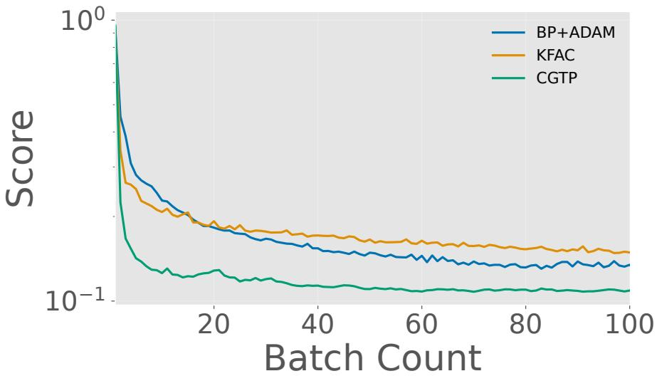
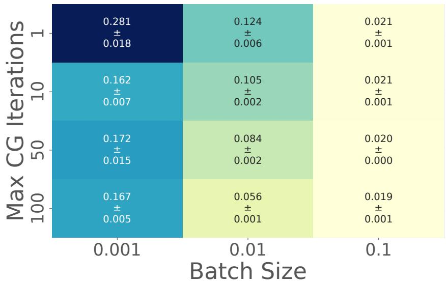
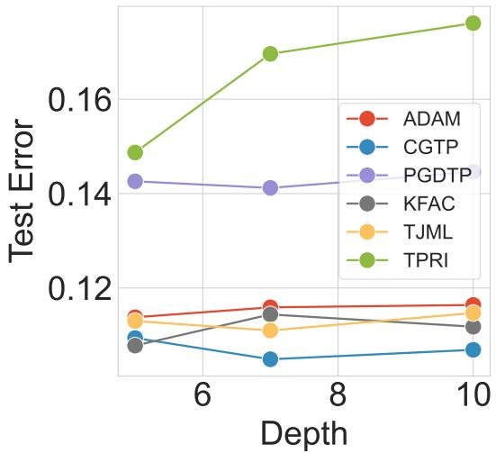
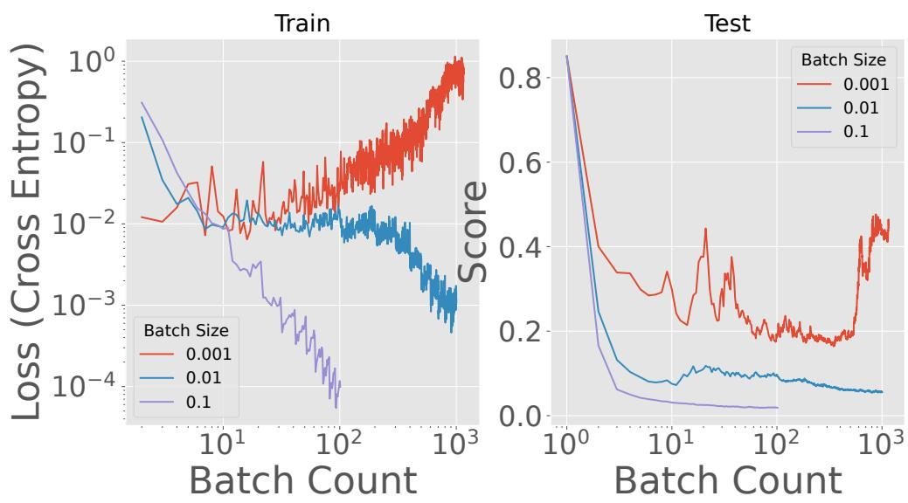
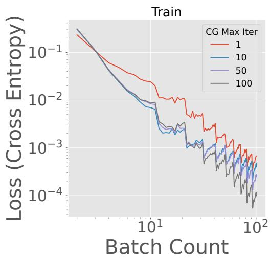
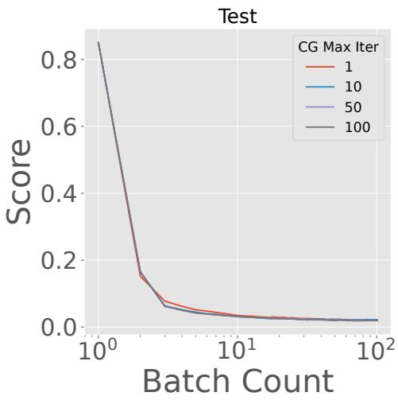

# TRUST YOUR TARGETS: IS TARGET PROPAGATION BLOCK-DIAGONAL GAUSS-NEWTON?

Giuseppe Castiglione, Christopher Buckley & Ivor Simpson

Department of Informatics

University of Sussex

{G.Castiglione,C.L.Buckley,I.Simpson}@sussex.ac.uk

## ABSTRACT

Target propagation (TP) is a backpropagation alternative in which local targets carry the global learning signal. Prior works claim that TP performs Gauss-Newton (GN) optimisation on these targets, but the correspondence has only been established under unrealistic assumptions where hitting them exactly is trivial. Practical variants instead descend on a least-squares problem via a single gradient step. In this paper, we rederive TP from a trust region under an implicit, previously unexamined norm, and introduce CGTP (Conjugate Gradient Target Propagation), which uses conjugate gradients to solve the layer-local subproblems in parallel. A single adaptive parameter jointly controls this trust region and a matching bound on the weight update; KFAC emerges exactly as the special case where the persample Jacobians are replaced by their batch mean, giving its factored damping a variational grounding. On MNIST and Fashion-MNIST MLPs, CGTP matches the accuracy of ADAM and KFAC while needing orders of magnitude fewer outer iterations than ADAM (about 10x fewer backward-pass-equivalents overall), while remaining stable across depth.

## 1 INTRODUCTION

End-to-end backpropagation paired with first-order optimizers (Kingma & Ba, 2014) is the de facto standard for training neural networks. Despite its remarkable effectiveness, backpropagation-based learning imposes a sequential dependency whereby each layer’s gradient depends on every subsequent layer’s. Consequently, error signals must propagate fully backward before updates can begin, which is known as the update locking problem (Jaderberg et al., 2017). This dependency increasingly limits layer-parallel training (Wang et al., 2021), and has motivated a family of local learning methods that allow layers to perform optimization steps independently against local objectives. These methods span a spectrum: greedy supervised approaches (Belilovsky et al., 2019) achieve full layer independence but suffer from information collapse (Wang et al., 2021). Conversely, predictive coding methods (Millidge et al., 2021) simulate global feedback through iterative inference, justified by the free-energy principle (Friston & Kiebel, 2009). Target propagation (TP) (Lee et al., 2015) sits between these global communication extremes: local targets are inferred via a single pass through an approximate inverse, which in principle enables parallel layerwise optimization. However, to realize the benefits of this decoupled optimization, the local objectives must be theoretically sound. While greedy and predictive-coding methods can be derived from information-theoretic or variational principles (Tishby & Zaslavsky, 2015; Friston & Kiebel, 2009), TP’s primary theoretical justification is through a loose analogy to Gauss-Newton (GN) optimization (Meulemans et al., 2020) that is built on assumptions that frequently break down in practice.

The existing proofs that connect TP to GN rely on several assumptions that diverge drastically from practice: they assume batch sizes of 1, single-layer updates, a regression objective, strictly invertible layers, and an infinitesimal step size β. Two of these are particularly damaging. First, the infinitesimal-β requirement defeats the purpose of a second-order method, which is sought for its faster convergence. Second, the assumption of strictly invertible layers forces practical TP variants to increasingly rely on inexact inverses, via autoencoders (Lee et al., 2015), or in the extreme case fixed random feedback weights Shibuya et al. (2023). This requires expensive feedback-weight training loops and more iterations to converge. Relying on many propagation phases especially runs counter to the goals of a local algorithm: since the targets are derived through a propagation phase, we should endeavour to minimize the number of propagation phases altogether.

The result is a striking mismatch: TP is theoretically motivated as approximate GN, yet its dominant practical variants distance themselves from GN at every step. The local loss - the squared-error reconstruction objective each layer minimizes against its target - is treated as a means to an end: a single gradient step toward a target whose theoretical role is only loosely justified. We argue that this is a missed opportunity: if TP is genuinely a form of Gauss-Newton, then taking the local subproblem seriously - ie reaching the minimum - should yield the convergence advantages over first-order methods seen in modern BP-based second-order optimizers (e.g., K-FAC (Martens & Grosse, 2015), SHAMPOO (Gupta et al., 2018)), but crucially, without the update-locking bottleneck.

In this paper, we give TP a rigorous grounding as a sequence of local trust-region subproblems, which we then solve with a second-order method. Our specific contributions are as follows:

• (C1) A rigorous derivation of TP under the trust-region framework. Prior TP-GN equivalence proofs rely on a set of restrictive assumptions, typically left implicit or deferred to appendices. We collect these explicitly (Table 1), and relax each in turn. We derive TP from a linearly constrained least-squares subproblem via a linearized change of variables, accommodating classification objectives, multi-layer updates, finite step sizes, and noninvertible layers (Sections 3.1-3.2). Two decoupling theorems - one via norm choice, one via a simplicial representation - yield interpretable, local subproblemss whose unconstrained optima recover the regularized-inverse TP update.

• (C2) A conjugate gradient solver, with KFAC as a special case. KKT analysis of the constrained per-layer subproblem shows that the targets must be fit in the curvature-induced metric, not the Euclidean one, explaining why a naive second-order fit of the TP loss fails (Section 4.1). The null-space method reduces each layer to a positive definite system in the weights, solved in parallel by CG after a single backward pass (Section 4.3). Averaging the per-sample curvatures recovers KFAC with factored damping exactly (Corollary 12).

• (C3) Proof-of-concept validation. On MNIST and Fashion-MNIST, CGTP matches Adam, KFAC and the strongest TP variants in accuracy with orders of magnitude fewer outer iterations (Table 2), though at higher cost per iteration (Table 3), while remaining stable across depth (Figure 3).

## 2 IDENTIFYING THE THEORETICAL FOUNDATIONS OF TARGET PROPAGATION

## 2.1 PRELIMINARY: CLASSICAL TARGET PROPAGATION

In this section, we briefly review the common presentation of TP. Consider a dataset $\mathcal { D } =$ $\{ ( x _ { n } , y _ { n } ) \} _ { n = 1 } ^ { N }$ of N samples. We fit an L-layer feedforward multilayer perceptron (MLP) computing:

$$
u _ { n } ^ { ( 0 ) } = x _ { n } ; \quad z _ { n } ^ { ( \ell + 1 ) } = W ^ { ( \ell ) \top } u _ { n } ^ { ( \ell ) } + b _ { n } ^ { ( \ell ) } ; \quad u ^ { ( \ell + 1 ) } = \sigma ( z ^ { ( \ell + 1 ) } )\tag{1}
$$

The output $z _ { n } ^ { ( \mathrm { o u t } ) } = W ^ { ( L ) \top } u _ { n } ^ { ( L ) } + b ^ { ( L ) }$ is trained to minimize the per-sample loss $\mathcal { L } _ { n } ( z _ { n } ^ { ( \mathrm { o u t } ) } , y _ { n } )$ To assign credit, TP begins by defining a target for the output via a gradient step on the loss:

$$
\hat { z } _ { n } ^ { ( \mathrm { o u t } ) } ( \beta ) = z _ { n } ^ { ( \mathrm { o u t } ) } - \beta \frac { \partial \mathcal { L } _ { n } } { \partial z ^ { ( \mathrm { o u t } ) } } : = z _ { n } ^ { ( \mathrm { o u t } ) } - \beta r _ { n } ,\tag{2}
$$

where $\beta$ is a step size and $r _ { n }$ denotes the (generalized) residual. The composite mapping $f ^ { ( \ell ) } : z ^ { ( \ell ) } $ $z ^ { ( \ell + 1 ) }$ are then approximately inverted to compute intermediate targets $\hat { z } _ { n } ^ { ( \ell ) } ( \beta ) = f ^ { ( \ell ) + } ( \hat { z } _ { n } ^ { ( \ell + 1 ) } ( \beta ) )$ These targets define a layer-local regression problem, from which parameter gradients are derived:

$$
L _ { \mathrm { T P } } ^ { ( \ell ) } ( W ^ { ( \ell ) } , b ^ { ( \ell ) } ) = \frac { 1 } { \beta } \sum _ { n } | | W ^ { ( \ell ) \top } u _ { n } ^ { ( \ell ) } + b _ { n } ^ { ( \ell ) } - \hat { z } _ { n } ^ { ( \ell + 1 ) } ( \beta ) | | ^ { 2 }\tag{3}
$$

## 2.2 CLASSICAL TARGET PROPAGATION AS HYBRID GAUSS NEWTON

The connection between the GN method and TP, as presented in such works as (Jaderberg et al., 2016; Meulemans et al., 2020; Roulet & Harchaoui, 2023) requires several assumptions to draw formal equivalence, which we collect in Table 1. Let $F ^ { ( \ell ^ { \prime } , \ell ) }$ denote the composite map from $z ^ { ( \ell ) } : _ { 0 } \ : z ^ { ( \ell ^ { \prime } ) }$ with Jacobian $J ^ { ( \ell ^ { \prime } , \ell ) }$ . GN is a second-order method applied to least-squares problems (A2). Consider the following objective, for inferrring the optimal target of a single (A3) intermediate layer $z _ { n } ^ { ( l ) }$ for a single datapoint (A5):

Table 1: Assumptions invoked by prior proofs of the TP-GN equivalence
<table><tr><td>Assumption</td><td>Relaxed in</td></tr><tr><td>Ω1: Infinitesimal step size  $\beta$ </td><td>Section 3: Trust-region radius</td></tr><tr><td>U2:  $\ell _ { 2 }$  regression loss</td><td>Section 3.1: Generalized surrogate loss</td></tr><tr><td>Ω3: Single-layer updates</td><td>Section 3.2: Norm-penalties</td></tr><tr><td>Ω4: Strictly invertible layers</td><td>Section 3.2: Norm-penalties, Section 4.2: Simplicial decoupling</td></tr><tr><td>Ω5: Mini-batch of size 1</td><td>Section 4.1: Constrained activation space</td></tr></table>

$$
\mathcal { L } _ { n } ^ { ( \ell ) } = \frac { 1 } { 2 } \big \| \hat { z } _ { n } ^ { ( \mathrm { o u t } ) } - F ^ { ( \mathrm { o u t } , \ell ) } ( z _ { n } ^ { ( \ell ) } ) \big \| ^ { 2 } ,\tag{4}
$$

A GN step proceeds by linearizing $F ^ { \mathrm { ( o u t , \ell ) } }$ around the current $z _ { n } ^ { ( \ell ) }$ and solving the resulting linear least-squares problem. Writing the residual as $r _ { n } = F ^ { ( \mathrm { o u t } , \ell ) } ( z _ { n } ^ { ( \ell ) } ) - \hat { z } _ { n } ^ { ( \mathrm { o u t } ) }$ , the GN update is

$$
[ \Delta z _ { \mathrm { G N } } ^ { ( \ell ) } ] _ { n } = \left( J ^ { ( \mathrm { o u t } , \ell ) \top } J ^ { ( \mathrm { o u t } , \ell ) } \right) ^ { + } J ^ { ( \mathrm { o u t } , \ell ) \top } r .\tag{5}
$$

If F is invertible (A4), then so is the Jacobian, and the above simplifies to:

$$
[ \Delta z _ { \mathrm { G N } } ^ { ( \ell ) } ] _ { n } = [ J _ { n } ^ { ( \mathrm { o u t } , \ell ) } ] ^ { - 1 } r _ { n } .\tag{6}
$$

Let us return to the TP loss from Equation 3, considered as a function of the intermediate activation $z _ { n } ^ { ( \ell ) }$ . In the limit that the step-size $\beta  0 ( { \mathfrak { A } } 1 )$ , a Taylor expansion on the TP gradient yields:

$$
\begin{array} { r l r } {  { [ \Delta z _ { n } ^ { ( \ell ) } ] _ { \mathrm { T P } } = z _ { n } ^ { ( \ell ) } - [ F ^ { ( o u t , \ell ) } ] ^ { - 1 } ( z _ { n } ^ { ( o u t ) } - \beta r _ { n } ) } } \\ & { } & { \approx z _ { n } ^ { ( \ell ) } - [ F ^ { ( o u t , \ell ) } ] ^ { - 1 } ( z _ { n } ^ { ( o u t ) } ) + \beta \frac { \partial [ F ^ { ( o u t , \ell ) } ] ^ { - 1 } ( z _ { n } ^ { ( o u t ) } ) } { \partial z _ { n } ^ { ( o u t ) } } r _ { n } = \beta \frac { \partial [ F ^ { ( o u t , \ell ) } ] ^ { - 1 } ( z _ { n } ^ { ( o u t ) } ) } { \partial z _ { n } ^ { ( o u t ) } } r _ { n } } \end{array}\tag{7}
$$

n

(8)

By the inverse function theorem, the Jacobian of G is the inverse of the Jacobian of F. As such:

$$
[ \Delta z _ { n } ^ { ( \ell ) } ] _ { \mathrm { T P } } = \beta [ J _ { n } ^ { ( o u t , \ell ) } ] ^ { - 1 } r _ { n } = \beta [ \Delta z _ { \mathrm { G N } } ^ { ( \ell ) } ] _ { n } ,\tag{9}
$$

which demonstrates the equivalence. Crucially, this is not a GN step on the weights. TP as presented in (Meulemans et al., 2020) is a hybrid algorithm: a GN step infers local targets, and a gradient descent step converts those targets into a weight update. The theory for a full TP-based GN update on the weights (Bengio, 2020; Meulemans et al., 2020) has been developed only in the single-datapoint case (A5), where any inferred target is exactly realizable and the $\mathrm { T } \dot { \mathrm { P } }$ step coincides with a full GN step up to a positive scalar. The remainder of this paper relaxes each of these assumptions in turn.

## 3 GENERALISING TARGET PROPAGATION VIA TRUST-REGION METHODS

The classical presentation of TP uses a single parameter (β) to control both the the approximation fidelity and step size. Trust-Regions (TR) methods separate these roles, permitting accelerated optimization even with poor approximations. One constructs a local quadratic model m of the objective, takes a step that approximately minimizes m within a radius $\Delta ,$ , and then accepts/rejects the step based on the ratio $\rho$ between the predicted reduction (in m) and the reduction of the true loss. The radius adapts based on $\rho \colon$ a successful step extends it, a failed step contracts it.

In what follows we generalise TP within this framework, and relax the remaining assumptions in the proof of Section 2.2. Section 3.1 identifies the loss that TP approximates, clarifying its role as a surrogate for general loss functions (A2), and how its fidelity is measured through the trust-region ratio $\rho .$ Section 3.2 demonstrates that a principled choice of trust-region metric naturally accomodates the multi-layer setting (A3) and non-invertible layers (A4)

## 3.1 RELAXING A2 VIA CONVEX SURROGATES

Adopting the Trust Region framework for TP requires identifying which objective it is trying to approximate. We propose that the TP loss in Equation 3 can be viewed as a surrogate of the true objective ${ \mathcal { L } } ,$ insofar as (see Supp B):

$$
| | \nabla _ { z ^ { ( \ell ) } } \mathcal { L } _ { \mathrm { T P } } | | ^ { 2 } = 0 \implies | | \nabla _ { z ^ { ( \mathrm { o u t } ) } } \mathcal { L } | | ^ { 2 } = 0\tag{10}
$$

The key observation is that the objectives used to train neural networks are commonly convex functions of the outputs. As such, the vanishing of $| | \nabla _ { z } ( o u t ) \mathcal { L } | |$ is a sufficient condition for optimality of the network, motivating the following general surrogate loss:

$$
\mathcal { T } _ { n } = | | \nabla _ { z ^ { ( o u t ) } } \mathcal { L } ( z ^ { ( o u t ) } ( x _ { n } , y _ { n } ; \theta ) | | _ { M _ { n } } ^ { 2 }\tag{11}
$$

Here, $M _ { n } \succeq 0$ denotes a choice of norm appropriate to the problem. Letting $r _ { n } : = \nabla _ { z ^ { ( o u t ) } } \mathcal { L } _ { n }$ denote the generalized residual, we consider the result of applying a perturbation $\Delta z _ { n } ^ { ( \ell ) }$ to the pre-activation of layer ℓ at the point n. Taylor expanding, we have:

$$
\begin{array} { r } { r _ { n } ( z _ { n } ^ { ( \ell ) } + \Delta z _ { n } ^ { ( \ell ) } ) \approx r _ { n } + H _ { n } J _ { n } ^ { ( o u t , \ell ) } \Delta z _ { n } ^ { ( \ell ) } ; H _ { n } : = \nabla _ { z _ { n } ^ { ( o u t ) } } ^ { 2 } \mathcal { L } _ { n } } \end{array}\tag{12}
$$

We then obtain the following subproblem:

Definition 1 (Generalized Gauss-Newton Subproblem for the Pre-Activations). For a general objective $\mathcal { L } .$ , the surrogate loss $\mathcal { I } _ { n }$ may be approximated as a weighted least-squares subproblem:

$$
\mathcal { T } _ { n } \approx \vert \vert M _ { n } ^ { 1 / 2 } ( r _ { n } + H _ { n } J _ { n } ^ { ( o u t , \ell ) } \Delta z _ { n } ^ { ( \ell ) } ) \vert \vert ^ { 2 } : = m _ { n } ( \Delta z _ { n } ^ { ( \ell ) } )\tag{13}
$$

The improvement ratio $\rho$ is then calculated by comparing $\Delta \mathcal { I } _ { n }$ (measured) and $\Delta m _ { n }$ (predicted).

## 3.2 RELAXING A3 AND A4 VIA A PRINCIPLED CHOICE OF TRUST-REGION METRIC

Prior works generalize the single-layer result of Definition 1 to the multi-layer setting by appealing to the common empirical approximation of a block-diagonal Gauss-Newton matrix (Meulemans et al., 2020). In this section, we show that achieving layer decoupling requires no such approximation - only a principled choice of metric. The key observation is that the multi-layer problem is typically underdetermined. Let $J _ { n }$ denote the stacked Jacobian and $\Delta z _ { n }$ the stacked perturbation, as follows:

$$
J _ { n } : = \left[ I \mid J _ { n } ^ { ( \mathrm { o u t } , L ) } \mid \cdots \mid J _ { n } ^ { ( \mathrm { o u t } , 1 ) } \right] ; \quad \Delta z _ { n } : = \left[ \Delta z _ { n } ^ { ( \mathrm { o u t } ) \top } \mid \Delta z _ { n } ^ { ( L ) \top } \mid \cdots \mid \Delta z _ { n } ^ { ( 1 ) \top } \right] ^ { \top }\tag{14}
$$

Henceforth we drop the out, denoting $J _ { n } ^ { ( \ell ) } : = J _ { n } ^ { ( \mathrm { o u t } , \ell ) }$ . The natural generalization of Definition 1 is:

$$
m _ { n } ( \Delta z _ { n } ) = \left. \left\| r _ { n } + H _ { n } J _ { n } \Delta z _ { n } \right\| _ { M _ { n } } ^ { 2 } \right.\tag{15}
$$

Note that, if each $\Delta z _ { n } ^ { ( \ell ) } \in \mathbb { R } ^ { K }$ , the joint perturbation across layers introduces $( L + 1 ) K$ unknowns against only $C \ll K$ residuals, and so there are infinitely many solutions. In the trust region setting, a unique solution may be fixed via a norm constraint $| | \dot { \Delta } z _ { n } | | _ { B _ { n } } < \Delta$ , for choice of metric $B _ { n }$ . The following theorem highlights a specific family of norms that natively decouples the layers:

Theorem 2 (Egalitarian Norm-Induced Layer Separation). Let λ be a Lagrange multiplier, and consider the penaltyform ofthe norm constraintfor metric $B _ { n } .$

$$
\begin{array} { r } { m _ { n } ( { \Delta z } _ { n } ; \lambda ) = \frac { 1 } { 2 } \big \| r _ { n } + H _ { n } J _ { n } { \Delta z } _ { n } \big \| _ { M _ { n } } ^ { 2 } + \frac { \lambda } { 2 } { \Delta z } _ { n } ^ { \top } B _ { n } { \Delta z } _ { n } \qquad B _ { n } = \bigoplus _ { \ell = 1 } ^ { L + 1 } B _ { n } ^ { ( \ell ) } } \end{array}\tag{16}
$$

Then, ifthe metric is egalitarian (ie satisfies $\begin{array} { r } { \sum _ { \ell } J _ { n } ^ { ( o u t , l ) } [ B _ { n } ^ { ( l ) } ] ^ { - 1 } [ J ^ { ( o u t , l ) } ] _ { n } ^ { \top } = I ) } \end{array}$ , the unconstrained solutionfor the layer perturbation is:

$$
\begin{array} { r } { \Delta z _ { n } ^ { ( \ell ) } = - \frac { 1 } { L } J _ { n } ^ { ( \ell ) + } \tilde { r } _ { n } ( \lambda ) = - \frac { 1 } { L } [ B _ { n } ^ { ( \ell ) } ] ^ { - 1 } J _ { n } ^ { ( \ell ) \top } \tilde { r } _ { n } ( \lambda ) } \end{array}\tag{17}
$$

Where $\tilde { r } _ { n } ( \lambda )$ denotes the regularized target, and is given by:

$$
\tilde { r } _ { n } ( \lambda ) = \bigl ( H _ { n } ^ { \top } M _ { n } H _ { n } + \lambda I \bigr ) ^ { - 1 } H _ { n } ^ { \top } M _ { n } r _ { n }\tag{18}
$$

Proof. The identiy block in $J _ { n }$ makes it surjective (Lemma 14), so that for any $B _ { n }$ the the normal equations factor as (operator) $J _ { n } \Delta z _ { n } = \mathrm { ( t a r g e t ) }$ . The egalitarian block requirement is then chosen to coincide with the classical TP update. Full details in Supp C.1. □

Remark 3 (Recovering Classical TP as the Low-Trust Limit in an Egalitarian Newton Norm). As $\lambda \to \infty$ , choosing penalty norm $M _ { n } = H _ { n } ^ { - 1 }$ , the regularized target of 17 approaches the Classical TP target of 9 with $\bar { \beta } = \bar { \lambda ^ { - 1 } }$

Remark 4 (Interpretation of the Egalitarian Norm). Theorem 2 has a natural reading: no single layer should dominate the others in its contribution to the regularized objective. This is structurally similar to the scale-invariant diagonal damping used in classical Levenberg-Marquardt (LM) (Nocedal & Wright, 2006). Furthermore, the pseudo-inverse leaves unperturbed those direction of the preactivations that the layer discards. Supp C.2 makes this construction explicit for the output layer.

## 4 BEYOND CLASSICAL TP: SECOND-ORDER METHODS ON THE LOCAL SUBPROBLEM

Having relaxed Assumptions A1-A4, we now address A5, and the prospect of deriving GN updates from the TP loss. The hybrid route of prior works (a single gradient step on the weights) is naturally read as the low-trust regime of our framework. Where previous approaches assess (and adapt) approximate inverses through reconstruction, the trust-region formulation calibrates trust through utility. A second-order step is licensed when reductions in the subproblem align with reduction in the true loss. It then seems a simple matter to apply a second-order optimiser to equation 3: the Hessian is block diagonal, and the Newton step yields the familiar least-squares fit. We will show in this section that doing so is not straightforward. The primary difficulty is one of feasibility: equation 3 assesses attainability of the local targets a Euclidean norm. When A5 holds, the targets are exactly realisable and so the choice of metric is irrelevant. For larger batch sizes, this choice of proves decisive.

To this end, in Section 4.1, we extend our trust-region subproblem to incorporate feasibility constraints. The KKT conditions reveal the necessity of measuring fit using the metric induced by curvature. The numerical cost of the KKT solution motivates a majorization-minimization decomposition of that metric (Section 4.2), yielding new local losses that generalize equation 3 and admit second-order optimizers (Section 4.3). We then damp the weight updates to combat overfitting (Section 4.4), recovering KFAC as a corrollary when samples are replaced by their batch average.

## 4.1 KKT CONDITIONS FOR THE CONSTRAINED SUBPROBLEM

The natural generalisation of the subproblem of Equation 15 is to simply sum $m _ { n }$ across datapoints. This constitutes N independent least-squares problems, whose minimisers are available in closed form via Theorem 2. However, such solutions ar not necessarily feasible: the model architecture constrains the space of pre-activations to satisfy $\Delta Z ^ { ( \ell ) } = \tilde { U } ^ { ( \ell - 1 ) } \Delta W ^ { ( \ell - 1 ) }$ for some $\Delta W ^ { ( l - 1 ) }$ (here, ∼ indicates augmentation by ones). Note, the constraint requires only that $\Delta W ^ { ( \ell - 1 ) }$ exists: it does not commit us to any particular choice. Hence, to retain the pre-activations as the principal optimisation variables, we must incorporate the following constraint:

Lemma 5 (Feasibility of perturbations (layer version)). Let $\tilde { U } ^ { ( \ell - 1 ) } \in \mathbb { R } ^ { N \times d _ { \ell - 1 } }$ and $\Delta Z ^ { ( \ell ) } \in \mathbb { R } ^ { N \times d _ { \ell } }$ There exists $\Delta W ^ { ( \ell - \bar { 1 } ) } \in \mathbb { R } ^ { d _ { \ell - 1 } \times d _ { \ell } }$ satisfying $\Delta Z ^ { ( \ell ) } = \tilde { U } ^ { ( \ell - 1 ) } \Delta W ^ { ( \ell - 1 ) }$ ifand only ifeach column of $\Delta Z ^ { ( \ell ) }$ lies in col $( \tilde { U } ^ { ( \ell - 1 ) } )$ ). Equivalently,

$$
\begin{array} { r } { \Pi ^ { ( \ell - 1 ) } \Delta Z ^ { ( \ell ) } = 0 , } \end{array}\tag{19}
$$

where $\Pi ^ { ( \ell - 1 ) }$ is the orthogonal projector onto col $( \tilde { U } ^ { ( \ell - 1 ) } ) ^ { \perp }$

Proof. The equation $\Delta Z ^ { ( \ell ) } = \tilde { U } ^ { ( \ell - 1 ) } \Delta W ^ { ( \ell - 1 ) }$ holds column-wise: each column of $\Delta Z ^ { ( \ell ) }$ is a linear combination of the columns of $\tilde { U } ^ { ( \ell - 1 ) }$ with coefficients given by the corresponding column of $\Delta W ^ { ( \ell - 1 ) }$ . Such a linear combination exists if and only if the column lies in col $\bar { ( U ^ { ( \ell - 1 ) } ) }$ , which is equivalent to vanishing under projection onto its orthogonal complement. □

Remark 6 (Classical TP as Projected Gradient Descent). The classical TP weight update, when applied to the inputs $U ^ { ( \ell - 1 ) }$ , is effectively a projection of the targets into co $\lfloor ( \tilde { U } ^ { ( \ell - 1 ) } )$ via $\Delta \bar { Z } _ { \mathrm { P G D } } ^ { ( \ell ) } \propto$ $\tilde { U } ^ { ( \ell - 1 ) } \tilde { U } ^ { ( \ell - 1 ) \top } \Delta Z ^ { ( \ell ) } ( \mathrm { S u p p C . 3 } )$

Lemma 5 holds at the level of a single layer. In what follows we require a constraint acting on all layers at once, after stacking across datapoints. This will keep the per-sample subproblems block-diagonal, but distributes the layer constraint across the stacked vector. This new constraint is expressed in the following Lemma (proof in Supp C.4):

Lemma 7 (Feasibility of perturbations (stacked version)). Let the stacked pre-activations be denoted $\Delta z = ( \Delta z _ { 1 } , \dots , \Delta z _ { N } ) \in \mathbb { R } ^ { N D }$ , and let $E ^ { ( \ell ) }$ be defined such that $\Delta z _ { n } ^ { ( \ell ) } = E ^ { ( \ell ) } \Delta z _ { n }$ . Then the layer feasibility operators of Lemma 5 may stated as Π $. \Delta z = 0 ,$ , where

$$
\Pi = \sum _ { \ell } \Pi ^ { ( \ell - 1 ) } \otimes E ^ { ( \ell ) \top } E ^ { ( \ell ) } .\tag{20}
$$

We are now ready to examine the constrained subproblem.

Theorem 8 (Solution of the Joint Constrained Subproblem). Let $G _ { n } : = J _ { n } ^ { \top } H _ { n } ^ { \top } M H _ { n } J _ { n }$ denote the Hessian of the per-datapoint subproblem, and $\tilde { G } _ { n } ( \lambda ) : = G _ { n } + \lambda B _ { n }$ its regularisation. The unconstrained problems are uncoupled across datapoints, so we define the stacked subproblem Hessian $\tilde { { \cal G } } ( \lambda ) = \oplus _ { n } \tilde { G } _ { n } ( \lambda )$ . Finally, let $\Delta z ^ { \star } ( \lambda )$ denote the stacked unconstrained minimiser of equation 17. Then, up to an additive constant in $\Delta z ,$ the constrained joint subproblem is:

$$
m ( \Delta z ; \lambda ) = \left( \Delta z - \Delta z ^ { \star } ( \lambda ) \right) ^ { \top } \tilde { G } \big ( \Delta z - \Delta z ^ { \star } ( \lambda ) \big ) \quad s u b j e c t t o \quad \Pi \Delta z = 0\tag{21}
$$

The optimal perturbations are then given by projecting $\Delta z ^ { \star } ( \lambda )$ onto ker Π in the metric induced by $\tilde { G } ( \lambda )$ :

$$
\Delta z _ { \mathbf { I } } ^ { \star } ( \lambda ) = \Delta z ^ { \star } ( \lambda ) - \tilde { G } ( \lambda ) ^ { - 1 } \mathbf { I I } ^ { \top } \big ( \mathbf { I I } \tilde { G } ( \lambda ) ^ { - 1 } \mathbf { I I } ^ { \top } \big ) ^ { - 1 } \mathbf { I I } \Delta z ^ { \star } ( \lambda ) .\tag{22}
$$

The proof follows from KKT analysis (Supp C.5). The naive Newton step on Equation 3, by contrast, is a Euclidean projection: it treats all directions in $\Delta Z$ space on equal footing. When $G _ { n }$ is singular, directions in its null space leave the local loss exactly unchanged, so the constraint can be satisfied by routing the correction through this null space at zero cost; damping replaces ”zero cost” with ”low cost,” graded by proximity to the null space, but the cheap subspace persists. The Euclidean projection has no access to this structure and generically pays for directions the curvature metric would have obtained for free.

Unfortunately, computing equation 22 directly is not feasible. The Schur complement $\Pi \tilde { G } ( \lambda ) ^ { - 1 } \Pi ^ { \top }$ is dense and of dimension $\hat { N ( L + 1 ) K } \times N ( \hat { L } + 1 ) K$ . The product inherits neither the block diagonal structure of $\tilde { G } ( \lambda )$ nor the Kronecker structure of Π, making the cross-layer couplings unavoidable and thus prohibitive at practical scale.

## 4.2 LOCAL SURROGATES THROUGH SIMPLICIAL RELAXATIONS

Section 3 recovered the TP update by choosing a block-diagonal norm, which resolves the underdetermination of the multi-layer subproblem and yields layer-separable targets. The curvature, however, remains coupled across layers. This suffices for inferring local targets, but not hitting them with a second-order method. In this section we separate the curvature itself, replacing the subproblem with a layer-local surrogate that majorises it.

Consider, for each datapoint n, a set of L scalars $\alpha _ { n } ^ { ( \ell ) } > 0$ with $\begin{array} { r } { \sum _ { \ell } \alpha _ { n } ^ { ( \ell ) } = 1 } \end{array}$ , and the family of perturbations satisfying $J _ { n } ^ { ( \ell ) } \Delta z _ { n } ^ { ( \ell ) } = - \alpha _ { n } ^ { ( \ell ) } r _ { n }$ . By inspection, this family minimises the subproblem in the absence of constraints: the final layer residual is simply split across the L-layers, and the local residual may be fit exactly. This perspective enables us to identify a principled decomposition which generalises to the constrained setting. It is encapsulated in the following theorem:

Theorem 9 (Layer-separable majorization). Let $M \succeq 0$ and let $\alpha _ { n }$ lie in the interior ofthe simplex. Then thefollowing is a majorizer of $m _ { n }$ at every value of $\alpha _ { n }$

$$
m _ { n } ( \Delta z ) \leq \frac { 1 } { 2 } \sum _ { \ell } \left\| \sqrt { \alpha _ { n } ^ { ( \ell ) } } r _ { n } + \frac { 1 } { \sqrt { \alpha _ { n } ^ { ( \ell ) } } } H _ { n } J _ { n } ^ { ( \ell ) } \Delta z _ { n } ^ { ( \ell ) } \right\| _ { M _ { n } } ^ { 2 } \equiv \widehat { m } _ { n } ( \Delta z ; \alpha _ { n } ) ,\tag{23}
$$

Furthermore, in the presence of a regulariser $\lambda B _ { n } ^ { ( \ell ) }$ , the following sequence converges to the minimum of the local subproblem:

$$
( A ) \quad \Delta z _ { n } ^ { ( \ell ) } \gets - \alpha _ { n } ^ { ( \ell ) } \big ( G _ { n } ^ { ( \ell ) } + \alpha _ { n } ^ { ( \ell ) } \lambda B _ { n } ^ { ( \ell ) } \big ) ^ { - 1 } g _ { n } ^ { ( \ell ) } , \qquad ( B ) \quad \alpha _ { n } ^ { ( \ell ) } \gets \frac { \| \Delta z _ { n } ^ { ( \ell ) } \| _ { G _ { n } ^ { ( \ell ) } } } { \sum _ { k } \| \Delta z _ { n } ^ { ( k ) } \| _ { G _ { n } ^ { ( k ) } } } ,\tag{24}
$$

where $G _ { n } ^ { ( \ell ) } = J _ { n } ^ { ( \ell ) \top } H _ { n } ^ { \top } M _ { n } H _ { n } J _ { n } ^ { ( \ell ) } a n d g _ { n } ^ { ( \ell ) } = J _ { n } ^ { ( \ell ) \top } H _ { n } ^ { \top } M _ { n } r _ { n }$

Proof. Write $\begin{array} { r } { r _ { n } = ( \sum _ { \ell } \alpha _ { n } ^ { ( \ell ) } ) r _ { n } } \end{array}$ and apply Jensen’s inequality to $\| \cdot \| _ { M _ { n } } ^ { 2 }$ . The main result is then alternating minimisation after proving that $\begin{array} { r } { \widehat { m } _ { n } ( \Delta z _ { n } ; \alpha _ { n } ) + \frac { 1 } { 2 } \lambda | | \Delta z _ { n } | | _ { B _ { \ast } } ^ { 2 } } \end{array}$ 5n is convex (Supp C.6).

Note that any α on the simplex yields a valid subproblem (equation 23). We list several approximations in Supp D.3, all of which. empriically, converge faster than the uniform baseline $\alpha _ { n } ^ { ( \ell ) } = L ^ { - 1 }$

## 4.3 NULL-SPACE METHODS ON THE LOCAL SURROGATE

The per-layer surrogate of Theorem 9 is significantly smaller than the full multi-layer subproblem of Theorem 8, but its $N K \times N K$ Hessian still lacks the structure that would admit the closed-form KKT solution of Supp C.5. While the Schur complement is expensive to form, its components - block-diagonal Hessian $\tilde { G } ( \lambda )$ and the Kronecker-structured projector Π - admit cheap matrix-vector products. Hence, methods like conjugate gradient (CG) are a natural choice of solver, as they only require the action of each component (Nocedal & Wright, 2006). Though one may use projected CG to optimise $\Delta Z$ directly, the bi-level approach of the null-space method is more memory efficient. As in Classical TP, we identify local targets $\Delta Z ^ { ( \ell ) \star } ( \alpha ^ { ( \ell ) } )$ ) via the inversion in Theorem 9. The null-space of the constraint is then simply $\Delta \bar { Z ^ { ( \ell ) } } ( \Delta W ^ { ( \ell - 1 ) } ) = \stackrel { \not { U } ^ { ( \ell - 1 ) } \Delta W ^ { ( \ell - 1 ) } } { \Delta }$ , and we minimise the reduced system, which is a weighted least-squares fit:

$$
\operatorname* { m i n } _ { \Delta W ^ { ( \ell - 1 ) } } \frac { 1 } { 2 } \big \| \tilde { U } ^ { ( \ell - 1 ) } \Delta W ^ { ( \ell - 1 ) } - \Delta Z ^ { ( \ell ) \star } ( \alpha ^ { ( \ell ) } ) \big \| _ { \tilde { G } ^ { ( \ell ) } } ^ { 2 } , \qquad \tilde { G } ^ { ( \ell ) } = \bigoplus _ { n } \tilde { G } _ { n } ^ { ( \ell ) } \big ( \lambda ; \alpha _ { n } ^ { ( \ell ) } \big ) .\tag{25}
$$

The gradient is $\begin{array} { r } { \sum _ { n } u _ { n } \big ( \Delta W ^ { ( \ell - 1 ) \top } u _ { n } - \Delta z _ { n } ^ { ( \ell ) \star } \big ) ^ { \top } \tilde { G } _ { n } ^ { ( \ell ) } } \end{array}$ . To proceed, we define the linear operator $\begin{array} { r } { \mathcal { G } _ { \lambda } ^ { ( \ell ) } ( V ) : = \sum _ { n } u _ { n } u _ { n } ^ { \top } V \tilde { G } _ { n } ^ { ( \ell ) } ( \lambda ; \alpha ) } \end{array}$ , and use CG to solve:

$$
\mathcal { G } _ { \lambda } ^ { ( \ell ) } \big ( \Delta W ^ { ( \ell - 1 ) } \big ) = - \sum _ { n } u _ { n } g _ { n } ^ { ( \ell ) \top } .\tag{26}
$$

## 4.4 PREVENTING OVERFITTING WITH ADAPTIVE WEIGHT DECAY

Solving the local subproblem to high accuracy is not uniformly beneficial. Though CGTP reduces training loss far faster than first-order baselines, its validation error begins to rise after a small number of outer iterations, leading to a performance gap when compared to BP+ADAM. It is easy to see the cause: while the trust region bounds the magnitude permissible $\Delta Z ^ { ( \ell ) }$ , it does nothing to bound $\Delta W ^ { ( \ell - 1 ) }$ , which can be arbitrarily large whenever $U ^ { ( \ell - 1 ) }$ is poorly conditioned. In this section, we suggest an adaptive strategy for controlling the conditioning.

Choice of norm. Phase one fixes a metric on pre-activation space: solving the damped subproblem declares that the effective local geometry of $\Delta z _ { n } ^ { ( \ell ) }$ is $\tilde { G } ^ { ( \ell ) } )$ rather than the Euclidean one. Any quantity that maps into pre-activation space should be measured accordingly. A weight perturbation $I \otimes \Delta W ^ { ( \ell - 1 ) }$ is a linear map from the metric space $( \mathbb { R } ^ { N \times K _ { \mathrm { i n } } } , I ) \mathrm { t o } \big ( \mathbb { R } ^ { N \times \bar { K } _ { \mathrm { o u t } } } , \tilde { G } ^ { ( \ell ) } \big )$ , and its size is its operator (Hilbert-Schmidt) norm between those two inner-product spaces:

$$
\lVert I \otimes \Delta W ^ { ( \ell - 1 ) } \rVert _ { I \to \tilde { G } ^ { ( \ell ) } } ^ { 2 } = \sum _ { n } \mathrm { t r a c e } ( \Delta W ^ { ( \ell - 1 ) \top } \Delta W ^ { ( \ell - 1 ) } \tilde { G } _ { n } ^ { ( \ell ) } ( \lambda ; \alpha _ { n } ^ { ( \ell ) } ) )\tag{27}
$$

$$
\implies \lVert \Delta W ^ { ( \ell - 1 ) } \rVert _ { \mathrm { H S } } = \lVert \Delta W ^ { ( \ell - 1 ) } \bar { G } ^ { 1 / 2 } \rVert _ { F } ^ { 2 } + \lambda \lVert \Delta W ^ { ( \ell - 1 ) } \bar { B } ^ { 1 / 2 } \rVert _ { F } ^ { 2 } .\tag{28}
$$

When $B _ { n } ^ { ( \ell ) } = I$ second term is the ordinary weight decay, while the first term controls a local Lipschitz constant that penalizes overall model sensitivity.

Regularization Strength. Each phase now has its own constraint: during inference, $\| \Delta Z ^ { ( \ell ) } \| _ { F } \le$ $\delta _ { z }$ is controlled by an LM rule on the reduction ratio, whereas $\| \Delta W ^ { ( \ell - 1 ) } \| _ { \mathrm { H S } } \le \delta _ { w }$ is to be enforced during the second weight-fitting phase. Independently adapting a second radius would leave us with a two-trust-region problem, which, while being well-studied, introduces additional complexity (Ai &

Zhang, 2009; Bienstock, 2014). We instead observe that our constraint sets are both convex and have non-zero intersection $( \Delta W = 0$ lies in the interior of both), and may thus use a single trust-region parameter to limit the weight perturbation to the intersection. This leads us to the following defintions, and the resulting CG system (Proof in Supp C.7, full listing in Algorithm 2).

Theorem 10 (Single-parameter coupling of the two trust regions). Fix a layer ℓ and suppress the layer index. Let $\delta _ { z } , \delta _ { w } > 0$ befixed radii and $\lambda > 0$ a trust parameter, and set

$$
\mu _ { z } = \frac { \lambda } { \delta _ { z } ^ { 2 } } , \qquad \mu _ { J } = \frac { \lambda } { \delta _ { w } ^ { 2 } } , \qquad \tilde { G } _ { n } ( \mu _ { z } ; \alpha ) = \frac { 1 } { \alpha _ { n } } G _ { n } + \mu _ { z } I , \qquad \bar { \tilde { G } } = \bar { G } + \mu _ { z } I ,\tag{29}
$$

with $\begin{array} { r } { \bar { G } = \frac { 1 } { N } \sum _ { n } \frac { 1 } { \alpha _ { n } } G _ { n ; } } \end{array}$ , so that the damping of the pre-activation bound is also the metric of the weight bound. With

$$
q _ { z } ( \Delta W ) = \frac { 1 } { \delta _ { z } ^ { 2 } } \| \tilde { U } \Delta W \| _ { F } ^ { 2 } , \qquad q _ { w } ( \Delta W ) = \frac { 1 } { \delta _ { w } ^ { 2 } } \| \Delta W \bar { G } ^ { 1 / 2 } \| _ { F } ^ { 2 } ,\tag{30}
$$

the ellipsoid $\{ q _ { z } + q _ { w } \leq 1 \}$ is inscribed in $\{ q _ { z } \leq 1 \} \cap \{ q _ { w } \leq 1 \}$ , and penalising it with the single multiplier λ gives

$$
L _ { \lambda } ( \Delta W ) = \sum _ { n } \frac { 1 } { 2 } \Big \| \sqrt { \alpha _ { n } } r _ { n } + \frac { 1 } { \sqrt { \alpha _ { n } } } J _ { n } \Delta W ^ { \top } u _ { n } \Big \| _ { M _ { n } } ^ { 2 } + \frac { \mu _ { z } } { 2 } \| \tilde { U } \Delta W \| _ { F } ^ { 2 } + \frac { \mu _ { J } } { 2 } \| \Delta W \tilde { G } ^ { 1 / 2 } \| _ { F } ^ { 2 }\tag{31}
$$

$$
= \mathrm { c o n s t } + \frac { 1 } { 2 } \| \tilde { U } \Delta W - \Delta Z ^ { \star } \| _ { \tilde { G } } ^ { 2 } + \frac { \mu _ { J } } { 2 } \| \Delta W \bar { \tilde { G } } ^ { 1 / 2 } \| _ { F } ^ { 2 } .\tag{32}
$$

Its unique minimiser solves

$$
\mathcal { G } _ { \lambda } ( \Delta W ) = - \sum _ { n } u _ { n } g _ { n } ^ { \top } , \qquad \mathcal { G } _ { \lambda } ( V ) : = \sum _ { n } u _ { n } u _ { n } ^ { \top } V \tilde { G } _ { n } ( \mu _ { z } ; \alpha ) + \mu _ { J } V \bar { G } .\tag{33}
$$

Corollary 11 (General pre-activation norm). Theorem 10 holds with the pre-activation bound measured in per-sample norms $B _ { n } \ \succ 0$ , upon replacing $\mu _ { z } I$ by $\mu _ { z } B _ { n }$ in ${ { \tilde { G } } _ { n } } , \ \| { \tilde { U } } \Delta W \| _ { F } ^ { 2 }$ by $\begin{array} { r } { \sum _ { n } \lVert \Delta W ^ { \top } u _ { n } \rVert _ { B _ { r } } ^ { 2 } } \end{array}$ in $q _ { z }$ , and G¯˜ by $\bar { G } + \mu _ { z } \bar { B }$ with $\begin{array} { r } { \bar { B } = \frac { 1 } { N } \sum _ { n } B _ { n } } \end{array}$ . The CG system becomes

$$
\mathcal { G } _ { \lambda } ( \Delta W ) = - \sum _ { n } u _ { n } g _ { n } ^ { \top } , \qquad \mathcal { G } _ { \lambda } ( V ) : = \sum _ { n } u _ { n } u _ { n } ^ { \top } V \Big ( \frac { 1 } { \alpha _ { n } } G _ { n } + \mu _ { z } B _ { n } \Big ) + \mu _ { J } V \big ( \bar { G } + \mu _ { z } \bar { B } \big ) .\tag{34}
$$

Proof. Identical to that of Theorem 10, replacing I by $B _ { n }$ in the pre-activation penalty and by $\bar { B }$ in the weight metric. Positive definiteness of $\mathcal { G } _ { \lambda }$ follows from $\bar { G } + \bar { \mu } _ { z } \bar { B } \succeq \mu _ { z } \bar { B } \succ \bar { 0 }$ □

Corollary 12 (Exact recovery of KFAC). Suppose the per-sample metrics are replaced by their batch average, $\tilde { G } _ { n } ( \mu _ { z } ; \alpha ) \equiv \bar { \tilde { G } } = \bar { G } + \mu _ { z } I$ for all n. Then $\mathcal { G } _ { \lambda }$ is Kronecker-structured,

$$
\mathcal { G } _ { \lambda } ( V ) = \left( A + \mu _ { J } I \right) V \left( \bar { G } + \mu _ { z } I \right) , \qquad A = \tilde { U } ^ { \top } \tilde { U } ,\tag{35}
$$

and the solution ofequation 33 is

$$
\Delta W = - \bigl ( A + \mu _ { J } I \bigr ) ^ { - 1 } \nabla _ { W } L \bigl ( \bar { G } + \mu _ { z } I \bigr ) ^ { - 1 } , \qquad \nabla _ { W } L = \sum _ { n } u _ { n } g _ { n } ^ { \top } ,\tag{36}
$$

## 5 EXPERIMENTS

Datasets and architecture. We evaluate on two low-dimensional classification benchmarks: MNIST (LeCun & Cortes, 2010) and Fashion-MNIST (Xiao et al., 2017). All models are fully connected networks with tanh nonlinearities, a softmax output layer, and cross-entropy loss. Unless otherwise specified, networks have depth 5 with 256 hidden units. As an ablation, we consider four variants of trust-region target propagation:

• GDTP: Gradient descent step on the Euclidan subproblem (equation 58). We tune the learning rate, batch size, and Tikhonov dampening for the inverse of $J _ { n }$

• EucGTP: Naive fit of the targets (no curvature). Same parameters as GDTP, minus learning rate.

Table 2: Error and convergence cost, in backward-pass equivalents. Outer iterations are counted to the error threshold noted in each column header. × denotes failure to reach threshold. N/A indicates result is not reported by source.
<table><tr><td rowspan="2">alg</td><td colspan="3">F-MNIST</td><td rowspan="2"></td><td colspan="3">MNIST</td><td rowspan="2"></td></tr><tr><td>final err</td><td>outer @ 0.13</td><td>/it total</td><td></td><td>final err outer @ 0.05</td><td>/it total</td></tr><tr><td>ADAM</td><td> $. 1 1 1 \pm . 0 0 0$ </td><td> $2 5 , 6 6 7 \pm 4 5 0 9$ </td><td>125.7k</td><td></td><td> $. 0 1 9 \pm . 0 0 0$ </td><td> $7 3 3 3 \pm 5 7 7$ </td><td colspan="2">17.3k</td></tr><tr><td>KFAC</td><td> $. 1 0 8 \pm . 0 0 2$ </td><td> $2 7 0 0 \pm 5 0 0$ </td><td></td><td>1 2.7k</td><td> $. 0 1 8 \pm . 0 0 1$ </td><td> $4 6 7 \pm 5 8$ </td><td colspan="2">1 467</td></tr><tr><td>DRL-lin.</td><td> $. 1 1 1 \pm . 0 0 4$ </td><td>N/A</td><td>N/A N/A</td><td></td><td> $. 0 2 0 \pm . 0 0 8$ </td><td>N/A</td><td colspan="2">N/A N/A</td></tr><tr><td>TJML</td><td> $. 1 1 4 \pm . 0 0 1$ </td><td> $1 4 6 8 \pm 7 2 4$ </td><td></td><td>1 1.5k</td><td> $. 0 1 8 \pm . 0 0 1$ </td><td> $1 3 7 7 \pm 7 5 6$ </td><td>11.4k</td><td></td></tr><tr><td>TPRI</td><td> $. 1 5 2 \pm . 0 0 4$ </td><td>×</td><td>X</td><td>X</td><td> $. 0 6 1 \pm . 0 0 3$ </td><td>×</td><td>× </td><td>×</td></tr><tr><td>GDTP</td><td> $. 1 4 7 \pm . 0 0 0$ </td><td>X</td><td>×</td><td>×</td><td>.092 ± .000</td><td>X</td><td>×</td><td>X</td></tr><tr><td>EucTP</td><td>.146 ± .002</td><td>×</td><td>×</td><td>×</td><td>.054 ± .002</td><td>×</td><td>× ×</td><td></td></tr><tr><td>CGTP (no WD)</td><td> $. 1 1 3 \pm . 0 0 0$ </td><td> $1 5 . 0 \pm 0 . 0$ </td><td>201</td><td>3.0k</td><td>.037 ± .001</td><td> $2 3 . 3 \pm 2 . 9$ </td><td>201 4.7k</td><td></td></tr><tr><td>CGTP</td><td> $. 1 0 9 \pm . 0 0 2$ </td><td> $6 . 6 7 \pm 0 . 5 8$ </td><td>201</td><td>1.3k</td><td>.019 ± .001</td><td> $3 . 6 7 \pm 0 . 5 8$ </td><td>201 738</td><td></td></tr></table>

• CGTP (no WD)(Section 4.3): CG without weight decay. An outer iteration costs one backward pass (to form $J _ { n } , g _ { n } )$ and up to max iter= 100 CG iterations (one JVP + one VJP).

• CGTP (Section 4.4): automatically adjusted weight decay.

Additionally, we benchmark against five baselines: two general optimisers and three TP variants.

• BP+Adam: standard end-to-end training. We tune the learning rate and batch size.

• KFAC: (Martens & Grosse, 2015) an approximation of Natural Gradients using Kronecker-Factored approximations. We tune the batch size, the exponential decay weight, and the initial value of the trust-region penalty parameter λ.

• DRL (Meulemans et al., 2020): difference reconstruction loss. A TP variant that learns autoencoderstyle inverses with a reconstruction loss specifically to make DTP recover Gauss-Newton targets. We use the same architecture as in (Meulemans et al., 2020) and report the published error.

• TPRI (Roulet & Harchaoui, 2023): compute targets using a product of layer-wise Tikhonovregularized Jacobian inversesl weights are updated by SGD on the standard local reconstruction loss. We tune the regularization strength, batch size, learning rate, and momentum.

• TJML (Bao et al., 2024): a Jacobian matching loss yields closed-form approximate inverses (transposed weights for linear layers, analytically derived dual activation-function). Closed-form inverse introduces no hyperparameters; we tune the batch size, learning rate, and momentum,

Table 2 reports final test error and iteration to milestone for each run, where each method is compared at its own tuned batch size, aggregated over three runs. Note that KFAC and ADAM tend to favour smaller batch sizes, whereas CGTP favours larger ones (as per-sample curvature is only informative when the batch size is large enough to estimate it). Figure 1 shows BP, KFAC, and CGTP at matched batch size, where the order is preserved but the milestone margins change. More results (such as depth and parameter sensitivity analysis) can be found in Supp D, and more detailed discussions of Related Works can be found in Supp A.

## 6 CONCLUSION

We show that the correspondence between target propagation and Gauss–Newton optimization, previously established only where hitting the targets is trivial, extends to the general case once realization is treated as a trust-region problem in the targets’ own metric. Classical TP is a single gradient step under this metric; solving it by conjugate gradient yields CGTP, and sharing curvature across samples recovers KFAC’s factored damping exactly. Layers are solved independently and in parallel after one backward pass. On MNIST and Fashion-MNIST MLPs, CGTP matches Adam and KFAC in accuracy with an order of magnitude fewer outer iterations. Our experiments are proof-ofconcept, restricted to small MLPs; extending to the stochastic setting, structured architectures, and principled preconditioning for ill-conditioned problems such as PINNs are natural next steps.

## AI TOOL DECLARATION

In this work, we used generative AI tools primarily for fine-tuning and validation:

• Derivations were submitted to Claude to check for errors, and fixes devised where they were raised. Examples abound: the indexing scheme of Lemma 5 was previously incorrect (the correction verified through a simple numpy script), and the previous definition of $B _ { n }$ in Section 3.2 only held for invertible layers, leading to the correction term in equation 52).

• Our code was profiled and optimised using Claude code tools: for example, the push through identity was adopted in several places, in addition to certain refactors that flagged bottlenecks introduce by logging, and permitted acceleration through use of pytorch compilation tools.

We take responsibility for the final content of this work, including text, claims or artifacts produced with the aid of generative AI.

## REFERENCES

Wenbao Ai and Shuzhong Zhang. Strong duality for the cdt subproblem: A necessary and sufficient condition. SIAM Journal on Optimization, 19(4):1735–1756, 2009. doi: 10.1137/07070601X. URL https://doi.org/10.1137/07070601X.

Yanhao Bao, Tatsukichi Shibuya, Ikuro Sato, Rei Kawakami, and Nakamasa Inoue. Efficient target propagation by deriving analytical solution. Proceedings of the AAAI Conference on Artificial Intelligence, 38(10):11016–11023, March 2024. ISSN 2159-5399. doi: 10.1609/aaai.v38i10.28977. URL http://dx.doi.org/10.1609/aaai.v38i10.28977.

Sergey Bartunov, Adam Santoro, Blake A. Richards, Luke Marris, Geoffrey E. Hinton, and Timothy P. Lillicrap. Assessing the scalability of biologically-motivated deep learning algorithms and architectures. In Proceedings of the 32nd International Conference on Neural Information Processing Systems, NIPS’18, pp. 9390–9400, 2018.

Eugene Belilovsky, Michael Eickenberg, and Edouard Oyallon. Greedy layerwise learning can scale to imagenet. In International conference on machine learning, pp. 583–593. PMLR, 2019.

Yoshua Bengio. Deriving differential target propagation from iterating approximate inverses. arXiv preprint arXiv:2007.15139, 2020.

Frederik Benzing. Gradient Descent on Neurons and its Link to Approximate Second-Order Optimization. arXiv e-prints, art. arXiv:2201.12250, January 2022. doi: 10.48550/arXiv.2201.12250.

Daniel Bienstock. A note on polynomial solvability of the CDT problem. arXiv e-prints, art. arXiv:1406.6429, June 2014. doi: 10.48550/arXiv.1406.6429.

Sheng-Wei Chen, Chun-Nan Chou, and Edward Chang. Bda-pch: Block-diagonal approximation of positive-curvature hessian for training neural networks. 02 2018. doi: 10.48550/arXiv.1802.06502.

Maxence M Ernoult, Fabrice Normandin, Abhinav Moudgil, Sean Spinney, Eugene Belilovsky, Irina Rish, Blake Richards, and Yoshua Bengio. Towards scaling difference target propagation by learning backprop targets. In International Conference on Machine Learning, pp. 5968–5987. PMLR, 2022.

Karl Friston and Stefan Kiebel. Predictive coding under the free-energy principle. Philosophical transactions ofthe Royal Society B: Biological sciences, 364(1521):1211, 2009.

Vineet Gupta, Tomer Koren, and Yoram Singer. Shampoo: Preconditioned stochastic tensor optimization. In Jennifer Dy and Andreas Krause (eds.), Proceedings of the 35th International Conference on Machine Learning, volume 80 of Proceedings of Machine Learning Research, pp. 1842–1850. PMLR, 10–15 Jul 2018. URL https://proceedings.mlr.press/v80/ gupta18a.html.

Max Jaderberg, Wojciech Marian Czarnecki, Simon Osindero, Oriol Vinyals, Alex Graves, and Koray Kavukcuoglu. Decoupled neural interfaces using synthetic gradients. CoRR, abs/1608.05343, 2016. URL http://arxiv.org/abs/1608.05343.

Max Jaderberg, Wojciech Marian Czarnecki, Simon Osindero, Oriol Vinyals, Alex Graves, David Silver, and Koray Kavukcuoglu. Decoupled neural interfaces using synthetic gradients. In International conference on machine learning, pp. 1627–1635. PMLR, 2017.

Diederik P. Kingma and Jimmy Ba. Adam: A method for stochastic optimization. 2014. doi: 10.48550/ARXIV.1412.6980. URL https://arxiv.org/abs/1412.6980.

Yann LeCun and Corinna Cortes. MNIST handwritten digit database. 2010. URL http://yann. lecun.com/exdb/mnist/.

Dong-Hyun Lee, Saizheng Zhang, Asja Fischer, and Yoshua Bengio. Difference target propagation. In Joint european conference on machine learning and knowledge discovery in databases, pp. 498–515. Springer, 2015.

James Martens and Roger Grosse. Optimizing neural networks with kronecker-factored approximate curvature. In International conference on machine learning, pp. 2408–2417. PMLR, 2015.

Alexander Meulemans, Francesco Carzaniga, Johan Suykens, Joao Sacramento, and Benjamin F˜ Grewe. A theoretical framework for target propagation. Advances in Neural Information Processing Systems, 33:20024–20036, 2020.

Beren Millidge, Anil Seth, and Christopher L Buckley. Predictive coding: a theoretical and experimental review. arXiv preprint arXiv:2107.12979, 2021.

Jorge Nocedal and Stephen J. Wright. Numerical optimization. Springer series in operations research and financial engineering. Springer, New York, NY, 2. ed. edition, 2006. ISBN 978-0-387-30303-1.

Arild Nøkland. Direct feedback alignment provides learning in deep neural networks. In Neural Information Processing Systems, 2016. URL https://api.semanticscholar.org/ CorpusID:2843914.

Adam Paszke, Sam Gross, Francisco Massa, Adam Lerer, James Bradbury, Gregory Chanan, Trevor Killeen, Zeming Lin, Natalia Gimelshein, Luca Antiga, Alban Desmaison, Andreas Kopf, Edward¨ Yang, Zach DeVito, Martin Raison, Alykhan Tejani, Sasank Chilamkurthy, Benoit Steiner, Lu Fang, Junjie Bai, and Soumith Chintala. PyTorch: an imperative style, high-performance deep learning library. Curran Associates Inc., Red Hook, NY, USA, 2019.

Vincent Roulet and Zaid Harchaoui. Target propagation via regularized inversion. Transactions on Machine Learning Research, 2023.

Tatsukichi Shibuya, Nakamasa Inoue, Rei Kawakami, and Ikuro Sato. Fixed-weight difference target propagation. In Proceedings of the AAAI Conference on Artificial Intelligence, volume 37, pp. 9811–9819, 2023.

Naftali Tishby and Noga Zaslavsky. Deep learning and the information bottleneck principle. In 2015 ieee information theory workshop (itw), pp. 1–5. Ieee, 2015.

Pauli Virtanen, Ralf Gommers, Travis E. Oliphant, Matt Haberland, Tyler Reddy, David Cournapeau, Evgeni Burovski, Pearu Peterson, Warren Weckesser, Jonathan Bright, Stefan J. van der Walt,´ Matthew Brett, Joshua Wilson, K. Jarrod Millman, Nikolay Mayorov, Andrew R. J. Nelson, Eric Jones, Robert Kern, Eric Larson, C J Carey, ˙Ilhan Polat, Yu Feng, Eric W. Moore, Jake VanderPlas, Denis Laxalde, Josef Perktold, Robert Cimrman, Ian Henriksen, E. A. Quintero, Charles R. Harris, Anne M. Archibald, Antonio H. Ribeiro, Fabian Pedregosa, Paul van Mulbregt, and SciPy 1.0ˆ Contributors. SciPy 1.0: Fundamental Algorithms for Scientific Computing in Python. Nature Methods, 17:261–272, 2020. doi: 10.1038/s41592-019-0686-2.

Yulin Wang, Zanlin Ni, Shiji Song, Le Yang, and Gao Huang. Revisiting locally supervised learning: an alternative to end-to-end training. arXiv preprint arXiv:2101.10832, 2021.

Han Xiao, Kashif Rasul, and Roland Vollgraf. Fashion-mnist: a novel image dataset for benchmarking machine learning algorithms. arXiv preprint arXiv:1708.07747, 2017.

## SUPPLEMENTARY MATERIALS

A Related Work 12   
B What do the TP losses mean? 13   
C Proofs and Extended Remarks 13   
C.1 Proof of Theorem 2: Norm-Induced Layer Separation 13   
C.2 Remark: Handling Non-Invertible Output Layers 15   
C.3 Classical TP as Projected Gradient Descent 15   
C.4 Proof of Lemma 7: Feasibility of stacked perturbations 16   
C.5 Proof of Theorem 8: KKT Conditions for the Constrained Subproblem . 16   
C.6 Proof of Theorem 9: Simplicial Decomposition of the Global Subproblem 17   
C.7 Proof of Theorem 10: Single-parameter coupling of the two trust regions . 19   
C.8 Proof of Corrollary 12: Exact recovery of KFAC . 20   
D Additional Experimental Details 20   
D.1 Settings 20   
D.2 Compute Requirements 21   
D.3 Simplex Schemes 21   
D.4 Ablation Studies 23   
E Algorithm Listings 26

## A RELATED WORK

Practical TP variants. Among backprop alternatives, the TP literature is comparatively sparse, in part due to the overhead historically associated with the method. The requirement of approximate inverses is restrictive: the canonical approach of training layerwise autoencoders introduces many iterations of feedback-weight training between forward updates, additional per-layer learning rates, and instability that worsens with depth (Bartunov et al., 2018). What’s more, these approaches have weaker theoretical grounding, as it is difficult to characterize how close feedback functions are to the true Jacobian inverse. Much subsequent work has focused on eliminating or simplifying these feedback weights. (Meulemans et al., 2020) examines direct feedback pathways with similarities to DFA (Nøkland, 2016); FW-DTP (Shibuya et al., 2023) pushes this further, arguing that DTP regularizes strongly enough that even a fixed random feedback matrix suffices. Our work is closer in spirit to (Roulet & Harchaoui, 2023), which leverages autograd to compute the true Jacobian and employ a linearized version of Target Propagation. We extend this direction by embedding the inversion in a trust-region framework, separating the inverse’s fidelity from its utility as a stepdirection estimator. The inner-loop iterations our method incurs are spent solving a subproblem that approximates the true objective, rather than training feedback parameters that are discarded after training.

TP and Gauss-Newton. The connection between TP and Gauss-Newton was first made by (Bengio, 2020) and given more rigorous treatment by (Meulemans et al., 2020), whose proof we recount in Section 2.2. Subsequent work has largely retreated from the GN framing. (Roulet & Harchaoui, 2023) attempt to leverage the differential prescription but raise several objections to the proof in their appendix, ultimately focusing on RNN training and concluding that GN is unlikely to explain TP’s empirical success. Other recent work abandons the GN connection entirely: LDRL (Ernoult et al., 2022) aims to reproduce BP gradients directly, achieving competitive results on CIFAR-style benchmarks, while (Bao et al., 2024) derive closed-form feedback functions via a Jacobian-matching loss. Both rely on alignment with BP gradients - positive but imperfect - which limits convergence speed by construction. We take the GN connection more seriously: solving the local subproblem properly turns TP from a method that can approximate BP into one that can potentially outpace it.

Second-order optimization. A range of works have applied second-order machinery to training deep networks. Block-diagonal approximations of the curvature matrix are common, supported by empirical evidence (Martens & Grosse, 2015; Gupta et al., 2018; Chen et al., 2018), and our work is closest in spirit to KFAC (Martens & Grosse, 2015), which targets the Gauss-Newton approximation and uses Levenberg-Marquardt-style damping. Our derivation differs in its treatment of this blockdiagonal structure: rather than assume it, we obtain it as an upper bound on the Gauss-Newton subproblem via Theorem 9. KFAC is itself derived as a special case of our setup in Corrollary 12. A connection between TP and KFAC was previously suggested in (Benzing, 2022) based on superficial similarity in their appearance. Our work rigorously establishes this connection.

## B WHAT DO THE TP LOSSES MEAN?

The conventional presentation of Section 2.1 is operationally complete: it specifies how to compute targets and how to update weights. This subsection examines several choices that the presentation leaves implicit, and that bear on the theoretical status of the local subproblem. We surface them because they motivate the framing adopted in subsequent sections (and in particular, the surrogate loss of Section 3.1).

First, we consider why Equation equation 2 makes for a sensible target. In backpropagation, the weights are the principal optimization variable. Under backpropagation, thee gradients are computed via the chain rule, and the weight update aggregates the per-sample loss gradients:

$$
[ \Delta W _ { \mathrm { B P } } ^ { ( l ) } ] _ { i j } = \sum _ { n } \frac { \partial \mathcal { L } _ { n } } { \partial W _ { i j } ^ { ( \ell ) } } ; \quad \frac { \partial \mathcal { L } _ { n } } { \partial W _ { i j } ^ { ( \ell ) } } = \Big ( \sum _ { k } \frac { \partial \mathcal { L } _ { n } } { \partial z _ { k } ^ { ( \mathrm { o u t } ) } } J _ { k i } ^ { ( \mathrm { o u t } , \ell + 1 ) } ( x _ { n } ) \Big ) u _ { j } ^ { ( \ell ) } ( x _ { n } ) .\tag{37}
$$

Target propagation takes a different approach, promoting the intermediate pre-activations $z _ { n } ^ { ( \ell ) }$ as principal. To this end, note that the per-sample gradient vanishes as $\| \partial \mathcal { L } _ { n } / \partial z ^ { ( \mathrm { o u t } ) } \| \to 0 .$ A gradient descent step on the outputs $z ^ { \mathrm { ( o u t ) } }$ , as in Equation 2, is one way to drive this.

With the output targets specified, we turn towards the hidden layers. As these are connected to the output by an invertible map, the natural choice for an intermediate target is the inverse image. We can make this intuition more rigorous as follows: with the downstream targets $z _ { n } ^ { ( o u t ) }$ fixed, a natural loss function for $z _ { n } ^ { ( \ell ) }$ is the following:

$$
\mathcal { L } _ { n } ^ { ( \ell ) } = | | F ^ { ( o u t , \ell ) } ( z _ { n } ^ { ( \ell ) } ) - \hat { z } _ { n } ^ { ( o u t ) } | | ^ { 2 }\tag{38}
$$

Note, by comparison with equation 37, that $\nabla _ { z ^ { ( \ell ) } } \mathcal { L } _ { n } ^ { ( l ) } = \nabla _ { z ^ { ( \ell ) } } \mathcal { L } _ { n } . \mathrm { ~ I f ~ } F ^ { ( o u t , \ell ) }$ has a corresponding inverse $\ [ \boldsymbol { F } ^ { ( o u t , \ell ) } ] ^ { - 1 }$ , the above may be re-written:

$$
\mathcal { L } _ { n } ^ { ( \ell ) } = | | F ^ { ( o u t , \ell ) } ( z _ { n } ^ { ( \ell ) } ) - F ^ { ( o u t , \ell ) } \circ [ F ^ { ( o u t , \ell ) } ] ^ { - 1 } ( \hat { z } _ { n } ^ { ( o u t ) } ) | | ^ { 2 }\tag{39}
$$

If the composite function $F ^ { ( L , \ell ) }$ is $C ^ { ( L , \ell ) }$ -Lipschitz, then we may bound the above loss as follows:

$$
\mathcal { L } _ { n } ^ { ( \ell ) } \leq C ^ { ( L , \ell + 1 ) } | | z _ { n } ^ { ( \ell ) } - [ F ^ { ( o u t , \ell ) } ] ^ { - 1 } ( \hat { z } _ { n } ^ { ( o u t ) } ) | | ^ { 2 }\tag{40}
$$

We recognize the norm on the right-hand side as $\beta \mathcal { L } _ { \mathrm { T P } }$ - implying that the local TP loss, for $\beta = 1$ is an upper bound on the BP loss for the targets.

## C PROOFS AND EXTENDED REMARKS

## C.1 PROOF OF THEOREM 2: NORM-INDUCED LAYER SEPARATION

Recall the setup of the multi-layer subproblem from Section 3.2: let $J _ { n }$ denote the stacked Jacobian and $\Delta z _ { n }$ the stacked perturbation, as follows:

$$
J _ { n } : = \left[ I \mid J _ { n } ^ { ( \mathrm { o u t } , L ) } \mid \cdots \mid J _ { n } ^ { ( \mathrm { o u t } , 1 ) } \right] ; \quad \Delta z _ { n } : = \left[ \Delta z _ { n } ^ { ( \mathrm { o u t } ) \top } \mid \Delta z _ { n } ^ { ( L ) \top } \mid \cdots \mid \Delta z _ { n } ^ { ( 1 ) \top } \right] ^ { \top }\tag{41}
$$

The regularised, multi-layer subproblem is given by:

$$
m _ { n } \big ( \Delta z _ { n } ; \lambda \big ) = \left. \right\| r _ { n } + H _ { n } J _ { n } \Delta z _ { n } \Big \| _ { M _ { n } } ^ { 2 } + \frac { 1 } { 2 } \lambda \sum _ { \ell = 1 } ^ { L + 1 } \big ( \Delta z _ { n } ^ { ( \ell ) } \big ) ^ { \top } B _ { n } ^ { ( \ell ) } \Delta z _ { n } ^ { ( \ell ) }\tag{42}
$$

In the derivation to come, we will require the following definition and lemma:

Definition 13 (S-Regularised Residual). Given the residual $\boldsymbol { r } _ { n } \in \mathbb { R } ^ { C }$ , output Hessian $H _ { n } \in \mathbb { R } ^ { C \times C }$ output metric $M _ { n } \in \mathbb { R } ^ { C \times C }$ , Lagrange multiplier $\lambda ,$ and a choice of PD matrix $S _ { n } \in \mathbb { R } ^ { C \times C }$ , the S-regularised residual is:

$$
\tilde { r } _ { n } ( \lambda ; S _ { n } ) = \left( H _ { n } ^ { \top } M _ { n } H _ { n } + \lambda S _ { n } ^ { - 1 } \right) ^ { - 1 } H _ { n } ^ { \top } M _ { n } r\tag{43}
$$

Lemma 14 (Properties of the full Jacobian). $J _ { n }$ is surjective; furthermore, for any $B _ { n } \succ 0 ,$ , the matrix $S _ { n } = { \overset { \cdot } { J } } _ { n } { \overset { \cdot } { B } } _ { n } ^ { - 1 } J _ { n } ^ { \top } \in \mathbb { R } ^ { K \times K }$ is positive definite.

Proof. For any $\Delta z _ { n } \neq 0$ , the first block of $J _ { n } ^ { \top } \Delta z$ is simply $\Delta z _ { n } ^ { \mathrm { ( o u t ) } }$ , due to the identity matrix in 14. Hence, $J _ { n } ^ { \top } \Delta z _ { n } \neq 0 .$ , and thus $\Delta z _ { n } ^ { \top } S _ { n } \Delta z _ { n } = \| B _ { n } ^ { - 1 / 2 } J _ { n } ^ { \top } \Delta z _ { n } \| ^ { 2 } > 0$ □

We are now in a position to prove the theorem. Taking the gradient of 16 with respect to $\Delta z _ { n } ,$ , we obtain the normal equations:

$$
H _ { n } ^ { \top } M _ { n } H _ { n } J _ { n } \Delta z _ { n } ^ { \star } + \lambda B _ { n } \Delta z _ { n } ^ { \star } = - H _ { n } ^ { \top } M _ { n } r _ { n }\tag{44}
$$

Left multiplying by $J _ { n } B _ { n } ^ { - 1 }$

$$
S _ { n } H _ { n } ^ { \top } M _ { n } H _ { n } ( J \Delta z _ { n } ^ { \star } ) + \lambda ( J \Delta z _ { n } ^ { \star } ) = - S _ { n } H _ { n } ^ { \top } M _ { n } r\tag{45}
$$

Then, by Lemma14, $S _ { n } ^ { - 1 }$ exists, and we have (using Definition 13):

$$
J _ { n } \Delta z _ { n } ^ { \star } = \widetilde { r } _ { n } ( \lambda ; S _ { n } )\tag{46}
$$

Accordingly, any choice of metric $B _ { n }$ is sufficient to separate the layers. However, in what follows, we will see that a diagonal $B _ { n }$ holds additional advantages. To this end, re-examine the normal equations in 44, and consider the ansatz $\Delta z _ { n } ^ { \star } = - B _ { n } ^ { - 1 } J _ { n } ^ { \top }$ w for some w $\in \mathbb { R } ^ { C }$ . Substituting into the left-hand-side of 44:

$$
\left( J _ { n } ^ { \top } H _ { n } ^ { \top } M _ { n } H _ { n } J _ { n } + \lambda B _ { n } \right) \left( - B _ { n } ^ { - 1 } J _ { n } ^ { \top } w \right) = - J _ { n } ^ { \top } H _ { n } ^ { \top } M _ { n } H _ { n } S _ { n } w - \lambda J _ { n } ^ { \top } w\tag{47}
$$

$$
= - J _ { n } ^ { \top } \big ( H _ { n } ^ { \top } M _ { n } H _ { n } + \lambda S _ { n } ^ { - 1 } \big ) S _ { n } w\tag{48}
$$

This equals the right side of 44 when $S _ { n } w = \tilde { r } _ { n } ( \lambda ; S _ { n } )$ . Therefore, an alternative (and by uniqueness, equivalent) expression for the minimiser is:

$$
\Delta z _ { n } ^ { \star } = - B _ { n } ^ { - 1 } J _ { n } ^ { \top } S _ { n } ^ { - 1 } \tilde { r } _ { n } ( \lambda ; S _ { n } )\tag{49}
$$

$J _ { n } ^ { \top } S _ { n } ^ { - 1 } \widetilde { r } _ { n } ( \lambda ; S _ { n } )$ is the backpropagated regularised target, and $B _ { n } ^ { - 1 }$ acts as a preconditioner. Block diagonality of $B _ { n }$ ensures this feasible to compute. The computation of $S _ { n }$ also simplifies:

$$
S = [ B ^ { ( \mathrm { o u t } ) } ] ^ { - 1 } + \sum _ { \ell } C ^ { ( \ell ) } \qquad C ^ { ( \ell ) } = J ^ { ( \ell ) } [ B ^ { ( \ell ) } ] ^ { - 1 } J ^ { ( \ell ) \top } \succeq 0\tag{50}
$$

To proceed, observe that, if we consider perturbations $\Delta z _ { n } \sim \mathcal { N } ( 0 , B ^ { - 1 } )$ , the matrix $S _ { n } \ =$ $J _ { n } \overset { \cdot } { B } _ { n } ^ { - 1 } J _ { n } ^ { \top }$ represents the covariance of $J _ { n } \Delta z _ { n }$ - ie the pushforward of the prior covariance at the output. Thus, beyond numerical convenience, the choice $S = I$ suggests every target-space direction equally likely a priori, hence we refer to it as the egalitarian prior.

In the invertible case, it is clear that the following choice achieves $S = I { \mathrm { : } }$

$$
B _ { n } ^ { ( \ell ) } = \frac { 1 } { \alpha _ { n } ^ { ( \ell ) } } J _ { n } ^ { ( \ell ) \top } J _ { n } ^ { ( \ell ) } ; \quad \alpha _ { n } ^ { ( \ell ) } > 0 , \sum _ { \ell } \alpha _ { n } ^ { ( \ell ) } = 1\tag{51}
$$

Any choice of $\alpha _ { n } ^ { ( \ell ) }$ on the simplex will work. The TP literature commonly makes the uniform choice $\alpha _ { n } ^ { ( \ell ) } = ( L + 1 ) ^ { - 1 }$ . When the layers are not invertible, we include a small regularisation term as follows:

$$
\tilde { B } ^ { ( \ell ) } = \frac { 1 } { \alpha _ { n } ^ { ( \ell ) } } \bigl ( J _ { n } ^ { ( \ell ) \top } J _ { n } ^ { ( \ell ) } + \epsilon I \bigr )\tag{52}
$$

## C.2 REMARK: HANDLING NON-INVERTIBLE OUTPUT LAYERS

A standard deep neural network has a characteristic shape: let D denote the input dimension, $K$ the dimension of the intermediate activations, and C the output dimension, with the common ordering $D > K \gg C$ . The first layer is non-invertible (it maps D-dimensional inputs to K-dimensional activations), but this poses no difficulty for our derivation, since we never propagate corrective targets to the input. The output layer is the genuine concern: $W ^ { ( \mathrm { o u t } ) } \in \mathbb { R } ^ { K \times C }$ collapses the K-dimensional activation space onto C outputs, with $K \gg C$ implying a large null space. The output map deletes substantial information about the activations, and we must specify how to handle this asymmetry.

Our strategy is to make the deleted information manifest. Decompose the output weight as $W ^ { \mathrm { ( o u t ) } } =$ $U S V ^ { \top }$ via the singular value decomposition, with $S = [ S _ { \parallel }$ , 0] partitioned into the active singular values and the trailing zero block. The columns of V split correspondingly into $V = [ V _ { \parallel } , V _ { \perp } ]$ components of the input lying in $\operatorname { c o l } ( V _ { \parallel } )$ are mapped to the output, while components in $\operatorname { c o l } ( V _ { \bot } )$ are mapped to zero. The latter are precisely the directions in activation space that the output map deletes.

We make these directions explicit by augmenting the forward map:

$$
\binom { z _ { n } ^ { ( \mathrm { o u t } ) } } { c _ { n } } = \binom { U S _ { \parallel } } { 0 } V ^ { \top } u _ { n } ^ { ( L ) } + o b ^ { \top } , \qquad o = \left( \begin{array} { l } { 1 _ { \parallel } } \\ { 0 } \end{array} \right) ,\tag{53}
$$

where $c _ { n }$ records the components that the original output map discards, and o is a mask that suppresses the bias on the augmented coordinates. The augmented map is invertible by construction: $V$ is orthogonal, the upper block $U S _ { \parallel }$ is the original output map, and the lower-block identity preserves the previously-deleted directions.

The corresponding inverse problem for the activation perturbation is then

$$
\begin{array} { r } { \bigg ( \Delta z _ { n } ^ { \mathrm { ( o u t ) } } \bigg ) = \binom { U S _ { \parallel } } { 0 } \quad \mathbf { \Lambda } _ { I } ^ { 0 } \big ) V ^ { \top } \Delta u _ { n } ^ { ( L ) } + o b ^ { \top } . } \end{array}\tag{54}
$$

The solution to this inverse problem is

$$
\Delta u _ { n } ^ { ( L ) } = W ^ { + } \big ( \Delta z _ { n } ^ { \mathrm { ( o u t ) } } - b \big ) + V _ { \perp } \Delta c _ { n } ^ { \mathrm { ( o u t ) } } ,\tag{55}
$$

where $W ^ { + }$ denotes the pseudoinverse of $W ^ { \mathrm { ( o u t ) } }$ . Accommodating non-invertible layers thus reduces to specifying $\Delta c _ { n } ^ { \mathrm { ( o u t ) } } - \mathbf { a }$ prescription for how to update the components of the activation that the loss does not directly constrain. We adopt the simplest choice, $\Delta c _ { n } ^ { \mathrm { ( o u t ) } } = 0$ , equivalent to using the pseudoinverse of the original (unaugmented) forward map: in directions where the loss offers no corrective feedback, leave the activation unchanged.

## C.3 CLASSICAL TP AS PROJECTED GRADIENT DESCENT

Differentiating the per-datapoint reconstruction loss with respect to $W ^ { ( \ell ) }$ gives

$$
\frac { \partial } { \partial W ^ { ( \ell ) } } \big \| W ^ { ( \ell ) \top } u _ { n } ^ { ( \ell ) } + b ^ { ( \ell ) } - \hat { z } _ { n } ^ { ( \ell + 1 ) } \big \| ^ { 2 } \ = \ - 2 u _ { n } ^ { ( \ell ) } \big ( \hat { z } _ { n } ^ { ( \ell + 1 ) } - W ^ { ( \ell ) \top } u _ { n } ^ { ( \ell ) } - b ^ { ( \ell ) } \big ) ^ { \top } .\tag{56}
$$

Since $z _ { n } ^ { ( \ell + 1 ) } = W ^ { ( \ell ) \top } u _ { n } ^ { ( \ell ) } + b ^ { ( \ell ) }$ and $\hat { z } _ { n } ^ { ( \ell + 1 ) } = z _ { n } ^ { ( \ell + 1 ) } + \Delta z _ { n } ^ { ( \ell + 1 ) }$ , the residual collapses to $\Delta z _ { n } ^ { ( \ell + 1 ) }$ Summing over n and folding the bias into u˜ yields, in matrix form,

$$
\Delta W _ { \mathrm { T P } } ^ { ( \ell ) } = 2 \tilde { U } ^ { ( \ell ) \top } \Delta Z ^ { ( \ell + 1 ) } .\tag{57}
$$

The induced pre-activation perturbation is

$$
\Delta \bar { Z } _ { \mathrm { P G D } } ^ { ( \ell + 1 ) } = \eta \tilde { U } ^ { ( \ell ) } \Delta W _ { \mathrm { T P } } ^ { ( \ell ) } = 2 \eta \tilde { U } ^ { ( \ell ) } \tilde { U } ^ { ( \ell ) \top } \Delta Z ^ { ( \ell + 1 ) } ,\tag{58}
$$

which lies in col $( \tilde { U } ^ { ( \ell ) } )$ and therefore satisfies $\Pi ^ { ( \ell ) } \Delta \bar { Z } _ { \mathrm { P G D } } ^ { ( \ell + 1 ) } = 0$ by Lemma 5.

## C.4 PROOF OF LEMMA 7: FEASIBILITY OF STACKED PERTURBATIONS

For each datapoint, stack the perturbations of all layers,

$$
\Delta z _ { n } = \left( \Delta z _ { n } ^ { ( L + 1 ) } , \Delta z _ { n } ^ { ( L ) } , \ldots , \Delta z _ { n } ^ { ( 1 ) } \right) \in \mathbb { R } ^ { D } , \qquad D = \sum _ { \ell } K _ { \ell } ,\tag{59}
$$

and stack these across the batch, $\Delta z = ( \Delta z _ { 1 } , \dots , \Delta z _ { N } ) \in \mathbb { R } ^ { N D }$ . In this ordering the curvature is block-diagonal, $G = \oplus _ { n } G _ { n }$ with $G _ { n } = J _ { n } ^ { \top } H _ { n } ^ { \top } M _ { n } H _ { n } J _ { n }$ . Let $E _ { \ell } \in \mathbb { R } ^ { K _ { \ell } \times D }$ select the block of layer ℓ, so that $\Delta z _ { n } ^ { ( \ell ) } = E _ { \ell } \Delta z _ { n }$ and $\mathrm { v e c } _ { r } ( \Delta Z ^ { ( \ell ) } ) = ( I _ { N } \otimes E _ { \ell } ) \Delta z$ . The constraint of Lemma 5 for layer ℓ then reads

$$
\left( \Pi ^ { ( \ell - 1 ) } \otimes I _ { K _ { \ell } } \right) \left( I _ { N } \otimes E _ { \ell } \right) \Delta z = \left( \Pi ^ { ( \ell - 1 ) } \otimes E _ { \ell } \right) \Delta z = 0 .\tag{60}
$$

Since the $E _ { \ell }$ select disjoint blocks, $E _ { \ell } E _ { \ell ^ { \prime } } ^ { \top } = 0$ for $\ell \neq \ell ^ { \prime }$ and $\begin{array} { r } { \sum _ { \ell } E _ { \ell } ^ { \top } E _ { \ell } = I _ { D } } \end{array}$ , the operators $\Pi ^ { ( \ell - 1 ) } \otimes E _ { \ell } ^ { \top } E _ { \ell }$ are mutually orthogonal projectors, and their sum

$$
\Pi = \sum _ { \ell } \Pi ^ { ( \ell - 1 ) } \otimes E _ { \ell } ^ { \top } E _ { \ell }\tag{61}
$$

is itself an orthogonal projector on $\mathbb { R } ^ { N D }$ . The constraints for all layers are therefore equivalent to the single condition Π $\Delta z = 0$

## C.5 PROOF OF THEOREM 8: KKT CONDITIONS FOR THE CONSTRAINED SUBPROBLEM

This appendix collects the KKT analysis of constrained quadratic minimization with linear equality constraints, and applies it to the multi-layer subproblem of Theorem 8. The generic result is standard (Nocedal & Wright, 2006); we state and prove it here for completeness, since it is invoked at several points in the main text.

Lemma 15 (KKT solution for equality-constrained quadratics). Let $H \in \mathbb { R } ^ { m \times m }$ be symmetric positive definite, $D \in \mathbb { R } ^ { q \times m }$ havefull row rank, and $\boldsymbol { x } ^ { \bar { \star } } \in \mathbb { R } ^ { m }$ be given. The unique minimizer of

$$
\operatorname* { m i n } _ { x \in \mathbb { R } ^ { m } } ( x - x ^ { \star } ) ^ { \top } H ( x - x ^ { \star } ) \quad s u b j e c t t o \quad D x = 0\tag{62}
$$

is

$$
\begin{array} { r } { x = ( I - H ^ { - 1 } D ^ { \top } \big ( D H ^ { - 1 } D ^ { \top } \big ) ^ { - 1 } D ) x ^ { \star } . } \end{array}\tag{63}
$$

The matrix $D H ^ { - 1 } D ^ { \top }$ is the Schur complement ofthe KKT system; it is invertible under the stated assumptions.

Proof. The Lagrangian of equation 62 is

$$
\mathcal { L } ( \boldsymbol { x } , \nu ) = ( \boldsymbol { x } - \boldsymbol { x } ^ { \star } ) ^ { \top } H ( \boldsymbol { x } - \boldsymbol { x } ^ { \star } ) + \nu ^ { \top } D \boldsymbol { x } .
$$

Stationarity with respect to x gives

$$
\begin{array} { r } { 2 H ( x - x ^ { \star } ) + D ^ { \top } \nu = 0 \implies x = x ^ { \star } - \frac { 1 } { 2 } H ^ { - 1 } D ^ { \top } \nu . } \end{array}
$$

Substituting into the feasibility constraint $D x = 0 { \mathrm { : } }$

$$
\begin{array} { r } { D x ^ { \star } - \frac { 1 } { 2 } D H ^ { - 1 } D ^ { \top } \nu = 0 \implies \nu = 2 \big ( D H ^ { - 1 } D ^ { \top } \big ) ^ { - 1 } D x ^ { \star } , } \end{array}
$$

where invertibility of $D H ^ { - 1 } D ^ { \top }$ follows from $H \succ 0$ and D having full row rank. Substituting back yields equation 63. Uniqueness follows from strict convexity of the objective on the affine feasible set. □

Remark 16 (Geometric interpretation). The right-hand side of equation 63 is the projection of $x ^ { \star }$ onto ker D in the inner product $\langle u , v \rangle _ { H } = u ^ { \top } H v$ . When $H = I$ , this reduces to the standard Euclidean projection $x = x ^ { \star } - D ^ { \top } ( \dot { D } \dot { D } ^ { \top } ) ^ { - 1 } D x ^ { \star }$ . For $H \neq I ,$ the projection is in the metric induced by H, and is the unique minimizer of the H-weighted distance to $x ^ { \star }$ over the feasible set.

## C.6 PROOF OF THEOREM 9: SIMPLICIAL DECOMPOSITION OF THE GLOBAL SUBPROBLEM

Motivation: Recall the unregularised multi-layer subproblem from 15:

$$
m _ { n } ( \Delta z _ { n } ) = \left. \left\| r _ { n } + H _ { n } J _ { n } \Delta z _ { n } \right\| _ { M _ { n } } ^ { 2 } \right.\tag{64}
$$

Let $\alpha _ { n }$ be a set of layer-weight which lie in the interior of an (L + 1) simplex, such that:

$$
\forall \ell \qquad \alpha _ { n } ^ { ( \ell ) } > 0 , \qquad \sum _ { \ell = 1 } ^ { L + 1 } \alpha _ { n } ^ { ( \ell ) } = 1\tag{65}
$$

It’s clear from substitution that any layer perturbations $\Delta z _ { n } ^ { ( \ell ) }$ satisfying

$$
H _ { n } J _ { n } ^ { ( \ell ) } \Delta z _ { n } ^ { ( \ell ) } ( \alpha _ { n } ^ { ( \ell ) } ) = - \alpha _ { n } ^ { ( \ell ) } r _ { n } , \qquad \ell = 1 , \dots , L + 1 ,\tag{66}
$$

will reduce $m _ { n }$ to 0. The difficulty lies when we have non-zero λ and we minimize the $m _ { n } ( \Delta z _ { n } ; \lambda )$ of 2. As we will see, this will complicate the relationship between $\alpha _ { n } ^ { ( \ell ) }$ and $\Delta z _ { n } ^ { ( \ell ) }$

Lemma 17 (A Majoriser on the GN Subproblem). Let $\alpha _ { n } ^ { ( \ell ) }$ lie on the simplex. Then the following is a majoriser of the un-regularised subproblem in Theorem 2:

$$
\begin{array} { r } { \hat { m } _ { n } ( \Delta z _ { n } ; \alpha _ { n } ) = \displaystyle \sum _ { \ell } \left\| \sqrt { \alpha _ { n } ^ { ( \ell ) } } r _ { n } + \frac { 1 } { \sqrt { \alpha _ { n } ^ { ( \ell ) } } } H _ { n } J _ { n } ^ { ( \ell ) } \Delta z _ { n } ^ { ( \ell ) } \right\| _ { M _ { n } } ^ { 2 } } \end{array}\tag{67}
$$

Proof. Bounded above Because $\begin{array} { r } { \sum _ { \ell } \alpha _ { n } ^ { ( \ell ) } = 1 } \end{array}$ , we may write $\begin{array} { r } { r _ { n } = \sum _ { \ell } \alpha ^ { ( \ell ) } r _ { n } } \end{array}$ and regroup the argument of the norm as a convex combination:

$$
r _ { n } + \sum _ { \ell = 1 } ^ { L + 1 } H _ { n } J _ { n } ^ { ( \ell ) } \Delta z _ { n } ^ { ( \ell ) } = \sum _ { \ell = 1 } ^ { L + 1 } \alpha _ { n } ^ { ( \ell ) } \left( r _ { n } + ( \alpha _ { n } ^ { ( \ell ) } ) ^ { - 1 } H _ { n } J _ { n } ^ { ( \ell ) } \Delta z _ { n } ^ { ( \ell ) } \right)\tag{68}
$$

The map $v \mapsto \| v \| _ { M _ { r } } ^ { 2 }$ is convex (and strictly so when $M \succ 0 )$ so we may apply Jensen’s inequality as follows:

$$
m ( \Delta z ) \leq \frac { 1 } { 2 } \sum _ { \ell = 1 } ^ { L + 1 } \alpha _ { n } ^ { ( \ell ) } \left. r _ { n } + ( \alpha _ { n } ^ { ( \ell ) } ) ^ { - 1 } H _ { n } J _ { n } ^ { ( \ell ) } \Delta z _ { n } ^ { ( \ell ) } \right. _ { M _ { n } } ^ { 2 } : = \frac { 1 } { 2 } \sum _ { \ell = 1 } ^ { L + 1 } \hat { m } _ { n } ^ { ( \ell ) } ( \Delta z _ { n } ^ { ( \ell ) } ; \alpha _ { n } ^ { ( \ell ) } )\tag{69}
$$

Thus, the coupling is removed. Expanding each term:

$$
\frac { \alpha _ { n } ^ { ( \ell ) } } { 2 } \left\| r _ { n } + ( \alpha _ { n } ^ { ( \ell ) } ) ^ { - 1 } H _ { n } J _ { n } ^ { ( \ell ) } \Delta z _ { n } ^ { ( \ell ) } \right\| _ { M _ { n } } ^ { 2 } \equiv \frac { \alpha _ { n } ^ { ( \ell ) } } { 2 } \| r \| _ { M _ { n } } ^ { 2 } + g _ { n } ^ { ( \ell ) \top } \Delta z _ { n } ^ { ( \ell ) } + \frac { 1 } { 2 \alpha _ { n } ^ { ( \ell ) } } \Delta z _ { n } ^ { ( \ell ) \top } G _ { n } ^ { ( \ell ) } \Delta z _ { n } ^ { ( \ell ) }\tag{70}
$$

Then, summing over $\ell ,$ using the fact that $\begin{array} { r } { \sum _ { \ell } \alpha ^ { ( \ell ) } = 1 } \end{array}$

$$
\hat { m } _ { n } ( \Delta z _ { n } ; \alpha _ { n } ) = \frac { 1 } { 2 } \| r \| _ { M _ { n } } ^ { 2 } + \sum _ { \ell = 1 } ^ { L + 1 } \left[ g _ { n } ^ { ( \ell ) \top } \Delta z _ { n } ^ { ( \ell ) } + \frac { 1 } { 2 \alpha ^ { ( \ell ) } } \Delta z _ { n } ^ { ( \ell ) \top } G _ { n } ^ { ( \ell ) } ( \lambda ) \Delta z _ { n } ^ { ( \ell ) } \right]\tag{71}
$$

$$
\ge m ( \Delta z )\tag{72}
$$

Tangency in value

$$
\hat { m } _ { n } ( 0 ; \alpha _ { n } ) = \frac 1 2 \sum _ { \ell = 1 } ^ { L + 1 } \alpha _ { n } ^ { ( \ell ) } \| r \| _ { M _ { n } } ^ { 2 } = \frac 1 2 \| r \| _ { M _ { n } } ^ { 2 } = m ( 0 )\tag{73}
$$

Tangency in gradient Differentiating the ℓ-th term of $\hat { m } _ { n } ( \Delta z _ { n } ; \alpha _ { n } )$

$$
\nabla _ { z _ { n } ^ { ( \ell ) } } \hat { m } _ { n } ( \Delta z _ { n } ; \alpha _ { n } ) = \alpha _ { n } ^ { ( \ell ) } \cdot ( \alpha _ { n } ^ { ( \ell ) } ) ^ { - 1 } J _ { n } ^ { ( \ell ) \top } H _ { n } ^ { \top } M _ { n } \left( r _ { n } + ( \alpha _ { n } ^ { ( \ell ) } ) ^ { - 1 } H _ { n } J _ { n } ^ { ( \ell ) } \Delta z _ { n } ^ { ( \ell ) } \right)\tag{74}
$$

$$
= g _ { n } ^ { ( \ell ) } + \frac { 1 } { \alpha _ { n } ^ { ( \ell ) } } G _ { n } ^ { ( \ell ) } \Delta z _ { n } ^ { ( \ell ) }\tag{75}
$$

At the origin, this is simply:

$$
\nabla _ { z _ { n } ^ { ( \ell ) } } \hat { m } _ { n } ( 0 ; \alpha _ { n } ) = g _ { n } ^ { ( \ell ) } = \nabla _ { z _ { n } ^ { ( \ell ) } } m _ { n } ( 0 )\tag{76}
$$

Now that the layers may be treated separately, we introduce the trust-region framework through a Levenberg-Marquardt penalty. This leads to the following definition:

Definition 18 (Regularised Layer-Local Subproblem). Given the layer weight $\alpha _ { n } ^ { ( \ell ) }$ , Lagrange multiplier λ, and the block-diagonal metric $B _ { n }$ of Theorem 2, the layer-local subproblem is:

$$
\begin{array} { r } { Q _ { n } ^ { ( \ell ) } ( \Delta z _ { n } ^ { ( \ell ) } ; \lambda , \alpha _ { n } ^ { ( \ell ) } ) = \hat { m } _ { n } ^ { ( \ell ) } ( \Delta z _ { n } ^ { ( \ell ) } ; \alpha _ { n } ^ { ( \ell ) } ) + \frac { \lambda } { 2 } \Delta z _ { n } ^ { ( \ell ) \top } B _ { n } ^ { ( \ell ) } \Delta z _ { n } ^ { ( \ell ) } } \end{array}\tag{77}
$$

By completing the square in the above definition, we may read off additional objects of note:

$$
Q _ { n } ^ { ( \ell ) } ( \Delta z _ { n } ^ { ( \ell ) } ; \lambda , \alpha _ { n } ^ { ( \ell ) } ) = \Phi _ { n } ^ { ( \ell ) } ( \lambda , \alpha _ { n } ^ { ( \ell ) } ) + \frac { 1 } { 2 } | | \Delta z _ { n } ^ { ( \ell ) } + \Delta z _ { n } ^ { ( \ell ) \star } | | _ { \tilde { G } _ { n } ^ { ( \ell ) } ( \lambda , \alpha _ { n } ^ { ( \ell ) } ) } ^ { 2 }\tag{78}
$$

$$
\tilde { G } _ { n } ^ { ( \ell ) } ( \lambda , \alpha _ { n } ^ { ( \ell ) } ) : = \frac { 1 } { \alpha _ { n } ^ { ( \ell ) } } G _ { n } ^ { ( \ell ) } + \lambda B _ { n } ^ { ( \ell ) }
$$

Curvature

$$
\Delta z _ { n } ^ { ( \ell ) \star } ( \lambda , \alpha _ { n } ^ { ( \ell ) } ) : = - [ \tilde { G } _ { n } ^ { ( \ell ) } ( \lambda , \alpha _ { n } ^ { ( \ell ) } ) ] ^ { - 1 } g _ { n } ^ { ( \ell ) }\tag{79}
$$

Minimiser

$$
\Phi _ { n } ^ { ( \ell ) } ( \lambda , \alpha _ { n } ^ { ( \ell ) } ) : = \alpha _ { n } ^ { ( \ell ) } | | r | | _ { M _ { n } } ^ { 2 } - g _ { n } ^ { ( \ell ) \top } [ \tilde { G } _ { n } ^ { ( \ell ) } ( \lambda , \alpha _ { n } ^ { ( \ell ) } ) ] ^ { - 1 } g _ { n } ^ { ( \ell ) }\tag{80}
$$

Residual

(81)

Remark 19 (Interpretation of the $\alpha _ { n } ^ { ( \ell ) } ) .$ . : The layer weights enable us to distribute a single trust-region parameter λ across the different layers and datapoints.

The residual $\Phi _ { n } ^ { ( \ell ) } ( \lambda , \alpha _ { n } ^ { ( \ell ) } )$ holds particular relevance: it is error that remains unaccounted for by the minimiser $\Delta z _ { n } ^ { ( \ell ) \star } ( \lambda , \alpha _ { n } ^ { ( \ell ) } )$ , and so the optimal perturbations will be found by choosing $\alpha _ { n } ^ { ( \ell ) }$ in the simplex that minimise $\begin{array} { r } { \Phi ( \lambda , \alpha ) = \sum _ { \ell } \Phi _ { n } ^ { ( \ell ) } ( \lambda , \alpha _ { n } ^ { ( \ell ) } ) } \end{array}$ . Unfortunately, the relationship between $\alpha _ { n } ^ { ( \ell ) }$ and $\Delta z _ { n } ^ { ( \ell ) \star } ( \lambda , \alpha _ { n } ^ { ( \ell ) }$ is too complex to find a closed-form solution, and so we must resort to iterative methods. To this end, we prove the following lemma:

Lemma 20 (Convexity of the Regularised Layer-Local Subproblem). For $\lambda > 0 , B _ { n } ^ { ( \ell ) } \succ 0 ,$ , and $G _ { n } ^ { ( \ell ) } \succeq 0 , Q _ { n } ^ { ( \ell ) } ( \Delta z _ { n } ^ { ( \ell ) } ; \lambda , \alpha _ { n } ^ { ( \ell ) } )$ is jointly convex in $( \Delta z _ { n } ^ { ( \ell ) } , \alpha _ { n } ^ { ( \ell ) } )$ on $\mathbb { R } ^ { K } \times ( 0 , \infty )$

Proof. From 70, Q is a sum over three terms:

$$
\mathrm { ( i ) } \quad : \quad \frac { \alpha _ { n } ^ { ( \ell ) } } { 2 } \| r \| _ { M _ { n } } ^ { 2 } + g _ { n } ^ { ( \ell ) \top } \Delta z _ { n } ^ { ( \ell ) }\tag{82}
$$

$$
\mathrm { ( i i ) } \quad : \quad \frac { 1 } { 2 \alpha _ { n } ^ { ( \ell ) } } \Delta z _ { n } ^ { ( \ell ) \top } G _ { n } ^ { ( \ell ) } \Delta z _ { n } ^ { ( \ell ) }\tag{83}
$$

$$
\mathrm { ( i i i ) } \quad : \quad \frac { \lambda } { 2 } \Delta z _ { n } ^ { ( \ell ) \top } B _ { n } ^ { ( \ell ) } \Delta z _ { n } ^ { ( \ell ) }\tag{84}
$$

Each term is jointly convex in $( \Delta z _ { n } ^ { ( \ell ) } , \alpha _ { n } ^ { ( \ell ) } )$

• (i) is affine.

• (ii) For $\alpha _ { n } ^ { ( \ell ) } > 0 .$

$$
\frac { 1 } { 2 \alpha _ { n } ^ { ( \ell ) } } \Delta z _ { n } ^ { ( \ell ) \top } G _ { n } ^ { ( \ell ) } \Delta z _ { n } ^ { ( \ell ) } = \operatorname* { s u p } _ { y } \Big ( y ^ { \top } ( G _ { n } ^ { ( \ell ) } ) ^ { 1 / 2 } \Delta z _ { n } ^ { ( \ell ) } - \frac { 1 } { 2 } \alpha _ { n } ^ { ( \ell ) } y ^ { \top } y \Big ) ,\tag{85}
$$

which is a pointwise supremum of functions affine in $( \Delta z _ { n } ^ { ( \ell ) } , \alpha _ { n } ^ { ( \ell ) } )$

• (iii) is a convex quadratic in $\Delta z _ { n } ^ { ( \ell ) }$ alone, since $B _ { n } ^ { ( \ell ) } \succ 0$

Thus, since the sum of jointly convex functions is jointly convex, Q is jointly convex.

The joint convexity of $Q _ { n } ^ { ( \ell ) } ( \Delta z _ { n } ^ { ( \ell ) } ; \lambda , \alpha _ { n } ^ { ( \ell ) } )$ suggests that a simple alternating minimisation scheme can be used to find the optimal $\alpha _ { n }$ and $\Delta z _ { n } ^ { ( \ell ) }$ . The optimal $\Delta z _ { n } ^ { ( \bar { \ell } ) }$ for fixed $\alpha _ { n } ^ { ( \overline { { \ell } } ) }$ may be read off from the completed-square in 80. For fixed $\Delta z _ { n } ^ { ( \ell ) }$ , we make use of the following Lemma:

Lemma 21 (Optimal layer weights given fixed pre-activation perturbations). The optimal $\alpha _ { n } ^ { ( \ell ) }$ as a function of $\Delta z _ { n } ^ { ( \ell ) }$ is given by:

$$
\alpha _ { n } ^ { ( \ell ) \star } ( \Delta z _ { n } ) = \frac { \| \Delta z _ { n } ^ { ( \ell ) } \| _ { G _ { n } ^ { ( \ell ) } } } { \sum _ { k } \| \Delta z _ { n } ^ { k } \| _ { G _ { n } ^ { ( k ) } } }\tag{86}
$$

Proof. Let $\mu$ be a Lagrange multiplier enforcing $\begin{array} { r } { \sum _ { \ell } \alpha _ { n } ^ { ( \ell ) } = 1 } \end{array}$ , and consider the Lagrangian:

$$
L _ { \alpha } = Q _ { n } ^ { ( \ell ) } ( \Delta z _ { n } ^ { ( \ell ) } ; \lambda , \alpha _ { n } ^ { ( \ell ) } ) + \mu \bigg ( \sum _ { \ell } \alpha _ { n } ^ { ( \ell ) } - 1 \bigg )\tag{87}
$$

Taking the derivative with respect to $\alpha _ { n } ^ { ( \ell ) }$ , we have:

$$
\frac { \partial L _ { \alpha } } { \partial \alpha _ { n } ^ { ( \ell ) } } = - \frac { 1 } { 2 ( \alpha _ { n } ^ { ( \ell ) } ) ^ { 2 } } \Delta z _ { n } ^ { ( \ell ) \top } G _ { n } ^ { ( \ell ) } \Delta z _ { n } ^ { ( \ell ) } + \mu = 0\tag{88}
$$

Thus:

$$
\alpha _ { n } ^ { ( \ell ) } = \frac { 1 } { \sqrt { 2 \mu } } \vert \vert \Delta z _ { n } ^ { ( \ell ) } \vert \vert _ { G _ { n } ^ { ( \ell ) } }\tag{89}
$$

Now, performing the sum over $\ell :$

$$
\frac { 1 } { \sqrt { 2 \mu } } \sum _ { \ell } | | \Delta z _ { n } ^ { ( \ell ) } | | _ { G _ { n } ^ { ( \ell ) } } = 1\tag{90}
$$

$$
\implies \sqrt { 2 \mu } = \sum _ { \ell } | | \Delta z _ { n } ^ { ( \ell ) } | | _ { G _ { n } ^ { ( \ell ) } }\tag{91}
$$

Hence, finally:

$$
\alpha _ { n } ^ { ( \ell ) } ( \Delta z ) = \frac { | | \Delta z _ { n } ^ { ( \ell ) } | | _ { G _ { n } ^ { ( \ell ) } } } { \sum _ { k } | | \Delta z _ { n } ^ { ( k ) } | | _ { G _ { n } ^ { ( k ) } } }\tag{92}
$$

We now prove that alternating minimisation can solve the subproblem:

Lemma 22 (Convergence of Alternating Minimisation). The sequence below converges to the minimum of $\mathsf { P } Q _ { n } ( \Delta z _ { n } ; \lambda , \alpha _ { n } )$ :

$$
\alpha _ { n } ^ { ( \ell ) }  \frac { \| \Delta z _ { n } ^ { ( \ell ) } \| _ { G _ { n } ^ { ( \ell ) } } } { \sum _ { k } \| \Delta z _ { n } ^ { ( k ) } \| _ { G _ { n } ^ { ( k ) } } }\tag{93}
$$

Proof. Step (A) is the exact minimiser of $Q _ { n } ( \Delta z _ { n } ; \lambda , \alpha _ { n } ) ;$ over $\Delta z _ { n }$ for fixed $\alpha _ { n }$ . Step (B) is the exact minimizer of $Q _ { n } ( \Delta z _ { n } ; \lambda , \alpha _ { n } )$ : over $\alpha _ { n }$ in the simplex for fixed $\Delta z _ { n }$ . Denoting $\Delta z _ { n } ( t ) , \alpha _ { n } ( t )$ the t-th iterates, the algorithm is monotonically non-increasing.

$$
Q _ { n } ( \Delta z _ { n } ( t + 1 ) ; \lambda , \alpha _ { n } ( t + 1 ) ) \le Q _ { n } ( \Delta z _ { n } ( t + 1 ) ; \lambda , \alpha _ { n } ( t ) ) \le Q _ { n } ( \Delta z _ { n } ( t ) ; \lambda , \alpha _ { n } ( t ) )\tag{94}
$$

The sequence is bounded below by min $\Delta z _ { n } m ( \Delta z _ { n } ) \ge 0$ , and so it converges.

## C.7 PROOF OF THEOREM 10: SINGLE-PARAMETER COUPLING OF THE TWO TRUST REGIONS

Throughout, $\langle X , Y \rangle = \operatorname { t r } ( X ^ { \top } Y ) , u _ { n } ^ { \top }$ are the rows of $\tilde { U }$ , and we write $\Delta z _ { n } = \Delta W ^ { \top } u _ { n }$ for the pre-activation change induced on datapoint n.

Inscription. Both $q _ { z }$ and $q _ { w }$ are nonnegative. If $q _ { z } ( \Delta W ) + q _ { w } ( \Delta W ) \le 1$ , then $q _ { z } ( \Delta W ) ~ \leq$ $1 - q _ { w } ( \Delta W ) \leq 1$ , and likewise $q _ { w } ( \Delta W ) \le 1$ , so $\{ q _ { z } + q _ { w } \leq 1 \} \subseteq \{ q _ { z } \leq 1 \} \cap \{ q _ { w } \leq 1 \}$ Minimising the local objective over the inscribed ellipsoid is a convex problem in which $\dot { \Delta { W } } = 0$ is strictly feasible; by Slater’s condition strong duality holds, and its Lagrangian with multiplier $\lambda / 2$ is, up to a constant, the penalised objective $L _ { \lambda }$

The penalty. By the definitions in equation 29 and equation 30,

$$
\frac { \lambda } { 2 } \big ( q _ { z } + q _ { w } \big ) = \frac { \mu _ { z } } { 2 } \| \tilde { U } \Delta W \| _ { F } ^ { 2 } + \frac { \mu _ { J } } { 2 } \| \Delta W \bar { \tilde { G } } ^ { 1 / 2 } \| _ { F } ^ { 2 } ,\tag{95}
$$

which gives the first line of equation 31.

Completing the square. Let $g _ { n } = J _ { n } ^ { \top } H _ { n } ^ { \top } M _ { n } r _ { n }$ . Expanding the n-th summand and adding its share $\frac { \mu _ { z } } { 2 } \| \dot { \Delta } z _ { n } \| ^ { 2 }$ of the pre-activation penalty,

$$
\frac { 1 } { 2 } \Big \| \sqrt { \alpha _ { n } } r _ { n } + \frac { 1 } { \sqrt { \alpha _ { n } } } J _ { n } \Delta z _ { n } \Big \| _ { M _ { n } } ^ { 2 } + \frac { \mu _ { z } } { 2 } \| \Delta z _ { n } \| ^ { 2 } = \frac { \alpha _ { n } } { 2 } r _ { n } ^ { \top } M _ { n } r _ { n } + g _ { n } ^ { \top } \Delta z _ { n } + \frac { 1 } { 2 } \Delta z _ { n } ^ { \top } \tilde { G } _ { n } \Delta z _ { n } ,\tag{96}
$$

since the cross term carries the factor $2 \sqrt { \alpha _ { n } } \alpha _ { n } ^ { - 1 / 2 } = 2$ . This quadratic is minimised at $\Delta z _ { n } ^ { \star } =$ $- \tilde { G } _ { n } ^ { - 1 } g _ { n }$ , and because $\tilde { G } _ { n } \Delta z _ { n } ^ { \star } = - g _ { n }$

$$
g _ { n } ^ { \top } \Delta z _ { n } + \frac { 1 } { 2 } \Delta z _ { n } ^ { \top } \tilde { G } _ { n } \Delta z _ { n } = \frac { 1 } { 2 } \big ( \Delta z _ { n } - \Delta z _ { n } ^ { \star } \big ) ^ { \top } \tilde { G } _ { n } \big ( \Delta z _ { n } - \Delta z _ { n } ^ { \star } \big ) - \frac { 1 } { 2 } \Delta z _ { n } ^ { \star \top } \tilde { G } _ { n } \Delta z _ { n } ^ { \star } .\tag{97}
$$

Summing over n and collecting the terms independent of $\Delta W$ into the constant gives the second line of equation 31.

Stationarity. Write $e _ { n } = \Delta W ^ { \top } u _ { n } - \Delta z _ { n } ^ { \star }$ . Perturbing $\Delta W \to \Delta W + V$ changes $e _ { n }$ by $V ^ { \top } u _ { n }$ so the first-order change in $\textstyle { \frac { 1 } { 2 } } \sum _ { n } e _ { n } ^ { \top } { \tilde { G } } _ { n } e _ { n }$ is $\langle V , \sum _ { n } u _ { n } e _ { n } ^ { \top } \tilde { G } _ { n } \rangle$ . By symmetry of ${ \tilde { G } } ,$ , the first-order change in $\begin{array} { r } { \frac { \mu _ { J } } { 2 } \operatorname { t r } ( \Delta W ^ { \top } \Delta W \tilde { G } ) } \end{array}$ is $\langle V , \mu _ { J } \Delta W \tilde { G } \rangle$ . Setting the gradient to zero,

$$
\sum _ { n } u _ { n } u _ { n } ^ { \top } \Delta W \tilde { G } _ { n } + \mu _ { J } \Delta W \bar { \tilde { G } } = \sum _ { n } u _ { n } { \Delta z _ { n } ^ { \star } } ^ { \top } \tilde { G } _ { n } = - \sum _ { n } u _ { n } g _ { n } ^ { \top } ,\tag{98}
$$

where the last equality uses ${ \tilde { G } } _ { n } \Delta z _ { n } ^ { \star } = - g _ { n }$ and the symmetry of ${ \tilde { G } } _ { n }$ . This is equation 33.

Uniqueness. For any V ,

$$
\langle V , \mathcal G _ { \lambda } ( V ) \rangle = \sum _ { n } ( V ^ { \top } \boldsymbol u _ { n } ) ^ { \top } \tilde { G } _ { n } ( V ^ { \top } \boldsymbol u _ { n } ) + \mu _ { J } \mathrm { t r } ( V ^ { \top } V \bar { \tilde { G } } ) \geq \mu _ { J } \mu _ { z } \| V \| _ { F } ^ { 2 } ,\tag{99}
$$

since $\tilde { G } _ { n } \succeq 0$ and $\bar { \tilde { G } } = \bar { G } + \mu _ { z } I \succeq \mu _ { z } I$ . The same expression is symmetric in its two arguments, so $\mathcal { G } _ { \lambda }$ is symmetric positive definite in the Frobenius inner product. Hence $L _ { \lambda }$ is strictly convex, and its unique minimiser is the unique solution of equation 33.

## C.8 PROOF OF CORROLLARY 12: EXACT RECOVERY OF KFAC

Substituting ${ \tilde { G } } _ { n } = { \bar { \tilde { G } } }$ into equation 33,

$$
\mathcal { G } _ { \lambda } ( V ) = \Big ( \sum _ { n } u _ { n } u _ { n } ^ { \top } \Big ) V \bar { \tilde { G } } + \mu _ { J } V \bar { \tilde { G } } = \big ( A + \mu _ { J } I \big ) V \bar { \tilde { G } } .\tag{100}
$$

Both factors are symmetric positive definite, so the system $( A + \mu _ { J } I ) \Delta W \tilde { G } = - \nabla _ { W } L$ is solved by left-multiplying by $( A + \mu J I ) ^ { - 1 }$ and right-multiplying by $\bar { \tilde { G } } ^ { - 1 }$ . The right-hand side is unchanged by the substitution, since it is the true gradient for any choice of per-sample metric.

## D ADDITIONAL EXPERIMENTAL DETAILS

## D.1 SETTINGS

In this section, we recount additional experimental details that were not described in the main body of the paper. Our models are implemented using PyTorch (Paszke et al., 2019), and trained using NVIDIA RTX A6000 48GB GPUs.

General Training Details All second order methods were trained over 15 epochs, and all first-order methods (including the TP variants from the literature) were given 30 epochs. We reserve 10% of the training set as a validation set. The test errors are reported at the epoch with the best validation error. In all experiments, we denote the batch-size as fractions (so that a batch-size of 0.1 translates to 10% of the training dataset). Hyperparameters are tuned via Bayesian optimization on wandb against validation accuracy, with three seeds per configuration; we report the test error of the configuration with the best validation accuracy.

Trust Region Settings The exact trust region algorithm is given as a listing in Algorithm 1, where SOLVE is replaced by the strategy specified by KFAC, GDTP, EucTP, CGTP (no WD), or CGTP. We use the common values that are default in standard packages (Virtanen et al., 2020): a stringency $( \eta _ { \mathrm { a c c } } )$ of 0.15, acceptance/success $( \eta _ { \mathrm { l o } } / \eta _ { \mathrm { h i g h } } )$ thresholds of 0.25 and 0.75, a growth factor $\gamma _ { \uparrow }$ of 2 and a shrink factor $\gamma _ { \downarrow }$ of 0.25. The regularization strength is clipped to lie within 1e-5 and 1024.

Subproblem norm Each of the trust regions methods take, as subproblem norm, $M _ { n } = H _ { n } ^ { - 1 }$ . For softmax cross-entropy classification problems (like those considered in the experiments), $H _ { n }$ is not invertible. We combat this by adding a small, constant penalty on the magnitude of the model outputs, set to $\sigma = 0 . 0 0 1$ , which amounts to Tikhonov regularisation $H _ { n }  H _ { n } ^ { - } + \sigma I$

Preconditioned Conjugate Gradient We perform an ablation study (Table 4) incorporating preconditioners into our CG algorithm. Preconditioners are desirable because they can enable faster convergence, enabling us to get competitive results with a smaller number in cg iterations. We precondition with the averaged operator $\mathcal { P } = ( A + \mu _ { J } I ) \otimes \bar { \tilde { G } }$ rather than a per-sample alternative. Beyond its Kronecker structure, this choice is the one consistent with the null-space elimination of Section 4.3 as it commutes with with the constraint operator. The general preconditioned CG algorithm is shared in Algorithm 2. Ultimately, however, we find that using preconditioners results in worse performance, and the gap is related to the choice of simplex scheme (Supp D.3).

Custom KFAC implementation KFAC here is our own implementation. Per Corrollary 12, KFAC is exactly recovered from CGTP when the per-sample Jacobians are replaced by their batch mean. To ensure a fair comparison, we use the same trust-region adapation as CGTP rather than periodicinversion schedule of (Martens & Grosse, 2015). Likewise, we invert every step. This is more expensive per-step than a scheduled inversion but negligible relative to a network backward pass. We use a uniform simplex scheme $\alpha = L ^ { - 1 }$ to decouple the layer subproblems.

## D.2 COMPUTE REQUIREMENTS

<table><tr><td>Method</td><td>Batch size</td><td>Peak VRAM (mb)</td><td>FLOPs / step</td><td>Total Wall Clock (10 epochs)</td></tr><tr><td>BP+ADAM</td><td>0.01</td><td>103.49</td><td>1.08 GFLOP</td><td>6m 11s</td></tr><tr><td>KFAC</td><td>0.1</td><td>660.40</td><td>93.8 GFLOP</td><td>6m 24s</td></tr><tr><td>CGTP</td><td>0.1</td><td>3210.10</td><td>1.16 TFLOP</td><td>6m 47s</td></tr></table>

Table 3: Resource comparison between BP+ADAM and CGTP

While we emphasise that our implementation is an unoptimised proof-of-concept, we include runtime statistics in Table 3, computed over a profiling run (10 epochs, batch sizes as listed) to measure per-step cost. Per step, CGTP uses roughly 12x the FLOPs of KFAC and 1000x those of Adam, because each outer iteration runs up to 100 CG iterations. These inner solves are independent across layers, so in a layer-parallel implementation they need not add to wall-clock time in proportion to depth; our implementation solves layers sequentially. Finally, other factors already favour our approach, e.g. reduced host-device data movement, since a batch is loaded to the GPU once and reused across all inner-loop iterations.

## D.3 SIMPLEX SCHEMES

Theorem 9 describes how the multi-layer subproblem may be decomposed into non-interacting parts, and how alternating minimisation to find the optimal set of layer weights that maximises the expected decrease. Unfortunately, while updating $\Delta z _ { n }$ for fixed $\alpha _ { n }$ can be done locally, updating the $\alpha _ { n }$ requires a global syncronisation step across layers. To this end, we perform an aggressively truncated alternating minimisation sequence: we initialise $\Delta z _ { n }$ according to one of the strategies shared below, and then use this to take one α-step. These are the alphas that then enter into our CG solver, and an ablation is shown in Table 4.

The strategies are as follows:

• Uniform: No α-step. We simply initialise $\alpha _ { n } ^ { ( \ell ) } = ( L + 1 ) ^ { - 1 }$

• Unit $\Delta z \colon$ We consider $\lvert | \Delta z _ { n } ^ { ( \ell ) } \rvert | = 1$ , and approximate $\vert \vert \Delta z _ { n } ^ { ( \ell ) } \vert \vert _ { G _ { n } ^ { ( \ell ) } } \approx \vert \vert G _ { n } ^ { ( \ell ) } \vert \vert _ { F }$

• Large λ: In the limit of large λ, the regulariser $B _ { n } ^ { ( \ell ) }$ dominates, so that $\Delta z _ { n } ^ { ( \ell ) }$ ≈ $\begin{array} { r } { - \frac { 1 } { \lambda } [ B _ { n } ^ { ( \ell ) } ] ^ { - 1 } g _ { n } ^ { ( \ell ) } } \end{array}$

Table 4: Numerical comparison of the test error and number of iterations to reach a given test error for the different simplex schemes. Hyperparameters for each algorithm were optimised for validation error.
<table><tr><td>Preconditionr</td><td>Simplex Scheme</td><td>Test Score</td><td>milestone@0.13</td></tr><tr><td>False</td><td>Large λ</td><td> $0 . 1 0 8 5 \pm 0 . 0 0 1 6$ </td><td> $6 . 6 6 6 7 \pm 0 . 5 7 7 4$ </td></tr><tr><td>False</td><td>Uniform</td><td> $0 . 1 1 2 6 \pm 0 . 0 0 1 9$ </td><td> $9 . 6 6 6 7 \pm 2 . 0 8 1 7$ </td></tr><tr><td>False</td><td>Unit  $| | \Delta z | |$ </td><td> $0 . 1 1 0 7 \pm 0 . 0 0 0 8$ </td><td> $1 2 . 6 6 6 7 \pm 2 . 0 8 1 7$ </td></tr><tr><td>True</td><td>Large λ</td><td> $0 . 1 1 0 8 \pm 0 . 0 0 1 4$ </td><td> $7 . 6 6 6 7 \pm 0 . 5 7 7 4$ </td></tr><tr><td>True</td><td>Uniform</td><td> $0 . 1 2 4 0 \pm 0 . 0 0 2 7$ </td><td> $9 . 0 0 0 0 \pm 1 . 7 3 2 1$ </td></tr><tr><td>True</td><td> $\mathrm { U n i t } | | \Delta z | |$ </td><td> $0 . 1 1 8 8 \pm 0 . 0 0 3 2$ </td><td> $7 . 3 3 3 3 \pm 1 . 5 2 7 5$ </td></tr></table>

## D.4 ABLATION STUDIES

This subsection contains:

• Figure 1: compares test error between ADAM, KFAC, and CGTP at equal batch size.

• Figure 2: grid over batch size and max CG iterations, validation error (MNIST). Batch size matters most.

• Figure 3: test error against network depth (Fashion-MNIST), supporting the stability-acrossdepth claim.

• Figure 4: training and test curves for varying batch size, max CG iterations fixed at 100 (Fashion-MNIST).

• Figure 5: training and test curves for varying max CG iterations at batch size 0.1 (Fashion-MNIST). Small training gains, little effect on test error once large enough batch-size reached.

  
Figure 1: Comparing convergence of different optimisers at batch size 0.1 (Fashion-MNIST). CGTP hits the 0.13 score milestone after 7 batches. BP hits it at 50 batches, and KFAC does not reach it.

  
Figure 2: Results of a grid search over max CG iterations and batch size on validation error (MNIST dataset). By far the batch size has the biggest impact on model performance, due to its importance in estimating curvature (training curves may be seen in Figure4). However, even with a poor curvature estimate, increasing the max cg iter can improve performance - though its impact is diminished once sufficient batch size is reached.

  
Figure 3: A graph of the impact of network depth on test error (Fashion-MNIST). In comparison with methods such as TPRI, CGTP is stable across depth. This is likely due to the difference between the regularised composite Jacobian, and the product of regularised layer Jacobians.

  
Figure 4: Varying the batch size at fixed max cg iter (Fashion MNIST): We keep the max cg iter fixed at 100, and vary the batch size for CGTP. Larger batches result drastically accelerated learning, which is also reflected in the test error (with diminishing returns). This highlights a known phenomenon of second order optimizers, as they need larger batch sizes to get better second order estimates of the curvature.

  
Figure 5: Varying the max cg iter at fixed batch size (Fashion-MNIST): We keep the batch sized fixed at batch size 0.1 for CGTP. We see small improvements in terms of learning speed on the train set, but this does little for the test error.

## E ALGORITHM LISTINGS

We include these listings for completeness. The trust-region update (Algorithm 1) and the preconditioned conjugate gradient solver (Algorithm 2) are standard and adapted from (Nocedal & Wright, 2006); what is specific to this work is the subproblem they are applied to (Sections 3- 4).

Algorithm 1 Trust-region outer loop with a pluggable subproblem solver (SOLVE)   
Require: parameters θ; initial damping λ; solver SOLVE; stringency $\eta _ { \mathrm { a c c } } ~ = ~ 0 . 1 5 .$ , thresholds   
$\eta _ { \mathrm { l o } } = 0 . 2 5 , \eta _ { \mathrm { h i } } = 0 . 7 5 ;$ factors $\gamma _ { \uparrow } = 4 , \gamma _ { \downarrow } = 0 . 2 5 ;$ bounds $[ \lambda _ { \operatorname* { m i n } } , \lambda _ { \operatorname* { m a x } } ] = [ 1 0 ^ { - 5 }$ , 1024]   
1: for each outer iteration do   
2: Draw a batch; forward pass; one backward pass to form $r _ { n } , H _ { n } , J _ { n } ^ { ( \ell ) } , g _ { n } ^ { ( \ell ) }$ ▷ only global   
communication   
3: α ← SIMPLEXSCHEME(·) ▷ Supp. D.3   
4: for each layer ℓ in parallel do   
5: $\Delta W ^ { ( \ell - 1 ) } \gets \bar { \mathrm { S O L V E } } ( \ell ; \lambda , \alpha )$ ▷ GDTP, CGTP, KFAC, ...   
6: end for   
7: pred $\gets m ( 0 ) - m ( \Delta z )$ , where $\Delta z ^ { ( \ell ) } = \tilde { U } ^ { ( \ell - 1 ) } \Delta W ^ { ( \ell - 1 ) }$   
8: obsd $ J ( \dot { \theta } ) - J ( \dot { \theta } + \Delta \theta )$   
9: $\rho \gets \cdot$ obsd/pred ▷ Compute performance ratio   
10: if $\rho > \eta _ { \mathrm { a c c } }$ then   
11: $\theta \gets \theta + \Delta \theta$ ▷ otherwise reject the step   
12: end if   
13: if $\rho < \eta _ { \mathrm { l o } }$ then   
14: $\lambda \doteq \operatorname* { m i n } ( \gamma _ { \uparrow } \lambda , \lambda _ { \operatorname* { m a x } } )$   
15: else if $\rho > \eta _ { \mathrm { h i } }$ then   
16: $\lambda  \operatorname* { m a x } ( \gamma _ { \downarrow } \lambda , \lambda _ { \operatorname* { m i n } } )$   
17: end if   
18: end for

Algorithm 2 Preconditioned conjugate gradient for the layer-ℓ realisation problem   
Require: inputs $\tilde { U } ^ { ( \ell - 1 ) }$ with rows $u _ { n } ^ { \top } ;$ ; per-sample $J _ { n } ^ { ( \ell ) } , M _ { n } , r _ { n } , \alpha _ { n } ^ { ( \ell ) } , B _ { n } ^ { ( \ell ) }$ ; trust parameter $\lambda ;$   
preconditioner damping $\delta \geq$ 0; tolerance ε; iteration budget $T$   
Ensure: approximate solution $\Delta W ^ { ( \ell - 1 ) }$ of equation 26   
1: function APPLYG(V) ▷ $\mathcal { G } _ { \lambda } ^ { ( \ell ) } ( V ) .$ , matrix-free   
2: $Y  \tilde { U } ^ { ( \ell - 1 ) } V$ ▷ rows $y _ { n } ^ { \top } = u _ { n } ^ { \top } V$   
3: for $n = 1 , \ldots , N$ do   
4: $\begin{array} { r } { \hat { y } _ { n } \gets \frac { 1 } { \alpha _ { n } ^ { ( \ell ) } } J _ { n } ^ { ( \ell ) \top } M _ { n } J _ { n } ^ { ( \ell ) } y _ { n } + \lambda B _ { n } ^ { ( \ell ) } y _ { n } } \end{array}$ ▷ one JVP, one VJP   
5: end for   
6: return $\tilde { U } ^ { ( \ell - 1 ) \top } \hat { Y }$   
7: end function   
8: function PRECOND(R) ▷ inverse of $\left( A + \delta I \right) \otimes { \bar { G } }$   
9: return $( A + \delta I ) ^ { \setminus { 1 } } R \bar { G } ^ { - 1 }$ ▷ two Cholesky solves   
10: end function   
11: $g _ { n } \gets J _ { n } ^ { ( \ell ) \top } M _ { n } r _ { n }$ for all n; $\begin{array} { r } { \Gamma  - \sum _ { n } u _ { n } g _ { n } ^ { \top } } \end{array}$   
12: $\begin{array} { r } { A \gets \tilde { U } ^ { ( \ell - 1 ) \top } \tilde { U } ^ { ( \ell - 1 ) } ; \quad \bar { G } \gets \frac { 1 } { N } \sum _ { n } \tilde { G } _ { n } ^ { ( \ell ) } ( \lambda ; \alpha ) } \end{array}$   
13: $\Delta z _ { n } ^ { ( \ell ) \star } \gets - \tilde { G } _ { n } ^ { ( \ell ) } ( \lambda ; \alpha ) ^ { - 1 } g _ { n }$ for all n ▷ targets   
14: $X \gets ( A + \delta I ) ^ { - 1 } \tilde { U } ^ { ( \ell - 1 ) \top } \Delta Z ^ { ( \ell ) \star }$ ▷ warm start, or $X  0$   
15: $R \gets \Gamma - \mathrm { A P P L Y } \mathbf { G } ( X )$ $\hat { R } \gets \operatorname { P R E C O N D } ( R ) ;$ $P  \hat { R } ;$ $\boldsymbol { \rho } \gets \langle \boldsymbol { R } , \boldsymbol { \hat { R } } \rangle$   
16: for $t = 1 , \ldots , T \mathbf { d o }$   
17: if $\| \boldsymbol { R } \| _ { F } \le \varepsilon \| \Gamma \| _ { F }$ then break   
18: end if   
19: $\Theta  \mathrm { A P P L Y G } ( P )$   
20: $a  \rho / \langle P , \Theta \rangle$   
21: $X  \overset { \cdot } { X } + a \overset { \cdot } { P } ; \quad R  R - a \Theta$   
22: $\hat { R } \gets \mathrm { P R E C O N D } ( R ) ; \quad \rho ^ { \prime } \gets \langle R , \hat { R } \rangle$   
23: $P  \hat { R } + ( \rho ^ { \prime } / \rho ) P ; \quad \rho  \rho ^ { \prime }$   
24: end for   
25: return $\Delta W ^ { ( \ell - 1 ) } \gets X$