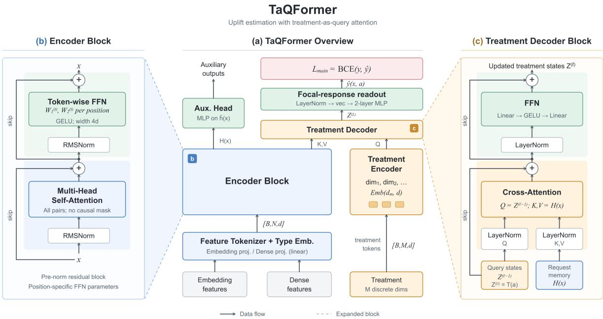
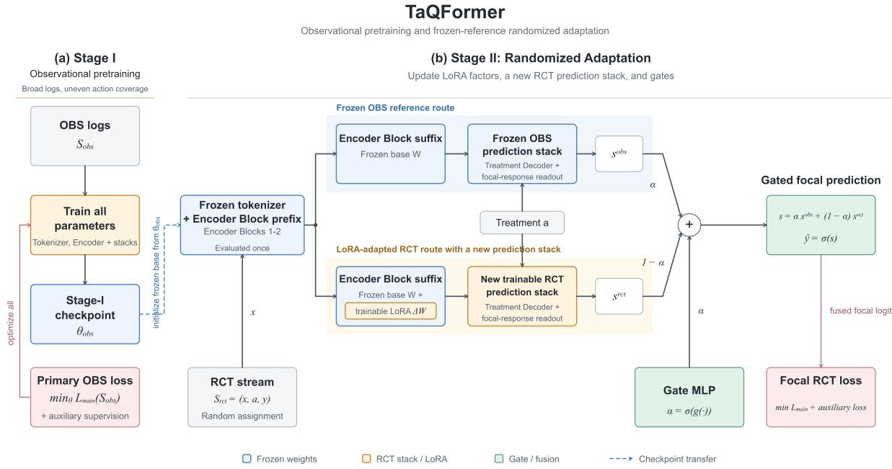
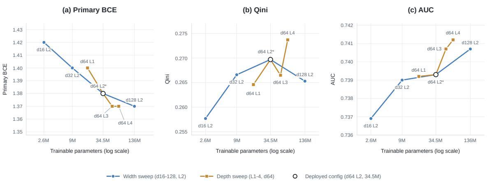

# TaQFormer: A Treatment-as-Query Transformer with Data-Fusion for Multidimensional Treatment Modeling in Coupon Allocation

Jiahong Li Didi Chuxing Beijing, China caleblijiahong@didiglobal.com

Zhifan Jiang   
Didi Chuxing   
Beijing, China   
zhifanjiang@didiglobal.com

Jixing Xu Didi Chuxing Beijing, China stevenxujixing@didiglobal.com

Enyun Yu   
Didi Chuxing   
Beijing, China   
franklinyu@didiglobal.com   
Zeqin Yang   
Didi Chuxing   
Beijing, China   
yangzeqin@didiglobal.com

Jingqi Ma Didi Chuxing Beijing, China irismajingqi@didiglobal.com

Jun Wu   
Didi Chuxing   
Beijing, China   
jackywujun@didiglobal.com

Yu Xiang Didi Chuxing Beijing, China yuxiangxiang@didiglobal.com

Enzheng Hua   
Didi Chuxing   
Beijing, China   
enzohua@didiglobal.com

Fei Wang Didi Chuxing Beijing, China unsungwangfei@didiglobal.com

Jiecheng Guo   
Didi Chuxing   
Beijing, China   
jasonguo@didiglobal.com

## Abstract

We study coupon allocation on an online marketplace ofering multiple service categories. Issuing coupons requires choosing a vector of category-specific discounts, accounting for both their direct effects and cross-category demand shifts. We present TaQFormer, a treatment-as-query Transformer for this multidimensional treatment setting. Each treatment coordinate is represented as a query token, allowing cross-attention to estimate the response to the full treatment vector. To combine large but policy-biased observational logs with a smaller stream of randomized controlled trial data, we use a two-stage pipeline: observational pretraining learns general outcome patterns, followed by LoRA fine-tuning on RCT data with a request-specific fusion gate. We evaluate the resulting system through the checks required for production, including ofline uplift metrics, treatment-parallel serving, latency monitoring, and a 14-day online A/B test. At essentially the same subsidy cost rate, TaQFormer increases business value per user by 1.26% over the production baseline and significantly outperforms both the production baseline and the RCT-only model, while meeting the latency budget. It was subsequently rolled out to all marketplace trafic and has operated at full scale for several months as of October 2026. The deployment illustrates how multidimensional treatment modeling and observational pretraining, combined with adaptation using RCT data, can support efective joint discount decisions in production.

## Keywords

Uplift modeling, joint coupon allocation, treatment-as-query, randomized adaptation, industrial deployment

## 1 Introduction

We study discount coupon allocation on an online marketplace ofering multiple service categories. A coupon’s efect on the focal category can depend on the other discounts ofered alongside it, as well as current prices, service quality, supply, and market conditions. For each request, the marketplace must estimate how alternative discount combinations afect completion in the focal category and decide which combination to ofer. Uplift modeling supports this decision by estimating the incremental efects of alternative treatments, allowing the allocator to improve the business outcome for the focal category under a target subsidy cost rate. We evaluate business value per user, which reflects the aggregate business contribution of completed transactions in the focal category. For confidentiality, we withhold its business-specific calculation and absolute values, and report relative changes between experimental groups. Deploying uplift models for this setting raises three challenges.

Modeling a focal response to structured treatments. Each treatment is an �-dimensional vector of category-level discounts, and the number of combinations grows with the number of categories and discount levels. Treatments that assign the same discount to a given category share part of their structure, even when the remaining discounts difer. A model should exploit this shared structure while estimating how the full treatment vector afects completion in the focal category. Our previous production model, built on PEPNet [2], fuses embeddings of the discount coordinates into one treatment vector before applying gated prediction towers. It does not retain separate coordinate-level queries over the request representation. Treatment-as-query attention provides a starting point [22]; we use it to estimate the focal response under the joint treatment.

Combining observational and RCT data. Observational (OBS) data cover a broad range of requests, but historical policies determine which treatments are assigned, producing uneven coverage of request–action pairs. Randomized controlled trial (RCT) data are available at a smaller scale and provide treatment comparisons within the randomized support. The challenge is to retain useful representations learned from OBS data while adapting treatmentresponse estimates with the smaller RCT dataset [3, 20].

Validating Transformer-based uplift models in production. Transformers have achieved strong results in industrial recommendation systems [8, 23], motivating their use in structured uplift modeling. However, lower predictive loss or greater model capacity alone does not establish better uplift ranking or allocation outcomes. The challenge is to determine whether a Transformer-based model improves uplift quality on held-out RCT data and increases business value at a comparable subsidy cost rate in controlled online experiments, while meeting production serving requirements.

We present TaQFormer, a treatment-as-query Transformer that combines compositional treatment encoding with two-stage OBS– RCT training, and validate its efectiveness in production. Our main contributions are threefold:

(1) Compositional queries for joint discount responses. Each discount coordinate has its own treatment token, allowing treatments with the same discount for a given category to share embedding parameters. A treatment decoder uses all treatment tokens to query the request representation. A nonlinear readout then combines the decoded tokens to predict completion in the focal category under the full treatment vector. The resulting scalar response estimate for each candidate action feeds into the subsidy allocator.

(2) Randomized adaptation with a frozen observational reference. We preserve a frozen OBS-pretrained branch and adapt a second branch using low-rank adaptation (LoRA) and new predic tion heads. A gate conditioned on the request and candidate action combines the two branches’ logits under RCT supervision.

(3) Production validation and business impact. We validate TaQFormer as a Transformer-based uplift model through ofline uplift evaluation, production load tests, and a 14-day online A/B test. At essentially the same subsidy cost rate, TaQFormer increases business value per user by 1.26% over the production baseline and also significantly outperforms the RCT-only model (both $\textstyle p < 0 . 0 5 )$ The deployed configuration scores all 33 feasible joint treatments with a P99 latency of 21 ms in a 500 QPS load test. The system was subsequently rolled out to all marketplace trafic.

## 2 Related Work

Uplift modeling with structured treatments. Uplift modeling estimates how an intervention changes an individual’s outcome relative to a control condition. Early methods mainly use randomized control groups and focus on a single binary treatment [9, 17]. Later studies consider multiple treatments, more general outcomes, and treatment-specific costs [16, 24, 25]. Neural HTE methods use treatment-specific outcome heads, smooth dose–response functions, or orthogonal objectives [4, 15, 18]. TransTEE supports discrete, continuous, and structured treatments, including multiple treatments acting simultaneously. It models treatment interactions with self-attention and uses treatment representations as queries over covariates [22]. EFIN encodes treatment features, uses treatmentconditioned attention, and adds estimated uplift to a baseline response [14]. TaQFormer combines compositional discount tokens with a nonlinear readout of the decoded treatment representations to estimate the focal response. It also combines observational pretraining with randomized adaptation while preserving the same request format at serving time.

Combining randomized and observational data. Treatment assignment by historical policies can confound unadjusted outcome comparisons. Conditional estimation requires suficient adjustment and overlap. RCT data provide randomized comparisons within the trial population and action support. Existing methods combine these sources through joint estimation, adaptive weighting, or representation transfer, addressing data eficiency and bias under their respective assumptions [3, 5, 11, 19, 20]. Our focus is representation transfer and randomized adaptation for structured discount decisions: OBS pretraining supplies predictive information, while RCT supervision adapts predictions under randomized assignment, reducing reliance on the OBS unconfoundedness assumption stated in Section 3.

Transformers, model capacity, and eficient industrial inference. Transformers have become a common tool for modeling interactions among tabular features. TabTransformer and FT-Transformer use self-attention to learn contextual feature representations [7, 12]. Industrial recommender systems apply related architectures to larger and more heterogeneous feature spaces. HiFormer models heterogeneous feature interactions, while Wukong studies how recommendation quality changes with model scale [8, 21]. Recent systems further combine feature interaction with sequence modeling or replace full attention with more eficient token-mixing blocks [1, 10, 13, 23, 26]. These studies show that model capacity and eficient inference are important design considerations for industrial prediction systems. However, most focus on ranking or response prediction rather than counterfactual estimation. Our capacity study instead examines how width and depth afect uplift quality under a fixed training budget, alongside the serving requirement to score all feasible treatment vectors.

## 3 Problem Formulation

## 3.1 Coupled multi-treatment setting

On the online marketplace, we allocate discount coupons for each request across � substitutable service categories ofered at the same time. The marketplace issues discount coupons whose categoryspecific discount depths form the selected treatment vector. Let $\boldsymbol { \mathcal { M } } = \{ 1 , . . . , M \}$ index these categories in decreasing order of base price. For each request �, $X _ { i } ~ = ~ x _ { i }$ is the context, which contains the features available online at decision time, and $A _ { i } \in { \mathcal { A } }$ is the treatment. Each candidate treatment is an �-dimensional vector of discount depths:

$$
a = ( a _ { 1 } , \ldots , a _ { M } ) \in \prod _ { m \in \mathcal { M } } \mathcal { D } _ { m } ,\tag{1}
$$

where $a _ { m }$ is the discount depth for category �, and a larger value means a deeper discount. All discount depths follow the same fixedstep grid:

$$
\mathcal { D } = \{ d _ { k } = d _ { \operatorname* { m i n } } + ( k - 1 ) \Delta : k = 1 , . . . , K \} , \qquad \Delta > 0 .\tag{2}
$$

Each category has its own allowed range $\mathcal { D } _ { m } \subseteq \mathcal { D }$ , but all categories use the same step size. A business rule requires every higherpriced category to receive a strictly smaller discount than every lower-priced category. This rule defines the feasible action set:

$$
\mathcal { R } = \left\{ a \in \prod _ { m \in \mathcal { M } } \mathcal { D } _ { m } : a _ { m + 1 } - a _ { m } \geq \Delta , \ m = 1 , \ldots , M - 1 \right\} .\tag{3}
$$

Therefore, every feasible action satisfies $a _ { 1 } < \cdots < a _ { M }$ . The reference action $a _ { 0 }$ is the shallowest feasible action. Although this constraint removes many combinations from the full product grid, |A| still grows combinatorially with � and the number of available discount depths. Throughout this paper, a treatment refers to the full structured intervention with � coordinates, while an action refers to one feasible realization $a \in \mathcal { A }$

## 3.2 Causal target and identification

We model exposure-to-completion conversion in a single focal service category. For each action $a \in { \mathcal { A } } ,$ , let $Y ( a ) \in \{ 0 , 1 \}$ denote the potential completion outcome for an eligible exposure: one if it leads to a completed transaction in the focal category within the attribution window, and zero otherwise. All � category-specific discounts remain part of the treatment vector and can afect this response. Relative to a reference action $^ { a _ { 0 } , }$ , the conditional average treatment efect is $\tau ( x ; a , a _ { 0 } ) \ = \ \mathbb { E } [ Y ( a ) - Y ( a _ { 0 } ) \ | \ X \ = \ x ]$ . Let $\mu ( x , a ) \ = \ \mathbb { E } [ Y ( a ) \ | \ X = \ x ]$ denote the response surface. Then $\tau ( x ; a , a _ { 0 } ) = \mu ( x , a ) - \mu ( x , a _ { 0 } )$ , and $\hat { y } ( x , a )$ estimates this exposureto-completion probability.

Identification from the OBS training data relies on the following causal assumptions. First, we assume consistency: if a request is assigned action $A = a ,$ its observed outcome equals $Y ( a )$ . Second, we assume no interference: one request’s outcome does not depend on the actions assigned to other requests. Third, we assume conditional exchangeability (unconfoundedness), $\{ Y ( a ) : a \in { \mathcal { A } } \} { \mathrm { ~ } } \bot A \mid X . { \mathrm { F i } } { \mathrm { . } }$ nally, we assume positivity: for every covariate value � in the OBS population and every action � $\in { \mathcal { A } } , \operatorname* { P r } ( A = a \mid X = x ) > 0 .$

Under these assumptions, the response surface is identified as $\mu ( x , a ) = \operatorname { \mathbb { E } } [ Y \mid X = x , A = a ]$ . Therefore, $\tau ( x ; a , a _ { 0 } ) = \mathbb { E } [ Y \mid X =$ $x , A = a ] - \mathbb { E } [ Y \mid X = x , A = a _ { 0 } ]$ . RCT fine-tuning uses randomized supervision within the trial support to adapt response estimates and reduce reliance on the OBS unconfoundedness assumption.

## 3.3 Decision formulation

For request � under action �, the allocator combines the predicted focal-category exposure-to-completion probability $\hat { y } ( x _ { i } , a )$ with the expected business contribution conditional on completion to estimate business value $\hat { r } _ { i a }$ . The business-specific conversion-tovalue rule is shared by all online experimental groups and is omitted for confidentiality.

Let $c _ { i a }$ denote the subsidy cost per unit of business value for request � under action �. The expected subsidy spend is then $c _ { i a } \hat { r } _ { i a } .$ Given a target subsidy cost rate $\rho ,$ the allocator selects one action

for each request by solving

$$
\operatorname* { m a x } _ { b \in \mathcal { B } } \quad \sum _ { i \in \mathcal { I } } \sum _ { a \in \mathcal { A } } b _ { i a } \hat { r } _ { i a }\tag{4}
$$

$$
\mathrm { s . t . } \sum _ { i \in J } \sum _ { a \in \mathcal { A } } b _ { i a } ( c _ { i a } - \rho ) \hat { r } _ { i a } \leq 0 ,\tag{5}
$$

where $\boldsymbol { \mathcal { I } } = \left\{ 1 , \ldots , n \right\}$ and B is the set of binary assignment matrices satisfying $\begin{array} { r } { \sum _ { a \in \mathcal { A } } b _ { i a } = 1 } \end{array}$ for every request �. The constraint limits the aggregate expected subsidy cost rate to at most $\rho .$

For a fixed nonnegative multiplier �, the Lagrangian relaxation separates across requests. We use the resulting score in the online decision rule

$$
a _ { i } ^ { \star } = \arg \operatorname* { m a x } _ { \alpha \in \mathcal { A } } \hat { r } _ { i \alpha } \big ( 1 - \lambda ( c _ { i \alpha } - \rho ) \big ) .\tag{6}
$$

Ofline, � is calibrated on logged trafic so that the realized subsidy cost rate is close to $\rho .$ Online, the model scores every action in A, and Eq. (6) selects the final treatment. Thus, the action-response vector $\{ \hat { y } ( x _ { i } , a ) : a \in \mathcal { A } \}$ serves as the interface between the model and the downstream allocator.

## 4 The TaQFormer Model

## 4.1 Architecture

TaQFormer uses two paths for response estimation: a treatmentindependent request path and a treatment-dependent treatment path (Figure 1). For a serving context �, a feature tokenizer converts the input into � semantic tokens, and a stack ofEncoder Blocks (the Transformer backbone) encodes them into a request representation $H ( \boldsymbol { x } ) \in \mathbb { R } ^ { N \times d }$ . For a feasible treatment �, each discount dimension is represented by a treatment token, giving $\boldsymbol { T } ( \boldsymbol { a } ) \in \mathbb { R } ^ { M \times d }$ . These treatment tokens act as queries and use cross-attention to retrieve the relevant information from $H ( x )$ . A nonlinear readout combines the decoded treatment representations to predict the scalar completion probability $\hat { y } ( x , a )$ for the focal category. This scalar output estimates the probability of the primary binary label, which records whether an eligible exposure leads to completion under the assigned action. At serving time, Section 4.3 computes $H ( x )$ once and reuses it to score every feasible action $a \in { \mathcal { A } }$ , producing an action-response vector for each request.

Feature tokenizer and encoder. The tokenizer maps the servingtime context of Section 3 into a token sequence $\boldsymbol { X } ( \boldsymbol { x } ) \in \mathbb { R } ^ { N \times d }$ : each scalar feature, categorical embedding, and pretrained structured vector receives its own token, with a shared projection within each input type and an added type embedding. Token positions have a fixed feature ordering. The tokens pass through the Encoder Block stack, whose pre-RMSNorm transformer blocks each interleave multi-head self-attention with a feed-forward layer (Figure 1b). The single departure from the vanilla block is that the feed-forward layers are token-wise: each position owns private FFN parameters. Every token here is a fixed semantic field—a named feature field, not an interchangeable element of a sequence—so a shared FFN would impose one transformation on heterogeneous semantics, whereas per-token parameters give each field its own channel-mixing map, as in [23, 26]. The output is the action-independent request memory �(�), which supplies keys and values to the treatment decoder; a pooled summary ¯ℎ(�) feeds an auxiliary head.

  
Figure 1: TaQFormer architecture: (a) focal-category response prediction with a treatment decoder followed by a separate focal-response readout, and an auxiliary branch; (b) pre-norm self-attention with token-wise FFNs; (c) a Treatment Decoder Block in which decoded treatment states query request memory.

Compositional treatment encoding. TaQFormer retains a separate token for each treatment coordinate through the attention decoder, before combining the decoded coordinates in the focal-response readout. This difers from the production baseline, which fuses coordinate embeddings into one vector before gated prediction. For coordinate �, an embedding map $e _ { j } : \mathcal { D } _ { j }  \mathbb { R } ^ { d }$ converts the discount value $a _ { j }$ into a vector. The treatment encoder then forms

$$
\boldsymbol { T } ( \boldsymbol { a } ) = [ e _ { 1 } ( a _ { 1 } ) , \dots , e _ { M } ( a _ { M } ) ] \in \mathbb { R } ^ { M \times d } .\tag{7}
$$

This means that the embedding $e _ { j } ( d )$ is shared by every feasible treatment whose �th coordinate has value �, allowing related treatments to share information. At the same time, each coordinate has its own embedding table, so the model still knows which service category each discount belongs to.

Treatment-aware cross-attention. The treatment decoder stacks � pre-norm Treatment Decoder Blocks, each comprising a crossattention sublayer followed by a feed-forward sublayer (Figure 1c). It starts from $\dot { Z ^ { ( 0 ) } } = T ( a )$ . At block ℓ, the decoded treatment states $Z ^ { ( \ell - 1 ) }$ supply the queries, while the request memory �(�) remains the keys and values. The cross-attention (CA) sublayer first produces a residual update,

$$
\widetilde { Z } ^ { ( \ell ) } = Z ^ { ( \ell - 1 ) } + { \mathrm { C A } } ^ { ( \ell ) } \bigl ( \mathrm { L a y e r N o r m } ( Z ^ { ( \ell - 1 ) } ) , \mathrm { L a y e r N o r m } ( H ( x ) ) \bigr ) .\tag{8}
$$

For head ℎ, with $Q _ { h } ^ { ( \ell ) }$ and $K _ { h } ^ { ( \ell ) }$ the projected normalized treatment and feature states, the coordinate-to-feature attention weights are

$$
P _ { h } ^ { ( \ell ) } ( x , a ) = \mathrm { s o f t m a x } \left( \frac { Q _ { h } ^ { ( \ell ) } \bigl ( K _ { h } ^ { ( \ell ) } \bigr ) ^ { \top } } { \sqrt { d _ { h } } } \right) \in \mathbb { R } ^ { M \times N } .\tag{9}
$$

Each row of $P _ { h } ^ { ( \ell ) }$ corresponds to one treatment coordinate and retrieves the request features most relevant to that coordinate. Changing a discount can therefore change which market signals the corresponding treatment state attends to. The block then applies a second pre-norm residual update using its feed-forward sublayer,

$$
Z ^ { ( \ell ) } = \widetilde { Z } ^ { ( \ell ) } + \mathrm { F F N } ^ { ( \ell ) } \big ( \mathrm { L a y e r N o r m } ( \widetilde { Z } ^ { ( \ell ) } ) \big ) .\tag{10}
$$

After � blocks and a final LayerNorm, a separate two-layer GELU MLP jointly reads all � decoded coordinates and produces the focal response,

$$
\begin{array} { r l } & { s ( x , a ) = f \bigl ( \mathrm { v e c } ( \mathrm { L a y e r N o r m } ( Z ^ { ( L ) } ) ) \bigr ) , } \\ & { \hat { y } ( x , a ) = \sigma \bigl ( s ( x , a ) \bigr ) . } \end{array}\tag{11}
$$

The joint readout � combines the summaries from all � treatment coordinates. As a result, the focal response depends on both its own category discount and the other discounts in the treatment vector. The decoder is also structurally aligned with the encoder. It operates on the full $N \times d$ request memory, uses the same hidden size and a pre-norm residual structure (RMSNorm in the encoder and LayerNorm in the decoder), and does not first compress the request into a single pooled vector. The Encoder Block therefore builds a treatment-independent representation of the request, while the Treatment Decoder Block adds treatment-specific interactions in an explicit and compositional way.

## 4.2 Two-stage training: observational pretraining and randomized adaptation

Existing data-fusion methods learn from OBS and RCT data through representation transfer or prediction correction [3, 6, 11, 20]. With limited RCT data, our design aims to preserve a stable OBS prediction reference, limit the number of adapted parameters, and share computation at serving time. Throughout this section, for simplicity, a prediction stack comprises a treatment encoder, Treatment Decoder Blocks, a focal-response readout, and an auxiliary head. TaQFormer therefore retains a frozen OBS reference route while adapting an RCT route with LoRA and a newly initialized prediction stack (Figure 2). The comparison with full fine-tuning is evaluated empirically in Section 5.5.

  
Figure 2: TaQFormer training: (a) OBS pretraining of all modules; (b) RCT adaptation with a frozen OBS reference, a shared frozen Encoder Block prefix, and a LoRA-adapted sufix. Only LoRA factors, a newly initialized RCT prediction stack (including its treatment encoder), and gates are updated. Gate inputs use stop-gradient; focal logits are fused, while the direct auxiliary output comes from the RCT stack.

Stage I: observational pretraining. The full model—the tokenizer, Encoder Block stack, and prediction stacks—is trained for one epoch on OBS data using the primary binary cross-entropy objective of Eq. (15) together with auxiliary supervision. This stage learns the request representation and a treatment-aware decoder under the logging distribution. Uneven coverage, finite samples, and model misspecification can leave errors in the estimated response surface, motivating adaptation with randomized supervision.

Stage II: parameter-eficient randomizedfine-tune. Stage II retains the complete OBS-trained model as an exact frozen reference route and constructs a distinct RCT route. The frozen tokenizer and first $L - L _ { \mathrm { a } }$ Encoder Blocks form a shared prefix that is evaluated once. The final $L _ { \mathrm { a } }$ Encoder Blocks are then evaluated twice: once with their original frozen weights to produce $H ^ { \mathrm { o b s } } ( x )$ , and once with LoRA updates to produce $H ^ { \mathrm { r c t } } ( x )$ . Trainable LoRA factors are attached to the attention projections and token-wise FFN factors in this sufix; all base Encoder Block weights remain frozen. This sufix-only design both limits the number of trainable parameters and avoids duplicating the early Encoder Block computation. For a frozen weight matrix $W ,$ the adapted route uses

$$
\begin{array} { r } { W ^ { \prime } = W + ( \eta / r ) A B , } \end{array}\tag{12}
$$

where � and � are trainable rank-� matrices and � is a scaling constant. The frozen OBS prediction stack is copied from Stage I and maps $H ^ { \mathrm { o b s } } ( x )$ and frozen treatment tokens $T ^ { \mathrm { o b s } } ( a )$ to the reference focal logit $s ^ { \mathrm { o b s } } ( x , a )$ without computing gradients. In contrast, the newly initialized and trainable RCT prediction stack owns independent treatment tokens $T ^ { \mathrm { r c t } } ( a )$ and maps them with $H ^ { \mathrm { r c t } } ( x )$ to $s ^ { \mathrm { r c t } } ( x , a )$

Instance-wise gated fusion. The paths’ diferent training distributions and parameter constraints can yield diferent prediction errors across request–action pairs. Our gate parameterizes an instancewise mixture of frozen and adapted focal logits, optimized for RCT outcome prediction. Its weights are not calibrated measures of causal reliability. A small MLP � receives stop-gradient summaries of the adapted memory, the RCT treatment tokens, the two branch logits, and their absolute diference:

$$
\alpha ( x , a ) = \sigma \Bigl ( g \bigl ( s \mathrm { g } \bigl [ \bar { H } ^ { \mathrm { r e t } } ( x ) , T ^ { \mathrm { r e t } } ( a ) , s ^ { \mathrm { o b s } } , s ^ { \mathrm { r e t } } , | s ^ { \mathrm { o b s } } - s ^ { \mathrm { r e t } } | \bigr ] \bigr ) \Bigr ) ,\tag{13}
$$

where $\bar { H } ^ { \mathrm { r c t } } ( x )$ concatenates the mean- and max-pooled tokens of $H ^ { \mathrm { r c t } } ( x )$ . The final logit is the gated average

$$
\begin{array} { r l } & { s ( x , a ) = \alpha ( x , a ) s ^ { \mathrm { o b s } } ( x , a ) + \left( 1 - \alpha ( x , a ) \right) s ^ { \mathrm { r e t } } ( x , a ) , } \\ & { \hat { y } ( x , a ) = \sigma \big ( s ( x , a ) \big ) . } \end{array}\tag{14}
$$

During Stage II, we optimize the same primary objective for one epoch on RCT data using the fused focal logit. We retain auxiliary supervision through the direct auxiliary output of the RCT prediction stack, which is not passed through the focal gate. The trainable parameters are therefore the LoRA factors, the RCT pre diction stack, and the gates. The stop-gradient prevents the gate inputs from changing the representations indirectly, but gradients still reach $s ^ { \mathrm { r c t } }$ through its explicit mixture weight in Eq. (14). The RCT route and gate remain jointly optimized through the fused prediction; stop-gradient blocks only the paths through the gate inputs.

## 4.3 Treatment-parallel serving

TaQFormer has an asymmetric train–serve interface. During training, each sample contains only the action assigned by the historical or randomized policy, so the model processes one (�, �) pair. At serving time, however, the allocator in Eq. (4) needs predictions for all feasible actions, $\{ \hat { y } ( x , a ) : a \in \mathcal { A } \}$ , under a strict latency budget.

Our architecture separates the treatment-independent encoder from the treatment-dependent decoder. For a request batch � of size �, the encoder runs once and produces $H ( X ) ^ { ^ { - } } \in \mathbb { R } ^ { B \times N \times d }$ . The feasible treatment table is stored as a constant tensor and encoded as $T ( \mathcal { A } ) \in \mathbb { R } ^ { | \mathcal { A } | \times M \times d }$ . The treatment dimension is introduced only in the decoder. We flatten the resulting �|A| request–treatment pairs into one decoder batch and reshape the outputs into a response matrix of size $\boldsymbol { B } \times | \mathcal { A } |$ . This reuses the context representation across all actions and reduces the per-request computation from $| \mathcal { A } | ( C _ { \mathrm { e n c } } + C _ { \mathrm { d e c } } )$ to $C _ { \mathrm { e n c } } + | \mathcal { A } | C _ { \mathrm { d e c } }$

All actions are scored in one accelerator-friendly pass using static tensor operations, without per-action loops or data-dependent control flow. The two-stage model shares most of its computation as well. The tokenizer and the first two Encoder Blocks form a common prefix, while only the final two blocks are evaluated separately along the frozen OBS path and the LoRA-adapted RCT path. The resulting memories, $H ^ { \mathrm { o b s } } ( X )$ and $H ^ { \mathrm { r c t } } ( X )$ , are each computed once and then reused for all actions. Thus, the two-stage model duplicates only part of the encoder rather than running the full encoder for every action.

## 5 Experiments

We evaluate TaQFormer through ofline experiments and online production tests, organized around six research questions. RQ1: Overall efectiveness. Does TaQFormer outperform our production baseline and closely related treatment-aware uplift models? RQ2: Architectural choices. Which components matter, and does the treatment-as-query decoder work with alternative backbones? RQ3: Capacity selection. How do model width and depth afect predictive and uplift quality? RQ4: Two-stage training. Does OBS pre-training followed by RCT adaptation help, and do the fusion gate and LoRA adaptation contribute? RQ5: Serving eficiency. How much does treatment-parallel inference reduce serving latency? RQ6: Online impact. How does TaQFormer perform in an online A/B test under production latency constraints?

## 5.1 Experimental Setup

We use ofline experiments to answer RQ1–RQ4, a production load test to answer RQ5, and an online A/B test to answer RQ6. For the architecture and capacity studies, all models are trained on the same RCT training set used for Stage II fine-tuning. Section 5.5 separately compares OBS-only, RCT-only, mixed-data, and sequential training strategies, together with the proposed two-stage pipeline. All single-stage runs use one training epoch, and each stage of the two-stage pipeline uses one epoch on its corresponding dataset. The industrial runs share the data split, seed, batch size, and GPU class (one NVIDIA RTX 6000D), and both industrial ofline studies use the same held-out RCT set. Method-specific learning-rate schedules and auxiliary losses difer.

Metrics. For the industrial ofline tables, we report Qini, AUC, and PCOC for the focal service category. For each of the $| \mathcal { A } | - 1 = 3 2$ non-reference actions, Qini ranks requests assigned to that action and to the reference action $a _ { 0 }$ by predicted uplift and computes the normalized Qini coeficient. We report the average over all 32 actions. AUC is the ROC AUC between the observed completion indicator and the predicted completion probability under the assigned action. PCOC is the ratio of total predicted probability to total observed outcomes; values close to one indicate good aggregate calibration. Calibration is important because the downstream allocator uses absolute response predictions to control subsidy spending.

Implementation details. The joint treatment spans $M = 2$ service categories and $| \mathcal { R } | = 3 3$ feasible joint treatments. Each request is encoded once, after which the focal-response decoder scores all 33 candidate treatments. The encoder has dimension $d = 6 4$ four Transformer blocks, four attention heads, and feed-forward width 4�. The treatment decoder has $L = 2$ blocks. In Figure 3, the experiment label L2 refers to this configuration: four Transformer blocks and two blocks per treatment decoder. In Stage II, $L _ { \mathrm { a } } = 2$ adapts only the last two Transformer blocks; the first two remain shared. The production LoRA rank $r ~ = ~ 1 6$ and scaling $\eta \ : = \ : 1 6$ Stage I uses tens of millions of OBS records, while the RCT stream comprises millions of records. These data scales reflect the deployed data regime rather than a study of data-volume sensitivity.

The primary label � is one if an eligible exposure leads to a completed transaction in the focal category within the attribution window, and zero otherwise. The model estimates the exposure-tocompletion probability using a single binary cross-entropy (BCE) objective:

$$
\mathcal { L } _ { \mathrm { m a i n } } ( S ) = \sum _ { ( x , a , y ) } \ell _ { \mathrm { B C E } } ( y , \hat { y } ( x , a ) ) ,\tag{15}
$$

Auxiliary tasks are retained: their heads either use the decoder template for request-level labels or read stop-gradient copies of the request and treatment representations. Auxiliary supervision is used alongside the primary objective, with missing auxiliary labels masked. Only the focal completion prediction is passed to the allocator. We do not attribute the reported gains to individual auxiliary tasks because no head-level ablation is performed.

Table 1: Single-stage comparison after one epoch on the randomized stream. Runs share data, seed, batch size, and GPU class and use the same held-out RCT week; learning-rate schedules and auxiliary losses difer. Higher is better for Qini and AUC; PCOC is best at 1.0. Bold marks the best value per column; alternative-encoder rows probe encoder choice and are excluded from bolding.
<table><tr><td>Group</td><td>Model</td><td>Qini</td><td>AUC</td><td>PCOC</td></tr><tr><td>Baseline</td><td>PEPNet</td><td>0.1612</td><td>0.6776</td><td>1.3737</td></tr><tr><td>External External</td><td>EFIN (adapted) TransTEE (adapted)</td><td>0.2129 0.2612</td><td>0.6938 0.7362</td><td>0.9802 1.0223</td></tr><tr><td>Ablation</td><td>flat MLP + Treatment</td><td>0.2592</td><td>0.7184</td><td>1.1395</td></tr><tr><td>Ablation</td><td>Decoder Encoder Block + gated</td><td>0.2536</td><td>0.7391</td><td>0.9446</td></tr><tr><td></td><td>towers</td><td></td><td></td><td></td></tr><tr><td>Encoder</td><td>Wukong + Treatment Decoder</td><td>0.2391</td><td>0.7051</td><td>0.9608</td></tr><tr><td>Encoder</td><td>UniMixer + Treatment Decoder</td><td>0.2700</td><td>0.7385</td><td>0.9740</td></tr><tr><td>Ours</td><td>Encoder Block + Treatment Decoder</td><td>0.2697</td><td>0.7393 1.0012</td><td></td></tr></table>

## 5.2 RQ1: Overall efectiveness

To answer RQ1, we compare TaQFormer with the production baseline, PEPNet [2], and two related treatment-aware models, EFIN [14] and TransTEE [22]. These industrial variants use the same features, factual labels, RCT data, and held-out metrics, and are trained directly on RCT data. Their complete training objectives difer: EFIN adds natural-response and intervention losses, while the production PEPNet retains propensity and pairwise auxiliary terms. PEPNet uses a shared MLP, fuses coordinate embeddings into one treatment vector, and applies layer-wise gates to task-specific towers. For EFIN, we represent treatment dimensions as tokens and replace its single-layer additive attention with multi-head attention. For TransTEE, we retain treatment-token cross-attention, add taskspecific heads, and remove propensity regularization because the data are randomized. TaQFormer achieves the best point estimates on all three metrics among PEPNet, EFIN, and TransTEE. Compared with PEPNet, it raises Qini from 0.1612 to 0.2697 and AUC from 0.6776 to 0.7393, while reducing PCOC from 1.3737 to 1.0012. EFIN improves over PEPNet but remains substantially weaker, whereas TransTEE performs nearly as well as TaQFormer but is slightly worse on every metric.

## 5.3 RQ2: Architectural choices

To answer RQ2, we conduct component ablations and encoder substitutions. Replacing the Encoder Block with a flat MLP lowers Qini and AUC and worsens aggregate calibration (Qini: 0.2697→0.2592; AUC: 0.7393→0.7184; PCOC: 1.0012→1.1395). Replacing the Treatment Decoder Block with PEPNet-style fused-treatment gated towers leaves AUC nearly unchanged but reduces Qini to 0.2536 and changes PCOC to 0.9446. These bundled variants are consistent with a contribution from each block. However, the gated-tower variant also retains the production auxiliary losses, so its comparison does not isolate the decoder architecture alone. We also replace our encoder with Wukong and UniMixer while keeping the decoder fixed. The alternative encoders use the same depth and hidden width, but their parameter counts are not matched. The decoder remains efective with both, showing that Treatment-as-Query is encoder-agnostic. Our encoder clearly outperforms Wukong and performs comparably to UniMixer, with slightly better AUC and aggregate calibration. Overall, the results support both the value of the proposed blocks and the portability of the Treatment-as-Query decoder.

## 5.4 RQ3: Capacity selection

To answer RQ3, we compare seven models from 2.6M to 136M parameters, varying width and depth around the deployed 34.5Mparameter configuration (Figure 3). All configurations use one seed and one epoch of RCT training. Validation loss is the primary BCE on the focal outcome.

Primary BCE generally decreased or plateaued as capacity increased, while Qini did not consistently improve. Along the depth sweep, AUC rose from 0.7392 at setting L1 to 0.7412 at L4, and Qini reached 0.2737 at L4, but dipped to 0.2665 at L3. Along the width sweep, widening beyond $d _ { \mathrm { m o d e l } } = 6 4$ kept lowering primary BCE without improving uplift ranking: the 136M-parameter width-128 model reached an AUC of 0.7407 but a Qini of only 0.2653, below the 0.2666 of the 9M-parameter width-32 model, at roughly the wall-clock cost of the 51.5M-parameter L3 model.

These results inform capacity selection within the tested budget: lower primary BCE alone is insuficient to select the model with the best uplift ranking. We retain the deployed configuration as a practical capacity and serving-cost choice.

## 5.5 RQ4: Two-stage training

To answer RQ4, Table 2 compares training strategies on the same held-out RCT set. The single-branch baselines retain the same response-model architecture and use OBS-only training, RCT-only training, jointly shufled OBS and RCT data, or OBS pretraining followed by full-parameter fine-tuning of all Stage-I modules on RCT data. The latter is a conventional sequential baseline without a frozen reference branch or fusion gate.

Shufling OBS and RCT data improves all three metrics over OBS-only training, and sequential full fine-tuning improves them further. However, the sequential baseline still has lower Qini than RCT-only training (0.2673 vs. 0.2697), despite its higher AUC (0.7421 vs. 0.7393). Thus, adding OBS data does not automatically improve uplift ranking in these runs. The proposed gated LoRA pipeline achieves the highest Qini and AUC among these training strategies, improving both by 0.0033 over conventional sequential full finetuning, while bringing PCOC closer to one (1.0114→1.0027). RCTonly training retains the PCOC closest to one (1.0012).

Within the frozen-reference variants, Encoder full fine-tuning + Gate replaces LoRA in the RCT Encoder Block sufix with fullparameter fine-tuning of that sufix. LoRA + direct residual keeps the LoRA-adapted RCT route but replaces gated fusion with �(�, �) = $s ^ { \mathrm { o b s } } ( x , a ) + s ^ { \mathrm { r c t } } ( x , a )$ . Thus, gated fusion improves Qini and AUC over direct residual fusion with LoRA fixed. With the gate fixed, LoRA has better point estimates than encoder full fine-tuning on all three metrics while updating fewer parameters. These results favor the selected configuration, but multi-seed uncertainty estimates are unavailable. The comparison with conventional sequential finetuning evaluates the complete adaptation design; it does not isolate an individual component.

  
Figure 3: Single-stage TaQFormer capacity comparison after one RCT epoch. Width: $d _ { \mathrm { m o d e l } } \in \{ 1 6 , 3 2 , 6 4 , 1 2 8 \}$ at setting L2; depth settings: L1–L4 use 2, 4, 6, and 8 Encoder Blocks and 1, 2, 3, and 4 Treatment Decoder Blocks, respectively, at $d _ { \mathrm { m o d e l } } = 6 4 .$ Open marker: deployed L2 configuration (four backbone blocks, two blocks per treatment decoder; 34.5M parameters). The validation loss is the primary BCE. Single seed, one epoch.

Table 2: Training-strategy comparison on the same held-out RCT week as Table 1. Single-branch rows share the responsemodel architecture; the lower group retains a frozen OBS reference. In the lower group, encoder full fine-tuning updates the RCT Encoder Block sufix directly, whereas direct residual uses $s = s ^ { \mathrm { o b s } } + s ^ { \mathrm { r c t } }$ . Higher is better for Qini and AUC; PCOC is best at 1.0. Bold marks the best value in each column across all rows.
<table><tr><td>Training variant</td><td>Qini</td><td>AUC</td><td>PCOC</td></tr><tr><td>Single-branch training</td><td></td><td></td><td></td></tr><tr><td>OBS only</td><td>0.2548</td><td>0.7382</td><td>1.0315</td></tr><tr><td>RCT only</td><td>0.2697</td><td>0.7393</td><td>1.0012</td></tr><tr><td>OBS + RCT (shuffled)</td><td>0.2665</td><td>0.7398</td><td>1.0136</td></tr><tr><td>OBS → RCT (full fine-tuning)</td><td>0.2673</td><td>0.7421</td><td>1.0114</td></tr><tr><td>Frozen-reference adaptation</td><td></td><td></td><td></td></tr><tr><td>Encoder full fine-tuning + Gate</td><td>0.2700</td><td>0.7416</td><td>1.0100</td></tr><tr><td>LoRA + direct residual</td><td>0.2686</td><td>0.7443</td><td>0.9923</td></tr><tr><td>LoRA + Gate (TaQFormer)</td><td>0.2706</td><td>0.7454</td><td>1.0027</td></tr></table>

## 5.6 RQ5: Serving eficiency

To answer RQ5, we compare the proposed treatment-parallel implementation with the original implementation, which reruns the full encoder for every action. The serving configuration uses NVIDIA RTX 6000D hardware and a batch size of 256. We conduct a 10- minute load test at 500 QPS and report P99 serving latency. For the two-stage model, treatment-parallel serving reduces P99 latency from 34 ms to 21 ms, a 38% reduction. The same optimization reduces P99 latency for the one-stage RCT model from 29 ms to 18 ms. These results show that reusing the encoded request context and evaluating all treatments in a single static graph substantially reduces serving latency while preserving the model used during training.

## 5.7 RQ6: Online impact

To answer RQ6, we ran a 14-day A/B test on live trafic. Each user was placed in one group for the whole test, based on a hash of the user ID, so the same user always saw the same model. The control group kept the production PEPNet model; one treatment group used the single-stage model trained only on RCT data, and the other used the two-stage OBS–RCT model. Each group received 5% of trafic, with sample sizes in the millions for each group. All three groups shared the same allocator and subsidy-rate target, and their realized cost rates were almost identical: 20.43%, 20.45%, and 20.42%.

At essentially the same subsidy cost rate, business value per user rose by 1.08% under the single-stage model and by 1.26% under the two-stage model, both relative to the PEPNet control (Table 3). The two-stage model significantly outperforms both the production baseline and the RCT-only model. All three pairwise comparisons are significant under CUPED-adjusted two-sample �-tests $( p < 0 . 0 5 )$ Relative to RCT-only, the two-stage model delivers approximately 0.178% additional business value per user, calculated from the reported relative changes.

The two-stage model was then rolled out to all trafic and has operated at full scale for several months as of October 2026. This deployment duration is separate from the 14-day A/B test. For confidentiality, the application setting and the business-specific calculation are described in anonymized terms, and absolute values are withheld; relative comparisons and significance results are unchanged.

Table 3: Online A/B results. Business value per user is indexed to PEPNet = 100. Superscripts ∗ and † indicate significant gains over PEPNet and RCT-only, respectively $(  p < 0 . 0 5 )$ ).
<table><tr><td>Model</td><td>Business value index</td><td>Subsidy rate</td></tr><tr><td>PEPNet</td><td>100.00</td><td>20.43%</td></tr><tr><td>RCT-only</td><td> $1 0 1 . 0 8 ^ { * }$ </td><td>20.45%</td></tr><tr><td>Two-stage (TaQFormer)</td><td> $1 0 1 . 2 6 ^ { * \dagger }$ </td><td>20.42%</td></tr></table>

## 6 Conclusion

We presented TaQFormer, a treatment-as-query Transformer for joint discount coupon allocation across service categories on an online marketplace. It combines compositional treatment queries and a focal-response readout with two-stage OBS–RCT training that preserves a frozen observational reference. Ofline evaluation shows improved uplift ranking and aggregate calibration for the focal category over the production baseline, while the complete two-stage pipeline further improves response prediction and online performance over RCT-only training. In a 14-day online A/B test, TaQFormer increased business value per user by 1.26% over the production baseline at essentially the same subsidy cost rate and also significantly outperformed RCT-only training (both $\textstyle p < 0 . 0 5 )$ The deployed configuration scores all 33 feasible joint treatments with a P99 latency of 21 ms in a 500 QPS load test. The system was subsequently rolled out to all marketplace trafic. These results validate TaQFormer as an efective Transformer-based uplift model for joint discount coupon decisions in production.

We plan to extend joint coupon allocation to more than seven service categories. This expansion will require further evaluation of treatment coverage, candidate-action selection, and serving efi ciency as the feasible action space grows.

## References

[1] Renqin Cai, Dawei Sun, Yuanjun Yao, Zhiyong Wang, Velvin Fu, Maggie Zhuang, Yu Shi, Zhongnan Fang, Xuan Cao, Jing Qian, and Rui Li. 2026. WHALE: A Scalable Unified Model for Recommendation with Wukong-HSTU Architecture. arXiv preprint arXiv:2607.17017 (2026). https://arxiv.org/abs/2607.17017

[2] Jianxin Chang, Chenbin Zhang, Yiqun Hui, Dewei Leng, Yanan Niu, Yang Song, and Kun Gai. 2023. PEPNet: Parameter and Embedding Personalized Network for Infusing with Personalized Prior Information. In Proceedings of the 29th ACM SIGKDD Conference on Knowledge Discovery and Data Mining. https: //arxiv.org/abs/2302.01115

[3] David Cheng and Tianxi Cai. 2021. Adaptive Combination of Randomized and Observational Data. arXiv preprint arXiv:2111.15012 (2021). https://arxiv.org/ abs/2111.15012

[4] Victor Chernozhukov, Whitney Newey, Víctor Quintas-Martínez, and Vasilis Syrgkanis. 2022. RieszNet and ForestRiesz: Automatic Debiased Machine Learn ing with Neural Nets and Random Forests. In Proceedings ofthe 39th International Conference on Machine Learning. https://proceedings.mlr.press/v162/ chernozhukov22a

[5] Bénédicte Colnet, Imke Mayer, Guanhua Chen, Awa Dieng, Ruohong Li, Gaël Varoquaux, Jean-Philippe Vert, Julie Josse, and Shu Yang. 2023. Causal Inference Methods for Combining Randomized Trials and Observational Studies: A Review. arXiv preprint arXiv:2011.08047 (2023). https://arxiv.org/abs/2011.08047

[6] Ilker Demirel, Ahmed Alaa, Anthony Philippakis, and David Sontag. 2024. Prediction-Powered Generalization ofCausal Inferences. In Proceedings ofthe 41st International Conference on Machine Learning (Proceedings ofMachine Learning Research, Vol. 235). 10385–10408. https://proceedings.mlr.press/v235/demirel24a. html

[7] Yury Gorishniy, Ivan Rubachev, Valentin Khrulkov, and Artem Babenko. 2021. Revisiting Deep Learning Models for Tabular Data. In Advances in Neural Information Processing Systems. https://arxiv.org/abs/2106.11959

[8] Huan Gui, Ruoxi Wang, Ke Yin, Long Jin, Maciej Kula, Taibai Xu, Lichan Hong, and Ed H. Chi. 2023. Hiformer: Heterogeneous Feature Interactions Learning

with Transformers for Recommender Systems. arXiv preprint arXiv:2311.05884 (2023). https://arxiv.org/abs/2311.05884

[9] Pierre Gutierrez and Jean-Yves Gérardy. 2017. Causal Inference and Uplift Modelling: A Review of the Literature. In Proceedings ofthe AdKDD and TargetAd Workshop. https://proceedings.mlr.press/v67/gutierrez17a.html

[10] Mingming Ha, Guanchen Wang, Linxun Chen, Xuan Rao, Yuexin Shi, Tianbao Ma, Zhaojie Liu, Yunqian Fan, Zilong Lu, Yanan Niu, Han Li, and Kun Gai. 2026. UniMixer: A Unified Architecture for Scaling Laws in Recommendation Systems. arXiv preprint arXiv:2604.00590 (2026). https://arxiv.org/abs/2604.00590

[11] Tobias Hatt, Jeroen Berrevoets, Alicia Curth, Stefan Feuerriegel, and Mihaela van der Schaar. 2022. Combining Observational and Randomized Data for Estimating Heterogeneous Treatment Efects. arXiv preprint arXiv:2202.12891 (2022). https://arxiv.org/abs/2202.12891

[12] Xin Huang, Ashish Khetan, Milan Cvitkovic, and Zohar Karnin. 2020. TabTransformer: Tabular Data Modeling Using Contextual Embeddings. arXiv preprint arXiv:2012.06678 (2020). https://arxiv.org/abs/2012.06678

[13] Yuchen Jiang, Jie Zhu, Xintian Han, Hui Lu, Kunmin Bai, Mingyu Yang, Shikang Wu, Ruihao Zhang, Wenlin Zhao, Shipeng Bai, et al. 2026. TokenMixer-Large: Scaling Up Large Ranking Models in Industrial Recommenders. arXiv preprint arXiv:2602.06563 (2026). https://arxiv.org/abs/2602.06563

[14] Dugang Liu, Xing Tang, Han Gao, Fuyuan Lyu, and Xiuqiang He. 2023. Explicit Feature Interaction-aware Uplift Network for Online Marketing. In Proceedings ofthe 29th ACM SIGKDD Conference on Knowledge Discovery and Data Mining. https://arxiv.org/abs/2306.00315

[15] Lizhen Nie, Mao Ye, Qiang Liu, and Dan Nicolae. 2021. VCNet and Functional Targeted Regularization for Learning Causal Efects of Continuous Treatments. arXiv preprint arXiv:2103.07861 (2021). https://arxiv.org/abs/2103.07861

[16] Diego Olaya, Kristof Coussement, and Wouter Verbeke. 2020. A Survey and Benchmarking Study of Multitreatment Uplift Modeling. Data Mining and Knowledge Discovery (2020). doi:10.1007/s10618-019-00670-y

[17] Nicholas J. Radclife. 2007. Using Control Groups to Target on Predicted Lift: Building and Assessing Uplift Models. Direct Marketing Analytics Journal (2007), 14–21.

[18] Claudia Shi, David M. Blei, and Victor Veitch. 2019. Adapting Neural Networks for the Estimation of Treatment Efects. arXiv preprint arXiv:1906.02120 (2019). https://arxiv.org/abs/1906.02120

[19] Sofia Triantafillou, Fattaneh Jabbari, and Gregory F. Cooper. 2023. Learning Treatment Efects from Observational and Experimental Data. In Proceedings of The 26th International Conference on Artificial Intelligence and Statistics. https: //proceedings.mlr.press/v206/triantafillou23a.html

[20] Lili Wu and Shu Yang. 2022. Integrative R-learner of Heterogeneous Treatment Efects Combining Experimental and Observational Studies. In Proceedings of the First Conference on Causal Learning and Reasoning. https://proceedings.mlr. press/v177/wu22a.html

[21] Buyun Zhang, Liang Luo, Yuxin Chen, Jade Nie, Xi Liu, Daifeng Guo, Yanli Zhao, Shen Li, Yuchen Hao, Yantao Yao, et al. 2024. Wukong: Towards a Scaling Law fo Large-Scale Recommendation. In Proceedings ofthe 41st International Conference on Machine Learning. https://proceedings.mlr.press/v235/zhang24ao.htm

[22] Yi-Fan Zhang, Hanlin Zhang, Zachary C. Lipton, Li Erran Li, and Eric P. Xing. 2023. Exploring Transformer Backbones for Heterogeneous Treatment Efect Estimation. Transactions on Machine Learning Research (2023). https://arxiv.org/ abs/2202.01336

[23] Zhaoqi Zhang, Haolei Pei, Jun Guo, Tianyu Wang, Yufei Feng, Hui Sun, Shaowei Liu, and Aixin Sun. 2025. OneTrans: Unified Feature Interaction and Sequence Modeling with One Transformer in Industrial Recommender. arXiv preprint arXiv:2510.26104 (2025). https://arxiv.org/abs/2510.26104

[24] Yan Zhao, Xiao Fang, and David Simchi-Levi. 2017. Uplift Modeling with Multiple Treatments and General Response Types. arXiv preprint arXiv:1705.08492 (2017). https://arxiv.org/abs/1705.08492

[25] Zhenyu Zhao and Totte Harinen. 2019. Uplift Modeling for Multiple Treatments with Cost Optimization. arXiv preprint arXiv:1908.05372 (2019). https://arxiv. org/abs/1908.05372

[26] Jie Zhu, Zhifang Fan, Xiaoxie Zhu, Yuchen Jiang, Hangyu Wang, Xintian Han, Haoran Ding, Xinmin Wang, Wenlin Zhao, Zhen Gong, et al. 2025. RankMixer: Scaling Up Ranking Models in Industrial Recommenders. In Proceedings ofthe 34th ACM International Conference on Information and Knowledge Management. https://arxiv.org/abs/2507.15551