# Training with ML-labeled Data via Stochastic First- and Zeroth-Order Optimization

Maria-Eleni Sfyraki\*

Jun-Kun Wang†

## Abstract

Training a machine learning (ML) model is an optimization process that typically requires a set of examples with ground-truth labels beforehand. Obtaining these ground truths usually requires laborious human effort and can be costly. The scalability of human labeling becomes a concern when there are a large number of data points that need to be labeled. To address this practical issue, we consider an optimization setting where a subset of samples has ground-truth labels, while the remaining data points were labeled by an ML predictor, which could potentially assign incorrect labels to those points. We propose both first-order and zeroth-order stochastic optimization methods for training on datasets consisting of a mix of true-labeled and ML-labeled samples. We further conduct comprehensive empirical studies from training a linear regression model to fine-tuning a large language model (LLM) to showcase the effectiveness of the proposed algorithms for training with ML-labeled data.

## 1 Introduction

Stochastic optimization is the de facto approach for training modern ML models [Robbins and Monro, 1951, Zhang, 2004, Bottou and Bousquet, 2007, Rakhlin et al., 2012, Le Roux et al., 2012, Shamir and Zhang, 2013, Ghadimi and Lan, 2013, Needell et al., 2014, Jain et al., 2018, Nguyen et al., 2018, Gower et al., 2019, Cutkosky and Orabona, 2019, Li et al., 2021]. The common machinery of first-order stochastic methods involves using an easy-to-compute estimate of the gradient (a.k.a. a stochastic gradient) to update the underlying ML model. This results in a much lower iteration cost than deterministic methods such as gradient descent, which require gradient computations for all data points—a requirement that can become impractical at scale. The idea of using a mini-batch of samples to construct a gradient estimate can be naturally extended to zeroth-order optimization [Ghadimi and Lan, 2013, Duchi et al., 2015, Nesterov and Spokoiny, 2017, Balasubramanian and Ghadimi, 2022, Zhang et al., 2025a], where only function-value evaluations are used to construct an estimate. Recent work [Malladi et al., 2023] has observed that the memory footprint of a zeroth-order method is a few times smaller than that of its first-order counterpart in practice, which offers opportunities for fine-tuning an LLM using a single modern GPU.

In this work, we investigate stochastic optimization methods for datasets that consist of human-labeled and machinelabeled data. Specifically, we assume access to a set of samples with ground-truth labels, denoted as $\{ ( \mathbf { x } _ { i } , y _ { i } ) \} _ { i \geq 1 }$ where i is the sample index, and $\mathbf { x } _ { i } \in \mathbb { R } ^ { d }$ and $y _ { i } \in \mathbb { R }$ are the feature vector and the true label for point i, respectively. Moreover, ML labels are also available for these data points with true labels, denoted as $\{ f ( \mathbf { x } _ { i } ) \} _ { i \geq 1 }$ . In addition, we have a set of data without ground-truth labels but with ML-generated labels, denoted as $\{ ( \tilde { \mathbf { x } } _ { j } , f ( \tilde { \mathbf { x } } _ { j } ) ) \} _ { j \geq 1 }$ , where j is the sample index for ML-labeled data and that $f ( \tilde { \mathbf { x } } _ { j } )$ represents the ML-label for feature vector $\tilde { \mathbf { x } } _ { j } \in \mathbb { R } ^ { d }$ . We will assume that the feature vectors $\{ { \bf x } _ { i } \} _ { i \ge 1 }$ and $\{ \tilde { \bf x } _ { j } \} _ { j \ge 1 }$ are drawn i.i.d. from the same unknown distribution and that the ML-labeling rule f(·) is independent from these samples.

This scenario is relevant given that modern large-scale datasets typically demand substantial human labeling and collaborative crowdsourcing [Deng et al., 2009, Lin et al., 2014, Rajpurkar et al., 2016, Mayo et al., 2023]. Hence, the use of an ML predictor in labeling can help significantly reduce the associated costs and labor. While recent trends in active learning focus on designing methods to draw human attention to points where ML predictors lack confidence [Beygelzimer et al., 2009], this work considers a different and complementary direction. Specifically, we would like to answer the following question: Can we leverage the ML-labels to accelerate the optimization process?

In ML, a common objective function takes the following form:

$$
\operatorname* { m i n } _ { \mathbf { w } \in \mathbb { R } ^ { d } } \mathfrak { L } ( \mathbf { w } ) , \quad \mathrm { ~ w h e r e ~ } \quad \mathfrak { L } ( \mathbf { w } ) : = \mathbb { E } _ { ( \mathbf { x } , y ) } [ \ell ( \mathbf { w } ; \mathbf { x } , y ) ] .\tag{1}
$$

Here, $\ell ( \cdot ; { \mathbf x } , y )$ is the loss function that evaluates the predictive performance of a model w on a sample $\left( \mathbf { x } , y \right)$ . In particular, the objective function encompasses the finite-sum problem, i.e., $\begin{array} { r } { \operatorname* { m i n } _ { \mathbf { w } \in \mathbb { R } ^ { d } } \frac { 1 } { n } \sum _ { i = 1 } ^ { n } \ell ( \mathbf { w } ; \mathbf { x } _ { i } , y _ { i } ) } \end{array}$ , which fits into (1) by interpreting the expectation as being taken with respect to a uniform draw from the training data.

We aim to leverage ML-labeled data to more efficiently solving stochastic optimization problem (1), compared to the setting without access to ML-labeled data. Our results can be viewed as a counterpart of prediction-powered inference (PPI) in statistics [Angelopoulos et al., 2023a,b, Sfyraki and Wang, 2026b]. In PPI, the primary objective is to construct confidence intervals for parameter estimation by leveraging ML-labeled data. More specifically, the statistical inference problem of PPI shares a similar setting in which a small gold-standard dataset consisting of feature and outcome pairs $\{ ( \mathbf { x } _ { i } , y _ { i } ) \} _ { i = 1 } ^ { n }$ is available, along with a large collection of unlabeled samples without true outcomes $\{ \tilde { \mathbf { x } } _ { j } \} _ { j = 1 } ^ { N }$ , i.e., N  n. Additionally, an ML model provides its predicted-labels for all the data points, denoted as $\{ f ( \mathbf { x } _ { i } ) \} _ { i = 1 } ^ { n }$ and $\{ f ( \tilde { \mathbf { x } } _ { j } ) \} _ { j = 1 } ^ { N }$ On the other hand, their goal is to achieve statistical efficiency in estimating a parameter of interest, such as the population mean of the true outcomes $\mathbb { E } [ y _ { i } ]$ , while incorporating information from ML-labeled data with potentially biased predictions. To this end, Angelopoulos et al. [2023a,b] propose unbiased (or bias-corrected) estimators that combine gold-standard and ML-labeled data points. They show that the resulting confidence intervals are asymptotically valid and, in certain regimes where the predictor is sufficiently accurate and the number of ML-labeled samples is large, can be strictly shorter than those constructed using only data with true labels.

Our work is inspired by both the emergence of PPI in statistics [Angelopoulos et al., 2023a,b, Sfyraki and Wang, 2026b] and a recent work by Shoham et al. [2025], who extended the idea of leveraging ML-labeled data for statistical inference to the semi-supervised model training by proposing a gradient estimator that incorporates ML-labeled data points. Specifically, given n samples with true labels and N ML-labeled samples, one can construct a predictionpowered gradient estimate:

$$
\begin{array} { r } { g _ { \mathbf { w } } ^ { \mathrm { P P } } : = \frac { 1 } { N } \sum _ { j = 1 } ^ { N } \nabla \ell \big ( \mathbf { w } ; \tilde { \mathbf { x } } _ { j } , f ( \tilde { \mathbf { x } } _ { j } ) \big ) + \frac { 1 } { n } \sum _ { i = 1 } ^ { n } \Big ( \nabla \ell ( \mathbf { w } ; \mathbf { x } _ { i } , y _ { i } ) - \nabla \ell ( \mathbf { w } ; \mathbf { x } _ { i } , f ( \mathbf { x } _ { i } ) ) \Big ) . } \end{array}
$$

Under the assumption that all the samples $\{ \tilde { \mathbf { x } } _ { j } \} _ { j = 1 } ^ { N }$ and $\{ { \bf x } _ { i } \} _ { i = 1 } ^ { n }$ are drawn i.i.d. from the same distribution, together with the condition that the ML-labeling rule $f ( \cdot )$ is independent of the observed samples $\{ \tilde { \mathbf { x } } _ { j } \} _ { j = 1 } ^ { N }$ and $\{ { \bf x } _ { i } \} _ { i = 1 } ^ { n }$ , the gradient estimator $g _ { \mathbf { w } } ^ { \mathrm { P P } }$ is unbiased for $\nabla \mathfrak { L } ( \mathbf { w } )$ . Motivated by PPI++ [Angelopoulos et al., 2023b], Shoham et al. [2025] further consider a tuning parameter that controls the contribution of the ML-labeled components in the predictionpowered gradient estimate.

They further combine AdaGrad [Duchi et al., 2011, Levy, 2017] with the prediction-powered gradient estimate and an online learning algorithm [Hazan, 2022, Orabona, 2026] that dynamically tunes λ during optimization. They evaluate their method against a couple of baselines, including one using the best fixed λ chosen in hindsight, and demonstrate its effectiveness in terms of final mean absolute error and final mean squared error on test sets for some regression and classification tasks. However, their empirical evaluation focuses mainly on the predictive performance of the trained model rather than potential optimization speedups. Nevertheless, a plot of training loss versus epoch for CIFAR-10 in their supplementary (Figure S12 in Shoham et al. [2025]) suggests that incorporating ML-labeled data might accelerate training. Intrigued by their plot, we investigate further to answer the aforementioned question, with the aim of strengthening the foundation of optimization with ML-labeled data.

To give the reader a flavor of our contributions, we summarize them here. We first study standard stochastic gradient descent (SGD), a classical, general-purpose first-order stochastic optimization algorithm, and propose two theoretically grounded schemes that allow SGD leverage ML-labels for variance reduction. Let T be the number of iterations. In terms of the common stationarity metric in general smooth nonconvex optimization, $\begin{array} { r l } { ~ } & { { } \mathrm { i . e . , } ~ \frac { 1 } { T } \sum _ { t = 1 } ^ { T } \mathbb { E } \left[ \lVert \nabla \mathcal { \mathfrak { L } } ( \mathbf { w } _ { t } ) \rVert ^ { 2 } \right] } \end{array}$ we provide convergence rate results that characterize the potential improvement in SGD achieved by incorporating ML labels, compared to using only true labels. The proposed schemes aim to dynamically update the contribution of ML labels when constructing a prediction-powered gradient estimate at each step and to advance the perspective of Shoham et al. [2025]. Specifically, unlike prior work, we do not assume that the loss value $\ell ( \mathbf { w } ; \mathbf { x } , z )$ or the size of the stochastic gradient $\nabla _ { \mathbf { w } } \ell ( \mathbf { w } ; \mathbf { x } , z )$ is bounded, where z here is either the true label y or the ML label $f ( \mathbf { x } )$ . At the same time, each of our proposed schemes still admits a lightweight closed-form update obtained by minimizing a quadratic function. Furthermore, whereas prior works [Angelopoulos et al., 2023b, Shoham et al., 2025] restrict the weights on the ML-labeled components in the estimates to the interval [0, 1], we lift this constraint so that the weights determining the contribution of these components at each step can take any real value, including those outside this interval. This allows the underlying optimization methods to fully exploit the ML-labeled data to reduce variance and further accelerate the optimization process. Of the two schemes that we propose, one updates online a single tuning parameter shared across all dimensions, as in prior work, while the other uses different weights to combine the components of the gradient estimate in different dimensions.

```latex
Algorithm 1 SGD with ML-labeled data
Require: Initial point $\mathbf { w } _ { 1 } \in \mathbb { R } ^ { d }$ and step sizes $\{ \eta _ { t } \} _ { t = 1 } ^ { T }$
1: for $t = 1 , \dots , T$ do
2: Sample a minibatch of points with true labels $B _ { t }$ and compute $\begin{array} { r } { g _ { t , { \mathbf { w } } _ { t } } ^ { y } : = \frac { 1 } { | B _ { t } | } \sum _ { ( { \mathbf { x } } , y ) \in B _ { t } } \nabla \ell \left( \mathbf { w } _ { t } ; { \mathbf { x } } , y \right) } \end{array}$ and
$\begin{array} { r } { g _ { t , \mathbf { w } _ { t } } ^ { f } : = \frac { 1 } { | B _ { t } | } \sum _ { ( \mathbf { x } , y ) \in B _ { t } } \nabla \ell \left( \mathbf { w } _ { t } ; \mathbf { x } , f ( \mathbf { x } ) \right) } \end{array}$
3:Sample an ML-labeled minibatch $\tilde { B } _ { t }$ and compute $\begin{array} { r } { \tilde { g } _ { t , \mathbf { w } _ { t } } ^ { f } : = \frac { 1 } { | \tilde { B } _ { t } | } \sum _ { \tilde { \mathbf { x } } \in \tilde { B } _ { t } } \nabla \ell \left( \mathbf { w } _ { t } ; \tilde { \mathbf { x } } , f \left( \tilde { \mathbf { x } } \right) \right) , } \end{array}$
4: Update $\lambda _ { t }$ using either the scalar tuning scheme (2) or the vector tuning scheme (3).
5: Update $\mathbf { w } _ { t + 1 } = \mathbf { w } _ { t } - \eta _ { t } \mathcal { G } _ { t , \mathbf { w } _ { t } } ^ { \lambda _ { t } }$ , where $\mathcal { G } _ { t , \mathbf { w } _ { t } } ^ { \lambda _ { t } } : = g _ { t , \mathbf { w } _ { t } } ^ { y } + \lambda _ { t } \odot \left( \tilde { g } _ { t , \mathbf { w } _ { t } } ^ { f } - g _ { t , \mathbf { w } _ { t } } ^ { f } \right)$
6: end for
```

We then extend the machinery that we develop for first-order optimization to zeroth-order stochastic optimization, where we build upon a common stochastic zeroth-order oracle based on Gaussian perturbations, which was also considered in prior seminal works, e.g., Ghadimi and Lan [2013], Balasubramanian and Ghadimi [2022]. Interestingly we find a similar variance reduction mechanism in the iteration complexity analysis of the stochastic gradient-free method with the two proposed online tuning schemes adapted to zeroth-order optimization. To our knowledge, this is the first result on stochastic gradient-free optimization with ML-labeled data in the literature. Finally, to corroborate our theoretical results, we conduct experiments to showcase the effectiveness of the proposed method in accelerating optimization with ML-labeled data. These experiments range from fitting a linear regression model to training a image classifier and fine-tuning an LLM.

## 2 First-Order Stochastic Optimization with ML-labeled Data

Notations. We begin by introducing some notations first. Throughout this paper, we use boldface $\lambda \in \mathbb { R } ^ { d }$ to denote a vector of tuning parameters, while $\lambda \in \mathbb { R }$ denotes a scalar tuning parameter. We use $\| \cdot \|$ to denote the Euclidean norm throughout. For any vector $\mathbf { v } , \mathbf { v } [ i ]$ denotes its $i _ { \mathrm { t h } }$ -element Furthermore,  represents the Hadamard product; specifically, for any pair of vectors $\mathbf { w } , \mathbf { v } \in \mathbb { R } ^ { d } , \mathbf { w } \odot \mathbf { v } \in \mathbb { R } ^ { d }$ is their element-wise product. We further note that, given a scalar tuning parameter $\lambda \in \mathbb { R }$ , a scalar-vector multiplication λv can be rewritten as $\lambda \mathbf { v } = \lambda \mathbf { 1 } \odot \mathbf { v } ,$ where $\mathbf { 1 } \in \mathbb { R } ^ { d }$ is the all-ones vector. For conciseness, we will use this fact to present the proposed online tuning schemes of this work in a single algorithmic description in the following, i.e., Algorithm 1 and Algorithm 2. The distinction between scalar and vector tuning parameters should be clear from the context and will be highlighted when necessary. We will let $\mathcal { F } _ { t }$ denote the filtration representing the information available up to and including step t. For any collection of random variables or random elements, $\sigma ( \cdot )$ denotes their generated sigma-algebra. Also, we use $\begin{array} { r } { \Delta _ { 1 } : = \mathfrak { L } ( \mathbf { w } _ { 1 } ) - \mathrm { i n f } _ { \mathbf { w } \in \mathbb { R } ^ { d } } \mathfrak { L } ( \mathbf { w } ) } \end{array}$ to represent the initial optimality gap, where $\mathbf { w } _ { 1 }$ is an initial point.

## 2.1 Our Methods

Algorithm 1 describes the proposed SGD with ML-labeled data. For further notation brevity, in the following, we will also denote

$$
\begin{array} { r } { \mathbf { g } _ { t } : = g _ { t , \mathbf { w } _ { t } } ^ { y } , \qquad \mathbf { d } _ { t } : = \tilde { g } _ { t , \mathbf { w } _ { t } } ^ { f } - g _ { t , \mathbf { w } _ { t } } ^ { f } . } \end{array}
$$

Hence the prediction-powered gradient estimate at t in Algorithm 1 can be rewritten as $\mathcal { G } _ { t , { \mathbf { w } } _ { t } } ^ { \lambda _ { t } } = { \mathbf { g } } _ { t } + \lambda { \mathbf { d } } _ { t } .$

The critical step for effectively leveraging the ML-labeled data lies in how to update the parameter $\lambda _ { t }$ at each time t, i.e., Step 4 in Algorithm 1, which determines how much contribution from the stochastic gradients based on ML-labels should be weighted. We propose two online update schemes: one uses a single scalar tuning parameter $\lambda ,$ and the other weights the contribution differently across dimensions.

For the scalar case, we let $\lambda _ { t } \gets \lambda _ { t } \odot \mathbf { 1 }$ in Algorithm 1, where 1 is the all-ones vector; consequently one can write $\mathbf { g } _ { t } + \lambda _ { t } \odot \mathbf { d } _ { t } = \mathbf { g } _ { t } + \lambda _ { t } \mathbf { d } _ { t }$ for this case. This suggests that only a single scalar parameter $\lambda _ { t }$ is required to be maintained in each step. We propose the following update scheme:

(Scalar tuning)

$$
\begin{array} { r } { \lambda _ { t } = - \frac { \sum _ { s = 1 } ^ { t - 1 } \left. \mathbf { g } _ { s } , \mathbf { d } _ { s } \right. } { \sum _ { s = 1 } ^ { t - 1 } \left\| \mathbf { d } _ { s } \right\| ^ { 2 } } , \quad \mathrm { i f } \sum _ { s = 1 } ^ { t - 1 } \left\| \mathbf { d } _ { s } \right\| ^ { 2 } > 0 , } \end{array}\tag{2}
$$

where we let $\lambda _ { t } = 0$ when $\begin{array} { r } { \sum _ { s = 1 } ^ { t - 1 } \left. \mathbf { d } _ { s } \right. ^ { 2 } = 0 } \end{array}$ , such as the initial step. We remark that as long as the difference of the stochastic gradient components $\mathbf { d } _ { t }$ at any time point is non-zero, the sum is evidently nonzero as well, which is likely to hold as early as $t = 2$ in practice.

The other scheme uses the full vector tuning parameter $\lambda _ { t }$ . Specifically, for each $i \in [ d ]$ , we update

(Vector tuning)

$$
\begin{array} { r } { \lambda _ { t } [ i ] = - \frac { \sum _ { s = 1 } ^ { t - 1 } \mathbf { g } _ { s } [ i ] \mathbf { d } _ { s } [ i ] } { \sum _ { s = 1 } ^ { t - 1 } \mathbf { d } _ { s } [ i ] ^ { 2 } } , \quad \mathrm { i f } \ \sum _ { s = 1 } ^ { t - 1 } \mathbf { d } _ { s } [ i ] ^ { 2 } > 0 , } \end{array}\tag{3}
$$

and we let $\lambda _ { t } [ i ] = 0$ , otherwise.

Algorithm Design Principle. We now explain the mechanism underlying the proposed online tuning schemes.

Recall the standard SGD update: $\mathbf { w } _ { t + 1 } = \mathbf { w } _ { t } - \eta _ { t } \mathcal { G } _ { t }$ , where $\mathcal { G } _ { t }$ is a stochastic gradient. The machinery of standard SGD is usually built on the premise that $\mathcal { G } _ { t }$ is a conditionally unbiased estimator, i.e., $\begin{array} { r } { \mathbb E [ \mathcal G _ { t } \ | \mathcal F _ { t - 1 } ] = } \end{array}$ $\nabla \mathfrak { L } ( \mathbf { w } _ { t } )$ . In our problem, $\mathcal { G } _ { t } \ = \mathcal { G } _ { t , { \mathbf { w } } _ { t } } ^ { \lambda _ { t } }$ . If the weight $\lambda _ { t }$ in $\mathcal { G } _ { t , { \mathbf { w } } _ { t } } ^ { \lambda _ { t } }$ is not $\mathcal { F } _ { t - 1 } .$ -measurable, then in general, $\mathbb { E } [ \mathcal { G } _ { t , \mathbf { w } _ { t } } ^ { \lambda _ { t } } \ \mid \mathcal { F } _ { t - 1 } ] \neq \nabla \mathfrak { L } ( \mathbf { w } _ { t } )$ . In other words, the prediction-powered gradient estimate $\mathcal { G } _ { t , { \mathbf { w } } _ { t } } ^ { \lambda _ { t } }$ is not necessarily unbiased unless $\lambda _ { t }$ is $\mathcal { F } _ { t - 1 }$ -measurable. While convergence results for SGD with biased gradient estimates are established in the literature, such methods typically converge only to a neighborhood, with a nonvanishing bias term in the bound of the iteration complexity, see $\mathrm { e . g . }$ , Demidovich et al. [2023]. Hence, we do not pursue biased SGD in this work and instead require $\lambda _ { t }$ to be $\mathcal { F } _ { t - 1 } { \mathrm { - m e a s u r a b l e } }$ . To satisfy this requirement, the update of $\lambda _ { t }$ cannot use stochastic gradient information from step $t ;$ only information available up to the previous step can be used. Therefore, the problem is inherently an online learning problem, where the learner chooses an action using only past information before observing the current round's loss function.

Scalar Tuning as a Game   
1: for $t = 1 , \dots , T$ do   
2: Play $\lambda _ { t } \in \mathbb { R } .$   
3: Observe the loss function   
$\phi _ { t } ( \lambda ) : = \| \mathbf { g } _ { t } + \lambda \mathbf { d } _ { t } \| ^ { 2 }$   
4: Incur loss $\phi _ { t } ( \lambda _ { t } )$   
5: end for   
Vector Tuning as a Game   
1: for $t = 1 , \dots , T$ do   
2: Play $\lambda _ { t } \in \mathbb { R } ^ { d } .$   
3: Observe the loss function   
φ $\mathbf { \Phi } _ { t } ( \mathbf { \lambda } \mathbf { \lambda } _ { t } ) : = \| \mathbf { g } _ { t } + \lambda _ { t } \odot \mathbf { d } _ { t } \| ^ { 2 }$   
4: Incur loss $\phi _ { t } ( \lambda _ { t } )$   
5: end for  
Figure 1: Game-theoretic interpretation of the online tuning schemes

Figure 1 presents the game-theoretic interpretation of the online tuning schemes. The loss functions in these games arise naturally from an intermediate step in the standard convergence analysis of SGD with unbiased gradient estimates, which yields

$$
\begin{array} { r } { \sum _ { t = 1 } ^ { T } \left( \eta _ { t } - \frac { \beta } { 2 } \eta _ { t } ^ { 2 } \right) \mathbb { E } \left[ \| \nabla \mathfrak { L } ( \mathbf { w } _ { t } ) \| ^ { 2 } \right] \leq \Delta _ { 1 } + \frac { \beta } { 2 } \sum _ { t = 1 } ^ { T } \eta _ { t } ^ { 2 } \mathbb { E } \left[ \mathbb { E } _ { t - 1 } \left[ \| \mathcal { G } _ { t , \mathbf { w } _ { t } } ^ { \lambda _ { t } } \| ^ { 2 } \right] - \| \nabla \mathfrak { L } ( \mathbf { w } _ { t } ) \| ^ { 2 } \right] , } \end{array}
$$

where we replicate the detailed derivation in Appendix B. Hence, it is clear that one should update the weight $\lambda _ { t }$ to make this bound small, where $\lambda _ { t }$ enters the bound through $\mathbb { E } _ { t - 1 } \left\lceil \| \mathcal { G } _ { t , \mathbf { w } _ { t } } ^ { \lambda _ { t } } \| ^ { 2 } \right\rceil$ . This motivates using the squared norm of the gradient estimator as the loss function in each of our online learning problems, $\mathrm { i . e . , } \phi _ { t } ( \cdot )$ in Figure 1.

The goal of online learning is to minimize regret [Hazan, 2022, Orabona, 2026], i.e., minimizing Regret $\lbrack _ { T } ^ { \phi } ( \lambda ^ { * } ) : =$ $\begin{array} { r } { \sum _ { t = 1 } ^ { T } \phi _ { t } ( \lambda _ { t } ) - \sum _ { t = 1 } ^ { T } \phi _ { t } ( \lambda ^ { * } ) } \end{array}$ , where $\lambda ^ { * }$ is a comparator in the same decision space as the online learner, namely R in the scalar tuning. Their counterparts in the vector tuning game are defined analogously. In both games, the quadratic loss functions motivate the use of the Follow-the-Leader (FTL) strategy, which is known to enjoy a logarithmic regret; see $\mathrm { e . g . }$ , Section 2.2 in Shalev-Shwartz [2011] and Section 3.3 in Wang et al. [2024]. FTL selects a minimizer of the cumulative loss observed so far. In the scalar tuning game, this gives $\lambda _ { t } \in \arg \operatorname* { m i n } _ { \lambda \in \mathbb { R } } \sum _ { s = 1 } ^ { t - 1 } \phi _ { s } ( \lambda )$ , while in the vector tuning game, the update is $\lambda _ { t } \in \arg \operatorname* { m i n } _ { \lambda \in \mathbb { R } ^ { d } } \sum _ { s = 1 } ^ { t - 1 } \phi _ { s } ( \lambda )$ . Here, we have overloaded the notation $\phi _ { t } ( \cdot )$ to denote the function in scalar tuning or vector tuning, as determined by context; see Figure 1. Routine calculations show that these lead to the closed-form updates (2) and (3), respectively, where we provide the details in Appendix B.

## 2.2 Theoretical analysis

We first recall a couple of notions in optimization.

Gradient Lipschitzness and Smoothness. A differentiable function $\ell ( \cdot )$ has β-Lipschitz gradients if $\| \nabla \ell ( \mathbf { w } ) -$ $\nabla \ell ( \mathbf { v } ) \| \leq \beta \| \mathbf { w } - \mathbf { v } \|$ . Furthermore, a differentiable function $\ell ( \cdot )$ is $\beta .$ -smooth if for any pair of points w, $\mathbf { v } \in \mathbb { R } ^ { d }$ , it holds that $\begin{array} { r } { \ell ( \mathbf { w } ) \leq \ell ( \dot { \mathbf { v } } ) + \langle \nabla \ell ( \mathbf { v } ) , \mathbf { w } - \mathbf { v } \rangle + \frac { \beta } { 2 } \| \mathbf { w } - \mathbf { v } \| ^ { 2 } } \end{array}$

We remark that $\beta$ -smoothness implies β-Lipschitz gradients (see $\mathrm { e . g . }$ , Zhou [2018]). Having introduced these notions, we are ready to state the assumptions that are used later to analyze the convergence behavior of the proposed methods in this work

Assumption 1. (Bounded Infimum) The infimum is bounded below, i.e., $\operatorname* { i n f } _ { \mathbf { w } \in \mathbb { R } ^ { d } } \mathfrak { L } ( \mathbf { w } ) > - \infty$

Assumption 2. (Smoothness) The loss functions $\ell ( \mathbf { w } ; \mathbf { x } , z )$ satisfy the β-smoothness, where z is either the ground truth y or the ML-label $f ( \mathbf { x } )$ . Consequently, $\mathfrak { L } ( \mathbf { w } )$ is β-smooth.

Assumption 3. (Finite variance) The stochastic gradients $\nabla _ { \mathbf { w } } \ell ( \mathbf { w } ; \mathbf { x } , y )$ have bounded variance, i.e., for some finite $\begin{array} { r } { \sigma \geq 0 , \bar { \mathbb { E } } \left[ \| \nabla _ { \mathbf { w } } \ell ( \mathbf { w } ; \mathbf { x } , y ) - \nabla \mathfrak { L } ( \mathbf { w } ) \| ^ { 2 } \right] \leq \sigma ^ { 2 } } \end{array}$

We note that lower-boundedness, smoothness, and finite variance are common conditions in the analysis of nonconvex optimization, e.g., [Ghadimi and Lan, 2013, Sfyraki and Wang, 2026a]. Here, we impose smoothness on the individual loss function for the simplicity of the analysis and presentation in zeroth-order optimization later on. We further note that the same set of assumptions was also considered in an elegant work of Cutkosky and Orabona [2019] for stochastic optimization.

In the following, we let $\lambda _ { t } ^ { \ast } \in \arg \operatorname* { m i n } _ { \lambda \in \mathbb { R } } \phi _ { t } ( \lambda )$ denote the minimizer of the instantaneous loss function at t in the scalar tuning game (Figure 1). The minimizer admits the closed-form expression $\begin{array} { r } { \lambda _ { t } ^ { * } = - \frac { \left. \mathbf { g } _ { t } , \mathbf { d } _ { t } \right. } { \left\| \mathbf { d } _ { t } \right\| ^ { 2 } } } \end{array}$ when ${ \left\| \mathbf { d } _ { t } \right\| } ^ { 2 } > 0$ and we set ${ \lambda } _ { t } ^ { * } = 0 .$ , otherwise. We also denote $\begin{array} { r } { \Phi _ { 1 : T } ( \lambda ) : = \sum _ { t = 1 } ^ { T } \left( \phi _ { t } ( \lambda ) - \phi _ { t } ( 0 ) \right) } \end{array}$ , the cumulative loss, and $\lambda ^ { * } \in$ arg min $\boldsymbol { \cdot } \lambda \in \mathbb { R } \left. \mathbb { E } \left[ \Phi _ { 1 : T } ( \lambda ) \right] \right.$

Theorem 1. Denote $\begin{array} { r } { C _ { 0 } : = \left( \mathbb { E } \left[ \operatorname* { m a x } _ { 1 \leq t \leq T } | \lambda _ { t } ^ { * } | ^ { 4 } \right] \right) ^ { 1 / 4 } , C _ { 1 } : = \left( \mathbb { E } \left[ \operatorname* { m a x } _ { 1 \leq t \leq T } \| \mathbf { d } _ { t } \| ^ { 4 } \right] \right) ^ { 1 / 4 } } \end{array}$ Then, under $A s -$ sumptions 1,2, 3, Algorithm 1 with the scalar tuning scheme and $\begin{array} { r } { \eta _ { t } = \frac { 1 } { \beta \sqrt { T } } } \end{array}$ satisfies

$$
\frac { 1 } { T } \sum _ { t = 1 } ^ { T } \mathbb { E } \left[ \| \nabla \mathfrak { L } ( \mathbf { w } _ { t } ) \| ^ { 2 } \right] \leq \frac { 2 \beta \Delta _ { 1 } } { \sqrt { T } } + \frac { 8 C _ { 0 } ^ { 2 } C _ { 1 } ^ { 2 } \left( 1 + \log T \right) } { T ^ { 3 / 2 } } + \frac { \mathbb { E } [ \Phi _ { 1 : T } ( \lambda ^ { * } ) ] } { T ^ { 3 / 2 } } + \frac { \sigma ^ { 2 } } { \sqrt { T } } ,\tag{4}
$$

where $\begin{array} { r } { \mathbb { E } \left[ \Phi _ { 1 : T } ( \lambda ^ { * } ) \right] = - \frac { \left( \sum _ { t = 1 } ^ { T } \mathbb { E } \left[ \langle \mathbf { g } _ { t } , \mathbf { d } _ { t } \rangle \right] \right) ^ { 2 } } { \sum _ { t = 1 } ^ { T } \mathbb { E } \left[ \left. \mathbf { d } _ { t } \right. ^ { 2 } \right] } , \mathrm { i f } \sum _ { t = 1 } ^ { T } \mathbb { E } \left[ \left. \mathbf { d } _ { t } \right. ^ { 2 } \right] > 0 } \end{array}$ , and $\mathbb { E } \left[ \Phi _ { 1 : T } ( \lambda ^ { * } ) \right] = 0$ otherwise. In particular, it holds that $- T \sigma ^ { 2 } \leq \mathbb { E } \left[ \Phi _ { 1 : T } ( \lambda ^ { * } ) \right] \leq 0$

We remark that, compared to the standard SGD without using ML-labeled data [Ghadimi and Lan, 2013], there are two additional middle terms in the upper bound in (4). The first middle term arises from the regret incurred by the online FTL tuning procedure and is of order $\begin{array} { r } { O \left( \frac { \log T } { T ^ { 3 / 2 } } \right) } \end{array}$ , and hence is negligible relative to the $O \left( { \scriptstyle { \frac { 1 } { \sqrt { T } } } } \right)$ terms when $T$ is sufficiently large. Under the reasonable condition that $\mathbb { E } \left[ \lVert \mathbf { d } _ { t } \rVert ^ { 2 } \right]$ is nonzero for at least one $t \in [ T ]$ , the last two terms in (4) can be combined as $\begin{array} { r } { \frac { \mathbb { E } [ \Phi _ { 1 : T } ( \lambda ^ { * } ) ] } { T ^ { 3 / 2 } } + \frac { \sigma ^ { 2 } } { \sqrt { T } } = \frac { 1 } { \sqrt { T } } \left( \sigma ^ { 2 } - \frac { \big ( \frac { 1 } { T } \sum _ { t = 1 } ^ { T } \mathbb { E } [ \langle \mathbf { g } _ { t } , \mathbf { d } _ { t } \rangle ] \big ) ^ { 2 } } { \frac { 1 } { T } \sum _ { t = 1 } ^ { T } \mathbb { E } \big [ \| \mathbf { d } _ { t } \| ^ { 2 } \big ] } \right) } \end{array}$ , which is no greater than the standard $\frac { \sigma ^ { 2 } } { \sqrt { T } }$ term and demonstrates the benefit of exploiting ML-labeled data.

To further understand the potential improvement in the convergence rate from using ML-labeled data, we present the following corollary, where we consider constant batch sizes such that $| B _ { t } | = n$ and $\left| \tilde { B } _ { t } \right| = N$ for all $t \in [ T ]$ Below, we define $\mathfrak { L } ^ { f } ( \mathbf { w } ) : = \mathbb { E } \left[ \ell \left( \mathbf { w } ; \mathbf { x } , f ( \mathbf { x } ) \right) \right]$

Corollary 1. Suppose the variance of a gradient computed from a single ML-labeled sample is uniformly bounded by σ}, $\begin{array} { r } { i . e . , \ \mathbb { E } \left\lceil \left\| \nabla \ell \left( \mathbf { w } ; \mathbf { x } , f ( \mathbf { x } ) \right) - \nabla \mathfrak { L } ^ { f } ( \mathbf { w } ) \right\| ^ { 2 } \right\rceil \ \leq \ \sigma _ { f } ^ { 2 } } \end{array}$ , while $\sigma _ { y } ^ { 2 }$ represents its counterpart using true labels. Additionally, let $\begin{array} { r } { \bar { \Xi } _ { T } : = \frac { 1 } { T } \sum _ { t = 1 } ^ { T } \mathbb { E } \left[ \| \nabla \mathfrak { L } ( \mathbf { w } _ { t } ) \| ^ { 2 } \right] } \end{array}$ and $\Sigma _ { t } ^ { y , f } : = \operatorname { C o v } \left( \nabla \ell \left( \mathbf { w } _ { t } ; \mathbf { x } , y \right) , \nabla \ell \left( \mathbf { w } _ { t } ; \mathbf { x } , f ( \mathbf { x } ) \right) \middle | \mathcal { F } _ { t - 1 } \right)$

denote the conditional covariance between stochastic gradients computed using true and ML labels at step t. Consider the case that ∃t $\in [ T ] : \mathbb { E } [ \| \mathbf { d } _ { t } \| ^ { 2 } ] > 0 .$ Under the assumptions of Theorem 1, Algorithm 1 satisfies

$$
\bar { \Xi } _ { T } \leq \frac { 2 \beta \Delta _ { 1 } } { \sqrt { T } } + \frac { 8 C _ { 0 } ^ { 2 } C _ { 1 } ^ { 2 } \left( 1 + \log { T } \right) } { T ^ { 3 / 2 } } + \frac { 1 } { \sqrt { T } } \frac { \sigma _ { y } ^ { 2 } } { n } - \frac { 1 } { \sqrt { T } } \frac { N } { n ( n + N ) } \frac { \left( \frac { 1 } { T } \sum _ { t = 1 } ^ { T } \mathbb { E } \left[ \operatorname { t r } \left( \Sigma _ { t } ^ { y , f } \right) \right] \right) ^ { 2 } } { \sigma _ { f } ^ { 2 } } .
$$

Corollary 1 suggests that the variance reduction is larger when the deviations of the true-label and ML-label gradients from their respective population gradients are more strongly correlated in expectation, relative to the standard deviation of a stochastic gradient computed from an ML-labeled sample. Intuitively, the variance reduction and hence the speedup are more significant when stochastic gradients computed from ML-labeled data are more “predictive" of those computed from data with true labels. We further note that the unlabeled batch size N affects the variancereduction term through the factor $\frac { N } { n ( n + N ) }$ from the corollary, which suggests that while the overall improvement continues to increase with the number of ML-labeled samples N, the additional improvement obtained by increasing N diminishes as N grows, with n fixed.

We defer the analysis of SGD with vector tuning to Theorem 3 in Appendix B. As in the scalar tuning case, the bound contains a term that reflects the variance reduction enabled by incorporating ML-labeled data. We refer the reader to Appendix B for details

## 3 Zeroth-Order Stochastic Optimization with ML-labeled Data

## 3.1 Our Methods

The machinery we developed in the previous section can be naturally extended to zeroth-order stochastic optimization. We propose Algorithm 2 with the two online tuning schemes for leveraging ML-labeled data effectively. We emphasize that only one random Gaussian perturbation needs to be sampled at each step and that it is shared across the different components used to construct the zeroth-order prediction-powered gradient estimate. For further notation brevity, we will denote $\mathbf { q } _ { t } : = q _ { t , \mathbf { w } _ { t } } ^ { y }$ and $\mathbf { d } _ { t } ^ { 0 } : = \tilde { q } _ { t , \mathbf { w } _ { t } } ^ { f } - q _ { t , \mathbf { w } _ { t } } ^ { f }$ below.

Our corresponding tuning schemes in zeroth-order optimization are:

(Scalar tuning)

$$
\begin{array} { r } { \lambda _ { t } = - \frac { \sum _ { s = 1 } ^ { t - 1 } \left. \mathbf { q } _ { s } , \mathbf { d } _ { s } ^ { 0 } \right. } { \sum _ { s = 1 } ^ { t - 1 } \left\| \mathbf { d } _ { s } ^ { 0 } \right\| ^ { 2 } } , \quad \mathrm { i f } \sum _ { s = 1 } ^ { t - 1 } \left\| \mathbf { d } _ { s } ^ { 0 } \right\| ^ { 2 } > 0 , } \end{array}\tag{5}
$$

where we let $\lambda _ { t } = 0$ when $\begin{array} { r } { \sum _ { s = 1 } ^ { t - 1 } \left\| \mathbf { d } _ { s } ^ { 0 } \right\| ^ { 2 } = 0 } \end{array}$ such as the initial step. The other scheme uses the full vector tuning parameter $\lambda _ { t } ;$ specifically, for each $\dot { i } \in [ d ]$ , we update

(Vector tuning)

$$
\begin{array} { r } { \lambda _ { t } [ i ] = - \frac { \sum _ { s = 1 } ^ { t - 1 } \mathbf q _ { s } [ i ] \mathbf d _ { s } ^ { 0 } [ i ] } { \sum _ { s = 1 } ^ { t - 1 } ( \mathbf d _ { s } ^ { 0 } [ i ] ) ^ { 2 } } , \quad \mathrm { i f } \ \sum _ { s = 1 } ^ { t - 1 } ( \mathbf d _ { s } ^ { 0 } [ i ] ) ^ { 2 } > 0 , } \end{array}\tag{6}
$$

and we let $\lambda _ { t } [ i ] = 0$ , otherwise. These updates are derived using the same principle of online tuning as a game as illustrated in the previous section, except that one observes a sequence of loss functions based on zeroth-order gradient estimates here. We refer the reader to Appendix C for details.

## 3.2 Theoretical analysis

In the following, we denote $\lambda _ { t } ^ { \ast } \in \arg \operatorname* { m i n } _ { \lambda \in \mathbb { R } } \psi _ { t } ( \lambda )$ , where $\psi _ { t } ( \lambda ) : = \left\| \mathscr { Q } _ { t , { \mathbf { w } _ { t } } } ^ { \lambda } \right\| ^ { 2 } = \left\| \mathbf { q } _ { t } + \lambda \mathbf { d } _ { t } ^ { 0 } \right\| ^ { 2 }$ is the instantaneous loss function at t in the corresponding scalar tuning game. The minimizer admits a closed-from expression $\begin{array} { r } { \lambda _ { t } ^ { * } = - \frac { \langle \mathbf q _ { t } , \mathbf d _ { t } ^ { 0 } \rangle } { \left\| \mathbf d _ { t } ^ { 0 } \right\| ^ { 2 } } } \end{array}$ when $\left\| \mathbf { d } _ { t } ^ { 0 } \right\| ^ { 2 } > 0 .$ , and we set $\lambda _ { t } ^ { * } = 0$ , otherwise. We also denote $\begin{array} { r } { \Psi _ { 1 : T } ( \lambda ) : = \sum _ { t = 1 } ^ { T } \left( \psi _ { t } ( \lambda ) - \psi _ { t } ( 0 ) \right) } \end{array}$ 2 the cumulative loss, and $\lambda ^ { * } \in \arg \operatorname* { m i n } _ { \lambda \in \mathbb { R } } \mathbb { E } \left[ \Psi _ { 1 : T } ( \lambda ) \right]$

$$
\begin{array} { r } { D _ { 0 } : = \left( \mathbb { E } \left[ \operatorname* { m a x } _ { 1 \leq t \leq T } \left| \lambda _ { t } ^ { * } \right| ^ { 4 } \right] \right) ^ { 1 / 4 } , \quad D _ { 1 } : = \left( \mathbb { E } \left[ \operatorname* { m a x } _ { 1 \leq t \leq T } \left\| \mathbf { d } _ { t } ^ { 0 } \right\| ^ { 4 } \right] \right) ^ { 1 / 4 } , \ a n d \quad \bar { \Xi } _ { T } : = \left( \mathbb { E } \left[ \operatorname* { m a x } _ { 1 \leq t \leq T } \left\| \mathbf { d } _ { t } ^ { 0 } \right\| ^ { 4 } \right] \right) ^ { 1 / 4 } , } \end{array}
$$

$\begin{array} { r } { \frac { 1 } { T } \sum _ { t = 1 } ^ { T } \mathbb { E } \left[ \left. \nabla \mathfrak { L } ( \mathbf { w } _ { t } ) \right. ^ { 2 } \right] } \end{array}$ . Then, under Assumptions 1, 2, 3, Algorithm 2 with the scalar tuning scheme, $\eta =$

Algorithm 2 Stochastic Gradient-Free Method with ML-labeled data   
Require: Initial point $\mathbf { w } _ { 1 } \in \mathbb { R } ^ { d }$ , smoothing parameter $\mu ,$ and step sizes $\{ \eta _ { t } \} _ { t = 1 } ^ { T }$   
1: for $t = 1 , \dots , T$ do   
2: Sample $\zeta _ { t } \sim \mathcal { N } ( 0 , I _ { d } )$   
3: Compute $\begin{array} { r } { q _ { t , \mathbf { w } _ { t } } ^ { y } : = \frac { 1 } { | B _ { t } | } \sum _ { ( \mathbf { x } , y ) \in B _ { t } } \frac { \ell ( \mathbf { w } _ { t } + \mu \zeta _ { t } ; \mathbf { x } , y ) - \ell ( \mathbf { w } _ { t } ; \mathbf { x } , y ) } { \mu } \zeta _ { t } } \end{array}$ by sampling a mini-batch $B _ { t }$ of points with true   
labels and also compute $\begin{array} { r } { q _ { t , \mathbf { w } _ { t } } ^ { f } : = \frac { 1 } { | B _ { t } | } \sum _ { ( \mathbf { x } , y ) \in B _ { t } } \frac { \ell ( \mathbf { w } _ { t } + \mu \zeta _ { t } ; \mathbf { x } , f ( \mathbf { x } ) ) - \ell ( \mathbf { w } _ { t } ; \mathbf { x } , f ( \mathbf { x } ) ) } { \mu } \zeta _ { t } } \end{array}$   
4: Compute $\begin{array} { r } { \tilde { q } _ { t , \mathbf { w } _ { t } } ^ { f } : = \frac { 1 } { | \tilde { B } _ { t } | } \sum _ { \tilde { \mathbf { x } } \in \tilde { B } _ { t } } \frac { \ell ( \grave { \mathbf { w } } _ { t } + \mu \zeta _ { t } ; \tilde { \mathbf { x } } , f ( \tilde { \mathbf { x } } ) ) - \ell ( \mathbf { w } _ { t } ; \tilde { \mathbf { x } } , f ( \tilde { \mathbf { x } } ) ) } { \mu } \zeta _ { t } } \end{array}$ from a batch $\tilde { B } _ { t }$ of ML-labeled points.   
5: Obtain $\lambda _ { t }$ using either the scalar tuning scheme (5) or the vector tuning scheme (6)   
6: Update $\mathbf { w } _ { t + 1 } = \mathbf { w } _ { t } - \eta _ { t } \mathcal { Q } _ { t , \mathbf { w } _ { t } } ^ { \lambda _ { t } } ,$ where $\mathcal { Q } _ { t , \mathbf { w } _ { t } } ^ { \lambda _ { t } } : = q _ { t , \mathbf { w } _ { t } } ^ { y } + \lambda _ { t } \odot \left( \tilde { q } _ { t , \mathbf { w } _ { t } } ^ { f } - q _ { t , \mathbf { w } _ { t } } ^ { f } \right)$   
7: end for

```latex
min $\textstyle \left\{ { \frac { 1 } { 4 \beta ( d + 2 ) } } , { \frac { 1 } { 4 \beta { \sqrt { ( d + 2 ) T } } } } \right\}$ , and $\begin{array} { r } { \mu = \frac { 1 } { \beta ( d + 3 ) \sqrt { T } } } \end{array}$ satisfies
$\begin{array} { r } { \bar { \Xi } _ { T } \leq 1 6 \beta \Delta _ { 1 } \left( \frac { d + 2 } { T } + \frac { \sqrt { d + 2 } } { \sqrt { T } } \right) + \frac { 1 6 d } { ( d + 3 ) ^ { 2 } } \left( \frac { d + 2 } { T ^ { 2 } } + \frac { \sqrt { d + 2 } } { T ^ { 3 / 2 } } \right) + \frac { d + 3 } { T } } \end{array}$
$\begin{array} { r l } { + } & { { } \frac { 4 D _ { 0 } ^ { 2 } D _ { 1 } ^ { 2 } ( 1 + \log T ) } { \sqrt { d + 2 } T ^ { 3 / 2 } } + \frac { \sqrt { d + 2 } } { \sqrt { T } } \left( \sigma ^ { 2 } + \frac { d ( d + 4 ) } { 4 ( d + 3 ) ^ { 2 } T } + \frac { \mathbb { E } [ \Psi _ { 1 : T } ( \lambda ^ { * } ) ] } { 2 ( d + 2 ) T } \right) } \end{array}$ (7)
where E $\begin{array} { r } { \mathrm {  { ~ \psi ~ } } _ { \left[ \Psi _ { 1 : T } \left( \lambda ^ { * } \right) \right] \ } = \ - \frac { \left( \sum _ { t = 1 } ^ { T } \mathbb { E } \left[ \left. \mathbf { q } _ { t } , \mathbf { d } _ { t } ^ { 0 } \right. \right] \right) ^ { 2 } } { \sum _ { t = 1 } ^ { T } \mathbb { E } \left[ \left. \mathbf { d } _ { t } ^ { 0 } \right. ^ { 2 } \right] } \ i f \quad \sum _ { t = 1 } ^ { T } \mathbb { E } \left[ \left. \mathbf { d } _ { t } ^ { 0 } \right. ^ { 2 } \right] \ > \ 0 , } \end{array}$ and E $\left[ \Psi _ { 1 : T } ( \lambda ^ { * } ) \right] = 0$ otherwise. In
particular, it holds that $\begin{array} { r } { - 2 ( d + 2 ) \bar { T } \sigma ^ { 2 } - \frac { \bar { d } ( d + 2 ) ( d + 4 ) } { 2 ( d + 3 ) ^ { 2 } } \leq \mathbb { E } [ \Psi _ { 1 : T } ( \lambda ^ { * } ) ] \leq 0 . } \end{array}$
```

One of the technical results used to prove Theorem 2 is Lemma 10 in Appendix C, which relates the expected squared norm of the zeroth-order gradient estimator $\mathbf { q } _ { t }$ to that of the corresponding first-order stochastic gradient $\mathbf { g } _ { t }$ This connection allows us to express the zeroth-order convergence bound in terms of the variance $\sigma ^ { 2 }$ of stochastic gradients and an additional finite-difference remainder term. This analysis strategy is inspired from that adopted in the seminal work of Ghadimi and Lan [2013] on standard stochastic gradient-free methods without ML-labeled data; see the proof of Theorem 3.2 therein. Compared to their result, we obtain two additional terms in the upper bound in (7). The first is the leading term in the second row in (7), which corresponds to the regret incurred by the online FTL tuning procedure. As in the first-order result, this term is $O \left( { \frac { \log T } { T ^ { 3 / 2 } } } \right)$ , and therefore negligible for sufficiently large T. The second additional contribution is $\frac { \mathbb { E } [ \Psi _ { 1 : T } ( \lambda ^ { * } ) ] } { 2 ( d + 2 ) T }$ . Under the condition that $\mathbb { E } \left[ \| \mathbf { d } _ { t } ^ { 0 } \| ^ { 2 } \right]$ is nonzero for at least one $t \in [ T ]$ , the terms in the final parenthesis of (7) can be written as $\begin{array} { r } { \sigma ^ { 2 } + \frac { d ( d + 4 ) } { 4 ( d + 3 ) ^ { 2 } T } + \frac { \mathbb { E } [ \Psi _ { 1 : T } ( \lambda ^ { * } ) ] } { 2 ( d + 2 ) T } = } \end{array}$ $\begin{array} { r } { \sigma ^ { 2 } + \frac { d ( d + 4 ) } { 4 ( d + 3 ) ^ { 2 } T } - \frac { 1 } { 2 ( d + 2 ) } \frac { ( \frac { 1 } { T } \sum _ { t = 1 } ^ { T } \mathbb { E } [  \mathbf { q } _ { t } , \mathbf { d } _ { t } ^ { 0 }  ] ) ^ { 2 } } { \frac { 1 } { T } \sum _ { t = 1 } ^ { T } \mathbb { E } [ | \mathbf { d } _ { t } ^ { 0 } | | ^ { 2 } ] } } \end{array}$ . Since the final term is nonnegative and is subtracted, this quantity is no greater than $\begin{array} { r } { \sigma ^ { 2 } + \frac { d ( d + 4 ) } { 4 ( d + 3 ) ^ { 2 } T } } \end{array}$ , which is the corresponding contribution from stochastic-gradient variance and the finite-difference remainder in the standard zeroth-order analysis. Hence, our results suggest that a similar benefit also arises in zeroth-order optimization

We defer the analysis of Algorithm 2 with vector tuning to Appendix C.

## 4 Experiments

In this section, we evaluate the proposed first- and zeroth-order methods through a series of experiments on imageand text-classification tasks. We present a concise summary of the experimental results here, with further details provided in Appendix D, where we also include additional experiments with linear models on regression and multiclass classification tasks in Appendix D.3 and Appendix D.4 respectively.

## 4.1 Image Classification

Dataset and setup. We evaluate our first-order methods on CIFAR-10 [Krizhevsky, 2009] by training a linear classifier on top of a frozen ImageNet-pretrained ResNet-50 [He et al., 2016, Deng et al., 2009]. Specifically, we remove the final classification layer of ResNet-50 and use its 2,048-dimensional penultimate-layer representations as fixed input features for the linear classifier. We partition the original CIFAR-10 training set into 5,000 examples for training the ML-labeler f(·), 4,500 labeled examples for training the classifier, 5,000 validation examples, and 35,500 examples that will be served as unlabeled samples and will be labeled by the ML-labeler, with the official 10,000-example test split used for evaluation. The ML-labeler is a separate linear classifier trained on the disjoint training set, obtaining a test accuracy of 86.47%. The ML-labeler is then kept fixed and used to generate the ML labels for both the labeled and unlabeled examples.

We evaluate four training methods for 100 epochs: standard SGD using only true-labeled examples, PP-SSL with Online Tuning [Shoham et al., 2025], and Algorithm 1 with scalar and vector tuning via FTL. For brevity, we refer to the latter two methods as Scalar FTL and Vector FTL when presenting the experimental results below. We consider several (n, N) configurations, with n and N denoting the labeled and unlabeled batch sizes, respectively. We use a constant learning rate throughout training, which we tune independently for each method and batch-size configuration.

Results. Figure 2 presents test-accuracy over training epochs for three batch-size configurations. Results for other batch-size configurations are available in Appendix D.2.1. We find that across all configurations that we try, Scalar FTL provides the most consistent improvement, achieving the highest mean test accuracy in all configurations. PP-SSL also generally improves over the labeled-only SGD baseline, although by a smaller margin, compared to our method (see also Table 3 in Appendix D.2.1). We observe that the behavior of Vector FTL is less consistent across batch-size configurations: it performs comparably to Scalar FTL for some choices of $( n , N )$ , but exhibits a noticeable degradation for others (Table 3). The tuning trajectories help explain these differences (Figure 9 in Appendix D.2.1). The Scalar FTL tuning parameter λ decreases smoothly throughout training, while the PP-SSL tuning parameter rapidly approaches zero, thereby substantially reducing the contribution of the ML-labeled correction after the early stages of training. We also find that although the mean of the Vector FTL parameters, i.e., mean(λt), follows a similarly smooth decreasing trend as in scalar tuning, its coordinatewise parameters exhibit substantial dispersion, with some coordinates receiving large positive weights and others negative weights throughout training. Additional results for the zeroth-order methods for CIFAR-10 are provided in Appendix D.2.2

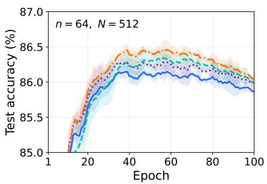

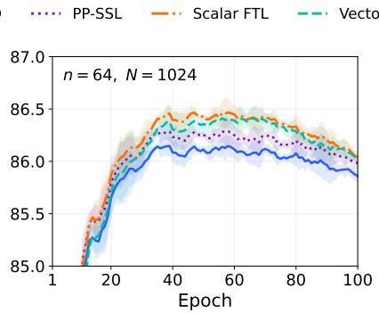

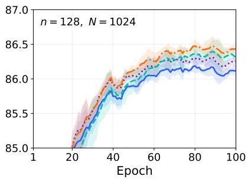  
Figure 2: Test accuracy (%) over training epochs for the first-order methods on CIFAR-10 with $n = 6 4 , N = 5 1 2$ (left), $n = 6 4 , N = 1 0 2 4$ (middle), and n = 128, N = 1024 (right). Curves show the mean across five random seeds, with shaded regions indicating ±1 standard deviation. For visualization, test-accuracy curves are smoothed using a five-epoch moving average.

## 4.2 Text Classification

Dataset and setup. We evaluate our zeroth-order methods on text classification using RoBERTa-large (355M parameters) [Liu et al., 2019b]. Following Malladi et al. [2023], Zhang et al. [2025a], we consider few-shot fine-tuning with K = 32 labeled examples per class on SST-2 [Socher et al., 2013], a binary sentiment classification task, and SST-5 [Socher et al., 2013], a five-class fine-grained sentiment classification task. This gives 64 labeled training examples for SST-2 and 160 for SST-5, with equally sized validation sets. For each task, we fine-tune a separate RoBERTa-large

ML-labeler f(·) on 128 labeled examples per class, obtaining test accuracies of 92.78% on SST-2 and 58.30% on SST-5. The ML-labeler are then kept fixed and used to generate ML-labels. The remaining training examples are treated as unlabeled data. We fine-tune the underlying model for 10,000 optimization steps and compare three methods: standard stochastic gradient-free method without using ML-labeled data and our proposed zeroth-order methods (Algorithm 2) with scalar and vector tuning, which we denote as “ZO Scalar FTL" and “ZO Vector FTL" respectively in the following. We tune a constant learning rate for each method, and we use a labeled batch size of $n = 3 2$ and an unlabeled batch size of N = 64 for our methods.

Results. Figure 3 illustrates test-accuracy over training steps for Algorithm 2 with scalar and vector tuning on SST-2 and SST-5. On both SST-2 and SST-5, the proposed methods consistently improve over the ZO baseline after the early stages of training, as the tuning parameters become more stable after aggregating information over more optimization steps. In particular, we find that Algorithm 2 with scalar tuning performs similarly to its vector-tuning counterpart throughout most of training. The corresponding trajectories of the scalar tuning parameter and the mean of the vector tuning parameters are smooth and closely aligned. At the same time, the coordinatewise vector tuning parameters $\lambda _ { t }$ span a wide range, indicating that different coordinates continue to place different weights on the MLlabeled correction even when the mean of the vector tuning parameters evolves similarly to the scalar one (Figure 7 in Appendix D.1.2). Additional results on fine-tuning with the first-order methods are provided in Appendix D.1.1.

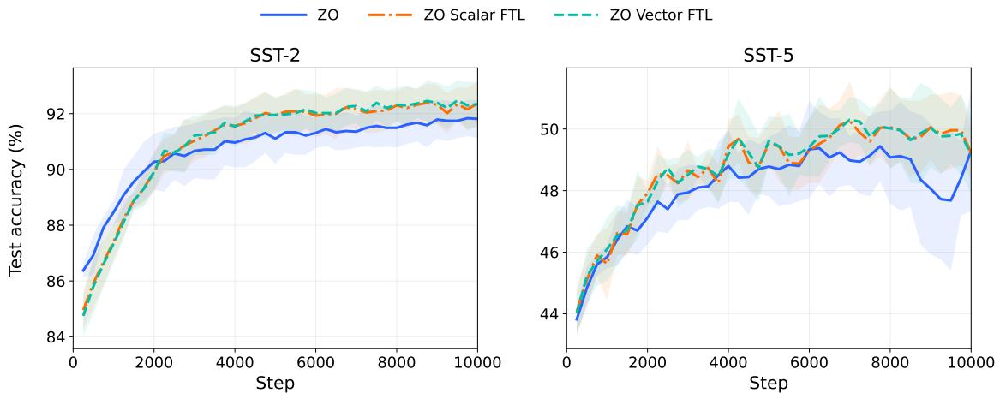  
Figure 3: Test accuracy (%) over training steps for the zeroth-order methods on SST-2 (left) and SST-5 (right). Test accuracy is evaluated every 250 optimization steps. Solid curves denote the mean across five random seeds, and shaded regions indicate ±1 standard deviation.

## 5 Discussion and Future Directions

In this work, we propose stochastic first- and zeroth-order optimization methods that use true-labeled and ML-labeled data to accelerate optimization. We consider both online scalar and vector tuning schemes that control the contribution of the ML-labeled gradient correction while preserving the convergence rate of standard stochastic optimization and enabling variance reduction. Our results reveal a trade-off between the proposed tuning schemes. Although both may achieve similar convergence rates, vector tuning offers greater coordinatewise flexibility but exhibits greater sensitivity to batch sizes in our experiments, whereas scalar tuning tends to be more stable across configurations. A potential direction for future work is therefore to identify classes of objective functions and data conditions under which vector tuning provably outperforms scalar tuning, as well as settings in which its additional computational overhead outweighs the gains. Another related direction is to investigate intermediate levels of tuning granularity, such as layer-wise or tensor-wise tuning. Such schemes could better account for heterogeneity in gradient estimates across different blocks of model parameters while retaining some of the stability benefits of sharing a tuning parameter across multiple coordinates, which we plan to explore in future work. Finally, our work assumes that ML labels are produced by a fixed ML model and accommodates settings in which only its labels, rather than the ML-labeler itself, are accessible. An interesting direction is to consider settings in which the ML-labeler is accessible and can also be updated on the fly.

## Acknowledgements

The authors appreciate the support from NSF CCF-2403392, as well as the Google Gemma Academic Program and Google Cloud Credits.

## References

Alon Albalak, Colin Raffel, and William Yang Wang. Improving few-shot generalization by exploring and exploiting auxiliary data. In Advances in Neural Information Processing Systems (NeurIPS), 2023.

Anastasios N Angelopoulos, Stephen Bates, Clara Fannjiang, Michael I Jordan, and Tijana Zrnic. Prediction-powered inference. Science, 382(6671):669–674, 2023a.

Anastasios N Angelopoulos, John C Duchi, and Tijana Zrnic. PPI++: Efficient prediction-powered inference. arXiv preprint arXiv:2311.01453, 2023b.

Lei Jimmy Ba and Rich Caruana. Do deep nets really need to be deep? In Advances in Neural Information Processing Systems, 2014.

Krishnakumar Balasubramanian and Saeed Ghadimi. Zeroth-order nonconvex stochastic optimization: Handling constraints, high dimensionality, and saddle points. Foundations of Computational Mathematics, 22(1):35–76, 2022.

Ejafa Bassam, Dawei Zhu, and Kaigui Bian. PLD: A choice-theoretic list-wise knowledge distillation. Advances in Neural Information Processing Systems (NeurIPS), 2025.

David Berthelot, Nicholas Carlini, Ian Goodfellow, Nicolas Papernot, Avital Oliver, and Colin A Raffel. MixMatch: A holistic approach to semi-supervised learning. In Advances in Neural Information Processing Systems (NeurIPS), 2019.

David Berthelot, Nicholas Carlini, Ekin D. Cubuk, Alex Kurakin, Kihyuk Sohn, Han Zhang, and Colin Raffel. ReMix-Match: Semi-supervised learning with distribution matching and augmentation anchoring. In International Conference on Learning Representations (ICLR), 2020.

Alina Beygelzimer, Sanjoy Dasgupta, and John Langford. Importance weighted active learning. In International Conference on Machine Learning (ICML), 2009.

Léon Bottou and Olivier Bousquet. The tradeoffs of large scale learning. In Advances in Neural Information Processing Systems (NeurIPS), 2007.

Cristian Bucilă, Rich Caruana, and Alexandru Niculescu-Mizil. Model compression. In ACM SIGKDD International Conference on Knowledge Discovery and Data Mining, 2006.

Sungmin Cha and Kyunghyun Cho. Why knowledge distillation works in generative models: A minimal working explanation. In Advances in Neural Information Processing Systems (NeurIPS), 2025.

Chih-Chung Chang and Chih-Jen Lin. LIBSVM: A library for support vector machines. ACM Transactions on Intelligent Systems and Technology, 2011.

Olivier Chapelle, Bernhard Schölkopf, and Alexander Zien, editors. Semi-Supervised Learning. The MIT Press, 2006.

Baixu Chen, Junguang Jiang, Ximei Wang, Pengfei Wan, Jianmin Wang, and Mingsheng Long. Debiased self-training for semi-supervised learning. In Advances in Neural Information Processing Systems, 2022.

Hao Chen, Ran Tao, Yue Fan, Yidong Wang, Jindong Wang, Bernt Schiele, Xing Xie, Bhiksha Raj, and Marios Savvides. Softmatch: Addressing the quantity-quality trade-off in semi-supervised learning. In International Conference on Learning Representations (ICLR), 2023.

Ashok Cutkosky and Francesco Orabona. Momentum-based variance reduction in non-convex SGD. In Advances in Neural Information Processing Systems (NeurIPS) 32, 2019.

Rudrajit Das and Sujay Sanghavi. Understanding self-distillation in the presence of label noise. In International Conference on Machine Learning (ICML), 2023.

Philip de Rijk, Lukas Schneider, Marius Cordts, and Dariu Gavrila. Structural knowledge distillation for object detection. In Advances in Neural Information Processing Systems (NeurIPS), 2022.

Yury Demidovich, Grigory Malinovsky, Igor Sokolov, and Peter Richtárik. A guide through the zoo of biased SGD. In Advances in Neural Information Processing Systems (NeurIPS), 2023.

Jia Deng, Wei Dong, Richard Socher, Li-Jia Li, Kai Li, and Li Fei-Fei. ImageNet: A large-scale hierarchical image database. In IEEE Conference on Computer Vision and Pattern Recognition (CVPR), 2009.

Xiang Deng and Zhongfei Zhang. Comprehensive knowledge distillation with causal intervention. In Advances in Neural Information Processing Systems (NeurIPS), 2021.

John Duchi, Elad Hazan, and Yoram Singer. Adaptive subgradient methods for online learning and stochastic optimization. Journal of Machine Learning Research, 12(Jul):2121–2159, 2011.

John C Duchi, Michael I Jordan, Martin J Wainwright, and Andre Wibisono. Optimal rates for zero-order convex optimization: The power of two function evaluations. IEEE Transactions on Information Theory, 61(5):2788–2806, 2015.

Saeed Ghadimi and Guanghui Lan. Stochastic first-and zeroth-order methods for nonconvex stochastic programming SIAM Journal on Optimization, 23(4):2341–2368, 2013.

Robert Mansel Gower, Nicolas Loizou, Xun Qian, Alibek Sailanbayev, Egor Shulgin, and Peter Richtárik. SGD: General analysis and improved rates. In International Conference on Machine Learning (ICML), 2019.

Elad Hazan. Introduction to online convex optimization. MIT Press, 2nd edition, 2022.

Kaiming He, Xiangyu Zhang, Shaoqing Ren, and Jian Sun. Deep residual learning for image recognition. In 2016 IEEE Conference on Computer Vision and Pattern Recognition (CVPR), pages 770–778, 2016. doi: 10.1109/CVPR. 2016.90.

Geoffrey Hinton, Oriol Vinyals, and Jeff Dean. Distilling the knowledge in a neural network. arXiv:1503.02531, 2015.

Kun Huang, Xin Guo, and Meng Wang. Towards efficient pre-trained language model via feature correlation distillation. In Advances in Neural Information Processing Systems (NeurIPS), 2023.

Tao Huang, Shan You, Fei Wang, Chen Qian, and Chang Xu. Knowledge distillation from a stronger teacher. In Advances in Neural Information Processing Systems (NeurIPS), 2022.

Ayush Jain, Andrea Montanari, and Eren Sasoglu. Scaling laws for learning with real and surrogate data. In Advances in Neural Information Processing Systems (NeurIPS), 2024.

Prateek Jain, Sham M Kakade, Rahul Kidambi, Praneeth Netrapalli, and Aaron Sidford. Accelerating stochastic gradient descent for least squares regression. In Conference on Learning Theory (COLT), 2018.

Svante Janson. Gaussian Hilbert Spaces. Cambridge Tracts in Mathematics. Cambridge University Press, 1997.

Alex Krizhevsky. Learning multiple layers of features from tiny images. Technical report, University of Toronto, 2009.

Nicolas Le Roux, Mark Schmidt, and Francis Bach. A stochastic gradient method with an exponential convergence rate for finite training sets. In Advances in Neural Information Processing Systems (NeurIPS) 25, 2012.

Dong-Hyun Lee. Pseudo-label: The simple and efficient semi-supervised learning method for deep neural networks. In Workshop on Challenges in Representation Learning, ICML, 2013.

Kfir Y. Levy. Online to offline conversions, universality and adaptive minibatch sizes. In Advances in Neural Information Processing Systems (NeurIPS) 30, 2017.

Muyang Li, Runze Wu, Haoyu Liu, Jun Yu, Xun Yang, Bo Han, and Tongliang Liu. Instant: Semi-supervised learning with instance-dependent thresholds. In Advances in Neural Information Processing Systems (NeurIPS), 2023.

Zhize Li, Hongyan Bao, Xiangliang Zhang, and Peter Richtárik. PAGE: A simple and optimal probabilistic gradient estimator for nonconvex optimization. In International Conference on Machine Learning (ICML), 2021.

Tsung-Yi Lin, Michael Maire, Serge Belongie, James Hays, Pietro Perona, Deva Ramanan, Piotr Dollár, and C. Lawrence Zitnick. Microsoft COCO: Common objects in context. In European Conference on Computer Vision (ECCV), 2014.

Shikun Liu, Andrew J. Davison, and Edward Johns. Self-supervised generalisation with meta auxiliary learning. In Advances in Neural Information Processing Systems, 2019a.

Yinhan Liu, Myle Ott, Naman Goyal, Jingfei Du, Mandar Joshi, Danqi Chen, Omer Levy, Mike Lewis, Luke Zettlemoyer, and Veselin Stoyanov. RoBERTa: A robustly optimized BERT pretraining approach. arXiv:1907.11692, 2019b.

Jiaming Lv, Haoyuan Yang, and Peihua Li. Wasserstein distance rivals Kullback-Leibler divergence for knowledge distillation. In Advances in Neural Information Processing Systems (NeurIPS), 2024.

Sadhika Malladi, Tianyu Gao, Eshaan Nichani, Alex Damian, Jason D Lee, Danqi Chen, and Sanjeev Arora. Finetuning language models with just forward passes. In Advances in Neural Information Processing Systems (NeurIPS). 2023.

David Mayo, Jesse Cummings, Xinyu Lin, Dan Gutfreund, Boris Katz, and Andrei Barbu. How hard are computer vision datasets? Calibrating dataset difficulty to viewing time. In Advances in Neural Information Processing Systems (NeurIPS) Datasets and Benchmarks Track, 2023.

Vaishnavh Nagarajan, Aditya Krishna Menon, Srinadh Bhojanapalli, Hossein Mobahi, and Sanjiv Kumar. On studentteacher deviations in distillation: does it pay to disobey? In Advances in Neural Information Processing Systems (NeurIPS), 2023.

Deanna Needell, Nathan Srebro, and Rachel Ward. Stochastic gradient descent, weighted sampling, and the randomized Kaczmarz algorithm. In Advances in Neural Information Processing Systems (NeurIPS), 2014.

Yurii Nesterov and Vladimir Spokoiny. Random gradient-free minimization of convex functions. Foundations of Computational Mathematics, 17(2):527–566, 2017.

Lam Nguyen, Phuong Ha Nguyen, Marten van Dijk, Peter Richtárik, Katya Scheinberg, and Martin Takác. SGD and Hogwild! convergence without the bounded gradients assumption. In International Conference on Machine Learning (ICML), 2018.

Youngtaek Oh, Dong-Jin Kim, and In So Kweon. DASO: Distribution-aware semantics-oriented pseudo-label for imbalanced semi-supervised learning. In Proceedings of the IEEE/CVF Conference on Computer Vision and Pattern Recognition (CVPR), 2022.

Utkarsh Ojha, Yuheng Li, Anirudh Sundara Rajan, Yingyu Liang, and Yong Jae Lee. What knowledge gets distilled in knowledge distillation? In Advances in Neural Information Processing Systems (NeurIPS), 2023.

Francesco Orabona. Online learning: A modern introduction using convex optimization. arXiv:1912.13213v10, 2026.

Pranav Rajpurkar, Jian Zhang, Konstantin Lopyrev, and Percy Liang. SQuAD: 100,000+ questions for machine comprehension of text. In Conference on Empirical Methods in Natural Language Processing (EMNLP), 2016.

Alexander Rakhlin, Ohad Shamir, and Karthik Sridharan. Making gradient descent optimal for strongly convex stochastic optimization. In International Conference on Machine Learning (ICML), 2012.

Herbert Robbins and Sutton Monro. A stochastic approximation method. The Annals of Mathematical Statistics, 22 (3):400–407, 1951.

Mher Safaryan, Alexandra Peste, and Dan Alistarh. Knowledge distillation performs partial variance reduction. In Advances in Neural Information Processing Systems (NeurIPS), 2023.

Maria-Eleni Sfyraki and Jun-Kun Wang. Lions and Muons: Optimization via Stochastic Frank-Wolfe under Heavy-Tailed Noise. In International Conference on Machine Learning (ICML), 2026a.

Maria-Eleni Sfyraki and Jun-Kun Wang. Revisiting active sequential prediction-powered mean estimation. In International Conference on Learning Representations (ICLR), 2026b.

Shai Shalev-Shwartz. Online learning and online convex optimization. Foundations and Trends® in Machine Learning, 4(2):107–194, 2011.

Ohad Shamir and Tong Zhang. Stochastic gradient descent for non-smooth optimization: Convergence results and optimal averaging schemes. In International Conference on Machine Learning (ICML), 2013.

Baifeng Shi, Judy Hoffman, Kate Saenko, Trevor Darrell, and Huijuan Xu. Auxiliary task reweighting for minimumdata learning. In Advances in Neural Information Processing Systems (NeurIPS), 2020.

Noa Shoham, Ron Dorfman, Shalev Shaer, Kfir Y. Levy, and Yaniv Romano. Prediction-powered semi-supervised learning with online power tuning. In Advances in Neural Information Processing Systems (NeurIPS), 2025.

Richard Socher, Alex Perelygin, Jean Wu, Jason Chuang, Christopher D. Manning, Andrew Ng, and Christopher Potts. Recursive deep models for semantic compositionality over a sentiment treebank. In Conference on Empirical Methods in Natural Language Processing (EMNLP), Oct. 2013.

Kihyuk Sohn, David Berthelot, Chun-Liang Li, Zizhao Zhang, Nicholas Carlini, Ekin D. Cubuk, Alex Kurakin, Han Zhang, and Colin Raffel. Fixmatch: Simplifying semi-supervised learning with consistency and confidence. Advances in Neural Information Processing Systems (NeurIPS), 33:596–608, 2020.

Samuel Stanton, Pavel Izmailov, Polina Kirichenko, Alexander A Alemi, and Andrew Gordon Wilson. Does knowledge distillation really work? In Advances in Neural Information Processing Systems (NeurIPS), 2021.

Yonglong Tian, Chen Sun, Ben Poole, Dilip Krishnan, Cordelia Schmid, and Phillip Isola. What makes for good views for contrastive learning? In Advances in Neural Information Processing Systems (NeurIPS), 2020.

Jesper E. van Engelen and Holger H. Hoos. A survey on semi-supervised learning. Machine Learning, 109(2): 373–440, 2020.

Alex Wang, Amanpreet Singh, Julian Michael, Felix Hill, Omer Levy, and Samuel R. Bowman. GLUE: A multi-task benchmark and analysis platform for natural language understanding. In International Conference on Learning Representations (ICLR), 2019.

Jun-Kun Wang, Jacob Abernethy, and Kfir Y Levy. No-regret dynamics in the Fenchel game: A unified framework for algorithmic convex optimization. Mathematical Programming, 205:203–268, 2024.

Xudong Wang, Zhirong Wu, Long Lian, and Stella X. Yu. Debiased learning from naturally imbalanced pseudo-labels. In Proceedings of the IEEE/CVF Conference on Computer Vision and Pattern Recognition (CVPR), 2022.

Yidong Wang, Hao Chen, Qiang Heng, Wenxin Hou, Yue Fan, Zhen Wu, Jindong Wang, Marios Savvides, Takahiro Shinozaki, Bhiksha Raj, Bernt Schiele, and Xing Xie. Freematch: Self-adaptive thresholding for semi-supervised learning. In International Conference on Learning Representations (ICLR), 2023.

Chen Wei, Kihyuk Sohn, Clayton Mellina, Alan Yuille, and Fan Yang. CReST: A class-rebalancing self-training framework for imbalanced semi-supervised learning. In Proceedings of the IEEE/CVF Conference on Computer Vision and Pattern Recognition (CVPR), 2021.

Blake Woodworth, Konstantin Mishchenko, and Francis Bach. Two losses are better than one: Faster optimization using a cheaper proxy. In International Conference on Machine Learning (ICML), 2023.

Stephen J. Wright and Benjamin Recht. Optimization for Data Analysis. Cambridge University Press, 2022.

Qizhe Xie, Minh-Thang Luong, Eduard Hovy, and Quoc V. Le. Self-training with noisy student improves ImageNet classification. In Proceedings of the IEEE/CVF Conference on Computer Vision and Pattern Recognition (CVPR), 2020.

Yi Xu, Lei Shang, Jinxing Ye, Qi Qian, Yu-Feng Li, Baigui Sun, Hao Li, and Rong Jin. Dash: Semi-supervised learning with dynamic thresholding. In International Conference on Machine Learning (ICML), 2021.

Bowen Zhang, Yidong Wang, Wenxin Hou, Hao Wu, Jindong Wang, Manabu Okumura, and Takahiro Shinozaki. Flexmatch: Boosting semi-supervised learning with curriculum pseudo labeling. Advances in Neural Information Processing Systems (NeurIPS), 34:18408–18419, 2021.

Liang Zhang, Bingcong Li, Kiran Koshy Thekumparampil, Sewoong Oh, Michael Muehlebach, and Niao He. Zerothorder optimization finds flat minima. Advances in Neural Information Processing Systems (NeurIPS), 2025a.

Ping Zhang, Zheda Mai, Quang-Huy Nguyen, and Wei-Lun Chao. Revisiting semi-supervised learning in the era of foundation models. In Advances in Neural Information Processing Systems (NeurIPS), 2025b.

Tong Zhang. Solving large scale linear prediction problems using stochastic gradient descent algorithms. In International Conference on Machine Learning (ICML), 2004.

Xingyu Zhou. On the Fenchel duality between strong convexity and Lipschitz continuous gradient. arXiv preprint arXiv:1803.06573, 2018.

Xiaojin Zhu. Semi-supervised learning literature survey. Technical Report 1530, University of Wisconsin-Madison Department of Computer Sciences, 2005.

## A More Related Works

Semi-Supervised Learning. Our setting is closely related to Semi-Supervised Learning (SSL), which extends classical supervised learning by leveraging abundant unlabeled data alongside a limited amount of labeled data, thus offering a practical approach to improving learning performance while reducing the reliance on costly data annotation [Zhu, 2005, Chapelle et al., 2006, van Engelen and Hoos, 2020]. Modern SSL methods include self-training approaches [Xie et al., 2020, Wei et al., 2021, Chen et al., 2022], which iteratively use model predictions on unlabeled data to construct additional supervision and retrain the model, and more broadly pseudo-labeling techniques [Lee, 2013, Oh et al., 2022, Wang et al., 2022, Zhang et al., 2025b], which use model-generated predictions as supervisory targets for unlabeled examples. Some popular approaches combine label guessing or pseudo-labeling with consistency regularization and data augmentation, including MixMatch [Berthelot et al., 2019] and ReMixMatch [Berthelot et al., 2020]. A more recent line of work on pseudo-labeling methods controls the contribution of unlabeled examples based on model confidence. In particular, FixMatch [Sohn et al., 2020] uses a fixed confidence threshold, while subsequent methods such as FlexMatch [Zhang et al., 2021] and FreeMatch [Wang et al., 2023] adapt the threshold during training, and SoftMatch [Chen et al., 2023] replaces hard thresholding with confidence-based soft weighting. Other works employ alternative selection criteria: Dash [Xu et al., 2021] dynamically adjusts a loss-based selection threshold, instead of a confidence threshold, while InstanT [Li et al., 2023] introduces instance-dependent thresholds for pseudo-label selection. In contrast to the SSL approaches, our work utilizes ML-labels not as direct supervisory targets in the training objective, but as auxiliary information for constructing a stochastic gradient estimator whose contribution is tuned online to reduce variance.

Knowledge Distillation. Our work is also connected to Knowledge Distillation (KD), which focuses on transferring knowledge from a teacher model to a student model, typically by matching the teacher's output logits [Bucilă et al., 2006, Ba and Caruana, 2014] or softened predictive distribution [Hinton et al., 2015]. Unlike SSL, whose goal is to utilize unlabeled data to improve learning, KD is primarily concerned with teacher-to-student knowledge transfer and does not inherently require unlabeled data. Subsequent work has extended KD beyond output-logit matching by transferring intermediate feature representations [Tian et al., 2020, Deng and Zhang, 2021, Huang et al., 2023], and relational or structural information [Tian et al., 2020, de Rijk et al., 2022]. Other works explore alternative distillation objectives based on contrastive, correlation-based, Wasserstein, and ranking losses [Huang et al., 2022, Lv et al., 2024, Bassam et al., 2025]. Beyond the design of distillation objectives and transferred representations, recent work has examined why and when distillation is effective, including optimization difficulties that can prevent students from matching the teacher's predictive distribution [Stanton et al., 2021], bias-variance tradeoffs arising in self-distillation under label noise [Das and Sanghavi, 2023], the transfer of teacher-specific properties to the student [Ojha et al., 2023], and the potential benefits of allowing students to deviate from their teachers [Nagarajan et al., 2023]. More recently, KD has also been studied in modern generative-model settings, where distillation can induce a precision-recall tradeoff in the student's learned distribution [Cha and Cho, 2025]. Most closely related to our work, Safaryan et al. [2023] study KD through the lens of stochastic variance reduction, showing that it can partially reduce gradient noise in linear and deep linear models. Our setting differs from KD in that we do not optimize a teacher-matching objective, but rather the ML-labels are used to construct an unbiased gradient estimator for the original population objective.

Optimization with Surrogate Data. Another closely related line of research considers learning with surrogate data, where auxiliary data sources or proxy objectives are used to improve optimization or learning on a target task. Woodworth et al. [2023] consider optimization with an expensive target loss and a cheaper proxy loss, and develop an algorithm that exploits curvature information from the proxy loss to reduce the number of stochastic gradient evaluations of the target objective. Jain et al. [2024] study learning from mixtures of real and surrogate data and characterize how surrogate samples should be weighted to improve performance on the target distribution. Related work on auxiliary learning similarly investigates how additional tasks or datasets can be constructed, selected, or weighted to improve learning on a primary task [Shi et al., 2020, Albalak et al., 2023, Liu et al., 2019a].

## B Proofs of the Theoretical Results in Section 2

Before proving the theorems, we need a series of lemmas.

We denote $\delta _ { t } : = \mathcal { G } _ { t , { \mathbf { w } } _ { t } } ^ { \lambda _ { t } } - \nabla \mathfrak { L } ( { \mathbf { w } } )$ in the following and use $\mathbb { E } _ { t - 1 } [ \cdot ] : = \mathbb { E } [ \cdot \mid \mathcal { F } _ { t - 1 } ]$ for brevity.

Lemma 1. (Adapted from (2.9) in Ghadimi and Lan [2013]) Consider $\mathbf { w } _ { t + 1 } = \mathbf { w } _ { t } - \eta _ { t } \mathcal { G } _ { t , \mathbf { w } _ { t } } ^ { \lambda _ { t } }$ . Under Assumption 1 and Assumption 2, it holds that

$$
\sum _ { t = 1 } ^ { T } \left( \eta _ { t } - \frac { \beta } { 2 } \eta _ { t } ^ { 2 } \right) \| \nabla \mathfrak { L } ( \mathbf { w } _ { t } ) \| ^ { 2 } \leq \Delta _ { 1 } - \sum _ { t = 1 } ^ { T } \left( \eta _ { t } - \beta \eta _ { t } ^ { 2 } \right) \langle \nabla \mathfrak { L } ( \mathbf { w } _ { t } ) , \delta _ { t } \rangle + \frac { \beta } { 2 } \sum _ { t = 1 } ^ { T } \eta _ { t } ^ { 2 } \| \delta _ { t } \| ^ { 2 } .\tag{8}
$$

Proof. For reader's convenience, we replicate the analysis of Ghadimi and Lan [2013] below.

By β-smoothness,

$$
\begin{array} { r l } & { \mathfrak { L } ( \mathbf { w } _ { t + 1 } ) \le \mathfrak { L } ( \mathbf { w } _ { t } ) + \langle \nabla \mathfrak { L } ( \mathbf { w } _ { t } ) , \mathbf { w } _ { t + 1 } - \mathbf { w } _ { t } \rangle + \displaystyle \frac { \beta } { 2 } \| \mathbf { w } _ { t + 1 } - \mathbf { w } _ { t } \| ^ { 2 } } \\ & { \quad \quad \quad \quad = \mathfrak { L } ( \mathbf { w } _ { t } ) - \eta _ { t } \langle \nabla \mathfrak { L } ( \mathbf { w } _ { t } ) , \nabla \mathfrak { L } ( \mathbf { w } _ { t } ) + \delta _ { t } \rangle + \displaystyle \frac { \beta } { 2 } \eta _ { t } ^ { 2 } \| \nabla \mathfrak { L } ( \mathbf { w } _ { t } ) + \delta _ { t } \| ^ { 2 } } \\ & { \quad \quad \quad = \mathfrak { L } ( \mathbf { w } _ { t } ) - \eta _ { t } \| \nabla \mathfrak { L } ( \mathbf { w } _ { t } ) \| ^ { 2 } - \eta _ { t } \langle \nabla \mathfrak { L } ( \mathbf { w } _ { t } ) , \delta _ { t } \rangle + \displaystyle \frac { \beta } { 2 } \eta _ { t } ^ { 2 } \left( \| \nabla \mathfrak { L } ( \mathbf { w } _ { t } ) \| ^ { 2 } + 2 \langle \nabla \mathfrak { L } ( \mathbf { w } _ { t } ) , \delta _ { t } \rangle + \| \delta _ { t } \| ^ { 2 } \right) } \\ & { \quad \quad \quad = \mathfrak { L } ( \mathbf { w } _ { t } ) - \left( \eta _ { t } - \displaystyle \frac { \beta } { 2 } \eta _ { t } ^ { 2 } \right) \| \nabla \mathfrak { L } ( \mathbf { w } _ { t } ) \| ^ { 2 } - \left( \eta _ { t } - \beta \eta _ { t } ^ { 2 } \right) \langle \nabla \mathfrak { L } ( \mathbf { w } _ { t } ) , \delta _ { t } \rangle + \displaystyle \frac { \beta } { 2 } \eta _ { t } ^ { 2 } \| \delta _ { t } \| ^ { 2 } . } \end{array}
$$

Rearranging and summing over $t = 1 , \dots , T$ , the loss differences telescope, which gives,

$$
\begin{array} { l } { \displaystyle \sum _ { t = 1 } ^ { T } \left( \eta _ { t } - \frac { \beta } { 2 } \eta _ { t } ^ { 2 } \right) \| \nabla \mathfrak { L } ( \mathbf { w } _ { t } ) \| ^ { 2 } \leq \mathfrak { L } ( \mathbf { w } _ { 1 } ) - \mathfrak { L } ( \mathbf { w } _ { T + 1 } ) - \displaystyle \sum _ { t = 1 } ^ { T } \left( \eta _ { t } - \beta \eta _ { t } ^ { 2 } \right) \langle \nabla \mathfrak { L } ( \mathbf { w } _ { t } ) , \delta _ { t } \rangle + \frac { \beta } { 2 } \displaystyle \sum _ { t = 1 } ^ { T } \eta _ { t } ^ { 2 } \| \delta _ { t } \| ^ { 2 } } \\ { \leq \Delta _ { 1 } - \displaystyle \sum _ { t = 1 } ^ { T } \left( \eta _ { t } - \beta \eta _ { t } ^ { 2 } \right) \langle \nabla \mathfrak { L } ( \mathbf { w } _ { t } ) , \delta _ { t } \rangle + \frac { \beta } { 2 } \displaystyle \sum _ { t = 1 } ^ { T } \eta _ { t } ^ { 2 } \| \delta _ { t } \| ^ { 2 } . } \end{array}
$$

Lemma 2. Assume that $\lambda _ { t }$ is $\mathcal { F } _ { t - 1 }$ -measurable and hence $\mathbb { E } _ { t - 1 } [ \mathcal { G } _ { t , \mathbf { w } _ { t } } ^ { \lambda _ { t } } ] = \nabla \mathfrak { L } ( \mathbf { w } _ { t } )$ . Then,

$$
\begin{array} { r } { \mathbb { E } _ { t - 1 } \left[ \left. \delta _ { t } \right. ^ { 2 } \right] = \mathbb { E } _ { t - 1 } \left[ \left. \mathcal { G } _ { t , { \mathbf { w } _ { t } } } ^ { \lambda _ { t } } \right. ^ { 2 } \right] - \| \nabla \mathfrak { L } ( { \mathbf { w } _ { t } } ) \| ^ { 2 } . } \end{array}
$$

Proof.

$$
\begin{array} { r l } & { \mathbb { E } _ { t - 1 } \left[ \| \delta _ { t } \| ^ { 2 } \right] = \mathbb { E } _ { t - 1 } \left[ \left\| \mathcal { G } _ { t , \mathbf { w } _ { t } } ^ { \lambda _ { t } } \right\| ^ { 2 } \right] - \mathbb { E } _ { t - 1 } \left[ 2 \langle \mathcal { G } _ { t , \mathbf { w } _ { t } } ^ { \lambda _ { t } } , \nabla \mathfrak { L } ( \mathbf { w } _ { t } ) \rangle \right] + \mathbb { E } _ { t - 1 } \left[ \| \nabla \mathfrak { L } ( \mathbf { w } _ { t } ) \| ^ { 2 } \right] } \\ & { \qquad = \mathbb { E } _ { t - 1 } \left[ \left\| \mathcal { G } _ { t , \mathbf { w } _ { t } } ^ { \lambda _ { t } } \right\| ^ { 2 } \right] - \| \nabla \mathfrak { L } ( \mathbf { w } _ { t } ) \| ^ { 2 } , } \end{array}\tag{9}
$$

(10)

where the last equality uses that $\mathbb { E } _ { t - 1 } [ \mathcal { G } _ { t , \mathbf { w } _ { t } } ^ { \lambda _ { t } } ] = \nabla \mathfrak { L } ( \mathbf { w } _ { t } )$

Lemma 3. Under Assumption 1 and Assumption 2. Suppose that $\lambda _ { t } i s \mathcal { F } _ { t - 1 }$ -measurable and hence $\begin{array} { r l } { \mathbb { E } _ { t - 1 } [ \mathcal { G } _ { t , \mathbf { w } _ { t } } ^ { \lambda _ { t } } ] = } \end{array}$ $\nabla L ( \mathbf { w } _ { t } )$ . Then,

$$
\sum _ { t = 1 } ^ { T } \left( \eta _ { t } - \frac { \beta } { 2 } \eta _ { t } ^ { 2 } \right) \mathbb { E } \left[ \| \nabla \mathfrak { L } ( \mathbf { w } _ { t } ) \| ^ { 2 } \right] \leq \Delta _ { 1 } + \frac { \beta } { 2 } \sum _ { t = 1 } ^ { T } \eta _ { t } ^ { 2 } \mathbb { E } \left[ \mathbb { E } _ { t - 1 } \left[ \left\| \mathcal { G } _ { t , \mathbf { w } _ { t } } ^ { \lambda _ { t } } \right\| ^ { 2 } \right] - \| \nabla \mathfrak { L } ( \mathbf { w } _ { t } ) \| ^ { 2 } \right] .
$$

Proof. Taking expectation on both sides of (8), noting that $\mathbb { E } [ \langle \nabla \mathfrak { L } ( \mathbf { w } _ { t } ) , \delta _ { t } \rangle ] = 0$ , we have

$$
\begin{array} { r l } { \displaystyle \sum _ { t = 1 } ^ { T } \left( \eta _ { t } - \frac { \beta } { 2 } \eta _ { t } ^ { 2 } \right) \mathbb { E } \left[ \| \nabla \mathfrak { L } ( \mathbf { w } _ { t } ) \| ^ { 2 } \right] \leq \Delta _ { 1 } + \displaystyle \frac { \beta } { 2 } \sum _ { t = 1 } ^ { T } \eta _ { t } ^ { 2 } \mathbb { E } \left[ \| \delta _ { t } \| ^ { 2 } \right] } & { } \\ { = \Delta _ { 1 } + \displaystyle \frac { \beta } { 2 } \sum _ { t = 1 } ^ { T } \eta _ { t } ^ { 2 } \mathbb { E } \left[ \mathbb { E } _ { t - 1 } \left[ \| \delta _ { t } \| ^ { 2 } \right] \right] } & { } \\ { = \Delta _ { 1 } + \displaystyle \frac { \beta } { 2 } \sum _ { t = 1 } ^ { T } \eta _ { t } ^ { 2 } \mathbb { E } \left[ \mathbb { E } _ { t - 1 } \left[ \left\| \mathcal { G } _ { t , \mathbf { w } _ { t } } ^ { \lambda _ { t } } \right\| ^ { 2 } \right] - \| \nabla \mathfrak { L } ( \mathbf { w } _ { t } ) \| ^ { 2 } \right] , } \end{array}\tag{11}
$$

where (11) uses Lemma 2.

Now we recall the notion of vector tuning as a game introduced in Subsection 2.1, where the sequence of loss functions are $\phi _ { t } ( \lambda ) : = \left\| \mathscr { G } _ { t , { \mathbf { w } _ { t } } } ^ { \lambda } \right\| ^ { 2 } = \left\| \mathbf { g } _ { t } + \lambda \odot \mathbf { d } _ { t } \right\| ^ { 2 }$ . For this, we define

$$
\mathrm { R e g r e t } _ { T } ^ { \phi } ( \mathbf { \boldsymbol { \lambda } } ^ { * } ) : = \sum _ { t = 1 } ^ { T } \phi _ { t } ( \mathbf { \boldsymbol { \lambda } } _ { t } ) - \sum _ { t = 1 } ^ { T } \phi _ { t } ( \mathbf { \boldsymbol { \lambda } } ^ { * } ) ,
$$

where $\boldsymbol { \lambda } _ { t } \in \mathbb { R } ^ { d }$ is the action at t committed by the online learner and $\pmb { \lambda } ^ { * } \in \mathbb { R } ^ { d }$ is a comparator.

We also recall that the case of vector tuning actually covers the case of scalar tuning as a special case. Specifically, given a scalar tuning parameter $\lambda \in \mathbb { R }$ , a scalar-vector multiplication λv can be rewritten as $\lambda \mathbf { v } = \lambda \mathbf { 1 } \odot \mathbf { v }$ , where $\textbf { 1 } \in \mathbb { R } ^ { d }$ is the all-ones vector. This allows us to invoke Lemma 3 and Lemma 4 below by letting $\lambda _ { t } \gets \lambda _ { t } \mathbf { 1 }$ and $\lambda ^ { * }  \lambda ^ { * } \mathbf { 1 }$ in the lemmas when analyzing the case of scalar tuning.

Lemma 4. Denote $\begin{array} { r } { \Phi _ { 1 : T } ( \lambda ^ { * } ) : = \sum _ { t = 1 } ^ { T } \left. \mathcal { G } _ { t , { \mathbf { w } _ { t } } } ^ { \lambda ^ { * } } \right. ^ { 2 } - \sum _ { t = 1 } ^ { T } \left. \mathcal { G } _ { t , { \mathbf { w } _ { t } } } ^ { 0 } \right. ^ { 2 } . } \end{array}$ Set $\eta _ { t } = \eta$ , under Assumption 1, 2, and 3, we have

$$
\sum _ { t = 1 } ^ { T } \left( \eta - \frac { \beta } { 2 } \eta ^ { 2 } \right) \mathbb { E } \left[ \| \nabla \mathfrak { L } ( \mathbf { w } _ { t } ) \| ^ { 2 } \right] \leq \Delta _ { 1 } + \frac { \beta \eta ^ { 2 } } { 2 } \mathbb { E } \left[ \mathrm { R e g r e t } _ { T } ^ { \phi } ( \pmb { \lambda } ^ { * } ) \right] + \frac { \beta \eta ^ { 2 } } { 2 } \mathbb { E } [ \Phi _ { 1 : T } ( \pmb { \lambda } ^ { * } ) ] + \frac { \beta \eta ^ { 2 } T } { 2 } \sigma ^ { 2 } .\tag{12}
$$

Proof. From Lemma 3,

$$
\sum _ { t = 1 } ^ { T } \left( \eta _ { t } - \frac { \beta } { 2 } \eta _ { t } ^ { 2 } \right) \mathbb { E } \left[ \| \nabla \mathfrak { L } ( \mathbf { w } _ { t } ) \| ^ { 2 } \right] \leq \Delta _ { 1 } + \frac { \beta } { 2 } \sum _ { t = 1 } ^ { T } \eta _ { t } ^ { 2 } \mathbb { E } \left[ \mathbb { E } _ { t - 1 } \left[ \left\| \mathcal { G } _ { t , \mathbf { w } _ { t } } ^ { \lambda _ { t } } \right\| ^ { 2 } \right] - \| \nabla \mathfrak { L } ( \mathbf { w } _ { t } ) \| ^ { 2 } \right]\tag{13}
$$

$$
= \Delta _ { 1 } + \frac { \beta } { 2 } \sum _ { t = 1 } ^ { T } \eta _ { t } ^ { 2 } \mathbb { E } \left[ \mathbb { E } _ { t - 1 } \left[ \phi _ { t } ( \lambda _ { t } ) - \phi _ { t } ( \lambda ^ { * } ) + \phi _ { t } ( \lambda ^ { * } ) - \phi _ { t } ( 0 ) + \phi _ { t } ( 0 ) \right] - \| \nabla \mathfrak { L } ( \mathbf { w } _ { t } ) \| ^ { 2 } \right]\tag{14}
$$

$$
\leq \Delta _ { 1 } + \frac { \beta } { 2 } \sum _ { t = 1 } ^ { T } \eta _ { t } ^ { 2 } \mathbb { E } \left[ \mathbb { E } _ { t - 1 } \left[ \phi _ { t } ( \lambda _ { t } ) - \phi _ { t } ( \lambda ^ { * } ) + \phi _ { t } ( \lambda ^ { * } ) - \phi _ { t } ( 0 ) \right] \right] + \frac { \beta } { 2 } \sum _ { t = 1 } ^ { T } \eta _ { t } ^ { 2 } \sigma ^ { 2 } ,\tag{15}
$$

where the last inequality is due to Assumption 3, i.e., E $\left[ \left\| \mathbf { g } _ { t } - \nabla \mathfrak { L } ( \mathbf { w } _ { t } ) \right\| ^ { 2 } \right] \leq \sigma ^ { 2 }$

Now set $\eta _ { t } = \eta$ We further obtain

$$
\sum _ { t = 1 } ^ { T } \left( \eta - \frac { \beta } { 2 } \eta ^ { 2 } \right) \mathbb { E } \left[ \| \nabla \mathfrak { L } ( \mathbf { w } _ { t } ) \| ^ { 2 } \right] \leq \Delta _ { 1 } + \frac { \beta } { 2 } \eta ^ { 2 } \mathbb { E } \left[ \mathrm { R e g e r t } _ { T } ^ { \phi } ( \pmb { \lambda } ^ { * } ) \right] + \frac { \beta } { 2 } \eta ^ { 2 } \mathbb { E } [ \Phi _ { 1 : T } ( \pmb { \lambda } ^ { * } ) ] + \frac { \beta T } { 2 } \eta ^ { 2 } \sigma ^ { 2 } .\tag{16}
$$

As described in the main text, we propose using the Follow-the-Leader (FTL) strategy in the online tuning as a game, i.e., initialize $\lambda _ { 1 }  0$ , and for all $t > 1$ , play

$$
\lambda _ { t }  \arg \operatorname* { m i n } _ { \lambda \in \mathbb { R } } \sum _ { s = 1 } ^ { t - 1 } \phi _ { s } ( \lambda ) , \mathrm { ~ w h e r e ~ } \phi _ { s } ( \lambda ) : = \| \mathbf { g } _ { s } + \lambda \mathbf { d } _ { s } \| ^ { 2 } .\tag{17}
$$

Lemma 5. (Lemma 2.1 in Shalev-Shwartz $I 2 O I I { \big . }$ Be-the-Leader lemma) Consider a learner that receives a sequence of loss functions $h _ { 1 } ( \cdot ) , h _ { 2 } ( \cdot ) , \ldots , h _ { T } ( \cdot )$ in an online learning setting. Then, Follow-the-Leader (FTL), i.e., $\theta _ { t } \in$ arg minθ∈Θ $\Sigma _ { s = 1 } ^ { t - 1 } h ( \theta )$ , satisfies

$$
\mathrm { R e g r e t } _ { T } ^ { h } ( \theta ^ { * } ) : = \sum _ { t = 1 } ^ { T } h _ { t } ( \theta _ { t } ) - \sum _ { t = 1 } ^ { T } \phi _ { t } ( \theta ^ { * } ) \leq \sum _ { t = 1 } ^ { T } \left( h _ { t } ( \theta _ { t } ) - h _ { t } ( \theta _ { t + 1 } ) \right) ,
$$

where $\theta ^ { \ast } \in \Theta$ is a comparator in the same decision space Θ as $F T L$

We observe that expanding the cumulative loss gives

$$
\sum _ { s = 1 } ^ { t - 1 } \phi _ { s } ( \lambda ) = \sum _ { s = 1 } ^ { t - 1 } \left\| \mathbf { g } _ { s } + \lambda \mathbf { d } _ { s } \right\| ^ { 2 } = \sum _ { s = 1 } ^ { t - 1 } \left\| \mathbf { g } _ { s } \right\| ^ { 2 } + 2 \lambda \sum _ { s = 1 } ^ { t - 1 } \langle \mathbf { g } _ { s } , \mathbf { d } _ { s } \rangle + \lambda ^ { 2 } \sum _ { s = 1 } ^ { t - 1 } \left\| \mathbf { d } _ { s } \right\| ^ { 2 } .
$$

For $\textstyle \sum _ { s = 1 } ^ { t - 1 } \left\| \mathbf { d } _ { s } \right\| ^ { 2 } > 0$ , the cumulative loss function is quadratic in λ. By setting $\begin{array} { r } { \frac { \partial } { \partial \lambda } \sum _ { s = 1 } ^ { t - 1 } \phi _ { s } ( \lambda ) = 0 } \end{array}$ , we obtain $\begin{array} { r } { \lambda _ { t } = - \frac { \sum _ { s = 1 } ^ { t - 1 } \left. \mathbf { g } _ { s } , \mathbf { d } _ { s } \right. } { \sum _ { s = 1 } ^ { t - 1 } \left\| \mathbf { d } _ { s } \right\| ^ { 2 } } } \end{array}$ . For $\begin{array} { r } { \sum _ { s = 1 } ^ { t - 1 } \left\| \mathbf { d } _ { s } \right\| ^ { 2 } = 0 } \end{array}$ , we have $\mathbf { d } _ { s } = 0$ , for all $s < t .$ Therefore, we also have $\begin{array} { r } { \sum _ { s = 1 } ^ { t - 1 } \langle \mathbf { g } _ { s } , \mathbf { d } _ { s } \rangle = 0 } \end{array}$ and the cumulative loss function does not depend on λ. In this case, we use the convention $\lambda _ { t } = 0$ . To summarize, FTL (17) gives

$$
\lambda _ { t } = \left\{ \begin{array} { l l } { - \frac { \sum _ { s = 1 } ^ { t - 1 } \left. \mathbf { g } _ { s } , \mathbf { d } _ { s } \right. } { \sum _ { s = 1 } ^ { t - 1 } \left. \mathbf { d } _ { s } \right. ^ { 2 } } , } & { \sum _ { s = 1 } ^ { t - 1 } \left. \mathbf { d } _ { s } \right. ^ { 2 } > 0 , } \\ { 0 , } & { \sum _ { s = 1 } ^ { t - 1 } \left. \mathbf { d } _ { s } \right. ^ { 2 } = 0 , } \end{array} \right.
$$

which is (2). Next, observe that the minimizer of the instantaneous loss function $\phi _ { t } ( \cdot )$ at t has a closed-form expression. Specifically, denote $\lambda _ { t } ^ { * } : = \arg \operatorname* { m i n } _ { \lambda \in \mathbb { R } } \phi _ { t } ( \lambda )$ . We have

$$
\lambda _ { t } ^ { * } = \left\{ \begin{array} { l l } { - \frac { \left. \mathbf { g } _ { t } , \mathbf { d } _ { t } \right. } { \left\| \mathbf { d } _ { t } \right\| ^ { 2 } } , } & { \left\| \mathbf { d } _ { t } \right\| ^ { 2 } > 0 , } \\ { 0 , } & { \left\| \mathbf { d } _ { t } \right\| ^ { 2 } = 0 . } \end{array} \right.\tag{18}
$$

Lemma 6. Let $q _ { 1 } , \ldots , q _ { T }$ be an arbitrary sequence of nonnegative numbers, and deine

$$
\begin{array} { r } { Q : = \displaystyle \operatorname* { m a x } _ { 1 \leq t \leq T } q _ { t } \quad , \quad r _ { t } : = \left. \frac { q _ { t } ^ { 2 } } { \sum _ { s = 1 } ^ { t } q _ { s } } , \quad \sum _ { s = 1 } ^ { t } q _ { s } > 0 , \right. } \\ { 0 , \quad \left. \sum _ { s = 1 } ^ { t } q _ { s } = 0 . \right. } \end{array}
$$

Then, $f o r Q > 0 ;$

$$
\sum _ { t = 1 } ^ { T } r _ { t } \leq Q \left( 1 + \log T \right) .
$$

For $Q = 0 ,$ we have $\begin{array} { r } { \sum _ { t = 1 } ^ { T } r _ { t } = 0 . } \end{array}$

Proof. If $Q = 0$ , then $q _ { t } = 0$ , for all t, and the result is immediate. Suppose that $Q > 0$ . Define the function

$$
\Gamma ( v ) : = \left\{ v , \begin{array} { l l } { v , } & { 0 \leq v \leq Q , } \\ { Q \left( 1 + \log \left( v / Q \right) \right) , } & { v \geq Q . } \end{array} \right.
$$

The function $\Gamma ( \cdot )$ is concave and continuously differentiable with derivative

$$
\Gamma ^ { \prime } ( v ) : = { \left\{ \begin{array} { l l } { 1 , } & { 0 \leq v \leq Q , } \\ { Q / v , } & { v \geq Q . } \end{array} \right. }
$$

The derivative is nonincreasing. Therefore, for every $v \geq 0$ and every $q \in [ 0 , Q ]$ we have

$$
\Gamma \left( v + q \right) - \Gamma \left( v \right) = \int _ { v } ^ { v + q } \Gamma ^ { \prime } \left( u \right) d u \geq q \Gamma ^ { \prime } \left( v + q \right) .
$$

If $0 < v + q \leq Q$ then

$$
q \Gamma ^ { \prime } \left( v + q \right) = q \geq \frac { q ^ { 2 } } { v + q } .
$$

If $v + q > Q$ then

$$
q \Gamma ^ { \prime } \left( v + q \right) = \frac { q Q } { v + q } \geq \frac { q ^ { 2 } } { v + q } .
$$

Consequently, in both cases we have

$$
\Gamma \left( v + q \right) - \Gamma \left( v \right) \geq \frac { q ^ { 2 } } { v + q } .
$$

Take $\begin{array} { r } { v = \sum _ { s = 1 } ^ { t - 1 } q _ { s } } \end{array}$ and $q = q _ { t }$ , so that $\begin{array} { r } { v + q = \sum _ { s = 1 } ^ { t } q _ { s } . \operatorname { I f } \sum _ { s = 1 } ^ { t } q _ { s } > 0 } \end{array}$ , the above inequalities yield

$$
\frac { q _ { t } ^ { 2 } } { \sum _ { s = 1 } ^ { t } q _ { s } } \leq \Gamma \left( \sum _ { s = 1 } ^ { t } q _ { s } \right) - \Gamma \left( \sum _ { s = 1 } ^ { t - 1 } q _ { s } \right) .
$$

$\begin{array} { r } { \operatorname { I f } \sum _ { s = 1 } ^ { t } q _ { s } = 0 } \end{array}$ then since $\begin{array} { r } { \sum _ { s = 1 } ^ { t } q _ { s } = \sum _ { s = 1 } ^ { t - 1 } q _ { s } + q _ { t } } \end{array}$ , we also have $\begin{array} { r } { \sum _ { s = 1 } ^ { t - 1 } q _ { s } = 0 } \end{array}$ and $q _ { t } = 0$ . Hence, by definition

$$
0 = \Gamma \left( \sum _ { s = 1 } ^ { t } q _ { s } \right) - \Gamma \left( \sum _ { s = 1 } ^ { t - 1 } q _ { s } \right) .
$$

Thus, for every $t = 1 , \dots , T$ we have

$$
r _ { t } \leq \Gamma \left( \sum _ { s = 1 } ^ { t } q _ { s } \right) - \Gamma \left( \sum _ { s = 1 } ^ { t - 1 } q _ { s } \right) .
$$

Summing over t we obtain

$$
\sum _ { t = 1 } ^ { T } r _ { t } \leq \Gamma \left( \sum _ { s = 1 } ^ { T } q _ { s } \right) - \Gamma \left( 0 \right) = \Gamma \left( \sum _ { s = 1 } ^ { T } q _ { s } \right) .
$$

Since $\textstyle \sum _ { s = 1 } ^ { T } q _ { s } \geq Q$ , by definition of $\Gamma ( \cdot )$ we have

$$
\Gamma \left( \sum _ { s = 1 } ^ { T } q _ { s } \right) = Q \left( 1 + \log \frac { \sum _ { s = 1 } ^ { T } q _ { s } } { Q } \right) .
$$

Finally, since

$$
\sum _ { s = 1 } ^ { T } q _ { s } \leq T Q ,
$$

we have

$$
\log { \frac { \sum _ { s = 1 } ^ { T } q _ { s } } { Q } } \leq \log T .
$$

Theorem 1. Denote $\begin{array} { r } { C _ { 0 } : = \left( \mathbb { E } \left[ \operatorname* { m a x } _ { 1 \leq t \leq T } | \lambda _ { t } ^ { * } | ^ { 4 } \right] \right) ^ { 1 / 4 } , C _ { 1 } : = \left( \mathbb { E } \left[ \operatorname* { m a x } _ { 1 \leq t \leq T } \| \mathbf { d } _ { t } \| ^ { 4 } \right] \right) ^ { 1 / 4 } } \end{array}$ Then, under Assumptions 1,2, 3, Algorithm 1 with the scalar tuning scheme and $\begin{array} { r } { \eta _ { t } = \frac { 1 } { \beta \sqrt { T } } } \end{array}$ satisfies

$$
\frac { 1 } { T } \sum _ { t = 1 } ^ { T } \mathbb { E } \left[ \| \nabla \mathfrak { L } ( \mathbf { w } _ { t } ) \| ^ { 2 } \right] \leq \frac { 2 \beta \Delta _ { 1 } } { \sqrt { T } } + \frac { 8 C _ { 0 } ^ { 2 } C _ { 1 } ^ { 2 } \left( 1 + \log T \right) } { T ^ { 3 / 2 } } + \frac { \mathbb { E } [ \Phi _ { 1 : T } ( \lambda ^ { * } ) ] } { T ^ { 3 / 2 } } + \frac { \sigma ^ { 2 } } { \sqrt { T } } ,\tag{19}
$$

where $\begin{array} { r } { \mathbb { E } \left[ \Phi _ { 1 : T } ( \lambda ^ { * } ) \right] = - \frac { \left( \sum _ { t = 1 } ^ { T } \mathbb { E } \left[ \langle \mathbf { g } _ { t } , \mathbf { d } _ { t } \rangle \right] \right) ^ { 2 } } { \sum _ { t = 1 } ^ { T } \mathbb { E } \left[ \left. \mathbf { d } _ { t } \right. ^ { 2 } \right] } , \mathrm { i f } \sum _ { t = 1 } ^ { T } \mathbb { E } \left[ \left. \mathbf { d } _ { t } \right. ^ { 2 } \right] > 0 } \end{array}$ , and $\mathbb { E } \left[ \Phi _ { 1 : T } ( \lambda ^ { * } ) \right] = 0$ otherwise. In particular, it holds that $- T \sigma ^ { 2 } \leq \mathbb { E } \left[ \Phi _ { 1 : T } ( \lambda ^ { * } ) \right] \leq 0$

Proof. Using (12) with ${ \pmb { \lambda } } ^ { * }  { \lambda } ^ { * } { \bf 1 }$ , we have

$$
\sum _ { t = 1 } ^ { T } \left( \eta - \frac { \beta } { 2 } \eta ^ { 2 } \right) \mathbb { E } \left[ \Vert \nabla \mathfrak { L } ( \mathbf { w } _ { t } ) \Vert ^ { 2 } \right] \leq \Delta _ { 1 } + \frac { \beta \eta ^ { 2 } } { 2 } \mathbb { E } \left[ \mathrm { R e g r e t } _ { T } ^ { \phi } ( \lambda ^ { * } ) \right] + \frac { \beta \eta ^ { 2 } } { 2 } \mathbb { E } [ \Phi _ { 1 : T } ( \lambda ^ { * } ) ] + \frac { \beta \eta ^ { 2 } T } { 2 } \sigma ^ { 2 } ,\tag{20}
$$

where we will specify $\lambda ^ { * }$ in the later part of this proof. We first bound E $\left\lceil \mathrm { R e g r e t } _ { T } ^ { \phi } ( \lambda ^ { * } ) \right\rceil$ . From Lemma 5 we have

$$
\mathrm { R e g r e t } _ { T } ^ { \phi } ( \lambda ^ { * } ) : = \sum _ { t = 1 } ^ { T } \phi _ { t } ( \lambda _ { t } ) - \sum _ { t = 1 } ^ { T } \phi _ { t } ( \lambda ^ { * } ) \leq \sum _ { t = 1 } ^ { T } \left( \phi _ { t } ( \lambda _ { t } ) - \phi _ { t } ( \lambda _ { t + 1 } ) \right) .
$$

$\operatorname { I f } \left\| \mathbf { d } _ { t } \right\| ^ { 2 } > 0$ , we can rewrite $\phi _ { t }$ as

$$
\phi _ { t } \left( \lambda \right) = \left\| \mathbf { g } _ { t } \right\| ^ { 2 } - \frac { \langle \mathbf { g } _ { t } , \mathbf { d } _ { t } \rangle ^ { 2 } } { \left\| \mathbf { d } _ { t } \right\| ^ { 2 } } + \left( \lambda - \lambda _ { t } ^ { * } \right) ^ { 2 } \left\| \mathbf { d } _ { t } \right\| ^ { 2 } .\tag{21}
$$

Suppose $\begin{array} { r } { \sum _ { s = 1 } ^ { t - 1 } \| \mathbf { d } _ { s } \| ^ { 2 } > 0 } \end{array}$ . Then,

$$
\begin{array} { r } { \lambda _ { t } = - \frac { \sum _ { s = 1 } ^ { t - 1 } \left. \mathbf { g } _ { s } , \mathbf { d } _ { s } \right. } { \sum _ { s = 1 } ^ { t - 1 } \left\| \mathbf { d } _ { s } \right\| ^ { 2 } } } \\ { = \frac { \sum _ { s = 1 } ^ { t - 1 } \left\| \mathbf { d } _ { s } \right\| ^ { 2 } \lambda _ { s } ^ { * } } { \sum _ { s = 1 } ^ { t - 1 } \left\| \mathbf { d } _ { s } \right\| ^ { 2 } } , } \end{array}
$$

where $\lambda _ { s } ^ { \ast }$ is defined in (18). Thus, $\lambda _ { t }$ is a convex combination of the previous instantaneous minimizers $\left\{ \lambda _ { s } ^ { * } \right\} _ { s = 1 } ^ { t - 1 }$ Then, since $\begin{array} { r } { \left| \lambda _ { t } ^ { * } \right| \leq \operatorname* { m a x } _ { 1 \leq t \leq T } \left| \lambda _ { t } ^ { * } \right| } \end{array}$ , for all $t ,$ we also have $\begin{array} { r } { \left| \lambda _ { t } \right| \leq \operatorname* { m a x } _ { 1 \leq t \leq T } \left| \lambda _ { t } ^ { * } \right| } \end{array}$ . When $\begin{array} { r } { \sum _ { s = 1 } ^ { t - 1 } \left. \mathbf { d } _ { s } \right. ^ { 2 } = 0 } \end{array}$ , we have $\lambda _ { t } = 0$ . Hence, in either case,

$$
\left| { { \lambda } _ { t } } - { { \lambda } _ { t } ^ { * } } \right| \le \left| { { \lambda } _ { t } } \right| + \left| { { \lambda } _ { t } ^ { * } } \right| \le 2 \operatorname* { m a x } _ { 1 \le t \le T } \left| { { \lambda } _ { t } ^ { * } } \right| .
$$

Furthermore,

$$
\begin{array} { r l } & { \lambda _ { t + 1 } = - \frac { \sum _ { s = 1 } ^ { t }  \mathbf { g } _ { s } , \mathbf { d } _ { s }  } { \sum _ { s = 1 } ^ { t } \| \mathbf { d } _ { s } \| ^ { 2 } } } \\ & { \qquad = \frac { \sum _ { s = 1 } ^ { t - 1 } \| \mathbf { d } _ { s } \| ^ { 2 } } { \sum _ { s = 1 } ^ { t - 1 } \| \mathbf { d } _ { s } \| ^ { 2 } } ( - \frac { \sum _ { s = 1 } ^ { t }  \mathbf { g } _ { s } , \mathbf { d } _ { s }  } { \sum _ { s = 1 } ^ { t - 1 } \| \mathbf { d } _ { s } \| ^ { 2 } } ) } \\ & { \qquad = \frac { \sum _ { s = 1 } ^ { t - 1 } \| \mathbf { d } _ { s } \| ^ { 2 } } { \sum _ { s = 1 } ^ { t - 1 } \| \mathbf { d } _ { s } \| ^ { 2 } } ( - \frac { \sum _ { s = 1 } ^ { t - 1 }  \mathbf { g } _ { s } , \mathbf { d } _ { s }  +  \mathbf { g } _ { t } , \mathbf { d } _ { t }  } { \sum _ { s = 1 } ^ { t - 1 } \| \mathbf { d } _ { s } \| ^ { 2 } } ) } \\ & { \qquad = \frac { \sum _ { s = 1 } ^ { t - 1 } \| \mathbf { d } _ { s } \| ^ { 2 } } { \sum _ { s = 1 } ^ { t } \| \mathbf { d } _ { s } \| ^ { 2 } } \lambda _ { t } + \frac { \prod \mathbf { d } _ { t } \| ^ { 2 } } { \sum _ { s = 1 } ^ { t } \| \mathbf { d } _ { s } \| ^ { 2 } } \lambda _ { t } ^ { * } . } \end{array}
$$

Hence,

$$
\begin{array} { l } { { \displaystyle \lambda _ { t + 1 } - \lambda _ { t } ^ { * } = \frac { \sum _ { s = 1 } ^ { t - 1 } \left\| \mathbf { d } _ { s } \right\| ^ { 2 } } { \sum _ { s = 1 } ^ { t } \left\| \mathbf { d } _ { s } \right\| ^ { 2 } } \lambda _ { t } + \left( \frac { \left\| \mathbf { d } _ { t } \right\| ^ { 2 } } { \sum _ { s = 1 } ^ { t } \left\| \mathbf { d } _ { s } \right\| ^ { 2 } } - 1 \right) \lambda _ { t } ^ { * } } } \\ { { \displaystyle \ = \frac { \sum _ { s = 1 } ^ { t - 1 } \left\| \mathbf { d } _ { s } \right\| ^ { 2 } } { \sum _ { s = 1 } ^ { t } \left\| \mathbf { d } _ { s } \right\| ^ { 2 } } \left( \lambda _ { t } - \lambda _ { t } ^ { * } \right) . } } \end{array}\tag{22}
$$

Using (21), (22), we have

$$
\begin{array} { r l } { \phi _ { t } ( \lambda _ { 4 } ) - \phi _ { t } ( \lambda _ { 4 + 1 } ) } & { = \| \mathbf { d } _ { 4 } \| ^ { 2 } [ ( \lambda _ { 2 } - \lambda _ { 1 } ) ^ { 2 } - ( \lambda _ { 2 } + \lambda _ { 3 } ) ^ { 2 } ] } \\ & { = \| \mathbf { d } _ { 4 } \| ^ { 2 } [ 1 - ( \frac { \sum _ { j = 1 } ^ { k - 1 } \| \mathbf { d } _ { j } \| ^ { 2 } } { \sum _ { j = 1 } ^ { k } \| \mathbf { d } _ { j } \| ^ { 2 } } ) ^ { 2 } ] ( \lambda _ { 3 } - \lambda _ { 3 } ^ { * } ) ^ { 2 } } \\ & { = \| \mathbf { d } _ { 4 } \| ^ { 2 } [ ( \frac { \sum _ { j = 1 } ^ { k } \| \mathbf { d } _ { j } \| ^ { 2 } } { \sum _ { j = 1 } ^ { k } \| \mathbf { d } _ { j } \| ^ { 2 } } ) ^ { 2 } - ( \sum _ { j = 1 } ^ { k } \| \mathbf { d } _ { j } \| ^ { 2 } ) ^ { 2 } ] ( \lambda _ { 3 } - \lambda _ { 3 } ^ { * } ) ^ { 2 } } \\ & { = \frac { \| \mathbf { d } _ { 4 } \| ^ { 4 } \{ \sum _ { j = 1 } ^ { k } \| \mathbf { d } _ { j } \| ^ { 2 } + \sum _ { j = 1 } ^ { k - 1 } \| \mathbf { d } _ { j } \| ^ { 2 } \} } { ( \sum _ { j = 1 } ^ { k } \| \mathbf { d } _ { j } \| ^ { 2 } ) ^ { 2 } } ( \lambda _ { 4 } - \lambda _ { 4 } ^ { * } ) ^ { 2 } } \\ &  \leq \frac  \| \mathbf { d } _ { 4 } \| ^ { 4 } \{ \sum _ { j = 1 } ^ { k } \| \mathbf { d } _  j  \end{array}
$$

where the second-to-last inequality follows from $\begin{array} { r } { \sum _ { s = 1 } ^ { t - 1 } \left. \mathbf { d } _ { s } \right. ^ { 2 } \leq \sum _ { s = 1 } ^ { t } \left. \mathbf { d } _ { s } \right. ^ { 2 } } \end{array}$ . Whenever $\left\| \mathbf { d } _ { t } \right\| ^ { 2 } = 0$ , we have $\phi _ { t } \left( \lambda _ { t } \right) - \phi _ { t } \left( \lambda _ { t + 1 } \right) = 0$ and the above inequality is trivially true. Next, suppose $\begin{array} { r } { \sum _ { s = 1 } ^ { t - 1 } \left\| \mathbf { d } _ { s } \right\| ^ { 2 } = 0 } \end{array}$ . Then, $\lambda _ { t } = 0 . \mathrm { ~ I f ~ } \left\| \mathbf { d } _ { t } \right\| ^ { 2 } > 0$ , then we have $\lambda _ { t + 1 } = \lambda _ { t } ^ { * }$ , and thus from (21) we get

$$
\begin{array} { r l } { \phi _ { t } \left( \lambda _ { t } \right) - \phi _ { t } \left( \lambda _ { t + 1 } \right) = \left( \lambda _ { t } ^ { * } \right) ^ { 2 } \left. \mathbf { d } _ { t } \right. ^ { 2 } } & { } \\ { = \left( \lambda _ { t } ^ { * } \right) ^ { 2 } \frac { \left. \mathbf { d } _ { t } \right. ^ { 4 } } { \sum _ { s = 1 } ^ { t } \left. \mathbf { d } _ { s } \right. ^ { 2 } } } & { } \\ { \leq \left( \underset { 1 \leq t \leq T } { \operatorname* { m a x } } \left| \lambda _ { t } ^ { * } \right| \right) ^ { 2 } \frac { \left. \mathbf { d } _ { t } \right. ^ { 4 } } { \sum _ { s = 1 } ^ { t } \left. \mathbf { d } _ { s } \right. ^ { 2 } } } & { } \\ { \leq 8 \left( \underset { 1 \leq t \leq T } { \operatorname* { m a x } } \left| \lambda _ { t } ^ { * } \right| \right) ^ { 2 } \frac { \left. \mathbf { d } _ { t } \right. ^ { 4 } } { \sum _ { s = 1 } ^ { t } \left. \mathbf { d } _ { s } \right. ^ { 2 } } . } \end{array}
$$

$\mathbf { I f } \left\| \mathbf { d } _ { t } \right\| ^ { 2 } = 0$ , then $\phi _ { t } \left( \lambda _ { t } \right) - \phi _ { t } \left( \lambda _ { t + 1 } \right) = 0$ . Hence, in all cases

$$
\left( \phi _ { t } ( \lambda _ { t } ) - \phi _ { t } ( \lambda _ { t + 1 } ) \right) \leq 8 \left( \operatorname* { m a x } _ { 1 \leq t \leq T } | \lambda _ { t } ^ { * } | \right) ^ { 2 } r _ { t } ,\tag{23}
$$

where

$$
r _ { t } : = \left\{ \begin{array} { l l } { \frac { \| \mathbf { d } _ { t } \| ^ { 4 } } { \sum _ { s = 1 } ^ { t } \| \mathbf { d } _ { s } \| ^ { 2 } } , } & { \sum _ { s = 1 } ^ { t } \| \mathbf { d } _ { s } \| ^ { 2 } > 0 , } \\ { 0 , } & { \sum _ { s = 1 } ^ { t } \| \mathbf { d } _ { s } \| ^ { 2 } = 0 . } \end{array} \right.
$$

Summing (23) for every $t = 1 , \dots , T$ and applying Lemma 6 with

$$
q _ { t }   \mathbf { d } _ { t }  ^ { 2 } \quad , \quad Q  \underset { 1 \leq t \leq T } { \operatorname* { m a x } }  \mathbf { d } _ { t }  ^ { 2 }
$$

yields

$$
\sum _ { t = 1 } ^ { T } \left( \phi _ { t } ( \lambda _ { t } ) - \phi _ { t } ( \lambda _ { t + 1 } ) \right) \leq 8 \left( \operatorname* { m a x } _ { 1 \leq t \leq T } \left| \lambda _ { t } ^ { * } \right| \right) ^ { 2 } \left( 1 + \log T \right) \operatorname* { m a x } _ { 1 \leq t \leq T } \left\| \mathbf { d } _ { t } \right\| ^ { 2 } .
$$

Consequently,

$$
\begin{array} { r l } & { \mathbb E \left[ \mathrm { R e g r e t } _ { T } ^ { \phi } ( \lambda ^ { * } ) \right] \leq 8 \left( 1 + \log T \right) \mathbb E \left[ \left( \underset { 1 \leq t \leq T } { \operatorname* { m a x } } \left| \lambda _ { t } ^ { * } \right| \right) ^ { 2 } \underset { 1 \leq t \leq T } { \operatorname* { m a x } } \left\| \mathbf d _ { t } \right\| ^ { 2 } \right] } \\ & { \qquad \leq 8 \left( 1 + \log T \right) \left( \mathbb E \left[ \underset { 1 \leq t \leq T } { \operatorname* { m a x } } \left| \lambda _ { t } ^ { * } \right| ^ { 4 } \right] \right) ^ { 1 / 2 } \left( \mathbb E \left[ \underset { 1 \leq t \leq T } { \operatorname* { m a x } } \left\| \mathbf d _ { t } \right\| ^ { 4 } \right] \right) ^ { 1 / 2 } } \\ & { \qquad = 8 \left( 1 + \log T \right) C _ { 0 } ^ { 2 } C _ { 1 } ^ { 2 } . } \end{array}
$$

Substituting the regret bound in (20) we obtain

$$
\sum _ { t = 1 } ^ { T } \left( \eta - \frac { \beta } { 2 } \eta ^ { 2 } \right) \mathbb { E } \left[ \| \nabla \mathfrak { L } ( \mathbf { w } _ { t } ) \| ^ { 2 } \right] \leq \Delta _ { 1 } + 4 \beta \eta ^ { 2 } C _ { 0 } ^ { 2 } C _ { 1 } ^ { 2 } \left( 1 + \log T \right) + \frac { \beta \eta ^ { 2 } } { 2 } \mathbb { E } [ \Phi _ { 1 : T } ( \lambda ^ { * } ) ] + \frac { \beta \eta ^ { 2 } T } { 2 } \sigma ^ { 2 } .\tag{24}
$$

Let $\begin{array} { r } { \eta = \frac { 1 } { \beta \sqrt { T } } } \end{array}$ . Then, since $\begin{array} { r } { \eta \le { \frac { 1 } { \beta } } } \end{array}$ , we have

$$
\eta - \frac { \beta } { 2 } \eta ^ { 2 } \ge \frac { \eta } { 2 } .
$$

Using the above inequality and substituting the choice of η in (24) yields

$$
\frac { 1 } { T } \sum _ { t = 1 } ^ { T } \mathbb { E } \left[ \| \nabla \mathfrak { L } ( \mathbf { w } _ { t } ) \| ^ { 2 } \right] \leq \frac { 2 \beta \Delta _ { 1 } } { \sqrt { T } } + \frac { 8 C _ { 0 } ^ { 2 } C _ { 1 } ^ { 2 } \left( 1 + \log T \right) } { T ^ { 3 / 2 } } + \frac { \mathbb { E } [ \Phi _ { 1 : T } ( \lambda ^ { * } ) ] } { T ^ { 3 / 2 } } + \frac { \sigma ^ { 2 } } { \sqrt { T } } ,
$$

which is (4).

Next, let us analyze $\mathbb { E } \big [ \Phi _ { 1 : T } \big ( \lambda ^ { * } \big ) \big ]$ . We observe that $\Phi _ { 1 : T } ( \lambda )$ can be expressed as

$$
\Phi _ { 1 : T } ( \lambda ) = \sum _ { t = 1 } ^ { T } \left. \mathbf { g } _ { t } + \lambda \mathbf { d } _ { t } \right. ^ { 2 } - \sum _ { t = 1 } ^ { T } \left. \mathbf { g } _ { t } \right. ^ { 2 } = 2 \lambda \sum _ { t = 1 } ^ { T } \left. \mathbf { g } _ { t } , \mathbf { d } _ { t } \right. + \lambda ^ { 2 } \sum _ { t = 1 } ^ { T } \left. \mathbf { d } _ { t } \right. ^ { 2 } .
$$

Therefore,

$$
\mathbb { E } \left[ \Phi _ { 1 : T } ( \lambda ) \right] = 2 \lambda \sum _ { t = 1 } ^ { T } \mathbb { E } \left[ \left. \mathbf { g } _ { t } , \mathbf { d } _ { t } \right. \right] + \lambda ^ { 2 } \sum _ { t = 1 } ^ { T } \mathbb { E } \left[ \left. \mathbf { d } _ { t } \right. ^ { 2 } \right] .
$$

First, consider the case $\begin{array} { r } { \sum _ { t = 1 } ^ { T } \mathbb { E } \left\lceil \left\| \mathbf { d } _ { t } \right\| ^ { 2 } \right\rceil > 0 } \end{array}$ . In this case, the coefficient of $\lambda ^ { 2 }$ is strictly positive, hence, E $\left[ \Phi _ { 1 : T } ( \lambda ) \right]$ is convex in λ. By setting $\begin{array} { r } { \frac { \partial } { \partial \lambda } \mathbb { E } \left[ \bar { \Phi } _ { 1 : T } ( \lambda ) \right] = 0 } \end{array}$ , we obtain

$$
\lambda ^ { * } = - \frac { \sum _ { t = 1 } ^ { T } \mathbb { E } \left[ \left. \mathbf { g } _ { t } , \mathbf { d } _ { t } \right. \right] } { \sum _ { t = 1 } ^ { T } \mathbb { E } \left[ \left\| \mathbf { d } _ { t } \right\| ^ { 2 } \right] } .
$$

Substituting this expression into $\mathbb { E } \left[ \Phi _ { 1 : T } ( \lambda ) \right]$ yields

$$
\mathbb { E } \left[ \Phi _ { 1 : T } ( \lambda ^ { * } ) \right] = - \frac { \left( \sum _ { t = 1 } ^ { T } \mathbb { E } \left[ \left. \mathbf { g } _ { t } , \mathbf { d } _ { t } \right. \right] \right) ^ { 2 } } { \sum _ { t = 1 } ^ { T } \mathbb { E } \left[ \left. \mathbf { d } _ { t } \right. ^ { 2 } \right] } \leq 0 .
$$

Next, suppose that $\begin{array} { r } { \sum _ { t = 1 } ^ { T } \mathbb { E } \left\lceil \left\| \mathbf { d } _ { t } \right\| ^ { 2 } \right\rceil = 0 } \end{array}$ . Since each term in the sum is non-negative, this implies $\mathbf { d } _ { t } = 0$ almost surely, for all $t \in [ T ]$ . Consequently, $\langle \mathbf { g } _ { t } , \mathbf { d } _ { t } \rangle = 0$ almost surely, for all $t \in [ T ]$ , and thus $\mathbb { E } \left[ \Phi _ { 1 : T } ( \lambda ) \right] = 0$ , for all

$\lambda \in \mathbb { R }$ . In this case, we use the convention $\lambda ^ { * } = 0$ . Therefore, we define the fixed comparator as the minimizer of E $\left[ \Phi _ { 1 : T } ( \lambda ) \right]$ , given by

$$
\lambda ^ { * } = \left\{ \begin{array} { l l } { - \frac { \sum _ { t = 1 } ^ { T } \mathbb { E } \left[ \left. \mathbf { g } _ { t } , \mathbf { d } _ { t } \right. \right] } { \sum _ { t = 1 } ^ { T } \mathbb { E } \left[ \left. \mathbf { d } _ { t } \right. ^ { 2 } \right] } , } & { \sum _ { t = 1 } ^ { T } \mathbb { E } \left[ \left. \mathbf { d } _ { t } \right. ^ { 2 } \right] > 0 , } \\ { 0 , } & { \sum _ { t = 1 } ^ { T } \mathbb { E } \left[ \left. \mathbf { d } _ { t } \right. ^ { 2 } \right] = 0 . } \end{array} \right.
$$

The corresponding value of the objective is

$$
\begin{array} { r } { \mathbb { E } \left[ \Phi _ { 1 : T } ( \lambda ^ { * } ) \right] = \left\{ \begin{array} { l l } { - \frac { \left( \sum _ { t = 1 } ^ { T } \mathbb { E } \left[ \langle \mathbf { g } _ { t } , \mathbf { d } _ { t } \rangle \right] \right) ^ { 2 } } { \sum _ { t = 1 } ^ { T } \mathbb { E } \left[ \left. \mathbf { d } _ { t } \right. ^ { 2 } \right] } , } & { \sum _ { t = 1 } ^ { T } \mathbb { E } \left[ \left. \mathbf { d } _ { t } \right. ^ { 2 } \right] > 0 , } \\ { 0 , } & { \sum _ { t = 1 } ^ { T } \mathbb { E } \left[ \left. \mathbf { d } _ { t } \right. ^ { 2 } \right] = 0 . } \end{array} \right. } \end{array}\tag{25}
$$

Hence, in either case we have $\mathbb { E } \left[ \Phi _ { 1 : T } ( \lambda ^ { * } ) \right] \leq 0$

For the last part, since $\mathbb { E } \left[ \mathbf { d } _ { t } \middle | \mathcal { F } _ { t - 1 } \right] = 0$ , we have

$$
\begin{array} { r } { \mathbb { E } \left[ \left. \mathbf { g } _ { t } , \mathbf { d } _ { t } \right. \right] = \mathbb { E } \left[ \left. \mathbf { g } _ { t } - \nabla \mathfrak { L } ( \mathbf { w } _ { t } ) , \mathbf { d } _ { t } \right. \right] . } \end{array}
$$

By Cauchy-Schwarz

$$
\begin{array} { r l } {  { ( \sum _ { t = 1 } ^ { T } \mathbb { E } [ ( \mathbf { g } _ { t } , \mathbf { d } _ { t } ) ] ) ^ { 2 } \leq ( \sum _ { t = 1 } ^ { T } \mathbb { E } [  \mathbf { g } _ { t } - \nabla \mathfrak { L } ( \mathbf { w } _ { t } )  ^ { 2 } ] ) ( \sum _ { t = 1 } ^ { T } \mathbb { E } [  \mathbf { d } _ { t }  ^ { 2 } ] ) } \ } \\ & { \leq T \sigma ^ { 2 } ( \sum _ { t = 1 } ^ { T } \mathbb { E } [  \mathbf { d } _ { t }  ^ { 2 } ] ) . } \end{array}
$$

Therefore,

$$
0 \leq \frac { \left( \sum _ { t = 1 } ^ { T } \mathbb { E } \left[ \left. \mathbf { g } _ { t } , \mathbf { d } _ { t } \right. \right] \right) ^ { 2 } } { \sum _ { t = 1 } ^ { T } \mathbb { E } \left[ \left. \mathbf { d } _ { t } \right. ^ { 2 } \right] } \leq T \sigma ^ { 2 } .
$$

Equivalently, using the expression for E $\left[ \Phi _ { 1 : T } ( \lambda ^ { * } ) \right]$ gives

$$
- T \sigma ^ { 2 } \leq \mathbb { E } \left[ \Phi _ { 1 : T } ( \lambda ^ { * } ) \right] \leq 0 .
$$

Recall in Corollary 1, we consider constant batch sizes such that $| B _ { t } | = n$ and $\left| \tilde { B } _ { t } \right| = N$ for all $t \in [ T ]$ . We defined $\mathfrak { L } ^ { f } ( \mathbf { w } ) : = \mathbb { E } \left[ \ell \left( \mathbf { w } ; \mathbf { x } , f ( \mathbf { x } ) \right) \right]$ , and we note that, conditional on $\mathcal { F } _ { t - 1 }$

$$
\begin{array} { r } { \mathbb { E } \left[ g _ { t , { \mathbf { w } } _ { t } } ^ { f } \big | \mathcal { F } _ { t - 1 } \right] = \nabla { \mathfrak { L } } ^ { f } ( { \mathbf { w } } _ { t } ) \quad , \quad \mathbb { E } \left[ g _ { t , { \mathbf { w } } _ { t } } ^ { y } \big | \mathcal { F } _ { t - 1 } \right] = \nabla { \mathfrak { L } } ( { \mathbf { w } } _ { t } ) . } \end{array}
$$

Corollary 1. Suppoșe the variance of a gradient computed from a single ML-labeled sample is uniformly bounded by $\begin{array} { r } { \sigma _ { f } ^ { 2 } , i . e . , \mathbb { E } \left[ \left\| \nabla \ell \left( \mathbf { w } ; \mathbf { x } , f ( \mathbf { x } ) \right) - \nabla \mathfrak { L } ^ { f } ( \mathbf { w } ) \right\| ^ { 2 } \right] \leq \sigma _ { f } ^ { 2 } } \end{array}$ while $\sigma _ { y } ^ { 2 }$ represents its counterpart using true labels. Additionally, let $\begin{array} { r } { \bar { \Xi } _ { T } : = \frac { 1 } { T } \sum _ { t = 1 } ^ { T } \mathbb { E } \left[ \| \nabla \mathfrak { L } ( \mathbf { w } _ { t } ) \| ^ { 2 } \right] } \end{array}$ and $\begin{array} { r } { \Sigma _ { t } ^ { y , f } : = \operatorname { C o v } \left( \nabla \ell \left( \mathbf { w } _ { t } ; \mathbf { x } , y \right) , \nabla \ell \left( \mathbf { w } _ { t } ; \mathbf { x } , f ( \mathbf { x } ) \right) \middle | \mathcal { F } _ { t - 1 } \right) } \end{array}$ denote the conditional covariance between stochastic gradients computed using true and ML labels at step t. Consider the case that ∃t $\in [ T ] : \mathbb { E } [ \| \mathbf { d } _ { t } \| ^ { 2 } ] > 0 .$ Under the assumptions of Theorem 1, Algorithm 1 satisfies

$$
\bar { \Xi } _ { T } \leq \frac { 2 \beta \Delta _ { 1 } } { \sqrt { T } } + \frac { 8 C _ { 0 } ^ { 2 } C _ { 1 } ^ { 2 } \left( 1 + \log { T } \right) } { T ^ { 3 / 2 } } + \frac { 1 } { \sqrt { T } } \frac { \sigma _ { y } ^ { 2 } } { n } - \frac { 1 } { \sqrt { T } } \frac { N } { n ( n + N ) } \frac { \left( \frac { 1 } { T } \sum _ { t = 1 } ^ { T } \mathbb { E } \left[ \operatorname { t r } \left( \Sigma _ { t } ^ { y , f } \right) \right] \right) ^ { 2 } } { \sigma _ { f } ^ { 2 } } .
$$

Proof. We have, for all $\begin{array} { r } { t \in [ T ] , \mathbb { E } \left[ \left. \mathbf { g } _ { t } - \nabla \mathfrak { L } ( \mathbf { w } _ { t } ) \right. ^ { 2 } \right] \leq \frac { \sigma _ { y } ^ { 2 } } { n } } \end{array}$ , as n samples with true labels are used for the mini-batch stochastic gradient $\mathbf { g } _ { t }$ . Also, conditional on $\mathcal { F } _ { t - 1 }$ , the two ML-label gradient estimates are independent and have the common mean $\nabla \mathfrak { L } ^ { f } ( \mathbf { w } _ { t } )$ . Hence,

$$
\begin{array} { r l } & { \mathbb { E } \left[ \Vert \mathbf { d } _ { t } \Vert ^ { 2 } \right] = \mathbb { E } \left[ \left. \tilde { g } _ { t , \mathbf { w } _ { t } } ^ { f } - g _ { t , \mathbf { w } _ { t } } ^ { f } \right. ^ { 2 } \right] } \\ & { \qquad = \mathbb { E } \left[ \left. \left( \tilde { g } _ { t , \mathbf { w } _ { t } } ^ { f } - \nabla \mathcal { L } ^ { f } ( \mathbf { w } ) \right) - ( g _ { t , \mathbf { w } _ { t } } ^ { f } - \nabla \mathcal { L } ^ { f } ( \mathbf { w } ) ) \right. ^ { 2 } \right] } \\ & { \qquad = \mathbb { E } \left[ \left. \tilde { g } _ { t , \mathbf { w } _ { t } } ^ { f } - \nabla \mathcal { L } ^ { f } ( \mathbf { w } _ { t } ) \right. ^ { 2 } \right] + \mathbb { E } \left[ \left. { g } _ { t , \mathbf { w } _ { t } } ^ { f } - \nabla \mathcal { L } ^ { f } ( \mathbf { w } _ { t } ) \right. ^ { 2 } \right] } \\ & { \qquad \leq \frac { \sigma _ { f } ^ { 2 } } { N } + \frac { \sigma _ { f } ^ { 2 } } { n } = \left( \frac { 1 } { n } + \frac { 1 } { N } \right) \sigma _ { f } ^ { 2 } . } \end{array}\tag{26}
$$

The third equality follows because the centered cross term has conditional expectation zero.

Furthermore,

$$
\begin{array} { r } { \mathbb { E } \left[ \langle \mathbf { g } _ { t } , \mathbf { d } _ { t } \rangle \right] = \mathbb { E } \left[ \left. g _ { t , \mathbf { w } _ { t } } ^ { y } , \tilde { g } _ { t , \mathbf { w } _ { t } } ^ { f } - g _ { t , \mathbf { w } _ { t } } ^ { f } \right. \right] = \mathbb { E } \left[ \left. g _ { t , \mathbf { w } _ { t } } ^ { y } , \tilde { g } _ { t , \mathbf { w } _ { t } } ^ { f } \right. \right] - \mathbb { E } \left[ \left. g _ { t , \mathbf { w } _ { t } } ^ { y } , g _ { t , \mathbf { w } _ { t } } ^ { f } \right. \right] . } \end{array}\tag{27}
$$

Since $\tilde { g } _ { t , \mathbf { w } _ { t } } ^ { f }$ is computed from the independent unlabeled batch, conditional on $\mathcal { F } _ { t - 1 }$ it is independent of the labeled estimator $g _ { t , \mathbf { w } _ { t } } ^ { y }$ . Hence, for the first term in (27) we have

$$
\mathbb { E } \left[ \left. g _ { t , { \mathbf { w } } _ { t } } ^ { y } , \tilde { g } _ { t , { \mathbf { w } } _ { t } } ^ { f } \right. \right] = \mathbb { E } \left[ \left. \nabla \mathfrak { L } ( { \mathbf { w } } _ { t } ) , \nabla \mathfrak { L } ^ { f } ( { \mathbf { w } } _ { t } ) \right. \right] .\tag{28}
$$

For the second term in $( 2 7 ) , g _ { t , { \mathbf { w } } _ { t } } ^ { y }$ and $g _ { t , \mathbf { w } _ { t } } ^ { f }$ are not independent, because they are computed using the same labeled batch. We can express the second term as follows

$$
\begin{array} { r } { \mathbb { E } \left[ \left. g _ { t , { \mathbf { w } } _ { t } } ^ { y } , g _ { t , { \mathbf { w } } _ { t } } ^ { f } \right. \right] = \mathbb { E } \left[ \left. \nabla \mathfrak { L } ( { \mathbf { w } } _ { t } ) , \nabla \mathfrak { L } ^ { f } ( { \mathbf { w } } _ { t } ) \right. \right] + \mathbb { E } \left[ \left. g _ { t , { \mathbf { w } } _ { t } } ^ { y } - \nabla \mathfrak { L } ( { \mathbf { w } } _ { t } ) , g _ { t , { \mathbf { w } } _ { t } } ^ { f } - \nabla \mathfrak { L } ^ { f } ( { \mathbf { w } } _ { t } ) \right. \right] . } \end{array}\tag{29}
$$

Substituting (28) and (29) into (27), we get

$$
\begin{array} { r l } & { \mathbb { E } [  \mathbf { g } _ { t } , \mathbf { d } _ { t }  ] = - \mathbb { E } [  g _ { t , \mathbf { w } _ { t } } ^ { y } - \nabla \mathfrak { L } ( \mathbf { w } _ { t } ) , g _ { t , \mathbf { w } _ { t } } ^ { f } - \nabla \mathfrak { L } ^ { f } ( \mathbf { w } _ { t } )  ] } \\ & { \quad \quad \quad = - \mathbb { E } [  \frac { 1 } { n } \displaystyle \sum _ { ( \mathbf { x } , y ) \in B _ { t } } \nabla \ell ( \mathbf { w } _ { t } ; \mathbf { x } , y ) - \nabla \mathfrak { L } ( \mathbf { w } _ { t } ) , \frac { 1 } { n } \displaystyle \sum _ { ( \mathbf { x } , y ) \in B _ { t } } \nabla \ell ( \mathbf { w } _ { t } ; \mathbf { x } , f ( \mathbf { x } ) ) - \nabla \mathfrak { L } ^ { f } ( \mathbf { w } _ { t } )  ] } \\ & { \quad \quad \quad = - \frac { 1 } { n } \mathbb { E } [  \nabla \ell ( \mathbf { w } _ { t } ; \mathbf { x } , y ) - \nabla \mathfrak { L } ( \mathbf { w } _ { t } ) , \nabla \ell ( \mathbf { w } _ { t } ; \mathbf { x } , f ( \mathbf { x } ) ) - \nabla \mathfrak { L } ^ { f } ( \mathbf { w } _ { t } )  ] } \\ & { \quad \quad \quad = - \frac { 1 } { n } \mathbb { E } [ \mathbb { E } [  \nabla \ell ( \mathbf { w } _ { t } ; \mathbf { x } , y ) - \nabla \mathfrak { L } ( \mathbf { w } _ { t } ) , \nabla \ell ( \mathbf { w } _ { t } ; \mathbf { x } , f ( \mathbf { x } ) ) - \nabla \mathfrak { L } ^ { f } ( \mathbf { w } _ { t } )  ] \mathcal { F } _ { t - 1 } ] ] } \\ &  \quad \quad = - \frac { 1 } { n } \mathbb { E } [ \mathrm { t r } ( \mathrm { C o v } ( \nabla \ell ( \mathbf { w } _  \end{array}
$$

Define $\Sigma _ { t } ^ { y , f } : = \operatorname { C o v } \left( \nabla \ell \left( \mathbf { w } _ { t } ; \mathbf { x } , y \right) , \nabla \ell \left( \mathbf { w } _ { t } ; \mathbf { x } , f ( \mathbf { x } ) \right) \middle | \mathcal { F } _ { t - 1 } \right)$ . Then, we can write

$$
\mathbb { E } \left[ \langle \mathbf { g } _ { t } , \mathbf { d } _ { t } \rangle \right] = - \frac { 1 } { n } \mathbb { E } \left[ \mathrm { t r } \left( \Sigma _ { t } ^ { y , f } \right) \right] .\tag{30}
$$

For $\scriptstyle \sum _ { t = 1 } ^ { T }$ E $\left[ { \left\| \mathbf { d } _ { t } \right\| } ^ { 2 } \right] > 0$ , substituting (26), (30) into the expression for E $\left[ \Phi _ { 1 : T } ( \lambda ^ { * } ) \right]$ (25), we obtain

$$
\mathbb { E } \left[ \Phi _ { 1 : T } ( \lambda ^ { * } ) \right] \leq - \frac { 1 } { T } \frac { N } { n ( n + N ) } \frac { \left( \sum _ { t = 1 } ^ { T } \mathbb { E } \left[ \mathrm { t r } \left( \Sigma _ { t } ^ { y , f } \right) \right] \right) ^ { 2 } } { \sigma _ { f } ^ { 2 } } .
$$

Therefore, using the above bound and letting $\begin{array} { r } { \sigma ^ { 2 } = \frac { \sigma _ { y } ^ { 2 } } { n } } \end{array}$ in (24), we obtain

$$
\bar { \Xi } _ { T } \leq \frac { 2 \beta \Delta _ { 1 } } { \sqrt { T } } + \frac { 8 C _ { 0 } ^ { 2 } C _ { 1 } ^ { 2 } \left( 1 + \log { T } \right) } { T ^ { 3 / 2 } } + \frac { 1 } { \sqrt { T } } \frac { \sigma _ { y } ^ { 2 } } { n } - \frac { 1 } { \sqrt { T } } \frac { N } { n ( n + N ) } \frac { \left( \frac { 1 } { T } \sum _ { t = 1 } ^ { T } \mathbb { E } \left[ \operatorname { t r } \left( \Sigma _ { t } ^ { y , f } \right) \right] \right) ^ { 2 } } { \sigma _ { f } ^ { 2 } } .
$$

Having finished the analysis of the scalar tuning case, we turn to vector tuning below. In vector tuning, we also adopt FTL, i.e., initialize $\lambda _ { 1 }  0$ and for all $t > 1$ , play

$$
\lambda _ { t }  \underset { \lambda \in \mathbb { R } ^ { d } } { \arg \operatorname* { m i n } } \sum _ { s = 1 } ^ { t - 1 } \phi _ { s } ( \lambda ) , \mathrm { ~ w h e r e ~ } \phi _ { s } ( \lambda ) : = \| \mathbf { g } _ { s } + \lambda \odot \mathbf { d } _ { s } \| ^ { 2 } .\tag{31}
$$

Because the loss function is separable, we have for all $i \in [ d ]$

$$
\lambda _ { t } [ i ]  \underset { \lambda \in \mathbb { R } } { \mathrm { a r g } \operatorname* { m i n } } \sum _ { s = 1 } ^ { t - 1 } \phi _ { t } ^ { ( i ) } ( \lambda ) , \mathrm { w h e r e } \phi _ { t } ^ { ( i ) } ( \lambda ) : = ( \mathbf { g } _ { t } [ i ] + \lambda \mathbf { d } _ { t } [ i ] ) ^ { 2 } .
$$

Expanding the cumulative loss function gives

$$
\begin{array} { l } { { \displaystyle \sum _ { s = 1 } ^ { t - 1 } \phi _ { t } ^ { ( i ) } \left( \lambda \right) = \sum _ { s = 1 } ^ { t - 1 } \left( \mathbf { g } _ { s } [ i ] + \lambda \mathbf { d } _ { s } [ i ] \right) ^ { 2 } } \ ~ } \\ { { \displaystyle ~ = \sum _ { s = 1 } ^ { t - 1 } \mathbf { g } _ { s } [ i ] ^ { 2 } + 2 \lambda \sum _ { s = 1 } ^ { t - 1 } \mathbf { g } _ { s } [ i ] \mathbf { d } _ { s } [ i ] + \lambda ^ { 2 } \sum _ { s = 1 } ^ { t - 1 } \mathbf { d } _ { s } [ i ] ^ { 2 } } } \end{array}
$$

For $\begin{array} { r } { \sum _ { s = 1 } ^ { t - 1 } \mathbf { d } _ { s } [ i ] ^ { 2 } \ > \ 0 } \end{array}$ , the objective is quadratic in λ. By setting $\begin{array} { r } { \frac { \partial } { \partial \lambda } \sum _ { s = 1 } ^ { t - 1 } \phi _ { t } ^ { ( i ) } \left( \lambda \right) = 0 } \end{array}$ , we obtain $\lambda _ { t } [ i ] \ =$ $\begin{array} { r } { - \frac { \sum _ { s = 1 } ^ { t - 1 } \mathbf { g } _ { s } [ i ] \mathbf { d } _ { s } [ i ] } { \sum _ { s = 1 } ^ { t - 1 } \mathbf { d } _ { s } [ i ] ^ { 2 } } } \end{array}$ . Similarly to the case of scalar tuning, for $\begin{array} { r } { \sum _ { s = 1 } ^ { t - 1 } \mathbf { d } _ { s } [ i ] ^ { 2 } = 0 } \end{array}$ the cumulative loss function is independent in λ, and thus in that case we use $\lambda _ { t } [ i ] = 0$ Therefore, for all $i \in [ d ]$ we have

$$
\begin{array} { r } { \lambda _ { t } [ i ] = \left\{ \begin{array} { l l } { - \frac { \sum _ { s = 1 } ^ { t - 1 } \mathbf g _ { s } [ i ] \mathbf d _ { s } [ i ] } { \sum _ { s = 1 } ^ { t - 1 } \mathbf d _ { s } [ i ] ^ { 2 } } , } & { \sum _ { s = 1 } ^ { t - 1 } \mathbf d _ { s } [ i ] ^ { 2 } > 0 , } \\ { 0 , } & { \sum _ { s = 1 } ^ { t - 1 } \mathbf d _ { s } [ i ] ^ { 2 } = 0 , } \end{array} \right. } \end{array}
$$

which is (3). In the following, we denote

$$
\mathrm { R e g r e t } _ { T } ^ { \phi } ( \mathbf { \lambda } ^ { * } ) : = \sum _ { t = 1 } ^ { T } \phi _ { t } ( \mathbf { \lambda } \mathbf { \lambda } \mathbf { \lambda } ) - \sum _ { t = 1 } ^ { T } \phi _ { t } ( \mathbf { \lambda } \mathbf { \lambda } ^ { * } ) .\tag{32}
$$

For every $i \in [ d ]$ , define the minimizer of the instantaneous loss function $\phi _ { t } ^ { ( i ) } ( \cdot )$ as

$$
\begin{array} { r } { \lambda _ { t } ^ { * } [ i ] : = \left\{ \begin{array} { l l } { - \frac { \mathbf { g } _ { t } [ i ] } { \mathbf { d } _ { t } [ i ] } , } & { \mathbf { d } _ { t } [ i ] \neq 0 , } \\ { 0 , } & { \mathbf { d } _ { t } [ i ] = 0 . } \end{array} \right. } \end{array}\tag{33}
$$

Additionally, define $\begin{array} { r } { \Phi _ { 1 : T } \left( \boldsymbol { \lambda } \right) : = \sum _ { t = 1 } ^ { T } \left. \mathcal { G } _ { t , \mathbf { w } _ { t } } ^ { \boldsymbol { \lambda } } \right. ^ { 2 } - \sum _ { t = 1 } ^ { T } \left. \mathcal { G } _ { t , \mathbf { w } _ { t } } ^ { 0 } \right. ^ { 2 } } \end{array}$ . We are now ready to prove Theorem 3.

Theorem 3. Denote $\begin{array} { r } { \tilde { C } _ { 0 } : = \left( \mathbb { E } \left[ \operatorname* { m a x } _ { t , i } | \lambda _ { t } ^ { * } [ i ] | ^ { 4 } \right] \right) ^ { 1 / 4 } , \tilde { C } _ { 1 } : = \left( \mathbb { E } \left[ \left( \sum _ { i = 1 } ^ { d } \operatorname* { m a x } _ { t } \mathbf { d } _ { t } [ i ] ^ { 2 } \right) ^ { 2 } \right] \right) ^ { 1 / 4 } } \end{array}$ Then, under Assumptions 1, 2, 3, Algorithm 1 with the vector tuning scheme and $\begin{array} { r } { \eta _ { t } = \frac { 1 } { \beta \sqrt { T } } } \end{array}$ satisfies

$$
\frac { 1 } { T } \sum _ { t = 1 } ^ { T } \mathbb { E } \left[ \| \nabla \mathfrak { L } ( \mathbf { w } _ { t } ) \| ^ { 2 } \right] \leq \frac { 2 \beta \Delta _ { 1 } } { \sqrt { T } } + \frac { 8 \tilde { C } _ { 0 } ^ { 2 } \tilde { C } _ { 1 } ^ { 2 } ( 1 + \log T ) } { T ^ { 3 / 2 } } + \frac { \mathbb { E } [ \Phi _ { 1 : T } ( \lambda ^ { * } ) ] } { T ^ { 3 / 2 } } + \frac { \sigma ^ { 2 } } { \sqrt { T } } ,
$$

where $\begin{array} { r } { \mathbb { E } \left[ \Phi _ { 1 : T } ( \lambda ^ { * } ) \right] = - \sum _ { i \in \mathfrak { I } } \frac { \left( \sum _ { t = 1 } ^ { T } \mathbb { E } \left[ \mathbf { g } _ { t } [ i ] \mathbf { d } _ { t } [ i ] \right] \right) ^ { 2 } } { \sum _ { t = 1 } ^ { T } \mathbb { E } \left[ \mathbf { d } _ { t } [ i ] ^ { 2 } \right] } \le 0 } \end{array}$ , when the set $\begin{array} { r } { \mathfrak { I } : = \{ i \in [ d ] : \sum _ { t = 1 } ^ { T } \mathbb { E } \left[ \mathbf { d } _ { t } [ i ] ^ { 2 } \right] > 0 \} } \end{array}$ is nonempty; otherwise, $\mathbb { E } \left[ \Phi _ { 1 : T } ( \lambda ^ { * } ) \right] = 0 .$ In particular, it holds that - $- T \sigma ^ { 2 } \leq \mathbb { E } \left[ \Phi _ { 1 : T } ( \lambda ^ { * } ) \right] \leq 0$

Proof. From (12), we have

$$
\sum _ { t = 1 } ^ { T } \left( \eta - \frac { \beta } { 2 } \eta ^ { 2 } \right) \mathbb { E } \left[ \Vert \nabla \mathfrak { L } ( \mathbf { w } _ { t } ) \Vert ^ { 2 } \right] \leq \Delta _ { 1 } + \frac { \beta \eta ^ { 2 } } { 2 } \mathbb { E } \left[ \mathrm { R e g r e t } _ { T } ^ { \phi } ( \lambda ^ { * } ) \right] + \frac { \beta \eta ^ { 2 } } { 2 } \mathbb { E } [ \Phi _ { 1 : T } ( \lambda ^ { * } ) ] + \frac { \beta \eta ^ { 2 } T } { 2 } \sigma ^ { 2 } ,\tag{34}
$$

where we will specify $\lambda ^ { * }$ in the later part of the proof. We first bound E $\Big [ \mathrm { R e g r e t } _ { T } ^ { \phi } ( \lambda ^ { * } ) \Big ]$ . From the definition of regret (32) we have

$$
\begin{array} { r l } { \displaystyle \mathrm { R e g r e t } _ { T } ^ { \phi } ( \lambda ^ { * } ) : = \displaystyle \sum _ { t = 1 } ^ { T } \phi _ { t } ( \lambda _ { t } ) - \displaystyle \sum _ { t = 1 } ^ { T } \phi _ { t } ( \lambda ^ { * } ) } \\ { \displaystyle } & { = \displaystyle \sum _ { t = 1 } ^ { T } \displaystyle \sum _ { i = 1 } ^ { d } \phi _ { t } ^ { ( i ) } ( \lambda _ { t } [ i ] ) - \displaystyle \sum _ { t = 1 } ^ { T } \displaystyle \sum _ { i = 1 } ^ { d } \phi _ { t } ^ { ( i ) } ( \lambda ^ { * } [ i ] ) } \\ { \displaystyle } & { = \displaystyle \sum _ { i = 1 } ^ { d } \displaystyle \underbrace { \left( \sum _ { t = 1 } ^ { T } \phi _ { t } ^ { ( i ) } ( \lambda _ { t } [ i ] ) - \sum _ { t = 1 } ^ { T } \phi _ { t } ^ { ( i ) } ( \lambda ^ { * } [ i ] ) \right) } _ { : = \mathrm { R e g r e t } \phi _ { t } ^ { ( i ) } ( \lambda ^ { * } ) } . } \end{array}\tag{35}
$$

Using Lemma 5 we have

$$
\mathrm { R e g r e t } _ { T } ^ { { \phi } ^ { ( i ) } } ( \boldsymbol { \lambda } ^ { * } ) : = \sum _ { t = 1 } ^ { T } \phi _ { t } ^ { ( i ) } ( \lambda _ { t } [ i ] ) - \sum _ { t = 1 } ^ { T } \phi _ { t } ^ { ( i ) } ( \boldsymbol { \lambda } ^ { * } [ i ] ) \le \sum _ { t = 1 } ^ { T } \left( \phi _ { t } ^ { ( i ) } ( \lambda _ { t } [ i ] ) - \phi _ { t } ^ { ( i ) } ( \lambda _ { t + 1 } [ i ] ) \right) ,\tag{36}
$$

for all $i \in [ d ]$ . Combining (35) and (36) we obtain

$$
\mathrm { R e g r e t } _ { T } ( \lambda ^ { * } ) \leq \sum _ { i = 1 } ^ { d } \sum _ { t = 1 } ^ { T } \left( \phi _ { t } ^ { ( i ) } ( \lambda _ { t } [ i ] ) - \phi _ { t } ^ { ( i ) } ( \lambda _ { t + 1 } [ i ] ) \right) .\tag{37}
$$

Fix some $i \in [ d ]$

If $\mathbf { d } _ { t } [ i ] \neq 0$ we can rewrite $\phi _ { t } ^ { \left( i \right) } \left( \lambda \right)$ as

$$
\phi _ { t } ^ { ( i ) } \left( \lambda \right) = \left( \lambda - \lambda _ { t } ^ { \ast } [ i ] \right) ^ { 2 } \mathbf { d } _ { t } [ i ] ^ { 2 } .\tag{38}
$$

Suppose $\begin{array} { r } { \sum _ { s = 1 } ^ { t - 1 } \mathbf { d } _ { s } [ i ] ^ { 2 } > 0 } \end{array}$ . Then,

$$
\begin{array} { r l r } & { } & { \pmb { \lambda } _ { t } [ i ] = - \frac { \sum _ { s = 1 } ^ { t - 1 } \mathbf { g } _ { s } [ i ] \mathbf { d } _ { s } [ i ] } { \sum _ { s = 1 } ^ { t - 1 } \mathbf { d } _ { s } [ i ] ^ { 2 } } } \\ & { } & { = \frac { \sum _ { s = 1 } ^ { t - 1 } \mathbf { d } _ { s } [ i ] ^ { 2 } \pmb { \lambda } _ { s } ^ { * } [ i ] } { \sum _ { s = 1 } ^ { t - 1 } \mathbf { d } _ { s } [ i ] ^ { 2 } } , } \end{array}
$$

where we used the expression of $\lambda _ { s } ^ { * } [ i ] \left( 3 3 \right)$ . Thus, $\lambda _ { t } [ i ]$ is a convex combination of the previous instantaneous minimizers $\left\{ \lambda _ { s } ^ { * } [ i ] \right\} _ { s = 1 } ^ { t - 1 }$ . Since $\begin{array} { r } { \vert \lambda _ { t } ^ { * } [ i ] \vert \leq \operatorname* { m a x } _ { t , i } \vert \lambda _ { t } ^ { * } [ i ] \vert } \end{array}$ , we also have $\begin{array} { r } { \vert \lambda _ { t } [ i ] \vert \leq \operatorname* { m a x } _ { t , i } \vert \lambda _ { t } ^ { \ast } [ i ] \vert } \end{array}$ . Therefore,

$$
\left| \lambda _ { t } [ i ] - \lambda _ { t } ^ { * } [ i ] \right| \leq | \lambda _ { t } [ i ] | + | \lambda _ { t } ^ { * } [ i ] | \leq 2 \operatorname* { m a x } _ { t , i } | \lambda _ { t } ^ { * } [ i ] | .
$$

Furthermore,

$$
\begin{array} { r l } & { \lambda _ { t + 1 } [ i ] = - \frac { \sum _ { s = 1 } ^ { t } \mathbf { g } _ { s } [ i ] \mathbf { d } _ { s } [ i ] } { \sum _ { s = 1 } ^ { t } \mathbf { d } _ { s } [ i ] ^ { 2 } } } \\ & { \quad \quad \quad = - \frac { \sum _ { s = 1 } ^ { t - 1 } \mathbf { d } _ { s } [ i ] ^ { 2 } } { \sum _ { s = 1 } ^ { t } \mathbf { d } _ { s } [ i ] ^ { 2 } } \frac { \sum _ { s = 1 } ^ { t } \mathbf { g } _ { s } [ i ] \mathbf { d } _ { s } [ i ] } { \sum _ { s = 1 } ^ { t - 1 } \mathbf { d } _ { s } [ i ] ^ { 2 } } } \\ & { \quad \quad \quad = - \frac { \sum _ { s = 1 } ^ { t - 1 } \mathbf { d } _ { s } [ i ] ^ { 2 } } { \sum _ { s = 1 } ^ { t } \mathbf { d } _ { s } [ i ] ^ { 2 } } \frac { \sum _ { s = 1 } ^ { t - 1 } \mathbf { g } _ { s } [ i ] \mathbf { d } _ { s } [ i ] + \mathbf { g } _ { t } [ i ] \mathbf { d } _ { t } [ i ] } { \sum _ { s = 1 } ^ { t - 1 } \mathbf { d } _ { s } [ i ] ^ { 2 } } } \\ & { \quad \quad \quad = \frac { \sum _ { s = 1 } ^ { t - 1 } \mathbf { d } _ { s } [ i ] ^ { 2 } } { \sum _ { s = 1 } ^ { t } \mathbf { d } _ { s } [ i ] ^ { 2 } } \lambda _ { t } [ i ] + \frac { \mathbf { d } _ { t } [ i ] ^ { 2 } } { \sum _ { s = 1 } ^ { t } \mathbf { d } _ { s } [ i ] ^ { 2 } } \lambda _ { t } ^ { * } [ i ] . } \end{array}
$$

Hence,

$$
\begin{array} { r l } & { \lambda _ { t + 1 } [ i ] - \lambda _ { t } ^ { * } [ i ] = \frac { \sum _ { s = 1 } ^ { t - 1 } \mathbf { d } _ { s } [ i ] ^ { 2 } } { \sum _ { s = 1 } ^ { t } \mathbf { d } _ { s } [ i ] ^ { 2 } } \lambda _ { t } [ i ] + \left( \frac { \mathbf { d } _ { t } [ i ] ^ { 2 } } { \sum _ { s = 1 } ^ { t } \mathbf { d } _ { s } [ i ] ^ { 2 } } - 1 \right) \lambda _ { t } ^ { * } [ i ] } \\ & { \quad \quad \quad \quad \quad \quad = \frac { \sum _ { s = 1 } ^ { t - 1 } \mathbf { d } _ { s } [ i ] ^ { 2 } } { \sum _ { s = 1 } ^ { t } \mathbf { d } _ { s } [ i ] ^ { 2 } } \left( \lambda _ { t } [ i ] - \lambda _ { t } ^ { * } [ i ] \right) . } \end{array}\tag{39}
$$

From (38) and (39) we get

$$
\begin{array} { r l } { \phi _ { t } ^ { ( i ) } \left( \lambda _ { t } [ i ] \right) - \phi _ { t } ^ { ( i ) } \left( \lambda _ { t + 1 } [ i ] \right) = \mathbf { d } _ { t } [ i ] ^ { 2 } \left[ \left( \lambda _ { t } [ i ] - \lambda _ { t } ^ { * } [ i ] \right) ^ { 2 } - \left( \lambda _ { t + 1 } [ i ] - \lambda _ { t } ^ { * } [ i ] \right) ^ { 2 } \right] } & { } \\ & { \qquad = \mathbf { d } _ { t } [ i ] ^ { 2 } \left[ 1 - \left( \frac { \sum _ { s = 1 } ^ { i } \mathbf { d } _ { s } [ i ] ^ { 2 } } { \sum _ { s = 1 } ^ { i } \mathbf { d } _ { s } [ i ] ^ { 2 } } \right) ^ { 2 } \right] \left( \lambda _ { t } [ i ] - \lambda _ { t } ^ { * } [ i ] \right) ^ { 2 } } \\ & { \qquad = \frac { \mathbf { d } _ { t } [ i ] ^ { 4 } \left( \sum _ { s = 1 } ^ { i } \mathbf { d } _ { s } [ i ] ^ { 2 } + \sum _ { s = 1 } ^ { i } \mathbf { d } _ { s } [ i ] ^ { 2 } \right) } { \left( \sum _ { s = 1 } ^ { i } \mathbf { d } _ { s } [ i ] ^ { 2 } \right) ^ { 2 } } \left( \lambda _ { t } [ i ] - \lambda _ { t } ^ { * } [ i ] \right) ^ { 2 } } \\ & { \qquad \leq 2 \frac { \mathbf { d } _ { t } [ i ] ^ { 4 } } { \sum _ { s = 1 } ^ { i } \mathbf { d } _ { s } [ i ] ^ { 2 } } \left( \lambda _ { t } [ i ] - \lambda _ { t } ^ { * } [ i ] \right) ^ { 2 } } \\ & { \qquad \leq 8 \left( \frac { \operatorname* { m a x } | \lambda _ { t } ^ { * } [ i ] | } { \operatorname* { d } _ { s } [ i ] ^ { 4 } } \right) ^ { 2 } \frac { \mathbf { d } _ { t } [ i ] ^ { 4 } } { \sum _ { s = 1 } ^ { i } \mathbf { d } _ { s } [ i ] ^ { 2 } } , } \end{array}
$$

where the second-to-last inequality follows from $\begin{array} { r } { \sum _ { s = 1 } ^ { t - 1 } \mathbf { d } _ { s } [ i ] ^ { 2 } \ \leq \ \sum _ { s = 1 } ^ { t } \mathbf { d } _ { s } [ i ] ^ { 2 } } \end{array}$ . Whenever $\mathbf { d } _ { t } [ i ] \ = \ 0$ , we have $\phi _ { t } ^ { ( i ) } \left( \lambda _ { t } [ i ] \right) - \phi _ { t } ^ { ( i ) } \left( \lambda _ { t + 1 } [ i ] \right) = 0$ and the above inequality is trivially true.

Next, suppose $\begin{array} { r } { \sum _ { s = 1 } ^ { t - 1 } \mathbf { d } _ { s } [ i ] ^ { 2 } = 0 } \end{array}$ . Then, $\lambda _ { t } [ i ] = 0 . \mathrm { I f } \mathbf { d } _ { t } [ i ] \neq 0$ , we have $\lambda _ { t + 1 } [ i ] = \lambda _ { t } ^ { * } [ i ]$ , and thus from (38) we get

$$
\begin{array} { r l } { \phi _ { t } ^ { ( i ) } \left( \lambda _ { t } [ i ] \right) - \phi _ { t } ^ { ( i ) } \left( \lambda _ { t + 1 } [ i ] \right) = \mathbf { d } _ { t } [ i ] ^ { 2 } \lambda _ { t } ^ { * } [ i ] ^ { 2 } } & { } \\ & { = \lambda _ { t } ^ { * } [ i ] ^ { 2 } \frac { \mathbf { d } _ { t } [ i ] ^ { 4 } } { \sum _ { s = 1 } ^ { t } \mathbf { d } _ { s } [ i ] ^ { 2 } } } \\ & { \leq \left( \underset { t , i } { \operatorname* { m a x } } \ | \lambda _ { t } ^ { * } [ i ] | \right) ^ { 2 } \frac { \mathbf { d } _ { t } [ i ] ^ { 4 } } { \sum _ { s = 1 } ^ { t } \mathbf { d } _ { s } [ i ] ^ { 2 } } } \\ & { \leq 8 \left( \underset { t , i } { \operatorname* { m a x } } \ | \lambda _ { t } ^ { * } [ i ] | \right) ^ { 2 } \frac { \mathbf { d } _ { t } [ i ] ^ { 4 } } { \sum _ { s = 1 } ^ { t } \mathbf { d } _ { s } [ i ] ^ { 2 } } . } \end{array}
$$

If, instead, $\mathbf { d } _ { t } [ i ] = 0$ , then $\phi _ { t } ^ { ( i ) } \left( \lambda _ { t } [ i ] \right) - \phi _ { t } ^ { ( i ) } \left( \lambda _ { t + 1 } [ i ] \right) = 0$ . Hence, in all cases

$$
\phi _ { t } ^ { ( i ) } \left( \mathbf { \lambda } \mathbf { \lambda } \mathbf { \lambda } \mathbf { \lambda } \mathbf { \lambda } \right| \mathbf { \lambda } ) - \phi _ { t } ^ { ( i ) } \left( \lambda _ { t + 1 } [ i ] \right) \leq 8 \left( \operatorname* { m a x } _ { t , i } \left| \mathbf { \lambda } \mathbf { \lambda } \mathbf { \lambda } \right| \right) ^ { 2 } u _ { t , i } ,\tag{40}
$$

where

$$
u _ { t , i } : = \left\{ \begin{array} { l l } { \frac { \mathbf { d } _ { t } [ i ] ^ { 4 } } { \sum _ { s = 1 } ^ { t } \mathbf { d } _ { s } [ i ] ^ { 2 } } , } & { \sum _ { s = 1 } ^ { t } \mathbf { d } _ { s } [ i ] ^ { 2 } > 0 , } \\ { 0 , } & { \sum _ { s = 1 } ^ { t } \mathbf { d } _ { s } [ i ] ^ { 2 } = 0 . } \end{array} \right.
$$

Summing (40) for every $t = 1 , \dots , T$ and applying Lemma 6 with

$$
q _ { t }  \mathbf { d } _ { t } [ i ] ^ { 2 } , Q  \operatorname* { m a x } _ { t } \mathbf { d } _ { t } [ i ] ^ { 2 }
$$

yields

$$
\mathrm { R e g r e t } _ { T } ^ { { \theta } ^ { \left( \mathrm { i } \right) } } \left( \lambda ^ { * } \right) \leq \sum _ { t = 1 } ^ { T } \left( \phi _ { t } ^ { \left( \mathrm { i } \right) } \left( \lambda _ { t } [ i ] \right) - \phi _ { t } ^ { \left( \mathrm { i } \right) } \left( \lambda _ { t + 1 } [ i ] \right) \right) \leq 8 \left( 1 + \log T \right) \operatorname* { m a x } _ { t , i } \left| \lambda _ { t } ^ { * } [ i ] \right| ^ { 2 } \operatorname* { m a x } _ { t } \mathbf { d } _ { t } [ i ] ^ { 2 } .
$$

Consequently,

$$
\begin{array} { r l } & { \mathbb { E } \left[ \mathrm { R e g r e t } _ { T } ^ { \phi } ( \lambda ^ { * } ) \right] = \displaystyle \sum _ { i = 1 } ^ { d } \mathbb { E } \left[ \mathrm { R e g r e t } _ { T } ^ { \phi ( i ) } ( \lambda ^ { * } ) \right] } \\ & { \qquad \leq 8 \left( 1 + \log T \right) \mathbb { E } \left[ \operatorname* { m a x } _ { t , i } \left| \lambda _ { t } ^ { * } [ i ] \right| ^ { 2 } \displaystyle \sum _ { i = 1 } ^ { d } \operatorname* { m a x } _ { t } \mathbf { d } _ { t } [ i ] ^ { 2 } \right] } \\ & { \qquad \leq 8 \left( 1 + \log T \right) \left( \mathbb { E } \left[ \operatorname* { m a x } _ { t , i } \left| \lambda _ { t } ^ { * } [ i ] \right| ^ { 4 } \right] \right) ^ { 1 / 2 } \left( \mathbb { E } \left[ \left( \displaystyle \sum _ { i = 1 } ^ { d } \operatorname* { m a x } _ { t } \mathbf { d } _ { t } [ i ] ^ { 2 } \right) ^ { 2 } \right] \right) ^ { 1 / 2 } } \\ & { \qquad = 8 \left( 1 + \log T \right) \tilde { C } _ { 0 } ^ { 2 } \tilde { C } _ { 1 } ^ { 2 } . } \end{array}
$$

Substituting the regret bound in (34) we obtain

$$
\sum _ { t = 1 } ^ { T } \left( \eta - \frac { \beta } { 2 } \eta ^ { 2 } \right) \mathbb { E } \left[ \Vert \nabla L ( { \mathbf w } _ { t } ) \Vert ^ { 2 } \right] \leq \Delta _ { 1 } + 4 \beta \eta ^ { 2 } \tilde { C } _ { 0 } ^ { 2 } \tilde { C } _ { 1 } ^ { 2 } \left( 1 + \log T \right) + \frac { \beta \eta ^ { 2 } } { 2 } \mathbb { E } [ \Phi _ { 1 : T } ( \lambda ^ { * } ) ] + \frac { \beta \eta ^ { 2 } T } { 2 } \sigma ^ { 2 } .\tag{41}
$$

Let $\begin{array} { r } { \eta = \frac { 1 } { \beta \sqrt { T } } } \end{array}$ . Then, since $\begin{array} { r } { \eta \le { \frac { 1 } { \beta } } } \end{array}$ , we have

$$
\eta - \frac { \beta } { 2 } \eta ^ { 2 } \ge \frac { \eta } { 2 } .
$$

Using the above inequality and substituting the choice of $\eta$ in (41) yields

$$
\frac { 1 } { T } \sum _ { t = 1 } ^ { T } \mathbb { E } \left[ \| \nabla \mathfrak { L } ( \mathbf { w } _ { t } ) \| ^ { 2 } \right] \leq \frac { 2 \beta \Delta _ { 1 } } { \sqrt { T } } + \frac { 8 \tilde { C } _ { 0 } ^ { 2 } \tilde { C } _ { 1 } ^ { 2 } ( 1 + \log T ) } { T ^ { 3 / 2 } } + \frac { \mathbb { E } [ \Phi _ { 1 : T } ( \lambda ^ { * } ) ] } { T ^ { 3 / 2 } } + \frac { \sigma ^ { 2 } } { \sqrt { T } } .
$$

We continue by analyzing $\mathbb { E } \big [ \Phi _ { 1 : T } ( \lambda ^ { * } ) \big ]$ . We first observe that $\Phi _ { 1 : T } \left( \lambda \right)$ can be expressed as

$$
\begin{array} { l } { { \displaystyle \Phi _ { 1 : T } \left( \lambda \right) = \sum _ { t = 1 } ^ { T } \| \mathbf { g } _ { t } + \lambda \odot \mathbf { d } _ { t } \| ^ { 2 } - \sum _ { t = 1 } ^ { T } \| \mathbf { g } _ { t } \| ^ { 2 } } } \\ { ~ = 2 \sum _ { t = 1 } ^ { T } \left( \mathbf { g } _ { t } , \lambda \odot \mathbf { d } _ { t } \right) + \sum _ { t = 1 } ^ { T } \| \boldsymbol { \lambda } \odot \mathbf { d } _ { t } \| ^ { 2 } }  \\ { { \displaystyle ~ = 2 \sum _ { t = 1 } ^ { T } \sum _ { i = 1 } ^ { d } \lambda [ i ] \mathbf { g } _ { t } [ i ] \mathbf { d } _ { t } [ i ] + \sum _ { t = 1 } ^ { T } \sum _ { i = 1 } ^ { d } \lambda [ i ] ^ { 2 } \mathbf { d } _ { t } [ i ] ^ { 2 } } } \\ { { \displaystyle ~ = \sum _ { i = 1 } ^ { d } \left( 2 \lambda [ i ] \sum _ { t = 1 } ^ { T } \mathbf { g } _ { t } [ i ] \mathbf { d } _ { t } [ i ] + \lambda [ i ] ^ { 2 } \sum _ { t = 1 } ^ { T } \mathbf { d } _ { t } [ i ] ^ { 2 } \right) } . }  \end{array}
$$

Therefore,

$$
\mathbb { E } \left[ \Phi _ { 1 : T } \left( \lambda \right) \right] = \sum _ { i = 1 } ^ { d } \left( 2 \lambda [ i ] \sum _ { t = 1 } ^ { T } \mathbb { E } \left[ \mathbf { g } _ { t } [ i ] \mathbf { d } _ { t } [ i ] \right] + \lambda [ i ] ^ { 2 } \sum _ { t = 1 } ^ { T } \mathbb { E } \left[ \mathbf { d } _ { t } [ i ] ^ { 2 } \right] \right) .\tag{42}
$$

Observe that $\mathbb { E } \left[ \Phi _ { 1 : T } \left( \lambda \right) \right]$ is separable. We now define the comparator $\lambda ^ { * }$ as the minimizer of $\mathbb { E } \left[ \Phi _ { 1 : T } \left( \lambda \right) \right]$ given by

$$
\begin{array} { r } { \pmb { \lambda } ^ { * } [ i ] = \left\{ \begin{array} { l l } { - \frac { \sum _ { t = 1 } ^ { T } \mathbb { E } [ \mathbf { g } _ { t } [ i ] \mathbf { d } _ { t } [ i ] ] } { \sum _ { t = 1 } ^ { T } \mathbb { E } [ \mathbf { d } _ { t } [ i ] ^ { 2 } ] } , } & { \sum _ { t = 1 } ^ { T } \mathbb { E } \left[ \mathbf { d } _ { t } [ i ] ^ { 2 } \right] > 0 , } \\ { 0 , } & { \sum _ { t = 1 } ^ { T } \mathbb { E } \left[ \mathbf { d } _ { t } [ i ] ^ { 2 } \right] = 0 , } \end{array} \right. } \end{array}
$$

for all $i \in [ d ]$ . Substituting $\lambda  \lambda ^ { * }$ into the expression for $\mathbb { E } \left[ \Phi _ { 1 : T } \left( \lambda \right) \right]$ (42), we obtain

$$
\mathbb { E } \left[ \Phi _ { 1 : T } \left( \lambda ^ { * } \right) \right] = - \sum _ { \begin{array} { l } { i \in [ d ] } \\ { \sum _ { t = 1 } ^ { T } \mathbb { E } \left[ \mathbf { d } _ { t } [ i ] ^ { 2 } \right] > 0 } \end{array} } \frac { \left( \sum _ { t = 1 } ^ { T } \mathbb { E } \left[ \mathbf { g } _ { t } [ i ] \mathbf { d } _ { t } [ i ] \right] \right) ^ { 2 } } { \sum _ { t = 1 } ^ { T } \mathbb { E } \left[ \mathbf { d } _ { t } [ i ] ^ { 2 } \right] } \leq 0 .
$$

For the last part, define the centered stochastic gradient $\pmb { \xi } _ { t } : = \mathbf { g } _ { t } - \nabla \pmb { \mathcal { \Omega } } ( \mathbf { w } _ { t } )$ . Then, Cauchy-Schwarz gives

$$
\left( \sum _ { t = 1 } ^ { T } \mathbb { E } \left[ \pmb { \xi } _ { t } [ i ] \mathbf { d } _ { t } [ i ] \right] \right) ^ { 2 } \leq \left( \sum _ { t = 1 } ^ { T } \mathbb { E } \left[ \pmb { \xi } _ { t } [ i ] ^ { 2 } \right] \right) \left( \sum _ { t = 1 } ^ { T } \mathbb { E } \left[ \mathbf { d } _ { t } [ i ] ^ { 2 } \right] \right) .\tag{43}
$$

Also, we observe that

$$
\begin{array} { r } { \mathbb { E } \left[ \nabla \mathfrak { L } ( \mathbf { w } _ { t } ) [ i ] \mathbf { d } _ { t } [ i ] \right] = \mathbb { E } \left[ \nabla \mathfrak { L } ( \mathbf { w } _ { t } ) [ i ] \mathbb { E } \left[ \mathbf { d } _ { t } [ i ] \mid \mathcal { F } _ { t - 1 } \right] \right] = 0 , } \end{array}
$$

which implies that

$$
\sum _ { t = 1 } ^ { T } \mathbb { E } \left[ \pmb { \xi } _ { t } [ i ] \mathbf { d } _ { t } [ i ] \right] = \sum _ { t = 1 } ^ { T } \mathbb { E } \left[ \mathbf { g } _ { t } [ i ] \mathbf { d } _ { t } [ i ] \right] .\tag{44}
$$

Combining (43) and (44), we obtain

$$
\left( \sum _ { t = 1 } ^ { T } \mathbb { E } \left[ \mathbf { g } _ { t } [ i ] \mathbf { d } _ { t } [ i ] \right] \right) ^ { 2 } \leq \left( \sum _ { t = 1 } ^ { T } \mathbb { E } \left[ \pmb { \xi } _ { t } [ i ] ^ { 2 } \right] \right) \left( \sum _ { t = 1 } ^ { T } \mathbb { E } \left[ \mathbf { d } _ { t } [ i ] ^ { 2 } \right] \right) .
$$

Hence, for every $i \in { \mathfrak { I } }$

$$
\frac { \left( \sum _ { t = 1 } ^ { T } \mathbb { E } \left[ \mathbf { g } _ { t } [ i ] \mathbf { d } _ { t } [ i ] \right] \right) ^ { 2 } } { \sum _ { t = 1 } ^ { T } \mathbb { E } \left[ \mathbf { d } _ { t } [ i ] ^ { 2 } \right] } \leq \sum _ { t = 1 } ^ { T } \mathbb { E } \left[ \pmb { \xi } _ { t } [ i ] ^ { 2 } \right] .
$$

Summing over the active coordinates, we obtain

$$
0 \leq \sum _ { i \in \mathcal { I } } \underbrace { ( \sum _ { t = 1 } ^ { T } \mathbb { E } [ \mathbf { g } _ { t } [ i ] \mathbf { d } _ { t } [ i ] ] ) ^ { 2 } } _ { = - \mathbb { E } [ \Phi _ { 1 : T } ( \lambda ^ { * } ) ] } \leq \sum _ { i \in \mathcal { I } } \sum _ { t = 1 } ^ { T } \mathbb { E } [ \pmb { \xi } _ { t } [ i ] ^ { 2 } ] \leq \sum _ { t = 1 } ^ { T } \mathbb { E } [ \| \pmb { \xi } _ { t } \| ^ { 2 } ] \leq T \sigma ^ { 2 } .
$$

This shows that $- T \sigma ^ { 2 } \leq \mathbb { E } \left[ \Phi _ { 1 : T } ( \lambda ^ { * } ) \right] \leq 0$

## C Proofs of the Theoretical Results in Section 3

We will need a series of lemmas first. In the following, we denote

$$
\delta _ { t } : = \mathcal { Q } _ { t , \mathbf { w } _ { t } } ^ { \lambda _ { t } } - \nabla \mathcal { \mathfrak { L } } _ { \mu } ( \mathbf { w } _ { t } )
$$

and define $\mathfrak { L } _ { \mu } ( \mathbf { w } ) : = \mathbb { E } _ { \zeta } \left[ \mathfrak { L } ( \mathbf { w } + \mu \zeta ) \right]$ . Additionally, we denote

$$
\begin{array} { r } { \mathbf q _ { t } : = q _ { t , \mathbf w _ { t } } ^ { y } , \qquad \mathbf d _ { t } ^ { 0 } : = \tilde { q } _ { t , \mathbf w _ { t } } ^ { f _ { t } } - q _ { t , \mathbf w _ { t } } ^ { f _ { t } } . } \end{array}
$$

We note that for the scalar case, one can let $\lambda _ { t } \gets \lambda _ { t } \odot { \bf 1 }$ , where 1 is the all-one-vector; consequently one can write $\mathbf { q } _ { t } + \lambda _ { t } \odot \mathbf { d } _ { t } ^ { 0 } = \mathbf { q } _ { t } + \lambda _ { t } \mathbf { d } _ { t } ^ { 0 }$ . Hence, the following lemmas also apply to the case of scalar tuning.

Lemma 7. (Adapted from the proof of Theorem 3.2 (a) in Ghadimi and Lan [2013]) Consider $\mathbf { w } _ { t + 1 } = \mathbf { w } _ { t } -$ $\eta _ { t } \mathcal { Q } _ { t , \mathbf { w } _ { t } } ^ { \lambda _ { t } }$ . Under Assumption 1 and Assumption 2, it holds that

$$
\eta \sum _ { t = 1 } ^ { T } \left. \nabla \mathfrak { L } ( \mathbf { w } _ { t } ) \right. ^ { 2 } \leq 2 \Delta _ { 1 } + 2 \mu ^ { 2 } \beta d + \frac { \mu ^ { 2 } } { 2 } \beta ^ { 2 } ( d + 3 ) ^ { 3 } \eta T - 2 \eta \sum _ { t = 1 } ^ { T } \langle \nabla \mathfrak { L } _ { \mu } ( \mathbf { w } _ { t } ) , \delta _ { t } \rangle + \beta \eta ^ { 2 } \sum _ { t = 1 } ^ { T } \left. \mathcal { Q } _ { t , \mathbf { w } _ { t } } ^ { \lambda _ { t } } \right. ^ { 2 } .
$$

Proof. Denote $\Delta _ { 1 } ^ { \mu } : = \mathfrak { L } _ { \mu } ( \mathbf { w } _ { 1 } ) - \mathrm { i n f } _ { \mathbf { w } } \mathfrak { L } _ { \mu } ( \mathbf { w } )$ . We have for every $t \in [ T ]$

$$
\begin{array} { r l } & { \mathfrak { L } _ { \mu } ( { \mathbf { w } } _ { t + 1 } ) \leq \mathfrak { L } _ { \mu } ( { \mathbf { w } } _ { t } ) - \eta \langle \nabla \mathfrak { L } _ { \mu } ( { \mathbf { w } } _ { t } ) , \mathcal { Q } _ { t , { \mathbf { w } } _ { t } } ^ { \lambda _ { t } } \rangle + \displaystyle \frac { \beta } { 2 } \eta ^ { 2 } \left\| \mathcal { Q } _ { t , { \mathbf { w } } _ { t } } ^ { \lambda _ { t } } \right\| ^ { 2 } } \\ & { \qquad = \mathfrak { L } _ { \mu } ( { \mathbf { w } } _ { t } ) - \eta \left\| \nabla \mathfrak { L } _ { \mu } ( { \mathbf { w } } _ { t } ) \right\| ^ { 2 } - \eta \langle \nabla \mathfrak { L } _ { \mu } ( { \mathbf { w } } _ { t } ) , \delta _ { t } \rangle + \displaystyle \frac { \beta } { 2 } \eta ^ { 2 } \left\| \mathcal { Q } _ { t , { \mathbf { w } } _ { t } } ^ { \lambda _ { t } } \right\| ^ { 2 } . } \end{array}\tag{45}
$$

(46)

A telescoping sum of the inequalities for all $t \in [ T ]$ above leads to

$$
\begin{array} { r l } { \displaystyle \sum _ { t = 1 } ^ { T } \eta \left\| \nabla \mathfrak { L } _ { \mu } ( \mathbf { w } _ { t } ) \right\| ^ { 2 } \leq \Delta _ { 1 } ^ { \mu } - \displaystyle \sum _ { t = 1 } ^ { T } \eta \langle \nabla \mathfrak { L } _ { \mu } ( \mathbf { w } _ { t } ) , \delta _ { t } \rangle + \displaystyle \frac { \beta } { 2 } \sum _ { t = 1 } ^ { T } \eta ^ { 2 } \left\| \mathcal { Q } _ { t , \mathbf { w } _ { t } } ^ { \lambda _ { t } } \right\| ^ { 2 } } & { } \\ { \leq \Delta _ { 1 } + \mu ^ { 2 } \beta d - \displaystyle \sum _ { t = 1 } ^ { T } \eta \langle \nabla \mathfrak { L } _ { \mu } ( \mathbf { w } _ { t } ) , \delta _ { t } \rangle + \displaystyle \frac { \beta } { 2 } \sum _ { t = 1 } ^ { T } \eta ^ { 2 } \left\| \mathcal { Q } _ { t , \mathbf { w } _ { t } } ^ { \lambda _ { t } } \right\| ^ { 2 } , } & { } \end{array}\tag{47}
$$

where the last inequality follows from the known result in the literature that connects the initial gap of the smoothed objective and the initial gap of the original objective function, i.e., $\Delta _ { 1 } ^ { \mu } \leq \Delta _ { 1 } + \mu ^ { 2 } \beta d ,$ see ${ \mathrm { e . g . , ~ } } ( 3 . 1 1 )$ in Ghadimi and Lan [2013]. Furthermore, (3.9) in Theorem 3.1 of Ghadimi and Lan [2013] provides the following lower bound relating the gradient norm of the smoothed objective to that of the original objective:

$$
\frac { 1 } { 2 } \left( \| \nabla \mathfrak { L } ( { \mathbf { w } } _ { t } ) \| ^ { 2 } - \frac { \mu ^ { 2 } } { 2 } \beta ^ { 2 } ( d + 3 ) ^ { 3 } \right) \le \| \nabla \mathfrak { L } _ { \mu } ( { \mathbf { w } } _ { t } ) \| ^ { 2 } .\tag{48}
$$

Combining (47) and (48), we obtain

$$
\eta \sum _ { t = 1 } ^ { T } \| \nabla \mathfrak { L } ( \mathbf { w } _ { t } ) \| ^ { 2 } \leq 2 \Delta _ { 1 } + 2 \mu ^ { 2 } \beta d + \frac { \mu ^ { 2 } } { 2 } \beta ^ { 2 } ( d + 3 ) ^ { 3 } \eta T - 2 \eta \sum _ { t = 1 } ^ { T } \langle \nabla \mathfrak { L } _ { \mu } ( \mathbf { w } _ { t } ) , \delta _ { t } \rangle + \beta \eta ^ { 2 } \sum _ { t = 1 } ^ { T } \left\| Q _ { t , \mathbf { w } _ { t } } ^ { \lambda _ { t } } \right\| ^ { 2 } .\tag{49}
$$

Lemma 8. Assume that $\lambda _ { t }$ and w are $\mathcal { F } _ { t - 1 }$ -measurable. Assume also that the labeled observations in $B _ { t }$ and the unlabeled covariates in $\widetilde { B } _ { t }$ have the same covariate marginal, and that $\zeta _ { t } \sim \mathcal { N } ( 0 , I _ { d } )$ is independent of $\mathcal { H } _ { t } : = \sigma ( \mathcal { F } _ { t - 1 } , B _ { t } , \widetilde { B } _ { t } )$ ). Then, $\mathbb { E } _ { t - 1 } \left[ \mathcal { Q } _ { t , \mathbf { w } } ^ { \lambda _ { t } } \right] = \nabla \mathfrak { L } _ { \mu } ( \mathbf { w } )$

Proof. We have

$$
\begin{array} { r l } & { \mathbb { E } _ { t - 1 } \left[ q _ { t , \mathbf { w } } ^ { y } \right] = \mathbb { E } _ { \zeta _ { t } \sim \mathcal { N } ( 0 , I _ { d } ) } \left[ \mathbb { E } _ { ( \mathbf { x } , y ) } \left[ \frac { \ell ( \mathbf { w } + \mu \zeta _ { t } ; \mathbf { x } , y ) - \ell ( \mathbf { w } ; \mathbf { x } , y ) } { \mu } \zeta _ { t } \middle | \zeta _ { t } \right] \right] } \\ & { \qquad = \mathbb { E } _ { \zeta _ { t } \sim \mathcal { N } ( 0 , I _ { d } ) } \left[ \frac { \mathfrak { L } \left( \mathbf { w } + \mu \zeta _ { t } \right) - \mathfrak { L } ( \mathbf { w } ) } { \mu } \zeta _ { t } \right] } \\ & { \qquad = \nabla \mathfrak { L } _ { \mu } ( \mathbf { w } ) , } \end{array}\tag{50}
$$

where (50) follows from the standard identity for the Gaussian zeroth-order gradient estimator; see, e.g., (21) in Nesterov and Spokoiny [2017].

At the same time, we also have

$$
\begin{array} { r l } & { \mathbb { E } _ { t - 1 } \left[ q _ { t , \mathbf { w } } ^ { f } \right] = \mathbb { E } _ { \zeta _ { t } \sim \mathcal { N } ( 0 , I _ { d } ) } \left[ \mathbb { E } _ { \mathbf { x } } \left[ \frac { \ell \left( \mathbf { w } + \mu \zeta _ { t } ; \mathbf { x } , f ( \mathbf { x } ) \right) - \ell \left( \mathbf { w } ; \mathbf { x } , f ( \mathbf { x } ) \right) } { \mu } \zeta _ { t } \Big \rvert \zeta _ { t } \right] \right] } \\ & { \qquad = \mathbb { E } _ { \zeta _ { t } \sim \mathcal { N } ( 0 , I _ { d } ) } \left[ \frac { \mathfrak { L } ^ { f } \left( \mathbf { w } + \mu \zeta _ { t } \right) - \mathfrak { L } ^ { f } \left( \mathbf { w } \right) } { \mu } \zeta _ { t } \right] } \\ & { \qquad = \nabla \mathfrak { L } _ { \mu } ^ { f } ( \mathbf { w } ) , } \end{array}
$$

where we denote $\mathfrak { L } ^ { f } ( \mathbf { w } ) : = \mathbb { E } _ { \mathbf { x } } [ \ell ( \mathbf { w } ; \mathbf { x } , f ( \mathbf { x } ) ) ]$ and $\mathfrak { L } _ { \mu } ^ { f } ( \mathbf { w } )$ is the objective function after smoothing. Furthermore, under the assumption that the labeled observations in $B _ { t }$ and the unlabeled covariates in $\widetilde { B } _ { t }$ have the same covariate marginal, we also have

$$
\begin{array} { r l } & { \mathbb { E } _ { t - 1 } \left[ \tilde { q } _ { t , \mathbf { w } } ^ { f } \right] = \mathbb { E } _ { \zeta _ { t } \sim \mathcal { N } ( 0 , I _ { d } ) } \left[ \mathbb { E } _ { \tilde { \mathbf { x } } } \left[ \frac { \ell \left( \mathbf { w } + \mu \zeta _ { t } ; \tilde { \mathbf { x } } , f ( \tilde { \mathbf { x } } ) \right) - \ell \left( \mathbf { w } ; \tilde { \mathbf { x } } , f ( \tilde { \mathbf { x } } ) \right) } { \mu } \zeta _ { t } \biggr \rvert \zeta _ { t } \right] \right] } \\ & { \qquad = \mathbb { E } _ { \zeta _ { t } \sim \mathcal { N } ( 0 , I _ { d } ) } \left[ \frac { \mathfrak { L } ^ { f } \left( \mathbf { w } + \mu \zeta _ { t } \right) - \mathfrak { L } ^ { f } \left( \mathbf { w } \right) } { \mu } \zeta _ { t } \right] } \\ & { \qquad = \nabla \mathfrak { L } _ { \mu } ^ { f } ( \mathbf { w } ) . } \end{array}
$$

Combining all the above, we obtain

$$
\mathbb { E } _ { t - 1 } \left[ \mathscr { Q } _ { t , \mathbf { w } } ^ { \lambda _ { t } } \right] = \nabla \mathfrak { L } _ { \mu } ( \mathbf { w } ) + \lambda _ { t } \odot \left( \nabla \mathfrak { L } _ { \mu } ^ { f } ( \mathbf { w } ) - \nabla \mathfrak { L } _ { \mu } ^ { f } ( \mathbf { w } ) \right) = \nabla \mathfrak { L } _ { \mu } ( \mathbf { w } ) .
$$

## Lemma 9. Follow the assumptions and notations in Lemma 7 and Lemma $\delta ,$ it holds that

$$
\eta \sum _ { t = 1 } ^ { T } \mathbb { E } \left[ \| \nabla \mathfrak { L } ( \mathbf { w } _ { t } ) \| ^ { 2 } \right] \leq 2 \Delta _ { 1 } + 2 \mu ^ { 2 } \beta d + \frac { \mu ^ { 2 } } { 2 } \beta ^ { 2 } ( d + 3 ) ^ { 3 } \eta T + \beta \eta ^ { 2 } \sum _ { t = 1 } ^ { T } \mathbb { E } \left[ \left\| \mathcal { Q } _ { t , \mathbf { w } _ { t } } ^ { \lambda _ { t } } \right\| ^ { 2 } \right] .\tag{51}
$$

Proof. Taking expectation on both sides of the inequality in Lemma 7 and noting that, by Lemma $8 , \mathbb { E } [ \langle \nabla \mathcal { \mathfrak { L } } _ { \mu } ( \mathbf { w } _ { t } ) , \delta _ { t } \rangle ] =$ $0 ,$ we obtain

$$
\eta \sum _ { t = 1 } ^ { T } \mathbb { E } \left[ \left. \nabla \mathfrak { L } ( \mathbf { w } _ { t } ) \right. ^ { 2 } \right] \leq 2 \Delta _ { 1 } + 2 \mu ^ { 2 } \beta d + \frac { \mu ^ { 2 } } { 2 } \beta ^ { 2 } ( d + 3 ) ^ { 3 } \eta T + \beta \eta ^ { 2 } \sum _ { t = 1 } ^ { T } \mathbb { E } \left[ \left. \mathcal { Q } _ { t , \mathbf { w } _ { t } } ^ { \lambda _ { t } } \right. ^ { 2 } \right] .
$$

Lemma 10. Let $\zeta _ { t } \sim N ( 0 , I _ { d } )$ be a common Gaussian perturbation used in every function-value difference appearing in $\mathcal { Q } _ { t , { \mathbf { w } } _ { t } } ^ { \lambda }$ at iteration t, and assume that $\zeta _ { t }$ is independent of $\mathcal { H } _ { t } : = \sigma ( \mathcal { F } _ { t - 1 } , B _ { t } , \widetilde { B } _ { t } )$ . Define $\begin{array} { r } { \overline { { \mathbf { q } } } _ { t } : = } \end{array}$ E $\left[ \mathbf { q } _ { t } | \mathcal { F } _ { t - 1 } , \zeta _ { t } \right]$ . Then, under Assumptions 2 and 3, for every $t \in [ T ]$

$$
\mathbb { E } \left[ \Vert \mathbf { q } _ { t } \Vert ^ { 2 } \right] \leq 2 ( d + 2 ) \mathbb { E } \left[ \Vert \mathbf { g } _ { t } \Vert ^ { 2 } \right] + \frac { \beta ^ { 2 } \mu ^ { 2 } } { 2 } d ( d + 2 ) ( d + 4 ) ,
$$

and

$$
\mathbb { E } \left[ \left. \mathbf { q } _ { t } - \overline { { \mathbf { q } } } _ { t } \right. ^ { 2 } \right] \leq 2 ( d + 2 ) \sigma ^ { 2 } + \frac { \beta ^ { 2 } \mu ^ { 2 } } { 2 } d ( d + 2 ) ( d + 4 ) .
$$

Proof. Define the empirical loss function

$$
\widehat { L } _ { t , y } ( \mathbf { w } ) : = \frac { 1 } { | B _ { t } | } \sum _ { ( \mathbf { x } , y ) \in B _ { t } } \ell ( \mathbf { w } ; \mathbf { x } , y ) ,
$$

whose gradient satisfies

$$
\nabla \widehat { L } _ { t , y } ( \mathbf { w } ) = \frac { 1 } { | B _ { t } | } \sum _ { ( \mathbf { x } , y ) \in B _ { t } } \nabla \ell ( \mathbf { w } ; \mathbf { x } , y ) = g _ { t , \mathbf { w } } ^ { y } .
$$

Then, by definition of $\mathbf { q } _ { t }$

$$
\mathbf { q } _ { t } = q _ { t , \mathbf { w } _ { t } } ^ { y } = \frac { 1 } { | B _ { t } | } \sum _ { ( \mathbf { x } , y ) \in B _ { t } } \frac { \ell \left( \mathbf { w } _ { t } + \mu \boldsymbol { \zeta } _ { t } ; \mathbf { x } , y ) - \ell ( \mathbf { w } _ { t } ; \mathbf { x } , y ) \right) } { \mu } \zeta _ { t } = \frac { \widehat { L } _ { t , y } \left( \mathbf { w } _ { t } + \mu \boldsymbol { \zeta } _ { t } \right) - \widehat { L } _ { t , y } \left( \mathbf { w } _ { t } \right) } { \mu } \zeta _ { t } .
$$

By the integral form of Taylor's theorem $( \mathrm { e . g . }$ , Theorem 2.1 in Wright and Recht [2022]), we have

$$
\begin{array} { r l } & { \widehat { L } _ { t , y } ( \mathbf w _ { t } + \mu \zeta _ { t } ) - \widehat { L } _ { t , y } ( \mathbf w _ { t } ) = \mu \left. \nabla \widehat { L } _ { t , y } ( \mathbf w _ { t } ) , \zeta _ { t } \right. + \underbrace { \int _ { 0 } ^ { 1 } \left. \nabla \widehat { L } _ { t , y } ( \mathbf w _ { t } + s \mu \zeta _ { t } ) - \nabla \widehat { L } _ { t , y } ( \mathbf w _ { t } ) , \mu \zeta _ { t } \right. d s } _ { : = R _ { t , y } } } \\ & { \qquad = \mu \left. g _ { t , \mathbf w _ { t } } ^ { y } , \zeta _ { t } \right. + R _ { t , y } } \\ & { \qquad = \mu \left. \mathbf g _ { t } , \zeta _ { t } \right. + R _ { t , y } . } \end{array}
$$

Therefore,

$$
\mathbf { q } _ { t } = \left. \mathbf { g } _ { t } , \zeta _ { t } \right. \zeta _ { t } + \frac { R _ { t , y } } { \mu } \zeta _ { t } .\tag{52}
$$

Using the inequality $\| \mathbf { a } + \mathbf { b } \| ^ { 2 } \leq 2 \| \mathbf { a } \| ^ { 2 } + 2 \| \mathbf { b } \| ^ { 2 }$ , for any two vectors a and b, we obtain

$$
\left\| \mathbf { q } _ { t } \right\| ^ { 2 } = 2 \left. \mathbf { g } _ { t } , \boldsymbol { \zeta } _ { t } \right. ^ { 2 } \left\| \boldsymbol { \zeta } _ { t } \right\| ^ { 2 } + \frac { 2 R _ { t , y } ^ { 2 } } { \mu ^ { 2 } } \left\| \boldsymbol { \zeta } _ { t } \right\| ^ { 2 } .
$$

Taking expectation,

$$
\mathbb { E } \left[ \left. \mathbf { q } _ { t } \right. ^ { 2 } \right] = 2 \mathbb { E } \left[ \left. \mathbf { g } _ { t } , \boldsymbol { \zeta } _ { t } \right. ^ { 2 } \left. \boldsymbol { \zeta } _ { t } \right. ^ { 2 } \right] + \frac { 2 } { \mu ^ { 2 } } \mathbb { E } \left[ R _ { t , y } ^ { 2 } \left. \boldsymbol { \zeta } _ { t } \right. ^ { 2 } \right] .\tag{53}
$$

We now bound the two terms separately. Let $\mathcal { H } _ { t } : = \sigma \Big ( \mathcal { F } _ { t - 1 } , B _ { t } , \widetilde { B } _ { t } \Big )$ . Conditional on $\mathcal { H } _ { t } .$ the stochastic gradient $\mathbf { g } _ { t }$ is fixed, while the search direction remains independent and satisfies $\boldsymbol { \dot { \zeta } } _ { t } \mid \mathcal { H } _ { t } \sim \mathcal { N } ( 0 , I _ { d } )$ . Let $\delta _ { i j }$ denote the Kronecker delta, i.e.,

$$
\delta _ { i j } = { \Bigg \{ } { \begin{array} { l l } { 1 , } & { i = j , } \\ { 0 , } & { i \not = j . } \end{array} }
$$

Then, for standard Gaussian variables $\zeta \sim \mathcal { N } ( 0 , I _ { d } )$ , Isserlis's theorem (e.g., Theorem 1.28 in Janson [1997]) gives

$$
\mathbb { E } \Big [ \zeta [ i ] \zeta [ j ] \zeta [ k ] \zeta [ l ] \Big ] = \delta _ { i j } \delta _ { k l } + \delta _ { i k } \delta _ { j l } + \delta _ { i l } \delta _ { j k } .\tag{54}
$$

Expanding the first term in (53) and using the above identity for $\zeta _ { t } \mid \mathcal { H } _ { t } \sim \mathcal { N } ( 0 , I _ { d } )$ , yields

$$
\begin{array} { r l } & { \mathbb { E } \left[ \left. \mathbf { g } _ { t } , \zeta _ { t } \right. ^ { 2 } \left\| \zeta _ { t } \right\| ^ { 2 } \middle | \mathcal { H } _ { t } \right] = \displaystyle \sum _ { i , j , k = 1 } ^ { d } \mathbf { g } _ { t } [ i ] \mathbf { g } _ { t } [ j ] \mathbb { E } \left[ \zeta _ { t } [ i ] \zeta _ { t } [ j ] \zeta _ { t } [ k ] ^ { 2 } \middle | \mathcal { H } _ { t } \right] } \\ & { \qquad = \displaystyle \sum _ { i , j , k = 1 } ^ { d } \mathbf { g } _ { t } [ i ] \mathbf { g } _ { t } [ j ] \left( \delta _ { i j } + 2 \delta _ { i k } \delta _ { j k } \right) } \\ & { \qquad = d \displaystyle \sum _ { i = 1 } ^ { d } \mathbf { g } _ { t } [ i ] ^ { 2 } + 2 \displaystyle \sum _ { i = 1 } ^ { d } \mathbf { g } _ { t } [ i ] ^ { 2 } } \\ & { \qquad = \left( d + 2 \right) \left\| \mathbf { g } _ { t } \right\| ^ { 2 } . } \end{array}
$$

Therefore, the first term in (53) satisfies

$$
2 \mathbb { E } \left[ \left. \mathbf { g } _ { t } , \boldsymbol { \zeta } _ { t } \right. ^ { 2 } \left. \boldsymbol { \zeta } _ { t } \right. ^ { 2 } \right] = 2 ( d + 2 ) \mathbb { E } \left[ \left. \mathbf { g } _ { t } \right. ^ { 2 } \right]\tag{55}
$$

We next bound the second term in (53). We observe that the remainder satisfies

$$
\begin{array} { r l r } {  { | R _ { t , y } | = | \int _ { 0 } ^ { 1 }  \nabla \widehat { L } _ { t , y } ( \mathbf w _ { t } + s \mu \zeta _ { t } ) - \nabla \widehat { L } _ { t , y } ( \mathbf w _ { t } ) , \mu \zeta _ { t }  d s | } } \\ & { } & { \leq \int _ { 0 } ^ { 1 } |  \nabla \widehat { L } _ { t , y } ( \mathbf w _ { t } + s \mu \zeta _ { t } ) - \nabla \widehat { L } _ { t , y } ( \mathbf w _ { t } ) , \mu \zeta _ { t }  d s | } \\ & { } & { \leq \int _ { 0 } ^ { 1 } \| \nabla \widehat { L } _ { t , y } ( \mathbf w _ { t } + s \mu \zeta _ { t } ) - \nabla \widehat { L } _ { t , y } ( \mathbf w _ { t } ) \| \mu \| \zeta _ { t } \| d s } \\ & { } & { \leq \int _ { 0 } ^ { 1 } \beta s \mu \| \zeta _ { t } \| \mu \| \zeta _ { t } \| d s } \\ & { } & { = \frac { \beta \mu ^ { 2 } } { 2 } \| \zeta _ { t } \| ^ { 2 } , } \end{array}
$$

where the first inequality follows from the triangle inequality for integrals, the second from the Cauchy-Schwarz inequality, and the third holds since the function $\widehat { L } _ { t , y } ( \mathbf { w } )$ has $\beta \mathrm { - } \mathrm { I }$ ipschitz continuous gradients by Assumption 2. Squaring the above and multiplying both sides by $\left\| \zeta _ { t } \right\| ^ { 2 }$ yields

$$
R _ { t , y } ^ { 2 } \left. \zeta _ { t } \right. ^ { 2 } \leq \frac { \beta ^ { 2 } \mu ^ { 4 } } { 4 } \| \zeta _ { t } \| ^ { 6 } .
$$

Consequently,

$$
\begin{array} { r l } & { \frac { 2 } { \mu ^ { 2 } } \mathbb { E } \left[ R _ { t , y } ^ { 2 } \left. \zeta _ { t } \right. ^ { 2 } \right] \leq \frac { 2 } { \mu ^ { 2 } } \frac { \beta ^ { 2 } \mu ^ { 4 } } { 4 } \mathbb { E } \left[ \left. \zeta _ { t } \right. ^ { 6 } \right] } \\ & { \quad \quad \quad = \frac { \beta ^ { 2 } \mu ^ { 2 } } { 2 } \mathbb { E } \left[ \left. \zeta _ { t } \right. ^ { 6 } \right] } \\ & { \quad \quad \quad = \frac { \beta ^ { 2 } \mu ^ { 2 } } { 2 } d ( d + 2 ) ( d + 4 ) , } \end{array}\tag{56}
$$

where the last equality is obtained because $\| \zeta _ { t } \| ^ { 2 }$ conditionally follows a chi-squared distribution with d degrees of freedom, i.e., $\lVert \zeta _ { t } \rVert ^ { 2 } \mid \dot { \mathcal { H } } _ { t } \sim \chi _ { d } ^ { 2 }$ . Substituting (55) and (56) into (53) gives

$$
\mathbb { E } \left[ \Vert \mathbf { q } _ { t } \Vert ^ { 2 } \right] \leq 2 ( d + 2 ) \mathbb { E } \left[ \Vert \mathbf { g } _ { t } \Vert ^ { 2 } \right] + \frac { \beta ^ { 2 } \mu ^ { 2 } } { 2 } d ( d + 2 ) ( d + 4 ) ,
$$

which proves the first result. For the second result, we first observe that since E $\left[ \mathbf { g } _ { t } \middle | \mathcal { F } _ { t - 1 } \right] = \nabla \mathfrak { L } ( \mathbf { w } _ { t } )$ we have

$$
\begin{array} { r l } & { \overline { { \mathbf { q } } } _ { t } = \mathbb { E } \left[ \mathbf { q } _ { t } \middle | \mathcal { F } _ { t - 1 } , \zeta _ { t } \right] } \\ & { \quad = \mathbb { E } \left[ \left. \mathbf { g } _ { t } , \zeta _ { t } \right. \zeta _ { t } + \frac { R _ { t , y } } { \mu } \zeta _ { t } \middle | \mathcal { F } _ { t - 1 } , \zeta _ { t } \right] } \\ & { \quad = \left. \nabla \mathfrak { L } ( \mathbf { w } _ { t } ) , \zeta _ { t } \right. \zeta _ { t } + \frac { \mathbb { E } \left[ R _ { t , y } \middle | \mathcal { F } _ { t - 1 } , \zeta _ { t } \right] } { \mu } \zeta _ { t } . } \end{array}\tag{57}
$$

Subtracting (57) from (52) yields

$$
\mathbf { q } _ { t } - \overline { { \mathbf { q } } } _ { t } = \langle \mathbf { g } _ { t } - \nabla \mathfrak { L } ( { \mathbf { w } } _ { t } ) , \zeta _ { t } \rangle \zeta _ { t } + \frac { R _ { t , y } - \mathbb { E } \left[ R _ { t , y } \big | \mathcal { F } _ { t - 1 } , \zeta _ { t } \right] } { \mu } \zeta _ { t } .
$$

Hence,

$$
\mathbb { E } \left[ \left. \mathbf { q } _ { t } - \overline { { \mathbf { q } } } _ { t } \right. ^ { 2 } \right] \leq 2 \mathbb { E } \left[ \left. \mathbf { g } _ { t } - \nabla \mathcal { \mathfrak { L } } ( { \mathbf { w } } _ { t } ) , \zeta _ { t } \right. ^ { 2 } \left. \zeta _ { t } \right. ^ { 2 } \right] + \frac { 2 } { \mu ^ { 2 } } \mathbb { E } \left[ \left( R _ { t , y } - \mathbb { E } \left[ R _ { t , y } \big | \mathcal { F } _ { t - 1 } , \zeta _ { t } \right] \right) ^ { 2 } \left. \zeta _ { t } \right. ^ { 2 } \right] ,\tag{58}
$$

where the above inequality uses that $\| \mathbf { a } + \mathbf { b } \| ^ { 2 } \leq 2 \| \mathbf { a } \| ^ { 2 } + 2 \| \mathbf { b } \| ^ { 2 }$ , for any two vectors a and b. We now bound the two terms in (58) separately. Let $\mathbf { v } _ { t } : = \mathbf { g } _ { t } - \nabla \mathfrak { L } ( \mathbf { w } _ { t } )$ . Expanding the first term in (58) and using the identity (58) for $\zeta _ { t } \mid \mathcal { H } _ { t } \sim \mathcal { N } ( 0 , I _ { d } )$ , yields

$$
\begin{array} { r l } & { \mathbb { E } [  \mathbf { v } _ { t } , \zeta _ { t }  ^ { 2 } \| \zeta _ { t } \| ^ { 2 }  \mathcal { H } _ { t } ] = \displaystyle \sum _ { i , j , k = 1 } ^ { d } \mathbf { v } _ { t } [ i ] \mathbf { v } _ { t } [ j ] \mathbb { E } [ \zeta _ { t } [ i ] \zeta _ { t } [ j ] \zeta _ { t } [ k ] ^ { 2 } \middle \vert \mathcal { H } _ { t } ^ { \cdot } ] } \\ & { \qquad = \displaystyle \sum _ { i , j , k = 1 } ^ { d } \mathbf { v } _ { t } [ i ] \mathbf { v } _ { t } [ j ] ( \delta _ { i j } + 2 \delta _ { i k } \delta _ { j k } ) } \\ & { \qquad = d \displaystyle \sum _ { i = 1 } ^ { d } \mathbf { v } _ { t } [ i ] ^ { 2 } + 2 \displaystyle \sum _ { i = 1 } ^ { d } \mathbf { g } _ { t } [ i ] ^ { 2 } } \\ & { \qquad = ( d + 2 ) \| \mathbf { v } _ { t } \| ^ { 2 } . } \end{array}
$$

Therefore, the first term in (58) satisfies

$$
\begin{array} { r l } & { 2 \mathbb { E } \left[ \left. \mathbf { g } _ { t } - \nabla { \mathfrak { L } } ( { \mathbf { w } } _ { t } ) , \zeta _ { t } \right. ^ { 2 } \left\| \zeta _ { t } \right\| ^ { 2 } \right] = 2 ( d + 2 ) { \mathbb { E } } \left[ \left\| \mathbf { g } _ { t } - \nabla { \mathfrak { L } } ( { \mathbf { w } } _ { t } ) \right\| ^ { 2 } \right] } \\ & { \qquad \leq 2 ( d + 2 ) \sigma ^ { 2 } , } \end{array}\tag{59}
$$

where the inequality follows from Assumption 3. We next bound the second term in (58). We observe that

$$
\begin{array} { r l r } & { } & { \mathbb { E } \left[ \left( R _ { t , y } - \mathbb { E } \left[ R _ { t , y } \middle | \mathcal { F } _ { t - 1 } , \zeta _ { t } \right] \right) ^ { 2 } \middle | \mathcal { F } _ { t - 1 } , \zeta _ { t } \right] = \mathrm { V a r } \left( R _ { t , y } \middle | \mathcal { F } _ { t - 1 } , \zeta _ { t } \right) } \\ & { } & { \leq \mathbb { E } \left[ R _ { t , y } ^ { 2 } \middle | \mathcal { F } _ { t - 1 } , \zeta _ { t } \right] } \end{array}
$$

Hence,

$$
\begin{array} { r } { \mathbb { E } \left[ \left( R _ { t , y } - \mathbb { E } \left[ R _ { t , y } \middle | \mathcal { F } _ { t - 1 } , \zeta _ { t } \right] \right) ^ { 2 } \Vert \zeta _ { t } \Vert ^ { 2 } \right] \leq \mathbb { E } \left[ R _ { t , y } ^ { 2 } \Vert \zeta _ { t } \Vert ^ { 2 } \right] . } \end{array}
$$

Multiplying the above with $\frac { 2 } { \mu ^ { 2 } }$ and using (56) we further obtain

$$
\begin{array} { r l r } {  { \frac { 2 } { \mu ^ { 2 } } \mathbb { E } [ ( R _ { t , y } - \mathbb { E } [ R _ { t , y } \big \vert \mathcal { F } _ { t - 1 } , \zeta _ { t } ] ) ^ { 2 } \| \zeta _ { t } \| ^ { 2 } ] \leq \frac { 2 } { \mu ^ { 2 } } \mathbb { E } [ R _ { t , y } ^ { 2 }  \zeta _ { t }  ^ { 2 } ] } } \\ & { } & { \leq \frac { \beta ^ { 2 } \mu ^ { 2 } } { 2 } d ( d + 2 ) ( d + 4 ) . } \end{array}\tag{60}
$$

Substituting (59) and (60) into (58) yields

$$
\mathbb { E } \left[ \left. \mathbf { q } _ { t } - \overline { { \mathbf { q } } } _ { t } \right. ^ { 2 } \right] \leq 2 ( d + 2 ) \sigma ^ { 2 } + \frac { \beta ^ { 2 } \mu ^ { 2 } } { 2 } d ( d + 2 ) ( d + 4 ) ,
$$

which proves the second result

Similar to our results in stochastic first-order optimization, we consider updating $\lambda _ { t }$ as a game, where in each round t, the online learner

• Plays $\boldsymbol { \lambda } _ { t } \in \mathbb { R } ^ { d }$

• After that, receives the loss function $\begin{array} { r } { \psi _ { t } ( \lambda ) : = \left. \mathscr { Q } _ { t , { \mathbf { w } _ { t } } } ^ { \lambda } \right. ^ { 2 } = \left. \mathbf { q } _ { t } + \lambda \odot \mathbf { d } _ { t } ^ { 0 } \right. ^ { 2 } , } \end{array}$

• Incurs loss $\psi _ { t } ( \lambda _ { t } )$

Therefore, below, we denote:

$$
\mathrm { R e g r e t } _ { T } ^ { \psi } ( \mathbf { \boldsymbol { \lambda } } ^ { * } ) : = \sum _ { t = 1 } ^ { T } \psi _ { t } ( \mathbf { \boldsymbol { \lambda } } _ { t } ) - \sum _ { t = 1 } ^ { T } \psi _ { t } ( \mathbf { \boldsymbol { \lambda } } ^ { * } ) ,
$$

where $\pmb { \lambda } ^ { * } \in \mathbb { R } ^ { d }$ is a comparator. We reiterate that the case of vector tuning covers the case of scalar tuning as a special case. Specifically, given a scalar tuning parameter $\lambda \in \mathbb { R }$ , a scalar-vector multiplication λv can be rewritten as $\lambda \mathbf { v } = \lambda \mathbf { 1 } \odot \mathbf { v } .$ where $\mathbf { 1 } \in \mathbb { R } ^ { d }$ is the all-ones vector.

Similar to the first-order case, the FTL strategy under scalar tuning solves the following:

$$
\lambda _ { t }  \underset { \lambda \in \mathbb { R } } { \arg \operatorname* { m i n } } \sum _ { s = 1 } ^ { t - 1 } \psi _ { s } ( \lambda ) , \mathrm { ~ w h e r e ~ } \psi _ { s } ( \lambda ) : = \| \mathbf { q } _ { s } + \lambda \mathbf { d } _ { s } ^ { 0 } \| ^ { 2 } ,
$$

which gives

$$
\lambda _ { t } = \left\{ \begin{array} { l l } { - \frac { \sum _ { s = 1 } ^ { t - 1 } \left. \mathbf { q } _ { s } , \mathbf { d } _ { s } ^ { 0 } \right. } { \sum _ { s = 1 } ^ { t - 1 } \left\| \mathbf { d } _ { s } ^ { 0 } \right\| ^ { 2 } } , } & { \sum _ { s = 1 } ^ { t - 1 } \left\| \mathbf { d } _ { s } ^ { 0 } \right\| ^ { 2 } > 0 , } \\ { 0 , } & { \sum _ { s = 1 } ^ { t - 1 } \left\| \mathbf { d } _ { s } ^ { 0 } \right\| ^ { 2 } = 0 . } \end{array} \right.
$$

Define the minimizer of the instantaneous loss function $\psi _ { t } ( \cdot )$ as

$$
\lambda _ { t } ^ { * } : = \left\{ \begin{array} { l l } { - \frac { \langle \mathbf { q } _ { t } , \mathbf { d } _ { t } ^ { 0 } \rangle } { \| \mathbf { d } _ { t } ^ { 0 } \| ^ { 2 } } , } & { \left\| \mathbf { d } _ { t } ^ { 0 } \right\| ^ { 2 } > 0 , } \\ { 0 , } & { \left\| \mathbf { d } _ { t } ^ { 0 } \right\| ^ { 2 } = 0 . } \end{array} \right.
$$

Additionally, define $\begin{array} { r } { \Psi _ { 1 : T } \left( \lambda \right) : = \sum _ { t = 1 } ^ { T } \left. \mathscr { Q } _ { t , { \mathbf { w } _ { t } } } ^ { \lambda } \right. ^ { 2 } - \sum _ { t = 1 } ^ { T } \left. \mathscr { Q } _ { t , { \mathbf { w } _ { t } } } ^ { 0 } \right. ^ { 2 } } \end{array}$ . We are now ready to prove Theorem 2.

Theorem 2. Denote $\begin{array} { r } { D _ { 0 } : = \left( \mathbb { E } \left[ \operatorname* { m a x } _ { 1 \leq t \leq T } | \lambda _ { t } ^ { * } | ^ { 4 } \right] \right) ^ { 1 / 4 } , D _ { 1 } : = \left( \mathbb { E } \left[ \operatorname* { m a x } _ { 1 \leq t \leq T } \left. \mathbf { d } _ { t } ^ { 0 } \right. ^ { 4 } \right] \right) ^ { 1 / 4 } } \end{array}$ and $\bar { \Xi } _ { T } : =$ $\begin{array} { r } { \frac { 1 } { T } \sum _ { t = 1 } ^ { T } \mathbb { E } \left\lceil \left\| \nabla \mathfrak { L } ( \mathbf { w } _ { t } ) \right\| ^ { 2 } \right\rceil } \end{array}$ Then, under Assumptions 1, 2, 3, Algorithm 2 with the scalar tuning scheme, $\eta =$ min $\textstyle \left\{ { \frac { 1 } { 4 \beta ( d + 2 ) } } , { \frac { 1 } { 4 \beta { \sqrt { ( d + 2 ) T } } } } \right\}$ , and $\begin{array} { r } { \mu = \frac { 1 } { \beta ( d + 3 ) \sqrt { T } } } \end{array}$ satisfies

$$
\begin{array} { r l } & { \hat { \Xi } _ { T } \le 1 6 \beta \Delta _ { 1 } \left( \frac { d + 2 } { T } + \frac { \sqrt { d + 2 } } { \sqrt { T } } \right) + \frac { 1 6 d } { ( d + 3 ) ^ { 2 } } \left( \frac { d + 2 } { T ^ { 2 } } + \frac { \sqrt { d + 2 } } { T ^ { 3 / 2 } } \right) + \frac { d + 3 } { T } } \\ & { \phantom { e e e } + \frac { 4 D _ { 0 } ^ { 2 } D _ { 1 } ^ { 2 } ( 1 + \log { T } ) } { \sqrt { d + 2 } T ^ { 3 / 2 } } + \frac { \sqrt { d + 2 } } { \sqrt { T } } \left( \sigma ^ { 2 } + \frac { d ( d + 4 ) } { 4 ( d + 3 ) ^ { 2 } T } + \frac { \mathbb { E } [ \Psi _ { 1 : T } ( \lambda ^ { * } ) ] } { 2 ( d + 2 ) T } \right) , } \end{array}
$$

where $\begin{array} { r } { \mathbb { E } \left[ \Psi _ { 1 : T } ( \lambda ^ { * } ) \right] ~ = ~ - \frac { \left( \sum _ { t = 1 } ^ { T } \mathbb { E } \left[ \left. \mathbf { q } _ { t } , \mathbf { d } _ { t } ^ { 0 } \right. \right] \right) ^ { 2 } } { \sum _ { t = 1 } ^ { T } \mathbb { E } \left[ \left\| \mathbf { d } _ { t } ^ { 0 } \right\| ^ { 2 } \right] } ~ i f ~ \sum _ { t = 1 } ^ { T } \mathbb { E } \left[ \left\| \mathbf { d } _ { t } ^ { 0 } \right\| ^ { 2 } \right] ~ > ~ 0 , } \end{array}$ and $\mathbb { E } \left[ \Psi _ { 1 : T } ( \lambda ^ { * } ) \right] = 0$ otherwise. In particular, it holds that

$$
\begin{array} { r } { - 2 ( d + 2 ) T \sigma ^ { 2 } - \frac { d ( d + 2 ) ( d + 4 ) } { 2 ( d + 3 ) ^ { 2 } } \leq \mathbb { E } [ \Psi _ { 1 : T } ( \lambda ^ { * } ) ] \leq 0 . } \end{array}
$$

Proof. From Lemma 9 we have

$$
\eta \sum _ { t = 1 } ^ { T } \mathbb { E } \left[ \left. \nabla \mathfrak { L } ( \mathbf { w } _ { t } ) \right. ^ { 2 } \right] \leq 2 \Delta _ { 1 } + 2 \mu ^ { 2 } \beta d + \frac { \mu ^ { 2 } } { 2 } \beta ^ { 2 } ( d + 3 ) ^ { 3 } \eta T + \beta \eta ^ { 2 } \sum _ { t = 1 } ^ { T } \mathbb { E } \left[ \left. \mathcal { Q } _ { t , \mathbf { w } _ { t } } ^ { \lambda _ { t } } \right. ^ { 2 } \right] .\tag{61}
$$

It remains to bound $\begin{array} { r } { \sum _ { t = 1 } ^ { T } \mathbb { E } \left[ \left. \mathcal { Q } _ { t , \mathbf { w } _ { t } } ^ { \lambda _ { t } } \right. ^ { 2 } \right] } \end{array}$ . We observe that for any comparator $\lambda ^ { \ast } \in \mathbb { R }$ we have

$$
\begin{array} { r l } & { \mathbb { E } [ \displaystyle \sum _ { k = 1 } ^ { \infty } \| \mathcal { Q } _ { \mathrm { t r w e } , k } ^ { x , \star } \| ^ { 2 } ] } \\ & { = \mathbb { E } [ \displaystyle \sum _ { k = 1 } ^ { \infty } \| \mathcal { Q } _ { \mathrm { t r w e } , k } ^ { x , \star } \| ^ { 2 } ] ^ { 2 } - \displaystyle \sum _ { k = 1 } ^ { \infty } \| \mathcal { Q } _ { \mathrm { t r w e } , k } ^ { x , \star } \| ^ { 2 } ] + \mathbb { E } [ \displaystyle \sum _ { k = 1 } ^ { \infty } \| \mathcal { Q } _ { \mathrm { t r w e } , k } ^ { x , \star } \| ^ { 2 } ] } \\ & { = \mathbb { E } [ \mathbb { R } \phi _ { \mathrm { t r w e } , k } \phi _ { k } ^ { x , \star } ] + \displaystyle \sum _ { k = 1 } ^ { \infty } \mathbb { E } [ \| \mathcal { Q } _ { \mathrm { t r w e } , k } ^ { x , \star } \| ^ { 2 } ] } \\ & { = \mathbb { E } [ \mathbb { R } \phi _ { \mathrm { t r w e } , k } \phi _ { k } ^ { x , \star } ] + \displaystyle \sum _ { k = 1 } ^ { \infty } \mathbb { E } [ \| \Phi _ { \mathrm { t r } } + \mathcal { X } _ { \mathrm { t r } } ^ { \mathrm { d } } \| ^ { 2 } ] } \\ &  = \mathbb { E } [ \mathbb { R } \phi _ { \mathrm { t r w e } , k } \phi _ { k } ^ { y , \star } ] + \displaystyle \sum _ { k = 1 } ^ { \infty } \mathbb { E } [ \| \Phi _ { \mathrm { t r } } \| ^ { 2 } ] + \mathbb { E } [ \displaystyle \sum _ { k = 1 } ^ { \infty } \| \mathbf { q } _ { \mathrm { t r } } + \mathcal { X } _ { \mathrm { t r } } ^ { \mathrm { d } } \| ^ { 2 } - \displaystyle \sum _ { k = 1 } ^ { \infty } \| \mathbf { q } _ { \mathrm { t r } } \| ^ { 2 }  \end{array}\tag{62}
$$

Furthermore, by Lemma 10 we have

$$
\sum _ { t = 1 } ^ { T } \mathbb { E } \left[ \left. \mathbf { q _ { t } } \right. ^ { 2 } \right] \leq 2 ( d + 2 ) \sum _ { t = 1 } ^ { T } \mathbb { E } \left[ \left. \mathbf { g _ { t } } \right. ^ { 2 } \right] + \frac { \beta ^ { 2 } \mu ^ { 2 } } { 2 } d \left( d + 2 \right) ( d + 4 ) T .\tag{63}
$$

Combining (62) with (63), we obtain

$$
\begin{array} { r l } { \mathbb { E } [ \displaystyle \sum _ { i = 1 } ^ { \infty } | | \Phi _ { i \omega \cdot i } ^ { 2 } | ^ { 2 } ] \leq \mathbb { E } [ \Xi _ { i \omega \cdot i \omega } ^ { \star } \Xi _ { i } ^ { \star } ( x ^ { i } ) ] + 2 ( \lambda + 2 ) \displaystyle \sum _ { i = 1 } ^ { \infty } \sum _ { j = 1 } ^ { \infty } [ | \Phi _ { i } | ^ { 2 } ] } \\ & { \quad - \displaystyle \frac { i ^ { 2 } \lambda ^ { 2 } } { 2 } d ( \lambda + 2 ) ( \lambda + 4 ) T + \mathbb { E } | \Phi _ { i } \times \pi ( \Lambda ^ { 2 } ) | } \\ & { = \mathbb { E } [ \mathbb { E } \exp \Xi _ { i \omega \cdot i \omega } ^ { \star } ( \lambda ^ { 2 } ) ] + 2 ( \lambda + 2 ) \displaystyle \sum _ { i = 1 } ^ { \infty } \sum _ { j = 1 } ^ { \infty } \mathbb { E } [ \mathbb { E } | \Phi _ { i } \times \pi _ { i } | ^ { 2 } ] } \\ & { \quad + \ 2 ( \lambda + 3 ) \displaystyle \sum _ { i = 1 } ^ { \infty } \mathbb { E } [ | \Phi _ { i } - \mathbb { E } ( \kappa _ { i \omega \cdot i } ) | ^ { 2 } ] } \\ & { \quad - \displaystyle \frac { i ^ { 2 } \lambda ^ { 2 } } { 2 } d ( \lambda + 2 ) ( \lambda + 4 ) T + \mathbb { E } | \Phi _ { i } \times \pi _ { i } | ^ { 3 } ] } \\ & { \leq R [ \exp \exp \Xi _ { i \omega \cdot i \omega } ^ { \star } ] \times | \ 3 / 4 \hat { \omega } _ { i } + 2 | \sum _ { i = 1 } ^ { \infty } \mathbb { E } [ \mathbb { E } | \Phi _ { i } \times \pi _ { i } | ^ { 2 } ] | ^ { 2 } \leq 2 ( \lambda + 2 ) \sigma ^ { 2 } T } \\ &  \quad - \displaystyle \frac { i ^ { 2 } \lambda ^ { 2 } } { 2 } d ( \lambda +  \end{array}\tag{64}
$$

where the last inequality follows from Assumption 3. We next bound E $\Big [ \mathrm { R e g r e t } _ { T } ^ { \psi } \left( \lambda ^ { * } \right) \Big ]$ . From Lemma 5 we have

$$
\mathrm { R e g r e t } _ { T } ^ { \psi } \left( \lambda ^ { * } \right) : = \sum _ { t = 1 } ^ { T } \psi _ { t } ( \lambda _ { t } ) - \sum _ { t = 1 } ^ { T } \psi _ { t } ( \lambda ^ { * } ) \leq \sum _ { t = 1 } ^ { T } \left( \psi _ { t } ( \lambda _ { t } ) - \psi _ { t } ( \lambda _ { t + 1 } ) \right) .
$$

Proceeding as in the proof of Theorem 1, we obtain

$$
\sum _ { t = 1 } ^ { T } \left( \psi _ { t } ( \lambda _ { t } ) - \psi _ { t } ( \lambda _ { t + 1 } ) \right) \leq \sum _ { t = 1 } ^ { T } 8 \left( \operatorname* { m a x } _ { 1 \leq t \leq T } | \lambda _ { t } ^ { * } | \right) ^ { 2 } r _ { t } ^ { 0 } ,\tag{65}
$$

where

$$
r _ { t } ^ { 0 } : = \left\{ \begin{array} { l l } { \frac { \left\| \mathbf { d } _ { t } ^ { 0 } \right\| ^ { 4 } } { \sum _ { s = 1 } ^ { t } \| \mathbf { d } _ { s } ^ { 0 } \| ^ { 2 } } , } & { \sum _ { s = 1 } ^ { t } \left\| \mathbf { d } _ { s } ^ { 0 } \right\| ^ { 2 } > 0 , } \\ { 0 , } & { \sum _ { s = 1 } ^ { t } \left\| \mathbf { d } _ { s } ^ { 0 } \right\| ^ { 2 } = 0 . } \end{array} \right.
$$

From the r.h.s. (65), applying Lemma 6 with

$$
q _ { t }   \mathbf { d } _ { t } ^ { 0 }  ^ { 2 } , Q  \underset { 1 \leq t \leq T } { \operatorname* { m a x } }  \mathbf { d } _ { t } ^ { 0 }  ^ { 2 } , r _ { t }  r _ { t } ^ { 0 }
$$

yields

$$
\sum _ { t = 1 } ^ { T } \left( \psi _ { t } ( \lambda _ { t } ) - \psi _ { t } ( \lambda _ { t + 1 } ) \right) \leq 8 \left( \operatorname* { m a x } _ { 1 \leq t \leq T } | \lambda _ { t } ^ { * } | \right) ^ { 2 } \left( 1 + \log T \right) \operatorname* { m a x } _ { 1 \leq t \leq T } \left\| \mathbf { d } _ { t } ^ { 0 } \right\| ^ { 2 } .
$$

Consequently,

$$
\begin{array} { r l } & { \mathbb { E } \left[ \mathrm { R e g r e t } _ { T } ^ { \psi } \left( \lambda ^ { * } \right) \right] \leq 8 \left( 1 + \log T \right) \mathbb { E } \left[ \left( \underset { 1 \leq t \leq T } { \operatorname* { m a x } } \left| \lambda _ { t } ^ { * } \right| \right) ^ { 2 } \underset { 1 \leq t \leq T } { \operatorname* { m a x } } \left\| \mathbf { d } _ { t } ^ { 0 } \right\| ^ { 2 } \right] } \\ & { \qquad \leq 8 \left( 1 + \log T \right) \left( \mathbb { E } \left[ \underset { 1 \leq t \leq T } { \operatorname* { m a x } } \left| \lambda _ { t } ^ { * } \right| ^ { 4 } \right] \right) ^ { 1 / 2 } \left( \mathbb { E } \left[ \underset { 1 \leq t \leq T } { \operatorname* { m a x } } \left\| \mathbf { d } _ { t } ^ { 0 } \right\| ^ { 4 } \right] \right) ^ { 1 / 2 } } \\ & { \qquad = 8 \left( 1 + \log T \right) D _ { 0 } ^ { 2 } D _ { 1 } ^ { 2 } . } \end{array}\tag{66}
$$

Combining (66), (64), and (61) yields

$$
\begin{array} { r l } { \displaystyle \left( \eta - 2 \beta \left( d + 2 \right) \eta ^ { 2 } \right) \sum _ { t = 1 } ^ { T } \mathbb { E } \left[ \left. \nabla \mathfrak { L } ( \mathbf { w } _ { t } ) \right. ^ { 2 } \right] \leq 2 \Delta _ { 1 } + 2 \mu ^ { 2 } \beta d + \displaystyle \frac { \mu ^ { 2 } } { 2 } \beta ^ { 2 } ( d + 3 ) ^ { 3 } \eta T } & { } \\ { + 8 \beta \eta ^ { 2 } \left( 1 + \log T \right) D _ { 0 } ^ { 2 } D _ { 1 } ^ { 2 } + 2 \beta \eta ^ { 2 } ( d + 2 ) \sigma ^ { 2 } T } & { } \\ { + \beta \eta ^ { 2 } \mathbb { E } \left[ \Psi _ { 1 : T } \left( \lambda ^ { * } \right) \right] + \displaystyle \frac { \mu ^ { 2 } \beta ^ { 3 } } { 2 } \eta ^ { 2 } d ( d + 2 ) ( d + 4 ) T . } \end{array}\tag{67}
$$

We continue by analyzing $\mathbb { E } \big [ \Psi _ { 1 : T } \big ( \lambda ^ { * } \big ) \big ]$ . We observe that $\Psi _ { 1 : T } ( \lambda )$ can be expressed as

$$
\Psi _ { 1 : T } ( \lambda ) = \sum _ { t = 1 } ^ { T } \left. \mathbf { q } _ { t } + \lambda \mathbf { d } _ { t } ^ { 0 } \right. ^ { 2 } - \sum _ { t = 1 } ^ { T } \left. \mathbf { q } _ { t } \right. ^ { 2 } = 2 \lambda \sum _ { t = 1 } ^ { T } \left. \mathbf { q } _ { t } , \mathbf { d } _ { t } ^ { 0 } \right. + \lambda ^ { 2 } \sum _ { t = 1 } ^ { T } \left. \mathbf { d } _ { t } ^ { 0 } \right. ^ { 2 } .
$$

Therefore,

$$
\mathbb { E } \left[ \Psi _ { 1 : T } ( \lambda ) \right] = 2 \lambda \sum _ { t = 1 } ^ { T } \mathbb { E } \left[ \left. \mathbf { q } _ { t } , \mathbf { d } _ { t } ^ { 0 } \right. \right] + \lambda ^ { 2 } \sum _ { t = 1 } ^ { T } \mathbb { E } \left[ \left. \mathbf { d } _ { t } ^ { 0 } \right. ^ { 2 } \right] .
$$

First, consider the case $\begin{array} { r } { \sum _ { t = 1 } ^ { T } \mathbb { E } \left\lceil \left\| \mathbf { d } _ { t } ^ { 0 } \right\| ^ { 2 } \right\rceil > 0 } \end{array}$ . In this case, the coefficient of $\lambda ^ { 2 }$ is strictly positive, hence, E $\left[ \Psi _ { 1 : T } ( \lambda ) \right]$ is convex in λ. By setting $\begin{array} { r } { \frac { \partial } { \partial \lambda } \mathbb { E } \left[ \Psi _ { 1 : T } ( \lambda ) \right] = 0 } \end{array}$ , we obtain

$$
\lambda ^ { * } = - \frac { \sum _ { t = 1 } ^ { T } \mathbb { E } \left[ \left. \mathbf { q } _ { t } , \mathbf { d } _ { t } ^ { 0 } \right. \right] } { \sum _ { t = 1 } ^ { T } \mathbb { E } \left[ \left\| \mathbf { d } _ { t } ^ { 0 } \right\| ^ { 2 } \right] } .
$$

Substituting this expression into $\mathbb { E } \left[ \Psi _ { 1 : T } ( \lambda ) \right]$ yields

$$
\mathbb { E } \left[ \Psi _ { 1 : T } ( \lambda ^ { * } ) \right] = - \frac { \left( \sum _ { t = 1 } ^ { T } \mathbb { E } \left[ \left. \mathbf { q } _ { t } , \mathbf { d } _ { t } ^ { 0 } \right. \right] \right) ^ { 2 } } { \sum _ { t = 1 } ^ { T } \mathbb { E } \left[ \left. \mathbf { d } _ { t } ^ { 0 } \right. ^ { 2 } \right] } \leq 0 .
$$

Next, suppose that ${ \textstyle \sum _ { t = 1 } ^ { T } } \mathbb { E } \left\lceil \left\| \mathbf { d } _ { t } ^ { 0 } \right\| ^ { 2 } \right\rceil = 0$ . Since each term in the sum is non-negative, this implies ${ \bf d } _ { t } ^ { 0 } = 0$ almost surely, for all $t \in [ T ]$ . Consequently, $\left. \mathbf { q } _ { t } , \mathbf { d } _ { t } ^ { 0 } \right. = 0$ almost surely, for all $t \in [ T ]$ , and thus $\mathbb { E } \left[ \Psi _ { 1 : T } ( \lambda ) \right] = 0 .$ for all $\lambda \in \mathbb { R }$ . In this case, we use the convention $\lambda ^ { * } = 0$ . Therefore, we define the fixed comparator as the minimizer of I $\mathbb { E } \left[ \Psi _ { 1 : T } ( \lambda ) \right]$ , given by

$$
\lambda ^ { * } = \left\{ \begin{array} { l l } { - \frac { \sum _ { t = 1 } ^ { T } \mathbb { E } \left[ \left. \mathbf { q } _ { t } , \mathbf { d } _ { t } ^ { 0 } \right. \right] } { \sum _ { t = 1 } ^ { T } \mathbb { E } \left[ \left. \mathbf { d } _ { t } ^ { 0 } \right. ^ { 2 } \right] } , } & { \sum _ { t = 1 } ^ { T } \mathbb { E } \left[ \left. \mathbf { d } _ { t } ^ { 0 } \right. ^ { 2 } \right] > 0 , } \\ { 0 , } & { \sum _ { t = 1 } ^ { T } \mathbb { E } \left[ \left. \mathbf { d } _ { t } ^ { 0 } \right. ^ { 2 } \right] = 0 . } \end{array} \right.
$$

The corresponding value of $\mathbb { E } \left[ \Psi _ { 1 : T } ( \lambda ^ { * } ) \right]$ is

$$
\begin{array} { r } { \mathbb { E } \left[ \Psi _ { 1 : T } ( \lambda ^ { * } ) \right] = \left\{ \begin{array} { l l } { - \frac { \left( \sum _ { t = 1 } ^ { T } \mathbb { E } \left[ \left. \mathbf { q } _ { t } , \mathbf { d } _ { t } ^ { 0 } \right. \right] \right) ^ { 2 } } { \sum _ { t = 1 } ^ { T } \mathbb { E } \left[ \left. \mathbf { d } _ { t } ^ { 0 } \right. ^ { 2 } \right] } , } & { \sum _ { t = 1 } ^ { T } \mathbb { E } \left[ \left. \mathbf { d } _ { t } ^ { 0 } \right. ^ { 2 } \right] > 0 , } \\ { 0 , } & { \sum _ { t = 1 } ^ { T } \mathbb { E } \left[ \left. \mathbf { d } _ { t } ^ { 0 } \right. ^ { 2 } \right] = 0 . } \end{array} \right. } \end{array}
$$

Hence, we have $\mathbb { E } \left[ \Psi _ { 1 : T } ( \lambda ^ { * } ) \right] \leq 0$ . Next, we define

$$
\overline { { \mathbf { q } } } _ { t } : = \mathbb { E } \left[ \mathbf { q } _ { t } \big | \mathcal { F } _ { t - 1 } , \zeta _ { t } \right] = \frac { \mathcal { L } \left( \mathbf { w } _ { t } + \mu \zeta _ { t } \right) - \mathcal { L } \left( \mathbf { w } _ { t } \right) } { \mu } \zeta _ { t } .
$$

Since $\mathbb { E } \left[ \mathbf { d } _ { t } ^ { 0 } \Big \rvert \mathcal { F } _ { t - 1 } , \zeta _ { t } \right] = 0$ , we have

$$
\mathbb { E } \left[ \langle { \bf q } _ { t } , { \bf d } _ { t } ^ { 0 } \rangle \right] = \mathbb { E } \left[ \langle { \bf q } _ { t } - { \bf \overline { { q } } } _ { t } , { \bf d } _ { t } ^ { 0 } \rangle \right] .
$$

By Cauchy-Schwarz

$$
\left( \sum _ { t = 1 } ^ { T } \mathbb { E } \left[ \left. \mathbf { q } _ { t } , \mathbf { q } _ { t } ^ { 0 } \right. \right] \right) ^ { 2 } = \left( \sum _ { t = 1 } ^ { T } \mathbb { E } \left[ \left. \mathbf { q } _ { t } - \overline { { \mathbf { q } } } _ { t } , \mathbf { d } _ { t } ^ { 0 } \right. \right] \right) ^ { 2 } \leq \left( \sum _ { t = 1 } ^ { T } \mathbb { E } \left[ \left. \mathbf { q } _ { t } - \overline { { \mathbf { q } } } _ { t } \right. ^ { 2 } \right] \right) \left( \sum _ { t = 1 } ^ { T } \mathbb { E } \left[ \left. \mathbf { d } _ { t } ^ { 0 } \right. ^ { 2 } \right] \right) .
$$

Therefore,

$$
\mathbb { E } [ \Psi _ { 1 : T } ( \lambda ^ { * } ) ] \geq - \sum _ { t = 1 } ^ { T } \mathbb { E } \left[ \left. \mathbf { q } _ { t } - \overline { { \mathbf { q } } } _ { t } \right. ^ { 2 } \right] .
$$

Additionally, by Lemma 10, we have

$$
\sum _ { t = 1 } ^ { T } \mathbb { E } \left[ \| \mathbf { q } _ { t } - \overline { { \mathbf { q } } } _ { t } \| ^ { 2 } \right] \leq 2 ( d + 2 ) T \sigma ^ { 2 } + \frac { \beta ^ { 2 } \mu ^ { 2 } } { 2 } d ( d + 2 ) ( d + 4 ) T .
$$

Consequently, we obtain the following bounds for $\mathbb { E } \big [ \Psi _ { 1 : T } \big ( \lambda ^ { * } \big ) \big ]$

$$
- 2 ( d + 2 ) T \sigma ^ { 2 } - \frac { \beta ^ { 2 } \mu ^ { 2 } } { 2 } d ( d + 2 ) ( d + 4 ) T \le \mathbb { E } [ \Psi _ { 1 : T } ( \lambda ^ { * } ) ] \le 0 .\tag{68}
$$

Next, set $\begin{array} { r } { \eta = \operatorname* { m i n } \left\{ \frac { 1 } { 4 \beta ( d + 2 ) } , \frac { 1 } { 4 \beta \sqrt { ( d + 2 ) T } } \right\} } \end{array}$ . Then,

$$
2 \beta \left( d + 2 \right) \eta \leq \frac { 1 } { 2 } ,
$$

and hence

$$
\left( \eta - 2 \beta \left( d + 2 \right) \eta ^ { 2 } \right) \geq \frac \eta 2 .
$$

Let $M : = \operatorname* { m a x } \left\{ d + 2 , \sqrt { ( d + 2 ) T } \right\}$ . Using the choice of η in (67) and rearranging, we obtain

$$
\begin{array} { r l } & { \displaystyle \frac { 1 } { T } \sum _ { t = 1 } ^ { T } \mathbb { E } \left[ \left. \nabla \mathfrak { L } ( \mathbf { w } _ { t } ) \right. ^ { 2 } \right] \leq \left( 1 6 \beta \Delta _ { 1 } + 1 6 \mu ^ { 2 } \beta ^ { 2 } d \right) \frac { M } { T } + \mu ^ { 2 } \beta ^ { 2 } ( d + 3 ) ^ { 3 } + \frac { 4 D _ { 0 } ^ { 2 } D _ { 1 } ^ { 2 } \left( 1 + \log T \right) } { M T } } \\ & { \quad \quad \quad + \frac { d + 2 } { M } \left( \sigma ^ { 2 } + \frac { 1 } { 2 ( d + 2 ) T } \mathbb { E } \left[ \Psi _ { 1 : T } \left( \lambda ^ { * } \right) \right] + \frac { \mu ^ { 2 } \beta ^ { 2 } d ( d + 4 ) } { 4 } \right) . } \end{array}\tag{69}
$$

Using (68) we have

$$
0 \leq \sigma ^ { 2 } + \frac { 1 } { 2 ( d + 2 ) T } \mathbb { E } \left[ \Psi _ { 1 : T } \left( \lambda ^ { * } \right) \right] + \frac { \mu ^ { 2 } \beta ^ { 2 } d ( d + 4 ) } { 4 } \leq \sigma ^ { 2 } + \frac { \mu ^ { 2 } \beta ^ { 2 } d ( d + 4 ) } { 4 } ,
$$

and thus the last term in (69) is nonnegative. Using the fact that

$$
\begin{array} { r } { \sqrt { ( d + 2 ) T } \le M \le d + 2 + \sqrt { ( d + 2 ) T } , } \end{array}
$$

the bound (69) further implies

$$
\begin{array} { r l } { \displaystyle \frac { 1 } { T } \sum _ { t = 1 } ^ { T } \mathbb { E } \left[ \left\| \nabla \mathfrak { L } ( \mathbf { w } _ { t } ) \right\| ^ { 2 } \right] \leq \big ( 1 6 \beta \Delta _ { 1 } + 1 6 \mu ^ { 2 } \beta ^ { 2 } d \big ) \left( \displaystyle \frac { d + 2 } { T } + \displaystyle \frac { \sqrt { d + 2 } } { \sqrt { T } } \right) } & { } \\ { \displaystyle + \mu ^ { 2 } \beta ^ { 2 } ( d + 3 ) ^ { 3 } + \frac { 4 D _ { 0 } ^ { 2 } D _ { 1 } ^ { 2 } \left( 1 + \log T \right) } { \sqrt { d + 2 } T ^ { 3 / 2 } } } & { } \\ { \displaystyle + \frac { \sqrt { d + 2 } } { \sqrt { T } } \left( \sigma ^ { 2 } + \frac { \mathbb { E } [ \Psi _ { 1 : T } ( \lambda ^ { * } ) ] } { 2 ( d + 2 ) T } + \frac { \mu ^ { 2 } \beta ^ { 2 } d ( d + 4 ) } { 4 } \right) . } \end{array}
$$

Furthermore, we can choose $\begin{array} { r } { \mu = \frac { 1 } { \beta ( d + 3 ) \sqrt { T } } } \end{array}$ , for which we obtain

$$
\begin{array} { l } { \displaystyle \frac { 1 } { T } \sum _ { t = 1 } ^ { T } \mathbb { E } \left[ \left\| \nabla \mathfrak { L } ( \mathbf { w } _ { t } ) \right\| ^ { 2 } \right] \leq 1 6 \beta \Delta _ { 1 } \left( \frac { d + 2 } { T } + \frac { \sqrt { d + 2 } } { \sqrt { T } } \right) } \\ { \displaystyle \qquad + \frac { 1 6 d } { ( d + 3 ) ^ { 2 } } \left( \frac { d + 2 } { T ^ { 2 } } + \frac { \sqrt { d + 2 } } { T ^ { 3 / 2 } } \right) } \\ { \displaystyle \qquad + \frac { d + 3 } { T } + \frac { 4 D _ { 0 } ^ { 2 } D _ { 1 } ^ { 2 } \left( 1 + \log T \right) } { \sqrt { d + 2 } T ^ { 3 / 2 } } } \\ { \displaystyle \qquad + \frac { \sqrt { d + 2 } } { \sqrt { T } } \left( \sigma ^ { 2 } + \frac { \mathbb { E } \left[ \Psi _ { 1 : T } \left( \lambda ^ { * } \right) \right] } { 2 ( d + 2 ) T } + \frac { d ( d + 4 ) } { 4 ( d + 3 ) ^ { 2 } T } \right) . } \end{array}
$$

Moreover, substituting the choice of $\mu$ in (68), we obtain

$$
- 2 ( d + 2 ) T \sigma ^ { 2 } - \frac { d ( d + 2 ) ( d + 4 ) } { 2 ( d + 3 ) ^ { 2 } } \leq \mathbb { E } [ \Psi _ { 1 : T } ( \lambda ^ { * } ) ] \leq 0 .
$$

We now turn to vector tuning below. In vector tuning, we also adopt $\mathrm { F T L } , \mathrm { i . e . }$ , initialize $\lambda _ { 1 }  0$ and for all $t > 1$ play

$$
\lambda _ { t } \gets \mathop { \arg \operatorname* { m i n } } _ { \lambda \in \mathbb { R } ^ { d } } \sum _ { s = 1 } ^ { t - 1 } \psi _ { s } ( \lambda ) , \mathrm { ~ w h e r e ~ } \psi _ { s } ( \lambda ) : = \left\| \mathbf { q } _ { s } + \lambda \odot \mathbf { d } _ { s } ^ { 0 } \right\| ^ { 2 } .\tag{70}
$$

Because the loss function is separable, we have for all $i \in [ d ]$

$$
\lambda _ { t } [ i ]  \underset { \lambda \in \mathbb { R } } { \mathrm { a r g } \operatorname* { m i n } } \sum _ { s = 1 } ^ { t - 1 } \psi _ { t } ^ { ( i ) } ( \lambda ) , \mathrm { w h e r e } \psi _ { t } ^ { ( i ) } ( \lambda ) : = ( \mathbf { q } _ { t } [ i ] + \lambda \mathbf { d } _ { t } ^ { 0 } [ i ] ) ^ { 2 } .
$$

Similar to the first-order case, the FTL strategy under vector tuning gives for all $i \in [ d ]$

$$
\begin{array} { r } { \lambda _ { t } [ i ] = \left\{ \begin{array} { l l } { - \frac { \sum _ { s = 1 } ^ { t - 1 } \mathbf q _ { s } [ i ] \mathbf d _ { s } ^ { 0 } [ i ] } { \sum _ { s = 1 } ^ { t - 1 } \mathbf d _ { s } ^ { 0 } [ i ] ^ { 2 } } , } & { \sum _ { s = 1 } ^ { t - 1 } \mathbf d _ { s } ^ { 0 } [ i ] ^ { 2 } > 0 , } \\ { 0 , } & { \sum _ { s = 1 } ^ { t - 1 } \mathbf d _ { s } ^ { 0 } [ i ] ^ { 2 } = 0 , } \end{array} \right. } \end{array}
$$

which is (6). In the following, we denote

$$
\mathrm { R e g r e t } _ { T } ^ { \psi } ( \mathsf { \pmb { \lambda } } ^ { * } ) : = \sum _ { t = 1 } ^ { T } \psi _ { t } ( \mathsf { \pmb { \lambda } } _ { t } ) - \sum _ { t = 1 } ^ { T } \psi _ { t } ( \mathsf { \pmb { \lambda } } ^ { * } ) .\tag{71}
$$

For every $i \in [ d ]$ , define the minimizer of the instantaneous loss function $\psi _ { t } ^ { ( i ) } ( \cdot )$ as

$$
\begin{array} { r } { \lambda _ { t } ^ { * } [ i ] : = \left\{ \begin{array} { l l } { - \frac { \mathbf q _ { t } [ i ] } { \mathbf d _ { t } ^ { 0 } [ i ] } , } & { \mathbf d _ { t } ^ { 0 } [ i ] \neq 0 , } \\ { 0 , } & { \mathbf d _ { t } ^ { 0 } [ i ] = 0 . } \end{array} \right. } \end{array}\tag{72}
$$

Additionally, define $\begin{array} { r } { \Psi _ { 1 : T } \left( \pmb { \lambda } \right) : = \sum _ { t = 1 } ^ { T } \left. \mathcal { Q } _ { t , \mathbf { w } _ { t } } ^ { \lambda } \right. ^ { 2 } - \sum _ { t = 1 } ^ { T } \left. \mathcal { Q } _ { t , \mathbf { w } _ { t } } ^ { 0 } \right. ^ { 2 } } \end{array}$ . We are now ready to prove Theorem 4.

Theorem 4. Denote $\begin{array} { r } { \tilde { D } _ { 0 } : = \Big ( \mathbb { E } \Big [ \operatorname* { m a x } _ { t , i } | \lambda _ { t } ^ { * } [ i ] | ^ { 4 } \Big ] \Big ) ^ { 1 / 4 } , \ \tilde { D } _ { 1 } : = \Big ( \mathbb { E } \Big [ \Big ( \sum _ { i = 1 } ^ { d } \operatorname* { m a x } _ { t } \mathbf { d } _ { t } ^ { 0 } [ i ] ^ { 2 } \Big ) ^ { 2 } \Big ] \Big ) ^ { 1 / 4 } , } \end{array}$ and $\bar { \Xi } _ { T } : =$ $\begin{array} { r } { \frac { 1 } { T } \sum _ { t = 1 } ^ { T } \mathbb { E } \left[ \left. \nabla \mathfrak { L } ( \mathbf { w } _ { t } ) \right. ^ { 2 } \right] } \end{array}$ Then, under Assumptions 1, 2, 3, Algorithm 2 with the vector tuning scheme, $\eta =$ min $\left\{ \frac { 1 } { 4 \beta ( d + 2 ) } , \frac { 1 } { 4 \beta \sqrt { ( d + 2 ) T } } \right\}$ , and $\begin{array} { r } { \mu = \frac { 1 } { \beta ( d + 3 ) \sqrt { T } } } \end{array}$ satisfies

$$
\begin{array} { r l } & { \hat { \Xi } _ { T } \le 1 6 \beta \Delta _ { 1 } \left( \frac { d + 2 } { T } + \frac { \sqrt { d + 2 } } { \sqrt { T } } \right) + \frac { 1 6 d } { ( d + 3 ) ^ { 2 } } \left( \frac { d + 2 } { T ^ { 2 } } + \frac { \sqrt { d + 2 } } { T ^ { 3 / 2 } } \right) + \frac { d + 3 } { T } } \\ & { \phantom { h s p a c e } + \frac { 4 D _ { 0 } ^ { 2 } D _ { 1 } ^ { 2 } ( 1 + \log { T } ) } { \sqrt { d + 2 } T ^ { 3 / 2 } } + \frac { \sqrt { d + 2 } } { \sqrt { T } } \left( \sigma ^ { 2 } + \frac { d ( d + 4 ) } { 4 ( d + 3 ) ^ { 2 } T } + \frac { \mathbb { E } [ \Psi _ { 1 : T } ( \boldsymbol { \lambda } ^ { * } ) ] } { 2 ( d + 2 ) T } \right) , } \end{array}
$$

where E $\begin{array} { r } { [ \Psi _ { 1 : T } ( \pmb { \lambda } ^ { * } ) ] = - \sum _ { i \in \Im } \frac { \left( \sum _ { t = 1 } ^ { T } \mathbb { E } \left[ \mathbf { q } _ { t } [ i ] \mathbf { d } _ { t } ^ { 0 } [ i ] \right] \right) ^ { 2 } } { \sum _ { t = 1 } ^ { T } \mathbb { E } \left[ \mathbf { d } _ { t } ^ { 0 } [ i ] ^ { 2 } \right] } \le 0 . } \end{array}$ when the set $\begin{array} { r } { \mathfrak { I } : = \{ i \in [ d ] : \sum _ { t = 1 } ^ { T } \mathbb { E } \left[ \mathbf { d } _ { t } ^ { 0 } [ i ] ^ { 2 } \right] > 0 \} } \end{array}$ is nonempty; otherwise, $\mathbb { E } \left[ \Psi _ { 1 : T } ( \lambda ^ { * } ) \right] = { \stackrel { } { 0 } } .$ In particular, it holds that

$$
\begin{array} { r } { - 2 ( d + 2 ) T \sigma ^ { 2 } - \frac { d ( d + 2 ) ( d + 4 ) } { 2 ( d + 3 ) ^ { 2 } } \leq \mathbb { E } [ \Psi _ { 1 : T } ( \pmb { \lambda } ^ { * } ) ] \leq 0 . } \end{array}
$$

Proof. From Lemma 9 we have

$$
\eta \sum _ { t = 1 } ^ { T } \mathbb { E } \left[ \| \nabla \mathfrak { L } ( { \mathbf { w } _ { t } } ) \| ^ { 2 } \right] \leq 2 \Delta _ { 1 } + 2 \mu ^ { 2 } \beta d + \frac { \mu ^ { 2 } } { 2 } \beta ^ { 2 } ( d + 3 ) ^ { 3 } \eta T + \beta \eta ^ { 2 } \sum _ { t = 1 } ^ { T } \mathbb { E } \left[ \left\| \mathcal { Q } _ { t , \mathbf { w } _ { t } } ^ { \lambda _ { t } } \right\| ^ { 2 } \right] .\tag{73}
$$

It remains to bound $\begin{array} { r } { \sum _ { t = 1 } ^ { T } \mathbb { E } \left[ \left. \mathcal { Q } _ { t , \mathbf { w } _ { t } } ^ { \lambda _ { t } } \right. ^ { 2 } \right] } \end{array}$ . We observe that for any comparator $\pmb { \lambda } ^ { * } \in \mathbb { R } ^ { d }$ we have

$$
\begin{array} { r l } & { \mathbb { E } [ \displaystyle \sum _ { k = 1 } ^ { \infty } | \Theta _ { k , w } ^ { \lambda , \star } | ^ { 2 } ] } \\ & { = \mathbb { E } [ \displaystyle \sum _ { k = 1 } ^ { \infty } | \mathcal { Q } _ { k , w } ^ { \lambda , \star } | ^ { 2 } ] ^ { 2 } \displaystyle \sum _ { k = 1 } ^ { \infty } | \mathcal { Q } _ { k , w } ^ { \lambda , \star } | ^ { 2 } ] + \mathbb { E } [ \displaystyle \sum _ { k = 1 } ^ { \infty } | \mathcal { Q } _ { k , w - 1 } ^ { \lambda , \star } | ^ { 2 } ] } \\ & { = \mathbb { E } [ \displaystyle \mathrm { R e g e } ^ { \lambda } \displaystyle \sum _ { k = 1 } ^ { \infty } ( \lambda ^ { \star } ) ] + \displaystyle \sum _ { k = 1 } ^ { \infty } \mathbb { E } [ | \mathcal { Q } _ { k , w - 1 } ^ { \lambda , \star } | ^ { 2 } ] } \\ & { = \mathbb { E } [ \displaystyle \mathrm { R e g e } ^ { \lambda } \displaystyle \sum _ { k = 1 } ^ { \infty } \Big | \mathcal { Q } _ { k , w } ^ { \lambda , \star } | ^ { 2 } ] + \displaystyle \sum _ { k = 1 } ^ { \infty } \mathbb { E } [ | \mathcal { Q } _ { k } + \lambda ^ { \star } \stackrel { \star } { \approx } \mathcal { Q } _ { k } ^ { \lambda , \star } | ^ { 2 } ] } \\ &  = \mathbb { E } [ \displaystyle \mathrm { R e g e } ^ { \lambda } \displaystyle \sum _ { k = 1 } ^ { \infty } \Bigg | \mathcal { Q } _ { k , w } ^ { \lambda } | ^ { 2 } ] + \displaystyle \sum _ { k = 1 } ^ { \infty } \mathbb { E } [ | \mathcal { Q } _ { k } | ^ { 2 } ] + \mathbb { E } [ \displaystyle \sum _ { k = 1 } ^ { \infty } | \mathfrak { q } _ { k } + \lambda ^ { \star } \stackrel { \star } { \approx } \mathcal { Q } _ { k } ^ { \lambda , \star } | ^  2 \end{array}\tag{74}
$$

Furthermore, by Lemma 10 we have

$$
\sum _ { t = 1 } ^ { T } \mathbb { E } \left[ \left. \mathbf { q _ { t } } \right. ^ { 2 } \right] \leq 2 ( d + 2 ) \sum _ { t = 1 } ^ { T } \mathbb { E } \left[ \left. \mathbf { g _ { t } } \right. ^ { 2 } \right] + \frac { \beta ^ { 2 } \mu ^ { 2 } } { 2 } d \left( d + 2 \right) ( d + 4 ) T .\tag{75}
$$

Combining (74) with (75), we obtain

$$
\begin{array} { r l } { \mathbb { E } [ \displaystyle \sum _ { t = 1 } ^ { N } | \displaystyle \sum _ { | \alpha | = 1 } ^ { N } | \displaystyle \sum _ { j = 1 } ^ { N } [ \operatorname* { R e } _ { \alpha \neq \infty } \{ \int _ { 0 } ^ { t } ( \alpha + 2 ) | + 2 ( d + 2 ) | \displaystyle \sum _ { t = 1 } ^ { N } \sum _ { | \alpha | = 1 } ^ { N } \Big [ | \alpha | ^ { 2 } \Big ]    } \\ & { \quad    + \displaystyle \frac { \mu ^ { 2 } \beta ^ { 2 } } { 2 } d ( d + 2 ) ( d + 4 ) / ( d + 4 ) / \Gamma + | \langle \mathbf { b } _ { \alpha \neq \infty } | \Delta ^ { \prime } \rangle    } \\ & { = \mathbb { E } [  \mathbb { R e } _ { \alpha \neq \infty } \{ \int _ { 0 } ^ { T } ( \alpha + 2 ) ( d + 2 ) | + 2 ( d + 2 ) \displaystyle \sum _ { t = 1 } ^ { N } \sum _ { | \alpha | = 1 } ^ { N } \Big [ | \nabla \langle \xi ( x \mathbf { e } _ { \alpha } ) | | ^ { 2 } \Big ]   } \\ & { \quad   +  2 ( d + 4 ) \displaystyle \sum _ { t = 1 } ^ { N } \mathbb { E } [ | \mathbb { g } _ { \alpha } - \nabla \langle \mathbf { b } _ { \alpha } \rangle | ^ { 2 } ]    } \\ & { \quad    + \displaystyle \frac { \mu ^ { 2 } \beta ^ { 2 } } { 2 } d ( d + 2 ) ( d + 4 ) / ( d + 2 ) \Gamma + | \nabla \langle \mathbf { b } _ { \alpha \tau } \rangle | ^ { 2 } ]  } \\ &  \leq \mathbb { E } [ \mathbb { R e } \mathrm { e x p e r } _ { \alpha } ^ { * } ( \mathbf { \xi } _ { \alpha } ^ { * } ) \Big [ \cdot 2 ( d + 2 ) \displaystyle \sum _ { t = 1 } ^ { N } \sum _ { | \alpha | = 1 } ^ { N } \Big [ | \nabla \langle \xi ( x \ \end{array}\tag{76}
$$

We next bound $\mathbb { E } \left[ \mathrm { R e g r e t } _ { T } ^ { \psi } \left( \lambda ^ { * } \right) \right]$ . From the definition of regret in (71) we have

$$
\begin{array} { r l } & { \mathrm { R e g r e t } _ { T } ^ { \psi } ( \boldsymbol { \lambda } ^ { * } ) : = \displaystyle \sum _ { t = 1 } ^ { T } \psi _ { t } ( \lambda _ { t } ) - \sum _ { t = 1 } ^ { T } \psi _ { t } ( \boldsymbol { \lambda } ^ { * } ) } \\ & { \quad \quad \quad \quad = \displaystyle \sum _ { t = 1 } ^ { T } \displaystyle \sum _ { i = 1 } ^ { d } \psi _ { t } ^ { ( i ) } ( \lambda _ { t } [ i ] ) - \sum _ { t = 1 } ^ { T } \sum _ { i = 1 } ^ { d } \psi _ { t } ^ { ( i ) } ( \boldsymbol { \lambda } ^ { * } [ i ] ) } \\ & { \quad \quad \quad \quad = \displaystyle \sum _ { i = 1 } ^ { d } \underbrace { \left( \sum _ { t = 1 } ^ { T } \psi _ { t } ^ { ( i ) } ( \lambda _ { t } [ i ] ) - \sum _ { t = 1 } ^ { T } \psi _ { t } ^ { ( i ) } ( \boldsymbol { \lambda } ^ { * } [ i ] ) \right) } _ { : = \mathrm { R e g r e t } _ { t } ^ { \psi ( i ) } ( \boldsymbol { \lambda } ^ { * } ) } . } \end{array}\tag{77}
$$

Using Lemma 5 we have

$$
\mathrm { R e g r e t } _ { T } ^ { { \psi } ^ { ( i ) } } ( \boldsymbol { \lambda } ^ { * } ) : = \sum _ { t = 1 } ^ { T } \psi _ { t } ^ { ( i ) } ( \lambda _ { t } [ i ] ) - \sum _ { t = 1 } ^ { T } \psi _ { t } ^ { ( i ) } ( \boldsymbol { \lambda } ^ { * } [ i ] ) \leq \sum _ { t = 1 } ^ { T } \left( \psi _ { t } ^ { ( i ) } ( \lambda _ { t } [ i ] ) - \psi _ { t } ^ { ( i ) } ( \lambda _ { t + 1 } [ i ] ) \right) ,\tag{78}
$$

for all $i \in [ d ]$ . Proceeding as in the proof of Theorem $^ { 3 , }$ we obtain

$$
\psi _ { t } ^ { ( i ) } \left( \mathbf { \lambda } \mathbf { \lambda } \mathbf { \lambda } \mathbf { \lambda } \mathbf { \lambda } \right| \mathbf { \lambda } ) - \psi _ { t } ^ { ( i ) } \left( \lambda _ { t + 1 } [ i ] \right) \leq 8 \left( \operatorname* { m a x } _ { t , i } \left| \mathbf { \lambda } \mathbf { \lambda } \mathbf { \lambda } \right| \right) ^ { 2 } u _ { t , i } ^ { 0 } ,\tag{79}
$$

where

$$
u _ { t , i } ^ { 0 } : = \left\{ \begin{array} { l l } { \frac { \mathbf { d } _ { t } ^ { 0 } [ i ] ^ { 4 } } { \sum _ { s = 1 } ^ { t } \mathbf { d } _ { s } ^ { 0 } [ i ] ^ { 2 } } , } & { \sum _ { s = 1 } ^ { t } \mathbf { d } _ { s } ^ { 0 } [ i ] ^ { 2 } > 0 , } \\ { 0 , } & { \sum _ { s = 1 } ^ { t } \mathbf { d } _ { s } ^ { 0 } [ i ] ^ { 2 } = 0 . } \end{array} \right.
$$

Summing (79) for every $t = 1 , \dots , T$ and applying Lemma 6 with

$$
q _ { t }  \mathbf { d } _ { t } ^ { 0 } [ i ] ^ { 2 } , Q  \operatorname* { m a x } _ { t } \mathbf { d } _ { t } ^ { 0 } [ i ] ^ { 2 }
$$

yields

$$
\sum _ { t = 1 } ^ { T } \left( \psi _ { t } ^ { ( i ) } ( \lambda _ { t } [ i ] ) - \psi _ { t } ^ { ( i ) } ( \lambda ^ { * } [ i ] ) \right) \leq 8 \left( 1 + \log T \right) \operatorname* { m a x } _ { t , i } \big | \lambda _ { t } ^ { * } [ i ] \big | ^ { 2 } \operatorname* { m a x } _ { t } \mathbf { d } _ { t } ^ { 0 } [ i ] ^ { 2 } .
$$

Consequently,

$$
\begin{array} { r l } & { \mathbb { E } \left[ \mathrm { R e g r e t } _ { T } ^ { \psi } ( \lambda ^ { * } ) \right] = \displaystyle \sum _ { i = 1 } ^ { d } \mathbb { E } \left[ \mathrm { R e g r e t } _ { T } ^ { \psi ( i ) } ( \lambda ^ { * } ) \right] } \\ & { \qquad \leq 8 \left( 1 + \log T \right) \mathbb { E } \left[ \operatorname* { m a x } _ { t , i } \left| \lambda _ { t } ^ { * } [ i ] \right| ^ { 2 } \displaystyle \sum _ { i = 1 } ^ { d } \operatorname* { m a x } _ { t } \mathbf { d } _ { t } ^ { 0 } [ i ] ^ { 2 } \right] } \\ & { \qquad \leq 8 \left( 1 + \log T \right) \left( \mathbb { E } \left[ \operatorname* { m a x } _ { t , t } \left| \lambda _ { t } ^ { * } [ i ] \right| ^ { 4 } \right] \right) ^ { 1 / 2 } \left( \mathbb { E } \left[ \left( \displaystyle \sum _ { i = 1 } ^ { d } \operatorname* { m a x } _ { t } \mathbf { d } _ { t } ^ { 0 } [ i ] ^ { 2 } \right) ^ { 2 } \right] \right) ^ { 1 / 2 } } \\ & { \qquad = 8 \left( 1 + \log T \right) \tilde { D } _ { 0 } ^ { 2 } \tilde { D } _ { 1 } ^ { 2 } . } \end{array}\tag{80}
$$

Combining (73), (76), and (80) yields

$$
\begin{array} { r l r } {  { ( \eta - 2 \beta ( d + 2 ) \eta ^ { 2 } ) \sum _ { t = 1 } ^ { T } \mathbb { E } [  \nabla \mathfrak { L } ( \mathbf { w } _ { t } )  ^ { 2 } ] \leq 2 \Delta _ { 1 } + 2 \mu ^ { 2 } \beta d + \frac { \mu ^ { 2 } } { 2 } \beta ^ { 2 } ( d + 3 ) ^ { 3 } \eta T } } \\ & { } & { + 8 \beta \eta ^ { 2 } ( 1 + \log T ) \tilde { D } _ { 0 } ^ { 2 } \tilde { D } _ { 1 } ^ { 2 } + 2 \beta \eta ^ { 2 } ( d + 2 ) T \sigma ^ { 2 } } \\ & { } & { + \beta \eta ^ { 2 } \mathbb { E } [ \Psi _ { 1 : T } ( \lambda ^ { * } ) ] + \frac { \mu ^ { 2 } \beta ^ { 3 } } { 2 } \eta ^ { 2 } d ( d + 2 ) ( d + 4 ) T } \end{array}\tag{81}
$$

We continue by analyzing $\mathbb { E } \big [ \Psi _ { 1 : T } ( \lambda ^ { * } ) \big ]$ . We observe that $\Psi _ { 1 : T } ( \lambda )$ can be expressed as

$$
\begin{array} { l } { \displaystyle \Psi _ { 1 : T } \left( \lambda \right) = \sum _ { t = 1 } ^ { T } \left\| \mathbf { q } _ { t } + \lambda \odot \mathbf { d } _ { t } ^ { 0 } \right\| ^ { 2 } - \displaystyle \sum _ { t = 1 } ^ { T } \left\| \mathbf { q } _ { t } \right\| ^ { 2 } } \\ { \displaystyle \quad = 2 \sum _ { t = 1 } ^ { T } \langle \mathbf { q } _ { t } , \lambda \odot \mathbf { d } _ { t } ^ { 0 } \rangle + \displaystyle \sum _ { t = 1 } ^ { T } \left\| \boldsymbol { \lambda } \odot \mathbf { d } _ { t } ^ { 0 } \right\| ^ { 2 } } \\ { \displaystyle \quad = 2 \sum _ { t = 1 } ^ { T } \sum _ { i = 1 } ^ { d } \lambda [ \| \mathbf { \dot { q } } _ { t } [ \boldsymbol { \dot { i } } ] \mathbf { d } _ { t } ^ { 0 } [ \boldsymbol { \dot { i } } ] + \sum _ { t = 1 } ^ { T } \sum _ { i = 1 } ^ { d } \lambda [ \boldsymbol { \dot { i } } ] ^ { 2 } \mathbf { d } _ { t } ^ { 0 } [ \boldsymbol { \dot { i } } ] ^ { 2 } } \\ { \displaystyle \quad = \sum _ { i = 1 } ^ { d } \left( 2 \lambda [ \boldsymbol { \dot { i } } ] \sum _ { t = 1 } ^ { T } \mathbf { q } [ \boldsymbol { \dot { i } } ] \mathbf { d } _ { t } ^ { 0 } [ \boldsymbol { \dot { i } } ] + \lambda [ \boldsymbol { \dot { i } } ] ^ { 2 } \sum _ { t = 1 } ^ { T } \mathbf { d } _ { t } ^ { 0 } [ \boldsymbol { \dot { i } } ] ^ { 2 } \right) . } \end{array}
$$

Therefore,

$$
\mathbb { E } \left[ \Psi _ { 1 : T } \left( \lambda \right) \right] = \sum _ { i = 1 } ^ { d } \left( 2 \lambda [ i ] \sum _ { t = 1 } ^ { T } \mathbb { E } \left[ \mathbf { q } _ { t } [ i ] \mathbf { d } _ { t } ^ { 0 } [ i ] \right] + \lambda [ i ] ^ { 2 } \sum _ { t = 1 } ^ { T } \mathbb { E } \left[ \mathbf { d } _ { t } ^ { 0 } [ i ] ^ { 2 } \right] \right) .\tag{82}
$$

Hence, $\mathbb { E } \left[ \Psi _ { 1 : T } \left( \lambda \right) \right]$ is separable. Similar to the first-order case, we define the comparator $\lambda ^ { * }$ as the minimizer of $\mathbb { E } \left[ \Psi _ { 1 : T } \left( \lambda \right) \right]$ given by

$$
\begin{array} { r } { \pmb { \lambda } ^ { * } [ i ] = \left\{ \begin{array} { l l } { - \frac { \sum _ { t = 1 } ^ { T } \mathbb { E } \left[ \mathbf { q } _ { t } [ i ] \mathbf { d } _ { t } ^ { 0 } [ i ] \right] } { \sum _ { t = 1 } ^ { T } \mathbb { E } [ \mathbf { d } _ { t } ^ { 0 } [ i ] ^ { 2 } ] } , } & { \sum _ { t = 1 } ^ { T } \mathbb { E } \left[ \mathbf { d } _ { t } ^ { 0 } [ i ] ^ { 2 } \right] > 0 , } \\ { 0 , } & { \sum _ { t = 1 } ^ { T } \mathbb { E } \left[ \mathbf { d } _ { t } ^ { 0 } [ i ] ^ { 2 } \right] = 0 , } \end{array} \right. } \end{array}
$$

for all $i \in [ d ]$ . Substituting $\lambda ^ { * }$ into the expression for $\mathbb { E } \left[ \Psi _ { 1 : T } \left( \lambda \right) \right]$ (82), we obtain

$$
\mathbb { E } \left[ \Psi _ { 1 : T } \left( \lambda ^ { * } \right) \right] = - \sum _ { \begin{array} { l } { i \in [ d ] } \\ { \sum _ { t = 1 } ^ { T } \mathbb { E } \left[ \mathbf { d } _ { t } ^ { 0 } [ i ] ^ { 2 } \right] > 0 } \end{array} } \frac { \left( \sum _ { t = 1 } ^ { T } \mathbb { E } \left[ \mathbf { q } _ { t } [ i ] \mathbf { d } _ { t } ^ { 0 } [ i ] \right] \right) ^ { 2 } } { \sum _ { t = 1 } ^ { T } \mathbb { E } \left[ \mathbf { d } _ { t } ^ { 0 } [ i ] ^ { 2 } \right] } \leq 0 .
$$

Next, we define

$$
\overline { { \mathbf { q } } } _ { t } : = \mathbb { E } \left[ \mathbf { q } _ { t } \big | \mathcal { F } _ { t - 1 } , \zeta _ { t } \right] = \frac { \mathcal { L } \left( \mathbf { w } _ { t } + \mu \zeta _ { t } \right) - \mathcal { L } \left( \mathbf { w } _ { t } \right) } { \mu } \zeta _ { t } .
$$

Since E $\big [ \mathbf { d } _ { t } ^ { 0 } \big | \mathscr { F } _ { t - 1 } , \zeta _ { t } \big ] = 0$ , we have

$$
\mathbb { E } \left[ \mathbf { q } _ { t } [ i ] \mathbf { d } _ { t } ^ { 0 } [ i ] \right] = \mathbb { E } \left[ \left( \mathbf { q } _ { t } [ i ] - \overline { { \mathbf { q } } } _ { t } [ i ] \right) \mathbf { d } _ { t } ^ { 0 } [ i ] \right] .
$$

By Cauchy-Schwarz

$$
\begin{array} { r l } { \left( \displaystyle \sum _ { t = 1 } ^ { T } \mathbb { E } \left[ \mathbf { q } _ { t } [ i ] \mathbf { d } _ { t } ^ { 0 } [ i ] \right] \right) ^ { 2 } = \left( \displaystyle \sum _ { t = 1 } ^ { T } \mathbb { E } \left[ \left( \mathbf { q } _ { t } [ i ] - \overline { { \mathbf { q } } } _ { t } [ i ] \right) \mathbf { d } _ { t } ^ { 0 } [ i ] \right] \right) ^ { 2 } } & { } \\ & { \leq \left( \displaystyle \sum _ { t = 1 } ^ { T } \mathbb { E } \left[ \left( \mathbf { q } _ { t } [ i ] - \overline { { \mathbf { q } } } _ { t } [ i ] \right) ^ { 2 } \right] \right) \left( \displaystyle \sum _ { t = 1 } ^ { T } \mathbb { E } \left[ \left( \mathbf { d } _ { t } ^ { 0 } [ i ] \right) ^ { 2 } \right] \right) . } \end{array}
$$

Therefore,

$$
\mathbb { E } \left[ \Psi _ { 1 : T } \left( \boldsymbol { \lambda } ^ { * } \right) \right] \geq - \sum _ { i = 1 } ^ { d } \sum _ { t = 1 } ^ { T } \mathbb { E } \left[ \left( \mathbf { q } _ { t } [ i ] - \overline { { \mathbf { q } } } _ { t } [ i ] \right) ^ { 2 } \right] = - \sum _ { t = 1 } ^ { T } \mathbb { E } \left[ \left. \mathbf { q } _ { t } - \overline { { \mathbf { q } } } _ { t } \right. ^ { 2 } \right] .
$$

Additionally, by Lemma 10, we have

$$
\sum _ { t = 1 } ^ { T } \mathbb { E } \left[ \| \mathbf { q } _ { t } - \overline { { \mathbf { q } } } _ { t } \| ^ { 2 } \right] \leq 2 ( d + 2 ) T \sigma ^ { 2 } + \frac { \beta ^ { 2 } \mu ^ { 2 } } { 2 } d ( d + 2 ) ( d + 4 ) T .
$$

Consequently, we obtain the following bounds for $\mathbb { E } \big [ \Psi _ { 1 : T } ( \lambda ^ { * } ) \big ]$

$$
- 2 ( d + 2 ) T \sigma ^ { 2 } - \frac { \beta ^ { 2 } \mu ^ { 2 } } { 2 } d ( d + 2 ) ( d + 4 ) T \le \mathbb { E } [ \Psi _ { 1 : T } ( \pmb { \lambda } ^ { * } ) ] \le 0 .\tag{83}
$$

Next, se $\begin{array} { r } { \mathrm { t } \eta = \operatorname* { m i n } \left\{ \frac { 1 } { 4 \beta ( d + 2 ) } , \frac { 1 } { 4 \beta \sqrt { ( d + 2 ) T } } \right\} } \end{array}$ Then,

$$
2 \beta \left( d + 2 \right) \eta \leq \frac { 1 } { 2 } ,
$$

and hence

$$
\left( \eta - 2 \beta \left( d + 2 \right) \eta ^ { 2 } \right) \geq \frac \eta 2 .
$$

Let M := max $\left\{ d + 2 , \sqrt { ( d + 2 ) T } \right\}$ . Using the choice of η in (81) and rearranging, we obtain

$$
\begin{array} { r l } & { \displaystyle \frac { 1 } { T } \sum _ { t = 1 } ^ { T } \mathbb { E } \left[ \left. \nabla \mathfrak { L } ( \mathbf { w } _ { t } ) \right. ^ { 2 } \right] \leq \left( 1 6 \beta \Delta _ { 1 } + 1 6 \mu ^ { 2 } \beta ^ { 2 } d \right) \frac { M } { T } + \mu ^ { 2 } \beta ^ { 2 } ( d + 3 ) ^ { 3 } + \frac { 4 \tilde { D } _ { 0 } ^ { 2 } \tilde { D } _ { 1 } ^ { 2 } ( 1 + \log T ) } { M T } } \\ & { \quad \quad \quad \quad + \frac { d + 2 } { M } \left( \sigma ^ { 2 } + \frac { 1 } { 2 ( d + 2 ) T } \mathbb { E } \left[ \Psi _ { 1 : T } \left( \lambda ^ { * } \right) \right] + \frac { \mu ^ { 2 } \beta ^ { 2 } d ( d + 4 ) } { 4 } \right) . } \end{array}\tag{84}
$$

Using (83) we have

$$
0 \leq \sigma ^ { 2 } + \frac { 1 } { 2 ( d + 2 ) T } \mathbb { E } \left[ \Psi _ { 1 : T } \left( \lambda ^ { * } \right) \right] + \frac { \mu ^ { 2 } \beta ^ { 2 } d ( d + 4 ) } { 4 } \leq \sigma ^ { 2 } + \frac { \mu ^ { 2 } \beta ^ { 2 } d ( d + 4 ) } { 4 } ,
$$

and thus the last term in (84) is nonnegative. Using the fact that

$$
\begin{array} { r } { \sqrt { ( d + 2 ) T } \le M \le d + 2 + \sqrt { ( d + 2 ) T } , } \end{array}
$$

the bound (84) further implies

$$
\begin{array} { r l } { \displaystyle \frac { 1 } { T } \sum _ { t = 1 } ^ { T } \mathbb { E } \left[ \left\| \nabla \mathfrak { L } ( \mathbf { w } _ { t } ) \right\| ^ { 2 } \right] \leq \big ( 1 6 \beta \Delta _ { 1 } + 1 6 \mu ^ { 2 } \beta ^ { 2 } d \big ) \left( \displaystyle \frac { d + 2 } { T } + \displaystyle \frac { \sqrt { d + 2 } } { \sqrt { T } } \right) } & { } \\ { \displaystyle + \mu ^ { 2 } \beta ^ { 2 } ( d + 3 ) ^ { 3 } + \frac { 4 \tilde { D } _ { 0 } ^ { 2 } \tilde { D } _ { 1 } ^ { 2 } \left( 1 + \log T \right) } { \sqrt { d + 2 } T ^ { 3 / 2 } } } & { } \\ { \displaystyle + \frac { \sqrt { d + 2 } } { \sqrt { T } } \left( \sigma ^ { 2 } + \frac { \mathbb { E } [ \Psi _ { 1 : T } ( \lambda ^ { * } ) ] } { 2 ( d + 2 ) T } + \frac { \mu ^ { 2 } \beta ^ { 2 } d ( d + 4 ) } { 4 } \right) . } \end{array}
$$

Furthermore, we can choose $\begin{array} { r } { \mu = \frac { 1 } { \beta ( d + 3 ) \sqrt { T } } } \end{array}$ , for which we obtain

$$
\begin{array} { l } { \displaystyle \frac { 1 } { T } \sum _ { t = 1 } ^ { T } \mathbb { E } \left[ \| \nabla \mathfrak { L } ( \mathbf { w } _ { t } ) \| ^ { 2 } \right] \leq 1 6 \beta \Delta _ { 1 } \left( \frac { d + 2 } { T } + \frac { \sqrt { d + 2 } } { \sqrt { T } } \right) } \\ { \displaystyle \qquad + \frac { 1 6 d } { ( d + 3 ) ^ { 2 } } \left( \frac { d + 2 } { T ^ { 2 } } + \frac { \sqrt { d + 2 } } { T ^ { 3 / 2 } } \right) } \\ { \displaystyle \qquad + \frac { d + 3 } { T } + \frac { 4 \tilde { D } _ { 0 } ^ { 2 } \tilde { D } _ { 1 } ^ { 2 } ( 1 + \log T ) } { \sqrt { d + 2 } T ^ { 3 / 2 } } } \\ { \displaystyle \qquad + \frac { \sqrt { d + 2 } } { \sqrt { T } } \left( \sigma ^ { 2 } + \frac { \mathbb { E } \left[ \Psi _ { 1 : T } \left( \lambda ^ { * } \right) \right] } { 2 ( d + 2 ) T } + \frac { d ( d + 4 ) } { 4 ( d + 3 ) ^ { 2 } T } \right) . } \end{array}
$$

$$
- 2 ( d + 2 ) T \sigma ^ { 2 } - \frac { d ( d + 2 ) ( d + 4 ) } { 2 ( d + 3 ) ^ { 2 } } \leq \mathbb { E } [ \Psi _ { 1 : T } ( \lambda ^ { * } ) ] \leq 0 .
$$

Moreover, substituting the choice of $\mu$ in (83), we obtain

## D Experimental Setup

## D.1 Text Classification on SST-2 and SST-5

Tasks and model. We conduct experiments with RoBERTa-large (355M parameters) [Liu et al., 2019b] on text classification. Following the experimental setups of Malladi et al. [2023], Zhang et al. [2025a], we consider few-shot fine-tuning with $K = 3 2$ labeled examples per class on three text classification benchmarks: SST-2 [Socher et al., 2013, Wang et al., 2019], a binary sentiment classification task, and SST-5 [Socher et al., 2013], a five-class finegrained sentiment classification task. For a detailed description of the downstream tasks and prompts we refer the reader to Malladi et al. [2023].

Dataset. For each task, we construct the labeled training and validation sets by independently sampling $K = 3 2$ examples per class from the original training split. Thus, SST-2 contains a total of 64 examples in each of the training and validation sets, whereas SST-5 contains a total of 160 examples in each set. For the test set, we use the official SST-2 validation split of 872 examples, since the labels for the GLUE test split are not publicly available. For SST-5, we use a class-balanced subset of 1,000 examples drawn from the official labeled test split.

ML-labeler. To construct the ML-labeler f(·), we fine-tune a separate RoBERTa-large model for each task using a disjoint subset of the original training data, with 128 labeled examples per class. The labeler is trained for 500 optimization steps using Adam with a batch size of 8, a learning rate of 1e — 5, and a linear learning-rate decay schedule. The resulting labelers achieve test accuracies of 92.78% on SST-2, and 58.30% on SST-5. All remaining examples from the original SST-2 and SST-5 training sets, excluding those used for the training, validation, test, and labeler-training sets, are treated as unlabeled data.

Loss functions. For each labeled and unlabeled input, we pass the example through the corresponding fixed MLlabeler model and extract its logits. We apply a softmax to the ML-labeler logits to obtain a probability distribution over the task labels, which we cache and use as soft targets throughout fine-tuning. On labeled examples, the supervised loss is computed using the standard cross-entropy loss between the model predictions and the ground-truth class labels. The labeler-based loss terms, computed on both labeled and unlabeled examples, use the KL divergence between the MLlabeler distribution and the predictive distribution of the model being fine-tuned. Since the ML-labeler remains fixed throughout fine-tuning, its predictions can be precomputed and cached, avoiding additional forward passes through the ML-labeler during optimization.

Randomness. We report results across five random seeds. Randomness arises from the sampling of the training and validation sets, the sampling of labeled and unlabeled mini-batches during fine-tuning, the initialization of task-specific parameters, and, for zeroth-order methods, the Gaussian search directions $\zeta _ { t } \sim N ( 0 , I _ { d } )$

## D.1.1 First-order methods

For the first-order experiments, we fine-tune the model for 1,000 steps and compare four methods: standard SGD using only labeled data, PP-SSL with Online Tuning [Shoham et al., 2025], and the proposed Algorithm 1 with the proposed scalar tuning and vector tuning schemes. For brevity, we refer to the latter two methods as Scalar FTL and Vector FTL when presenting the experimental results below. We use a labeled batch size of n = 16 for all methods. For PP-SSL and our methods, we additionally use an unlabeled batch size of N = 32. Following Malladi et al. [2023], we use a linear learning-rate decay schedule for all methods. For each method, we independently tune the initial learning rate over $\{ 1 e - 5 , 5 e - 5 , 1 e - 4 , 5 e - 4 \}$ . Learning rates are selected based on the mean validation accuracy across seeds and are reported in Table 1.

Results. Figures 4 and 5 report the test-accuracy results and corresponding power-tuning parameter trajectories for the first-order methods on SST-2 and SST-5.

On SST-2, PP-SSL, Scalar FTL, and Vector FTL all improve over the SGD baseline, with Scalar FTL achieving slightly higher mean test accuracy over most of the later stages of training. We find that the values of the tuning parameters of our methods generally decrease smoothly over training. In contrast, the PP-SSL tuning parameter exhibits noticeably larger fluctuations throughout training, despite achieving comparable test accuracy.

On SST-5, the differences between the methods are slightly more pronounced. Vector FTL achieves the strongest performance overall, whereas Scalar FTL remains comparable to SGD without a noticeable improvement. This behavior is consistent with the tuning trajectories: the Scalar FTL tuning parameter quickly decays toward zero, effectively reducing the contribution of the ML-labeled correction, while the Vector FTL tuning parameter retains substantial coordinatewise variation for much longer, allowing it to continue exploiting informative directions.

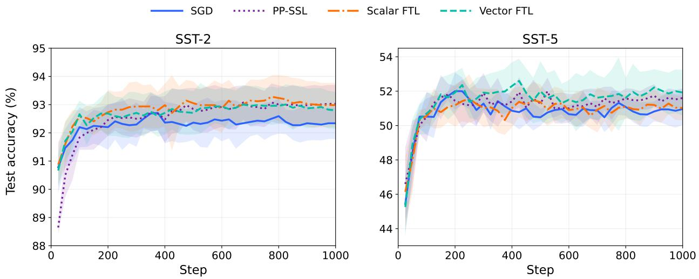  
Figure 4: Test accuracy (%) over training steps for the first-order methods on SST-2 (left) and SST-5 (right). Test accuracy is evaluated every 25 optimization steps. Solid curves denote the mean across five random seeds, and shaded regions indicate ±1 standard deviation

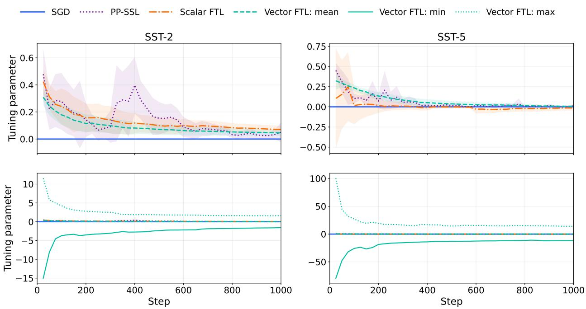  
Figure 5: Tuning parameter trajectories for the first-order methods on SST-2 (left) and SST-5 (right). Tuning parameters are recorded every 25 optimization steps. Top row: Power-tuning parameter trajectories over optimization steps. Bottom row: Power-tuning parameter trajectories together with the across-seed means of the minimum and maximum coordinatewise Vector FTL parameters. Curves show the mean across five random seeds, with shaded regions indicating ±1 standard deviation.

<table><tr><td>Method</td><td>SST-2</td><td>SST-5</td></tr><tr><td>SGD</td><td> $1 e - 4$ </td><td> $1 e - 4$ </td></tr><tr><td>PP-SSL</td><td> $5 e - 5$ </td><td> $1 e - 4$ </td></tr><tr><td>Scalar FTL</td><td> $1 e - 4$ </td><td> $1 e - 4$ </td></tr><tr><td>Vector FTL</td><td> $1 e - 4$ </td><td> $1 e - 4$ </td></tr></table>

Table 1: Learning rates selected using mean validation accuracy for each first-order method on SST-2 and SST-5.

## D.1.2 Zeroth-order methods

For the zeroth-order experiments, we fine-tune the model for 10,000 steps to account for the higher variance of the zeroth-order gradient estimates. Despite the larger number of optimization steps, we note that zeroth-order updates can be more computationally efficient per step, as they require only forward passes and avoid backpropagation. We compare three methods: standard stochastic gradient-free method without using ML-labeled data as well as Algorithm 2 with scalar tuning and vector tuning, which we denote as “ZO Scalar $\mathrm { F T L } ^ { \prime \prime }$ and $^ { 6 6 } \mathrm { Z O }$ Vector $\mathrm { F T L } ^ { \prime \prime }$ respectively in the following. We use a labeled batch size of $n = 3 2$ for all methods. For Algorithm 2, we additionally use an unlabeled batch size of $N = 6 4$ . We set the perturbation parameter to $\mu = 1 e - 3 .$ For each method, we independently tune the learning rate over $\{ 5 e - 7 , 1 e - 6 , 5 e - 6 \}$ and use a constant learning rate throughout fine-tuning. Learning rates are selected based on the mean validation accuracy across seeds and are reported in Table 2.

Results. Figures 6 and 7 report the test-accuracy results and corresponding tuning parameter trajectories for the zeroth-order methods on SST-2 and SST-5. On both SST-2 and SST-5, our methods consistently improve over the ZO baseline after the early stages of training, as the tuning parameters become more stable after aggregating information over more optimization steps. ZO Scalar FTL and ZO Vector FTL perform similarly throughout most of training. The corresponding tuning trajectories are smooth and closely aligned for the scalar and the mean of vector parameters. At the same time, each entry of $\lambda _ { t }$ in vector tuning retains a wider range, indicating that different coordinates continue to place different weights on the ML-labeled correction even when the average tuning parameter evolves similarly to the scalar one.

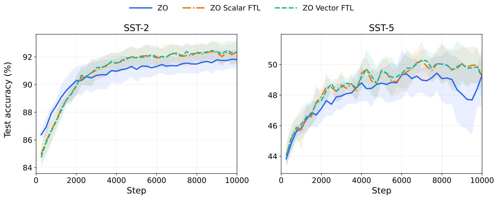  
Figure 6: Test accuracy (%) over training steps for the zeroth-order methods on SST-2 (left) and SST-5 (right). Test accuracy is evaluated every 250 optimization steps. Solid curves denote the mean across five random seeds, and shaded regions indicate ±1 standard deviation.

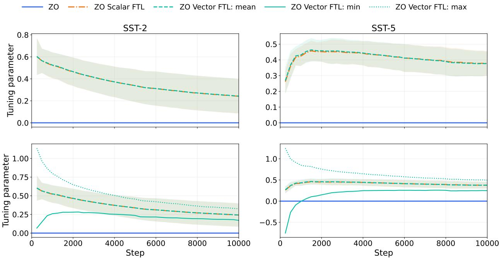  
Figure 7: Tuning parameter trajectories for the zeroth-order methods on SST-2 (left) and SST-5 (right). Tuning parameters are recorded every 250 optimization steps. Top row: Power-tuning parameter trajectories over optimization steps. Bottom row: Power-tuning parameter trajectories together with the across-seed means of the minimum and maximum coordinatewise ZO Vector FTL parameters. Curves show the mean across five random seeds, with shaded regions indicating ±1 standard deviation.

<table><tr><td>Method</td><td>SST-2</td><td>SST-5</td></tr><tr><td>zO</td><td>1e − 6</td><td>1e − 6</td></tr><tr><td>ZO Scalar FTL</td><td>1e − 6</td><td>1e − 6</td></tr><tr><td>ZO Vector FTL</td><td>1e − 6</td><td>1e − 6</td></tr></table>

Table 2: Learning rates selected using mean validation accuracy for each zeroth-order method on SST-2 and SST-5.

## D.2 Image Classification on CIFAR-10

Task and model. We conduct experiments on image classification using CIFAR-10 [Krizhevsky, 2009]. We train a linear classification layer on top of a fixed ResNet-50 [He et al., 2016] pretrained on ImageNet [Deng et al., 2009]. CIFAR-10 contains 50,000 training images and 10,000 test images distributed uniformly across 10 classes. Each image is resized and normalized using the preprocessing associated with the ImageNet-pretrained ResNet-50. We remove the final classification layer of the network and use the resulting 2,048-dimensional penultimate-layer representation as input to a linear classifier with 10 outputs. The ResNet-50 feature extractor remains fixed throughout all labelerand model-training experiments.

Dataset. We partition the original CIFAR-10 training set into four mutually disjoint, class-balanced subsets. We use 5,000 examples to train the labeler model, 4,500 examples as the true-labeled training set, 5,000 examples as the validation set, and the remaining 35,500 examples as unlabeled data. The official CIFAR-10 test split of 10,000 images is used for final evaluation. The same data partition is used for all methods and random seeds. For the labeled, unlabeled, and labeler-training subsets, we apply a random resized crop to 224 × 224 pixels and a random horizontal flip before extracting the ResNet-50 features. Validation and test images are resized to 256 × 256 pixels and centercropped to 224 × 224 pixels. Because the extracted representations are cached, the training augmentations are sampled once during feature extraction.

ML-labeler. To construct the ML-labeler model f(·), we train a linear classifier on top of the fixed 2,048-dimensional features extracted by the ImageNet-pretrained ResNet-50. The classifier maps the feature representation to the 10 CIFAR-10 classes and is trained exclusively on the disjoint labeler-training set. We train the labeler for 50 epochs using AdamW with a learning rate of 1e-3, weight decay 0.01, and batch size 256. The resulting labeler achieves a test accuracy of 86.47% on CIFAR-10 and is subsequently kept fixed and shared across all experimental configurations.

Loss functions. For every labeled and unlabeled feature vector, we pass the representation through the fixed labeler to obtain its logits. A softmax converts these logits into a probability distribution over the 10 CIFAR-10 classes. On labeled examples, the supervised loss is the standard cross-entropy loss between the underlying model's prediction and the ground-truth label. The labeler-based losses on the labeled and unlabeled examples use the KL divergence between the labeler distribution and the predictive distribution of the model being trained.

Randomness. We report results across five random seeds. Randomness across seeds arises from the initialization of the classification layer and the ordering of the labeled and unlabeled mini-batches. For zeroth-order methods, it additionally arises from the Gaussian search directions $\zeta _ { t } \sim \mathcal { N } ( 0 , I _ { d } )$ , with a new direction sampled at every optimization step.

## D.2.1 First-order methods

For the first-order experiments, we train each model for 100 epochs and compare four methods: standard SGD using only labeled examples, PP-SSL with Online Tuning [Shoham et al., 2025], and our method with scalar and vectorvalued tuning parameters (Algorithm 1). We refer to ours as Scalar FTL and Vector FTL, respectively, when presenting the experimental results below for brevity. We tune the learning rate independently for each method and batch-size configuration over $\{ 5 e \mathrm { ~ - ~ } 3 . \qquad $ 1e – 2, 5e — 2, 1e – 1} and use a constant learning rate throughout training. For each method and batch-size configuration, the learning rate is selected based on the mean validation accuracy across five random seeds. The selected learning rates are reported in Table 4. To study the effect of labeled and unlabeled batch sizes, we consider several $( n , N )$ configurations, with n and N denoting the labeled and unlabeled batch sizes, respectively. The full set of configurations is shown in Table 3.

<table><tr><td>n</td><td>N</td><td>SGD</td><td>PP-SSL</td><td>Scalar FTL</td><td>Vector FTL</td></tr><tr><td>64</td><td>128</td><td> $8 6 . 2 9 \pm 0 . 0 8$ </td><td> $8 6 . 3 8 \pm 0 . 1 0$ </td><td> ${ \bf 8 6 . 5 9 \pm 0 . 0 5 }$ </td><td> $8 5 . 7 8 \pm 0 . 4 7$ </td></tr><tr><td>64</td><td>256</td><td> $8 6 . 2 9 \pm 0 . 0 8$ </td><td> $8 6 . 4 4 \pm 0 . 0 5$ </td><td> ${ \bf 8 6 . 6 3 \pm 0 . 0 8 }$ </td><td> $8 6 . 5 7 \pm 0 . 0 4$ </td></tr><tr><td>64</td><td>512</td><td> $8 6 . 2 9 \pm 0 . 0 8$ </td><td> $8 6 . 4 3 \pm 0 . 0 5$ </td><td> ${ \bf 8 6 . 6 3 \pm 0 . 0 6 }$ </td><td> $8 6 . 4 8 \pm 0 . 1 7$ </td></tr><tr><td>64</td><td>1024</td><td> $8 6 . 2 9 \pm 0 . 0 8$ </td><td> $8 6 . 4 3 \pm 0 . 0 5$ </td><td> ${ \bf 8 6 . 6 3 \pm 0 . 0 6 }$ </td><td> ${ \bf 8 6 . 6 3 \pm 0 . 1 2 }$ </td></tr><tr><td>128</td><td>256</td><td> $8 6 . 2 6 \pm 0 . 0 7$ </td><td> $8 6 . 3 9 \pm 0 . 0 5$ </td><td> ${ \bf 8 6 . 4 7 \pm 0 . 0 6 }$ </td><td> $8 5 . 9 7 \pm 0 . 2 0$ </td></tr><tr><td>128</td><td>512</td><td> $8 6 . 2 6 \pm 0 . 0 7$ </td><td> $8 6 . 4 0 \pm 0 . 0 4$ </td><td> ${ \bf 8 6 . 5 3 \pm 0 . 0 6 }$ </td><td> $8 6 . 3 2 \pm 0 . 0 9$ </td></tr><tr><td>128</td><td>1024</td><td> $8 6 . 2 6 \pm 0 . 0 7$ </td><td> $8 6 . 4 3 \pm 0 . 0 5$ </td><td> ${ \bf 8 6 . 6 5 \pm 0 . 0 5 }$ </td><td> $8 6 . 4 0 \pm 0 . 0 9$ </td></tr><tr><td>256</td><td>512</td><td> $8 6 . 4 3 \pm 0 . 0 7$ </td><td> $8 6 . 5 2 \pm 0 . 0 5$ </td><td> ${ \bf 8 6 . 5 2 \pm 0 . 0 8 }$ </td><td> $8 6 . 2 4 \pm 0 . 0 6$ </td></tr><tr><td>256</td><td>1024</td><td> $8 6 . 4 3 \pm 0 . 0 7$ </td><td> $8 6 . 5 5 \pm 0 . 0 5$ </td><td> ${ \bf 8 6 . 6 4 \pm 0 . 0 5 }$ </td><td> $8 6 . 2 5 \pm 0 . 1 3$ </td></tr><tr><td>512</td><td>1024</td><td> $8 6 . 0 8 \pm 0 . 0 7$ </td><td> $8 6 . 1 2 \pm 0 . 0 8$ </td><td> ${ \bf 8 6 . 3 8 \pm 0 . 0 3 }$ </td><td> $8 5 . 8 4 \pm 0 . 0 9$ </td></tr></table>

Table 3: Test accuracy (%) on CIFAR-10. For each method and batch configuration, the learning rate and training checkpoint are selected based on mean validation accuracy, and test accuracy is reported at the selected checkpoint. Results report the mean ± standard error over five random seeds. For each batch configuration, the highest test accuracy is shown in bold.

Results. Table 3 reports the test accuracy obtained after selecting the learning rate and training checkpoint based on mean validation accuracy, while Figures 8 and 9 illustrate the corresponding test-accuracy and tuning-parameter trajectories for chosen batch-size configurations. Across the considered configurations, Scalar FTL provides the most consistent improvement, achieving the highest mean test accuracy in all configurations. PP-SSL also generally improves over the labeled-only SGD baseline, although by a smaller margin. In contrast, Vector FTL is more sensitive to the batch-size configuration: it performs comparably to Scalar FTL for some choices of $( n , N )$ , but exhibits a noticeable degradation for others.

The tuning trajectories help explain these differences. The Scalar FTL tuning parameter decreases smoothly throughout training, while the PP-SSL tuning parameter rapidly approaches zero, thereby substantially reducing the contribution of the ML-labeled correction after the early stages of training. Although the mean of the Vector FTL parameters follows a similarly smooth decreasing trend, its coordinatewise parameters exhibit substantial dispersion, with some coordinates receiving large positive weights and others negative weights throughout training. This additional flexibility can be beneficial, but the pronounced coordinatewise variation is consistent with the greater variability of Vector FTL across batch-size configurations. Overall, these results suggest that the scalar parameter provides a favorable tradeoff between exploiting the ML-labeled data and maintaining stability across different labeled and unlabeled batch sizes.

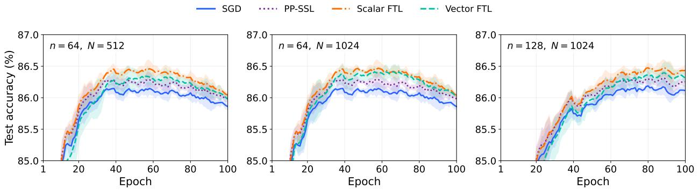  
Figure 8: Test accuracy (%) over training epochs for the first-order methods on CIFAR-10 with $n = 6 4 , N = 5 1 2$ (left), n = 64, N = 1024 (middle), and n = 128, N = 1024 (right). Curves show the mean across five random seeds, with shaded regions indicating ±1 standard deviation. For visualization, test-accuracy curves are smoothed using a five-epoch moving average.

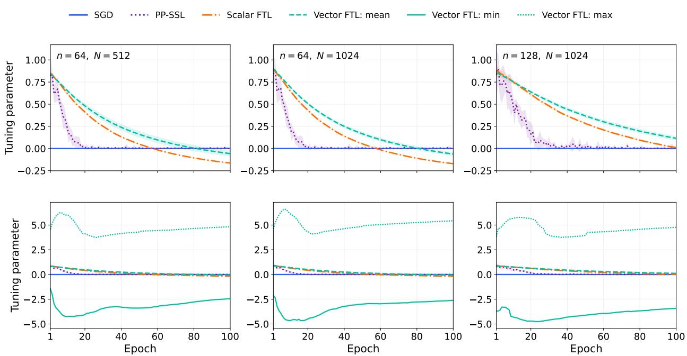  
Figure 9: Tuning parameter trajectories for the first-order methods on CIFAR-10 with $n = 6 4 , N = 5 1 2 \ \mathrm { ( l e f t ) }$ $n = 6 4 , N = 1 0 2 4$ (middle), and $n = 1 2 8 , N = 1 0 2 4$ (right). Top row: Tuning parameter trajectories over training epochs. Bottom row: Tuning parameter trajectories together with the across-seed mean of the minimum and maximum coordinatewise Vector FTL parameters at each epoch. Curves show the mean across five random seeds, with shaded regions indicating ±1 standard deviation.

<table><tr><td>n</td><td>N</td><td>SGD</td><td>PP-SSL</td><td>Scalar FTL</td><td>Vector FTL</td></tr><tr><td>64</td><td>128</td><td> $5 e - 2$ </td><td> $5 e - 2$ </td><td> $5 e - 2$ </td><td> $5 e - 2$ </td></tr><tr><td>64</td><td>256</td><td> $5 e - 2$ </td><td> $5 e - 2$ </td><td> $5 e - 2$ </td><td> $5 e - 2$ </td></tr><tr><td>64</td><td>512</td><td> $5 e - 2$ </td><td> $5 e - 2$ </td><td> $5 e - 2$ </td><td> $5 e - 2$ </td></tr><tr><td>64</td><td>1024</td><td> $5 e - 2$ </td><td> $5 e - 2$ </td><td> $5 e - 2$ </td><td> $5 e - 2$ </td></tr><tr><td>128</td><td>256</td><td> $5 e - 2$ </td><td> $5 e - 2$ </td><td> $5 e - 2$ </td><td> $5 e - 2$ </td></tr><tr><td>128</td><td>512</td><td> $5 e - 2$ </td><td> $5 e - 2$ </td><td> $5 e - 2$ </td><td> $5 e - 2$ </td></tr><tr><td>128</td><td>1024</td><td> $5 e - 2$ </td><td> $5 e - 2$ </td><td> $5 e - 2$ </td><td> $5 e - 2$ </td></tr><tr><td>256</td><td>512</td><td> $1 e - 1$ </td><td> $1 e - 1$ </td><td> $1 e - 1$ </td><td> $1 e - 1$ </td></tr><tr><td>256</td><td>1024</td><td> $1 e - 1$ </td><td> $1 e - 1$ </td><td> $1 e - 1$ </td><td> $1 e - 1$ </td></tr><tr><td>512</td><td>1024</td><td> $1 e - 1$ </td><td> $1 e - 1$ </td><td> $1 e - 1$ </td><td> $1 e - 1$ </td></tr></table>

Table 4: Learning rates selected using mean validation accuracy for each first-order method and batch-size configuration on CIFAR-10.

## D.2.2 Zeroth-order methods

For the zeroth-order experiments, we train each model for 2,000 epochs and compare three methods: standard stochastic gradient-free method without using ML-labeled data and the proposed Algorithm 2 with scalar tuning and vector tuning, which we denote as “ZO Scalar $\mathrm { F T L } ^ { \prime \prime }$ and “ZO Vector $\mathrm { F T L } ^ { \prime \prime }$ respectively in the following. We tune the learning rate independently for each method and batch-size configuration over $\{ 5 e \mathrm { ~ - ~ } 4 , \ 1 e \mathrm { ~ - ~ } 3 , \ 5 e \mathrm { ~ - ~ } 3 \}$ and use a constant learning rate throughout training. The selected learning rates are reported in Table 5. We set the perturbation parameter to $\mu = 1 e - 3$ To study the effect of labeled and unlabeled batch sizes, we consider $( n , N ) \in \{ ( 2 5 6 , 5 1 2 )$ , (256, 1024), (512, 1024) }, where n and N denote the labeled and unlabeled batch sizes, respectively.

Results. Figures 10 and 11 show the test-accuracy results and corresponding tuning parameter trajectories for the zeroth-order methods on CIFAR-10. Similar to previous subsection, Algorithm 2 consistently improve over the ZO baseline across all three batch-size configurations, with ZO Scalar FTL and ZO Vector FTL achieving similar test accuracy throughout training. The improvement is sustained throughout the training, and the relative behavior is stable across the different choices of $( n , N )$ . The corresponding tuning trajectories are also notably smooth: the ZO Scalar FTL parameter and the mean of the tuning parameters of ZO Vector FTL remain closely aligned and gradually decrease over training. For a fixed labeled batch size $n = 2 5 6$ , we observe both reduced variability in the tuningparameter trajectories and larger tuning-parameter values as the unlabeled batch size N increases from 512 to 1024. Although the coordinatewise ZO Vector FTL parameters initially exhibit a wider range, this dispersion is reduced substantially as the training progresses. Overall, in the zeroth-order setting, both methods appear to exploit the MLlabeled correction in a stable manner across batch-size configurations, with little difference in predictive performance between the scalar and vector schemes.

<table><tr><td>n</td><td>N</td><td>ZO</td><td>ZO Scalar FTL</td><td>ZO Vector FTL</td></tr><tr><td>256</td><td>512</td><td> $5 e - 4$ </td><td> $5 e - 4$ </td><td> $5 e - 4$ </td></tr><tr><td>256</td><td>1024</td><td> $5 e - 4$ </td><td> $5 e - 4$ </td><td> $5 e - 4$ </td></tr><tr><td>512</td><td>1024</td><td> $1 e - 3$ </td><td> $1 e - 3$ </td><td> $1 e - 3$ </td></tr></table>

Table 5: Learning rates selected using mean validation accuracy for each zeroth-order method and batch-size configuration on CIFAR-10.

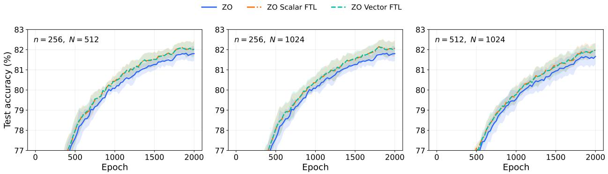  
Figure 10: Test accuracy (%) over training epochs for the zeroth-order methods on CIFAR-10 with $n = 2 5 6 , N = 5 1 2$ (left), $n = 2 5 6 , N = 1 0 2 4$ (middle), and $n = 5 1 2 , N = 1 0 2 4$ (right). Values are reported every 25 epochs. Curves show the mean across five random seeds, with shaded regions indicating ±1 standard deviation

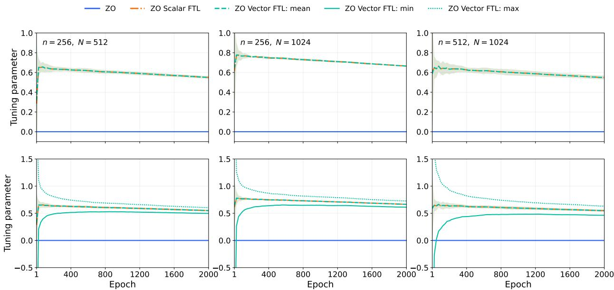  
Figure 11: Tuning parameter trajectories for the zeroth-order methods on CIFAR-10 with $n = 2 5 6 , N = 5 1 2 ( \mathrm { l e f t } )$ $n = 2 5 6 , N = 1 0 2 4$ (middle), and $n = 5 1 2 , N = 1 0 2 4$ (right). Top row: Tuning parameter trajectories over training epochs. Bottom row: Tuning parameter trajectories together with the across-seed mean of the minimum and maximum coordinatewise ZO Vector FTL parameters at each epoch. Values are reported every 25 epochs. Curves show the mean across five random seeds, with shaded regions indicating ±1 standard deviation.

## D.3 Linear Regression on California Housing

Task and model. We conduct experiments on linear regression using the California Housing dataset from the LIB-SVM repository [Chang and Lin, 2011]. The task is to predict the median house value of a California census block from eight numerical features. We use a linear regression model that maps the standardized eight-dimensional input vector to a single standardized target value. The same model architecture is used for the labeler and all models.

Dataset. The complete dataset contains 20,640 examples. Because the dataset does not provide an official test split, we construct a fixed random split. We reserve 4,128 examples, corresponding to 20% of the dataset, for testing. From the remaining examples, we use 500 examples to train the labeler, 80 examples as the true-labeled training set, and 80 examples as the validation set. The remaining 15,852 examples are treated as unlabeled data. These subsets are mutually disjoint, and the same partition is used for all methods and random seeds.

ML-labeler. To construct the labeler model $f ( \cdot )$ , we train a linear regressor on the disjoint labeler-training set of 500 examples. The labeler is trained for 10 epochs using AdamW with a learning rate of $1 e - 2$ , weight decay $1 e - 4 ,$ and batch size 64. The resulting labeler achieves a standardized test MSE of 0.4191. After training, the labeler remains fixed and is shared across all experimental configurations.

Loss functions. For each labeled and unlabeled input, we pass the standardized feature vector through the fixed labeler and cache its scalar prediction. On labeled examples, the supervised loss is the mean squared error between the model's prediction and the ground-truth standardized target. The labeler-based losses on both labeled and unlabeled examples are mean squared errors between the model's prediction and the corresponding cached labeler prediction. Thus, the labeler-based terms use continuous soft regression targets. Because the labeler remains fixed, its predictions are computed once and reused throughout optimization.

Randomness. We report results across ten random seeds. The dataset partition and labeler model are held fixed across seeds. Randomness arises from the initialization of the linear model and the ordering and sampling of the labeled and unlabeled mini-batches. For zeroth-order methods, additional randomness arises from the Gaussian search directions $\zeta _ { t } \sim \mathcal { N } ( 0 , I _ { d } )$

## D.3.1 First-order methods

For the first-order experiments, we train the linear regression model for 100 optimization steps and compare four methods: standard SGD using only labeled data, PP-SSL with Online Tuning [Shoham et al., 2025], and SGD with scalar tuning and vector tuning (i.e., Algorithm 1). We refer to the latter two as Scalar FTL and Vector FTL respectively below. We use a labeled batch size of $n = 1 6$ for all methods and consider unlabeled batch sizes $N \in \{ 6 4 , 1 2 8 , 2 5 6 \}$ for PP-SSL and our methods. Since SGD does not use unlabeled examples, its trajectory is shared across the three batch-size configurations. We use a constant learning rate throughout training and consider the grid $\{ 5 e \mathrm { ~ - ~ } 3 , 1 e \mathrm { ~ - ~ }$ $2 , 5 e \mathrm { ~ - ~ } 2 , 1 e \mathrm { ~ - ~ } 1 \}$ . Based on mean validation performance across seeds, we use a learning rate of $5 e - 2$ for all methods in the final comparison. The reported curves show the mean across ten random seeds, with shaded regions indicating ±1 standard deviation.

Results. Figures 12 and 13 show the test MSE and corresponding tuning-parameter trajectories for the first-order methods on California Housing. Across all three unlabeled batch sizes, the methods that incorporate ML-labeled data improve upon the labeled-only SGD baseline after the initial optimization steps. PP-SSL and Scalar FTL perform comparably across configurations and generally achieve the lowest test MSE, while Vector FTL approaches similar performance later in training but exhibits greater variability early in optimization. The relative behavior of the methods remains broadly consistent as the unlabeled batch size increases from $N = 6 4 { \mathrm { ~ t o ~ } } N = 2 5 6$ . The tuning-parameter trajectories stabilize quickly after the first few steps. Compared to our methods, the PP-SSL tuning parameter exhibits more pronounced fluctuations, particularly for smaller N. The PP-SSL, Scalar FTL, and the mean of Vector FTL parameters remain in a similar positive range throughout training, although their relative magnitudes vary across configurations. We also observe a slightly reduced across-seed variability in the tuning parameters as N increases, particularly after the first few oprimization steps. The coordinatewise Vector FTL parameters exhibit substantial dispersion, with some coordinates receiving negative weights and others considerably larger positive weights. This coordinatewise spread decreases over training but remains visible at the end of optimization, even as the mean of the Vector FTL tuning parameters stays close to the scalar tuning parameters.

## D.3.2 Zeroth-order methods

For the zeroth-order experiments, we train the linear regression model for 1,000 optimization steps and compare three methods: Standard stochastic gradient-free method without using ML-labeled data and Algorithm 2 with scalar tuning and vector tuning, denoted as $^ { 6 6 } \mathrm { Z O }$ Scalar FTL" and $\mathrm { ^ { 6 6 } Z O }$ Vector FTL" respectively. We tune the learning rate independently for each method and batch-size configuration over $\{ 1 e - 3 , 5 e - 3 , ~ 1 e - 2 \}$ and use a constant learning rate throughout training. Learning rates are selected based on the mean validation MSE across ten random seeds and are reported in Table 6. We set the perturbation parameter to $\mu = 1 e { \mathrm { - } } 3$ and sample a new Gaussian search direction at every optimization step. To study the effect of the unlabeled batch size, we fix the labeled batch size to $n = 3 2$ and consider $( n , N ) \in \{ ( 3 2 , 1 2 8 ) , ( 3 2 , 2 5 6 )$ , (32, 512) }, where N denotes the unlabeled batch size.

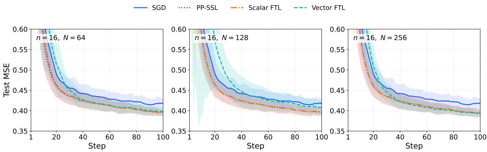  
Figure 12: Test MSE over training steps for the first-order methods on California Housing with $n = 1 6 , N = 6 4$ (left), $n = 1 6 , N = 1 2 8$ (middle), and $n = 1 6 , N = 2 5 6$ (right). Values are reported every 25 epochs. Curves show the mean across ten random seeds, with shaded regions indicating ±1 standard deviation. For visualization, test-MSE curves are smoothed using a five-step moving average.

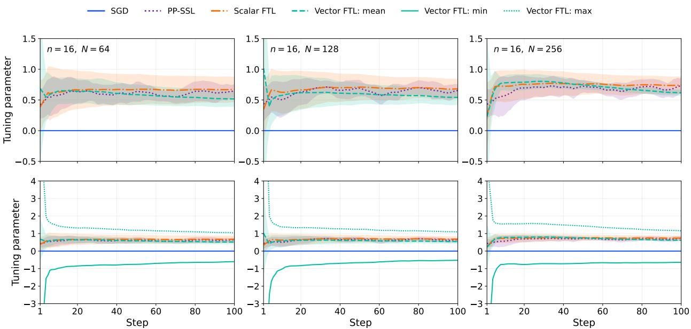  
Figure 13: Tuning parameter trajectories for the first-order methods on California Housing with $n = 1 6 , N = 6 4$ (left), $n = 1 6 , N = 1 2 8$ (middle), and $n = 1 6 , N = 2 5 6$ (right). Top row: Tuning parameter trajectories over training epochs. Bottom row: Tuning parameter trajectories together with the across-seed mean of the minimum and maximum coordinatewise Vector FTL parameters at each epoch. Curves show the mean across ten random seeds, with shaded regions indicating ±1 standard deviation. For visualization, the tuning parameter curves are smoothed using a five-step moving average.

Results. Figures 14 and 15 present the test MSE and corresponding tuning-parameter trajectories for the zeroth-order methods on California Housing. Across all three unlabeled batch sizes, the proposed Algorithm 2 improve over the true-labeled-only ZO baseline after the initial optimization period, with ZO Scalar FTL and ZO Vector FTL achieving similar test MSE throughout most of training. The improvement becomes particularly clear later in optimization and remains consistent as the unlabeled batch size increases from $N = 1 2 8 \mathrm { t o } N = 5 1 2$ . The test-MSE trajectories also become somewhat less variable for larger N for the proposed methods. The tuning parameters stabilize rapidly after the initial optimization steps. The ZO Scalar FTL parameter and the mean of the ZO Vector FTL parameters remain closely aligned throughout training. For fixed n, the across-seed variability of these tuning parameters also tends to decrease as N increases. The coordinatewise ZO Vector FTL parameters initially exhibit a substantially wider range, but this dispersion is reduced quickly and continues to decrease throughout training. Despite this coordinatewise flexibility, the close agreement between the mean vector and scalar tuning parameters is consistent with the similar predictive performance.

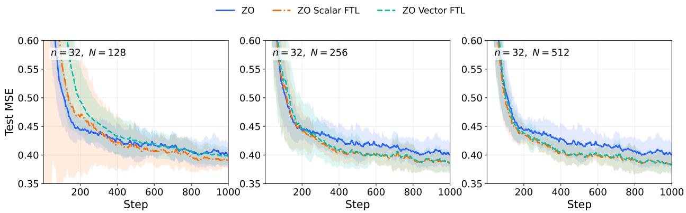  
Figure 14: Test MSE over training steps for the zeroth-order methods on California Housing with $n = 3 2 , N = 1 2 8$ (left), $n = 3 2 , N = 2 5 6$ (middle), and $n = 3 2 , N = 5 1 2$ (right). Values are reported every 25 epochs. Curves show the mean across ten random seeds, with shaded regions indicating ±1 standard deviation. For visualization, test-MSE curves are smoothed using a five-step moving average.

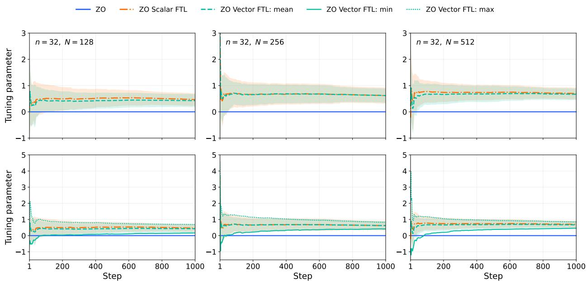  
Figure 15: Tuning parameter trajectories for the first-order methods on California Housing with $n = 3 2 , N = 1 2 8$ (left), $n = 3 2 , N = 2 5 6$ (middle), and $n = 3 2 , N = 5 1 2$ (right). Top row: Tuning parameter trajectories over training epochs. Bottom row: Tuning parameter trajectories together with the across-seed mean of the minimum and maximum coordinatewise Vector FTL parameters at each epoch. Curves show the mean across ten random seeds, with shaded regions indicating ±1 standard deviation. For visualization, the tuning parameter curves are smoothed using a five-step moving average.

<table><tr><td>n</td><td>N</td><td>ZO</td><td>ZO Scalar FTL</td><td>ZO Vector FTL</td></tr><tr><td>32</td><td>128</td><td> $1 e - 2$ </td><td>1e − 2</td><td>5e - 3</td></tr><tr><td>32</td><td>256</td><td> $1 e - 2$ </td><td>1e − 2</td><td>1e − 2</td></tr><tr><td>32</td><td>1024</td><td> $1 e - 2$ </td><td>1e − 2</td><td>1e − 2</td></tr></table>

Table 6: Learning rates selected using mean validation accuracy for each zeroth-order method and batch-size configuration on California Housing

## D.4 Classification on Satimage

Task and model. We conduct experiments on multiclass classification using the Statlog (Landsat Satellite) dataset, distributed as sat image . s cale in the LIBSVM repository [Chang and Lin, 2011]. The task is to classify the soil type associated with the center pixel of a satellite-image neighborhood. Each example contains 36 numerical features, corresponding to four spectral measurements for each pixel in a 3 × 3 neighborhood, and belongs to one of six classes. We train a linear classifier that maps the 36-dimensional input vector to six output logits. The dataset features are taken from the scaled version provided by LIBSVM.

Dataset. The dataset provides an official training split containing 4,435 examples and an official test split containing 2,000 examples. We partition the official training split into four mutually disjoint subsets. We use 1,200 examples to train the labeler, 100 examples as the true-labeled training set, and 100 examples as the validation set. The remaining 3,035 examples are treated as unlabeled data. The split approximately preserves the original class proportions in each subset. The official test split is used for final evaluation. The partition is generated once and is shared across all methods and training seeds.

ML-labeler. To construct the labeler model f(·), we train a two-layer multilayer perceptron on the disjoint labelertraining set of 1,200 examples. The labeler consists of a linear layer mapping the 36 input features to 128 hidden units, followed by a ReLU activation and a linear output layer with six logits. We train the labeler for 2,000 optimization steps using AdamW with a learning rate of 1e-3, weight decay 1e-4, and batch size 128. The labeler is trained using the standard cross-entropy loss and achieves a test accuracy of 87.55%. After training, the labeler remains fixed and is shared across all experimental configurations.

Loss functions. For every labeled and unlabeled input, we pass the feature vector through the fixed labeler and apply a softmax to its logits to obtain a probability distribution over the six classes. These labeler distributions are cached before training. On labeled examples, the supervised loss is the standard cross-entropy loss between the prediction of the model being trained and the ground-truth class label. The labeler-based losses on both labeled and unlabeled examples use the KL divergence between the cached labeler distribution and the predictive distribution from the model being trained. Because the labeler remains fixed, its predictions are computed once and reused throughout optimization.

Randomness. We report results across ten random seeds. Randomness arises from the initialization of the linear classifier and the sampling of labeled and unlabeled mini-batches. For the zeroth-order methods, additional randomness arises from the Gaussian search directions $\zeta _ { t } \sim \mathcal { N } ( 0 , I _ { d } )$

## D.4.1 First-order methods

For the first-order experiments, we train the linear classifier for 500 optimization steps and compare four methods: standard SGD using only labeled data, PP-SSL with Online Tuning [Shoham et al., 2025], and our proposed methods with scalar tuning and vector tuning (i.e., Algorithm 1). We use a labeled batch size of n = 16 for all methods and consider unlabeled batch sizes $N \in \{ 6 4 , 1 2 8 , 2 5 6 \}$ for PP-SSL and our methods. We use a constant learning rate throughout training and independently tune it for each method and batch-size configuration over $\{ 5 e - 3 , 1 e - 2 , 5 e -$ 2, 1e — 1}. Based on the mean validation accuracy across the initial seeds, a learning rate of 1e — 1 is selected for all methods and configurations in the final comparison.

Results. Figures 16 and 17 present the test-accuracy results and corresponding tuning-parameter trajectories for the first-order methods on Satimage. Across all three unlabeled batch sizes, PP-SSL, Scalar FTL, and Vector FTL consistently outperform the labeled-only SGD baseline after the initial optimization period. The three methods that leverage ML-labeled data achieve similar test accuracy overall. The performance of Vector FTL improves as the unlabeled batch size increases, with larger N yielding higher test accuracy in the later stages of training. The tuningparameter trajectories stabilize rapidly after the first few optimization steps. The Scalar FTL and mean of Vector FTL parameters remain close to one another throughout training and are relatively smooth, whereas the PP-SSL tuning parameter exhibits somewhat larger fluctuations. The coordinatewise Vector FTL parameters show a great dispersion, with some coordinates initially receiving negative weights and others much larger positive weights. This dispersion reduces sharply early in training and then remains relatively stable, while the mean of the Vector FTL parameters stays close to the scalar tuning parameter.

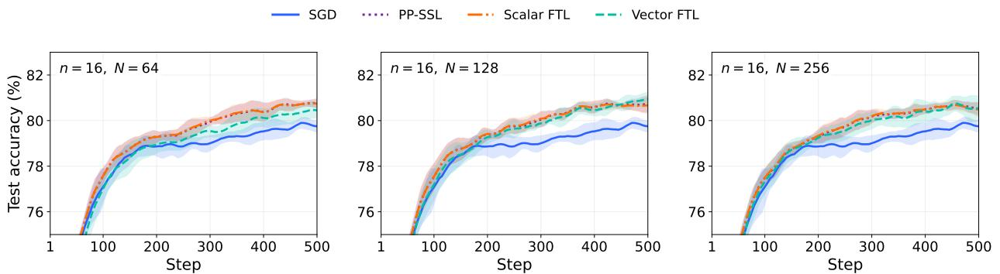  
Figure 16: Test Accuracy (%) over training steps for the first-order methods on Satimage with $n = 1 6 , N = 6 4 ( \mathrm { l e f t } )$ $n = 1 6 , N = 1 2 8$ (middle), and $n = 1 6 , N = 2 5 6$ (right). Values are reported every 25 epochs. Curves show the mean across ten random seeds, with shaded regions indicating ±1 standard deviation. For visualization, test-MSE curves are smoothed using a five-step moving average.

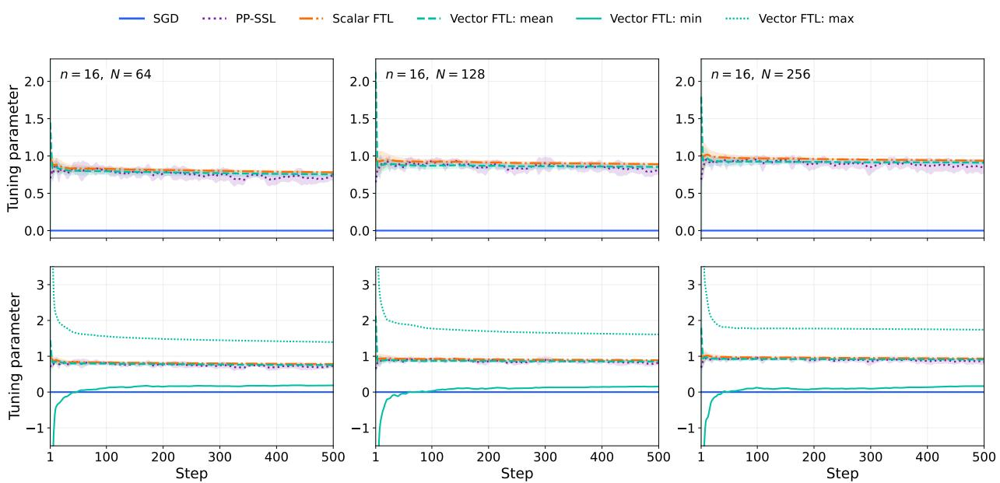  
Figure 17: Tuning parameter trajectories for the first-order methods on Satimage with $n \ : = \ : 1 6 , N \ : = \ : 6 4 \ : ( \mathrm { l e f t } )$ $n = 1 6 , N = 1 2 8$ (middle), and $n = 1 6 , N = 2 5 6$ (right). Top row: Tuning parameter trajectories over training epochs. Bottom row: Tuning parameter trajectories together with the across-seed mean of the minimum and maximum coordinatewise Vector FTL parameters at each epoch. Curves show the mean across ten random seeds, with shaded regions indicating ±1 standard deviation. For visualization, the tuning parameter curves are smoothed using a five-step moving average.

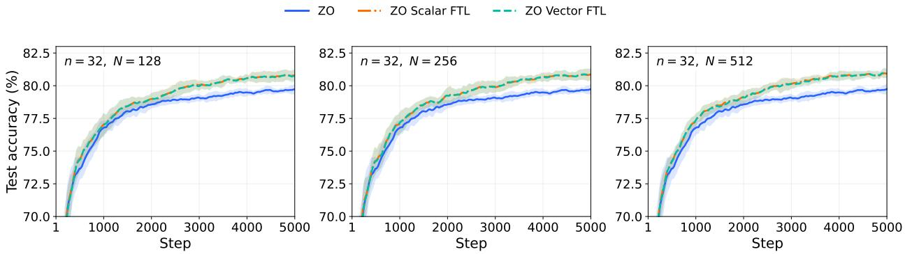  
Figure 18: Test Accuracy (%) over training steps for the zeroth-order methods on Satimage with $n = 3 2 , N = 1 2 8$ (left), $n = 1 6 , N = 2 5 6$ (middle), and $n = 1 6 , N = 5 1 2$ (right). Values are reported every 25 epochs. Curves show the mean across ten random seeds, with shaded regions indicating ±1 standard deviation. For visualization, test-MSE curves are smoothed using a ten-step moving average.

## D.4.2 Zeroth-order methods

For the zeroth-order experiments, we train the linear classifier for 5,000 optimization steps and compare three methods: standard stochastic zeroth-order method without using ML-labeled data and our proposed Algorithm 2 with scalar tuning and vector tuning. We use a labeled batch size of $n = 3 2$ for all methods and consider unlabeled batch sizes $N \in \{ 1 2 8 , 2 5 6 , 5 1 2 \}$ for our methods that use ML-labeled data. We set the perturbation parameter to $\mu = 1 e { \mathrm { - } } 3$ .We use a constant learning rate throughout training and independently tune it for each method and batch-size configuration over $\{ 1 e - 3 , 5 e - 3 , 1 e - 2 \}$ . Based on mean validation accuracy across seeds, a learning rate of $1 e { - 2 }$ is selected for all methods and configurations in the final comparison.

Results. Figures 18 and 19 present the test-accuracy results and corresponding tuning-parameter trajectories for the zeroth-order methods on Satimage. Across all three unlabeled batch sizes, Algorithm 2 with either of the tuning schemes consistently outperform the ZO baseline without using ML-labeled data after the initial stages of training. ZO Scalar FTL and ZO Vector FTL achieve nearly identical test accuracy throughout training, and their improvement over the baseline is sustained through the later optimization steps. This behavior remains consistent as the unlabeled batch size increases from $N = 1 2 8 \mathrm { t o } N = 5 1 2$ . The corresponding tuning trajectories stabilize rapidly after the initial optimization steps, with the ZO Scalar FTL parameter and the mean of ZO Vector FTL parameter remaining closely aligned throughout training. As N increases for fixed $n ,$ the tuning parameters tend to stabilize at larger values, indicating that the methods place greater weight on the ML-labeled correction when it is estimated from a larger unlabeled batch. The coordinatewise ZO Vector FTL parameters initially span a substantially wider range, but this dispersion reduces quickly and continues to decrease over training. Despite this additional coordinatewise flexibility, the close agreement between the scalar and the mean of vector tuning parameters is consistent with the nearly identical predictive performance of the two methods

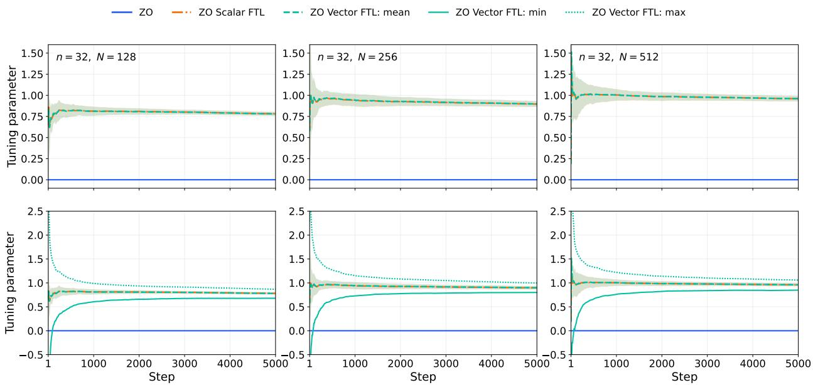  
Figure 19: Tuning parameter trajectories for the first-order methods on Satimage with $n = 3 2 , N = 1 2 8$ (left), $n = 1 6 , N = 2 5 6$ (middle), and $n = 1 6 , N = 5 1 2$ (right). Top row: Tuning parameter trajectories over training epochs. Bottom row: Tuning parameter trajectories together with the across-seed mean of the minimum and maximum coordinatewise ZO Vector FTL parameters at each epoch. Curves show the mean across ten random seeds, with shaded regions indicating ±1 standard deviation. For visualization, the tuning parameter curves are smoothed using a ten-step moving average