Loop twice: fewer parametersfor a little more compute(d)

# Truncate or Not? A Scaling Study of Looped Transformers with Truncated Backpropagation

Xuyuan Xiong1,∗, Siyu Chen2,∗, Zihan Shao2, Yue Su1, Weiyang Jin1, Ping Luo1, Zhuoran Yang2,†, Xihui Liu1,†

1MMLab, The University of Hong Kong 2Yale University

∗Equal contribution: xiongxuyuan@connect.hku.hk, siyu.chen.sc3226@yale.edu †Corresponding authors: zhuoran.yang@yale.edu, xihuiliu@eee.hku.hk

Looped transformers reuse a shared block of layers to increase computational depth without increasing the number of trainable parameters. They are trained with backpropagation through time (BPTT). To save training compute, BPTT is often truncated to the last few loops, although this may weaken the benefit of looping. To study this tradeof systematically, we jointly vary model size, training tokens, and forward and backward loop counts across nearly 600 training runs and fit a unified scaling law that captures the efects of looping and truncation through efective parameters. Despite the training-compute savings of truncation, our fitted law favors full BPTT when forward and backward loop counts are jointly optimized. In matched-compute runs, full BPTT through fewer loops consistently outperforms truncated settings of the same compute. The law further shows that at fixed model size, the compute-optimal loop count and training-token budget both grow with compute. When model size is also free, the law identifies two fully trained loops as the best looped setting. Experimentally, this setting achieves lower loss than the compute-optimal non-looped model with about 27% fewer non-embedding parameters and only 8% more training compute.

Date: October 15, 2026 Code: https://github.com/xjxyys/Truncate-or-Not

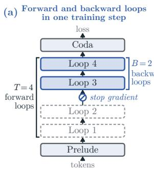

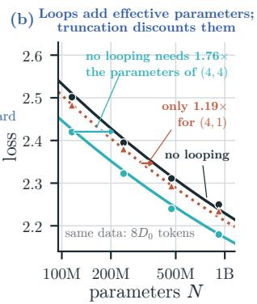

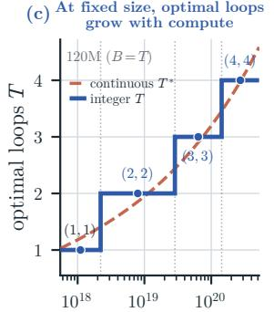  
training compute C (FLOPs)

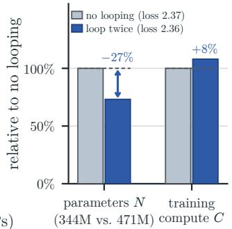  
Figure 1 Overview of looped transformer scaling with truncated BPTT. (a) Step for $( T , B ) = ( 4 , 2 )$ (T forward loops, last B trained). (b) $\mathrm { A t } ~ 8 D _ { 0 }$ tokens, loops add efective parameters while truncation discounts them $( \ S 4 ;$ lines: law, markers: runs). (c) At fixed size (120M), optimal T grows with compute under full BPTT (§6.1). (d) (2, 2) (344M) beats (1, 1) (471M, $2 . 1 \times 1 0 ^ { 1 9 }$ FLOPs) in loss (2.36 vs. 2.37 nats) with 27% fewer parameters and 8% more compute (§6.3).

## 1 Introduction

Looped transformers have attracted attention for combining strong performance with eficient use of parameters and training memory. By repeatedly applying a shared block of layers, they increase computational depth without increasing the number of trainable parameters (Dehghani et al., 2019; Geiping et al., 2025). To reduce the cost of training these repeated blocks, several looped language models use truncated backpropagation through time (BPTT), propagating gradients only through the final loops while executing the earlier loops without tracking gradients (Geiping et al., 2025; Huang et al., 2026; McLeish et al., 2025; Prairie et al., 2026; Wang et al., 2026a). Truncation introduces a new tradeof: it saves backward computation and activation memory during training but can weaken the gains from looping (Schwethelm et al., 2026). To achieve the best performance under a fixed training compute budget, we must therefore decide how to divide compute among forward loops, backward loops, model size, and training tokens.

Existing scaling studies examine prescribed backpropagation recipes rather than jointly modeling forward and backward loop counts. Schwethelm et al. (2026) compare full BPTT with truncation to half the loops, fitting a separate scaling law to each recipe. Parcae (Prairie et al., 2026) varies backward-loop counts in small-model experiments but fixes them to half the forward-loop count in its scaling study, leaving their joint optimization to future work. These studies characterize specific recipes but do not provide a unified law for choosing both loop counts across model sizes and token budgets (Table 1). We thus ask:

## How do model size, training tokens, and forward and backward loops jointly afect loss, and should we truncate backpropagation under a fixed training compute budget?

To characterize how these quantities afect loss, we conduct nearly 600 training runs, including a scaling suite spanning 58M–919M non-embedding parameters, over three orders of magnitude in training tokens per parameter, and up to 16 forward loops. We independently vary forward and backward loop counts across model sizes and token budgets and fit a unified scaling law. The law expresses the benefit of looping through an efective parameter count—the size of a non-looped model that achieves the same loss at the same token budget. Fully trained loops increase the efective parameter count with diminishing returns, while truncation discounts this gain.

We then use the law to decide whether to truncate, and the answer depends on whether the forward-loop count is prescribed. When it is, the law recovers the benefit of truncation reported in prior work (Schwethelm et al., 2026): the saved backward compute supports a larger model and more training tokens, which more than ofset the discounted loop gain. When both loop counts can be chosen, however, the law favors full BPTT. Reducing the forward-loop count frees compute for additional backward loops until every remaining loop is trained, and under the fitted law this reallocation yields more efective parameters at the same compute than the original truncated setting. Separately fitted laws and matched-compute experiments support this advantage (§5).

Building on this preference for full BPTT, we additionally study how to allocate compute among loop count, training tokens, and model size. Consider first a setting where model size is predetermined, for example due to device memory constraints. At fixed model size, increasing the loop count is an efective way to increase the efective parameter count; however, additional loops ofer diminishing gains while increasing the cost per token. The law precisely characterizes the optimal tradeof between loop count and training tokens, allocating most additional compute to tokens and increasing the loop count only slowly. This result extends Parcae’s fixed-size allocation analysis (Prairie et al., 2026) beyond a prescribed truncation rule. When model size is also free, compute can instead support more unique parameters; under our leading-FLOP approximation, the law favors a non-looped model and identifies two fully trained loops as the best looped setting. In experiments, models with two fully trained loops nearly match compute-optimal non-looped models at equal training compute while having substantially fewer non-embedding parameters. With a little more training compute, such a smaller model surpasses the compute-optimal non-looped model (§6).

Our contributions are threefold:

• A unified scaling law based on efective parameters. We develop and validate a law that expresses loop gains and truncation discounts through an efective parameter count, jointly modeling model size, training tokens, and independent forward and backward loop counts (§4).

• An explanation of when truncation pays. We show why truncation can pay at a prescribed forward-loop count and why joint forward–backward allocation favors full BPTT under the fitted law, supported by matched-compute experiments (§5).

• Compute-allocation rules and parameter-eficient training. We derive allocation rules for fixed and free model size and demonstrate that two fully trained loops nearly match computeoptimal non-looped models while having substantially fewer trainable parameters (§6).

Figure 1 previews the three results: loops add efective parameters and truncation discounts them; at fixed model size the best loop count grows with compute; two fully trained loops match the loss of a non-looped model with fewer parameters for a little more compute.

## 2 Related work

Looped transformers. Depth-wise parameter sharing in Universal Transformers and ALBERT decouples computational depth from the number of trainable parameters (Dehghani et al., 2019; Lan et al., 2019). Theoretical and controlled studies show how recurrence supports iterative programs, in-context learning algorithms, and depth-sensitive reasoning (Giannou et al., 2023; Saunshi et al., 2025; Yang et al., 2024). In language model pretraining, Huginn uses a prelude–recurrent–coda architecture (Geiping et al., 2025), while Ouro scales looped pretraining to 7.7T tokens (Zhu et al., 2025). Other work adds recurrence to pretrained models (Bae et al., 2025a; McLeish et al., 2025) or adapts depth at inference (Bae et al., 2025b; Jeddi et al., 2026). Recent architectures improve recurrence through residual and hyper-connections (Fu et al., 2026; Marchenko et al., 2026; Prairie et al., 2026; Zeitoun et al., 2026) or MoE routing (Chen et al., 2026a; Csordás et al., 2024; Gao et al., 2026; He et al., 2026). These studies show that looping improves parameter eficiency across architectures; we instead fix the architecture and ask how to train its loops and allocate compute.

Training through recurrent depth. Truncated BPTT limits gradient propagation to a subset of recurrent steps, saving activation memory and backward compute at the cost of biased gradients (Tallec and Ollivier, 2017; Williams and Peng, 1990). Looped language models often supervise the final output and backpropagate through only the last few loops: Huginn and retrofitted models use at most eight backward steps (Geiping et al., 2025; McLeish et al., 2025). Hierarchical recurrent models likewise use a short backward horizon (Wang et al., 2025, 2026a). Other approaches use implicit diferentiation (Bai et al., 2019), fixed-point gradient approximations (Huang et al., 2026), or supervision within recurrent segments (He et al., 2026). In these recipes the backward depth is fixed; we vary it independently of the forward depth, weighing the compute that truncation saves against the loop gain it costs.

Scaling laws for recurrence. Size–data scaling laws quantify how parameters and training tokens jointly determine loss (Hofmann et al., 2022; Kaplan et al., 2020; Videau et al., 2026), and their compute-optimal predictions depend on how the laws are fitted and compute is counted (Besiroglu et al., 2024; Choshen et al., 2025; Li et al., 2025a; Pearce and Song, 2024; Porian et al., 2024). Extensions account for architectural choices such as MoE sparsity (Abnar et al., 2025; Clark et al., 2022; Krajewski et al., 2024). For looped models, some laws fit each architecture separately (Chen et al., 2026c; Lee et al., 2026; Wang et al., 2026b), while others model the loop count explicitly (Table 1) through additive loss terms (Zhu et al., 2025) or efective parameters with linear, power-law, or bounded gains (Chen et al., 2026b; Prairie et al., 2026; Schwethelm et al., 2026). Among these scaling-law studies of looped transformers, Iso-Depth (Schwethelm et al., 2026) and Parcae (Prairie et al., 2026) are particularly related to our work. Iso-Depth fits separate laws for full and half-length backpropagation and finds that truncation weakens the loop gain but lowers the loss at a fixed forward-loop count by freeing compute. At fixed model size, Parcae finds that loops and tokens should grow together with compute, but ties the backward loops to half the forward loops and leaves their joint choice open. Our law instead treats the backward-loop count as a separate variable, combining coupled size–data scaling (Videau et al., 2026) with bounded loop gains (Chen et al., 2026b). It recovers the truncation benefit at a prescribed forward-loop count but favors full BPTT when both counts are free (§5). In looped MoE models, two loops are the common choice (He et al., 2026): SMELT finds them better than three or four under matched budgets (Wang et al., 2026b), and Loopie finds the marginal benefit of recurrence largest at two (Gao et al., 2026). For dense models, our law ranks two fully trained loops first among looped settings, since they provide nearly the efective size of two untied copies of the block while further loops add less (§6.2). In our runs, two-loop models nearly match compute-optimal models without looping at equal compute while having substantially fewer non-embedding parameters (§6.3).

Table 1 Scaling laws for looped language models. Earlier laws either fit a separate curve per architecture or model looping through a single loop count T, with backward loops B fixed or tied to $T ;$ ours models T and B independently with a bounded efective-parameter gain. $/ { : }$ not discussed; †appendix scaling fit.
<table><tr><td rowspan="2">Study</td><td rowspan="2">Arch.</td><td colspan="4">Scaling axes</td><td rowspan="2">Loop gain</td><td rowspan="2">BPTT</td><td rowspan="2">Regime</td></tr><tr><td></td><td>D</td><td>T</td><td>B</td></tr><tr><td>Schwethelm et al. (2026)</td><td>dense</td><td></td><td></td><td></td><td>x</td><td>power law (Tφ)</td><td> $T ; \ \lceil T / 2 \rceil$ </td><td>fixed depth</td></tr><tr><td>Parcae (Prairie et al., 2026)</td><td>dense</td><td></td><td></td><td></td><td>x</td><td>linear (T)</td><td> $\lceil T / 2 \rceil$ </td><td>fixed N</td></tr><tr><td>Chen et al. (2026b)</td><td>dense, MoE</td><td>V</td><td></td><td></td><td>x</td><td>bounded exp. (T) full (T)</td><td></td><td>free N, mem.</td></tr><tr><td>SMELT (Wang et al., 2026b)</td><td>MoE</td><td></td><td></td><td>x</td><td>x</td><td>per-arch. fit</td><td>/</td><td>matched N, KV</td></tr><tr><td>Lee et al. (2026)</td><td>dense, MoE</td><td></td><td>x</td><td>x</td><td>x</td><td>per-arch. fit</td><td>/</td><td>free N</td></tr><tr><td>Chen et al. (2026c)</td><td>dense</td><td>√</td><td>√</td><td>x</td><td>x</td><td>per-arch. fit</td><td>full (T)</td><td>free N</td></tr><tr><td>Ouro† (Zhu et al., 2025)</td><td>dense</td><td>√</td><td>√</td><td>√</td><td>X</td><td>additive (T)</td><td>/</td><td>/</td></tr><tr><td>Ours</td><td>dense</td><td></td><td>L</td><td></td><td></td><td>bounded (T, B)</td><td> $1 \leq B \leq T$ </td><td>fixed &amp; free N</td></tr></table>

## 3 Preliminaries

Looped transformers. We study the prelude–recurrent–coda architecture (Geiping et al., 2025; Schwethelm et al., 2026) (§A.2), which places a shared recurrent block R (ℓr layers) between a prelude $\mathcal { P } \ ( \ell _ { p }$ layers, including the input embedding) and a coda $\mathcal { C } \ ( \ell _ { c }$ layers, including the output head); see Figure 1a and $\ S \mathrm { A }$ (Figure 12). While $\mathcal { P }$ and C run once per token, R runs for $T$ recurrent iterations (loops); for an input x and loops $t = 1 , \dots , T$ , the model computes

$$
\begin{array} { r l r l r l } & { \underset { \boldsymbol { \psi } } { \mathrm { p r e l u d e } } } & & { \underset { \boldsymbol { \psi } } { \mathrm { l o o p ~ b l o c k } } } & & { \underset { \mathrm { i n p u t ~ i n j e c t i o n } } { \mathrm { i n p u t ~ i n j e c t i o n } } } & & { \underset { \boldsymbol { \psi } } { \mathrm { c o d a } } } \\ & { s _ { 0 } = \mathcal { P } ( \boldsymbol { x } ) , } & & { s _ { t } = \mathrm { R M S N o r m } \big ( \mathcal { R } \big ( W _ { \mathrm { i n j } } \big [ \boldsymbol { s } _ { 0 } ; \boldsymbol { s } _ { t - 1 } \big ] \big ) \big ) , } & & { p = \mathcal { \vec { C } } ( \boldsymbol { s } _ { T } ) . } \end{array}\tag{3.1}
$$

Here all hidden states have width $d , \ [ s _ { 0 } ; s _ { t - 1 } ]$ concatenates the prelude output with the previous state, $W _ { \mathrm { i n j } } \in \mathbb { R } ^ { d \times 2 d }$ projects it back to width $d ,$ and the cross-entropy loss applies only to the final output distribution $p .$ We split the non-embedding parameters N into $N = N _ { \mathrm { o n c e } } + N _ { \mathrm { r e c } }$ , where $N _ { \mathrm { o n c e } }$ counts $\mathcal { P }$ and C (run once per token) and $N _ { \mathrm { r e c } }$ counts $\mathcal { R }$ and $W _ { \mathrm { i n j } }$ (reused each loop; Table 3). Loop settings, full BPTT, and truncated BPTT. A loop setting $( T , B )$ with $1 \leq B \leq T$ executes $T$ forward loops and backpropagates gradients through only the last B loops (Figure 1a). During training, the state $s T - B$ is detached from the computation graph, so the first $T - B$ loops run without gradients; because $s _ { 0 }$ is injected at every loop in (3.1), the prelude P retains a direct gradient path for any $B \geq 1$ . Thus $B = T$ gives full BPTT, $B < T$ gives truncated BPTT, and $( 1 , 1 )$ recovers a standard non-looped transformer.

Baseline scaling law. To relate validation loss to non-embedding parameter count N and training tokens D for a non-looped model, we adopt the coupled scaling law of Videau et al. (2026),

$$
L ( N , D ) = E + \Big [ A \Big ( \frac { N } { N _ { 0 } } \Big ) ^ { - \alpha } + { \cal H } \Big ( \frac { D } { D _ { 0 } } \Big ) ^ { - \beta } \Big ] ^ { \kappa } ,\tag{3.2}
$$

where E is the irreducible loss, $N _ { 0 }$ and $D _ { 0 }$ are fixed reference scales (we give token budgets in units of $D _ { 0 } = 2 ^ { 3 0 }$ tokens), $\alpha , \beta > 0$ are the size and token exponents, and the outer exponent κ couples the two terms $( \kappa = 1$ recovers the additive form of Hofmann et al. (2022)); we denote the data coeficient by H to reserve B for backward loops. $\ S 4$ extends (3.2) to looped models by replacing N with an efective parameter count in which $( T , B )$ rescales $N _ { \mathrm { r e c } }$ by a looping coeficient $g ( T , B )$ .

## 4 A scaling law for forward and backward loops

Should a looped transformer truncate backpropagation? At a fixed model size and training compute, truncation saves backward computation that can be spent on more forward loops or more training data, but it also reduces the benefit of looping. We fit a scaling law that separates forward and backward loop counts to quantify this tradeof. This section fits and validates the law and interprets it in terms of efective parameters. $\ S 5$ then uses the law to decide whether to truncate, and $\ S 6$ uses it to divide compute among loops, data, and model size.

## 4.1 Fitting and validating the scaling law

Experimental setup. We follow the architecture and training recipe of Schwethelm et al. (2026), using the prelude–recurrent–coda layout of §3. We train a grid of five model sizes from 58M to 919M non-embedding parameters (Table 3) on the 100B-token FineWeb-Edu corpus (Penedo et al., 2024). We use MuonH for transformer-block and input-injection matrices and AdamW for embedding, output, and normalization parameters (Jordan et al., 2024; Wen et al., 2025). We report validation cross-entropy in nats per token on deduplicated held-out shards; $\ S \mathrm { A . 2 }$ gives the full training and evaluation setup, including the learning-rate and batch-size rules.

Our 592 training runs include a scaling suite of 347 distinct configurations spanning 1.1–1,291 tokens per parameter and fifteen $( T , B )$ combinations with $T \in \{ 1 , 2 , 4 , 8 , 1 6 \}$ , keeping each model’s parameter count fixed (Prairie et al., 2026). We fit the law on 230 configurations and reserve 117 for separate tests. For configurations with multiple accepted runs, we use their mean validation loss. Each configuration receives the same weight in the fit, regardless of its number of runs. Other experiments cover compute allocation, comparisons with untied models, learning-rate sweeps, and batch-size sweeps; Sections A.2, B.3, D and E give the full experimental design and fitting details.

Effective-parameter scaling law. Only the recurrent block runs in every loop, so looping can enlarge only this block. We therefore write the loss as the coupled law of Videau et al. (2026) with an efective parameter count. In it, the recurrent block, $N _ { \mathrm { r e c } }$ , counts several times, and the prelude and coda, $N _ { \mathrm { o n c e } } ,$ count once (§3):

$$
\begin{array} { r l r } & { } & { L = E + \Big [ A \Big ( \frac { N _ { \mathrm { e f f } } } { N _ { 0 } } \Big ) ^ { - \alpha } + H \Big ( \frac { D } { D _ { 0 } } \Big ) ^ { - \beta } \Big ] ^ { \kappa } , ~ } \\ & { } & { N _ { \mathrm { e f f } } = N _ { \mathrm { o n c e } } + g ( T , B ) N _ { \mathrm { r e c } } , ~ g ( T , B ) = \exp \big [ c ( 1 - T ^ { - p } B ^ { - q } ) \big ] . ~ } \end{array}\tag{4.1}
$$

Here $g ( T , B )$ is the looping coeficient: it multiplies the recurrent block’s parameter count, while the prelude and coda count once. With full BPTT, the looping coeficient $g ( T , T ) = \exp [ c ( 1 - T ^ { - ( p + q ) } ) ]$ grows with $T ;$ truncation multiplies it by $g ( T , B ) / g ( T , T ) \le 1$

Table 2 Fitted parameters on the 230-configuration fitting set. The reference scales are fixed at $N _ { 0 } = 2 . 4 \times 1 0 ^ { 8 }$ parameters and $\mathrm { \bar { \cal D } } _ { 0 } = 2 ^ { 3 0 }$ tokens.
<table><tr><td>E</td><td>A</td><td>H</td><td>α</td><td></td><td>κ</td><td>C</td><td></td><td>p</td></tr><tr><td>0.29865</td><td>6.48695</td><td>7.63343</td><td>0.30568</td><td>0.39281</td><td>0.32510</td><td>1.11198</td><td>0.23677</td><td>1.02181</td></tr></table>

Design of the looping coefficient. We choose $g ( T , B )$ to satisfy four modeling requirements:

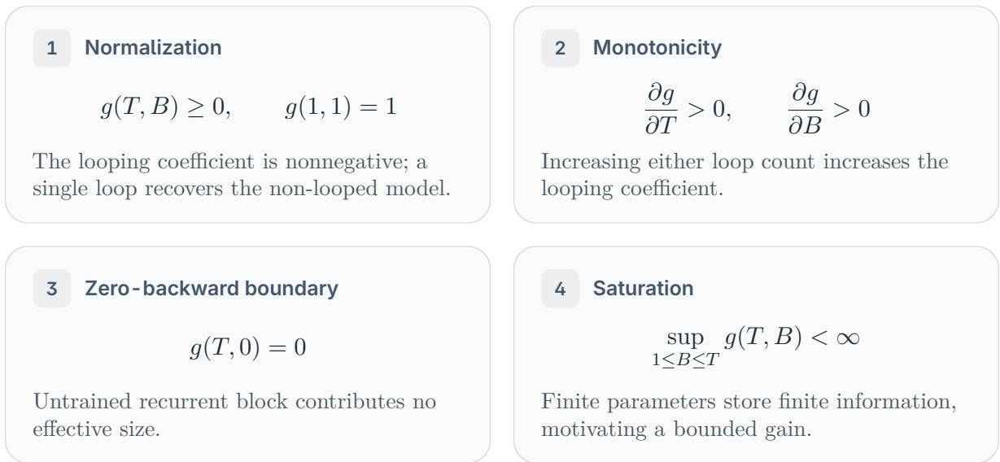

The finite-ceiling assumption is supported by prior observations of saturation: Chen et al. (2026b) model a bounded efective-parameter gain from looping, while Parcae finds that adding test-time loops to a trained model approaches a loss floor (Prairie et al., 2026). There is also an informationstorage motivation. At a fixed parameter count and weight precision, the weights can store only a finite amount of information; additional loops provide more computation over those weights without increasing their storage capacity. We therefore treat saturation as an empirical modeling assumption and learn its ceiling from the data.

These requirements motivate the form in (4.1). Nonnegativity motivates an exponential parameterization, ensuring $g ( T , B ) > 0$ for $T , B > 0$ . With $c , p , q > 0$ , increasing either loop count decreases $T ^ { - p } B ^ { - q }$ , so $g ( T , B )$ grows toward the finite ceiling $e ^ { c }$ . The shared coeficient c enforces $g ( 1 , 1 ) = 1$ and continuous extension as $B  0 ^ { + }$ gives $g ( T , 0 ) = 0$ . At fixed model size and token budget, p governs the loss reduction from extra forward loops at fixed B, while q governs the loss reduction from extra backward loops at fixed T. These three loop coeficients, $c , p , q ,$ together with the six coeficients $E , A , H , \alpha , \beta $ κ of the coupled size–data law (3.2), give nine fitted coeficients.

Empirical looping coefficients. Figure 2 motivates coupling T and B: the empirical looping coeficient has a smaller fitted log–log slope against $r = B / T$ at larger T. Figure 3 compares the shared looping-coeficient surface with empirical looping coeficients. For each looped run with loss ℓ, we first use shape-preserving piecewise cubic Hermite interpolation (PCHIP) (Fritsch and Butland, 1984) to interpolate the non-looped measurements at the same target token budget to obtain the efective size $\mathrm { \widehat { N } } _ { \mathrm { e f f } }$ matching ℓ. We then use the efective-size relation in (4.1): subtracting $N _ { \mathrm { o n c e } }$ and dividing by $N _ { \mathrm { r e c } }$ gives the empirical looping coeficient $\widehat g$ (§B.2). Vertical segments join each empirical median to the fitted coeficient at the same loop setting. This agreement shows that $g ( T , B )$ with just three parameters $c , p , q$ captures the observed loop dependence; Table 4 quantifies the law’s in-sample fit and leave-one-out (LOO) prediction errors.

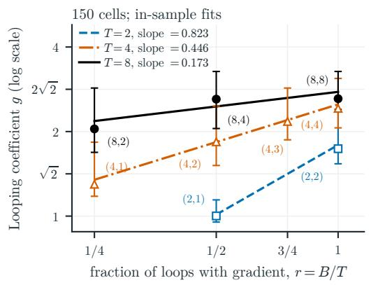

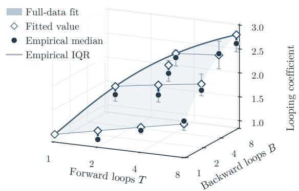  
Figure 2 The looping coeficient varies with $r = B / T$ . Markers and bars: medians and ranges of 150 loss-matched empirical coeficients. Lines: in-sample loss-matched $\log _ { 2 } \widehat { g }$ against r (§B.2).  
Figure 3 The looping coeficient and the runs. Surface and diamonds: the full-data fitted looping coeficient $g ( T , B )$ Circles and gray bars: medians and interquartile ranges (IQR) of loss-matched empirical looping coeficients across 163 configurations with $T \leq 8 \ ( \ S \mathrm { B } . 2 )$

Fitting procedure. We fit all nine parameters jointly by minimizing the sum of squared diferences between predicted and measured validation losses, giving each configuration equal weight. The reference scales $N _ { 0 } = 2 . 4 \times 1 0 ^ { 8 }$ parameters and $D _ { 0 } = 2 ^ { 3 0 }$ tokens are held fixed. Predictions use actual token counts $D ;$ budget holdouts group target token budgets. To reduce sensitivity to the initial guess, we fit the law 64 times from diferent random starting values and retain the solution with the smallest fitting error. All fits converge. Table 2 gives the parameters fitted on the 230 configurations used for the validation below. Further fitting details are in §B.

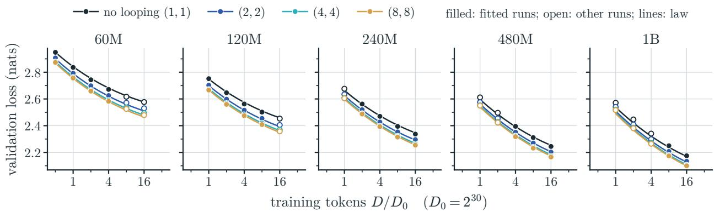  
Figure 4 More loops with full BPTT lower the loss at every size and budget and one law tracks all of them. Validation loss against training tokens for the four loop settings with full BPTT. Dots: runs, open where outside the fitting set; lines: the full-data fitted law (§4).

Holdout validation. To test whether the law predicts measurements it has not been fitted to, we leave out selected configurations, fit all nine parameters again using the remaining measurements, and compare the predictions with the omitted measurements. For example, to test prediction at an unseen model size, we exclude every configuration at that size and fit the law using the other sizes. We repeat this for each size and for the other exclusions listed in Table 4.

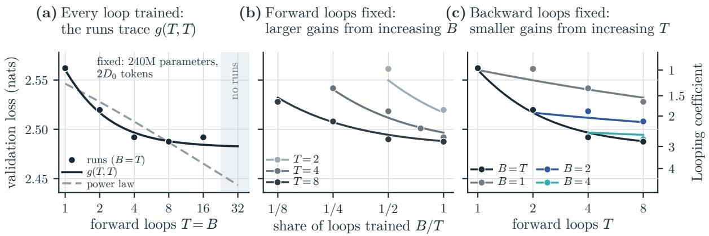  
Figure 5 Forward and backward loops at fixed size and budget (240M, 2D0). Markers show measured runs and solid lines show the fitted law. (a) $B = T \colon$ the gain levels of; dashed, the power-law gain of prior work (Schwethelm et al., 2026) keeps growing. (b) Fixed T: training more of the loops lowers the loss. (c) Fixed B: more forward loops help little.

Prediction accuracy. The law tracks the measured loss curves across sizes and token budgets (Figure 4), including the held-out configurations (marked with open circles). Figure 5 gives the complementary view across loop settings at a fixed model size and token budget: varying T with B = T, varying B at fixed T, and varying T at fixed B. Both figures use the law fitted on the 230-configuration fitting set; the curves are evaluated on both fitted and held-out configurations. §F overlays the law on the five-size grid of the scaling suite.

Holding out a model size or token budget increases prediction error only modestly (Table 4), whereas unseen loop settings are harder to predict (§B). Extrapolation back to the non-looped baseline is the weakest loop-count check; §B reports the boundary errors and alternative gains. The table separates fit quality from held-out prediction error. §4.2 examines the remaining discrepancies in efective-parameter units (Figure 6), and §6.1 checks their efect on compute allocation (Figure 10).

Table 3 Model sizes.  
Table 4 Fit and prediction errors $( \times 1 0 ^ { - 3 } )$
<table><tr><td>Size</td><td>d Layers</td><td>N</td><td> $N _ { \mathrm { r e c } } / N$ </td></tr><tr><td>60M</td><td>768  $2 / 4 / 2$ </td><td>57.8M</td><td>0.510</td></tr><tr><td>120M</td><td>1024  $2 / 5 / 2$ </td><td>115.4M</td><td>0.564</td></tr><tr><td>240M</td><td>1280  $3 / 6 / 3$ </td><td>239.2M</td><td>0.507</td></tr><tr><td>480M</td><td>1664  $3 / 7 / 4$ </td><td>470.8M</td><td>0.506</td></tr><tr><td>1B</td><td>2176  $4 / 8 / 4$ </td><td>918.7M</td><td>0.505</td></tr></table>

d: width; layers: $\ell _ { p } / \ell _ { r } / \ell _ { c } ; N \colon$ non-embedding parameters (§A.2).

<table><tr><td>Evaluation</td><td>Fits</td><td>RMSE</td><td>MAE</td></tr><tr><td>In-sample</td><td>1</td><td>6.14</td><td>4.91</td></tr><tr><td>One configuration out</td><td>230</td><td>6.40</td><td>5.11</td></tr><tr><td>One model size N out</td><td>7</td><td>7.48</td><td>5.89</td></tr><tr><td>One token budget D out</td><td>11</td><td>6.42</td><td>5.12</td></tr><tr><td>One (T, B) setting out</td><td>15</td><td>8.67</td><td>6.74</td></tr></table>

Errors in $\times 1 0 ^ { - 3 }$ nats/token over 230 configurations $( R ^ { 2 } = 0 . 9 9 9 2 ; \ S \mathrm { B } )$

## 4.2 Illustrating the scaling law with effective parameters

How many parameters is a loop setting worth? (4.1) allows us to decompose the answer into the gain from fully trained loops, $g ( T , T )$ , and the discount for truncation, $g ( T , B ) / g ( T , T )$ . We use the empirical looping coeficients introduced above to compare the law with the runs in Figure 6; their construction is detailed in §B.2.

The looping coefficient saturates for large T. With full BPTT, B = T, and the gain is $g ( T , T ) =$ $\exp [ c ( 1 - \bar { T } ^ { - ( p + q ) } ) ]$ . The runs in Figure 5a vary both loop counts together at fixed model size and token budget. Each doubling of trained loops adds less than the one before (Figures 5a and 6a), as Chen et al. (2026b) also find with all loops trained. The power-law gain of prior work (Schwethelm et al., 2026) keeps growing, whereas ours approaches $e ^ { c } .$ . Our runs support the bounded form over the power law, predicting held-out forward-loop counts more accurately (§B.4).

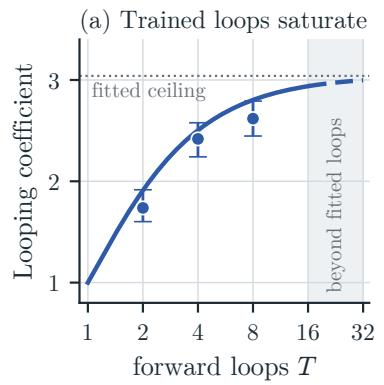

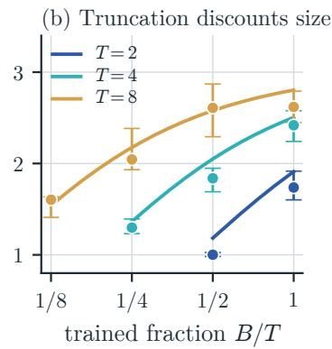

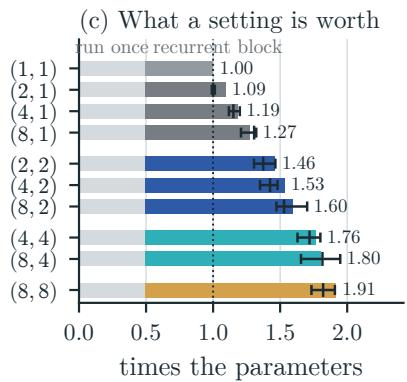  
Figure 6 What a loop setting is worth in efective size. (a) Full BPTT, the looping coeficient $g ( T , T )$ , approaches its fitted ceiling (dotted); dashed beyond the fitted loop counts. (b) The looping coeficient $g ( T , B )$ against the trained fraction $B / T$ . (c) Total efective size $N _ { \mathrm { e f f } } / N$ , grouped by B. Lines, bars and numbers: the law; markers and error bars: run estimates, median and interquartile range over sizes and budgets (§B.2).

Doubling B outweighs doubling T alone. At fixed T, truncation reduces B and hence $g ( T , B )$ consistent with the smaller efective sizes in Figure 6b and higher losses in Figure 5b. Figure 6c clarifies the relative roles of $T$ and B by grouping settings with the same B. The fitted bars and empirical estimates change relatively little as T increases within a group, but show larger gains as $B$ increases across groups, including comparisons at the same T. The fitted exponents quantify this asymmetry: $q > p$ (Table 2) implies $g ( T , 2 B ) > g ( 2 T , B )$ for $2 B \le T$ . From the same initial setting at fixed model size, doubling B thus adds more efective parameters than doubling $T$ alone; the small loss gains from extra forward loops at fixed B support the same conclusion (Figure 5c).

Finding 1 Loops add efective parameters; truncation discounts them. Each fully trained loop adds efective parameters, with diminishing returns toward a finite ceiling. Truncation discounts this gain, and from the same setting, doubling B adds more efective parameters than doubling $T .$

## 5 Truncate or not?

Truncation saves backward compute but reduces the efective parameter count (§4.2). Whether it lowers loss at a given compute depends on which quantities are held fixed. We first fix the forward-loop count, as prior scaling studies do, and then let both loop counts vary at equal compute.

## 5.1 Fixed forward loops: truncation can be optimal

Fix T and optimize N, D, B at compute C with fixed parameter proportions. The efective size is $N _ { \mathrm { e f f } } = N _ { \mathrm { o n c e } } + g ( T , B ) N _ { \mathrm { r e c } }$ , and the compute-equivalent size $N _ { \mathrm { c o m p } }$ sets the leading cost:

$$
C \simeq 6 D N _ { \mathrm { c o m p } } , \qquad N _ { \mathrm { c o m p } } = N _ { \mathrm { o n c e } } + \frac { T + 2 B } { 3 } N _ { \mathrm { r e c } } .\tag{5.1}
$$

Table 5 Predicted optimal allocations at fixed T, with $N _ { \mathrm { r e c } } / \bar { N } \simeq 0 . 5 0 7$ . We optimize N, D under leading FLOPs and enumerate all integer $1 \leq B \leq T$ . Each $( N ^ { * } , D ^ { * } )$ pair is normalized by the respective full-BPTT optima at the same $T , C ;$ these ratios are independent of C.
<table><tr><td> $T$ </td><td> $B ^ { * }$ </td><td> $\chi ( T , B ^ { * } )$ </td><td> $\chi ( T , T )$ </td><td> $N ^ { * }$ </td><td> $D ^ { * }$ </td></tr><tr><td>1</td><td>1</td><td>1.000</td><td>1.000</td><td>1</td><td>1</td></tr><tr><td>2</td><td>2</td><td>1.031</td><td>1.031</td><td>1</td><td>1</td></tr><tr><td>4</td><td>2</td><td>1.204</td><td>1.430</td><td>1.27</td><td>1.08</td></tr><tr><td>8</td><td>2</td><td>1.580</td><td>2.376</td><td>1.51</td><td>1.20</td></tr><tr><td>16</td><td>2</td><td>2.343</td><td>4.339</td><td>1.70</td><td>1.31</td></tr></table>

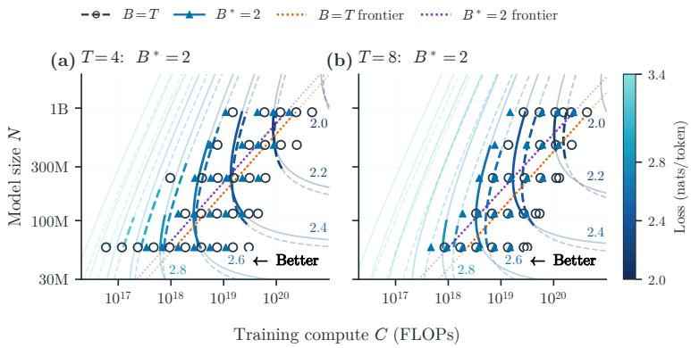  
Figure 7 Separately fitted laws confirm the predicted truncation. Iso-loss contours (labels: loss in nats) and computeoptimal model sizes of laws fitted separately to $B = T$ and to the predicted $B ^ { * } = 2$ . Markers are measured runs.

This counts two FLOPs per parameter per forward pass and four per backward pass, omitting attention products, the output projection, and optimizer updates. Under this approximation, Lemma C.1 in §C.4 shows that optimizing the law over unrestricted positive, continuous $N , D$ reduces to

$$
B ^ { * } \in \operatorname * { a r g m i n } _ { B \in \{ 1 , \ldots , T \} } \chi ( T , B ) , \qquad \mathrm { w h e r e } \quad \chi ( T , B ) = \frac { N _ { \mathrm { c o m p } } } { N _ { \mathrm { e f f } } } .
$$

Smaller $\chi$ means less compute per efective parameter; its ranking is independent of $C$ under these assumptions. The stationary condition (C.7) gives continuous candidates for $B ^ { * }$ ; integer choices are evaluated directly using $\chi$ (Table 5).

Truncation reduces efective size, but frees compute for a larger model and more tokens. At $T = 8 .$ the law selects $B ^ { * } = 2$ and predicts a 34% compute saving at equal optimized loss (Table 5). Separately fitted laws at $T = 4 , 8$ also favor $B = 2$ over $B = T$ : at $T = 8$ , their compute-optimal frontiers predict a 33–35% saving within the range of the runs (Figure 7; fitting details in §C.4).

This agrees with the fixed-compute truncation benefit reported by Schwethelm et al. (2026). Parcae uses truncated BPTT but leaves the compute-optimal choice of forward and backward loop counts to future work (Prairie et al., 2026, Appendix I). The benefit is conditional on prescribing T. We next ask whether it survives when both loop counts can be chosen.

## 5.2 Free forward-loop count: full BPTT is optimal

When $T$ can also be chosen, we optimize the split between forward and backward loops at equal compute. Fix the model architecture and token count D. In our $\mathrm { F L O P }$ accounting, each forward pass through the recurrent block costs one unit and each backward pass costs two, including their attention operations (§C.1). The recurrent block thus costs $T + 2 B$ units per token; all other model components have the same cost across loop settings. Holding $T + 2 B$ fixed therefore holds total compute fixed: for example, $( T , B ) = ( 4 , 4 )$ and (8, 2) both cost 12 recurrent units per token.

Under our scaling la $\mathrm { w , }$ for a loop-compute count $S \geq 3 ,$ , minimizing loss at this compute is equivalent to maximizing the looping coeficient $g ( T , B )$ :

$$
\operatorname* { m a x i m i z e } _ { T , B \in \mathbb { R } } \quad g ( T , B ) \qquad \mathrm { s u b j e c t ~ t o } \quad T + 2 B = S , \quad 1 \leq B \leq T .\tag{5.2}
$$

Table 6 Reducing forward depth at equal training compute. Measured validation losses at $D = 1 6 D _ { 0 }$ (17.2 billion tokens). Within each row, $( T , B ) = ( 8 , 2 )$ and $( 4 , 4 )$ have identical model size, tokens, and training compute C, including optimizer updates. Losses and the reduction $\Delta L = L _ { 8 , 2 } - L _ { 4 , 4 }$ are in nats per token. Model sizes use nominal labels; C is the training compute in FLOPs.
<table><tr><td>Size</td><td>C  $( 1 0 ^ { 1 9 } )$ </td><td> $L _ { 8 , 2 }$ </td><td> $L _ { 4 , 4 }$ </td><td>∆L (10−2)</td></tr><tr><td>60M</td><td>2.41</td><td>2.5211</td><td>2.4933</td><td>2.78</td></tr><tr><td>120M</td><td>4.59</td><td>2.3843</td><td>2.3696</td><td>1.47</td></tr><tr><td>240M</td><td>8.28</td><td>2.2778</td><td>2.2642</td><td>1.36</td></tr><tr><td>480M</td><td>15.29</td><td>2.1845</td><td>2.1738</td><td>1.07</td></tr><tr><td>1B</td><td>28.38</td><td>2.1144</td><td>2.1057</td><td>0.87</td></tr></table>

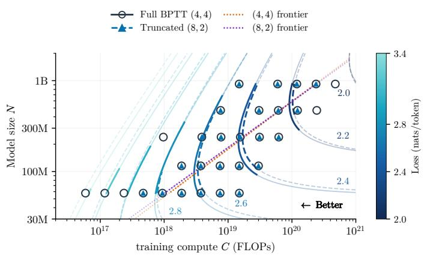  
Figure 8 Fewer fully trained loops improve the compute-optimal frontier. Iso-loss contours of separately fitted laws for $( T , B ) = ( 4 , 4 )$ (solid) and (8, 2) (dashed), both with $T + 2 B = 1 2$ . At equal loss, solid contours lie left of dashed ones: (4, 4) uses 8–14% less compute.

The optimal split uses full BPTT. Recall that $g ( T , B ) = \exp [ c ( 1 - T ^ { - p } B ^ { - q } ) ]$ with $c > 0$ . Thus (5.2) is equivalent to minimizing $T ^ { - p } B ^ { - q }$ under the same afine constraints. This is a standard convex optimization problem: whenever $q > 2 p .$ , its unique solution is $T = B = S / 3$ for every $S \geq 3$ , giving full BPTT (Lemma C.2 in §C.4.2). The fitted exponents in Table 2, $p \simeq 0 . 2 3 7$ and $q \simeq 1 . 0 2 2$ , satisfy $q > 2 p \simeq 0 . 4 7 4$ by a wide margin. Therefore, the law predicts that full BPTT is optimal at every compute if both T and B can be chosen continuously.

Separately fitted laws confirm the benefit of full BPTT. The compute-optimal frontiers of the separately fitted laws predict that (4, 4) reaches the same loss with less compute than (8, 2) where both optimal allocations lie within the ranges of their runs (Figure 8). Matched-compute runs agree: at $D = 1 6 D _ { 0 } , ( 4 , 4 )$ achieves lower loss than (8, 2) at every size (Table 6).

Finding 2 Truncate only when the forward-loop count is prescribed. When T is prescribed, the law favors truncation, and separately fitted laws agree. When both loop counts can be chosen, full BPTT is optimal at every size and compute, since one backward loop is worth more than the two forward loops of the same cost $( q > 2 p )$

## 6 Allocating compute among loops, data, and model size

Given full BPTT, it remains to divide training compute among loops, tokens, and model size. Following Hofmann et al. (2022), we summarize each allocation by how its optimum scales with compute, $X ^ { * } \propto C ^ { a }$ . We first fix the model size (§6.1) and then let it vary (Sections 6.2 and 6.3).

## 6.1 Fixed model size: loops versus data

Suppose a model must fit within a device’s memory budget, so adding parameters is not an option. With more training compute available, should we reuse those parameters through more loops per

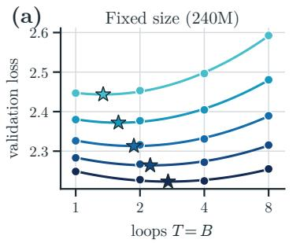

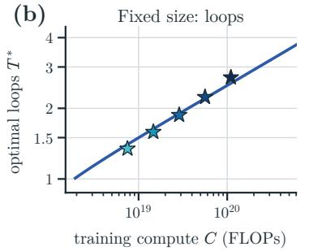

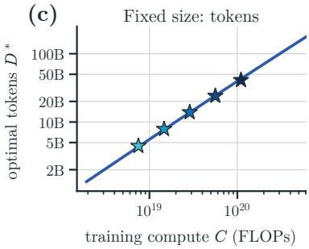

9:6£1017 4:1£1018 1:5£1019 4:0£1019 (1; 1) dashed, open ⋆ (2; 2) solid, filled ⋆ measured runs  
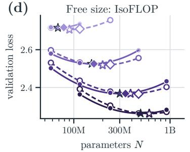

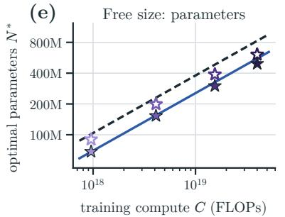

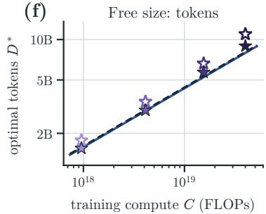  
Figure 9 How the compute-optimal allocation scales with training compute. Top: fixed model size (240M), our law predicts an optimal allocation between $T ^ { * }$ and $D ^ { * } . \ ( \mathrm { a } )$ The loss at five computes against the loop count. Its vertex (star) is the optimum at that compute. (b, c) The optimal loop count $T ^ { * }$ and token count $D ^ { * }$ of the stars, and the law’s optimum (line), whose exponents approach (6.4) asymptotically. Bottom: free model size, $( T , B ) = ( 2 , 2 )$ tracks $( T , B ) = ( 1 , 1 )$ closely in IsoFLOP fitting. (d) The loss at four computes against model size, with its minimum (star); diamonds: the compute-optimal pairs of §6.3. (e, f) $\bar { N } ^ { * }$ and $D ^ { * }$ of the stars and the law’s optimum (6.5), an exact power law and so a straight line; the law places the optimum of (1, 1) at a larger model than its runs do, and its two lines nearly coincide in (f). Colours mark compute within each row. Compute is $6 N _ { \mathrm { { c o m p } } } D \ ( 5 . 1 )$ (under which the three pairs of Table 11 lie at $9 . 6 \times 1 0 ^ { 1 7 }$ $4 . 1 \times 1 0 ^ { 1 8 }$ , and $1 . 5 \times 1 0 ^ { 1 9 }$ FLOPs).

token, or train on more tokens? At fixed size, more loops raise efective size but leave fewer training tokens within the same compute budget; our law balances these two.

Asymptotic loop–token allocation under full BPTT. The allocation power laws below describe the large-compute limit of our fitted loss law, not a separate fit to measured optima. Fix the architecture and parameter counts $( N _ { \mathrm { r e c } } > 0 )$ ; setting $B = T$ in (4.1) gives the full-BPTT loss

$$
L _ { N } ( T , D ) = E + \left[ A \left( \frac { N _ { \mathrm { o n c e } } + N _ { \mathrm { r e c } } e ^ { c \left( 1 - T ^ { - ( p + q ) } \right) } } { N _ { 0 } } \right) ^ { - \alpha } + H \left( \frac { D } { D _ { 0 } } \right) ^ { - \beta } \right] ^ { \kappa } .\tag{6.1}
$$

Because $\kappa > 0$ , minimizing (6.1) is equivalent to minimizing its inner sum, $J _ { N } = ( L _ { N } - E ) ^ { 1 / \kappa }$ . As $T \to \infty$ , the efective size approaches $N _ { \infty } = N _ { \mathrm { o n c e } } + e ^ { c } N _ { \mathrm { r e c } }$ . Expanding around this limit gives

$$
J _ { N } ( T , D ) = J _ { \infty } + K _ { N } T ^ { - ( p + q ) } + H \left( \frac { D } { D _ { 0 } } \right) ^ { - \beta } + O \left( T ^ { - 2 ( p + q ) } \right) ,\tag{6.2}
$$

where $J _ { \infty } = A ( N _ { \infty } / N _ { 0 } ) ^ { - \alpha }$ and $K _ { N } = \alpha c ( N _ { \mathrm { r e c } } e ^ { c } / N _ { \infty } ) J _ { \infty } > 0$ are fixed by the architecture and fitted coeficients; the leading loop term has exponent $p + q$ and the data term has exponent $\beta$

Following the power-law allocation argument of Hofmann et al. (2022), we balance these two terms under a compute constraint. At fixed size, compute per token grows linearly with T at large depth $( C \propto T D )$ . For continuous $T , D ,$ , minimizing the leading terms in (6.2) gives the asymptotic scaling

$$
T ^ { * } \propto C ^ { \frac { \beta } { \beta + p + q } } , \qquad D ^ { * } \propto C ^ { \frac { p + q } { \beta + p + q } } \quad \mathrm { a t \ f i x e d \ } N .\tag{6.3}
$$

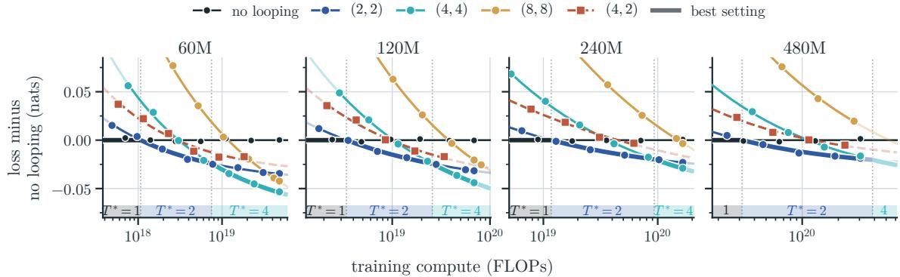  
Figure 10 At a fixed model size, the best loop count grows with training compute: no looping, then two, then four trained loops. Loss minus that of the model without looping at the same compute, which spends it on more tokens; markers are runs, with a smooth curve through each setting; (4, 2) trains half of its four loops. The bold curve is the best setting, named in the strip by its loop count $T ^ { * }$ (faded where extrapolated). Within each stretch the best model spends added compute on tokens, and at each switch it trades tokens for loops.

These powers need not describe finite-compute optima, where overheads and integer loop counts remain consequential. §C.4.3 derives this limit from the exact stationary condition, including the compute overhead of the non-recurrent layers.

Loops grow slowly; most added compute goes to data. Substituting the fitted $p + q \simeq 1 . 2 5 9$ and $\beta \simeq 0 . 3 9 3$ into (6.3) gives, with rounded exponents,

$$
T ^ { * } \propto C ^ { 0 . 2 4 } , \qquad D ^ { * } \propto C ^ { 0 . 7 6 } .\tag{6.4}
$$

A tenfold increase in compute therefore raises the optimal loop count by about 1.7 times and the token count by about 5.8 times. These exponents are asymptotic: because loop counts are integers, the best setting changes in steps. Between steps, added compute goes to tokens; at each step, the model switches to a deeper setting with fewer tokens. The runs show the same trend: at each size, the loop count minimizing loss at equal compute grows with compute as predicted (Figure 9a–c).

Comparison with prior scaling laws. Parcae reports empirical exponents of approximately 0.40 for mean recurrence and 0.78 for training tokens (Prairie et al., 2026, Section 5.2). (6.4) agrees that tokens grow faster than loops, but predicts slower loop growth in the asymptotic regime. Parcae samples recurrence and uses truncated $\mathrm { B P T T }$ , so its reported optimum is conditional on that training recipe. Our full-BPTT result suggests that truncation may be suboptimal when both loop counts are free under our law and compute model; whether this also holds for Parcae requires a direct comparison. The law of Schwethelm et al. (2026) instead lets the looping coeficient grow unbounded as $T ^ { \varphi }$ . Our gain saturates, and $p + q$ governs the approach to that ceiling, giving a diferent asymptotic allocation between loops and tokens.

Finding 3 At fixed model size, spend additional compute mostly on training tokens. Under the fitted law, the optimal number of fully trained loops grows asymptotically as $C ^ { 0 . 2 4 }$ and the number of training tokens as $C ^ { 0 . 7 6 }$ ; the runs show the same trend.

## 6.2 Free model size: the law favors no looping

When model size is free, the compute spent repeating a block can instead train more unique parameters. Start with a T-loop model using full BPTT, for integer $T \ \geq 2 .$ , and replace its shared recurrent block with $T$ untied copies. The resulting non-looped model has the same compute $C$ and token budget D under (5.1), but greater efective size:

$$
N _ { \mathrm { o n c e } } + g ( T , T ) N _ { \mathrm { r e c } } < N _ { \mathrm { o n c e } } + T N _ { \mathrm { r e c } } .
$$

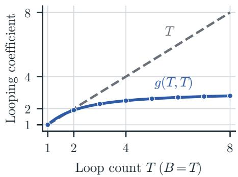

The left side is the efective size of the looped model; the right   
side is that of the model with T untied copies. The inequality Figure 11 Fitted looping coeficient follows from the fitted $g ( T , T ) < T$ (Figure 11; §C.4.4). The $g ( T , T )$ versus T untied copies. Markers indicate integer T.   
non-looped model therefore has greater efective size and lower   
predicted loss at every token budget. Figure 11 also shows that $g ( 2 , 2 )$ is close to $2 ;$ we examine this two-loop case in detail in $\ S 6 . 3$

The best loop setting does not change with compute. With parameter proportions fixed and positive, continuous N, D unrestricted, every loop setting shares the compute exponents of the model without looping. Optimizing the loop setting as well gives

$$
N ^ { * } \propto C ^ { 0 . 5 6 } , \qquad D ^ { * } \propto C ^ { 0 . 4 4 } , \qquad T ^ { * } = B ^ { * } = 1 .\tag{6.5}
$$

The exponents are rounded predictions under the leading-FLOP count (§C.4.4). Under these assumptions, the ranking of loop settings is the same at every compute.

No looping is optimal, and two fully trained loops come closest. Among the fifteen settings, the law favors the model without looping at fixed compute, consistent with Schwethelm et al. (2026). The best looped setting is (2, 2) (Table 5): $g ( 2 , 2 ) \approx 2$ , so two shared loops provide nearly the efective size of two untied copies. Because $N _ { \mathrm { e f f } } > N$ for (2, 2), the law predicts that it comes close to the model without looping while having fewer trainable parameters. §6.3 tests this prediction.

## 6.3 Two fully trained loops are competitive with fewer parameters

Near parity at equal compute. At each of three training budgets, we train a model with two fully trained loops, (2, 2), and a model without looping, each at the size and token count that minimize its loss for that budget, with three seeds per model (§D). At every budget, the looped model stays within 0.008 nats of the model without looping while having 27–32% fewer non-embedding parameters (Table 11). The gap shrinks as the budget grows, and at $2 . 1 \times 1 0 ^ { 1 9 }$ FL $\mathrm { . O P s ^ { 2 } }$ it is smaller than its standard error across seeds. Both models sit near the flat minima of their IsoFLOP profiles, the looped one at a smaller size (Figure 9d).

Ahead with a little more compute. Because the gap is so small, a little more compute lets the looped model pull ahead. We take the pair at $2 . 1 \times 1 0 ^ { 1 9 }$ FLOPs and train its (2, 2) model on 8% more tokens, and so with 8% more compute. Its loss then falls 0.007 nats below that of the model without looping, well beyond the spread across seeds, while it still has 27% fewer non-embedding parameters (Figure 1d; Table 11). Appendix D also compares the looped model with an untied model, which gives each loop its own block, at a fixed number of training tokens.

Finding 4 Two fully trained loops are competitive with fewer parameters. A model with two fully trained loops nearly matches the compute-optimal model without looping at equal training compute; with 8% more compute, it achieves lower validation loss while having 27% fewer non-embedding parameters.

## 7 Conclusion

Truncated BPTT saves compute, but whether it lowers the loss depends on which quantities are held fixed. We fit a scaling law that expresses every loop setting as efective parameters, with a gain that saturates and shrinks under truncation (§4). Under this law, truncation helps only when the forward-loop count is prescribed. When both loop counts are chosen, full BPTT is optimal at every model size and compute we analyze (§5).

The law also determines how to allocate compute. At fixed model size, most additional compute should go to data, and the number of fully trained loops grows only as about $C ^ { 0 . 2 4 }$ (§6.1). When model size is free, the law favors no looping, but two fully trained loops come close: with 27–32% fewer non-embedding parameters they nearly match the compute-optimal non-looped model at equal compute, and with 27% fewer parameters they achieve lower loss at 8% more compute (§6.3).

Limitations. Our main limitation is the focus on dense models: we do not study mixture-of-experts (MoE) architectures, so whether our conclusions on truncation and compute allocation extend to looped MoE models remains open. Second, we measure validation loss only and do not establish whether the observed gains translate to downstream task performance or reasoning ability. Third, our experiments are capped at $T \leq 1 6 .$ , so the gain ceiling and later switches to more loops remain extrapolations. Related scaling sweeps reach eight loops in Schwethelm et al. (2026) and mean training loop counts of twelve in Parcae (Prairie et al., 2026). Much deeper recurrence can exacerbate training instability, including residual explosion and loss spikes (Fu et al., 2026; Prairie et al., 2026); developing stable training recipes for that regime is beyond our scope. Finally, we fix the ratio of non-embedding parameters in the combined prelude and coda to those in the recurrent block for each model size. Varying this ratio to study how parameter allocation afects the gains from looping and the compute-optimal loop counts is a direction for future work.

## Acknowledgments

We thank Yuwei Niu, Yi Ge, and Tianyu Fu for valuable feedback and helpful discussions.

## References

Abnar, S., Shah, H., Busbridge, D., Ali, A. M. E., Susskind, J. and Thilak, V. (2025). Parameters vs FLOPs: Scaling Laws for Optimal Sparsity for Mixture-of-Experts Language Models. arXiv preprint arXiv:2501.12370. 3

Bae, S., Fisch, A., Harutyunyan, H., Ji, Z., Kim, S. and Schuster, T. (2025a). Relaxed Recursive Transformers: Efective Parameter Sharing with Layer-wise LoRA. In International Conference on Learning Representations (ICLR). 3, 34

Bae, S., Kim, Y., Bayat, R., Kim, S., Ha, J., Schuster, T., Fisch, A., Harutyunyan, H., Ji, Z., Courville, A. and Yun, S.-Y. (2025b). Mixture-of-Recursions: Learning Dynamic Recursive Depths for Adaptive Token-Level Computation. arXiv preprint arXiv:2507.10524. 3

Bai, S., Kolter, J. Z. and Koltun, V. (2019). Deep Equilibrium Models. In Advances in Neural Information Processing Systems (NeurIPS). 3

Bergsma, S., Dey, N., Gosal, G., Gray, G., Soboleva, D. and Hestness, J. (2025). Power Lines: Scaling Laws for Weight Decay and Batch Size in LLM Pre-training. In Advances in Neural Information Processing Systems (NeurIPS). 22, 36

Besiroglu, T., Erdil, E., Barnett, M. and You, J. (2024). Chinchilla Scaling: A replication attempt. arXiv preprint arXiv:2404.10102. 3

Bordelon, B., Noci, L., Li, M. B., Hanin, B. and Pehlevan, C. (2023). Depthwise Hyperparameter Transfer in Residual Networks: Dynamics and Scaling Limit. arXiv preprint arXiv:2309.16620. 36

Chen, W., Li, T., Huang, W., Yin, Y., Shang, L. and Qin, C. (2026a). LoopMoE: Unifying Iterative Computation with Mixture-of-Experts for Language Modeling. In Empirical Methods in Natural Language Processing (EMNLP). https://arxiv.org/abs/2606.04438 3

Chen, Y., Goyal, A. and Krishnamoorthi, R. (2026b). Scaling Laws for Looped Mixture of Experts. arXiv preprint arXiv:2609.40316. 4, 6, 9

Chen, Z., Vegesna, A., Dahal, S. and Wilson, A. G. (2026c). How Model Growth, Recursion, and Boundary Operators Influence Scaling Exponents. arXiv preprint arXiv:2609.19107. https://arxiv.org/abs/2609.19107 3, 4

Choshen, L., Zhang, Y. and Andreas, J. (2025). A Hitchhiker’s Guide to Scaling Law Estimation. In International Conference on Machine Learning (ICML). 3

Clark, A., de las Casas, D., Guy, A., Mensch, A., Paganini, M., Hofmann, J., Damoc, B., Hechtman, B., Cai, T., Borgeaud, S., van den Driessche, G., Rutherford, E., Hennigan, T., Johnson, M., Millican, K. et al. (2022). Unified Scaling Laws for Routed Language Models. arXiv preprint arXiv:2202.01169. 3

Csordás, R., Irie, K., Schmidhuber, J., Potts, C. and Manning, C. D. (2024). MoEUT: Mixtureof-Experts Universal Transformers. In Advances in Neural Information Processing Systems (NeurIPS). 3

Dehghani, M., Gouws, S., Vinyals, O., Uszkoreit, J. and Kaiser, Ł. (2019). Universal Transformers. In International Conference on Learning Representations (ICLR). 2, 3

Dey, N., Zhang, B. C., Noci, L., Li, M., Bordelon, B., Bergsma, S., Pehlevan, C., Hanin, B. and Hestness, J. (2025). Don’t be lazy: CompleteP enables compute-eficient deep transformers. In Advances in Neural Information Processing Systems (NeurIPS). 36

Filatov, O., Wang, J., Ebert, J. and Kesselheim, S. (2025). Optimal Scaling Needs Optimal Norm. arXiv preprint arXiv:2510.03871. 22, 36

Fritsch, F. N. and Butland, J. (1984). A method for constructing local monotone piecewise cubic interpolants. SIAM Journal on Scientific and Statistical Computing, 5 300–304. 6, 23

Fu, R., Yang, Z., Zhang, J., Ma, J., Chen, H., Li, Y. and Chang, Y. (2026). Simply Stabilizing the Loop via Fully Looped Transformer. arXiv preprint arXiv:2605.18797. 3, 15

Gao, Z., Chen, Y., Xiao, Y., Yang, X., Tao, R., Zhou, J. and Dai, B. (2026). Loop the Loopies! arXiv preprint arXiv:2607.16051. 3, 4

Geiping, J., McLeish, S., Jain, N., Kirchenbauer, J., Singh, S., Bartoldson, B. R., Kailkhura, B., Bhatele, A. and Goldstein, T. (2025). Scaling up Test-Time Compute with Latent Reasoning: A Recurrent Depth Approach. arXiv preprint arXiv:2502.05171. 2, 3, 4, 21

Giannou, A., Rajput, S., Sohn, J.-y., Lee, K., Lee, J. D. and Papailiopoulos, D. (2023). Looped Transformers as Programmable Computers. arXiv preprint arXiv:2301.13196. 3

He, D., Li, P., Chang, D., Meng, Q., Yin, L. and Liu, S. (2026). Looping Beyond Twice: A Scalable Recipe for Looped Mixture-of-Experts. arXiv preprint arXiv:2610.01153. https://arxiv.org/abs/2610.01153 3, 4

Hofmann, J., Borgeaud, S., Mensch, A., Buchatskaya, E., Cai, T., Rutherford, E., de Las Casas, D., Hendricks, L. A., Welbl, J., Clark, A., Hennigan, T., Noland, E., Millican, K., van den Driessche, G., Damoc, B. et al. (2022). Training Compute-Optimal Large Language Models. arXiv preprint arXiv:2203.15556. 3, 5, 11, 13, 26, 35, 40

Huang, B., Shi, C., Chen, J., Wen, S., Liu, Z., Xing, E. and Ma, X. (2026). Towards Looped Models Done Right, Part II: Rethinking at Fixed Points. arXiv preprint arXiv:2610.06833. https://arxiv.org/abs/2610.06833 2, 3

Jeddi, A., Ciccone, M. and Taati, B. (2026). LoopFormer: Elastic-Depth Looped Transformers for Latent Reasoning via Shortcut Modulation. In International Conference on Learning Representations (ICLR). 3

Jordan, K., Jin, Y., Boza, V., You, J., Cesista, F., Newhouse, L. and Bernstein, J. (2024). Muon: An optimizer for hidden layers in neural networks. https://kellerjordan.github.io/posts/m uon/. 5, 22, 27

Kaplan, J., McCandlish, S., Henighan, T., Brown, T. B., Chess, B., Child, R., Gray, S., Radford, A., Wu, J. and Amodei, D. (2020). Scaling Laws for Neural Language Models. arXiv preprint arXiv:2001.08361. 3, 26

Krajewski, J., Ludziejewski, J., Adamczewski, K., Pióro, M., Krutul, M., Antoniak, S., Ciebiera, K., Król, K., Odrzygóźdź, T., Sankowski, P., Cygan, M. and Jaszczur, S. (2024). Scaling Laws for Fine-Grained Mixture of Experts. arXiv preprint arXiv:2402.07871. 3

Lan, Z., Chen, M., Goodman, S., Gimpel, K., Sharma, P. and Soricut, R. (2019). ALBERT: A Lite BERT for Self-supervised Learning of Language Representations. arXiv preprint arXiv:1909.11942. 3, 34

Lee, R., Biloki, J., Hu, E. J. and May, J. (2026). Sparse Layers are Critical to Scaling Looped Language Models. arXiv preprint arXiv:2605.09165. 3, 4, 22

Li, H., Zheng, W., Wang, Q., Ding, Z., Wang, H., Wang, Z., Xuyang, S., Ding, N., Zhou, S., Zhang, X. and Jiang, D. (2025a). Predictable Scale: Part II, Farseer: A Refined Scaling Law in Large Language Models. arXiv preprint arXiv:2506.10972. 3

Li, H., Zheng, W., Wang, Q., Zhang, H., Wang, Z., Xuyang, S., Fan, Y., Ding, Z., Wang, H., Ding, N., Zhou, S., Zhang, X. and Jiang, D. (2025b). Predictable Scale: Part I, Step Law – Optimal Hyperparameter Scaling Law in Large Language Model Pretraining. arXiv preprint arXiv:2503.04715. 22, 36

Loshchilov, I. and Hutter, F. (2019). Decoupled Weight Decay Regularization. In International Conference on Learning Representations (ICLR). 22

Marchenko, A., Bezrukov, V., Kashurin, O., Fedorova, I., Bocharov, D., Shakhvalieva, Y., Tikhonova, M. and Ternovskii, V. (2026). Closing the Loop: Practical Training Recipes for Looped Language Models. arXiv preprint arXiv:2610.00673. 3

McLeish, S., Li, A., Kirchenbauer, J., Kalra, D. S., Bartoldson, B. R., Kailkhura, B., Schwarzschild, A., Geiping, J., Goldstein, T. and Goldblum, M. (2025). Teaching Pretrained Language Models to Think Deeper with Retrofitted Recurrence. arXiv preprint arXiv:2511.07384. 2, 3

Pearce, T. and Song, J. (2024). Reconciling Kaplan and Chinchilla Scaling Laws. Transactions on Machine Learning Research. 3

Penedo, G., Kydlíček, H., Ben Allal, L., Lozhkov, A., Mitchell, M., Rafel, C., Von Werra, L. and Wolf, T. (2024). The FineWeb Datasets: Decanting the Web for the Finest Text Data at Scale. arXiv preprint arXiv:2406.17557. 5, 22

Porian, T., Wortsman, M., Jitsev, J., Schmidt, L. and Carmon, Y. (2024). Resolving Discrepancies in Compute-Optimal Scaling of Language Models. In Advances in Neural Information Processing Systems (NeurIPS). 3

Prairie, H., Novack, Z., Berg-Kirkpatrick, T. and Fu, D. Y. (2026). Parcae: Scaling Laws For Stable Looped Language Models. arXiv preprint arXiv:2604.12946. 2, 3, 4, 5, 6, 10, 13, 15, 21, 27

Ren, L., Liu, Y., Shen, Y. and Chen, W. (2026). Rethinking Language Model Scaling under Transferable Hypersphere Optimization. arXiv preprint arXiv:2603.28743. 22, 36

Saunshi, N., Dikkala, N., Li, Z., Kumar, S. and Reddi, S. J. (2025). Reasoning with Latent Thoughts: On the Power of Looped Transformers. In International Conference on Learning Representations (ICLR). 3

Schwethelm, K., Rueckert, D. and Kaissis, G. (2026). How Much Is One Recurrence Worth? Iso-Depth Scaling Laws for Looped Language Models. arXiv preprint arXiv:2604.21106. 2, 4, 5, 8, 9, 10, 13, 14, 15, 21, 22, 25, 27, 36

Tallec, C. and Ollivier, Y. (2017). Unbiasing Truncated Backpropagation Through Time. arXiv preprint arXiv:1705.08209. 3

Touvron, H., Martin, L., Stone, K., Albert, P., Almahairi, A., Babaei, Y., Bashlykov, N., Batra, S., Bhargava, P., Bhosale, S., Bikel, D., Blecher, L., Ferrer, C. C., Chen, M., Cucurull, G. et al. (2023). Llama 2: Open Foundation and Fine-Tuned Chat Models. arXiv preprint arXiv:2307.09288. 22

Videau, M., Youbi-Idrissi, B., Lopez-Paz, D. and Ahuja, K. (2026). Skaling: Chinchilla’s Exponents Meet Kaplan’s Coupling. arXiv preprint arXiv:2608.07222. 3, 4, 5

Wang, G., Li, J., Sun, Y., Chen, X., Liu, C., Wu, Y., Lu, M., Song, S. and Yadkori, Y. A. (2025). Hierarchical Reasoning Model. arXiv preprint arXiv:2506.21734. 3

Wang, G., Liu, C., Wang, C., Zhou, C., Sun, Y., Wu, Y., Zhen, S., Scimeca, L. and Abbasi Yadkori, Y. (2026a). HRM-Text: Eficient Pretraining Beyond Scaling. arXiv preprint arXiv:2605.20613. https://arxiv.org/abs/2605.20613 2, 3

Wang, S., Zhang, G., Luo, K., Wu, Y., Liu, S., Liu, J., Huang, W., Yan, S. and Li, J. (2026b). SMELT: Scaling Laws for Compute-Matched MoE Looped Transformers. arXiv preprint arXiv:2609.01343. 3, 4

Wen, K., Dang, X., Lyu, K., Ma, T. and Liang, P. (2025). Fantastic pretraining optimizers and where to find them 2.1: Hyperball optimization. https://tinyurl.com/muonh. 5, 22

Williams, R. J. and Peng, J. (1990). An Eficient Gradient-Based Algorithm for On-Line Training of Recurrent Network Trajectories. Neural Computation, 2 490–501. 3

Yang, G., Hu, E. J., Babuschkin, I., Sidor, S., Liu, X., Farhi, D., Ryder, N., Pachocki, J., Chen, W. and Gao, J. (2021). Tensor Programs V: Tuning Large Neural Networks via Zero-Shot Hyperparameter Transfer. In Advances in Neural Information Processing Systems (NeurIPS). 22

Yang, G., Yu, D., Zhu, C. and Hayou, S. (2023). Tensor Programs VI: Feature Learning in Infinite-Depth Neural Networks. arXiv preprint arXiv:2310.02244. 36

Yang, L., Lee, K., Nowak, R. and Papailiopoulos, D. (2024). Looped Transformers are Better at Learning Learning Algorithms. In International Conference on Learning Representations (ICLR). 3

Zeitoun, A., Torroba-Hennigen, L. and Kim, Y. (2026). Hyperloop Transformers. arXiv preprint arXiv:2604.21254. https://arxiv.org/abs/2604.21254 3

Zhu, R.-J., Wang, Z., Hua, K., Zhang, T., Li, Z., Que, H., Wei, B., Wen, Z., Yin, F., Xing, H., Li, L., Shi, J., Ma, K., Li, S., Kergan, T. et al. (2025). Scaling Latent Reasoning via Looped Language Models. arXiv preprint arXiv:2510.25741. 3, 4, 26

## Contents

1 Introduction 1   
2 Related work 3   
3 Preliminaries 4   
4 A scaling law for forward and backward loops 5   
4.1 Fitting and validating the scaling law 5   
4.2 Illustrating the scaling law with efective parameters 8   
5 Truncate or not? 9   
5.1 Fixed forward loops: truncation can be optimal 9   
5.2 Free forward-loop count: full BPTT is optimal 10   
6 Allocating compute among loops, data, and model size 11   
6.1 Fixed model size: loops versus data . 11   
6.2 Free model size: the law favors no looping 14   
6.3 Two fully trained loops are competitive with fewer parameters . 14   
7 Conclusion 15   
A Model architecture and experimental setup 21   
A.1 Model architecture 21   
A.2 Experimental setup 21   
B The law in detail 22   
B.1 What the runs show before any law is fitted 23   
B.2 Empirical looping coeficient . 23   
B.3 Form and fit . . 24   
B.4 Why a bounded gain 25   
B.5 Runs at sixteen loops . 26   
C Training compute and allocation 26   
C.1 Training compute 26   
C.2 Switch points 27   
C.3 The runs at a fixed size 28   
C.4 Allocation identities and their assumptions 28   
C.4.1 Fixed forward-loop count: optimize size, data, and backward loops 28   
C.4.2 Joint forward–backward allocation at equal compute 30   
C.4.3 Fixed model size: allocate loops and data 31   
C.4.4 Free model size: compare joint allocations 33   
D Compute-optimal pairs and the untied model 34   
E Learning rate and batch size 35   
F The law across the five-size grid 36   
G Training curves 40

## A Model architecture and experimental setup

## A.1 Model architecture

Figure 12 draws the model of §3 for the loop setting (4, 2). In a training step (Figure 12a), the prelude maps the tokens to $e = s _ { 0 } .$ , every loop reads e again through the input injection, and the state $s T - B$ entering the last B loops is treated as a constant. The gradient therefore reaches the coda, the last B loops and, through the injection, the prelude; the first $T - B$ loops run forward only, and evaluation runs all T loops. Each loop (Figure 12b) applies $W _ { \mathrm { i n j } }$ to $[ e ; s _ { t - 1 } ]$ , the $\ell _ { r }$ pre-norm transformer layers of R and an RMSNorm, with the same weights in every loop. At 2 FLOPs per parameter and token for a forward pass and 4 for a backward pass (Figure 12c), the prelude and coda cost 6, each forward loop 2 and each backward loop 4 more, which gives approximately $N ( 3 + T + 2 B )$ FLOPs per token under our parameter split, before attention and output costs (C.1); the optimizer update adds a cost per step (C.3).

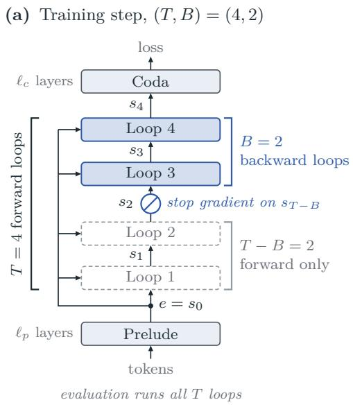

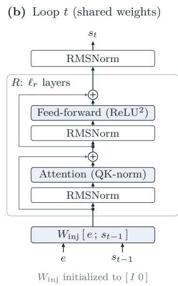

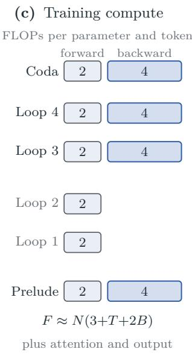  
Figure 12 The looped transformer, drawn for $( T , B ) = ( 4 , 2 )$ . (a) One training step: a stop gradient on $s _ { T - B } ,$ so the first T − B loops (dashed) run forward only. (b) One loop, (3.1); all loops share its weights. (c) Training FLOPs per parameter and token of each part (C.1).

## A.2 Experimental setup

Models. We take the architecture and the training recipe of Schwethelm et al. (2026), the reference recipe below, which builds on the prelude–recurrent–coda layout of Huginn (Geiping et al., 2025) (§3). Its blocks use pre-norm attention with query–key normalization and rotary position embeddings, head dimension 128, a squared-ReLU feed-forward layer of width 4d, no biases, and untied input and output embeddings. We change only what is held fixed. Schwethelm et al. (2026) hold the executed depth fixed, so that more loops mean fewer unique layers; we hold the unique parameters fixed, as Prairie et al. (2026) do, so that a loop setting changes the compute and not the model. The main grid spans five model sizes, from 58M to 919M non-embedding parameters (Table 3); width and depth grow together, and the recurrent block with the input injection holds 51% of the non-embedding parameters at four sizes and 56% at 120M. Short size names round N; including the untied input and output embeddings, total parameter counts run from about 107M to about 1.06B. We quote budgets per parameter as $D / N$ . The scaling suite supplements this grid with two compute-matched pairs, adding the 79M and 162M models at one configuration each (§D).

Loop settings and budgets. The scaling suite spans 1.1–1,291 training tokens per parameter and uses fifteen loop settings. Ten core settings, (1, 1); (2, 1) and (2, 2); (4, 1), (4, 2), (4, 3) and (4, 4); and (8, 2), (8, 4) and (8, 8), cover $T \in \{ 1 , 2 , 4 , 8 \}$ forward loops, full and truncated BPTT, and ratios $B / T$ from $\textstyle { \frac { 1 } { 4 } }$ to 1. Five more settings extend them: (8, 1), and $T = 1 6$ with B = 1, 4, 8 and 16 at three sizes and short budgets (Sections B.5 and F). The part of the training compute that depends on the loops grows with $T + 2 B$ , since a backward loop costs twice a forward loop (§C.1); (4, 1) thus costs as much per token as (2, 2), and (8, 2) as much as (4, 4). Token budgets D are given in units of $D _ { 0 } = 2 ^ { 3 0 } \approx 1 . 0 7 \times 1 0 ^ { 9 }$ tokens. We group runs by their target token budget; actual token counts may difer slightly because of batch rounding. Predictions use the actual token count D. An experimental configuration is a choice of $( N , D , T , B )$ ; a run is one training execution of that configuration. Each configuration contributes one accepted validation loss to the analysis.

Data and evaluation. We train on the 100B-token sample of FineWeb-Edu (Penedo et al., 2024), the corpus of the looped scaling study of Lee et al. (2026), in a pre-shufled release,3 tokenized with the Llama 2 tokenizer (Touvron et al., 2023) of the reference recipe (Schwethelm et al., 2026) into sequences of 2,048 tokens. We report cross-entropy in nats per token on the last two shards of the release, which no run trains on, after removing the documents whose exact text also appears in the training data (the same web page often occurs in several crawls).

Optimization. We use the optimizers of the reference recipe (Schwethelm et al., 2026). MuonH, a variant of Muon that keeps each weight matrix at a fixed Frobenius norm (Jordan et al., 2024; Wen et al., 2025), trains the hidden weight matrices (attention, feed-forward and input injection), and AdamW (Loshchilov and Hutter, 2019) trains the embedding, output and normalization parameters, both without weight decay. The MuonH update adds 0.06–5.7% to the compute of the forward and backward passes; the analysis leaves it out, and the measured compute we report includes it (§C.1). The peak learning rates follow the reference’s transfer rule (Ren et al., 2026; Schwethelm et al., 2026; Yang et al., 2021), a power law in the batch and training tokens with the token exponent re-estimated for our budgets, and the global batch grows as $6 4 \sqrt { D / D _ { 0 } }$ sequences, following the square-root scaling of the loss-optimal batch in prior work (Bergsma et al., 2025; Filatov et al., 2025; Li et al., 2025b) (§E). The learning rate warms up over the first 2% of steps and decays with a cosine to 10% of its peak; gradients are not clipped.

Runs and compute. The results in this paper come from 592 training runs with $2 . 7 \times 1 0 ^ { 2 2 }$ FLOPs of training compute, counted as in §C.1 with the optimizer update. The scaling suite contains 397 runs behind 347 configurations: 385 runs in the five-size grid (§F) and 12 runs in two compute-matched pairs (§D). Each configuration’s loss is the mean of its accepted runs. The remaining 195 distinct runs support the other experiments. These experiments comprise four more runs at 480M in Figure 10, nine further runs of the compute-optimal pairs and the 36 of the untied comparison (§D), and the 66 learning-rate and 124 batch-size runs of Figures 14 and 15; 44 runs belong to two of these groups and are counted once. Counting cancelled runs, runs replaced by reruns, pilot runs and earlier calibration sweeps that the paper does not report, the study trained more than 1,100 runs with about $4 . 8 \times 1 0 ^ { 2 2 } ~ \mathrm { F L O P s }$

## B The law in detail

This appendix details the measured patterns behind the law, its fit and validation, the bounded gain, and the runs at sixteen loops.

## B.1 What the runs show before any law is fitted

The measured losses separate the efects of forward and backward loops without a fitted law (§F). Forward loops that receive no gradient add almost nothing at first: at fixed $B ,$ doubling T from B to 2B changes the loss by less than 0.007 nats in all 24 size–budget combinations trained in all ten core settings, while doubling it again, from 2B to 4B, lowers the loss in all 24. Spending the same compute per token on backward loops is better: (2, 2) beats (4, 1) and (4, 4) beats (8, 2) in all 24, by 0.023 nats on average for (2, 2) against (4, 1). Backward loops in turn have diminishing returns: with full BPTT, every doubling of $T = B$ , from 1 to 8, lowers the loss, by less each time, in all 24 combinations where all four settings were trained.

## B.2 Empirical looping coefficient

The looping coeficient $g ( T , B )$ in (4.1) rescales the recurrent block’s parameter count. To estimate it from the runs, we first find the non-looped model size that matches a looped run’s measured loss at the same token budget. This defines the empirical efective size, which we then convert to a looping coeficient using the run’s parameter counts.

Let $d = \left. D _ { \mathrm { t a r g e t } } / D _ { 0 } \right.$ denote a target budget level, where $D _ { \mathrm { t a r g e t } }$ is the target token count and $D _ { 0 } = 2 ^ { 3 0 }$ tokens. At each d, we collect the accepted non-looped $( T , B ) = ( 1 , 1 )$ configurations and order their actual parameter counts and measured losses as $( n _ { j } , \ell _ { j } ) _ { j = 1 } ^ { m _ { d } }$ , where $n _ { 1 } < \cdots < n _ { m _ { d } }$ Each configuration contributes its accepted loss once, following the same aggregation rules as the scaling-law fit. We require at least three distinct sizes and strictly decreasing losses, $\ell _ { 1 } > \cdots > \ell _ { m _ { d } } ,$ as holds for the eligible reference groups. We interpolate log size as a function of loss:

$$
\phi _ { d } ( \ell ) : = \mathrm { P C H I P } [ ( \ell _ { j } , \log n _ { j } ) _ { j = m _ { d } , \ldots , 1 } ] ( \ell ) , \qquad \ell \in [ \ell _ { m _ { d } } , \ell _ { 1 } ] .\tag{B.1}
$$

Here PCHIP denotes shape-preserving piecewise cubic Hermite interpolation (Fritsch and Butland, 1984), with reference points ordered by increasing loss. The interpolant in (B.1) passes through each measured point, $\phi _ { d } ( \ell _ { j } ) = \log n _ { j }$ , and preserves monotonicity between points. This loss-to-size conversion uses only the non-looped measurements, independent of the fitted coeficients of (4.1).

For a looped configuration $i ,$ let $L _ { i }$ be its measured loss, $d _ { i }$ its target budget, and $N _ { \mathrm { o n c e } , i } , N _ { \mathrm { r e c } , i } > 0$ its once-run and recurrent counts; when its reference group is eligible and $L _ { i } \in [ \ell _ { m _ { d _ { i } } } , \ell _ { 1 } ]$ , define

$$
\widehat { N } _ { \mathrm { e f f } , i } : = \mathrm { e x p } \bigl [ \phi _ { d _ { i } } ( L _ { i } ) \bigr ] , \qquad \widehat { g } _ { i } : = \frac { \widehat { N } _ { \mathrm { e f f } , i } - N _ { \mathrm { o n c e } , i } } { N _ { \mathrm { r e c } , i } } .\tag{B.2}
$$

In (B.2), we subtract the once-run parameters and divide by the recurrent block’s size, as in (4.1). Each empirical coeficient depends on the run’s size and token budget; $g ( T , B )$ is the law’s shared prediction. We report an estimate only when the reference group is eligible and the measured loss lies within its observed range, without extrapolation. Budget matching uses the target level $d ,$ keeping batch-rounded budgets in the same group. Actual consumed tokens difer from the target token budget by less than 0.2% in these runs; we leave these diferences uncorrected.

For example, the 239.24M non-embedding-parameter run at $T = B = 2$ and $D = 4 D _ { 0 }$ has loss 2.4272 nats per token. The reference interpolation gives $\widehat { N } _ { \mathrm { e f f } } = 3 4 5 . 2 0 \mathrm { M }$ , hence $\widehat { g } = ( 3 4 5 . 2 0 \ \cdot$ $1 1 7 . 9 8 ) / 1 2 1 . 2 6 \simeq 1 . 8 7 4$ , using its own once-run and recurrent counts in millions of parameters.

For each setting $( T , B )$ , let $\mathcal { T } _ { T , B }$ be the set of eligible size–budget configurations. Figure 3 shows the median of $\{ \widehat { g } _ { i } : i \in \mathbb { Z } _ { T , B } \}$ , with the 25th and 75th percentiles as the interquartile range. Configurations have equal weight; for sorted estimates $x _ { ( 1 ) } , \ldots , x _ { ( n ) }$ , a percentile at probability u linearly interpolates adjacent order statistics at rank $1 + ( n - 1 ) u$ . Figure 6 uses the same loss-matched estimates, with total-size ratios shown where indicated. The surface figure includes 163 eligible configurations with $T \leq 8 :$ 121 from the fitting set and 42 from the separately held-out set. Reference configurations may also come from either set, and estimates that use the same references are dependent. These figures therefore describe agreement with the runs rather than independent validation of the law. The interquartile ranges show variation across sizes and budgets, not confidence intervals. $\ S \mathrm { B . 3 }$ reports the separate holdout evaluations in loss units.

Figure 2 uses the same estimator on the 150 eligible configurations with $T \in \{ 2 , 4 , 8 \}$ and $1 / 4 \leq$ $r = B / T \le 1$ . Markers show medians and bars show minima and maxima. For each $T .$ , we fit an intercept $a _ { T }$ and slope $s _ { T }$ by ordinary least squares with equal weight per cell:

$$
\left( \widehat { a } _ { T } , \widehat { s } _ { T } \right) = \underset { a , s } { \arg \operatorname* { m i n } } \ \sum _ { i : T _ { i } = T } \left[ a + s \log _ { 2 } r _ { i } - \log _ { 2 } \widehat { g } _ { i } \right] ^ { 2 } .\tag{B.3}
$$

In (B.3), the fitted slopes are 0.823, 0.446 and 0.173 for $T = 2 , 4 , 8$ , respectively; these lines summarize the empirical trend across the 150 configurations rather than a separate scaling law.

## B.3 Form and fit

The looping coeficient is

$$
g ( T , B ) = \mathrm { e x p } [ c ( 1 - T ^ { - p } B ^ { - q } ) ] , \qquad N _ { \mathrm { e f f } } = N _ { \mathrm { o n c e } } + g ( T , B ) N _ { \mathrm { r e c } } .
$$

The normalization is exact: $g ( 1 , 1 ) = 1 , \mathrm { { s o } } \left( T , B \right) = ( 1 , 1 )$ gives $N _ { \mathrm { e f f } } = N$ . For $c , p , q > 0 , g ( T , B )$ increases in T and in B toward $e ^ { c } .$ . The fitted ceiling of the looping coeficient is $e ^ { c } \simeq 3 . 0 4 ;$ it is an extrapolation, not an observed asymptotic limit. With full BPTT the looping coeficient is $g ( T , T ) = \exp [ c ( 1 - T ^ { - ( p + q ) } ) ]$ ; for $B < T$ it is smaller by the factor $\exp [ - c T ^ { - ( p + q ) } ( r ^ { - q } - 1 ) ]$ $r = B / T$ , which approaches one as T grows.

We split the 347 scaling-suite configurations into 230 for fitting and 117 for testing. The fitting set spans fifteen loop settings and includes 226 configurations from the five-size grid, covering five model sizes at approximately 9, 18, 37, or 74 training tokens per parameter, giving the sizes a common budget range. Of these 226 configurations, 194 use the eleven settings with at most eight loops (a few at the largest budgets were not run) and 32 use $T = 1 6$ . The other four fitting configurations are also used to compare a looped model with a non-looped model at each of two training-compute budgets (§D), adding sizes 79M and 162M to the grid’s five sizes. Each configuration enters once through the mean loss of its accepted runs, aggregating repeated runs and seeds and removing duplicate exports. The other 117 configurations of the scaling suite, mostly at shorter or longer budgets, enter no fit and serve as separate tests. Predictions use actual consumed tokens and exact architecture parameter counts. The fixed normalizations are $N _ { 0 } = 2 . 4 \times 1 0 ^ { 8 }$ and $D _ { 0 } = 2 ^ { 3 0 }$

We minimize equally weighted squared residuals in nats per token. All nine coeficients are refitted on every training fold using 64 independent uniform random starts, retaining the lowest-cost converged solution. The trust-region reflective solver uses an analytic Jacobian, Jacobian scaling, at most 4000 evaluations, and tolerances $\mathrm { f t o l = x t o l = g t o l = 1 0 ^ { - 1 2 } }$ . Seeds are 20261010 plus the deterministic fold index. No full-data coeficients initialize a held-out fold, and no learned preprocessing, weighting or hyperparameter tuning is used.

In optimization coordinates, $E \in [ 0 , 3 ]$ , log A, log $H \in [ - 1 0 , 1 5 ] , \alpha , \beta , \kappa \in [ 0 . 0 1 , 3 ] , p , q \in [ 0 . 0 0 1 , 1 0 ]$ 9 and log $c \in \left[ \log 0 . 0 0 1 , \log 1 0 \right]$ . Initial ranges are $E \in [ 0 . 3 , 1 . 2 ]$ , log A, log $H \in [ 0 . 5 , 2 . 5 ] , \alpha , \beta \in$ $[ 0 . 2 5 , 0 . 6 5 ] , \kappa \in [ 0 . 1 5 , 0 . 4 5 ] , p , q \in [ 0 . 1 , 2 ]$ , and log $c \in [ \log 0 . 2 , \log 2 ]$ . The power-law gain of §B.4 uses the same ranges for the first six coeficients and $\phi _ { T } , \phi _ { B } \in [ - 5 , 5 ]$ , initialized in [0.05, 0.8]. All 264 fits of each law converge with full-rank Jacobians (the largest-size holdout reaches $E = 0 )$ .

Validation and aggregation. Residuals are prediction minus measurement. Point LOO holds out one entire accepted configuration. Size folds hold out all combinations at the selected model size. Budget folds group the target level $D _ { \mathrm { t a r g e t } } / D _ { 0 }$ , retaining batch-rounded versions together. Setting folds hold out an entire $( T , B )$ pair. Each family covers all 230 configurations. Point LOO trains on 229 configurations and tests on the remaining one, repeating this for all 230. Table 7 reports pooled errors, which weight held-out configurations equally. Every fold converges and none is dropped. $\ S \mathrm { F }$ overlays the law on the 226 fitted grid configurations; the four fitted configurations from the compute-matched pairs are not shown there.

Table 7 Pooled errors in nats/token over all 230 configurations; all 264 fits converge (one at a bound).
<table><tr><td>Evaluation</td><td>Fits</td><td>RMSE</td><td>MAE</td><td>Bias</td><td>Max. error</td></tr><tr><td>In-sample</td><td>1</td><td> $6 . 1 4 \times 1 0 ^ { - 3 }$ </td><td> $4 . 9 1 \times 1 0 ^ { - 3 }$ </td><td> $- 3 . 7 3 \times 1 0 ^ { - 1 6 }$ </td><td> $2 . 0 4 \times 1 0 ^ { - 2 }$ </td></tr><tr><td>One configuration out</td><td>230</td><td> $6 . 4 0 \times 1 0 ^ { - 3 }$ </td><td> $5 . 1 1 \times 1 0 ^ { - 3 }$ </td><td> $- 3 . 3 0 \times 1 0 ^ { - 6 }$ </td><td> $2 . 1 0 \times 1 0 ^ { - 2 }$ </td></tr><tr><td>One model size N out</td><td>7</td><td> $7 . 4 8 \times 1 0 ^ { - 3 }$ </td><td> $5 . 8 9 \times 1 0 ^ { - 3 }$ </td><td> $- 2 . 1 6 \times 1 0 ^ { - 4 }$ </td><td> $2 . 5 8 \times 1 0 ^ { - 2 }$ </td></tr><tr><td>One token budget D out</td><td>11</td><td> $6 . 4 2 \times 1 0 ^ { - 3 }$ </td><td> $5 . 1 2 \times 1 0 ^ { - 3 }$ </td><td> $- 3 . 4 2 \times 1 0 ^ { - 5 }$ </td><td> $2 . 0 8 \times 1 0 ^ { - 2 }$ </td></tr><tr><td>One (T, B) setting out</td><td>15</td><td> $8 . 6 7 \times 1 0 ^ { - 3 }$ </td><td> $6 . 7 4 \times 1 0 ^ { - 3 }$ </td><td> $8 . 8 6 \times 1 0 ^ { - 4 }$ </td><td> $2 . 6 3 \times 1 0 ^ { - 2 }$ </td></tr></table>

Table 8 The law against the power-law gain of prior work (Schwethelm et al., 2026): $g ( T , B ) = T ^ { \phi _ { T } } B ^ { \phi _ { B } }$ in place of the bounded gain, which reduces to $T ^ { \phi }$ with full BPTT, everything else of (4.1) unchanged, fitted on the same configurations with the same folds and solver. Pooled RMSE in nats per token.
<table><tr><td>Evaluation</td><td>Bounded gain</td><td>Power-law gain</td></tr><tr><td>In-sample</td><td> $6 . 1 4 \times 1 0 ^ { - 3 }$ </td><td> $1 . 3 1 \times 1 0 ^ { - 2 }$ </td></tr><tr><td>One configuration out</td><td> $6 . 4 0 \times 1 0 ^ { - 3 }$ </td><td> $1 . 3 6 \times 1 0 ^ { - 2 }$ </td></tr><tr><td>One model size N out</td><td> $7 . 4 8 \times 1 0 ^ { - 3 }$ </td><td> $1 . 4 0 \times 1 0 ^ { - 2 }$ </td></tr><tr><td>One token budget D out</td><td> $6 . 4 2 \times 1 0 ^ { - 3 }$ </td><td> $1 . 3 5 \times 1 0 ^ { - 2 }$ </td></tr><tr><td>One  $( T , B )$  setting out</td><td> $8 . 6 7 \times 1 0 ^ { - 3 }$ </td><td> $1 . 6 5 \times 1 0 ^ { - 2 }$ </td></tr></table>

Table 9 Looping coeficient and total efective size; total size uses recurrent share $f = 0 . 5 0 7 \mathrm { \Omega }$
<table><tr><td>Setting</td><td> $g ( T , B )$ </td><td> $N _ { \mathrm { e f f } } / N$ </td></tr><tr><td>(1,1)</td><td>1.00000</td><td>1.00000</td></tr><tr><td>(2, 1)</td><td>1.18330</td><td>1.09294</td></tr><tr><td>(2,2)</td><td>1.91023</td><td>1.46150</td></tr><tr><td>(4,1)</td><td>1.36498</td><td>1.18505</td></tr><tr><td>(4,2)</td><td>2.04945</td><td>1.53209</td></tr><tr><td>(4, 4)</td><td>2.50361</td><td>1.76236</td></tr><tr><td>(8,2)</td><td>2.17552</td><td>1.59601</td></tr><tr><td>(8,4)</td><td>2.57832</td><td>1.80024</td></tr><tr><td>(8,8)</td><td>2.80330</td><td>1.91431</td></tr><tr><td></td><td></td><td></td></tr><tr><td>(16, 16)</td><td>2.93895</td><td>1.98308</td></tr></table>

## B.4 Why a bounded gain

Prior scaling laws for looped models let the looping gain grow as a power of the loop count, $T ^ { \phi }$ (Schwethelm et al., 2026). We extend this form to $T ^ { \phi _ { T } } B ^ { \phi _ { B } }$ in place of $g ( T , B )$ , keeping the rest of (4.1) unchanged. This form is the limit of our gain as $c \to \infty$ with $c p  \phi _ { T }$ and $c q  \phi _ { B } ;$ under full BPTT it reduces to $T ^ { \phi }$ with $\phi = \phi _ { T } + \phi _ { B }$ . We fit both laws on the same configurations, folds and solver. The power-law gain is less accurate in every evaluation in Table 8, with nearly twice the error on a held-out (T, B) setting $( 1 . 6 5 \times 1 0 ^ { - 2 } ~ \mathrm { v s . ~ } 8 . 6 7 \times 1 0 ^ { - 3 } ~ \mathrm { n a t s } )$ ; it keeps growing where the runs level of, and held out at sixteen loops its error is three times that of the bounded gain (§B.5). Our gain rises from $g ( 1 , 1 ) = 1$ toward $e ^ { c } ;$ with full BPTT and $p + q = 1$ it is the reciprocal exponential gain $\exp [ c ( 1 - 1 / T ) ]$ , and free exponents separate the ceiling from the rate of approach.

The derivatives distinguish the empirical assumption from its algebraic consequences. At fixed coeficients, with $s = p + q$ , the total derivatives below follow the full-BPTT path $B = T$ :

$$
\begin{array} { c } { { \displaystyle \frac { \partial \log g } { \partial T } = c p T ^ { - p - 1 } B ^ { - q } > 0 , \qquad \displaystyle \frac { \partial \log g } { \partial B } = c q T ^ { - p } B ^ { - q - 1 } > 0 , } } \\ { { \displaystyle \frac { \mathrm { d } } { \mathrm { d } T } g ( T , T ) = c s T ^ { - s - 1 } g ( T , T ) > 0 , } } \\ { { \displaystyle \frac { \mathrm { d } ^ { 2 } } { \mathrm { d } T ^ { 2 } } g ( T , T ) = c s T ^ { - s - 2 } g ( T , T ) [ c s T ^ { - s } - ( s + 1 ) ] . } } \end{array}
$$

For the fitted coeficients, $c s < s + 1$ , so the full-BPTT gain is concave for $T \geq 1$ . Concavity is not automatic for every positive parameter choice. The efective size is an equivalence in validation loss, not in stored knowledge (Zhu et al., 2025).

## B.5 Runs at sixteen loops

The fit contains 32 configurations at $T = 1 6$ , across 120M, 240M and 480M, with backward counts 1, 4, 8 and 16 and target token budgets from $2 D _ { 0 }$ to $8 D _ { 0 }$ . Holding out this whole row leaves 198 training configurations and gives RMSE 0.0115 nats, against 0.0340 for the power-law gain of prior work, which keeps growing beyond the loop counts it is fitted on. The harder extrapolation is the row without looping, $T = 1$ : RMSE 0.0172 (0.0207 for the power-law gain), the largest forward-row error. The four sixteen-loop configurations of 480M at $2 D _ { 0 }$ lie outside the fitting set.

## C Training compute and allocation

We first define the training-compute cost, then discuss the fixed-size switch points and their experimental checks. §C.4 gives the allocation derivations for prescribed forward loops, joint loop counts, and fixed or free model size.

## C.1 Training compute

Training compute counts the FLOPs of the forward and backward passes. We use the usual convention of 2 FLOPs per parameter and token for the forward pass and 4 for the backward pass (Hofmann et al., 2022; Kaplan et al., 2020). The prelude and coda run forward and backward once per token. Each forward loop runs the recurrent block forward once, and each backward loop adds a backward pass through it, which costs twice as much. The compute of the passes per token, using the approximately equal parameter split, is

$$
F ( T , B ) \approx N \left( 3 + T + 2 B \right) + F _ { \mathrm { a t t n } } ( T , B ) + F _ { \mathrm { o u t } } ,\tag{C.1}
$$

where $F _ { \mathrm { a t t n } }$ counts the attention products of every executed layer and $F _ { \mathrm { o u t } }$ the output projection. The attention products of the recurrent block follow the same count, one unit per forward loop and

Table 10 Model size fixed: the training compute at which the best loop setting changes, given as the tokens per parameter that the model without looping trains on at that compute. Among all fifteen trained settings, four of them with $T = 1 6 ,$ , only full BPTT reaches the frontier, apart from (4, 3), which leads briefly between (2, 2) and (4, 4) by at most 0.002 nats. †Beyond the compute of the runs of that size. ‡Involves $T = 1 6$ trained at three sizes and short budgets only.
<table><tr><td>Best setting changes</td><td>60M</td><td>120M</td><td>240M</td><td>480M</td><td>1B</td></tr><tr><td> $( 1 , 1 )  ( 2 , 2 )$ </td><td>16</td><td>17</td><td>16</td><td>15</td><td>14</td></tr><tr><td> $( 2 , 2 )  ( 4 , 4 )$ </td><td>400</td><td>413</td><td>374†</td><td>345†</td><td>312†</td></tr><tr><td> $( 4 , 4 )  ( 8 , 8 )$ </td><td>9,622†</td><td>9,648†</td><td>8,605†</td><td>7,833†</td><td>7,025†</td></tr><tr><td> $( 8 , 8 )  ( 1 6 , 1 6 )$ </td><td>210,087‡</td><td>204,851‡</td><td>182,247†</td><td>164,533‡</td><td>146,710‡</td></tr></table>

two more per backward loop, so every loop-dependent term grows with $T + 2 B$ , as in the accounting of truncated BPTT by Prairie et al. (2026) and Schwethelm et al. (2026); for a given model, (2, 2) and (4, 1) therefore cost the same per token, as do (4, 4) and (8, 2).

For a model of size N we write this compute per token as $F _ { N } ( T , B ) = u _ { N } + v _ { N } ( T + 2 B )$ , where uN collects the prelude, coda and output and $v _ { N } > 0$ one forward pass through the recurrent block with its attention, so that D training tokens cost

$$
{ \cal C } \simeq F _ { N } ( T , B ) D .\tag{C.2}
$$

At fixed N and $D ,$ the compute depends on the loop counts only through T + 2B. (5.1) is its leading term, without the attention and output costs.

The optimizer update is negligible. MuonH also spends FLOPs on each update: five Newton–Schulz iterations per weight matrix (Jordan et al., 2024), a cost $F _ { \mathrm { o p t } }$ per step that depends on the model but not on T or $B ,$ so that a run of $n _ { \mathrm { s t e p } }$ steps costs

$$
C = F ( T , B ) D + F _ { \mathrm { o p t } } n _ { \mathrm { s t e p } } .\tag{C.3}
$$

Across our runs the update adds 0.06–5.7% to the compute of the passes. It cannot change the split between forward and backward loops, since it does not depend on either; leaving it out moves the fixed-size switch points of §6.1 by less than 0.5%, and it gives the models with more trainable parameters, the untied model and the model without looping at its compute-optimal size, 0.5–0.75% more compute, or about 0.001 nats in loss (§D). Like prior scaling studies (Prairie et al., 2026; Schwethelm et al., 2026), our analysis therefore omits it and uses (C.2); the measured compute in figures, tables and §A.2 includes it unless stated otherwise.

## C.2 Switch points

At a fixed size, each setting traces a loss curve in C, and the best setting at each compute lies on their lower envelope (Table 10). Full BPTT reaches the envelope almost everywhere: among all fifteen trained settings, four of them with $T = 1 6 .$ , the best setting at every compute is (1, 1), (2, 2), (4, 4), (8, 8) or (16, 16), apart from a narrow compute range between $( 2 , 2 )$ and (4, 4) where (4, 3) leads by at most 0.002 nats on our integer menu (§6.1). Truncation lowers the compute per token but gives up the gain of the loops it does not train, and at equal compute per token a setting that trains all of its fewer loops is the better buy, as the runs show directly (§B.1). Measured in the tokens per parameter that the model without looping trains on at the same compute, two loops become the best choice at about 14–17, four overtake two at about 312–413, and eight overtake four at about 7,000–9,600 (sixteen pay only beyond 147,000–210,000).

## C.3 The runs at a fixed size

The runs confirm the first switch and the role of the trained loops (Figure 10; Figure 1c previews the 120M slice). Beyond about 30 tokens per parameter, (2, 2) ends below the model without looping at every point we measured, by about 0.01 nats at 50 tokens per parameter and by 0.025 at 200. Loops without gradient do not win: (4, 1), which costs as much per token as (2, 2) but trains only one of its four loops, stays above the model without looping up to 200 tokens per parameter. At 60M, 120M and 240M, where the runs reach several hundred tokens per parameter, (4, 4) overtakes (2, 2), as the law predicts, but already at about 200 tokens per parameter rather than at the law’s 374–413. At one compute per size far into this range, that of (4, 4) at $3 2 D _ { 0 }$ for 60M and 240M and at $2 4 D _ { 0 }$ for 120M (1,291, 533 and 335 tokens per parameter of the model without looping), the runs read 2.514, 2.389 and 2.247 for the model without looping, 2.479, 2.358 and 2.223 for (2, 2), and 2.460, 2.345 and 2.218 for (4, 4): (4, 4) is the lowest, 0.019, 0.012 and 0.006 nats below (2, 2), while (4, 3) at the same compute trails (4, 4) by 0.010, 0.008 and 0.006 and (8, 8) lies above it at all three sizes. At 480M the same compute is reached at 174 tokens per parameter, before the switch: the model without looping reads 2.141, (2, 2) 2.121 and (4, 4) 2.124, so (2, 2) and $( 4 , 4 )$ are level and both stay below the model without looping. The runs with $T = 1 6$ , trained at $2 D _ { 0 } – 8 D _ { 0 } \ ( \ S \mathrm { B } . 5 )$ , lie well below the compute where eight or sixteen loops pay and stay above (4, 4) at equal compute.

## C.4 Allocation identities and their assumptions

We follow the allocation regimes of Sections 5.1 to 6.2: first prescribe T, then optimize the split between T, B, and finally allocate loops, data, and model size. The prescribed-T and free-size results use the leading matrix-FLOP approximation (5.1); the joint-loop and fixed-size calculations use (C.2), with the attention and output costs. All omit the optimizer update (§C.1).

## C.4.1 Fixed forward-loop count: optimize size, data, and backward loops

Lemma C.1 (Optimal backward-loop allocation). Fix the integer forward-loop count $T \geq 1$ and training-compute budget $C > 0$ . Suppose the loss follows (4.1), with positive fitted coeficients $E , A , H , \alpha , \beta , \kappa , c , p , q$ and normalization scales $N _ { 0 } , D _ { 0 } > 0$ . Let $N = N _ { \mathrm { o n c e } } + N _ { \mathrm { r e c } }$ be the parameter count. Assume the recurrent block holds a fixed fraction $\rho \in [ 0 , 1 ]$ of parameters as N varies $( N _ { \mathrm { r e c } } = \rho N , N _ { \mathrm { o n c e } } = ( 1 - \rho ) N )$ . Under the leading-FLOP approximation $C = 6 D N _ { \mathrm { c o m p } } ,$ for each $B \in \{ 1 , \ldots , T \}$ let $L _ { T , B } ^ { * } ( C )$ be the minimum loss over $N , D > 0$ at budget C; then

$$
\operatorname * { a r g m i n } _ { B \in \{ 1 , . . . , T \} } L _ { T , B } ^ { * } ( C ) = \operatorname * { a r g m i n } _ { B \in \{ 1 , . . . , T \} } \chi ( T , B ) , \qquad \chi ( T , B ) = \frac { N _ { \mathrm { c o m p } } } { N _ { \mathrm { e f f } } } .\tag{C.4}
$$

The minimizing backward counts are independent of C.

Proof. Fix B. Substituting ρ into the efective and compute-equivalent parameter counts gives

$$
\frac { N _ { \mathrm { e f f } } } { N } = 1 - \rho + \rho g ( T , B ) , \qquad \chi ( T , B ) = \frac { 1 - \rho + \rho ( T + 2 B ) / 3 } { 1 - \rho + \rho g ( T , B ) } > 0 .
$$

Thus $\chi$ is independent of $N$ , and $N _ { \mathrm { e f f } }$ is a positive constant multiple of N. Optimizing over $N > 0$ is therefore equivalent to optimizing over $x = N _ { \mathrm { e f f } } / N _ { 0 } > 0$ . Define $y = D / D _ { 0 }$ and $\bar { C } = C / ( 6 N _ { 0 } D _ { 0 } )$ The budget is $C = 6 D \chi N _ { \mathrm { e f f } }$ , so $\bar { C } = \chi x y$ and $y = \bar { C } / ( \chi x )$ . Since $L = E + J ^ { \kappa }$ with $\kappa > 0$ , minimizing L is equivalent to minimizing J; eliminating y gives

$$
J ( x ) = A x ^ { - \alpha } + H \left( \frac { \chi x } { \bar { C } } \right) ^ { \beta } .
$$

To optimize size, diferentiate with respect to log x, holding $T , B , C$ fixed. With $X = A x ^ { - \alpha }$ and $Y = H ( \chi x / \bar { C } ) ^ { \beta }$ , the derivatives are

$$
{ \frac { \mathrm { d } J } { \mathrm { d } \log { x } } } = - \alpha X + \beta Y , \qquad { \frac { \mathrm { d } ^ { 2 } J } { \mathrm { d } ( \log { x } ) ^ { 2 } } } = \alpha ^ { 2 } X + \beta ^ { 2 } Y > 0 .
$$

Thus the objective is strictly convex in log x. It also diverges as $x \to 0 { \mathrm { ~ o r ~ } } x \to \infty$ , so its stationary point is the unique global minimum. The stationary balance $\alpha X = \beta Y$ gives

$$
\alpha A x ^ { - \alpha } = \beta H \left( { \frac { \chi } { \bar { C } } } \right) ^ { \beta } x ^ { \beta } \quad \Longrightarrow \quad x ^ { \alpha + \beta } = { \frac { \alpha A } { \beta H } } \left( { \frac { \bar { C } } { \chi } } \right) ^ { \beta } .
$$

Taking the positive root and substituting into $y = \bar { C } / ( \chi x )$ yields

$$
\begin{array} { l } { { \displaystyle x ^ { * } = \left( \frac { \alpha A } { \beta H } \right) ^ { 1 / ( \alpha + \beta ) } \left( \frac { \bar { C } } { \chi } \right) ^ { \beta / ( \alpha + \beta ) } , } } \\ { { \displaystyle y ^ { * } = \left( \frac { \beta H } { \alpha A } \right) ^ { 1 / ( \alpha + \beta ) } \left( \frac { \bar { C } } { \chi } \right) ^ { \alpha / ( \alpha + \beta ) } . } } \end{array}\tag{C.5}
$$

The optimal size and token count are recovered as $N ^ { * } = N _ { 0 } x ^ { * } / [ 1 - \rho + \rho g ( T , B ) ]$ and $D ^ { * } = D _ { 0 } { y } ^ { * }$ For the optimal loss, use $Y ^ { * } = ( \alpha / \beta ) X ^ { * }$ at the stationary point and substitute $x ^ { * }$

$$
\begin{array} { l } { { J ^ { * } = { \displaystyle \frac { \alpha + \beta } { \beta } } A ( x ^ { * } ) ^ { - \alpha } } } \\ { { \displaystyle = { \frac { \alpha + \beta } { \beta } } A ^ { \beta / ( \alpha + \beta ) } \left( { \frac { \beta H } { \alpha } } \right) ^ { \alpha / ( \alpha + \beta ) } \left( { \frac { \bar { C } } { \chi } } \right) ^ { - \alpha \beta / ( \alpha + \beta ) } . } } \end{array}
$$

Define the positive constants

$$
\eta = \frac { \kappa \alpha \beta } { \alpha + \beta } , \qquad K = \left[ \frac { \alpha + \beta } { \beta } A ^ { \beta / ( \alpha + \beta ) } \left( \frac { \beta H } { \alpha } \right) ^ { \alpha / ( \alpha + \beta ) } \right] ^ { \kappa } .
$$

Restoring the outer exponent of the loss law then gives

$$
L _ { T , B } ^ { * } ( C ) - E = K \bar { C } ^ { - \eta } \chi ( T , B ) ^ { \eta } .\tag{C.6}
$$

Both $K \bar { C } ^ { - \eta }$ and $\eta > 0$ are common to all candidate backward counts. The optimized loss is therefore strictly increasing in $\chi ,$ which proves $\left( \mathrm { C . 4 } \right)$ , including any ties. The factor involving $C$ is common to all backward counts, so their ranking is independent of the budget when the admissible set of B is fixed. This includes $\rho = 0 ,$ , for which $\chi = 1$ and all backward counts tie. □

For a restricted menu, minimize over its available backward counts. Figure 13 evaluates $\chi$ for every integer $B$ at $T = 2 , 4 , 8 , 1 6$ (Table 5 lists the optima).

Separate laws for the contour comparison. To check the shared looping coeficient $g ( T , B )$ , we fit $L = E _ { s } + [ A _ { s } ( N / N _ { 0 } ) ^ { - \alpha _ { s } } + H _ { s } ( D / D _ { 0 } ) ^ { - \beta _ { s } } ] ^ { \kappa _ { s } }$ separately to each setting $s$ at $T = 4 , 8$ in Figure $^ { 7 . }$ The contours use compute from (5.1) with $N _ { \mathrm { r e c } } / N \simeq 0 . 5 0 7$ ; their minimum-compute points trace the compute-optimal frontiers. These are in-sample predictions of the separate laws.

(a) Prescribed T: the best B truncates

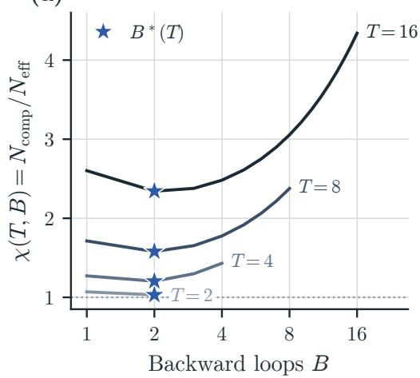

(b) Both chosen: the optimum has $B = T$

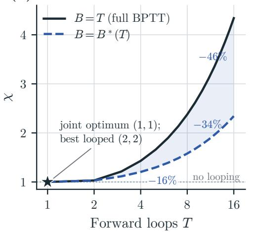  
Figure 13 Truncation can be favored at a prescribed $T ,$ but not when T and B are chosen jointly. The law’s $\chi = N _ { \mathrm { c o m p } } / N _ { \mathrm { e f f } }$ ; lower $\chi$ means lower compute-optimal loss. (a) Stars: the best B at each T. (b) Percentages: compute saved by the best $B$ over $B = T$ at equal loss.

Choosing the backward-loop count. For a continuous relaxation, an interior optimum balances the relative increase in compute-equivalent size against that in loss-equivalent size. The ratio is independent of model size, so we can diferentiate it at fixed $N _ { \mathrm { o n c e } } , N _ { \mathrm { r e c } }$ . By definition,

$$
\frac { \partial N _ { \mathrm { c o m p } } } { \partial B } = \frac { 2 } { 3 } N _ { \mathrm { r e c } } , \qquad \frac { \partial N _ { \mathrm { e f f } } } { \partial B } = c q T ^ { - p } B ^ { - q - 1 } g ( T , B ) N _ { \mathrm { r e c } } .
$$

Diferentiating log $\chi = \log N _ { \mathrm { c o m p } } - \log N _ { \mathrm { e f f } }$ and setting the derivative to zero yields

$$
\mathrm { \frac { 2 { \it B N } _ { r e c } } { 3 N _ { c o m p } } } = c q T ^ { - p } { \it B ^ { - q } } \frac { g ( T , B ) N _ { r e c } } { N _ { e f f } } .\tag{C.7}
$$

This is an implicit equation for a continuous candidate, as both parameter counts depend on $B ;$ boundary values $B = 1 , T$ are also checked, and the discrete optimum evaluates $\chi$ at each integer.

The equation also gives an explicit asymptotic form when $N _ { \mathrm { r e c } } > 0$ . Suppose $0 < p < 1$ and $q > 0$ as in the fitted law, and consider large $T$ with $B \ll T .$ . Then $g ( T , B )  e ^ { c } , N _ { \mathrm { c o m p } } \sim T N _ { \mathrm { r e c } } / 3$ , and $N _ { \mathrm { e f f } }  N _ { \mathrm { o n c e } } + e ^ { c } N _ { \mathrm { r e c } }$ . Substituting these limits into (C.7) and rearranging gives

$$
B ^ { * } ( T ) \sim \left[ \frac { c q } { 2 } \frac { e ^ { c } N _ { \mathrm { r e c } } } { N _ { \mathrm { o n c e } } + e ^ { c } N _ { \mathrm { r e c } } } \right] ^ { 1 / ( 1 + q ) } T ^ { ( 1 - p ) / ( 1 + q ) } .
$$

The exponent lies between zero and one, so this solution grows while $B ^ { * } / T \to 0$ , matching the assumed limit. This is a large-T prediction; finite loop counts require discrete optimization.

## C.4.2 Joint forward–backward allocation at equal compute

Lemma C.2 (Optimal joint forward–backward allocation). Fix an architecture with $N _ { \mathrm { r e c } } > 0$ and a token count $D > 0$ . Suppose the loss follows (4.1), with positive fitted coeficients $E , A , H , \alpha , \beta , \kappa ,$ $c , p , q$ and positive normalization scales $N _ { 0 } , D _ { 0 }$ . Let T and B be continuous variables. For any $S \geq 3$ , consider the equal-compute problem under (C.2):

$$
\operatorname* { m i n i m i z e } _ { T , B \in \mathbb { R } } \quad L ( N , D , T , B ) \qquad s u b j e c t \ t o \quad T + 2 B = S , \qquad 1 \leq B \leq T .
$$

$H q \geq 2 p$ , its unique solution is $T ^ { * } = B ^ { * } = S / 3$ , corresponding to full BPTT.

Proof. At fixed architecture and token count, (C.2) depends on the loop counts only through $S = T + 2 B$ , including the attention products. Thus every feasible split has the same compute. Since the loss is strictly decreasing in $N _ { \mathrm { e f f } }$ and $N _ { \mathrm { r e c } } > 0$ , minimizing it is equivalent to maximizing $g ( T , B )$ . Using $g ( T , B ) = \exp [ c ( 1 - T ^ { - p } B ^ { - q } ) ]$ with $c > 0$ , this is equivalent to minimizing $T ^ { - p } B ^ { - q }$ or its logarithm. Substituting $T = S - 2 B$ gives $1 \leq B \leq S / 3$ and the strictly convex objective

$$
h ( B ) = - p \log ( S - 2 B ) - q \log B , \qquad h ^ { \prime \prime } ( B ) = \frac { 4 p } { ( S - 2 B ) ^ { 2 } } + \frac { q } { B ^ { 2 } } > 0 .
$$

When $q \geq 2 p .$ , the constraint $B \leq T$ gives

$$
h ^ { \prime } ( B ) = { \frac { 2 p } { T } } - { \frac { q } { B } } \leq { \frac { 2 p - q } { T } } \leq 0 .
$$

The derivative is strictly negative whenever $B < T$ , including when $q = 2 p$ . Hence the unique minimum is at $B = S / 3$ , where $T = B$ . For $S = 3$ , this is also the only feasible split. □

The replacement preserves N, D and strictly improves any truncated setting, so the conclusion also holds when either or both are optimized, provided the replacement is admissible. It does not require fixed parameter proportions across model sizes. Including the optimizer update does not change the result, since its cost is independent of $T , B$

The condition is stronger than $q > p { : }$ a backward loop costs twice a forward loop, so the comparison is q versus $2 p .$ Our adopted fit satisfies $q > 2 p$ . For integer or restricted loop menus, $S / 3$ may be unavailable, so the continuous dominance argument does not replace the discrete check (C.8).

## C.4.3 Fixed model size: allocate loops and data

With N fixed, size cannot rebalance against data, and the loop setting determines how many tokens the compute buys: $D _ { N } ( C ; T , B ) = C / F _ { N } ( T , B )$ by (C.2). §6.1 compares the fifteen observed settings S at their respective token budgets:

$$
\begin{array} { r } { ( T ^ { * } , B ^ { * } ) \in \underset { ( T , B ) \in \mathcal { S } } { \arg \operatorname* { m i n } } L \big ( N , D _ { N } ( C ; T , B ) , T , B \big ) , \qquad D ^ { * } = D _ { N } ( C ; T ^ { * } , B ^ { * } ) . } \end{array}\tag{C.8}
$$

The switch points quoted in $\ S 6 . 1$ are computed with the measured compute, optimizer update included; leaving it out moves them by less than $0 . 5 \% ( \ S { \mathrm { C } } . 1 )$

For continuous loop counts, Lemma C.2 establishes the preference for full BPTT when $q \geq 2 p$ , as in our adopted fit. We therefore set $B = T$ and first characterize the interior balance between loops and tokens, then derive its large-compute limit.

Lemma C.3 (Optimal loop–token balance at fixed model size). Fix an architecture with $N _ { \mathrm { o n c e } } \ge 0$ and $N _ { \mathrm { r e c } } > 0$ , and a compute budget $C > 0$ . Suppose the loss follows (4.1), with positive fitted coeficients $E , A , H , \alpha , \beta , \kappa , c , p , q$ and positive normalization scales $N _ { 0 } , D _ { 0 }$ . Let $B = T \geq 1$ be continuous and use (C.2), so that $F _ { N } ( T , T ) = u _ { N } + 3 v _ { N } T$ with fixed $u _ { N } , v _ { N } > 0$ and $D = C / F _ { N } ( T , T )$ Write $s = p + q$ and define

$$
N _ { \mathrm { e f f } } ( T ) = N _ { \mathrm { o n c e } } + N _ { \mathrm { r e c } } \exp [ c ( 1 - T ^ { - s } ) ] ,
$$

$$
X ( T ) = A \left( \frac { N _ { \mathrm { e f f } } ( T ) } { N _ { 0 } } \right) ^ { - \alpha } , \qquad Y ( T ) = H \left( \frac { D } { D _ { 0 } } \right) ^ { - \beta } .
$$

Throughout this derivation, a prime denotes a total derivative with respect to $T$ along $B = T$ , holding the architecture and C fixed. In particular,

$$
N _ { \mathrm { e f f } } ^ { \prime } ( T ) \equiv \frac { \mathrm { d } N _ { \mathrm { e f f } } ( T ) } { \mathrm { d } T } = N _ { \mathrm { r e c } } c s g ( T , T ) T ^ { - s - 1 } ,
$$

$$
F _ { N } ^ { \prime } ( T , T ) \equiv \frac { \mathrm { d } } { \mathrm { d } T } F _ { N } ( T , T ) = 3 v _ { N } .
$$

Thus $N _ { \mathrm { e f f } } ^ { \prime }$ measures how efective size changes with loop count $( N$ is fixed), and $F _ { N } ^ { \prime } ( T , T )$ includes both loop counts as $B = T$ grows. Every interior optimum satisfies

$$
\alpha X \frac { N _ { \mathrm { e f f } } ^ { \prime } } { N _ { \mathrm { e f f } } } = \beta Y \frac { F _ { N } ^ { \prime } ( T , T ) } { F _ { N } ( T , T ) } .\tag{C.9}
$$

Equivalently, the stationary points are parameterized by

$$
C ( T ) = D _ { 0 } \left[ \frac { 3 \beta H v _ { N } } { \alpha A } F _ { N } ( T , T ) ^ { \beta - 1 } \left( \frac { N _ { \mathrm { e f f } } } { N _ { 0 } } \right) ^ { \alpha } \frac { N _ { \mathrm { e f f } } } { N _ { \mathrm { e f f } } ^ { \prime } } \right] ^ { 1 / \beta } , \qquad D ( T ) = \frac { C ( T ) } { F _ { N } ( T , T ) } .\tag{C.10}
$$

Proof. Since $\kappa > 0$ , minimizing loss is equivalent to minimizing $J ;$ substituting the budget gives

$$
J ( T ; N , C ) = X ( T ) + Y ( T ) = A \left( { \frac { N _ { \mathrm { e f f } } } { N _ { 0 } } } \right) ^ { - \alpha } + H \left( { \frac { D _ { 0 } F _ { N } ( T , T ) } { C } } \right) ^ { \beta } .
$$

Increasing $T$ raises the efective size and lowers $X$ , but reduces the token budget and raises $Y .$ At fixed $N , C ,$ , diferentiating the token budget gives

$$
D ^ { \prime } \equiv { \frac { \mathrm { d } } { \mathrm { d } T } } \left( { \frac { C } { F _ { N } ( T , T ) } } \right) = - { \frac { C F _ { N } ^ { \prime } ( T , T ) } { F _ { N } ( T , T ) ^ { 2 } } } , \qquad { \frac { D ^ { \prime } } { D } } = - { \frac { F _ { N } ^ { \prime } ( T , T ) } { F _ { N } ( T , T ) } } .
$$

Consequently, the derivatives of the two loss terms are

$$
X ^ { \prime } \equiv \frac { \mathrm { d } X } { \mathrm { d } T } = - \alpha X \frac { N _ { \mathrm { e f f } } ^ { \prime } } { N _ { \mathrm { e f f } } } , \qquad Y ^ { \prime } \equiv \frac { \mathrm { d } Y } { \mathrm { d } T } = \beta Y \frac { F _ { N } ^ { \prime } ( T , T ) } { F _ { N } ( T , T ) } .
$$

Setting $J ^ { \prime } = X ^ { \prime } + Y ^ { \prime } = 0$ gives (C.9), and $N _ { \mathrm { e f f } } ^ { \prime } = N _ { \mathrm { r e c } } c s g ( T , T ) T ^ { - s - 1 } > 0$ with $F _ { N } ^ { \prime } = 3 v _ { N }$ yields

$$
\alpha A \left( \frac { N _ { \mathrm { e f f } } } { N _ { 0 } } \right) ^ { - \alpha } \frac { N _ { \mathrm { e f f } } ^ { \prime } } { N _ { \mathrm { e f f } } } = 3 \beta H v _ { N } \left( \frac { D _ { 0 } } { C } \right) ^ { \beta } F _ { N } ( T , T ) ^ { \beta - 1 } .
$$

All factors are positive, so solving for C gives (C.10).

This is a necessary condition for an interior optimum; boundary values and all allowed integer settings must also be compared. On the finite menu, added compute goes to tokens until a deeper setting reaches a lower predicted loss, at which point the token budget drops.

Lemma C.4 (Asymptotic loop–token allocation). Suppose the loss follows (4.1), with positive fitted coeficients $E , A , H , \alpha , \beta , \kappa , c , p , q$ and positive normalization scales $N _ { 0 } , D _ { 0 }$ . Use the fixed architecture and compute model of Lemma $C . 3 ,$ and allow all continuous $T \geq 1$ with no upper bound. Let $T ^ { * } ( C )$ be any global minimizer along $B = T$ , and let $D ^ { * } ( C ) = C / F _ { N } ( T ^ { * } , T ^ { * } )$ . As $C  \infty$ , there are constants $K _ { T } , K _ { D } > 0$ , independent of C, such that

$$
T ^ { * } ( C ) \sim K _ { T } C ^ { \frac { \beta } { \beta + p + q } } , \qquad D ^ { * } ( C ) \sim K _ { D } C ^ { \frac { p + q } { \beta + p + q } } .\tag{C.11}
$$

Proof. For each finite $C ,$ the continuous objective J tends to infinity as $T \to \infty .$ since its data term grows without bound, so a global minimizer exists. Moreover, $T ^ { * } ( C ) $ ∞ as $C  \infty :$ for any fixed $M \geq 1$ , every $T \leq M$ has $J ( T ; N , C ) \ge X ( M )$ , whereas $J ( 2 M ; N , C )  X ( 2 M ) < X ( M )$ . No minimizer stays in [1, M] at large compute; it is eventually interior and satisfies (C.10).

Writing $s = p + q ,$ , the large-T limits are

$$
\begin{array} { r l } & { N _ { \mathrm { e f f } } \longrightarrow N _ { \mathrm { o n c e } } + e ^ { c } N _ { \mathrm { r e c } } , } \\ & { N _ { \mathrm { e f f } } ^ { \prime } \sim N _ { \mathrm { r e c } } c s e ^ { c } T ^ { - s - 1 } , \qquad F _ { N } ( T , T ) \sim 3 v _ { N } T . } \end{array}
$$

The bracket in (C.10) is thus asymptotic to a positive constant times $T ^ { \beta - 1 } T ^ { s + 1 } = T ^ { \beta + s }$ , so $C ( T )$ is asymptotic to a positive constant times $T ^ { ( \beta + \hat { s } ) / \beta }$ . Evaluating this relation at $T ^ { * } ( C )$ and inverting gives the first part of (C.11), and $D ^ { * } ( C ) \sim C / ( 3 v _ { N } T ^ { * } ( C ) )$ gives the second, recovering (6.3).

The current coeficients give exponents approximately 0.238 and 0.762 ((6.4) rounds them to 0.24 and 0.76). These are asymptotic consequences of the fitted law along $B = T$ , not a refit to measured optima. The dominance argument above applies within this law and compute model; its extrapolation to unbounded depth is not empirically established. Finite-depth overheads and allowed loop counts determine the practical switches.

## C.4.4 Free model size: compare joint allocations

The efective-size comparison in §6.2 follows directly from the fitted gain. Write $s = p + q$ . At fixed token count, replacing a fully trained T-loop model with a non-looped model of size $N _ { \mathrm { o n c e } } + T N _ { \mathrm { r e c } }$ preserves the leading compute and increases efective size by $[ T - g ( T , T ) ] N _ { \mathrm { r e c } }$ . For the adopted coeficients, $g ( 2 , 2 ) \simeq 1 . 9 1 0 < 2$ and

$$
\frac { \mathrm { d } } { \mathrm { d } T } \log \frac { g ( T , T ) } { T } = \frac { c s T ^ { - s } - 1 } { T } < 0 \qquad ( T \geq 2 ) ,
$$

since cs $2 ^ { - s } \simeq 0 . 5 8 5 < 1$ and $s > 0$ . Hence $g ( T , T ) < T$ for all integers $T \geq 2$ . This holds for integer loop counts (the continuous extension has $g ( T , T ) > T$ just above $T = 1 \AA$ , as $c s \simeq 1 . 4 0 0 > 1 )$

When T is also free, reuse the optimal size and data allocation from (C.5) for each candidate $( T , B )$ under the leading matrix-FLOP approximation (5.1) and a fixed recurrent fraction. Let $L _ { T , B } ^ { * } ( C )$ denote the minimum loss over positive, continuous N, D, and $N _ { T , B } ^ { * } ( C ) , D _ { T , B } ^ { * } ( C )$ its allocations. Write the budget as $C / \chi = 6 N _ { \mathrm { e f f } } D$ . The objective in $N _ { \mathrm { e f f } } , D$ is the non-looped loss law, with the budget of a non-looped model at $C / \chi$ . Its optimal size and data are thus $N _ { \mathrm { e f f } } ^ { * } = N _ { 1 , 1 } ^ { * } ( C / \chi )$ and $D _ { T , B } ^ { * } ( C ) = D _ { 1 , 1 } ^ { * } ( C / \chi )$ ; recovering unique size via $N ^ { * } = ( N / N _ { \mathrm { e f f } } ) N _ { \mathrm { e f f } } ^ { * }$ gives

$$
\begin{array} { r l } & { L _ { T , B } ^ { * } ( C ) = L _ { 1 , 1 } ^ { * } \left( \frac { C } { \chi ( T , B ) } \right) , } \\ & { N _ { T , B } ^ { * } ( C ) = \left( \frac { N } { N _ { \mathrm { e f f } } } \right) _ { T , B } N _ { 1 , 1 } ^ { * } \left( \frac { C } { \chi ( T , B ) } \right) , } \\ & { D _ { T , B } ^ { * } ( C ) = D _ { 1 , 1 } ^ { * } \left( \frac { C } { \chi ( T , B ) } \right) . } \end{array}\tag{C.12}
$$

The ratio $( N / N _ { \mathrm { e f f } } ) _ { T , B }$ is evaluated at the indicated loop setting and is independent of N when parameter proportions are fixed. These identities are exact within the stated approximation, with two consequences. First, by (C.5) every loop setting has $N ^ { * } \propto C ^ { \beta / ( \alpha + \beta ) }$ and $D ^ { * } \propto C ^ { \alpha / ( \alpha + \beta ) }$ (exponents 0.562 and 0.438 with the fitted coeficients), so the optimal pair minimizes $\chi ( T , B )$ at every compute. Second, among the fifteen settings (1, 1) minimizes $\chi$ and (2, 2) is the best looped setting (Table $5 ;$ Figure 13b). For (2, 2), $N _ { \mathrm { e f f } } \simeq 1 . 4 6 2 N$ $N _ { \mathrm { c o m p } } \simeq 1 . 5 0 7 N$ and $\chi \simeq 1 . 0 3 1$ , so (C.12) predicts equal loss at 3.1% more compute and 31.6% fewer parameters than (1, 1).

For the compute-premium comparison, let a candidate loop setting receive λC while (1, 1) receives C. (C.6) and $\chi ( 1 , 1 ) = 1$ give

$$
\frac { L _ { T , B } ^ { * } ( \lambda C ) - E } { L _ { 1 , 1 } ^ { * } ( C ) - E } = \left( \frac { \lambda } { \chi ( T , B ) } \right) ^ { - \eta } .
$$

Since $\eta > 0$ , the looped loss is smaller when $\lambda > \chi ( T , B )$ , and (C.5) gives $N _ { 1 , 1 } ^ { * } ( C ) \propto C ^ { \beta / ( \alpha + \beta ) }$ , so

$$
\frac { N _ { T , B } ^ { * } ( \lambda C ) } { N _ { 1 , 1 } ^ { * } ( C ) } = \left( \frac { N } { N _ { \mathrm { e f f } } } \right) _ { T , B } \left( \frac { \lambda } { \chi ( T , B ) } \right) ^ { \beta / ( \alpha + \beta ) } .
$$

For (2, 2), 10% more compute predicts lower loss with about 29.0% fewer non-embedding parameters. At equal compute $( \lambda = 1 )$ , subtracting the baseline loss gives the gap $( \eta = \kappa \alpha \beta / ( \alpha + \beta ) \simeq 0 . 0 5 5 9 )$

$$
L _ { T , B } ^ { * } ( C ) - L _ { 1 , 1 } ^ { * } ( C ) = \left[ L _ { 1 , 1 } ^ { * } ( C ) - E \right] \left[ \chi ( T , B ) ^ { \eta } - 1 \right] .
$$

For (2, 2) the bracketed multiplier is about $1 . 7 2 \times 1 0 ^ { - 3 }$ , or 0.172% of the non-looped model’s excess loss above E, rather than a constant gap in nats, making the compute convention consequential.

Limits of the scale-independent ratios. The identities describe an empirical loss law under a specified compute approximation; they do not establish a universal property of looped models. Size or data bounds can put an optimum on a boundary. A size-dependent recurrent share or the attention, output, and optimizer terms breaks the simple $6 \chi N _ { \mathrm { e f f } } D$ factorization. Full-compute optimization therefore requires an explicit architectural scaling family and a fresh numerical envelope. Its results should be reported separately from the analytic ratios, using the same adopted fit.

## D Compute-optimal pairs and the untied model

The main text (§6.3) compares (2, 2) with a compute-optimal model without looping while allowing model size and token count to vary. Below we give the full table for that comparison, followed by a controlled comparison at fixed tokens against an untied model with a separate block per loop.

Compute-optimal pairs. We trained (1, 1) and (2, 2) each at the size and token count that minimize its loss for the same training compute, with three seeds each (Table 11). The first two pairs also belong to the scaling suite and its fitting set. At all three budgets, the looped model has 27–32% fewer non-embedding parameters and comes within $( 1 - 8 ) \times 1 0 ^ { - 3 }$ nats of the model without looping. $\mathrm { A t ~ 2 . 1 \times 1 0 ^ { 1 9 } }$ FLOPs $( 2 . 0 \times 1 0 ^ { 1 9 }$ for the forward and backward passes alone), training the 344M (2, 2) model on 8% more tokens, and so with 8% more compute, lowers its loss to 2.3590, $( 7 . 3 \pm 1 . 8 ) \times 1 0 ^ { - 3 }$ nats below the 471M model without looping (Figure 1d).

Table 11 Compute-optimal pairs. Each model at the size that minimizes its loss for the compute; loss: mean of three seeds; gap: (2, 2) minus (1, 1), ± standard error; parameters: non-embedding counts (the models without looping are the 120M, 240M and 480M models of Table 3). Compute includes attention, output, and optimizer updates (C.3); the first three rows are matched in the compute of the forward and backward passes $( 1 . 5 \times 1 { \bar { 0 } } ^ { 1 8 } , 5 . 9 \times 1 0 ^ { 1 8 }$ , and $2 . 0 \times 1 0 ^ { 1 9 }$ FLOPs, or $9 . 6 \times 1 0 ^ { 1 7 } , 4 . 1 \times 1 0 ^ { 1 8 }$ , and $1 . 5 \times 1 0 ^ { 1 9 }$ under the leading-FLOP count $6 N _ { \mathrm { c o m p } } D$ of Figure 9d; counting the optimizer update, (1, 1) spends 0.7% more, which corresponds to about $1 0 ^ { - 3 }$ nats); the last row trains the 344M (2, 2) model on 8% more tokens (+8% compute) against the $2 . 1 \times 1 0 ^ { 1 9 }$ FLOP (1, 1) reference.
<table><tr><td></td><td colspan="2">(1,1)</td><td colspan="2">(2,2)</td><td rowspan="2"></td></tr><tr><td>Compute (FLOPs)</td><td>Parameters</td><td>Loss</td><td>Parameters</td><td>Loss</td></tr><tr><td> $1 . 6 \times 1 0 ^ { 1 8 }$ </td><td>115M</td><td>2.7098</td><td>79M</td><td>2.7177</td><td> $( 7 . 9 \pm 1 . 9 ) \times 1 0 ^ { - 3 }$ </td></tr><tr><td> $6 . 0 \times 1 0 ^ { 1 8 }$ </td><td>239M</td><td>2.5215</td><td>162M</td><td>2.5253</td><td> $( 3 . 8 \pm 1 . 8 ) \times 1 0 ^ { - 3 }$ </td></tr><tr><td> $2 . 1 \times 1 0 ^ { 1 9 }$ </td><td>471M</td><td>2.3663</td><td>344M</td><td>2.3677</td><td> $( 1 . 4 \pm 1 . 7 ) \times 1 0 ^ { - 3 }$ </td></tr><tr><td> $2 . 2 \times 1 0 ^ { 1 9 } \ ( + 8 \% )$ </td><td>471M</td><td>2.3663</td><td>344M</td><td>2.3590</td><td> $( - 7 . 3 \pm 1 . 8 ) \times 1 0 ^ { - 3 }$ </td></tr></table>

The untied model. The untied model of a looped model is the same network in which each loop has its own copy of the recurrent block, input injection and normalization. For two loops it holds $N _ { \mathrm { o n c e } } + 2 N _ { \mathrm { r e c } }$ parameters, about 1.5 times as many, at the same compute per token. Tying layers to save parameters goes back to ALBERT (Lan et al., 2019), and Bae et al. (2025a) relax the tie of looped models converted from pretrained ones. Each copy is initialized like the looped model; with all copies set equal, the untied model reproduces the looped model’s loss and logits exactly.

Table 12 Comparison with the untied model. At each size: the untied model, (2, 2) at its width, and (2, 2) widened to about 80% of its non-embedding parameters. Width with heads × head dimension; parameters: non-embedding; compute: compute per token of the forward and backward passes relative to the untied model, the same ratio as the training compute since all models of a size train on the same tokens; loss: mean of three seeds; − untied: paired by seed, mean ± standard error.
<table><tr><td>Size</td><td>Model</td><td>Width</td><td>Parameters</td><td>Compute</td><td>Loss</td><td>- untied</td></tr><tr><td>60M</td><td>untied</td><td>768 (6×128)</td><td>87M</td><td>1.00</td><td>2.7843</td><td></td></tr><tr><td></td><td>(2,2)</td><td>768 (6×128)</td><td>58M</td><td>1.00</td><td>2.7931</td><td> $( + 8 . 8 \pm 3 . 0 ) \times 1 0 ^ { - 3 }$ </td></tr><tr><td></td><td>(2, 2), wider</td><td>840 (7×120)</td><td>69M</td><td>1.15</td><td>2.7668</td><td> $( - 1 . 7 5 \pm 0 . 1 9 ) \times 1 0 ^ { - 2 }$ </td></tr><tr><td>120M</td><td>untied</td><td>1024 (8×128)</td><td>180M</td><td>1.00</td><td>2.5809</td><td></td></tr><tr><td></td><td>(2,2)</td><td>1024 (8×128)</td><td>115M</td><td>1.00</td><td>2.5982</td><td> $( + 1 . 7 3 \pm 0 . 1 4 ) \times 1 0 ^ { - 2 }$ </td></tr><tr><td></td><td>(2, 2), wider</td><td>1152 (9×128)</td><td>146M</td><td>1.22</td><td>2.5681</td><td> $( - 1 . 2 8 \pm 0 . 2 3 ) \times 1 0 ^ { - 2 }$ </td></tr><tr><td>240M</td><td>untied</td><td>1280 (10×128)</td><td>360M</td><td>1.00</td><td>2.4147</td><td></td></tr><tr><td></td><td>(2,2)</td><td>1280 (10×128)</td><td>239M</td><td>1.00</td><td>2.4272</td><td> $( + 1 . 2 5 \pm 0 . 0 8 ) \times 1 0 ^ { - 2 }$ </td></tr><tr><td></td><td>(2, 2), wider</td><td>1408 (11×128)</td><td>289M</td><td>1.18</td><td>2.4044</td><td> $( - 1 . 0 3 \pm 0 . 1 7 ) \times 1 0 ^ { - 2 }$ </td></tr><tr><td>480M</td><td>untied</td><td>1664 (13×128)</td><td>709M</td><td>1.00</td><td>2.2565</td><td></td></tr><tr><td></td><td>(2,2)</td><td>1664 (13×128)</td><td>471M</td><td>1.00</td><td>2.2700</td><td> $( + 1 . 3 5 \pm 0 . 1 9 ) \times 1 0 ^ { - 2 }$ </td></tr><tr><td></td><td>(2, 2), wider</td><td>1824 (12×152)</td><td>566M</td><td>1.18</td><td>2.2511</td><td> $( - 5 . 4 \pm 1 . 5 ) \times 1 0 ^ { - 3 }$ </td></tr></table>

Design and results. Each size trains at about 18 tokens per parameter of the looped model, close to the compute-optimal ratio of Hofmann et al. (2022): 60M at $D _ { 0 }$ , 120M at $2 D _ { 0 }$ , 240M at $4 D _ { 0 }$ and 480M at $8 D _ { 0 }$ , with the recipe of its (2, 2) run and three seeds per model. Alongside the untied model, we train (2, 2) at the same width and (2, 2) widened to about 80% of the untied model’s non-embedding parameters, on the same tokens (Table 12). At the untied model’s width the looped model trails by $9 \times 1 0 ^ { - 3 } – 1 . 7 \times 1 0 ^ { - 2 }$ nats $( 1 . 3 \times 1 0 ^ { - 2 }$ averaged over the four sizes), against $( 3 ^ { - 4 ) \times 1 0 ^ { - 3 } }$ by the law, whose error at these (2, 2) runs is at most $4 \times 1 0 ^ { - 3 }$ nats. The wider looped model uses 15–22% more forward-and-backward compute per token than the untied model and reaches a lower loss by $5 \times 1 0 ^ { - 3 } – 1 . 7 \times 1 0 ^ { - 2 }$ nats, in all twelve seed pairs.

## E Learning rate and batch size

Our runs follow one learning-rate rule and one batch-size rule, both set by the token budget D (Table 13). We test each rule against sweeps that vary only the learning rate or only the batch; a learning-rate sweep scales the MuonH and AdamW learning rates by one common factor. We call a value acceptable when its loss is within 0.25% of the optimum of its sweep, about a tenth of what (4, 4) gains over (1, 1) at the same model size and budget.

Table 13 Batch size, number of steps and peak MuonH learning rate of the hidden weight matrices at each budget. The learning rate is (E.1) with $\gamma = 0 . 4 0$ , with its ratio to the $\gamma = 0 . 3 2$ value rounded to a power of $2 ^ { 1 / 8 } ;$ the AdamW learning rates are multiplied by the same ratio. Warmup takes 2% of the steps.
<table><tr><td>Budget  $D / D _ { 0 }$ </td><td>1-2</td><td>1</td><td>2</td><td>4</td><td>8</td><td>16</td><td>32</td></tr><tr><td>Batch (sequences of 2,048 tokens)</td><td>48</td><td>64</td><td>88</td><td>128</td><td>176</td><td>256</td><td>352</td></tr><tr><td>Steps</td><td>5,464</td><td>8,192</td><td>11,920</td><td>16,384</td><td>23,832</td><td>32,768</td><td>47,664</td></tr><tr><td>Peak learning rate  $( \times 1 0 ^ { - 3 } )$ </td><td>10.7</td><td>9.25</td><td>8.11</td><td>8.01</td><td>7.03</td><td>6.36</td><td>6.09</td></tr></table>

Learning-rate rule. We take the transfer rule of the reference recipe (Schwethelm et al., 2026) for the peak MuonH learning rate of the hidden weight matrices,

$$
\eta ~ = ~ 0 . 0 1 4 \Big ( { \frac { b } { 1 2 8 } } \Big ) ^ { 0 . 5 5 8 } \Big ( { \frac { D } { D _ { \mathrm { r e f } } } } \Big ) ^ { - \gamma } , \qquad D _ { \mathrm { r e f } } = 9 . 8 3 \times 1 0 ^ { 8 } ,\tag{E.1}
$$

where b is the global batch in sequences of 2,048 tokens; the AdamW learning rates scale with width, and those of the embedding and output also with batch. The reference recipe uses the token exponent $\gamma = 0 . 3 2$ of HyperP (Ren et al., 2026), a transfer rule for MuonH. On our models this exponent is too small: relative to (E.1) with $\gamma = 0 . 3 2$ , the optimal learning rate keeps falling as D grows (Figure 14b). We thus re-estimate γ and, as our models vary in depth, test for a depth term.

Token exponent: $\gamma = 0 . 4 0$ . We swept the learning rate at the smallest and the largest model size, 60M at $D _ { 0 } , 4 D _ { 0 }$ and $1 6 D _ { 0 }$ and 1B at $4 D _ { 0 }$ and $1 6 D _ { 0 }$ , each with (4, 4) and (4, 1), and fit a quadratic in log η to each sweep to locate its optimum (Figure 14a). The exponent that minimizes the rule’s largest loss above the optimum is $\gamma = 0 . 4 0 6$ (95% interval 0.400–0.412), and we use $\gamma = 0 . 4 0$ . The rule is then within 0.06% of the optimum in every sweep, the largest gap being 60M with (4, 1) at $1 6 D _ { 0 }$ , whereas $\gamma = 0 . 3 2$ ends up 0.45% above the optimum at 1B and $1 6 D _ { 0 }$

No depth correction. Depth-wise transfer rules lower the learning rate as networks get deeper (Bordelon et al., 2023; Dey et al., 2025; Ren et al., 2026; Yang et al., 2023). For updates normalized as in MuonH, keeping the change of the network per step fixed requires $\eta \propto \ell ^ { - 1 / 2 }$ with residual branches scaled by $\ell ^ { - \bar { 1 } / 2 }$ , or $\eta \propto \ell ^ { - 1 }$ without that scaling, where ℓ is the number of executed layers (Ren et al., 2026, Theorem 3). Our recipe scales neither the residual branches nor the learning rate with depth, although our models get deeper both with size (20 to 40 executed layers from 60M to 1B at $T = 4 )$ and with the number of forward loops (12 to 36 at 60M). Yet the optimum does not follow the depth (Figure 14c–d): at $D _ { 0 } .$ , the rule’s learning rate is the best of $1 / { \sqrt { 2 } } ,$ 1 and $\sqrt { 2 }$ times itself in all six sweeps, and the fitted optima stay within about $7 \%$ of the rule, where the trend HyperP measures without residual scaling would lower them by more than half. The optima learning rate follows the training tokens, not the depth, so the rule needs no depth term.

Batch-size rule. We set the global batch to

$$
b ( D ) = 6 4 \sqrt { D / D _ { 0 } } \mathrm { s e q u e n c e s } ,\tag{E.2}
$$

rounded to a ladder whose neighboring steps difer by about $ \sqrt { 2 } \ : ( \ldots , 3 2 , 4 8 , 6 4 , 8 8 , 1 2 8 , 1 7 6 , 2 5 6 .$ 352). The loss-optimal batch grows about as $\sqrt { D }$ , as in prior work (Bergsma et al., 2025; Filatov et al., 2025; Li et al., 2025b), and in eleven batch sweeps with (4, 4) (60M at five budgets, 240M and 1B at three) the rule’s batch is acceptable in every one (Figure 15a).

Prefactor. The loss is flat over about a factor of two in batch, so the prefactor is a choice between neighboring ladder steps. One step lower, $4 5 \sqrt { D / D _ { 0 } }$ , suits 1B with full BPTT as well as 64 suits 60M, but truncated BPTT prefers larger batches: at 1B and $1 6 D _ { 0 }$ , the best batch is 176 for (4, 4) and 352 for (4, 1). Over all 33 sweeps with at least three batch sizes, which cover all ten core settings, only the rule is acceptable everywhere: it stays within 0.17% of the best batch, while one step lower reaches 0.30% and one step higher 0.42% (Figure 15b). The rule therefore changes comparisons between loop settings by less than 0.004 nats.

## F The law across the five-size grid

Figure 16 shows the validation loss of the 343 configurations in the suite’s five-size grid, one panel per loop setting. Filled markers denote the 226 configurations used to fit the law of $\ S 4 ;$ open markers denote the rest. The suite’s four fitted configurations from the compute-matched pairs (120M, 79M, 240M and 162M) are listed in Table 11 and are not drawn here. The figure contains 290 configurations in the ten core settings, 17 with (8, 1) and 36 with T = 16. Each configuration shows the mean loss of its accepted runs (385 in all; §A.2); the law is drawn over each size’s measured budgets. The configurations span 1.1 to 1,291 tokens per parameter, while the fitted ones span 9 to 74. Per loop setting, the law’s RMSE on the fitted configurations is 0.0031 to 0.0093 nats; on the rest it is 0.0200, as most lie below 5 or above 125 tokens per parameter (§7). Figure 4 shows the four full-BPTT settings at the 26 size–budget pairs where all four were trained: one set of coeficients tracks all four, with RMSE 0.0053 nats over the 68 fitted configurations (0.0148 over the 36 others).

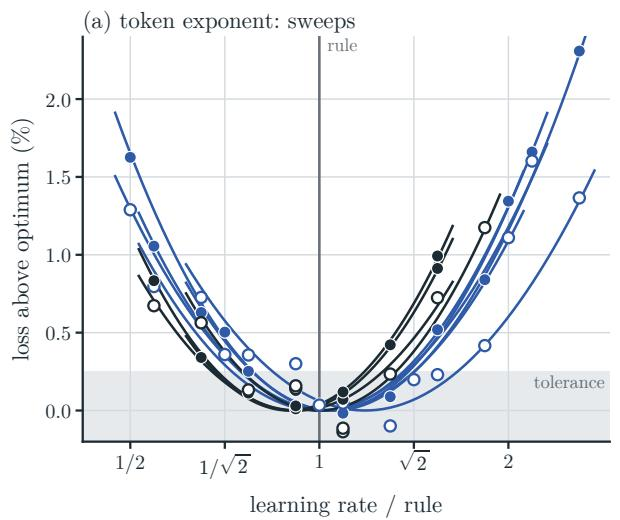

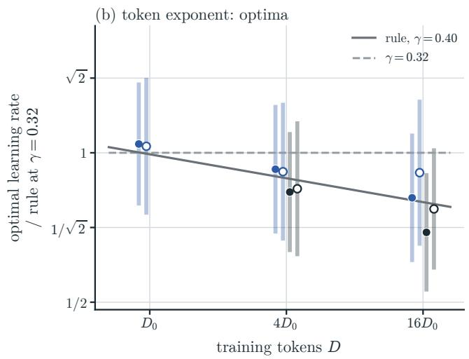

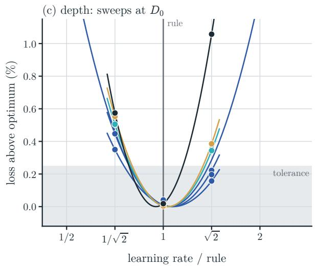

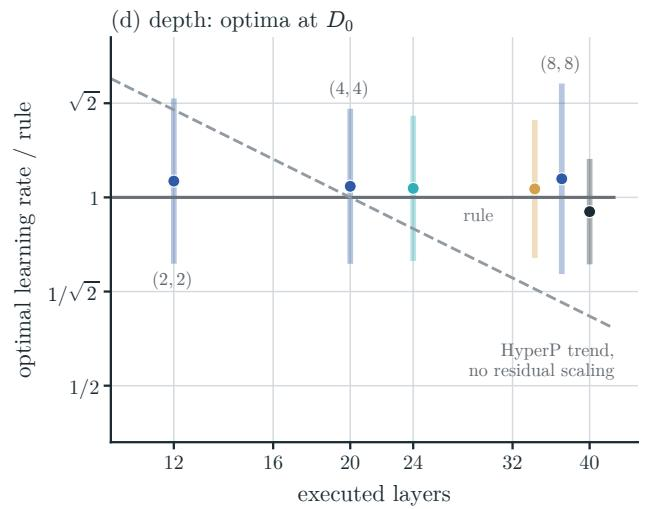  
Figure 14 Learning-rate rule $( ( \mathrm { E . 1 } ) , \gamma = 0 . 4 0 )$ against the measured optimum. Colors give the model size; filled markers: (4, 4), open markers: (4, 1). Solid gray lines: the rule; dashed lines: the alternative it is tested against; shading: the tolerance (0.25%). (a) Loss above the fitted optimum, in percent of the optimum loss, against the learning rate relative to the rule, for the ten token-exponent sweeps, with one quadratic in log η per sweep. (b) Fitted optima relative to (E.1) at $\gamma = 0 . 3 2$ , with the learning rates within the tolerance (bars); dashed: $\gamma = 0 . 3 2 \ :$ . (c) As (a), at $D _ { 0 } .$ , for four sizes with (4, 4) and for 60M with (2, 2) and (8, 8). (d) Optima of these sweeps against the number of executed layers; dashed: the trend HyperP measures without residual scaling (the optimum halves from 8 to 24 layers), drawn through the rule at 20 layers.

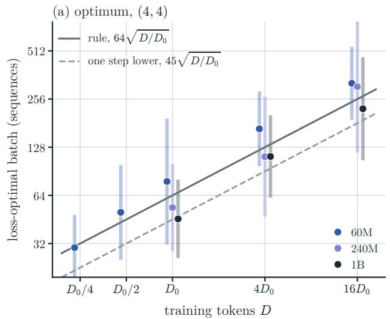

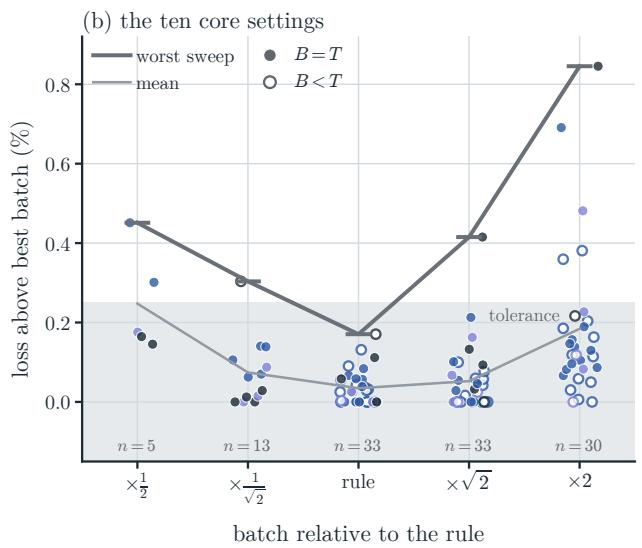  
Figure 15 Batch rule (E.2) against the measured optimum; colors give the model size. (a) Lossoptimal batch for (4, 4), the vertex of a quadratic in log batch fitted to each sweep, with the batches within the tolerance (bars). Lines: the rule (solid) and one ladder step lower (dashed). (b) Loss above the best batch, in percent of the best loss, at up to two ladder steps from the rule, over the 33 sweeps with at least three batch sizes (filled: $B = T ;$ open: $B < T ;$ n: sweeps run at that batch). Thick line: worst sweep; thin line: mean; shading: the tolerance.

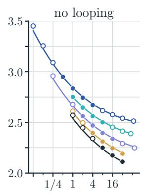

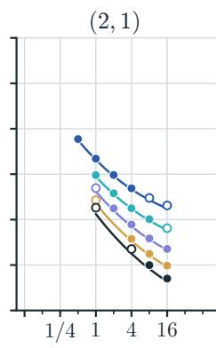

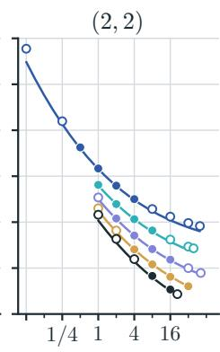  
filled: fitted; open: not fitted; lines: law

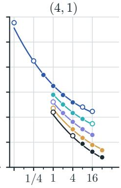

(4; 2)  
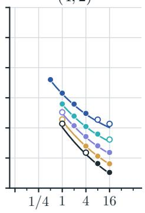

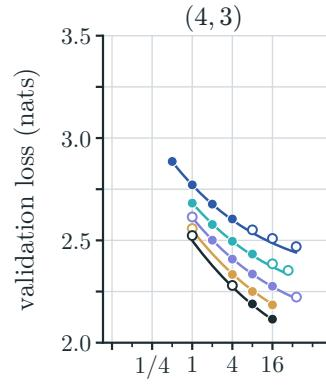

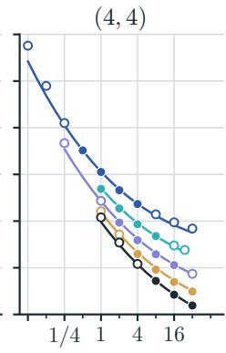

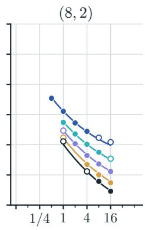  
(8; 1)

(8; 8)  
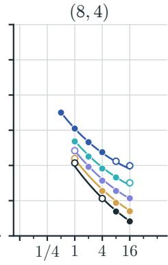

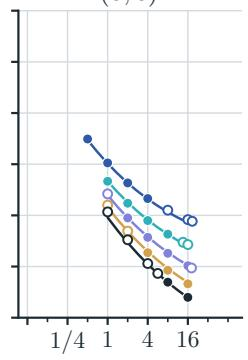

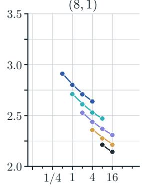

(16; 16)  
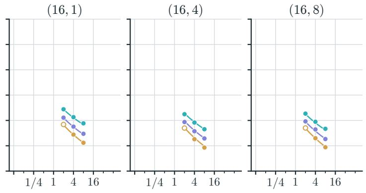  
training tokens D=D0 (D0 = 230)

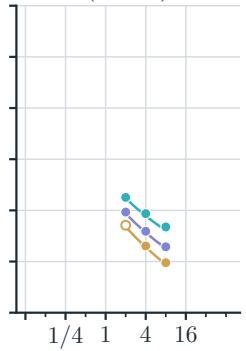

Figure 16 Validation loss of every configuration in the suite’s five-size grid against training tokens $( D _ { 0 } = 2 ^ { 3 0 } )$ , one panel per loop setting, colored by model size. Filled dots: configurations the law is fitted on; open dots: the other configurations; lines: the law (§4) over each size’s measured budgets.

## G Training curves

Figure 17 shows the training curves of the 385 runs behind the 343 configurations of $\ S \mathrm { F }$ , one panel per loop setting. Each curve is the training loss of every tenth step, the cross-entropy of that step’s batch, against the training compute spent so far, counted as in §C.1 with the optimizer update; it is not the validation loss on held-out documents that we report (§A.2). Each token budget is a separate run whose cosine schedule ends at that budget, so a run reaches its final loss only at its end. The dotted line therefore joins run ends only, those that end below every run with less compute, and needs no fit. As in the training-curve envelopes of Hofmann et al. (2022, Figure A5), larger models take over this frontier as compute grows; at the highest compute of each panel it follows the largest model trained in that setting, 1B, or 480M for T = 16.

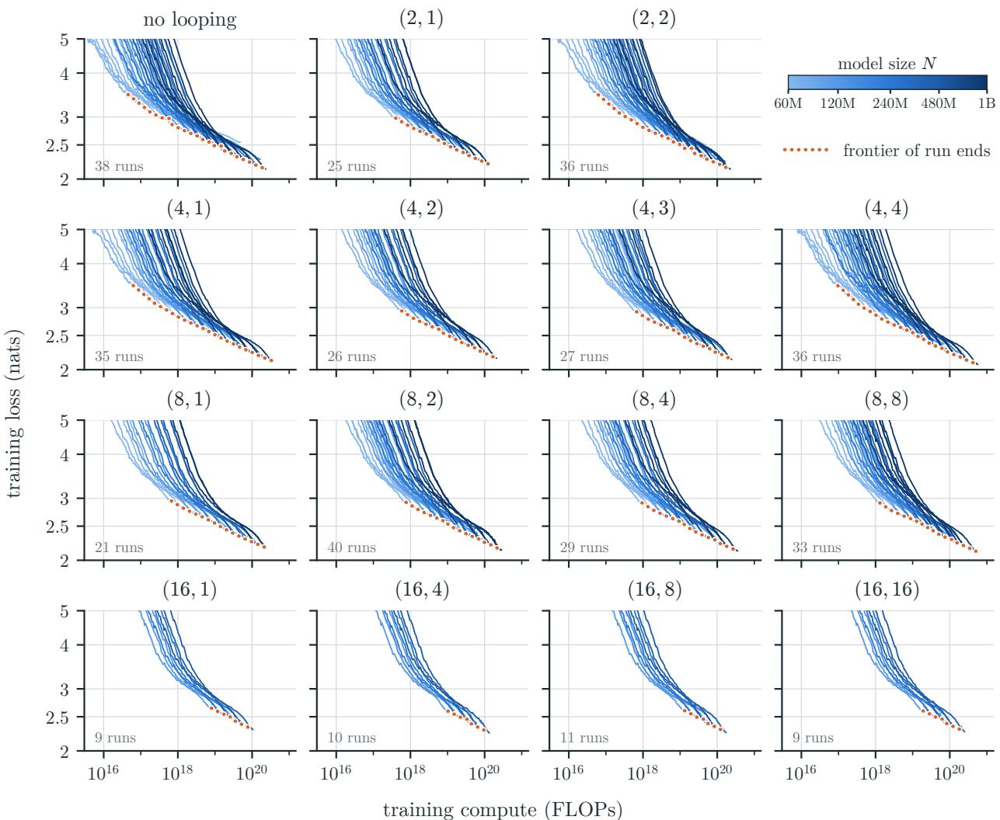  
Figure 17 Training curves of every run in the five-size grid against training compute (§C.1), one panel per loop setting, with a row per forward-loop count and backward loops increasing to the right, colored by model size. Training loss of every tenth step, averaged over at most ±250 steps. Dotted: the frontier of run ends, the runs that end below every run with less compute.