# Uncertainty-Gated SHAP–Dirichlet Refinement for MRI-Based Depression Classification

Phuc Truong Loc Nguyen FAU Erlangen-Nürnberg Erlangen, Germany loc.pt.nguyen@fau.de

Nguyen Truong Toan To FAU Erlangen-Nürnberg Erlangen, Germany toan.nt.to@fau.de

Hoang-Loc Cao University of New Brunswick Fredericton, Canada chloc22@clc.fitus.edu.vn

Truong Thanh Hung Nguyen† University of New Brunswick Fredericton, Canada hung.ntt@unb.ca

Hung Cao University of New Brunswick Fredericton, Canada hung.cao@unb.ca

## Abstract

Structural MRI-based classification of major depressive disorder (MDD) remains challenging due to subtle, heterogeneous anatomical changes. We propose uncertainty-gated SHAP-Dirichlet refinement, a post-hoc reliability layer that improves predictions without retraining the classifier. The method retrieves similar labeled SHAP explanations, constructs Dirichlet class evidence, and selectively refines uncertain predictions through probabilistic fusion, while allowing unreliable cases to be deferred for expert review. We evaluate five classifiers on 504 SRPBS subjects (252 controls and 252 MDD patients) using 159 anatomical features and repeated nested cross-validation. Refinement improved accuracy across all 8 repeti tions for TabM and ResNet, yielding mean gains of +1.04 and +0.45 percentage points (sign test � = 0.008), while modifying at most 8.3% of predictions. Gains were concentrated among low-confidence cases, with significant improvements in calibration. The method also benefited an RBF support vector machine but not logistic regression or random forests. Ablations confirmed the importance of uncertainty gating and soft fusion. Dirichlet evidence identified baseline errors (AUROC 0.62), while deferring 50% of cases increased retained-case accuracy to approximately 75%. These find ings support selective explanation-guided refinement as a practical approach to improving prediction reliability and facilitating expert triage in MDD classification.

## CCS Concepts

• Computing methodologies → Machine learning; • Applied computing → Health informatics.

## Keywords

uncertainty quantification, explainable AI, SHAP, Dirichlet evidence, structural MRI, major depressive disorder

## 1 Introduction

Major depressive disorder (MDD) is a heterogeneous psychiatric disorder whose diagnosis is based on clinical symptoms rather than a single biological marker [31]. Structural magnetic resonance imaging (MRI) provides non-invasive measurements of brain morphology, and large consortia have reported MDD-related diferences in cortical thickness, surface area, and subcortical volume [38]. These efects are small and heterogeneous, and they are sensitive to acquisition, preprocessing, site composition, and diagnostic labeling [15, 45]. As a result, machine learning studies of depression report a wide range of accuracies [26, 41], and small samples tend to overestimate accuracy [14]. With a few hundred subjects, crossvalidated accuracy also has large error bars [43], so a single split can overstate or understate the efect of any modeling choice.

For clinical decision support, average accuracy is not suficient. A classifier may assign a confident label to a subject whose local feature pattern is unstable, weakly supported by similar cases, or inconsistent with the evidence the model uses [3, 7, 18, 27]. Uncertainty quantification methods such as Monte Carlo dropout, deep ensembles, evidential learning, calibration, and selective prediction address part of this problem [16, 17, 22, 28, 34, 39], but they often require retraining, architectural changes, or repeated inference. For a classifier that is already trained, a post-hoc reliability layer is attractive. Model confidence alone, however, does not indicate whether a prediction is supported by subjects whose explanations look alike.

We propose Uncertainty-gated SHAP-Dirichlet Refinement, a posthoc layer for a fixed probabilistic classifier. For each query subject, SHapley Additive exPlanations (SHAP) [30] give a local explanation vector, which is compared with a bank of labeled reference explanations. The most similar references are converted into classlevel Dirichlet evidence [39]. An uncertainty gate, by default local explanation instability under small feature perturbations measured by relative input and output stability (RIS and ROS) [1], decides which predictions may change. Unstable predictions are refined by fusing the classifier probability with the explanation-derived evidence, and the least reliable subjects can be routed to expert review. The layer never changes the classifier, and every parameter is selected on validation data.

We evaluate the layer on 504 subjects of the SRPBS dataset [42] with five classifiers: the tabular deep learning models TabM [19] and ResNet [20], and logistic regression, an RBF support vector machine [9], and a random forest [5]. Because single-split results on this task are unstable, we use repeated nested cross-validation with pre-specified statistical tests. Our contributions are as follows:

1. We formulate a post-hoc, reliability-aware decision layer that retains, refines, or defers the predictions of a fixed classifier by combining explanation retrieval, Dirichlet evidence, and an uncertainty gate (Sect. 3).

2. We describe an exact batched implementation of KernelSHAP with common random numbers, which makes explanation-stability estimates comparable across perturbations, and a fix for a batchdependent preprocessing step in a popular tabular deep learning library (Sect. 3.5).

3. In repeated nested cross-validation with five classifiers, the layer with a training-plus-validation reference bank improved accuracy in every TabM and ResNet repetition, concentrated its gains on low-confidence subjects, and improved calibration. Controlled ablations show that gating and soft fusion keep post-hoc changes safe, and that the size of the reference bank matters more than the choice of gate (Sects. 5.1–5.4).

4. SHAP-space retrieval yields more label-consistent references than raw-feature retrieval, SHAP-Dirichlet evidence identifies baseline errors above chance and adds to model confidence, and a deferral policy built on both raises the accuracy of automatically handled subjects to about 75% when half of the subjects are reviewed (Sects. 5.5–5.6).

## 2 Related Work

Machine learning for MDD from structural MRI. Morphometric features from FreeSurfer or FastSurfer [13, 25], typically summarized on the Desikan-Killiany atlas [11], are a common input for MDD classification. Group-level analyses of large consortia show consistent but small cortical and subcortical diferences [38]. A meta-analysis of multivariate pattern recognition studies found heterogeneous accuracies across studies and modalities [26]. In community cohorts, a cross-validated accuracy of 75% in a small sample dropped to 53.7% in a larger independent sample [41], and a systematic study showed that small samples overestimate per formance [14]. Cross-validation in small samples has large error bars [43], and methodological pitfalls such as test-set reuse remain common in medical imaging [44]. These findings motivate our use of repeated nested cross-validation and our focus on reliability rather than on a single accuracy number.

Uncertainty, calibration, and selective prediction. Monte Carlo dropout [16], deep ensembles [28], and evidential deep learning [39] estimate predictive uncertainty but change how the model is trained or queried. Calibration methods [22] and calibration metrics such as the expected calibration error (ECE) [35] and the Brier score [6] assess whether probabilities match observed frequencies. Selective prediction abstains on uncertain inputs [8, 17], with the maximum class probability as a strong baseline [24], and learning-to-defer methods train a classifier together with a deferral policy [32]. In medical imaging, referring uncertain cases to experts improves the accuracy of the remaining automatic decisions [18, 29], and communicating uncertainty is considered essential for clinical use [3, 27]. Our layer is post hoc, keeps the classifier fixed, and combines deferral with a correction step for unstable predictions.

Neighbors and explanations as reliability signals. Nearest-neighbor agreement is a known reliability signal. The trust score compares the distance to the predicted class with the distance to other classes, and deep �-nearest neighbors measure label agreement in learned representations [36]. We instead retrieve neighbors in the explanation space, where distances reflect how the model uses each feature, and convert them into Dirichlet evidence. SHAP values [30, 40] are commonly estimated with KernelSHAP [10, 30]. The stability of explanations under small input changes has been studied as a robustness property [1, 2], and toolkits such as Quantus implement RIS and ROS [23]. We use RIS and ROS not to evaluate explanation methods, but to gate which predictions a post-hoc layer may change.

Tabular classifiers. Deep tabular models such as ResNet-style networks [20] and the parameter-eficient ensemble TabM [19] are strong general-purpose baselines, while tree-based models remain competitive with deep models on typical tabular data [21]. We therefore evaluate the layer on both neural and classical classifiers [37].

## 3 Method

Fig. 1 summarizes the framework. It is applied after training and leaves the classifier unchanged. Its three components are the baseline classifier, SHAP-Dirichlet evidence, and uncertainty-gated refinement with an optional deferral step.

## 3.1 Baseline Classifier

Given a structural MRI scan $I _ { i } ,$ a morphometric feature extractor $F ( \cdot )$ maps the image to a tabular representation $x _ { i } = F ( I _ { i } ) \in \mathbb { R } ^ { d }$ Here, $F ( \cdot )$ is FreeSurfer/FastSurfer, which returns regional cortical and subcortical measurements [13, 25]. A classifier $f _ { \theta }$ is trained on these features. For a query subject �, it outputs the MDD probability $p _ { q } = f _ { \theta } ( x _ { q } )$ , and the baseline label is $\hat { y } _ { q } ~ = ~ 1 ( p _ { q } ~ \ge ~ 0 . 5 )$ . After training, � is frozen. The refinement stage only uses the model output and its local explanation, so any classifier that outputs a probability can be used.

## 3.2 SHAP-Dirichlet Evidence

SHAP [30] gives a local attribution vector $\phi _ { q } = [ \phi _ { q 1 } , \ldots , \phi _ { q d } ]$ of the MDD probability, where each entry measures the contribution of one feature. Because the explained output is fixed, a positive entry pushes the prediction toward MDD and a negative entry toward HC for every subject. The query explanation is compared with a reference bank R of explanations of labeled subjects, and a subject never retrieves itself. We consider two banks: the validation subjects only, and the training and validation subjects together, which are all labeled subjects available when the layer is deployed. The top-� most similar references are

$$
N _ { K } ( q ) = \mathrm { T o p K } _ { r \in \mathcal { R } } \big ( \sin ( \phi _ { q } , \phi _ { r } ) \big ) ,\tag{1}
$$

where sim $( \cdot , \cdot )$ is a cosine, Pearson, or negative Euclidean similarity. The retrieved references are converted into class-level evidence

$$
e _ { c } ( q ) = \sum _ { r \in N _ { K } ( q ) } w _ { q r } { \bf 1 } ( y _ { r } = c ) , \qquad w _ { q r } = \exp \left( - \frac { d ( \phi _ { q } , \phi _ { r } ) } { \tau _ { q } } \right) ,\tag{2}
$$

where $d ( \cdot , \cdot )$ is the distance associated with the similarity and $\tau _ { q }$ is the median distance within $N _ { K } ( q )$ . Adding one unit of prior

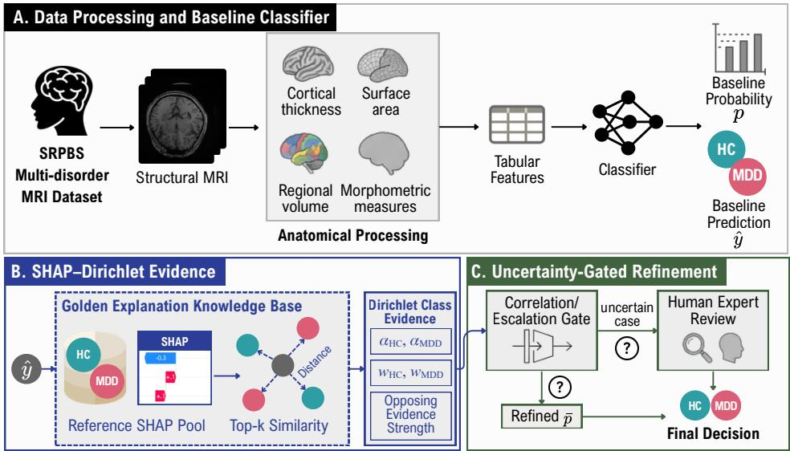  
Figure 1: Uncertainty-gated SHAP-Dirichlet refinement. (A) Structural MRI scans are processed into morphometric features, and a fixed classifier produces the baseline probability and label. (B) The query SHAP explanation is compared with a reference SHAP bank to retrieve explanation-similar subjects and estimate Dirichlet class evidence. (C) Local explanation stability decides whether the prediction is retained or refined, and unreliable subjects can be routed to expert review.

evidence to each class gives the Dirichlet-derived class probability

$$
p _ { c } ^ { \mathrm { D i r } } ( q ) = \frac { e _ { c } ( q ) + 1 } { \sum _ { c ^ { \prime } \in \{ 0 , 1 \} } \left( e _ { c ^ { \prime } } ( q ) + 1 \right) } .\tag{3}
$$

The Dirichlet probability is not a second classifier. It estimates how strongly the query explanation agrees with reference subjects of each class, and the prior keeps it close to 0.5 when the evidence is weak. The explanation-supported class is $\tilde { y } _ { q } = \mathrm { a r g }$ max� $p _ { c } ^ { \operatorname* { D i r } } ( q )$ and the support for the class opposite to the baseline label is $E _ { q } ^ { \mathrm { o p p } } =$ $p _ { 1 - \hat { y } _ { q } } ^ { \mathrm { D i r } } ( q )$

## 3.3 Uncertainty-Gated Refinement

Local explanation instability. We estimate how much the explanation of a query changes under small feature perturbations, using relative input stability (RIS) and relative output stability (ROS) [1]. For each query, we draw perturbed samples $x _ { q } ^ { ( m ) } = x _ { q } + \delta _ { q } ^ { ( m ) }$ $m = 1 , \ldots , M$ , and keep only those that preserve the predicted label. For each kept perturbation, we compute the explanation $\phi _ { q } ^ { ( m ) }$ and the model logit $h _ { \theta } ( x _ { q } ^ { ( m ) } )$ ), and define

$$
\operatorname { R I S } ( q ) = \operatorname* { m a x } _ { m } \frac { \big \| ( \phi _ { q } - \phi _ { q } ^ { ( m ) } ) / ( \phi _ { q } + \epsilon ) \big \| _ { p } } { \operatorname * { m a x } \big ( \| ( x _ { q } - x _ { q } ^ { ( m ) } ) / ( x _ { q } + \epsilon ) \| _ { p } , \epsilon _ { \operatorname* { m i n } } \big ) } ,\tag{4}
$$

$$
\mathrm { R O S } ( q ) = \operatorname* { m a x } _ { m } \frac { \big \| ( \phi _ { q } - \phi _ { q } ^ { ( m ) } ) / ( \phi _ { q } + \epsilon ) \big \| _ { p } } { \operatorname* { m a x } \big ( \| h _ { \theta } ( x _ { q } ) - h _ { \theta } ( x _ { q } ^ { ( m ) } ) \| _ { p } , \epsilon _ { \operatorname* { m i n } } \big ) } .\tag{5}
$$

Larger values indicate lower local reliability, and � and $\epsilon _ { \mathrm { m i n } }$ prevent division by zero. If no perturbation preserves the predicted label, the query is treated as maximally unstable.

Gate. Let � ∈ {RIS, ROS} be the selected instability measure and $\eta _ { q } ^ { ( u ) } = u ( q )$ . Other uncertainty scores, such as Monte Carlo

dropout variance, can take the place of $\eta _ { q } ^ { ( u ) }$ , and we compare them in Sect. 5.3. For a validation percentile $\pi ,$ the threshold $\tau _ { u , \pi }$ is the �-th percentile of $\dot { \boldsymbol { \eta } } ^ { ( u ) }$ on the validation set, and the gate is

$$
g _ { q } = 1 \big ( \eta _ { q } ^ { ( u ) } \ge \tau _ { u , \pi } \big ) .\tag{6}
$$

A stable subject $( g _ { q } = 0 )$ keeps its baseline prediction. An unstable subject $( g _ { q } = 1 )$ is passed to the correction rule.

Correction. Soft correction blends the baseline probability with the Dirichlet-derived MDD probability,

$$
\begin{array} { r } { p _ { q } ^ { \mathrm { s o f t } } = \left\{ \begin{array} { l l } { \lambda p _ { q } + \left( 1 - \lambda \right) p _ { 1 } ^ { \mathrm { D i r } } ( q ) , } & { g _ { q } = 1 , } \\ { p _ { q } , } & { g _ { q } = 0 , } \end{array} \right. } \end{array}\tag{7}
$$

and the refined label is $y _ { q } ^ { \mathrm { s o f t } } = 1 ( p _ { q } ^ { \mathrm { s o f t } } \geq 0 . 5 )$ . As an alternative, hard correction flips the label of a gated subject when $\tilde { y } _ { q } \ne \hat { y } _ { q }$ and $E _ { q } ^ { \mathrm { o p p } } \geq \tau _ { E }$

Validation-based selection. The instability measure $u ,$ the similarity, �, �, and $\tau _ { E }$ are selected on the validation set by accuracy. Ties are broken toward the rule that changes the fewest validation decisions, and if no rule improves validation accuracy, the baseline is kept for every subject. Algorithm 1 summarizes the procedure.

## 3.4 Expert Review

The framework also supports human-in-the-loop verification. A subject with low baseline confidence $1 - | 2 p _ { q } - 1 | ,$ , or with high support for the opposite class $E _ { q } ^ { \mathrm { o p p } }$ , can be routed to expert inspection instead of being decided automatically. We map both scores to their percentiles in the validation distribution, average them, and defer the highest-ranked subjects. The deferral threshold is a validation percentile, so the expected review workload is fixed before deployment.

Algorithm 1 Uncertainty-gated SHAP-Dirichlet refinement   
Require: fixed classifier $f _ { \theta } ,$ validation set V, reference bank ${ \mathcal { R } } \supseteq { \mathcal { V } } ,$ test   
subject �, grids Π, Λ   
1: Compute $\phi _ { r }$ and $\eta _ { r } ^ { ( u ) }$ for all $r \in \mathcal { N }$ and � $\in \{ \mathrm { R I S } , \mathrm { R O S } \}$   
2: For each $r \in \mathcal V ,$ compute $p _ { 1 } ^ { \mathrm { { D i r } } } ( r )$ from $\mathcal { R } \backslash \{ r \}$ ⊲ Eqs. 1–3   
3: $( u ^ { \star } , \sin ^ { \star } , \pi ^ { \star } , \lambda ^ { \star } ) \gets$ the rule with the highest validation accuracy,   
ties toward fewer changes   
4: if no rule improves validation accuracy then return $\hat { y } _ { q }$   
5: end if   
6: Compute $p _ { q } , \phi _ { q } , \eta _ { q } ^ { ( u ^ { \star } ) }$ , and $p _ { 1 } ^ { \mathrm { D i r } } ( q )$ with bank R   
7: if $\eta _ { q } ^ { ( u ^ { \star } ) } \geq \tau _ { u ^ { \star } , \pi ^ { \star } }$ then $p _ { q } \gets \lambda ^ { \star } p _ { q } + ( 1 - \lambda ^ { \star } ) p _ { 1 } ^ { \mathrm { D i r } } ( q )$   
8: end if   
9: return $1 ( p _ { q } \ge 0 . 5 )$ and a review score (Sect. 3.4)

## 3.5 Implementation

Exact batched KernelSHAP. We explain the MDD probability with KernelSHAP [30], using 20 �-means centroids of the training split as background and 800 coalition samples. We reseed the sampler before every explanation, so a query and its perturbations share the same coalitions (common random numbers). Diferences between their explanations then reflect the model rather than Monte Carlo noise of KernelSHAP, which matters because RIS and ROS divide explanation diferences by small input changes. With fixed coalitions, the KernelSHAP estimate is a fixed linear map of the coalition values. We therefore take the masks and kernel weights from the reference implementation and evaluate all perturbations of a query in one batched model call. On every outer fold, the batched estimate matched the reference implementation up to floating-point precision.

Batch-independent preprocessing. Both neural backbones use piecewise linear encoding (PLE) of the features. The PLE transform of the library we used clamps its last bin edge to the maximum of the current batch, so the prediction for a subject depends on the other subjects in the batch. This matters for post-hoc analysis, because perturbed copies of one subject are evaluated in batches of very diferent composition. We removed the clamp and compiled the per-feature encoding into one vectorized GPU computation. Training inputs are unafected, because the training maximum always exceeds the last split, and the fixed transform reproduced the reported baseline of a previous single-split experiment exactly.

## 4 Experimental Setup

Data. We used T1-weighted MRI scans from the SRPBS dataset [42] and formed a balanced cohort of 504 subjects, with 252 healthy controls and 252 patients with MDD. Preprocessing followed the FastSurfer/FreeSurfer-based protocol [13, 25] of Beliveau et al. [4]. Scans were processed automatically, followed by a quality check that excluded large segmentation failures, without manual editing. Each subject was represented by 159 features: 70 cortical thickness and 70 surface-area features (34 Desikan-Killiany regions [11] per hemisphere plus one hemisphere average), 18 bilateral volumes of the accumbens, amygdala, caudate, cerebellar cortex, hippocampus, pallidum, putamen, thalamus, and lateral ventricles, and the estimated total intracranial volume.

Classifiers. TabM [19] is an MLP with parameter-eficient implicit ensembling (32 members), and ResNet [20] is a residual feedforward network. Both use PLE with 20 bins and are trained for up to 200 epochs with early stopping (patience 20) and batch size 32. Each has a grid of 72 configurations over width or depth, dropout, learning rate, and weight decay. The classical classifiers are L2- regularized logistic regression, an RBF support vector machine with Platt-scaled probabilities, and a random forest with 300 trees, each on standardized features with a small grid (Appendix A).

Protocol. We used stratified 5-fold outer cross-validation, so every subject is a test subject exactly once per repetition. Within each outer fold, a 3-fold inner GridSearch selected the hyperparameters by F1-score. The selected model was refit on two thirds of the outertraining data (about 270 subjects), and the remaining third (about 135 subjects) served as the validation set for early stopping and for all refinement choices. The whole protocol was repeated with four split seeds for TabM and ResNet (20 outer folds each) and with two split seeds for the classical classifiers, whose KernelSHAP runs were the most expensive per subject. No test subject was used for training, model selection, reference construction, or rule selection.

Refinement settings. We used $K = 5 , M = 1 0$ multiplicative perturbations $x _ { q } \odot \left( 1 + u \right)$ with $u \sim \mathcal { U } [ - 0 . 0 2 , 0 . 0 2 ] ^ { d }$ , the ℓ2 norm in RIS and ROS, and log-probabilities as the logit surrogate. The grids were � $\in \{ 5 0 , 6 0 , 7 0 , 8 0 , 9 0 \} , \lambda \in \{ 0 , 0 . 0 5 , . . . , 0 . 9 5 \}$ }, and $\tau _ { E } \in$ $\{ 0 . 5 0 , 0 . 5 5 , \ldots , 0 . 7 5 \}$ . Unless stated otherwise, the layer uses soft fusion with the gate measure and the similarity selected on validation. We report two reference banks. The pre-specified bank contains the validation subjects (about 135). The enlarged bank adds the training subjects (about 400 in total). We noted the enlarged bank as the most promising design choice after the first two repetitions, before the remaining two repetitions were analyzed, and we report those two as a confirmation.

Comparisons. Each ablation changes one component and keeps every other choice validation-selected: hard instead of soft correction, gates based on no gating, a random subset of the same size, low baseline confidence, or Monte Carlo dropout variance, retrieval in the standardized raw feature space, larger reference banks, and other values of �. We also report decision-threshold tuning on validation data as a simple post-hoc alternative.

Metrics and statistics. Within a repetition, metrics are computed on the 504 pooled out-of-fold predictions. We report accuracy, balanced accuracy, macro F1-score, ROC-AUC, the Brier score [6], the expected calibration error (ECE, 10 bins) [35], and the negative log-likelihood (NLL). The paired change in correctness is tested with an exact McNemar test per repetition [12]. Across repetitions, we use a sign test over repetition-level accuracy changes and the corrected resampled �-test [33] over all fold-level changes, which accounts for the overlap between training sets. Calibration changes are reported with 95% paired bootstrap intervals. Error detection is measured by the AUROC of separating incorrect from correct baseline decisions, after mapping each score to its validation percentile within the fold.

## 5 Results

## 5.1 Refinement Across Classifiers

Table 1 summarizes the main comparison. The fixed baselines reached between 63.74% (ResNet) and 66.27% (random forest) accu racy, which is in the range reported for structural MRI in comparable samples [14, 26]. Fold-level accuracy varied widely, from 56% to 73% for TabM (Appendix A), so single-split results on this task are not reliable.

With the pre-specified validation bank, the layer changed accuracy by +0.05 points for TabM and +0.50 points for ResNet, with gains in 2 and 3 of 4 repetitions. With about 135 references, the Dirichlet evidence is noisy, and the first two repetitions suggested that a larger bank helps (Table 2). With the enlarged training+validation bank, accuracy increased in all 8 neural backbone repetitions (sign test $p = 0 . 0 0 8 )$ , from 64.24% to 65.28% for TabM and from 63.74% to 64.19% for ResNet (Fig. 2). The two confirmation repetitions gave +1.98, +0.99 points for TabM and +0.40, +0.20 points for ResNet. Balanced accuracy and macro F1 moved by the same amount, and ROC-AUC changed little because soft fusion only reorders the scores of gated subjects. The layer changed few decisions, at most 8.3% of the subjects in any repetition. Fold-level changes remain noisy, so the corrected resampled �-test was not significant for either backbone $(  p = 0 . 3 8$ and $p = 0 . 6 8 )$ , and the gains should be read as small but consistent.

For the classical classifiers, the efect depended on the model. With the enlarged bank, refinement changed the accuracy of the RBF-SVM by +1.39 points (improved in both repetitions), of logistic regression by −0.10 points, and ofthe random forest by −0.50 points. The two classifiers that did not benefit had the most compressed probabilities: 34% (logistic regression) and 23% (random forest) of the test subjects had $| 2 p _ { q } - 1 | < 0 . 1$ , compared with 12% and 10% for TabM and ResNet. Near 0.5, a small shift toward the Dirichlet estimate flips decisions in both directions. Over all five classifiers, accuracy increased in 11 of 14 repetitions.

## 5.2 Layer Acts Localization

We now analyze the layer with the enlarged bank. The gate passed 35.3% (TabM) and 31.5% (ResNet) of the test subjects to the correction rule, and it selected harder subjects. Their baseline accuracy was 60.4% for TabM and 60.9% for ResNet, compared with 66.3% and 65.0% for the subjects that were not gated. Among gated subjects, refinement increased accuracy to 63.3% and 62.4%. Fig. 4 splits the test subjects by baseline confidence. The gains are concentrated in the least confident third, where accuracy increased from 51.5% to 54.0% for TabM and from 53.0% to 54.2% for ResNet, while only 0.1% (TabM) and 0.1% (ResNet) of the most confident decisions were changed. This is the intended behavior of a post-hoc layer: it leaves confident predictions alone and uses the explanation evidence where the classifier is close to the decision boundary.

## 5.3 Ablation Study

Table 2 changes one component of the pre-specified layer at a time. Hard flipping lowered accuracy for both backbones (−0.45 and −0.35 points), while soft fusion did not. Without a gate, soft fusion acted on every subject and changed accuracy by −0.74 and −0.20 points, because it also altered many correct decisions. Every gate was better than no gate. Monte Carlo dropout variance gave the largest gain for ResNet (+0.94 points) and a gain of +0.60 points for TabM, and the explanation-stability gates were competitive. The choice of the uncertainty measure therefore mattered less than having a gate. The reference bank was the most influential choice. Adding the training subjects gave +1.04 and +0.45 points and improved accuracy in every repetition, while retrieval in the raw feature space gave +0.64 and +0.20 points. The default � = 5 was the best value for ResNet, and no value of � changed TabM accuracy by more than 0.3 points. Decision-threshold tuning alone gave −0.30 and +0.45 points.

## 5.4 Calibration

Refinement also improved the probabilities themselves (Table 3). For both neural backbones, the Brier score and the NLL decreased, and the 95% intervals exclude zero (TabM −3.6 and −10.4, ResNet −5.1 and −16.2, both $\times 1 0 ^ { - 3 } )$ . The ECE ofResNet dropped from 11.4% to 9.0%, and that of TabM from 7.6% to 6.2%. Logistic regression also gained in Brier score, while the SVM and the random forest were unchanged. Fig. 5 shows the reason. ResNet was overconfident for high predicted MDD probabilities, and fusing these probabilities with the Dirichlet estimate, which its prior shrinks toward 0.5, moved them closer to the diagonal. Calibration gains therefore come together with the accuracy gains, and they matter for downstream uses of the probability, such as risk communication and deferral thresholds.

## 5.5 Explanation Space

Table 4 compares retrieval in SHAP space with retrieval in the standardized raw feature space. SHAP space with the Euclidean distance gave the most label-consistent references for both backbones (58.9% vs. at most 57.6% in feature space), and the Dirichlet estimate reached 62.2% accuracy for TabM, compared with at most 61.3% for any feature-space metric. Explanations remove features that the model ignores and weight the remaining ones by their efect, so neighbors in SHAP space share the evidence the model actually used. A 5-nearest-neighbor classifier on the test subjects of the first TabM repetition reached 63.3% accuracy in SHAP space and 61.7% in feature space (Appendix B, Fig. 8).

The explanations were also consistent across architectures. The rank correlation of the mean absolute SHAP values of TabM and ResNet over the 159 features was 0.94. The most important features (Fig. 3) include the surface area of the left caudal anterior cingulate, the thickness of the rostral anterior cingulate, the caudal middle frontal and precentral cortex, the accumbens volume, and the lingual surface area. The cingulate features overlap with the regions in which large consortia report cortical diferences in adult MDD [38], and the caudal anterior cingulate, lingual, and precentral features overlap with the variables most often selected by a decision tree for MDD classification in an independent cohort [41]. Importance at the level of single folds was less stable, which is expected for small efects estimated from about 270 training subjects.

## 5.6 Reliability and Expert Review

The same signals can decide which subjects need expert review. SHAP-Dirichlet evidence for the opposite class identified baseline errors above chance for both backbones (AUROC 0.61 and 0.62, Table 5), although less well than baseline confidence (0.65 and 0.64). The two signals are complementary. Their combination reached 0.66 and 0.66, a gain over confidence of+0.016 for ResNet (95% CI +0.000 to +0.033) and +0.011 for TabM (95% CI −0.007 to +0.028). RIS and ROS alone were close to chance (0.51–0.53 for TabM). They are therefore useful as a gate that limits which decisions may change, but not as error detectors.

Table 1: Out-of-fold test performance of the fixed baselines and the refinement layer with the pre-specified validation reference bank and with the enlarged training+validation bank, averaged over cross-validation repetitions (each pooled over � = 504 subjects). Accuracy, balanced accuracy (BAcc), macro F1 (MF1), and ROC-AUC are in $\% ,$ with the change in percentage points in parentheses. ECE is in %. Green (red): better (worse) than the baseline of the same classifier. Reps: number of repetitions. I/R: repetitions with improved accuracy. �: corrected resampled �-test over all fold-level accuracy changes.
<table><tr><td>Classifier</td><td>Reps</td><td>Model</td><td>Accuracy</td><td>BAcc</td><td>MF1</td><td>AUC</td><td>Brier↓</td><td>ECE↓</td><td>I/R</td><td>p</td></tr><tr><td rowspan="3">TabM</td><td rowspan="3">4</td><td>Baseline</td><td>64.24</td><td>64.24</td><td>64.19</td><td>70.92</td><td>0.2217</td><td>7.56</td><td></td><td></td></tr><tr><td>Layer, val. bank</td><td>64.29 (+0.05)</td><td>64.29 (+0.05)</td><td>64.25 (+0.05)</td><td>70.84 (−0.08)</td><td>0.2196</td><td>7.52</td><td>2/4</td><td>0.95</td></tr><tr><td>Layer, train+val. bank</td><td>65.28 (+1.04)</td><td>65.28 (+1.04)</td><td>65.25 (+1.06)</td><td>71.25 (+0.33)</td><td>0.2181</td><td>6.24</td><td>4/4</td><td>0.38</td></tr><tr><td rowspan="3">ResNet</td><td rowspan="3">4</td><td>Baseline</td><td>63.74</td><td>63.74</td><td>63.71</td><td>70.00</td><td>0.2338</td><td>11.44</td><td></td><td></td></tr><tr><td>Layer, val. bank</td><td>64.24 (+0.50)</td><td>64.24 (+0.50)</td><td>64.22 (+0.51)</td><td>69.24 (−0.75)</td><td>0.2300</td><td>8.11</td><td>3/4</td><td>0.65</td></tr><tr><td>Layer, train+val. bank</td><td>64.19 (+0.45)</td><td>64.19 (+0.45)</td><td>64.18 (+0.47)</td><td>69.91 (−0.09)</td><td>0.2287</td><td>9.03</td><td>4/4</td><td>0.68</td></tr><tr><td rowspan="3">Logistic Regression 2</td><td rowspan="3"></td><td>Baseline</td><td>64.29</td><td>64.29</td><td>64.28</td><td>69.87</td><td>0.2218</td><td>5.01</td><td></td><td></td></tr><tr><td>Layer, val. bank</td><td>63.89 (−0.40)</td><td>63.89 (−0.40)</td><td>63.89 (-0.40)</td><td>70.12 (+0.25)</td><td>0.2213</td><td>4.50</td><td>1/2</td><td>0.74</td></tr><tr><td>Layer, train+val. bank</td><td>64.19 (−0.10)</td><td>64.19 (−0.10)</td><td>64.18 (−0.10)</td><td>70.72 (+0.85)</td><td>0.2192</td><td>3.86</td><td>1/2</td><td>0.94</td></tr><tr><td rowspan="3">RBF-SVM</td><td rowspan="3">2</td><td>Baseline</td><td>65.87</td><td>65.87</td><td>65.87</td><td>72.00</td><td>0.2127</td><td>4.21</td><td></td><td></td></tr><tr><td>Layer, val. bank</td><td>66.96 (+1.09)</td><td>66.96 (+1.09)</td><td>66.95 (+1.08)</td><td>72.29 (+0.29)</td><td>0.2123</td><td>5.54</td><td>1/2</td><td>0.38</td></tr><tr><td>Layer, train+val. bank</td><td>67.26 (+1.39)</td><td>67.26 (+1.39)</td><td>67.23 (+1.36)</td><td>72.02 (+0.02)</td><td>0.2126</td><td>4.25</td><td>2/2</td><td>0.39</td></tr><tr><td rowspan="3">Random Forest</td><td rowspan="3">2</td><td>Baseline</td><td>66.27</td><td>66.27</td><td>66.22</td><td>72.46</td><td>0.2119</td><td>4.57</td><td></td><td></td></tr><tr><td>Layer, val. bank</td><td>65.28 (−0.99)</td><td>65.28 (−0.99)</td><td>65.22 (-1.01)</td><td>71.18 (−1.27)</td><td>0.2152</td><td>6.39</td><td>0/2</td><td>0.52</td></tr><tr><td>Layer, train+val. bank</td><td>65.77 (-0.50)</td><td>65.77 (-0.50)</td><td>65.74 (-0.49)</td><td>72.03 (-0.42)</td><td>0.2128</td><td>4.78</td><td>0/2</td><td>0.52</td></tr></table>

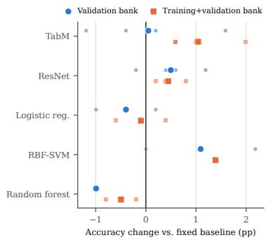  
Figure 2: Accuracy change of the refined decisions relative to the fixed baseline in each cross-validation repetition (small markers) and on average (large markers), for the two reference banks.

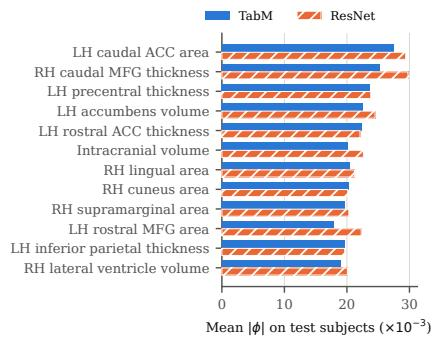  
Figure 3: 12 features with the largest mean absolute SHAP value on test subjects, averaged over folds and repetitions. LH/RH: left/right hemisphere. ACC: anterior cingulate cortex. MFG: middle frontal gyrus.

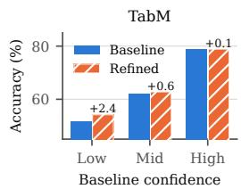

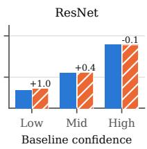  
Figure 4: Accuracy by tercile of baseline confidence $| 2 p _ { q } - 1 |$ , before and after refinement with the enlarged bank, pooled over repetitions. Numbers give the change in percentage points.

Fig. 6 shows the accuracy of the automatically handled subjects when the remaining subjects are deferred. With the combined score, deferring 30% of the subjects increased this accuracy from 64.24% to 70.58% for TabM and from 63.74% to 70.33% for ResNet. Deferring half of the subjects gave 75.00% and 74.67%, compared with 75.34% and 73.24% for confidence alone. The SHAP-Dirichlet evidence thus adds an interpretable reason for each referral at no loss in deferral quality.

Fig. 7 shows a corrected case. The baseline predicted HC for a patient with MDD $( p _ { q } = 0 . 4 3 )$ . The explanation was unstable under small perturbations, and four of its five nearest reference explanations belonged to patients with MDD, so the Dirichlet estimate favored MDD $( p _ { 1 } ^ { \mathrm { D i r } } = 0 . 6 5 )$ . The validation-selected fusion moved the probability to 0.51, and the corrected decision comes with a set of similar, labeled subjects that a clinician can inspect.

Table 2: Ablations for the neural backbones. Each row changes one component of the pre-specified layer (soft fusion, validated RIS/ROS gate, validation bank, $K = 5 ) _ { \div }$ , and all other choices are still selected on validation data. Δ: mean accuracy change (percentage points) over repetitions, green for a gain and red for a loss. I/R: repetitions with improved accuracy. Shaded: the pre-specified layer.
<table><tr><td>Component Variant</td><td></td><td>TabM ΔI/R</td><td>ResNet</td><td>ΔI/R</td></tr><tr><td rowspan="3">Correction</td><td>Hard flip</td><td>-0.45 1/4</td><td>-0.35 0/4</td><td></td></tr><tr><td>Hard or soft (validated)</td><td>+0.45 2/4</td><td>+0.40 3/4</td><td></td></tr><tr><td>Soft fusion (ours)</td><td>+0.05 2/4 +0.50 3/4</td><td></td><td></td></tr><tr><td rowspan="7">Gate</td><td>None</td><td>-0.74 1/4</td><td></td><td>-0.201/4</td></tr><tr><td>Random</td><td>-0.13 1/4</td><td>+0.11 1/4</td><td></td></tr><tr><td>Low confidence</td><td>+0.25 2/4</td><td>+0.40 1/4</td><td></td></tr><tr><td>MC-dropout variance</td><td>+0.60 2/4</td><td>+0.94 4/4</td><td></td></tr><tr><td>RIS only</td><td>-0.15 1/4</td><td> $+ 0 . 6 9$ </td><td>4/4</td></tr><tr><td>ROS only</td><td>+0.693/4</td><td> $+ 0 . 2 0$ </td><td>2/4</td></tr><tr><td>RIS/ROS, validated (ours)</td><td>+0.05 2/4</td><td></td><td>+0.50 3/4</td></tr><tr><td rowspan="4">Evidence</td><td>Raw-feature retrieval</td><td>+0.64 3/4</td><td></td><td>+0.20 2/4</td></tr><tr><td>SHAP, training bank</td><td> $+ 0 . 3 5$  3/4</td><td> $+ 0 . 3 5$ </td><td>4/4</td></tr><tr><td>SHAP, training+validation bank</td><td> $+ 1 . 0 4$  4/4</td><td> $+ 0 . 4 5$ </td><td>4/4</td></tr><tr><td>SHAP, validation bank (ours)</td><td>+0.05 2/4</td><td> $+ 0 . 5 0$ </td><td>3/4</td></tr><tr><td rowspan="5">Top-K</td><td>K = 3</td><td>+0.20</td><td> $3 / 4 \_ - 0 . 6 4$ </td><td>0/4</td></tr><tr><td>K = 5 (ours)</td><td></td><td>+0.05 2/4 +0.50 3/4</td><td></td></tr><tr><td>K = 7</td><td></td><td>-0.05 2/4 -0.05 2/4</td><td></td></tr><tr><td> $K = 1 0$ </td><td>+0.15 2/4</td><td> $- 0 . 2 5$ </td><td>1/4</td></tr><tr><td> $K = 1 5$ </td><td>+0.30 2/4 -0.30 1/4</td><td></td><td></td></tr></table>

Table 3: Change in calibration after refinement with the enlarged bank (refined minus baseline, lower is better), averaged over repetitions, with 95% paired bootstrap intervals. Brier and NLL are $\times 1 0 ^ { 3 }$ , ECE is in percentage points. Green with ∗: improvement whose interval excludes zero.
<table><tr><td>Classifier</td><td>∆Brier</td><td>ΔECE</td><td>∆NLL</td><td></td></tr><tr><td>TabM</td><td>-3.6* [−6.2, −1.1]</td><td>−1.3 [−2.5, 0.2]</td><td></td><td> $- 1 0 . 4 ^ { * } \ \left[ - 1 8 . 2 , \ - 3 . 5 \right]$ </td></tr><tr><td>ResNet</td><td>–5.1* [−8.5, −1.9]</td><td>-2.4*[-3.2, -0.7] -16.2* [-25.8, -7.4]</td><td></td><td></td></tr><tr><td>Logistic regression -2.6* [−5.0, −0.2]</td><td></td><td>−1.1 [−3.1, 1.4]</td><td></td><td> $- 8 . 0 \ [ - 1 9 . 0 , 0 . 3 ]$ </td></tr><tr><td>RBF-SVM</td><td>−0.2 [−2.6, 2.4]</td><td>+0.0 [−2.2, 1.8]</td><td></td><td> $+ 0 . 1 \left[ - 5 . 7 , 5 . 8 \right]$ </td></tr><tr><td>Random forest</td><td>+0.9 [−0.4, 2.3]</td><td> $+ 0 . 2 \ \left[ - 1 . 6 , 1 . 9 \right]$ </td><td></td><td> $+ 1 . 9 \left[ - 1 . 0 , 4 . 9 \right]$ </td></tr></table>

## 6 Discussion

What the layer does well. With a reference bank of all labeled subjects, the layer is a safe post-hoc addition to a neural classifier. It changes a few decisions, it acts mostly where the classifier is uncertain, it improves the calibration of the probabilities, and its gains were positive in every neural repetition. The ablations identify the components that make it safe. A gate limits the correction to about a third of the subjects, and soft fusion moves a probability only as far as the evidence supports. Variants without a gate or with hard flips reduced accuracy, because they also change many correct decisions.

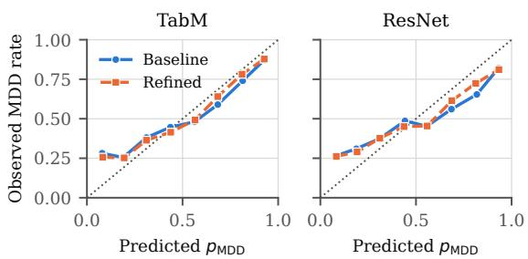  
Figure 5: Reliability diagrams of the baseline and refined MDD probabilities (enlarged bank), pooled over repetitions. The dotted line marks perfect calibration.

Table 4: Quality of the retrieved evidence for test subjects with a validation reference bank and $K = 5 .$ . Prec.: percentage of retrieved references with the same true label as the query. Acc. and AUC: accuracy and ROC-AUC of $p _ { 1 } ^ { \mathrm { { D i r } } }$ as a standalone classifier. Shaded: SHAP space. Bold: best value in each column.
<table><tr><td colspan="3"></td><td colspan="2">TabM</td><td colspan="3">ResNet</td></tr><tr><td>Space</td><td>Metric</td><td>Prec.</td><td>Acc.</td><td>AUC</td><td>Prec.</td><td>Acc.</td><td>AUC</td></tr><tr><td>Raw features</td><td>Cosine</td><td>57.6</td><td>61.3</td><td>0.657</td><td>57.6</td><td>61.3</td><td>0.657</td></tr><tr><td>Raw features</td><td>Pearson</td><td>57.0</td><td>61.1</td><td>0.657</td><td>57.0</td><td>61.1</td><td>0.657</td></tr><tr><td>Raw features</td><td>Euclidean</td><td>56.2</td><td>60.2</td><td>0.650</td><td>56.2</td><td>60.2</td><td>0.650</td></tr><tr><td>SHAP</td><td>Cosine</td><td>58.1</td><td>62.3</td><td>0.668</td><td>58.7</td><td>62.5</td><td>0.674</td></tr><tr><td>SHAP</td><td>Pearson</td><td>57.4</td><td>61.2</td><td>0.657</td><td>57.9</td><td>62.2</td><td>0.662</td></tr><tr><td>SHAP</td><td>Euclidean</td><td>58.9</td><td>62.2</td><td>0.674</td><td>58.9</td><td>61.7</td><td>0.671</td></tr></table>

Table 5: AUROC for separating incorrect from correct baseline decisions on out-of-fold test predictions of all repetitions, with 95% bootstrap intervals. Shaded: scores that use SHAP-Dirichlet evidence. Bold: best value in each column.
<table><tr><td>Score</td><td>TabM</td><td>ResNet</td></tr><tr><td>Low confidence</td><td>0.648 (0.62-0.67)</td><td>0.641 (0.62–0.67)</td></tr><tr><td>MC-dropout variance</td><td>0.601 (0.58–0.63)</td><td>0.628 (0.60–0.65)</td></tr><tr><td>RIS</td><td>0.510 (0.48–0.54)</td><td>0.522 (0.50–0.55)</td></tr><tr><td>ROS</td><td>0.532 (0.51–0.56)</td><td>0.496 (0.47–0.52)</td></tr><tr><td>SHAP-Dirichlet (Pearson)</td><td>0.613 (0.59–0.64)</td><td>0.618 (0.59–0.64)</td></tr><tr><td>SHAP-Dirichlet (Euclidean)</td><td>0.612 (0.59–0.64)</td><td>0.607 (0.58–0.63)</td></tr><tr><td>Confidence + SHAP-Dirichlet</td><td>0.659 (0.64–0.68)</td><td>0.658 (0.63–0.68)</td></tr></table>

Why the reference bank matters. The Dirichlet estimate is an average over � retrieved subjects, so its quality depends on how densely the bank covers explanation space. With about 135 validation subjects, retrieved neighbors are often far from the query, and the evidence is noisy. Adding the training subjects triples the bank. Their explanations come from the same fixed model, and their labels are known, so the enlarged bank uses no test information. The consistent gain in all 8 neural repetitions suggests that the layer will benefit from more labeled reference subjects in deployment, for example from other sites.

Confidence SHAP-Dirichlet Confidence + SHAP-Dirichlet  
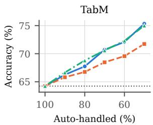

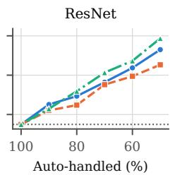  
Figure 6: Accuracy of the automatically handled test subjects when the least reliable subjects are deferred to expert review, with validation-percentile thresholds. Dotted line: accuracy without review.

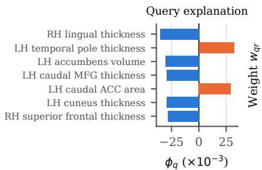

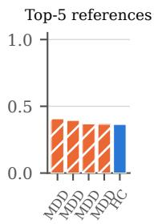  
True: MDD. pq=0.43, pDir1 =0.65, λ=0.65, $p _ { q } ^ { \mathsf { s o f t } } { = } 0 . 5 1$  
Figure 7: A patient with MDD whose TabM baseline prediction was wrong and was corrected by the layer with the enlarged bank. Left: the seven largest SHAP values of the query (orange pushes toward MDD, blue toward HC). Right: weights of the five retrieved references and their true labels.

Why the accuracy gains are modest. The baselines are weak, in line with other structural MRI studies of depression [14, 41], and evidence retrieved from a few hundred subjects cannot be much more accurate than the classifier itself. The Dirichlet estimate alone reached about 62% accuracy. Each rule is also selected on a small validation set, so the selection is noisy. We therefore present accuracy as one benefit among several, together with calibration, low-confidence correction, and expert triage.

The role of RIS and ROS. RIS and ROS did not separate correct from incorrect decisions on their own, so the gate does not work as an error detector. It works as a selector of subjects whose explanation is sensitive to small, measurement-scale feature changes, which makes the correction conservative. The gated subjects were also less accurate than the rest, so the gate and the evidence act on the same subjects. Monte Carlo dropout variance was an even better gate in our experiments, and the framework accepts any uncertainty score.

Classical classifiers. The layer helped the RBF-SVM but not logistic regression or the random forest. Both of the latter produce probabilities close to 0.5 for many subjects, and for logistic regression the SHAP vectors are rescaled feature vectors, so explanation retrieval adds little beyond the features themselves. The efect of the layer on a given classifier should therefore be confirmed on independent folds before deployment, as in our protocol.

Lessons for evaluation. Single test folds are too small to rank post-hoc rules on this task. In the first two repetitions, the accuracy change of the twelve fixed rule variants on single folds ranged from −4.95 to +5.0 points, and the variant with the largest single-fold gain changed accuracy by −0.59 points on average over all folds. Selecting a rule by its test-fold gain would therefore have reported a misleading improvement. Repeated nested cross-validation with pre-specified tests and a separate confirmation step is necessary for post-hoc methods on small neuroimaging datasets [43, 44].

Limitations. We used one dataset with site efects that were not harmonized [15], and we did not test transfer to external sites. The enlarged reference bank was chosen after two repetitions and confirmed on two further repetitions of the same dataset, which is an internal rather than an external confirmation. The validation set serves for early stopping and for rule selection, which makes validation estimates optimistic, although the test folds remain untouched. KernelSHAP for perturbed copies is expensive, especially for large ensembles. Finally, the expert-review path was evaluated by simulation and not with clinicians.

## 7 Conclusion

We presented uncertainty-gated SHAP-Dirichlet refinement, a posthoc layer that retains, refines, or defers the predictions of a fixed MRI-based MDD classifier. In repeated nested cross-validation on 504 SRPBS subjects, the layer with a training-plus-validation reference bank improved accuracy in every TabM and ResNet repetition, concentrated these gains on low-confidence subjects, and improved calibration. Gating and soft fusion were essential for these properties, and the efect carried over to an RBF-SVM but not to logistic regression or a random forest. SHAP-space retrieval produced more label-consistent references than raw-feature retrieval, and the resulting evidence supported a deferral policy that raised the accuracy of automatically handled subjects to about 75% at 50% coverage. A natural next step is to validate the review pathway with clinicians, to enlarge the reference bank across sites, and to test the layer under external site and cohort shifts.

## References

[1] Chirag Agarwal, Nari Johnson, Martin Pawelczyk, Satyapriya Krishna, Eshika Saxena, Marinka Zitnik, and Himabindu Lakkaraju. 2022. Rethinking stability for attribution-based explanations. arXiv preprint arXiv:2203.06877 (2022).

[2] David Alvarez-Melis and Tommi S. Jaakkola. 2018. On the Robustness of Interpretability Methods. arXiv preprint arXiv:1806.08049 (2018).

[3] Edmon Begoli, Tanmoy Bhattacharya, and Dimitri Kusnezov. 2019. The need for uncertainty quantification in machine-assisted medical decision making. Nature Machine Intelligence 1, 1 (2019), 20–23. doi:10.1038/s42256-018-0004-1

[4] Vincent Beliveau, Ella Hedeboe, Patrick M. Fisher, Vibeke H. Dam, Martin B. Jørgensen, Vibe G. Frokjaer, Gitte M. Knudsen, and Melanie Ganz. 2022. Gener alizability of treatment outcome prediction in major depressive disorder using structural MRI: A NeuroPharm study. NeuroImage: Clinical 36 (2022), 103224.

[5] Leo Breiman. 2001. Random Forests. Machine Learning 45, 1 (2001), 5–32. doi:10.1023/A:1010933404324

[6] Glenn W. Brier. 1950. Verification of forecasts expressed in terms of probability. Monthly Weather Review 78, 1 (1950), 1–3.

[7] Hoang-Loc Cao, Van Pham, Truong Thanh Hung Nguyen, Phuc Truong Loc Nguyen, Phuc Ho, Veronica Whitford, and Hung Cao. 2026. Self-Evolving Human-Centered Framework for Explainable Depression Symptom Annotation. In 2026 IEEE International Conference on Omni Layer Intelligent Systems (COINS). 1–6. doi:10.1109/COINS69995.2026.11715640

[8] C. K. Chow. 1970. On optimum recognition error and reject tradeof. IEEE Transactions on Information Theory 16, 1 (1970), 41–46. doi:10.1109/TIT.1970. 1054406

[9] Corinna Cortes and Vladimir Vapnik. 1995. Support-vector networks. Machine Learning 20, 3 (1995), 273–297. doi:10.1007/BF00994018

[10] Ian Covert and Su-In Lee. 2021. Improving KernelSHAP: Practical Shapley Value Estimation Using Linear Regression. In Proceedings of the 24th International Conference on Artificial Intelligence and Statistics (Proceedings ofMachine Learning Research, Vol. 130). PMLR, 3457–3465.

[11] Rahul S. Desikan, Florent Ségonne, Bruce Fischl, Brian T. Quinn, Bradford C. Dickerson, Deborah Blacker, et al. 2006. An automated labeling system for subdividing the human cerebral cortex on MRI scans into gyral based regions of interest. NeuroImage 31, 3 (2006), 968–980. doi:10.1016/j.neuroimage.2006.01.021

[12] Thomas G. Dietterich. 1998. Approximate Statistical Tests for Comparing Supervised Classification Learning Algorithms. Neural Computation 10, 7 (1998), 1895–1923. doi:10.1162/089976698300017197

[13] Bruce Fischl. 2012. FreeSurfer. NeuroImage 62, 2 (2012), 774–781. 20 YEARS OF fMRI.

[14] Claas Flint, Micah Cearns, Nils Opel, Ronny Redlich, David M. A. Mehler, Daniel Emden, Nils R. Winter, Ramona Leenings, et al. 2021. Systematic misestimation of machine learning performance in neuroimaging studies of depression. Neuropsychopharmacology 46, 8 (2021), 1510–1517. doi:10.1038/s41386-021-01020-7

[15] Jean-Philippe Fortin et al. 2018. Harmonization of cortical thickness measure ments across scanners and sites. NeuroImage 167 (2018), 104–120.

[16] Yarin Gal and Zoubin Ghahramani. 2016. Dropout as a Bayesian Approximation: Representing Model Uncertainty in Deep Learning. In Proceedings ofThe 33rd International Conference on Machine Learning (Proceedings of Machine Learning Research, Vol. 48), Maria Florina Balcan and Kilian Q. Weinberger (Eds.). PMLR New York, New York, USA, 1050–1059.

[17] Yonatan Geifman and Ran El-Yaniv. 2017. Selective Classification for Deep Neural Networks. In Advances in Neural Information Processing Systems, I. Guyon, U. Von Luxburg, S. Bengio, H. Wallach, R. Fergus, S. Vishwanathan, and R. Garnett (Eds.), Vol. 30. Curran Associates, Inc.

[18] Florin C. Ghesu, Bogdan Georgescu, Awais Mansoor, Youngjin Yoo, Eli Gibson, R.S. Vishwanath, Abishek Balachandran, James M. Balter, Yue Cao, Ramandeep Singh, Subba R. Digumarthy, Mannudeep K. Kalra, Sasa Grbic, and Dorin Co maniciu. 2021. Quantifying and leveraging predictive uncertainty for medical image assessment. Medical Image Analysis 68 (2021), 101855.

[19] Yury Gorishniy, Akim Kotelnikov, and Artem Babenko. 2025. TabM: Advancing tabular deep learning with parameter-eficient ensembling. In The Thirteenth International Conference on Learning Representations.

[20] Yury Gorishniy, Ivan Rubachev, Valentin Khrulkov, and Artem Babenko. 2021. Revisiting deep learning models for tabular data. In Proceedings of the 35th International Conference on Neural Information Processing Systems (NIPS ’21). Curran Associates Inc., Red Hook, NY, USA, Article 1447, 12 pages.

[21] Léo Grinsztajn, Edouard Oyallon, and Gaël Varoquaux. 2022. Why do tree-based models still outperform deep learning on typical tabular data?. In Advances in Neural Information Processing Systems, Datasets and Benchmarks Track, Vol. 35.

[22] Chuan Guo, Geof Pleiss, Yu Sun, and Kilian Q Weinberger. 2017. On calibration of modern neural networks. In International conference on machine learning. PMLR, 1321–1330.

[23] Anna Hedström, Leander Weber, Daniel Krakowczyk, Dilyara Bareeva, Franz Motzkus, Wojciech Samek, Sebastian Lapuschkin, and Marina M.-C. Höhne. 2023. Quantus: An Explainable AI Toolkit for Responsible Evaluation of Neural Network Explanations and Beyond. Journal ofMachine Learning Research 24, 34 (2023), 1–11.

[24] Dan Hendrycks and Kevin Gimpel. 2017. A Baseline for Detecting Misclas sified and Out-of-Distribution Examples in Neural Networks. In International Conference on Learning Representations.

[25] Leonie Henschel, Sailesh Conjeti, Santiago Estrada, Kersten Diers, Bruce Fischl, and Martin Reuter. 2020. FastSurfer - A fast and accurate deep learning based neuroimaging pipeline. NeuroImage 219 (2020), 117012.

[26] Joseph Kambeitz, Carlos Cabral, Matthew D. Sacchet, Ian H. Gotlib, Roland Zahn, Mauricio H. Serpa, et al. 2017. Detecting Neuroimaging Biomarkers for Depression: A Meta-analysis of Multivariate Pattern Recognition Studies. Biological Psychiatry 82, 5 (2017), 330–338. doi:10.1016/j.biopsych.2016.10.028

[27] Benjamin Kompa, Jasper Snoek, and Andrew L. Beam. 2021. Second opinion needed: communicating uncertainty in medical machine learning. npj Digital Medicine 4, 1 (2021), 4. doi:10.1038/s41746-020-00367-3

[28] Balaji Lakshminarayanan, Alexander Pritzel, and Charles Blundell. 2017. Simple and Scalable Predictive Uncertainty Estimation using Deep Ensembles. In Advances in Neural Information Processing Systems, I. Guyon, U. Von Luxburg, S. Bengio, H. Wallach, R. Fergus, S. Vishwanathan, and R. Garnett (Eds.), Vol. 30. Curran Associates, Inc.

[29] Christian Leibig, Vaneeda Allken, Murat Seçkin Ayhan, Philipp Berens, and Siegfried Wahl. 2017. Leveraging uncertainty information from deep neural networks for disease detection. Scientific Reports 7 (2017), 17816.

[30] Scott M. Lundberg and Su-In Lee. 2017. A unified approach to interpreting model predictions. In Proceedings ofthe 31st International Conference on Neural Information Processing Systems (Long Beach, California, USA) (NIPS’17). Curran Associates Inc., Red Hook, NY, USA, 4768–4777.

[31] Gin S. Malhi and J. John Mann. 2018. Depression. The Lancet 392, 10161 (24 Nov 2018), 2299–2312.

[32] Hussein Mozannar and David Sontag. 2020. Consistent Estimators for Learning to Defer to an Expert. In Proceedings of the 37th International Conference on Machine Learning (Proceedings ofMachine Learning Research, Vol. 119). PMLR.

[33] Claude Nadeau and Yoshua Bengio. 2003. Inference for the Generalization Error. Machine Learning 52, 3 (2003), 239–281. doi:10.1023/A:1024068626366

[34] Hung Nguyen, Alireza Rahimi, Veronica Whitford, Hélène Fournier, Irina Kondratova, René Richard, and Hung Cao. 2026. Heart2mind: Human-centered contestable psychiatric disorder prediction system using wearable ecg monitors. ACM Transactions on Computing for Healthcare (2026).

[35] Mahdi Pakdaman Naeini, Gregory Cooper, and Milos Hauskrecht. 2015. Obtaining Well Calibrated Probabilities Using Bayesian Binning. In Proceedings of the AAAI Conference on Artificial Intelligence, Vol. 29. doi:10.1609/aaai.v29i1.9602

[36] Nicolas Papernot and Patrick McDaniel. 2018. Deep k-Nearest Neighbors: Towards Confident, Interpretable and Robust Deep Learning. arXiv preprint arXiv:1803.04765 (2018).

[37] Fabian Pedregosa, Gaël Varoquaux, Alexandre Gramfort, Vincent Michel, Bertrand Thirion, Olivier Grisel, et al. 2011. Scikit-learn: Machine Learning in Python. Journal ofMachine Learning Research 12 (2011), 2825–2830.

[38] L. Schmaal et al. 2017. Cortical abnormalities in adults and adolescents with major depression based on brain scans from 20 cohorts worldwide in the ENIGMA Major Depressive Disorder Working Group. Molecular Psychiatry 22, 6 (01 Jun 2017), 900–909.

[39] Murat Sensoy, Lance Kaplan, and Melih Kandemir. 2018. Evidential Deep Learn ing to Quantify Classification Uncertainty. In Advances in Neural Information Processing Systems, S. Bengio, H. Wallach, H. Larochelle, K. Grauman, N. Cesa-Bianchi, and R. Garnett (Eds.), Vol. 31. Curran Associates, Inc.

[40] Lloyd S. Shapley. 1953. A value for n-person games. In Contributions to the Theory ofGames II, Harold W. Kuhn and Albert W. Tucker (Eds.). Princeton University Press, 307–317.

[41] Aleks Stolicyn, Mathew A. Harris, Xueyi Shen, Miruna C. Barbu, Mark J. Adams, Emma L. Hawkins, et al. 2020. Automated classification of depression from structural brain measures across two independent community-based cohorts. Human Brain Mapping 41, 14 (2020), 3922–3937. doi:10.1002/hbm.25095

[42] Saori C. Tanaka et al. 2021. A multi-site, multi-disorder resting-state magnetic resonance image database. Scientific Data 8, 1 (30 Aug 2021), 227.

[43] Gaël Varoquaux. 2018. Cross-validation failure: Small sample sizes lead to large error bars. NeuroImage 180 (2018), 68–77. doi:10.1016/j.neuroimage.2017.06.061

[44] Gaël Varoquaux and Veronika Cheplygina. 2022. Machine learning for medical imaging: methodological failures and recommendations for the future. npj Digital Medicine 5, 1 (2022), 48. doi:10.1038/s41746-022-00592-y

[45] Choong-Wan Woo, Luke J. Chang, Martin A. Lindquist, and Tor D. Wager. 2017. Building better biomarkers: brain models in translational neuroimaging. Nature Neuroscience 20, 3 (01 Mar 2017), 365–377.

## A Hyperparameter Grids and Selected Models

Table 6 lists the hyperparameter grids, and Table 7 summarizes the models selected by the inner GridSearch. The selected configuration varied across folds for each classifier, and the baseline

accuracy of individual outer folds difered by more than 10 percent age points, which is why we report pooled results across all folds and repetitions.

Table 6: Hyperparameter grids. All grids were searched with a 3-fold inner cross-validation inside every outer fold, optimizing the F1-score.
<table><tr><td>Classifier</td><td>Fixed settings and searched values</td></tr><tr><td>TabM</td><td>PLE (20 bins), mini ensemble of 32 members, averaged ensemble outputs, no normalization. Layer sizes [128] or [256], dropout 0.1/0.2/0.3, learning rate</td></tr><tr><td>ResNet</td><td> $5 { \times } 1 0 ^ { - 5 } / 1 0 ^ { - 4 } / 5 { \times } 1 0 ^ { - 4 } / 1 0 ^ { - 3 }$  weight decay 10−4/5×10−4/10−3 (72 configurations). PLE (20 bins), layer normalization, skip connections. Two blocks [128, 64, 32] or three blocks [256, 128, 64], dropout 0.1/0.2/0.3, learning rate as for TabM, weight</td></tr><tr><td>Logistic</td><td>decay  $1 0 ^ { - 5 } / 1 0 ^ { - 4 } / 1 0 ^ { - 3 }$  (72 configurations). Standardized features, L2 penalty,</td></tr><tr><td>regression RBF-SVM</td><td> $C \in \{ 1 0 ^ { - 3 } , 1 0 ^ { - 2 } , 1 0 ^ { - 1 } , 1 , 1 0 \} .$ </td></tr><tr><td>Random forest 300 trees, maximum depth {none, 5, 10}, minimum leaf</td><td>Standardized features, Platt-scaled probabilities,  $C \in \{ 0 . 1 , 1 , 1 0 \} , \gamma \in$  {scale,  $1 0 ^ { - 3 } , 1 \bar { 0 } ^ { - 2 } \}$ </td></tr></table>

Table 7: Selected models over all outer folds and repetitions. Distinct: number of distinct selected configurations. Accuracy: baseline test accuracy (%) of single outer folds.
<table><tr><td>Classifier</td><td>Folds</td><td>Distinct</td><td> $\mathbf { M e a n } \pm \mathbf { S D }$ </td><td>Range</td></tr><tr><td>TabM</td><td>20</td><td>18</td><td> $6 4 . 2 4 \pm 4 . 4 8$ </td><td> $5 6 . 0 0 \substack { - 7 3 . 2 7 }$ </td></tr><tr><td>ResNet</td><td>20</td><td>18</td><td> $6 3 . 7 4 \pm 3 . 4 2$ </td><td>56.00-69.00</td></tr><tr><td>Logistic regression</td><td>10</td><td>3</td><td> $6 4 . 2 8 \pm 3 . 8 9$ </td><td>58.00-70.30</td></tr><tr><td>RBF-SVM</td><td>10</td><td>6</td><td> $6 5 . 8 7 \pm 2 . 4 4$ </td><td>61.39-69.31</td></tr><tr><td>Random forest</td><td>10</td><td>6</td><td> $6 6 . 2 8 \pm 3 . 0 8$ </td><td> $6 1 . 3 9 \mathrm { - } 7 0 . 0 0$ </td></tr></table>

## B Additional Results

Table 8 reports every repetition for both reference banks, Table 9 repeats the ablations for the classical classifiers, and Fig. 8 compares feature space and SHAP space with t-SNE.

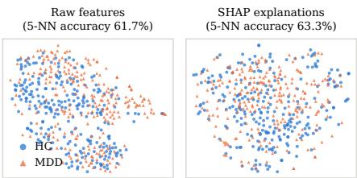  
Figure 8: t-SNE of the 504 test subjects (first TabM repetition) in feature space and SHAP space, with the 5-fold crossvalidated 5-NN accuracy of each space.

Table 8: Per-repetition results for the validation (Val.) and training+validation (Train+val.) banks. Base: pooled baseline accuracy (%). Δ: accuracy change (pp), green for a gain and red for a loss. C/B: corrected/broken decisions. �: exact McNemar test.
<table><tr><td colspan="8"></td></tr><tr><td>Model</td><td>Seed</td><td>Base</td><td>Δ</td><td>Val. bank C/B</td><td>p</td><td>Δ</td><td>C/B</td><td>Train+val. bank p</td></tr><tr><td>TabM</td><td>42</td><td>65.87</td><td>+0.20</td><td>7/6</td><td>1.00</td><td>+0.60</td><td>4/1</td><td>0.38</td></tr><tr><td>TabM</td><td>43</td><td>63.69</td><td>+1.59</td><td>11/3</td><td>0.06</td><td>+0.60</td><td>11/8</td><td>0.65</td></tr><tr><td>TabM</td><td>44</td><td>62.70</td><td>-0.40</td><td>10/12</td><td>0.83</td><td>+1.98</td><td>26/16</td><td>0.16</td></tr><tr><td>TabM</td><td>45</td><td>64.68</td><td>-1.19</td><td>5/11</td><td>0.21</td><td>+0.99</td><td>13/8</td><td>0.38</td></tr><tr><td>ResNet</td><td>42</td><td>63.10</td><td>+0.40</td><td>14/12</td><td>0.85</td><td>+0.40</td><td>19/17</td><td>0.87</td></tr><tr><td>ResNet</td><td>43</td><td>64.68</td><td>+0.60</td><td>14/11</td><td>0.69</td><td>+0.79</td><td>14/10</td><td>0.54</td></tr><tr><td>ResNet</td><td>44</td><td>62.50</td><td>+1.19</td><td>16/10</td><td>0.33</td><td>+0.40</td><td>6/4</td><td>0.75</td></tr><tr><td>ResNet</td><td>45</td><td>64.68</td><td>-0.20</td><td>9/10</td><td>1.00</td><td>+0.20</td><td>6/5</td><td>1.00</td></tr><tr><td>LogReg</td><td>42</td><td>64.88</td><td>-0.99</td><td>7/12</td><td>0.36</td><td>+0.40</td><td>12/10</td><td>0.83</td></tr><tr><td>LogReg</td><td>43</td><td>63.69</td><td>+0.20</td><td>13/12</td><td>1.00</td><td>-0.60</td><td>10/13</td><td>0.68</td></tr><tr><td>SVM SVM</td><td>42</td><td>65.48</td><td>+0.00</td><td>14/14</td><td>1.00</td><td>+1.39</td><td>22/15</td><td>0.32</td></tr><tr><td></td><td>43</td><td>66.27</td><td>+2.18</td><td>19/8</td><td>0.05</td><td>+1.39</td><td>14/7</td><td>0.19</td></tr><tr><td>RF</td><td>42</td><td>66.67</td><td>-0.99</td><td>11/16</td><td>0.44</td><td>-0.20</td><td>6/7</td><td>1.00</td></tr><tr><td>RF</td><td>43</td><td>65.87</td><td>-0.99</td><td>7/12</td><td>0.36</td><td>-0.79</td><td></td><td>4/80.39</td></tr></table>

Table 9: Ablations for the classical classifiers (two repetitions). Δ: mean accuracy change (pp), green for a gain and red for a loss. I/R: repetitions with improved accuracy. Shaded: the pre-specified layer.
<table><tr><td colspan="2"></td><td>LogReg ΔI/R</td><td>SVM ΔI/R</td><td>RF</td></tr><tr><td rowspan="3">Comp.</td><td>Variant</td><td></td><td></td><td>ΔI/R</td></tr><tr><td>Hard flip Correction Hard or soft (validated)</td><td>-0.10 0/2 +0.30 1/2 -0.99 0/2</td><td></td><td></td></tr><tr><td>Soft fusion (ours)</td><td>-0.10 1/2 +0.99 1/2 -1.29 0/2 -0.40 1/2 +1.09 1/2 −0.99 0/2</td><td></td><td></td></tr><tr><td rowspan="6">Gate</td><td>None</td><td>-0.89 1/2 +0.40 1/2 -1.29 0/2</td><td></td><td></td></tr><tr><td>Random</td><td></td><td></td><td>+0.02 1/2 +0.05 1/2 -0.90 0/2</td></tr><tr><td>Low confidence</td><td></td><td></td><td>-0.10 1/2 +1.09 2/2 +0.20 1/2</td></tr><tr><td>RIS only</td><td></td><td></td><td>-0.30 0/2 +0.69 2/2 -0.99 0/2</td></tr><tr><td>ROS only</td><td></td><td></td><td></td></tr><tr><td>RIS/ROS, validated (ours)</td><td>-0.10 1/2 +0.60 2/2 -0.99 0/2 -0.40 1/2 +1.09 1/2 -0.99 0/2</td><td></td><td></td></tr><tr><td rowspan="2">Evidence</td><td>Raw-feature retrieval</td><td>+0.79 2/2 +0.20 1/2 -0.20 1/2</td><td></td><td></td></tr><tr><td>SHAP, validation bank (ours) -0.40 1/2 +1.09 1/2 −0.99 0/2</td><td></td><td></td><td></td></tr></table>