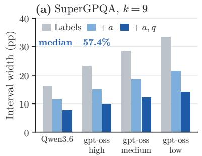
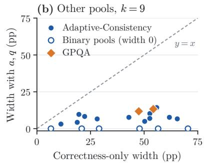
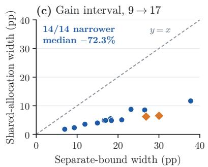
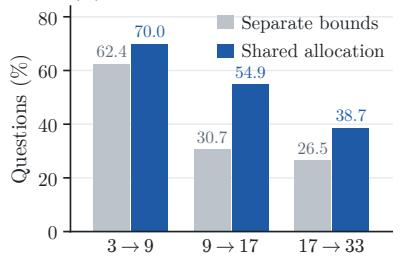
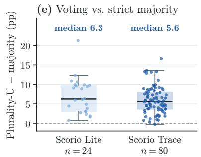
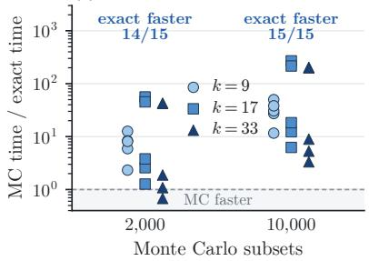
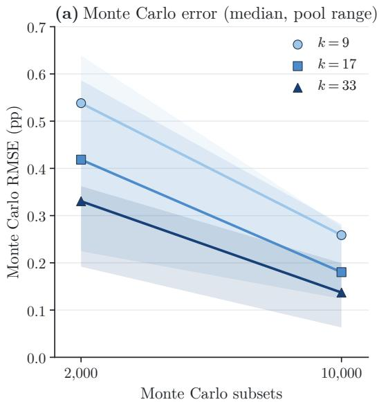
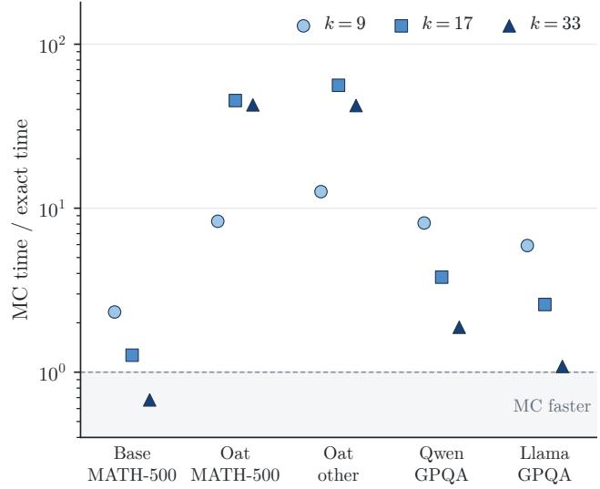

# Which Answers Agree? Evaluating Self-Consistency from Incomplete Logs

Zhengtao Gui Zexi Chen Weining Shen University of California, Irvine

## Abstract

Self-consistency answers a question by generating multiple responses and selecting the most frequent answer. Its evaluation requires both correctness labels and information about which responses agree; correctness labels alone generally determine neither vot ing accuracy nor the benefit of additional votes. For tasks in which all correct responses map to the same normalized answer, we derive sharp accuracy bounds using classical stochastic majorization, refined by abstention counts and answer-category limits. We also derive sharp bounds on accuracy changes across voting budgets that share a response pool. When answer-category counts are available, we introduce Plurality-U, a count-based dynamic program that exactly averages voting accuracy over all fixed-size subsets, eliminating finite-pool Monte Carlo error. On 1,403,520 stored outputs from recent reasoning models in Scorio Lite and Sco rio Trace, recording abstention counts and answer options cuts the width of SuperGPQA accuracy intervals by more than half. For moving from 9 to 17 votes, our bounds re duce interval width by a median of 77.7% on SuperGPQA and 72.3% on 14 GPQA and Adaptive-Consistency pools, compared with a baseline that combines separate accuracy bounds. Exact computation has lower paired median runtime than 2,000-subset Monte Carlo in 14 of 15 tested pool–budget settings. These results clarify what incomplete logs can establish and provide an exact evaluation procedure when answer counts are retained.

## 1 INTRODUCTION

Self-consistency answers a question by generating several responses and selecting the most frequent answer (Wang et al., 2023; Saparkhan et al., 2026). A natural question is how often this procedure returns the correct answer for a given voting budget. Existing work evaluates this accuracy from stored response pools by averaging over enumerated or sampled subsets (Hassid et al., 2025; Bahuguna, 2026; Hariri et al., 2026a,b). What can be inferred, however, depends on what the logs retain. Correctness labels support Pass@k (Chen et al., 2021; Brown et al., 2024) and the probabilities that a majority of sampled responses are correct, but they do not show whether wrong responses concentrate on the same answer. As a result, identical correctness records can imply diferent voting accuracies.

For example, consider a pool of 20 valid responses, eight of which give the same correct answer. Suppose we draw nine responses uniformly without replacement and break voting ties uniformly. If all 12 wrong responses agree, expected voting accuracy is 20.5%; if they all give diferent answers, it is 97.8%. The correctness records are identical, but the voting outcomes are not.

Additional information about the response pool can narrow this uncertainty. In particular, answercategory limits and invalid-response counts rule out some wrong-answer allocations. We ask how precisely voting accuracy can be identified as more information is retained. For tasks whose correct responses normalize to one answer, we derive sharp finite-pool accuracy bounds, refined by abstention counts and an upper limit on the number of answer categories. Every compatible accuracy lies in the stated interval, and both endpoints are attainable. Classical stochastic majorization characterizes the extremal allocations under category limits, while abstentions are handled separately because they consume generation slots without casting a vote.

Evaluation also raises a budget-selection question (Byerly and Khashabi, 2026; Liu, 2026; Wunderlich et al., 2026): does using more votes improve accuracy? Because both budgets draw from the same response pool, they depend on the same unknown allocation of wrong responses across answer categories. We therefore evaluate both budgets under every compatible allocation and directly optimize their accuracy diference, yielding sharp bounds on the efect of additional votes. This joint analysis is necessary because allocations that extremize one budget’s accuracy need not extremize the diference between budgets.

When complete answer-category counts are retained, the answer histogram and voting rule uniquely determine finite-pool voting accuracy. We introduce Plurality-U, a complete U-statistic, together with a count-based dynamic program for computing it exactly without enumerating all fixed-size subsets. The computation requires only the recorded histogram and eliminates Monte Carlo error from subset sampling. Under iid generation, Plurality-U is also unbiased for the accuracy of voting on fresh responses.

We validate the framework on the recent Scorio Lite and Scorio Trace candidate banks, comprising 1,403,520 attempts in 17,544 complete pools from 24 model configurations across SuperGPQA and nine competition-mathematics benchmark splits (Hariri et al., 2026a,b; M-A-P Team et al., 2025). Directly bounding the accuracy change from 9 to 17 votes reduces interval width by a median of 77.7% on SuperGPQA and 72.3% across 14 GPQA and Adaptive-Consistency pools, compared with combining separately optimized accuracy bounds. Exact computation has lower paired median runtime than 2,000- subset Monte Carlo in 14 of 15 tested pool–budget settings. We also evaluate sensitivity to answer normalization and invalid-response handling.

We summarize our contributions as follows:

• Evaluation under incomplete logs. We derive sharp voting-accuracy bounds and characterize how answer-category limits and abstention counts refine them.

• Comparisons across voting budgets. We ob tain sharp bounds on accuracy changes by evaluating diferent budgets over a shared underlying response pool.

• Exact evaluation from answer counts. We develop Plurality-U and its count-based dynamic program, and empirically evaluate information loss, computational cost, and sensitivity to evaluation rules.

## 2 RELATED WORK

Metrics and selectors for repeated generation. Several metrics and answer-selection rules have been proposed for multiple responses to the same question. Pass@k measures the probability that at least one of k responses is correct (Chen et al., 2021; Brown et al., 2024), while G-Pass@k evaluates stability through thresholds on the number of correct responses (Liu et al., 2025). Bayesian alternatives estimate average success or rubric scores (Hariri et al., 2025). Selfconsistency instead selects the most frequent answer (Wang et al., 2023), with adaptive variants stopping once agreement is suficiently high (Aggarwal et al., 2023). Its accuracy therefore depends on both correctness and agreement among responses.

Finite-pool evaluation of voting policies. Stored response pools allow voting budgets to be compared without additional generation. Hassid et al. (2025) enumerate subsets of 20 generations and average their voting outcomes. Bahuguna (2026) study plurality accuracy across budgets on GPQA, using enumeration or Monte Carlo sampling, and investigate budget selection with complete answer logs. Shah et al. (2026) distinguish plurality@k from strict consensus and evaluate voting on fixed response batches. We compute the same subset-based expectation exactly from answer counts and characterize what can be inferred from incomplete logs about voting accuracy and the benefit of additional votes.

Voting accuracy and answer agreement. Classical work bounds majority or multiclass plurality accuracy under dependent or independent-voter models (Kuncheva et al., 2003; Aeeneh et al., 2025). For language models, recent work examines correctness across voting budgets (Liu, 2026), consensus among wrong answers (Zhang et al., 2026), and sampling or selection rules that distinguish total correct probability from its concentration on individual answers (Yang et al., 2026). A separate line of work asks whether sampled votes recover the population mode, through sample allocation, certification, or plug-in estimation (Feng et al., 2025; Cordero-Encinar and Duncan, 2025; Nowak, 2025). Our setting difers in that we condition on a fixed stored response pool and ask how often a given finite-budget voting rule selects the correct answer.

Partial identification and exact computation. Partial identification characterizes the range of target values compatible with incomplete information, allowing decisions even when the target is not point identified (Tamer, 2010; Stoye, 2009). We apply this framework to correctness-only logs, treating diferent voting budgets as sharing the same unknown answer allocation. To incorporate category limits, we use the preservation of Schur order under hypergeometric sampling

(Marshall et al., 2011).

With complete answer counts, averaging over all fixedsize subsets gives a complete U-statistic, whereas incomplete U-statistics evaluate only sampled subsets (Hoefding, 1948; Blom, 1976; Clémençon et al., 2016). Hazon et al. (2012) use dynamic programming to compute winner probabilities under independent heterogeneous ballots; our dynamic program instead averages over uniform sampling without replacement from a fixed stored pool. Together, these two approaches cover diferent levels of retained information: partial identification gives sharp bounds when answer counts are missing, while complete counts allow exact evaluation. Table 1 summarizes their inputs, targets and computation.

## 3 PROBLEM SETUP

We evaluate a voting rule that takes k model outputs and returns the answer category with the most votes. We consider its accuracy in two settings: on k fresh outputs and on a uniformly sampled size-k subset of a fixed pool of n stored outputs, where $1 \leq k \leq n$ To formalize these settings, fix a benchmark problem and a deterministic answer-normalization rule. Let $X _ { 1 } , \ldots , X _ { n } \in \{ 0 , 1 , \ldots , m \}$ denote the normalized categories of the stored outputs. Category 0 is the unique gold-answer category, while categories $1 , \ldots , m$ are incorrect. Normalization is label-blind: correctness labels are used to score the selected answer, but not to decide whether two outputs belong to the same category. We write $\begin{array} { r } { C _ { j } \ = \ \sum _ { i } { \bf 1 } \{ X _ { i } = \ j \} } \end{array}$ and $C =$ $\left( C _ { 0 } , \ldots , C _ { m } \right)$ for the resulting answer-count histogram.

The selector returns a category with the largest count among the k selected outputs and breaks ties uniformly. Its correctness payof is

$$
h _ { k } ( x _ { 1 } , \ldots , x _ { k } ) = { \frac { 1 \{ 0 { \mathrm { ~ h a s ~ m a x i m a l ~ c o u n t } } \} } { \# \{ { \mathrm { c a t e g o r i e s ~ w i t h ~ m a x i m a l ~ c o u n t } } \} } } .\tag{1}
$$

Thus, $h _ { k } \ = \ 1$ when the gold category is the unique winner, $h _ { k } = 0$ when it is not a winner, and $h _ { k } = 1 / t$ when it is tied with t − 1 other categories.

The two evaluation settings define two related targets. If fresh outputs are drawn iid from a fixed distribution $p ,$ their voting accuracy is $\theta _ { k } ( p ) = \mathbb { E } _ { p } [ h _ { k } ( X _ { 1 } , . . . , X _ { k } ) ]$ For the fixed stored pool, we instead average the payof over every size-k subset:

$$
U _ { n , k } ( C ) = { \binom { n } { k } } ^ { - 1 } \sum _ { S \subset [ n ] : | S | = k } h _ { k } ( X _ { S } ) .\tag{2}
$$

The finite-pool quantity $U _ { n , k } ( C )$ is the exact expected payof of a uniformly drawn k-subset and requires no probabilistic assumption on the stored pool. If the stored outputs are iid draws from $p ,$ then $U _ { n , k } ( C )$ is also an unbiased estimator of the fresh-sample target $\theta _ { k } ( p )$ . Our finite-pool calculations and identification bounds concern $U _ { n , k } ( C )$ and therefore do not require the iid assumption.

Correctness-only metrics discard information needed to determine plurality accuracy. If R is the number of correct outputs in the selected set, strict-majority correctness is $1 \{ R > k / 2 \}$ and Pass@k is $\mathbf { 1 } \{ R \geq 1 \}$ Both are functions of R alone, whereas plurality accuracy also depends on how the remaining $k - R$ outputs are allocated among wrong answer categories.

## 4 IDENTIFICATION FROM INCOMPLETE LOGS

We begin with the coarsest log, which records only the pool size n and the number $c = C _ { 0 }$ of correct outputs, but not how the $n - c$ incorrect outputs are grouped into answer categories. Assume for now that every output casts a valid vote. For a uniformly selected size-k subset, the number of correct outputs obeys $R \sim$ Hypergeom $( n , c , k )$ . Define

$$
\begin{array} { r } { L _ { n , c , k } = \mathbb { P } ( R > k - R ) + \frac { 1 } { 2 } \mathbb { P } ( R = k - R ) , } \end{array}
$$

$$
\begin{array} { r } { B _ { n , c , k } = \mathbb { P } ( R \geq 2 ) + \frac { 1 } { k } \mathbb { P } ( R = 1 ) . } \end{array}\tag{3}
$$

(4)

Theorem 1 (Sharp correctness-only bounds) Over all allocations of the $n - c$ incorrect outputs to answer categories, the finite-pool expected plurality accuracy lies in $\left[ L _ { n , c , k } , B _ { n , c , k } \right]$ , and both endpoints are attainable.

The endpoints correspond to two extreme error allocations. Concentrating all incorrect outputs in one category creates the strongest competitor to the gold answer and attains $L _ { n , c , k }$ . At the other extreme, assigning every incorrect output to its own category disperses the wrong votes and attains $B _ { n , c , k }$ . Splitting a wrong category can only weaken its competition with the gold category, so no allocation can yield accuracy outside these bounds. The full proof is in Appendix A. As a special case, for an odd k and a binary answer alphabet, all incorrect outputs necessarily share one category. The bounds therefore coincide, and plurality accuracy reduces to strict-majority correctness.

## 4.1 Known answer-alphabet size

The preceding upper bound allows every incorrect output to form its own category. If the task is independently known to admit at most $q \geq 1$ wrong answer categories (Xia et al., 2024; Guo et al., 2025), this allocation may be infeasible and the upper bound can tighten. Let $V _ { k } ( c , w )$ denote finite-pool plurality accuracy for c correct outputs and wrong-count vector w. For $e = n - c ,$ let $b _ { q } ( e )$ be the length-q vector whose entries sum to e and difer by at most one; zero entries represent unused categories.

Table 1: Related evaluation formulations, their required inputs, targets, and computation. a is the abstention count and q the cap on wrong answer categories (Section 4).
<table><tr><td>Formulation</td><td>Retained input</td><td>Returned quantity</td><td>Computation</td></tr><tr><td>Chen et al. (2021); Liu et al. (2025)</td><td>Correctness labels</td><td>Coverage or correctness-threshold score</td><td>Function of the correct count</td></tr><tr><td>Hassid et al. (2025);</td><td>Answer identities</td><td>Expected subset voting score</td><td>Enumeration or Monte</td></tr><tr><td>Bahuguna (2026) Shah et al. (2026)</td><td>One answer batch</td><td>Batch plurality score</td><td>Carlo Vote on that batch</td></tr><tr><td>Hazon et al. (2012)</td><td>Uncertain-ballot model</td><td>Election-winner probabilities</td><td>Probabilistic voting DP</td></tr><tr><td>Marshall et al. (2011)</td><td>Hypergeometric</td><td>Schur ordering of expected</td><td>Preservation theorem</td></tr><tr><td>This work: incomplete logs</td><td>population counts Labels; optionally</td><td>payoffs Sharp voting-accuracy bounds</td><td>Extremal allocations and</td></tr><tr><td>This work: full counts</td><td> $a , q$  Answer-count histogram</td><td>Exact all-subset voting</td><td>DP Count DP (complete</td></tr></table>

Theorem 2 (Known alphabet) For $1 ~ \leq ~ k ~ \leq ~ n ,$ over all wrong-count vectors with at most q categories, the minimum is $L _ { n , c , k }$ and the maximum is

$$
B _ { n , c , k } ^ { ( q ) } = V _ { k } \big ( c , b _ { q } ( n - c ) \big ) .
$$

Both extrema are attainable.

The maximizing allocation $b _ { q } ( e )$ spreads the incorrect outputs as evenly as the category limit permits. This follows from classical stochastic majorization under hypergeometric sampling (Nevius et al., 1977; Marshall et al., 2011). Equivalently, pairwise smoothing moves one physical wrong output from a category of size a to one of size b when $a \geq b + 2$ and cannot decrease the ex pected gold payof. Repeating the operation produces $b _ { q } ( e )$ , and Appendix A.2 treats all tie cases. When $q = 1$ , the two endpoints coincide. For $q \geq n - c ,$ the category limit no longer binds, and the upper endpoint reduces to Eq. (4).

## 4.2 Abstention-aware bounds

Some logs distinguish invalid outputs that consume a generation slot but do not cast a vote. Let a be the number of these abstentions and $N = n - a$ the number of valid outputs. We assign zero payof when all selected outputs abstain. Conditional on selecting $v \geq 1$ valid outputs, they form a uniform size-v subset of the valid pool. The probability of this event is

$$
w _ { v } = { \frac { { \binom { N } { v } } { \binom { a } { k - v } } } { \binom { n } { k } } }
$$

for max $( 1 , k - a ) \leq v \leq \operatorname* { m i n } ( k , N )$

Corollary 1 (Observed abstentions) Given $( n , c , a , q , k )$ , the sharp lower and upper endpoints are

$$
L _ { n , c , k } ^ { a } = \sum _ { v } w _ { v } L _ { N , c , v } ,
$$

$$
B _ { n , c , k } ^ { a , q } = \sum _ { v } w _ { v } B _ { N , c , v } ^ { ( q ) } .
$$

With no cap q, replace $B ^ { ( q ) }$ by B. If a is also unrecorded and abstentions are allowed, the sharp endpoints become $[ L _ { n , c , k } , \mathbb { P } ( R \geq 1 ) ]$

The bounds are weighted averages of the corresponding conditional bounds for each possible number v of valid votes. The same concentrated and balanced allocations attain the conditional endpoints for every $v ,$ so the resulting bounds remain sharp. If a is unrecorded, treating every noncorrect output as an abstention attains the upper endpoint. Accounting for abstentions can substantially change the identified interval. For example, with one gold output, two abstentions, and $k \ = \ 3 .$ , the gold answer wins with probability one, whereas applying the no-abstention bound would give an upper bound of only $1 / 3 .$ . Empty sums when $N = 0$ equal zero.

## 5 EXACT EVALUATION ACROSS BUDGETS

With the complete answer-count histogram C, the finite-pool accuracy in Eq. (2) is point identified and exactly computable. We call the resulting complete U-statistic Plurality-U.

Theorem 3 (Unbiased estimation) For $n \_ \mathrm { ~ \chi ~ } k$ and iid stored outputs from p, $, \mathbb { E } [ U _ { n , k } ] = \theta _ { k } ( p )$ . Let S be an independent, uniform k-subset and put $T = h _ { k } ( X _ { S } )$

Then

$$
\begin{array} { r l } & { U _ { n , k } = \mathbb { E } [ T \mid X _ { 1 } , \ldots , X _ { n } ] , } \\ & { \mathrm { V a r } ( U _ { n , k } ) \leq \mathrm { V a r } ( T ) . } \end{array}
$$

Every fixed k-subset has distribution $p ^ { k }$ , which gives unbiasedness. The conditional-expectation identity and the law of total variance give the variance bound. Appendix A gives the UMVU refinement for a fixed finite answer alphabet. Abstentions use the corresponding kernel, equivalently $\begin{array} { r } { \sum _ { v } w _ { v } U _ { N , v } ( C _ { \mathrm { v a l i d } } ) } \end{array}$ . More generally, unbiasedness and variance reduction require only that the evaluation rule be fixed, bounded, and invariant to the order of its k inputs, so they are not specific to plurality voting. By contrast, the identification bounds in Section 4 require all correct outputs to belong to one answer category.

The complete statistic also permits several normalized correct categories. Suppose categories are constructed without correctness labels. Category j contains $C _ { j }$ outputs, of which $g _ { j }$ are correct. After selecting a winning category, the rule returns one of its selected members uniformly. Category j wins with probability $V _ { k } ( C _ { j } , C _ { - j } )$ , and its returned member is correct with expected probability $g _ { j } / C _ { j }$ . Hence the exact expected score is

$$
\sum _ { j } \frac { g _ { j } } { C _ { j } } V _ { k } ( C _ { j } , C _ { - j } ) ,
$$

over nonempty categories. Correctness labels afect only scoring, not category construction or winner selection, so the complete-U argument remains valid.

Exact evaluation need not enumerate the n physical subsets in Eq. (2). We use a count-based dynamic program. Fix $r ,$ the selected gold-category count. After processing j wrong categories, $D _ { j } ( s , t )$ counts selections with s wrong outputs, no wrong count above $r ,$ and exactly t wrong categories tied with the gold category at r. Starting at $D _ { 0 } ( 0 , 0 ) = 1$ , a category with pool count $C _ { j }$ gives

$$
D _ { j } ( s + \ell , t + 1 \{ \ell = r \} ) \mathrel { + } = D _ { j - 1 } ( s , t ) \binom { C _ { j } } { \ell } ,\tag{5}
$$

for $0 \leq \ell \leq \operatorname* { m i n } ( C _ { j } , r , k - r - s )$ . After all m wrong categories, the exact numerator is

$$
\sum _ { r = 1 } ^ { \operatorname* { m i n } ( C _ { 0 } , k ) } \binom { C _ { 0 } } { r } \sum _ { t } \frac { D _ { m } ( k - r , t ) } { t + 1 } .\tag{6}
$$

Dividing by $\textstyle { \binom { n } { k } }$ yields Eq. (2). States track category counts, not output identities, so the implemented recurrence is polynomial in the number of observed categories and $k .$ Concentrated histograms yield few nonzero states and are especially cheap. Appendix B proves the recurrence and gives its complexity.

## 5.1 Shared-allocation budget contrasts

To determine whether a larger budget helps, both accuracies must use the same unknown allocation of incorrect outputs. Fix $( n , c , a , q )$ , let $e = n - c - a . $ , and write the compatible allocations as

$$
\begin{array} { r } { \mathcal { W } _ { e , q } = \{ w \in \mathbb { Z } _ { \geq 0 } ^ { q } : w _ { 1 } \geq \cdots \geq w _ { q } , \sum _ { j } w _ { j } = e \} . } \end{array}
$$

Each $w \in \mathcal { W } _ { e , q }$ is one allocation consistent with the log. Let $\begin{array} { r } { F _ { k } ( w ) = \sum _ { v } w _ { v } ^ { ( k ) } V _ { v } ( c , w ) } \end{array}$ be its abstentionaware payof, where $w _ { v } ^ { ( k ) }$ is the probability of obtaining v valid votes at budget k. Using the same all-abstention convention, define the budget gain as $\Delta _ { k , \ell } ( w ) = F _ { \ell } ( w ) - F _ { k } ( w )$ for $k < \ell \leq n$

Proposition 1 (Budget contrasts) Given $( n , c , a , q )$ , optimizing over the same allocation at both budgets gives the sharp gain endpoints

$$
\begin{array} { r l } & { d _ { k , \ell } ^ { - } = \underset { w \in \mathcal { W } _ { e , q } } { \operatorname* { m i n } } ~ \Delta _ { k , \ell } ( w ) , } \\ & { d _ { k , \ell } ^ { + } = \underset { w \in \mathcal { W } _ { e , q } } { \operatorname* { m a x } } ~ \Delta _ { k , \ell } ( w ) . } \end{array}
$$

$I f \left[ L _ { j } , B _ { j } \right]$ are the sharp single-budget bounds, then

$$
[ d _ { k , \ell } ^ { - } , d _ { k , \ell } ^ { + } ] \subseteq [ L _ { \ell } - B _ { k } , B _ { \ell } - L _ { k } ] .
$$

For a fixed benchmark with no cross-item constraints on missing allocations, macro gain endpoints are the averages of the item endpoints.

We enumerate $w \in \mathcal { W } _ { e , q } ,$ evaluate both budgets by count DP, and retain the smallest and largest diferences. Using the same w excludes marginal extrema that require incompatible allocations. Because the set is finite, the optimizers also show that the endpoints are sharp. There are at most $\binom { e + q - 1 } { q - 1 }$ allocations, and items with the same $( n , c , a , q )$ share them, so enumeration remains practical for ten answer options (Section 6.3). Appendices A.5 and B.2 give the proof and an all-budget polynomial recurrence.

Gain extrema need not occur at the concentrated or balanced allocations. For $n = 7 , c = 2 , a = 0 , q = 3 ,$ comparing $k \ = \ 3$ with $\ell \ = \ 7 ,$ allocations $( 5 , 0 , 0 )$ and (2, 2, 1) give gains $- 1 / 7$ and 4/105, but (3, 1, 1) gives the smaller value −29/105. Diferences of Schurconcave payofs need not preserve their ordering. Thus $d _ { k , \ell } ^ { - } > 0$ certifies improvement, $d _ { k , \ell } ^ { + } < 0$ certifies decline, and otherwise the direction is unidentified.

## 6 EXPERIMENTS

We first describe the setup (§6.1). We then report three experiments: one measuring how much each extra field in the log narrows the accuracy interval (§6.2), one testing whether a shared allocation can tell which voting budget is better (§6.3), and one measuring how sensitive the results are to answer processing (§6.4). Finally, §6.5 compares exact evaluation with Monte Carlo sampling.

Table 2: Stored outputs used in the experiments; n is the number of stored outputs per question.
<table><tr><td>Source</td><td>Models</td><td>Questions</td><td>n Used in</td></tr><tr><td>Scorio Lite</td><td>Qwen3.6-35B-A3B; gpt-oss-20b (3 settings)</td><td>3,600 SuperGPQA; 186 math</td><td>80 §6.2- 6.4</td></tr><tr><td>Scorio Trace GPQA</td><td>20 reasoning models Qwen2.5-7B,</td><td>120 math 198 GPQA</td><td>80§6.2 64 §6.2-</td></tr><tr><td>Adaptive-</td><td>Llama-3-8B code-davinci-002,</td><td>Diamond 10 tasks,</td><td>6.5 40 §6.2-</td></tr><tr><td>Consistency MATH</td><td>Vicuna-13B Qwen2.5-Math-1.5B,</td><td>146–2,279 each 500 MATH-500;</td><td>6.4 64 §6.4,</td></tr></table>

## 6.1 Setup

Data. Table 2 lists the stored outputs used in each experiment. Our main data are Scorio Lite and Scorio Trace (Hariri et al., 2026a,b): 1,403,520 outputs from 24 recent reasoning-model configurations on SuperGPQA (M-A-P Team et al., 2025) and nine competition-mathematics sets. We also use the GPQA and Adaptive-Consistency pools (Rein et al., 2023; Bahuguna, 2026; Aggarwal et al., 2023). Nine of the ten Adaptive-Consistency tasks have fixed options. Among their 18 pools, 12 have three to six options and 6 are binary. The MATH pools (Hendrycks et al., 2021) are used for the answer-processing and timing studies.

Answer processing. We group outputs by the answers extracted in each release, without using correctness labels. We apply Unicode normalization and trimming, ignore letter case for multiple-choice answers, and treat missing or out-of-range answers as abstentions. Ties are broken at random, and a subset in which every output abstains scores zero. Unless stated otherwise, we use k = 9 votes. Appendices C and E give the sources, rules and full results.

## 6.2 Information Retained in the Log

Table 3 shows how the retained information afects the width of the identified accuracy interval. With correctness labels alone, the log does not record whether incorrect outputs agree with one another. If they all share one answer, they form a strong competitor to the correct answer; if they are spread across diferent answers, the correct answer can win with fewer votes. On SuperGPQA, the resulting interval width ranges from 16.28 to 33.48 points, comparable to the accuracy diferences between the four models.

Table 3: SuperGPQA at k = 9. Exact is voting accuracy computed from full answer counts. The other columns give the identification interval width when the log keeps correctness labels only, adds abstention counts (+a), or also adds the option count, which caps the wrong categories (+a, q). Parentheses give the reasoning efort.
<table><tr><td colspan="4">Interval width (pp)</td></tr><tr><td>Model</td><td>Exact (%)</td><td>Labels +a</td><td>+a,q</td></tr><tr><td>Qwen3.6-35B-A3B</td><td>65.95</td><td>16.28 11.44</td><td>7.80</td></tr><tr><td>gpt-oss-20b (high)</td><td>47.66</td><td>23.28 14.94</td><td>9.86</td></tr><tr><td>gpt-oss-20b (medium)</td><td>45.49</td><td>28.39 18.47</td><td>12.15</td></tr><tr><td>gpt-oss-20b (low)</td><td>39.07</td><td>33.48 21.47</td><td>14.04</td></tr></table>

Recording the number of invalid outputs yields the largest reduction. Without this count, every incorrect output could in principle be invalid. Because invalid outputs do not vote, the correct answer would then win whenever at least one correct output is selected, which raises the upper endpoint (Corollary 1). Recording the count excludes this case and reduces the width to 11.44–21.47 points. Recording the number of answer options reduces it further to 7.80–14.04 points, because a question with ten options admits at most nine distinct incorrect answers. In total, the two counts reduce the width by a median of 57.4% (Figure 1a).

The GPQA and Adaptive-Consistency pools show the same pattern (Figure 1b). For the two GPQA pools, the width decreases from 47.50 and 54.27 points to 11.77 and 13.29 points, and for the 12 Adaptive-Consistency pools with three to six options it decreases from 11.20–65.44 to 3.11–14.28 points. The six binary pools become point identified: with only two possible answers, all incorrect outputs necessarily share one answer, so no uncertainty remains once invalid outputs are counted (Theorem 2 with q = 1). In all cases, the width reflects missing information rather than sampling error. When the log records the count of every answer, the interval reduces to a single value, which Plurality-U computes exactly.

The exact values also difer systematically from scores based on correctness alone. Strict-majority correctness counts a question as solved when more than half of the k votes are correct. Under the single-gold-category setup of Section 3, voting accuracy is never below this score, because a correct answer that receives more than half of the votes always wins. Voting accuracy is often higher, because the correct answer can also win with fewer votes when the incorrect answers are split. Across the 104 Scorio model–task cells, voting accuracy exceeds strict-majority correctness by a median of 5.78 points (interquartile range 3.49–8.72; Figure 1e).

(d) Gain sign identified  

(f) Monte Carlo vs. exact time  
  
Figure 1: Main results. (a) SuperGPQA interval width at k = 9 under three logs. (b) Width with correctness only versus with abstentions and options, 20 GPQA and Adaptive-Consistency pools. (c) 9 → 17 gain-interval width, shared versus separate bounds, 14 pools. (d) Share of 3,126 questions with a known gain sign. (e) Plurality-U minus strict-majority correctness, 104 Scorio cells. (f) Median Monte Carlo/exact time ratio, 30 settings.

## 6.3 Comparing Voting Budgets

To compare 9 and 17 votes, we consider the gain, defined as the accuracy with 17 votes minus that with 9 votes. With incomplete logs, the gain is identified only up to an interval, whose sign is known when the entire interval lies above or below zero. A simple baseline subtracts the single-budget intervals from Section 4, pairing the upper endpoint at 17 votes with the lower endpoint at 9 votes to obtain an upper bound on the gain. However, these endpoints generally correspond to diferent allocations of incorrect outputs (Theorems 1 and 2). Because both budgets are evaluated on the same stored pool, they must share a single allocation. Our shared-allocation bounds therefore optimize the gain directly over all allocations consistent with the log (Proposition 1).

Both methods use the same retained information: the numbers of stored, correct and invalid outputs, and the number of answer options. We apply them to four SuperGPQA pools, one for each Scorio Lite model with all 3,600 questions, and to the 3,126 questions in the 14 GPQA and Adaptive-Consistency pools with three or more options. We exclude the six binary Adaptive-Consistency pools because their incorrect outputs necessarily share one answer, making the gain point identified. We fixed 9→17 as the main comparison, and 3→9 and 17→33 as secondary comparisons, before computing any gain.

Enforcing a shared allocation substantially narrows the gain intervals. For 9 → 17 on SuperGPQA, the interval for the pool average is 77.5–78.0% narrower (median 77.7%), and the sign of the gain, that is, whether more votes help or hurt, becomes known for 3,613 of the 14,400 model–question pairs (25.1%), compared with 269 (1.9%) under the baseline (Table 10 in Appendix F). On the other 14 pools, the interval for the pool average is 62.2–78.4% narrower (median 72.3%; Figure 1c), and the sign becomes known for 1,717 of the 3,126 questions (54.9%), compared with 959 (30.7%) under the baseline (Figure 1d). The secondary comparisons improve in the same way on both sets (Table 11).

A benchmark, however, applies one budget to all of its questions, so the decision depends on the average gain over a pool. The interval for this average runs from the average of the question-level lower endpoints to the average of the upper endpoints (Proposition 1). For all four SuperGPQA pools and 13 of the other 14 pools, this interval for 9 → 17 still contains zero, so the log cannot tell whether 17 votes beat 9 votes on average. The only exception is Vicuna-13B on Disambiguation QA, whose lower endpoint is positive (0.237 points). The average gains themselves are small: computed from the full logs, they range from 0.19 to 0.56 points on SuperGPQA and from −0.22 to 3.33 points on the other pools (Tables 9 and 10), and an interval must be very narrow to exclude a value this close to zero. Thus, shared allocation identifies the direction of the gain for many more individual questions, but benchmark-level budget selection usually still requires full answer counts.

## 6.4 Sensitivity to Answer Processing

Before voting, each output is converted into an answer, and invalid outputs are handled by a fixed rule. These choices determine which outputs count as the same answer. Exact evaluation removes the uncertainty from missing counts but not the efect of these choices (Table 4 in Appendix C.3). On the MATH-500 outputs of the base model Qwen2.5-Math-1.5B (base MATH), keeping only the last boxed expression instead of parsing each output with a mathematical checker leaves 36.50% of the outputs without a usable answer and lowers accuracy from 54.92% to 37.36%. Treating invalid outputs as one shared incorrect answer instead of as abstentions changes accuracy by at most 0.30 points on SuperGPQA and GPQA, where invalid outputs are rare, but by up to 49.11 points on Adaptive-Consistency, where 22.64% of the outputs are invalid and grouping them creates a large block of identical incorrect votes. An exact value is exact only for a given processing rule, so the rule should be reported with it.

## 6.5 Exact Evaluation versus Monte Carlo

Plurality-U is defined as the average vote over all size-k subsets of the stored pool (Eq. (2)). Prior work computes this average by enumerating or sampling subsets (Hassid et al., 2025; Bahuguna, 2026). Enumeration is exact but feasible only for small pools, whereas Monte Carlo sampling estimates the average from randomly drawn subsets, so its estimate contains random error. Plurality-U computes the average exactly without enumeration, and we compare its error and runtime with Monte Carlo.

The timing study uses the five pools with 64 stored outputs per question: the three MATH pools and the two GPQA pools (Table 2). From each pool we take ten questions selected by a hash of their identifiers. For each question and each budget k ∈ {9, 17, 33}, we time exact evaluation and Monte Carlo 20 times each and compare their median times (Appendix D.2). With 2,000 random subsets, the root mean squared error of Monte Carlo ranges from 0.00192 to 0.00639 across pools, and Monte Carlo is slower than exact evaluation in 14 of the 15 pool–budget settings. With 10,000 subsets, the error decreases to 0.00063–0.00282, and exact evaluation is faster in all 15 settings (Figure 1f). The only exception at 2,000 subsets is base MATH at k = 33, whose answers are spread over many categories, which increases the number of states in the dynamic program (Table 6 in Appendix D.2).

## 7 DISCUSSION AND CONCLUSION

This work determines how precisely stored logs identify the accuracy of self-consistency. With correctness labels alone, voting accuracy and the efect of additional votes are known only within wide intervals. Recording the number of invalid outputs and answer options more than halves these intervals, while jointly accounting for the shared answer allocation across voting budgets further tightens bounds on the efect of additional votes. With complete answer counts, voting accuracy is point identified and can be computed exactly, usually at lower cost than Monte Carlo. Benchmarks should therefore release answer counts when possible, or report identification intervals when they are unavail able.

Two limitations suggest directions for future work. First, the exact values describe the stored outputs. Interpreting them as estimates of voting accuracy on fresh responses requires iid generation under a fixed prompt and decoder. Second, our experiments cover knowledge questions, competition mathematics, and reasoning tasks, but not structured-output tasks such as proof autoformalization (Gui et al., 2026; Jana et al., 2026) or text-to-SQL generation (Yu et al., 2018; Li et al., 2023).

## AI use statement

In this work, we used ChatGPT and Codex to polish the language of this paper, organize and improve parts of our code, organize data and relevant literature, and check whether parts of our proofs needed further clarification. We independently reviewed and verified all AI-assisted work, including the proofs, code, data, references, and manuscript revisions. The research ideas, mathematical claims, experimental design, and interpretation of results are the authors’ own. We take full responsibility for the final paper.

## References

Aeeneh, S., Zlatanov, N., and Yu, J. (2025). New bounds on the accuracy of majority voting for multiclass classification. IEEE Transactions on Neural Networks and Learning Systems, 36(4):6014–6028.

Aggarwal, P., Madaan, A., Yang, Y., and Mausam (2023). Let’s sample step by step: Adaptiveconsistency for eficient reasoning and coding with LLMs. In Proceedings of the 2023 Conference on Empirical Methods in Natural Language Processing.

Bahuguna, U. (2026). When self-consistency backfires: Majority vote hurts the majority of hard science problems for small LLMs. arXiv preprint arXiv:2608.11403.

Blom, G. (1976). Some properties of incomplete Ustatistics. Biometrika, 63(3):573–580.

Brown, B., Juravsky, J., Ehrlich, R., Clark, R., Le, Q. V., Ré, C., and Mirhoseini, A. (2024). Large language monkeys: Scaling inference compute with repeated sampling. arXiv preprint arXiv:2407.21787.

Byerly, A. and Khashabi, D. (2026). Self-consistency falls short! The adverse efects of positional bias on long-context problems. Transactions of the Association for Computational Linguistics, 14:292–317.

Chen, M. et al. (2021). Evaluating large language models trained on code. arXiv preprint arXiv:2107.03374.

Clémençon, S., Colin, I., and Bellet, A. (2016). Scalingup empirical risk minimization: Optimization of incomplete U-statistics. Journal of Machine Learning Research, 17(76):1–36.

Cordero-Encinar, P. and Duncan, A. B. (2025). Certified self-consistency: Statistical guarantees and testtime training for reliable reasoning in LLMs. arXiv preprint arXiv:2510.17472.

Feng, A., Alonso, M., and Odonnat, A. (2025). Optimal self-consistency for eficient reasoning with large language models. arXiv preprint arXiv:2511.12309.

Geva, M., Khashabi, D., Segal, E., Khot, T., Roth, D., and Berant, J. (2021). Did Aristotle use a laptop? A question answering benchmark with implicit reasoning strategies. Transactions of the Association for Computational Linguistics, 9:346–361.

Gui, Z., Yang, S., and Shi, Z. (2026). Evaluating the robustness of proof autoformalization in Lean 4. arXiv preprint arXiv:2606.14867.

Guo, X., Xia, H., Liu, Z., Cao, H., Yang, Z., Liu, Z., Wang, S., Niu, J., Wang, C., Wang, Y., Liang, X., Huang, X., Zhu, B., Wei, Z., Chen, Y., Shen, W., and Zhang, L. (2025). FinEval: A Chinese financial domain knowledge evaluation benchmark for large

language models. In Proceedings of the 2025 Conference of the Nations of the Americas Chapter of the Association for Computational Linguistics: Human Language Technologies (Volume 1: Long Papers), pages 6258–6292. Association for Computational Linguistics.

Hariri, M., Chen, W., Shahini, N., Singh, V., Ye, K., Samandar, A., Ganguly, D., Sankar, S., Zhang, Y., Wang, S., Peng, J., Zhang, B., Hinczewski, M., and Chaudhary, V. (2026a). Test-time scaling in reasoning LLMs: Inference regimes, evaluation, and reproducibility. arXiv preprint arXiv:2608.04001.

Hariri, M., Hinczewski, M., Ma, J., and Chaudhary, V. (2026b). Ranking reasoning LLMs under test-time scaling. In Proceedings of the 64th Annual Meeting of the Association for Computational Linguistics (Volume 1: Long Papers), pages 33437–33478. Association for Computational Linguistics.

Hariri, M., Samandar, A., Hinczewski, M., and Chaudhary, V. (2025). Don’t pass@k: A Bayesian framework for large language model evaluation. arXiv preprint arXiv:2510.04265.

Hassid, M., Synnaeve, G., Adi, Y., and Schwartz, R. (2025). Don’t overthink it: Preferring shorter thinking chains for improved LLM reasoning. arXiv preprint arXiv:2505.17813.

Hazon, N., Aumann, Y., Kraus, S., and Wooldridge, M. (2012). On the evaluation of election outcomes under uncertainty. Artificial Intelligence, 189:1–18.

Hendrycks, D., Burns, C., Kadavath, S., Arora, A., Basart, S., Tang, E., Song, D., and Steinhardt, J. (2021). Measuring mathematical problem solving with the MATH dataset. In Advances in Neural Information Processing Systems: Datasets and Benchmarks Track.

Hoefding, W. (1948). A class of statistics with asymptotically normal distribution. The Annals of Mathematical Statistics, 19(3):293–325.

Jana, P., Kale, K., Tanriverdi, A., Song, C., Vishwanath, S., and Ganesh, V. (2026). ProofBridge: Auto-formalization of natural language proofs in Lean via joint embeddings. In International Conference on Learning Representations, pages 13569– 13591.

Kuncheva, L. I., Whitaker, C. J., Shipp, C. A., and Duin, R. P. W. (2003). Limits on the majority vote accuracy in classifier fusion. Pattern Analysis and Applications, 6(1):22–31.

Lehmann, E. L. (1983). Theory of Point Estimation. Springer.

Li, J., Hui, B., Qu, G., Yang, J., Li, B., Li, B., Wang, B., Qin, B., Geng, R., Huo, N., Zhou, X., Ma, C.,

Li, G., Chang, K., Huang, F., Cheng, R., and Li, Y. (2023). Can LLM already serve as a database interface? a BIg bench for large-scale database grounded text-to-SQLs. In Advances in Neural Information Processing Systems, volume 36, pages 42330–42357. Curran Associates, Inc.

Liu, J., Liu, H., Xiao, L., Wang, Z., Liu, K., Gao, S., Zhang, W., Zhang, S., and Chen, K. (2025). Are your LLMs capable of stable reasoning? In Findings of the Association for Computational Linguistics: ACL 2025, pages 17594–17632.

Liu, Y. (2026). Two calls, two moments, and the voteaccuracy curve of repeated LLM inference. arXiv preprint arXiv:2605.03379.

M-A-P Team, Du, X., Yao, Y., Ma, K., Wang, B., Zheng, T., Zhu, K., Liu, M., Liang, Y., Jin, X., Wei, Z., Zheng, C., Deng, K., et al. (2025). SuperGPQA: Scaling LLM evaluation across 285 graduate disciplines. arXiv preprint arXiv:2502.14739.

Marshall, A. W., Olkin, I., and Arnold, B. C. (2011). Inequalities: Theory of Majorization and Its Applications. Springer, second edition.

Nevius, S. E., Proschan, F., and Sethuraman, J. (1977). Schur functions in statistics II. Stochastic majorization. The Annals of Statistics, 5(2):263–273.

Nowak, R. (2025). Estimating the self-consistency of LLMs. arXiv preprint arXiv:2509.19489.

Rein, D., Hou, B. L., Stickland, A. C., Petty, J., Pang, R. Y., Dirani, J., Michael, J., and Bowman, S. R. (2023). GPQA: A graduate-level Google-proof Q&A benchmark. arXiv preprint arXiv:2311.12022.

Saparkhan, R., Hawasly, M., Parvez, M. R., and Raza, M. (2026). Self-consistency from only two samples: CoT–PoT ensembling for eficient LLM reasoning. In Findings of the Association for Computational Linguistics: ACL 2026, pages 32804–32839. Association for Computational Linguistics.

Shah, D., Yang, O., Yang, D., Zheng, C., and Eysenbach, B. (2026). UpSkill: Mutual information skill learning for structured response diversity in LLMs. arXiv preprint arXiv:2602.22296.

Stoye, J. (2009). Partial identification and robust treatment choice: An application to young ofenders. Journal of Statistical Theory and Practice, 3(1):239– 254.

Suzgun, M., Scales, N., Schärli, N., Gehrmann, S., Tay, Y., Chung, H. W., Chowdhery, A., Le, Q. V., Chi, E. H., Zhou, D., and Wei, J. (2023). Challenging BIG-bench tasks and whether chain-of-thought can solve them. In Findings of the Association for Computational Linguistics: ACL 2023, pages 13003– 13051.

Tamer, E. (2010). Partial identification in econometrics. Annual Review of Economics, 2(1):167–195.

Wang, X., Wei, J., Schuurmans, D., Le, Q. V., Chi, E. H., Narang, S., Chowdhery, A., and Zhou, D. (2023). Self-consistency improves chain of thought reasoning in language models. In International Conference on Learning Representations.

Wunderlich, F. V., Kaesberg, L. B., Wahle, J. P., Ruas, T., and Gipp, B. (2026). Multi-agent reasoning improves compute eficiency: Pareto-optimal test-time scaling. In Proceedings of the 64th Annual Meeting of the Association for Computational Linguistics (Volume 4: Student Research Workshop), pages 1–14. Association for Computational Linguistics.

Xia, H., Yang, Z., Wang, Y., Tracy, R., Zhao, Y., Huang, D., Chen, Z., Zhu, Y., Wang, Y.-f., and Shen, W. (2024). SportQA: A benchmark for sports understanding in large language models. In Proceedings of the 2024 Conference of the North American Chapter of the Association for Computational Linguistics: Human Language Technologies (Volume 1: Long Papers), pages 5061–5081. Association for Computational Linguistics.

Yang, H., Sun, J., and Ma, X. (2026). More correct mass, worse answers: Why power sampling can fail and how to fix it. arXiv preprint arXiv:2608.14420.

Yu, T., Zhang, R., Yang, K., Yasunaga, M., Wang, D., Li, Z., Ma, J., Li, I., Yao, Q., Roman, S., Zhang, Z., and Radev, D. (2018). Spider: A large-scale humanlabeled dataset for complex and cross-domain semantic parsing and text-to-SQL task. In Proceedings of the 2018 Conference on Empirical Methods in Natural Language Processing, pages 3911–3921. Association for Computational Linguistics.

Zhang, L., Tang, M., Long, C., Tang, X., and Luo, X. (2026). Decomposing wrong-consensus agreement in LLM self-consistency. arXiv preprint arXiv:2608.18795.

## Self-Consistency from Incomplete Logs: Supplementary Materials

## A PROOFS

## A.1 Proof of Theorem 1

Fix the physical pool: c gold outputs and $n - c$ individually labeled wrong outputs. An allocation is a partition of the wrong outputs into answer categories. Couple all allocations by drawing the same uniform physical k-subset.

For a realized subset, let r be its number of gold outputs and let $\boldsymbol { w } = ( w _ { 1 } , w _ { 2 } , \dots )$ be its wrong-category counts. Its tie-adjusted gold payof is zero when $r = 0$ and otherwise is

$$
g ( r , w ) = \frac { \mathbf { 1 } \{ r \geq \operatorname* { m a x } _ { j } w _ { j } \} } { 1 + \sum _ { j } \mathbf { 1 } \{ w _ { j } = r \} } .
$$

Here the maximum over an empty wrong-category vector is zero. If wrong categories of selected sizes $x , y$ are merged and $x + y > r$ , the resulting payof is zero. If $x + y = r ,$ , merging two positive counts creates a new opponent tied with gold; merging a zero and a positive count leaves the old tie unchanged. If $x + y < r ,$ , neither count afects the top tie before or after merging. Thus the gold payof cannot increase. Equivalently, splitting one wrong category cannot decrease $g ( r , w )$ . Iterating mergers reaches one wrong category and iterating splits reaches singleton wrong categories. Taking expectations under the common physical-subset draw preserves both inequalities.

With one wrong category, gold wins if $r > k - r$ , ties one opponent if $\boldsymbol { r } = \boldsymbol { k } - \boldsymbol { r } ,$ , and loses otherwise, yielding Eq. (3). With singleton wrong categories, gold wins uniquely for $r \geq 2 ;$ for $r = 1$ , all k selected answers tie and gold receives $1 / k ;$ for $r = 0$ it loses. This gives Eq. (4). Both allocations exist for every n and $c ,$ hence the bounds are sharp. □

## A.2 Pairwise smoothing and proof of Theorem 2

Classical reduction. Conditional on $r > 0$ selected gold outputs, the wrong-count vector X is multivariate hypergeometric with population counts w and sample size $k - r .$ The payof $f _ { r } ( x ) = \mathbf { 1 } \{ \mathrm { m a x } _ { j } x _ { j } \leq r \} / ( 1 + \# \{ j$ $x _ { j } = r \} )$ is symmetric and Schur-concave on the integer simplex. A balancing transfer cannot lower it: while a count exceeds r the payof is zero; once all counts are at most r, balancing cannot create a new tie at r and can remove one. Hypergeometric expectation preserves this ordering (Marshall et al., 2011, Proposition 11.E.14); averaging over r uses weights independent of w. Thus $V _ { k } ( c , w )$ is Schur-concave in w, with the balanced and concentrated extrema. Degenerate conditional samples are immediate. The elementary proof below reaches the same conclusion without the general preservation theorem.

Lemma 1 (One-output smoothing) Fix the gold count, all other category sizes and the vote budget. If two wrong categories have sizes $a \geq b + 2$ , replacing $( a , b )$ by $( a - 1 , b + 1 )$ cannot decrease the uniform-subset, uniform-tie gold payof.

Label one physical output z in the larger category and move only its category label. Couple both allocations on the same physical subset. Subsets without z have unchanged payof. For subsets containing z, condition on all selected outputs outside these two categories. Let r be the selected gold count and s the selected total from the pair, including z. $\textit { I f } r = 0$ or another wrong category exceeds $r ,$ both payofs are zero. Otherwise let $T$ be the number of other wrong categories tied at $r$ and define

$$
\phi ( x , y ) = \frac { 1 \{ x \leq r , y \leq r \} } { 1 + T + 1 \{ x = r \} + 1 \{ y = r \} } .
$$

For $x + y = s ,$ the following exhaustive cases show why this function is symmetric and nondecreasing toward the balanced pair. Write $M = \operatorname* { m a x } ( x , y )$ ; balancing decreases M. Infeasible rows for a particular integer s are omitted.
<table><tr><td>Fixed pair total Pair condition</td><td></td><td>Payoff  $\phi ( x , y )$ </td></tr><tr><td> $s > 2 r$ </td><td>Every pair</td><td>0</td></tr><tr><td> $s = 2 r$ </td><td> $( x , y ) \neq ( r , r )$ </td><td>0</td></tr><tr><td> $s = 2 r$ </td><td> $( x , y ) = ( r , r )$ </td><td> $1 / ( T + 3 )$ </td></tr><tr><td> $s < 2 r$ </td><td> $M > r$ </td><td>0</td></tr><tr><td> $s < 2 r$ </td><td>M = r (one tied opponent)</td><td> $1 / ( T + 2 )$ </td></tr><tr><td> $s < 2 r$ </td><td> $M < r$ </td><td> $1 / ( T + 1 )$ </td></tr></table>

Write $A = a - 1 , B = b$ . A remaining pair selection $( u , v )$ with $u + v = s - 1$ has weight $\begin{array} { r } { W ( u , v ) = { \binom { A } { u } } { \binom { B } { v } } } \end{array}$ and payof change

$$
\Delta ( u , v ) = \phi ( u , v + 1 ) - \phi ( u + 1 , v ) .
$$

Symmetry gives $\Delta ( v , u ) = - \Delta ( u , v )$ ; balancing gives $\Delta ( u , v ) \ge 0$ for $u > v ,$ . Moreover $W ( u , v ) \geq W ( v , u )$ for $u > v \colon$ when $u \leq B .$ , the ratio ${ \binom { \bar { A } } { j } } / { \binom { \bar { B } } { j } }$ is nondecreasing in j because its successive ratio is $( A - j ) / ( B - j ) \geq 1$ when $u > B$ , the right-hand weight is zero. Out-of-support binomial coeficients are zero. Pairing the terms leaves

$$
\sum _ { u > v , \ u + v = s - 1 } \left[ W ( u , v ) - W ( v , u ) \right] \Delta ( u , v ) \geq 0 ,
$$

with a common unchanged denominator $\binom { A + B } { s - 1 }$ . This proves the conditional inequality and hence the lemma after averaging.

To prove Theorem 2, pad any allocation to length q with zeros and repeatedly smooth pairs difering by at least two. Each operation strictly decreases the integer sum of squared counts, so the process ends at $b _ { q } ( n - c )$ . The lemma proves the upper inequality and the balanced vector attains it. The lower endpoint follows from the merging argument for Theorem 1, whose concentrated vector is feasible for every $q \geq 1$ □

## A.3 Proof of Corollary 1

Conditioning on the number v of selected valid outputs gives weight $w _ { v }$ and a uniform subset of the valid pool. Apply Theorem 2 conditionally and average. Concentrated and balanced allocations attain the endpoints for all v simultaneously, which establishes sharpness. The unrestricted case uses singleton wrong categories.

If a is unknown, replace each abstention by a wrong vote. This cannot increase gold payof: it adds competitors but no correct votes. Merging all wrong categories then reaches the lower construction with $a = 0$ . Conversely, no subset without $\mathrm { g o l d }$ can succeed; making every noncorrect output abstain makes every subset containing gold succeed. These two constructions attain the stated endpoints. □

## A.4 Proof of Theorem 3

For every fixed $S \subset [ n ]$ of size $k , ( X _ { i } ) _ { i \in S } \sim p ^ { k }$ ; hence $\mathbb { E } [ h _ { k } ( X _ { S } ) ] = \theta _ { k } ( p )$ . Averaging these equal expectations over all $\binom { n } { k }$ subsets proves $\mathbb { E } [ U _ { n , k } ] = \theta _ { k } ( p )$

Now independently draw S uniformly from the size-k subsets and set $T = h _ { k } ( X _ { S } )$ . Conditional on the stored sample,

$$
\mathbb { E } [ T \mid X _ { 1 } , \dots , X _ { n } ] = { \binom { n } { k } } ^ { - 1 } \sum _ { | S | = k } h _ { k } ( X _ { S } ) = U _ { n , k } .
$$

The conditional-variance identity gives

$$
\operatorname { V a r } ( T ) = \operatorname { V a r } ( U _ { n , k } ) + \mathbb { E } [ \operatorname { V a r } ( T \mid X _ { 1 } , \ldots , X _ { n } ) ] ,
$$

which proves the variance inequality. For a fixed finite alphabet and $p$ in the interior of its simplex, $C$ is a complete suficient statistic for the multinomial family. Because $U _ { n , k }$ is a function of $C$ and is unbiased, the Lehmann– Schefé theorem gives the unique uniformly minimum-variance unbiased estimator in this fixed-alphabet family (Lehmann, 1983). □

## A.5 Proof of Proposition 1

Every compatible physical pool assigns its e wrong outputs to at most q categories. Sorting and padding these category counts gives an element of $\mathcal { W } _ { e , q }$ without changing any uniformly tie-broken payof. Conversely, every $w \in \mathcal { W } _ { e , q }$ can be realized by assigning the e physical wrong outputs to categories of those sizes, alongside the fixed c correct outputs and a abstentions. Therefore the finite set

$$
\{ F _ { \ell } ( w ) - F _ { k } ( w ) : w \in \mathcal { W } _ { e , q } \}
$$

is exactly the identified set for the gain, and its minimum and maximum are attainable. Because $L _ { j } \leq F _ { j } ( w ) \leq B _ { j }$ for every w and every budget $j ,$ each gain lies in $\left[ L _ { \ell } - B _ { k } , B _ { \ell } - L _ { k } \right]$ . The two single-budget endpoints need no be attained by the same w.

For items $i = 1 , \dots , M$ , assume that their compatible allocation set is the Cartesian product $\Pi _ { i } \mathcal { W } _ { e _ { i } , q _ { i } }$ . Then

$$
\operatorname* { m i n } _ { ( w _ { i } ) } \frac { 1 } { M } \sum _ { i } \Delta _ { i } ( w _ { i } ) = \frac { 1 } { M } \sum _ { i } \operatorname* { m i n } _ { w _ { i } } \Delta _ { i } ( w _ { i } ) ,
$$

and similarly for the maximum: select a minimizing or maximizing witness independently for each item. This step uses no independence assumption on the generations. The endpoints are sharp, but not every value between them need be attainable. □

## B DYNAMIC PROGRAMS

## B.1 Correctness and complexity of the count recurrence

Fix $r \geq 1$ . We prove by induction on $j$ that $D _ { j } ( s , t )$ in Eq. (5) equals the number of physical ways to select s outputs from the first $j$ wrong categories while selecting at most r from each and selecting exactly r from exactly t categories. The claim is immediate for $j = 0$ . For category j, selecting ℓ of its $C _ { j }$ physical outputs has $\binom { C _ { j } } { \ell }$ possibilities, increments s by $\ell ,$ and increments t exactly when $\ell = r .$ . Summing over all feasible ℓ proves the induction step.

For total selected gold count $r ,$ there are $\binom { C _ { 0 } } { r }$ ways to choose the physical gold outputs. A DP terminal state $D _ { m } ( k { - } r , t )$ contains no wrong count exceeding $r ,$ so gold is a plurality winner tied with exactly t wrong categories and receives payof $1 / ( t + 1 )$ . Thus Eq. (6) counts the sum of the kernel over every physical k-subset exactly once.

The implementation stores only reachable $( s , t )$ pairs. For each $r ,$ it processes m categories, $s \leq k - r , t \leq k - r$ and at most r+1 values of ℓ per state, so a loose worst-case bound for the displayed recurrence is $O ( m k ^ { 4 } )$ time after summing over r and $O ( k ^ { 2 } )$ working states per layer. The practical state space is much smaller. Integer binomial weights preserve combinatorial exactness; only tie fractions and the final division use floating-point arithmetic. On small pools, including binary answers, abstentions and several correct categories, the implementation matches brute-force enumeration to within $1 0 ^ { - 1 2 }$

## B.2 All-budget recurrence

For fixed selected correct count $r > 0$ , let $z$ track selected wrong outputs and y track categories tied with the correct count. For a wrong category with $w _ { j }$ stored outputs, its non-losing factor is

$$
A _ { j , r } ( z , y ) = \sum _ { s = 0 } ^ { \operatorname* { m i n } ( w _ { j } , r - 1 ) } { \binom { w _ { j } } { s } } z ^ { s } + \mathbf { 1 } \{ w _ { j } \geq r \} { \binom { w _ { j } } { r } } z ^ { r } y .
$$

Let $\begin{array} { r } { H _ { r } ( z , y ) = \prod _ { j } A _ { j , r } ( z , y ) } \end{array}$ . Replacing a coeficient of $y ^ { t }$ by its weight $1 / ( 1 + t )$ integrates uniform tie breaking. Abstentions contribute $( 1 + z ) ^ { a }$ but never a vote. Hence, for each $k \geq 1$

$$
F _ { k } ( w ) = { \frac { 1 } { { \binom { n } { k } } } } \sum _ { r = 1 } ^ { \operatorname* { m i n } ( c , k ) } { \binom { c } { r } } [ z ^ { k - r } ] ( 1 + z ) ^ { a } \sum _ { t = 0 } ^ { q } { \frac { [ y ^ { t } ] H _ { r } ( z , y ) } { 1 + t } } .
$$

The zero-correct and all-abstention outcomes contribute zero. A single set of polynomial products truncated at degree K = max K supplies every requested budget $k \in \mathcal { K }$ . The implemented dense recurrence, including convolution with the abstention polynomial, uses $O ( q ^ { 2 } K ^ { 3 } + n K ^ { 2 } )$ arithmetic operations and $O ( q K + n )$ numerical working space per allocation, apart from preparing cached binomial coeficients. It also retains $O ( | \mathcal { W } _ { e , q } | ( q + | \mathcal { K } | ) )$ allocation and curve entries when taking extrema. The implementation uses double precision. Enumeration is polynomial in e at fixed q; the displayed bound on allocation count is not polynomial uniformly in both e and q.

## C DATA AND ANSWER PROCESSING

## C.1 Scorio Lite and Trace

We use fixed revisions of Scorio Lite, Scorio Trace and the SuperGPQA catalog of answer options. Their revision identifiers are recorded in the supplement. The Lite release contributes 59,520 mathematics attempts and 1,152,000 SuperGPQA attempts, and the Trace release contributes 192,000 mathematics attempts. Each model–question pair has 80 outputs, which we call a pool. In 287 pools, the correct outputs fall into more than one answer category; Plurality-U evaluates these pools directly, but the identification analysis assumes a single correct category and therefore omits them.

The SuperGPQA questions have four to ten options, and 3,203 of the 3,600 have ten.

The data are available at https://huggingface.co/datasets/harimo/scorio-lite, https://huggingface. co/datasets/harimo/scorio-trace and https://huggingface.co/datasets/m-a-p/SuperGPQA. The two Scorio dataset cards declare the MIT license, and the SuperGPQA repository declares ODC-By and notes that incorporated source questions keep their original terms. We release the derived answer histograms, not prompts or generated text.

## C.2 MATH and GPQA pools

The MATH pools come from https://huggingface.co/datasets/ChrisMcCormick/math-rollouts and contain outputs of Qwen2.5-Math-1.5B on MATH-500 and of its Oat-Zero variant on MATH-500 and on 716 other MATH problems. The GPQA pools come from the public artifact accompanying Bahuguna (2026) and contain outputs of Qwen2.5-7B-Instruct-Turbo and Meta-Llama-3-8B-Instruct-Lite on the 198 GPQA Diamond questions. Every pool stores 64 outputs per question. The math-rollouts dataset card declares the MIT license, and the GPQA rollout repository declares Apache-2.0. Our released derivatives contain aggregate statistics and normalized answer categories.

The math outputs were generated with temperature 0.6 and top-p 0.95. None of the sources used in this paper records random seeds, so the independence of generations cannot be checked from the released logs.

## C.3 Answer extraction and category rules

Before voting, each output is mapped to an answer category. For GPQA, the category is the answer letter, and an output without a valid letter abstains and casts no vote. For math, the category is the first mathematical object that the Math-Verify parser (math\_verify) extracts from the output. Math outputs that fail to parse form one shared failure category, which receives votes like any other category. Correctness labels play no part in this grouping. After the vote, we score the result by drawing one output at random from the winning category and reading its released correctness label. In the retained data, no category contains both correct and incorrect outputs, but the correct outputs of a question can fall into several categories: this happens in 123/500, 6/500 and 12/716 questions of the three math pools.

Table 4 compares two alternative rules: retaining only the last boxed answer of each math output, and treating invalid outputs as one shared wrong answer instead of abstentions. The latter has little efect on SuperGPQA and GPQA but a large efect on Adaptive-Consistency (Section 6.4).

Table 4: Sensitivity to answer processing at $k = 9 \ ( \mathrm { p p } )$ . Change is alternative-rule accuracy minus our-rule accuracy for base MATH-500 (Qwen2.5-Math-1.5B); the other rows give maximum absolute changes across model–task configurations.
<table><tr><td>Dataset</td><td>Alternative rule</td><td>Change</td></tr><tr><td>MATH-500 (base)</td><td>Keep only the last boxed answer</td><td>-17.56</td></tr><tr><td>SuperGPQA</td><td>Count invalid outputs as one wrong answer</td><td>≤ 0.25</td></tr><tr><td>GPQA Diamond</td><td>Count invalid outputs as one wrong answer</td><td>≤ 0.30</td></tr><tr><td></td><td>Adaptive-Consistency Count invalid outputs as one wrong answer</td><td>≤ 49.11</td></tr></table>

Table 5: Math voting accuracy at k = 9 under three answer-processing rules (%). Math-Verify (our rule) and Last box group answers without correctness labels; Oracle merge uses the labels and serves only as a reference. Box failure is the percentage of outputs with no usable last box. Base denotes Qwen2.5-Math-1.5B; Oat-Zero is its Oat-Zero variant, and Other MATH contains the 716 problems outside MATH-500.
<table><tr><td>Pool</td><td></td><td>Oracle merge</td><td>Math-Verify</td><td>Last box</td><td>Box failure (%)</td></tr><tr><td>Base / MATH-500</td><td></td><td>55.76</td><td>54.92</td><td>37.36</td><td>36.50</td></tr><tr><td></td><td>Oat-Zero / MATH-500</td><td>78.57</td><td>78.53</td><td>78.41</td><td>1.28</td></tr><tr><td></td><td>Oat-Zero / Other MATH</td><td>52.73</td><td>52.67</td><td>52.19</td><td>3.04</td></tr></table>

Table 5 compares three math rules and reports last-box extraction failures. The last-box rule takes the last boxed or fbox answer as written, removing only whitespace and applying no algebraic simplification; outputs without a usable box form one failure category, which scores zero if it wins. On base MATH, this rule lowers accuracy from 54.92% to 37.36%, whereas on the two Oat-Zero pools it changes accuracy by less than half a point. The oracle rule merges all correct answers of a question into one category using the correctness labels, which raises the k = 9 scores by 0.84, 0.04 and 0.06 points. A deployed selector has no access to these labels, so we use the oracle rule only as a reference.

For example, on base-MATH question algebra/7515, four correct outputs give 11/2 and nine give the decimal value 5.5. The source labels both forms correct, but our rule places them in separate answer categories, which splits their votes.

## D ANALYSIS PROTOCOL AND TIMING STUDY

## D.1 Protocol

The supplement contains the data, metrics, analysis plans and reproduction code. Each plan was written down before the outcomes of that analysis were inspected, without external registration. The math answer rule of Appendix C.3 was chosen after the initial results.

## D.2 Timing study

The timing study uses the answer-processing rules of Appendix C.3.

Table 6 reports runtime ratios for each pool and vote budget, and Figure 2 shows the Monte Carlo error and the runtime ratios.

Table 6: Monte Carlo/exact runtime ratios: for each question, the median Monte Carlo time divided by the median exact time, and then the median over the ten questions. Each entry reports $B = 2 , 0 0 0 / 1 0 , 0 0 0$ subsets; values above one favor exact computation. Math pool names follow Table $5 ;$ Llama and Qwen denote the Llama-3-8B and Qwen2.5-7B pools of Table 2.
<table><tr><td>Pool</td><td> $k = 9$ </td><td> $k = 1 7$ </td><td> $k = 3 3$ </td></tr><tr><td>Base / MATH-500</td><td> $2 . 3 3 / 1 1 . 6 3$ </td><td> $1 . 2 7 / 6 . 2 5$ </td><td> $0 . 6 8 / 3 . 3 3$ </td></tr><tr><td>Oat-Zero / MATH-500</td><td> $8 . 3 2 \dot { / } 3 0 . 6 5$ </td><td> $4 5 . 3 5 / 2 \dot { 1 } 5 . 9 4$ </td><td> $4 2 . 6 3 / 2 \dot { 0 } 2 . 7 1$ </td></tr><tr><td>Oat-Zero / Other MATH</td><td> $1 2 . 6 1 \dot { / } 4 9 . 9 9$ </td><td> $5 6 . 1 \dot { 5 } / 2 7 0 . 0 0$ </td><td>42.24/199.26</td></tr><tr><td>Llama / GPQA Diamond</td><td> $5 . 9 2 \dot { / } 2 7 . 3 0$ </td><td> $2 . 5 \dot { 9 } / 1 2 . 3 4$ </td><td> $1 . { \dot { 0 } } 8 / 5 . 3 0 $ </td></tr><tr><td>Qwen / GPQA Diamond</td><td> $8 . 1 2 / 3 8 . 1 3$ </td><td> $3 . 8 0 \dot { / } 1 8 . 3 3$ </td><td> $1 . 8 8 / 8 . 9 4$ </td></tr></table>

(b) Paired median time ratio, 2,000 subsets  
  
Figure 2: Exact versus Monte Carlo computation. Median Monte Carlo RMSE over the five timing pools (left; shading gives the pool range) and paired median Monte Carlo/exact runtime ratios at 2,000 subsets (right). Ratios above one favor exact computation; the only cell below one is base MATH at $k = 3 3 .$

Exact evaluation becomes slower as answers spread across more categories. Base MATH, the only pool where Monte Carlo is sometimes faster, has a median of 22 answer categories per question, compared with at most 5.5 in the other pools.

## E ADAPTIVE-CONSISTENCY POOLS

Selection. We use the public outputs released with Adaptive-Consistency (Aggarwal et al., 2023), with 40 generations per question from code-davinci-002 and Vicuna-13B. We use every task except the numeric-answer tasks gsm, svamp and asdiv: nine BIG-Bench Hard tasks (Suzgun et al., 2023) and StrategyQA (Geva et al., 2021). Logical Deduction and Tracking Shufled Objects are the three-object variants used by the source. We exclude 64 unusable rows (targets outside the displayed options, truncated option lists, or only one generation), which leaves 8,880 model–question units with 4,469 distinct questions.

Answer processing. The source provides extracted answers, which we match to the displayed options (True/False for Boolean Expressions and yes/no for StrategyQA). Date Understanding has no fixed options, so any nonempty answer forms a category; it is the only task without a fixed option set. Invalid outputs abstain, and a subset with only invalid outputs scores zero. Ties are broken uniformly at random, which can difer from the source’s own adaptive evaluation. The source reports temperature 0.7 and top-p 1.

Uncertainty. Table 7 gives paired bootstrap 95% intervals over questions. All twenty gaps remain positive after a Bonferroni correction across 60 metric contrasts (three per pool).

Table 7: All Adaptive-Consistency pools at k = 9 (accuracy in %). Avg@1 is mean single-response correctness; Strict maj. is strict-majority correctness. Gap is Plurality-U minus Strict maj. (pp), with paired bootstrap 95% confidence intervals over questions.
<table><tr><td>Model</td><td>Task</td><td>Questions</td><td>Avg@1</td><td>Strict maj.</td><td>Plurality-U</td><td>Gap [95% CI]</td><td></td></tr><tr><td>code-davinci-002</td><td>Boolean Expressions</td><td>250</td><td>86.72</td><td>92.74</td><td>93.57</td><td>0.83 [</td><td>[0.46, 1.30]</td></tr><tr><td>code-davinci-002</td><td>Date Understanding</td><td>369</td><td>67.28</td><td>72.10</td><td>77.64</td><td>5.54</td><td>[4.33, 6.85]</td></tr><tr><td>code-davinci-002</td><td>Disambiguation QA</td><td>250</td><td>61.15</td><td>66.38</td><td>73.71</td><td>7.33</td><td>[5.84, 8.98]</td></tr><tr><td>code-davinci-002</td><td>Logical Deduction</td><td>250</td><td>81.75</td><td>87.13</td><td>88.73</td><td>1.60</td><td>[1.06, 2.19]</td></tr><tr><td>code-davinci-002</td><td>Penguins</td><td>146</td><td>73.46</td><td>78.02</td><td>82.20</td><td>4.18</td><td>[2.95, 5.54]</td></tr><tr><td>code-davinci-002</td><td>Ruin Names</td><td>248</td><td>49.65</td><td>51.42</td><td>76.63</td><td>25.20 [22.31, 28.21]</td><td></td></tr><tr><td>code-davinci-002</td><td>Salient Translation</td><td>250</td><td>56.49</td><td>58.86</td><td>63.12</td><td></td><td>4.26 [3.02, 5.63]</td></tr><tr><td>code-davinci-002</td><td>Snarks</td><td>177</td><td>63.73</td><td>68.13</td><td>74.12</td><td>5.99</td><td>[4.70, 7.41]</td></tr><tr><td>code-davinci-002</td><td>StrategyQA</td><td>2,279</td><td>71.15</td><td>77.22</td><td>77.69</td><td>0.48</td><td>[0.42, 0.54]</td></tr><tr><td>code-davinci-002</td><td>Tracking Shuffled Objects</td><td>250</td><td>71.07</td><td>74.28</td><td>76.02</td><td></td><td>1.74 [1.23, 2.30]</td></tr><tr><td>Vicuna-13B</td><td>Boolean Expressions</td><td>250</td><td>42.25</td><td>37.54</td><td>75.87</td><td>38.33</td><td>[35.15, 41.51]</td></tr><tr><td>Vicuna-13B</td><td>Date Understanding</td><td>369</td><td>39.49</td><td>40.83</td><td>57.00</td><td>16.17</td><td>[13.86, 18.56]</td></tr><tr><td>Vicuna-13B</td><td>Disambiguation QA</td><td>250</td><td>31.00</td><td>20.61</td><td>58.92</td><td>38.32</td><td>[35.13, 41.49]</td></tr><tr><td>Vicuna-13B</td><td>Logical Deduction</td><td>250</td><td>28.92</td><td>23.47</td><td>48.93</td><td>25.47</td><td>[22.28, 28.69]</td></tr><tr><td>Vicuna-13B</td><td>Penguins</td><td>146</td><td>24.38</td><td>17.35</td><td>43.87</td><td>26.52</td><td>[22.53, 30.56]</td></tr><tr><td>Vicuna-13B</td><td>Ruin Names</td><td>248</td><td>14.76</td><td>3.16</td><td>39.40</td><td>36.24</td><td>[32.88, 39.64]</td></tr><tr><td>Vicuna-13B</td><td>Salient Translation</td><td>192</td><td>14.99</td><td>4.60</td><td>28.31</td><td>23.71</td><td>[20.44, 27.07]</td></tr><tr><td>Vicuna-13B</td><td>Snarks</td><td>177</td><td>28.18</td><td>15.49</td><td>68.29</td><td>52.80</td><td>[48.85, 56.66]</td></tr><tr><td>Vicuna-13B</td><td>StrategyQA</td><td>2,279</td><td>37.45</td><td>34.82</td><td>64.47</td><td>29.65</td><td>[28.51, 30.78]</td></tr><tr><td>Vicuna-13B</td><td>Tracking Shuffled Objects</td><td>250</td><td>23.73</td><td>16.18</td><td>32.45</td><td>16.27</td><td>[13.91, 18.72]</td></tr></table>

Results. Table 7 reports all twenty pools, and Table 8 reports the interval widths under each log and the sensitivity to the rule for invalid outputs. The six binary pools have zero width once a and q are known. With no abstentions and odd k, exact voting accuracy equals strict-majority correctness, as Section 4 predicts. With abstentions, this identity holds for the valid votes rather than for all slots. The gap in Table 7 comes from the change of scoring rule, whereas the interval width comes from missing answer-category information.

Source rights. The Adaptive-Consistency code repository declares Apache-2.0, and we could not confirm a separate license for its externally hosted generation archive. We therefore release only derived answer histograms, not raw generations or question text. All results in this appendix can be reproduced from these histograms.

Table 8: Adaptive-Consistency at $k = 9$ . The interval-width columns follow Table 3: correctness labels only, then abstention counts (+a), then the option count $( + a , q )$ . The last two columns treat all invalid outputs of a question as one incorrect answer instead of abstentions: Accuracy is the resulting voting accuracy, and ∆ is our accuracy minus this accuracy. Date Understanding has no fixed options, so its +a and +a, q widths coincide.
<table><tr><td colspan="2"></td><td colspan="3">Interval width (pp)</td><td colspan="2">Invalid as one answer</td></tr><tr><td>Model</td><td>Task</td><td>Labels</td><td>+a</td><td>+a,q</td><td>Accuracy (%)</td><td>∆(pp)</td></tr><tr><td>code-davinci-002</td><td>Boolean Expressions</td><td>6.53</td><td>4.73</td><td>0.00</td><td>93.50</td><td>0.07</td></tr><tr><td>code-davinci-002</td><td>Date Understanding</td><td>16.78</td><td>13.43</td><td>13.43</td><td>77.62</td><td>0.02</td></tr><tr><td>code-davinci-002</td><td>Disambiguation QA</td><td>28.10</td><td>18.84</td><td>6.60</td><td>72.28</td><td>1.43</td></tr><tr><td>code-davinci-002</td><td>Logical Deduction</td><td>11.20</td><td>8.80</td><td>3.11</td><td>88.72</td><td>0.01</td></tr><tr><td>code-davinci-002</td><td>Penguins</td><td>19.57</td><td>15.20</td><td>9.67</td><td>82.13</td><td>0.07</td></tr><tr><td>code-davinci-002</td><td>Ruin Names</td><td>42.88</td><td>14.26</td><td>7.67</td><td>61.39</td><td>15.23</td></tr><tr><td>code-davinci-002</td><td>Salient Translation</td><td>22.26</td><td>14.00</td><td>8.27</td><td>62.54</td><td>0.57</td></tr><tr><td>code-davinci-002</td><td>Snarks</td><td>28.99</td><td>18.04</td><td>0.00</td><td>72.88</td><td>1.24</td></tr><tr><td>code-davinci-002</td><td>StrategyQA</td><td>20.89</td><td>17.62</td><td>0.00</td><td>77.69</td><td>0.00</td></tr><tr><td>code-davinci-002</td><td>Tracking Shuffled Objects</td><td>18.80</td><td>13.85</td><td>4.28</td><td>76.01</td><td>0.01</td></tr><tr><td>Vicuna-13B</td><td>Boolean Expressions</td><td>56.52</td><td>11.87</td><td>0.00</td><td>45.41</td><td>30.46</td></tr><tr><td>Vicuna-13B</td><td>Date Understanding</td><td>29.70</td><td>11.49</td><td>11.49</td><td>48.04</td><td>8.96</td></tr><tr><td>Vicuna-13B</td><td>Disambiguation QA</td><td>65.44</td><td>18.39</td><td>6.65</td><td>30.28</td><td>28.64</td></tr><tr><td>Vicuna-13B</td><td>Logical Deduction</td><td>50.25</td><td>15.30</td><td>4.94</td><td>30.68</td><td>18.25</td></tr><tr><td>Vicuna-13B</td><td>Penguins</td><td>52.65</td><td>16.62</td><td>10.23</td><td>24.54</td><td>19.33</td></tr><tr><td>Vicuna-13B</td><td>Ruin Names</td><td>61.77</td><td>13.66</td><td>7.68</td><td>6.62</td><td>32.78</td></tr><tr><td>Vicuna-13B</td><td>Salient Translation</td><td>55.86</td><td>21.46</td><td>14.28</td><td>12.34</td><td>15.97</td></tr><tr><td>Vicuna-13B</td><td>Snarks</td><td>70.43</td><td>8.35</td><td>0.00</td><td>19.18</td><td>49.11</td></tr><tr><td>Vicuna-13B</td><td>StrategyQA</td><td>47.86</td><td>10.52</td><td>0.00</td><td>39.67</td><td>24.81</td></tr><tr><td>Vicuna-13B</td><td>Tracking Shuffled Objects</td><td>52.62</td><td>24.71</td><td>6.96</td><td>24.75</td><td>7.70</td></tr></table>

## F BUDGET-CONTRAST DETAILS

## F.1 Data

The eligible records and the three budget pairs were fixed after earlier analyses of the same source data and before the budget contrasts were computed. The comparison includes every GPQA and Adaptive-Consistency question with a fixed option set. It excludes MATH, whose correct answers can fall into several categories, and Date Understanding, which has no fixed options. The intervals are deterministic identification intervals, not bootstrap confidence intervals.

The SuperGPQA comparison uses all 3,600 questions of each of the four Scorio Lite models, or 14,400 model– question pairs. Its plan was written after the comparisons on the other pools and before any SuperGPQA gain was computed, and it uses the same budget pairs and evaluator. Pairs with the same $( n , c , a , q )$ share an allocation set, so the 1,445 distinct profiles require 90,347,322 allocation evaluations. Every question-level interval contains the gain computed from the full log.

## F.2 Results for each pool

Tables 9 and 10 list the separate and shared intervals of every pool with more than two options, and Table 11 summarizes all three budget comparisons.

Table 9: Pool-average accuracy changes from 9 to 17 votes in all 14 pools with more than two options (pp). Separate combines bounds optimized for each budget; Shared bounds their diference over the same answe allocation. Both use the same $( n , c , a , q )$ . Exact change is computed from full answer counts.
<table><tr><td>Model</td><td>Task</td><td>Questions</td><td>Separate</td><td>Shared</td><td>Exact change</td></tr><tr><td>code-davinci-002</td><td>Disambiguation QA</td><td>250</td><td>[−5.76,9.20]</td><td>[−0.33, 3.64]</td><td>1.58</td></tr><tr><td>code-davinci-002</td><td>Logical Deduction</td><td>250</td><td>-2.77,4.21]</td><td>[−0.21, 1.59]</td><td>0.53</td></tr><tr><td>code-davinci-002</td><td>Penguins</td><td>146</td><td>[−8.65, 12.26]</td><td>[−0.61, 4.46]</td><td>1.22</td></tr><tr><td>code-davinci-002</td><td>Ruin Names</td><td>248</td><td>-6.71,11.46]</td><td>-0.39, 5.06]</td><td>1.61</td></tr><tr><td>code-davinci-002</td><td>Salient Translation</td><td>250</td><td>[-8.07, 10.31]</td><td>[-1.35, 3.50]</td><td>0.77</td></tr><tr><td>code-davinci-002</td><td>Tracking Shuffled Objects</td><td>250</td><td>[−3.91, 5.41]</td><td>[−0.49, 1.83]</td><td>0.42</td></tr><tr><td>Llama-3-8B</td><td>GPQA Diamond</td><td>198</td><td>[−14.00, 16.04]</td><td>[−2.52, 3.98]</td><td>0.65</td></tr><tr><td>Qwen2.5-7B</td><td>GPQA Diamond</td><td>198</td><td>[−12.58, 14.29]</td><td>-2.46,3.74]</td><td>0.32</td></tr><tr><td>Vicuna-13B</td><td>Disambiguation QA</td><td>250</td><td>[−5.58, 11.04]</td><td>[0.24,5.12]</td><td>2.30</td></tr><tr><td>Vicuna-13B</td><td>Logical Deduction</td><td>250</td><td>[−4.78, 7.12]</td><td>[−0.65, 2.90]</td><td>0.89</td></tr><tr><td>Vicuna-13B</td><td>Penguins</td><td>146</td><td>[-11.21, 15.32]</td><td>[−2.31, 6.22]</td><td>1.00</td></tr><tr><td>Vicuna-13B</td><td>Ruin Names</td><td>248</td><td>[−8.29, 14.89]</td><td>[−1.12, 7.63]</td><td>3.33</td></tr><tr><td>Vicuna-13B</td><td>Salient Translation</td><td>192</td><td>[-16.28, 21.49]</td><td>-3.42, 8.26]</td><td>1.80</td></tr><tr><td>Vicuna-13B</td><td>Tracking Shuffled Objects</td><td>250</td><td>[-8.27, 8.70]</td><td>[-2.34, 2.57]</td><td>-0.22</td></tr></table>

Table 10: Pool-average accuracy changes from 9 to 17 votes in the four SuperGPQA pools, each with 3,600 questions (pp). Separate, Shared, and Exact change follow Table 9. Width reduction is the percentage decrease from separate to shared interval width; Sign identified counts questions under Separate / Shared. Parentheses give the reasoning efort.
<table><tr><td>Model</td><td>Questions</td><td>Separate</td><td>Shared</td><td>Exact change</td><td>Width reduction</td><td>Sign identified</td></tr><tr><td>Qwen3.6-35B-A3B</td><td>3,600</td><td>[-7.73,9.79]</td><td>[−1.00, 2.87]</td><td>0.25</td><td>78.0%</td><td>36 /  703</td></tr><tr><td>gpt-oss-20b (high)</td><td>3,600</td><td>[-9.93, 12.49]</td><td>[−1.43, 3.62]</td><td>0.19</td><td>77.5%</td><td>88 /833</td></tr><tr><td>gpt-oss-20b (medium)</td><td>3,600</td><td>[-12.27, 15.33]</td><td>-1.76, 4.38]</td><td>0.29</td><td>77.8%</td><td>94 / 1,011</td></tr><tr><td>gpt-oss-20b (low)</td><td>3,600</td><td>[-14.28, 17.85]</td><td>-2.08, 5.08]</td><td>0.56</td><td>77.7%</td><td>51 / 1,066</td></tr></table>

Table 11: Budget comparisons for 3,126 model–question records in the 14 GPQA and Adaptive-Consistency pools with more than two options and 14,400 SuperGPQA records. Width reduction is the median percentage decrease in pool-average interval width from Separate to Shared. Sign identified reports record counts (and percentages) whose accuracy-change sign is determined by each interval. Budgets indicate the change from fewer to more votes.
<table><tr><td></td><td></td><td colspan="4">Sign identified</td></tr><tr><td>Dataset group</td><td>Budgets Width reduction</td><td></td><td>Separate</td><td></td><td>Shared</td></tr><tr><td>GPQA and</td><td>3→9</td><td>40.9%</td><td>1,951 (62.4%)</td><td>2,188</td><td>(70.0%)</td></tr><tr><td>Adaptive-Consistency</td><td>9→17</td><td>72.3%</td><td>959 (30.7%)</td><td>1,717</td><td>(54.9%)</td></tr><tr><td></td><td>17→33</td><td>62.0%</td><td>829 (26.5%)</td><td>1,209</td><td>(38.7%)</td></tr><tr><td>SuperGPQA</td><td>3→9</td><td>46.4%</td><td>3,770 (26.2%)</td><td></td><td>5,957 (41.4%)</td></tr><tr><td></td><td>9→17</td><td>77.7%</td><td>269 (1.9%)</td><td></td><td>3,613 (25.1%)</td></tr><tr><td></td><td>17→33</td><td>77.4%</td><td>44 (0.3%) 1,699 (11.8%)</td><td></td><td></td></tr></table>