# ZEPHYRUS-R1: AGENTIC REINFORCEMENT LEARNING FOR WEATHER REPORTING

Fengfei Yu, Marshall Fisher<sup>∗</sup>, Isadora White<sup>∗</sup>, Sumanth Varambally<sup>∗</sup>, Yasaman Jafari<sup>∗</sup>, Shivam Yadav, Samuel M. Bartlett, Shawn Roj, Benjamin J. Moore, Michael D. Warner, Luyu Han, Zhirui Xia, Duncan Watson-Parris, Taylor Berg-Kirkpatrick, Yian Ma, Rose Yu<sup>†</sup>

University of California, San Diego

{fey006, m1fisher, i2white, svarambally, yajafari, s4yadav, smbartlett, sroj, bem006, miwarner, l3han, z4xia, dwatsonparris, tberg, yianma, roseyu}@ucsd.edu

## ABSTRACT

Reinforcement learning (RL) has emerged as a key method for training AI models in scientific applications, but RL remains difficult when outputs cannot easily be verified against a known ground-truth answer. Natural-language weather forecast reports are one such domain: they translate atmospheric data into assessments of weather evolution, hazards, and uncertainty for both the general public and key decision-makers. Unlike numerical weather-analysis questions, they admit many valid outputs, which limits deterministic verification. To address this, we develop Zephyrus-R1, a practical framework for RL on scientific weather forecast reporting. We focus on three key components of the agentic RL pipeline: reward design, curriculum learning, and an analysis of human-expert alignment. To encourage both report legibility and factual accuracy, we design a reward function that combines a meteorological rubric with bidirectional claim entailment, both evaluated against National Weather Service reference reports. Our framework optimizes this reward in a simulated tool-calling environment, enabling vision-language agents to gather and analyze forecast evidence across regions and lead times before producing a report. We use annotations from three meteorologists to audit the claim labels produced by our LLM judges. Finally, a curriculum helps small models first develop tool use and scientific reasoning through RL on verifiable weather-analysis questions, then optimize the open-ended report reward. After training Qwen3.5-4B with Zephyrus-R1, we improve the mean across six judge-metric scores by 26% over the base model and achieve results competitive with frontier open-weight models. For Qwen3.8-27B, we improve the same mean by 13% over the base model, by 6.7% over Kimi-K3, and by 2.7% over GPT-5.6-Luna.

Keywords Reinforcement learning · Agents · Large Language Models · Weather Science · Curriculum Learning

## 1 Introduction

Reinforcement learning (RL) has driven remarkable progress in large language models (LLMs) for mathematics, programming, and tool-assisted reasoning (Shao et al., 2024; Guo et al., 2025; Jin et al., 2025; Feng et al., 2025; Zheng et al., 2025). A key advantage of these domains is that success is often easy to verify: a proof is correct, a program passes its tests, or a numerical response is near its desired value. Many important scientific tasks, however, do not admit such straightforward evaluation. Even when model outputs can be grounded in scientific evidence, there may be no unique correct way to obtain a useful natural-language conclusion from it. This raises a fundamental challenge: how do we use RL to optimize a scientific reasoning task where the objective itself is ambiguous?

Operational forecast discussions, or weather reports, provide an example of one such challenging domain. These reports convert numerical weather forecasts into actionable, legible reports designed for human use. They are relevant to a broad set of readers, including public decision-makers, business owners, and the general public. Producing a good report goes beyond making numerical predictions and demands synoptic (large-scale) weather pattern analysis, prioritization of reported phenomena, hazard identification, and communication of uncertainty. Different reports may produce different but equally useful summaries, while a fluent report can remain superficially plausible despite missing the most important event or mischaracterizing its cause. Due to the subjectivity involved, these tasks have traditionally been the domain of expert meteorologists. Thus, a core difficulty is not merely generating true meteorological text, but learning what constitutes a good operational report.

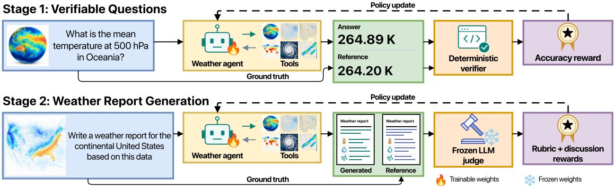  
Figure 1: Zephyrus-R1 framework. Agents call weather tools, inspect returned data or errors, and produce answers or reports. Stage 1 rewards verified answers; Stage 2 scores reports on a frozen rubric and Discussion F1 via an LLM judge. Curriculum RL transfers the Stage-1 policy to report generation.

Recent work has explored the use of LLMs for meteorological reporting. Lawson et al. (2025) study multimodal interpretation of weather imagery, Zheng et al. (2026) instruction-tune a multimodal weather-report model, and Higgins et al. (2026) introduce a benchmark and domain-specific evaluation for synoptic reporting. Most closely related, Singh et al. (2026) use RL to generate forecast discussions from structured WeatherNext 2 inputs (Alet et al., 2026) with rewards for temperature accuracy, synoptic correctness, and format compliance. To our knowledge, our work is the first to tackle weather reporting as an open-ended, agentic reinforcement learning problem.

We develop Zephyrus-R1 (Figure 1), an agentic framework for weather-report generation in which a vision-language model acquires evidence through tools, synthesizes information across regions and lead times, and optimizes an openended report-level objective. The agent can inspect atmospheric data, forecasts, and plots before producing its report, which is scored using an LLM-evaluated six-criterion meteorological rubric and bidirectional claim entailment against National Weather Service reference reports. We audit the entailment judges’ claim-label decisions against annotations from expert meteorologists. Because report generation simultaneously demands tool use, scientific reasoning, and open-ended synthesis, we train small models with a two-stage curriculum: RL first develops tool use and reasoning on weather-analysis questions with verifiable answers, then optimizes the report reward. This curriculum substantially improves Qwen3.5-4B’s tool-use capabilities (Section 3.4.2) and improves F1 scores over the base model by 67% under the training LLM judge and by 24% and 60% under two independent judges. On Qwen3.8-27B, Curriculum RL is competitive with the strongest systems in our evaluation, outperforming Kimi-K3 on all metric-judge combinations and GPT-5.6-Luna on four of six combinations and in average overall score. Together, these results demonstrate that RL can improve open-ended scientific reporting when reward design, evidence acquisition, and training curriculum are designed jointly. Our contributions are as follows:

• Framework. We introduce Zephyrus-R1, an RL framework for multi-turn, tool-using weather agents that combines weather-tool interaction, server-verifiable evidence acquisition, and judge-scored optimization of open-ended reports (Section 3).

• Reward design. We introduce a report-level reward that combines a meteorological rubric with bidirectional claim entailment to capture both report quality and factual coverage against a natural-language reference report (Section 3.2).

• Domain expert evaluation. Using annotations from three professional meteorologists, we compare expert and LLM claim labels. We find that weather-claim judgment is non-trivial and that LLM-expert agreement is comparable to inter-expert agreement (Section 3.3).

• Curriculum learning. We train tool use and analytical reasoning on verifiable weather-analysis questions, and study the effect of this curriculum-based approach compared to directly training on report generation (Section 3.4).

## 2 Related Work

Agents for science and weather. LLM agents that interleave reasoning with tool calls (Yao et al., 2023; Shinn et al., 2023; Schick et al., 2023) have been applied across the sciences (Bran et al., 2024; Boiko et al., 2023; Huang et al., 2025). In weather science, ZEPHYRUS provides a Python environment over WeatherBench 2 with a neural forecaster as a tool and a 49-task benchmark (Varambally et al., 2026), while SYNOPTICBENCH pairs forecast images with forecast discussions to evaluate vision-language models (Higgins et al., 2026). Most closely related, AFDBENCH pairs structured WeatherNext 2 inputs with operational discussions and applies GRPO with domain-specific rewards for temperature accuracy, synoptic correctness, and format compliance (Singh et al., 2026). ZEPHYRUSBENCH presents weather-science tasks as natural-language question-answer items, spanning data retrieval and computation, multi-step analysis, and forecast-report generation (Varambally et al., 2026). Stage 1 uses its verifiable weather-analysis questions, those with machine-checkable answers. Building on the ZEPHYRUS environment, our policy acquires analysis and forecast fields through multi-turn tool use and transfers from these questions to report generation.

RL for tool use and rewards for open-ended generation. Group-relative policy optimization and related methods are widely used with verifiable rewards on tasks with checkable answers (Shao et al., 2024; Yu et al., 2025; Guo et al., 2025; MiniMax, 2025), and extensions to multi-turn tool use train the policy on its own execution traces with outcome rewards (Jin et al., 2025; Feng et al., 2025; Zheng et al., 2025; Li et al., 2025). However, reward hacking and tool-use collapse have been reported under weak supervision (Thaman, 2026; Hao et al., 2026). For open-ended text, learned reward models and LLM judges (Ouyang et al., 2022; Zheng et al., 2023) are refined with rubrics (Gunjal et al., 2025; Viswanathan et al., 2025), reference-derived chains (Jiang et al., 2026), mined rubrics (Wei et al., 2026), and hybrid verifier-plus-reward-model rewards (Tao et al., 2025). Our report stage uses a frozen judge with a fixed rubric and a claim-level metric, while the environment separately enforces the minimum tool trajectory needed for a weather report.

Curriculum learning. Ordering training from easy to hard (Bengio et al., 2009; Narvekar et al., 2020) improves RL fine-tuning of LLM reasoning when difficulty is staged or adapted, with evidence on mathematics, planning, inductive reasoning, and other reasoning domains (Shi et al., 2026; Chen et al., 2025; Parashar et al., 2025). These curricula span verifiable problem categories and domains. We study transfer from deterministically scored analysis to judge-scored reports, comparing Curriculum RL with Direct RL (Section 4.2).

## 3 The Zephyrus-R1 Framework

Our goal is to train a vision-language model-based agent to write accurate multi-day forecast discussions, given the state of the atmospheric weather conditions. To this end, we design an LLM-as-a-judge reward, audit the judges’ claim labels against human experts, and optimize the agent using a two-stage curriculum learning framework.

## 3.1 Setup

Problem setting. We consider the task of generating multi-day operational forecast discussions from atmospheric weather data. Given access to the current atmospheric state and its evolution over the forecast horizon, the goal is to produce a discussion that summarizes the major weather patterns, their timing and location, and associated hazards. In this work, we focus on forecasts for the continental United States (CONUS).

To evaluate agents on this task and improve their performance, we follow the setup of Varambally et al. (2026). We pair historical ERA5 reanalysis fields from WeatherBench 2 (Rasp et al., 2024; Hersbach et al., 2020) with operational forecast discussions<sup>1</sup> issued by the National Weather Service (NWS) on the corresponding dates. These human-written discussions serve as reference reports for training and evaluation.

Agentic Environment. We formulate the task as a tool-using vision-language agent operating over atmospheric data. For each report-generation task, the agent receives the relevant date (excluding the exact year) and a collection of tools exposed through a Python API. It iteratively executes Python code to gather and analyze evidence from the numerical data to produce the forecast discussion. After each execution, the environment returns the resulting outputs and any execution errors, allowing the agent to refine its analysis or repair unsuccessful tool calls. When the agent creates plots, these are additionally returned as image observations, allowing it to reason directly over spatial weather patterns. The interaction continues until the agent produces its final forecast discussion.

Toolset. Our environment builds on the toolset introduced in ZEPHYRUS (Varambally et al., 2026). The agent can query WeatherBench 2 atmospheric fields, obtain geographic masks for regions of interest using the geolocator tool, and access historical climatology for computing anomalies. It also has access to a forecaster that returns atmospheric fields at requested forecast lead times. We use an “oracle” forecaster that returns the corresponding future ERA5 reanalysis field rather than the output of a numerical weather prediction model. This isolates the agent’s ability to analyze atmospheric evolution and generate a forecast discussion from errors introduced by the underlying numerical forecast.

In this work, we augment the environment by adding vision capabilities to the agent. It can now leverage a plotting too to plot arbitrary images during its code interactions. The execution environment then passes these figures back as image observations, so that the agent can inspect spatial patterns rather than infer them solely from printed arrays or statistics. We also add access to the TempestExtremes tool (Ullrich and Zarzycki, 2017), which allows the agent to detect and track large-scale weather systems such as tropical and extratropical cyclones.

## 3.2 Reward design for the report stage

To evaluate the quality of the generated reports and train agents to improve on this task, we need a reward function $Q ( y , y ^ { * } )$ that measures the quality of a generated report y measured against a reference report $y ^ { * }$ . Prior work on weather-report generation has found that standard text metrics such as BLEU and ROUGE are poor measures of forecast content quality, motivating more factual and domain-specific evaluation methods (Higgins et al., 2026; Varambally et al., 2026). We therefore seek to define a Q that rewards factual accuracy while penalizing hallucinations. To achieve this, we use two different LLM-as-a-judge metrics: a rubric score that compares y against $y ^ { * }$ holistically, and a Discussion F1 score that measures claim-level factual precision and recall between y and $y ^ { * }$

Rubric Score. We first construct a meteorological rubric that captures the qualities of a strong forecast discussion. To do so, we generate faithful paraphrases and systematically corrupted variants of human-written reference reports, then use an LLM to iteratively refine criteria that separate the two groups. After review, we freeze a six-criterion rubric covering reference fidelity, spatiotemporal specificity, hazard prioritization, meteorological reasoning, thermal and precipitation-type plausibility, and calibrated use of detail. We then use this fixed rubric to score generated reports. The judge receives the generated report, the corresponding reference report, and the rubric, and assigns a score to each criterion. We average the six scores and normalize the result to [0, 1]. The same rubric is used throughout training and evaluation. We provide the full rubric, scoring anchors, and judge prompt in Appendices C.5 and F.2.

Discussion F1. We also measure factual agreement at the level of individual claims. The LLM judge extracts atomic claims from both the generated and reference reports and labels each as SUPPORTED, REFUTED, or NEUTRAL with respect to the other report. We define $P ( y ) = \frac { S _ { y } } { S _ { y } + F _ { y } } , \operatorname { R e c } ( y ) = \frac { S _ { y ^ { * } } } { N _ { y ^ { * } } }$ , where $S _ { y }$ and $F _ { y }$ are the numbers of generated claims that are supported and refuted by the reference report, respectively, $\boldsymbol { S _ { y } } \mathrm { * }$ ∗ is the number of reference claims supported by the generated report, and $\dot { N } _ { y ^ { * } }$ is the total number of reference claims. Discussion F1 is the harmonic mean of precision and recall. This bidirectional claim-level metric follows the ZEPHYRUS (Varambally et al., 2026) “discussion score.” Unlike ZEPHYRUS, which uses label probabilities derived from model logits, we use discrete LLM label decisions. The full scoring procedure is detailed in Appendix C.4.

Report Grounding Requirement. To ensure that the model actually examines the atmospheric data rather than hallucinating a plausible report, we require a minimum amount of successful tool use before assigning a judge-based reward. We maintain a binary grounding flag g(τ) for each trajectory $\tau ,$ which is set to one only if the agent has read a valid field from the current atmospheric state, obtained valid fields at a forecast lead, and received the resulting evidence in its context. Reports submitted before these conditions are satisfied are rejected, and the interaction continues. If $g ( \tau ) = 0$ at the final turn, the rollout receives a fixed penalty, and the judge scores do not contribute to the training reward. The implementation is detailed in Appendix C.2.

Judge-scored quality and terminal reward. We combine the rubric and Discussion F1 scores as

$$
Q _ { t } ( y ) = w _ { t } \operatorname { r u b r i c } ( y ) + ( 1 - w _ { t } ) \operatorname { F } 1 ( y ) ,\tag{1}
$$

where $w _ { t }$ controls the relative contribution of the two metrics. We update $w _ { t }$ during training based on the variation of each score within the rollout group, so that neither metric dominates the reward. The final reward for training is

$$
R ( \tau ) = \left\{ \begin{array} { l l } { { - c , } } & { { \mathrm { n o ~ u s a b l e ~ r e p o r t ~ o r ~ } g ( \tau ) = 0 , } } \\ { { Q _ { t } ( y ) - p _ { \mathrm { f m t } } , } } & { { \mathrm { o t h e r w i s e } , } } \end{array} \right.\tag{2}
$$

where c is a fixed penalty and $p _ { \mathrm { f m t } }$ applies only to a report recovered from an untagged forced-final reply. Since $Q _ { t } ( y ) \in [ 0 , 1 ]$ and $c > p _ { \mathrm { f m t } }$ , any grounded report earns a higher reward than an ungrounded or missing one, so the policy cannot raise its return by skipping evidence acquisition. The weighting rule and constants are given in Appendix C.1.

## 3.3 Human-expert audit of LLM claim labels

To audit the claim labels produced by our LLM judges against the judgments of human domain experts, we asked three meteorologists to annotate the same 100 claims, using the SUPPORTED/RE-FUTED/NEUTRAL (S/R/N) definitions given to our LLM judges. To create the claim set, we sampled five report-generation tasks at random, drew report generators uniformly from Qwen3.5-4B, Qwen3.8- 27B, and GPT-5.6-Luna, and gathered two groups for each task: generated claims scored against a reference report, and reference claims scored against a generated report. The experts were not informed which reports were reference or generated, nor which generating model produced each claim.

We also label the 100 claims with our three LLM judges (GPT-OSS-120B, Gemma-3-27B-IT, and Mistral-Small-3.2-24B) and compare the LLM la-

Table 1: Claim-label agreement on 100 claim-report pairs. Accuracy (Acc.) is exact label agreement; Within-1 excludes only SUPPORTED-REFUTED reversals. For majority-vote comparisons, three-way ties are assigned NEUTRAL.
<table><tr><td>Comparison</td><td>Acc.</td><td>κ</td><td>Within-1</td></tr><tr><td>GPT-OSS-Expert1</td><td>0.370</td><td>0.097</td><td>0.920</td></tr><tr><td>GPT-OSS-Expert2</td><td>0.630</td><td>0.346</td><td>0.960</td></tr><tr><td>GPT-OSS-Expert3</td><td>0.570</td><td>0.226</td><td>0.960</td></tr><tr><td>Expert1-Expert2</td><td>0.480</td><td>0.224</td><td>0.900</td></tr><tr><td>Expert1-Expert3</td><td>0.460</td><td>0.214</td><td>0.860</td></tr><tr><td>Expert2-Expert3</td><td>0.570</td><td>0.306</td><td>0.890</td></tr><tr><td>GPT-OSS-Expert maj.</td><td>0.630</td><td>0.327</td><td>0.960</td></tr><tr><td>Gemma-Expert maj.</td><td>0.570</td><td>0.289</td><td>0.920</td></tr><tr><td>Mistral-Expert maj.</td><td>0.660</td><td>0.427</td><td>0.930</td></tr><tr><td>LLM maj.-Expert maj.</td><td>0.670</td><td>0.423</td><td>0.940</td></tr></table>

bels with the expert labels, and the experts with one another. Table 1 shows these results. We compute exact-match accuracy and Cohen’s κ over the categorical S/R/N labels, and Within-1 accuracy as the fraction of claims on which the two judgments are not opposite (i.e., not one SUPPORTED and one REFUTED). For majority-vote rows, we use the majority of three voters and assign three-way ties to NEUTRAL. Appendix D.3 describes the audit protocol.

Our key finding is that this report claim annotation is a difficult task even for domain experts, with significant inter-expert disagreement. GPT-OSS agrees with the experts about as well as the experts agree with one another. In all LLM-expert comparisons, Within-1 accuracy exceeds 0.9, showing that almost no disagreements with the experts are full flips between SUPPORTED and REFUTED. Finally, we observe that accuracy is maximized by comparing three-judge LLM majority vote against human expert majority vote, suggesting that aggregating judgments helps reduce annotator-specific disagreement.

We use GPT-OSS as the RL training judge. On the same claim set, it is also the harshest judge, with a mean label score (SUPPORTED = +1, NEUTRAL = 0, REFUTED = −1) of 0.05, compared with 0.29 for Mistral and 0.57 for Gemma. Its conservative labels provide a stringent training signal, while the independent judges test whether improvements transfer beyond the training judge.

## 3.4 Curriculum Reinforcement Learning

Direct report training must jointly learn tool use, weather analysis, and report composition from one scalar reward. We therefore use a two-stage curriculum: Stage 1 trains tool use on verifiable weather-analysis questions; Stage 2 optimizes report generation with the reward from Section 3.2.

## 3.4.1 Stage 1: Fine-tuning on verifiable weather-analysis questions

Accuracy reward. Stage 1 uses eight easy, machine-verifiable question templates from ZEPHYRUSBENCH (Varambally et al., 2026). The questions ask the agent to compute regional statistics, identify spatial extrema and their timing, and detect climatological anomalies. Gold answers come from the benchmark metadata. Each question also specifies a required tool, which is the dataset for regional statistics and extrema and the climatology tool for anomaly questions. The verifier gives graded credit for numerical, location, time, and anomaly answers. The reward is

$$
r = s ( \mathrm { a n s w e r , g o l d } ) \cdot \mathbf { 1 } [ \mathrm { r e q u i r e d t o o l a c c e s s e d } ] - \lambda ( \mathrm { t u r n s } ) ,\tag{3}
$$

where $s \in [ 0 , 1 ]$ is the graded verifier score and λ applies a fixed deduction per turn beyond a turn allowance, up to a cap. An access counter verifies required-tool access. The question templates, score ladder, and turn penalty are detailed in Appendix B.2.

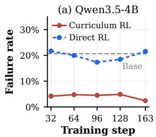

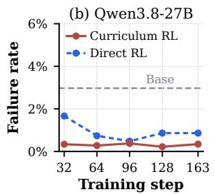

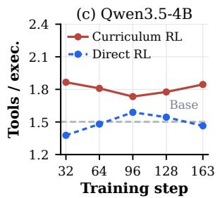

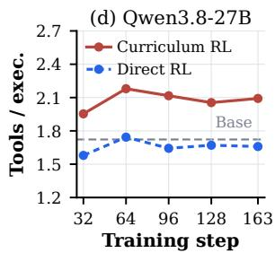  
Figure 3: Tool-use diagnostics on the report-stage test set during report RL. Failure rate is shown for 4B (a) and 27B (b), and Tools/exec. for 4B (c) and 27B (d). Appendix C.7 describes how both diagnostics are computed.

Fine-tuning methods. Rejection-sampling fine-tuning (RSFT) retains full-credit, required-tool-access trajectories that pass infrastructure and output-format checks. Among eligible trajectories, RSFT keeps at most two per question, preferring fewer execution errors, turns, and tokens. Stage-1 RL optimizes Equation 3, starting from the RSFT checkpoint (RSFT-RL) or the base policy (RL-only). All three methods raise verifier accuracy over the base policy at both scales (Figure 2); the best checkpoints, RL-only for Qwen3.5-4B (0.572) and RSFT-RL for Qwen3.8-27B (0.708), initialize Stage 2. Because the base policies already access the required tool in over 99% of rollouts, these gains reflect better use of and reasoning over the returned data. The questions also exercise component skills of report generation: quantifying field values, locating features in space, timing their evolution, and identifying anomalies relative to climatology. Stage

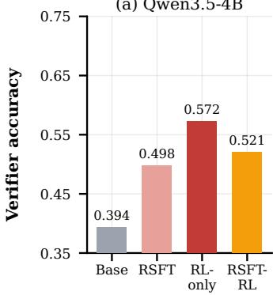

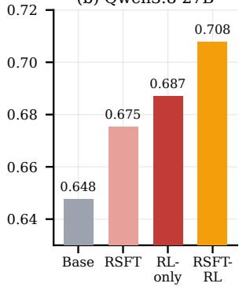  
Figure 2: Verifier accuracy on held-out validation weatheranalysis questions for the base policy and the RSFT, RLonly, and RSFT-RL fine-tuned policies: (a) Qwen3.5-4B; (b) Qwen3.8-27B.

1 can therefore provide a stronger starting point and tool-use behavior for report RL. Appendix B details the RSFT checks, schedule, selected checkpoints, results by answer type, and example trajectories.

## 3.4.2 Stage 2: Reinforcement learning on the report generation task

Stage 2 trains on the report task with the reward of Equation 2. Beyond these component skills, it requires forecast-tool use, hazard prioritization, and report composition. Curriculum RL initializes the policy from the selected Stage-1 checkpoint and resets the optimizer. On the other hand, Direct RL starts from the base policy and uses the same report data, prompt, reward rule, judge definitions, sampler, and report-stage length. The two routes therefore differ only in their initialization and the additional Stage-1 training used by Curriculum RL.

Stage 1 reduces execution failures and broadens tool use. Every Stage-2 report must first meet the grounding requirement of working analysis and forecast calls. This overlaps with Stage 1 in requiring data access, while forecast acquisition is specific to the report stage. We therefore compare the two routes on two diagnostics: the failure rate (the fraction of execution requests in a rollout that return no valid tool result) and Tools/exec. (the number of distinct tool families returning valid results per execution request). At every evaluated checkpoint and at both scales, Curriculum RL has the lower failure rate and the higher Tools/exec. (Figure 3). At step 163, the 4B failure rate is 2.4% for Curriculum RL versus 21.5% for Direct RL; at 27B, both routes are reliable (0.3% versus 0.9%), while Tools/exec. is 2.09 versus 1.66. Curriculum RL thus acquires evidence more reliably and broadly.

## 3.5 Optimization

Both stages use group-relative policy optimization (Shao et al., 2024) with the clipped importance-sampling policy optimization (CISPO) objective (MiniMax, 2025). Each rollout is a single sequence containing the full interaction history. For each prompt, we sample K rollouts and compute group-centered advantages $\begin{array} { r } { \boldsymbol A _ { k } = \boldsymbol r _ { k } - \boldsymbol K ^ { - 1 } \sum _ { i } \boldsymbol r _ { j } } \end{array}$ without standard-deviation normalization, where $r _ { k }$ is the stage reward of rollout k (Equation 3 or 2). With $\mathcal { T } _ { k }$ indexing the policy-generated tokens of rollout k, the sequence-mean CISPO loss is

$$
\mathcal { L } ( \theta ) = - \frac { 1 } { K } \sum _ { k = 1 } ^ { K } A _ { k } \frac { 1 } { | \mathcal { T } _ { k } | } \sum _ { i \in \mathcal { I } _ { k } } \operatorname { s g } \big [ \mathrm { c l i p } ( \rho _ { k , i } , 1 - \epsilon _ { \mathrm { l o w } } , 1 + \epsilon _ { \mathrm { h i g h } } ) \big ] \log \pi _ { \theta } ( a _ { k , i } \mid s _ { k , i } ) ,\tag{4}
$$

Table 2: Weather-report results on the test events for the base policies and two Zephyrus-R1 training routes. Every score averages three complete scoring passes; higher is better for both metrics, and bold marks the within-scale best. Green percentages give the relative change from the same-scale Base, computed from unrounded scores.
<table><tr><td rowspan="2">Model</td><td rowspan="2">Route</td><td colspan="2">GPT-OSS 120B</td><td colspan="2">Gemma-3 27B-IT</td><td colspan="2">Mistral-Small 3.2-24B</td><td rowspan="2">Avg</td></tr><tr><td>Rub.</td><td>F1</td><td>Rub.</td><td>F1</td><td>Rub.</td><td>F1</td></tr><tr><td rowspan="2">Qwen3.5-4B</td><td>Base Direct RL</td><td>0.082 0.123 +51% 0.217 +57%0.575 +13% 0.693 +12% 0.453 +16% 0.477 +40% 0.423 +22%</td><td>0.138</td><td>0.507</td><td>0.621</td><td>0.391</td><td>0.342</td><td>0.347</td></tr><tr><td>Curriculum RL 0.129 +57%0.231 +67%0.514 +1%</td><td></td><td></td><td></td><td></td><td></td><td>0.768+24%0.441 +13%0.548+60%0.438+26%</td><td></td></tr><tr><td>Qwen3.8-27B Base</td><td>Direct RL Curriculum RL 0.260 +91%0.312 +39%0.778+6%0.736 +3%0.728+6%0.615 +15%0.571 +13%</td><td>0.136 0.167 +23% 0.318 +42% 0.742 +1%0.770 +8%0.719 +4%0.631 +18%0.558 +10%</td><td>0.224</td><td>0.735</td><td>0.715</td><td>0.690</td><td>0.537</td><td>0.506</td></tr></table>

where $\rho _ { k , i }$ is the importance ratio between the current and sampling policies and sg stops gradients through the clipped ratio. Environment tokens are excluded from $\mathcal { T } _ { k }$ . Failure handling and hardware are described in Appendix C.6.

## 4 Experimental Results

## 4.1 Setup

Data. Our reference reports are forecast discussions for the continental United States issued by the National Weather Service, the source of the ZEPHYRUSBENCH report task (Varambally et al., 2026). Written by operational forecasters, these discussions provide expert-quality targets without manual annotation. For report RL, we train on 2,608 events from 1995–2018 and evaluate on a test set of 197 temporally disjoint events from 2019–2020. Stage 1 uses eight easy, machine-verifiable question templates from ZEPHYRUSBENCH, covering regional statistics, geographic and temporal extrema, and one-sided, standardized, and percentile-envelope climatological anomaly detection. Stage-1 RL draws 704 questions from a 710-question pool, with 125 disjoint questions held out for validation. Field coverage, report preprocessing, and report split-integrity checks are detailed in Appendix A.

Metrics and judges. We report the rubric score and Discussion F1 (Section 3.2), both in [0, 1]; the rubric score rescales the mean of the six 1–10 criterion scores. GPT-OSS-120B is the training judge, while Gemma-3-27B-IT and Mistral-Small-3.2-24B are independent judges that apply the same rubric and fixed claim prompts to extract and label their own claims (Agarwal et al., 2025; Gemma Team et al., 2025; Mistral AI, 2025). All judge calls use temperature zero, and each score in Tables 2 and 3 averages three scoring passes over the same frozen outputs. Appendix D.2 explains the repeated passes and compares the judges, and Appendix F.3 gives the claim prompts.

Systems. For both Qwen3.5-4B (Yang et al., 2025; Qwen Team, 2026a) and Qwen3.8-27B (Qwen Team, 2026c), we compare the base model with Direct RL and Curriculum RL. Table 3 also includes GPT-5.6-Luna (OpenAI, 2026) and eight open-weight models: Kimi-K3 (Kimi Team et al., 2026), DeepSeek-V4-Flash-Vision-Exp (DeepSeek-AI, 2026), GLM-5.3-Flash (GLM-5-Team et al., 2026), MiniMax-M3 (Lai et al., 2026), Qwen3.6-35B-A3B (Qwen Team, 2026b), Qwen3.5-122B-A10B and Qwen3.5-9B (Qwen Team, 2026a), and Gemma-4-31B-IT (Gemma Team et al., 2026). Each model produces one report per test event.

Training setup. Both RL stages use CISPO with group-centered advantages, 16 prompts and four rollouts per step, temperature 0.6, zero KL regularization, and rank-64 LoRA on the language layers with the vision tower frozen (Hu et al., 2022). Episodes allow at most 13 turns, the last forcing a final answer. Stage-1 RL runs for 44 steps with checkpoints selected by verifier credit on the validation set; the curriculum routes start report RL from 4B RL-only step 44 and 27B RSFT-RL step 24. Report RL runs one 163-step epoch with the reward of Equation 2, re-estimating w at every step and bounding it to [0.2, 0.8], with $c = 0 . 0 5$ and $p _ { \mathrm { f m t } } = 0 . 0 2$ . Report-stage learning rates are $1 0 ^ { - 5 }$ for 4B and $3 \times \mathrm { { i } 0 ^ { - 5 } }$ for 27B. We report the terminal step-163 policy, so no test result selects a checkpoint or hyperparameter. We provide the remaining settings in Appendices B–C.

## 4.2 Main results

Zephyrus-R1 improves report quality under all three judges. In Table 2, both routes improve every score at both scales. At 4B, Direct RL and Curriculum RL raise the six-score average by 22% and 26%, but they improve different aspects of the report: Direct RL obtains slightly higher rubric scores under Gemma and Mistral, whereas Curriculum RL achieves higher F1 under all three judges, with the largest margins under Gemma (0.768 versus 0.693) and Mistral (0.548 versus 0.477). This F1 advantage coincides with the much lower failure rate of the 4B curriculum agent (Section 3.4.2). At 27B, the averages rise by 10% and 13%, and the pattern reverses: Curriculum RL achieves higher rubric scores under every judge, while Direct RL retains slightly higher F1. The 27B curriculum agent also uses tools more broadly, yet its advantage appears in the rubric score rather than F1, so execution diagnostics alone do not determine which metric benefits. Overall, report RL alone accounts for most of the improvement at both scales, showing that the judge-based reward is an effective training signal for open-ended reports, and the curriculum adds a further 3–4 percentage points of relative gain (26% versus 22% at 4B; 13% versus 10% at 27B). The relative gains are largest under GPT-OSS, the training judge, but they persist under both independent judges, so they are not confined to the evaluator being optimized. Appendix D.1 tracks both routes across training.

Table 3: Leaderboard on the test events, ordered by Avg (higher is better). Every score averages three complete scoring passes. Shaded rows are Zephyrus-R1 models trained with Curriculum RL. Avg is the mean of the six unrounded scores.
<table><tr><td colspan="2"></td><td colspan="2">GPT-OSS 120B</td><td colspan="2">Gemma-3 27B-IT</td><td colspan="2">Mistral-Small 3.2-24B</td><td colspan="2"></td></tr><tr><td># Model</td><td></td><td>Rub.</td><td>F1</td><td>Rub.</td><td>F1</td><td>Rub.</td><td>F1</td><td></td><td>Avg</td></tr><tr><td></td><td>1 Qwen3.8-27B + Zephyrus-R1</td><td>0.260</td><td>0.312</td><td>0.778</td><td>0.736</td><td>0.728</td><td>0.615</td><td></td><td>0.571</td></tr><tr><td></td><td>2 GPT-5.6-Luna</td><td>0.170</td><td>0.297</td><td>0.713</td><td>0.801</td><td></td><td>0.698</td><td>0.660</td><td>0.556</td></tr><tr><td>3</td><td>Kimi-K3</td><td>0.168</td><td>0.286</td><td>0.736</td><td>0.732</td><td></td><td>0.721</td><td>0.570</td><td>0.536</td></tr><tr><td>4</td><td>DeepSeek-V4-Flash-Vision-Exp</td><td>0.153</td><td>0.262</td><td>0.706</td><td>0.729</td><td></td><td>0.689</td><td>0.570</td><td>0.518</td></tr><tr><td>5</td><td>GLM-5.3-Flash</td><td>0.156</td><td>0.224</td><td>0.728</td><td>0.726</td><td></td><td>0.699</td><td>0.567</td><td>0.517</td></tr><tr><td>6</td><td>MiniMax-M3</td><td>0.139</td><td>0.241</td><td>0.709</td><td>0.716</td><td></td><td>0.682</td><td>0.572</td><td>0.510</td></tr><tr><td>7</td><td>Qwen3.6-35B-A3B</td><td>0.126</td><td>0.197</td><td>0.619</td><td>0.708</td><td></td><td>0.530</td><td>0.481</td><td>0.444</td></tr><tr><td></td><td>8Qwen3.5-122B-A10B</td><td>0.107</td><td>0.199</td><td>0.584</td><td>0.736</td><td></td><td>0.525</td><td>0.500</td><td>0.442</td></tr><tr><td></td><td>9 Qwen3.5-4B + Zephyrus-R1</td><td>0.129</td><td>0.231</td><td>0.514</td><td>0.768</td><td></td><td>0.441</td><td>0.548</td><td>0.438</td></tr><tr><td></td><td>10 Gemma-4-31B-IT</td><td>0.136</td><td>0.190</td><td>0.558</td><td>0.702</td><td></td><td>0.490</td><td>0.465</td><td>0.424</td></tr><tr><td></td><td>11 Qwen3.5-9B</td><td>0.099</td><td>0.155</td><td>0.525</td><td>0.670</td><td></td><td>0.426</td><td>0.424</td><td>0.383</td></tr></table>

The trained agents are competitive with larger models. Table 3 places both trained agents among substantially larger systems, and where each one gains ground mirrors the route comparison above. The 4B agent ranks ninth, ahead of Gemma-4-31B-IT and Qwen3.5-9B and nearly tied with Qwen3.5-122B-A10B and Qwen3.6-35B-A3B. Its edge over these larger Qwen models lies in F1, which is higher under every judge, whereas its rubric scores under the independent judges remain lower, consistent with the F1 gain that the curriculum brings at 4B. The 27B agent ranks first, ahead of GPT-5.6-Luna and Kimi-K3, and its lead follows the curriculum’s rubric advantage at this scale: it has the best rubric score under all three judges and the best GPT-OSS F1, while GPT-5.6-Luna keeps the best Gemma and Mistral F1. This lead is largest on the training judge’s rubric and narrower under the independent judges. Task-specific RL thus allows a 4B agent to match larger general-purpose models and a 27B agent to lead them on this task.

## 4.3 Qualitative report comparison

Figure 4 shows the report from the terminal step-163 27B curriculum-trained checkpoint, together with the reference sentences that support each claim GPT-OSS labels SUPPORTED. The supported claims track the northern system and its showers into the Upper Midwest, link the trailing cold air to high-terrain snow, and identify the southern-Plains severe-weather and flash-flood threat. The reference has a counterpart for each, although it describes the northern system as a cold front and does not mention the upper trough or surface low. The report also makes a consequential regional error by describing the Southeast and much of the South as stable and largely dry despite the reference forecast of eastern-U.S. rainfall and a Southeast severe-weather threat. This sentence is the one claim that GPT-OSS labels REFUTED. The summary claim S4 repeats the error in its final clause, yet GPT-OSS labels it SUPPORTED, whereas Mistral refutes that clause separately. Overall, the policy produces a coherent broad-scale account but can still introduce a locally important contradiction. Appendix C.3 traces the tool-based evidence behind this report, and Appendix E shows its claim labels and reference evidence under the two independent judges.

## 5 Discussion

In this work, we trained LLM-based agents to generate weather reports. We designed a reward that combines two LLM-as-a-judge metrics, a meteorological rubric and Discussion F1, and audited the judges’ claim labels against three meteorologists’ labels. Our two-stage curriculum RL transfers skills learned on simple, verifiable weather-analysis questions to judge-scored report generation. At the terminal checkpoint, Curriculum RL on Qwen3.5-4B improves F1 over the base policy and Direct RL under all three judges, and on Qwen3.8-27B it improves every rubric and F1 score over the base policy. More broadly, our results suggest that non-verifiable scientific tasks can still benefit from RL when careful reward design is combined with curricula that bootstrap from verifiable intermediate skills.

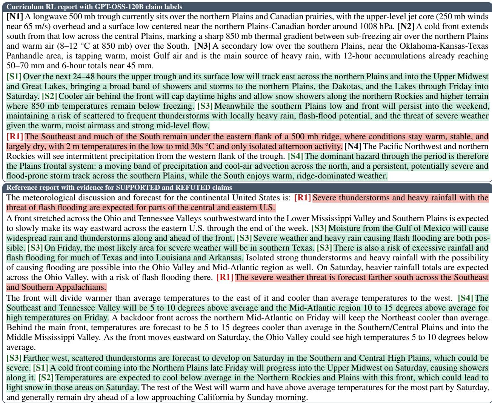  
Figure 4: Terminal Qwen3.8-27B Curriculum RL report with every GPT-OSS claim labeled SUPPORTED (S), RE-FUTED (R), or NEUTRAL (N). SUPPORTED and REFUTED claims are shaded green and red, and the authormapped reference sentences that support or refute them carry the same tag and shading.

Limitations and future work. Our experiments focus on forecast discussions for the continental United States because of data availability, but the framework is not location-specific and can be extended to other regions and forecast products. The agent also receives oracle forecast inputs, and coupling it with operational numerical forecasts would test its end-to-end skill. Our evaluation relies on LLM judges. We use three judges and audit their claim labels against meteorologists’ labels (Section 3.3); evaluating expert preference over complete reports is an important next step. Finally, each configuration is trained once, and repeated training runs would quantify optimization variance.

## Acknowledgments

This work was supported in part by the U.S. Army Research Office under Army-ECASE award W911NF-07-R-0003-03, the U.S. Department of Energy, Office of Science, the ARPA-H-SOL-24-101 program, the IARPA HAYSTAC Program, NSF Grants #2205093, #2146343, #2134274, #2441832, #2146151, and #2422214, NSF award CCF-2112665 (TILOS), and CDC-RFA-FT-23-0069. We also thank Thinking Machines Lab for providing Tinker compute credits.

## References

Sandhini Agarwal, Lama Ahmad, Jason Ai, Sam Altman, Andy Applebaum, Edwin Arbus, Rahul K. Arora, Yu Bai, Bowen Baker, Haiming Bao, et al. gpt-oss-120b & gpt-oss-20b model card. arXiv preprint arXiv:2508.10925, 2025.

Ferran Alet, Tom R. Andersson, Ilan Price, Stratis Markou, Andrew El-Kadi, Dominic Masters, Amy Li, Samier Merchant, Natalie Williams, Gregory Thornton, Ken MacKay, Olivia Graham, Akib Uddin, Ben Gaiarin, Devaja Shah, Elinor Kruse, Wallace Hogsett, David Zelinsky, John Cangialosi, Jonathan Martinez, James Franklin, Mark DeMaria, Kate Musgrave, Caroline L. Bain, Helen Titley, Jacklynn Stott, Remi Lam, Aaron Bell, Paul Komarek, Matthew Willson, Alvaro Sanchez-Gonzalez, and Peter Battaglia. Operational tropical cyclone forecasting with AI. Nature, 657(8132):680–688, 2026.

Yoshua Bengio, Jérôme Louradour, Ronan Collobert, and Jason Weston. Curriculum learning. In Proceedings of the 26th Annual International Conference on Machine Learning, pages 41–48, 2009.

Daniil A. Boiko, Robert MacKnight, Ben Kline, and Gabe Gomes. Autonomous chemical research with large language models. Nature, 624(7992):570–578, 2023.

Andres M. Bran, Sam Cox, Oliver Schilter, Carlo Baldassari, Andrew D. White, and Philippe Schwaller. Augmenting large language models with chemistry tools. Nature Machine Intelligence, 6(5):525–535, 2024.

Xiaoyin Chen, Jiarui Lu, Minsu Kim, Dinghuai Zhang, Jian Tang, Alexandre Piché, Nicolas Gontier, Yoshua Bengio, and Ehsan Kamalloo. Self-evolving curriculum for LLM reasoning. arXiv preprint arXiv:2505.14970, 2025.

DeepSeek-AI. DeepSeek-V4-Flash-Vision-Exp release: Multimodal API now live. https://api-docs.deepseek. com/news/news260821/, August 2026.

Jiazhan Feng, Shijue Huang, Xingwei Qu, Ge Zhang, Yujia Qin, Baoquan Zhong, Chengquan Jiang, Jinxin Chi, and Wanjun Zhong. ReTool: Reinforcement learning for strategic tool use in LLMs. arXiv preprint arXiv:2504.11536, 2025.

Gemma Team, Aishwarya Kamath, Johan Ferret, Shreya Pathak, Nino Vieillard, Ramona Merhej, Sarah Perrin, Tatiana Matejovicova, Alexandre Ramé, Morgane Rivière, Louis Rouillard, et al. Gemma 3 technical report. arXiv preprint arXiv:2503.19786, 2025.

Gemma Team, Sherif El Abd, Vaibhav Aggarwal, Robin Algayres, Alek Andreev, Olivier Bachem, Ian Ballantyne, Cormac Brick, Victor Carbune, Michelle Casbon, Mayank Chaturvedi, et al. Gemma 4 technical report. arXiv˘ preprint arXiv:2607.02770, 2026.

GLM-5-Team, Aohan Zeng, Xin Lv, Zhenyu Hou, Zhengxiao Du, Qinkai Zheng, Bin Chen, Da Yin, Chendi Ge, Chenghua Huang, Chengxing Xie, et al. GLM-5: from vibe coding to agentic engineering. arXiv preprint arXiv:2602.15763, 2026.

Anisha Gunjal, Anthony Wang, Elaine Lau, Vaskar Nath, Yunzhong He, Bing Liu, and Sean Hendryx. Rubrics as rewards: Reinforcement learning beyond verifiable domains. arXiv preprint arXiv:2507.17746, 2025.

Daya Guo, Dejian Yang, Haowei Zhang, Junxiao Song, Peiyi Wang, Qihao Zhu, Runxin Xu, Ruoyu Zhang, et al. DeepSeek-R1 incentivizes reasoning in LLMs through reinforcement learning. Nature, 645(8081):633–638, 2025.

Yupu Hao, Zhuoran Jin, Huanxuan Liao, Kang Liu, and Jun Zhao. Why multi-step tool-use reinforcement learning collapses and how supervisory signals fix it. arXiv preprint arXiv:2606.26027, 2026.

Hans Hersbach, Bill Bell, Paul Berrisford, Shoji Hirahara, András Horányi, Joaquín Muñoz-Sabater, Julien Nicolas, Carole Peubey, Raluca Radu, Dinand Schepers, Adrian Simmons, Cornel Soci, Saleh Abdalla, Xavier Abellan, Gianpaolo Balsamo, Peter Bechtold, Gionata Biavati, Jean Bidlot, Massimo Bonavita, Giovanna De Chiara, Per Dahlgren, Dick Dee, Michail Diamantakis, Rossana Dragani, Johannes Flemming, Richard Forbes, Manuel Fuentes, Alan Geer, Leo Haimberger, Sean Healy, Robin J. Hogan, Elías Hólm, Marta Janisková, Sarah Keeley, Patrick Laloyaux, Philippe Lopez, Cristina Lupu, Gabor Radnoti, Patricia de Rosnay, Iryna Rozum, Freja Vamborg, Sebastien Villaume, and Jean-Noël Thépaut. The ERA5 global reanalysis. Quarterly Journal of the Royal Meteorological Society, 146(730):1999–2049, 2020.

Timothy B. Higgins, Antonios Mamalakis, and Chirag Agarwal. SynopticBench: Evaluating vision-language models on generating weather forecast discussions of the future. arXiv preprint arXiv:2604.16451, 2026.

Edward J. Hu, Yelong Shen, Phillip Wallis, Zeyuan Allen-Zhu, Yuanzhi Li, Shean Wang, Lu Wang, and Weizhu Chen. LoRA: Low-rank adaptation of large language models. In International Conference on Learning Representations, 2022.

Kexin Huang, Serena Zhang, Hanchen Wang, Yuanhao Qu, Yingzhou Lu, Yusuf Roohani, Ryan Li, Lin Qiu, Gavin Li, Junze Zhang, Di Yin, Shruti Marwaha, Jennefer N. Carter, Xin Zhou, Matthew Wheeler, Jonathan A. Bernstein,

Mengdi Wang, Peng He, Jingtian Zhou, Michael Snyder, Le Cong, Aviv Regev, and Jure Leskovec. Biomni: A general-purpose biomedical AI agent. bioRxiv preprint, 2025.

Yuxin Jiang, Yufei Wang, Qiyuan Zhang, Xingshan Zeng, Liangyou Li, Jierun Chen, Chaofan Tao, Haoli Bai, and Lifeng Shang. From verifiable dot to reward chain: Harnessing verifiable reference-based rewards for reinforcement learning of open-ended generation. In The Fourteenth International Conference on Learning Representations, 2026.

Bowen Jin, Hansi Zeng, Zhenrui Yue, Jinsung Yoon, Sercan Arik, Dong Wang, Hamed Zamani, and Jiawei Han. Search-R1: Training LLMs to reason and leverage search engines with reinforcement learning. arXiv preprint arXiv:2503.09516, 2025.

Kimi Team, Tongtong Bai, Yifan Bai, Yiping Bao, M. C., Jianfeng Cai, Xinyuan Cai, Peizhou Cao, Yuxuan Cao, Ziwei Chai, et al. Kimi K3: Open frontier intelligence. arXiv preprint arXiv:2607.24653, 2026.

Xunhao Lai, Weiqi Xu, Yufeng Yang, Qiaorui Chen, Yang Xu, Lunbin Zeng, Xiaolong Li, Haohai Sun, Haichao Zhu, Vito Zhang, Jinkai Hu, Jiayao Li, Rui Gao, Zekun Li, Songquan Zhu, Jingkai Zhou, and Pengyu Zhao. MiniMax sparse attention. arXiv preprint arXiv:2606.13392, 2026.

John R Lawson, Joseph E Trujillo-Falcón, David M Schultz, Montgomery L Flora, Kevin H Goebbert, Seth N Lyman, Corey K Potvin, and Adam J Stepanek. Pixels and predictions: Potential of GPT-4V in meteorological imagery analysis and forecast communication. Artificial Intelligencefor the Earth Systems, 4(1), 2025.

Kuan Li, Zhongwang Zhang, Huifeng Yin, Liwen Zhang, Litu Ou, Jialong Wu, Wenbiao Yin, Baixuan Li, Zhengwei Tao, Xinyu Wang, Weizhou Shen, Junkai Zhang, Dingchu Zhang, Xixi Wu, Yong Jiang, Ming Yan, Pengjun Xie, Fei Huang, and Jingren Zhou. WebSailor: Navigating super-human reasoning for web agent. arXiv preprint arXiv:2507.02592, 2025.

MiniMax. MiniMax-M1: Scaling test-time compute efficiently with lightning attention. arXiv preprint arXiv:2506.13585, 2025.

Mistral AI. Mistral Small 3.2 (24B Instruct 2506). https://huggingface.co/mistralai/Mistral-Small-3. 2-24B-Instruct-2506, June 2025.

Sanmit Narvekar, Bei Peng, Matteo Leonetti, Jivko Sinapov, Matthew E. Taylor, and Peter Stone. Curriculum learning for reinforcement learning domains: A framework and survey. Journal ofMachine Learning Research, 21(181):1–50, 2020.

OpenAI. GPT-5.6 system card. https://deploymentsafety.openai.com/gpt-5-6, 2026.

Long Ouyang, Jeff Wu, Xu Jiang, Diogo Almeida, Carroll L. Wainwright, Pamela Mishkin, Chong Zhang, Sandhini Agarwal, Katarina Slama, Alex Ray, John Schulman, Jacob Hilton, Fraser Kelton, Luke Miller, Maddie Simens, Amanda Askell, Peter Welinder, Paul Christiano, Jan Leike, and Ryan Lowe. Training language models to follow instructions with human feedback. In Advances in Neural Information Processing Systems, volume 35, 2022.

Shubham Parashar, Shurui Gui, Xiner Li, Hongyi Ling, Sushil Vemuri, Blake Olson, Eric Li, Yu Zhang, James Caverlee, Dileep Kalathil, and Shuiwang Ji. Curriculum reinforcement learning from easy to hard tasks improves LLM reasoning. arXiv preprint arXiv:2506.06632, 2025.

Qwen Team. Qwen3.5: Towards native multimodal agents. https://qwen.ai/blog?id=qwen3.5, February 2026a.

Qwen Team. Qwen3.6-35B-A3B: Agentic coding power, now open to all. https://qwen.ai/blog?id=qwen3. 6-35b-a3b, April 2026b.

Qwen Team. Qwen3.8-27B model card. https://huggingface.co/Qwen/Qwen3.8-27B, August 2026c.

Stephan Rasp, Stephan Hoyer, Alexander Merose, Ian Langmore, Peter Battaglia, Tyler Russell, Alvaro Sanchez-Gonzalez, Vivian Yang, Rob Carver, Shreya Agrawal, Matthew Chantry, Zied Ben Bouallegue, Peter Dueben, Carla Bromberg, Jared Sisk, Luke Barrington, Aaron Bell, and Fei Sha. WeatherBench 2: A benchmark for the next generation of data-driven global weather models. Journal of Advances in Modeling Earth Systems, 16(6): e2023MS004019, 2024.

Timo Schick, Jane Dwivedi-Yu, Roberto Dessì, Roberta Raileanu, Maria Lomeli, Eric Hambro, Luke Zettlemoyer, Nicola Cancedda, and Thomas Scialom. Toolformer: Language models can teach themselves to use tools. In Advances in Neural Information Processing Systems, volume 36, 2023.

Zhihong Shao, Peiyi Wang, Qihao Zhu, Runxin Xu, Junxiao Song, Xiao Bi, Haowei Zhang, Mingchuan Zhang, Y. K. Li, Y. Wu, and Daya Guo. DeepSeekMath: Pushing the limits of mathematical reasoning in open language models. arXiv preprint arXiv:2402.03300, 2024.

Taiwei Shi, Yiyang Wu, Linxin Song, Tianyi Zhou, and Jieyu Zhao. Efficient reinforcement finetuning via adaptive curriculum learning. Transactions on Machine Learning Research, 2026.

Noah Shinn, Federico Cassano, Ashwin Gopinath, Karthik Narasimhan, and Shunyu Yao. Reflexion: Language agents with verbal reinforcement learning. In Advances in Neural Information Processing Systems, volume 36, 2023.

Manmeet Singh, Somnath Luitel, Prabhjot Singh, Manraaj Banga, Naveen Sudharsan, and Josh Durkee. AFDBench: A reasoning-first AI scientist for National Weather Service forecast discussions. arXiv preprint arXiv:2608.24954, 2026.

Leitian Tao, Ilia Kulikov, Swarnadeep Saha, Tianlu Wang, Jing Xu, Sharon Li, Jason E. Weston, and Ping Yu. Hybrid reinforcement: When reward is sparse, it’s better to be dense. arXiv preprint arXiv:2510.07242, 2025.

Kunvar Thaman. Reward hacking benchmark: Measuring exploits in LLM agents with tool use. arXiv preprint arXiv:2605.02964, 2026.

Paul A. Ullrich and Colin M. Zarzycki. TempestExtremes: A framework for scale-insensitive pointwise feature tracking on unstructured grids. Geoscientific Model Development, 10(3):1069–1090, 2017.

Sumanth Varambally, Marshall Fisher, Jas Thakker, Yiwei Chen, Zhirui Xia, Yasaman Jafari, Ruijia Niu, Manas Jain, Veeramakali Vignesh Manivannan, Zachary Novack, Luyu Han, Srikar Eranky, Salva Rühling Cachay, Taylor Berg-Kirkpatrick, Duncan Watson-Parris, Yian Ma, and Rose Yu. Zephyrus: An agentic framework for weather science. In The Fourteenth International Conference on Learning Representations, 2026.

Vijay Viswanathan, Yanchao Sun, Xiang Kong, Meng Cao, Graham Neubig, and Sherry Wu. Checklists are better than reward models for aligning language models. In Advances in Neural Information Processing Systems, volume 38, 2025.

Xiyu Wei, Qingwei Zong, Xiaoguang Li, Eugene Yu, and Sujian Li. QuRL: Rubrics as judge for open-ended question answering. In The Fourteenth International Conference on Learning Representations, 2026.

An Yang, Anfeng Li, Baosong Yang, Beichen Zhang, Binyuan Hui, Bo Zheng, Bowen Yu, Chang Gao, Chengen Huang, Chenxu Lv, et al. Qwen3 technical report. arXiv preprint arXiv:2505.09388, 2025.

Shunyu Yao, Jeffrey Zhao, Dian Yu, Nan Du, Izhak Shafran, Karthik Narasimhan, and Yuan Cao. ReAct: Synergizing reasoning and acting in language models. In The Eleventh International Conference on Learning Representations, 2023.

Qiying Yu, Zheng Zhang, Ruofei Zhu, Yufeng Yuan, Xiaochen Zuo, Yu Yue, Weinan Dai, Tiantian Fan, Gaohong Liu, Juncai Liu, Lingjun Liu, Xin Liu, Haibin Lin, Zhiqi Lin, Bole Ma, Guangming Sheng, Yuxuan Tong, Chi Zhang, Mofan Zhang, Ru Zhang, Wang Zhang, Hang Zhu, Jinhua Zhu, Jiaze Chen, Jiangjie Chen, Chengyi Wang, Hongli Yu, Yuxuan Song, Xiangpeng Wei, Hao Zhou, Jingjing Liu, Wei-Ying Ma, Ya-Qin Zhang, Lin Yan, Yonghui Wu, and Mingxuan Wang. DAPO: An open-source LLM reinforcement learning system at scale. In Advances in Neural Information Processing Systems, volume 38, 2025.

Lianmin Zheng, Wei-Lin Chiang, Ying Sheng, Siyuan Zhuang, Zhanghao Wu, Yonghao Zhuang, Zi Lin, Zhuohan Li, Dacheng Li, Eric P. Xing, Hao Zhang, Joseph E. Gonzalez, and Ion Stoica. Judging LLM-as-a-judge with MT-Bench and Chatbot Arena. In Advances in Neural Information Processing Systems (Datasets and Benchmarks Track), volume 36, 2023.

Yuxiang Zheng, Dayuan Fu, Xiangkun Hu, Xiaojie Cai, Lyumanshan Ye, Pengrui Lu, and Pengfei Liu. DeepResearcher: Scaling deep research via reinforcement learning in real-world environments. arXiv preprint arXiv:2504.03160, 2025.

Zinan Zheng, Yang Liu, Nuo Chen, Juepeng Zheng, Hong Cheng, and Jia Li. WeatherSyn: An instruction tuning MLLM for weather forecasting report generation. arXiv preprint arXiv:2605.07522, 2026.

## A Data

Input fields. The WeatherBench 2 fields span 1959 to 2023 at six-hour intervals on a one-degree equiangular grid. Each event contains surface pressure and temperature fields, winds, precipitation, land and ocean fields, and pressurelevel geopotential, humidity, temperature, winds, and vertical velocity. The prompt exposes relative time indices and names the month, day, and weekday of the analysis window and the following five days because operational forecast discussions refer to days by name.

Report preprocessing and split checks. A fixed prompt removes author notes, map and model references, and disclaimers from each reference report. The mean reference lengths are approximately 1,800 characters in the training set and 2,000 in the test set. No test reference matches a training reference or shares its first 200 characters, and the test set contains no duplicate references. The prompt omits the year, so a dated event is not a unique historical identifier. The grounding requirement forces the agent to query the data.

## B Stage-1 training and evaluation

Stage 1 trains on verifiable questions with rejection-sampling fine-tuning (RSFT), RL, or RSFT followed by RL. Table C.1 lists the rejection-sampling and RL parameters of both stages. The following subsections give the RSFT selection rules, the Stage-1 verifier, the RL settings and evaluation protocol, and example trajectories.

## B.1 Rejection-sampling fine-tuning

A rollout is eligible for RSFT if the answer receives full verifier credit, the server records at least one call to the question’s required tool, no infrastructure failure occurs, the final <solution> block contains a valid JSON answer with finite values, and no turn omits both the <execute> and <solution> tags. A trajectory remains eligible if the model repairs an error in its own code. RSFT keeps at most two eligible trajectories per question for each model, preferring fewer execution errors, fewer turns, and shorter responses, in that order. For 27B, trajectories that avoid a forced final turn receive an additional preference. The sample index breaks any remaining tie. RSFT trains a rank-64 LoRA adapter on the language layers for three epochs with learning rate $1 0 ^ { \dot { - } 5 }$ and batch size four. The 4B model produces 1,801 full-credit rollouts with required-tool access (31.7%), compared with 3,125 (55.0%) for 27B. The larger base policy therefore solves the verifiable tasks more reliably before fine-tuning. The two-per-question cap keeps repeated successes from dominating either RSFT corpus.

## B.2 Stage-1 verifier

Table B.1: The eight ZEPHYRUSBENCH question templates used in Stage 1 and the tool required by each template.
<table><tr><td>Question template</td><td>Answer</td><td>Required tool</td></tr><tr><td>Geographic feature with the highest or lowest time-mean field value</td><td>location</td><td>dataset</td></tr><tr><td>Minimum, maximum, mean, or median field value over a named geographic feature</td><td>numerical</td><td>dataset</td></tr><tr><td>Sublocation within a named parent feature with the highest or lowest recorded field value</td><td>location</td><td>dataset</td></tr><tr><td>Hours from the initial time at which a named feature reaches its maximum or minimum field value</td><td>time</td><td>dataset</td></tr><tr><td>Minimum, maximum, mean, or median field value over a named feature at a specified time</td><td>numerical</td><td>dataset</td></tr><tr><td>Geographic features above or below a specified climatological percentile Geographic features whose field differs from the climatological mean by a specified</td><td>anomaly list anomaly list</td><td>climatology climatology</td></tr><tr><td>number of standard deviations Geographic features outside a specified lower-upper climatological percentile envelope</td><td>anomaly list</td><td>climatology</td></tr></table>

Stage 1 uses the eight ZEPHYRUSBENCH question templates in Table B.1. The training and held-out validation questions are disjoint but follow the same templates. Answers may be numerical values, locations, times, or anomaly lists. Gold values come from the benchmark metadata. For location questions, we parse the gold place name from the reference response during data construction. The model returns JSON inside the <solution> block. Table B.2 gives the required format and score ladder. Numerical questions use relative error |pred − gold|/ max(|gold|, 10<sup>−9</sup>), with absolute-error bands when |gold| < 1.

Table B.2: Stage-1 answer formats and verifier scores. Numerical questions use absolute-error bands when the gold magnitude is below one. Anomaly lists receive graded set F1.
<table><tr><td>Type</td><td>Required content</td><td>Score 1.0</td><td>Score 0.5</td><td>Score 0</td></tr><tr><td>Numerical</td><td>one JSON number</td><td>relative error  $\leq 1 \%$  (absolute error ≤ 0.05 if |gold| &lt; 1)</td><td>relative error  $\leq 5 \%$  (absolute error  $\leq 0 . 1 5 \ \mathrm { i f }$   $| \mathrm { g o l d } | < 1 )$ </td><td>otherwise</td></tr><tr><td>Time</td><td>one JSON number in hours</td><td>exact</td><td>within 6 h</td><td>otherwise</td></tr><tr><td>Location</td><td>JSON object with place name and value</td><td>normalized name equals or contains the gold name</td><td>wrong name, value inside the numerical 1.0 band</td><td>otherwise</td></tr><tr><td>Anomaly</td><td>JSON list of names (empty if none)</td><td>set F1 over normalized names, graded in [0, 1]</td><td>(graded)</td><td>no overlap</td></tr></table>

The ladder gives partial credit to nearby numerical or temporal values, correct values paired with the wrong location, and partially correct anomaly sets. A separate tool check prevents an unsupported guess from qualifying as a successful trajectory.

In Equation 3, s is the ladder score and the turn penalty is $\lambda ( T ) = \operatorname* { m i n } ( 0 . 1 5 , 0 . 0 5 \operatorname* { m a x } ( 0 , T - 5 ) )$ for an episode with T turns. The required-tool condition holds when the server records at least one call to the dataset or climatology tool, whichever the question requires.

## B.3 Stage-1 RL and evaluation

Settings. Stage-1 RL uses the report-stage trainer with learning rate $1 0 ^ { - 5 }$ but replaces the judge-based reward with the accuracy reward in Equation 3. RSFT-RL starts from the selected RSFT checkpoint, while RL-only starts from the base policy. Each run takes 44 steps, drawing 704 questions from the 710-question pool. Report RL is initialized from RL-only step 44 for Qwen3.5-4B and RSFT-RL step 24 for Qwen3.8-27B.

Evaluation protocol. The held-out validation set contains 125 questions. We sample four rollouts per question at each checkpoint, giving 500 rollouts per checkpoint. Figure B.1 shows the checkpoint trajectories, and Table B.3 breaks down the selected results by answer type. These questions are used only for Stage-1 checkpoint selection and are separate from the report-stage test events.

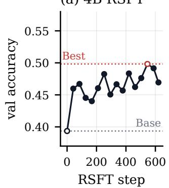

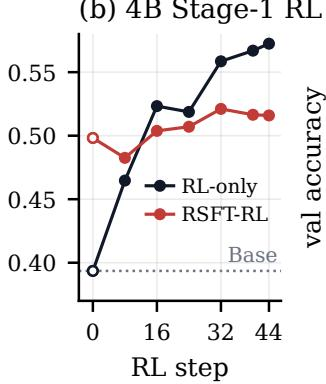

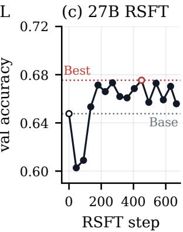

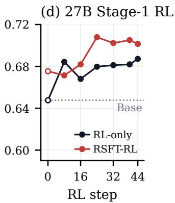  
Figure B.1: Stage-1 accuracy on the 125-question held-out validation set for Qwen3.5-4B and Qwen3.8-27B. Filled circles show evaluated checkpoints, while open circles at step 0 mark each route’s initial policy. RSFT and RL-only start from the base policy, whereas RSFT-RL starts from the selected RSFT checkpoint. Gray dotted lines show base-policy accuracy. In the RSFT panels, the red open circle and dotted line mark the best checkpoint.

Required-tool access ranges from 0.988 to 1.000, and the accuracy reward differs from verifier accuracy by at most 0.002. Differences between checkpoints therefore come mainly from answer quality. For Qwen3.5-4B, RL-only improves all four answer types over the base policy, with the largest gains on numerical (+0.215) and anomaly (+0.187) questions. For Qwen3.8-27B, RSFT-RL outperforms RL-only on numerical and location questions but is slightly worse on time and anomaly questions. Thus, the benefit of RSFT depends on model scale and question type.

Table B.3: Stage-1 results on the held-out validation set. Acc. averages the per-answer score in Table B.2. Acc. reward averages the reward in Equation 3, including the tool check and turn penalty. Tool is the required-tool access rate. The remaining columns give mean scores by answer type. Bold marks the within-scale best.
<table><tr><td rowspan="2">Checkpoint</td><td colspan="3">Verifier</td><td colspan="4">Accuracy by answer type</td></tr><tr><td>Acc.</td><td>Acc. reward</td><td>Tool</td><td>Num.</td><td>Loc.</td><td>Time</td><td>Anom.</td></tr><tr><td>Qwen3.5-4B</td><td>0.394</td><td>0.394</td><td>0.996</td><td>0.334</td><td>0.400</td><td>0.392</td><td>0.522</td></tr><tr><td>RSFT (step 546)</td><td>0.498</td><td>0.496</td><td>0.988</td><td>0.467</td><td>0.521</td><td>0.457</td><td>0.595</td></tr><tr><td>RL-only (step 44)</td><td>0.572</td><td>0.572</td><td>0.998</td><td>0.549</td><td>0.562</td><td>0.526</td><td>0.709</td></tr><tr><td>RSFT-RL (step 32)</td><td>0.521</td><td>0.521</td><td>1.000</td><td>0.473</td><td>0.512</td><td>0.491</td><td>0.688</td></tr><tr><td>Qwen3.8-27B</td><td>0.648</td><td>0.648</td><td>0.998</td><td>0.571</td><td>0.637</td><td>0.685</td><td>0.785</td></tr><tr><td>RSFT (step 450)</td><td>0.675</td><td>0.675</td><td>1.000</td><td>0.587</td><td>0.667</td><td>0.694</td><td>0.865</td></tr><tr><td>RL-only (step 44)</td><td>0.687</td><td>0.687</td><td>1.000</td><td>0.592</td><td>0.650</td><td>0.728</td><td>0.901</td></tr><tr><td>RSFT-RL (step 24)</td><td>0.708</td><td>0.708</td><td>1.000</td><td>0.636</td><td>0.679</td><td>0.724</td><td>0.893</td></tr></table>

## B.4 Representative Stage-1 trajectories

Claude Opus 5.5 first read and summarized the complete logged trajectories. After reviewing its summaries, we manually selected one representative trajectory of the Qwen3.5-4B RL-only step-44 checkpoint for each Stage-1 answer type and chose the turn-level information shown in the four boxes below. We checked every displayed detail against the original traces. Brackets summarize the model’s reasoning, code is abridged to the relevant lines, and observations are condensed from the logs. The examples cover a one-call numerical solution, a repaired indexing error, recovery from an unsuccessful location lookup, and climatology-based anomaly detection.

Stage-1 trajectory, Qwen3.5-4B, numerical task, one call   
Question. What is the minimum surface temperature in Antarctica?   
Required tool. Dataset. Gold. 233.517 K.   
Turn 1. [Use 2m\_temperature, locate Antarctica, apply the mask, and reduce.]   
def run(ds, geolocator, forecaster, climatology, tempestextremes, plotting):   
mask = geolocator.get\_mask\_by\_geofeature('continent', 'Antarctica')   
t2m = ds[0]["2m\_temperature"]   
value = t2m.where(mask == True).min().values   
print(f"Minimum 2m temperature: {value} K")   
return {"min\_antarctic\_temperature": value}   
Observation. Minimum 2m temperature is 233.4048614501953 K.   
Turn 2. [Return one number in Kelvin.] <solution>233.40486</solution>   
Verifier. The relative error is 4.8 × 10<sup>−4</sup>, so s = 1. The required-tool condition is satisfied. The rollout uses two turns and   
one code call with no execution error.

## Stage-1 trajectory, Qwen3.5-4B, location task, error repaired

```python
Question. Which continent experienced the lowest average specific humidity at 400 hPa?
Required tool. Dataset. Gold. Antarctica.
Turn 1. [Find the 400 hPa level, mask every continent with the geolocator, and average.]
def run(ds, geolocator, forecaster, climatology, tempestextremes, plotting):
sh = ds[0]['specific_humidity']
print("Level coordinates:", sh.level.values)
level_400_idx = np.where(sh['level'].isel(index=0) == 400)[0][0]
Observation. The level coordinates are [50 100 150 200 250 300 400 500 600 700 850 925 1000]. The np.where line then
raises ValueError: Dimensions {'index'} do not exist. Expected one or more of ('level',).
Turn 2. [The level coordinate has no time dimension, so index it directly.]
def run(ds, geolocator, forecaster, climatology, tempestextremes, plotting):
sh = ds[0]['specific_humidity']
sh_400 = sh.isel(level=int(np.where(sh.level == 400)[0][0])).isel(index=0)
results = {}
for continent in geolocator.get_all_locations('continent'):
mask = geolocator.get_mask_by_geofeature('continent', continent)
results[continent] = float(sh_400.where(mask).mean())
```

lowest = min(results, key=results.get)   
print("Lowest average:", lowest, "with", results[lowest])   
return {"min\_continent": lowest, "min\_value": results[lowest]}   
Observation. The lowest average is Antarctica with 0.000112. The other continental means range from 0.000114 in Europe to   
0.001050 in South America.   
Turn 3. [Return the name and the value in the required JSON form.] <solution>{"name": "Antarctica", "value":   
0.000112}</solution>   
Verifier. The normalized name matches the gold name, so s = 1. The required-tool condition is satisfied. The rollout uses   
three turns and two code calls, correcting one execution error.

## Stage-1 trajectory, Qwen3.5-4B, time task, lookup recovered

Question. How many hours from the initial timeframe did Ostrobothnia, Finland experience its highest 10-meter V component   
of wind?   
Required tool. Dataset. Gold. 132 h.   
Turn 1. [Identify Finland, list its sublocations, and query the expected coordinates of Ostrobothnia.]   
def run(ds, geolocator, forecaster, climatology,   
tempestextremes, plotting):   
finland = geolocator.get\_geofeature\_by\_point(   
25.0, 62.0, "country")   
states = geolocator.get\_sublocations("country", finland)   
name = geolocator.get\_geofeature\_by\_point(   
22.0, 64.0, "state")   
print("States in Finland:", states)   
print("Ostrobothnia state:", name)   
return {"finland": finland, "states": states}   
Observation. The direct coordinate lookup returns None. The sublocation list contains the registered name Ostrobothnia,   
Finland.   
Turn 2. [Use the registered name and check that its mask aligns with the wind field.]   
def run(ds, geolocator, forecaster, climatology,   
tempestextremes, plotting):   
name = "Ostrobothnia, Finland"   
mask = geolocator.get\_mask\_by\_geofeature("state", name)   
wind = ds[0]["10m\_v\_component\_of\_wind"]   
print("Mask shape:", mask.shape)   
print("Wind dimensions:", wind.dims)   
print("Number of time steps:", wind.sizes["index"])   
return {"name": name, "mask\_shape": mask.shape}   
Observation. The mask has shape (360, 181), matching the longitude and latitude axes of the wind field. The episode contains   
28 time steps.   
Turn 3. [Find the spatial maximum within the mask at every time step and retain the largest one.]   
mask = geolocator.get\_mask\_by\_geofeature(   
"state", "Ostrobothnia, Finland")   
wind = ds[0]["10m\_v\_component\_of\_wind"]   
max\_v, max\_idx = -1e99, -1   
for idx in range(wind.sizes["index"]):   
masked = wind.isel(index=idx) \* mask   
value = float(masked.max())   
print(idx, value)   
if value > max\_v:   
max\_v, max\_idx = value, idx   
return {"max\_v": max\_v, "time\_index": max\_idx,   
"hours": max\_idx \* 6}   
Observation. The per-time output is long enough that the final lines are truncated, although the execution succeeds.   
Turn 4. [Repeat the same reduction without printing every time step.]   
mask = geolocator.get\_mask\_by\_geofeature(   
"state", "Ostrobothnia, Finland")   
wind = ds[0]["10m\_v\_component\_of\_wind"]   
max\_v, max\_idx = -1e99, -1   
for idx in range(wind.sizes["index"]):   
value = float((wind.isel(index=idx) \* mask).max())   
if value > max\_v:   
max\_v, max\_idx = value, idx   
return {"max\_v": max\_v, "time\_index": max\_idx,   
"hours": max\_idx \* 6}   
Observation. The maximum is 8.7056 m s<sup>−1</sup> at index 22, which is 132 hours from the initial time.

Turn 5. [Return the requested hour.] <solution>132</solution>   
Verifier. The time matches exactly, so s = 1. The required-tool condition is satisfied. The rollout uses five turns and four code   
calls with no execution error.

Stage-1 trajectory, Qwen3.5-4B, anomaly task, one call   
Question. Which water bodies contain time-mean sea-level pressure at least three standard deviations below the all-time   
climatology?   
Required tool. Climatology. Gold. Philippine Sea.   
Turn 1. [Standardize the time-mean field against the all-time climatology, then intersect cells below −3σ with each water-body   
mask.]   
def run(ds, geolocator, forecaster, climatology,   
tempestextremes, plotting):   
field = ds[0]["mean\_sea\_level\_pressure"].mean(dim="index")   
mu = climatology.get\_climatology(   
"mean\_sea\_level\_pressure", "all\_time", "mean")   
sigma = climatology.get\_climatology(   
"mean\_sea\_level\_pressure", "all\_time", "std")   
below = ((field.values - mu.values) / sigma.values) < -3   
answer = []   
for name in geolocator.get\_all\_locations("water\_body"):   
mask = geolocator.get\_mask\_by\_geofeature("water\_body", name)   
if (below & mask).any():   
answer.append(name)   
return answer   
Observation. The call returns ["Philippine Sea"].   
Turn 2. [Return the anomaly set as JSON.] <solution>["Philippine Sea"]</solution>   
Verifier. The set F1 is 1. The required-tool condition is satisfied. The rollout uses two turns and one code call with no execution   
error.

## C Method and evaluation details

## C.1 Report-stage reward and training constants

The quality reward follows Equation 1, and Table C.1 lists the reward and training constants. Direct RL and Curriculum RL use the same update rule, smoothing, and bounds. The realized weights depend on the rollout scores in each run. At optimization step t, let $G _ { t }$ be the number of prompt groups whose K rollouts all satisfied the grounding requirement and were scored. For component $m \in \{ \mathrm { r } , \mathrm { f } \}$ (rubric or Discussion F1), the pooled within-group variance is

$$
\hat { \sigma } _ { m , t } ^ { 2 } = \frac { 1 } { G _ { t } ( K - 1 ) } \sum _ { j = 1 } ^ { G _ { t } } \sum _ { k = 1 } ^ { K } { \left( s _ { m , j k } - \bar { s } _ { m , j } \right) ^ { 2 } } ,\tag{5}
$$

where $s _ { m , j k }$ is the component-m score of rollout k in group j and $\bar { s } _ { m , j }$ its prompt-group mean. An exponential moving average $\begin{array} { r } { \bar { v _ { m , t } } = \beta v _ { m , t - 1 } + ( 1 - \beta ) \hat { \sigma } _ { m , t } ^ { 2 } } \end{array}$ smooths the estimates.

With $\tilde { \sigma } _ { m , t } = \operatorname* { m a x } ( \sqrt { v _ { m , t } } , 1 0 ^ { - 6 } )$ , the rubric weight is

$$
w _ { t } = \mathrm { c l i p } _ { [ w _ { \mathrm { m i n } } , 1 - w _ { \mathrm { m i n } } ] } \left( \frac { \tilde { \sigma } _ { \mathrm { f } , t } } { \tilde { \sigma } _ { \mathrm { r } , t } + \tilde { \sigma } _ { \mathrm { f } , t } } \right) .\tag{6}
$$

Because advantages are centered within each prompt group, the estimate uses within-group variation rather than differences in difficulty across prompts. The inverse-spread rule gives the less variable component a larger coefficient, preventing the more variable score from dominating group-relative advantages. We use $\beta = 0 . 9$ to dampen changes caused by an atypical batch and $w _ { \mathrm { m i n } } = 0 . 2$ to keep both quality signals active. A step updates the weights only when $G _ { t } \geq 8 $ ; otherwise, it retains the previous weights. Before clipping, the weighted spreads satisfy $w _ { t } \tilde { \sigma } _ { \mathrm { r } , t } = ( 1 - w _ { t } ) \tilde { \sigma } _ { \mathrm { f } , t }$ We apply the blend before computing group-centered advantages. Groups with a grounding or infrastructure failure are excluded so that fixed penalties and missing scores do not distort the estimated quality spread. The weighting affects only the training reward; the raw rubric and Discussion F1 scores are unchanged and reported separately. Rollouts without a usable, grounded report receive the terminal penalty −c. We subtract the format penalty $p _ { \mathrm { f m t } } = 0 . 0 2$ only when the report must be recovered from an untagged forced reply.

Table C.1: Training and evaluation settings. Shared RL settings apply to Stage-1 RL and report RL, and report-stage settings apply to report RL under both routes.
<table><tr><td>Setting</td><td>Value</td><td>Role</td></tr><tr><td colspan="3">Rejection sampling</td></tr><tr><td>Base-policy rollouts per question</td><td>8</td><td>candidate trajectories for RSFT</td></tr><tr><td>Sampling</td><td>temperature 0.8</td><td>diversify successful trajectories</td></tr><tr><td>Retention cap</td><td>2 per question</td><td>limit repeated successes</td></tr><tr><td colspan="3">Shared RL optimization</td></tr><tr><td>Sampling</td><td>temperature 0.6, top-p 1.0</td><td>rollout sampling</td></tr><tr><td>Rollouts per prompt</td><td>4</td><td>group for the centered advantage</td></tr><tr><td>Prompts per step</td><td>16</td><td>64 rollouts per optimizer step</td></tr><tr><td>Maximum turns</td><td>13</td><td>turn 13 is the forced final turn</td></tr><tr><td>KL coefficient</td><td>0</td><td>no reference-policy term</td></tr><tr><td>LoRA rank / alpha</td><td>64/64</td><td>language linear layers with frozen vision tower</td></tr><tr><td>Learning rate, Stage 1</td><td> $1 0 ^ { - 5 }$ </td><td>LoRA adapter updates</td></tr><tr><td>Learning rate, report RL</td><td> $1 0 ^ { - 5 } \ ( 4 \mathrm { B } ) , 3 \times 1 0 ^ { - 5 } \ ( 2 7 \mathrm { B } )$ </td><td>LoRA adapter updates</td></tr><tr><td>Loss</td><td>CISPO</td><td>clipped importance ratio, sequence mean</td></tr><tr><td>CISPO offsets  $\epsilon _ { \mathrm { l o w } } / \epsilon _ { \mathrm { h i g h } }$ </td><td>1.0 / 4.0</td><td>clipped ratio interval [0, 5]</td></tr><tr><td colspan="3">Report-stage reward</td></tr><tr><td>Quality weighting</td><td>online, every step</td><td>inverse within-group standard deviation</td></tr><tr><td>Variance smoothing β</td><td>0.9</td><td>moving average across steps</td></tr><tr><td>Weight bounds</td><td>[0.2, 0.8]</td><td>keep both scores in the reward</td></tr><tr><td>Minimum scored groups</td><td>8</td><td>fewer groups keep the previous weight</td></tr><tr><td>Terminal penalty c</td><td>0.05</td><td>ungrounded or unusable final report</td></tr><tr><td>Format penalty pfmt</td><td>0.02</td><td>report recovered from an untagged forced reply</td></tr><tr><td>Minimum usable report</td><td>40 characters</td><td>shorter training reports receive —c without judging</td></tr><tr><td colspan="3">Report-stage episode budgets</td></tr><tr><td>Observation cap</td><td>5,000 characters</td><td>printed output shown per turn</td></tr><tr><td>Evidence-summary cap</td><td>2,600 characters</td><td>server summary appended per turn</td></tr><tr><td>Prompt token budget</td><td>38,000</td><td>forces the final turn when exceeded</td></tr><tr><td>Episode token budget</td><td>46,000</td><td>forces the final turn when exceeded</td></tr><tr><td>Generation cap</td><td>10,000 tokens</td><td>one policy action</td></tr><tr><td>Images per turn / episode</td><td>2/8</td><td>long side resized to 768 pixels</td></tr><tr><td colspan="3">Report test evaluation</td></tr><tr><td>Rollouts per event</td><td>1</td><td>one report per system</td></tr><tr><td>Evaluation cadence</td><td>every 32 steps; step 163</td><td>each checkpoint scored by the three judges</td></tr><tr><td>Sampling</td><td>temperature 0.6, top-p 1.0</td><td>same as training for the Qwen policies</td></tr></table>

Figure C.1 shows the realized weights. For Qwen3.5-4B, the rubric weight ranges from 0.54 to 0.69 under Direct RL and from 0.66 to 0.71 under Curriculum RL. The corresponding ranges for Qwen3.8-27B are 0.58 to 0.69 and 0.58 to 0.66. Discussion F1 has greater within-group variation and therefore receives less weight throughout each run.

The 163 steps make one pass over the 2,608 report-training events and produce 10,432 rollouts. Direct RL and Curriculum RL share the same rollout budget, optimizer, weighting rule, and evaluation schedule. They differ only in their initial policy. Failed executions carry no retry penalty, so the model can repair its code within the turn and resource limits.

## C.2 Report grounding requirement

At each turn, the model returns either Python code in an <execute> block or a report in a <solution> block. A response containing both tags is rejected without executing the code or ending the episode. A response containing neither tag receives a corrective observation. Direct RL and Curriculum RL use the same prompt, which provides the tool documentation, data layout, units, date context, budgets, grounding requirement (called the tool-evidence contract in the prompt), and report style. Both routes allow 12 working turns followed by a forced final turn. Appendix F.1 reproduces the prompt and environment messages.

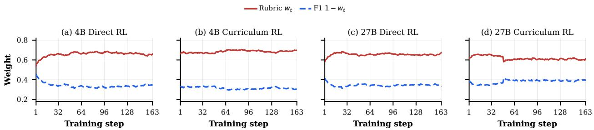  
Figure C.1: Online rubric and Discussion F1 weights during report RL for both routes and model scales. Each run extends through step 163, and the two weights sum to one.

The grounding state is maintained by the execution server and reset at the start of every episode. It contains three cumulative Boolean conditions. Dataset access passes after the dataset tool returns at least one valid result. Forecast access passes after the oracle forecaster returns valid fields at a requested lead. Evidence delivery passes after the server appends at least one verified finding to the model’s observation. These conditions may be satisfied on different turns, and the grounding flag is their conjunction:

$$
g ( \tau ) = \mathbf { 1 } [ \mathrm { d a t a s e t \ a c c e s s } ] \mathbf { 1 } [ \mathrm { f o r e c a s t \ a c c e s s } ] \mathbf { 1 } [ \mathrm { e v i d e n c e \ d e l i v e r e d } ] .\tag{7}
$$

The server updates these conditions from execution metadata rather than from the model’s code, printed text, or use of an <execute> tag. Tool access requires a server-recorded successful return. Evidence delivery requires a server-generated finding that is actually included in the observation after output truncation.

Before the forced final turn, a <solution> with $g ( \tau ) = 0$ is rejected, consumes the turn, and receives a message requesting the missing evidence. The episode then continues. At the cutoff, the environment requests a final response regardless of the grounding state. If $g ( \tau ) = 0$ or the final response is not a usable report of at least 40 characters, the rollout receives the fixed reward −c = −0.05. Judge scores for a usable but ungrounded report are recorded only for monitoring, and unusable reports are not judged. During offline evaluation, a final report with $g ( \tau ) = 0$ is likewise treated as a failure and replaced by the no-report sentinel before judging. Unambiguous server or judge failures are handled separately by excluding the affected prompt group from the update.

## C.3 Representative report-stage trajectory

The trajectory below produced the Qwen3.8-27B Curriculum RL report in Figure 4. We selected the displayed turns and information using the same procedure as for the Stage-1 trajectories in Appendix B.4. The box shows the two evidence-acquisition calls, summarizes the remaining analysis, and reproduces the opening paragraph of the final report.

Report-stage trajectory, Qwen3.8-27B Curriculum RL

```lua
Request. Produce an approximately 300-word operational CONUS report covering systems and movement, temperature,
precipitation and hazards, pressure evolution, fronts, and the jet stream.
Turn 1. Analysis acquisition. [Read the current pressure and 500 hPa fields over CONUS.]
def run(ds, geolocator, forecaster, climatology,
tempestextremes, plotting):
d = ds[0]
mslp = d["mean_sea_level_pressure"].isel(index=0) / 100
us_mslp = mslp.sel(latitude=slice(24, 50),
longitude=slice(235, 293))
pmin = us_mslp.isel(
us_mslp.argmin(dim=["longitude", "latitude"]))
z500 = d["geopotential"].sel(level=500).isel(index=0) / 9.80665
return {"mslp_min": float(pmin),
"z500_min": float(z500.sel(latitude=slice(24, 50),
longitude=slice(235, 293)).min())}
Observation. Current MSLP minimum 1008.33 hPa near 50<sup>◦</sup>N, 110<sup>◦</sup>W and 500 hPa minimum 5429.72 m. Server-delivered
evidence additionally records 70.44 mm maximum 12-hour precipitation in the southern Plains, a 65.49 m/s 250 hPa jet
maximum in the northern Plains, and a 5891.5 m 500 hPa maximum in the Southeast. Dataset access and evidence delivery
now pass; forecast access does not yet pass.
Turn 2. [Plot current MSLP and 500 hPa height to inspect the trough-ridge structure.]
Turn 3. Forecast acquisition. [Generate 6–72 h oracle fields and detect extratropical tracks.]
def run(ds, geolocator, forecaster, climatology,
tempestextremes, plotting):
```

```lua
context = ds[0].isel(index=[0. 2])
preds = [forecaster.forecast(context, horizon=h)
for h in range(1, 13)]
seq = xr.concat(preds, dim="index")
tracks = tempestextremes.detect_with_profile(
seq, mode="extratropical", strictness="medium",
region={"minlat": 24, "maxlat": 52,
"minlon": -125, "maxlon": -70}, top_k=4)
return {"n_tracks": len(tracks)}
```

Observation. Twelve forecast leads and two tracks returned. Verified evidence includes a t+36 h MSLP minimum of 1005.72 hPa and 500 hPa minimum of 5395.6 m in the northern Plains, plus 50.13 mm maximum 12-hour precipitation in the southern Plains. Dataset access, forecast access, and evidence delivery now all pass.

Turns 4–6. [Inspect track points, 850 hPa temperature, precipitation, and the t+36 h 500 hPa field.] All three executions succeed. The agent interprets an eastward-moving northern trough and front, colder air behind it, and a persistent heavy-rain signal over the southern Plains.

Turn 7. Final report. [Synthesize the verified analysis and forecast evidence into continuous prose.]

Opening paragraph. A longwave 500 mb trough currently sits over the northern Plains and Canadian prairies, with the upper-level jet core (250 mb winds near 65 m/s) overhead and a surface low centered near the northern Plains-Canadian border around 1008 hPa. A cold front extends south from that low across the central Plains, marking a sharp 850 mb thermal gradient between sub-freezing air over the northern Plains and warm air (8–12 °C at 850 mb) over the South. A secondary low over the southern Plains, near the Oklahoma-Kansas-Texas Panhandle area, is tapping warm, moist Gulf air and is the main source of heavy rain, with 12-hour accumulations already reaching 50–70 mm and 6-hour totals near 45 mm.

The complete report appears with claim labels in Figure 4 and Appendix E. The episode ends after seven turns with six successful executions, no execution errors, a satisfied grounding requirement, and a tagged final report.

## C.4 Discussion F1 scoring

Discussion F1 uses the claim extraction prompt and the claim evaluation prompt of Appendix F.3. The judge is queried separately for each claim at temperature zero. As defined in Section 3.2, NEUTRAL generated claims are excluded from the precision denominator. Precision and F1 are zero when no generated claim is SUPPORTED or REFUTED, including when no claims are extracted from the generated report. A reference claim that the report neither states nor contradicts counts as a recall miss. For offline evaluation, reports that are ungrounded (g(τ) = 0) or shorter than 40 characters are replaced by the no-report sentinel before claim extraction. The sentinel is processed through extraction and claim labeling in both directions, and the score follows the same precision and recall formulas. During training, unusable reports bypass both judges and receive the terminal penalty −c.

## C.5 Rubric construction and scoring

Construction. Table C.2 lists the six criteria in the frozen rubric. We construct the rubric from human-written references in the report-training split. We sample 100 references for positive examples and another 100 for negative examples. GPT-5.2 creates each positive by faithfully paraphrasing its reference. It creates each negative by removing weather claims, adding claims from an unrelated training reference, or applying both changes. Light, medium, and heavy corruptions alter one, two to three, and four to six claims, respectively. We then paraphrase the negatives in the same way as the positives to reduce stylistic cues. We also sample 25 positive and 25 negative examples from disjoint tasks for final rubric evaluation. All source reports come from the report-training split, but these examples are used only to construct the rubric and never to train the policy.

GPT-5.2 writes and scores the candidate rubrics with medium reasoning effort. The first round receives five positive and five negative seed examples that are separate from the refinement subset. We score each candidate on a fixed refinement subset of 16 positive and 16 negative examples. In later rounds, GPT-5.2 sees the previous rubric, both score distributions, and the six examples with the most problematic scores. It then revises the criteria and anchors. Refinement runs for at most four rounds and stops early once the ROC AUC for separating positives from negatives is at least 0.9 and its round-to-round gain is below 0.05. We select the candidate with the highest AUC and use the mean score gap to break ties. The selected rubric comes from round 3. We evaluate it once on the 25 positive and 25 negative held-out examples, review each criterion, and freeze it before policy training. Examples from the report test set and outputs from policy checkpoints are never used during rubric construction.

Scoring protocol. The scoring prompt contains the frozen rubric, task request, reference report, and generated report. At temperature zero, one judge call returns an integer score and a brief explanation for each of the six criteria, followed by an overall assessment. The rubric anchors scores at 1, 3, 5, 8, and 10 but allows intermediate integers. We round returned values to integers and clip them to [1, 10]. A missing criterion receives the minimum score. The raw rubric average is the mean of the six scores. We report the normalized value (average − 1)/9.

Table C.2: The six meteorological rubric criteria supplied to the judge. Anchored integer scores are normalized to [0, 1].
<table><tr><td>Criterion</td><td>Definition</td></tr><tr><td>Setup Fidelity &amp; Key Feature Retention (Additions AND Omissions)</td><td>Accurately represents the specific synoptic/mesoscale features and stated hazards/corridors in the setup, without introducing unsupported details and without dropping any primary stated feature/hazard that changes the forecast story.</td></tr><tr><td>Spatiotemporal Specificity (Progression When Present; Persistence When Static)</td><td>Communicates where and when impacts occur with specificity appropriate to the setup: describes progression tied to moving features when the setup is progressive, or explicitly states persistence/limited movement when the setup is quasi-stationary.</td></tr><tr><td>Impact/Hazard Extraction &amp; Prioritization (Reference-Weighted</td><td>Identifies the setup&#x27;s main hazards and impact corridors (and any stated relative maxima/minima) and ranks them appropriately, using practical, decision-relevant framing without adding new hazards.</td></tr><tr><td>Mechanism-to-Weather Reasoning (Sufficient, Setup-Consistent)</td><td>Uses meteorologically correct, setup-consistent causal links (forcing, moisture transport, instability, terrain/onshore/upslope, deformation/lake-effect) to explain why impacts occur where/when described. Depth is rewarded but not required for a high score if the forecast is a faithful paraphrase.</td></tr><tr><td>Thermal/Airmass &amp; Precip-Type Plausibility (No Out-of-Pattern P-Type)</td><td>Maintains a coherent temperature/airmass narrative consistent with the setup and seasonally plausible precipitation type statements (snow/ice/convective vs stratiform), avoiding thermodynamic regime shifts not supported by the setup.</td></tr><tr><td>Constraint-Respecting Detail &amp; Calibration (No Invented Timing/Numbers/Pattern Labels)</td><td>Uses specificity only when supported: avoids invented cutoffs (“ends by Saturday evening&quot;), ungrounded pattern labels (“split flow&quot;) or pseudo-precision, and matches the setup&#x27;s confidence level (possible/expected/likely).</td></tr></table>

For offline evaluation, an ungrounded report or one shorter than 40 characters is replaced by the no-report sentinel and passed through the same judge. During training, only grounded, usable reports receive judge-based rewards. Ungrounded or unusable reports receive the terminal penalty −c. Each reported score for a system-judge pair averages three complete passes over the same 197 frozen reports. Appendix C.2 details the penalty and the monitoring-only scores.

Complete scoring anchors. Figure C.2 gives the complete scoring anchors for the six rubric criteria.

High scores require faithful coverage of the main features, hazards, locations, timing, and uncertainty. Additional mechanisms or numerical details help only when the setup supports them. The rubric therefore rewards accurate synthesis rather than detail alone.

## C.6 Training details

Policy objective. For each prompt, the sampler draws K rollouts, each a single sequence containing the full interaction history. The policy is updated with the sequence-mean CISPO loss of Equation 4 in Section 3.5. LoRA adapters are applied to the language layers, the vision tower is frozen, and the KL coefficient is zero. Observations, evidence summaries, and forced-turn messages are environment tokens and are excluded from the loss.

Failure handling. An unambiguous infrastructure or judge failure excludes its four-rollout prompt group from the update. Code errors and grounding failures caused by the policy are retained as training outcomes.

Hardware. Each training run uses two NVIDIA H200 GPUs. For the 4B model, rollout inference and policy optimization run on separate devices; for the 27B model, a two-way tensor-parallel inference engine and two policy ranks share both devices. Standalone inference and evaluation use NVIDIA A100 GPUs.

## C.7 Checkpoint selection and evaluation protocol

We select Stage-1 checkpoints by mean verifier credit on the 125-question held-out validation set. If two checkpoints have the same mean verifier credit, we select the one with the higher mean accuracy reward (Equation 3) and, if they are still tied, the later training step. Report-stage comparisons use the terminal step-163 policy. We also evaluate steps 32, 64, 96, 128, and 160 but omit step 160 from the curves. Each judge scores the same frozen reports at a given checkpoint. These diagnostics use the 197 test events, but they do not determine any checkpoint or hyperparameter. Appendix D.1 shows the plotted trajectories.

For the tool-use diagnostics in Figure 3, the server records, for each execution request, the set of distinct tool families that returned valid results. Tools/exec. counts these families, while failure rate is the fraction of requests for which this set is empty. We first average each measure within an episode and then across the 197 episodes, so episodes with more requests do not receive extra weight. An episode with no execution request receives a failure rate of one.

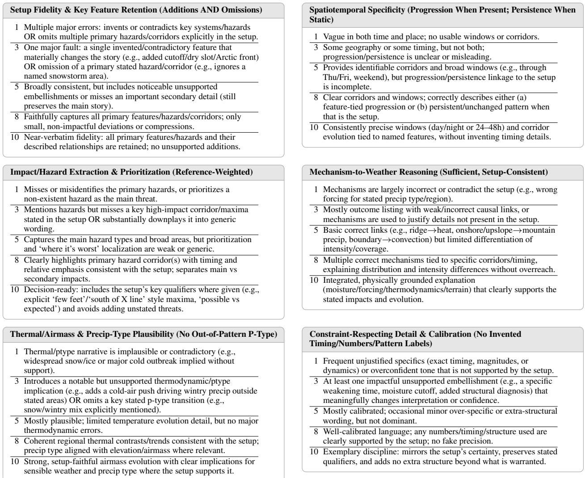  
Figure C.2: Complete scoring anchors for the six meteorological rubric criteria. The judge receives the anchor descriptions shown for levels 1, 3, 5, 8, and 10. Intermediate integer scores are allowed.

## D Additional results

This appendix reports checkpoint trajectories, judge diagnostics, and the expert audit of claim labels.

## D.1 Checkpoint trajectories

Figure D.1 tracks F1 and rubric score for both routes at every evaluated checkpoint. Every checkpoint exceeds the base policy in F1 under all three judges, so report RL improves claim-level agreement from the first evaluation onward. At 4B, Curriculum RL leads in F1 from step 96 onward, whereas the independent-judge rubric curves generally favor Direct RL, matching the terminal results in Table 2. At 27B, Curriculum RL has the higher rubric score at every checkpoint under all three judges, while the F1 curves cross during training and Direct RL finishes slightly ahead. All main comparisons use the terminal step-163 policies rather than intermediate peaks.

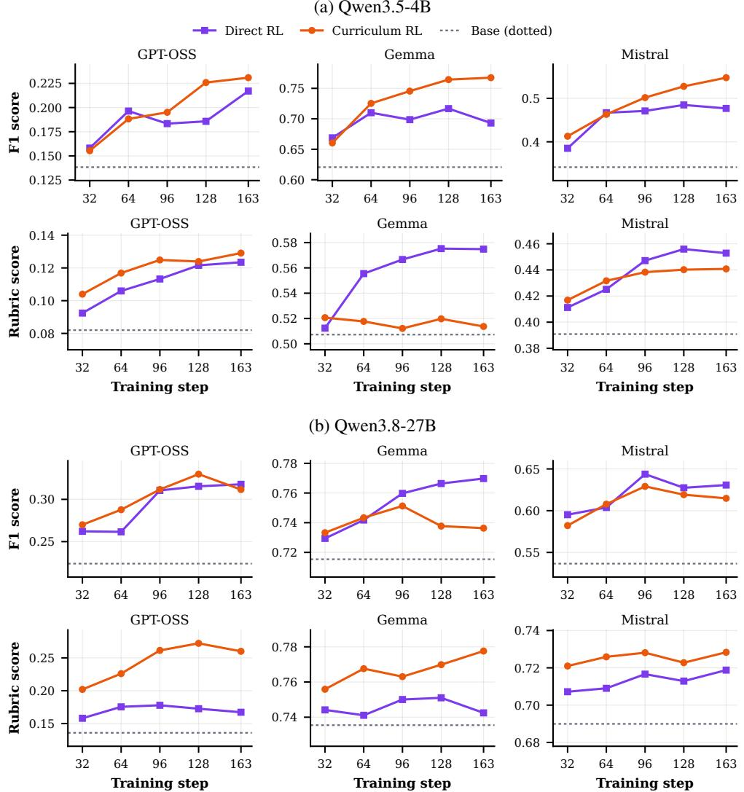  
Figure D.1: Report-RL F1 and rubric-score trajectories for (a) Qwen3.5-4B and (b) Qwen3.8-27B across the three evaluation judges. Each point averages three scoring passes on the 197 test events.

## D.2 Judge diagnostics

Every judge call uses temperature zero, but batched GPU inference is not fully deterministic, so repeated passes over the same frozen reports can return different claims, labels, and scores. We therefore run three complete scoring passes per judge and report their mean.

The judges disagree more on individual reports than on overall system rankings (Table D.1). Gemma and Mistral agree most on both report-level metrics and the rubric ranking, whereas GPT-OSS and Mistral agree most on the F1 ranking.

Table D.2 explains some of these differences. Mistral extracts the most claims, Gemma assigns the largest supported fractions, and GPT-OSS is the most conservative on both report and reference claims. Each judge determines both the claims and their labels, so these choices change the F1 numerator and denominator together. Route comparisons within a judge are therefore more informative than comparisons of raw scores across judges. Appendix E shows the three labeling patterns on one report.

## D.3 Expert audit of claim labels

All three meteorologists label the same 100 claim-report pairs from five randomly sampled report-generation tasks, with claims extracted by GPT-OSS. The reports come from Qwen3.5-4B, Qwen3.8-27B, and GPT-5.6-Luna. Each task includes both comparison directions, with generated claims checked against the reference and reference claims against the generated report. The meteorologists see neither the direction nor the report generator.

Table D.1: Agreement between judges across 15 systems and 2,955 system-event reports. Per-report values are Spearman correlations between three-pass mean scores. Ranking values are Kendall’s τ between system rankings.
<table><tr><td rowspan="2">Judge pair</td><td colspan="2">Per report</td><td colspan="2">Ranking</td></tr><tr><td>Rubric</td><td>F1</td><td>Rubric</td><td>F1</td></tr><tr><td>GPT-OSS / Gemma</td><td>0.46</td><td>0.48</td><td>0.66</td><td>0.71</td></tr><tr><td>GPT-OSS / Mistral</td><td>0.49</td><td>0.61</td><td>0.77</td><td>0.85</td></tr><tr><td>Gemma / Mistral</td><td>0.75</td><td>0.62</td><td>0.89</td><td>0.71</td></tr></table>

Table D.2: Claim extraction and support rates for the same 15 systems as Table D.1. Values pool all three scoring passes. Per rep. is the mean claim count per report, while Supp. and Cov. are the supported fractions of report and reference claims, respectively.
<table><tr><td rowspan="2">Judge</td><td colspan="2">Report claims</td><td colspan="2">Reference claims</td></tr><tr><td>Per rep.</td><td>Supp.</td><td>Per rep.</td><td>Cov.</td></tr><tr><td>GPT-OSS</td><td>11.7</td><td>0.15</td><td>12.8</td><td>0.20</td></tr><tr><td>Gemma</td><td>10.3</td><td>0.58</td><td>11.4</td><td>0.68</td></tr><tr><td>Mistral</td><td>16.6</td><td>0.28</td><td>14.6</td><td>0.49</td></tr></table>

The meteorologists use the same SUPPORTED, NEUTRAL, and REFUTED definitions as the LLM judges. Accuracy counts exact label matches, while Cohen’s κ adjusts for chance agreement. Within-1 accuracy treats only direct SUPPORTED-REFUTED disagreements as mismatches. We compute majority labels separately for the three meteorologists and three LLM judges, assigning NEUTRAL to a three-way tie. Table 1 reports pairwise and majority-vote agreement.

## E Judge claim labels for one report

Figures E.1 and E.2 map the Gemma and Mistral claim labels onto the report in Figure 4.

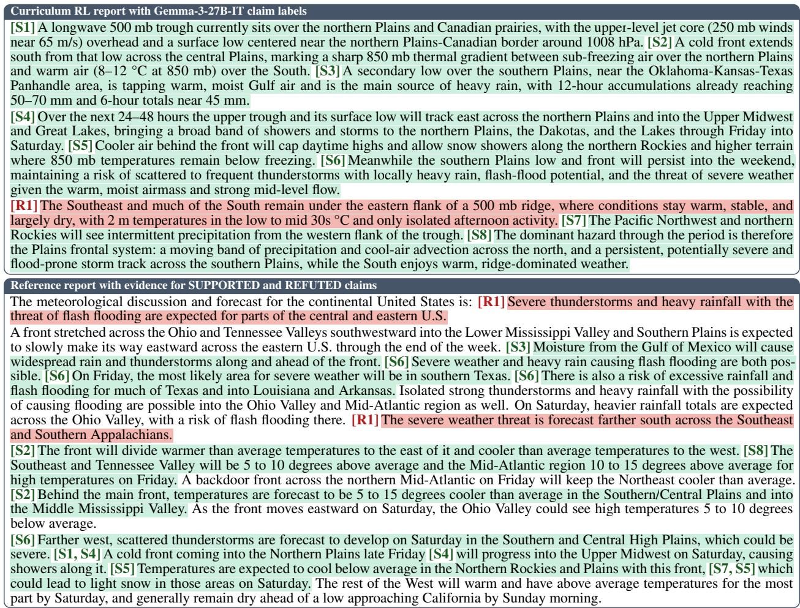  
Figure E.1: Report from Figure 4 with every Gemma claim labeled SUPPORTED (S), REFUTED (R), or NEUTRAL (N). SUPPORTED and REFUTED claims are shaded green and red, and the reference sentences that support or refute them carry the same tag and shading.

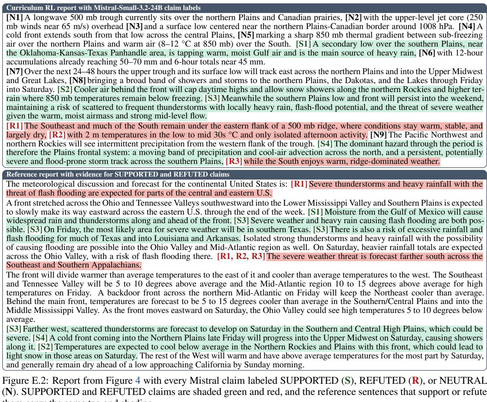  
Figure E.2: Report from Figure 4 with every Mistral claim labeled SUPPORTED (S), REFUTED (R), or NEUTRAL (N). SUPPORTED and REFUTED claims are shaded green and red, and the reference sentences that support or refute them carry the same tag and shading.

Together with the GPT-OSS labels in Figure 4, Figures E.1 and E.2 show that all three judges support the snow-shower and southern-Plains storm claims, which have direct counterparts in the reference, but differ in how much evidence they require elsewhere. Gemma additionally supports all four claims that GPT-OSS leaves NEUTRAL by accepting partial or indirect evidence. For example, it supports the northern-Plains trough and surface low (S1) based on a cold front entering the Northern Plains, and precipitation over the Pacific Northwest and northern Rockies (S7) based on light snow in the Northern Rockies, although the reference keeps most of the West dry. Mistral splits compound sentences into 16 narrower claims and supports only four of them. All three judges refute the sentence describing the Southeast and much of the South as largely dry. Claim granularity and support thresholds therefore change both the claim counts and their labels, so absolute Discussion F1 reflects judge behavior as well as report quality.

## F Prompts

## F.1 Report-stage prompt

The report-stage prompt contains a system message and a user message; the cutoff and rejection messages follow. The abridged version retains the action format, the grounding requirement (the prompt’s tool-evidence contract), and report style. Brackets mark omitted or summarized content, including the user message that carries the task request. Direct RL and Curriculum RL use the same prompt for training and evaluation.

## Report-stage prompt (abridged, with omissions in brackets)

[system message]   
You are a weather expert agent.   
At each turn, respond with exactly one block: either Python code in <execute> tags or the final answer in <solution>   
tags. Use additional execution turns when they can refine the answer.   
[tool documentation, data layout, units, indexing rules, plotting guidance, and the execution signature]   
TOOL-EVIDENCE CONTRACT for this task:   
- Before a <solution> is accepted, successfully access the dataset and obtain forecast fields with the forecaster. A   
premature solution is rejected and costs a turn.   
- Every response must contain exactly one tag, never both.   
- Base the final report on observations from the current episode.   
- After evidence-bearing calls, the environment appends a server-computed [verified evidence] summary. Optional tools   
should be used only when they materially change the analysis.   
FINAL REPORT STYLE – applies only inside <solution>:   
Write approximately 250-350 words in 3-5 continuous prose paragraphs.   
Do not use titles, headings, lists, or separator lines. Begin with the dominant forecast pattern, organise the report   
around regional and temporal evolution, connect atmospheric mechanisms to impacts, and state uncertainty where evidence   
is limited. Use numbers selectively and do not describe the tool-use process.   
[user message: atmospheric variables, time window, calendar context, interaction rules, tool documentation, data schema, units, execution rules, and the   
complete CONUS weather-report request]   
[cutoffpolicy: at most 12 working turnsfollowed by oneforcedfinal-answer turn]

The environment uses the following messages at cutoff or after an invalid response. The last line is the no-report sentinel, which replaces a missing, too-short, or ungrounded report before offline judging.

Forced final turn and rejection messages (opening sentences)

[grounding requirement met] Hard cutoff reached. Do not write more code. Your next response must   
be exactly one <solution> block containing your complete forecast discussion, closed with   
</solution>.   
[grounding requirement not met] Hard cutoff reached. Do not write more code. Required tool   
evidence was not completed this episode (successful dataset access and a successful forecast   
were both required), so a forecast discussion cannot be scored. [followed by the requestfor onefinal   
<solution> block]   
[premature solution] Your <solution> was not accepted yet: the final report must be based on   
evidence gathered in this episode.   
[neither tag] No <execute> block and no <solution> block found.   
[no-report sentinel] Unable to provide a more detailed answer from the available analysis.

## F.2 Rubric judge prompt

At temperature zero, the rubric judge receives the system line and user prompt below. The inserted rubric contains the complete criteria and scoring anchors from Appendix C.5.

Rubric judge prompt   
[system] You are a meteorology evaluation expert. You score forecast discussions strictly   
against a rubric. Be terse, precise, and consistent.   
[user] Score the following answer against the rubric.   
Use the integer 1-10 scale defined by the anchors (1 = worst, 10 = best). Be strict and   
consistent.   
For EACH criterion, give the integer score AND a 1-2 sentence explanation that   
- cites concrete evidence from the answer (or its absence), and   
- explains why that evidence places the answer at that anchor.   
RUBRIC DESCRIPTION (what this rubric measures): {RUBRIC DESCRIPTION}   
RUBRIC: {RUBRIC JSON}   
QUESTION: {QUESTION}   
REFERENCE (ground truth meteorologist discussion): {REFERENCE}   
ANSWER TO SCORE: {ANSWER}   
[outputformat: JSON with an integer score and a briefexplanation per criterion, plus one overall sentence; the keys must   
match the rubric criterion names]

## F.3 Claim extraction and claim evaluation prompts

Discussion F1 uses one prompt to extract claims and another to label each claim against the other text (the reference for report claims and the report for reference claims). Both prompts are reproduced verbatim as format templates: single braces mark input slots, and doubled braces render as single literal braces.

```twig
Claim extraction
You are given a meteorological discussion. Please extract all the main claims and present it
in compact bullet points.
Discussion: {}
Respond with a json list of strings as shown below:
{{
"points": [
"point_1",
"point_2",
]
}}
```

You are a climate expert that annotates if a given claim is either SUPPORTED, REFUTED or   
NEUTRAL with respect to the presented report. The evidence is in the form of a meteorological   
discussion.   
Use the following definitions:   
SUPPORTED: There is at least one statement in the report that directionally agrees with the   
claim, i.e. the claim could roughly be used as a substitute for some statement(s) in the   
report.   
NEUTRAL: There is not material information in the report related to the claim.   
REFUTED: There is at least one statement in the report that directionally disagrees with the   
claim, i.e. the report and the claim can not both hold true simultaneously.   
You will be provided the following as the input:   
Claim: {claim}   
Evidence: {report}   
Respond with just one word: SUPPORTED, NEUTRAL, or REFUTED.