# Geometry-Aware Block Selection for Sparse Variational Gaussian Processes

## Abstract

Matteo Hoxha Nanyang Technological University, Singapore MATTEO001@e.ntu.edu.sg

Sparse variational Gaussian processes (SVGPs) are a widely used, principled approach to scalable Gaussian process modelling. Their success stems from their theoretically interpretable structure: they provide a lower bound on the marginal likelihood of the full GP while allowing scalable stochastic optimization. Recent work has explored modifications of the posterior conditional distribution and has shown that such extensions can improve upon this well-established framework. In particular, introducing a block-diagonal structured scal ing matrix leads to a tighter lower bound on the GP marginal likelihood. We investigate whether selecting blocks that tighten the variational objective improves test RMSE and NLL at a fixed inducing-point budget. Since the scaling matrix contributes to the variational lower bound through an upper bound on the log-determinant of the full residual covariance matrix, our work makes the following contributions. First, we introduce a simple, scalable, geometry-aware algorithm, with explicit computational complexity and low computational overhead, that recovers a large fraction of this logdeterminant contribution by selecting an appropriate partition of the data. Second, we show how to train these models using a doubly stochastic optimization framework. Finally, we investigate how sparse GP methods based on alternative conditional posterior structures can be used to learn better hyperparameters and inducing points for SVGP.

Daniel Paulin Nanyang Technological University, Singapore daniel.paulin@ntu.edu.sg

## 1 INTRODUCTION

Gaussian processes (GPs) are a widely used framework for modelling functions in machine learning and statistical learning. Given training inputs $\mathbf { X } = \{ x _ { i } \} _ { i = 1 } ^ { N }$ and observed responses $\mathbf { y } = ( y _ { 1 } , \dots , y _ { N } ) ^ { \top }$ , they provide a Bayesian treatment of uncertainty and control model complexity through the prior (Rasmussen and Williams, 2006). However, exact GP regression requires computations involving a dense $N \times N$ covariance matrix, and predictions also depend on the training data. This cost has motivated a large body of work on scalable approximations that reduce the computational requirements of training and prediction while retaining the benefits of GPs (Qui˜nonero-Candela and Rasmussen, 2005; Liu et al., 2020). One of the most widely used approaches is sparse variational inference, introduced by Titsias (2009) and extended to stochastic optimization by Hensman et al. (2013). Its central idea is to represent the information in N observations through $M \ll N$ inducing variables. These are function values at auxiliary inputs, which need not coincide with observed inputs and can be optimized during training. The resulting training cost is $O ( N M ^ { 2 } )$ or $O ( | B | M ^ { 2 } + M ^ { 3 } )$ per stochastic update with a likelihood minibatch B. Standard SVGP assumes that the variational conditional over function values given the inducing variables matches the prior conditional. This construction yields a lower bound on the GP log marginal likelihood. Recent work by Titsias (2025) and Bui et al. (2025) shows that relaxing this assumption can produce tighter bounds by enriching the vari ational family.

In particular, Bui and Titsias (2025) introduce a block diagonal scaling of the conditional posterior covariance. For blocks of size $b ,$ that is $B = \lceil N / b \rceil$ blocks, the block factorizations cost $O ( N b ^ { 2 } )$ over the full dataset, in addition to the inducing-point computations. The resulting sum of block log-determinants provides an upper bound on the dense residual logdeterminant and hence a lower bound on its negative contribution to the objective. Since the dense determinant is invariant under simultaneous row and column permutations, the question we address is: how can we eficiently partition the residual matrix into informative blocks? Orderings and groupings play a similar role in Vecchia approximations (Guinness, 2018). We present a simple geometry-aware algorithm with an explicit search cost of $\dot { O ( N M + M ^ { \bar { 2 } } + N \log N ) }$ kernel-distance work per refresh. Rather than forming equal-size blocks at random, as in the stochastic experiments of Bui and Titsias (2025), we select blocks of the same size using the inducing-point geometry. Our experiments show how this selection can tighten the bound further at the same block budget. We also show that, when the data form compact groups between consecutive inducing points, the algorithm returns these groups, which under a separation condition form the ELBO-optimal partition into blocks of size b (Theorem 1). We also describe a doubly stochastic implementation that samples likelihood minibatches and residual blocks separately, addressing the localized likelihood updates that would otherwise result from using selected blocks for both terms.

Changing the conditional posterior also changes the cost of prediction. The predictive mean keeps its sparse form, but the predictive variance acquires a correction involving the dense $N \times N$ residual covariance Df of the training inputs. At test time we approximate this correction blockwise, in the manner of the partially independent conditional (PIC) approximation (Snelson and Ghahramani, 2007): each test input keeps its residual cross-covariance with a single block of training points (Section 2). This is a predictiontime approximation, not the exact variational covariance. Previous work avoids the correction by replacing the variational conditional with the prior conditional at test time, $q ( f \mid \mathbf { u } ) \approx p ( f \mid \mathbf { u } )$ (Bui et al., 2025; Bui and Titsias, 2025). We interpret this approximation as transferring the learned state from BT-SVGP to a standard $\operatorname { S V G P }$ predictor, and study which benefits of block-structured training survive subsequent sparse refinement.

Our code reproducing all experiments in the paper is available at https://github.com/Jollikop/ geometry-aware-block-selection.

## 2 SPARSE BOUNDS

We review sparse variational Gaussian processes (Titsias, 2009; Hensman et al., 2013, 2015) and the recent improvements to their bounds provided by T-SVGP (Titsias, 2025; Bui et al., 2025) and BT-SVGP (Bui and Titsias, 2025). We consider supervised regression on the training inputs $\mathbf { X } = \{ x _ { i } \} _ { i = 1 } ^ { N }$ and responses $\mathbf { y } ~ = ~ ( y _ { 1 } , \dots , y _ { N } ) ^ { \top }$ We seek a function f relating inputs to observations, place the GP prior $p ( f ~ | ~ \gamma ) ~ = ~ \mathrm { G P } ( f ; 0 , k _ { \gamma } )$ on it, and use the Gaussian likelihood $p ( \mathbf { y } \mid \mathbf { f } , \sigma ^ { 2 } ) = \mathcal { N } ( \mathbf { y } ; \mathbf { f } , \sigma ^ { 2 } \mathbf { I } _ { N } )$ , where $\mathbf { f } = f ( \mathbf { X } )$ . The kernel and likelihood hyperparameters are γ and $\sigma ^ { 2 }$ , respectively; we use $\theta = ( \gamma , \sigma ^ { 2 } )$ to denote them jointly, and write $k _ { \theta }$ for $k _ { \gamma }$ . Exact evaluation of the log marginal likelihood requires $O ( N ^ { 3 } )$ time and $O ( N ^ { 2 } )$ memory, which limits scalability (Rasmussen and Williams, 2006). Sparse variational inference introduces inducing points $\mathbf { Z } = \{ z _ { m } \} _ { m = 1 } ^ { M }$ , with $M \ll N$ and inducing variables $\mathbf { u } = f ( \mathbf { Z } )$

Define ${ \bf Q } _ { \bf f f } = { \bf K } _ { \bf f u } { \bf K } _ { \bf u u } ^ { - 1 } { \bf K } _ { \bf u f }$ and the prior conditional covariance $\mathbf { D _ { f f } } = \mathbf { K _ { f f } } - \mathbf { Q _ { f f } }$ . We assume ${ \bf K } _ { \bf u u } \succ 0 ;$ the Schur complement then gives $\mathbf { D _ { f f } } \succeq 0$ . We consider the variational model (Bui and Titsias, 2025)

$$
\begin{array} { r } { q ( f ) = p ( f _ { \neq \mathbf { f } , \mathbf { u } } \mid \mathbf { f } , \mathbf { u } ) q ( \mathbf { f } \mid \mathbf { u } ) q ( \mathbf { u } ) , } \\ { q ( \mathbf { f } \mid \mathbf { u } ) = \mathcal { N } ( \mathbf { f } ; \mathbf { K } _ { \mathbf { f u } } \mathbf { K } _ { \mathbf { u u } } ^ { - 1 } \mathbf { u } , \mathbf { C } ) . \qquad } \end{array}
$$

Here f denotes the full latent function, whereas f and u are its values at X and Z. Following Bui and Titsias (2025), $f _ { \neq \mathbf { f } , \mathbf { u } }$ denotes the remaining function values; their conditional distribution is kept equal to the prior conditional. For fixed $\theta , \ \mathbf { Z } ,$ and C, maximizing the variational lower bound over $q ( \mathbf { u } )$ gives $q ^ { \star } ( \mathbf { u } ) \propto p ( \mathbf { u } ) \mathcal { N } ( \mathbf { y } ; \mathbf { K _ { f u } K _ { u u } ^ { - 1 } } \mathbf { u } , \sigma ^ { 2 } \mathbf { I } _ { N } )$ . Substitution yields the collapsed bound

$$
\begin{array} { r l } & { \mathcal { F } ( \boldsymbol { \theta } , { \mathbf C } ) = \log \mathcal { N } ( { \mathbf y } ; 0 , { \mathbf Q } _ { \mathbf { f } } + \sigma ^ { 2 } { \mathbf I } _ { N } ) } \\ & { \phantom { \mathcal { F } ( \boldsymbol { \theta } , { \mathbf C } ) = } - \frac { 1 } { 2 } \mathrm { t r } [ ( \sigma ^ { - 2 } { \mathbf I } _ { N } + { \mathbf D } _ { \mathbf { f } } ^ { - 1 } ) { \mathbf C } ] } \\ & { \phantom { \mathcal { F } ( \mathbf { \theta } , { \mathbf C } ) = } - \frac { 1 } { 2 } \log | { \mathbf C } ^ { - 1 } { \mathbf D } _ { \mathbf { f } } | + \frac { N } { 2 } . } \end{array}\tag{1}
$$

The inverse expressions in this derivation are stated for nonsingular ${ \bf K } _ { { \bf u u } } , ~ { \bf D } _ { \bf f }$ , and C. The optimized log-determinant bounds below extend to positivesemidefinite $\mathbf { D _ { f f } }$ by continuity.

As shown by Bui and Titsias (2025), diferent restrictions on C produce diferent bounds. Without a structural restriction, the optimum is the dense matrix $\mathbf { C } ^ { \star } = ( \mathbf { D } _ { \mathbf { f } } ^ { - 1 } + \sigma ^ { - 2 } \mathbf { I } _ { N } ) ^ { - 1 }$ , which gives the dense residual endpoint, denoted E-SGPR,

$$
\begin{array} { r } { \mathcal { F } _ { \mathrm { E - S G P R } } = \log \mathcal { N } ( \mathbf { y } ; 0 , \mathbf { Q } _ { \mathrm { f f } } + \sigma ^ { 2 } \mathbf { I } _ { N } ) } \\ { - \ : \frac { 1 } { 2 } \log \vert \mathbf { I } _ { N } + \sigma ^ { - 2 } \mathbf { D } _ { \mathbf { f } } \vert . } \end{array}\tag{2}
$$

We use this endpoint in the diagnostic experiments as a reference for assessing how closely the block method recovers the full residual log-determinant contribution.

To express the structural choices, write $\begin{array} { r l r } { \mathbf { C } } & { { } = } & { \mathbf { \bar { D } } _ { \mathbf { f f } } ^ { 1 / 2 } \mathbf { M } \mathbf { D } _ { \mathbf { f f } } ^ { 1 / 2 } } \end{array}$ , using the symmetric square root. The matrix M is a covariance scaling and is distinct from the inducing-point count

M. For a partition $\begin{array} { r c l } { \mathcal { P } } & { = } & { \{ B _ { r } \} _ { r = 1 } ^ { B } } \end{array}$ of the observation indices $[ N ] ~ = ~ \{ 1 , \dotsc , \dot { N } \}$ , choosing M block diagonal and optimizing its blocks gives $\mathbf { M } _ { r } ^ { \star } = ( \mathbf { I } _ { | B _ { r } | } + \sigma ^ { - 2 } \mathbf { D _ { f f } } [ B _ { r } , B _ { r } ] ) ^ { - 1 }$ and

$$
\begin{array} { l } { \displaystyle \mathcal { F } _ { \mathrm { B T } } ( \mathcal { P } ) = \log \mathcal { N } ( \mathbf { y } ; 0 , \mathbf { Q } _ { \mathrm { f f } } + \sigma ^ { 2 } \mathbf { I } _ { N } ) } \\ { \displaystyle \qquad - \frac { 1 } { 2 } \sum _ { r = 1 } ^ { B } \log \left| \mathbf { I } _ { | \mathcal { B } _ { r } | } + \sigma ^ { - 2 } \mathbf { D } _ { \mathbf { f } } [ \boldsymbol { \mathcal { B } } _ { r } , \boldsymbol { \mathcal { B } } _ { r } ] \right| . } \end{array}\tag{3}
$$

This is the block tightening of Bui and Titsias (2025). As in their experiments, we use equal-size blocks. We write (R)BT-SGPR for this bound evaluated on a uniformly random equal-size partition and (S)BT-SGPR for the same bound evaluated on the selected partition of Section 4. The prefixes (R) and (S) stand for random and selected blocks and apply equally to BT-SVGP. Following their convention, B denotes the number of blocks; we write $b = N / B$ for the block size when B divides N, allowing a smaller final block otherwise. A diagonal M, one entry per observation, yields T-SGPR (Titsias, 2025; Bui et al., 2025):

$$
\begin{array} { l } { { \displaystyle { \mathcal { F } } _ { \mathrm { T } } = \log \mathcal { N } ( \mathbf { y } ; 0 , \mathbf { Q } _ { \mathbf { f } \mathrm { f } } + \sigma ^ { 2 } \mathbf { I } _ { N } ) } \ ~ } \\ { { \displaystyle ~ - \frac { 1 } { 2 } \sum _ { i = 1 } ^ { N } \log \biggl ( 1 + \frac { [ \mathbf { D } _ { \mathbf { f } } ] _ { i i } } { \sigma ^ { 2 } } \biggr ) } . } \end{array}\tag{4}
$$

Finally, fixing ${ \bf M } = { \bf I } _ { N }$ recovers the SGPR bound (Titsias, 2009):

$$
\begin{array} { r l } & { \mathcal { F } _ { \mathrm { S G P R } } = \log \mathcal { N } ( \mathbf { y } ; 0 , \mathbf { Q } _ { \mathbf { f } } + \sigma ^ { 2 } \mathbf { I } _ { N } ) } \\ & { \phantom { \mathcal { F } _ { \mathrm { S G P R } } = } - \frac { 1 } { 2 \sigma ^ { 2 } } \mathrm { t r } ( \mathbf { D } _ { \mathbf { f } } ) . } \end{array}\tag{5}
$$

For fixed hyperparameters and inducing points, the Hadamard–Fischer inequality and log $( 1 + x ) \leq x$ imply the hierarchy (Bui and Titsias, 2025; Braun and Sendov, 2023)

$$
\begin{array} { r l } & { \mathcal { F } _ { \mathrm { S G P R } } \leq \mathcal { F } _ { \mathrm { T } } \leq \mathcal { F } _ { \mathrm { B T } } ( \mathcal { P } ) } \\ & { \qquad \leq \mathcal { F } _ { \mathrm { E \mathrm { - } S G P R } } \leq \log p ( \mathbf { y } \mid \boldsymbol { \theta } ) . } \end{array}
$$

The final inequality is the variational lower-bound property, with the exact GP log marginal likelihood $\log p ( \mathbf { y } \mid \boldsymbol { \theta } ) = \log \mathcal { N } ( \mathbf { y } ; \boldsymbol { 0 } , \mathbf { K } _ { \mathbf { f } } + \sigma ^ { 2 } \mathbf { I } _ { N } )$

In particular, SGPR and T-SGPR have the same training complexity, $O ( M ^ { 3 } + N M ^ { 2 } )$ . BT-SGPR additionally requires the block Cholesky factorizations, giving $O ( \dot { M } ^ { 3 } \dot { + } N M ^ { 2 } + N b ^ { 2 } ) ;$ choosing $b = O ( M )$ retains the sparse training order $O ( M ^ { 3 } + \bar { N } M ^ { 2 } )$ .

Stochastic optimization. Sparse variational methods are commonly expressed in uncollapsed form, which also accommodates non-Gaussian likelihoods and allows stochastic estimation of the bound (Hensman et al., 2013, 2015). Rather than substituting the analytic optimum of the inducing posterior, SVGP retains a free Gaussian distribution $q ( \mathbf { u } ) \ = \ \mathcal { N } ( \mathbf { m } , \mathbf { S } )$ and trains the variational mean m, covariance S, kernel hyperparameters, and usually the inducing points. Keeping the scaling matrix explicit, the Gaussianregression bound is (Bui and Titsias, 2025)

$$
\begin{array} { l } { { \displaystyle { \mathcal L } ( q , { \bf M } ) = - \mathrm { K L } [ q ( { \bf u } ) \| p ( { \bf u } ) ] } \ ~ } \\ { { \displaystyle ~ + \sum _ { i = 1 } ^ { N } \mathbb { E } _ { q ( { \bf u } ) } \log \mathcal { N } ( y _ { i } ; { \bf k } _ { i { \bf u } } { \bf K } _ { { \bf u } { \bf u } } ^ { - 1 } { \bf u } , \sigma ^ { 2 } ) } \ ~ } \\ { { \displaystyle ~ -  \frac 1 2 \{ \mathrm { t r } [ ( { \bf I } _ { N } + \sigma ^ { - 2 } { \bf D } _ { { \bf f } } ) { \bf M } ] - \log \vert { \bf M } \vert - N \} } , } \end{array}
$$

where $\mathbf { k } _ { i \mathbf { u } }$ is the ith row of ${ \bf K } _ { { \bf f u } }$ . The choices ${ \bf M } = { \bf I } _ { N }$ optimized diagonal M, and optimized block-diagonal M give SVGP, T-SVGP, and BT-SVGP, respectively; we write $\mathcal { L } _ { \mathrm { T } }$ and L for the last two bounds.

Sampling one block $B _ { r }$ uniformly and using it, scaled by $B ,$ , for both the likelihood and the block logdeterminant gives an unbiased estimator of this bound (Bui and Titsias, 2025); Section 5.3 separates the two samples for geometrically selected blocks.

Prediction. For $\begin{array} { r l r } { q ( { \bf u } ) } & { { } \ = \ } & { \mathcal { N } ( { \bf m } , { \bf S } ) } \end{array}$ define $\begin{array} { r l r } { { \bf A } _ { * } } & { { } = } & { { \bf k } _ { * \mathbf { u } } { \bf K } _ { \mathbf { u u } } ^ { - 1 } } \end{array}$ and $\begin{array} { r l r } { d _ { * * } } & { { } = } & { k _ { * * } \ - \ \mathbf { k _ { * } } \mathbf { u K } _ { \mathbf { u u } } ^ { - 1 } \mathbf { k _ { u * } } } \end{array}$ The standard SVGP predictor has latent mean and variance

$$
\mu _ { * } = \mathbf { A } _ { * } \mathbf { m } , \qquad v _ { * } ^ { \mathrm { S V G P } } = d _ { * * } + \mathbf { A } _ { * } \mathbf { S } \mathbf { A } _ { * } ^ { \top } .\tag{6}
$$

The prediction costs $O ( M )$ and $O ( M ^ { 2 } )$ per test point, respectively, independently of N. All three models retain this form for the mean. Their variances have the common representation (Bui et al., 2025; Bui and Titsias, 2025)

$$
\begin{array} { r } { v _ { \ast } = v _ { \ast } ^ { \mathrm { S V G P } } - \mathbf { d } _ { \ast \mathbf { f } } \mathbf { V } _ { \mathbf { f } \mathbf { f } } \mathbf { d } _ { \mathbf { f } \ast } , } \\ { \mathbf { V } _ { \mathbf { f } \mathbf { f } } = \mathbf { D } _ { \mathbf { f } \mathbf { f } } ^ { - \top / 2 } ( \mathbf { I } - \mathbf { M } ) \mathbf { D } _ { \mathbf { f } \mathbf { f } } ^ { - 1 / 2 } , } \end{array}\tag{7}
$$

where $v _ { * } ^ { \mathrm { S V G P } }$ uses the $q ( \mathbf { u } )$ fitted by the model under consideration and ${ \bf d } _ { \ast \mathbf { f } } = { \bf k } _ { \ast \mathbf { f } } - { \bf k } _ { \ast \mathbf { u } } { \bf K } _ { \mathbf { u u } } ^ { - 1 } { \bf K } _ { \mathbf { u f } }$ . For prediction we approximate the residual covariance by a block-diagonal matrix, $\mathbf { D _ { f f } }$ ≈ blockdiag D with $\mathbf { D } _ { r } = \mathbf { D } _ { \mathbf { f f } } [ B _ { r } , B _ { r } ]$ , using the final partition for (R)BT-SVGP and (S)BT-SVGP and a partition from Algorithm 1 for T-SVGP. Substituting it into $\mathbf { V _ { f f } }$ with the optimized scaling M gives $\mathbf { V _ { f f } }$ ≈ blockdiag $\mathbf { V } _ { r } ,$ where

$$
\mathbf { V } _ { r } = \left\{ \begin{array} { l l } { ( \mathbf { D } _ { r } + \sigma ^ { 2 } \mathbf { I } ) ^ { - 1 } } & { \mathrm { B T \mathrm { - } S V G P } , } \\ { \mathbf { D } _ { r } ^ { - 1 / 2 } \mathbf { A } _ { r } \mathbf { D } _ { r } ^ { - 1 / 2 } } & { \mathrm { T \mathrm { - } S V G P } , } \end{array} \right.
$$

and $\mathbf { { \boldsymbol { \Lambda } } } _ { r }$ is diagonal with entries $[ { \bf D _ { f f } } ] _ { i i } / ( [ { \bf D _ { f f } } ] _ { i i } + \sigma ^ { 2 } )$ $i \in \mathcal { B } _ { r }$ . For standard SVGP, M $\mathbf { \Omega } = \mathbf { I } _ { N }$ and the correction vanishes. Since $\mathbf { V _ { f f } }$ is now block diagonal, we place test inputs as in PIC (Snelson and Ghahramani, 2007), the extension of PITC (Qui˜nonero-Candela and

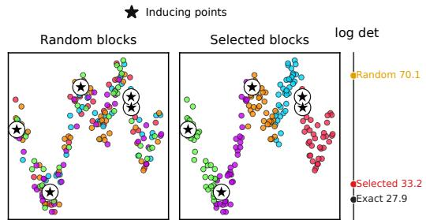

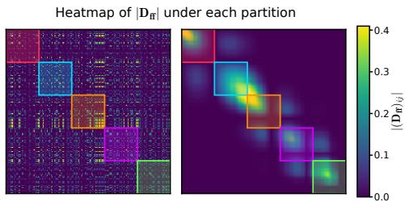  
Figure 1: The same fitted Snelson residual under random blocks (left) and selected blocks (right), using five inducing points. Stars mark inducing points; colours denote block membership. Blocks have $b = 4 0$ points, and the log-det scale on the right compares the result ing penalties with the exact one.

Rasmussen, 2005) to test points: each test input is assigned, without its label, to the block r whose representative is nearest in kernel distance, and only its residual cross-covariance $\mathbf { d } _ { * r }$ with that block is kept,

$$
v _ { * } = v _ { * } ^ { \mathrm { S V G P } } - \mathbf { d } _ { * r } \mathbf { V } _ { r } \mathbf { d } _ { r * } .
$$

The test input thus joins one block of a block-diagonal residual model, so $v _ { * } \geq 0 ;$ ; for BT-SVGP the correction is the variance reduction from conditioning the residual at $x _ { * }$ on the noisy residuals of its block. $\mathrm { A f _ { - } }$ ter an $O ( N ( M + b ) ^ { 2 } )$ preparation of the blocks, each prediction costs ${ \cal O } ( M ^ { 2 } + b M + b ^ { 2 } + N / b )$ , against $O ( M ^ { 2 } )$ for SVGP. Unlike PITC and PIC, where the block-diagonal residual defines an approximate prior for both training and prediction and the PIC mean gains a local term, the model here is the exact GP: the blocks enter training only through the variational scaling, and the mean stays A∗m. We call the resulting T-SVGP, (R)BT-SVGP and (S)BT-SVGP predictors block-diagonal predictors (Appendix B).

## 3 WHY THE PARTITION MATTERS

The block penalty of BT-SGPR upper-bounds the dense log-determinant:

$$
\begin{array} { r } { \sum _ { r } \log \vert { \bf I } + \sigma ^ { - 2 } { \bf D _ { f f } } \vert \boldsymbol { \mathcal { B } } _ { r } , \boldsymbol { \mathcal { B } } _ { r } \vert \vert \ge \log \vert { \bf I } _ { N } + \sigma ^ { - 2 } { \bf D _ { f f } } \vert . } \end{array}
$$

The right-hand side is invariant under simultaneous row and column permutations, whereas the left-hand side depends strongly on the partition P. The partition is therefore a degree of freedom of the bound, and we ask how to choose it so that the bound is as tight as possible. Figure 1 illustrates this on the Snelson dataset (Snelson and Ghahramani, 2005): at the parameters of a fitted (S)BT-SGPR model, the same residual matrix is cut into random blocks and into the blocks selected by the algorithm of the next section. A good partition keeps most of the residual mass inside the diagonal blocks, which tightens the penalty.

For a partition ${ \mathcal { P } } _ { : }$ write

$$
\begin{array} { r l } & { \mathbf { D } _ { \mathcal { P } } = \mathrm { b l o c k d i a g } _ { r = 1 } ^ { B } \{ \mathbf { D } _ { \mathbf { f } } [ \mathcal { B } _ { r } , \mathcal { B } _ { r } ] \} , } \\ & { \mathbf { D } _ { \mathcal { P } } ^ { \perp } = \mathbf { D } _ { \mathbf { f } } - \mathbf { D } _ { \mathcal { P } } . } \end{array}
$$

The block gap relative to the dense endpoint is

$$
\begin{array} { r l } {  { \mathcal { E } ( \mathcal { P } ) = \sum _ { r = 1 } ^ { B } \log | \mathbf { I } _ { | B _ { r } | } + \sigma ^ { - 2 } \mathbf { D } _ { \mathbf { f } } [ B _ { r } , { B _ { r } } ] | } } \\ & { ~ - \log | \mathbf { I } _ { N } + \sigma ^ { - 2 } \mathbf { D } _ { \mathbf { f } } | . } \end{array}
$$

Proposition 1 (Uniform residual-gap bound) Let ${ \bf D _ { f f } } \succeq 0 , \sigma ^ { 2 } > 0$ , and $\kappa = 1 + \sigma ^ { - 2 } \| \mathbf { D _ { f f } } \| _ { 2 }$ . Every partition satisfies

$$
\frac { \| \mathbf { D } _ { \mathcal { P } } ^ { \perp } \| _ { F } ^ { 2 } } { 2 \sigma ^ { 4 } \kappa ^ { 2 } } \leq \mathcal { E } ( \mathcal { P } ) \leq \frac { \| \mathbf { D } _ { \mathcal { P } } ^ { \perp } \| _ { F } ^ { 2 } } { 2 \sigma ^ { 4 } } .\tag{8}
$$

Consequently, at fixed continuous parameters,

$$
\begin{array} { r l } & { 0 \leq \mathcal { F } _ { \mathrm { E \mathrm { - } S G P R } } - \mathcal { F } _ { \mathrm { B T } } ( \mathcal { P } ) } \\ & { ~ = \frac { 1 } { 2 } \mathcal { E } ( \mathcal { P } ) \leq \frac { \| \mathbf { D } _ { \mathcal { P } } ^ { \perp } \| _ { F } ^ { 2 } } { 4 \sigma ^ { 4 } } . } \end{array}\tag{9}
$$

The proof in Appendix A.1 interpolates between $\mathbf { D } _ { \mathcal { P } }$ and $\mathbf { D _ { f f } }$ The first-order change vanishes because the added interactions are of-block; bounded second derivatives give the quadratic scale.

For $N \geq 2$ , random partitions are weak for this target. If $\mathcal { P } _ { \mathrm { R } }$ is a uniform equal-size random partition with block size $b ,$ then any pair is separated with probability $( N - b ) / ( N - 1 )$ (Proposition 2, Appendix A.2), so

$$
\mathbb { E } \Vert \mathbf { D } _ { \mathcal { P } _ { \mathrm { R } } } ^ { \perp } \Vert _ { F } ^ { 2 } = \frac { N - b } { N - 1 } \sum _ { i \neq j } [ \mathbf { D } _ { \mathbf { f } } ] _ { i j } ^ { 2 } .
$$

When $b \ll N .$ , almost all of-diagonal residual mass is outside random blocks. This motivates nonrandom selection when residual interactions are suficiently structured.

## 4 SELECTED BLOCKS

Section 3 turns the choice of partition into a clustering problem: keep as much residual mass $[ \mathbf { D _ { f f } } ] _ { i j } ^ { 2 }$ as possible inside the blocks. Solving it directly requires the

dense residual. We use instead the geometry of the kernel, through the kernel distance (Rasmussen and Williams, 2006)

$$
d _ { \theta } ^ { 2 } ( x , z ) = k _ { \theta } ( x , x ) + k _ { \theta } ( z , z ) - 2 k _ { \theta } ( x , z ) ,\tag{10}
$$

and the inducing points as anchors.

Why inducing points are good anchors. Let $\phi$ be a feature map of $k _ { \theta } , \quad P _ { Z }$ the orthogonal projector onto span $\{ \phi ( z _ { 1 } ) , \ldots , \phi ( z _ { M } ) \}$ , and $r _ { Z } ( x ) = ( I - P _ { Z } ) \phi ( x )$ the unexplained feature. Exact inducing conditioning gives the residual kernel $D ( x , y ) ~ = ~ \langle r _ { Z } ( x ) , r _ { Z } ( y ) \rangle$ , with $[ { \bf D _ { f f } } ] _ { i j } \ = \ D ( x _ { i } , x _ { j } )$ 2 and $r _ { Z } ( z _ { m } ) = 0 .$ . Since an orthogonal projection is contractive,

$$
\begin{array} { c } { { \| r _ { Z } ( x ) - r _ { Z } ( y ) \| \leq d _ { \theta } ( x , y ) , } } \\ { { D ( x , x ) \leq d _ { \theta } ^ { 2 } ( x , z _ { m } ) , } } \\ { { 2 D ( x , y ) \geq D ( x , x ) + D ( y , y ) - d _ { \theta } ^ { 2 } ( x , y ) . } } \end{array}
$$

Inducing points are therefore zeros of the residual, assigning a point to its nearest inducing point minimizes an upper bound on its residual variance, and two close points with appreciable residual variances have a strong positive residual interaction. The kernel distance is thus a cheap proxy for the residual geometry of the block objective; Theorem 1 gives conditions under which it yields the optimal partition.

Algorithm. Algorithm 1 builds the partition in four steps. (i) Each point joins the cell of its nearest anchor (lines 1–2). Since $k _ { \theta } ( x _ { i } , x _ { i } )$ does not depend on the anchor,

$$
a ( i ) = \arg \operatorname* { m i n } _ { m } \{ { [ \bf K _ { u u } ] } _ { m m } - 2 [ \bf K _ { f u } ]  _ { i m } \} ,
$$

which reuses quantities already computed in training and costs $O ( N M )$ , without forming the residual. (ii) The anchors are ordered along a nearest-neighbour chain (line 3), so that neighbouring cells become consecutive. (iii) Within each cell, a boundary score orders the points from the side of the previous anchor to the side of the next one, so that a group lying between two anchors, which the cells split in two, stays contiguous (lines 4–5). (iv) The sequence is cut into blocks of size b (line 6), which stay balanced even when cells have diferent sizes. The search requires $O ( N M + M ^ { 2 } + N \log N )$ kernel-distance work per refresh. The partition and ordering require $O ( N )$ storage, excluding kernel/distance caches and temporary workspace; materializing all point–anchor and anchor– anchor quantities, as our implementation does, requires an additional $O ( N M + { \bf \bar { \it M } } ^ { 2 } )$ storage.

Algorithm 1 Inducing-Anchored Selected-Block   
Tightening   
Require: Training inputs $\textbf { X } = \{ x _ { i } \} _ { i = 1 } ^ { N }$ , inducing   
points ${ \bf Z } = \{ z _ { m } \} _ { m = 1 } ^ { \tilde { M } } ,$ hyperparameters θ, block   
size b.   
Ensure: Partition $\mathcal { P } _ { \mathrm { ( S ) B T } } = \{ \mathcal { B } _ { r } \} _ { r = 1 } ^ { B } \ \mathrm { { o f } } \ \{ 1 , \dots , N \} ,$   
with $B = \lceil N / b \rceil$   
1: Distances. Reusing ${ \bf K } _ { \mathbf { f u } } , ~ { \bf K } _ { \mathbf { u u } }$ and the diago  
nals of $\mathbf { K } _ { \mathbf { f } \mathbf { f } }$ and ${ { \mathbf { K } } _ { { \mathbf { u u } } } }$ cached during training, com  
pute $d _ { \theta } ^ { 2 } ( x _ { i } , z _ { m } )$ for every point and anchor, and   
$d _ { \theta } ^ { 2 } \big ( z _ { m } , z _ { n } \big )$ for every pair of anchors (Eq. (10)).   
$\dot { O ( N M + M ^ { 2 } ) }$   
2: Cells. Assign each point to its nearest anchor,   
$a ( i ) \ = \ \arg \operatorname* { m i n } _ { m } d _ { \theta } ( x _ { i } , z _ { m } ) .$ The points with   
$a ( i ) = m$ form the cell of $z _ { m } .$ O(NM)   
3: Chain. Arrange the anchors along a path: start   
from $z _ { 1 }$ and repeatedly move to the nearest an  
chor in $d _ { \theta }$ not yet visited. This gives the or  
der $z _ { c _ { 1 } } , \dots , z _ { c _ { M } }$ , in which consecutive anchors are   
close. Let $z _ { m ^ { - } }$ and $z _ { m ^ { + } }$ be the anchors just before   
and just after $z _ { m }$ in this order. $O ( M ^ { 2 } )$   
4: Boundary score. For each point, with $m = a ( i )$   
let $s _ { i } = d _ { \theta } ^ { 2 } ( x _ { i } , z _ { m ^ { - } } ) - d _ { \theta } ^ { 2 } ( x _ { i } , z _ { m ^ { + } } )$ . It is negative   
when $x _ { i }$ is closer to the previous anchor than to   
the next one. In the first cell of the chain use   
$s _ { i } = - d _ { \theta } ^ { 2 } ( x _ { i } , z _ { m ^ { + } } )$ , in the last $s _ { i } = d _ { \theta } ^ { 2 } ( x _ { i } , z _ { m ^ { - } } )$   
and if $M = 1 , s _ { i } = d _ { \theta } ^ { 2 } ( x _ { i } , z _ { 1 } )$ O(N)   
5: Ordering. List the cells in chain order and,   
within each cell, its points by increasing $s _ { i } \colon$ from   
the side facing the previous cell to the side facing   
the next one. Break ties by $d _ { \theta } \bigl ( x _ { i } , z _ { a ( i ) } \bigr )$ , and call   
the resulting sequence $\pi = ( \pi _ { 1 } , \ldots , \pi _ { N } )$   
O(N log N)   
6: Blocks. Cut π into consecutive pieces of b points,   
$B _ { r } = \{ \pi _ { j } : \lceil j / b \rceil = r \}$ O(N)   
7: return $\mathcal { P } _ { \mathrm { ( S ) B T } } .$

Refreshes. Selecting the blocks does not create a new bound: at fixed θ and Z, (S)BT-SGPR and (S)BT-SVGP are the BT-SGPR and BT-SVGP bounds evaluated on the partition ${ \mathcal { P } } _ { \mathrm { ( S ) B T } } ( \theta , \mathbf { Z } )$ . Since θ and Z change during training, most strongly early on, we refresh the partition periodically. At each refresh, Algorithm 1 recomputes the partition at the current θ and Z, and training resumes from these parameters with the updated bound. Proposition 3 (Appendix A.3) bounds the resulting change in the ELBO and gives a condition under which the refresh tightens the bound.

The ideal case. Suppose the data form compact groups, each lying between two consecutive inducing points. The cells split every group in two, but the chain and the boundary score put the two halves next to each other before the cut (Figure 2). The groups are not given to the algorithm; Theorem 1 shows that it recovers them and, under a further condition, that they form the best balanced partition.

Theorem 1 (Geometric recovery) At fixed θ and Z, assume $\dot { M } \ \geq \ 2 , \sigma ^ { 2 } \ > \ 0 , \dot { \bf K } _ { \bf u u } \ \succ \ 0 ,$ , and $k _ { \theta } ( x _ { i } , x _ { i } ) > 0$ for every observation. Label the inducing points so that the chain of Algorithm 1 starts at $z _ { 1 }$ . For each $m < M$ , let $C _ { m }$ contain exactly the observations x satisfying

$$
\operatorname* { m a x } _ { a \in \{ m , m + 1 \} } d _ { \theta } ( x , z _ { a } ) < d _ { \theta } ( x , z _ { j } ) ,
$$

for every $j \not \in \{ m , m + 1 \}$ . Suppose these groups cover all observations and $| C _ { m } | = b \ge 2$ , so $N = ( M - 1 ) b .$ They are disjoint, although a point may be equally close to its two adjacent anchors and assigned to either. Assume that

$$
( i ) \ d _ { \theta } ( z _ { m } , z _ { m + 1 } ) < d _ { \theta } ( z _ { m } , z _ { j } ) \ f o r \ e v e r y \ j > m + 1 ;
$$

(ii) $d _ { \theta } ( x , y ) \quad \leq \quad h$ for observations $x , y$ in the same group $C _ { m } . \in \{ 0 , \ldots , K \} $ $| k _ { \theta } ( x , y ) | \quad \le \quad \delta \sqrt { k _ { \theta } ( x , x ) k _ { \theta } ( y , y ) }$ for observations in diferent groups, for distinct inducing points, and for every observation–inducing pair, including coincident input locations.

Then Algorithm 1 returns $\mathcal { Q } = \{ C _ { 1 } , \ldots , C _ { M - 1 } \}$ . If moreover $h ^ { 2 } < 2 \operatorname* { m i n } _ { i } k _ { \theta } ( x _ { i } , x _ { i } )$ , there is $\delta _ { 0 } > 0$ such that, for $\delta < \delta _ { 0 } , \mathcal { Q }$ has a strictly larger ELBO, collapsed or not, than every other partition into blocks of size b.

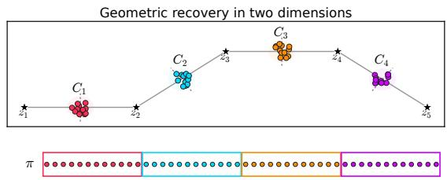  
Figure 2: Two-dimensional RBF example of Theorem 1. The ordering π (bottom) returns each coloured group as one block; stars are inducing points, dashed lines cell boundaries.

Trained inducing points need not produce this configuration, but the case shows what the algorithm is built to find. Since the inducing points are zeros of the residual D, the blocks act only on the structure that the inducing points leave unexplained, and the theorem shows that the algorithm finds such local groups and keeps each one in a single block. Appendix A.5 proves the theorem, gives an explicit family in which both $b / N$ and $M / N$ vanish, and shows when the hypotheses hold for the kernels of our experiments.

## 5 EXPERIMENTS

We ask three questions: does the selected partition tighten the bound and improve predictions over random blocks of the same size; how close does it come to a dense graph partitioner; and do its gains survive when the structured predictor is replaced by a standard sparse one?

## 5.1 Collapsed SGPR

We first fit SGPR, T-SGPR, (R)BT-SGPR and (S)BT-SGPR to the Snelson dataset with $M = 5$ inducing points (Figure 3). The tighter the bound, the closer the fitted hyperparameters are to those of the exact GP, and (S)BT-SGPR comes closest, in line with Bui et al. (2025); Bui and Titsias (2025).

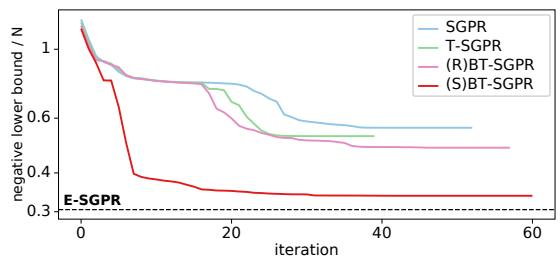

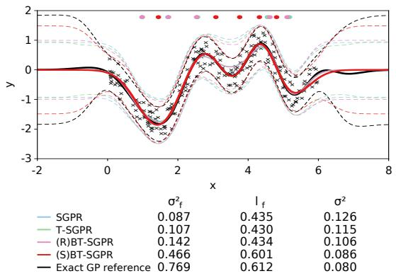  
Figure 3: Snelson: training bounds (top; dashed: E-SGPR); predictive fits with the block-diagonal predictor for T-SGPR, (R)BT-SGPR and (S)BT-SGPR and fitted hyperparameters (bottom).

We then fit the same methods on Kin40k with an RBF kernel $( N ~ = ~ 5 0 0 0 , ~ M ~ = ~ 5 1 2 , ~ b ~ = ~ 5 0 0$ , L-BFGS-B). The test metrics follow the hierarchy of the bounds (Table 1). At the same block size, selecting the partition instead of drawing it at random lowers the RMSE from 0.197 to 0.185 and the NLL from −0.179 to −0.240. As a reference we also partition the dense residual graph with METIS (Karypis and Kumar, 1998), with edge weights $[ \mathbf { D _ { f f } } ] _ { i j } ^ { 2 } ,$ so that its cut directly targets $\| \mathbf D _ { \mathcal P } ^ { \perp } \| _ { F } ^ { 2 }$ . The resulting (METIS)BT-SGPR does slightly better (0.179 and −0.296), but its search takes 1035 ms per build, against 6 ms for Algorithm 1.

Table 1: RBF–Kin40k: M = 512, N = 5000, 2000 test points and $b = 5 0 0$ . Test $\mathrm { R M S E / N L L }$ use the blockdiagonal predictor of Eq. (14); mean (SE in parentheses) over ten seeds. Search is the partition-build time in ms. Bold: best non-dense method; †dense reference.
<table><tr><td>Method</td><td>RMSE</td><td>NLL Search (ms)</td></tr><tr><td>SGPR</td><td>0.229(2) -0.041(7)</td><td></td></tr><tr><td>T-SGPR</td><td>0.205(2) -0.146(7)</td><td></td></tr><tr><td>(R)BT-SGPR</td><td>0.197(2) -0.179(7)</td><td></td></tr><tr><td>(S)BT-SGPR</td><td>0.185(2) -0.240(7)</td><td>6.07</td></tr><tr><td>(METIS)BT-SGPR†</td><td>0.179(2) -0.296(6)</td><td>1034.92</td></tr><tr><td>Exact GP†</td><td>0.151(2) -0.618(14)</td><td></td></tr></table>

## 5.2 Sparse predictor transplant and refinement

Dropping the structured correction at test time, $q ( f \mid \mathbf { u } ) \approx p ( f \mid \mathbf { u } )$ , transfers the hyperparameters and inducing points of a structured model (the donor) to a standard SGPR predictor (a transplant). We evaluate the transplanted model as it is (direct sparse) and after optimizing Z on the SGPR ELBO until convergence, with the kernel and noise hyperparameters fixed (refined sparse). Refinement slightly worsens the T-SGPR and (R)BT-SGPR donors but improves the (S)BT-SGPR donor, whose NLL goes from −0.158 to −0.164 (its RMSE rises from 0.185 to 0.190); (S)BT-SGPR is the best sparse predictor in both variants (Table 2, Appendix D). This suggests that selected-block training learns hyperparameters that transfer well to a standard SGPR predictor.

## 5.3 Stochastic SVGP

Setup. We train SVGP, T-SVGP, (R)BT-SVGP and (S)BT-SVGP with four kernels (RBF, Mat´ern-5/2, Amplitude-RBF and Gibbs) on eight datasets, with M ∈ {64, 128, 256, 512} and ten seeds per configuration. Within a kernel, all methods share the same epoch budget: 350 for RBF and Mat´ern-5/2, 500 for Amplitude-RBF, and 300 after an RBF warm start for Gibbs. (R)BT-SVGP and (S)BT-SVGP are trained with the split estimator described at the end of this section.

Accuracy. Figure 4 shows RBF and Amplitude-RBF on Pol (Weiss and Indurkhya, 1995; Vanschoren et al., 2014), Superconductivity (Hamidieh, 2018a,b), Kin40k (Schwaighofer and Tresp, 2002) and Protein (Rana, 2013); the other kernels and datasets are in Appendix E, the protocol in Appendix D. With the block-diagonal predictors (solid lines), (S)BT-SVGP has the lowest RMSE and the lowest NLL in all 32 displayed configurations, improving on (R)BT-SVGP by 0.006 to 0.020 in RMSE and by 0.015 to 0.117 in NLL.

Cost. (R)BT-SVGP and (S)BT-SVGP have the same block-factorization cost, and selection adds little: on RBF–Kin40k at $M = 5 1 2 .$ , building the selected partitions takes 1.74 s in total against 114.85 s of optimization (1.52%, means over ten seeds), while (R)BT-SVGP optimization takes 114.99 s. The price is paid at prediction time (Section 2).

Sparse transplant. We therefore repeat the transplant of Section 5.2: each donor’s hyperparameters are fixed, and the inducing points and q(u) are refined under the standard SVGP objective for 300 epochs (dashed lines). The (S)BT-SVGP donors still give the lowest RMSE in all 32 configurations and the lowest NLL in 19. The 13 exceptions are all at $M \leq 2 5 6 .$ ten of them on Kin40k and Pol, and in each of them the best sparse NLL comes from the (R)BT-SVGP donor; at $M = 5 1 2$ the (S)BT-SVGP donor is best everywhere. This is consistent with structured training learning more useful hyperparameters; at small budgets, compressing the donated model into the sparse predictor can lose part of the advantage.

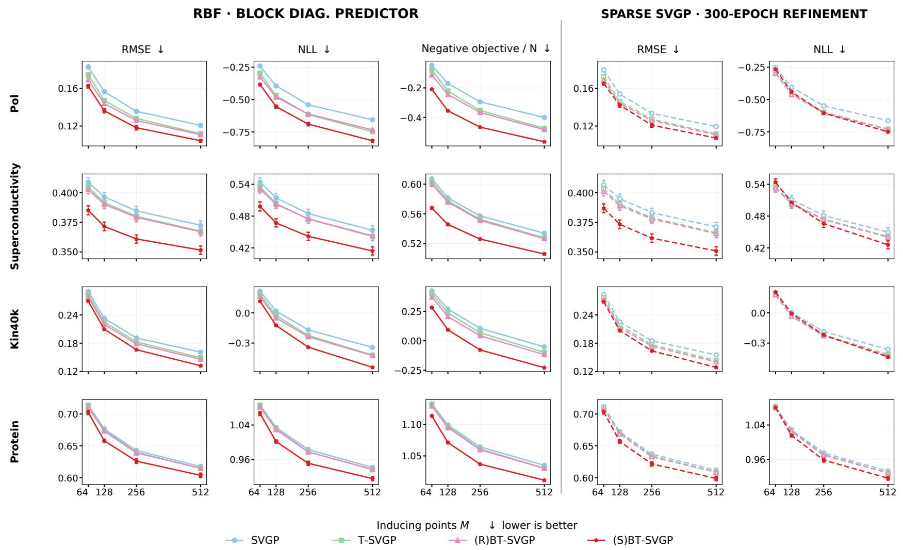  
Figure 4 : RBF on Pol Superconductivity Kin40k and Protein Left three columns : RMSE NLL and negative final obj ective per datum of the blockdiagonal predictors ( Section 2 ; solid) ; right two columns : RMSE and NLL of the sparse SVGP after 300-epoch transplant refinement (dashed) . Means and one st andard error over ten seeds ; lower is better The obj ectives are method-specific stochastic estimates not a common marginal likelihood Amplitude-RBF follows on the next page ; the full campaign is in Appendix E

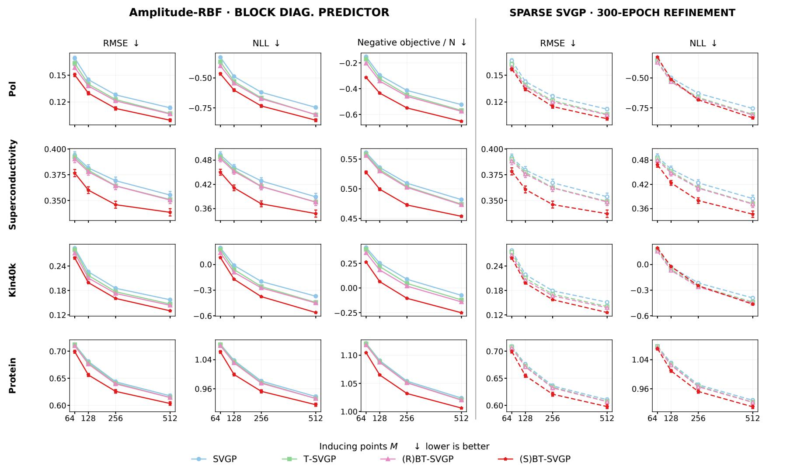  
Figure 4 : ( Continued . ) Amplitude-RBF on Pol Superconductivity Kin40k and Protein with the same layout .

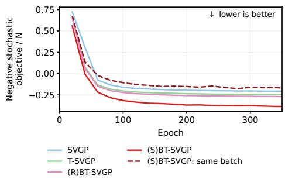  
Figure 5: Negative stochastic objective during training on RBF–Pol, M = 128, ten seeds. Separate likelihood and block batches converge better than a single shared batch for (S)BT-SVGP.

Split estimator. The BT-SVGP bound is the $\mathrm { T } -$ SVGP bound plus one gain per block,

$$
\begin{array} { r l r } {  { \mathcal { L } _ { \mathrm { B T } } = \mathcal { L } _ { \mathrm { T } } + \frac { 1 } { 2 } \sum _ { r = 1 } ^ { B } g _ { r } , } } \\ & { } & { g _ { r } = \sum _ { i \in \mathcal { B } _ { r } } \log \bigl ( 1 + \sigma ^ { - 2 } [ \mathbf { D } _ { \mathbf { f } } ] _ { i i } \bigr ) } \\ & { } & { ~ - \log \bigl | \mathbf { I } + \sigma ^ { - 2 } \mathbf { D } _ { \mathbf { f } } [ \mathcal { B } _ { r } , \mathcal { B } _ { r } ] \bigr | . } \end{array}
$$

By Hadamard’s inequality $\begin{array} { r l r } { g _ { r } } & { { } \ge } & { 0 \colon } \end{array}$ it measures how much block $B _ { r }$ tightens the T-SVGP diagonal penalty by modelling the residual correlations among its points. Selected blocks are localized in input space, so sampling one block for both terms (Section 2) would make every update see a single region of the data. We sample the two terms separately,

$$
\widehat { \mathcal { L } } _ { \mathrm { s p l i t } } = \widehat { \mathcal { L } } _ { \mathrm { T } } ( \boldsymbol { \mathcal { B } } ) + \frac { B } { 2 K } \sum _ { k = 1 } ^ { K } g _ { r _ { k } } ,
$$

where ${ \widehat { \mathcal { L } } } _ { \mathrm { T } } ( B )$ is the minibatch estimate of $\mathcal { L } _ { \mathrm { T } }$ on a random likelihood batch B and $r _ { 1 } , \ldots , r _ { K }$ are $K$ random blocks; under uniform sampling this is unbiased at fixed parameters, and in practice batches and blocks are traversed in separate, uniformly weighted cycles. Separating the two samples is not the same as doubling the batch: the likelihood batch needs only the diagonal of $\mathbf { D _ { f f } } .$ and the $b \times b$ Cholesky factors are computed for the K blocks alone, so the split adds $O ( | B | M ^ { 2 } )$ to a shared batch, a factor close to one, whereas dou bling a shared batch doubles the Cholesky work (Appendix C). We use |B| = 1000 and K = 2 blocks of size b = 500. (R)BT-SVGP and (S)BT-SVGP difer only in their blocks; SVGP and T-SVGP use the likelihood batch alone. Separate batches converge better than a shared one (Figure 5).

## 6 CONCLUSION

Block-structured sparse GP bounds contain an internal degree of freedom: the partition used in the residual log-determinant approximation. Our results show that choosing this partition can substantially improve performance. Building on existing block-structured bounds, we develop a scalable block-search procedure and a doubly stochastic implementation that stabilizes training. Finally, we use these models as a parameter-learning stage for subsequent sparse SVGP refinement. The resulting comparisons show improvements in RMSE and NLL across datasets and kernels.

Limitations. Our guarantees are suficient conditions at a fixed state; outside them, selected blocks need not beat random ones, and tighter bounds need not improve every test metric. The block-diagonal predictor remains costly, and sparsification trades its covariance correction for cheaper prediction. Hyperparameters learned under the block-structured objective need not be optimal for the sparse predictor. Removing the covariance correction can worsen NLL (Gibbs on Electricity, Figure 13; Pol and Kin40k at small M); our results do not establish a reduction in statistical estimation bias. The objectives are non-convex, so numerical stopping criteria do not certify global optimality.

## AI Use Statement

Generative AI tools were used to assist with developing and discussing theoretical arguments and proofs; designing and implementing experiments, training and evaluation code, and diagnostic checks; interpreting results; translating and editing text; preparing figures and tables; and identifying relevant literature. This assistance included work on the block-selection motivation and the experimental workflows. The authors remain responsible for the correctness, originality, attribution, and reproducibility of all claims, proofs, code, and reported results. The tools used were OpenAI Codex and Anthropic Claude. Generative AI was not used to generate synthetic data, to clean datasets, or for qualitative analysis. The authors verified these outputs as follows: they checked every proof by hand; they re-ran the experiments with the released code and compared every reported number with the stored result files; they checked every reference against the original publication; and they read and revised all text.

## References

Braun, P. and Sendov, H. (2023). On the Hadamard– Fischer inequality, the inclusion–exclusion formula, and bipartite graphs. Linear Algebra and its Applications, 668:64–92.

Bui, T. D., Ashman, M., and Turner, R. E. (2025). Tighter sparse variational Gaussian processes. Transactions on Machine Learning Research.

Bui, T. D. and Titsias, M. K. (2025). Sparse Gaussian processes: Structured approximations and Power-EP revisited. In Advances in Neural Information Processing Systems, volume 38.

Burt, D. R., Rasmussen, C. E., and van der Wilk, M. (2020). Convergence of sparse variational inference in Gaussian processes regression. Journal of Machine Learning Research, 21(131):1–63.

Chen, X., Liang, C., Huang, D., Real, E., Wang, K., Pham, H., Dong, X., Luong, T., Hsieh, C.-J., Lu, Y., and Le, Q. V. (2023). Symbolic discovery of optimization algorithms. In Advances in Neural Information Processing Systems, volume 36.

Evans, T. W. (n.d.). uci datasets: Regression datasets from the UCI machine learning repository. Python package, version 1.1.0.

Gibbs, M. N. (1997). Bayesian Gaussian Processes for Regression and Classification. PhD thesis, University of Cambridge.

Guinness, J. (2018). Permutation and grouping methods for sharpening Gaussian process approximations. Technometrics, 60(4):415–429.

Hamidieh, K. (2018a). A data-driven statistical model for predicting the critical temperature of a superconductor. Computational Materials Science, 154:346– 354.

Hamidieh, K. (2018b). Superconductivity data. UCI Machine Learning Repository.

Hensman, J., Fusi, N., and Lawrence, N. D. (2013). Gaussian processes for big data. In Proceedings of the Twenty-Ninth Conference on Uncertainty in Artificial Intelligence, pages 282–290.

Hensman, J., Matthews, A. G. d. G., and Ghahramani, Z. (2015). Scalable variational Gaussian process classification. In Proceedings of the Eighteenth International Conference on Artificial Intelligence and Statistics, pages 351–360.

Hogue, J. (2019). Metro interstate trafic volume. UCI Machine Learning Repository.

Karypis, G. and Kumar, V. (1998). A fast and high quality multilevel scheme for partitioning irregular graphs. SIAM Journal on Scientific Computing, 20(1):359–392.

Kaul, M. (2013). 3D road network (North Jutland, Denmark). UCI Machine Learning Repository.

Kingma, D. P. and Ba, J. (2015). Adam: A method for stochastic optimization. In International Conference on Learning Representations.

Liu, H., Ong, Y.-S., Shen, X., and Cai, J. (2020). When Gaussian process meets big data: A review of scalable GPs. IEEE Transactions on Neural Networks and Learning Systems, 31(11):4405–4423.

Paciorek, C. J. and Schervish, M. J. (2003). Nonstationary covariance functions for Gaussian process regression. In Advances in Neural Information Processing Systems, volume 16, pages 273–280.

Qui˜nonero-Candela, J. and Rasmussen, C. E. (2005). A unifying view of sparse approximate Gaussian process regression. Journal of Machine Learning Research, 6:1939–1959.

Rana, P. (2013). Physicochemical properties of protein tertiary structure. UCI Machine Learning Reposi tory.

Rasmussen, C. E. and Williams, C. K. I. (2006). Gaussian Processes for Machine Learning. MIT Press.

Salimbeni, H., Eleftheriadis, S., and Hensman, J. (2018). Natural gradients in practice: Nonconjugate variational inference in Gaussian process models. In Proceedings of the Twenty-First International Conference on Artificial Intelligence and Statistics, volume 84 of Proceedings of Machine Learning Research, pages 689–697.

Schwaighofer, A. and Tresp, V. (2002). Transductive and inductive methods for approximate Gaussian process regression. In Advances in Neural Information Processing Systems, volume 15.

Snelson, E. and Ghahramani, Z. (2005). Sparse Gaussian processes using pseudo-inputs. In Advances in Neural Information Processing Systems.

Snelson, E. and Ghahramani, Z. (2007). Local and global sparse Gaussian process approximations. In Proceedings of the Eleventh International Conference on Artificial Intelligence and Statistics, volume 2 of Proceedings of Machine Learning Research, pages 524–531.

Titsias, M. K. (2009). Variational learning of inducing variables in sparse Gaussian processes. In Proceedings of the Twelfth International Conference on Artificial Intelligence and Statistics, volume 5 of Proceedings of Machine Learning Research, pages 567– 574.

Titsias, M. K. (2025). New bounds for sparse variational Gaussian processes. In Proceedings of the 42nd International Conference on Machine Learning, volume 267 of Proceedings of Machine Learning Research, pages 59621–59638.

Torgo, L. (n.d.). Regression data sets: Elevators. Collection of regression datasets, University of Porto. Data by Rui Camacho.

Trindade, A. (2015). Electricityloaddiagrams20112014. UCI Machine Learning Repository.

Vanschoren, J., van Rijn, J. N., Bischl, B., and Torgo, L. (2014). OpenML: Networked science in machine learning. SIGKDD Explorations, 15(2):49–60.

Weiss, S. M. and Indurkhya, N. (1995). Rule-based machine learning methods for functional prediction. Journal of Artificial Intelligence Research, 3:383– 403.

# Geometry-Aware Block Selection for Sparse Variational Gaussian Processes: Supplementary Materials

## A PROOFS

Throughout, ${ \bf D } = { \bf D _ { f f } } \succeq 0$ , D keeps the diagonal blocks of a partition $\mathcal { P } , \mathbf { D } _ { \mathcal { P } } ^ { \perp } = \mathbf { D } - \mathbf { D } _ { \mathcal { P } }$ as in Section 3, and $J ( \mathcal P ) = \log | \mathbf I + \sigma ^ { - 2 } \mathbf D _ { \mathcal P } |$ . At fixed $( \theta , \mathbf { Z } , q ( \mathbf { u } ) )$ , the partition enters both the BT-SGPR bound $\mathcal { F } _ { \mathrm { B T } } ( \mathcal { P } )$ and the BT-SVGP bound $\mathcal { L } _ { \mathrm { B T } }$ only through $\begin{array} { r l } { - \frac { 1 } { 2 } J ( \mathcal { P } ) } \end{array}$ ; every comparison below therefore holds for both, and we write ${ \mathcal { L } } _ { \mathrm { B T } } ( { \mathcal { P } } )$

## A.1 Proof of Proposition 1

Let ${ \bf R } = { \bf D } _ { \mathcal { P } } ^ { \perp } , { \bf A } _ { t } = { \bf I } + \sigma ^ { - 2 } \big ( { \bf D } _ { \mathcal { P } } + t { \bf R } \big )$ and $f ( t ) = - \log | \mathbf { A } _ { t } |$ for $t \in [ 0 , 1 ]$ , so that $\mathcal { E } ( \mathcal { P } ) = f ( 1 ) - f ( 0 )$ . Each block of DP is a principal submatrix of D, hence $\| \mathbf { D } _ { \mathcal { P } } \| _ { 2 } \leq \| \mathbf { D } \| _ { 2 }$ and $\mathbf { I } \preceq \mathbf { A } _ { t } \preceq \kappa \mathbf { I }$ . Diferentiating,

$$
f ^ { \prime } ( t ) = - \sigma ^ { - 2 } \mathrm { t r } ( \mathbf { A } _ { t } ^ { - 1 } \mathbf { R } ) , \qquad f ^ { \prime \prime } ( t ) = \sigma ^ { - 4 } \mathrm { t r } ( \mathbf { A } _ { t } ^ { - 1 } \mathbf { R } \mathbf { A } _ { t } ^ { - 1 } \mathbf { R } ) = \sigma ^ { - 4 } \lVert \mathbf { A } _ { t } ^ { - 1 / 2 } \mathbf { R } \mathbf { A } _ { t } ^ { - 1 / 2 } \rVert _ { F } ^ { 2 } .
$$

${ \bf A } _ { 0 } ^ { - 1 }$ is block diagonal and R vanishes on the diagonal blocks, so $f ^ { \prime } ( 0 ) ~ = ~ 0$ From $\begin{array} { l l l l } { \mathbf { I } } & { \preceq } & { \mathbf { A } _ { t } } & { \preceq } & { \kappa \mathbf { I } . } \end{array}$ $\| { \bf R } \| _ { F } / \kappa \leq \| { \bf A } _ { t } ^ { - 1 / 2 } { \bf R } { \bf A } _ { t } ^ { - 1 / 2 } \| _ { F } \leq \| { \bf R } \| _ { F }$ . Taylor’s formula with integral remainder, $\begin{array} { r } { \mathcal { E } ( \mathcal { P } ) = \int _ { 0 } ^ { 1 } ( 1 - t ) f ^ { \prime \prime } ( t ) d t } \end{array}$ with $\begin{array} { r } { \int _ { 0 } ^ { 1 } ( 1 - t ) d t = \frac { 1 } { 2 } . } \end{array}$ , gives Eq. (8), and Eq. (9) follows because the ELBO gap is $\scriptstyle { \frac { 1 } { 2 } } { \mathcal { E } } ( { \mathcal { P } } )$ . Since $\mathrm { t r } ( \mathbf { A } _ { 0 } ^ { - 1 } \mathbf { A } _ { 1 } ) = N$ the gap is also $\mathscr { E } ( \mathcal { P } ) = 2 \mathrm { K L } [ \mathcal { N } ( 0 , \mathbf { A } _ { 1 } ) | | \mathcal { N } ( 0 , \mathbf { A } _ { 0 } ) ]$ : the dependence lost by replacing the noisy residual with the product of its block marginals. □

## A.2 Random Partitions

Proposition 2 For $N \geq 2$ , cut a uniform random permutation of $\{ 1 , \ldots , N \}$ into blocks of sizes $b _ { 1 } , \dotsc , b _ { B }$ Then

$$
\mathbb { E } \Vert \mathbf { D } _ { \mathcal { P } } ^ { \perp } \Vert _ { F } ^ { 2 } = p \sum _ { i \neq j } [ \mathbf { D } _ { \mathbf { f } } ] _ { i j } ^ { 2 } , \qquad p = 1 - \frac { \sum _ { r } b _ { r } ( b _ { r } - 1 ) } { N ( N - 1 ) } ,
$$

and $p = ( N - b ) / ( N - 1 )$ when every block has size $\textit { b } \left( s o \textit { b } | \textit { N } \right)$

Proof. An ordered pair $i \neq j$ occupies two uniformly random distinct positions, and $\begin{array} { r } { \sum _ { r } b _ { r } ( b _ { r } - 1 ) } \end{array}$ of the $N ( N - 1 )$ ordered position pairs lie in a common block. □

## A.3 Partition-Exchange Bound

For an incumbent partition $\mathcal { P }$ and a new partition $\mathcal { Q } ,$ let $ { \mathcal { T } } _ { + } \left(  { \mathcal { T } } _ { - } \right)$ be the ordered pairs $i \neq j$ that share a block of Q but not of $\mathcal { P }$ (of P but not of Q), and

$$
G _ { \pm } = \sum _ { ( i , j ) \in \mathcal { I } _ { \pm } } [ \mathbf { D } _ { \mathbf { f } } ] _ { i j } ^ { 2 } , \qquad \kappa _ { \mathcal { P } } = 1 + \sigma ^ { - 2 } \| \mathbf { D } _ { \mathcal { P } } \| _ { 2 } , \qquad \kappa _ { \mathcal { Q } } = 1 + \sigma ^ { - 2 } \| \mathbf { D } _ { \mathcal { Q } } \| _ { 2 } .
$$

$G _ { + }$ and $G _ { - }$ are the residual interactions that the new partition gains and loses.

Proposition 3 (Partition-exchange bound) For $\sigma ^ { 2 } > 0$

$$
\frac { G _ { + } / \kappa _ { Q } ^ { 2 } - G _ { - } } { 4 \sigma ^ { 4 } } \leq \mathcal { L } _ { \mathrm { B T } } ( Q ) - \mathcal { L } _ { \mathrm { B T } } ( \mathcal { P } ) \leq \frac { G _ { + } - G _ { - } / \kappa _ { \mathcal { P } } ^ { 2 } } { 4 \sigma ^ { 4 } } .\tag{11}
$$

In particular, a refresh with $G _ { + } \geq \kappa _ { \mathcal { Q } } ^ { 2 } G _ { - }$ does not decrease the ELBO, and strictly increases it under strict inequality.

Proof. Let $\mathcal { H } = \mathcal { P } \wedge \mathcal { Q }$ be the common refinement. Keeping the P-blocks of $\mathbf { D } _ { \mathcal { Q } }$ gives $\mathbf { D } _ { \mathcal { H } }$ , and so does keeping the Q-blocks of $\mathbf { D } _ { \mathcal { P } } \mathbf { ; }$ ; hence $\| \mathbf { D } _ { \mathcal { Q } } - \mathbf { D } _ { \mathcal { H } } \| _ { F } ^ { 2 } = G _ { + }$ and $\| \mathbf { D } _ { \mathcal { P } } - \mathbf { D } _ { \mathcal { H } } \| _ { F } ^ { 2 } = G _ { - }$ . Proposition 1, applied to $\mathbf { D } _ { \mathcal { Q } } \succeq 0$ with partition $\mathcal { P }$ and to $\mathbf { D } _ { \mathcal { P } } \succeq 0$ with partition Q, gives

$$
\frac { G _ { + } } { 2 \sigma ^ { 4 } \kappa _ { Q } ^ { 2 } } \leq J ( \mathcal { H } ) - J ( Q ) \leq \frac { G _ { + } } { 2 \sigma ^ { 4 } } , \qquad \frac { G _ { - } } { 2 \sigma ^ { 4 } \kappa _ { \mathcal { P } } ^ { 2 } } \leq J ( \mathcal { H } ) - J ( \mathcal { P } ) \leq \frac { G _ { - } } { 2 \sigma ^ { 4 } } .
$$

The claim follows from $\begin{array} { r } { \mathcal { L } _ { \mathrm { B T } } ( \ v Q ) - \mathcal { L } _ { \mathrm { B T } } ( \mathcal P ) = \frac { 1 } { 2 } [ ( J ( \mathcal { H } ) - J ( \ v Q ) ) - ( J ( \mathcal { H } ) - J ( \mathcal P ) ) ] } \end{array}$

## A.4 Residual Separation

Lemma 1 (Residual separation) Let $\mathcal { P } \neq \mathcal { Q }$ be partitions with the same block sizes, the largest being b. Let $u , v \geq 0$ , and suppose that $| [ \mathbf { D _ { f f } } ] _ { i j } | \geq u$ for i ̸= j in a common block of $\mathcal { Q }$ and $| [ \mathbf { D _ { f f } } ] _ { i j } | \leq v$ otherwise. Then $m = | \mathbb { Z } _ { + } | > 0$ and

$$
{ \mathcal { L } } _ { \mathrm { B T } } ( { \mathcal { Q } } ) - { \mathcal { L } } _ { \mathrm { B T } } ( { \mathcal { P } } ) \geq { \frac { m } { 4 \sigma ^ { 4 } } } { \Big ( } { \frac { u ^ { 2 } } { \kappa _ { \mathcal { Q } } ^ { 2 } } } - v ^ { 2 } { \Big ) } , \qquad \kappa _ { \mathcal { Q } } \leq 1 + { \frac { b \operatorname* { m a x } _ { i } [ \mathbf { D _ { f f } } ] _ { i i } } { \sigma ^ { 2 } } } .\tag{12}
$$

Hence, $i f u > \kappa _ { \mathcal { Q } } v , \mathcal { Q }$ has a strictly larger ELBO than every other partition with its block sizes.

Proof. Both partitions contain $\begin{array} { r } { \sum _ { r } b _ { r } ( b _ { r } - 1 ) } \end{array}$ ordered within-block pairs, so $| \mathcal { T } _ { + } | = | \mathcal { T } _ { - } | = m ,$ and $m > 0$ because their within-block relations difer. Then $G _ { + } \geq m u ^ { 2 }$ and $G _ { - } \leq m v ^ { 2 }$ , and Proposition 3 gives the bound. Finally, $\begin{array} { r } { \| \mathbf { D } _ { \mathcal { Q } } \| _ { 2 } = \operatorname* { m a x } _ { C \in \mathcal { Q } } \| \mathbf { D } _ { \mathbf { f } } [ C , C ] \| _ { 2 } \le \operatorname* { m a x } _ { C } \mathrm { t r } ( \mathbf { D } _ { \mathbf { f } } [ C , C ] ) \le b \operatorname* { m a x } _ { i } [ \mathbf { D } _ { \mathbf { f } } ] _ { i i } } \end{array}$ □

## A.5 Proof of Theorem 1

Recovery. By the definition of $C _ { m } ,$ the cell of $z _ { 1 }$ contains only points of $C _ { 1 }$ , that of $z _ { M }$ only points of $C _ { M - 1 }$ and that of $z _ { m + 1 }$ only points of $C _ { m } \cup C _ { m + 1 }$ . By (i), the chain visits $z _ { 1 } , \dots , z _ { M }$ in this order, so the neighbours of $z _ { m + 1 }$ are $z _ { m }$ and $z _ { m + 2 }$ . For $x \in C _ { m } , z _ { m }$ is one of its two nearest inducing points and $z _ { m + 2 }$ is not, so $s _ { x } = d _ { \theta } ^ { 2 } ( x , z _ { m } ) - d _ { \theta } ^ { 2 } ( x , z _ { m + 2 } ) < 0 ;$ for $y \in C _ { m + 1 } , s _ { y } > 0$ . Every cell therefore lists the points of the earlier group first, each $C _ { m }$ is contiguous in π, and, since $| C _ { m } | = b$ , the cut returns $\mathcal { Q } .$ . A tie between a point’s two adjacent anchors only changes the cell that receives it, and ties within a group may be broken arbitrarily.

Optimality. Write $\rho ( x ) ^ { 2 } \quad = \quad k _ { \theta } ( x , x ) , \quad c ( x , y ) \quad = \quad k _ { \theta } ( x , y ) / ( \rho ( x ) \rho ( y ) )$ , and let $k _ { + }$ and $k _ { - }$ be the largest and smallest $k _ { \theta } ( x _ { i } , x _ { i } )$ Condition (ii) reads $| c | \quad \leq \quad \delta$ outside the groups and, since $c ( x , y ) = [ \rho ( x ) ^ { 2 } + \rho ( y ) ^ { 2 } - d _ { \theta } ^ { 2 } ( x , y ) ] / ( 2 \rho ( x ) \rho ( y ) ) \geq 1 - d _ { \theta } ^ { 2 } ( x , y ) / ( 2 \rho ( x ) \rho ( y ) ) , 1 - c ( x , y ) \leq h ^ { 2 } / ( 2 k _ { - } )$ inside a group. Exact conditioning gives $D ( x , y ) = \rho ( x ) \rho ( y ) D _ { c } ( x , y )$ , where $D _ { c } ( x , y ) = c ( x , y ) - c _ { x Z } C _ { Z Z } ^ { - 1 } c _ { Z y }$ is the residual of c and $C _ { Z Z } = [ c ( z _ { m } , z _ { n } ) ]$ . Let $\begin{array} { r } { \eta = \operatorname* { m a x } _ { m } \sum _ { n \neq m } | c ( z _ { m } , z _ { n } ) | \leq ( M - 1 ) \delta } \end{array}$ , below one for $\delta < 1 / ( M - 1 )$ , and $\begin{array} { r } { A = \operatorname* { m a x } _ { i } \sum _ { m } c ( x _ { i } , z _ { m } ) ^ { 2 } \leq M \delta ^ { 2 } } \end{array}$ . Then $\lambda _ { \operatorname* { m i n } } ( C _ { Z Z } ) \geq 1 - \eta$ and, by Cauchy–Schwarz,

$$
\left| c _ { x Z } C _ { Z Z } ^ { - 1 } c _ { Z y } \right| \le \zeta : = \frac { A } { 1 - \eta } \le \frac { M \delta ^ { 2 } } { 1 - ( M - 1 ) \delta } .
$$

Hence $D _ { c } ( x , x ) \geq 1 - \zeta .$ , and $| D _ { c } ( x , y ) | \le \delta + \zeta$ across groups. Inside a group, the last inequality of Section 4, applied to c, for which $d ^ { 2 } ( x , y ) = 2 - 2 c ( x , y )$ , gives $D _ { c } ( x , y ) \geq \textstyle { \frac { 1 } { 2 } } [ D _ { c } ( x , x ) + D _ { c } ( y , y ) ] - ( 1 - c ( x , y ) ) \geq 1 - \zeta - h ^ { 2 } / ( 2 k _ { - } )$ Because $h ^ { 2 } < 2 k _ { - }$ , the following choice has $u > 0$ for all suficiently small $\delta ,$ as required by Lemma 1:

$$
u = k _ { - } - { \textstyle \frac { 1 } { 2 } } h ^ { 2 } - k _ { - } \zeta , \qquad v = k _ { + } ( \delta + \zeta ) , \qquad \kappa _ { Q } \leq 1 + \frac { b k _ { + } } { \sigma ^ { 2 } } ,
$$

and Q is the strict optimum among partitions into blocks of size b whenever

$$
k _ { - } - { \textstyle \frac { 1 } { 2 } } h ^ { 2 } - k _ { - } \zeta > \Big ( 1 + \frac { b k _ { + } } { \sigma ^ { 2 } } \Big ) k _ { + } ( \delta + \zeta ) .\tag{13}
$$

As $\delta  0 , \zeta  0$ and Eq. (13) reduces to $h ^ { 2 } < 2 k _ { - }$

Kernels of the experiments. Place the inducing points on a line, consecutive ones at distance L in lengthscale units, and every point of $C _ { m }$ within ε of the midpoint of $z _ { m }$ and $z _ { m + 1 }$ . Such a point is within $L / 2 + \varepsilon { \mathrm { ~ o f ~ } } z _ { m }$ and $z _ { m + 1 }$ and farther than $3 L / 2 - \varepsilon$ from the other inducing points.

• RBF and Mat´ern- $. 5 / 2 \colon d _ { \theta }$ increases with distance, so the groups and (i) are as required for $\varepsilon < L / 2$ , and (ii) holds with h the kernel distance at $2 \varepsilon$ , for which $h ^ { 2 } < 2 \breve { \sigma _ { f } ^ { 2 } } \stackrel { . } { ( \sigma _ { f } ^ { 2 } } \nonumber$ is the signal variance, part of $\gamma )$ , and $\delta$ the correlation at $L / 2 - \varepsilon$ , which vanishes as L grows.

• Amplitude-RBF, $k ( x , y ) = a ( x ) a ( y ) k _ { \mathrm { R B F } } ( x , y )$ with $\begin{array} { r } { a ( x ) = \frac { 1 } { 2 } + \mathrm { s i g m o i d } ( w ^ { \top } x ) } \end{array}$ : the correlation c, hence (ii), is that of RBF; the distance conditions hold when a is constant on the inducing points. Otherwise the nearest inducing point of a distant point is the one of smallest amplitude, and they can fail.

• Gibbs (Gibbs, 1997; Paciorek and Schervish, 2003), with local lengthscales $\ell _ { k } ( x ) = \ell _ { k } [ 1 + \mathrm { s i g m o i d } ( w _ { k } ^ { \top } x ) ] \in ( \ell _ { k } , \tau \ell _ { k } ) , \tau = 2 \mathrm { : }$

$$
c ( x , y ) = \prod _ { k } \Big [ \frac { 2 \ell _ { k } ( x ) \ell _ { k } ( y ) } { \ell _ { k } ( x ) ^ { 2 } + \ell _ { k } ( y ) ^ { 2 } } \Big ] ^ { 1 / 2 } \exp \Big [ - \sum _ { k } \frac { ( x _ { k } - y _ { k } ) ^ { 2 } } { \ell _ { k } ( x ) ^ { 2 } + \ell _ { k } ( y ) ^ { 2 } } \Big ]
$$

lies between two Gaussian envelopes in the distance $( \mathrm { e . g . ~ } c \leq e ^ { - r ^ { 2 } / 8 } ,$ r the distance in lengthscale units), which give (ii) and the groups for large L. For (i), with $\alpha _ { k } ^ { ( n ) } = \ell _ { k } ( z _ { n } ) ^ { 2 } / \ell _ { k } ^ { 2 } \in [ 1 , \tau ^ { 2 } ]$ , the exponents of $c ( z _ { m } , z _ { m + 2 } )$ and $c ( z _ { m } , z _ { m + 1 } )$ difer in the coordinate along the inducing line by $L ^ { 2 }$ times

$$
\frac { 4 } { \alpha ^ { ( m ) } + \alpha ^ { ( m + 2 ) } } - \frac { 1 } { \alpha ^ { ( m ) } + \alpha ^ { ( m + 1 ) } } = \frac { 3 \alpha ^ { ( m ) } + 4 \alpha ^ { ( m + 1 ) } - \alpha ^ { ( m + 2 ) } } { \big ( \alpha ^ { ( m ) } + \alpha ^ { ( m + 2 ) } \big ) \big ( \alpha ^ { ( m ) } + \alpha ^ { ( m + 1 ) } \big ) } \geq \frac { 7 - \tau ^ { 2 } } { 4 \tau ^ { 4 } } ,
$$

and every still farther $z _ { j } , j > m + 2 ,$ , has a squared separation at least $4 L ^ { 2 }$ , giving the same positive lower bound on the exponent gap. The Gibbs prefactors are bounded above and below by constants depending only on τ, so the positive exponent gap dominates for large L. Thus $z _ { m + 1 }$ is the nearest to $z _ { m }$ whenever $\tau < \sqrt { 7 }$ . For $\tau > \sqrt { 7 }$ , the lengthscales $\ell ( z _ { m } ) = \ell ( z _ { m + 1 } ) = \ell , \ell ( z _ { m + 2 } ) = \tau \ell$ make the chain skip $z _ { m + 1 }$ for suficiently large L.

The argument does not depend on the input dimension, and the strict margins persist under small perturbations of the inputs.

An explicit RBF family with small blocks. The suficient regime need not disappear when both the block and inducing fractions vanish. For any integer $M \geq 3$ , set $b = M , N = M ( M - 1 )$ , unit signal and noise variances, and unit RBF lengthscale. Put $z _ { j } = ( j - 1 ) L$ on the real line and b labelled observations at each midpoint $( j - \textstyle { \frac { 1 } { 2 } } ) L , j = 1 , \dotsc , M - 1$ , where $L = \sqrt { 8 \log ( 2 0 M ^ { 2 } ) }$ . The adjacent observation–anchor correlation is $\delta = 1 / ( 2 0 M ^ { 2 } ) ;$ every other observation–anchor correlation is smaller, while cross-group observation and distinct inducing correlations are at most $\delta ^ { 4 }$ . The within-group distance is $h = 0$ , and the nearest-anchor chain follows the line. Consequently

$$
\zeta = \frac { M \delta ^ { 2 } } { 1 - ( M - 1 ) \delta } \leq \frac { 1 } { 3 8 0 M ^ { 3 } } , \qquad u = 1 - \zeta , \quad v = \delta + \zeta , \quad \kappa _ { Q } \leq 1 + M .
$$

Here $u > 1 / 2$ and $\kappa _ { \mathscr { Q } } v \ < 1 / 2$ , so Eq. (13) holds and the selected partition strictly outperforms every other balanced partition at fixed state. Repeated observations only simplify the construction: suficiently small distinct perturbations preserve its strict inequalities. Meanwhile, $b / N = M / N = 1 / ( M - 1 ) \to 0$ . Thus the strict advantage over a uniform random partition can persist with sublinear blocks and inducing sets; this is a nonvacuity example, not a claim that the experimental data satisfy the uniform-separation condition.

Numerical check. The example of Figure 2 (RBF, two input dimensions, $N = 4 8 , M = 5 , b = 1 2 .$ , unit lengthscales, $\sigma _ { f } ^ { 2 } = \sigma ^ { 2 } = 1 )$ is recovered by the implementation and satisfies $\mathrm { E q . ~ ( 1 3 ) }$ with margin 0.197; so does a version perturbed in three extra coordinates. With four inducing points on a line, groups of four points, $\ell = \sigma _ { f } ^ { 2 } = 1$ and $\sigma ^ { 2 } = 0 . 1$ , we enumerated all 5,775 balanced partitions. For RBF and for Gibbs with several warps, Algorithm 1 returned $\mathcal { Q } ,$ the unique optimum, at every spacing tried, including spacings well below those at which Eq. (13) holds. For Amplitude-RBF with a slope along the line, Q remained the unique optimum while most points fell in a non-adjacent cell at large spacing; with the amplitude constant on the inducing points, recovery held at every spacing.

## B BLOCK-DIAGONAL PREDICTOR

This appendix specifies the predictor of Section 2 for given parameters θ, $\mathbf { Z } , \ q ( \mathbf { u } ) \ = \ \mathcal { N } ( \mathbf { m } , \mathbf { S } )$ and a given partition $\{ B _ { r } \}$ of the training points; Appendix D.3 states which partition each method uses.

Definition. Let $\mathbf { D } _ { r } = \mathbf { D } _ { \mathbf { f f } } [ B _ { r } , B _ { r } ]$ and $\mathbf { d } _ { \ast r } = \mathbf { k } _ { \ast B _ { r } } - \mathbf { k } _ { \ast \mathbf { u } } \mathbf { K } _ { \mathbf { u u } } ^ { - 1 } \mathbf { K } _ { \mathbf { u } B _ { r } }$ . Each block is represented by its training input closest to the block mean, after scaling the coordinates by the lengthscales, and a test input $x _ { * }$ is assigned to the block r whose representative $x _ { j }$ minimizes the kernel distance $d _ { \theta } ^ { 2 } ( x _ { * } , x _ { j } )$ of $\operatorname { E q . } \ ( 1 0 )$ , with ties broken by block index; no test response is used. The predictor keeps the mean $\mu _ { * } = \mathbf { A }$ ∗m and has latent variance $\begin{array} { r } { \dot { v _ { * } } = v _ { * } ^ { \mathrm { S V G P } } - \dot { c _ { * } } } \end{array}$ , where

$$
\begin{array} { r } { c _ { * } = \mathbf { d } _ { * r } \mathbf { V } _ { r } \mathbf { d } _ { r * } , \qquad \mathbf { V } _ { r } = \left\{ \begin{array} { l l } { \mathbf { D } _ { r } ^ { \dagger / 2 } \mathbf { A } _ { r } \mathbf { D } _ { r } ^ { \dagger / 2 } , } & { \mathrm { T \mathrm { - S V G P } } , } \\ { ( \mathbf { D } _ { r } + \sigma ^ { 2 } \mathbf { I } ) ^ { - 1 } , } & { \mathrm { B T \mathrm { - S V G P } } , } \end{array} \right. } \end{array}\tag{14}
$$

$\Lambda _ { r }$ is the diagonal matrix of Section $2 ,$ and $ { \mathbf { D } } _ { r } ^ { \dagger / 2 }$ is the symmetric square root of the pseudoinverse $ { \mathbf { D } } _ { r } ^ { \dagger } ,$ equal to $\mathbf { D } _ { r } ^ { - 1 / 2 }$ when $\mathbf { D } _ { r } \succ 0$ . The same formulas give the T-SGPR and BT-SGPR predictors, and SGPR and SVGP have $c _ { * } = 0$ . The observation variance is $v _ { * } + \sigma ^ { 2 }$ . Since the mean is unchanged, the predictor afects NLL but not RMSE. It is a finite block-conditional approximation, not the dense variational covariance of Eq. (7); Appendix D.4 compares the two.

Positivity. No variance is clipped, because $v _ { * } \geq 0$ by construction. If $\mathbf { D } _ { r } \succ 0$ , then $(  { \mathbf Ḋ r Ḍ } + \sigma ^ { 2 }  { \mathbf Ḋ \Lambda Ḍ } ) ^ { - 1 } \preceq  { \mathbf Ḋ \Lambda Ḍ } _ { r } ^ { - 1 }$ and $0 \preceq \mathbf { { A } } _ { r } \preceq \mathbf { { I } }$ gives $\mathbf { D } _ { r } ^ { - 1 / 2 } \mathbf { A } _ { r } \mathbf { D } _ { r } ^ { - 1 / 2 } \preceq \mathbf { D } _ { r } ^ { - 1 }$ , so $0 \preceq \mathbf { V } _ { r } \preceq \mathbf { D } _ { r } ^ { - 1 }$ in both cases. The residual covariance of the block and the test input, $\left[ \begin{array} { l l } { \mathbf { D } _ { r } } & { \mathbf { \dot { d } } _ { r * } } \\ { \mathbf { d } _ { * r } } & { d _ { * * } } \end{array} \right]$ , is a Schur complement of a kernel Gram matrix with ${ \bf K } _ { \bf u u } \succ 0$ and hence positive semidefinite. Therefore $c _ { * } \leq { \bf d } _ { * r } { \bf D } _ { r } ^ { - 1 } { \bf d } _ { r * } \leq d _ { * } ,$ ∗ and $v _ { * } \geq \mathbf { A } _ { * } \mathbf { S } \mathbf { A } _ { * } ^ { \intercal } \geq 0$ . If D is singular, the same positive semidefiniteness places $\mathbf { d } _ { r * }$ in the range of $\mathbf { D } _ { r } .$ , on which both choices of $\mathbf { V } _ { r }$ are dominated by $ { \mathbf Ḋ \mathbf Ḋ \mathbf Ḋ \mathbf Ḋ \mathbf Ḋ \mathbf Ḋ \mathbf Ḋ \mathbf Ḋ \mathbf Ḍ Ḍ Ḍ }   _ { r }$ , and the argument holds with $ { \mathbf Ḋ \mathbf Ḋ \mathbf Ḋ \mathbf Ḋ \mathbf Ḋ \mathbf Ḋ \mathbf Ḋ \mathbf Ḋ \mathbf Ḍ Ḍ Ḍ }   _ { r }$ in place of $\mathbf { D } _ { r } ^ { - 1 }$ . With $\sigma ^ { 2 } > 0$ , the observation variance is strictly positive. The argument concerns this single-block predictor, not predictors that combine several blocks.

Numerical implementation. All computations use double precision. For BT, $\mathbf { V } _ { r }$ is applied through the Cholesky factor of ${ \mathbf { D } } _ { r } \ + \ \sigma ^ { 2 } { \mathbf { I } }$ , which is positive definite for $\sigma ^ { 2 } > 0 ;$ a jitter of $\bar { 1 } \bar { 0 } ^ { - 8 } \operatorname* { m a x } ( 1 , \bar { \sigma ^ { 2 } } )$ is added only if the factorization fails. For T, $\mathbf D _ { r } \ = \ \mathbf W \mathrm { d i a g } ( \lambda _ { i } ) \mathbf W ^ { \top }$ is diagonalized, and eigenvalues $\lambda _ { i } \le \tau _ { r } = 1 0 \epsilon \left| \mathcal { B } _ { r } \right| \lambda _ { \operatorname* { m a x } } ( \mathbf { D } _ { r } )$ , with ϵ the machine epsilon, receive weight zero, which implements $ { \mathbf { D } } _ { r } ^ { \dagger }  { \mathbf { \Psi } } _ { \mathbf { \Phi } }$ ; the block is rejected if $\lambda _ { \operatorname* { m i n } } ( \mathbf { D } _ { r } ) < - \operatorname* { m a x } ( \tau _ { r } , 1 0 ^ { - 1 0 } )$ . We record the fraction $\bar { \textstyle \sum } _ { \lambda _ { i } \le \tau _ { r } } \alpha _ { i } ^ { 2 } / \sum _ { i } \alpha _ { i } ^ { 2 }$ of $\mathbf { d } _ { r * }$ on the truncated eigenvectors, where $\alpha _ { i } = \mathbf { w } _ { i } ^ { \top } \mathbf { d } _ { r * }$ . A prediction is rejected if a variance is non-finite or non-positive, or if $d _ { * * } - c _ { * } < - 1 0 ^ { - 7 }$ . Appendix D.2 reports the observed values.

## C SPLIT-BATCH ESTIMATOR

For a partition $\{ B _ { r } \} _ { r = 1 } ^ { B } , B = \lceil N / b \rceil$ , the block gains

$$
g _ { r } = \sum _ { i \in \mathcal { B } _ { r } } \log \left( 1 + \frac { [ \mathbf { D _ { f } } ] _ { i i } } { \sigma ^ { 2 } } \right) - \log \left| \mathbf { I } + \sigma ^ { - 2 } \mathbf { D _ { f } } [ \mathcal { B } _ { r } , \mathcal { B } _ { r } ] \right|
$$

are nonnegative by Hadamard’s inequality, and $\begin{array} { r } { \mathcal { L } _ { \mathrm { B T } } = \mathcal { L } _ { \mathrm { T } } + \frac { 1 } { 2 } \sum _ { r } g _ { r } } \end{array}$ . For a likelihood batch $B \subset \{ 1 , \ldots , N \}$ drawn independently of the blocks, and blocks $r _ { 1 } , \ldots , r _ { K }$

$$
\widehat { \mathcal { L } } _ { \mathrm { s p l i t } } = \widehat { \mathcal { L } } _ { \mathrm { T } } ( \boldsymbol { \mathcal { B } } ) + \frac { B } { 2 K } \sum _ { k = 1 } ^ { K } g _ { r _ { k } } ,\tag{15}
$$

$$
\widehat { \mathcal { L } } _ { \mathrm { T } } ( B ) = - \mathrm { K L } [ q ( \mathbf { u } ) ] | p ( \mathbf { u } ) ] + \frac { N } { | \mathcal { B } | } \sum _ { i \in B } \Bigl \{ \mathbb { E } _ { q ( \mathbf { u } ) } \log \mathcal { N } \bigl ( y _ { i } ; \mathbf { k } _ { \mathrm { i u } } \mathbf { K } _ { \mathbf { u u } } ^ { - 1 } \mathbf { u } , \sigma ^ { 2 } \bigr ) - \frac { 1 } { 2 } \log \Bigl ( 1 + \frac { [ \mathbf { D } _ { \mathbf { f } } ] _ { i i } } { \sigma ^ { 2 } } \Bigr ) \Bigr \} .
$$

If B is a uniform subset and the $r _ { k }$ are uniform on $\{ 1 , \ldots , B \}$ , then E $\widehat { \mathcal { L } } _ { \mathrm { T } } ( B ) = \mathcal { L } _ { \mathrm { T } }$ and E $\begin{array} { r }  \frac { \ d H } { \ d K } \sum _ { k } g _ { r _ { k } } = \sum _ { r } g _ { r } \ d g _ { r _ { k } } \ d g _ { r } \ d g _ { r _ { k } } = \sum _ { r } g _ { r } \ d g _ { r } \ d g _ { r } \ d g _ { r } \ d g _ { r } \ d g _ { r } \ d g _ { r } \ d g _ { r } \ d g _ { r } \ d g _ { r } \ d g _ { r } \ d g _ { r } \ d g _ { r } \ d g _ { r } \ d g _ { r } \ d g _ { r } \ d g _ { r } \ d g _ { r } \ d g _ { r } \ d g _ { r } \ d g _ { r } \ d g _ { r } \ d g _ { r } \ d g _ { r } \ d g _ { r } \ d g _ { r } \ d g _ { r } \ d g _ { r } \ d g _ { r } \ d g _ { r } \ d g _ { r } \ d g _ { r } \ d g _ { r } \ d g _ { r } \ d g _ { r } \ d g _ { r } \ d g _ { r } \ d g _ { r } \ d g _ { r } \ d g _ { r } \ d g _ { r } \ d g _ { r } \ d g _ { r } \ d g _ { r } \ d g _ { r } \ d g _ { r } \ d g _ { r } \ d g _ { r } \ d g _ { r } \ d g _ { r } \ d g _ { r } \ d g _ { r } \ d g _ { r } \ d g _ { r } \ d g _ { r } \ d g _ { r } \ d g _ { r } \ d g _ { r } \ d g _ { r } \ d g _ { r } \ d g _ { r } \ d g _ { r } \ d g _ { r } \ d g _ { r } \ d g _ { r } \ d g _ { r } \ d g _ { r } \ d g _ { r } \ d g _ { r } \ d g _ { r } \ d g _ { r \ d g } _  r \ d g _ { r } \ d g _ { r } \ d g _ { r } \ d g \ d g _ { r } \ d g _ { r \ d g } \ d g _  r \ d g _ { r } \ d g \ d g _ { r } \ d g \ d g _ { r } \ d g \ d g _  r \ d g _ \Omega \Omega \Omega \Omega \Omega \Omega \Omega \Omega \Lambda \Lambda \Lambda \Lambda \Lambda \Lambda \Lambda \Lambda \Lambda \Lambda \Lambda \Lambda \Lambda \Lambda \Lambda \Lambda \Lambda \Lambda \Lambda \Lambda \Lambda \Lambda \Lambda \Lambda  \end{array}$ , so $\mathbb E \widehat { \mathcal { L } } _ { \mathrm { s p l i t } } = \mathcal { L } _ { \mathrm { B T } }$ at fixed parameters and partition. The experiments traverse batches and blocks in separate cycles without replacement, with uniform weights; the statement above does not cover gradients along such a cycle.

Cost. After the $O ( M ^ { 3 } )$ Cholesky factorization of ${ \bf K } _ { { \bf u u } }$ , a likelihood point needs only ${ { \bf { k } } _ { i } } { \bf { u K } } _ { { \bf { u u } } } ^ { - 1 }$ and $[ \mathbf { D _ { f f } } ] _ { i i } ,$ , at cost $O ( M ^ { 2 } )$ . A block needs its cross-covariances, its residual $\mathbf { D } _ { \mathbf { f f } } [ { \boldsymbol { B } } _ { r } , { \boldsymbol { B } } _ { r } ]$ and the Cholesky factor of $\mathbf { I } + \sigma ^ { - 2 } \mathbf { D } _ { \mathbf { f f } } [ B _ { r } , B _ { r } ]$ at cost $O ( b M ^ { 2 } + b ^ { 2 } M + b ^ { 3 } )$ . Counting each term with unit constant, an update costs

$$
C _ { \mathrm { s p l i t } } = C _ { \mathrm { s h a r e d } } + | \mathcal { B } | M ^ { 2 } , \qquad C _ { \mathrm { s h a r e d } } = M ^ { 3 } + K ( b M ^ { 2 } + b ^ { 2 } M + b ^ { 3 } ) ,
$$

where $C _ { \mathrm { s h a r e d } }$ is the cost when the K blocks also serve as the likelihood batch. A shared batch twice as large costs $C _ { \mathrm { d o u b l e } } = M ^ { 3 } + 2 K ( b M ^ { 2 } + b ^ { 2 } M + b ^ { 3 } ) \approx 2 C _ { \mathrm { s h a r e d } }$ , because the block work, Cholesky factorizations included, doubles. For $| B | = K b$

$$
1 \leq \frac { C _ { \mathrm { s p l i t } } } { C _ { \mathrm { s h a r e d } } } \leq 1 + \frac { M ^ { 2 } } { M ^ { 2 } + b M + b ^ { 2 } } ,
$$

which is close to one for $M \leq b .$ . In our runs |B| = 1000, $K = 2$ and $b = 5 0 0 .$ , so $| B | = K b$ . Under the leading-term operation-count model with unit coeficients, $C _ { \mathrm { s p l i t } } / C _ { \mathrm { s h a r e d } } \simeq 1 . 0 5$ for $M = 1 2 8 , | \mathcal { B } | = 1 0 0 0 , K = 2$ and $b = 5 0 0$ (the diagnostic below), while a shared batch of 2000 points would give 1.99. This is an operation-count estimate, not a measured runtime overhead. For M = 64, 256, 512 the factor is 1.01, 1.14 and 1.29, against 2.00, 1.96 and 1.85 for the doubled shared batch. The update is $O ( M ^ { 3 } )$ for $| B | , b = O ( M )$ and fixed K.

The diagnostic of Figures 5 and 6 uses RBF–Pol, $M = 1 2 8$ and ten seeds per curve, trained for 350 epochs with Lion (Chen et al., 2023) at learning rate $5 \times 1 0 ^ { - 3 }$ for θ and Z and natural gradients for q(u) with step 0.05; the dashed (S)BT-SVGP curve uses one shared batch for both terms. Parameters are saved every 20 epochs and at epoch 350, and the test RMSE and NLL are computed afterwards at these snapshots with the block-diagonal predictor, so every point of Figure 6 uses the predictor of the main results.

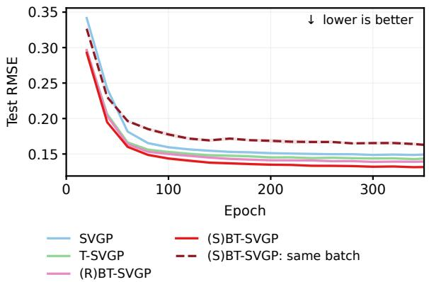

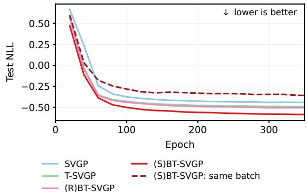  
Figure 6: Test RMSE (left) and NLL (right) of the split-batch diagnostic of Figure 5, with the block-diagonal predictor at the saved parameters; dashed: shared batch. Mean and one standard error over ten seeds.

## D EXPERIMENTAL PROTOCOL

This appendix describes the training runs (Appendix D.1), the evaluation (Appendix D.2), the partitions used for prediction (Appendix D.3) and the comparison with the dense predictor (Appendix D.4). The code and aggregate results are available at https://github.com/Jollikop/geometry-aware-block-selection; the datasets are cited in Section 5 and Appendix E.

## D.1 Training

Selector. The implementation starts the chain at the first inducing point, breaks nearest-anchor and chain ties by the smallest anchor index, and sorts points stably by chain position, boundary score and distance to their anchor. Empty cells keep their anchors in the chain, and a final short block is retained when b does not divide N.

Snelson. $N = 2 0 0 , M = 5$ , blocks of 20 points and at most 60 L-BFGS iterations; the (S)BT-SGPR partition is selected at initialization and reselected after iterations 2, 5, 10 and 30 (Figure 3). The Snelson setup follows the public example code of Bui et al. (2025) (https://github.com/thangbui/tighter\_sparse\_gp).

Collapsed SGPR. Kin40k with 5000 training and 2000 test points, ten seeds, $M \in \{ 1 2 8 , 2 5 6 , 5 1 2 \}$ and $b = 5 0 0$ . L-BFGS-B runs for at most 100000 iterations; a fit is accepted when the per-datum objective varies by less than $1 0 ^ { - 4 }$ over two consecutive 100-step windows and the largest absolute per-datum gradient is below $1 0 ^ { - 3 }$ , or when L-BFGS-B stops at a stationary point and the remaining trajectory and gradient meet the same tolerances. Z is initialized by greedy variance selection (Burt et al., 2020), followed by a short variational-EM warm-up. (S)BT-SGPR and (METIS)BT-SGPR reselect the partition after iterations 15, 30, 50 and 75 and keep it fixed thereafter; (R)BT-SGPR keeps its random partition. The refined sparse predictor fixes the kernel and noise parameters and optimizes $\mathbf { Z } ;$ four of 30 SGPR self-transplant controls, in which an SGPR donor is refined under its own objective and should not change, exceed the invariance thresholds $( 5 \times 1 0 ^ { - 4 }$ for the per-datum ELBO, $1 0 ^ { - 3 }$ for the sparse NLL) and are kept. Table 2 reports $M = 5 1 2$ . The search times in Table 1 are warm partition-build timings from the training runs, averaged over ten seeds.

Table 2: Sparse SGPR refinement of the same $M = 5 1 2$ donors. Kernel and noise parameters are fixed; inducing locations are optimized. Direct sparsification drops the covariance correction without refinement, leaving the predictive mean and RMSE unchanged. Mean (SE in the last decimal places), ten seeds; bold: lowest mean in each column.
<table><tr><td rowspan="2">Donor</td><td colspan="2">Direct sparse</td><td colspan="2">Refined sparse</td></tr><tr><td>RMSE</td><td>NLL</td><td>RMSE</td><td>NLL</td></tr><tr><td>SGPR</td><td>.229(2)</td><td>−.041(7)</td><td>.229(2)</td><td>−.041(7)</td></tr><tr><td>T-SGPR</td><td>.205(2)</td><td>-.122(7)</td><td>.207(2)</td><td>−.119(7)</td></tr><tr><td>(R)BT-SGPR</td><td>.197(2)</td><td>−.144(7)</td><td>.200(2)</td><td>−.142(7)</td></tr><tr><td>(S)BT-SGPR</td><td>.185(2)</td><td>−.158(7)</td><td>.190(2)</td><td>−.164(7)</td></tr></table>

Stochastic SVGP. Each seed has its own 90/10 split; inputs and targets are standardized with training statistics. Donors use Adam (Kingma and Ba, 2015) with learning rate $5 \times 1 0 ^ { - 3 }$ for θ and Z, natural gradients (Salimbeni et al., 2018) for $q ( \mathbf { u } )$ with step 0.05, 1000 likelihood points and two blocks of 500 points per step, for 350 epochs (RBF, Mat´ern-5/2), 500 epochs (Amplitude-RBF), or 300 epochs from the RBF checkpoint (Gibbs). Selected partitions are refreshed every 40 epochs (epochs 40–160 for RBF and Mat´ern-5/2, 40–480 for Amplitude-RBF, 40 and 80 for Gibbs), and training continues with the last refreshed partition; (R)BT-SVGP keeps its random partition. The transplant freezes θ, also freezes Z for the first 10 epochs, updates Z with Adam at learning rate $1 0 ^ { - 3 }$ and q(u) with natural gradients of step 0.05, and resets Adam at epoch 150 of 300. The training times in Section 5.3 come from these runs; for RBF, eight of the ten seeds ran on an NVIDIA A100-PCIE-40GB and two on an NVIDIA H100 80GB.

## D.2 Evaluation

Test metrics are computed after training from the saved parameters, without retraining, and each record is checked against its saved inputs and an evaluator hash before aggregation. On the standardized scale, the test NLL of a seed is

$$
\frac { 1 } { N _ { * } } \sum _ { * } \Bigl [ \frac { 1 } { 2 } \log \bigl ( 2 \pi ( v _ { * } + \sigma ^ { 2 } ) \bigr ) + \frac { ( y _ { * } - \mu _ { * } ) ^ { 2 } } { 2 ( v _ { * } + \sigma ^ { 2 } ) } \Bigr ] ,
$$

where $\mu _ { * }$ and $v _ { * } + \sigma ^ { 2 }$ are the predictive mean and observation variance; figures and tables report the mean and one standard error over seeds. The block-diagonal predictor of Appendix B is evaluated for the Snelson fits, for the RBF–Kin40k SGPR methods at $M = 5 1 2$ (40 records) and for T-SVGP, (R)BT-SVGP and (S)BT-SVGP over all kernels, datasets, inducing budgets and seeds (3840 records), on NVIDIA A100 PCIe GPUs (40GB, and 80GB for 60 records). None of the 3880 records was rejected or needed jitter. The smallest $d _ { * * } - c _ { * }$ was $1 . 1 \times 1 0 ^ { - 8 }$ for SVGP and $1 . 1 \times 1 0 ^ { - 3 }$ for SGPR, the smallest eigenvalue of a T block was $- 1 . 9 \times 1 0 ^ { - 1 2 }$ , and the largest truncated fraction was $2 . 5 \times 1 0 ^ { - 7 }$

## D.3 Prediction Partitions

We write $\mathcal { P } _ { \mathrm { t r a i n } }$ for the partition that defines the training objective at the last optimization step and $\mathcal { P } _ { \mathrm { p r e d } }$ for the partition given to the predictor of Appendix B. The SGPR partitions are fixed after the last reselection, and (R)BT-SVGP keeps its random partition throughout, so for these methods $\mathcal { P } _ { \mathrm { p r e d } } = \mathcal { P } _ { \mathrm { t r a i n } }$ . T-SGPR and

T-SVGP have no training partition; their $\mathcal { P } _ { \mathrm { p r e d } }$ is built by Algorithm 1 at the saved parameters, with the block size of the BT methods. For (S)BT-SVGP, θ, Z and $q ( \mathbf { u } )$ keep changing after the last refresh, so $\mathcal { P } _ { \mathrm { p r e d } }$ is rebuilt by Algorithm 1 at the saved parameters and need not equal $\mathcal { P } _ { \mathrm { t r a i n } }$ . The rebuild changes neither the parameters nor the reported final objective, which uses $\mathcal { P } _ { \mathrm { t r a i n } } ;$ ; the predictor uses the optimal BT scaling $\mathbf { M } _ { r } ^ { \star } = ( \mathbf { I } + \sigma ^ { - 2 } \mathbf { D } _ { r } ) ^ { - 1 }$ of each block of $\mathcal { P } _ { \mathrm { p r e d } }$ , which gives ${ \mathbf V } _ { r }$ in Eq. (14).

Training versus prediction partition. Since $c _ { * }$ depends on $\mathcal { P } _ { \mathrm { p r e d } }$ , a block-diagonal NLL reflects both the fitted state $( \theta , \mathbf { Z } , q ( \mathbf { u } ) )$ and the prediction partition: T-SVGP and (S)BT-SVGP predict with blocks from Algorithm 1, (R)BT-SVGP with random blocks of the same size. The NLL comparisons in Figure 4 and Appendix E therefore compare complete pipelines. To separate the two efects on the configurations of Figure 4, we kept the fitted (R)BT-SVGP and (S)BT-SVGP models fixed and predicted with the same kind of partition for both: blocks from Algorithm 1 at the saved parameters, or uniformly random blocks of the same size (Table 3; 640 records, none rejected). Under both common prediction-partition rules, (S)BT-SVGP has lower mean NLL than (R)BT-SVGP in all 32 configurations (by 0.012 to 0.083, each by more than two standard errors, under the common selected rule; by 0.005 to 0.042 under the common random rule). Under the common selected rule, 60–97% (mean 77%) of the original NLL gap of Figure 4 remains. Thus the improvement is not explained solely by assigning selected prediction blocks to one donor and random blocks to the other. Its magnitude depends on the prediction rule: selected prediction blocks lower the NLL of both models, more for (S)BT-SVGP (by 0.006 to 0.079) than for (R)BT-SVGP (by 0.001 to 0.034). These controls do not uniquely apportion the gain between the fitted state and the prediction partition.

## D.4 Block-Diagonal versus Dense Prediction

We compare the block-diagonal predictor with the dense variational predictor of Eq. (7), which uses the full $\mathbf { D _ { f f } } ,$ at the same saved parameters: RBF–Kin40k SGPR at M = 512 (Table 4) and RBF and Amplitude RBF SVGP on Pol (Figure 7), with 280 pairs of matching checkpoints and ten paired seeds per configuration. For the BT methods, the dense scaling is built from the same $\mathcal { P } _ { \mathrm { p r e d } }$ . The dense predictor needs $\mathbf { D _ { f f } ^ { - 1 / 2 } }$ : with $\mathbf { D } _ { \mathbf { f f } } = \mathbf { W } \mathrm { d i a g } ( \lambda _ { i } ) \mathbf { W } ^ { \top }$ , eigenvalues $\lambda _ { i } \le \tau = 1 0 \epsilon N \lambda _ { \operatorname* { m a x } } ( \mathbf { D _ { f f } } )$ receive weight zero. None falls below τ on Kin40k, whereas up to 2791 of the 13500 eigenvalues do on Pol. The fraction of $\mathbf { d } _ { \mathbf { f } * }$ on these eigenvectors is below $6 \times 1 0 ^ { - 1 1 }$ , and the smallest dense latent variance is $7 \times 1 0 ^ { - 5 }$ . Since $\mathbf { D _ { f f } ^ { - 1 / 2 } }$ weights each coordinate by $\alpha _ { i } / \sqrt { \lambda _ { i } }$ with $\alpha _ { i } = \mathbf { w } _ { i } ^ { \top } \mathbf { d } _ { \mathbf { f } * }$ , a small fraction does not by itself bound the error, so we repeated the 280 dense evaluations with the factor 10 in τ replaced by $1 , 1 0 ^ { 2 } , 1 0 ^ { 4 }$ and $1 0 ^ { 6 }$ (1400 evaluations, none rejected; factor 10 reproduces the stored NLL to $4 \times 1 0 ^ { - 1 6 } )$ . On Pol, where up to 2023 eigenvalues are discarded at factor 1 and up to 10885 at $1 0 ^ { 6 }$ , the test observation variances change by at most $7 \times 1 0 ^ { - 4 }$ in relative terms for factors 1 and $1 0 ^ { 2 }$ and by at most 3.3% at $1 0 ^ { 6 }$ , and the mean test NLL by at most $7 . 3 \times 1 0 ^ { - 5 } ;$ on Kin40k nothing changes. The dense NLL is lower than the block-diagonal NLL in every displayed configuration, by at most 0.054 for SGPR and 0.071 for SVGP, but the SGPR ordering and the leading SVGP method on Pol are unchanged; means and RMSE are identical. These are empirical checks on the displayed data, not a bound on the block-diagonal approximation.

Table 3: Prediction-partition control on the configurations of Figure 4: test NLL of (S)BT-SVGP minus that of (R)BT-SVGP (negative favours (S)BT-SVGP), mean (SE) over ten paired seeds. Current: each donor with its own $\mathcal { P } _ { \mathrm { p r e d } } .$ , as in Figure 4. Common selected rule: both donors with $\mathcal { P } _ { \mathrm { p r e d } }$ from Algorithm 1 at their saved parameters. Common random rule: both donors with a uniformly random partition into blocks of 500. The common selected rule applies Algorithm 1 separately at each donor’s saved parameters; block memberships need not coincide. Under the common random rule the donors do not share an index permutation: (R)BT-SVGP keeps the random partition it was trained with, and (S)BT-SVGP receives an independent uniformly random permutation in each paired seed. Donor parameters are frozen; RMSE is unchanged.
<table><tr><td colspan="4"></td><td rowspan="2">Common selected rule</td><td rowspan="2">Common random rule</td></tr><tr><td>Kernel</td><td>Dataset</td><td>M</td><td>Current</td></tr><tr><td>RBF</td><td>Pol</td><td>64</td><td>-.059(5)</td><td>-.036(5)</td><td>-.017(4)</td></tr><tr><td>RBF</td><td>Pol</td><td>128</td><td>-.073(6)</td><td>-.045(6)</td><td>-.014(3)</td></tr><tr><td>RBF</td><td>Pol</td><td>256</td><td>-.078(4)</td><td>-.047(4)</td><td>-.011(4)</td></tr><tr><td>RBF</td><td>Pol</td><td>512</td><td>-.084(3)</td><td>-.051(4)</td><td>-.013(2)</td></tr><tr><td>RBF</td><td>Supercond.</td><td>64</td><td>-.033(2)</td><td>-.023(2)</td><td>-.008(3)</td></tr><tr><td>RBF</td><td>Supercond.</td><td>128</td><td>-.035(2)</td><td>-.026(2)</td><td>-.005(3)</td></tr><tr><td>RBF</td><td>Supercond.</td><td>256</td><td>-.033(2)</td><td>-.025(2)</td><td>-.006(3)</td></tr><tr><td>RBF</td><td>Supercond.</td><td>512</td><td>-.029(1)</td><td>-.023(1)</td><td>-.008(2)</td></tr><tr><td>RBF</td><td>Kin40k</td><td>64</td><td>-.047(3)</td><td>-.037(3)</td><td>-.028(3)</td></tr><tr><td>RBF</td><td>Kin40k</td><td>128</td><td>-.075(4)</td><td>-.053(4)</td><td>-.031(3)</td></tr><tr><td>RBF</td><td>Kin40k</td><td>256</td><td>-.103(4)</td><td>-.072(4)</td><td>-.035(3)</td></tr><tr><td>RBF</td><td>Kin40k</td><td>512</td><td>-.117(3)</td><td>-.083(3)</td><td>-.038(2)</td></tr><tr><td>RBF</td><td>Protein</td><td>64</td><td>-.015(2)</td><td>-.012(2)</td><td>-.006(2)</td></tr><tr><td>RBF</td><td>Protein</td><td>128</td><td>-.028(2)</td><td>-.023(2)</td><td>-.013(1)</td></tr><tr><td>RBF</td><td>Protein</td><td>256</td><td>-.026(1)</td><td>-.021(1)</td><td>-.011(1)</td></tr><tr><td>RBF</td><td>Protein</td><td>512</td><td>-.022(1)</td><td>-.017(1)</td><td>-.009(1)</td></tr><tr><td>Amplitude-RBF</td><td>Pol</td><td>64</td><td>-.066(11)</td><td>-.053(10)</td><td>-.036(9)</td></tr><tr><td>Amplitude-RBF</td><td>Pol</td><td>128</td><td>-.058(4)</td><td>-.041(4)</td><td>-.025(2)</td></tr><tr><td>Amplitude-RBF</td><td>Pol</td><td>256</td><td>-.060(4)</td><td>-.045(4)</td><td>-.025(4)</td></tr><tr><td>Amplitude-RBF</td><td>Pol</td><td>512</td><td>-.047(4)</td><td>-.034(3)</td><td>-.021(3)</td></tr><tr><td>Amplitude-RBF</td><td>Supercond.</td><td>64</td><td>-.033(2)</td><td>-.031(2)</td><td>-.024(2)</td></tr><tr><td>Amplitude-RBF</td><td>Supercond.</td><td>128</td><td>-.041(1)</td><td>-.038(2)</td><td>-.032(3)</td></tr><tr><td>Amplitude-RBF</td><td>Supercond.</td><td>256</td><td>-.043(2)</td><td>-.041(2)</td><td>-.032(2)</td></tr><tr><td>Amplitude-RBF</td><td>Supercond.</td><td>512</td><td>-.028(1)</td><td>-.027(2)</td><td>-.022(2)</td></tr><tr><td>Amplitude-RBF</td><td>Kin40k</td><td>64</td><td>-.056(4)</td><td>-.047(4)</td><td>-.034(4)</td></tr><tr><td>Amplitude-RBF</td><td>Kin40k</td><td>128</td><td>-.081(4)</td><td>-.058(4)</td><td>-.031(3)</td></tr><tr><td>Amplitude-RBF</td><td>Kin40k</td><td>256</td><td>-.102(2)</td><td>-.072(2)</td><td>-.036(2)</td></tr><tr><td>Amplitude-RBF</td><td>Kin40k</td><td>512</td><td>-.112(2)</td><td>-.082(2)</td><td>-.042(2)</td></tr><tr><td>Amplitude-RBF</td><td>Protein</td><td>64</td><td>-.017(1)</td><td>-.015(1)</td><td>-.010(2)</td></tr><tr><td>Amplitude-RBF</td><td>Protein</td><td>128</td><td>-.032(1)</td><td>-.029(1)</td><td>-.021(1)</td></tr><tr><td>Amplitude-RBF</td><td>Protein</td><td>256</td><td>-.022(1)</td><td>-.019(1)</td><td>-.013(1)</td></tr><tr><td>Amplitude-RBF</td><td>Protein</td><td>512</td><td>-.017(1)</td><td>-.015(1)</td><td>-.011(1)</td></tr></table>

Table 4: RBF–Kin40k, M = 512: test NLL (mean (SE) over ten paired seeds; lower is better). Block diag. is the predictor in the main results; dense uses the full $\mathbf { D _ { f f } }$ in Eq. (7). Bold marks the best of the four principal methods; † denotes comparators.
<table><tr><td>Method</td><td>Block diag. NLL Dense NLL</td></tr><tr><td>SGPR</td><td>-.041(7) -.041(7)</td></tr><tr><td>T-SGPR</td><td>-.146(7) -.160(8)</td></tr><tr><td>(R)BT-SGPR</td><td>-.179(7) -.213(8)</td></tr><tr><td>(S)BT-SGPR</td><td>-.240(7) -.294(7)</td></tr><tr><td>(METIS)BT-SGPR†</td><td>-.296(6) -.336(7)</td></tr><tr><td>Exact GP†</td><td>-.618(14)</td></tr></table>

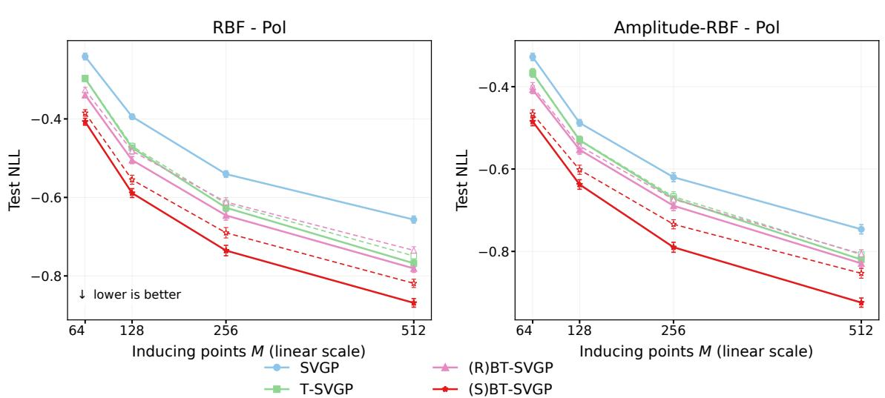  
Figure 7: Pol test NLL for the block-diagonal predictor used in the main results (dashed) and the dense variationa predictor (solid), paired at the same saved parameters. Mean and one standard error over ten paired seeds.  
Mean +/- SEM over ten paired seeds; predictive means and RMSE are unchanged.

## E FULL SVGP CAMPAIGN

Figure 4 and Figures 8–13 report all 5120 donor runs and their 5120 sparse transplants: four kernels, eight datasets (Pol, Superconductivity, Kin40k, Protein, Elevators (Torgo, n.d.), Trafic (Hogue, 2019), Electricity (Trindade, 2015), 3Droad (Kaul, 2013)), M ∈ {64, 128, 256, 512}, four methods and ten seeds. Elevators, Kin40k, Protein and 3Droad come from the uci datasets package (Evans, n.d.). In each figure the left three columns show the block-diagonal predictor and the negative last-epoch stochastic objective per datum (solid), and the right two columns the sparse SVGP predictor after the 300-epoch transplant (dashed); matched panels share vertical axes. Means and one standard error over ten seeds. The objectives are method-specific stochastic estimates, not a common marginal likelihood. The solid T-SVGP, (R)BT-SVGP and (S)BT-SVGP curves use the predictor of Appendix B, each with the prediction partition of Appendix D.3.

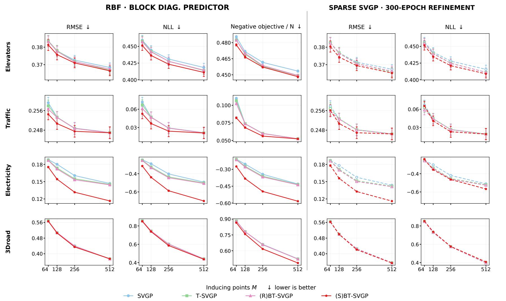  
Figure 8 : RBF SVGP campaign : Elevators Trafic Electricity 3Droad . Left : block-diagonal predictor and negative final obj ective (solid) ; right : sparse predictor after the transplant (dashed) . Mean and one st andard error over ten seeds .

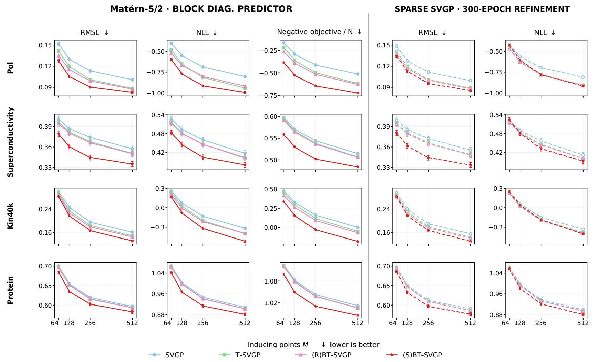  
Figure 9 : Mat ´ern- 5 / 2 SVGP campaign : Pol Superconductivity Kin40k Protein Left : block-diagonal predictor and negative final obj ective (solid) ; right : sparse predictor after the transplant (dashed) . Mean and one st andard error over ten seeds .

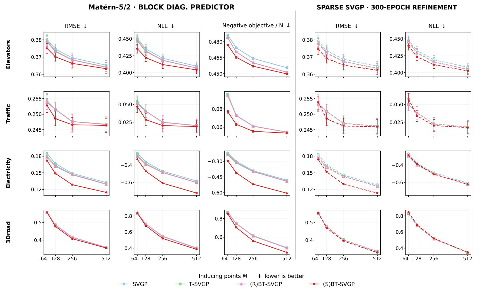  
Figure 1 0 : Mat ´ern- 5 / 2 SVGP campaign : Elevators Trafic Electricity 3Droad Left : block-diagonal predictor and negative final obj ective (solid) ; right : sparse predictor after the transplant (dashed) . Mean and one st andard error over ten seeds .

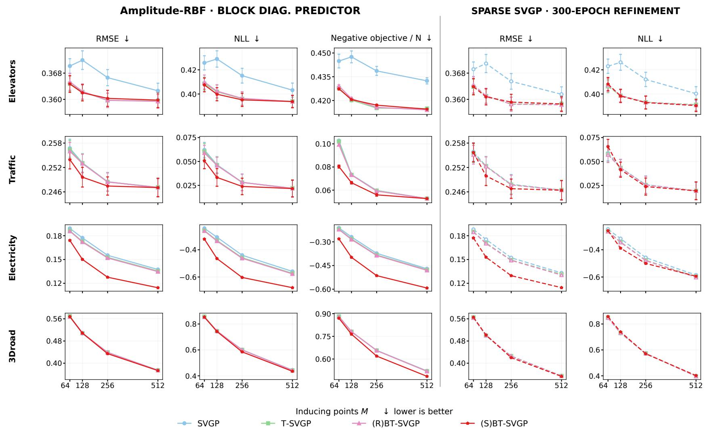  
Figure 1 1 : Amplitude-RBF SVGP campaign: Elevators Trafic Electricity 3Droad Left : block-diagonal predictor and negative final obj ective (solid) ; right : sparse predictor after the transplant (dashed) Mean and one st andard error over ten seeds

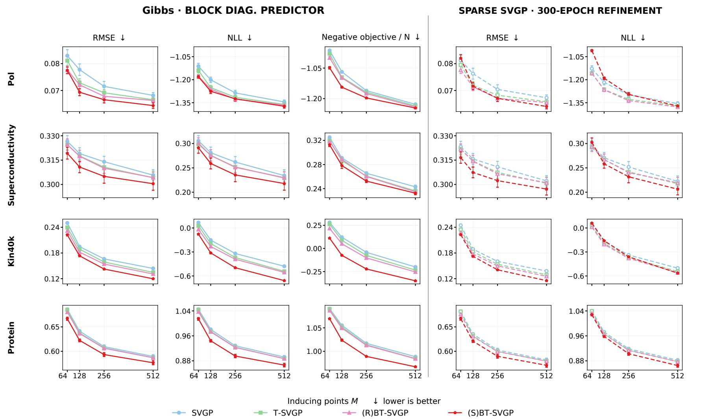  
Figure 1 2 : Gibbs SVGP campaign: Pol Superconductivity Kin40k Protein Left : block-diagonal predictor and negative final obj ective (solid) ; right : sparse predictor after the transplant (dashed) . Mean and one st andard error over ten seeds .

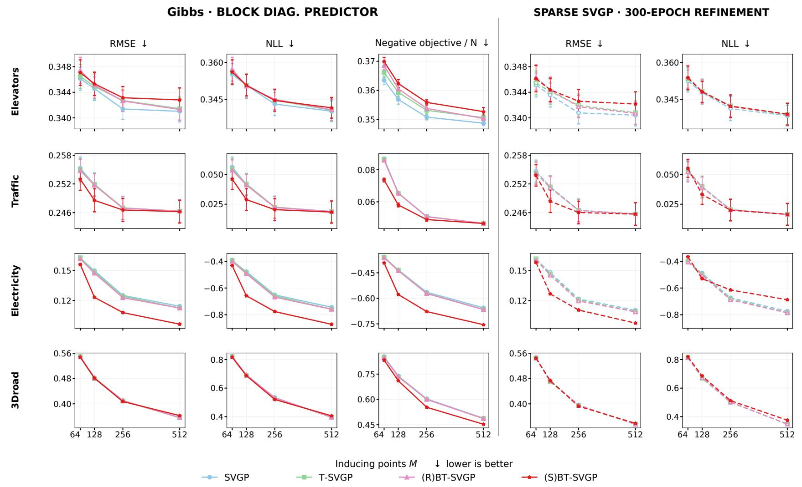  
Figure 1 3 : Gibbs SVGP campaign : Elevators Trafic Electricity 3Droad . Left : block-diagonal predictor and negative final obj ective (solid) ; right : sparse predictor after the transplant (dashed) . Mean and one st andard error over ten seeds .