# Hybrid Momentum Methods for Optimizing Deep Learning Models

Haifeng Xu Yijin Ren<sup>1</sup> Qi Deng<sup>2</sup> Chenyu Zhou<sup>2</sup> Dongdong Ge<sup>2</sup> Yinyu Ye<sup>3</sup>

<sup>1</sup>Department of Industrial Engineering and Operations Research, Columbia University <sup>2</sup>Antai College of Economics and Management, Shanghai Jiao Tong University <sup>3</sup>Department of Management Science and Engineering, Stanford University

fengs10@outlook.com yr2549@columbia.edu qdeng24@sjtu.edu.cn chenyuzhou@sjtu.edu.cn ddge@sjtu.edu.cn yinyu-ye@stanford.edu

## Abstract

Momentum is central to stochastic optimization in deep learning, including the training of large language models. Classical momentum methods typically rely on a fast exponential moving average (EMA) scheme, which discounts past gradients on a fixed timescale and may underweight older gradients that remain informative. This creates a trade-off between retaining long-term history and adapting to recent changes. We introduce Hybrid Momentum (HyM), which combines a linearly weighted average of past gradients with a geometrically discounted fast momentum. The former assigns weights proportional to the gradients’ iteration indices and retains a growing span of history, while the latter emphasizes recent gradients. This hybrid construction is modular and can be combined with adaptive preconditioning and other update transformations. In particular, we propose HyMUON, which applies Newton–Schulz orthogonalization to the hybrid direction. Illustrative examples and controlled experiments demonstrate the benefits of combining gradient information across these two timescales. Across image classification, machine translation, and language modeling, HyM and HyMUON match or improve upon strong baselines. HyMUON improves over Muon on IWSLT14, and in both the 100k- and 600k-step GPT-2 124M OpenWebText regimes. For LLaMA-1.3B pretraining on C4, HyMUON achieves a final validation loss of 2.777, compared with 2.903 for Muon.

## 1 Introduction

Momentum methods improve stochastic optimization by combining the current gradient with information from earlier updates. In deep learning, this history is usually maintained through exponential moving averaging (EMA), which assigns geometrically decaying weights to past gradients, as in Heavy-Ball momentum and commonly used Nesterov updates [Polyak, 1964, Sutskever et al., 2013]. EMA emphasizes recent gradients while strongly reducing the influence of older gradients on subsequent updates. When gradient contributions that reduce a particular target loss occur intermittently across mini-batches, retaining a longer history may help accumulate these contributions.

By combining momentum with iterate averaging, Defazio et al. [2024] proposed the Schedule-Free method, which achieves strong empirical performance without a prescribed schedule for learning rate decay. The empirical success of Schedule-Free optimization motivates revisiting how this history is accumulated. To see how its averaging mechanism retains past gradients, consider the Schedule-Free SGD recurrence with a constant step size

$$
\begin{array} { r } { \mathbf { y } _ { t } = ( 1 - \beta ) \mathbf { z } _ { t } + \beta \mathbf { x } _ { t } , \quad \quad } \\ { \mathbf { z } _ { t + 1 } = \mathbf { z } _ { t } - \eta \mathbf { g } _ { t } , \quad \quad \quad } \\ { \mathbf { x } _ { t + 1 } = ( 1 - c _ { t + 1 } ) \mathbf { x } _ { t } + c _ { t + 1 } \mathbf { z } _ { t + 1 } , } \end{array}\tag{1}
$$

where $\mathbf { z } _ { t }$ is the base iterate, $\mathbf { x } _ { t }$ is the averaged iterate, and $\mathbf { y } _ { t }$ is the training iterate. Here $c _ { t + 1 } = 1 / ( t + 1 ) , \mathbf { z } _ { 1 } = \mathbf { x } _ { 1 }$ ， and $\mathbf { g } _ { t }$ is a stochastic gradient evaluated at $\mathbf { y } _ { t } .$ Eliminating $\mathbf { x } _ { t }$ and $\mathbf { z } _ { t }$ gives a representation using one sequence that exposes its gradient memory [Morwani et al., 2025]:

$$
\begin{array} { c } { \mathbf { n } _ { t } = ( 1 - c _ { t } ) \mathbf { n } _ { t - 1 } + \mathbf { g } _ { t } , } \\ { \mathbf { y } _ { t + 1 } = \mathbf { y } _ { t } - \eta [ \beta c _ { t + 1 } \mathbf { n } _ { t } + ( 1 - \beta ) \mathbf { g } _ { t } ] , } \end{array}\tag{2}
$$

with $c _ { t } = 1 / t$ and $\mathbf { n } _ { 0 } = \mathbf { 0 } ;$ ; Appendix A gives the derivation for completeness. In this form, the update combines a running weighted sum of past gradients with the current gradient. As training proceeds, this weighted sum spans a longer history, but each new gradient contributes a smaller fraction of its total weight. The historical component therefore responds more slowly to new gradients later in training, suggesting that a separate momentum state emphasizing recent gradients can complement this long-term accumulation.

Building on this perspective, we propose Hybrid Momentum $\left( \mathrm { H y M } \right)$ , which combines a linearly weighted gradient average with a geometrically discounted fast momentum. The average assigns weights proportional to the gradients iteration indices and retains a growing span of history, while the fast momentum emphasizes recent gradients. HyM also maintains an averaged iterate formed from its training iterates for evaluation and checkpointing. Our convergence analysis via cumulative gradient weights accommodates this growing gradient memory and establishes an $\mathcal { O } ( T ^ { - 1 / 2 } )$ bound on the expected suboptimality of the averaged iterate for smooth convex objectives. Moreover, this hybrid momentum scheme is modular and can be combined with adaptive preconditioning and other update transformations. In particular, applying Muon’s Newton–Schulz (NS) orthogonalization to the combined momentum [Jordan et al., 2024], we develop Hybrid Momentum Orthogonalized by NS (HyMUON), which applies to matrix-valued parameters.

We characterize the weights assigned to past gradients and use controlled experiments to examine why this history can remain useful. These experiments show that a gradient contribution retained in the optimizer state can still lower a target loss thousands of steps later, and that replacing this contribution with a gradient recomputed on the same batch at the current parameters can lower the loss further. We also examine how gradients from different training examples vary in their usefulness for a given target and how HyM’s relative performance changes with batch size. Across the evaluated benchmarks, HyM matches or improves upon Schedule-Free on image classification, while HyMUON improves upon Muon on IWSLT14 and across the evaluated language modeling settings.

Notation. The training and averaged iterates are $\mathbf { y } _ { t }$ and ${ \bf x } _ { t } ;$ ; uppercase letters such as $\mathbf { Y } _ { t }$ and $\mathbf { X } _ { t }$ denote the matrix variables. Vector norms are Euclidean, while $\| \cdot \| _ { \mathrm { o p } }$ and $\Vert \cdot \Vert$ denote the matrix operator and nuclear norms. Probabilistic notation is introduced where it is used.

## 2 Related work

Momentum methods use past information in two standard ways: by accumulating gradients or by introducing inertial terms based on differences between successive iterates [Polyak, 1964, Nesterov, 1983]. For smooth convex stochastic optimization, Lan [2012] established an optimal convergence rate for accelerated stochastic approximation; Yang et al. [2016] and Ghadimi and Lan [2016] analyzed stochastic momentum and accelerated gradient methods for smooth nonconvex objectives. More recently, Wang and Yurtsever [2026] unified Polyak and Nesterov variants within a generalized SGDM framework and analyzed both convex and nonconvex smooth objectives. In deep learning, EMA-Nesterov replaces the standard lookahead direction with an exponential moving average of parameter updates, which stabilizes the extrapolation performed by a base optimizer [Yau et al., 2026].

Several methods combine momentum components to capture different timescales. Aggregated Heavy-Ball studies the convergence of schemes with multiple components [Danilova, 2022]. AdEMAMix pairs two EMAs whose decay coefficients differ by orders of magnitude, so that one retains gradients over short histories and the other over long ones [Pagliardini et al., 2025]. HyM also uses a fast state and a slow state, but replaces the slow EMA with a linearly weighted gradient average. This replacement changes not only the length of the retained history but also the distribution of weight over that history. AdEMAMix raises its slow decay coefficient during warmup and then holds it at a prescribed value; consequently, the fraction of its total gradient weight assigned to the first ⌊at⌋ gradients converges to zero for any fixed $a \in ( 0 , 1 )$ . For HyM, the corresponding fraction converges to the positive constant $\textstyle { \frac { \beta } { 2 - \beta } } a ^ { 2 }$

Morwani et al. [2025] show that Schedule-Free optimization [Defazio et al., 2024] can be expressed as accelerated SGD followed by weight averaging, which separates the roles of gradient memory and the averaged iterate. ScheduleFree+ restores Adam’s inner state for the first moment and extends this construction with Polyak adaptation of the learning rate, delayed averaging, and an annealed interpolation between its raw and averaged iterates [Defazio, 2026]. In ScheduleFree+, the averaged iterate is still fed into the next gradient query; hence, the sequence that will be returned also steers training. HyM separates the two. Its averaged iterate never enters the gradient or the momentum recursion, and the update direction combines the two momentum states alone. The convergence analyses also differ in kind. The Schedule-Free analysis uses an online-to-batch conversion for convex optimization [Defazio et al., 2024]. Ours tracks how a gradient memory that grows with training interacts with iterate averaging, and bounds the averaged iterate directly.

Preconditioning is also important for training large language models. Two common approaches are diagonal preconditioning, which scales each coordinate by its own factor as in Adam and AdamW [Kingma and Ba, 2015, Loshchilov and Hutter, 2019], and structured matrix preconditioning, as in Shampoo, K-FAC, and SOAP [Gupta et al., 2018, Martens and Grosse, 2015, Vyas et al., 2025]. More recently, Muon has been used to train large models by applying NS orthogonalization to matrix momentum [Jordan et al., 2024], which motivated subsequent work on efficiency, stability, and distributed training [Li et al., 2025, Kimi Team, 2025, Ahn et al., 2025].

## 3 The Hybrid Momentum Methods

## 3.1 Hybrid Momentum (HyM)

We consider stochastic optimization problems of the form

$$
\operatorname* { m i n } _ { \mathbf { x } \in \mathbb { R } ^ { d } } f ( \mathbf { x } ) : = \mathbb { E } _ { \xi } [ f ( \mathbf { x } ; \xi ) ] ,\tag{3}
$$

where $\xi$ is a random variable. For this problem, we develop HyM (Algorithm 1) to retain long-term gradient information while remaining responsive to recent gradients. The method maintains two momentum states. The slow state $\mathbf { m } _ { t }$ is a linearly weighted average of the gradients and draws on an increasingly long gradient history as training proceeds, while the fast state $\mathbf { b } _ { t }$ combines the gradients using weights similar to those of an EMA and therefore assigns little weight to older gradients. HyM then combines the two states to form the update direction. As in many classical optimization algorithms, HyM maintains a training iterate and an averaged iterate. HyM evaluates the gradient at the training iterate $\mathbf { y } _ { t }$ and uses the combined update direction to obtain $\mathbf { y } _ { t + 1 }$ . The averaged iterate $\mathbf { x } _ { t }$ is an average of the training iterates, and we evaluate the model performance at $\mathbf { x } _ { t }$ . The decay factor $\mu$ determines the geometric decay of the fast state, and the mixing weight $\beta$ determines both the relative contributions of the two states and the weight assigned to the current training iterate in the averaged iterate.

Algorithm 1 Hybrid Momentum $\left( \mathrm { H y M } \right)$   
Input: $\mathbf { y } _ { 1 } \in \mathbb { R } ^ { d }$ , step size $\eta > 0 .$ , coefficient $\mu \in ( 0 , 1 )$ for the fast momentum, mixing weight $\beta \in [ 0 , 1 )$ , batch size   
$B \in \mathbb { N } ,$ and iterations $T \in \mathbb { N } ;$ initialize $\mathbf { m } _ { 0 } = \mathbf { b } _ { 0 } = \mathbf { 0 } , \mathbf { x } _ { 0 } = \mathbf { y } _ { 1 }$   
1: for $t = 1 , \dots , T$ do   
2: Sample a mini-batch $\boldsymbol { B } _ { t } = ( \xi _ { t , j } ) _ { j = 1 } ^ { B }$   
3: $\begin{array} { r } { \mathbf { g } _ { t } = \frac { 1 } { B } \sum _ { j = 1 } ^ { B } \nabla f ( \mathbf { y } _ { t } ; \boldsymbol { \xi } _ { t , j } ) } \end{array}$   
4: $\begin{array} { r } { \mathbf m _ { t } = \frac { t - 1 } { t + 1 } \mathbf { \bar { m } } _ { t - 1 } + \frac { 2 } { t + 1 } \mathbf g _ { t } } \end{array}$ ▷ Slow state   
5: $\begin{array} { r } { \mathbf b _ { t } = \mu \left( 1 - \frac { 1 } { t } \right) \mathbf b _ { t - 1 } + \mathbf g _ { t } } \end{array}$ ▷ Fast state   
6: $\begin{array} { r } { \mathbf { \Delta } \Delta _ { t } = \beta r _ { t } \mathbf { m } _ { t } + ( 1 - \beta ) \mathbf { b } _ { t } , } \end{array}$ , where $\begin{array} { r } { r _ { t } = \frac { t + 1 } { 2 t } \frac { 1 - \mu ^ { t } } { 1 - \mu } } \end{array}$   
7: ${ \bf x } _ { t } = ( 1 - a _ { t } ) { \bf x } _ { t - 1 } + a _ { t } { \bf y } _ { t }$ , where $\begin{array} { r } { a _ { t } = \frac { 1 } { 1 + ( 1 - \beta ) ( t - 1 ) } } \end{array}$   
8: $\mathbf y _ { t + 1 } = \mathbf y _ { t } - \eta \pmb \Delta _ { t }$   
9: end for   
Output: $\mathbf { x } _ { T }$

Two momentum states. The two states can be written as the following weighted sums of past gradients:

$$
\mathbf { m } _ { t } = \frac { \sum _ { i = 1 } ^ { t } i \mathbf { \sigma } \mathbf { g } _ { i } } { \sum _ { i = 1 } ^ { t } i } = \sum _ { i = 1 } ^ { t } \frac { 2 i } { t ( t + 1 ) } \mathbf { g } _ { i } , \mathrm { a n d } \mathbf { b } _ { t }  &  = \sum _ { i = 1 } ^ { t } \frac { i } { t } \mu ^ { t - i } \mathbf { g } _ { i } .\tag{4}
$$

At iteration $t ,$ the slow state assigns $\mathbf { g } _ { i }$ the weight $2 i / [ t ( t + 1 ) ]$ , which increases linearly with i across the entire training history. The fast state also contains the factor $i ,$ together with the additional factor $\mu ^ { t - i }$ . This discount concentrates its weight on recent gradients. The decay coefficient $\mu ( 1 - 1 / t )$ converges to $\mu .$ . Hence, for large $t ,$ the fast state behaves like conventional EMA momentum and differs from an EMA with a fixed decay rate mainly early in training. Because both states are maintained recursively, neither requires storing past gradients individually.

HyM uses the mixing weight $\beta$ to form the update direction as a linear combination of the scaled slow state $r _ { t } \mathbf { m } _ { t }$ and the fast state $\mathbf { b } _ { t }$

Training and averaged iterates. Unrolling the averaging recursion gives $\begin{array} { r } { \mathbf { x } _ { t } = \sum _ { i = 1 } ^ { t } \pi _ { t , i } \mathbf { y } _ { i } } \end{array}$ , where $\begin{array} { r } { \pi _ { t , i } = a _ { i } \prod _ { j = i + 1 } ^ { t } ( 1 - } \end{array}$ $a _ { j } )$ and $\textstyle \sum _ { i = 1 } ^ { t } \pi _ { t , i } = 1$ . The averaging coefficient $a _ { t }$ is determined by $\beta ,$ , which also controls the relative contributions of the two momentum states. For fixed $t ,$ a larger $\beta$ places more weight on the current training iterate $\mathbf { y } _ { t } .$ The averaged iterate is a running average of the training iterates rather than an independent sequence, and it never enters the gradient or the momentum recursion. The training trajectory is therefore $\left\{ \mathbf { y } _ { t } \right\}$ alone, and the sequence $\left\{ { \bf x } _ { t } \right\}$ is used for evaluation, with the algorithm returning $\mathbf { x } _ { T }$

## 3.2 Extension to Matrix-Valued Parameters: HyMUON

In practical machine learning, many model parameters are represented as matrices, and Muon exploits this structure effectively. Motivated by this observation, we consider the following matrix-valued stochastic optimization problem:

$$
\operatorname* { m i n } _ { \mathbf { X } \in \mathbb { R } ^ { m \times n } } f ( \mathbf { X } ) : = \mathbb { E } _ { \boldsymbol { \xi } } [ f ( \mathbf { X } ; \boldsymbol { \xi } ) ] .\tag{5}
$$

For hidden weight matrices, HyMUON applies the two momentum recurrences of HyM in Algorithm 1 to matrix gradients. It then applies Muon’s NS orthogonalization to the combined momentum $\mathbf { D } _ { t }$ [Jordan et al., 2024]:

$$
\mathbf { Y } _ { t + 1 } = \mathbf { Y } _ { t } - \eta \mathrm { N S } ( \mathbf { D } _ { t } ) ,\tag{6}
$$

where NS(·) denotes the output of finitely many NS iterations approximating the polar factor. The averaged matrix iterate $\mathbf { X } _ { t }$ follows the same averaging rule as in HyM. When the optimizer is applied to the entire model, hidden weight matrices form the matrix group above; all remaining parameters form an auxiliary group that applies the same construction with slow and fast states separately to estimates of the first and second moments, followed by coordinatewise scaling as in Adam. Appendix D gives both update recurrences and the implementation for the entire model.

## 4 Why Past Gradients Can Remain Useful

From Algorithm 1, we can derive that, for any proportion $a \in ( 0 , 1 )$ , the first ⌊at⌋ gradients account for a fraction of HyM’s total gradient weight that converges to $\textstyle { \frac { \beta } { 2 - \beta } } a ^ { 2 }$ , which is positive, as $t  \infty ,$ , whereas the corresponding fraction under EMA momentum converges to zero. Thus, compared with EMA momentum, HyM asymptotically retains more weight on older gradients. In this section, we examine why retaining such a long history can be useful. We first characterize how the two states distribute weight over the gradient history. We then test whether a retained gradient can still affect training thousands of steps later. Finally, we examine whether gradients computed from examples in the actual training data differ substantially in their usefulness for a given target.

## 4.1 Retaining history while responding to change

HyM combines two momentum states that cover different ranges of the gradient history. The slow state draws on an increasingly long history, whereas the fast state remains concentrated on recent gradients. We quantify this difference using the average lag and then examine the resulting weights in the update direction.

At iteration t, a gradient $\mathbf { g } _ { i }$ computed at iteration i is $t - i$ iterations old. To summarize the age of the gradients used by a momentum state, we normalize its weights to sum to one and define the average lag as the weighted average of $t - i$ over $i = 1 , \ldots , t .$ . It is $( t - 1 ) / 3$ for the slow state and converges to $\mu / ( 1 - \mu )$ for the fast state as t grows. Hence, the average lag of the slow state increases with t, whereas that of the fast state remains bounded.

Unrolling the two momentum states gives the weight $w _ { t , i }$ assigned to g<sub>i</sub> in the update direction:

$$
\Delta _ { t } = \sum _ { i = 1 } ^ { t } w _ { t , i } \mathbf { g } _ { i } , \qquad w _ { t , i } = \frac { i } { t } \left( \frac { \beta ( 1 - \mu ^ { t } ) } { t ( 1 - \mu ) } + ( 1 - \beta ) \mu ^ { t - i } \right) .\tag{7}
$$

Figure 1 compares these weights with those of classical EMA momentum and AdEMAMix at $t = 1 , 0 0 0 , 1 0 , 0 0 0 .$ and 50,000. For each method, it plots the weight on $\mathbf { g } _ { i }$ against i, normalized by the weight on the most recent gradient $\mathbf { g } _ { t }$ The figure therefore shows how the relative weight on older gradients changes as training proceeds.

In the left panel of Figure 1, HyM’s weights rise approximately linearly with i. In the middle and right panels, the geometric term is increasingly concentrated near $i = t ,$ producing a peak over the most recent gradients. For fixed $\mu , \beta \in ( 0 , 1 )$ and any $a \in ( 0 , 1 )$ , the gradients with $i \leq$ at retain a positive fraction of the total weight in the HyM update direction as $t \to \infty ( \mathsf { A }$ ppendix B.1). In contrast, for an EMA with any fixed decay rate below one, the corresponding fraction converges to zero. Together, the two states allow the update direction to retain weight over an expanding history while remaining responsive to recent gradients. Whether a gradient retained in this history can still affect training after many subsequent updates is an empirical question, which we examine next.

## 4.2 Old gradients can still affect later steps

To test whether the effect of a single batch persists during subsequent training, we adapt an experiment from AdEMAMix [Pagliardini et al., 2025] to GPT-2 124M trained on OpenWebText. We exclude a fixed batch B from the regular training sequence and use its loss to track the lasting effect of a single update. Starting from a common checkpoint immediately before step 5,000, we continue training along two branches. At step 5,000, the control branch uses the batch specified by the original training sequence, whereas the inject branch replaces that batch with B. Both branches subsequently use the same sequence of training batches. At step 10,000, the loss on B in the control branch exceeds that in the inject branch by approximately 0.030 for Muon and 0.016 for HyMUON (Figure 2, left). Thus, the effect of a single update based on B remains measurable after 5,000 subsequent training steps.

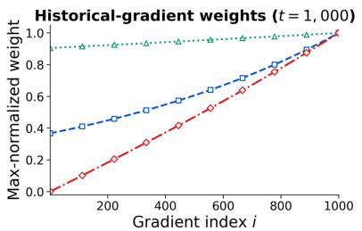

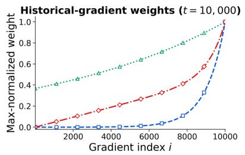

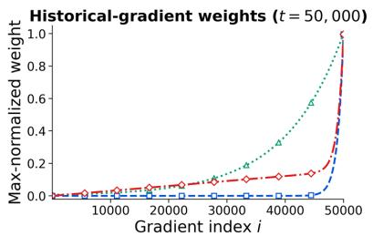  
…AdEMAMix------Classical EMA-HyM  
Figure 1: Gradient weight profiles for AdEMAMix $( \beta _ { 3 } = 0 . 9 9 9 9 )$ , classical EMA $( \mu = 0 . 9 9 9 )$ , and HyM $( \mu = 0 . 9 9 9$ $\beta = 0 . 9 )$ at t ∈ {1000, 10000, 50000} (left to right). Each curve is normalized by the weight on the most recent gradient.

We next conduct a further experiment by modifying the contribution of B retained in the slow state. At step 7,500, we split the inject branch from the preceding experiment into three branches: Keep, Delete, and Refresh. At this point, the contribution introduced at step 5,000 still has weight $5 , 0 0 0 / 7 , 5 0 0 = 2 / 3$ in the slow state. Keep leaves this contribution unchanged, Delete removes it, and Refresh replaces it with a gradient computed on B at the current model parameters and rescaled to have the same norm. At step 7,500, the three branches differ only in this contribution to the slow state; their model parameters, averaged iterate x , and all other optimizer states are otherwise identical. Appendix E.3.1 gives the precise construction.

At step 10k, HyMUON Delete, Keep, and Refresh give target losses of 3.048, 3.038, and 3.025, respectively. Its stored contribution therefore still lowers the target loss, and refreshing it lowers the loss further. Muon’s Keep, Delete, and Refresh values differ by less than 0.002 and overlap at the scale of the plot. Together, the two panels of Figure 2 show that a single update on B can have a lasting effect and that, in HyMUON, the contribution retained in the slow state continues to affect the loss on B.

## 4.3 Useful contributions are uneven across training examples

The preceding experiment deliberately inserts a fixed batch B to isolate the persistence of its effect. We next ask whether examples drawn from the training data naturally produce gradients that differ in their usefulness for the same target. In language model pretraining, data are drawn from a distribution that can be divided into several domains. For a particular domain, gradients computed from different training examples may reduce its loss by different amounts. We examine this variation across candidate passages at fixed model parameters.

To test this idea, we use groups of semantically related passages as semantic targets, each representing a specific part of the data distribution. We conduct this experiment at three checkpoints of GPT-2 124M and use 2,000 candidate passages from the training data, each containing 256 tokens. For each candidate passage, we restore the model to the same checkpoint, compute the gradient on that passage, normalize the gradient, and take one step with a fixed length. All candidates are therefore compared from the same model parameters, without any influence from optimizer state. We use E5 embeddings [Wang et al., 2022] to construct ten semantic targets from passages in a separate validation set. Each semantic target is divided into a reference set and an evaluation set. We use the same pretrained E5 encoder to measure the semantic similarity between each candidate and the reference set. After taking the candidate’s gradient step, we measure how much this step reduces the loss on the evaluation set. Appendix E.2 provides additional construction details and statistics.

Figure 3 summarizes the results of this experiment. It groups the candidate passages by their E5 similarity to each semantic target and reports the mean improvement within each percentile. At all three checkpoints, the improvement generally increases with similarity and rises particularly sharply among the most similar candidates. Moreover, at each checkpoint, the 20% of candidates with the highest similarity account for approximately one third of the positive improvement specific to the corresponding targets. Appendix E.2 provides the precise definition, exact statistics, and results for individual targets.

—o— Before intervention --o-- Keep Δ Delete ……Refresh

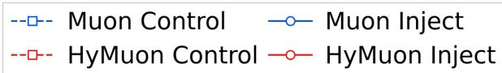

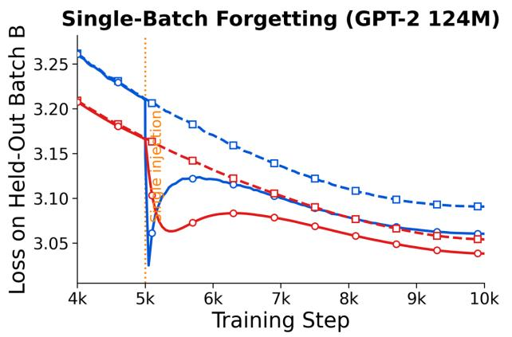

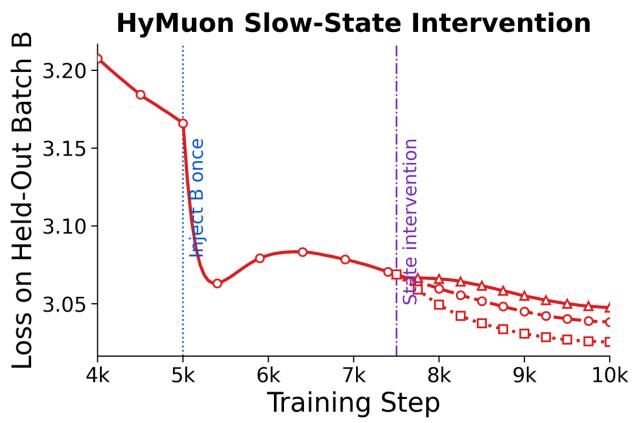

Figure 2: Persistence of the effect of a single batch and of its contribution retained in the slow state. Left: loss on batch B for the control and inject branches. The two branches differ at step 5,000, when the inject branch takes one optimization step using the gradient computed on B; they then continue with the same sequence of batches. Right: at step 7,500, the inject branch is split into Keep, Delete, and Refresh, which retain, remove, or replace the contribution of B in the slow state. At this step, the three branches have the same model parameters, averaged iterate, and all other optimizer states. Refresh uses a gradient computed on B at the current model parameters and rescales it to match the groupwise norm of the original contribution. HyMUON curves are evaluated at the averaged iterate, whereas Muon curves are evaluated at the training iterate; all curves are unsmoothed. Full protocols are given in Appendices E.3 and E.3.1.  
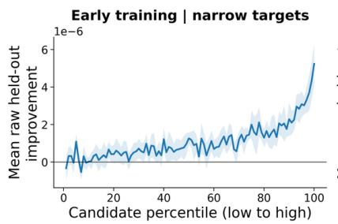

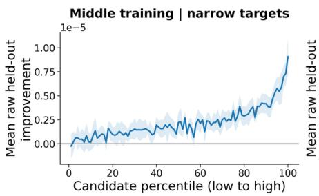

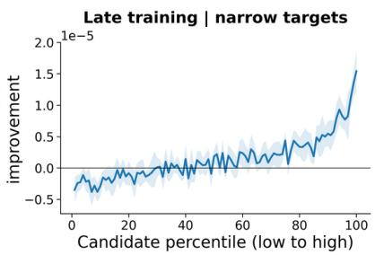  
Figure 3: Loss reduction on each semantic target’s evaluation set after a single update using the gradient of a candidate passage, at the 10k, 50k, and 100k checkpoints (left to right). For each target, the 2,000 candidate passages are ranked by their E5 similarity to the target’s reference set and divided into 100 groups of 20. The blue curves show the mean across ten semantic targets, and the shaded regions show error bands across targets. Positive values indicate a reduction in loss, and the vertical scales differ across panels.

The experiment in Figure 2 shows that the effect of a single gradient update can remain measurable thousands of steps later. The experiment in Figure 3 shows that gradient usefulness varies substantially across training passages: at each checkpoint, the candidates with the highest similarity constitute only one fifth of all candidates but account for approximately one third of the positive improvement specific to the corresponding targets. Thus, gradients that are particularly useful for a target are not distributed evenly across training examples. Together, these results support retaining gradients over a long history. When such gradients occur intermittently, retaining their contributions allows subsequent updates to continue using this information when later training examples provide little useful gradient information for that target. The slow state of HyM is designed to retain such contributions effectively in subsequent updates.

## 5 Convergence Analysis

In this section, we establish the convergence of HyM for smooth convex objectives. For EMA momentum with a fixed decay factor $\mu ,$ the average lag approaches the constant $\mu / ( 1 - \mu )$ . Therefore, the average age of the gradients remains bounded as training proceeds. In contrast, the slow state of HyM has average lag $( t - 1 ) / 3$ , which grows with t. To accommodate this growing history, we analyze a general representation in which the cumulative weight of each stochastic gradient may vary with the iteration, and show that the averaged iterate of $\mathrm { H y M }$ attains an $\mathcal { O } ( T ^ { - 1 / 2 } )$ rate.

For the analysis, we introduce $\mathbf { v } _ { t }$ through $\mathbf { y } _ { t } = ( 1 - \beta ) \mathbf { v } _ { t } + \beta \mathbf { x } _ { t }$ . From the recurrences in Algorithm 1, we obtain $\begin{array} { r } { \mathbf { v } _ { t } = t \mathbf { x } _ { t } - ( t - 1 ) \mathbf { x } _ { t - 1 } = \mathbf { v } _ { 1 } - \eta \sum _ { k = 1 } ^ { t - 1 } K _ { t , k } \mathbf { g } _ { k } } \end{array}$ . The first equality implies $\begin{array} { r } { \mathbf { x } _ { t } = \frac { 1 } { t } \sum _ { i = 1 } ^ { t } \mathbf { v } _ { i } } \end{array}$ , and $- \eta K _ { t , k }$ is the coefficient of $\mathbf { g } _ { k }$ in $\mathbf { v } _ { t }$ . For a fixed $\Gamma > 0$ , define $e _ { t , k } = K _ { t , k } - \Gamma$ . We consider the general form

$$
\begin{array} { l } { { \displaystyle { \bf x } _ { t } = \frac { 1 } { t } \sum _ { i = 1 } ^ { t } { \bf v } _ { i } } , \qquad { \bf y } _ { t } = ( 1 - \zeta _ { t } ) { \bf v } _ { t } + \zeta _ { t } { \bf x } _ { t } , } \\ { { \displaystyle { \bf v } _ { t } = { \bf v } _ { 1 } - \eta \sum _ { k = 1 } ^ { t - 1 } ( \Gamma + e _ { t , k } ) { \bf g } _ { k } } . } \end{array}\tag{8}
$$

The coefficients $e _ { t , k }$ are deterministic, and $\zeta _ { t } \in [ 0 , 1 ]$ is chosen using information available before the mini-batch at iteration t is sampled. For $\mathrm { H y M } , \zeta _ { t } = \beta$ . For Schedule-Free SGD, $K _ { t , k } = 1$ for all $1 \leq k < t .$ , and $\zeta _ { t } = \beta$ . Choosing $\Gamma = 1$ therefore gives $e _ { t , k } = 0$ , in which case (8) reduces to Schedule-Free SGD [Defazio et al., 2024].

Assumption 1. The objective $f : \mathbb { R } ^ { d } $ R is convex, admits a minimizer $\mathbf { x } ^ { * }$ , and is L-smooth for some $L > 0 \colon$ for all $\mathbf { u } , \mathbf { w } \in \mathbb { R } ^ { d } , \| \nabla f ( \mathbf { u } ) - \nabla f ( \mathbf { w } ) \| \leq L \| \mathbf { u } - \mathbf { w } \|$

Assumption 2. $L e t \left( \mathcal { F } _ { t } \right) _ { t \geq 0 }$ be thefiltration generated by the training history, where $\mathcal { F } _ { t - 1 }$ contains all information available before sampling $\overline { { B } } _ { t }$ . The iterate $\mathbf { y } _ { t }$ is $\mathcal { F } _ { t - 1 }$ -measurable, and $\mathbf { g } _ { t }$ is $\mathcal { F } _ { t }$ -measurable. Conditional on $\mathcal { F } _ { t - 1 }$ random variables $\xi _ { t , 1 } , \ldots , \xi _ { t , B }$ are independent copies ofthe random variable ξ in (3). For somefinite $\sigma \geq 0 ,$

$$
\begin{array} { r } { \mathbb { E } _ { \xi } \big [ \nabla f ( \mathbf { x } ; \xi ) \big ] = \nabla f ( \mathbf { x } ) , \qquad \mathbb { E } _ { \xi } \big [ \| \nabla f ( \mathbf { x } ; \xi ) - \nabla f ( \mathbf { x } ) \| ^ { 2 } \big ] \leq \sigma ^ { 2 } , \quad \forall \mathbf { x } \in \mathbb { R } ^ { d } . } \end{array}
$$

Theorem 1. Under Assumptions 1 and 2, suppose (8) holds with deterministic $\mathbf { v } _ { 1 }$ and $e _ { t , k } ,$ , and with each $\zeta _ { t } \in [ 0 , 1 ]$ determined by $\mathcal { F } _ { t - 1 }$ . Assume that $\begin{array} { r } { \operatorname* { s u p } _ { t \geq 1 } \sum _ { k = 1 } ^ { t - 1 } e _ { t , k } ^ { 2 } \leq C _ { E } < \infty } \end{array}$ for some $C _ { E } > 0$ . For a run of T iterations, set $\eta = \eta _ { 0 } / \sqrt { T }$ , where $\eta _ { 0 } \in ( 0 , [ 2 L ( \Gamma + 2 \sqrt { C _ { E } } ) ] ^ { - 1 } ]$ . Then

$$
\mathbb { E } [ f ( \mathbf { x } _ { T } ) - f ( \mathbf { x } ^ { * } ) ] \leq \frac { \| \mathbf { v } _ { 1 } - \mathbf { x } ^ { * } \| ^ { 2 } / ( 2 \eta _ { 0 } \Gamma ) + \eta _ { 0 } \Gamma \varsigma ^ { 2 } / 2 } { \sqrt { T } } + \frac { 2 L \eta _ { 0 } ^ { 2 } C _ { E } \varsigma ^ { 2 } } { T } .\tag{9}
$$

where $\varsigma = \sigma / { \sqrt { B } } .$

For fixed momentum parameters, HyM satisfies the condition on $e _ { t , k }$ in Theorem 1, yielding the following convergence guarantee.

Corollary 1. Under Assumptions 1 and 2, consider Algorithm 1 with deterministic $\mathbf { y } _ { 1 }$ and fixed $\mu \in ( 0 , 1 )$ and $\beta \in [ 0 , 1 )$ . Choose $\eta = \eta _ { 0 } / \sqrt { T }$ , where $\eta _ { 0 } > 0$ is sufficiently small and depends only on $L , \mu ,$ and $\beta ,$ not on T. Then $\mathbb { E } [ f ( \mathbf { x } _ { T } ) - f ( \mathbf { x } ^ { * } ) ] = \mathcal { O } ( T ^ { - 1 / 2 } )$ .

For fixed $\eta _ { 0 } , \mu ,$ , and $\beta ,$ the constants are independent of $T .$ They grow, however, as $\mu \ o r \ \beta$ approaches 1. The result requires neither strong convexity nor uniformly bounded gradients.

## 6 Empirical studies

We evaluate HyM and HyMUON on image classification, translation, and language modeling. Figures 4 and 5 show the main learning curves. Appendix F gives the complete configurations and evaluation protocols, and Table 1 summarizes the numerical results. CIFAR and SVHN use their test splits, IWSLT reports test metrics, and ImageNet uses its official validation split. The vision and IWSLT curves show means across repeated runs, and the shaded regions show one standard error. The values in the vision panel legends are endpoint means with sample standard deviations.

LLaMA 1.3B Validation Loss (10k Steps)  
GPT-2 124M Validation Loss (600k Steps)
<table><tr><td>----- AdamW ……Δ……</td><td>AdEMAMix Muon -!- HyMuon O</td></tr></table>

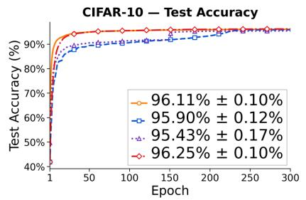

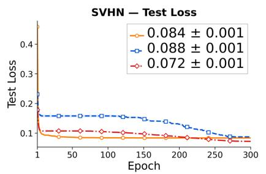

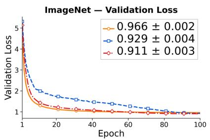

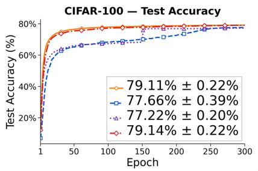

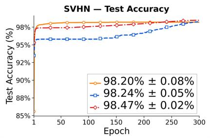

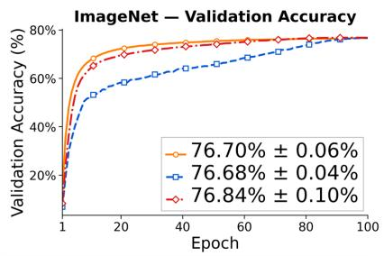  
o Schedule-Free ------ SGD + Cosine Δ…… SGD + Step - HyM

Figure 4: Image classification. Left: CIFAR-10 (top) and CIFAR-100 (bottom) test accuracy. Middle: SVHN test loss and accuracy. Right: ImageNet-1K validation loss and accuracy. Curves show means across repeated runs, and the shaded regions show one standard error. Values in the panel legends are endpoint means with sample standard deviations. Appendix Figure 11 adds the CIFAR test loss curves.  
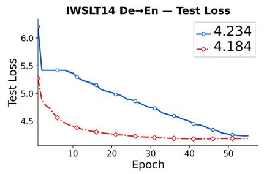

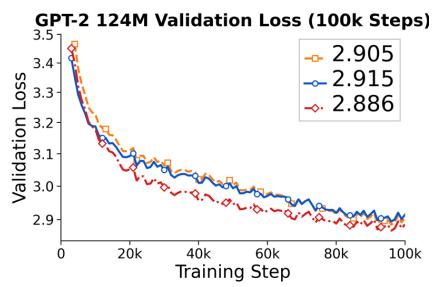

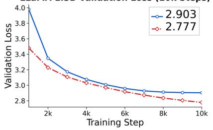

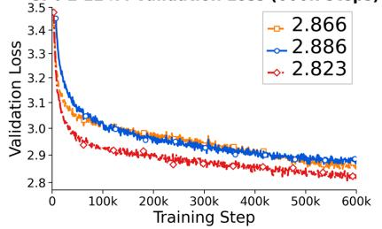

FineWeb / LLaMA-124M / 2.1B tokens  
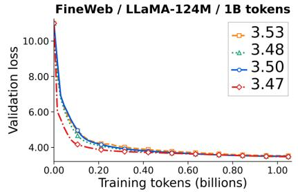

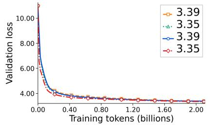  
Figure 5: Language tasks. Top row, left to right: IWSLT14 German–English test loss for the LSTM model; GPT-2 124M validation loss on OpenWebText through 100k steps; and LLaMA-1.3B validation loss on C4 through 10k steps, compared with the reproduced Muon baseline. Bottom row, left to right: GPT-2 124M validation loss on OpenWebText through 600k steps, followed by LLaMA-124M validation loss on FineWeb with token budgets of 1B and 2.1B. The IWSLT curves show means across repeated runs, and the shaded regions show one standard error. Appendix Figures 14 and 16 give BLEU and C4 perplexity.

## 6.1 Image classification

We compare HyM with momentum SGD using cosine or step schedules for the learning rate and with Schedule-Free SGD on CIFAR-10 (WRN-16-8), CIFAR-100 (DenseNet-BC), SVHN (ResNet-3-96), and ImageNet-1K (ResNet-50) [Krizhevsky, 2009, Netzer et al., 2011, Russakovsky et al., 2015]. HyM is evaluated at its averaged iterate, as described in Appendix F.

HyM reaches mean test accuracy of 96.25% on CIFAR-10 and 98.47% on SVHN, compared with 96.11% for Schedule-Free SGD on CIFAR-10 and 98.24% for cosine SGD on SVHN (Table 1). On CIFAR-100, the mean test accuracies are 79.14% for HyM and 79.11% for Schedule-Free SGD. ImageNet mean validation top-1 accuracies are 76.84% for HyM, 76.70% for Schedule-Free SGD, and 76.68% for cosine SGD. Schedule-Free SGD has higher validation accuracy during early training on ImageNet, while its curve and that of HyM become close later in training (Figure 4, right panels).

## 6.2 Language tasks

IWSLT14 machine translation. On IWSLT14 German–English [Cettolo et al., 2014], we train Fairseq’s LSTM preset with attention [Ott et al., 2019] for 55 epochs. We tune each optimizer separately and evaluate the selected configurations over repeated runs. At each epoch, the reported test metrics come from the checkpoint with the highest validation BLEU observed up to that epoch. Averaged over runs, HyMUON reaches test loss 4.184 ± 0.004 and BLEU 33.874 ± 0.072, against 4.234 ± 0.006 and 33.424 ± 0.048 for Muon, where the values are means with sample standard deviations (Table 1; Figure 5, top left; Figure 14 in Appendix F.4).

GPT-2 124M on OpenWebText. We pretrain GPT-2 124M [Radford et al., 2019] from scratch on OpenWebText [Gokaslan and Cohen, 2019] in two separate experiments, one for 100k steps and the other for 600k steps. HyMUON reaches final validation losses of 2.886 and 2.823, respectively, lower than AdamW and Muon at both training lengths (Figure 5, top middle and bottom left; full results in Table 1).

LLaMA-124M on FineWeb: comparison with AdEMAMix. We compare AdamW, AdEMAMix, Muon, and HyMUON using the same FineWeb subset and the 124M protocol for large batches from Semenov et al. [2025], with separate runs using 1B and 2.1B tokens. At 1B tokens, HyMUON reaches final validation loss 3.47, compared with 3.48 for AdEMAMix. At 2.1B tokens, HyMUON and AdEMAMix both have validation loss 3.35 after rounding to two decimal places, while Muon and AdamW both have 3.39 (Figure 5, bottom middle and bottom right). Protocol details are in Appendix F.7.

LLaMA-1.3B on C4. We compare HyMUON against Muon reproduced with the hyperparameters selected by Gu and Xie [2026] for LLaMA-1.3B/C4. We tune the HyMUON optimizer hyperparameters; Appendix F.6 gives the selected configuration. Training uses C4/en with document packing for 10k steps. HyMUON reaches validation loss 2.777, compared with 2.903 for Muon (Figure 5, top right). The corresponding perplexity curves are reported in Figure 16 in Appendix F.6. Appendix G reports an additional evaluation of HyMUON on the modded-nanoGPT Track 3 benchmark.

## 7 Conclusion

EMA momentum reduces a gradient’s weight geometrically according to the number of iterations that have passed since the gradient was computed. The controlled experiments show that a gradient contribution retained in the optimizer state can still reduce a target loss thousands of steps later and that gradients computed from different training examples can make substantially different contributions to the same loss. HyM separates long-term retention from short-term adaptation by using a slow state that draws on a growing gradient history and a fast state that emphasizes recent gradients. For smooth convex objectives, HyM achieves an O(T<sup>−1/2</sup>) bound at its final averaged iterate, while HyM and HyMUON match or improve upon the baselines considered across image classification, machine translation, and language modeling. The broader lesson is that the age of a gradient need not determine its usefulness. Momentum need not serve only as a short-term smoother; it can also provide long-term memory for useful gradient information that appears intermittently during training.

## References

Kwangjun Ahn, Byron Xu, Natalie Abreu, Ying Fan, Gagik Magakyan, Pratyusha Sharma, Zheng Zhan, and John Langford. Dion: Distributed orthonormalized updates. arXiv preprint arXiv:2504.05295, 2025.

Mauro Cettolo, Jan Niehues, Sebastian Stüker, Luisa Bentivogli, and Marcello Federico. Report on the 11th IWSLT evaluation campaign. In Proceedings ofthe 11th International Workshop on Spoken Language Translation: Evaluation Campaign, pages 2–17, 2014.

Marina Danilova. On the convergence analysis of aggregated heavy-ball method. In Mathematical Optimization Theory and Operations Research (MOTOR 2022), volume 13367 of Lecture Notes in Computer Science, pages 3–17. Springer, 2022. doi: 10.1007/978-3-031-09607-5\_1.

Aaron Defazio. ScheduleFree+: Scaling learning-rate-free and schedule-free learning to large language models. arXiv preprint arXiv:2605.19095, 2026.

Aaron Defazio, Xingyu Alice Yang, Harsh Mehta, Konstantin Mishchenko, Ahmed Khaled, and Ashok Cutkosky. The road less scheduled. In Advances in Neural Information Processing Systems, volume 37, 2024.

Saeed Ghadimi and Guanghui Lan. Accelerated gradient methods for nonconvex nonlinear and stochastic programming. Mathematical Programming, 156(1–2):59–99, 2016. doi: 10.1007/s10107-015-0871-8.

Aaron Gokaslan and Vanya Cohen. OpenWebText corpus. https://skylion007.github.io/OpenWebTe xtCorpus/, 2019.

Yufei Gu and Zeke Xie. Mano: Restriking manifold optimization for LLM training. arXiv preprint arXiv:2601.23000, 2026.

Vineet Gupta, Tomer Koren, and Yoram Singer. Shampoo: Preconditioned stochastic tensor optimization. In Proceedings ofthe 35th International Conference on Machine Learning, volume 80 of Proceedings ofMachine Learning Research, pages 1842–1850. PMLR, 2018. URL https://proceedings.mlr.press/v80/gupta18a.html.

Keller Jordan, Yuchen Jin, Vlado Boza, Jiacheng You, Franz Cesista, Laker Newhouse, and Jeremy Bernstein. Muon: An optimizer for hidden layers in neural networks. https://kellerjordan.github.io/posts/muon/, 2024.

Sai Praneeth Karimireddy, Quentin Rebjock, Sebastian Stich, and Martin Jaggi. Error feedback fixes SignSGD and other gradient compression schemes. In Proceedings ofthe 36th International Conference on Machine Learning, volume 97 of Proceedings ofMachine Learning Research, pages 3252–3261, 2019.

Andrej Karpathy. nanoGPT. https://github.com/karpathy/nanoGPT, 2022.

Kimi Team. Kimi K2: Open agentic intelligence. arXiv preprint arXiv:2507.20534, 2025.

Diederik P. Kingma and Jimmy Ba. Adam: A method for stochastic optimization. In International Conference on Learning Representations, 2015.

Alex Krizhevsky. Learning multiple layers of features from tiny images. Technical report, University of Toronto, 2009.

Guanghui Lan. An optimal method for stochastic composite optimization. Mathematical Programming, 133(1–2): 365–397, 2012. doi: 10.1007/s10107-010-0434-y.

Zichong Li, Liming Liu, Chen Liang, Weizhu Chen, and Tuo Zhao. NorMuon: Making Muon more efficient and scalable. arXiv preprint arXiv:2510.05491, 2025.

Ilya Loshchilov and Frank Hutter. Decoupled weight decay regularization. In International Conference on Learning Representations. OpenReview.net, 2019.

James Martens and Roger Grosse. Optimizing neural networks with Kronecker-factored approximate curvature. In Proceedings of the 32nd International Conference on Machine Learning, volume 37 of Proceedings ofMachine Learning Research, pages 2408–2417. PMLR, 2015. URL https://proceedings.mlr.press/v37/mart ens15.html.

Paul-Aymeric McRae, Prasanna Parthasarathi, Mahmoud Assran, and Sarath Chandar. Memory augmented optimizers for deep learning. In International Conference on Learning Representations, 2022.

Depen Morwani, Nikhil Vyas, Hanlin Zhang, and Sham Kakade. Connections between Schedule-Free optimizers, AdEMAMix, and accelerated SGD variants. arXiv preprint arXiv:2502.02431, 2025.

Yurii Nesterov. A method of solving a convex programming problem with convergence rate O(1/k<sup>2</sup>). Doklady Akademii Nauk SSSR, 269(3):543–547, 1983.

Yurii Nesterov. Smooth minimization of non-smooth functions. Mathematical Programming, 103(1):127–152, 2005. doi: 10.1007/s10107-004-0552-5.

Yuval Netzer, Tao Wang, Adam Coates, Alessandro Bissacco, Bo Wu, and Andrew Y. Ng. Reading digits in natural images with unsupervised feature learning. In NIPS Workshop on Deep Learning and Unsupervised Feature Learning, 2011.

Myle Ott, Sergey Edunov, Alexei Baevski, Angela Fan, Sam Gross, Nathan Ng, David Grangier, and Michael Auli. fairseq: A fast, extensible toolkit for sequence modeling. In Proceedings ofNAACL-HLT 2019: Demonstrations, pages 48–53, 2019. doi: 10.18653/v1/N19-4009.

Matteo Pagliardini, Pierre Ablin, and David Grangier. The AdEMAMix optimizer: Better, faster, older. In International Conference on Learning Representations, 2025.

B. T. Polyak. Some methods of speeding up the convergence of iteration methods. USSR Computational Mathematics and Mathematical Physics, 4(5):1–17, 1964. doi: 10.1016/0041-5553(64)90137-5.

Alec Radford, Jeffrey Wu, Rewon Child, David Luan, Dario Amodei, and Ilya Sutskever. Language models are unsupervised multitask learners. Technical report, OpenAI, 2019.

Olga Russakovsky, Jia Deng, Hao Su, Jonathan Krause, Sanjeev Satheesh, Sean Ma, Zhiheng Huang, Andrej Karpathy, Aditya Khosla, Michael Bernstein, Alexander C. Berg, and Li Fei-Fei. ImageNet Large Scale Visual Recognition Challenge. International Journal ofComputer Vision (IJCV), 115(3):211–252, 2015. doi: 10.1007/s11263-015-081 6-y.

Andrei Semenov, Matteo Pagliardini, and Martin Jaggi. Benchmarking optimizers for large language model pretraining. arXiv preprint arXiv:2509.01440, 2025.

Minhak Song, Beomhan Baek, Kwangjun Ahn, and Chulhee Yun. Through the river: Understanding the benefit of Schedule-Free methods for language model training. In Advances in Neural Information Processing Systems, 2025.

Sebastian U. Stich and Sai Praneeth Karimireddy. The error-feedback framework: SGD with delayed gradients. Journal ofMachine Learning Research, 21(237):1–36, 2020.

Ilya Sutskever, James Martens, George Dahl, and Geoffrey Hinton. On the importance of initialization and momentum in deep learning. In Sanjoy Dasgupta and David McAllester, editors, Proceedings ofthe 30th International Conference on Machine Learning, volume 28 of Proceedings ofMachine Learning Research, pages 1139–1147, Atlanta, Georgia, USA, 17–19 Jun 2013. PMLR.

Nikhil Vyas, Depen Morwani, Rosie Zhao, Itai Shapira, David Brandfonbrener, Lucas Janson, and Sham Kakade. SOAP: Improving and stabilizing Shampoo using Adam for language modeling. In International Conference on Learning Representations, 2025. URL https://openreview.net/forum?id=IDxZhXrpNf.

Liang Wang, Nan Yang, Xiaolong Huang, Binxing Jiao, Linjun Yang, Daxin Jiang, Rangan Majumder, and Furu Wei. Text embeddings by weakly-supervised contrastive pre-training. arXiv preprint arXiv:2212.03533, 2022.

Zimeng Wang and Alp Yurtsever. Generalized stochastic gradient descent with momentum methods for smooth optimization. arXiv preprint arXiv:2602.23444, 2026.

Tianbao Yang, Qihang Lin, and Zhe Li. Unified convergence analysis of stochastic momentum methods for convex and non-convex optimization. arXiv preprint arXiv:1604.03257, 2016.

Chung-Yiu Yau, Dawei Li, Athanasios Glentis, Valentyn Boreiko, Hoi-To Wai, and Mingyi Hong. EMA-Nesterov: Stabilizing Nesterov’s lookahead for accelerated deep learning optimization. arXiv preprint arXiv:2605.25395, 2026.

## Appendix

A Reduction of Schedule-Free to a representation using one sequence . . . . . . . . . . . . . . . . . . . . . . . . . . . . . . . . . . . . . . . 13   
B Gradient weighting and averaging along a curved valley . . . . . . . . . . . . . . . . . . . . . . . . . . . . . 13   
B.1 Weights on early and recent gradients . . . . . . . . . . . . . . . . . . . . . . . . . . . . . . . . . . . . . . . . . . . . . . . . . . . 13   
B.2 Asymptotic covariance under a fixed gradient mean . . . . . . . . . . . . . . . . . . . . . . . . . . . . . . . . . . . . . . . . . . . . . . . . . . . 15   
B.3 Weights after a persistent change in gradient mean . . . . . . . . . . . . . . . . . . . . . . . . . . . . . . . . . . . . . . . . . . . . . . . . . . . . 16   
B.4 Geometry of averaging along a curved valley . . . . . . . . . . . . . . . . . . . . . . . . . . . . . . . . . . . . . . . . . . . . . . . . . . . 17   
C Convergence analysis via cumulative gradient weights . . . . . . . . . . . . . . . . . . . . . . . . . . . . . . . . . . . . . . . . . . . . . . . . . . . 18   
C.1 The averaged iterate and the Bregman term . . . . . . . . . . . . . . . . . . . . . . . . . . . . . . . . . . . . . . 19   
C.2 A theorem for cumulative gradient weights over a finite horizon . . . . . . . . . . . . . . . . . . . . . . . . . . . . . . . . . . . . . . . . 19   
C.3 Bounding cumulative gradient weight deviations for HyM . . . . . . . . . . . . . . . . . . . . . . . . . . . . . . . . . . . . . . . . . . . . . . 21   
C.4 Convergence of the averaged iterate for HyM . . . . . . . . . . . . . . . . . . . . . . . . . . . . . . . . . . . . . . . . . . . . . . . . . . . . . . . . 22   
C.5 Finite mixtures of EMAs with fixed decay rates . . . . . . . . . . . . . . . . . . . . . . . . . . . . . . . . . . . . . . . . . . . . . . . . . . . . . . . 23   
D HyMUON matrix updates and implementation . . . . . . . . . . . . . . . . . . . . . . . . . . . . . . . . . . . . . . . . . . . . . . . . . . . . . . . . . . . . 23   
E Diagnostic experiment details . . . . . . . . . . . . . . . . . . . . . . . . . . . . . . . . . . . . . . . . . . . . . . . . . . . . . . . . . 24   
E.1 Dependence of the HyM advantage on batch size . . . . . . . . . . . . . . . . . . . . . . . . . . . . . . . . . . . . . . . . . . . . . . . . . . . . . . . 24   
E.2 Semantic relevance and improvement specific to each target . . . . . . . . . . . . . . . . . . . . . . . . . . . . . . . . . . . . . . . . . . . . 25   
E.3 Experiment on the lasting effect of one batch. . . . . . . . . . . . . . . . . . . . . . . . . . . . . . . . . . . . . . . . . . . . . . . 27   
F Benchmark experiment details . . . . . . . . . . . . . . . . . . . . . . . . . . . . . . . . . . . . . . . . . . . . . . . . . . . . . . . . . . . . . . . . . . . . . . . . . . 28   
F.1 Image classification runs . . . . . . . . . . . . . . . . . . . . . . . . . . . . . . . . . . . . . . . . . . . . . . . . . . . . . . . . . . . . . . . . . . . . . . . . . . . . 29   
F.2 HyM at the training and averaged iterates . . . . . . . . . . . . . . . . . . . . . . . . . . . . . . . . . . . . . . . . . 30   
F.3 Component ablation of HyM on CIFAR-10 . . . . . . . . . . . . . . . . . . . . . . . . . . . . . . . . . . . . . . . . . . . . . . . . . . . . . . . . . . . . 32   
F.4 IWSLT14 German–English . . . . . . . . . . . . . . . . . . . . . . . . . . . . . . . . . . . . . . . . . . . . . . . . . . . . . . . . . . . . . . . . . . . . . . . 35   
F.5 NanoGPT on OpenWebText . . . . . 36   
F.6 LLaMA-1.3B pretraining on C4 . . . . . . . . . . . . . . . . . . . . . . . . . . . . . . . . . . . . . . . . . . . . . . . . . . . . . . . . . . . . . . . . . . . . . . 37   
F.7 LLaMA-124M FineWeb benchmark . . . . . . . . 37   
G Optimization efficiency on modded-nanoGPT Track 3 . . . . . . . . . . . . . . . . . . . . . . . . . . . . . . 39

## A Reduction of Schedule-Free to a representation using one sequence

The Schedule-Free method of Defazio et al. [2024] is originally stated with three sequences: the averaged iterate $\mathbf { x } _ { t } ,$ the base iterate $\mathbf { z } _ { t }$ , and the training iterate $\mathbf { y } _ { t }$

$$
\mathbf { y } _ { t } = ( 1 - \beta ) \mathbf { z } _ { t } + \beta \mathbf { x } _ { t } ,\tag{10}
$$

$$
\mathbf { z } _ { t + 1 } = \mathbf { z } _ { t } - \eta \mathbf { g } _ { t } , \quad \mathbf { g } _ { t } = \frac { 1 } { B } \sum _ { j = 1 } ^ { B } \nabla f ( \mathbf { y } _ { t } ; \boldsymbol { \xi } _ { t , j } ) ,\tag{11}
$$

$$
\mathbf { x } _ { t + 1 } = ( 1 - c _ { t + 1 } ) \mathbf { x } _ { t } + c _ { t + 1 } \mathbf { z } _ { t + 1 } ,\tag{12}
$$

initialized at $\mathbf { z } _ { 1 } = \mathbf { x } _ { 1 }$ , with averaging weights $c _ { t + 1 }$ (for a constant step size, $c _ { t + 1 } = 1 / ( t + 1 ) \rangle$ ). The representation in (2), which uses one sequence, follows from the change of variable

$$
\mathbf { n } _ { t } : = \frac { \mathbf { x } _ { t } - \mathbf { z } _ { t + 1 } } { \eta } ,\tag{13}
$$

which is the rescaled difference between the averaged and base iterates and serves as the state variable in this representation.

Using $\mathbf { x } _ { t } = ( 1 - c _ { t } ) \mathbf { x } _ { t - 1 } + c _ { t } \mathbf { z } _ { t }$ and $\mathbf { z } _ { t + 1 } = \mathbf { z } _ { t } - \eta \mathbf { g } _ { t }$ , we have

$$
\mathbf { n } _ { t } = { \frac { \mathbf { x } _ { t } - \mathbf { z } _ { t + 1 } } { \eta } } = { \frac { ( 1 - c _ { t } ) { \bigl ( } \mathbf { x } _ { t - 1 } - \mathbf { z } _ { t } { \bigr ) } + \eta \mathbf { g } _ { t } } { \eta } } = ( 1 - c _ { t } ) \mathbf { n } _ { t - 1 } + \mathbf { g } _ { t } .\tag{14}
$$

Since ${ \bf z } _ { 1 } = { \bf x } _ { 1 } , ( 1 3 )$ gives $\mathbf { n } _ { 1 } = ( \mathbf { x } _ { 1 } - \mathbf { z } _ { 2 } ) / \eta = \mathbf { g } _ { 1 }$ , consistent with $c _ { 1 } = 1$

Differencing (10) and using $\mathbf { z } _ { t + 1 } - \mathbf { z } _ { t } = - \eta \mathbf { g } _ { t } , \mathbf { x } _ { t + 1 } - \mathbf { x } _ { t } = c _ { t + 1 } ( \mathbf { z } _ { t + 1 } - \mathbf { x } _ { t } )$ , and $\mathbf { z } _ { t + 1 } - \mathbf { x } _ { t } = - \eta \mathbf { n } _ { t }$ from (13), we obtain

$$
\begin{array} { r l } & { \mathbf { y } _ { t + 1 } - \mathbf { y } _ { t } = ( 1 - \beta ) ( \mathbf { z } _ { t + 1 } - \mathbf { z } _ { t } ) + \beta ( \mathbf { x } _ { t + 1 } - \mathbf { x } _ { t } ) } \\ & { \qquad = - ( 1 - \beta ) \eta \mathbf { g } _ { t } + \beta c _ { t + 1 } ( \mathbf { z } _ { t + 1 } - \mathbf { x } _ { t } ) } \\ & { \qquad = - \eta \big [ ( 1 - \beta ) \mathbf { g } _ { t } + \beta c _ { t + 1 } \mathbf { n } _ { t } \big ] , } \end{array}\tag{15}
$$

which is exactly (2).

For $c _ { t } = 1 / t$ , the recurrence has the closed form $\begin{array} { r } { \mathbf n _ { t } = \frac { t - 1 } { t } \mathbf n _ { t - 1 } + \mathbf g _ { t } = \sum _ { i = 1 } ^ { t } \frac { i } { t } \mathbf g _ { i } } \end{array}$ , whose weights grow linearly with i. This is the same linear weighting pattern used in Nesterov’s construction based on estimate sequences [Nesterov, 1983, 2005]. HyM uses the same recurrence after the rescaling $\mathbf { n } _ { t } = ( t + 1 ) \mathbf { m } _ { t } / 2$ , but scales its contribution by the geometric sum $( 1 - \mu ^ { t } ) / ( 1 - \mu )$ and replaces the term that directly uses the current gradient with the fast state. Its direction is $\beta ( 1 - \mu ^ { t } ) \mathbf { n } _ { t } / [ t ( 1 - \mu ) ] + ( 1 - \beta ) \mathbf { b } _ { t }$ , where m denotes the slow state in Algorithm 1.

## B Gradient weighting and averaging along a curved valley

## B.1 Weights on early and recent gradients

We give the calculations underlying Section 4.1, for $c _ { t } = 1 / t$ , fixed $\mu \in ( 0 , 1 )$ , and $\beta \in [ 0 , 1 )$ . Throughout we write $q _ { t } = ( 1 - \mu ^ { t } ) / ( 1 - \mu )$ for the recurring geometric sum.

Decomposition and normalization of gradient weights. Unrolling the two momentum states gives

$$
\mathbf { m } _ { t } = \sum _ { i = 1 } ^ { t } \frac { 2 i } { t ( t + 1 ) } \mathbf { g } _ { i } , \qquad \mathbf { b } _ { t } = \sum _ { i = 1 } ^ { t } \frac { i } { t } \mu ^ { t - i } \mathbf { g } _ { i } .\tag{16}
$$

Substitution into Algorithm 1, line 6, yields the gradient weights (7). Define the coefficient sum $Z _ { t }$ for the fast state and the two component coefficient sums by

$$
Z _ { t } = \sum _ { i = 1 } ^ { t } { \frac { i } { t } } \mu ^ { t - i } , \qquad A _ { t } = \beta r _ { t } , \qquad C _ { t } = ( 1 - \beta ) Z _ { t } .\tag{17}
$$

The total coefficient sum is $\begin{array} { r } { S _ { t } = \sum _ { i = 1 } ^ { t } w _ { t , i } = A _ { t } + C _ { t } } \end{array}$ , with

$$
S _ { 1 } = 1 , \qquad \operatorname* { l i m } _ { t \to \infty } S _ { t } = \frac { 1 - \beta / 2 } { 1 - \mu } .\tag{18}
$$

To separate the distribution over past gradients from this total coefficient sum, we normalize the coefficients as

$$
p _ { t , i } = \frac { w _ { t , i } } { S _ { t } } = \frac { w _ { t , i } } { \sum _ { j = 1 } ^ { t } w _ { t , j } } , \qquad \sum _ { i = 1 } ^ { t } p _ { t , i } = 1 .\tag{19}
$$

Thus $p _ { t , i }$ is the fraction of the direction’s total scalar gradient weight assigned to $\mathbf { g } _ { i }$ . It is an exact mixture of two distributions:

$$
p _ { t , i } = \lambda _ { t } \underbrace { \frac { 2 i } { t ( t + 1 ) } } _ { U _ { t , i } } + ( 1 - \lambda _ { t } ) \underbrace { \frac { ( i / t ) \mu ^ { t - i } } { Z _ { t } } } _ { V _ { t , i } } , \qquad \lambda _ { t } = \frac { A _ { t } } { A _ { t } + C _ { t } } .\tag{20}
$$

Both $U _ { t , i }$ and $V _ { t , i }$ sum to one. The proposition below gives the aggregate weight on an early fraction of history and on a fixed recent window.

Proposition B.1. Fix $\mu \in ( 0 , 1 )$ and $\beta \in ( 0 , 1 )$ . Then

$$
\operatorname* { l i m } _ { t \to \infty } \lambda _ { t } = \frac { \beta } { 2 - \beta } , \qquad \operatorname* { l i m } _ { t \to \infty } ( 1 - \lambda _ { t } ) = \rho : = \frac { 2 ( 1 - \beta ) } { 2 - \beta } .
$$

For every fixed $a \in ( 0 , 1 )$ and positive integer $K ,$

$$
\operatorname* { l i m } _ { t  \infty } \sum _ { i = 1 } ^ { \lfloor a t \rfloor } p _ { t , i } = \frac { \beta } { 2 - \beta } a ^ { 2 } ,\tag{21}
$$

$$
\operatorname* { l i m } _ { t \to \infty } \sum _ { i = t - K + 1 } ^ { t } p _ { t , i } = \rho ( 1 - \mu ^ { K } ) .\tag{22}
$$

Proof. Recall that

$$
r _ { t } = \frac { t + 1 } { 2 t } q _ { t } , \qquad Z _ { t } = \sum _ { i = 1 } ^ { t } \frac { i } { t } \mu ^ { t - i } .
$$

After setting $k = t - i ,$ , we have

$$
Z _ { t } = \sum _ { k = 0 } ^ { t - 1 } \left( 1 - { \frac { k } { t } } \right) \mu ^ { k } , \qquad 0 \leq q _ { t } - Z _ { t } = { \frac { 1 } { t } } \sum _ { k = 0 } ^ { t - 1 } k \mu ^ { k } \leq { \frac { \mu } { t ( 1 - \mu ) ^ { 2 } } } .
$$

Since $\begin{array} { r } { \operatorname* { l i m } _ { t  \infty } q _ { t } = ( 1 - \mu ) ^ { - 1 } } \end{array}$ , it follows that

$$
\operatorname* { l i m } _ { t \to \infty } Z _ { t } = \frac { 1 } { 1 - \mu } .
$$

Consequently,

$$
\operatorname* { l i m } _ { t \to \infty } A _ { t } = \frac { \beta } { 2 ( 1 - \mu ) } , \qquad \operatorname* { l i m } _ { t \to \infty } C _ { t } = \frac { 1 - \beta } { 1 - \mu } .
$$

Substituting these limits into $\lambda _ { t } = A _ { t } / ( A _ { t } + C _ { t } )$ proves the two limits for $\lambda _ { t }$ stated in the proposition.

Let $k _ { t } = \lfloor a t \rfloor$ . The slow component satisfies

$$
\operatorname* { l i m } _ { t \to \infty } \sum _ { i = 1 } ^ { k _ { t } } U _ { t , i } = \operatorname* { l i m } _ { t \to \infty } \frac { k _ { t } ( k _ { t } + 1 ) } { t ( t + 1 ) } = a ^ { 2 } .
$$

For the fast component, $Z _ { t } \geq 1$ and

$$
0 \leq \sum _ { i = 1 } ^ { k _ { t } } V _ { t , i } \leq \sum _ { k = t - k _ { t } } ^ { \infty } \mu ^ { k } = \frac { \mu ^ { t - k _ { t } } } { 1 - \mu } .
$$

Because $t - k _ { t }$ tends to infinity, lim $\begin{array} { r } { \mathbf { { 1 } } _ { t  \infty } \sum _ { i = 1 } ^ { k _ { t } } V _ { t , i } = 0 } \end{array}$ . Combining these limits with the mixture representation (20) proves (21).

For a fixed positive integer K,

$$
\operatorname* { l i m } _ { t \to \infty } \sum _ { i = t - K + 1 } ^ { t } U _ { t , i } = 0 , \qquad \sum _ { i = t - K + 1 } ^ { t } V _ { t , i } = \frac { \sum _ { k = 0 } ^ { K - 1 } ( 1 - k / t ) \mu ^ { k } } { Z _ { t } } .
$$

Hence li $\begin{array} { r } { \boldsymbol { 1 } _ { t  \infty } \sum _ { i = t - K + 1 } ^ { t } V _ { t , i } = \boldsymbol { 1 } - \mu ^ { K } } \end{array}$ . The same mixture representation therefore gives (22).

Peak near recent gradients for large t. When $t ( 1 - \mu ) \ll 1$ , the two component profiles are similar, and their combined weight increases approximately linearly with i. For larger t, the weights of the fast state become concentrated within $\mathcal { O } ( ( 1 - \mu ) ^ { - 1 } )$ iterations of the current step, whereas the weights of the slow state extend over $\mathcal { O } ( t )$ iterations. For $0 < \beta < 1$ , the ratio of the fast and slow coefficients at lag $\begin{array} { r } { k = t - i \mathrm { i s } { \frac { ( 1 - \beta ) t \mu ^ { k } } { \beta q _ { t } } } } \end{array}$ . Using $q _ { t } \to ( 1 - \mu ) ^ { - 1 }$ , the two coefficients on the newest gradient are equal at

$$
t _ { \mathrm { c r o s s } } : = \frac { \beta } { ( 1 - \beta ) ( 1 - \mu ) } .\tag{23}
$$

When t is large relative to $t _ { \mathrm { c r o s s } } ,$ , the fast term dominates the coefficient on the newest gradients and produces the peak over recent gradients, while the slow component retains the limiting share $\beta / ( 2 - \beta )$ of the total weight.

A finite mixture of EMAs with fixed decay coefficients below one behaves differently: for fixed $a \in ( 0 , 1 )$ , the share it places on $i \leq$ at vanishes as t grows, since each EMA tail is bounded by a geometrically decreasing term. In contrast, HyM retains the positive aggregate weight given in (21).

## B.2 Asymptotic covariance under a fixed gradient mean

Proposition B.2. Fix $\mu \in ( 0 , 1 )$ and $\beta \in [ 0 , 1 )$ . Suppose $\mathbf { g } _ { i } = \mathbf { g } + \varepsilon _ { i } ,$ , where the noises are independent, zero mean, and have covariance $\Sigma / B .$ . Let $\begin{array} { r } { \widetilde { \Delta } _ { t } = \sum _ { i = 1 } ^ { t } p _ { t , i } \mathbf { g } _ { i } , \rho = 2 ( 1 - \beta ) / ( 2 - \beta ) } \end{array}$ , and $\chi = \rho ( 1 - \mu )$ . Then $\widetilde { \Delta } _ { t }$ is unbiased, $\begin{array} { r } { \operatorname* { l i m } _ { t \to \infty } p _ { t , t } = \chi , } \end{array}$ , and

$$
\operatorname* { l i m } _ { t  \infty } \mathrm { C o v } ( \widetilde { \Delta } _ { t } ) = \rho ^ { 2 } \frac { 1 - \mu } { 1 + \mu } \frac { \Sigma } { B } .\tag{24}
$$

For $0 < \beta < 1$ , its limiting scalar covariance factor is strictly below that of a normalized EMA with weight $\chi$ on the newest gradient:

$$
\rho ^ { 2 } \frac { 1 - \mu } { 1 + \mu } < \frac { \chi } { 2 - \chi } .
$$

Proof. Define

$$
Z _ { t } : = \sum _ { i = 1 } ^ { t } \frac { i } { t } \mu ^ { t - i } , \qquad S _ { t } : = \sum _ { i = 1 } ^ { t } w _ { t , i } = \frac { \beta q _ { t } ( t + 1 ) } { 2 t } + ( 1 - \beta ) Z _ { t } .
$$

The normalized weights can be decomposed as

$$
\frac { w _ { t , i } } { S _ { t } } = \lambda _ { t } U _ { t , i } + ( 1 - \lambda _ { t } ) V _ { t , i } ,
$$

where

$$
U _ { t , i } = \frac { 2 i } { t ( t + 1 ) } , \qquad V _ { t , i } = \frac { ( i / t ) \mu ^ { t - i } } { Z _ { t } } , \qquad \lambda _ { t } = \frac { \beta q _ { t } ( t + 1 ) / ( 2 t ) } { S _ { t } } , \qquad 1 - \lambda _ { t } = \frac { ( 1 - \beta ) Z _ { t } } { S _ { t } } .
$$

Both $U _ { t }$ and $V _ { t }$ are probability vectors. The calculations in the proof of Proposition B.1 give

$$
\operatorname* { l i m } _ { t \to \infty } q _ { t } = \operatorname* { l i m } _ { t \to \infty } Z _ { t } = \frac { 1 } { 1 - \mu } , \qquad \operatorname* { l i m } _ { t \to \infty } ( 1 - \lambda _ { t } ) = \rho = \frac { 2 ( 1 - \beta ) } { 2 - \beta } , \qquad \operatorname* { l i m } _ { t \to \infty } \lambda _ { t } = 1 - \rho .
$$

For the squared weights,

$$
\operatorname* { l i m } _ { t \to \infty } \sum _ { i = 1 } ^ { t } U _ { t , i } ^ { 2 } = \operatorname* { l i m } _ { t \to \infty } \frac { 2 ( 2 t + 1 ) } { 3 t ( t + 1 ) } = 0 .
$$

Moreover,

$$
\sum _ { i = 1 } ^ { t } V _ { t , i } ^ { 2 } = \frac { 1 } { Z _ { t } ^ { 2 } } \sum _ { k = 0 } ^ { t - 1 } \left( 1 - \frac { k } { t } \right) ^ { 2 } \mu ^ { 2 k } .
$$

Dominated convergence and the limit of $Z _ { t }$ therefore yield

$$
\operatorname* { l i m } _ { t \to \infty } \sum _ { i = 1 } ^ { t } V _ { t , i } ^ { 2 } = \frac { ( 1 - \mu ) ^ { 2 } } { 1 - \mu ^ { 2 } } = \frac { 1 - \mu } { 1 + \mu } .
$$

By Cauchy–Schwarz,

$$
\left| \sum _ { i = 1 } ^ { t } U _ { t , i } V _ { t , i } \right| \leq \left( \sum _ { i = 1 } ^ { t } U _ { t , i } ^ { 2 } \right) ^ { 1 / 2 } \left( \sum _ { i = 1 } ^ { t } V _ { t , i } ^ { 2 } \right) ^ { 1 / 2 } ,
$$

which implies that the cross term has limit zero. Independence of the noise now gives

$$
\mathrm { C o v } ( \widetilde { \Delta } _ { t } ) = \left( \sum _ { i = 1 } ^ { t } \frac { w _ { t , i } ^ { 2 } } { S _ { t } ^ { 2 } } \right) \frac { \Sigma } { B }
$$

and hence

$$
\operatorname* { l i m } _ { t  \infty } \mathrm { C o v } ( \widetilde { \Delta } _ { t } ) = \rho ^ { 2 } \frac { 1 - \mu } { 1 + \mu } \frac { \Sigma } { B } .
$$

The newest normalized weight is

$$
\operatorname* { l i m } _ { t \to \infty } { \frac { \beta q _ { t } / t + 1 - \beta } { S _ { t } } } = \rho ( 1 - \mu ) = \chi .
$$

A normalized EMA with newest weight $\chi$ has weights $\chi ( 1 - \chi ) ^ { k }$ . Its scalar covariance factor is

$$
\chi ^ { 2 } \sum _ { k = 0 } ^ { \infty } ( 1 - \chi ) ^ { 2 k } = \frac { \chi } { 2 - \chi } .
$$

The difference between the factors for the corresponding EMA and HyM is

$$
\frac { \rho ( 1 - \mu ) } { 2 - \rho ( 1 - \mu ) } - \frac { \rho ^ { 2 } ( 1 - \mu ) } { 1 + \mu } = \frac { \rho ( 1 - \mu ) ( 1 - \rho ) [ 2 - ( 1 - \mu ) ( 1 + \rho ) ] } { [ 2 - \rho ( 1 - \mu ) ] ( 1 + \mu ) } > 0
$$

for $0 < \rho < 1$ and $0 < \mu < 1$ , proving the proposition.

## B.3 Weights after a persistent change in gradient mean

The comparison in Proposition B.2 matches the coefficient on the newest gradient and therefore describes the weight assigned immediately after a change in mean. To examine a persistent change, suppose the deterministic gradient mean is $\mathbf { g } ^ { \bar { - } }$ through step $\tau$ and $\mathbf { g } ^ { + } = \mathbf { g } ^ { - } + \mathbf { d }$ afterward. $\mathrm { A t } \ : t = \tau + k$ , the fraction of the normalized $\mathrm { H y }$ M direction assigned to gradients with mean ${ \bf g } ^ { + }$ is

$$
H _ { t , \tau } = \sum _ { i = \tau + 1 } ^ { t } p _ { t , i } = \lambda _ { t } \Biggl ( 1 - \frac { \tau ( \tau + 1 ) } { t ( t + 1 ) } \Biggr ) + ( 1 - \lambda _ { t } ) \frac { \sum _ { j = 0 } ^ { k - 1 } ( 1 - j / t ) \mu ^ { j } } { Z _ { t } } .\tag{25}
$$

For fixed $k ,$ the limiting weight assigned after the change is

$$
\operatorname* { l i m } _ { \tau \to \infty } H _ { \tau + k , \tau } = \rho ( 1 - \mu ^ { k } ) .
$$

A normalized EMA with constant newest weight $\chi = \rho ( 1 - \mu )$ , after its initialization bias has vanished, assigns the fraction $1 - ( 1 - \chi ) ^ { k }$ to gradients after the change. Its fraction at $k = 1$ matches HyM’s, while for $k > 1 , 0 < \rho < 1$ and $0 < \mu < 1$

$$
1 - \left( 1 - \rho ( 1 - \mu ) \right) ^ { k } > \rho ( 1 - \mu ^ { k } ) .
$$

The inequality follows from strict concavity of $h ( a ) = 1 - ( 1 - a ) ^ { k } \mathrm { o n } ( 0 , 1 )$ . The two methods match the weight on the newest gradient but assign different total weights after a persistent change: over a fixed recent window, the EMA assigns a larger fraction to gradients after the change, whereas HyM assigns the remaining share to its slow component. Under this comparison, HyM has lower limiting covariance, while the EMA assigns weight to gradients after the change more quickly.

## B.4 Geometry of averaging along a curved valley

## B.4.1 Rosenbrock illustration and the role of the averaged iterate

The preceding subsections analyze how the two momentum states distribute weight over the gradient history and respond to changes in the gradient mean. We now turn to a separate component of HyM: the averaged iterate. The following example illustrates how averaging the training iterates interacts with motion along a curved valley.

Consider gradients whose dominant component changes sign across iterations while a smaller component remains consistently aligned. Averaging attenuates the component whose sign varies relative to the consistently aligned component. For the Rosenbrock function $f _ { \mathrm { R B } }$ defined below, the component of $\nabla f _ { \mathrm { R B } }$ normal to the curve $v \stackrel { } { = } u ^ { 2 }$ changes sign across iterates, while the tangential component can retain its sign. This geometric motivation also appears in AdEMAMix and Schedule-Free analyses [Pagliardini et al., 2025, Song et al., 2025].

The slow state averages gradients over the trajectory, allowing normal components that change sign to cancel while tangential components that retain their sign accumulate. The fast state places greater weight on gradients computed near the current part of the valley. The two states therefore capture complementary parts of the gradient history.

We visualize this behavior on $f _ { \mathrm { R B } } ( u , v ) = ( 1 - u ) ^ { 2 } + 1 0 \bar { 0 } ( v - u ^ { 2 } ) ^ { 2 }$ . Figure 6 shows the training iterates; Figure 7 shows the corresponding averaged iterates.

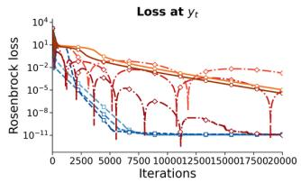

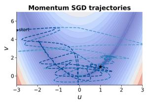

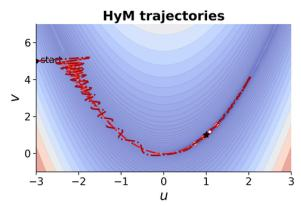

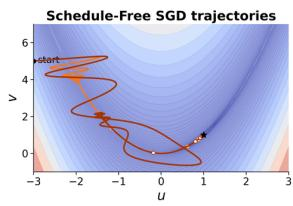

$$
\operatorname { s - c } \odot - \cdots \operatorname { \mathsf { S G D } } \mu = 0 . 9 \quad \operatorname { \mathsf { -- } C - } \quad \mathsf { H y W } \mu = 0 . 9 , ~ \beta = 0 . 9 \quad \operatorname { \mathsf { -- } C - } \operatorname { \mathsf { S F - S G D } } \beta = 0 . 9
$$

$$
\operatorname { s - c } \ \operatorname { c } \operatorname { c } - \ \operatorname { \mathrm { ~ \mathsf { G } } } \operatorname { D } \ \mu = 0 . 9 5 \ \operatorname { \mathrm { ~ et ~ { ~ 2 ~ } ~ } } \operatorname { H } \operatorname { y } \mathsf { M } \ \mu = 0 . 9 5 , ~ \beta = 0 . 9 \ \operatorname { \mathrm { ~ et ~ { ~ 2 ~ } ~ } } \operatorname { S F } \operatorname { \mathrm { - } } \operatorname { S G D } \ \beta = 0 . 9 9 \ \operatorname { \mathrm { ~ et ~ { ~ 2 ~ } ~ } } \operatorname { v } \operatorname { c } \operatorname { c } \operatorname { c } \operatorname { d } \phi = 0 . 9 9 \ \operatorname { \mathrm { ~ et ~ { ~ 2 ~ } ~ } } \operatorname { v } \operatorname { c } ( \operatorname { c } { \mathrm { ~ \mathsf { ) } } } ( \operatorname { c } { \mathrm { ~ \partial ~ } \psi } ) .
$$

$$
{ \mathrm { ~  ~ \mu ~ } } _ { \mathrm { ~ \tiny ~ - - - } } \mathrm { ~  ~ \cal ~ S G D ~ } \mu = 0 . 9 9 \mathrm { ~  ~ \cdots ~ } { \mathrm { ~  ~ \not { V } ~ } } { \mathrm { ~  ~ \mu ~ } } _ { \mathrm { ~ \tiny ~ \mu ~ } } = 0 . 9 9 , \beta = 0 . 9
$$

Figure 6: Behavior of the Rosenbrock training iterates from $( - 3 , 5 )$ over 20,000 steps using exact gradients. Momentum SGD uses $\eta = 4 \times 1 0 ^ { - 3 }$ and $\mu \in \{ 0 . 9 , 0 . { \bar { 9 } } 5 , 0 . 9 9 \}$ ; HyM uses $\dot { \eta } = 3 \times 1 0 ^ { - 4 } , \bar { \beta } = 0 . \bar { 9 }$ , and $\mu \in \{ 0 . 9 , 0 . 9 5 , 0 . 9 9 \}$ Schedule-Free SGD uses $\eta = 7 \times 1 0 ^ { - 4 }$ and $\beta \in \{ 0 . { \dot { 9 } } , 0 . 9 9 \}$ . The left panel shows objective values at $\mathbf { y } _ { t } ;$ the remaining panels show the trajectories over objective contours. The star marks the minimizer (1, 1).

Gradient memory determines the training trajectory, whereas iterate averaging forms a separate sequence from the training iterates. In HyMUON, the two momentum states are combined before the nonlinear NS transformation. Consequently, averaging gradients is distinct from averaging the transformed update directions.

Effect of iterate averaging in a curved valley. Let $v = \phi ( u )$ denote a valley centerline and let $\{ ( u _ { i } , v _ { i } ) \} _ { i = 1 } ^ { N }$ be N training iterates with $\pi _ { i } \geq 0$ and $\begin{array} { r } { \sum _ { i = 1 } ^ { N } { \pi } _ { i } = 1 } \end{array}$ . Write

$$
\bar { u } = \sum _ { i = 1 } ^ { N } \pi _ { i } u _ { i } , \quad \quad \bar { v } = \sum _ { i = 1 } ^ { N } \pi _ { i } v _ { i } .
$$

The averaged iterate has the exact centerline residual

$$
\bar { v } - \phi ( \bar { u } ) = \underbrace { \sum _ { i = 1 } ^ { N } \pi _ { i } \bigl ( v _ { i } - \phi ( u _ { i } ) \bigr ) } _ { \mathrm { ~ a v e r a g e d ~ t r a c k i n g ~ r e s i d u a l } } + \underbrace { \left( \sum _ { i = 1 } ^ { N } \pi _ { i } \phi ( u _ { i } ) - \phi \mathopen { } \mathclose \bgroup \left( \sum _ { i = 1 } ^ { N } \pi _ { i } u _ { i } \aftergroup \egroup \right) \right) } _ { \mathrm { ~ a v e r a g i n g ~ g a p ~ d u e ~ t o ~ c u r v a t u r e } } .\tag{26}
$$

Thus even points lying exactly on the centerline can average to a point away from it. If $\phi$ is twice differentiable and $| \phi ^ { \prime \prime } ( u ) | \leq \dot { M }$ on the convex hull of the $u _ { i } ,$ Taylor’s theorem gives

$$
\left| \sum _ { i = 1 } ^ { N } \pi _ { i } \phi ( u _ { i } ) - \phi ( \bar { u } ) \right| \leq \frac { M } { 2 } \sum _ { i = 1 } ^ { N } \pi _ { i } ( u _ { i } - \bar { u } ) ^ { 2 } .\tag{27}
$$

For the Rosenbrock valley centerline $\phi ( u ) = u ^ { 2 } ,$ , the bound holds with $M = 2 .$

This decomposition separates two effects of iterate averaging. Averaging can reduce tracking residuals that change sign across iterates, while curvature can move the averaged point away from the valley centerline.

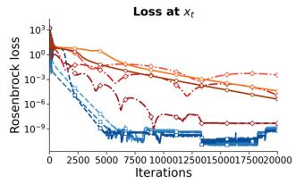

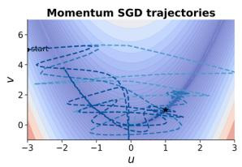

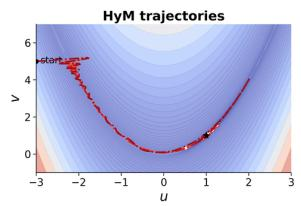

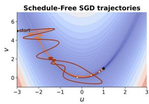

$$
\operatorname { s - c } \odot - \cdots \operatorname { \mathsf { S G D } } \mu = 0 . 9 \quad \operatorname { \mathsf { -- } C - } \quad \mathsf { H y W } \mu = 0 . 9 , ~ \beta = 0 . 9 \quad \operatorname { \mathsf { -- } C - } \operatorname { \mathsf { S F - S G D } } \beta = 0 . 9
$$

$$
\operatorname { s - c } \ \operatorname { c } \operatorname { c } - \ \operatorname { \mathrm { ~ \mathsf { G } } } \operatorname { D } \ \mu = 0 . 9 5 \ \operatorname { \mathrm { ~ et ~ { ~ 2 ~ } ~ } } \operatorname { H } \operatorname { y } \mathsf { M } \ \mu = 0 . 9 5 , ~ \beta = 0 . 9 \ \operatorname { \mathrm { ~ et ~ { ~ 2 ~ } ~ } } \operatorname { S F } \operatorname { \mathrm { - } } \operatorname { S G D } \ \beta = 0 . 9 9 \ \operatorname { \mathrm { ~ et ~ { ~ 2 ~ } ~ } } \operatorname { v } \operatorname { c } \operatorname { c } \operatorname { c } \operatorname { d } \phi = 0 . 9 9 \ \operatorname { \mathrm { ~ et ~ { ~ 2 ~ } ~ } } \operatorname { v } \operatorname { c } ( \operatorname { c } { \mathrm { ~ \mathsf { ) } } } ( \operatorname { c } { \mathrm { ~ \partial ~ } \psi } ) .
$$

$$
{ \mathrm { ~  ~ \mu ~ } } _ { \mathrm { ~ \tiny ~ - - - } } \mathrm { ~  ~ \cal ~ S G D ~ } \mu = 0 . 9 9 \mathrm { ~  ~ \cdots ~ } { \mathrm { ~  ~ \not { V } ~ } } { \mathrm { ~  ~ \mu ~ } } _ { \mathrm { ~ \tiny ~ \mu ~ } } = 0 . 9 9 , \beta = 0 . 9
$$

Figure 7: Averaged iterates for the Rosenbrock runs in Figure 6, using the same initialization, optimizer settings, and 20,000 steps using exact gradients. HyM uses $\beta = 0 . 9$ for iterate averaging; Momentum SGD is evaluated at an averaged iterate formed with $\beta = 0 . 9 9$ , and this average does not enter its updates; Schedule-Free SGD uses its respective $\beta \in \{ 0 . 9 , 0 . 9 9 \}$ . The left panel shows objective values at $\mathbf { x } _ { t } ;$ the remaining panels show the averaged trajectories over objective contours. The star marks the minimizer (1, 1).

The CIFAR-10 component ablation evaluates these roles separately by measuring each training trajectory at both the training and averaged iterates (Appendix F.3).

## C Convergence analysis via cumulative gradient weights

Sections C.1–C.4 develop the convex analysis of the averaged iterate through the Bregman identity, a general theorem over a finite horizon, a bound on HyM’s cumulative gradient weight deviations, and the resulting convergence rate. Section C.5 shows that the same uniform bound holds for finite EMA mixtures.

We prove the general result of Theorem 1 and specialize it to HyM. Throughout this appendix, $\eta > 0$ is constant within a run, $\Gamma > 0 .$ , and $\varsigma = \sigma / \sqrt { B } \geq 0$ . The initial point is deterministic. All iterates and interpolation coefficients are $\mathcal { F } _ { t - 1 }$ -measurable before $\mathbf { g } _ { t }$ is sampled at iteration t; a sequence with this property is predictable. Because the samples in $B _ { t }$ are conditionally independent given $\mathcal { F } _ { t - 1 }$ , Assumption 2 implies that the mini-batch gradient at the training iterate $\mathbf { y } _ { t }$ satisfies

$$
\begin{array} { r } { \mathbb { E } [ \mathbf { g } _ { t } \mid \mathcal { F } _ { t - 1 } ] = \nabla f ( \mathbf { y } _ { t } ) , \qquad \mathbb { E } [ \| \mathbf { g } _ { t } - \nabla f ( \mathbf { y } _ { t } ) \| ^ { 2 } \mid \mathcal { F } _ { t - 1 } ] \le \varsigma ^ { 2 } . } \end{array}\tag{28}
$$

We write $\pmb { \varepsilon } _ { t } = \mathbf { g } _ { t } - \nabla f ( \mathbf { y } _ { t } )$ and $\begin{array} { r } { Q _ { T } = \sum _ { t = 1 } ^ { T } \mathbb { E } \| \nabla f ( \mathbf { y } _ { t } ) \| ^ { 2 } } \end{array}$ . For the recursion in (8), all iterates and gradients have finite second moments at each finite horizon. This follows by induction from the deterministic initial point and cumulative gradient weights, the bounded interpolation coefficients, the Lipschitz gradient, and the oracle variance bound. The representation of the derived base iterates through cumulative gradient weights is exact; weight decay, nonlinear preconditioning, and NS orthogonalization are outside this analysis with deterministic scalar weights.

## C.1 The averaged iterate and the Bregman term

For HyM, let $\lambda = 1 - \beta > 0$ and define

$$
\mathbf { v } _ { t } = \frac { \mathbf { y } _ { t } - \beta \mathbf { x } _ { t } } { \lambda } .\tag{29}
$$

The averaging recurrence in Algorithm 1 gives

$$
\mathbf { v } _ { t } = t \mathbf { x } _ { t } - ( t - 1 ) \mathbf { x } _ { t - 1 } , \qquad \mathbf { x } _ { t } = { \frac { 1 } { t } } \sum _ { i = 1 } ^ { t } \mathbf { v } _ { i } , \qquad \mathbf { y } _ { t } = \lambda \mathbf { v } _ { t } + \beta \mathbf { x } _ { t } .\tag{30}
$$

Thus the algorithm’s final averaged iterate is the arithmetic mean of its derived base sequence. The following conversion also permits predictable interpolation that varies with time.

Lemma C.1. Let f be convex and L-smooth on $\mathbb { R } ^ { d } , L > 0 ,$ with minimizer $\mathbf { x } ^ { * }$ . Suppose $\begin{array} { r } { { \bf x } _ { t } = t ^ { - 1 } \sum _ { i = 1 } ^ { t } { \bf v } _ { i } } \end{array}$ and $\mathbf { y } _ { t } = ( 1 - \zeta _ { t } ) \mathbf { v } _ { t } + \zeta _ { t } \mathbf { x } _ { t }$ with predictable $\zeta _ { t } \in [ 0 , 1 ]$ and predictable, square-integrable $\mathbf { v } _ { t } .$ . Under (28),

$$
T \mathbb { E } [ f ( \mathbf { x } _ { T } ) - f ( \mathbf { x } ^ { * } ) ] + \frac { Q _ { T } } { 2 L } \leq \sum _ { t = 1 } ^ { T } \mathbb { E } \langle \mathbf { g } _ { t } , \mathbf { v } _ { t } - \mathbf { x } ^ { * } \rangle .\tag{31}
$$

Proof. Set $\mathscr { D } _ { t } ( \mathbf { u } ) = f ( \mathbf { u } ) - f ( \mathbf { y } _ { t } ) - \langle \nabla f ( \mathbf { y } _ { t } ) , \mathbf { u } - \mathbf { y } _ { t } \rangle , \Psi _ { t } = t ( f ( \mathbf { x } _ { t } ) - f ( \mathbf { x } ^ { * } ) )$ , and $\Psi _ { 0 } = 0$ . For $t \geq 2$ , the identity $\mathbf v _ { t } = t { \mathbf x } _ { t } - ( t - 1 ) { \mathbf x } _ { t - 1 }$ yields

$$
\langle \nabla f ( \mathbf { y } _ { t } ) , \mathbf { v } _ { t } - \mathbf { x } ^ { * } \rangle - ( \Psi _ { t } - \Psi _ { t - 1 } ) = \mathcal { D } _ { t } ( \mathbf { x } ^ { * } ) + ( t - 1 ) \mathcal { D } _ { t } ( \mathbf { x } _ { t - 1 } ) - t \mathcal { D } _ { t } ( \mathbf { x } _ { t } ) .\tag{32}
$$

Moreover,

$$
\mathbf { x } _ { t } = ( 1 - \nu _ { t } ) \mathbf { y } _ { t } + \nu _ { t } \mathbf { x } _ { t - 1 } , \qquad \nu _ { t } = { \frac { ( 1 - \zeta _ { t } ) ( t - 1 ) } { 1 + ( 1 - \zeta _ { t } ) ( t - 1 ) } } , \qquad t \nu _ { t } \leq t - 1 .
$$

Convexity of $\mathcal { D } _ { t } ,$ , together with $\mathcal { D } _ { t } ( \mathbf { y } _ { t } ) = 0$ , implies $t \mathcal { D } _ { t } ( \mathbf { x } _ { t } ) \leq ( t - 1 ) \mathcal { D } _ { t } ( \mathbf { x } _ { t - 1 } ) . \mathrm { ~ A t ~ } t = 1 , \mathbf { v } _ { 1 } = \mathbf { x } _ { 1 } = \mathbf { y } _ { 1 }$ ; hence, the same conclusion holds with the term involving $\mathbf { x } _ { t - 1 }$ omitted because its coefficient is zero. For an unconstrained minimizer $\nabla f ( \mathbf { x } ^ { * } ) = 0 ;$ the standard inequality for convex L-smooth functions

$$
f ( \mathbf { u } ) \geq f ( \mathbf { v } ) + \langle \nabla f ( \mathbf { v } ) , \mathbf { u } - \mathbf { v } \rangle + { \frac { 1 } { 2 L } } \| \nabla f ( \mathbf { u } ) - \nabla f ( \mathbf { v } ) \| ^ { 2 }
$$

therefore gives $\mathcal { D } _ { t } ( \mathbf { x } ^ { * } ) \geq \| \nabla f ( \mathbf { y } _ { t } ) \| ^ { 2 } / ( 2 L )$ . Combining these inequalities with (32), summing over $t = 1 , \dots , T$ , and using $\Psi _ { 0 } = 0$ yields

$$
T \mathbb { E } [ f ( { \mathbf { x } } _ { T } ) - f ( { \mathbf { x } } ^ { * } ) ] + \frac { Q _ { T } } { 2 L } \leq \sum _ { t = 1 } ^ { T } \mathbb { E } \langle \nabla f ( { \mathbf { y } } _ { t } ) , { \mathbf { v } } _ { t } - { \mathbf { x } } ^ { * } \rangle .
$$

Finally, since $\mathbf { v } _ { t }$ is $\mathcal { F } _ { t - 1 }$ -measurable, the conditional unbiasedness in (28) gives

$$
\begin{array} { r } { \mathbb { E } \langle \mathbf { g } _ { t } , \mathbf { v } _ { t } - \mathbf { x } ^ { * } \rangle = \mathbb { E } \langle \nabla f ( \mathbf { y } _ { t } ) , \mathbf { v } _ { t } - \mathbf { x } ^ { * } \rangle . } \end{array}
$$

Substitution proves (31).

The term $Q _ { T } / ( 2 L )$ retained on the left side of $( 3 1 )$ is the Bregman contribution used below to control the terms involving deviations of the cumulative gradient weights. This strengthens the online-to-batch inequality with equal weights used in the Schedule-Free analysis [Defazio et al., 2024].

## C.2 A theorem for cumulative gradient weights over a finite horizon

Suppose the base sequence in (8) has deterministic weight deviations $e _ { t , k } = K _ { t , k } - \Gamma$ . Define $E _ { T } \in \mathbb { R } ^ { T \times T }$ by $( E _ { T } ) _ { t , k } = e _ { t , k }$ for $1 \leq k < t \leq T$ , and zero otherwise. Set

$$
\mathcal { E } _ { T } = \Vert E _ { T } \Vert _ { \mathrm { F } } ^ { 2 } = \sum _ { t = 1 } ^ { T } \sum _ { k = 1 } ^ { t - 1 } e _ { t , k } ^ { 2 } , \qquad \chi _ { T } = \left[ - \lambda _ { \mathrm { m i n } } \left( \frac { E _ { T } + E _ { T } ^ { \top } } { 2 } \right) \right] _ { + } .\tag{33}
$$

Here $\Vert \cdot \Vert _ { \mathrm { F } }$ is the Frobenius norm, $\lambda _ { \operatorname* { m i n } }$ denotes the smallest eigenvalue of a symmetric matrix, and $[ r ] _ { + } = \operatorname* { m a x } \{ r , 0 \}$ Acting on a stacked vector sequence, $E _ { T }$ means $E _ { T } \otimes I _ { d } .$ , where ⊗ is the Kronecker product and $I _ { d }$ is the $d \times d$ identity matrix. Its norms are those of the scalar time matrix.

Theorem C.1. Under the assumptions of Lemma $C . l ,$ , suppose (8) holds with deterministic $\mathbf { v } _ { 1 }$ and $0 < \eta \leq [ 2 L ( \Gamma +$ $2 \chi _ { T } ) ] ^ { - 1 }$ . Then

$$
T \mathbb { E } [ f ( \mathbf { x } _ { T } ) - f ( \mathbf { x } ^ { * } ) ] + \frac { Q _ { T } } { 8 L } \leq \frac { \Vert \mathbf { v } _ { 1 } - \mathbf { x } ^ { * } \Vert ^ { 2 } } { 2 \eta \Gamma } + \frac { \eta \Gamma \varsigma ^ { 2 } T } { 2 } + 2 L \eta ^ { 2 } \varsigma ^ { 2 } \mathcal { E } _ { T } .\tag{34}
$$

Proof. Reference sequence. Define $\mathbf { u } _ { 1 } = \mathbf { v } _ { 1 }$ and $\mathbf { u } _ { t + 1 } = \mathbf { u } _ { t } - \eta \Gamma \mathbf { g } _ { t }$ . Expanding $\| \mathbf { u } _ { t + 1 } - \mathbf { x } ^ { * } \| ^ { 2 }$ and summing over t gives

$$
\sum _ { t = 1 } ^ { T } \mathbb { E } \langle \mathbf { g } _ { t } , \mathbf { u } _ { t } - \mathbf { x } ^ { * } \rangle \leq \frac { \Vert \mathbf { v } _ { 1 } - \mathbf { x } ^ { * } \Vert ^ { 2 } } { 2 \eta \Gamma } + \frac { \eta \Gamma } { 2 } ( Q _ { T } + \varsigma ^ { 2 } T ) .\tag{35}
$$

Here we used $\begin{array} { r } { \mathbb { E } \| \mathbf { g } _ { t } \| ^ { 2 } = \mathbb { E } \| \nabla f ( \mathbf { y } _ { t } ) \| ^ { 2 } + \mathbb { E } \| \boldsymbol { \varepsilon } _ { t } \| ^ { 2 } \leq \mathbb { E } \| \nabla f ( \mathbf { y } _ { t } ) \| ^ { 2 } + \varsigma ^ { 2 } } \end{array}$ , which follows from $\mathbb { E } [ \pmb { \varepsilon } _ { t } \ | \ \mathcal { F } _ { t - 1 } ] = 0$ . Deviation from the reference sequence. The predictable difference between base and reference sequences is

$$
\delta _ { t } ^ { v } = \mathbf { v } _ { t } - \mathbf { u } _ { t } = - \eta \sum _ { k = 1 } ^ { t - 1 } e _ { t , k } \mathbf { g } _ { k } .\tag{36}
$$

For compact notation in the following matrix calculation, write $\mathbf h _ { t } = \nabla f ( \mathbf y _ { t } )$ and define the stacked vectors $\mathbf { h } =$ $( \mathbf { h } _ { 1 } ^ { \top } , \ldots , \mathbf { \dot { h } } _ { T } ^ { \top } ) ^ { \top }$ and $\pmb { \varepsilon } = ( \pmb { \varepsilon } _ { 1 } ^ { \top } , \dots , \pmb { \varepsilon } _ { T } ^ { \top } ) ^ { \top }$ in $\mathbb { R } ^ { T d }$ . Since $\delta _ { t } ^ { v }$ is $\mathcal { F } _ { t - 1 }$ -measurable, $\mathbb { E } \langle \varepsilon _ { t } , \delta _ { t } ^ { v } \rangle = 0$ , and hence

$$
\sum _ { t = 1 } ^ { T } \mathbb { E } \langle \mathbf { g } _ { t } , \delta _ { t } ^ { v } \rangle = - \eta \mathbb { E } \langle \mathbf { h } , E _ { T } \mathbf { h } \rangle - \eta \mathbb { E } \langle \mathbf { h } , E _ { T } \varepsilon \rangle .\tag{37}
$$

The symmetric part of $E _ { T } \mathrm { g i v e s } - \mathbb { E } \langle { \bf h } , E _ { T } { \bf h } \rangle \leq \chi _ { T } Q _ { T }$ . For $k < \ell ,$ conditional mean zero gives $\mathbb { E } \langle \pmb { \varepsilon } _ { k } , \pmb { \varepsilon } _ { \ell } \rangle = 0$ . Since the coefficients are deterministic,

$$
\mathbb { E } \| E _ { T } \pmb { \varepsilon } \| ^ { 2 } = \sum _ { t = 1 } ^ { T } \sum _ { k = 1 } ^ { t - 1 } e _ { t , k } ^ { 2 } \mathbb { E } \| \pmb { \varepsilon } _ { k } \| ^ { 2 } \leq \varsigma ^ { 2 } \mathcal { E } _ { T } .\tag{38}
$$

Historical noise can be correlated with later gradients. Hence its interaction is bounded by Cauchy–Schwarz:

$$
| \mathbb { E } \langle \mathbf { h } , E _ { T } \pmb \varepsilon \rangle | \leq \sqrt { \mathbb { E } \| \mathbf { h } \| ^ { 2 } } \sqrt { \mathbb { E } \| E _ { T } \pmb \varepsilon \| ^ { 2 } } \leq \varsigma \sqrt { \mathcal { E } _ { T } Q _ { T } } .
$$

Together with (37), this gives

$$
\sum _ { t = 1 } ^ { T } \mathbb { E } \langle \mathbf { g } _ { t } , \pmb { \delta } _ { t } ^ { v } \rangle \leq \eta \chi _ { T } Q _ { T } + \eta \varsigma \sqrt { { \mathscr E } _ { T } Q _ { T } } .
$$

Conclusion. Combining with (31) and (35),

$$
T \mathbb { E } [ f ( \mathbf { x } _ { T } ) - f ( \mathbf { x } ^ { * } ) ] + \left( \frac { 1 } { 2 L } - \frac { \eta \Gamma } { 2 } - \eta \chi _ { T } \right) Q _ { T } \leq \frac { \Vert \mathbf { v } _ { 1 } - \mathbf { x } ^ { * } \Vert ^ { 2 } } { 2 \eta \Gamma } + \frac { \eta \Gamma \varsigma ^ { 2 } T } { 2 } + \eta \varsigma \sqrt { \mathcal { E } _ { T } Q _ { T } } .
$$

The condition on the step size leaves at least $Q _ { T } / ( 4 L )$ on the left. Young’s inequality $\eta \varsigma \sqrt { \mathcal { E } _ { T } Q _ { T } } \leq Q _ { T } / ( 8 L ) +$ $2 L \eta ^ { 2 } \varsigma ^ { 2 } \mathcal { E } _ { T }$ proves (34). □

Proof of Theorem 1. The row bound implies $\mathcal { E } _ { T } \leq C _ { E } T$ and $\chi _ { T } \leq \| E _ { T } \| _ { \mathrm { o p } } \leq \| E _ { T } \| _ { \mathrm { F } } \leq \sqrt { C _ { E } T }$ . For $T \geq 1$ , the stated $\eta _ { 0 }$ ensures $\eta ( \Gamma + 2 \chi _ { T } ) \leq \eta _ { 0 } ( \Gamma / \sqrt { T } + 2 \sqrt { C _ { E } } ) \leq \eta _ { 0 } ( \Gamma + 2 \sqrt { C _ { E } } ) \leq 1 / ( 2 L )$ . Substitute $\eta = \eta _ { 0 } / \sqrt { T }$ into (34), divide by T, and use $\mathcal { E } _ { T } \leq C _ { E } T$ in the noise term. Dropping the nonnegative term $\mathbf { \xi } _ { Q _ { T } / ( 8 L T ) }$ gives the stated bound on the objective value. □

The two quantities control different terms: $\chi _ { T }$ bounds $- \mathbb { E } \langle { \bf h } , E _ { T } { \bf h } \rangle$ ⟩, whereas ${ \mathcal { E } } _ { T }$ bounds $\mathbb { E } \Vert E _ { T } \varepsilon \Vert ^ { 2 }$ through (38). For Schedule-Free SGD with equal weights, $E _ { T } = 0 , \Gamma = 1$ , and both penalties vanish.

## C.3 Bounding cumulative gradient weight deviations for HyM

Fix $\mu \in ( 0 , 1 ) , \beta \in [ 0 , 1 ) , \lambda = 1 - \beta$ , and $\Gamma = ( 1 - \mu ) ^ { - 1 }$ . Write $q _ { t } = ( 1 - \mu ^ { t } ) / ( 1 - \mu )$ and $a _ { t } = [ 1 + \lambda ( t - 1 ) ] ^ { - 1 }$ as in Algorithm 1. For $1 \leq i \leq t ,$ set

$$
\Pi _ { i + 1 , t } = \prod _ { j = i + 1 } ^ { t } ( 1 - a _ { j } ) , \qquad \omega _ { i , t } = 1 + \frac { \beta } { \lambda } \Pi _ { i + 1 , t } ,
$$

where empty products equal one. Define

$$
C _ { H } = \frac { \beta \Gamma ( 1 + \Gamma ) + \mu \Gamma ^ { 2 } } { \lambda } , \qquad C _ { E } ^ { \mathtt { H y M } } = \frac { \pi ^ { 2 } C _ { H } ^ { 2 } } { 3 } + \frac { 2 \Gamma ^ { 2 } \mu ^ { 2 } } { 1 - \mu ^ { 2 } } .\tag{39}
$$

Lemma C.2. The base sequence $\left\{ \mathbf { v } _ { t } \right\}$ has the exact representation

$$
\mathbf { v } _ { t } = \mathbf { y } _ { 1 } - \eta \sum _ { k = 1 } ^ { t - 1 } K _ { t , k } \mathbf { g } _ { k } ,\tag{40}
$$

$$
K _ { t , k } = \sum _ { i = k } ^ { t - 1 } \omega _ { i , t } \left( \frac { \beta q _ { i } k } { i ^ { 2 } } + \lambda \frac { k } { i } \mu ^ { i - k } \right) .\tag{41}
$$

$I f e _ { t , k } = K _ { t , k } - \Gamma ,$ , then

$$
\vert e _ { t , k } \vert \leq \frac { C _ { H } } { k } + \Gamma \mu ^ { t - k } , \qquad \sum _ { k = 1 } ^ { t - 1 } e _ { t , k } ^ { 2 } \leq C _ { E } ^ { H \gamma M } .\tag{42}
$$

The coefficients and bounds are deterministic.

Proof. Representation. Unrolling the two momentum states gives

$$
r _ { t } \mathbf { m } _ { t } = { \frac { q _ { t } } { t ^ { 2 } } } \sum _ { k = 1 } ^ { t } k \mathbf { g } _ { k } , \qquad \mathbf { b } _ { t } = \sum _ { k = 1 } ^ { t } { \frac { k } { t } } \mu ^ { t - k } \mathbf { g } _ { k } .\tag{43}
$$

Let $\delta _ { t } = \mathbf { y } _ { t } - \mathbf { x } _ { t }$ . The recurrence for iterate averaging implies $\delta _ { t + 1 } = ( 1 - a _ { t + 1 } ) ( \delta _ { t } - \eta \Delta _ { t } )$ . Since $\delta _ { 1 } = 0$

$$
\mathbf { v } _ { t } = \mathbf { y } _ { t } + \frac { \beta } { \lambda } \pmb { \delta } _ { t } = \mathbf { y } _ { 1 } - \eta \sum _ { i = 1 } ^ { t - 1 } \omega _ { i , t } \pmb { \Delta } _ { i } .
$$

Substitution of (43) proves (40)–(41).

Constant reference weights. The constant reference weight Γ admits the identity

$$
\Gamma \beta \sum _ { i = k } ^ { t - 1 } \omega _ { i , t } \frac { k } { i ( i + 1 ) } + \Gamma \lambda \omega _ { k , t } = \Gamma .\tag{44}
$$

For $\beta > 0 .$ , this follows from

$$
\sum _ { i = k } ^ { t - 1 } { \frac { k \Pi _ { i + 1 , t } } { i ( i + 1 ) } } = { \frac { \lambda } { \beta } } \left( { \frac { k } { t } } - \Pi _ { k + 1 , t } \right)\tag{45}
$$

and $\begin{array} { r } { \sum _ { i = k } ^ { t - 1 } k / ( i ( i + 1 ) ) = 1 - k / t } \end{array}$ . To verify (45), let $r _ { i } = \Pi _ { i + 1 , t } / i$ . From $\Pi _ { i + 2 , t } = \Pi _ { i + 1 , t } ( i + \lambda ^ { - 1 } ) / i$ , one obtains $r _ { i + 1 } - r _ { i } = ( \lambda ^ { - 1 } - 1 ) \Pi _ { i + 1 , t } / ( i ( i + 1 ) )$ , and the result follows by telescoping. For $\beta = 0 , ( 4 4 )$ is immediate.

Deviation bound. Subtracting (44) from (41) expresses $e _ { t , k }$ as the sum of the differences in the slow and fast terms. Since $1 \leq \omega _ { i , t } \leq 1 / \lambda$ and $q _ { i } = \Gamma ( 1 - \mu ^ { i } )$ , the slow difference satisfies

$$
\left| \beta \sum _ { i = k } ^ { t - 1 } \omega _ { i , t } k \left( \frac { q _ { i } } { i ^ { 2 } } - \frac { \Gamma } { i ( i + 1 ) } \right) \right|
$$

$$
\leq \frac { \beta \Gamma k } { \lambda } \sum _ { i = k } ^ { t - 1 } \left( \frac { 1 } { i ^ { 2 } ( i + 1 ) } + \frac { \mu ^ { i } } { i ^ { 2 } } \right)
$$

$$
\leq \frac { \beta \Gamma } { \lambda k } ( 1 + \Gamma \mu ^ { k } ) \leq \frac { \beta \Gamma ( 1 + \Gamma ) } { \lambda k } .
$$

$$
\begin{array} { r } { \sum _ { i = k } ^ { \infty } [ i ^ { 2 } ( i + 1 ) ] ^ { - 1 } \le k ^ { - 1 } \sum _ { i = k } ^ { \infty } [ i ( i + 1 ) ] ^ { - 1 } = k ^ { - 2 } \mathrm { ~ a n d } \sum _ { i = k } ^ { \infty } \mu ^ { i } / i ^ { 2 } \le \Gamma \mu ^ { k } / k ^ { 2 } . } \end{array}
$$

For the fast difference, the product recurrence $\begin{array} { r } { \mathrm { g i v e s } \ \omega _ { j + 1 , t } - \omega _ { j , t } = ( \beta / \lambda ) \ddot { a } _ { j + 1 } \Pi _ { j + 2 , t } \cdot \mathrm { S i n c e } \ \omega _ { i , t } \geq 1 , \omega _ { i , t } - \omega _ { k , t } \leq } \end{array}$ $\beta ( i - k ) / ( \lambda ^ { 2 } k )$ , and $\omega _ { k , t } \leq 1 / \lambda$ for $k \leq i < t .$

$$
0 \leq \omega _ { i , t } - \omega _ { k , t } = \frac { \beta } { \lambda } \sum _ { j = k } ^ { i - 1 } a _ { j + 1 } \Pi _ { j + 2 , t } \leq \frac { \beta ( i - k ) } { \lambda ^ { 2 } k } .
$$

Consequently, since $\beta + \lambda = 1$

$$
\begin{array} { c } { \displaystyle \left| \omega _ { i , t } \frac { k } { i } - \omega _ { k , t } \right| \leq \frac { k } { i } | \omega _ { i , t } - \omega _ { k , t } | + \omega _ { k , t } \left( 1 - \frac { k } { i } \right) } \\ { \leq \frac { \beta ( i - k ) } { \lambda ^ { 2 } k } + \frac { i - k } { \lambda k } = \frac { i - k } { \lambda ^ { 2 } k } . } \end{array}
$$

Separating the finite geometric sum from its tail therefore gives

$$
\left| \lambda \sum _ { i = k } ^ { t - 1 } \omega _ { i , t } \frac { k } { i } \mu ^ { i - k } - \lambda \Gamma \omega _ { k , t } \right|
$$

$$
\leq \frac { 1 } { \lambda k } \sum _ { j = 0 } ^ { t - k - 1 } j \mu ^ { j } + \lambda \omega _ { k , t } \sum _ { j = t - k } ^ { \infty } \mu ^ { j }
$$

$$
\leq \frac { \mu \Gamma ^ { 2 } } { \lambda k } + \Gamma \mu ^ { t - k } ,
$$

where $\textstyle \sum _ { i = 0 } ^ { \infty } j \mu ^ { j } = \mu \Gamma ^ { 2 }$ and $\lambda \omega _ { k , t } \leq 1$ . Adding the two differences proves $\vert e _ { t , k } \vert \le C _ { H } / k + \Gamma \mu ^ { t - k }$ . Finally, using $( a + b ) ^ { 2 } \leq 2 a ^ { 2 } + 2 b ^ { 2 }$

$$
\begin{array} { r } { \displaystyle \sum _ { k = 1 } ^ { t - 1 } e _ { t , k } ^ { 2 } \leq 2 C _ { H } ^ { 2 } \displaystyle \sum _ { k = 1 } ^ { t - 1 } \frac { 1 } { k ^ { 2 } } + 2 \Gamma ^ { 2 } \displaystyle \sum _ { j = 1 } ^ { t - 1 } \mu ^ { 2 j } } \\ { \leq \frac { \pi ^ { 2 } C _ { H } ^ { 2 } } { 3 } + \frac { 2 \Gamma ^ { 2 } \mu ^ { 2 } } { 1 - \mu ^ { 2 } } = C _ { E } ^ { \mathrm { H y M } } . } \end{array}
$$

This also holds at $t = 1$ , when the sum is empty, and completes the uniform bound independently of the training horizon. □

## C.4 Convergence of the averaged iterate for HyM

Proof of Corollary 1. Equations (30) and (40) give (8) with $\mathbf { v } _ { 1 } = \mathbf { y } _ { 1 } , \zeta _ { t } = \beta$ , and $\Gamma = ( 1 - \mu ) ^ { - 1 }$ . Lemma C.2 gives

$$
\vert e _ { t , k } \vert \leq { \frac { C _ { H } } { k } } + \Gamma \mu ^ { t - k } , \qquad 1 \leq k < t ,\tag{46}
$$

where $C _ { H } = [ \beta \Gamma ( 1 + \Gamma ) + \mu \Gamma ^ { 2 } ] / ( 1 - \beta )$ . Using $( a + b ) ^ { 2 } \leq 2 a ^ { 2 } + 2 b ^ { 2 }$ and summing over k yields

$$
\sum _ { k = 1 } ^ { t - 1 } e _ { t , k } ^ { 2 } \leq \frac { \pi ^ { 2 } C _ { H } ^ { 2 } } { 3 } + \frac { 2 \Gamma ^ { 2 } \mu ^ { 2 } } { 1 - \mu ^ { 2 } } = C _ { E } ^ { \mathrm { H y M } } < \infty .\tag{47}
$$

Thus, the bound in (47) holds uniformly in t. Since $C _ { E } ^ { \mathrm { H y M } }$ depends only on $\mu$ and $\beta ,$ we may choose any $0 < \eta _ { 0 } \leq$ $[ 2 L ( \Gamma + 2 \sqrt { C _ { E } ^ { \mathrm { H y M } } } ) ] ^ { - 1 }$ independently of T. Theorem 1 therefore yields

$$
\mathbb { E } [ f ( \mathbf { x } _ { T } ) - f ( \mathbf { x } ^ { * } ) ] \leq \frac { \Vert \mathbf { y } _ { 1 } - \mathbf { x } ^ { * } \Vert ^ { 2 } / ( 2 \eta _ { 0 } \Gamma ) + \eta _ { 0 } \Gamma \varsigma ^ { 2 } / 2 } { \sqrt { T } } + \frac { 2 L \eta _ { 0 } ^ { 2 } C _ { E } ^ { \mathrm { H y M } } \varsigma ^ { 2 } } { T } .\tag{48}
$$

The right-hand side is $\mathcal { O } ( T ^ { - 1 / 2 } )$ , which proves the claim.

All constants are independent of T for fixed $\mu , \beta .$ They can deteriorate as either parameter approaches 1. The proof uses convexity and the stochastic oracle, without strong convexity, bounded iterates, or uniformly bounded gradients. The analysis allows the effective history of the slow state to grow with T.

## C.5 Finite mixtures of EMAs with fixed decay rates

As an illustrative specialization, consider normalized EMA states initialized at zero, $\mathbf { m } _ { t } ^ { ( r ) } = \rho _ { r } \mathbf { m } _ { t - 1 } ^ { ( r ) } + ( 1 - \rho _ { r } ) \mathbf { g } _ { t }$ for $r = 1 , \ldots , R .$ where $0 \leq \rho _ { r } < 1$ , and $\begin{array} { r } { \mathbf { v } _ { t + 1 } = \mathbf { v } _ { t } - \eta \sum _ { r = 1 } ^ { R } a _ { r } \mathbf { m } _ { t } ^ { ( r ) } } \end{array}$ with $a _ { r } \geq 0$ and $\textstyle \Gamma = \sum _ { r = 1 } ^ { R } a _ { r } > 0$ . Taking $\zeta _ { t } = 0$ and $\begin{array} { r } { \mathbf { x } _ { t } = t ^ { - 1 } \sum _ { i = 1 } ^ { t } \mathbf { v } _ { i } } \end{array}$ gives an averaged iterate that does not enter the update of $\mathbf { v } _ { t } .$ . Unrolling gives

$$
e _ { t , k } = - \sum _ { r = 1 } ^ { R } a _ { r } \rho _ { r } ^ { t - k } , \qquad C _ { E } ^ { \mathrm { E M A } } = \sum _ { r = 1 } ^ { R } \sum _ { j = 1 } ^ { R } \frac { a _ { r } a _ { j } \rho _ { r } \rho _ { j } } { 1 - \rho _ { r } \rho _ { j } } , \qquad \chi _ { T } \leq \sum _ { r = 1 } ^ { R } \frac { a _ { r } \rho _ { r } } { 1 - \rho _ { r } } .
$$

Here $e _ { t , k }$ depends on the lag $t - k$ alone. The bound on the row square sums follows by summing the geometric cross terms; the operator bound follows from the sum of the absolute convolution weights. Theorem 1 therefore recovers a convergence guarantee for the averaged iterate under these linear combinations of estimates of the first moment. This includes the first moment component of AdEMAMix, which combines two EMA states with fixed decay rates and corresponds to $a _ { 1 } = 1 , a _ { 2 } = \alpha ;$ the full adaptive AdEMAMix denominator and schedules are not part of this example. Aggregated Heavy-Ball analyzes multiple momentum states [Danilova, 2022]. Generalized SGDM analyzes a single momentum state combined with the current gradient [Wang and Yurtsever, 2026].

The analysis builds on online-to-batch conversion [Defazio et al., 2024] and on perturbation arguments that compare the iterates with a reference sequence, as used in analyses of error feedback, delay, and compression [Karimireddy et al., 2019, Stich and Karimireddy, 2020]. Analyses of optimizers with stored gradient histories also appear in [McRae et al., 2022]. Here the uniform bound is imposed directly on the deterministic cumulative weight deviations $e _ { t , k } = K _ { t , k } - \Gamma$ in (8). The analysis uses the Bregman term to absorb the contribution of these weight deviations and bound the gap in objective value at the final averaged iterate. For HyM, the slow state has average lag $( t - 1 ) / 3$ , and its cumulative weight deviations satisfy the error bound (46).

## D HyMUON matrix updates and implementation

```latex
Algorithm 2 HyMUON matrix updates
Input: $\mathbf { Y } _ { 1 } \in \mathbb { R } ^ { m \times n } , \eta > 0 , \mu \in ( 0 , 1 ) , \beta \in [ 0 , 1 ) , B , T \in \mathbb { N } ;$ initialize ${ \bf M } _ { 0 } = { \bf B } _ { 0 } = { \bf 0 } , { \bf X } _ { 0 } = { \bf Y } _ { 1 }$
1: for $t = 1 , \dots , T$ do
2: Sample $\boldsymbol { B } _ { t } = ( \xi _ { t , j } ) _ { j = 1 } ^ { B }$ and set $\begin{array} { r } { \mathbf { G } _ { t } = B ^ { - 1 } \sum _ { j = 1 } ^ { B } \nabla f ( \mathbf { Y } _ { t } ; \boldsymbol { \xi } _ { t , j } ) } \end{array}$
3: $\mathbf { M } _ { t } = ( 1 - 1 / t ) \mathbf { M } _ { t - 1 } + \mathbf { G } _ { t }$ ▷ Slow state
4: $\mathbf { B } _ { t } = \dot { \mu ( 1 - \mathrm { 1 } / t ) } \mathbf { B } _ { t - 1 } + \mathbf { G } _ { t }$ ▷ Fast state
5: $\begin{array} { r } { \mathbf { D } _ { t } = \frac { \beta ( 1 - \mu ^ { t } ) } { t ( 1 - \mu ) } \mathbf { M } _ { t } + ( 1 - \beta ) \mathbf { B } _ { t } } \end{array}$
6: $\begin{array} { r } { a _ { t } = \frac { 1 } { 1 + ( 1 - \beta ) ( t - 1 ) } , \quad \mathbf { X } _ { t } = ( 1 - a _ { t } ) \mathbf { X } _ { t - 1 } + a _ { t } \mathbf { Y } _ { t } } \end{array}$
7: $\mathbf { Y } _ { t + 1 } = \mathbf { \dot { Y } } _ { t } - \eta \mathrm { \ N S } ( \mathbf { D } _ { t } )$
8: end for
Output: $\mathbf { X } _ { T }$
```

Here $2 \mathbf { M } _ { t } / ( t + 1 )$ equals the matrix-valued slow state in Algorithm $1 ; \mathrm { N S } ( \cdot )$ denotes the output of the finite Newton– Schulz iteration used to approximate the polar factor.

We extend the matrix updates above to the optimizer used for the entire model in the HyMUON experiments. The combined momentum for hidden matrices follows the matrix-valued recurrence in Algorithm 2. The implementation for the entire model uses five NS iterations and additionally includes shape scaling, decoupled weight decay, the learning rate schedules used in individual experiments, and the adaptive recurrences below. We set $c _ { t } = 1 / t$ . For a hidden parameter $\mathbf { Y } _ { t } \in \mathbb { R } ^ { m \times n }$ with gradient $\mathbf { G } _ { t }$ , the implementation initializes $\mathbf { M } _ { 0 } = \mathbf { B } _ { 0 } = \mathbf { 0 }$ and forms

$$
\mathbf { M } _ { t } = ( 1 - c _ { t } ) \mathbf { M } _ { t - 1 } + \mathbf { G } _ { t } ,\tag{49}
$$

$$
\mathbf { B } _ { t } = \mu ( 1 - c _ { t } ) \mathbf { B } _ { t - 1 } + \mathbf { G } _ { t } ,\tag{50}
$$

$$
\mathbf { D } _ { t } = \beta c _ { t } q _ { t } ( \mu ) \mathbf { M } _ { t } + ( 1 - \beta ) \mathbf { B } _ { t } , \qquad q _ { t } ( \rho ) = \frac { 1 - \rho ^ { t } } { 1 - \rho } ,\tag{51}
$$

$$
{ \bf U } _ { t } = s _ { m , n } \mathrm { N S } ( { \bf D } _ { t } ) , \qquad s _ { m , n } = \sqrt { \mathrm { m a x } \{ 1 , m / n \} } .\tag{52}
$$

Here $\mathrm { N S } ( \cdot )$ denotes the output of five quintic NS iterations; the shape factor $s _ { m , n }$ is applied afterwards. Both $\mathbf { G } _ { t }$ and the auxiliary gradient $\mathbf { g } _ { t }$ are mini-batch gradients at the current training iterates, as in Algorithm 2. For an auxiliary parameter tensor, let $\mathbf { h } _ { t } ^ { ( 1 ) } = \mathbf { g } _ { t }$ and $\mathbf { h } _ { t } ^ { ( 2 ) } = \mathbf { g } _ { t } \odot \mathbf { g } _ { t }$ . The coefficients $\rho _ { 1 }$ and $\rho _ { 2 }$ , corresponding to Adam’s $\beta _ { 1 }$ and $\beta _ { 2 }$ control the fast recurrences for estimates of the first and second moments. With all four unnormalized auxiliary moment states initialized to zero, the adaptive HyM branch computes, for $r \in \{ 1 , 2 \}$

$$
\mathbf { m } _ { t } ^ { ( r ) } = ( 1 - c _ { t } ) \mathbf { m } _ { t - 1 } ^ { ( r ) } + \mathbf { h } _ { t } ^ { ( r ) } ,\tag{53}
$$

$$
\mathbf { b } _ { t } ^ { ( r ) } = \rho _ { r } ( 1 - c _ { t } ) \mathbf { b } _ { t - 1 } ^ { ( r ) } + \mathbf { h } _ { t } ^ { ( r ) } ,\tag{54}
$$

$$
\mathbf { d } _ { t } ^ { ( r ) } = \beta c _ { t } q _ { t } ( \rho _ { r } ) \mathbf { m } _ { t } ^ { ( r ) } + ( 1 - \beta ) \mathbf { b } _ { t } ^ { ( r ) } ,\tag{55}
$$

$$
\mathbf { u } _ { t } = \mathbf { d } _ { t } ^ { ( 1 ) } \oslash \left( \sqrt { \mathbf { d } _ { t } ^ { ( 2 ) } } + \varepsilon \right) .\tag{56}
$$

Here $\odot$ and $\oslash$ denote elementwise multiplication and division. Write $\mathbf { y } _ { t }$ for the auxiliary training iterate and $\mathbf { x } _ { t }$ for the corresponding averaged iterate. Initialize $\mathbf { X } _ { 0 } = \mathbf { Y } _ { 1 }$ and $\mathbf x _ { 0 } = \mathbf y _ { 1 }$ . Before each training step, average both parameter groups using $\bar { a } _ { t } = 1 \bar { / } [ 1 + ( 1 - \beta ) ( t - 1 ) ]$ ]:

$$
\mathbf { X } _ { t } = ( 1 - a _ { t } ) \mathbf { X } _ { t - 1 } + a _ { t } \mathbf { Y } _ { t } , \qquad \mathbf { x } _ { t } = ( 1 - a _ { t } ) \mathbf { x } _ { t - 1 } + a _ { t } \mathbf { y } _ { t } .\tag{57}
$$

Here $\rho _ { 1 }$ and $\rho _ { 2 }$ set the decay rates, and hence the effective history lengths, of the auxiliary estimates of the first and second moments. The mixing weight $\beta$ combines the slow and fast estimates in both recurrences and determines the coefficient $a _ { t }$ for iterate averaging. For a hidden matrix and an auxiliary tensor, respectively, the subsequent updates with decoupled weight decay are

$$
\mathbf { Y } _ { t + 1 } = ( 1 - \eta _ { t } ^ { \mathrm { m a t } } \lambda _ { \mathrm { m a t } } ) \mathbf { Y } _ { t } - \eta _ { t } ^ { \mathrm { m a t } } \mathbf { U } _ { t } ,\tag{58}
$$

$$
\mathbf { y } _ { t + 1 } = ( 1 - \eta _ { t } ^ { \mathrm { a u x } } \lambda _ { \mathrm { a u x } } ) \mathbf { y } _ { t } - \eta _ { t } ^ { \mathrm { a u x } } \mathbf { u } _ { t } .\tag{59}
$$

For evaluation, all parameter groups are temporarily set to their respective $\mathbf { X } _ { t }$ and $\mathbf { x } _ { t }$ values; the training iterates are restored before the next step. Since the language models considered here do not use Batch Normalization, evaluation requires no recalibration of running statistics.

## E Diagnostic experiment details

This section provides the full protocols and additional results for the diagnostic experiments reported in Section 4. It covers the comparison across batch sizes, the construction and statistics of the semantic relevance experiment, and the interventions on one batch and on the slow momentum state.

## E.1 Dependence of the HyM advantage on batch size

Because the variance of a mini-batch gradient generally increases as the batch size decreases, we examine how the relative performance of HyM varies with batch size. We use CIFAR-10 with WideResNet-16-8 and CIFAR-100 with DenseNet-BC, training each model for 300 epochs on its full training set. We use $B \in \{ 8 , 1 6 , 3 2 , 1 2 8 , 2 5 6 , 1 0 2 4 , 2 0 4 8 \}$ on CIFAR-10 and B ∈ {64, 128, 256, 512, 1024} on CIFAR-100. Within each dataset, the model, augmentation, and optimizer settings other than the learning rate are fixed across batch sizes as in Appendix F.1; both methods use a 5% warmup followed by cosine decay, ending at half the peak learning rate for HyM and zero for SGD.

Peak learning rates use candidates specific to each method and batch size, obtained by linear scaling with batch size. Figure 8 reports test loss for the selected configuration of each method and batch size.

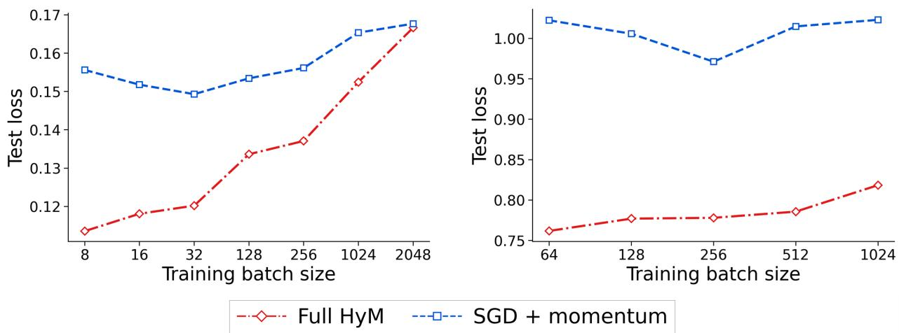  
Figure 8: Test loss against training batch size on CIFAR-10 (left) and CIFAR-100 (right). The learning rate is chosen separately for each method and batch size.

HyM has lower observed test loss at every plotted batch size. On CIFAR-10, the gap narrows from about 0.042 at $B = 8$ to 0.001 at $B = 2 0 4 8$ as the batch size increases. On CIFAR-100, the gap is about 0.261 at $B = 6 4$ and 0.205 at $B = 1 0 2 4$ , but does not vary monotonically across the intervening batch sizes.

## E.2 Semantic relevance and improvement specific to each target

Checkpoints and data. Section 4.3 uses GPT-2 124M checkpoints at 10k, 50k, and 100k steps of an AdamW run initialized from public GPT-2 weights and continued on OpenWebText. Each step processes 491,520 tokens. AdamW uses $( \beta _ { 1 } , \beta _ { 2 } ) = \mathsf { \bar { ( 0 . 9 , 0 . 9 5 ) } }$ , weight decay 0.1, a warmup over 2k steps to $6 \times 1 0 ^ { - 4 }$ , and cosine decay to $6 \times 1 0 ^ { - 5 }$ at 100k. The experiment loads model parameters only. Its 2,000 candidates are uniformly sampled training passages containing 256 tokens and lying within document boundaries. They are screened to exclude passages that are nearly duplicates of the target texts.

Targets and similarity. A fixed pretrained intfloat $/ \mathrm { e } 5 \mathrm { - } \mathrm { s m a } 1 1 \mathrm { - } \mathrm { v } 2$ encoder [Wang et al., 2022] embeds 16,384 validation passages, with a passage: prefix and masked mean pooling. We subtract the embedding mean and its first three principal components estimated on 4,096 background training passages, then normalize each embedding. MiniBatchKMeans partitions the embeddings into 128 clusters. We select ten clusters and take 64 passages from distinct documents in each cluster, dividing them evenly into 32 reference and 32 evaluation passages. Ten controls each mix 64 randomly chosen passages from other documents and use the same split. All passages contain 256 tokens. These targets are defined by the encoder rather than by annotated grammatical or factual categories. Semantic similarity is computed solely from the reference passages, whereas loss reduction is evaluated solely on the evaluation passages.

For a candidate’s embedding, its E5 score is the mean of its maximum and mean cosine similarity to the 32 reference embeddings. We also regress this score on two measures of lexical overlap within each target: the cosine similarity between vectors of token frequencies weighted by inverse document frequency, and the cosine similarity between vectors of bigram frequencies after centering with background statistics. The residual measures the part not linearly explained by these two measures. Gradient cosine similarity compares the candidate gradient with the gradient computed on the reference set at the same checkpoint.

Gradient updates with a fixed norm. For each candidate C, restore the checkpoint y and evaluate

$$
\mathbf { y } _ { C } = \mathbf { y } - \delta { \frac { \nabla { \mathcal { L } } _ { C } ( \mathbf { y } ) } { \| \nabla { \mathcal { L } } _ { C } ( \mathbf { y } ) \| } } , \qquad \delta = 3 \times 1 0 ^ { - 4 } .
$$

The update uses no momentum, weight decay, iterate averaging, or optimizer state carried over between candidates. Dropout is zero. For target V, define its loss reduction as $\tilde { I } ( C , \hat { V ) } = \mathcal { L } _ { V _ { \mathrm { e v a l } } } ( \mathbf { y } ) - \mathcal { L } _ { V _ { \mathrm { e v a l } } } ( \mathbf { y } _ { C } )$ . We define the improvement specific to target V by subtracting from $I ( C , V )$ the mean of $I ( C , V ^ { \prime } )$ over the other 19 targets. The analysis contains 120,000 measurements over candidates, targets, and checkpoints.

Aggregation. We use the two quantities for different purposes. The percentile curves and net contribution shares use the loss reduction $I ( C , V )$ . The correlation analysis uses the improvement specific to the target. We also use this quantity when computing shares after setting negative values to zero. For each target and checkpoint, we rank all candidates by similarity and form 100 groups of 20 candidates. The percentile curves report the mean value of $I ( C , V )$ within each group. We also compute the Spearman correlation between similarity and the improvement specific to that target, and then average these correlations across targets. To measure how much of the total loss reduction is contributed by the most similar candidates, we sum $I ( C , V )$ over the top 400 candidates for each semantic target and divide by the corresponding sum over all 2,000 candidates and all ten semantic targets. Negative values are retained in both sums; therefore, cancellation can increase this ratio. As a complementary statistic, we set negative values of the improvement specific to the target to zero and average the resulting shares across targets. Under this definition, the top 20% accounts for 31.9%, 33.4%, and 33.3% at 10k, 50k, and 100k, respectively. The two statistics measure different quantities.

Additional statistics. The randomly mixed controls provide a baseline in which the target passages are not grouped by semantic coherence. Their mean loss reductions over 2,000 candidates and ten controls are $9 . 2 7 2 \times 1 0 ^ { - 7 } , 2 . 2 5 0 \times 1 0 ^ { - 6 }$ and $1 . 3 9 8 \times 1 0 ^ { - 6 }$ at 10k, 50k, and 100k, respectively. To determine whether the association with E5 similarity is explained only by surface overlap, we remove the component linearly explained by token and bigram overlap; the remaining association is still positive. Gradient alignment provides a more direct comparison between a candidate gradient and the target gradient. Its Spearman correlation with the improvement specific to the target is 0.410, 0.354, and 0.399, higher than the corresponding correlation for semantic similarity. At 100k, 52.67% of candidate and target combinations have positive loss reduction. The net contribution share of the top 20% is 92.15%, with positive and negative values canceling in the total.

Percentile curves and contribution shares. Figures 9 and 10 give the complete plots accompanying Section 4.3. Both figures use the loss reduction I(C, V), whereas the reported correlations use the improvement specific to each target. Both figures rank candidates by E5 similarity.

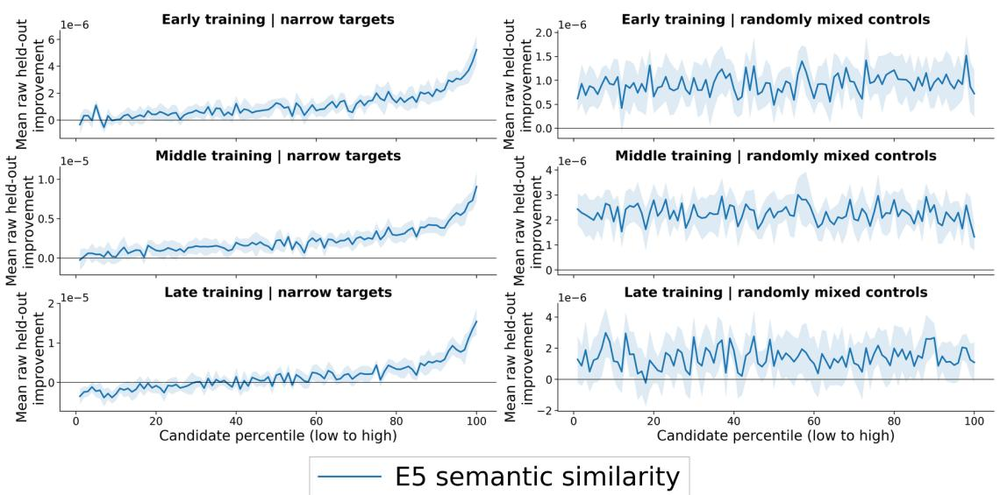  
Figure 9: Curves of loss reduction across 100 percentiles of E5 similarity. Rows are the 10k, 50k, and 100k checkpoints; columns are semantic targets (left) and randomly mixed controls (right). Candidates are ranked within each target, with 20 candidates per percentile. Curves are means over ten targets of each type; shaded bands are based on standard errors across targets. The blue curve uses E5 similarity. Positive values indicate loss reduction; vertical scales differ. The panels in Figure 3 are the left column of this figure, rearranged in one row.

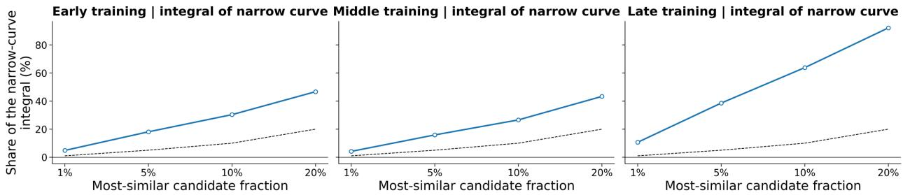  
o E5 semantic similarity ------- Uniform contribution  
Figure 10: Share of the net loss reduction on semantic targets contributed by the candidates in the top 1%, 5%, 10%, and 20% by E5 similarity. Panels are the 10k, 50k, and 100k checkpoints, left to right. The blue curve uses the E5 ranking from Figure 9. The numerator sums $I ( C , V )$ over the selected candidates and all ten semantic targets; the denominator sums over all candidates and the same targets. The dashed line marks the share proportional to subset size. Because negative values are retained, cancellation can produce a share above 100%; the plotted quantities are net contribution shares, not fractions of positive loss reductions.

## E.3 Experiment on the lasting effect of one batch

The experiment in the left panel of Figure 2 uses the same GPT-2 124M model, OpenWebText data, context length of 1024, and global batch of 480 sequences as the semantic target experiment above, but runs for 10,000 steps. We select a fixed global batch B containing 491,520 targets for next token prediction. Every sequence window that overlaps a token in B is excluded from the remaining training batches used by both branches. The control and inject branches start from the same complete checkpoint immediately before step 5,000. At step 5,000, the control branch uses the batch from the original training sequence, whereas the inject branch replaces that batch with B. The control branch therefore never trains on B. Apart from this replacement, stateless sampling indexed by the run configuration, step, rank, and microstep gives the two branches the same sequence of batches.

Training uses gradient clipping at 1.0, 200 warmup steps, and cosine decay through step 10,000. Loss on B is evaluated every 50 steps and additionally at steps 4,999, 5,000, and 5,001; distributed ranks evaluate disjoint subsets whose losses are averaged. For these measurements, HyMUON is temporarily evaluated at the averaged iterate $\mathbf { x } _ { t } ,$ after which the training iterate is restored. Muon is evaluated directly at its training iterate. Because the branches share the complete checkpoint before injection and the subsequent sampling state, their only protocol difference is the batch used at step 5,000.

For Muon, the branch for hidden matrices uses peak and minimum learning rates $2 \times 1 0 ^ { - 2 }$ and $3 \times 1 0 ^ { - 5 }$ , momentum 0.95, and zero weight decay. Its auxiliary AdamW branch uses peak and minimum learning rates $3 \times 1 0 ^ { - 3 }$ and $3 \times 1 0 ^ { - 5 }$ betas (0.9, 0.95), and weight decay 0.1; inverse layer scaling is enabled for the learning rate. For HyMUON, the branch for hidden matrices uses peak and minimum learning rates 0.1 and $3 \times 1 0 ^ { - 5 }$ , Muon momentum 0.9, HyM mixing weight 0.95, and weight decay 0.05. Its adaptive HyM branch uses peak and minimum learning rates 0.01 and $3 \times 1 0 ^ { - 5 }$ coefficients for the first and second moments 0.95 and 0.99, and weight decay 0.01. These settings define the two loss trajectories for the two optimizers in the left panel. The subsequent intervention on the slow state isolates the stored contribution while holding the remaining model and optimizer state fixed.

## E.3.1 Intervention on the slow momentum state

The right panel of Figure 2 continues the injection protocol with an intervention on the slow state at step 7,500. Let $\mathbf { g } _ { B } ( s )$ and $\mathbf { g } _ { \mathcal { R } } ( s )$ denote the gradients at the common parameters at step s on B and on the batch R from the original training sequence, respectively. Because the inject branch replaces R with B at step $s = 5 , 0 0 0 \mathrm { . }$ , the contribution introduced into its slow state is the signed difference $\Delta \mathbf { g } _ { s } = \mathbf { g } _ { B } ( s ) - \mathbf { g } _ { \mathcal { R } } ( s )$ rather than $\mathbf { g } _ { B } ( s )$ alone. In HyMUON’s slow state, a gradient from step s has coefficient $s / t$ at step t; consequently, the coefficient of $\Delta \mathbf { g } _ { s }$ is $2 / 3$ at the intervention. The Delete branch subtracts this exact contribution from the slow states of the matrix and auxiliary parameter groups. The Refresh branch first performs the same deletion and then computes g (7,500) at the current training iterate, rescaling its matrix and auxiliary components separately to match the norm of the corresponding removed component within each parameter group.

Immediately before the intervention, Keep, Delete, and Refresh are initialized from identical copies of the inject branch. These copies include the model parameters and buffers, all optimizer states including the averaged iterate $\mathbf { x } _ { t } ,$ the scheduler for the learning rate, the training counters, and the states of the random number generators and data samplers on every rank. The three interventions are then applied to these copies, followed by the same sequence of training batches. The gradient computation required by Refresh preserves the random states and model buffers used for subsequent training.

At the same lag, the corresponding coefficients of the matrix momentum and auxiliary first moment for Muon are approximately $2 . 0 \times 1 0 ^ { - 5 6 }$ and $4 . 0 \times \bar { 1 0 } ^ { - 1 1 6 }$ . Both are numerically negligible at this lag; hence, the intervention isolates HyMUON’s persistent slow state rather than Muon’s memory. The intervention does not modify model parameters, the averaged iterate $\mathbf { x } _ { t } ,$ the fast state, or either state for the second moment. Immediately before the next step in the common training sequence, the code applies the complete NS or adaptive transformation to the original and intervened states. After multiplication by the learning rate, the differences between the resulting parameter updates have norms 0.104 for Delete and 0.111 for Refresh. At step 10,000, the losses on B are 3.047617 for Delete, 3.038296 for Keep, and 3.025494 for Refresh.

## F Benchmark experiment details

This section gives the architectures, training configurations, search dimensions, and selected hyperparameters used in the reported experiments; each task lists the hyperparameter families we tuned and the settings we selected. The FineWeb baselines follow the published benchmark, and the C4 comparison uses a Muon baseline reproduced with the training configuration of Gu and Xie [2026], as described below.

Results summary. Table 1 collects the numerical results for Section 6. Image classification and IWSLT entries report the mean and sample standard deviation across repeated runs; OpenWebText, FineWeb, and C4 entries give validation loss at the final training step.

Table 1: Main experimental results. Image accuracy and IWSLT metrics are mean ± sample SD across repeated runs; OpenWebText, FineWeb, and C4 give the final validation loss. ImageNet accuracy is validation top-1; CIFAR and SVHN use test accuracy. A dash marks a method not included in that comparison. FineWeb losses are rounded to two decimals.
<table><tr><td colspan="5">Image classification: accuracy (%) ↑</td></tr><tr><td>Dataset / model / budget</td><td>SGD Cosine</td><td>SGD Step</td><td>Schedule- Free</td><td>HyM</td></tr><tr><td>CIFAR-10/WRN-16-8</td><td></td><td></td><td></td><td></td></tr><tr><td>300 epochs CIFAR-100 / DenseNet-BC</td><td> $9 5 . 9 0 \pm 0 . 1 2$ </td><td> $9 5 . 4 3 \pm 0 . 1 7$ </td><td> $9 6 . 1 1 \pm 0 . 1 0$ </td><td> $9 6 . 2 5 \pm 0 . 1 0$ </td></tr><tr><td>300 epochs</td><td> $7 7 . 6 6 \pm 0 . 3 9$ </td><td> $7 7 . 2 2 \pm 0 . 2 0$ </td><td> $7 9 . 1 1 \pm 0 . 2 2$ </td><td> $7 9 . 1 4 \pm 0 . 2 2$ </td></tr><tr><td>SVHN / ResNet-3-96 300 epochs</td><td> $9 8 . 2 4 \pm 0 . 0 5$ </td><td></td><td> $9 8 . 2 0 \pm 0 . 0 8$ </td><td> $9 8 . 4 7 \pm 0 . 0 2$ </td></tr><tr><td>ImageNet-1K / ResNet-50 100 epochs</td><td> $7 6 . 6 8 \pm 0 . 0 4$ </td><td></td><td> $7 6 . 7 0 \pm 0 . 0 6$ </td><td> $7 6 . 8 4 \pm 0 . 1 0$ </td></tr></table>

<table><tr><td colspan="6">Language tasks</td></tr><tr><td>Dataset / model / budget</td><td>Metric</td><td>AdamW</td><td>AdEMAMix</td><td>Muon</td><td>HyMUON</td></tr><tr><td>IWSLT14/LSTM</td><td></td><td></td><td></td><td></td><td> $4 . 1 8 4 \pm 0 . 0 0 4$ </td></tr><tr><td>55 epochs</td><td>Test loss ↓ BLEU↑</td><td></td><td></td><td> $4 . 2 3 4 \pm 0 . 0 0 6$   $3 3 . 4 2 4 \pm 0 . 0 4 8$ </td><td> $3 3 . 8 7 4 \pm 0 . 0 7 2$ </td></tr><tr><td>OpenWebText / GPT-2 124M 100k steps</td><td>Val. loss ↓</td><td>2.905</td><td></td><td></td><td></td></tr><tr><td>OpenWebText / GPT-2 124M</td><td></td><td></td><td></td><td>2.915</td><td>2.886</td></tr><tr><td>600k steps FineWeb / LLaMA-124M</td><td>Val. loss ↓</td><td>2.866</td><td></td><td>2.886</td><td>2.823</td></tr><tr><td>8k steps (≈1B tokens) FineWeb / LLaMA-124M</td><td>Val. loss↓</td><td>3.53</td><td>3.48</td><td>3.50</td><td>3.47</td></tr><tr><td>16k steps (≈2.1B tokens) C4 /LLaMA-1.3B</td><td>Val. loss ↓</td><td>3.39</td><td>3.35</td><td>3.39</td><td>3.35</td></tr><tr><td>10k steps Muon as in Gu and Xie [2026]</td><td>Val. loss ↓</td><td></td><td></td><td>2.903</td><td>2.777</td></tr></table>

## F.1 Image classification runs

Models and training budgets. Table 2 gives the common settings for each dataset. CIFAR-10 uses a WideResNet of depth 16 and width multiplier 8, without dropout. CIFAR-100 uses DenseNet-BC with block sizes (6, 12, 24, 16), growth rate 12, 24 initial channels, bottleneck multiplier 4, compression factor 0.5, and no dropout. The SVHN ResNet has three stages with (96, 192, 384) channels and three residual blocks, each with two convolutions, per stage. ImageNet uses ResNet-50 initialized from scratch. All four tasks use cross-entropy loss without label smoothing, mixup, or CutMix; evaluation is performed after every epoch.

Table 2: Training settings for image classification. Batch sizes are global numbers of images per optimizer step.
<table><tr><td>Dataset</td><td>Epochs</td><td>Batch size</td><td>Input size</td></tr><tr><td>CIFAR-10</td><td>300</td><td>128</td><td> $\overline { { 3 2 \times 3 2 } }$ </td></tr><tr><td>CIFAR-100</td><td>300</td><td>64</td><td> $3 2 \times 3 2$ </td></tr><tr><td>SVHN (train + extra)</td><td>300</td><td>32</td><td> $3 2 \times 3 2$ </td></tr><tr><td>ImageNet-1K</td><td>100</td><td>256</td><td> $2 2 4 \times 2 2 4$ </td></tr></table>

Preprocessing. CIFAR and SVHN training images use reflection padding of four pixels, random 32 × 32 crops, and horizontal flips with probability 0.5; test images are not augmented. SVHN training includes both the official training and extra splits. After scaling pixels to [0, 1], CIFAR-10 and SVHN use mean and standard deviation (0.5, 0.5, 0.5) for each channel. CIFAR-100 uses mean (0.5074, 0.4867, 0.4411) and standard deviation (0.2011, 0.1987, 0.2025). ImageNet training uses random resized crops to 224 × 224 and random horizontal flips; evaluation resizes the shorter edge to 256 and takes a 224 × 224 center crop. Its mean and standard deviation for each channel are also (0.5, 0.5, 0.5).

Optimizers and schedules. Table 3 lists the settings held fixed across repeated runs. SGD uses standard momentum with zero dampening and no Nesterov term; HyM also uses no additional Nesterov term. Both apply coupled weight decay to all parameters. Cosine schedules have linear warmup over the first 5% of optimizer steps. The cosine endpoint is zero for SGD on all four datasets and for HyM on SVHN. For HyM on CIFAR-10, CIFAR-100, and ImageNet, the endpoint is instead half the peak learning rate: 0.025, 0.25, and 0.003, respectively. The Step baseline has no warmup and multiplies its learning rate by 0.1 at epochs 150 and 225, when epochs are numbered from zero. Schedule-Free uses a 5% linear warmup followed by a constant learning rate, using the SGDScheduleFree implementation.

Table 3: Fixed optimizer settings for image classification. LR denotes the peak learning rate. The momentum column gives the SGD or HyM momentum coefficient; $\beta$ gives the Schedule-Free interpolation coefficient or the HyM mixing weight.
<table><tr><td>Dataset</td><td>Optimizer</td><td>LR</td><td>Momentum</td><td>β</td><td>Weight decay</td></tr><tr><td>CIFAR-10</td><td>SGD + Cosine</td><td>0.2</td><td>0.9</td><td>一</td><td> $\overline { { { 1 0 } ^ { - 4 } } }$ </td></tr><tr><td></td><td> $\mathrm { S G D + S t e p }$ </td><td>0.1</td><td>0.9</td><td></td><td> $1 0 ^ { - 4 }$ </td></tr><tr><td></td><td>Schedule-Free</td><td>10</td><td>一</td><td>0.9</td><td>10⁻4</td></tr><tr><td></td><td>HyM</td><td>0.05</td><td>0.98</td><td>0.9</td><td> $5 \times 1 0 ^ { - 4 }$ </td></tr><tr><td>CIFAR-100</td><td>SGD + Cosine</td><td>0.05</td><td>0.9</td><td>一</td><td> $2 \times 1 0 ^ { - 4 }$ </td></tr><tr><td></td><td>SGD + Step</td><td>0.05</td><td>0.9</td><td>一</td><td> $2 \times 1 0 ^ { - 4 }$ </td></tr><tr><td></td><td>Schedule-Free</td><td>5</td><td>一</td><td>0.9</td><td> $2 \times 1 0 ^ { - 4 }$ </td></tr><tr><td></td><td>HyM</td><td>0.5</td><td>0.9</td><td>0.9</td><td> $3 \times 1 0 ^ { - 4 }$ </td></tr><tr><td>SVHN</td><td>SGD + Cosine</td><td>0.1</td><td>0.9</td><td></td><td> $\overline { { 1 0 ^ { - 4 } } }$ </td></tr><tr><td></td><td>Schedule-Free</td><td>1</td><td></td><td>0.9</td><td> $2 \times 1 0 ^ { - 4 }$ </td></tr><tr><td></td><td>HyM</td><td>0.05</td><td>0.99</td><td>0.95</td><td> $3 \times 1 0 ^ { - 4 }$ </td></tr><tr><td>ImageNet-1K</td><td>SGD + Cosine</td><td>0.05</td><td>0.9</td><td></td><td> $\overline { { { 1 0 } ^ { - 4 } } }$ </td></tr><tr><td></td><td>Schedule-Free</td><td>1.5</td><td>一</td><td>0.9</td><td> $5 \times 1 0 ^ { - 5 }$ </td></tr><tr><td></td><td>HyM</td><td>0.006</td><td>0.99</td><td>0.90</td><td> $2 \times 1 0 ^ { - 4 }$ </td></tr></table>

Evaluation and repeated runs. All displayed methods on CIFAR-10, CIFAR-100, SVHN, and ImageNet are evaluated over repeated runs. Curves show means across runs; the bands show one standard error, and the legends report sample standard deviations. ImageNet is evaluated on the official validation split.

HyM and Schedule-Free refresh Batch Normalization statistics before evaluation. The refresh uses 50 training mini-batches. All ImageNet runs use a global batch of 256.

Training time and memory. We profiled HyM and cosine SGD in separate short runs on an NVIDIA H100 80GB GPU. Within each row of Table 4, the model, profiling batch size, data pipeline, worker count, and optimizer steps per epoch match. The table reports the mean elapsed time of the training loop over epochs 2–5 and the maximum PyTorch CUDA allocated memory over those epochs.

Table 4: H100 resource profiles for HyM versus cosine SGD. Batch sizes in parentheses are the profiling batch sizes. Time is seconds per training epoch; memory is peak CUDA allocated MiB. Changes are HyM relative to cosine SGD.
<table><tr><td></td><td colspan="3">Training time</td><td colspan="3">Peak allocated memory</td></tr><tr><td>Dataset (batch)</td><td>SGD</td><td>HyM</td><td>Change</td><td>SGD</td><td>HyM</td><td>Change</td></tr><tr><td>CIFAR-10 (128)</td><td>4.71</td><td>4.98</td><td> $\overline { { + 5 . 7 \% } }$ </td><td>1122</td><td>1254</td><td>+132</td></tr><tr><td>CIFAR-100 (512)</td><td>6.80</td><td>6.73</td><td>-0.9%</td><td>7410</td><td>7423</td><td>+12</td></tr><tr><td>ImageNet-1K (256)</td><td>591.62</td><td>601.43</td><td>+1.7%</td><td>11257</td><td>11561</td><td>+304</td></tr></table>

Across the three configurations, HyM’s measured training time differs from cosine SGD by −0.9% to +5.7%, while peak allocated memory increases by 12–304 MiB.

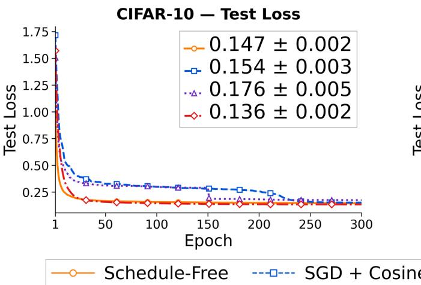

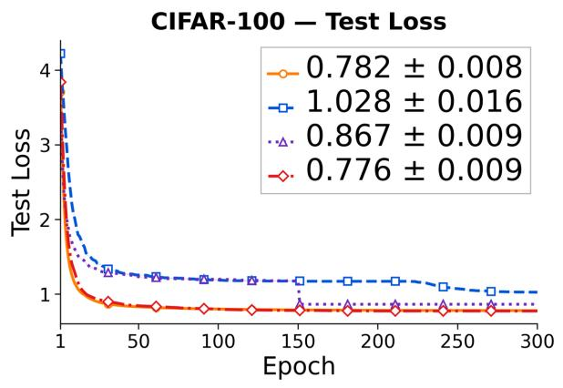  
Figure 11: Curves of CIFAR test loss for the runs in Figure 4. Left: CIFAR-10; right: CIFAR-100. Curves are means over repeated runs, and the bands show one standard error; the legend gives the sample SD. HyM is evaluated at the averaged iterate $\mathbf { x } _ { t }$

## F.2 Evaluation of HyM at the training and averaged iterates

Figure 12 compares a HyM configuration evaluated at the training iterate $y$ with a HyM configuration evaluated at the averaged iterate x on CIFAR-10 and CIFAR-100. Both configurations train for 300 epochs with the architectures and batch sizes in Table 2.

The configuration evaluated at the training iterate uses momentum 0.9, mixing weight $\beta = 0 . 5$ , and weight decay $5 \times 1 0 ^ { - 4 }$ on CIFAR-10; the corresponding CIFAR-100 values are 0.9, 0.3, and $5 \times 1 0 ^ { - 4 }$ . Its peak learning rates are 0.2 and 0.05, respectively, and both decay to approximately zero. The configuration evaluated at the averaged iterate is given in Table 3 and retains half its peak learning rate. Each configuration uses the best hyperparameters found in its own search; the comparison therefore evaluates each iterate under a separately selected setting.

At the training iterate y, HyM attains lower test loss than cosine SGD on both datasets: 0.1329 versus 0.1536 on CIFAR-10, and 0.9645 versus 1.0279 on CIFAR-100. At the averaged iterate $x ,$ the corresponding HyM losses are 0.1358 and 0.7764. Evaluating at $y$ gives the lower loss on CIFAR-10. Evaluating at x gives the lower loss on CIFAR-100 and the higher accuracy on both datasets. Thus, the improvement over cosine SGD is already present at the training iterate. The paired component ablation in Appendix F.3 evaluates every training trajectory at both iterates to isolate the additional effect of iterate averaging.

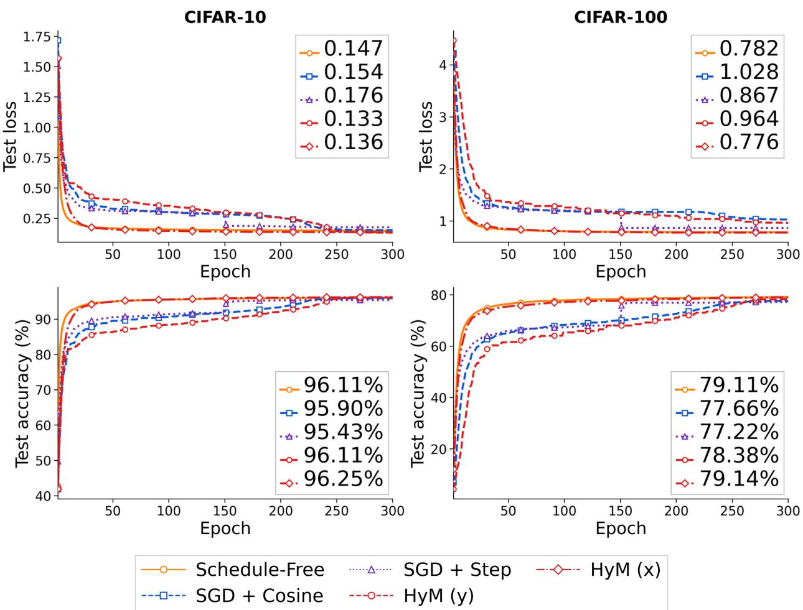  
Figure 12: CIFAR comparison of the training and averaged iterates. Columns show CIFAR-10 and CIFAR-100; rows show test loss and test accuracy. HyM (y) is evaluated at the training iterate without iterate averaging, while HyM (x) is evaluated at the averaged iterate. The other curves reuse the baselines from Figure 4.

## F.3 Component ablation of HyM on CIFAR-10

We compare the fast momentum, slow momentum, their combination, and three replacements of the slow momentum by an EMA with a fixed decay rate. Each training trajectory is evaluated at both the training iterate y and the averaged iterate x, which allows the effect of iterate averaging to be separated from the choice of gradient history.

Training and evaluation. We train WideResNet-16-8 for 300 epochs on a fixed split stratified by class of CIFAR-10: 45,000 training images and 5,000 validation images, with 500 validation images per class. Batch size is 128 without dropping the final batch, giving 352 steps per epoch and $T = 1 0 5 { , } 6 0 0$ steps in total. The three peak learning rates $\eta _ { \mathrm { m a x } } \in \{ 0 . 0 5 , 0 . 1 , 0 . 2 \}$ define separate comparison groups, all of which are reported. To distinguish the two roles of the mixing weight in this ablation, we denote the direction and averaging weights by $\beta _ { \mathrm { d i r } }$ and $\beta _ { \mathrm { a v g } } .$ , respectively; both are set to 0.95. All groups use $\mu = 0 . 9 9$ and coupled L2 decay $\lambda _ { \mathrm { w d } } = \bar { 5 } \times 1 \bar { 0 } ^ { - 4 }$ on all parameters. The learning rate warms up linearly for 5,280 steps, then follows a cosine decay to $\eta _ { \mathrm { m a x } } / 2$ . Training uses cross-entropy, deterministic cuDNN, and no cuDNN benchmarking. Augmentation is a random $3 2 \times 3 2$ crop after reflection padding of four pixels and a horizontal flip with probability $0 . 5 ;$ each channel is normalized as $( \mathrm { p i x e l } / 2 5 5 - 0 . 5 ) / 0 . 5$

Initialization, the order of training images, and the randomness in cropping and flipping are shared across configurations. After every epoch, y and x are copied in turn into a separate evaluation model. For each evaluated iterate, Batch Normalization statistics are reset and recalibrated by cumulative averaging on the same 6,400 unaugmented training images (50 batches). Neither parameters nor BN buffers are copied back into the training model. We report epoch-300 validation metrics.

Matching the total weight across directions. To compare how the variants distribute weight over the gradient history without also changing the total scale of the direction, we choose their coefficients so that every variant gives the same direction when the input gradient remains constant. Let $\mathbf { m } _ { t }$ and $\mathbf { b } _ { t }$ be the states of Algorithm 1, with input $\mathbf { g } _ { t } = \nabla f ( \mathbf { y } _ { t } ; \boldsymbol { \xi } _ { t } ) + \lambda _ { \mathrm { w d } } \mathbf { y } _ { t }$ . Use the quantities $Z _ { t } , A _ { t } , C _ { t }$ and total coefficient sum $S _ { t } = A _ { t } + C _ { t }$ defined in (17)–(18), with $\beta = \beta _ { \mathrm { d i r } }$ . The normalized fast direction is $\widehat { \mathbf { b } } _ { t } : = \mathbf { b } _ { t } / Z _ { t }$ . For the EMA replacements, define the direction after bias correction $\begin{array} { r } { \widehat { \mathbf { g } } _ { t } ^ { ( \rho ) } = \frac { 1 - \rho } { 1 - \rho ^ { t } } \sum _ { i = 1 } ^ { t } \rho ^ { t - i } \mathbf { g } _ { i } } \end{array}$ . All variants update $\mathbf y _ { t + 1 } = \mathbf y _ { t } - \eta _ { t } \mathbf D _ { t }$ , where

$$
\mathbf { D } _ { t } = \left\{ \begin{array} { l l } { S _ { t } \widehat { \mathbf { b } } _ { t } , } & { \mathrm { f a s t m o m e n t u m ~ o n l y } , } \\ { S _ { t } \mathbf { m } _ { t } , } & { \mathrm { s l o w ~ m o m e n t u m ~ o n l y } , } \\ { A _ { t } \mathbf { m } _ { t } + C _ { t } \widehat { \mathbf { b } } _ { t } , } & { \mathrm { f u l l ~ H y M } , } \\ { A _ { t } \widehat { \mathbf { g } } _ { t } ^ { ( \rho ) } + C _ { t } \widehat { \mathbf { b } } _ { t } , } & { \mathrm { r e p l a c e m e n t ~ o f ~ t h e ~ s l o w ~ s t a t e ~ b y ~ a n ~ E M A } , \quad \rho \in \{ 0 . 9 9 , 0 . 9 9 9 , 0 . 9 9 9 \} . } \end{array} \right.
$$

For a constant input gradient g, every variant gives $\mathbf { D } _ { t } = S _ { t } \mathbf { g }$ . This construction matches the total gradient weight across variants, while their realized update norms may differ. The fast momentum variant retains $\mathrm { H y M ^ { \prime } s }$ factor $\mu ( t - 1 ) / t$ The EMA variants replace the slow state while retaining the fast state and the other update rules; they are partial replacements used to isolate the role of the slow state. All variants use the same average computed before the update, ${ \bf x } _ { t } = ( 1 - a _ { t } ) { \bf x } _ { t - 1 } + a _ { t } { \bf y } _ { t }$ , with $a _ { t } = [ 1 + ( 1 - \beta _ { \mathrm { a v g } } ) ( t - 1 ) ] ^ { - 1 }$ . After $T$ steps, the paired training and averaged iterates are $\mathbf { y } _ { T + 1 }$ and $\mathbf { x } _ { T }$

Table 5: Final CIFAR-10 validation accuracy (%) in the component ablation. Each group defined by a learning rate compares the same six configurations; y and x are paired evaluations at epoch 300. EMA rows replace only the slow momentum. These are validation results on the 45k/5k split, not the test accuracies in the main image classification experiment.
<table><tr><td>Direction</td><td> $\eta _ { \mathrm { m a x } } = 0 . 0 5$ </td><td></td><td> $\eta _ { \mathrm { m a x } } = 0 . 1$ </td><td></td><td></td><td> $\eta _ { \mathrm { m a x } } = 0 . 2$ </td></tr><tr><td>Fast momentum only</td><td>y 84.26</td><td>x 90.44</td><td>y 76.78</td><td>x 83.76</td><td>y 65.68</td><td>x 72.18</td></tr><tr><td>Slow momentum only</td><td>89.64</td><td>92.06</td><td>86.80</td><td>89.02</td><td>81.82</td><td>84.48</td></tr><tr><td>Full HyM</td><td>93.94</td><td>96.22</td><td>93.44</td><td>96.10</td><td>91.92</td><td>95.52</td></tr><tr><td> $\mathrm { E M A } , \rho = 0 . 9 9$ </td><td>85.04</td><td>90.86</td><td>77.60</td><td>83.40</td><td>68.50</td><td>73.18</td></tr><tr><td> $\operatorname { E M A } , \rho = 0 . 9 9 9$ </td><td>89.30</td><td>93.40</td><td>84.18</td><td>89.58</td><td>79.88</td><td>82.74</td></tr><tr><td> $\operatorname { E M A } , \rho = 0 . 9 9 9 9$ </td><td>92.94</td><td>95.62</td><td>92.56</td><td>95.64</td><td>89.46</td><td>93.76</td></tr></table>

Results. Full HyM has the highest final validation accuracy at both iterates in each group defined by a learning rate (Table 5). The advantage over either individual momentum state is already present at the training iterate; therefore, iterate averaging alone does not account for this difference. Averaging improves final accuracy in all 18 configurations, by 2.22–6.98 percentage points; for full HyM the gains are 2.28, 2.66, and 3.60 points at the three learning rates. Among the EMA replacements, $\rho = 0 . 9 9 9 9$ is closest to full HyM, with accuracies at the averaged iterate of 95.62% versus 96.22% at $\eta _ { \mathrm { m a x } } = 0 . 0 5$ , and 95.64% versus 96.10% at $\eta _ { \mathrm { m a x } } = 0 . 1$

Figure 13 shows the corresponding validation loss histories. Fast momentum only and the $\rho = 0 . 9 9$ replacement exhibit a pronounced intermediate loss increase at the larger learning rates; full HyM and the $\rho = 0 . 9 9 9 9$ replacement avoid this large rebound. Full HyM also has the lowest final loss at both iterates in each group. These comparisons support using the two momentum states together under the common experimental protocol and show an additional improvement from iterate averaging.

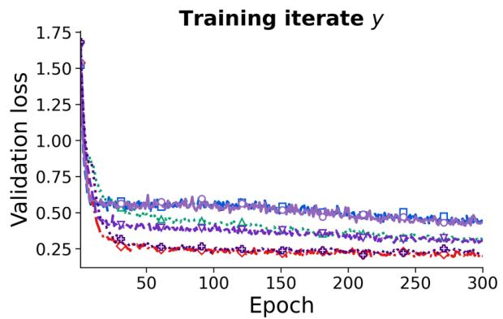  
Training iterate y

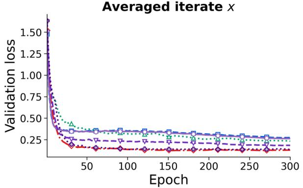  
Averaged iterate X

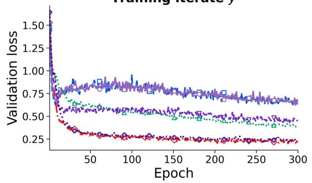

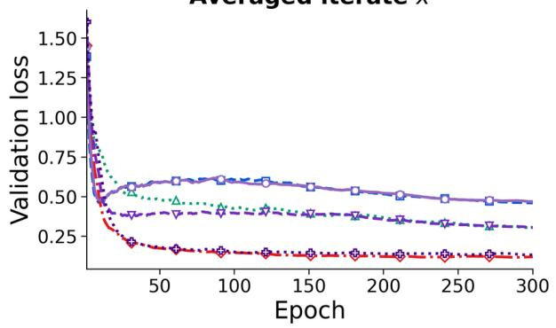

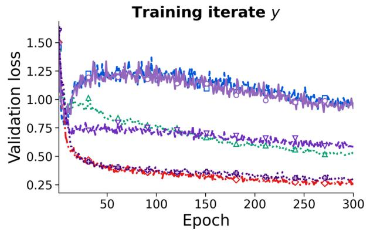

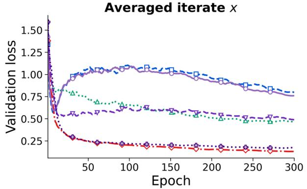  
------ Fast momentum only --Full HyM ------ EMA(.999)………Slow momentum only ——EMA(.99) ………EMA(.9999)

Figure 13: CIFAR-10 component ablation: validation cross-entropy at the training iterate y (left) and averaged iterate x (right). Rows use peak learning rates 0.05, 0.1, and 0.2. Curves show values for each epoch. Every evaluation uses the same BN calibration protocol. “Slow EMA” retains the fast momentum and replaces only the slow momentum.

## F.4 IWSLT14 German–English

We use the IWSLT14 German–English corpus [Cettolo et al., 2014], with 160,239 training, 7,283 validation, and 6,750 test sentence pairs. The model uses Fairseq’s LSTM encoder–decoder preset with attention and one layer on each side [Ott et al., 2019], lstm\_wiseman\_iwslt\_de\_en, with embeddings and hidden states of dimension 256, shared decoder input/output embeddings, dropout 0.3, and label smoothing 0.1. Each task uses one $\mathrm { G P U } ,$ a dynamic limit of 4096 tokens per batch and a gradient accumulation factor of one. Runs are capped at 55 epochs and 60,000 steps, with evaluation after every epoch. Tokenized BLEU uses beam size 5, length parameters 1.2 and 10, space detokenization, and removal of BPE continuation markers.

Optimizer configuration. We search the learning rates for the hidden matrices and auxiliary parameters, weight decay, and the momentum, mixing weight, and coefficient for the auxiliary second moment used by each optimizer. Table 6 reports the selected configurations. Both parameter groups use linear warmup over 4,000 steps followed by linear decay to zero at step 60,000, retaining their peak learning rate ratio throughout the schedule. Gradient clipping is disabled. Hidden weight matrices use five quintic NS iterations and the shape factor $\sqrt { \operatorname* { m a x } \{ 1 , m / n \} }$ for an m × n matrix, without an additional Nesterov term. Embeddings, output heads, and parameters with one dimension belong to the auxiliary group. Muon uses AdamW for this group; HyMUON uses the adaptive HyM moments described in Appendix D and evaluates both groups at their averaged iterates.

Table 6: IWSLT14 optimizer hyperparameters. The auxiliary coefficients are AdamW for Muon and the adaptive HyM branch for HyMUON.
<table><tr><td>Hyperparameter</td><td>Muon</td><td>HyMUON</td></tr><tr><td>Peak LR for hidden matrices</td><td>0.05</td><td>0.05</td></tr><tr><td>Momentum  $\mu$  for hidden matrices</td><td>0.99</td><td>0.9</td></tr><tr><td>HyM mixing weight β</td><td></td><td>0.9</td></tr><tr><td>Weight decay for hidden matrices</td><td>0.05</td><td>0.05</td></tr><tr><td>Auxiliary peak LR</td><td>0.01</td><td>0.05</td></tr><tr><td>Coefficient for the auxiliary first moment</td><td>0.9</td><td>0.9</td></tr><tr><td>Coefficient for the auxiliary second moment</td><td>0.98</td><td>0.95</td></tr><tr><td>Auxiliary weight decay</td><td>0.05</td><td>0.05</td></tr><tr><td>Auxiliary ε</td><td> $1 0 ^ { - 8 }$ </td><td>10⁻8</td></tr></table>

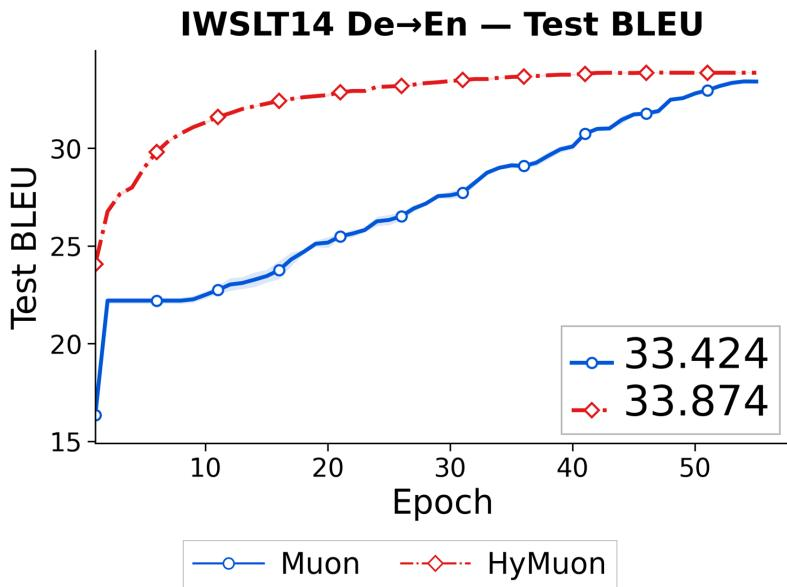  
Figure 14: IWSLT14 German–English test BLEU for the repeated runs in Figure 5. Curves are means over repeated runs with bands showing one standard error; the panel legend gives the endpoint means.

For the IWSLT14 test loss panel in Figure 5 and the BLEU panel in Figure 14, the selected Muon and HyMUON configurations are each evaluated over repeated runs. At each epoch, the curves report test metrics from the checkpoint with the highest validation BLEU observed so far. Curves are aligned by epoch and show the mean with bands indicating one standard error.

Ablation of the averaged iterate. We additionally evaluate a HyMUON variant that retains the same matrix and auxiliary updates formed from the two momentum states as the full method but evaluates and checkpoints the training iterate y, without constructing the averaged iterate x. The search covers the matrix and auxiliary learning rates, weight decay, matrix momentum, mixing weight, and coefficient for the auxiliary second moment. The selected configuration uses matrix and auxiliary peak learning rates 0.05 and 0.1, matrix momentum 0.9, mixing weight 0.9, auxiliary coefficients (0.9, 0.9), and weight decay 0.05 and 0.1 for the matrix and auxiliary groups, respectively, with warmup over 4,000 steps followed by linear decay. It attains test BLEU 33.580 and test loss 4.233. The selected Muon and full HyMUON configurations attain test BLEU 33.370 and 33.930, with test losses 4.229 and 4.186. These results show that the updates formed from the two momentum states improve BLEU over Muon without the averaged iterate, and that evaluation at the averaged iterate yields a further improvement.

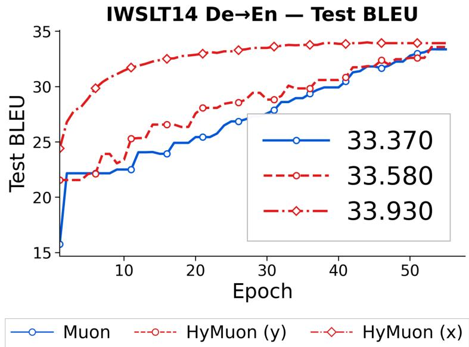  
Figure 15: IWSLT14 ablation of the averaged iterate in test BLEU. HyMUON (y) retains the matrix and auxiliary updates formed from the two momentum states and evaluates the training iterate; HyMUON (x) evaluates the averaged iterate. Curves correspond to the selected configuration of each method.

## F.5 NanoGPT on OpenWebText

We train a GPT-2 Small model [Radford et al., 2019] with 12 layers, 12 attention heads, hidden size 768, context length 1024, zero dropout, and 124M parameters using nanoGPT [Karpathy, 2022] on OpenWebText [Gokaslan and Cohen, 2019]. A microbatch contains 12 sequences and the global gradient accumulation factor is 40, giving 480 sequences or 491,520 tokens per optimizer step. Validation is run every 1000 steps and averages 200 randomly sampled mini-batches on the master process (2,457,600 validation tokens per evaluation). The two panels use separate regimes of 100k and 600k steps, corresponding to 49.152B and 294.912B processed training tokens. Table 7 records the HyMUON configurations used in the two regimes. Training uses gradient clipping at norm 1 and linear warmup over 2,000 steps. Cosine decay reaches its stated minimum at the end of each regime. HyMUON uses five NS iterations on hidden matrices and $\varepsilon = 1 0 ^ { \dot { - } 8 }$ in its auxiliary adaptive branch; its auxiliary coefficient for the first moment equals the mixing weight, 0.99.

In the 100k setting, AdamW uses learning rate $6 \times 1 0 ^ { - 4 } {  } 3 \times 1 0 ^ { - 5 } , ( \beta _ { 1 } , \beta _ { 2 } ) = ( 0 . 9 , 0 . 9 5 )$ , and weight decay 0.1. Muon uses a learning rate for hidden matrices of $2 \times 1 0 ^ { - 2 } \tplus \times 1 0 ^ { - 5 }$ , momentum 0.95, and zero weight decay; its auxiliary AdamW branch uses learning rate $3 \times 1 0 ^ { - 3 }  3 \times 1 0 ^ { - 5 } , ( \beta _ { 1 } , \beta _ { 2 } ) = ( 0 . 9 , 0 . 9 5 )$ , and weight decay 0.1.

In the 600k setting, AdamW uses learning rate $6 \times 1 0 ^ { - 4 } \to 6 \times 1 0 ^ { - 5 } , ( \beta _ { 1 } , \beta _ { 2 } ) = ( 0 . 9 , 0 . 9 5 )$ , and weight decay 0.1. Muon uses an auxiliary learning rate of $\bar { 6 } \times 1 0 ^ { - 4 }$ , a matrix learning rate of 0.02, and a minimum learning rate of $6 \times 1 0 ^ { - 5 }$ . Matrix momentum is 0.95; the auxiliary Adam branch uses $( \beta _ { 1 } , \beta _ { 2 } ) = ( 0 . 9 , 0 . 9 5 ) \mathrm { a n d } \varepsilon = 1 0 ^ { - 8 }$ . Both groups use weight decay 0.01. The matrix group contains parameters with at least two axes whose names contain neither embed nor lm\_head; the remaining parameters use the auxiliary branch. Both groups use warmup over 2,000 steps and cosine decay through 600k steps.

Table 7: HyMUON hyperparameters in the GPT-2 124M OpenWebText experiments.
<table><tr><td rowspan=1 colspan=1>Hyperparameter</td><td rowspan=1 colspan=1>100k regime</td><td rowspan=1 colspan=1>600k regime</td></tr><tr><td rowspan=1 colspan=1>LR for hidden matrices</td><td rowspan=1 colspan=1>0.01</td><td rowspan=1 colspan=1>0.01</td></tr><tr><td rowspan=1 colspan=1>Minimum LR for hidden matrices</td><td rowspan=1 colspan=1> $\overline { { 3 \times 1 0 ^ { - 5 } } }$ </td><td rowspan=1 colspan=1>6 × 10−5</td></tr><tr><td rowspan=1 colspan=1>Momentum $\mu$ for hidden matricesf</td><td rowspan=1 colspan=1>0.95</td><td rowspan=1 colspan=1>0.95</td></tr><tr><td rowspan=1 colspan=1>HyM mixing weight $\overline { { \beta } }$ </td><td rowspan=1 colspan=1>0.99</td><td rowspan=1 colspan=1>0.99</td></tr><tr><td rowspan=1 colspan=1>Weight decay for hidden matrices</td><td rowspan=1 colspan=1>0.2</td><td rowspan=1 colspan=1>0.2</td></tr><tr><td rowspan=1 colspan=1>Auxiliary LR</td><td rowspan=1 colspan=1>0.005</td><td rowspan=1 colspan=1>0.005</td></tr><tr><td rowspan=1 colspan=1>Auxiliary minimum LR</td><td rowspan=1 colspan=1> $3 \times 1 0 ^ { - 5 }$ </td><td rowspan=1 colspan=1> $6 \times 1 0 ^ { - 5 }$ </td></tr><tr><td rowspan=1 colspan=1>Auxiliary $\beta _ { 2 }$ </td><td rowspan=1 colspan=1>0.999</td><td rowspan=1 colspan=1>0.999</td></tr><tr><td rowspan=1 colspan=1>Auxiliary weight decay</td><td rowspan=1 colspan=1>0.1</td><td rowspan=1 colspan=1>0.1</td></tr><tr><td rowspan=1 colspan=1>Warmup steps</td><td rowspan=1 colspan=1>2000</td><td rowspan=1 colspan=1>2000</td></tr><tr><td rowspan=1 colspan=1>Learning rate schedule</td><td rowspan=1 colspan=1>cosine</td><td rowspan=1 colspan=1>cosine</td></tr></table>

Each OpenWebText panel in Figure 5 shows the run using the configuration listed above through its stated training budget. The 100k and 600k panels are separate training regimes rather than continuations of the same runs. The final validation losses are collected in Table 1.

## F.6 LLaMA-1.3B pretraining on C4

This experiment compares HyMUON with Muon for LLaMA-1.3B pretraining on C4. We reproduce the Muon baseline reported in Table 2 of Gu and Xie [2026] using the training configuration in their Table 5 and Appendix B.1. Muon’s peak learning rate $3 \times 1 0 ^ { - 4 }$ follows that configuration. The model has 1.339B parameters, 24 layers, hidden size 2048, feed-forward size 5461, 32 attention heads, and a 32k vocabulary. C4/en is streamed with document packing and a t5-base tokenizer; each step contains 512 sequences of length 1024. Both methods train for 10,000 steps, 1,000 linear warmup steps, cosine decay to one tenth of the peak learning rate, gradient clipping at 1.0, and an evaluation on 10,017,216 validation tokens every 1,000 steps. Each method processes 5,242,880,000 input tokens.

Muon uses the hyperparameters selected by Gu and Xie [2026]: five NS iterations, momentum 0.95, matrix and auxiliary learning rates $\bar { 3 } \times 1 0 ^ { - 4 }$ , and weight decay 0.1. For HyMUON, we search the matrix and auxiliary learning rates, matrix momentum, mixing weight, the coefficient for the auxiliary second moment, and weight decay for each parameter group. The selected configuration uses matrix and auxiliary learning rates $3 \times 1 0 ^ { - 2 }$ , mixing weight 0.99, Muon momentum 0.95, coefficient for the auxiliary second moment 0.999, and weight decay 0.2 for each group. Both parameter groups are evaluated at their averaged iterates.

At 10k steps, validation loss and perplexity are 2.903 and 18.221 for Muon, and 2.777 and 16.078 for HyMUON. Figure 16 shows the perplexity curves; they are the exponential of the loss curves in Figure 5.

## F.7 LLaMA-124M FineWeb benchmark

Protocol and data. We use the official framework of Semenov et al. [2025] and its 124M protocol for large batches (Section 4.1 and Figure 3(b) of that work). We run separate experiments for 8k steps with approximately 1B tokens and 16k steps with 2.1B tokens. Each budget starts a new training run with its own schedule for the learning rate. The model has 123.59M parameters, 12 layers, hidden size 768, 12 attention heads, SwiGLU feed-forward size 2048, RMSNorm, RoPE, and tied input/output embeddings. GPT-2 tokenization uses a padded vocabulary of 50,304 and context length 512.

All four methods use a common FineWeb sample-10BT subset and the same deterministic split. Documents are processed in shard order with an end of text token appended; the first 10,000,001 token IDs form validation, and subsequent documents supply 8,400,000,001 training token IDs. Data parallelism across four ranks uses 64 sequences per rank, giving a global batch of 256 sequences and 131,072 tokens per step. The two budgets process 1,048,576,000 and 2,097,152,000 training tokens, respectively. Dropout is zero, and gradients are clipped at norm 0.5. Each parameter group’s learning rate warms up over 2,000 steps and then decays by a cosine schedule to 1% of its peak.

LLaMA 1.3B Validation Perplexity (10k Step  
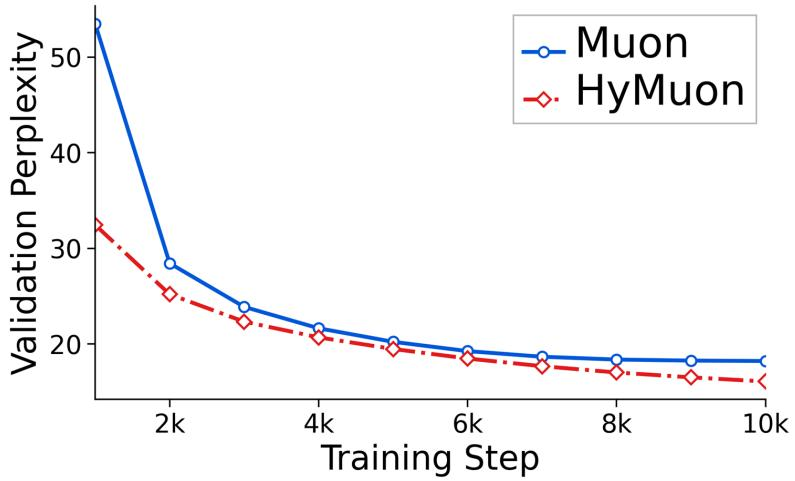  
Figure 16: LLaMA-1.3B validation perplexity on C4 with document packing through 10k steps in the comparison against the reproduced Muon baseline. This is the exponential transform of the curves of validation loss in Figure 5; HyMUON is evaluated at its averaged iterate.

Optimizer configurations. AdamW and AdEMAMix use the benchmark’s published 124M configurations; Muon uses its implementation of basic Muon and configuration for large batches (Figure 4 and Table 12 of Semenov et al. [2025]). The AdEMAMix algorithm itself is from Pagliardini et al. [2025]. Table 8 lists the fixed configurations used for Figure 5. AdamW and AdEMAMix apply weight decay to weights in linear layers, excluding the tied embedding/output weights and normalization parameters. For Muon and HyMUON, hidden attention/MLP matrices form the matrix group; the tied embedding/output head and RMSNorm parameters form the auxiliary group. Both matrix optimizers use five NS iterations. Basic Muon uses Nesterov momentum and applies decay only to its AdamW auxiliary group. HyMUON uses standard momentum, decoupled decay in both groups, and the adaptive auxiliary recurrence of Appendix D. Its HyM mixing weight is $\beta = 0 . { \overset { \cdot } { 9 } }$ . The auxiliary decay coefficients are $( \rho _ { 1 } , \rho _ { 2 } ) = ( 0 . 9 7 , 0 . 9 9 9 )$ at 1B tokens and (0.99, 0.999) at 2.1B tokens. Since the model uses RMSNorm, no BatchNorm recalibration is required.

Table 8: Fixed optimizer hyperparameters for the 124M FineWeb comparison. Baseline columns apply to both budgets; the HyMUON column is the 1B configuration, and the 2.1B changes appear below the table. Learning rates are peak values. An entry of the form $a / b$ gives the matrix and auxiliary values; for AdamW and AdEMAMix the single rate applies to all parameters.
<table><tr><td></td><td>AdamW</td><td>AdEMAMix</td><td>Muon</td><td>HyMUON</td></tr><tr><td>Learning rate</td><td>0.001</td><td>0.001</td><td>0.01/0.001</td><td>0.045/0.045</td></tr><tr><td>Weight decay</td><td>0.1</td><td>0.1</td><td>0/0.1</td><td>0.1/0.1</td></tr><tr><td>Matrix momentum</td><td></td><td></td><td>0.95</td><td>0.85</td></tr><tr><td>Adaptive  $( \beta _ { 1 } , \beta _ { 2 } )$ </td><td>(0.8,0.999)</td><td>(0.9,0.999)</td><td>(0.8,0.999)</td><td>(0.97,0.999)</td></tr><tr><td>Adaptive ε</td><td>10-8</td><td>10⁻8</td><td>10⁻⁸</td><td>10−10</td></tr><tr><td>HyM mixing weight β</td><td></td><td></td><td></td><td>0.9</td></tr><tr><td>Slow EMA  $\beta _ { 3 }$ </td><td></td><td>0.999</td><td></td><td></td></tr><tr><td>Slow EMA multiplier α</td><td></td><td>8</td><td>一</td><td></td></tr></table>

At 2.1B tokens, HyMUON uses matrix/auxiliary learning rates 0.015/0.015 and auxiliary betas (0.99, 0.999); its remaining settings are unchanged. AdEMAMix warms up both its slow decay and mixing multiplier over the full training horizon: 8,000 or 16,000 steps, respectively. HyMUON uses the adaptive HyM recurrence in Appendix D for both token budgets. It computes gradients at the training iterate and evaluates all parameter groups at the averaged iterate; after evaluation, the training iterates are restored. AdamW, AdEMAMix, and Muon evaluate their current training parameters.

Evaluation and curves. Validation is evaluated at initialization, every 115 steps, and at the final step (8,000 or 16,000). Intermediate evaluations use a fixed set of 64 batches of 64 sequences; the final evaluation uses all complete batches of the validation reader. Figure 5 shows the resulting curves of validation loss.

(a) Full training

## G Optimization efficiency on modded-nanoGPT Track 3

We evaluate HyMUON on modded-nanoGPT Track 3 [Yau et al., 2026]. The evaluation compares the number of updates required by HyMUON and a publicly tuned clean Muon baseline to reach a given validation loss under the same architecture, dataset, and batch size.<sup>1</sup>

Setup. We train a GPT with 162.35M parameters (12 layers, hidden size 768, 6 heads) on FineWeb10B with context length 1,024, 524,288 tokens per update, and 10,485,760 validation tokens. We run eight seeds (636–643) for 3,200 updates each on one H100 80GB GPU and compare against all ten public runs of the clean Muon baseline tuned for 3,250 steps.<sup>2</sup> For this benchmark, we use the HyMUON configuration developed for Track 3. It applies the slow and fast momentum construction to hidden matrices but evaluates the training parameters directly, without iterate averaging. The clean Muon baseline is also evaluated at its training parameters.

Optimizer configuration. For hidden attention and MLP matrices, we combine Muon’s fast EMA with a linearly weighted average of all past gradients. The slow average has mixing weight 0.05 and is scaled to match the EMA’s accumulated weight. We retain Nesterov mixing, momentum 0.95, and twelve NS iterations. Embeddings, the output head, and parameters with one dimension use the baseline AdamW settings, with peak learning rates 0.7, 0.004, and 0.015. All three groups use betas $( 0 . 8 , 0 . 9 5 ) , \varepsilon = 1 0 ^ { - 1 0 }$ , and weight decay 0.001. Both configurations keep learning rates constant for the first 30% of training and decay them linearly over the remaining 70%. For matrix parameters, HyMUON uses peak learning rate 0.030 and weight decay 0.05, with the latter decaying alongside the learning rate. Clean Muon uses peak learning rate 0.025 and fixed weight decay 0.05.

Table 9: Track 3 results. Final validation loss is reported as mean ± sample SD.
<table><tr><td>Method</td><td>Runs</td><td>Updates</td><td>Tokens (B)</td><td>Validation loss</td></tr><tr><td>Clean Muon</td><td>10</td><td>3,250</td><td>1.704</td><td> $\overline { { 3 . 2 7 8 6 6 \pm 0 . 0 0 1 3 4 } }$ </td></tr><tr><td>HyMUON</td><td>8</td><td>3,200</td><td>1.678</td><td> $3 . 2 7 8 3 2 \pm 0 . 0 0 1 0 0$ </td></tr></table>

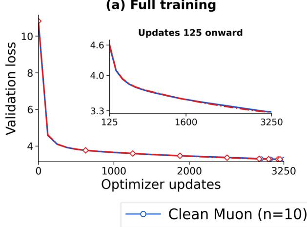

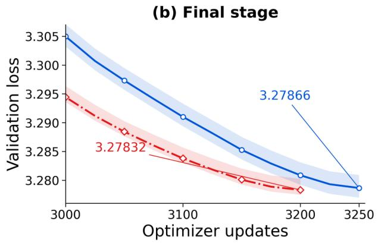  
Figure 17: Track 3 validation loss over the full training runs (left) and the final stage (right). Curves show run means; shading indicates the range across runs.

Results. HyMUON achieves a mean validation loss of 3.27832 after 3,200 updates, compared with 3.27866 after 3,250 updates for the publicly tuned clean Muon baseline (Table 9; Figure 17). At comparable final validation loss, HyMUON uses 50 fewer updates and 26.2M fewer training tokens, reducing the training budget by 1.54%.