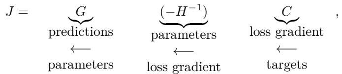
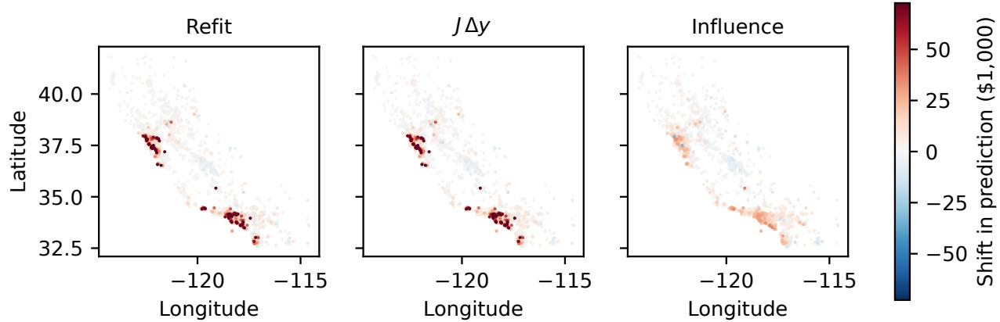
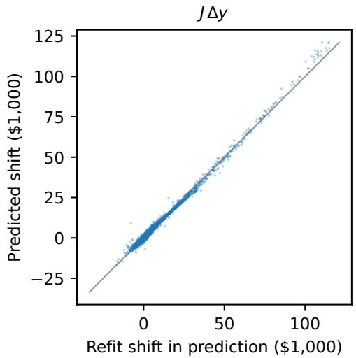
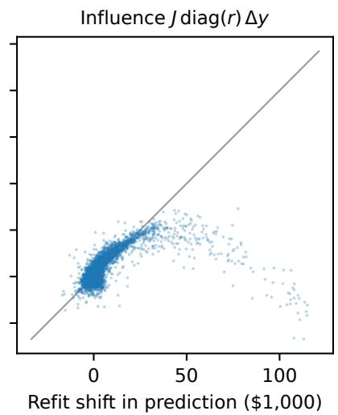

# Influence Is the Target-Response Jacobian Times Residuals

Paul Geertsema

Vlerick Business School

paul.geertsema@vlerick.com

Simon Geertsema

Leiden University

simon.geertsema@universiteitleiden.nl

## Abstract

We introduce the target-response Jacobian $J = [ \partial \hat { y } _ { i } / \partial y _ { j } ]$ , which measures how model predictions respond to changes in individual training targets. J complements training-data attribution (TDA) methods, which characterize sensitivity to the weights placed on training observations in the loss rather than to their targets, and can be computed matrix-free at the same cost as influence-based TDA methods. We show that sample-weight influence I and J follow from the same implicit diferentiation argument and difer only by a per-example multiplier: for pointwise losses, I = J diag(m) exactly at any stationary point with an in vertible Hessian. For canonical-link losses (squared error, logistic, Poisson) the multiplier is the training residual, $\mathcal { T } = J \mathrm { d i a g } ( r )$ , and softmax cross-entropy obeys a multiclass version. The identity predicts three ways in which influence fails when used in place of $J { \boldsymbol { : } }$ small residuals shrink its predicted shift towards zero (interpolation collapse), residuals of mixed sign wash out its direction (direction washout), and under softmax cross-entropy it collapses a training point’s per-class sensitivities towards its own true class (true-class collapse). We score both operators against refitting with a per-prediction $R ^ { 2 }$ across target perturbations, with no rescaling. On tanh networks trained with squared error (Friedman #1) and logistic loss (MAGIC, HIGGS), with N from 2,000 to $1 0 ^ { 6 }$ , J reaches ${ \dot { R } } ^ { 2 }$ between 0.99 and 1.00, whereas influence’s $R ^ { 2 }$ is negative on every dataset. On an MNIST softmax classifier, influence’s $R ^ { 2 }$ is again negative, while J reaches 0.92. On HIGGS, one row of J, holding all $1 0 ^ { 6 }$ sensitivities of one prediction, takes under 0.2 seconds on an RTX 3090 after a one-time setup of under five minutes, whereas refitting would take $1 0 ^ { 6 }$ refits.

## 1 Introduction

This paper introduces the target-response Jacobian

$$
J = \left[ \partial \hat { y } _ { i } / \partial y _ { j } \right] ,\tag{1}
$$

which measures how a model’s predictions respond to changes in individual training targets without retraining. J complements existing training-data attribution (TDA) methods, which measure how a prediction depends on the weight given to each training example in the loss. J measures how it depends on the training targets themselves, which no existing method does for general diferentiable learners. We show that J can be computed matrix-free at scale. For S predictions and N training points, J is an $S \times N$ matrix whose row i gives one prediction’s sensitivity to every training target and whose column $j$ gives the efect of one training target on every prediction. At a fitted model, implicit diferentiation of the stationarity condition splits J into three standard factors,

(2)

where G stacks the gradients of the predictions with respect to the parameters, H is the Hessian of the training objective at the fitted parameters, and column j of C is the derivative of the training-loss gradient with respect to $y _ { j } .$ . Each factor is available matrix-free in any model trained by gradient methods: $G$ costs a Jacobian-vector product, $H ^ { - 1 }$ an iterative solve against Hessian-vector products, and each column of C one mixed gradient. J can therefore be computed for most models trained by gradient methods, and wherever influence functions can be computed. Throughout, a target change $\Delta \mathbf { y }$ is a change in the training targets, and a shift is the resulting change in a prediction, either after refitting or as predicted by J or influence. A perturbation is a randomly drawn target change.

Sample-weight influence (Koh & Liang, 2017) runs the same pipeline with a diferent last factor. It uses B, the matrix of per-example loss gradients, in place of $C ,$ so that ${ \cal { T } } = - G H ^ { - 1 } B$ . For a pointwise scalar loss, column $j$ of B is column j of C multiplied by a single number, and from this observation we prove a new identity: for canonical-link losses,1 sample-weight influence equals J times a diagonal matrix of training residuals (the canonical-link identity),

$$
{ \mathcal { T } } = J \ \mathrm { d i a g } ( r ) ,\tag{3}
$$

exactly, at any stationary point of the training objective with an invertible Hessian (Corollary $3 . 4 ) . ^ { 2 }$ It follows that influence cannot stand in for J. As a model fits its training data more closely, the residuals $r _ { j }$ shrink, so influence’s predicted shift goes to zero even where J’s does not.

The canonical-link identity (3) is a special case of a more general modulation identity,

$$
{ \mathcal T } = J \mathrm { d i a g } ( m ) , \qquad m _ { j } = \ell _ { f } / \ell _ { f y } ,\tag{4}
$$

where $\ell _ { f }$ and $\ell _ { f y }$ are the first and mixed partial derivatives of the per-example loss (Theorem 3.3). For canonical-link losses (squared error, logistic, Poisson) the multiplier $m _ { j }$ reduces to the residual $r _ { j } .$ , which recovers ${ \mathcal { T } } = J \ \mathrm { d i a g } ( r )$ . Softmax cross-entropy obeys a multiclass version with one residual per class (Proposition 3.6). In terms of the factorisation (2), column j of B is $m _ { j }$ times column j of $C .$ . For canonical-link losses, J is therefore influence with the residual factor removed. Column $j$ of $C$ is then $- 1 / N$ times the gradient of the model output at $x _ { j }$ , so if an influence implementation uses these scaled output gradients in place of the per-example loss gradients, it computes $J .$ The identity also does not require the exact Hessian: it holds unchanged for any shared invertible surrogate, so the damped Gauss–Newton Hessian, which the experiments also report, inherits it (Remark 3.5).

In the absence of $^ { J , }$ influence-type methods are the closest available proxy for applications that need target sensitivity, and they are used that way: Richardson et al. (2023), for example, rank training points by their sample-weight influence on a fairness metric and then flip the labels of the highest-ranked points. The modulation identity implies three distinct ways in which influence fails in that role. Small residuals shrink its predicted shift towards zero (interpolation collapse, Corollary 4.1); residuals of mixed sign wash out its predicted direction (direction washout, Corollary 4.2); and under softmax cross-entropy it collapses the perclass target sensitivities of a training point onto a single direction, towards that training point’s own true class, whatever target change is asked about (true-class collapse, Corollary 4.3).

Figure 1 shows what this means for a concrete question: how would a house-price model’s predictions change if the top-coded values in California Housing had been recorded 20% higher? J reproduces the refit, which concentrates the shift mainly in two regions, whereas influence spreads a smaller shift along the coast and predicts only a small part of the shift in the block groups that move most (Section 7). None of this is a flaw in influence as such. It correctly measures what it was built to measure, the sensitivity of a prediction to per-example loss weights, but that sensitivity is not target sensitivity, and the modulation identity explains why.

Testing J, and these predictions about influence, requires a metric that matches what a target-sensitivity estimator claims, namely that the shift it predicts in a prediction equals the shift that refitting produces.

  
Figure 1: What if the top-coded house values in California Housing had been recorded 20% higher? Each dot is one of 5,160 held-out block groups, coloured by the shift in its prediction after the target change (one colour scale for all panels). The refit (left) concentrates the shift mainly around the San Francisco Bay Area and Los Angeles, and $J \Delta \mathbf y$ (centre), computed without refitting, reproduces it. Influence (right) spreads a smaller shift along the coast and predicts only a small part of the shift in the block groups that move most. Section 7 gives the details.

No standard metric in the data-attribution literature tests that claim directly. Pearson correlation tests direction; any afine-rescaled $R ^ { 2 }$ tests direction after a free rescaling; and rank-correlation scores, including the linear datamodelling score (Ilyas et al., 2022; Park et al., 2023), test only ordering. All three ignore scale and so cannot detect interpolation collapse, which acts on scale. The per-prediction coeficient of determination $R _ { i } ^ { 2 }$ , which is exactly $\mathbf { r } 2 _ { \cdot }$ \_score from scikit-learn, compares the predicted shift with the refit shift directly, scale included. What difers from textbook usage is what varies. There, $R ^ { 2 }$ is computed across the instances of a dataset; here, $R _ { i } ^ { 2 }$ is computed across random target perturbations applied at a single prediction i (Section 5). Its Mincer–Zarnowitz decomposition (Mincer & Zarnowitz, 1969) into direction $\rho _ { i } ,$ scale $\alpha _ { i }$ and bias $\beta _ { i }$ then makes each of the three failure modes visible. Interpolation collapse lowers $\alpha _ { i } ;$ direction washout drives $\rho _ { i }$ to zero; and true-class collapse lowers both. It lowers $\rho _ { i }$ because influence points towards the training point’s own true class whichever class its label is moved to, and it shrinks $\alpha _ { i }$ as the probability the classifier assigns to that training point’s true class approaches one.

The experiments test these predictions against refitting. On tanh networks trained with squared error (Friedman #1, $N = 2 { , } 0 0 0 )$ and with logistic loss (MAGIC, $N = 1 4 { , } 2 6 5$ , and HIGGS, $N = 1 0 ^ { 6 } )$ , J attains a per-prediction $R ^ { 2 }$ between 0.99 and 1.00, with direction and scale near one, whereas influence’s $R ^ { 2 }$ is negative on every dataset (Section 6.1, Table 2). Each predicted failure appears where the identity predicts it. Influence’s direction is washed out on all three datasets, with $\rho$ between −0.08 and 0.03, and on the two logistic datasets its scale is shrunk (α of 0.30 on MAGIC and 0.47 on HIGGS).

On a softmax classifier for MNIST, with $N = 2 { , } 0 0 0$ as on Friedman, influence’s $R ^ { 2 }$ is negative (−0.20), with a weak direction (ρ of −0.37) and a shrunk scale (α of 0.10), as true-class collapse predicts, while J reaches $R ^ { 2 }$ of 0.92 (Section 6.2, Table 2).

As an application, Section 7 asks how the model’s predictions would change if the top-coded house values in California Housing had been recorded higher (Figure 1), and checks both answers against a refit. For increases from 5% to 50%, J’s $R ^ { 2 }$ lies between 0.98 and 1.00, while influence’s is at most 0.27 (Section $^ { 7 , }$ Table 3).

The implementation never forms J. On HIGGS, with $N = 1 0 ^ { 6 }$ training points, one row of J, which gives one prediction’s sensitivities to every training target, takes under 0.2 seconds on a single RTX 3090 after a one-time setup of under five minutes, whereas producing the same row by refitting would take $1 0 ^ { 6 }$ refits, one per training target (Appendix G).

Table 1: Training-point attribution operators, grouped by what is diferentiated. Panel A collects operators of sensitivity to targets, through which predictions are linear in the targets: exactly for the classical smoothers and AXIL, and to first order for general learners. Panel B covers sensitivity to sample weights. The modulation identity links the two panels.
<table><tr><td colspan="4">Panel A. Sensitivity to targets</td></tr><tr><td>Object</td><td>Identity</td><td>Source</td><td>Literature</td></tr><tr><td>Linear regression</td><td> $\hat { \mathbf { y } } = K _ { \mathrm { O L S } } \mathbf { y } \ \mathrm { e x a c t l y }$ </td><td>Hoaglin &amp; Welsch (1978)</td><td>Statistics</td></tr><tr><td>Kernel ridge regression</td><td> $\hat { \mathbf { y } } = K _ { \mathrm { K R R } } \mathbf { y } \ \mathrm { e x a c t l y }$ </td><td>Saunders et al. (1998)</td><td>Smoothers</td></tr><tr><td>L2 gradient boosting, fixed trees</td><td> $\hat { \mathbf { y } } = K _ { \mathrm { A X I L } } \mathbf { y }$  exactly</td><td>Geertsema &amp; Lu (2026)</td><td>XAI</td></tr><tr><td>Target-response Jacobian</td><td> $\hat { \mathbf { y } } \approx J \mathbf { y } + a ^ { \star }$  locally</td><td>Eq. (8)</td><td>TDA</td></tr><tr><td colspan="4">Panel B. Sensitivity to sample weights</td></tr><tr><td>Sample-weight influence T</td><td> $\partial \hat { y } _ { i } / \partial w _ { j } \mathrm { ~ a t ~ } { \bf w } = { \bf 1 }$ </td><td>Koh &amp; Liang (2017)</td><td>TDA</td></tr><tr><td>Canonical TRAK</td><td>projected, ensembled  $\partial \hat { y } _ { i } / \partial w _ { j }$ </td><td>Park et al. (2023)</td><td>TDA</td></tr><tr><td>Modulation identity</td><td> ${ \mathcal { T } } = J \ \mathrm { d i a g } ( m )$ </td><td>Thm. 3.3</td><td>TDA</td></tr></table>

## 2 Related work

Panel A of Table 1 reorganises three earlier literatures, in statistics, smoothers and XAI, around a single property: that predictions are linear in the training targets. The OLS hat matrix (Hoaglin & Welsch, 1978) and the kernel-ridge smoother (Saunders et al., 1998) have this property exactly, since $\hat { \mathbf { y } } = K _ { \mathrm { O L S } } \mathbf { y }$ and $\hat { \mathbf { y } } = K _ { \mathrm { K R R } } \mathbf { y }$ . Regression diagnostics combine two quantities, leverage (the diagonal of the hat matrix) and residuals. For OLS, where $J = K _ { \mathrm { O L S } }$ , Cook & Weisberg (1982) write the efect on prediction i of deleting training point j as $( K _ { \mathrm { O L S } } ) _ { i j } r _ { j } / ( 1 - ( K _ { \mathrm { O L S } } ) _ { j j } ) \colon$ a column of J scaled by the residual, with a leverage correction for removing the point entirely. Deletion is a change in sample weight, so this is the canonical-link identity for one learner, in finite form. Pregibon (1981) extended these diagnostics to logistic regression, and St. Laurent & Cook (1992; 1993) to nonlinear models. The closest existing object is the generalized leverage of Wei et al. (1998), defined as ${ \partial \hat { \mathbf { y } } } / { \partial \mathbf { y } ^ { \top } }$ for parametric models fitted by maximum likelihood. It is J with the evaluation points fixed at the training inputs. In explainable AI (XAI), AXIL (Geertsema & Lu, 2026) extends the smoother identity to fixed-tree squared-error gradient boosting as $\hat { \mathbf { y } } = K _ { \mathrm { A X I L } } \mathbf { y }$ . It also states the increment form $F ( \mathbf { y } ^ { \star } + \pmb { \delta } ) = F ( \mathbf { y } ^ { \star } ) + J \pmb { \delta } + o ( \| \pmb { \delta } \| )$ for general diferentiable learners, but leaves open how accurate that form is and how to compute it at scale. The J of this paper is the level form $\hat { \mathbf { y } } \approx J \mathbf { y } + a ^ { \star } \left( 8 \right)$ which places J alongside the smoothers as the local first-order operator.

Panel B of Table 1 covers the other axis, sensitivity to sample weights. Sample-weight influence, which goes back to the influence curve of robust statistics (Hampel, 1974) and was brought to modern machine learning by Koh & Liang (2017), and canonical TRAK (Park et al., 2023) both compute $\partial \hat { y } _ { i } / \partial w _ { j } . ^ { 3 }$ The work that comes closest to target sensitivity is on labels. Koh & Liang (2017) remark that analogous equations apply to label changes. Kong et al. (2022) derive how relabelling a training point changes a test loss, and use it to choose training points to relabel. Adebayo et al. (2023) derive the efect of label changes on a group fairness metric, and use it to find the label errors that most afect it. Other papers study particular labe changes. Gong et al. (2022) compute the parameter change for one candidate label replacement in partiallabel learning, Zhang et al. (2022) measure the test-loss efect of soft-label changes in programmatic weak supervision, and Warnecke et al. (2023) give a closed-form parameter update that unlearns a specified set of label changes. Each of these papers computes the efect of one kind of change on one downstream quantity. J, by contrast, gives the first-order response of every prediction to every training target, and we check it against refits. Through the modulation identity, J also links the two panels of Table 1, and so connects literatures that have developed separately. The Jacobian itself is standard mathematics. To our knowledge, however, no prior work states J as the target-response operator for general learners at evaluation points, computes it at scale, checks it against refits, or relates it exactly to influence.

## 3 The target-response Jacobian and the modulation identity

This section defines J and sample-weight influence for a learner trained to a stationary point, and proves that for pointwise scalar losses the two operators difer only by a per-example factor, with a per-class analogue for softmax cross-entropy. Table 4 in Appendix A collects the notation.

Setup. Let $X ~ = ~ ( x _ { 1 } , \ldots , x _ { N } )$ be training inputs with targets $\mathbf { y } ~ = ~ ( y _ { 1 } , \ldots , y _ { N } ) ~ \in ~ \mathbb { R } ^ { N }$ and let $Q \ =$ $( z _ { 1 } , \dots , z _ { S } )$ be an evaluation set. Throughout, $i \in [ S ]$ indexes evaluation predictions and $j ~ \in ~ [ N ]$ indexes training points, where $[ N ] : = \{ 1 , \dots , N \} . \ \| \cdot \|$ is the Euclidean norm. The learner has parameters $\pmb \theta \in \mathbb { R } ^ { P }$ and minimises

$$
\mathcal { L } ( \pmb { \theta } ; \mathbf { y } ) = \frac { 1 } { N } \sum _ { j = 1 } ^ { N } \ell _ { j } ( \pmb { \theta } , y _ { j } ) + R ( \pmb { \theta } ) ,\tag{5}
$$

with each $\ell _ { j }$ twice continuously diferentiable in $( \pmb \theta , y _ { j } )$ and R twice continuously diferentiable in θ near $\pmb { \theta } ^ { \star }$ . Write $\mathbf { y } ^ { \star }$ for the observed targets and $\pmb { \theta } ^ { \star }$ for the fitted parameters. Assume $\pmb { \theta } ^ { \star }$ is an interior stationary point of $\displaystyle \mathcal { L } ( \mathbf { \nabla } \cdot ; \mathbf { y } ^ { \star } )$ at which the Hessian $H : = \nabla _ { \pmb { \theta } \pmb { \theta } } ^ { 2 } \mathcal { L } ( \pmb { \theta } ^ { \star } ; \mathbf { y } ^ { \star } )$ is invertible. The implicit function theorem then gives a unique diferentiable map $\theta ^ { \star } ( \mathbf { y } )$ near $\mathbf { y } ^ { \star }$ with $\nabla _ { \pmb \theta } \mathcal { L } ( \pmb \theta ^ { \star } ( \mathbf y ) ; \mathbf y ) = 0$ and $\pmb { \theta } ^ { \star } ( \mathbf { y } ^ { \star } ) = \pmb { \theta } ^ { \star }$ . Below, “trained model” means this locally defined solution $\theta ^ { \star } ( \mathbf { y } )$ , which need not be a global minimiser.

Definition 3.1 (Target-response map). The target-response map $F : \mathbb { R } ^ { N }  \mathbb { R } ^ { S }$ is

$$
F ( \mathbf { y } ) : = \big ( q _ { 1 } ( \pmb { \theta } ^ { \star } ( \mathbf { y } ) ) , \dots , q _ { S } ( \pmb { \theta } ^ { \star } ( \mathbf { y } ) ) \big ) ^ { \top } ,\tag{6}
$$

where $q _ { i } ( \pmb \theta )$ is a diferentiable scalar prediction at evaluation point $z _ { i } ,$ such as a logit or a predicted probability. Definition 3.2 (Target-response Jacobian). The target-response Jacobian is $J : = \frac { \partial F } { \partial \mathbf { y } } ( \mathbf { y } ^ { \star } ) \in \mathbb { R } ^ { S \times N }$

Entry $J _ { i j }$ is the first-order change in prediction i when training target $j$ moves by one unit,

$$
F ( \mathbf { y } ^ { \star } + \delta ) \ = \ F ( \mathbf { y } ^ { \star } ) + J \delta + o ( \| \delta \| ) \ \qquad { \mathrm { a s ~ } } \delta \to 0 .\tag{7}
$$

Writing ${ \hat { \mathbf { y } } } : = F ( \mathbf { y } )$ for the predictions and $a ^ { \star } : = F ( \mathbf { y } ^ { \star } ) - J \mathbf { y } ^ { \star }$ , the expansion reads

$$
\hat { \mathbf { y } } \approx J \mathbf { y } + a ^ { \star } ,\tag{8}
$$

the local version of the smoother identity $\hat { \mathbf { y } } = K \mathbf { y }$ in Table 1. When $F ( \mathbf { y } ) = K \mathbf { y }$ exactly, $J = K$ and $a ^ { \star } = 0$ Vector targets $y _ { j } \in \mathbb { R } ^ { K _ { c } }$ , such as one-hot or soft labels over $K _ { c }$ classes, make J a 3-tensor in $\mathbb { R } ^ { S \times N \times K _ { c } }$ (Proposition 3.6).

The attribution literature uses a diferent per-example sensitivity, the sample-weight influence of Koh & Liang (2017) (Appendix A relates its sign and scale to other conventions). To define it, give each example a weight, $\begin{array} { r } { \mathcal { L } ( \pmb { \theta } ; \mathbf { y } , \mathbf { w } ) = ( 1 / N ) \sum _ { j } w _ { j } \ell _ { j } + R ( \pmb { \theta } ) } \end{array}$ , let $F ( \mathbf { y } , \mathbf { w } ) : = ( q _ { i } ( \pmb { \theta } ^ { \star } ( \mathbf { y } , \mathbf { w } ) ) ) _ { i = 1 } ^ { S }$ , so that $F ( \mathbf { y } ) = F ( \mathbf { y } , \mathbf { 1 } )$ , and set

$$
\mathcal { T } : = \frac { \partial F } { \partial \mathbf { w } } ( \mathbf { y } ^ { \star } , \mathbf { 1 } ) \ \in \ \mathbb { R } ^ { S \times N } .\tag{9}
$$

The identity below holds for pointwise scalar losses $\ell _ { j } ( \pmb \theta , y _ { j } ) = \ell \big ( f _ { \pmb \theta } ( x _ { j } ) , y _ { j } \big )$ with $f _ { \pmb { \theta } } ( x _ { j } ) \in \mathbb { R }$ and ℓ twice continuously diferentiable in $( f , y )$ . Write $f _ { j } : = f _ { \pmb { \theta } ^ { \star } } ( x _ { j } )$ and let $\ell _ { f }$ and $\ell _ { f y }$ be the partials of ℓ at $( f _ { j } , y _ { j } ^ { \star } )$ The modulation factor is

$$
m _ { j } : = \ell _ { f } ( f _ { j } , y _ { j } ^ { \star } ) / \ell _ { f y } ( f _ { j } , y _ { j } ^ { \star } ) , \qquad j \in [ N ] ,\tag{10}
$$

which requires $\ell _ { f y } ( f _ { j } , y _ { j } ^ { \star } ) \neq 0$ at every training point.

Theorem 3.3 (Modulation identity). Under the conditions above, with $\ell _ { f y } ( f _ { j } , y _ { j } ^ { \star } ) \neq 0$ for every $j \in [ N ]$ exactly at the trained model $\pmb { \theta } ^ { \star }$

$$
{ \mathcal { T } } = J \ \mathrm { d i a g } ( m ) .\tag{11}
$$

Proof. Step 1 (implicit diferentiation). Let $g _ { i } : = \nabla _ { \pmb { \theta } } q _ { i } ( \pmb { \theta } ^ { \star } )$ and $G : = [ g _ { 1 } \cdot \cdot \cdot g _ { S } ] ^ { \intercal } \in \mathbb { R } ^ { S \times P }$ . Diferentiating the stationarity condition $\nabla _ { \pmb \theta } \mathcal { L } ( \pmb \theta ^ { \star } ( \mathbf { y } ) ; \mathbf { y } ) = 0$ in $y _ { j }$ gives

$$
H \frac { \partial \theta ^ { \star } } { \partial y _ { j } } + c _ { j } = 0 , \qquad c _ { j } : = \nabla _ { \theta } ( \partial \mathcal { L } / \partial y _ { j } ) \big | _ { ( \theta ^ { \star } , \mathbf { y } ^ { \star } ) } = ( 1 / N ) \nabla _ { \theta } ( \partial \ell _ { j } / \partial y _ { j } ) ,
$$

so ${ \partial \pmb \theta ^ { \star } } / { \partial y _ { j } } = - H ^ { - 1 } c _ { j }$ and $\partial q _ { i } / \partial y _ { j } = - g _ { i } ^ { \top } H ^ { - 1 } c _ { j }$ . With $C : = [ c _ { 1 } \cdot \cdot \cdot c _ { N } ] \in \mathbb { R } ^ { P \times N }$ 2

$$
J = - G H ^ { - 1 } C .\tag{12}
$$

Diferentiating instead in $w _ { j }$ $\mathbf { w } = \mathbf { 1 }$ gives ${ \cal I } \partial \pmb { \theta } ^ { \star } / \partial w _ { j } + b _ { j } = 0$ with $b _ { j } : = ( 1 / N ) \nabla _ { \pmb { \theta } } \ell _ { j } ( \pmb { \theta } ^ { \star } , y _ { j } ^ { \star } )$ , so with $B : = [ b _ { 1 } \cdot \cdot \cdot b _ { N } ] \in \mathbb { R } ^ { P \times N }$

$$
{ \cal Z } = - G H ^ { - 1 } B .\tag{13}
$$

Step 2 (per-example chain rule). Write $\psi _ { j } : = \nabla _ { \theta } f _ { \theta ^ { \star } } ( x _ { j } )$ . The chain rule on $\ell ( f _ { \pmb \theta } ( x _ { j } ) , y _ { j } )$ gives $\nabla _ { \pmb { \theta } } \ell _ { j } = \ell _ { f } \psi _ { j }$ and $\nabla _ { \pmb { \theta } } ( \partial \ell _ { j } / \partial y _ { j } ) = \ell _ { f y } \psi _ { j } ,$ , so $b _ { j } = ( 1 / N ) \ell _ { f } \psi _ { j }$ and $c _ { j } = ( 1 / N ) \ell _ { f y } \psi _ { j }$ . Both are multiples of $\psi _ { j }$ , and because $\ell _ { f y } \neq 0 , b _ { j } = m _ { j } c _ { j }$ with $m _ { j } = \ell _ { f } / \ell _ { f y }$ . Stacking the columns over j gives

$$
B = C \mathrm { d i a g } ( m ) .\tag{14}
$$

Step 3 (combine). Substituting (14) into (13) and using (12),

$$
\begin{array} { l } { \displaystyle { \mathcal { I } = - G H ^ { - 1 } C \ \mathrm { d i a g } ( m ) \ = \ J \ \mathrm { d i a g } ( m ) , } } \end{array}\tag{15}
$$

as required.

Equation (12) is the pipeline (2) of the introduction, and influence runs the same pipeline with B in place of $C .$

Corollary 3.4 (Canonical-link losses). Suppose ℓ has the canonical exponential-family form $\ell ( f , y ) = h ( f ) -$ $y f + g ( y )$ , with h and g twice continuously diferentiable. Then $\ell _ { f } = h ^ { \prime } ( f ) - y$ and $\ell _ { f y } = - 1$ , so the hypothesis of Theorem 3.3 holds for any fitted model,

$$
m _ { j } ~ = ~ y _ { j } ^ { \star } - h ^ { \prime } ( f _ { j } ) ~ = : ~ r _ { j }\tag{16}
$$

is the training residual, and ${ \mathcal { T } } = J \ \mathrm { d i a g } ( r )$

The residual is $y _ { j } - f _ { j }$ for squared error, $y _ { j } - \sigma ( f _ { j } )$ for logistic loss and $y _ { j } - e ^ { f _ { j } }$ for Poisson regression. Influence is therefore zero for a point the model fits exactly, whatever that point’s efect on the predictions when its target moves.

Remark 3.5 (Surrogate Hessians). Step 2 of the proof does not involve H. The identity therefore also holds for $\hat { \mathcal { I } } : = - G \dot { \hat { H } } ^ { - 1 } B$ and $\hat { J } : = - \dot { G } \hat { H } ^ { - 1 } \bar { C }$ with any invertible Hˆ used for both, ${ \hat { \mathcal { I } } } = { \hat { J } } \ \mathrm { d i a g } ( m )$ ).

Theorem 3.3 needs a scalar model output and a scalar target. For softmax cross-entropy the output is a vector of $K _ { c }$ logits, $f _ { \pmb \theta } : \mathbb R ^ { d }  \mathbb R ^ { K _ { c } }$ , with probabilities $\begin{array} { r } { p _ { k } ( \pmb { \theta } , \boldsymbol { x } ) : = e ^ { f _ { k } } / \sum _ { k ^ { \prime } } e ^ { f _ { k ^ { \prime } } } } \end{array}$ and per-example loss $\begin{array} { r } { \ell _ { j } ( \pmb \theta , y _ { j } ) = \log { \sum _ { k ^ { \prime } } e ^ { f _ { k ^ { \prime } } ( \pmb \theta , x _ { j } ) } - y _ { j } ^ { \top } } f ( \pmb \theta , x _ { j } ) } \end{array}$ on soft or one-hot targets with $\begin{array} { r } { \sum _ { k } y _ { j k } = 1 } \end{array}$ , and the identity takes a tensor form, with one residual per class.

Proposition 3.6 (Softmax cross-entropy). Let $r _ { j k } : = y _ { j k } - p _ { k } ( \pmb { \theta } ^ { \star } , x _ { j } )$ and let $J \in \mathbb { R } ^ { S \times N \times K _ { c } }$ c with $J _ { i , j , k } : =$ $\partial F _ { i } ( \mathbf { y } ^ { \star } ) / \partial y _ { j k }$ . Then

$$
\mathcal { T } _ { : , j } \ : = \ : \sum _ { k = 1 } ^ { K _ { c } } r _ { j k } \ : J _ { : , j , k } \ : \in \ : \mathbb { R } ^ { S } .\tag{17}
$$

The same holds when both operators share any invertible $\hat { H }$

Proof. Appendix D.

## 4 Implications for influence

Suppose influence is used to predict how predictions change when training targets change. The modulation identity then predicts three ways in which influence fails, even though it still measures sensitivity to sample weights correctly.

The first failure concerns scale. When the modulation factors shrink, as the residuals do when a model fits its training data more closely, influence shrinks with them even while J stays bounded.

Corollary 4.1 (Interpolation collapse). Under Theorem 3.3, with N and S fixed, suppose that along a sequence of fitted models ma $\mathrm { x } _ { j } \ | m _ { j } |  0$ while the entries of J stay bounded. Then every entry of I goes to zero, and so does influence’s predicted shift $\boldsymbol { \mathcal { T } } \Delta \mathbf y$ for every bounded perturbation ∆y. As a target-sensitivity estimator, influence collapses to predicting no change. The same holds for any shared Hˆ , with the bound imposed on the entries of Jˆ.

Proof. $\begin{array} { r } { | \mathcal { T } _ { i j } | = | m _ { j } | | J _ { i j } | \leq \operatorname* { m a x } _ { l } | m _ { l } | | J _ { i j } | \to 0 } \end{array}$ , and $\begin{array} { r } { ( { \cal Z } \Delta { \bf y } ) _ { i } = \sum _ { j } { \cal T } _ { i j } \Delta y _ { j } } \end{array}$ is a sum of N such entries times bounded factors. □

Kernel ridge regression shows the collapse in closed form. As the ridge parameter goes to zero the model interpolates, the residuals vanish and influence goes to zero, while J converges to the interpolating smoother (Appendix C).

The second failure concerns direction. Draw a perturbation by choosing a training point U uniformly from [N] and moving its target by a random amount $\delta , \Delta \mathbf { y } = \delta e _ { U }$ . At prediction i, influence then predicts the shift $r _ { U } J _ { i U } \delta$ and J predicts $J _ { i U } \delta$

Corollary 4.2 (Direction washout). Under Corollary 3.4, fix a prediction i with $J _ { i , : } \neq 0$ , and let δ be independent of U with $\mathbb { E } [ \delta ] = 0$ and $\mathbb { E } [ \delta ^ { 2 } ] > 0$ . Weight training point j by $\pi _ { i j } : = J _ { i j } ^ { 2 } / \sum _ { l } J _ { i l } ^ { 2 }$ , and let $\mu _ { i }$ and $\sigma _ { i } ^ { 2 }$ be the mean and variance of the residuals under these weights, with $\mu _ { i } ^ { 2 } + \sigma _ { i } ^ { 2 } > 0$ . Then the correlation between the shifts predicted by influence and by J is

$$
\mathrm { c o r r } \left( r _ { U } J _ { i U } \delta , \ J _ { i U } \delta \right) \ = \ \frac { \mu _ { i } } { \sqrt { \mu _ { i } ^ { 2 } + \sigma _ { i } ^ { 2 } } } .\tag{18}
$$

It is zero when the weighted mean residual is zero, and close to zero whenever that mean is small relative to the spread of the residuals.

Proof. Both shifts have mean zero because $\mathbb { E } [ \delta ] ~ = ~ 0$ and δ is independent of U. Their covariance is $\mathbb { E } [ r _ { U } J _ { i U } ^ { 2 } ] \mathbb { E } [ \delta ^ { 2 } ]$ ], and their variances are $\mathbb { E } [ r _ { U } ^ { 2 } J _ { i U } ^ { 2 } ] \bar { \mathbb { E } } [ \delta ^ { 2 } ]$ ] and $\mathbb { E } [ J _ { i U } ^ { 2 } ] \mathbb { E } [ \delta ^ { 2 } ]$ . Dividing numerator and denominator by $\mathbb { E } [ \breve { J } _ { i U } ^ { 2 } ] \mathbb { E } [ \delta ^ { 2 } ] > 0$ turns the expectations over U into weighted means, $\mathbb { E } _ { \pi } [ r ] = \mu _ { i }$ and $\mathbb { E } _ { \pi } [ r ^ { 2 } ] = \mu _ { i } ^ { 2 } + \sigma _ { i } ^ { 2 }$ □

The third failure is specific to softmax cross-entropy.

Corollary 4.3 (True-class collapse). Under softmax cross-entropy with one-hot label $y _ { j } = e _ { t _ { j } } ~$ , so that $t _ { j }$ is the recorded class of training point j, Proposition 3.6 gives

$$
{ \mathcal { T } _ { : , j } } ~ = ~ ( 1 - p _ { j , t _ { j } } ) J _ { : , j , t _ { j } } ~ - ~ \sum _ { k \ne t _ { j } } p _ { j , k } J _ { : , j , k } .\tag{19}
$$

For the label change $\Delta \mathbf { y } _ { j } = \delta ( e _ { a } - e _ { t _ { i } } )$ that moves mass $\delta$ from the true class $t _ { j }$ to a class a $\neq t _ { j }$ , and with influence scored as $\delta \mathcal { T } _ { i , j }$ (Appendix D), the predicted shifts in prediction i are

$$
( J \Delta \mathbf { y } ) _ { i } = \delta { \big ( } J _ { i , j , a } - J _ { i , j , t _ { j } } { \big ) } , \qquad ( \mathbb { Z } \Delta \mathbf { y } ) _ { i } = \delta { \mathbb { Z } } _ { i , j } .
$$

J’s shift depends on the destination class a, whereas influence’s does not.

Proof. Substitute the one-hot residuals $r _ { j , t _ { j } } = 1 - p _ { j , t _ { j } }$ and $r _ { j , k } = - p _ { j , k }$ for $k \neq t _ { j }$ into (17). J’s shift is $\sum _ { k } J _ { i , j , k } \Delta y _ { j k } . \ T _ { i , j }$ depends on $i , j$ and the fitted model but not on a. □

Softmax probabilities are positive, so in (19) the true class $t _ { j }$ of training point j receives the only positive weight, $1 - p _ { j , t _ { j } }$ , and every other class k a negative weight $- p _ { j , k } ;$ these sum $\mathrm { t o } - ( 1 - p _ { j , t _ { j } } )$ . Influence’s column for a training point therefore always points towards that point’s own true class, whatever target change is asked about. It gives the same prediction whichever class the label moves $^ { \mathrm { t o , } }$ and so contains no information about where the label goes. Its size shrinks as well: the whole column is $1 - p _ { j , t _ { j } }$ times a weighted diference of columns of J (Appendix D), so as the probability the classifier assigns to $t _ { j }$ approaches one, influence’s shift goes to zero.

The same reasoning suggests a problem for canonical TRAK (Park et al., 2023), whose formula weights each training example by $\partial \ell / \partial f _ { j }$ . For canonical-link losses this weight is $- \boldsymbol { r } _ { j }$ . With its projection and ensembling held fixed, TRAK therefore contains the same residual factor, and we expect it to share the three failures. We do not test TRAK empirically: its reference implementation supports only multi-class tasks (image, text and CLIP classification), and applying it to the squared-error and single-logit models of our tabular experiments would require model-output code that does not yet exist.4

## 5 Evaluating a target-sensitivity estimator

The experiments compare J and influence with refits, and so need a score for how well a matrix predicts the efect of a target change. A target-sensitivity estimator is a matrix $M \in \mathbb { R } ^ { S \times N }$ used to predict the refit shift, $\Delta F _ { i } \approx ( M \Delta \mathbf { y } ) _ { i }$ . Both J and I are scored this way, with no rescaling.

Definition 5.1 (Per-prediction $R ^ { 2 } )$ . For prediction i and a perturbation distribution $\mathcal { D }$ on $\mathbb { R } ^ { N } \mathbf { \Psi } ( \mathbb { R } ^ { N K _ { c } }$ for vector targets),

$$
R _ { i } ^ { 2 } ( M ; \mathcal { D } ) : = 1 - \frac { \mathbb { E } _ { \Delta \mathbf { y } \sim \mathcal { D } } \left[ \left( \Delta F _ { i } ( \Delta \mathbf { y } ) - ( M \Delta \mathbf { y } ) _ { i } \right) ^ { 2 } \right] } { \operatorname { V a r } _ { \Delta \mathbf { y } \sim \mathcal { D } } \left[ \Delta F _ { i } ( \Delta \mathbf { y } ) \right] } ,\tag{20}
$$

where $\Delta F _ { i } ( \Delta \mathbf { y } ) : = F _ { i } ( \mathbf { y } ^ { \star } + \Delta \mathbf { y } ) - F _ { i } ( \mathbf { y } ^ { \star } )$ is the refit shift. The reported score is the median of $R _ { i } ^ { 2 }$ over the evaluation set.

Unlike the usual regression $R ^ { 2 }$ , which is taken across data points, this one is taken across perturbations at a single prediction. In practice we draw $K$ perturbations from $\mathcal { D }$ and refit once for each, so every prediction has $K$ pairs of refit and predicted shifts, and $R _ { i } ^ { 2 }$ is sklearn.metrics. $\mathbf { r } 2 _ { - }$ score (Pedregosa et al., 2011) on those pairs. Predicting the mean refit shift for every perturbation scores zero, and an estimator that gets the direction wrong scores below zero. We report the median over predictions rather than the mean, which a few failing predictions would otherwise dominate.

At prediction $i ,$ let $\rho _ { i }$ be the correlation between predicted and refit shifts over $\mathcal { D } , \alpha _ { i }$ the standard deviation of the predicted shift divided by that of the refit shift, and $\beta _ { i }$ the diference of their means divided by the standard deviation of the refit shift. The Mincer–Zarnowitz identity (Mincer & Zarnowitz, 1969) splits the score into direction, scale and bias (Lemma B.1),5

$$
R _ { i } ^ { 2 } \ = \ 2 \rho _ { i } \alpha _ { i } \ - \ \alpha _ { i } ^ { 2 } \ - \ \beta _ { i } ^ { 2 } .\tag{21}
$$

Among the failures of Section $^ { 4 , }$ interpolation collapse drives $\alpha _ { i }$ to zero, direction washout drives $\rho _ { i }$ to zero, and true-class collapse lowers both. Pearson correlation and rank-correlation scores, including the linear datamodelling score (Ilyas et al., 2022; Park et al., 2023), ignore scale and so cannot detect interpolation collapse. We therefore report $R _ { i } ^ { 2 }$ with its three components beside it.

## 6 Experiments

Every experiment follows the same design. It trains a base model to stationarity, draws $K$ perturbations of training targets, refits each one by warm-started L-BFGS from the base parameters, and scores $J$ and influence against the same refits. Warm-starting matters because it targets the locally defined solution $\theta ^ { \star } ( \mathbf { y } )$ that J diferentiates, whereas retraining from a fresh initialisation can reach a diferent minimum. Every fit, base or refit, stops on the same gradient-norm rule. Both operators use the exact Hessian of the training objective, so neither score includes the error of a surrogate Hessian. Tables 6 and 7 also report J with the damped Gauss–Newton Hessian of Remark 3.5. Appendix E gives the architectures, perturbation distributions and the stopping rule. Kernel ridge regression, where J is the smoother matrix and scores $R ^ { 2 } = 1 . 0 0 0$ exactly, is in Appendix C (Table 5).

Table 2: Per-prediction $R ^ { 2 }$ (20) and its direction, scale and bias components (21) against refits. Medians over predictions, mean $\pm \ \mathrm { S D }$ over five seeds. $K = 1 0 0$ perturbations per seed, and $K = 2 0$ on MNIST. Both operators use the exact Hessian. Random applies one shared permutation to the perturbation axis of the refit shifts, which breaks the pairing while keeping each prediction’s distribution of shifts. Each column is summarised separately, so the entries need not satisfy (21) exactly. Bold marks the better $R ^ { 2 }$ of J and influence.
<table><tr><td>Dataset</td><td>Method</td><td> $R ^ { 2 }$ </td><td>ρ</td><td>α</td><td> $\beta$ </td></tr><tr><td>Friedman  $\# 1$ </td><td>J</td><td> $\mathbf { 0 . 9 9 8 { \scriptstyle \pm 0 . 0 0 1 } }$ </td><td> $0 . 9 9 9 { \scriptstyle \pm 0 . 0 0 1 }$ </td><td> $1 . 0 0 0 { \scriptstyle \pm 0 . 0 0 1 }$ </td><td> $- 0 . 0 0 1 { \scriptstyle \pm 0 . 0 0 1 }$ </td></tr><tr><td></td><td>Influence</td><td> $- 0 . 4 1 6 { \scriptstyle \pm 0 . 1 6 2 }$ </td><td> $0 . 0 2 3 { \scriptstyle \pm 0 . 0 9 8 }$ </td><td> $0 . 6 7 5 { \scriptstyle \pm 0 . 0 4 7 }$ </td><td> $- 0 . 0 0 7 { \scriptstyle \pm 0 . 0 1 1 }$ </td></tr><tr><td></td><td>Random</td><td> $- 0 . 9 9 6 { \scriptstyle \pm 0 . 0 2 3 }$ </td><td> $0 . 0 0 2 { \scriptstyle \pm 0 . 0 1 1 }$ </td><td> $1 . 0 0 0 { \scriptstyle \pm 0 . 0 0 0 }$ </td><td> $0 . 0 0 0 { \scriptstyle \pm 0 . 0 0 0 }$ </td></tr><tr><td>MAGIC Gamma</td><td>J</td><td> $\mathbf { 1 . 0 0 0 { \scriptstyle \pm 0 . 0 0 0 } }$ </td><td> $1 . 0 0 0 { \scriptstyle \pm 0 . 0 0 0 }$ </td><td> $1 . 0 0 0 { \scriptstyle \pm 0 . 0 0 1 }$ </td><td> $- 0 . 0 0 1 { \scriptstyle \pm 0 . 0 0 1 }$ </td></tr><tr><td></td><td>Influence</td><td> $- 0 . 2 0 3 { \scriptstyle \pm 0 . 0 6 1 }$ </td><td> $- 0 . 0 8 2 { \scriptstyle \pm 0 . 1 1 8 }$ </td><td> $0 . 3 0 1 { \scriptstyle \pm 0 . 0 2 5 }$ </td><td> $0 . 0 9 9 { \scriptstyle \pm 0 . 0 4 5 }$ </td></tr><tr><td></td><td>Random</td><td> $- 0 . 9 8 4 { \scriptstyle \pm 0 . 0 6 5 }$ </td><td> $0 . 0 0 8 { \scriptstyle \pm 0 . 0 3 2 }$ </td><td> $1 . 0 0 0 { \scriptstyle \pm 0 . 0 0 0 }$ </td><td> $0 . 0 0 0 { \scriptstyle \pm 0 . 0 0 0 }$ </td></tr><tr><td>HIGGS</td><td>J</td><td> $\mathbf { 0 . 9 9 1 { \scriptstyle \pm 0 . 0 0 4 } }$ </td><td> $0 . 9 9 6 { \scriptstyle \pm 0 . 0 0 2 }$ </td><td> $1 . 0 1 7 { \scriptstyle \pm 0 . 0 0 8 }$ </td><td> $- 0 . 0 0 5 { \scriptstyle \pm 0 . 0 0 3 }$ </td></tr><tr><td></td><td>Influence</td><td> $- 0 . 2 0 8 { \scriptstyle \pm 0 . 0 9 5 }$ </td><td> $0 . 0 2 6 { \scriptstyle \pm 0 . 0 9 9 }$ </td><td> $0 . 4 6 7 { \scriptstyle \pm 0 . 0 2 1 }$ </td><td> $- 0 . 0 5 3 { \scriptstyle \pm 0 . 0 1 1 }$ </td></tr><tr><td></td><td>Random</td><td> $- 1 . 0 1 7 { \scriptstyle \pm 0 . 0 5 0 }$ </td><td> $- 0 . 0 0 8 { \scriptstyle \pm 0 . 0 2 5 }$ </td><td> $1 . 0 0 0 { \scriptstyle \pm 0 . 0 0 0 }$ </td><td> $0 . 0 0 0 { \scriptstyle \pm 0 . 0 0 0 }$ </td></tr><tr><td>MNIST</td><td>J</td><td> $\mathbf { 0 . 9 2 4 { \scriptstyle \pm 0 . 0 5 1 } }$ </td><td> $0 . 9 7 2 { \scriptstyle \pm 0 . 0 2 1 }$ </td><td> $0 . 9 9 4 { \scriptstyle \pm 0 . 0 1 9 }$ </td><td> $- 0 . 0 1 8 { \scriptstyle \pm 0 . 0 0 6 }$ </td></tr><tr><td></td><td>Influence</td><td> $- 0 . 2 0 3 { \scriptstyle \pm 0 . 0 4 7 }$ </td><td> $- 0 . 3 7 3 { \scriptstyle \pm 0 . 0 8 8 }$ </td><td> $0 . 1 0 1 { \scriptstyle \pm 0 . 0 4 0 }$ </td><td> $0 . 3 0 3 { \scriptstyle \pm 0 . 0 4 2 }$ </td></tr><tr><td></td><td>Random</td><td> $- 0 . 9 3 0 { \scriptstyle \pm 0 . 2 8 7 }$ </td><td> $0 . 0 3 5 { \scriptstyle \pm 0 . 1 4 3 }$ </td><td> $1 . 0 0 0 { \scriptstyle \pm 0 . 0 0 0 }$ </td><td> $0 . 0 0 0 { \scriptstyle \pm 0 . 0 0 0 }$ </td></tr></table>

## 6.1 Tabular data

Table 2 reports one-hidden-layer tanh networks on Friedman $\# 1$ (Friedman, 1991) with squared error and $N = 2 { , } 0 0 0$ , MAGIC Gamma (Bock et al., 2004) with logistic loss and $N = 1 4 { , } 2 6 5$ , and HIGGS (Baldi et al., 2014) with logistic loss and $\dot { N } = 1 0 ^ { 6 }$ . Entries are medians over evaluation predictions, averaged over five seeds. The random row gives a floor.

$\mathrm { O n }$ the three tabular datasets of Table 2, J reaches $R ^ { 2 }$ between 0.99 and 1.00, with direction ρ of at least 0.99, scale $\alpha$ between 1.00 and 1.02 and bias near zero. Influence’s $R ^ { 2 }$ , by contrast, is negative on all three datasets, because its direction is washed out $( \rho$ between −0.08 and 0.03; Appendix E covers the classdependent perturbations of MAGIC and HIGGS). A model that fits well over-predicts about as much as it under-predicts, so its residuals average close to zero, and unless their sign is related to the weights $\pi _ { i j }$ of Corollary 4.2, the weighted mean $\mu _ { i }$ is small relative to their spread. With $\rho$ near zero, (21) leaves $- \alpha ^ { 2 } - \beta ^ { 2 }$ which is negative at any scale. On MAGIC and HIGGS the scale is also shrunk (α of 0.30 and 0.47), because logistic residuals lie between −1 and 1. On Friedman the loss is squared error, whose residual $r = y - f$ has the units of the target. Measuring the target in units c times smaller therefore multiplies influence’s α by $^ { c , }$ which means its value there (0.68) is not a measure of shrinkage. With the Gauss–Newton Hessian, J’s $R ^ { 2 }$ is between 0.93 and 0.96 and influence’s is still negative (Table 6).

## 6.2 Softmax classifier on MNIST

MNIST (LeCun et al., 1998) tests J and true-class collapse on a softmax classifier. The design follows the tabular runs. Each seed draws $N = 2 { , } 0 0 0$ training images, the same $N$ as on Friedman, and 2,000 test images. It fits the same one-hidden-layer tanh network of width 64 to the flattened images, so $P$ is about

Table 3: Increasing the top-coded house values of California Housing. $R ^ { 2 }$ and its components (21) are computed across the 5,160 held-out predictions of each target change. Seed 0.
<table><tr><td>Increase</td><td>Method</td><td> $R ^ { 2 }$ </td><td> $\rho$ </td><td> $\alpha$ </td><td> $\beta$ </td></tr><tr><td rowspan="2">5%</td><td> $J$ </td><td>1.000</td><td>1.000</td><td>1.002</td><td rowspan="2">0.000 -0.040</td></tr><tr><td>Influence</td><td>0.213</td><td>0.470</td><td>0.549</td></tr><tr><td rowspan="2">10%</td><td> $J$ </td><td>0.996</td><td>0.998</td><td>1.002</td><td rowspan="2">0.001 -0.040</td></tr><tr><td>Influence</td><td>0.215</td><td>0.471</td><td>0.549</td></tr><tr><td rowspan="2">20%</td><td> $J$ </td><td>0.994</td><td>0.997</td><td>1.009</td><td rowspan="2">0.000 -0.041</td></tr><tr><td>Influence</td><td>0.237</td><td>0.492</td><td>0.553</td></tr><tr><td rowspan="2">50%</td><td>J</td><td>0.977</td><td>0.989</td><td>1.011</td><td rowspan="2">0.000</td></tr><tr><td></td><td></td><td></td><td></td></tr><tr><td></td><td>Influence</td><td>0.274</td><td>0.525</td><td>0.554</td><td>-0.041</td></tr></table>

41,000 (Table 7). The prediction $q _ { i }$ is the logit of the base model’s predicted class at test image i. Each seed draws $K = 2 0$ label changes $\Delta { \bf y } _ { j } = \delta ( e _ { a } - e _ { t } )$ , with $j$ uniform on $[ N ]$ , t the training image’s true class, a a random other class and $\delta \sim \mathrm { U n i f } [ 0 . 0 1 , 0 . 3 0 ]$ , the range used on MAGIC and HIGGS. K is smaller than on the tabular data because each refit takes up to half a minute on average (Appendix E). With the Gauss–Newton Hessian, J’s $R ^ { 2 }$ is 0.74 (Table 7).

In Table 2, J reaches $R ^ { 2 }$ of 0.92 on MNIST, with direction $\rho$ of 0.97 and scale α of 0.99. Influence’s direction is weak $\left( \rho \ \mathrm { o f \ - } 0 . 3 7 \right)$ , because its predicted shift is the same whichever class the label moves to, as true-class collapse predicts (Appendix $\mathrm { D } ) . { } ^ { 6 }$ Its scale is also shrunk (α of 0.10). The classifier assigns a training point’s true class a probability close to one (median between 0.92 and 0.93 across seeds; Table $7 ) .$ , so the prefactor $1 - p _ { j , t _ { j } }$ of Corollary 4.3 is small. Influence’s predicted shifts are therefore close to zero, and its $R ^ { 2 }$ is negative $\left( - 0 . 2 0 \right)$

## 7 Application: Censored house prices

California Housing (Pace & Barry, 1997) gives the median house value of 20,640 census block groups. Values above \$500,000 are top-coded at \$500,001, so the 965 most expensive block groups share one recorded target. How a fitted model’s predictions would change if the top-coded values were higher is a what-if about training targets. Increasing the top-coded targets by a fraction κ is the target change $\Delta y _ { j } = \kappa y _ { j }$ on the top-coded training points, with $\Delta y _ { j } = 0$ elsewhere. J predicts the shift in the predictions as $J \Delta \mathbf y$ . Influence predicts $\mathcal { T } \Delta \mathbf { y } = J \operatorname { d i a g } ( r ) \Delta \mathbf { y }$ , which weights the target change of each top-coded point by that point’s residual. Each of the two predicted shifts costs one Hessian solve, for all held-out predictions at once.

We fit the squared-error network of Section 6.1 to a random three quarters of the rows $( N = 1 5 , 4 8 0 )$ increase the top-coded targets by 5%, 10%, 20% and 50%, refit, and compare the shift in the 5,160 held-out predictions with the shifts that J and influence predict. Each increase is a single target change rather than K random perturbations, so $R ^ { 2 }$ and its components are computed across the held-out predictions of that target change. Appendix F gives the protocol.

In Figure 2, J follows the refit over the whole range of shifts, whereas influence misses most on the block groups whose predictions move the most. J’s $R ^ { 2 }$ lies between 0.98 and 1.00 and influence’s between 0.21 and 0.27 (Table 3). Influence’s direction is only partly right, with $\rho$ between 0.47 and 0.53 (its α depends on the unit of the target, as on Friedman).

  
Figure 2: Increasing the top-coded house values by 20% (California Housing, seed 0). Each point is one of 5,160 held-out block groups. The horizontal axis is the shift in its prediction after refitting, and the vertica axis is the shift predicted by J (left) and by influence (right). The grey line marks equality.

## 8 Limitations

J is a first-order sensitivity at a stationary point. How well it predicts the efect of a finite target change depends on how nonlinear the refit is in that change, which varies with the learner and the size of the change. This limit, like the need for white-box access and one Hessian solve per row or column, applies equally to influence. Any dificulty in computing the solve accurately also afects both operators alike, because the modulation identity holds for any shared Hessian or surrogate. On MNIST, replacing the exact Hessian by the Gauss–Newton surrogate lowers J’s $R ^ { 2 }$ from 0.92 to 0.74 (Table 7). The modulation identity also needs a pointwise loss with $\ell _ { f y } \neq 0$ , which every canonical-link loss satisfies. Where $\ell _ { f y } = 0$ , as in the linear region of the Huber loss or almost everywhere for the $L _ { 1 }$ loss, the modulation factor is undefined. The fit does not respond to that target to first order, so $J _ { : , j } = 0$ . Influence’s column $\mathcal { T } _ { : , j }$ , however, is in general nonzero, and no factor $m _ { j }$ can scale a zero column into a nonzero one.

## References

Julius Adebayo, Melissa Hall, Bowen Yu, and Bobbie Chern. Quantifying and mitigating the impact of label errors on model disparity metrics. In International Conference on Learning Representations, 2023.

Pierre Baldi, Peter Sadowski, and Daniel Whiteson. Searching for exotic particles in high-energy physics with deep learning. Nature Communications, 5:4308, 2014. doi: 10.1038/ncomms5308.

R. K. Bock, A. Chilingarian, M. Gaug, F. Hakl, T. Hengstebeck, M. Jiřina, J. Klaschka, E. Kotrč, P. Savický, S. Towers, A. Vaiciulis, and W. Wittek. Methods for multidimensional event classification: a case study using images from a Cherenkov gamma-ray telescope. Nuclear Instruments and Methods in Physics Research Section A, 516(2–3):511–528, 2004. doi: 10.1016/j.nima.2003.08.157.

R. Dennis Cook and Sanford Weisberg. Residuals and Influence in Regression. Chapman and Hall, New York, 1982.

Jerome H. Friedman. Multivariate adaptive regression splines. The Annals of Statistics, 19(1):1–67, 1991. doi: 10.1214/aos/1176347963.

Paul Geertsema and Helen Lu. AXIL: Exact instance attribution for gradient boosting. arXiv preprint arXiv:2301.01864, 2026. doi: 10.48550/arXiv.2301.01864.

Xiuwen Gong, Dong Yuan, and Wei Bao. Partial label learning via label influence function. In Proceedings of the 39th International Conference on Machine Learning, volume 162 of PMLR, pp. 7665–7678, 2022.

Frank R. Hampel. The influence curve and its role in robust estimation. Journal of the American Statistical Association, 69(346):383–393, 1974. doi: 10.1080/01621459.1974.10482962.

Trevor Hastie, Robert Tibshirani, and Jerome Friedman. The Elements of Statistical Learning. Springer Series in Statistics. Springer, 2 edition, 2009. doi: 10.1007/978-0-387-84858-7.

David C. Hoaglin and Roy E. Welsch. The hat matrix in regression and ANOVA. The American Statistician, 32(1):17–22, 1978. doi: 10.1080/00031305.1978.10479237.

Andrew Ilyas, Sung Min Park, Logan Engstrom, Guillaume Leclerc, and Aleksander Madry. Datamodels: Understanding predictions with data and data with predictions. In Proceedings of the 39th International Conference on Machine Learning, volume 162 of PMLR, pp. 9525–9587, 2022.

Pang Wei Koh and Percy Liang. Understanding black-box predictions via influence functions. In Proceedings of the 34th International Conference on Machine Learning, volume 70 of PMLR, pp. 1885–1894, 2017.

Shuming Kong, Yanyan Shen, and Linpeng Huang. Resolving training biases via influence-based data relabeling. In International Conference on Learning Representations, 2022.

Yann LeCun, Léon Bottou, Yoshua Bengio, and Patrick Hafner. Gradient-based learning applied to document recognition. Proceedings of the IEEE, 86(11):2278–2324, 1998. doi: 10.1109/5.726791.

Jacob Mincer and Victor Zarnowitz. The evaluation of economic forecasts. In Jacob Mincer (ed.), Economic Forecasts and Expectations: Analysis of Forecasting Behavior and Performance, pp. 3–46. National Bureau of Economic Research, 1969. URL https://www.nber.org/system/files/chapters/c1214/c1214.pdf.

R. Kelley Pace and Ronald Barry. Sparse spatial autoregressions. Statistics & Probability Letters, 33(3): 291–297, 1997. doi: 10.1016/S0167-7152(96)00140-X.

Sung Min Park, Kristian Georgiev, Andrew Ilyas, Guillaume Leclerc, and Aleksander Madry. TRAK: Attributing model behavior at scale. In Proceedings of the 40th International Conference on Machine Learning, volume 202 of PMLR, pp. 27074–27113, 2023.

Fabian Pedregosa, Gaël Varoquaux, Alexandre Gramfort, Vincent Michel, Bertrand Thirion, Olivier Grisel, Mathieu Blondel, Peter Prettenhofer, Ron Weiss, Vincent Dubourg, Jake Vanderplas, Alexandre Passos, David Cournapeau, Matthieu Brucher, Matthieu Perrot, and Édouard Duchesnay. Scikit-learn: Machine learning in Python. Journal of Machine Learning Research, 12:2825–2830, 2011.

Daryl Pregibon. Logistic regression diagnostics. The Annals of Statistics, 9(4):705–724, 1981. doi: 10.1214/ aos/1176345513.

Garima Pruthi, Frederick Liu, Satyen Kale, and Mukund Sundararajan. Estimating training data influence by tracing gradient descent. In Advances in Neural Information Processing Systems, volume 33, pp. 19920–19930, 2020.

Brianna Richardson, Prasanna Sattigeri, Dennis Wei, Karthikeyan Natesan Ramamurthy, Kush R. Varshney, Amit Dhurandhar, and Juan E. Gilbert. Add-remove-or-relabel: Practitioner-friendly bias mitigation via influential fairness. In Proceedings of the 2023 ACM Conference on Fairness, Accountability, and Transparency, pp. 736–752, 2023. doi: 10.1145/3593013.3594039.

Craig Saunders, Alexander Gammerman, and Volodya Vovk. Ridge regression learning algorithm in dual variables. In Proceedings of the Fifteenth International Conference on Machine Learning, pp. 515–521. Morgan Kaufmann, 1998. URL https://dl.acm.org/doi/10.5555/645527.657464.

Roy T. St. Laurent and R. Dennis Cook. Leverage and superleverage in nonlinear regression. Journal of the American Statistical Association, 87(420):985–990, 1992. doi: 10.1080/01621459.1992.10476253.

Roy T. St. Laurent and R. Dennis Cook. Leverage, local influence and curvature in nonlinear regression. Biometrika, 80(1):99–106, 1993. doi: 10.1093/biomet/80.1.99.

Alexander Warnecke, Lukas Pirch, Christian Wressnegger, and Konrad Rieck. Machine unlearning of features and labels. In Network and Distributed System Security Symposium (NDSS), 2023. doi: 10.14722/ndss. 2023.23087.

Bo-Cheng Wei, Yue-Qing Hu, and Wing-Kam Fung. Generalized leverage and its applications. Scandinavian Journal of Statistics, 25(1):25–37, 1998. doi: 10.1111/1467-9469.00086.

Chih-Kuan Yeh, Joon Kim, Ian En-Hsu Yen, and Pradeep K Ravikumar. Representer point selection for explaining deep neural networks. In Advances in Neural Information Processing Systems, volume 31, 2018.

Jieyu Zhang, Haonan Wang, Cheng-Yu Hsieh, and Alexander Ratner. Understanding programmatic weak supervision via source-aware influence function. In Advances in Neural Information Processing Systems, volume 35, pp. 2862–2875, 2022.

## A Notation

Table 4 lists the symbols used across sections, including those defined inside a proof. Standard notation, and symbols used only within a single passage, proof or appendix, are defined where they are used.

Influence $\mathcal { T } _ { i j }$ is the derivative with respect to upweighting training point $j$ in the $( 1 / N )$ -normalised loss. Leave-one-out work uses the opposite sign, and the additive-ϵ form of Koh & Liang $( 2 0 1 7 )$ drops the $1 / N$ The modulation identity holds in those conventions up to the corresponding global sign or scale.

## B Direction, scale and bias

Lemma B.1 (Mincer–Zarnowitz decomposition). Let $\rho _ { i } , \alpha _ { i }$ and $\beta _ { i }$ be as in Section 5, with both standard deviations positive. Then $R _ { i } ^ { 2 } = 2 \rho _ { i } \alpha _ { i } - \alpha _ { i } ^ { 2 } - \beta _ { i } ^ { 2 } = \rho _ { i } ^ { 2 } - ( \alpha _ { i } - \rho _ { i } ) ^ { 2 } - \beta _ { i } ^ { 2 }$

Proof. Let $s : = \Delta F _ { i }$ and ${ \hat { s } } : = ( M \Delta \mathbf { y } ) .$ i under $\Delta \mathbf { y } \sim \mathcal { D }$ , with means $\mu _ { s } , \mu _ { \hat { s } }$ and standard deviations $\sigma _ { s } , \sigma _ { \hat { s } }$ , so that $\alpha _ { i } = \sigma _ { \hat { s } } / \sigma _ { s }$ and $\beta _ { i } = ( \mu _ { \hat { s } } - \mu _ { s } ) / \sigma _ { s }$ . Then $\begin{array} { r } { \mathbb { E } [ ( s - \hat { s } ) ^ { 2 } ] = ( \mu _ { s } - \mu _ { \hat { s } } ) ^ { \hat { 2 } } + \sigma _ { s } ^ { 2 } + \sigma _ { \hat { s } } ^ { 2 } - 2 \rho _ { i } \sigma _ { s } \sigma _ { \hat { s } } = \sigma _ { s } ^ { 2 } \big ( \beta _ { i } ^ { 2 } + 1 + } \end{array}$ $\alpha _ { i } ^ { 2 } - 2 \rho _ { i } \alpha _ { i } )$ . Dividing by $\mathrm { V a r } [ s ] = \sigma _ { s } ^ { 2 }$ and subtracting from one gives the result. □

## C Kernel ridge regression

For kernel ridge regression with training Gram matrix $K _ { X X } \mathrm { ~ \in ~ } \mathbb { R } ^ { N \times N }$ , evaluation kernel $K _ { Q X } \mathrm { ~ \in ~ } \mathbb { R } ^ { S \times N }$ and ridge parameter $\lambda > 0$ , the fit $\hat { \mathbf { y } } = K _ { Q X } ( K _ { X X } + \lambda I ) ^ { - 1 } \mathbf { y }$ is linear in y (Saunders et al., 1998), and $J = K _ { Q X } ( K _ { X X } + \lambda I ) ^ { - 1 }$ is the smoother matrix (Hastie et al., 2009, eq. 5.57) at every $\mathbf { y } .$ Corollary 3.4 gives $\mathcal { T } = J$ diag(r) with $r _ { j } = y _ { j } - [ K _ { X X } ( K _ { X X } + \lambda I ) ^ { - 1 } \mathbf { y } ] _ { j }$ . As $\lambda  0$ with $K _ { X X }$ invertible, $r  0$ and $\mathcal { T }  0$ while $J \to K _ { Q X } K _ { X X } ^ { - 1 }$ stays finite. This is interpolation collapse in closed form.

Table 5 uses Friedman $\# 1 \ : ( N = 2 , 0 0 0 , S = 2 , 0 0 0 )$ with an RBF kernel of bandwidth 1 on the raw features, and $K = 1 0 0$ perturbations drawn as on Friedman in Appendix E. The fit is linear in the targets, so $J \Delta \mathbf y$ equals the refit shift and $J _ { \mathrm { ~ S ~ } } ^ { \prime } R ^ { 2 }$ is 1.000 at every λ. Influence’s $R ^ { 2 }$ approaches zero, the score of predicting no change, as $\lambda  0$

## D Softmax cross-entropy

Proof of Proposition 3.6. Let $\begin{array} { r c l } { \psi _ { j k } } & { : = } & { \nabla _ { \pmb { \theta } } f _ { k } ( \pmb { \theta } ^ { \star } , x _ { j } ) } \end{array}$ For $\ell _ { j } ~ = ~ h ( f ( \pmb \theta , x _ { j } ) ) - y _ { j } ^ { \top } f ( \pmb \theta , x _ { j } )$ with $h ( f ) \ =$ log $\textstyle \sum _ { k ^ { \prime } } e ^ { f _ { k ^ { \prime } } }$ , the target derivative in class k is $\partial \ell _ { j } / \partial y _ { j k } = - f _ { k } ,$ , so $c _ { j k } = ( 1 / N ) \nabla _ { \pmb { \theta } } ( \partial \ell _ { j } / \partial y _ { j k } ) = - ( 1 / N ) \psi _ { j k }$ The loss gradient is $\begin{array} { r } { \nabla _ { \pmb { \theta } } \ell _ { j } \ = \ \sum _ { k } ( p _ { k } - y _ { j k } ) \psi _ { j k } \ = \ - \sum _ { k } r _ { j k } \psi _ { j k } } \end{array}$ , so $\begin{array} { r } { \boldsymbol { b } _ { j } ~ = ~ \sum _ { \boldsymbol { k } } r _ { j \boldsymbol { k } } c _ { j \boldsymbol { k } } } \end{array}$ . Substituting into $\mathcal { T } _ { : , j } = - G H ^ { - 1 } b _ { j }$ and using $\begin{array} { r } { J _ { : , j , k } = - G H ^ { - 1 } c _ { j k } \mathrm { ~ g i v e s ~ } \mathcal { T } _ { : , j } = \sum _ { k } r _ { j k } J _ { : , j , k } . } \end{array}$ The same steps with $\hat { H }$ in place of H give the surrogate version. □

With $K _ { c } = 2$ and the single logit $f : = f _ { 1 } - f _ { 2 }$ this reduces to the logistic case of Corollary 3.4.

Class probabilities sum to one, so only perturbations with $\begin{array} { r } { \sum _ { k } \Delta y _ { j k } = 0 } \end{array}$ give valid targets. The partials $J _ { : , j , k }$ ignore this constraint, but (17) is unafected: because the residuals also satisfy $\textstyle \sum _ { k } r _ { j k } = 0$ , any part of $J _ { : , j , k }$ that is common to all classes k drops out of the sum.

Scoring influence on label changes. $\mathcal { T } _ { : , j }$ is one vector per training point, while a label change $\Delta \mathbf { y } _ { j } = $ $\delta ( e _ { a } - e _ { t } )$ is a vector in $\mathbb { R } ^ { K _ { c } }$ . Scoring influence therefore needs a convention for sign and magnitude. We use $\delta \mathcal { T } _ { : , j }$ , which treats the label change as upweighting training point $j$ by $\delta ,$ the same scalar mass that enters $J _ { \mathrm { ~ S ~ } }$ prediction $\sum _ { k } J _ { : , j , k } \Delta y _ { j k }$ , with no rescaling. Scaling by the norm $\sqrt { 2 } \left. \delta \right.$ of the label change instead would multiply influence’s $\alpha _ { i }$ by $\sqrt { 2 }$ and leave $\rho _ { i }$ unchanged. Its $R ^ { 2 }$ would stay negative wherever $\rho _ { i } < 0$ , since $2 \rho _ { i } \alpha _ { i } - \alpha _ { i } ^ { 2 } - \beta _ { i } ^ { 2 } < 0$ for any $\alpha _ { i } > 0$

Table 4: Global notation, grouped by topic, with the place where each symbol is defined or first used.
<table><tr><td>Symbol</td><td>Meaning</td><td>Where</td></tr><tr><td colspan="3">Data and indices</td></tr><tr><td> $N , S , P$ </td><td>Numbers of training points, evaluation predictions and pa- Sec. 3 rameters</td><td></td></tr><tr><td> $i \in [ S ] , j \in [ N ]$ </td><td>Index of an evaluation prediction and of a training point; Sec. 3  $[ N ] : = \{ 1 , \dots , N \}$ </td><td></td></tr><tr><td> $\mathbf { y } , \mathbf { y } ^ { \star }$ </td><td>Training targets  $\left( y _ { 1 } , \dotsc , y _ { N } \right)$  ; the observed targets</td><td>Sec. 3</td></tr><tr><td> $K _ { c } , y _ { j k }$ </td><td>Number of classes; class-k entry of a vector target  $y _ { j } \in \mathbb { R } ^ { K _ { c } }$ </td><td>Sec. 3</td></tr><tr><td colspan="3">Model, loss and training</td></tr><tr><td> $\pmb \theta \in \mathbb { R } ^ { P } , \pmb \theta ^ { \star }$ </td><td>Parameters; the fitted parameters, a stationary point</td><td>Sec. 3</td></tr><tr><td> $\mathbf { \theta } ^ { \star } ( \mathbf { y } )$ </td><td>Locally defined solution for targets y, with  $\pmb { \theta } ^ { \star } ( \mathbf { y } ^ { \star } ) = \pmb { \theta } ^ { \star }$ </td><td>Sec. 3</td></tr><tr><td> $\mathcal { L } ( \pmb { \theta } ; \mathbf { y } ) , \ \mathcal { L } ( \pmb { \theta } ; \mathbf { y } , \mathbf { w } )$ </td><td>Training objective; the same with sample weights w</td><td>Sec. 3</td></tr><tr><td> $\ell _ { j } , R$ </td><td>Per-example loss; regulariser</td><td>Sec. 3</td></tr><tr><td>W</td><td>Sample weights,  ${ \bf w } = { \bf 1 }$  at the trained model</td><td>Sec. 3</td></tr><tr><td> $H$ </td><td>Hessian of L at  $( \boldsymbol { \theta } ^ { \star } , \mathbf { y } ^ { \star } )$ </td><td>Sec. 3</td></tr><tr><td> $f _ { \theta } ( x ) , f _ { j }$ </td><td>Model output;  $f _ { j } : = f _ { \pmb { \theta } ^ { \star } } ( x _ { j } )$ </td><td>Sec. 3</td></tr><tr><td> $q _ { i } ( \pmb \theta )$ </td><td>Scalar prediction at  $z _ { i } ,$  such as a logit</td><td>Def. 3.1</td></tr><tr><td> $\ell ( f , y ) , \ell _ { f } , \ell _ { f y }$ </td><td>Pointwise loss; its partial derivative in  $f$  and mixed partial</td><td>Sec. 3</td></tr><tr><td> $h , g$ </td><td>in f and  $_ y$  The functions in the canonical-link form  $\ell ( f , y ) = h ( f ) - y f +$ </td><td>Cor. 3.4</td></tr><tr><td> $p _ { k } ( \pmb { \theta } , x ) , p _ { j , k }$ </td><td> $g ( y )$  Softmax probability of class  $k ;$  at  $x _ { j }$  and  $\pmb { \theta } ^ { \star }$ </td><td>Sec. 3</td></tr><tr><td colspan="3">Operators</td></tr><tr><td> $F ( \mathbf { y } ) , F ( \mathbf { y } , \mathbf { w } )$ </td><td>Target-response map, the predictions as a function of the Def. 3.1</td><td></td></tr><tr><td> $\hat { \mathbf { y } }$ </td><td>targets; the same with sample weights Predictions,  ${ \hat { \mathbf { y } } } : = F ( \mathbf { y } )$ </td><td>Eq. (8)</td></tr><tr><td> $J$ </td><td> $\partial F / \partial \mathbf { y }$  at  $\mathbf { y } ^ { \star }$  in  $\mathbb { R } ^ { S \times N } \mathbf { \Psi } ( \mathbb { R } ^ { S \times N \times K _ { c } }$  Target-response Jacobian</td><td>Def. 3.2</td></tr><tr><td> $\mathcal { T }$ </td><td>for vector targets)  $\partial F / \partial \mathbf { w }$   $( \mathbf { y } ^ { \star } , \mathbf { 1 } ) , \mathrm { i n } \mathbb { R } ^ { S \times N }$  Sample-weight influence at</td><td>Sec. 3</td></tr><tr><td> $G , g _ { i }$ </td><td> $S \times P$  matrix with rows  $g _ { i } ^ { \top }$  , where  $g _ { i } : = \nabla _ { \pmb { \theta } } q _ { i } ( \pmb { \theta } ^ { \star } )$ </td><td>Proof of Thm. 3.3</td></tr><tr><td> $C , c _ { j }$ </td><td> $P \times N$  matrix with columns  $c _ { j } : = ( 1 / N ) \nabla _ { \pmb { \theta } } \big ( \partial \ell _ { j } / \partial y _ { j } \big )$ </td><td>Proof of Thm. 3.3</td></tr><tr><td> $B , \ b _ { j }$ </td><td> $P \times N$  matrix with columns  $b _ { j } : = ( 1 / N ) \nabla _ { \pmb { \theta } } \ell _ { j } ,$  the per-</td><td>Proof of Thm. 3.3</td></tr><tr><td> $\psi _ { j }$ </td><td>example loss gradients Output gradient  $\nabla _ { \theta } f _ { \theta ^ { \star } } ( x _ { j } )$ </td><td>Proof of Thm. 3.3</td></tr><tr><td> $m _ { j } , m$ </td><td>Modulation factor  $\ell _ { f } / \ell _ { f y }$  at  $( f _ { j } , y _ { j } ^ { \star } )$  the vector of all  $m _ { j }$ </td><td>Eq. (10)</td></tr><tr><td> $r _ { j } , r$ </td><td>Training residual  $y _ { j } ^ { \star } - h ^ { \prime } ( f _ { j } ) ;$  the vector of all  $r _ { j }$ </td><td>Cor. 3.4</td></tr><tr><td> $r _ { j k }$ </td><td>Class-k residual  $y _ { j k } - p _ { k } ( \theta ^ { \star } , x _ { j } )$ </td><td>Prop. 3.6</td></tr><tr><td> $\hat { H } , \hat { J } , \hat { \mathcal { T } }$ </td><td>Surrogate Hessian;  $J$  and Z computed with it</td><td>Rem. 3.5</td></tr><tr><td> $H _ { \mathrm { G N } } , \lambda _ { \mathrm { d a m p } }$ </td><td></td><td>Rem. 3.5</td></tr><tr><td> $K , K _ { \mathrm { O L S } } ,$  KKRR,</td><td>Gauss-Newton Hessian; damping, equal to the L2 penalty Smoother matrices, with  $\hat { \mathbf { y } } = K \mathbf { y }$  exactly</td><td>Table 1</td></tr><tr><td colspan="3"> $K _ { \mathrm { A X I L } }$  Perturbations and evaluation</td></tr><tr><td> $\Delta \mathbf { y } , \delta$ </td><td>Target change (perturbation, if random)</td><td>Eq. (7)</td></tr><tr><td> $t _ { j } , a$ </td><td>True (recorded) class of training point  $j ;$  destination class of</td><td>Cor. 4.3</td></tr><tr><td> $K$ </td><td>a label change  $\delta ( e _ { a } - e _ { t _ { j } } )$  Number of perturbations</td><td>Sec. 5</td></tr><tr><td> $\Delta F _ { i }$ </td><td>Refit shift of prediction i</td><td>Def. 5.1</td></tr><tr><td> $R _ { i } ^ { 2 }$ </td><td>Per-prediction coefficient of determination</td><td>Def. 5.1</td></tr><tr><td> $\rho _ { i } , \alpha _ { i } , \beta _ { i }$ </td><td>Direction, scale and bias components of  $R _ { i } ^ { 2 }$ </td><td>Sec. 5</td></tr></table>

Table 5: Kernel ridge regression on Friedman #1. Median per-prediction $R ^ { 2 }$ over 2,000 predictions.
<table><tr><td> $\lambda$ </td><td> $R ^ { 2 } \ ( J )$ </td><td> $R ^ { 2 }$  (Influence)</td></tr><tr><td> $1 0 ^ { - 1 }$ </td><td> $+ 1 . 0 0 0$ </td><td>+0.131</td></tr><tr><td> $1 0 ^ { - 3 }$ </td><td> $+ 1 . 0 0 0$ </td><td>-0.062</td></tr><tr><td> $1 0 ^ { - 6 }$ </td><td>+1.000</td><td>-0.002</td></tr></table>

Why influence’s direction is weak. Factoring $( 1 - p _ { j , t _ { j } } )$ out of (19),

$$
\mathcal { Z } _ { : , j } = ( 1 - p _ { j , t _ { j } } ) \big [ J _ { : , j , t _ { j } } - \bar { J } _ { : , j } \big ] , \qquad \bar { J } _ { : , j } : = \sum _ { k \neq t _ { j } } \frac { p _ { j , k } } { 1 - p _ { j , t _ { j } } } J _ { : , j , k } ,
$$

with $\bar { J } _ { : , j }$ a probability-weighted average of the other-class columns. Write $u _ { i } : = J _ { i , j , t _ { j } } - \bar { J } _ { i , j }$ for the true-class term and $v _ { i } : = J _ { i , j , a } - \bar { J } _ { i , j }$ for the destination term. Then $J _ { \mathrm { ~ S ~ } }$ shift is $\delta ( v _ { i } - u _ { i } )$ and influence’s is $\delta ( 1 - p _ { j , t _ { j } } ) u _ { i } ,$ up to the sign convention above. Influence carries the true-class term $u _ { i }$ but not the destination term $v _ { i } .$ Treating $1 - p _ { j , t _ { j } }$ as roughly constant across perturbations, and with $v _ { i }$ uncorrelated with $u _ { i } .$ , as a random destination class makes plausible, the correlation between influence and J has magnitude $\sigma _ { u } / \sqrt { \sigma _ { u } ^ { 2 } + \sigma _ { v } ^ { 2 } }$ under either sign, where $\sigma _ { u }$ and $\sigma _ { v }$ are the standard deviations of $u _ { i }$ and $v _ { i }$ over the perturbations. It is well below one whenever the destination term varies as much as the true-class term. On MNIST, influence’s $| \rho _ { i } |$ against the refit, which J tracks, is 0.37 (Table 2).

## E Protocol

Tabular networks. Friedman #1, MAGIC Gamma and HIGGS use a one-hidden-layer tanh network of width 64 (Friedman, MAGIC) or 128 (HIGGS). The smooth activation makes the loss twice continuously diferentiable in θ, as the theory requires. Training is full-batch Adam $( \mathrm { l r } = 5 \cdot 1 0 ^ { - 3 }$ , up to 4,000 steps on Friedman and MAGIC and 2,000 on HIGGS, with early exit once the training loss falls below $1 0 ^ { - 4 } )$ followed by L-BFGS with strong-Wolfe line search until the stopping rule below is met. The objective includes the penalty $\scriptstyle { \frac { 1 } { 2 } } \lambda _ { \mathrm { d a m p } } \| \theta \| ^ { 2 }$ with $\lambda _ { \mathrm { d a m p } } = 1 0 ^ { - 2 }$ . On Friedman the per-example loss is $( f - y ) ^ { 2 }$ , twice the canonical form $\textstyle { \frac { 1 } { 2 } } ( { \bar { f } } - y ) ^ { 2 }$ , so there $h ^ { \prime \prime } = \bar { 2 }$ and $c _ { j } = - ( 2 / N ) \psi _ { j }$ . This leaves $m _ { j } = r _ { j }$ unchanged.

Friedman #1 has 10 features drawn uniformly on [0, 1] and Gaussian noise with standard deviation 0.5, and each seed draws a new sample. MAGIC uses the 19,020 rows of the ${ \mathrm { O p e n M L } }$ copy, and each seed draws a new stratified split with a quarter of the rows held out for evaluation. The HIGGS split is deterministic in file order. The first $1 0 ^ { 6 }$ rows of the UCI file form the training set and the next $1 0 ^ { 4 }$ the evaluation set. MAGIC and HIGGS features are standardised with training-set statistics. The seed also sets the initialisation and the perturbations. On MAGIC and HIGGS the prediction $q _ { i }$ is the logit of evaluation point i, so all shifts are in logits.

Friedman and MAGIC run in float64 on the CPU, HIGGS in float64 on the GPU. Both operators use the exact Hessian H of the regularised training objective (23). With $P = 7 6 9$ (Friedman, MAGIC) or 3,841 (HIGGS) parameters, H is formed as a dense $P \times P$ matrix from Hessian-vector products, checked to be positive definite, and factorised by Cholesky, so every solve is direct. Influence is computed from its definition, with the loss gradients $B$ and its own solves, so it agrees with J diag(r) up to solver error. For comparison, both operators are also computed with the damped Gauss–Newton Hessian, in float32 by conjugate gradients to a relative solve error of $1 0 ^ { - 4 }$ . Table 6 gives the size of each run and its fit and solver diagnostics.

Gauss–Newton Hessian. H can be indefinite for nonlinear models, and a common surrogate replaces the data term by the Gauss–Newton Hessian

$$
\begin{array} { r } { H _ { \mathrm { G N } } : = \frac { 1 } { N } \displaystyle \sum _ { j = 1 } ^ { N } h ^ { \prime \prime } \bigl ( f _ { \theta ^ { \star } } ( x _ { j } ) \bigr ) \psi _ { j } \psi _ { j } ^ { \top } , } \end{array}\tag{22}
$$

Table 6: Tabular runs: sizes, stopping rules and solver checks, pooled over seeds. $\| C \Delta \mathbf { y } \|$ is the change in the training-loss gradient caused by one perturbation. The identity row is the relative error of the canonical-link identity $B = C \mathrm { d i a g } ( r )$ on the computed loss gradients. The last three rows use the damped Gauss–Newton Hessian in place of H.
<table><tr><td></td><td>Friedman #1</td><td>MAGIC Gamma</td><td>HIGGS</td></tr><tr><td>Training points N</td><td>2,000</td><td>14,265</td><td> $1 . 0 { \cdot } 1 0 ^ { 6 }$ </td></tr><tr><td>Evaluation predictions S</td><td>2,000</td><td>4,755</td><td> $1 0 { , } 0 0 0$ </td></tr><tr><td>Parameters  $P$ </td><td>769</td><td>769</td><td>3,841</td></tr><tr><td>Perturbations K per seed</td><td>100</td><td>100</td><td>100</td></tr><tr><td>Seeds</td><td>5</td><td>5</td><td>5</td></tr><tr><td>Stopping tolerance on the gradient norm, smallest</td><td> $1 . 0 { \cdot } 1 0 ^ { - 6 }$ </td><td> $1 . 0 { \cdot } 1 0 ^ { - 6 }$ </td><td> $3 . 8 { \cdot } 1 0 ^ { - 8 }$ </td></tr><tr><td>Base fits: largest gradient norm</td><td> $1 . 0 { \cdot } 1 0 ^ { - 6 }$ </td><td> $8 . 1 { \cdot } 1 0 ^ { - 7 }$ </td><td> $3 . 5 { \cdot } 1 0 ^ { - 8 }$ </td></tr><tr><td>Refits at or above the tolerance</td><td> $8 ~ \mathrm { o f } ~ 5 0 0$ </td><td> $0 ~ \mathrm { o f } ~ 5 0 0$ </td><td> $0 ~ \mathrm { o f } ~ 5 0 0$ </td></tr><tr><td>Refits: largest gradient norm  $/ \ \| C \Delta \mathbf { y } \|$ </td><td> $2 . 5 { \cdot } 1 0 ^ { - 4 }$ </td><td> $2 . 8 { \cdot } 1 0 ^ { - 1 }$ </td><td> $7 . 3 { \cdot } 1 0 ^ { - 1 }$ </td></tr><tr><td>Exact Hessian: smallest eigenvalue</td><td> $8 . 7 { \cdot } 1 0 ^ { - 4 }$ </td><td> $1 . 1 { \cdot } 1 0 ^ { - 4 }$ </td><td> $9 . 6 { \cdot } 1 0 ^ { - 5 }$ </td></tr><tr><td>Direct solves: largest relative error</td><td> $7 . 3 { \cdot } 1 0 ^ { - 1 4 }$ </td><td> $3 . 5 { \cdot } 1 0 ^ { - 1 5 }$ </td><td> $1 . 3 { \cdot } 1 0 ^ { - 1 4 }$ </td></tr><tr><td> $\| \boldsymbol { B } - \boldsymbol { C } \mathrm { d i a g } ( \boldsymbol { r } ) \| / \| \boldsymbol { B } \|$  , largest</td><td> $2 . 9 { \cdot } 1 0 ^ { - 1 4 }$ </td><td> $6 . 2 { \cdot } 1 0 ^ { - 1 4 }$ </td><td> $9 . 3 { \cdot } 1 0 ^ { - 1 6 }$ </td></tr><tr><td>Gauss-Newton CG iterations, largest</td><td>128</td><td>26</td><td>31</td></tr><tr><td> $^ { J , }$  Gauss-Newton Hessian:  $R ^ { 2 }$ </td><td> $0 . 9 2 8 { \scriptstyle \pm 0 . 0 1 4 }$ </td><td> $0 . 9 4 9 { \scriptstyle \pm 0 . 0 1 5 }$ </td><td> $0 . 9 5 6 { \scriptstyle \pm 0 . 0 1 5 }$ </td></tr><tr><td>Influence, Gauss-Newton Hessian:  $R ^ { 2 }$ </td><td> $- 0 . 4 8 9 { \scriptstyle \pm 0 . 1 9 0 }$ </td><td> $- 0 . 2 1 3 { \scriptstyle \pm 0 . 0 6 0 }$ </td><td> $- 0 . 1 9 0 { \scriptstyle \pm 0 . 0 8 5 }$ </td></tr></table>

with $h ^ { \prime \prime } = 1$ for squared error in the canonical form $( h ^ { \prime \prime } = 2$ on Friedman) and $h ^ { \prime \prime } = \sigma ( f ) ( 1 { - } \sigma ( f ) )$ for logistic loss. For softmax cross-entropy the scalar $h ^ { \prime \prime }$ becomes the softmax Jacobian ${ \partial p _ { j } } / { \partial f _ { j } } = \mathrm { d i a g } ( p _ { j } ) - p _ { j } p _ { j } ^ { \intercal }$ and $\psi _ { j }$ becomes the $P \times K _ { c }$ Jacobian of the logits. Adding the penalty Hessian $\lambda _ { \mathrm { d a m p } } I$ gives $\hat { J } : = - G ( H _ { \mathrm { G N } } +$ $\lambda _ { \mathrm { d a m p } } I ) ^ { - 1 } C$ . For linear-in-parameters squared error this is the exact $J .$ In general, for a canonical-link loss with the L2 penalty, the exact Hessian is

$$
{ \cal H } = { \cal H } _ { \mathrm { G N } } + \lambda _ { \mathrm { d a m p } } I - \frac { 1 } { N } \sum _ { j = 1 } ^ { N } r _ { j } \nabla _ { \theta } ^ { 2 } f _ { \theta ^ { \star } } ( x _ { j } ) ,\tag{23}
$$

so Gauss–Newton drops the residual-weighted curvature of the model output. For softmax cross-entropy the last term becomes $\begin{array} { r l } { - ( 1 / N ) \sum _ { i , k } r _ { j k } \nabla _ { \theta } ^ { 2 } f _ { k } \big ( \theta ^ { \star } , x _ { j } \big ) } & { { } } \end{array}$ . The dropped term is small when the residuals or the output curvature are small, but stationarity alone does not control it.

Tabular perturbations. Each perturbation moves one training target, $\Delta \mathbf { y } ^ { ( k ) } = \delta _ { k } e _ { j _ { k } }$ , with $j _ { k }$ uniform on [N]. On Friedman $\delta = s u \sigma _ { y }$ , with sign s uniform on $\{ - 1 , + 1 \} , u \sim \mathrm { U n i f } [ 0 . 1 , 1 . 0 ]$ and $\sigma _ { y }$ the standard deviation of the training targets. On MAGIC and HIGGS the soft-target perturbation is $\delta = ( 1 - 2 y _ { j } ) { \mathrm { ~ i ~ } }$ ν with $\nu \sim \mathrm { U n i f } [ 0 . 0 1 , 0 . 3 0 ]$ , which keeps $y _ { j } + \delta$ in [0.01, 0.99]. This ties the sign of δ to the training point’s class, so it is not the symmetric distribution of Corollary 4.2. Washout still applies because logistic residuals have class-dependent signs $( r _ { j } > 0$ for positives, $r _ { j } < 0$ for negatives). Influence’s $\rho$ near zero on both datasets (Table 2) confirms this.

Refits. Each perturbed problem is refit by warm-started L-BFGS from $\pmb { \theta } ^ { \star }$ with the same L2 penalty and the same stopping rule, with an iteration cap. All estimators are scored against the same refits.

Stopping rule. A perturbation changes the training-loss gradient at $\pmb { \theta } ^ { \star }$ by $\| C \Delta \mathbf { y } \|$ , which shrinks as $1 / N .$ A fit that stops with a gradient norm of that size leaves a refit error as large as the response being measured. Every fit, base or refit, therefore runs until the gradient norm of the full objective is below

$$
\tau = \mathrm { m i n } \big ( 1 0 ^ { - 6 } , 0 . 0 5 \cdot \mathrm { m e d i a n } _ { k } \left\| C \Delta \mathbf { y } ^ { ( k ) } \right\| \big ) ,
$$

with the median over the perturbations of the seed (on California Housing, over its four target changes).   
On Friedman, MAGIC, MNIST and California Housing $\tau = 1 0 ^ { - 6 }$ ; on HIGGS, where $N = 1 0 ^ { 6 }$ , it is smaller.

Tables 6 and 7 give the largest gradient norms and the largest remaining gradient of a refit as a fraction of its own $\| C \Delta \mathbf { y } \|$ . Both also count the refits that stop at the iteration cap above τ. Because τ is set from the median, a perturbation whose $\| C \Delta \mathbf { y } \|$ is far below the median, from a small |δ| or a training point with a small output gradient, can stop at a gradient of the same order as its own $\| C \Delta \mathbf { y } \|$ . This happens on MAGIC and HIGGS (Table 6). Such a refit meets the same absolute tolerance as every other refit, and its shift is correspondingly small, so it adds little to the variance of refit shifts in the denominator of $R _ { i } ^ { 2 }$ . Refit error that is unrelated to J’s own error lowers $J _ { \mathrm { ~ S ~ } }$ measured $R ^ { 2 }$ , so $J _ { \mathrm { ~ S ~ } } ^ { \prime } R ^ { 2 }$ of 0.99 and above on these datasets also bounds how much the refit error can matter.

MNIST. Images are scaled to [0, 1] and flattened, and pixels with zero variance in the training set are dropped, which leaves d inputs (Table 7). The network is Linear(d, 64) → tanh → Linear(64, 10), trained in float64 on the GPU by full-batch Adam (1,200 epochs, $\mathrm { l r } = 5 \cdot 1 0 ^ { - 3 } )$ , then L-BFGS until the stopping rule is met, with the same L2 penalty $\lambda _ { \mathrm { d a m p } } = 1 0 ^ { - 2 }$ . Refits are warm-started L-BFGS on all parameters to the same tolerance. A refit takes 6 to 34 seconds, averaged over the perturbations of a seed, so each seed uses $K = 2 0$ perturbations.

Both operators use the exact Hessian H of the regularised training objective (23), which difers from $H _ { \mathrm { G N } } +$ $\lambda _ { \mathrm { d a m p } } I$ by the residual-weighted curvature term. Each solve uses MINRES, since H need not be positive definite for a nonconvex network, and is checked to reach a relative solve error $\| H u - v \| / \| v \|$ below $1 0 ^ { - 6 }$ Table 7 gives the largest such error and the smallest $u ^ { \top } H u / u ^ { \top }$ u over the solutions u for $^ { J , }$ which is positive. Influence is computed from its definition, with right-hand side $b _ { j }$ built from the loss gradient and its own MINRES solve, and the identity $\begin{array} { r } { b _ { j } = \sum _ { k } r _ { j k } c _ { j k } } \end{array}$ is checked on the right-hand side. For comparison, J is also computed with the Gauss–Newton Hessian, by conjugate gradients in float64 to a relative solve error of $1 0 ^ { - 8 }$ , on the same perturbations.

Table 7: MNIST: sizes, stopping tolerances and solver checks, pooled over the five seeds. $\| C \Delta \mathbf { y } \|$ is the change in the training-loss gradient caused by the label change, and u is the exact-Hessian solution for one label change. The last row gives J’s $R ^ { 2 }$ with the Gauss–Newton Hessian.
<table><tr><td>Training points N Evaluation predictions S Retained pixels d</td><td>2,000 2,000 629-640</td></tr><tr><td>Perturbations K per seed</td><td rowspan="3">40,970–41,674 20 5</td></tr><tr><td>Parameters P</td></tr><tr><td>Seeds</td></tr><tr><td>Test accuracy</td><td rowspan="6">0.906–0.919 0.920–0.931 9.9.10−7</td></tr><tr><td></td></tr><tr><td>Training points: median  $p _ { j , t _ { j } }$ </td></tr><tr><td>Base fits: largest gradient norm Refits at or above  $1 0 ^ { - 6 }$ </td></tr><tr><td>1 of 100 Refits: largest gradient norm  $/ \ \| C \Delta \mathbf { y } \|$ </td></tr><tr><td></td></tr><tr><td>Gauss-Newton CG iterations, largest</td><td> $8 . 3 { \cdot } 1 0 ^ { - 3 }$  86</td></tr><tr><td>MINRES iterations, median per seed</td><td>626-875</td></tr><tr><td></td><td> $2 . 1 { \cdot } 1 0 ^ { - 7 }$ </td></tr><tr><td>MINRES relative solve error, largest</td><td> $7 . 1 { \cdot } 1 0 ^ { - 5 }$ </td></tr><tr><td>min u  $\iota ^ { \top } H u / u ^ { \top } u$   $\| \boldsymbol { B } - \boldsymbol { C } \mathrm { d i a g } ( \boldsymbol { r } ) \| / \| \boldsymbol { B } \|$  , largest  $R ^ { 2 }$ </td><td> $9 . 2 { \cdot } 1 0 ^ { - 1 4 }$ </td></tr></table>

## F California Housing

We use the scikit-learn copy of California Housing (Pace & Barry, 1997), with 20,640 rows and 8 features. The target is the median house value in units of \$100,000, and 965 rows have the top-coded value \$500,001. A random quarter of the rows are held out for evaluation (seed 0). Features are standardised with training-set statistics, and the target keeps its units. The network, loss, penalty, training and refit rules are those of Friedman (Appendix E), in float64 on the CPU.

Both operators use the exact Hessian, formed and factorised as on Friedman $( P = 6 4 1 )$ . For each increase $\kappa ,$ $J \Delta \mathbf y$ is one direct solve with right-hand side $C \Delta \mathbf { y }$ . Influence is computed from its definition, with right-hand side $\begin{array} { r } { B \Delta \mathbf { y } = \frac { 1 } { N } \sum _ { j } \Delta y _ { j } \nabla _ { \pmb { \theta } } \ell _ { j } } \end{array}$ built from the loss gradients and its own solve. Each target change is refit from $\theta ^ { \star } , R ^ { 2 } , \rho ,$ α and $\beta$ are those of (20) and (21), with the averages taken over the evaluation predictions of one target change instead of over perturbations at one prediction.

## G Compute

J is never formed. A column $J _ { : , j }$ costs one Hessian solve, and a row $J _ { i , : }$ costs one solve plus one Jacobianvector product over the training set. On the tabular data and California Housing, the solve uses the Cholesky factor of the dense exact Hessian, which is formed once per fitted model from Hessian-vector products over the training set (Appendix E). On MNIST, where $P$ is about 41,000, the solve uses MINRES against Hessianvector products, and H is never formed. On HIGGS $( N = 1 0 ^ { 6 } , S = 1 0 ^ { 4 } )$ , one row $J _ { i , : } \in \mathbb { R } ^ { 1 0 ^ { 6 } }$ , which is one prediction’s sensitivity to every training target, takes between 0.07 and 0.14 seconds (median 0.07) on one RTX 3090 across 30 rows, after a one-time setup of under five minutes that forms and factorises H (last lines of Table 8). Computing the same row by refitting would take $1 0 ^ { 6 }$ refits, one per training target.

All experiments run on one workstation with an Intel Core i9-14900K (PyTorch capped at four threads), 192 GB of RAM and an NVIDIA RTX 3090 (24 GB, CUDA 12.6). Friedman and MAGIC run on the CPU, and HIGGS and MNIST on the GPU. Base fits and refits run in float64, which the refits need to resolve small target changes. J and influence with the exact Hessian also run in float64, and the Gauss–Newton comparison runs in float32 on the tabular data and in float64 on MNIST. The refits dominate the wall-clock in Table 8. The HIGGS row timing above comes from a separate run that times 10 rows on each of three trained HIGGS models.

Table 8: Wall-clock per seed in seconds, mean $\pm \ \mathrm { S D }$ over five seeds. The last two lines time single rows of J on HIGGS and the one-time setup before them. Base fit is one training run. J columns covers forming and factorising the exact Hessian and the solves for the sampled columns. On MNIST it covers the MINRES solves for J. K refits covers the refits used as ground truth.
<table><tr><td>Dataset</td><td> $N _ { \mathrm { t r a i n } }$ </td><td></td><td>Base fit (s) J columns (s)</td><td>K refits (s)</td></tr><tr><td>Friedman #1 (CPU)</td><td>2,000</td><td> $7 . 2 { \pm } 0 . 7 $ </td><td> $0 . 3 5 { \scriptstyle \pm 0 . 0 0 }$ </td><td> $7 3 { \pm } 9 1 \left( K { = } 1 0 0 \right)$ </td></tr><tr><td>MAGIC Gamma (CPU)</td><td> $^ \mathrm { 1 4 , 2 6 5 }$ </td><td> $7 . 7 { \pm } 0 . 4 $ </td><td> $2 . 1 { \pm } 0 . 0$ </td><td> $1 4 { \pm } 2 \left( K { = } 1 0 0 \right)$ </td></tr><tr><td>HIGGS (GPU)</td><td> $1 . 0 { \cdot } 1 0 ^ { 6 }$ </td><td> $3 3 7 \pm 1 4 1$ </td><td> $2 6 3 { \pm } 0$ </td><td> $4 4 4 { \pm } 9 4 \left( K { = } 1 0 0 \right)$ </td></tr><tr><td>MNIST (GPU)</td><td>2,000</td><td> $2 1 \pm 7$ </td><td> $1 3 8 { \pm } 2 2$ </td><td> $3 7 9 \pm 2 1 8 \ : ( K = 2 0 )$ </td></tr></table>

HIGGS (GPU), one row of $J { \boldsymbol { : } }$ median 0.07 s, range 0.07–0.14 s, 30 rows HIGGS (GPU), one-time setup per model: median 271.11 s, range 263.72–271.34 s