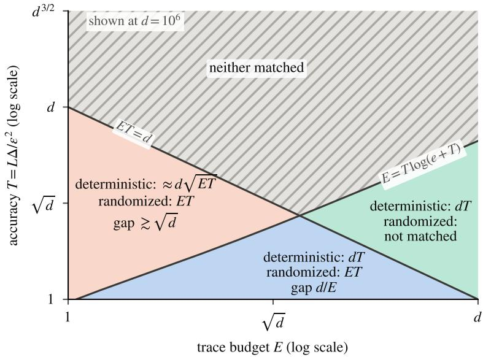
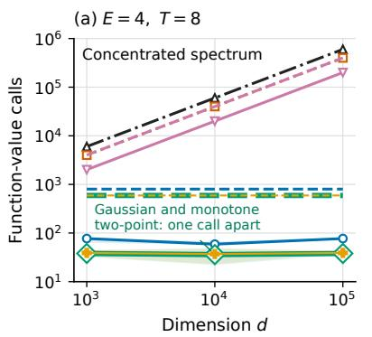
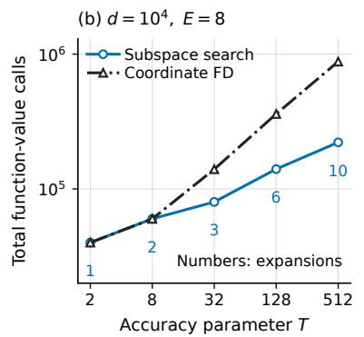
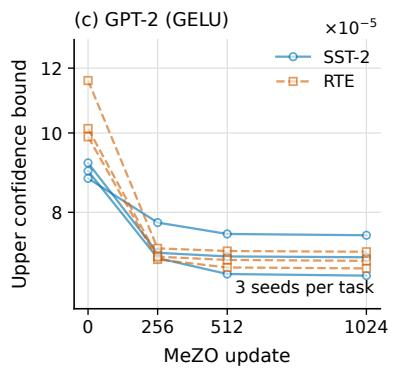

# Lower Bounds for Smooth Nonconvex Zeroth-Order Optimization: The Price of Determinism under Low Curvature Trace

Yuxing Peng1, Zhiqing Tang2,\*, and Weijia Jia2,3

1Faculty of Arts and Sciences, Beijing Normal University, Zhuhai 519087, China

2Institute of Artificial Intelligence and Future Networks, Faculty of Arts and Sciences, Beijing Normal University, Zhuhai 519087, China

## Abstract

3Guangdong Key Lab of AI and Multi-Modal Data Processing, Beijing Normal-Hong Kong Baptist University, Zhuhai 519087, China

\* Corresponding author: zhiqingtang@bnu.edu.cn

Low curvature trace, an efective rank condition, is a common explanation for why randomized zeroth-order methods scale to high-dimensional tasks such as language model fine-tuning. Can deterministic methods achieve the same savings? We show that they cannot. We study finding ε-stationary points of L-smooth nonconvex functions on Rd from exact function values, assuming that below the starting value the Hessian is dominated by a fixed matrix with trace at most LE; this is the efective rank condition used to explain zeroth-order fine-tuning. When $E T \leq d { \mathrm { . } }$ , the Gaussian two-point method that such fine-tuning uses needs only O(ET) calls if it rejects steps that raise f, where $T = L \Delta / \varepsilon ^ { 2 }$ is the iteration count of gradient descent from initial gap ∆, and we prove that every randomized method needs Ω(ET) calls, so this cost is optimal up to constants. In contrast, every deterministic method needs Ωe(d min{T, √ET}) calls, and adaptive subspace search attains O(d min{T, ET}): a deterministic method pays about d calls per discovered direction, and the trace budget allows about ET directions. Determinism thus multiplies the cost by a factor of order $d / ( E + \sqrt { E T } )$ up to logarithmic factors, which grows linearly with d for fixed E and $T ;$ once E exceeds T by a logarithmic factor, deterministic methods need Ω(dT) calls, as without any trace budget. Our lower bounds hold for $C ^ { \infty }$ functions with the matrix bound on all of Rd, even when each call also returns gradient projections priced by rank.

## 1 Introduction

Zeroth-order methods optimize with function values alone. They are the tool of choice when gradients are unavailable or too costly: attacking or explaining a model only through its outputs (Chen et al., 2017), tuning simulations, hyperparameters, and engineering designs (Larson et al., 2019), and searching policies in reinforcement learning (Salimans et al., 2017); see Liu et al. (2020) for a survey. Interest has surged with large language models. Fine-tuning with forward passes alone needs about the memory of inference, so a single GPU can tune models that backpropagation cannot fit (Malladi et al., 2023; Zhang et al., 2024), and seed-based zeroth-order updates reduce communication in federated fine-tuning (Qin et al., 2024).

For an L-smooth nonconvex function on $\mathbb { R } ^ { d }$ with initial gap ∆, the classical analysis of random finite diferences finds an ε-stationary point with O(dT) function values, where $T = L \Delta / \varepsilon ^ { 2 }$ (Nesterov and Spokoiny, 2017; Ghadimi and Lan, 2013). We prove that on the whole smooth class, deterministic methods cannot do better: they need Ω(dT) calls when $1 \leq T \leq d / \log ( e d )$ , even under rank-priced gradient projections (Theorem 3.4), matching coordinate finite diferences; for exact values without projections, randomized methods also need Ω(dT) when $d \gtrsim T$ log T, by concurrent and independent work (Xia and Yuan, 2026). In high-dimensional tasks such as language model fine-tuning, however, randomized zeroth-order methods succeed at far lower cost, which efective rank analyses attribute to a low curvature trace (Malladi et al., 2023; Yue et al., 2023), in line with the low intrinsic dimension of fine-tuning (Li et al., 2018; Aghajanyan et al., 2021). Does this saving come from problem structure alone, or does it require randomness? Classical derivative-free methods—coordinate and pattern search (Hooke and Jeeves, 1961), the Nelder–Mead method (Nelder and Mead, 1965), and Powell’s interpolation methods (Conn et al., 2009; Larson et al., 2019)—are deterministic, and so is any randomized method run with a fixed seed. We ask: what is the price of determinism under a low curvature trace—can deterministic methods match random directions by learning active subspaces, or must they still pay for the ambient dimension?

Table 1: Query complexity of finding an ε-stationary point and the algorithms that attain the upper bounds. D and R denote deterministic and randomized algorithms, NC means nonconvex, and $T = L \Delta / \varepsilon ^ { 2 }$ . All results use exact function values unless the setting names another oracle. Bold entries are new in this paper. “Matched”: whether the two bounds agree up to constant factors (yes), up to the stated factor, or only on stated ranges; a dash means that only one side is known.
<table><tr><td>Setting</td><td>Alg. Bounds</td><td>Upper bound attained by</td><td>Matched</td></tr><tr><td colspan="4">Low curvature trace:  $\nabla ^ { 2 } f \preceq H$  with tr  $H \leq L E$  below f(0) (this work)</td></tr><tr><td> $E T \leq d ,$  Theorem 3.1</td><td>R  $\Omega ( E T ) , O ( E T )$ </td><td>Gaussian two-point with an acceptance test a</td><td>yes</td></tr><tr><td> $E T \leq d ,$  Theorem 3.2</td><td>D  $\widetilde \Omega ( d \operatorname* { m i n } \{ T , \sqrt { E T } \} )$   $O ( d \operatorname* { m i n } \{ T , \sqrt { E T } \} )$ </td><td>restarted subspace search, adapting Cosson</td><td>up to  ${ \sqrt { \log } } ^ { b }$ </td></tr><tr><td> $T \log ( e + T ) \leq E \leq d / T ,$  Corollary 3.3</td><td>D vs  $\mathbf { D } \colon \Omega ( d T ) \colon \mathbf { R } \colon \Omega ( E T ) \colon \mathrm { D } \colon$  R  $O ( d T ) ; \mathrm { R } \colon O ( E T )$ </td><td>et al. (2023) coordinate finite differences; Gaussian two-point</td><td>yes</td></tr><tr><td colspan="4">Smooth NC, no trace budget</td></tr><tr><td>Xia and Yuan (2026)</td><td>R  $\Omega ( d T ) ^ { \ S } , { \cal O } ( d T )$ </td><td>Gaussian two-point (Nesterov and Spokoiny,</td><td>yes</td></tr><tr><td>1 ≤ T ≤ d/ log(ed), Theorem 3.4</td><td>D  $\Omega ( d T ) ^ { c } , { \cal O } ( d T )$ </td><td>2017) coordinate finite differences</td><td>yes</td></tr><tr><td colspan="4">Other settings</td></tr><tr><td>Effective rank (Malladi et al., 2023; Yue et al., 2023)</td><td>R d replaced by an effective dimension</td><td>random finite differences</td><td></td></tr><tr><td> $\| \nabla ^ { 2 } f \| _ { * } \leq H$  (Anonymous, 2026b)</td><td>R  $O ( H \Delta / \varepsilon ^ { 2 } )$ </td><td>Gaussian two-point</td><td></td></tr><tr><td>First-order oracle, large d (Carmon et al., 2020)</td><td>D, R Ω(T), O(T)</td><td>gradient descent</td><td>yes</td></tr><tr><td>Lipschitz, local oracle (Jordan et al., 2023; Kornowski, 2026)</td><td>D vs Goldstein points: D pays R  $( 1 / \varepsilon ) ^ { \Omega ( d ) }$ </td><td></td><td></td></tr></table>

§ For $T \geq c$ and $d \ge C T$ log(2 + T), with absolute constants $c , C > 0 .$  
a Theorem B.10; without the test, O(ET + T log(ET)) (Theorem B.15). $^ b \widetilde \Omega$ hides only a factor $\sqrt { \log ( e + T ) }$  
c At least dT /500, also with rank-priced gradient projections.

We quantify the worst-case cost of both algorithm classes on the same functions. Whereas prior work establishes a price of determinism for nonsmooth Goldstein stationarity (Section 5), we establish the smooth first-order counterpart in high dimension: randomness is essential to fully exploit a low curvature trace. Our main class keeps L-smoothness and the initial gap ∆ and adds an efective rank condition on the initial sublevel set, where descent methods operate: wherever $f \left( x \right) < f \left( 0 \right)$ , the Hessian is dominated by one positive semidefinite matrix of operator norm at most L and trace at most $L E$ . Because E bounds the trace rather than the rank, curvature may spread across many directions while negative curvature is uncharged; Section 2.1 compares this condition with prior curvature assumptions. Malladi et al. (2023) assume such a matrix near each iterate of a run and show that the slowdown of zeroth-order SGD then depends on its efective rank rather than on $d ;$ this is an upper bound for one randomized method. Our condition is fixed before the run and imposed only on the initial sublevel set. Under it, when $E T \leq d { \mathrm { , } }$ , we prove that the Gaussian two-point method attains $O ( E T )$ calls if it rejects steps that raise $f ,$ that no randomized method needs fewer, and that deterministic methods need more calls by a factor of order $d / ( E + \sqrt { E T } )$ , up to logarithmic factors.

The price of determinism. Suppose $E , T \geq 1$ and $E T \leq d .$ Intuitively, random probes pay only for the curvature trace, whereas deterministic methods pay the dimension d for each active direction they discover, and a fixed trace budget allows at most $O ( \sqrt { E T } )$ such directions. We show that deterministic methods always need at least d calls, already far above $O ( E T )$ when $E T \ll d ;$ adaptive subspace search uses $O ( d$ min $\{ T , { \sqrt { E T } } \} ,$ calls, and a hidden chain forces Ωe(min $\{ T , { \sqrt { E T } } \} )$ directions. Hence, writing $N _ { \mathrm { d e t } }$ and $N _ { \mathrm { r a n d } }$ for the worst-case query complexities (Theorems 3.1 and 3.2),

$$
\begin{array} { r l } & { \Big | \widetilde \Omega \big ( d \mathrm { m i n } \{ T , \sqrt { E T } \} \big ) \le N _ { \mathrm { d e t } } \le O \big ( d \mathrm { m i n } \{ T , \sqrt { E T } \} \big ) , } \\ & { \qquad \Omega ( E T ) \le N _ { \mathrm { r a n d } } \le O ( E T ) , } \end{array}
$$

where $\widetilde \Omega$ hides only a factor $\sqrt { \log ( e + T ) }$ ; Section 3 states the logarithm explicitly. The price of determinism, $N _ { \mathrm { d e t } } / N _ { \mathrm { r a n d } }$ , thus lies between $\widetilde \Omega ( d / ( E + \sqrt { E T } ) )$ and $O ( d / ( E + \sqrt { E T } ) )$ , growing linearly with d for fixed $E$ and T. Once $E \ge T \log ( e + T )$ , deterministic cost reverts to $\Omega ( d T )$ , so both classes are matched up to constant factors with cost ratio of order $d / E$ (Corollary 3.3).

Why exact feedback can still be hard. When each reply carries a bounded number of bits, counting information gives lower bounds (Basu et al., 2025). An exact real reply can encode arbitrarily much discrete information, so counting returned scalars proves nothing. Recent lower bounds with exact function values for convex minimization on a ball overcome this obstacle for deterministic (Kerger, 2026; Wu et al., $^ { 2 0 2 6 \mathrm { a } , \mathrm { b } ) }$ and randomized (Zhang et al., 2026b) methods, bounding objective error on a compact domain. Our lower bounds concern the gradient norm on $\mathbb { R } ^ { d }$ under unrestricted queries, unqueried outputs, and rank-priced gradient projections, by constructing functions whose replies agree exactly along the adaptive transcript. Against a deterministic algorithm, a resisting oracle (Nemirovsky and Yudin, 1983) fixes each hidden direction only when its stage closes, after $\Omega ( d )$ units of feedback: it is chosen orthogonal to the stage’s query points and to all its projection subspaces except possibly the closing one, and the next unfinished direction is chosen orthogonal to the output. One fixed function in the class realizes all replies and keeps the output gradient above ε. Multiplying the hidden chain by a perspective weight rules out small gradients far away and keeps the Hessian dominated by one fixed matrix on all of $\mathbb { R } ^ { d }$ (Appendix G.3). For randomized algorithms, Yao’s principle (Yao, 1977) with an unknown quadratic center gives $\Omega ( E T )$

## Contributions.

• Randomized cost scales with the trace, not the dimension. The Gaussian two-point method (Nesterov and Spokoiny, 2017) uses $O ( E T )$ calls for all $E , T \geq 1$ when it rejects steps that raise $f ;$ without this test it uses $O ( E T )$ calls when the matrix bound holds on all of $\mathbb { R } ^ { d }$ and

$O ( E T + T \log ( E T ) )$ calls in general. Conversely, every randomized method needs $\Omega ( E T )$ calls when $E T \leq d$ (Theorem 3.1).

• Quantifying the price of determinism under low trace. For $E T \leq d { \mathrm { , } }$ , adaptive subspace search achieves $O ( d \operatorname* { m i n } \{ T , \sqrt { E T } \} )$ calls, while $C ^ { \infty }$ hard functions force $\widetilde \Omega ( d \operatorname* { m i n } \{ T , \sqrt { E T } \} )$ calls even when the matrix bound holds on all of $\mathbb { R } ^ { d }$ (Theorem 3.2). Across $T \log ( e + T ) \leq E \leq d / T$ the trace stops helping deterministic methods (Ω(dT) calls), and determinism multiplies the cost by order $d / E$ (Corollary 3.3).

• Optimality of coordinate finite diferences without a trace budget. On the unrestricted smooth class, deterministic methods need at least $d T / 5 0 0$ calls when $1 \leq T \leq d / \log ( e d )$ , including under adaptive rank-priced gradient projections (Theorem 3.4).

Table 1 places these results among the closest prior bounds.

Section 2 defines the classes and oracles, Section 3 states the formal bounds, and Section 4 explains the proof mechanisms. Section 5 compares with prior work, Section 6 illustrates the mechanisms numerically, and Section 7 covers open problems and limitations. Appendices A, B, and G give explicit constants, algorithm analyses, and $C ^ { \infty }$ constructions under global trace bounds.

## 2 Setting

Function classes. For $L , \Delta > 0$ , let

$$
\begin{array} { r l } & { \mathcal { F } _ { L , \Delta } ^ { d } : = \{ f \in C ^ { 1 , 1 } ( \mathbb { R } ^ { d } ) : \operatorname { L i p } ( \nabla f ) \leq L , } \\ & { \qquad f ( 0 ) - \operatorname* { i n f } f \leq \Delta \} . } \end{array}\tag{1}
$$

The goal is a point $\widehat { \boldsymbol { x } } \in \mathbb { R } ^ { d }$ with $\| \nabla f ( \widehat { \boldsymbol { x } } ) \| \leq \varepsilon$ , and we write $T : = L \Delta / \varepsilon ^ { 2 }$ . For $1 \leq E \leq d ,$ the main class $B _ { L , \Delta , E } ^ { d }$ consists of the $f \in \mathcal { F } _ { L , \Delta } ^ { d }$ for which some unknown matrix $H \succeq 0$ with $\| H \| _ { \mathrm { o p } } \leq L$ and tr $H \leq L E$ satisfies

$$
\nabla ^ { 2 } f ( x ) \preceq H \qquad { \mathrm { f o r ~ a l m o s t ~ e v e r y ~ } } x { \mathrm { ~ w i t h ~ } } f ( x ) < f ( 0 ) .\tag{2}
$$

Matrix bounds of this form, with tr $H / \left. H \right. _ { \mathrm { o p } }$ called an efective rank, are used to explain the low cost of zeroth-order fine-tuning (Malladi et al., 2023). Requiring (2) only on the initial sublevel set $U = \{ x : f ( x ) < f ( 0 ) \}$ matches where descent methods operate: above $f ( 0 )$ the class requires only L-smoothness, and negative curvature is uncharged, so functions may be strongly nonconvex.

Our randomized upper bound holds on a larger class $A _ { L , \Delta , E } ^ { d }$ that requires neither a common matrix H nor smoothness above $f ( 0 )$ : it consists of the continuously diferentiable f with $f ( 0 ) -$ inf $f \leq \Delta$ whose gradient is locally L-Lipschitz on U and which satisfy $\mathrm { t r } [ ( \nabla ^ { 2 } f ( x ) ) _ { + } ] \leq L E$ for almost every $x \in U$ , where $A _ { + }$ keeps the positive eigenvalues of a symmetric matrix A (U need not be bounded or connected). Since $A \preceq H$ and $H \succeq 0$ imply tr $A _ { + } \leq \operatorname { t r } H$ , we have $\begin{array} { r } { B _ { L , \Delta , E } ^ { d } \subseteq \mathcal { A } _ { L , \Delta , E } ^ { d } . } \end{array}$

Two subclasses bound the trace on all of $\mathbb { R } ^ { d }$ . The fixed-matrix class $\mathcal { F } _ { L , \Delta , E } ^ { d } \subseteq B _ { L , \Delta , E } ^ { d }$ requires (2) for almost every $x \in \mathbb { R } ^ { d } ;$ for $C ^ { 1 , 1 }$ functions this is the quadratic upper model

$$
f ( \boldsymbol { x } + \boldsymbol { v } ) \leq f ( \boldsymbol { x } ) + \langle \nabla f ( \boldsymbol { x } ) , \boldsymbol { v } \rangle + \frac { 1 } { 2 } \boldsymbol { v } ^ { \top } H \boldsymbol { v } \qquad ( \boldsymbol { x } , \boldsymbol { v } \in \mathbb { R } ^ { d } ) ,\tag{3}
$$

and we call H an upper model of f. The pointwise class $\mathcal { P } _ { L , \Delta , E } ^ { d }$ requires $\textit { f } \in \mathcal { F } _ { L , \Delta } ^ { d }$ and $\mathrm { t r } [ ( \nabla ^ { 2 } f ( x ) ) _ { + } ] \leq L E$ for almost every $\boldsymbol { x } \in \mathbb { R } ^ { d }$ . They satisfy $\mathcal { F } _ { L , \Delta , E } ^ { d } \subseteq B _ { L , \Delta , E } ^ { d }$ and $\mathcal { P } _ { L , \Delta , E } ^ { d } \subseteq \mathcal { A } _ { L , \Delta , E } ^ { d }$ (Lemma G.1), and for $E = d$ every function in $\mathcal { F } _ { L , \Delta } ^ { d }$ belongs to all four classes. Our lower bounds hold on $\mathcal { F } _ { L , \Delta , E } ^ { d }$ and thus on all four classes; upper bounds on $\mathcal { A } _ { L , \Delta , E } ^ { d }$ and $B _ { L , \Delta , E } ^ { d }$ pass to subclasses.

What H and E mean. The matrix H is an upper model for the curvature that a descent method can meet. Its trace bounds the total positive curvature by $L E ,$ , so E acts as an efective dimension: $E = d$ adds nothing to L-smoothness, whereas a small E forces curvature to be concentrated in few directions or spread thinly over many. Only an upper bound is imposed, so negative curvature, and with it strong nonconvexity, is free. One matrix for the whole sublevel set is the structure that a deterministic method can learn and reuse (Section 4); randomized methods need only the pointwise bound of $\mathscr { A } _ { L , \Delta , E } ^ { d }$

Oracles and costs. At call t, an algorithm chooses $\boldsymbol { x } _ { t } \in \mathbb { R } ^ { d }$ from past replies and receives the exact value $f ( x _ { t } )$ ; its output $\widehat { \boldsymbol { x } } \in \mathbb { R } ^ { d }$ need not be queried. The deterministic cost $N _ { \mathrm { d e t } }$ is the smallest worst-case call count over deterministic algorithms that succeed on every function in the class. A randomized algorithm must succeed with probability at least $2 / 3$ on each function while making at most N calls on every trajectory; $N _ { \mathrm { r a n d } }$ is the smallest such N. Algorithms know $d , L , \Delta , \varepsilon .$ and $E$ , and internal computation and precision are free. Randomized policies are jointly measurable in their seed and finite transcript (Appendix F).

All lower bounds also hold for a stronger rank-priced oracle: at call t the algorithm may in addition choose $V _ { t } \in \mathbb { R } ^ { d \times s _ { t } }$ and receive

$$
\mathcal { O } _ { f } ( x _ { t } , V _ { t } ) = \big ( f ( x _ { t } ) , V _ { t } ^ { \top } \nabla f ( x _ { t } ) \big ) \quad \mathrm { a t } \mathrm { c o s t } { } 1 + \mathrm { r a n k } V _ { t } .\tag{4}
$$

A rank-one call is a forward-mode directional derivative (Baydin et al., 2022), and $V _ { t } = I _ { d }$ is a full gradient. We write $N ^ { \mathrm { v a l } }$ and $N ^ { \mathrm { l i n } }$ when the oracle matters $( N ^ { \mathrm { l i n } } \leq N ^ { \mathrm { v a l } } )$ . The lower bounds also hold for worst-case expected cost.

## 2.1 Comparison with prior curvature assumptions

We compare $B _ { L , \Delta , E } ^ { d }$ with the conditions under which prior zeroth-order rates improve on d.

• Sparse and latent structure (Wang et al., 2018; Golovin et al., 2020). Wang et al. (2018) assume sparsity, and Golovin et al. (2020) study objectives with a low-dimensional latent structure. A globally L-smooth objective that depends only on a fixed k-dimensional subspace lies in $\mathcal { F } _ { L , \Delta , k } ^ { d } ;$ our trace bound also allows curvature of full rank.

• Local efective rank (Malladi et al., 2023). Near each iterate $x _ { t }$ of a run, $\nabla ^ { 2 } f \preceq H _ { t }$ with tr $H _ { t } \leq r \left\| H _ { t } \right\| _ { \mathrm { o p } }$ . Letting $H _ { t }$ change along the run is more general than our single H, but the condition depends on the algorithm, whereas a lower bound needs a class fixed before the run. Every $f \in \mathcal { F } _ { L , \Delta , E } ^ { d }$ satisfies it with $r = E + 1$ : take $H _ { t } = H + ( L - \| H \| _ { \mathrm { o p } } ) v v ^ { \top }$ for a top unit eigenvector v of $H$ , so that $\| H _ { t } \| _ { \mathrm { o p } } = L$ and tr $H _ { t } \leq L ( E + 1 )$ . Our lower bounds therefore apply in their setting.

• Efective dimension and nuclear norm (Yue et al., 2023; Anonymous, 2026b). These sum powers of the absolute Hessian eigenvalues, or bound $\| \nabla ^ { 2 } f \| _ { * } \leq H$ , at every point of $\mathbb { R } ^ { d }$ . Our condition is weaker in charging only positive curvature and only below $f ( 0 )$ , so a strongly nonconvex function can have a small E but large values of these measures; it is stronger in asking for one common matrix, the structure that deterministic subspace search exploits, while our randomized bounds need only the pointwise class $\ A _ { L , \Delta , E } ^ { d } .$ . The nuclear norm class lies in $\mathcal { P } _ { L , \Delta , E } ^ { d }$ with $L E = H$

• Parameter symmetries (Anonymous, 2026a). They derive positive trace bounds from symmetries under a Polyak–Łojasiewicz condition; we assume neither.

Since our randomized upper bound holds on $\mathcal { A } _ { L , \Delta , E } ^ { d }$ and our lower bounds hold on functions of $\mathcal { F } _ { L , \Delta , E } ^ { d }$ with Hessian nuclear norm at most $L E ,$ , the separation holds on every class between them, including $\mathcal { P } _ { L , \Delta , E } ^ { d }$ and the class of Anonymous (2026b).

## 3 Main Results

Throughout, $d \geq 1 , 1 \leq E \leq d ,$ and $T \geq 1$ , with absolute constants $c , C > 0$ . Unless another class is named, costs refer to the main class $B _ { L , \Delta , E } ^ { d } .$ . All bounds hold for both oracles and on the global subclass $\mathcal { F } _ { L , \Delta , E } ^ { d } \subseteq B _ { L , \Delta , E } ^ { d } ;$ where all lower bounds are proved (Appendix G.3); the randomized upper bound holds even on $\ A _ { L , \Delta , E } ^ { d } .$

## 1. Randomized complexity.

Theorem 3.1 (Randomized cost). For all the above parameters, $N _ { \mathrm { r a n d } } \leq C E T$ . If $E T \leq d ;$ then $N _ { \mathrm { r a n d } } \geq c E T$

Random directions replace d by the trace budget E. The upper bound is attained by the Gaussian two-point method (Nesterov and Spokoiny, 2017), the estimator of zeroth-order fine-tuning (Malladi et al., 2023), with step $1 / ( L ( E + 2 ) )$ : if it accepts a step only when f decreases, it uses at most $1 2 E T + 2 6 T + 3$ calls, two values per step as without the test (Theorem B.10). Without the test, it uses at most $3 4 ( E + 2 ) T + 2$ calls on $\mathcal { F } _ { L , \Delta , E } ^ { d } ,$ and $O ( E T + T \log ( E T ) )$ calls on $B _ { L , \Delta , E } ^ { d }$ with a smaller step, because a long step may leave the sublevel set (Theorems B.12 and B.15). The stochastic three-point method (Bergou et al., 2020) attains O(ET) on $\mathcal { A } _ { L , \Delta , E } ^ { d }$ (Theorem G.3). The lower bound holds for every randomized method, including all these variants, and uses quadratics with an unknown center in a subspace of dimension at most $d .$

## 2. The price of determinism.

Theorem 3.2 (Deterministic cost). If $E T \leq d ;$ , then

$$
\begin{array} { r } { c d \mathrm { m i n } \Big \{ T , \sqrt { \frac { E T } { \mathrm { l o g } ( e + T ) } } \Big \} \leq N _ { \mathrm { d e t } } \leq C d \mathrm { m i n } \{ T , \sqrt { E T } \} . } \end{array}
$$

In $\widetilde \Omega$ notation, the bounds are $\widetilde \Omega ( d \operatorname* { m i n } \{ T , \sqrt { E T } \} )$ and $O ( d \operatorname* { m i n } \{ T , \sqrt { E T } \} )$ , agreeing up to $\sqrt { \log ( e + T ) }$ . When $E < T$ , adaptive subspace search beats coordinate finite diferences $( O ( d T ) )$ by paying about d calls for a full gradient estimate only when its current subspace is exhausted; the common matrix H of $B _ { L , \Delta , E } ^ { d }$ caps these expansions at $O ( { \sqrt { E T } } )$ , even without $E$ or H as input (Section 4, Algorithm 1, and Theorem B.1). The lower bound uses $C ^ { \infty }$ hard functions with $\| \nabla ^ { 2 } f \| _ { * } \leq L E$ on all of $\mathbb { R } ^ { d }$ and a prescribed Hessian Lipschitz constant (Appendix G.3).

Corollary 3.3 (A window with matching bounds). $I f T \log ( e + T ) \leq E \leq d / T$ , then

$$
\begin{array} { l } { { c d T \leq N _ { \mathrm { d e t } } \leq C d T , } } \\ { { c E T \leq N _ { \mathrm { r a n d } } \leq C E T . } } \end{array}
$$

For the same oracle, the cost ratio is bounded below by $\Omega ( d / E )$ and above by $O ( d / E )$

Once $E \ge T \log ( e + T )$ , a threshold set by accuracy alone, deterministic methods lose their trace savings and pay $\Omega ( d T ) ;$ the window is nonempty when $T ^ { 2 } \log ( e + T ) \leq d .$ . Across all $E T \leq d ,$ the cost ratio lies between $\widetilde \Omega ( d / ( E + \sqrt { E T } ) )$ and $O ( d / ( E + \sqrt { E T } ) )$ (Corollary E.5), which is at least $\widetilde \Omega ( \sqrt { d } )$ whenever $E \leq T$ . Theorem 3.2, the deterministic part of Corollary 3.3, and the three-point upper bound on $B _ { L , \Delta , E } ^ { d }$ are formalized in Lean 4 (Appendix J).

  
Figure 1: Which of our bounds match? The curves $E = T \log ( e + T )$ and $E T = d$ divide the parameter plane, drawn for $d = 1 0 ^ { 6 }$ . Each region gives the cost of deterministic and randomized methods where our lower and upper bounds match up to constant factors; ≈ also hides a factor $\sqrt { \log ( e + T ) }$ , and “not matched” indicates difering bounds; see Appendix A for the conditions.

## 3. Without a trace budget.

Theorem 3.4 (Unrestricted smooth class). On $\mathcal { F } _ { L , \Delta } ^ { d } , i f 1 \leq T \leq d / \log ( e d )$ , then

$$
{ \frac { d T } { 5 0 0 } } \leq N _ { \mathrm { d e t } } \leq 1 0 d T .
$$

Coordinate finite diferences are thus optimal up to constants across $1 \leq T \leq d / \log ( e d )$ , including under gradient projections (Theorem E.8). These deterministic hard functions (which for $T > 5 0 0$ are coercive, nonconvex, and globally $2 \sqrt { L \Delta } \mathrm { - L i p s c h i t z } )$ do not yield a randomized $\Omega ( d T )$ bound: a randomized batching method minimizes each of them exactly with probability at least $5 / 6$ using $O ( d \sqrt { T \log ( e + T ) } )$ values (Proposition H.2). A diferent construction forces $\Omega ( d T )$ exact values on randomized methods when $d \gtrsim T \log T$ (Xia and Yuan, 2026), without covering gradient projections.

Beyond these ranges. Figure 1 maps the parameter plane; Appendix A gives explicit constants. For all $E , T \ \geq \ 1$ , deterministic methods need at least d calls, satisfy $N _ { \mathrm { d e t } } \ \leq$ C min $\{ d T , { \sqrt { d E T ( d + T ) } } \}$ via subspace search, and need $\Omega ( d T )$ whenever $E \ge T \log ( e + T )$ (also when $E T > d )$ . For exact values, the lower bound of Xia and Yuan (2026) extends $N _ { \mathrm { r a n d } } \geq c E T$ to $E T \leq c d ^ { 2 } / \log ( e d )$ , so the matched window of Corollary 3.3 widens to $T \log ( e + T ) \leq E \leq d$ when $T \leq c d / \log ( e d )$ (Corollary H.3).

## 4 Proof Mechanisms

Combining the constructions below across parameter regimes yields all statements in Section 3;   
Appendix A.1 gives the short derivations.

## 4.1 Hiding one direction at a time

Why must a deterministic method pay $\Omega ( d )$ calls per hidden direction even when exact real replies carry infinitely many bits? Our lower bound separates an adversary argument, which shows that one unfinished direction forces $\Omega ( d )$ units of feedback, from an analytic construction that packs as many directions as smoothness, initial gap, and sublevel trace allow.

As in the chains of Carmon et al. (2020), later directions sit behind scalar gates that vanish identically near zero. At a completed query, later directions contribute nothing to $f ( x )$ or $\nabla f ( x )$ while the active unfinished direction $u _ { j }$ contributes a gradient above ε. A resisting oracle (Nemirovsky and Yudin, 1983) (Lemma C.4) chooses each $u _ { j }$ after earlier queries are fixed. While pending calls in stage j have total cost below $\lfloor d / 2 \rfloor$ , choosing $u _ { j }$ orthogonal to their query points and projection subspaces makes all replies match the prefix function; on the call closing stage j, $u _ { j }$ is fixed before its projection is returned. Keeping each later direction nearly orthogonal to all queries of earlier stages, so that their replies stay valid, costs the factor $\sqrt { \log ( e + T ) }$ (Lemma C.2). If the call budget runs out early, an unfinished direction is also chosen orthogonal to the final output ${ \widehat { x } } .$ , even if xb was never queried, so one fixed function in the class realizes the transcript with $\| \nabla f ( { \widehat { x } } ) \| > \varepsilon$

Hiding m directions forces cost $\Omega ( d m )$ and spends a constant normalized initial gap per direction. To allow unrestricted queries across $\mathbb { R } ^ { d }$ , a radial compression $\rho _ { R } ( x )$ bounds the hidden coordinates and a radial potential prevents small gradients far away. On $B _ { L , \Delta , E } ^ { d }$ , the potential is weakly curved inside a ball containing $\{ f < f ( 0 ) \}$ and grows steeply only outside, where $f \left( x \right) > f \left( 0 \right)$ . Inside the ball, the Hessian is dominated by one fixed matrix, a multiple of the projection onto the m hidden directions plus a small multiple of the identity, so the trace budget pays only for the weak inner curvature and compressed chain. When $E \ge T \log ( e + T )$ and $E \leq d ,$ all stages allowed by accuracy fit the trace budget and dimension. Multiplying the compressed chain by the perspective weight $( 1 + \| x \| ^ { 2 } / R ^ { 2 } ) ^ { 1 / 2 }$ , which forms a perspective function (Boyd and Vandenberghe, 2004), instead of adding a potential cancels the decay of its gradient far away, so one fixed matrix dominates the Hessian on all of $\mathbb { R } ^ { d }$ and every lower bound holds on $\mathcal { F } _ { L , \Delta , E } ^ { d }$ (Appendix G.3). Smoothing only the scalar gates while preserving their flat zero intervals makes the hard functions $C ^ { \infty }$ without changing a single reply (Appendices D.1 and G.3).

The number of discovered directions is the bottleneck on both sides. A deterministic search that, as in Cosson et al. (2023), seeks a new unit direction $u _ { i }$ only when the span of earlier ones is exhausted gains about $\varepsilon ^ { 2 } / ( u _ { i } ^ { \top } H u _ { i } )$ along $u _ { i }$ , and restarts with an empty span after r expansions (Algorithm 1). Within each block, orthonormal directions satisfy $\begin{array} { r } { \sum _ { i } u _ { i } ^ { \top } H u _ { i } \le L E } \end{array}$ , so by Cauchy–Schwarz a full block decreases f by at least $\Omega ( r ^ { 2 } \varepsilon ^ { 2 } / ( L E ) )$ ) while total decrease is at most $\Delta$ . Taking r of order $\sqrt { E T }$ allows only $O ( \sqrt { E T } )$ expansions when $E T \leq d \ ( { \mathrm { A p p e n d i x ~ B } } )$ . Conversely, the hidden chain forces min $\{ T , \sqrt { E T / \log ( e + T ) } \}$ directions, so the deterministic bounds of Theorem 3.2 meet up to $\sqrt { \log ( e + T ) }$ .

## 4.2 The randomized obstruction is diferent

Against a randomized algorithm, the hard function cannot be chosen after observing the random seed. By Yao’s principle (Yao, 1977), a distributional lower bound sufices: it fixes a random quadratic with an unknown center in a public subspace before the run begins. Each rank-priced query reduces to a counted number of linear observations of the center, and rotational symmetry bounds the remaining error, including at an unqueried output. Because the public subspace has dimension at most $d ,$ this argument gives Ω(ET) up to $E T = d $

## 4.3 Random directions need control only below $f ( 0 )$

A Gaussian two-point step moves from $x$ to $x - \eta s a$ , where s is the finite-diference slope of f along $a \sim N ( 0 , I _ { d } )$ With $g = \nabla f ( x )$ , the quadratic upper model and the Gaussian moment $\mathbb { E } [ ( a ^ { \top } g ) ^ { 2 } a ^ { \top } H a ] = \| g \| ^ { 2 }$ tr $H + 2 g ^ { \top } H g \leq L ( E + 2 ) \left\| g \right\| ^ { 2 }$ charge the trace of H rather than $d ,$ so the step $\eta = 1 / ( L ( E + 2 ) )$ lowers $f$ by order $\| g \| ^ { 2 } / ( L E )$ on average. A step this long may leave the sublevel set, where only L-smoothness holds. The capped model bounds min $\{ f ( x - \eta s a ) , f ( 0 ) \}$ by the same quadratic (Lemma B.3), so accepting only steps that lower $f$ sufices (Theorem B.10). Without the test, we compare the iterates with an auxiliary run that drops the rare directions with large $a ^ { \top } H a ;$ with a slightly smaller step and a small diference radius the two runs stay within $\varepsilon / ( 8 L )$ , at the price of a $T \log ( E T )$ term (Theorem B.15). The pointwise class $\mathcal { A } _ { L , \Delta , E } ^ { d }$ has no common $H ;$ there the three-point method keeps the lowest of $f ( x )$ and $f ( x \pm h a )$ , and averaging over the Gaussian component across the gradient charges the positive trace (Theorem G.3).

## 5 Related Work

Zeroth-order upper bounds under curvature conditions. The classical analysis of Gaussian finite diferences reduces derivative-free optimization to stochastic first-order methods at the cost of a factor d (Nesterov and Spokoiny, 2017; Ghadimi and Lan, 2013; Duchi et al., 2015). The curvature conditions compared in Section 2.1 remove most of this factor for randomized methods. They measure curvature diferently from us: the hard function $F _ { U }$ of Theorem D.4 has $\nabla ^ { 2 } F _ { U } ( 0 ) = \mu I$ with $\mu = 1 1 m / R ^ { 2 }$ , giving efective dimension at least $d _ { \textstyle \sqrt { \mu } }$ in the sense of Yue et al. (2023), whereas its positive trace is of order $m + \mu d .$ . Anonymous (2026b) show that the Gaussian two-point method finds an ε-stationary point under $\| \nabla ^ { 2 } f \| _ { * } \leq H$ in $O ( H \Delta / \varepsilon ^ { 2 } )$ exact values (and with an extra factor depending on the noise under noisy values). Their class lies in $\mathcal { P } _ { L , \Delta , E } ^ { d }$ with $L E = H$ , where the three-point method attains the same rate, and their Twisted Valley example, in which fixed or neighborhood matrix bounds can require trace of order d while the pointwise bound is constant, is why our randomized upper bound uses the pointwise class $\ A _ { L , \Delta , E } ^ { d } .$ The two concurrent works prove no lower bounds. For stochastic convex problems on a compact domain whose subgradients lie in the range of a fixed structural preconditioner, Sholokhov and Rogozin (2026) use ellipsoidal sampling, with bounds depending on the subspace rank, conditioning, and normalized trace. The Hessian trace also governs the implicit regularization of two-point estimators (Zhang et al., 2025), random subspace methods (Kozak et al., 2021; Omiya et al., 2026) use related structure under diferent assumptions, and local gradient smoothness has been studied for first-order and derivative-free methods (Zhang and Hong, 2024; Khanh et al., 2023). On the deterministic side, our upper bound adapts the subspace expansion scheme of Cosson et al. (2023) from low-dimensional gradient subspaces to a fixed trace budget.

Lower bounds for stationarity and for exact values. Stationarity lower bounds in fixed dimension on a box go back to Vavasis (1993) and were extended to randomized algorithms in $d = 2$ by Bubeck and Mikulincer (2020). On $\mathbb { R } ^ { 2 }$ , Hollender and Zampetakis (2025) show that deterministic methods need $\Omega ( { \sqrt { T } } )$ value or gradient calls for stationarity and $O ( \sqrt { T } )$ value calls sufice; high-dimensional first-order $\Omega ( T )$ lower bounds use the hidden chains of Carmon et al. (2020), which also give stochastic lower bounds (Arjevani et al., 2023). With noisy values, convex query complexity grows with d (Jamieson et al., 2012; Shamir, 2013; Duchi et al., 2015). Recent work studies oracles returning exact values for convex optimization on a ball, where one real reply can encode many coordinates: for deterministic methods, Kerger (2026) proves a nearly quadratic lower bound for Lipschitz convex minimization, and Wu et al. (2026a,b) prove smooth and strongly

  
STP Gaussian two-point Monotone two-point Subspace search Coordinate FD FD L-BFGS solid: first hit dashed: total calls

Figure 2: Query costs on synthetic functions and local curvature of $\mathrm { G P T - 2 }$ (GELU). (a) Family with a concentrated spectrum with $E = 4$ and $T = 8 \colon$ ofline first-hit calls (solid) of the three-point method (STP), the Gaussian two-point method, the monotone two-point method, the subspace search, coordinate finite diferences, and finite-diference L-BFGS, and actual total calls (dashed). (b) Actual total calls of the subspace search and coordinate finite diferences on a tridiagonal quadratic chain with $d = 1 0 ^ { 4 }$ and $E = 8 ;$ numbers give the subspace expansions. In (a) and (b), points and bands are medians and interquartile ranges over five seeds. (c) Upper confidence bounds, at simultaneous level 0.95, for $\operatorname { t r } ( G _ { + } ) / ( d \left\| G \right\| _ { \mathrm { o p } } )$ , where G is the Hessian on a fixed batch, along $\mathrm { M e Z O }$ fine-tuning, three seeds per task. Protocols and further results are in Appendix I.

convex bounds via shielded chains and delayed rotations that match on specified accuracy ranges; for randomized methods, Zhang et al. (2026b) use a posterior mean energy method to prove an extra factor d up to logarithms in Lipschitz convex optimization. With noisy values on a ball, Zhang et al. (2026a) prove a joint dimension–accuracy lower bound for Goldstein stationarity. Whereas those convex bounds with exact values concern objective error on a ball, our bounds control the gradient norm on all of $\mathbb { R } ^ { d }$ under a curvature trace budget and allow rank-priced adaptive gradient projections. On the unrestricted smooth class with exact values, concurrent and independent work of Xia and Yuan (2026) proves a randomized $\Omega ( d T )$ lower bound when $d \geq C T \log ( 2 + T )$ for an absolute constant C; Theorem 3.4 gives an explicit constant and covers gradient projections, where a randomized $\Omega ( d T )$ lower bound remains open.

The price of determinism. For Lipschitz nonsmooth functions and Goldstein stationarity, Jordan et al. (2023) prove a deterministic $\Omega ( d )$ lower bound against dimension-free randomized methods, and Kornowski (2026) shows that the deterministic price can be exponential. In one dimension, Chewi et al. (2023) show that randomness or function values provably help in finding stationary points of smooth functions. Our work establishes the high-dimensional smooth counterpart under a low curvature trace: for $E T \leq d ,$ determinism multiplies the complexity by order $d / ( E + \sqrt { E T } )$ up to $\sqrt { \log ( e + T ) }$ , and by order $d / E$ up to constant factors across T log $( e + T ) \leq E \leq d / T$

## 6 Empirical Illustration

We run the algorithms of our upper bounds on fixed instances to illustrate the mechanisms behind Theorems 3.1 and 3.2, rather than to test worst-case bounds. The runs show four things: (i) deterministic costs grow linearly with d, while randomized costs stay nearly constant in d and scale with E and $T ;$ (ii) the Gaussian two-point method and its monotone variant (Theorems B.12 and B.10) have comparable first-hit counts and need about half the calls of the three-point method on these instances, also with curvature controlled only below f(0); (iii) a run with a fixed seed is a deterministic algorithm and can be defeated, as in our lower bound; and (iv) subspace search saves calls by reusing directions, and the local curvature of GPT-2 is consistent with a small trace budget. All synthetic runs use $L = \Delta = 1$ and $\varepsilon = T ^ { - 1 / 2 }$ and charge every function value, including rejected proposals and final checks. First-hit counts are computed ofline from the recorded iterates; no method uses the true gradient to stop or to select its output.

Randomized versus deterministic. We compare the Gaussian two-point method with central diferences (Nesterov and Spokoiny, 2017), its monotone variant, and the three-point method of Theorem G.3 against coordinate central diferences, finite-diference L-BFGS, and our restarted subspace search on a rank-one quadratic and on rotated separable nonconvex functions with concentrated or difuse spectra, for $d \in \{ 1 0 ^ { 3 } , 1 0 ^ { 4 } , 1 0 ^ { 5 } \} , T \in \{ 2 , 8 , 3 2 \}$ , and E up to 128 with $E T \leq d / 4$ . Because the deterministic methods spend about d calls per gradient estimate, their cost grows linearly with d, whereas the randomized methods stay nearly constant in d (Figure $\mathrm { 2 ( a ) } ,$ ). In panel (a) at $d = 1 0 ^ { 5 }$ , the subspace search first reaches the target after 200,009 calls and coordinate finite diferences after 600,001, whereas the three-point method needs 77, the two-point method 38, and the monotone two-point method 39. Over the 215 instances, the monotone two-point method first reached the target after a median of 31 calls, against 30 for the two-point method; its last iterate was ε-stationary in all 215 runs and its uniformly drawn output, which Theorem B.10 analyzes, in 203, as for the two-point method. These instances satisfy the upper model on all of $\mathbb { R } ^ { d }$ , where the two-point method needs O(ET) calls (Theorem B.12). A run with a fixed seed is a deterministic algorithm and can be defeated: on rank-one quadratics chosen orthogonal to its query sequence it never reaches the target, while fresh seeds on the same functions succeed in 17–20 of 20 runs.

Curvature controlled only below f(0). On wall functions whose Hessian is small below f(0) but of order L in almost every direction above it (Appendix I), the monotone two-point method again matched the two-point method, with median first hits of 69 and 72 calls against 173 for the three-point method. No method exceeded $f ( 0 )$ on these instances, so the plain two-point method was not hurt either, but shrinking its step to $1 / ( L ( d + 2 ) )$ ), which makes it safe without an acceptance test, left all 45 runs short of the target within the same budget.

Subspace search. On a tridiagonal quadratic chain, gradients reveal new directions one at a time, so the subspace search needs one expansion at $T = 2$ and ten at $T = 5 1 2$ (Figure 2(b)). Reusing the directions already found instead of estimating full gradients again, it uses about a quarter of the calls of coordinate finite diferences at $d = 1 0 ^ { 4 }$ and $T = 5 1 2 .$ , while matching their cost at the two lowest accuracies. On the separable family of panel (a), whose gradient stays along one hidden direction, a single expansion sufices, yet it still costs about d calls.

Local curvature of a smooth model. GPT-2 uses a smooth activation, so its loss Hessian is defined everywhere, unlike for ReLU networks. Along MeZO fine-tuning, an upper confidence bound for $\operatorname { t r } ( G _ { + } ) / ( d \left\| G \right\| _ { \mathrm { o p } } )$ , where G is the Hessian on a fixed batch, stays between $6 . 7 \times 1 0 ^ { - 5 }$ and $1 . 2 \times 1 0 ^ { - 4 }$ (Figure 2(c)). With about $1 . 2 4 \times 1 0 ^ { 8 }$ parameters, this keeps the local trace budget $\operatorname { t r } ( G _ { + } ) / \left\| G \right\| _ { \mathrm { o p } }$ below $1 . 5 \times 1 0 ^ { 4 }$ , comparable to $\sqrt { d }$ and consistent with the few large Hessian eigenvalues reported for neural networks (Ghorbani et al., 2019). Low-dimensional runs with

$E T > d ,$ where coordinate diferences can beat random directions, and measurements on ReLU models are reported in Appendix I.

## 7 Discussion and Open Problems

Limitations. The separation is proved for exact replies, whereas Anonymous (2026b) also allow noise; independent noise can supply random bits, so deterministic lower bounds do not transfer to that model. Without an acceptance test, our bound for the two-point method on $B _ { L , \Delta , E } ^ { d }$ has an extra T log(ET) term and uses a very small diference radius; whether a step of order $1 / ( L E )$ alone gives $O ( E T )$ calls is open. The randomized upper bound on $\mathcal { A } _ { L , \Delta , E } ^ { d }$ takes E as input, and a randomized cap of order ET without knowledge of E remains open.

Conclusion. We quantified the price of determinism for smooth nonconvex zeroth-order optimization under a low curvature trace. Below f(0), the Gaussian two-point method with an acceptance test finds an ε-stationary point in $O ( E T )$ calls, matching our $\Omega ( E T )$ lower bound for $E T \leq d$ , whereas every deterministic method pays a factor of order $d / ( E + \sqrt { E T } )$ more, up to $\sqrt { \log ( e + T ) }$ . Closing the remaining logarithm, determining deterministic costs on the pointwise class, and resolving the remaining complexities for $E T > d$ are the main open problems.

## References

Armen Aghajanyan, Sonal Gupta, and Luke Zettlemoyer. Intrinsic dimensionality explains the efectiveness of language model fine-tuning. In Proceedings of the 59th Annual Meeting of the Association for Computational Linguistics and the 11th International Joint Conference on Natural Language Processing (Volume 1: Long Papers), pages 7319–7328, 2021. doi: 10.18653/v1/2021. acl-long.568.

Anonymous. When does symmetry reduce efective rank in zeroth-order optimization? Submitted to ICLR 2027, 2026a. URL https://openreview.net/forum?id=EplKUVCy5D.

Anonymous. Revisiting the dimension dependence of zeroth-order optimization under Hessian trace-norm conditions. Submitted to ICLR 2027, 2026b. URL https://openreview.net/forum? id=ypBUtS8SON.

Yossi Arjevani, Yair Carmon, John C. Duchi, Dylan J. Foster, Nathan Srebro, and Blake Woodworth. Lower bounds for non-convex stochastic optimization. Mathematical Programming, 199(1–2): 165–214, 2023. doi: 10.1007/s10107-022-01822-7.

Amitabh Basu, Phillip Kerger, and Marco Molinaro. Tight lower bounds for binary first-order oracles for convex optimization. arXiv preprint arXiv:2511.02082, 2025.

Atılım Güneş Baydin, Barak A. Pearlmutter, Don Syme, Frank Wood, and Philip Torr. Gradients without backpropagation. arXiv preprint arXiv:2202.08587, 2022.

El Houcine Bergou, Eduard Gorbunov, and Peter Richtárik. Stochastic three points method for unconstrained smooth minimization. SIAM Journal on Optimization, 30(4):2726–2749, 2020. doi: 10.1137/19M1244378.

Stephen Boyd and Lieven Vandenberghe. Convex Optimization. Cambridge University Press, 2004. doi: 10.1017/CBO9780511804441.

Sébastien Bubeck and Dan Mikulincer. How to trap a gradient flow. In Proceedings of Thirty Third Conference on Learning Theory, volume 125 of Proceedings of Machine Learning Research, pages 940–960, 2020.

Yair Carmon, John C. Duchi, Oliver Hinder, and Aaron Sidford. Lower bounds for finding stationary points I. Mathematical Programming, 184(1–2):71–120, 2020. doi: 10.1007/s10107-019-01406-y.

Pin-Yu Chen, Huan Zhang, Yash Sharma, Jinfeng Yi, and Cho-Jui Hsieh. ZOO: Zeroth order optimization based black-box attacks to deep neural networks without training substitute models. In Proceedings of the 10th ACM Workshop on Artificial Intelligence and Security, pages 15–26. ACM, 2017. doi: 10.1145/3128572.3140448.

Sinho Chewi, Sébastien Bubeck, and Adil Salim. On the complexity of finding stationary points of smooth functions in one dimension. In Shipra Agrawal and Francesco Orabona, editors, Proceedings of the 34th International Conference on Algorithmic Learning Theory, volume 201 of Proceedings of Machine Learning Research, pages 358–374, 2023.

Andrew R. Conn, Katya Scheinberg, and Luís N. Vicente. Introduction to Derivative-Free Optimization, volume 8 of MPS-SIAM Series on Optimization. SIAM, Philadelphia, 2009. doi: 10.1137/1.9780898718768.

Romain Cosson, Ali Jadbabaie, Anuran Makur, Amirhossein Reisizadeh, and Devavrat Shah. Low-rank gradient descent. IEEE Open Journal of Control Systems, 2:380–395, 2023. doi: 10.1109/OJCSYS.2023.3315088.

Thomas M. Cover and Joy A. Thomas. Elements of Information Theory. Wiley, Hoboken, NJ, second edition, 2006. doi: 10.1002/047174882X.

John C. Duchi, Michael I. Jordan, Martin J. Wainwright, and Andre Wibisono. Optimal rates for zero-order convex optimization: The power of two function evaluations. IEEE Transactions on Information Theory, 61(5):2788–2806, 2015. doi: 10.1109/TIT.2015.2409256.

Saeed Ghadimi and Guanghui Lan. Stochastic first- and zeroth-order methods for nonconvex stochastic programming. SIAM Journal on Optimization, 23(4):2341–2368, 2013. doi: 10.1137/ 120880811.

Behrooz Ghorbani, Shankar Krishnan, and Ying Xiao. An investigation into neural net optimization via Hessian eigenvalue density. In Proceedings of the 36th International Conference on Machine Learning, volume 97 of Proceedings of Machine Learning Research, pages 2232–2241, 2019.

Daniel Golovin, John Karro, Greg Kochanski, Chansoo Lee, Xingyou Song, and Qiuyi Zhang. Gradientless descent: High-dimensional zeroth-order optimization. In International Conference on Learning Representations, 2020.

Wassily Hoefding. Probability inequalities for sums of bounded random variables. Journal of the American Statistical Association, 58(301):13–30, 1963. doi: 10.1080/01621459.1963.10500830.

Alexandros Hollender and Manolis Zampetakis. The computational complexity of finding stationary points in non-convex optimization. Mathematical Programming, 213(1–2):281–341, 2025. doi: 10.1007/s10107-024-02139-3.

Robert Hooke and T. A. Jeeves. “Direct search” solution of numerical and statistical problems. Journal of the ACM, 8(2):212–229, 1961. doi: 10.1145/321062.321069.

Peter J. Huber. Robust estimation of a location parameter. The Annals of Mathematical Statistics, 35(1):73–101, 1964. doi: 10.1214/aoms/1177703732.

M. F. Hutchinson. A stochastic estimator of the trace of the influence matrix for Laplacian smoothing splines. Communications in Statistics – Simulation and Computation, 18(3):1059–1076, 1989. doi: 10.1080/03610918908812806.

Kevin G. Jamieson, Robert D. Nowak, and Benjamin Recht. Query complexity of derivative-free optimization. In Advances in Neural Information Processing Systems 25, pages 2672–2680, 2012.

Michael Jordan, Guy Kornowski, Tianyi Lin, Ohad Shamir, and Manolis Zampetakis. Deterministic nonsmooth nonconvex optimization. In Proceedings of Thirty Sixth Conference on Learning Theory, volume 195 of Proceedings of Machine Learning Research, pages 4570–4597, 2023.

Phillip Kerger. Closing the oracle-complexity gap in derivative-free convex optimization: A nearquadratic lower bound from exact function values. arXiv preprint arXiv:2607.13335, 2026.

Pham Duy Khanh, Boris S. Mordukhovich, and Dat Ba Tran. General derivative-free optimization methods under global and local Lipschitz continuity of gradients. arXiv preprint arXiv:2311.16850, 2023.

Guy Kornowski. The exponential price of determinism in nonsmooth nonconvex optimization. arXiv preprint arXiv:2609.23837, 2026.

David Kozak, Stephen Becker, Alireza Doostan, and Luis Tenorio. A stochastic subspace approach to gradient-free optimization in high dimensions. Computational Optimization and Applications, 79(2):339–368, 2021. doi: 10.1007/s10589-021-00271-w.

Jefrey Larson, Matt Menickelly, and Stefan M. Wild. Derivative-free optimization methods. Acta Numerica, 28:287–404, 2019. doi: 10.1017/S0962492919000060.

Chunyuan Li, Heerad Farkhoor, Rosanne Liu, and Jason Yosinski. Measuring the intrinsic dimension of objective landscapes. In International Conference on Learning Representations, 2018.

Sijia Liu, Pin-Yu Chen, Bhavya Kailkhura, Gaoyuan Zhang, Alfred O. Hero, III, and Pramod K. Varshney. A primer on zeroth-order optimization in signal processing and machine learning: Principals, recent advances, and applications. IEEE Signal Processing Magazine, 37(5):43–54, 2020. doi: 10.1109/MSP.2020.3003837.

Sadhika Malladi, Tianyu Gao, Eshaan Nichani, Alex Damian, Jason D. Lee, Danqi Chen, and Sanjeev Arora. Fine-tuning language models with just forward passes. In Advances in Neural Information Processing Systems, volume 36, pages 53038–53075, 2023.

John A. Nelder and Roger Mead. A simplex method for function minimization. The Computer Journal, 7(4):308–313, 1965. doi: 10.1093/comjnl/7.4.308.

Arkadi S. Nemirovsky and David B. Yudin. Problem Complexity and Method Eficiency in Optimization. Wiley, New York, 1983.

Yurii Nesterov and Vladimir Spokoiny. Random gradient-free minimization of convex functions. Foundations of Computational Mathematics, 17(2):527–566, 2017. doi: 10.1007/s10208-015-9296-2.

Gaku Omiya, Pierre-Louis Poirion, and Akiko Takeda. Randomized subspace Nesterov accelerated gradient. arXiv preprint arXiv:2605.00740, 2026.

Zhen Qin, Daoyuan Chen, Bingchen Qian, Bolin Ding, Yaliang Li, and Shuiguang Deng. Federated full-parameter tuning of billion-sized language models with communication cost under 18 kilobytes. In Proceedings of the 41st International Conference on Machine Learning, volume 235 of Proceedings of Machine Learning Research, pages 41473–41497, 2024.

Farbod Roosta-Khorasani and Uri Ascher. Improved bounds on sample size for implicit matrix trace estimators. Foundations of Computational Mathematics, 15(5):1187–1212, 2015. doi: 10.1007/s10208-014-9220-1.

Tim Salimans, Jonathan Ho, Xi Chen, Szymon Sidor, and Ilya Sutskever. Evolution strategies as a scalable alternative to reinforcement learning. arXiv preprint arXiv:1703.03864, 2017.

Ohad Shamir. On the complexity of bandit and derivative-free stochastic convex optimization. In Proceedings of the 26th Annual Conference on Learning Theory, volume 30 of Proceedings of Machine Learning Research, pages 3–24, 2013.

Alexander Sholokhov and Alexander Rogozin. Parameter-free zeroth-order optimization with ellipsoidal sampling. arXiv preprint arXiv:2609.38561, 2026.

Zbyněk Šidák. Rectangular confidence regions for the means of multivariate normal distributions. Journal of the American Statistical Association, 62(318):626–633, 1967. doi: 10.1080/01621459. 1967.10482935.

Joel Spencer. Six standard deviations sufice. Transactions of the American Mathematical Society, 289(2):679–706, 1985.

Stephen A. Vavasis. Black-box complexity of local minimization. SIAM Journal on Optimization, 3 (1):60–80, 1993. doi: 10.1137/0803004.

Yining Wang, Simon S. Du, Sivaraman Balakrishnan, and Aarti Singh. Stochastic zeroth-order optimization in high dimensions. In Proceedings of the 21st International Conference on Artificial Intelligence and Statistics, volume 84 of Proceedings of Machine Learning Research, pages 1356– 1365, 2018.

Wendao Wu, Haihan Zhang, Chenheng Zhang, Yanyi Li, Chunyuan Zheng, Cong Fang, Haoxuan Li, and Zhouchen Lin. Near-optimal deterministic exact-value complexity for smooth convex optimization. arXiv preprint arXiv:2609.18230, 2026a.

Wendao Wu, Haihan Zhang, Chenheng Zhang, Yanyi Li, Chunyuan Zheng, Cong Fang, Haoxuan Li, and Zhouchen Lin. Near-optimal exact-value zeroth-order complexity for smooth strongly convex optimization. arXiv preprint arXiv:2609.18728, 2026b.

Yuxuan Xia and Xiao-Tong Yuan. On global joint lower bounds in zeroth-order nonconvex optimization. arXiv preprint arXiv:2610.19652, 2026.

Andrew Chi-Chih Yao. Probabilistic computations: Toward a unified measure of complexity. In 18th Annual Symposium on Foundations of Computer Science, pages 222–227, 1977. doi: 10.1109/SFCS.1977.24.

Pengyun Yue, Long Yang, Cong Fang, and Zhouchen Lin. Zeroth-order optimization with weak dimension dependency. In Proceedings of Thirty Sixth Conference on Learning Theory, volume 195 of Proceedings of Machine Learning Research, pages 4429–4472, 2023.

Haihan Zhang, Wendao Wu, Chenheng Zhang, Yanyi Li, Chunyuan Zheng, Cong Fang, Haoxuan Li, and Zhouchen Lin. Joint lower bounds for zeroth-order nonconvex optimization on Euclidean balls. arXiv preprint arXiv:2610.00275, 2026a.

Haihan Zhang, Chenheng Zhang, Zhiquan Qi, and Zhouchen Lin. Near-optimal lower bounds for randomized algorithms in exact value zeroth-order convex optimization. arXiv preprint arXiv:2607.16558, 2026b.

Junyu Zhang and Mingyi Hong. First-order algorithms without Lipschitz gradient: A sequential local optimization approach. INFORMS Journal on Optimization, 6(2):118–136, 2024. doi: 10.1287/ijoo.2021.0029.

Liang Zhang, Bingcong Li, Kiran Koshy Thekumparampil, Sewoong Oh, Michael Muehlebach, and Niao He. Zeroth-order optimization finds flat minima. In Advances in Neural Information Processing Systems, volume 38, pages 160959–160998, 2025. doi: 10.52202/085713-5375.

Yihua Zhang, Pingzhi Li, Junyuan Hong, Jiaxiang Li, Yimeng Zhang, Wenqing Zheng, Pin-Yu Chen, Jason D. Lee, Wotao Yin, Mingyi Hong, Zhangyang Wang, Sijia Liu, and Tianlong Chen. Revisiting zeroth-order optimization for memory-eficient LLM fine-tuning: A benchmark. In Proceedings of the 41st International Conference on Machine Learning, volume 235 of Proceedings of Machine Learning Research, pages 59173–59190, 2024.

## AI Usage Statement

We used AI assistants, including OpenAI’s GPT models and Anthropic’s Claude, to help develop and check proofs, formalize them in Lean, implement the experiments, and edit the text. The authors take full responsibility for the content of this paper.

## A Main Theorem and Proof Overview

Write $T = L \Delta / \varepsilon ^ { 2 } \geq 1$ and $1 \leq E \leq d .$ . The class B contains globally L-smooth $C ^ { 1 , 1 }$ functions with $f ( 0 ) - \operatorname* { i n f } f \leq \Delta$ and one fixed unknown matrix $0 \preceq H \preceq L I$ , tr $H \leq L E$ , dominating the Hessian almost everywhere on $\{ f < f ( 0 ) \}$ . The subclass $\mathcal { F }$ requires the matrix bound globally. An exact value costs one; feedback $( f ( x ) , V ^ { \top } \nabla f ( x ) )$ costs 1 + rank V . The output need not be queried; exact computation is uncharged, and the superscripts cap and exp mark the capped cost of Section 2 and the worst-case expected cost.

Theorem A.1 (Main bounds with explicit constants). For either oracle on $B _ { ; }$

$$
\begin{array} { r l } & { N _ { \mathrm { r a n d } } ^ { \mathrm { c a p } } \leq 2 3 E T , } \\ & { N _ { \mathrm { r a n d } } ^ { \mathrm { c a p } } \leq 2 3 E T , } \\ & { N _ { \mathrm { d e t } } \leq \operatorname* { m i n } \{ 1 0 d T , 1 0 0 \sqrt { d E T ( d + T ) } \} , \quad N _ { \mathrm { d e t } } \geq { \operatorname* { m i n } } \{ d , E T \} / { 1 2 } , \quad N _ { \mathrm { r a n d } } ^ { \mathrm { e x p } } \geq \operatorname* { m i n } \{ d , E T \} / { 1 4 4 } , } \\ & { \quad N _ { \mathrm { d e t } } \leq { \operatorname* { m i n } } \{ 1 0 d T , 1 0 0 \sqrt { d E T ( d + T ) } \} , \quad N _ { \mathrm { d e t } } \geq d . } \end{array}\tag{5}
$$

If $E T \leq d ,$ then

$$
N _ { \mathrm { d e t } } \geq \frac { d } { 6 7 2 } \operatorname* { m i n } \{ T , \sqrt { E T / \log ( e + T ) } \} .
$$

Thus for $T \log ( e + T ) \ \leq \ E \ \leq \ d / T$ the deterministic bounds are $\Omega ( d T )$ and $O ( d T )$ , and the randomized bounds are $\Omega ( E T )$ and $O ( E T )$ . On the unrestricted globally smooth class, $N _ { \mathrm { d e t } } \ \geq$ $\begin{array} { r } { \frac { d } { 5 0 0 } \operatorname* { m i n } \{ T , d / \log ( e d ) \} } \end{array}$ . Every bound above for B also holds on ${ \mathcal { F } } \colon$ the upper bounds because $\mathcal { F } \subseteq B$ the randomized lower bounds and $N _ { \mathrm { d e t } } \geq d$ because their quadratic witnesses lie in ${ \mathcal { F } } _ { z }$ and the bound for $E T \leq d$ by Corollary $G . 9 .$

Mechanism and roadmap. For the upper bounds (Appendix B), stopping a segment at its first exit from the initial sublevel set gives a capped quadratic upper model, so comparison and acceptance steps pay only for the trace, and the deterministic search buys a full gradient estimate only when its current subspace is exhausted, with its orthogonal expansions limited by the trace budget. The deterministic lower bounds combine one scalar chain with a radial compression and two choices of its parameters; a transcript lemma handles pending and closing calls and unqueried outputs, finite partial coloring selects the hidden directions, and scaling places the witnesses in the class. A quadratic family with an unknown center gives the randomized lower bound.

Scope. The multistage witnesses of this proof chain are $C ^ { 1 , 1 }$ , and the Lean formalization of the lower bounds (Appendix J) follows this chain. Appendix G gives the three-point bound on the larger class $\mathcal { A } _ { L , \Delta , E } ^ { d }$ and, reusing the steps of this chain, $C ^ { \infty }$ witnesses with a Lipschitz Hessian for the same deterministic lower bound on ${ \mathcal F }$ , where a perspective weight replaces the radial potential. Appendix H shows that, for $5 0 0 < T \leq d / \log ( e d )$ , the hard functions of the unrestricted bound are minimized exactly, with probability at least $5 / 6 ,$ , by a randomized method using $O ( d \sqrt { T \log ( e + T ) } )$ values, and combines our bounds with the lower bound of Xia and Yuan (2026) into a wider window with matching bounds for exact values. In the unrestricted bound the witnesses are coercive and nonconvex when min $\{ T , d / \log ( e d ) \} > 5 0 0$ ; otherwise the rank-one quadratic of Lemma E.2 is used.

## A.1 From Theorem A.1 to Section 3

Theorem 3.1 consists of the bounds 23ET and min $\{ d , E T \} / 1 2 $ the upper bound also holds on $\begin{array} { r } { A _ { L , \Delta , E } ^ { d } , } \end{array}$ with $4 3 E T$ calls (Theorem G.3). The Gaussian two-point method attains it with $1 2 E T + 2 6 T + 3$ calls when it accepts only steps that lower $f$ (Theorem B.10); without this test it uses $3 4 ( E + 2 ) T + 2$ calls on $\mathcal { F }$ and $O ( E T + T \log ( E T ) )$ calls on B (Theorems B.12 and B.15). In Theorem 3.2, $E T \leq d$ and $E \geq 1$ give $T \leq d ,$ so $1 0 0 { \sqrt { d E T ( d + T ) } } \leq 1 0 0 { \sqrt { 2 } } d { \sqrt { E T } } ;$ the lower bound is Corollary E.4, and on F it is Corollary G.9. If $T \log ( e + T ) \leq E \leq d / T$ , then $E T \leq d$ and $\sqrt { E T / \log ( e + T ) } \geq T$ which gives Corollary 3.3, with the explicit ratio bounds of Corollary E.5. Theorem 3.4 combines Theorem E.8 with the coordinate method in the proof of Theorem B.1, which uses only global L-smoothness. The remaining statements of Section 3 are Lemma E.2, Theorem B.1, Corollaries E.4, G.9 and G.10, and, for exact values beyond $E T \leq d ,$ Corollary H.3.

## B Upper Bounds

Theorem B.1 (Restarted deterministic subspace search). For all the preceding parameters, including $T > d ,$ one has

$$
N _ { \mathrm { d e t } } ^ { \mathrm { l i n } } ( \mathcal { B } ) \leq N _ { \mathrm { d e t } } ^ { \mathrm { v a l } } ( \mathcal { B } ) \leq \operatorname* { m i n } \{ 1 0 d T , ~ 1 0 0 \sqrt { d E T ( d + T ) } \} .\tag{6}
$$

The bounds hold for every function in the class with a single deterministic, finite algorithm that uses exact values, chosen from the public parameters. No convexity, Hessian rank bound, or Hessian Lipschitz assumption is added. The same result holds on the global fixed-matrix subclass F. A single algorithm not given E or H has the hard bound

$$
Q \leq \operatorname* { m i n } \{ 2 0 d T , 5 6 0 { \sqrt { d E T ( d + T ) } } \} .\tag{7}
$$

It is still given d, L, ∆, ε.

Lemma B.2 (Hessians almost everywhere and on every segment). Let $f \in C ^ { 1 , 1 } ( \mathbb { R } ^ { d } ) , U \subseteq \mathbb { R } ^ { d }$ be open, and H be symmetric. Then $\nabla ^ { 2 } f \preceq H$ almost everywhere on U is equivalent to

$$
\begin{array} { r l } { f ( x + v ) \leq f ( x ) + \langle \nabla f ( x ) , v \rangle + \frac { 1 } { 2 } v ^ { \top } H v } & { { } f o r \ e a c h \ [ x , x + v ] \ C . } \end{array}\tag{8}
$$

Proof. Choose a measurable null set $N \subset U$ outside which the Lipschitz map $\nabla f$ is diferentiable, and its derivative is symmetric and bounded above by H. Fix $v \ne 0$ and $[ x , x + v ] \subset U$ . By compactness a closed tube of suficiently small positive radius about this segment lies in U. Use orthonormal coordinates with first direction $v / \| v \|$ . Fubini applied to ${ \bf 1 } _ { N }$ on the tube implies that for almost every suficiently small transverse displacement $z \in v ^ { \perp }$ the set $\{ t \in [ 0 , 1 ] : x + z + t v \in N \}$ has one-dimensional measure zero. For each such $z , G _ { z } ( t ) = \nabla f ( x + z + t v )$ is Lipschitz and hence absolutely continuous. For almost every t, $G _ { z } ^ { \prime } ( t ) = \nabla ^ { 2 } f ( x + z + t v ) v _ { \mathrm { } }$ , whence

$$
\langle G _ { z } ( t ) - G _ { z } ( 0 ) , v \rangle = \int _ { 0 } ^ { t } { v ^ { \top } \nabla ^ { 2 } f ( x + z + s v ) v d s } \le t v ^ { \top } H v .
$$

Integration over $t \in [ 0 , 1 ]$ proves (8) on the translated segment. The permitted transverse displacements have full measure in a ball, so choose $z _ { n }  0$ among them. Continuity of $f$ and $\nabla f$ proves the inequality for the given segment. When $d = 1$ , the inverse image of a one-dimensional null set under an injective afine map is null; the same argument works without translation. The case $v = 0$ is immediate. Conversely, at each point where $\nabla f$ is diferentiable with derivative $B ,$ continuity and integration of the gradient give

$$
\begin{array} { r } { f ( x + t v ) = f ( x ) + t \langle \nabla f ( x ) , v \rangle + \frac { t ^ { 2 } } { 2 } v ^ { \top } B v + o ( t ^ { 2 } ) . } \end{array}
$$

Apply (8) for small positive t and divide by $t ^ { 2 } / 2 ;$ then $v ^ { \top } B v \leq v ^ { \top } H v$ . Because the diferentiability point was fixed, this holds for every v at once. Rademacher’s theorem for $\nabla f$ provides such points almost everywhere. □

## B.1 The capped upper model and finite diferences

Lemma B.3 (First exit and the capped upper model). Suppose $f \in C ^ { 1 } , H \succeq 0$ , and every segment $[ x , y ]$ contained in $\{ f < c \}$ satisfies

$$
\begin{array} { r } { f ( y ) \leq f ( x ) + \langle \nabla f ( x ) , y - x \rangle + \frac { 1 } { 2 } ( y - x ) ^ { \top } H ( y - x ) . } \end{array}
$$

For every $f ( x ) \leq c$ and every $v ,$

$$
\begin{array} { r } { \operatorname* { m i n } \{ f ( x + v ) , c \} \leq f ( x ) + \langle \nabla f ( x ) , v \rangle + \frac { 1 } { 2 } v ^ { \top } H v . } \end{array}\tag{9}
$$

The hypothesis holds for B with $c = f ( 0 )$

Proof. For $f ( x ) < c ,$ , let $q ( t ) = f ( x ) + t \langle \nabla f ( x ) , v \rangle + t ^ { 2 } v ^ { \top } H v / 2$ . If the segment stays strictly below $^ { c , }$ use the hypothesis. Otherwise let $s \in ( 0 , 1 ]$ be its first exit time. The hypothesis at times $t < s$ and continuity imply $q ( s ) \geq c$ . Convexity gives $q ( s ) \leq ( 1 - s ) q ( 0 ) + s q ( 1 )$ , hence $q ( 1 ) \geq c .$ This proves the claim. At $f ( x ) = c .$ , a nonnegative directional derivative makes the assertion immediate. With a negative directional derivative, $x + s v$ lies strictly below c for all suficiently small positive s. Apply the proved claim there, with displacement $( 1 - s ) v$ , and take $s \downarrow 0$

The full equivalence is in Lemma B.2. In particular, the hypothesis for $\boldsymbol { B }$ is supplied by that lemma. □

For an orthonormal $d \times k$ matrix $V , k \geq 1$ , define

$$
b _ { k } = \frac \varepsilon { 8 L \sqrt { k } } , \qquad [ D _ { V } f ( x ) ] _ { i } = \frac { f ( x + b _ { k } v _ { i } ) - f ( x - b _ { k } v _ { i } ) } { 2 b _ { k } } .\tag{10}
$$

It costs 2k values and has vector error at most $\varepsilon / 1 6$ . Indeed, the scalar error is bounded by $\begin{array} { r } { ( 2 b _ { k } ) ^ { - 1 } \int _ { - b _ { k } } ^ { b _ { k } } L | t | d t = L b _ { k } / 2 ; } \end{array}$ ; summing its squares proves the assertion. For $k = 0$ use the empty vector at zero cost. Global L-smoothness, not the sublevel matrix condition, controls these arbitrary finite probes.

Lemma B.4 (Restricted descent and a certified residual). Repeatedly compute $z = D _ { V } f ( x )$ , stop when $\| z \| \leq 7 \varepsilon / 1 6$ , and otherwise set $x  x - V z / L$ . Each nonterminal step decreases $f \ b y$ more than $3 5 \varepsilon ^ { 2 } / ( 5 1 2 L )$ . On return, $\| V ^ { \top } \nabla f ( x ) \| \le \varepsilon / 2$ . Next compute $g = D _ { I _ { d } } f ( x )$ . If $\| g \| \leq 1 5 \varepsilon / 1 6$ then $\| \nabla f ( x ) \| \leq \varepsilon$ . Otherwise

$$
u = { \frac { g - V V ^ { \top } g } { \| g - V V ^ { \top } g \| } }
$$

is well defined, orthogonal to V , and $\langle \nabla f ( x ) , u \rangle > 1 1 \varepsilon / 1 6$

Proof. Writing $\boldsymbol { w } = \boldsymbol { V } ^ { \intercal } \nabla \boldsymbol { f } ( \boldsymbol { x } )$ and $e = z - w$ gives

$$
f ( x - V z / L ) \leq f ( x ) - \| w \| ^ { 2 } / ( 2 L ) + \| e \| ^ { 2 } / ( 2 L ) .
$$

At a nonterminal step $\| w \| > 3 \varepsilon / 8$ and $\left\| e \right\| \le \varepsilon / 1 6$ , giving $3 5 / 5 1 2$ . The terminal assertion follows by the triangle inequality. At a failed full test, $\| V ^ { \top } g \| \leq 9 \varepsilon / 1 6$ , whereas $\| g \| > 1 5 \varepsilon / 1 6$ . Pythagoras gives $\| g - V V ^ { \top } g \| > 3 \varepsilon / 4$ . Subtract the full estimation error $\varepsilon / 1 6$ to obtain the asserted slope. The successful full test also follows from that error bound. □

## B.2 A doubling line search

Lemma B.5 (Decrease along a new direction and amortized query cost). Suppose $f \left( x \right) \leq f \left( 0 \right)$ and u is a unit vector satisfying $\langle \nabla f ( x ) , u \rangle > 1 1 \varepsilon / 1 6$ . Query $f ( x )$ , and test $t _ { j } = 2 ^ { j } \varepsilon / ( 2 L )$ for $j = 0 , 1 , \dotsc A$ test passes precisely when

$$
f ( x - t _ { j } u ) \leq f ( x ) - \varepsilon t _ { j } / 4 .\tag{11}
$$

Stop at the first failure and return the preceding accepted point $x ^ { + }$ . For $\lambda = u ^ { \top } H u$ one has $\lambda > 0$ and

$$
D _ { x } : = f ( x ) - f ( x ^ { + } ) > \frac { 7 \varepsilon ^ { 2 } } { 6 4 \lambda } > \frac { \varepsilon ^ { 2 } } { 1 0 \lambda } .\tag{12}
$$

The search terminates. Its number of proposal evaluations, including the failed proposal but excluding its one center evaluation, is at most $8 L D _ { x } / \varepsilon ^ { 2 } + 1$

Proof. Apply (9) to −tu. If $\lambda = 0$ , the capped upper bound tends to $- \infty$ , contradicting boundedness below. If $0 < t \leq 7 \varepsilon / ( 8 \lambda )$ , the bound is strictly below $f ( x ) - \varepsilon t / 4 < f ( 0 )$ , so the actual value equals its cap and passes the test. Since $\lambda \leq L .$ , the initial test passes. An accepted test must have $t \leq 4 ( f ( x ) - \operatorname* { i n f } f ) / \varepsilon$ , so a failure occurs at a finite index. If s was the preceding accepted step, the failed step 2s exceeds $7 \varepsilon / ( 8 \lambda )$ . Therefore $D _ { x } \geq \varepsilon s / 4 > 7 \varepsilon ^ { 2 } / ( 6 4 \lambda )$ . No monotonicity of test outcomes after the guaranteed initial interval is assumed.

Write $s = 2 ^ { j } \varepsilon / ( 2 L )$ . The search used $j + 2$ proposals, and $D _ { x } \geq 2 ^ { j } \varepsilon ^ { 2 } / ( 8 L )$ . The elementary induction $j + 2 \leq 2 ^ { j } + 1$ gives the last assertion. □

Consequently, for n expansion moves along one monotone trajectory, all their proposal evaluations together number at most $8 T + n$ . The n center evaluations are charged separately. There is no n log T term.

## B.3 The restarted algorithm and its cost

Algorithm 1 collects the steps of Lemmas B.4 and B.5 for a fixed capacity $r \in \{ 1 , \ldots , d \}$ . Within the current span V it descends by central diferences; when no progress is certified there, it estimates the full gradient, returns if the estimate is small, and otherwise adds the normalized residual direction, moves along it by a doubling line search, and restarts with an empty span after r additions.

The test at $t _ { 0 }$ always passes (Lemma B.5), so $j \geq 1$ when the line search stops. Theorem B.1 uses $r = \lceil \sqrt { d E T / ( d + T ) } \rceil$ ; without E and H, Section B.4 runs copies with $r = 1 , 2 , 4 , . . .$ . under fixed budgets. Each branch uses exact function values and deterministic operations. A single fixed-r run does not need $E , H , \mathrm { o r } \Delta$ . The basis dimension at the beginning of any restricted search is at most $r - 1$

Lemma B.6 (A square budget across restarts). Suppose there are $n = q r + s$ expansions in total, where $q \geq 0$ and $0 \leq s < r$ . Then

$$
q r ^ { 2 } + s ^ { 2 } < 1 0 E T , \qquad n < { \frac { 1 0 E T } { r } } + { \frac { r } { 4 } } .\tag{13}
$$

All restricted nonterminal updates together number at most $J = \lfloor 5 1 2 T / 3 5 \rfloor$ . The algorithm stops with a certified output.

Algorithm 1 Restarted subspace search with capacity r. For an orthonormal $d \times k$ matrix V   
with columns $v _ { 1 } , \ldots , v _ { k }$ , the vector $D _ { V } f ( x )$ has entries $[ f ( x + b _ { k } v _ { i } ) - f ( x - b _ { k } v _ { i } ) ] / ( 2 b _ { k } )$ with   
$b _ { k } = \varepsilon / ( 8 L \sqrt { k } )$ , as in (10), and is empty when $k = 0 ; D _ { I _ { d } }$ uses the coordinate vectors. Steps are   
$t _ { j } = 2 ^ { j } \varepsilon / ( 2 L )$   
Require: $d , L , \varepsilon , \mathrm { a }$ capacity $r \in \{ 1 , \ldots , d \}$ , and exact values of f   
$\textstyle 1 \colon x \gets 0 .$ , and let V be the empty $d \times 0$ matrix   
2: loop   
3: $z  D _ { V } f ( x )$   
4: while $\lVert z \rVert > 7 \varepsilon / 1 6$ do descent within the span   
5: $x  x - V z / L , z  D _ { V } f ( x )$   
6: end while   
7: $g \gets D _ { I _ { d } } f ( x )$ full estimate, 2d values   
8: if $\| g \| \leq 1 5 \varepsilon / 1 6$ then   
9: return x   
10: end if   
11: $u \gets ( g - V V ^ { \top } g ) / \left\| g - V V ^ { \top } g \right\|$ new direction   
12: $j  0$   
13: while $f ( x - t _ { j } u ) \leq f ( x ) - \varepsilon t _ { j } / 4$ do doubling line search   
14: $j  j + 1$   
15: end while   
16: $x  x - t _ { j - 1 } u , \ V  [ V \ u ]$   
17: if V has r columns then   
18: let V be empty restart   
19: end if   
20: end loop

Proof. In a restart block containing k expansions, the appended vectors are orthonormal. For their positive curvatures $\lambda _ { i } = u _ { i } ^ { \top } H u _ { i }$

$$
\sum _ { i = 1 } ^ { k } \lambda _ { i } \leq L E , \qquad \sum _ { i = 1 } ^ { k } D _ { i } > { \frac { \varepsilon ^ { 2 } } { 1 0 } } \sum _ { i = 1 } ^ { k } \lambda _ { i } ^ { - 1 } \geq { \frac { \varepsilon ^ { 2 } k ^ { 2 } } { 1 0 L E } } .
$$

The last inequality is Cauchy–Schwarz. Crucially, this trace sum is used within each block only; vectors from diferent blocks need not be orthogonal. Their actual decreases are disjoint parts of one monotone trajectory, so summing the block inequalities gives $q r ^ { 2 } + s ^ { 2 } < 1 0 E T$ . Now

$$
n = \frac { q r ^ { 2 } + s ^ { 2 } } { r } + s ( 1 - s / r ) < \frac { 1 0 E T } { r } + \frac { r } { 4 } ,
$$

since $( s - r / 2 ) ^ { 2 } \geq 0 .$

Lemma B.4 and the same monotone gap budget bound the restricted updates by J. Every line search is finite. An infinite run would therefore require infinitely many expansions, hence infinitely many complete blocks, contradicting their positive uniform gap charge. The only return is the certified return after a full gradient estimate. □

Algorithm 2 Coordinate finite diferences. The estimate uses central diferences along the coordinate   
vectors $e _ { 1 } , \ldots , e _ { d }$ with radius $b = \varepsilon / ( 4 L \sqrt { d } )$   
Require: $d , L , \varepsilon ,$ and exact values of $f$   
1: $x \gets 0$   
2: loop   
3: $g \gets \left( [ f ( x + b e _ { a } ) - f ( x - b e _ { a } ) ] / ( 2 b ) \right) _ { a = 1 } ^ { d }$ 2d values   
4: if $\| g \| \le 7 \varepsilon / 8$ then   
5: return x   
6: end if   
7: $x  x - g / L$   
8: end loop

Theorem B.7 (Cost at a fixed capacity). For any $r \in \{ 1 , \ldots , d \}$ the preceding deterministic algorithm has the worst-case query count

$$
Q _ { r } \leq 2 ( d + r - 1 ) ( n + 1 ) + 2 ( r - 1 ) J + 8 T + 2 n ,\tag{14}
$$

$$
Q _ { r } < { \frac { 4 0 d E T } { r } } + 3 0 ( d + T ) r .\tag{15}
$$

Its stored basis uses at most dr real entries.

Proof. There are $n + 1$ full estimates at cost 2d each and at most $n + 1$ terminal restricted estimates at cost $2 ( r - 1 )$ each. The J nonterminal restricted estimates also cost at most $2 ( r - 1 )$ each. The preceding line search amortization charges at most $8 T + n$ proposals and n centers. This proves (14); in particular it charges the final tests and every rejected proposal.

Because $r \leq d ,$ (14) and (13) yield

$$
Q _ { r } < { \frac { 4 0 d E T } { r } } + d r + 4 d + { \frac { 1 0 2 4 } { 3 5 } } ( r - 1 ) T + 8 T .
$$

Use $d r + 4 d \leq 5 d r$ , and $( 1 0 2 4 / 3 5 ) ( r - 1 ) T + 8 T \leq ( 1 0 2 4 / 3 5 ) r T < 3 0 r T$ . The resulting expression is smaller than (15). Storage, exact orthogonalization, computation time, and bit complexity are not bounded here. □

Proof of (6). Set $A = d E T / ( d + T )$ and $Z = { \sqrt { d E T ( d + T ) } }$ . One has $A \geq 1 / 2$ and $A < d ^ { 2 }$ , so $r = \lceil { \sqrt { A } } \rceil$ lies in $\{ 1 , \ldots , d \}$ and

$$
{ \sqrt { A } } \leq r \leq 2 { \sqrt { A } } .
$$

For $\sqrt { A } \leq 1$ the latter follows from $A \ \geq \ 1 / 2 ;$ for $\sqrt { A } > 1$ it follows from $\lceil { \sqrt { A } } \rceil \leq { \sqrt { A } } + 1$ Equation (15) then gives $Q _ { r } < 4 0 Z + 6 0 Z = 1 0 0 Z$

For completeness, the ordinary coordinate algorithm (Algorithm 2) uses diference radius $\varepsilon / ( 4 L \sqrt { d } )$ , vector error $\varepsilon / 8 .$ , stopping threshold $7 \varepsilon / 8 .$ , and update $x - g / L$ otherwise. Every nonterminal step decreases f by more than $3 5 \varepsilon ^ { 2 } / ( 1 2 8 L )$ . Including the final estimate costs at most $2 d ( 1 + \lfloor 1 2 8 T / 3 5 \rfloor ) \leq 1 0 d T$ for $T \geq 1$ . Selecting the algorithm with the smaller public bound proves the minimum. If an exact comparison of bounds is inconvenient, interleave the two correct procedures one charged query at a time; this loses at most a factor two, not correctness. □

Algorithm 3 Subspace search without knowledge of E or H. Each trial is a fresh run of Algorithm 1   
from the origin, stopped after its budget; an unfinished trial is discarded.   
Require: d, $L , \Delta , \varepsilon ,$ and exact values of $f ; T = L \Delta / \varepsilon ^ { 2 }$   
1: procedure Trials   
2: for $j = 0 , 1 , \ldots , \lceil \log _ { 2 } d \rceil$ do   
3: rj ← min $\{ 2 ^ { j } , d \} , \ B _ { j } \gets \lfloor 7 0 ( d + T ) r _ { j } \rfloor$   
4: run Algorithm 1 with capacity $r _ { j }$ for at most $B _ { j }$ value calls   
5: if that run returned a point x then   
6: return x   
7: end if   
8: end for   
9: end procedure   
10: Run Trials and Algorithm 2 in alternation, one value call from each at a time with separate   
states, and return the first output.

## B.4 Removing knowledge of the trace

Algorithm 3 combines restarted trials of Algorithm 1 with growing capacity and the coordinate algorithm; it reads neither E nor H.

Proof of (7). Use capacities $r _ { j } = { }$ min $\{ 2 ^ { j } , d \}$ for $j = 0 , \ldots , \lceil \log _ { 2 } d \rceil$ . Run a fresh copy of the fixed-rj procedure from the origin, capped at

$$
B _ { j } = \lfloor 7 0 ( d + T ) r _ { j } \rfloor
$$

actual value evaluations. A completed certification at the budget is valid; otherwise discard an unfinished computation, increase the capacity, and restart. No trial reads E or H.

Define $A , Z$ as above only for the analysis, and let $j _ { * }$ be the first index with $r _ { j _ { * } } \geq { \sqrt { A } } .$ . It exists because ${ \sqrt { A } } < d .$ For that trial (15) gives the strict inequality $Q _ { r _ { j _ { * } } } < 7 0 ( d + T ) r _ { j _ { * } }$ , and since $Q _ { r _ { j * } }$ is an integer we have $Q _ { r _ { j _ { * } } } \leq B _ { j _ { * } }$ . It therefore completes. If $j _ { * } = 0$ , then $\textstyle \sum _ { j = 0 } ^ { j _ { * } } r _ { j } = 1 \leq \sqrt { 2 A } < 4 \sqrt { A }$ if $j _ { * } ~ \geq ~ 1$ , then $2 ^ { j _ { * } - 1 } = r _ { j _ { * } - 1 } < \sqrt { A }$ , so $\textstyle \sum _ { j = 0 } ^ { j _ { * } - 1 } r _ { j } \ = \ 2 ^ { j _ { * } } \ - \ 1 \ < \ 2 { \sqrt { \dot { A } } }$ and $r _ { j _ { * } } \ \leq \ 2 ^ { j _ { * } } \ < \ 2 \sqrt { A }$ giving $\textstyle \sum _ { j = 0 } ^ { j _ { * } } r _ { j } < 4 { \sqrt { A } }$ even when the final capacity is shortened to d. The total is less than $2 8 0 ( d + T ) \sqrt { A } = 2 8 0 Z$

Finally interleave this entire procedure, which needs no knowledge of the trace, and the coordinate algorithm, keeping their states separate, one actual value call from each in alternation. Stop when either returns. Both returns are certified, and the cost is at most twice the smaller individual cost. This gives (7). The restarting trials use separate gap budgets; only their already bounded oracle costs are added. □

## B.5 The three-point method on the main class

Algorithm 4 states the three-point method with step h and N iterations; Theorem B.8 below and Theorem G.3 in Appendix G fix these parameters.

Theorem B.8 (An elementary three-point bound on B). For $f \in B$ , take $h = 4 \varepsilon / ( 5 L E )$ and $N = \lceil 1 0 E T \rceil$ . Query f(0) once. For $t = 0 , \ldots , N - 1$ , draw an independent $a _ { t } \sim N ( 0 , I _ { d } )$ and keep a point of lowest value among $x _ { t } , x _ { t } + h a _ { t } , x _ { t } - h a _ { t }$ , caching its value and retaining the center on a tie. Return an independently uniform point from $x _ { 0 } , \ldots , x _ { N - 1 }$ . Then

$$
\begin{array} { r } { \mathbb { P } ( \| \nabla f ( \widehat { x } ) \| > \varepsilon ) < 2 5 / 7 8 < 1 / 3 , \qquad Q = 1 + 2 \lceil 1 0 E T \rceil \le 2 3 E T . } \end{array}
$$

Algorithm 4 Three-point method with step h and N iterations. The comparison step is the   
update of Bergou et al. (2020). On B, $h = 4 \varepsilon / ( 5 L E )$ and $N = \lceil 1 0 E T \rceil$ (Theorem B.8); on A,   
$h = 4 \varepsilon / ( 5 L ( E + 1 ) )$ and $N = \lceil 1 0 L ( E + 1 ) \Delta / \varepsilon ^ { 2 } \rceil$ (Theorem G.3).   
Require: ${ \overline { { h , N } } } ,$ and exact values of f   
1: $x _ { 0 } \gets 0 ;$ query $f ( x _ { 0 } )$   
2: for $t = 0 , \ldots , N - 1$ do   
3: draw $a _ { t } \sim N ( 0 , I _ { d } )$ independently; query $f ( x _ { t } + h a _ { t } )$ and $f ( x _ { t } - h a _ { t } )$   
4: $x _ { t + 1 } \gets \mathrm { ~ a ~ }$ point of lowest value among $x _ { t } , x _ { t } + h a _ { t } , x _ { t } - h a _ { t }$ , keeping $x _ { t }$ on a tie   
5: end for   
6: draw J uniformly from $\{ 0 , \ldots , N - 1 \}$ , independently, and return $x _ { J }$

This is the update of Bergou et al. (2020); on B its analysis needs only Lemma B.3 and two Gaussian moments.

Proof. At a base point x with $f ( x ) \ \leq \ f ( 0 )$ , write $g = \nabla f ( x )$ . Of the two proposals, the sign $- \operatorname { s i g n } ( a ^ { \top } g )$ has capped quadratic bound $f ( x ) - h | \boldsymbol { a } ^ { \top } \boldsymbol { g } | + ( h ^ { 2 } / 2 ) \boldsymbol { a } ^ { \top } H \boldsymbol { a }$ . The true three-point minimum is no larger than this expression: if the expression is below $f ( x )$ , Lemma B.3 forces an actual proposal below $f ( x ) ;$ ; otherwise the retained center already sufices. Consequently

$$
\mathbb { E } [ f ( x ) - f ( x ^ { + } ) \mid x ] \geq h { \sqrt { 2 / \pi } } \left\| g \right\| - \left( h ^ { 2 } / 2 \right) \operatorname { t r } H .
$$

It is also nonnegative because each realized update is monotone. For $\| g \| > \varepsilon$ , use $\sqrt { 2 / \pi } > 7 9 / 1 0 0$ (for example from $\pi < 2 2 / 7 )$ to lower bound the decrease by $3 9 \varepsilon ^ { 2 } / ( 1 2 5 L E )$ . Sum over all steps: the expected number of indices with gradient above $\varepsilon$ is less than $1 2 5 E T / 3 9$ . Uniform output and $N \geq 1 0 E T$ give 25/78. Every proposal, accepted or rejected, costs one query, while center values are cached. Only Gaussian first and second moments have been used. □

## B.6 A monotone two-point method on the main class

The three-point method moves by a fixed length proportional to ε. The Gaussian two-point method of Nesterov and Spokoiny (2017) instead scales each step by an estimated directional derivative, but a step may leave the initial sublevel set, where B controls only the gradient Lipschitz constant. Accepting a proposal only when it lowers f keeps every iterate below $f ( 0 )$ , so Lemma B.3 again controls every step. Algorithm 5 states the method with the parameters of Theorem B.10.

Lemma B.9 (Gaussian moments). Let $a \sim N ( 0 , I _ { d } ) , g \in \mathbb { R } ^ { d }$ , and let H be symmetric. Then $\mathbb { E } [ ( g ^ { \top } a ) ^ { 2 } ( a ^ { \top } H a ) ] = \| g \| ^ { 2 } \operatorname { t r } H + 2 g ^ { \top } H g _ { ! }$ , and $\mathbb { E } \| a \| ^ { 2 k } = d ( d + 2 ) \cdot \cdot \cdot ( d + 2 k - 2 )$ for $k = 1 , 2 , 3$

Proof. For $g \neq 0$ , take an orthonormal basis $v _ { 1 } , \ldots , v _ { d }$ with $v _ { 1 } = g / \| g \|$ and let $z _ { i } = v _ { i } ^ { \top } a$ , which are independent standard normal variables. Then $( g ^ { \top } a ) ^ { 2 } = \| g \| ^ { 2 } z _ { 1 } ^ { 2 }$ , and $\mathbb { E } [ z _ { 1 } ^ { 4 } ] = 3 , \mathbb { E } [ z _ { 1 } ^ { 2 } z _ { i } ^ { 2 } ] = 1$ for $i \geq 2$ , and $\mathbb { E } [ z _ { 1 } ^ { 2 } z _ { i } z _ { j } ] = 0$ for $i \neq j$ give $\| g \| ^ { 2 } ( 3 v _ { 1 } ^ { \top } H v _ { 1 } + \textstyle \sum _ { i \geq 2 } v _ { i } ^ { \top } \bar { H v _ { i } } )$ . The moments of $\| \dot { a } \| ^ { 2 } \sim \chi _ { d } ^ { 2 }$ are standard. □

Theorem B.10 (A monotone two-point bound on B). For $f \in B$ , set

$$
\eta = \frac { 1 } { L ( E + 2 ) } , \qquad N = \lceil ( 6 E + 1 3 ) T \rceil , \qquad \mu = \frac { \varepsilon } { 4 L ( 6 E + 1 3 ) \sqrt { d ( d + 2 ) ( d + 4 ) } } .
$$

Query f(0) once. For $t = 0 , \ldots , N - 1$ , draw an independent $a _ { t } \sim N ( 0 , I _ { d } )$ , query $f ( x _ { t } + \mu a _ { t } )$ , and with the cached value $f ( x _ { t } )$ set $s _ { t } = [ f ( x _ { t } + \mu a _ { t } ) - f ( x _ { t } ) ] / \mu$ and $y _ { t } = x _ { t } - \eta s _ { t } a _ { t }$ . Query $f ( y _ { t } )$ , and

Algorithm 5 Monotone two-point method, with $\eta = 1 / ( L ( E + 2 ) )$ $\overline { { N \mathrm { ~ = ~ } \lceil ( 6 E + 1 3 ) T \rceil } }$ , and   
$\mu = \varepsilon / ( 4 L ( 6 E + 1 3 ) \sqrt { d ( d + 2 ) ( d + 4 ) } )$ as in Theorem B.10.   
Require: $\eta , N , \mu ,$ and exact values of f   
1: $x _ { 0 } \gets 0 ;$ query $f ( x _ { 0 } )$   
2: for $t = 0 , \ldots , N - 1$ do   
3: draw $a _ { t } \sim N ( 0 , I _ { d } )$ independently; query $f ( x _ { t } + \mu a _ { t } )$   
4: $s _ { t } \gets [ f ( x _ { t } + \mu a _ { t } ) - f ( x _ { t } ) ] / \mu$ $f ( x _ { t } )$ is cached   
5: $y _ { t } \gets x _ { t } - \eta s _ { t } a _ { t } ;$ query $f ( y _ { t } )$   
6: if $f ( y _ { t } ) < f ( x _ { t } )$ then   
7: $x _ { t + 1 } \gets y _ { t }$   
8: else   
9: $x _ { t + 1 } \gets x _ { t }$   
10: end if   
11: end for   
12: draw J uniformly from $\{ 0 , \ldots , N - 1 \}$ , independently, and return $x _ { J }$

set $x _ { t + 1 } = y _ { t } \ i f f ( y _ { t } ) < f ( x _ { t } )$ and $x _ { t + 1 } = x _ { t }$ otherwise. Return an independently uniform point from $x _ { 0 } , \ldots , x _ { N - 1 }$ . Then

$$
\begin{array} { r } { \mathbb { P } \big ( \| \nabla f ( \widehat { x } ) \| > \varepsilon \big ) < 1 / 3 , \qquad Q = 1 + 2 \big \lceil ( 6 E + 1 3 ) T \big \rceil \leq 1 2 E T + 2 6 T + 3 . } \end{array}
$$

Proof. The acceptance rule keeps $f ( x _ { t } ) \leq f ( 0 )$ . At a base point x with $f \left( x \right) \leq f \left( 0 \right)$ , write $g = \nabla f ( x )$ 2 $a = a _ { t } , s = s _ { t } , M = L ( E + 2 ) = 1 / \eta$ , and $x ^ { + }$ for the next iterate. Since $f ( x ^ { + } ) = \operatorname* { m i n } \{ f ( x ) , f ( y _ { t } ) \} \leq$ min $\{ f ( y _ { t } ) , f ( 0 ) \}$ , Lemma B.3 with displacement −ηsa gives

$$
\begin{array} { r } { f ( x ) - f ( x ^ { + } ) \geq \eta s ( g ^ { \top } a ) - \frac { \eta ^ { 2 } } { 2 } s ^ { 2 } ( a ^ { \top } H a ) . } \end{array}
$$

Global L-smoothness bounds the diference error $\delta = s { - } g ^ { \top } \boldsymbol { c }$ by $| \delta | \leq L \mu \| a \| ^ { 2 } / 2$ . With $\gamma = 1 / ( 4 ( 6 E +$ 13)), Young’s inequality gives $s ( g ^ { \top } a ) \geq ( 1 - \gamma / 2 ) ( g ^ { \top } a ) ^ { 2 } - \delta ^ { 2 } / ( 2 \gamma )$ and $s ^ { 2 } \leq ( 1 + \gamma ) ( g ^ { \top } a ) ^ { 2 } + ( 1 + 1 / \gamma ) \delta ^ { 2 }$ Taking expectations and using Lemma B.9 with tr $H \leq L E$ and $g ^ { \top } H g \leq L \| g \| ^ { 2 }$

$$
\mathbb { E } [ f ( x ) - f ( x ^ { + } ) \mid x ] \ge \frac { 1 - 2 \gamma } { 2 M } \| g \| ^ { 2 } - \frac { 1 } { 2 \gamma M } \Big ( \mathbb { E } [ \delta ^ { 2 } ] + \frac { 1 + \gamma } { M } \mathbb { E } [ \delta ^ { 2 } ( a ^ { \top } H a ) ] \Big ) .
$$

By Lemma B.9 and $a ^ { \top } H a \leq L \| a \| ^ { 2 } , \mathbb { E } [ \delta ^ { 2 } ] \leq L ^ { 2 } \mu ^ { 2 } d ( d + 2 ) / 4 < \varepsilon ^ { 2 } / ( 6 4 ( 6 E + 1 3 ) ^ { 2 } )$ and $\mathbb { E } [ \delta ^ { 2 } ( a ^ { \top } H a ) ] \le$ $L ^ { 3 } \mu ^ { 2 } d ( d + 2 ) ( d + 4 ) / 4 = L \varepsilon ^ { 2 } / ( 6 4 ( 6 E + 1 3 ) ^ { 2 } )$ . Since $L / M \le 1 / 3$ and $\gamma \le 1 / 7 6$ , the term in parentheses is below $2 \varepsilon ^ { 2 } / ( 6 4 ( 6 E + 1 3 ) ^ { 2 } )$ , so the subtracted term is below $\varepsilon ^ { 2 } / ( 1 6 M ( 6 E + 1 3 ) )$ . For $\| g \| > \varepsilon$ , as $2 \gamma = 1 / ( 2 ( 6 E + 1 3 ) )$ , this gives

$$
\mathbb { E } [ f ( x ) - f ( x ^ { + } ) \mid x ] > \Big ( 1 - \frac { 1 } { 6 E + 1 3 } \Big ) \frac { \varepsilon ^ { 2 } } { 2 M } = \frac { 3 \varepsilon ^ { 2 } } { L ( 6 E + 1 3 ) } ,
$$

and every realized update is nonnegative. Summing over all steps and using $f ( 0 ) - \operatorname* { i n f } f \leq \Delta$ , the expected number of indices with gradient norm above ε is less than $( 6 E + 1 3 ) T / 3 \leq N / 3$ , which gives the failure bound under uniform output. Each step queries $f ( x _ { t } + \mu a _ { t } )$ and $f ( y _ { t } )$ and reuses the cached value $f ( x _ { t } )$ □

## B.7 Gaussian two-point methods without an acceptance test

We now analyze the Gaussian two-point method of Nesterov and Spokoiny (2017), the estimator behind zeroth-order fine-tuning (Malladi et al., 2023), with q directions per step and no acceptance

Algorithm 6 Gaussian two-point method with q directions per step and no acceptance test.   
Theorem B.12 gives $\eta , \mu , N$ on ${ \mathcal { F } } ,$ and Theorem B.15 gives them on $B .$   
Require: $q , \eta , \mu , N$ , the choice of forward or central diferences, and exact values of $f$   
1: $x _ { 0 } \gets 0$   
2: for $t = 0 , \ldots , N - 1$ do   
3: draw $a _ { t , 1 } , \dots , a _ { t , q } \sim N ( 0 , I _ { d } )$ independently   
4: for $i = 1 , \ldots , q$ do   
5: $s _ { t , i } \gets [ f ( x _ { t } + \mu a _ { t , i } ) - f ( x _ { t } ) ] / \mu$ (forward) or $[ f ( x _ { t } + \mu a _ { t , i } ) - f ( x _ { t } - \mu a _ { t , i } ) ] / ( 2 \mu )$ (central)   
6: end for   
7: $\begin{array} { r } { x _ { t + 1 } \xleftarrow { } x _ { t } - \frac { \eta } { q } \sum _ { i = 1 } ^ { q } s _ { t , i } a _ { t , i } } \end{array}$   
8: end for   
9: draw J uniformly from $\{ 0 , \ldots , N - 1 \}$ , independently, and return xJ

test. For $q \geq 1$ , let $a _ { t , 1 } , \ldots , a _ { t , q }$ be independent standard Gaussian vectors in $\mathbb { R } ^ { d }$ , fresh at each iteration. We consider either the forward diferences

$$
s _ { t , i } ^ { \mathrm f } = \frac { f ( x _ { t } + \mu a _ { t , i } ) - f ( x _ { t } ) } { \mu } ,\tag{16}
$$

or the central diferences

$$
s _ { t , i } ^ { \mathrm { c } } = \frac { f ( x _ { t } + \mu a _ { t , i } ) - f ( x _ { t } - \mu a _ { t , i } ) } { 2 \mu } .\tag{17}
$$

In either case the update is

$$
x _ { t + 1 } = x _ { t } - { \frac { \eta } { q } } \sum _ { i = 1 } ^ { q } s _ { t , i } a _ { t , i } , \qquad x _ { 0 } = 0 .\tag{18}
$$

There is no test or rejection of $x _ { t + 1 }$ . The output is $x J$ for an independent J uniform on $\{ 0 , \ldots , N - 1 \}$ (Algorithm 6). For forward diferences, $f ( x _ { t } )$ is shared among the directions, so each iteration costs $q + 1$ values; for central diferences it costs $2 q$ values. Both costs are at most $2 q$ . In particular, no evaluation of $f ( x _ { t + 1 } )$ is required in the current iteration.

Lemma B.11 (Two-point errors and batch Gaussian curvature). Suppose f is globally L-smooth. For either diference in (16)–(17), writing $g = \nabla f ( x ) , \sigma _ { i } = a _ { i } ^ { \top } g _ { i }$ , and $s _ { i } = \sigma _ { i } + \beta _ { i }$ 2

$$
\vert \beta _ { i } \vert \leq \frac { L \mu } { 2 } \left. a _ { i } \right. ^ { 2 } .\tag{19}
$$

Define $\begin{array} { r } { v = q ^ { - 1 } \sum _ { i } \sigma _ { i } a _ { i } } \end{array}$ and $e = q ^ { - 1 } \sum _ { i } \beta _ { i } a _ { i }$ , and write $D _ { 6 } = d ( d + 2 ) ( d + 4 )$ . Then

$$
\mathbb { E } v = g , \qquad \mathbb { E } \left. e \right. ^ { 2 } \leq \frac { L ^ { 2 } \mu ^ { 2 } D _ { 6 } } { 4 } .\tag{20}
$$

If also $H \succeq 0 , \| H \| _ { \mathrm { o p } } \leq L$ , and tr $H \leq L E$ , then

$$
\mathbb { E } [ v ^ { \top } H v ] \leq \frac { L ( E + q + 1 ) } { q } \left\| g \right\| ^ { 2 } .\tag{21}
$$

Proof. For forward diferences integrate $( \nabla f ( x + t a _ { i } ) - g ) ^ { \top } a _ { i }$ over $t \in [ 0 , \mu ]$ ; for central diferences integrate over $[ - \mu , \mu ]$ and divide by $2 \mu$ . Global smoothness gives (19) in either case. Jensen’s inequality applied to the average defining $e ,$ followed by $\mathbb { E } \left. a \right. ^ { 6 } = D _ { 6 }$ , proves (20). The identity $\mathbb { E } [ ( a ^ { \top } g ) a ] = g$ proves the other part of (20). For the last claim expand the quadratic form of v. The q diagonal contributions are bounded, using Lemma B.9, by $\| g \| ^ { 2 } \operatorname { t r } H + 2 g ^ { \top } H g \leq L ( E + 2 ) \left\| g \right\| ^ { 2 }$ By independence, each of the $q ( q - 1 )$ ) of-diagonal contributions is $g ^ { \top } H g \leq L \left. g \right. ^ { 2 }$ . Division by $q ^ { 2 }$ gives (21). □

Theorem B.12 (Gaussian two-point method on $\mathcal { F } )$ . Let $f \in \mathcal { F } _ { L , \Delta , E } ^ { d }$ and $1 \leq E \leq d , T = L \Delta / \varepsilon ^ { 2 } \geq$ 1. For any integer $q \geq 1$ , run (18) with either (16) or (17), using

$$
\eta = \frac { q } { L ( E + q + 1 ) } , \quad \mu = \frac { \varepsilon } { 8 L \sqrt { d ( d + 2 ) ( d + 4 ) } } , \quad N = \left\lceil \frac { 1 7 ( E + q + 1 ) T } { q } \right\rceil .\tag{22}
$$

Then on each function

$$
\mathbb { P } ( \| \nabla f ( x _ { J } ) \| > \varepsilon ) \le \frac { 1 1 } { 3 4 } < \frac { 1 } { 3 } , \qquad Q \le 2 q N \le 3 4 ( E + q + 1 ) T + 2 q .\tag{23}
$$

In particular, with one direction per step $( q = 1 )$ the method uses at most $3 4 ( E + 2 ) T + 2$ value calls.

Proof. Let $C = L ( E + q + 1 ) / q = 1 / \eta$ . The global quadratic upper model (3) applied with the random displacement $- \eta ( v + e )$ implies, conditionally on $x ,$

$$
\mathbb { E } [ f ( x ) - f ( x - \eta ( v + e ) ) ] \geq \eta \left. g \right. ^ { 2 } - \eta \left. g \right. \mathbb { E } \left. e \right. - \frac { \eta ^ { 2 } } { 2 } \mathbb { E } [ ( v + e ) ^ { \top } H ( v + e ) ] .
$$

Since $H \succeq 0$ , the matrix Young inequality with parameter $1 / 8$ gives

$$
( v + e ) ^ { \top } H ( v + e ) \leq \frac { 9 } { 8 } v ^ { \top } H v + 9 e ^ { \top } H e .
$$

Put $\kappa = L \mu \sqrt { D _ { 6 } } / 2 = \varepsilon / 1 6$ . By Lemma B.11, Jensen and $\| H \| _ { \mathrm { o p } } \leq L$

$$
\begin{array} { r } { \mathbb { E } \left\| e \right\| \leq \kappa , \quad \mathbb { E } [ e ^ { \top } H e ] \leq L \kappa ^ { 2 } , \quad \mathbb { E } [ v ^ { \top } H v ] \leq C \left\| g \right\| ^ { 2 } . } \end{array}
$$

Since $\kappa \| g \| \leq \| g \| ^ { 2 } / 1 6 + 4 \kappa ^ { 2 }$ and $\eta L = q / ( E + q + 1 ) \leq 1$ 2

$$
\begin{array} { r l } & { \mathbb { E } [ f ( x ) - f ( x _ { t + 1 } ) \mid x _ { t } = x ] \ge \eta \big ( \frac { 7 } { 1 6 } \left. g \right. ^ { 2 } - \kappa \left. g \right. - \frac { 9 } { 2 } \eta L \kappa ^ { 2 } \big ) } \\ & { \qquad \ge \eta \big ( \frac { 3 } { 8 } \left. g \right. ^ { 2 } - \frac { 1 7 } { 2 } \kappa ^ { 2 } \big ) } \\ & { \qquad \ge \eta \big ( \frac { 3 } { 8 } \left. g \right. ^ { 2 } - \frac { 1 } { 1 6 } \varepsilon ^ { 2 } \big ) , } \end{array}
$$

where $1 7 / 5 1 2 \leq 1 / 1 6$ is the last numerical inequality. Summing the conditional expectations and using $\mathbb { E } f ( x _ { N } ) \geq$ inf $f \geq f ( 0 ) - \Delta$ yields

$$
\frac { 1 } { N } \sum _ { t = 0 } ^ { N - 1 } \mathbb { E } \left. \nabla f ( x _ { t } ) \right. ^ { 2 } \leq \frac { 8 \Delta } { 3 \eta N } + \frac { \varepsilon ^ { 2 } } { 6 } .
$$

By the independence and uniform distribution of J, Markov’s inequality and the choice of N imply

$$
\mathbb { P } ( \| \nabla f ( x _ { J } ) \| > \varepsilon ) \le \frac { 8 } { 3 } \frac { ( E + q + 1 ) T } { q N } + \frac { 1 } { 6 } \le \frac { 8 } { 5 1 } + \frac { 1 } { 6 } = \frac { 1 1 } { 3 4 } .
$$

Every iteration makes the stated number of value calls whatever the directions, so the cap holds on every trajectory. □

Lemma B.13 (A self-contained Gaussian quadratic tail). Let $a \sim N ( 0 , I _ { d } )$ and $M \succeq 0 , \| M \| _ { \mathrm { o p } } \leq L$ tr $M \leq L r$ , with $r > 0$ . For $u > 0$

$$
\mathbb { P } \Big ( a ^ { \top } M a > L ( r + 2 \sqrt { r u } + 2 u ) \Big ) \leq e ^ { - u } .\tag{24}
$$

Consequently, if tr $H \leq L E$ , then

$$
\begin{array} { r } { \mathbb { P } ( a ^ { \top } H a > L ( 2 E + 3 u ) ) \leq e ^ { - u } , \qquad \mathbb { P } ( \| a \| ^ { 2 } > 2 d + 3 u ) \leq e ^ { - u } . } \end{array}\tag{25}
$$

Proof. Diagonalize $M / L$ , with eigenvalues $w _ { j } \in [ 0 , 1 ]$ and $\Sigma _ { j } w _ { j } \leq r$ . For independent $Z _ { j } \sim N ( 0 , 1 )$ and $0 < \lambda < 1 / 2$

$$
\begin{array} { l } { \log \mathbb { E } \exp ( \lambda \sum _ { j } w _ { j } ( Z _ { j } ^ { 2 } - 1 ) ) = \displaystyle \sum _ { j } \left[ - \lambda w _ { j } - \frac { 1 } { 2 } \log ( 1 - 2 \lambda w _ { j } ) \right] } \\ { \displaystyle \leq \frac { \lambda ^ { 2 } \sum _ { j } w _ { j } ^ { 2 } } { 1 - 2 \lambda } \leq \frac { r \lambda ^ { 2 } } { 1 - 2 \lambda } . } \end{array}
$$

The first inequality follows by expanding $- \log ( 1 - z ) - z$ into its nonnegative Taylor series and bounding it by $z ^ { 2 } / [ 2 ( 1 - z ) ]$ , for $0 \leq z < 1$ . Apply the exponential Markov inequality at $\lambda =$ $\sqrt { u } / ( \sqrt { r } + 2 \sqrt { u } )$ ; the resulting exponent at $2 \sqrt { r u } + 2 u$ is −u. Adding the mean, at most r, proves (24). For the first claim in (25) use $2 \sqrt { E u } \leq E + u ;$ for the second set $M = I _ { d } , L = 1 , r = d$ and apply the same inequality. □

Lemma B.14 (Capped descent for a truncated Gaussian batch). Let $f \in { \cal B } _ { L , \Delta , E } ^ { d } ,$ , let H be its fixed upper matrix, and let x satisfy $f ( x ) \leq f ( 0 )$ . Fix $\Lambda > 0$ and draw $a _ { 1 } , \ldots , a _ { q }$ independently from $N ( 0 , I _ { d } )$ . Set

$$
v = \frac { 1 } { q } \sum _ { i = 1 } ^ { q } ( a _ { i } ^ { \top } \nabla f ( x ) ) a _ { i } \mathbf { 1 } _ { \{ a _ { i } ^ { \top } H a _ { i } \leq \Lambda \} } , \qquad \eta = \Lambda ^ { - 1 } ,\tag{26}
$$

Then $f ( x - \eta v ) \leq f ( x )$ and, pathwise,

$$
f ( x ) - f ( x - \eta v ) \geq \frac { \eta } { 2 q } \sum _ { i = 1 } ^ { q } ( a _ { i } ^ { \top } \nabla f ( x ) ) ^ { 2 } \mathbf { 1 } _ { \{ a _ { i } ^ { \top } H a _ { i } \leq \Lambda \} } .\tag{27}
$$

$I f \mathbb { P } ( a ^ { \top } H a > \Lambda ) \le 1 / 4 8$ , then

$$
\mathbb { E } [ f ( x ) - f ( x - \eta v ) \mid x ] \ge \frac { 3 \eta } { 8 } \left\| \nabla f ( x ) \right\| ^ { 2 } .\tag{28}
$$

Proof. Write $g = \nabla f ( x ) , \sigma _ { i } = a _ { i } ^ { \top } g$ and $I = \{ i : a _ { i } ^ { \top } H a _ { i } \leq \Lambda \}$ . Cauchy–Schwarz in the H seminorm, followed by scalar Cauchy–Schwarz, yields

$$
{ v } ^ { \top } H { v } \leq \frac { 1 } { { q } ^ { 2 } } \left( \sum _ { i \in I } | \sigma _ { i } | \sqrt { { a } _ { i } ^ { \top } H { a } _ { i } } \right) ^ { 2 } \leq \frac { \Lambda } { { q } } \sum _ { i \in I } { \sigma } _ { i } ^ { 2 } = \Lambda { g } ^ { \top } { v } .
$$

Therefore, by the capped upper model in Lemma B.3,

$$
\begin{array} { r } { \operatorname* { m i n } \{ f ( x - \eta v ) , f ( 0 ) \} \leq f ( x ) - \eta g ^ { \top } v + \frac { \eta ^ { 2 } } { 2 } v ^ { \top } H v \leq f ( x ) - \frac { \eta } { 2 } g ^ { \top } v . } \end{array}
$$

If $g ^ { \top } v > 0$ the right side is strictly below $f ( 0 )$ , so the minimum must be the actual value. If $g ^ { \top } v = 0$ , then every retained $\sigma _ { i }$ vanishes, $v = 0$ , and the assertion is immediate. This proves (27). For $\sigma = \boldsymbol { a } ^ { \intercal } g$ and $p = \mathbb { P } ( a ^ { \top } H a > \Lambda )$ , Cauchy–Schwarz and the normal fourth moment give

$$
\begin{array} { r } { \mathbb { E } [ \sigma ^ { 2 } \mathbf { 1 } _ { \{ a ^ { \top } H a > \Lambda \} } ] \le \sqrt { \mathbb { E } \sigma ^ { 4 } p } = \sqrt { 3 p } \left\| g \right\| ^ { 2 } \le \frac { 1 } { 4 } \left\| g \right\| ^ { 2 } . } \end{array}
$$

Independence and the preceding pathwise inequality yield (28).

Theorem B.15 (Gaussian two-point method on $B )$ . Let $f \in { \cal B } _ { L , \Delta , E } ^ { d } , 1 \leq E \leq$ d and $T = L \Delta / \varepsilon ^ { 2 } \geq 1$ For any integer $q \geq 1$ define the public parameters

$$
\begin{array} { c c } { { W = E + \log ( 1 0 0 0 q E T ) , ~ } } & { { N = \lceil 2 5 6 T W \rceil , } } \\ { { u = \log ( 4 8 q N ) , ~ } } & { { m = 2 E + 3 u , } } \\ { { R = 2 d + 3 u , ~ } } & { { ~ \eta = ( L m ) ^ { - 1 } , } } \\ { { \mu = \displaystyle \frac { \varepsilon } { 4 L \sqrt { R } ( 1 + \eta L R ) ^ { N } } . ~ } } & { { ~ } } \end{array}\tag{29}
$$

Run the update (18), without an acceptance test, with this fixed $\eta , \mu , N$ and either forward or central diferences. Then, for every such $f ,$

$$
\mathbb { P } ( \| \nabla f ( x _ { J } ) \| > \varepsilon ) \le \frac { 1 3 } { 5 6 } < \frac { 1 } { 3 } , \qquad Q \le 2 q N \le 5 1 2 q T \big ( E + \log ( 1 0 0 0 q E T ) \big ) + 2 q .\tag{30}
$$

In particular, for $q = 1$ this is an $O ( E T + T \log ( E T ) )$ value bound. For $q = 1$ and $E \ge \log ( 1 0 0 0 E T )$ the chosen step size has order $1 / ( L E )$ and the call bound is $O ( E T )$ , with absolute constants.

Proof. Let H be the unknown matrix witnessing membership in B. Its use below is confined to the analysis; the algorithm’s parameters depend only on $d , L , \Delta , \varepsilon , E , q .$ Since $T W \geq 1 , N \leq 2 5 7 T W$ By log $( 4 8 \cdot 2 5 7 ) < 1 0 , \log ( q T ) \leq \log ( q E T ) \leq W$ , log $W \leq W$ , and $1 0 \leq 2 W$ , we have

$$
u \leq 1 0 + \log ( q T ) + \log W \leq 4 W , \qquad m = 2 E + 3 u \leq 1 4 W .\tag{31}
$$

Lemma B.13 applied to H gives $\mathbb { P } ( a ^ { \top } H a > L m ) \le e ^ { - u } = 1 / ( 4 8 q N )$

Construct an auxiliary process $z _ { 0 } = 0$ , and, for $t = 0 , \ldots , N - 1$ , define $z _ { t + 1 }$ by the truncated directional derivative step (26) with $\Lambda = L m$ and the same Gaussian directions as the actual algorithm. This process is only a proof device; the actual algorithm evaluates neither directional derivatives nor H. By Lemma B.14, its iterates satisfy $f ( z _ { t } ) \leq f ( 0 )$ pathwise and

$$
\mathbb { E } [ f ( z _ { t } ) - f ( z _ { t + 1 } ) \mid z _ { t } ] \ge \frac { 3 \eta } { 8 } \left\| \nabla f ( z _ { t } ) \right\| ^ { 2 } .
$$

Telescoping and using the initial gap yield

$$
\mathbb { P } \bigg ( \| \nabla f ( z _ { J } ) \| > \frac { 7 \varepsilon } { 8 } \bigg ) \leq \frac { 5 1 2 } { 1 4 7 } \frac { m T } { N } \leq \frac { 4 } { 2 1 } .\tag{32}
$$

In the first inequality we used the second-moment bound $\begin{array} { r } { N ^ { - 1 } \sum _ { t } \mathbb { E } \left\| \nabla f ( z _ { t } ) \right\| ^ { 2 } \leq 8 \Delta / ( 3 \eta N ) } \end{array}$ and Markov’s inequality; the last inequality follows from (31) and $N \geq 2 5 6 T W$

Let $\mathcal { G }$ be the event that, for every one of the $q N$ generated directions,

$$
a _ { t , i } ^ { \top } H a _ { t , i } \leq L m , \qquad \| a _ { t , i } \| ^ { 2 } \leq R .\tag{33}
$$

Both Gaussian bounds in (25) and a union bound imply $\mathbb { P } ( \mathcal { G } ^ { c } ) \le 1 / 2 4$ . On ${ \mathcal { G } } ,$ none of the auxiliary directions is removed. We compare its entire trajectory to that of the actual finite radius algorithm. Write $D _ { t } = \| x _ { t } - z _ { t } \|$ and $\begin{array} { r } { A _ { t } = q ^ { - 1 } \sum _ { i } { a _ { t , i } } a _ { t , i } ^ { \top } } \end{array}$ . On $\mathcal { G } , \| A _ { t } \| _ { \mathrm { o p } } \leq R$ and

$$
\left\| q ^ { - 1 } \sum _ { i } \bigl ( s _ { t , i } - a _ { t , i } ^ { \top } \nabla f ( x _ { t } ) \bigr ) a _ { t , i } \right\| \leq \frac { L \mu R ^ { 3 / 2 } } { 2 }
$$

by (19). Global L-smoothness of f gives

$$
D _ { t + 1 } \leq ( 1 + \eta L R ) D _ { t } + \frac { \eta L \mu R ^ { 3 / 2 } } { 2 } , \qquad D _ { 0 } = 0 .
$$

Summing the geometric recursion,

$$
\operatorname* { m a x } _ { 0 \leq t \leq N } D _ { t } \leq \frac { \mu \sqrt { R } } { 2 } \big ( ( 1 + \eta L R ) ^ { N } - 1 \big ) \leq \frac { \varepsilon } { 8 L } .\tag{34}
$$

Thus, on $\mathcal { G } , \| \nabla f ( x _ { J } ) \| \le \| \nabla f ( z _ { J } ) \| + \varepsilon / 8$ . Combining this deterministic implication with (32) and the union bound,

$$
\mathbb { P } ( \| \nabla f ( x _ { J } ) \| > \varepsilon ) \le \frac { 4 } { 2 1 } + \frac { 1 } { 2 4 } = \frac { 1 3 } { 5 6 } < \frac { 1 } { 3 } .
$$

Exactly N iterations are run, and each consumes at most 2q calls. Finally, $N \leq 2 5 6 T W + 1$ gives the asserted call cap. □

The radius $\mu$ in (29) is exponentially small in N. Exact values allow it, and the proof needs it: with a nonzero radius a step can raise f slightly even when $a ^ { \top } H a$ is small, so the iterates are compared with the auxiliary process along the whole run. For $E < \log ( 1 0 0 0 E T )$ , whether a step of order $1 / ( L E )$ without an acceptance test gives $O ( E T )$ calls on B remains open. With the acceptance test, Theorem B.10 gives $O ( E T )$ ; its comparison uses the value $f ( y _ { t } )$ , which the forward method without the test also queries as the next base value $f ( x _ { t + 1 } )$ .

## C Direction Selection and the Stage Argument

## C.1 Direction selection by finite partial coloring

The selection lemma uses the classical finite partial coloring argument (Spencer, 1985): quantize linear forms of sign vectors, find a large common fiber, and subtract two distant members.

Lemma C.1 (Finite entropy facts; see Cover and Thomas, 2006). For a finitely supported probability mass function p, write $\begin{array} { r } { H ( p ) = \sum _ { j : p _ { i } > 0 } p _ { j } \log ( 1 / p _ { j } ) } \end{array}$ . If reference masses $q _ { j } > 0$ on the support of $p$ have total mass at most one, then $\begin{array} { r } { H ( p ) \leq \sum _ { j } p _ { j } \log ( 1 / q _ { j } ) } \end{array}$ . Joint entropy is at most the sum of marginal entropies, and some atom has mass $\geq \exp [ - H ( p ) ]$

Proof. Use log $t \leq t - 1$ in $\begin{array} { r } { \sum _ { p _ { j } > 0 } p _ { j } \log ( q _ { j } / p _ { j } ) \le \sum _ { p _ { j } > 0 } q _ { j } - 1 \le 0 } \end{array}$ . For subadditivity choose the product of the marginal laws as reference; it is positive on the joint support. Finally $H ( p ) \geq$ $\log ( 1 / \operatorname* { m a x } _ { j } p _ { j } )$ □

Lemma C.2 (Strip selection). $I f S \subset \mathbb { R } ^ { d }$ has dimension $p \geq 1$ and $\| a _ { i } \| \leq R f o r \ b 1 \leq i \leq M$ , there is a unit $u \in S$ such that

$$
\operatorname* { m a x } _ { i \leq M } | \langle a _ { i } , u \rangle | \leq \frac { 1 3 } { 3 } R \sqrt { \frac { \log ( e + M / p ) } { p } } .\tag{35}
$$

Proof. If $M < p$ or $R = 0 ;$ , choose a unit vector $u \in S$ orthogonal to the projections of $a _ { 1 } , \dots , a _ { M }$ onto S, giving ma $\mathfrak { u x } _ { i \le M } \vert \langle a _ { i } , u \rangle \vert = 0$ . Assume now that $s : = M / p \geq 1$ and $R > 0$ . Use orthonormal coordinates on S and project the $a _ { i }$ to $S .$ . Let X be uniform on $\{ - 1 , 1 \} ^ { p } ;$ ; set $\begin{array} { r } { a = \frac { 7 } { 2 } \log ( e + s ) } \end{array}$ $t = \sqrt { 2 a } , Y _ { i } = \langle a _ { i } , X \rangle / R$ , and $K _ { i } = \lfloor Y _ { i } / ( 2 t ) + 1 / 2 \rfloor$ . Since $( e + 1 ) ^ { 7 } > e ^ { 9 }$ , we have $\begin{array} { r } { a \geq \frac { 7 } { 2 } \log ( e + 1 ) > \frac { 9 } { 2 } } \end{array}$ The inequality log cosh $z \le z ^ { 2 } / 2$ follows by integrating tanh $z \leq z$ for $z \geq 0$ and using evenness. Independence gives $\mathbb { E } e ^ { \lambda Y _ { i } } \ \le { \bf \dot { \mu } } e ^ { \lambda ^ { 2 } / 2 }$ , hence $\mathbb { P } ( | Y _ { i } | \ge \ : b ) \le 2 e ^ { - b ^ { 2 } / 2 }$ , as in Hoefding’s inequality (Hoefding, 1963). Choose an integer N bounding every value $| K _ { i } ( X ) |$ . Since $( 2 k - 1 ) ^ { 2 } \geq k$ for every integer $k \geq 1$ ，

$$
\mathbb { P } ( | K _ { i } | \geq k ) \leq 2 e ^ { - ( 2 k - 1 ) ^ { 2 } a } \leq 2 e ^ { - k a } , \qquad \mathbb { E } | K _ { i } | = \sum _ { k = 1 } ^ { N } \mathbb { P } ( | K _ { i } | \geq k ) < \frac { 2 e ^ { - a } } { 1 - e ^ { - a } } .
$$

Take reference masses $q _ { k } = Z ^ { - 1 } e ^ { - a | k | } \mathrm { o n } \left\{ - N , \dots , N \right\}$ . Finite geometric summation gives log $Z \leq$ $Z - 1 < 2 e ^ { - a } / ( 1 - e ^ { - a } )$ . Lemma C.1 implies

$$
H ( K _ { i } ) \leq \log Z + a \mathbb { E } | K _ { i } | < { \frac { 2 ( a + 1 ) e ^ { - a } } { 1 - e ^ { - a } } } .\tag{36}
$$

For $s \geq 1$ and $\begin{array} { r } { a = \frac { 7 } { 2 } \log ( e + s ) > \frac { 9 } { 2 } } \end{array}$ , the derivative of log $s + \log ( a + 1 ) - a$ with respect to s is at most $\begin{array} { r } { \frac { 1 } { s } - \frac { 6 3 } { 2 2 ( e + s ) } } \end{array}$ , which is positive only for $\begin{array} { r } { s < \frac { 2 2 } { 4 1 } e < \frac { 3 } { 2 } } \end{array}$ , and across all $s \geq 1$ one has sH $\begin{array} { r } { I ( K _ { i } ) < \frac { 3 } { 2 5 } } \end{array}$ . By subadditivity, the joint entropy of $K = ( K _ { 1 } , \ldots , K _ { M } )$ satisfies $\begin{array} { r } { H ( K ) \leq \sum _ { i = 1 } ^ { M } H ( K _ { i } ) < \frac { 3 M } { 2 5 s } = \frac { 3 } { 2 5 } p } \end{array}$ By Lemma C.1, some common fiber $F \subseteq \{ - 1 , 1 \} ^ { p }$ of K has cardinality $| F | \geq 2 ^ { p } e ^ { - H ( K ) }$

Let W be uniform on F with mean $\mu = \mathbb { E } W \in [ - 1 , 1 ] ^ { p }$ . Applying Lemma C.1 to each coordinate $W _ { j }$ with reference masses $e ^ { \pm \mu _ { j } } / ( 2 \cosh \mu _ { j } )$ gives

$$
\begin{array} { r } { H ( W _ { j } ) \le \log ( 2 \cosh \mu _ { j } ) - \mu _ { j } ^ { 2 } \le \log 2 - \frac { 1 } { 2 } \mu _ { j } ^ { 2 } . } \end{array}
$$

Subadditivity of entropy across the p coordinates gives p log $2 - H ( K ) \leq \log | F | = H ( W ) \leq$ p log $2 - \textstyle { \frac { 1 } { 2 } } \| \mu \| ^ { 2 }$ , whence $\begin{array} { r } { \| \mu \| ^ { 2 } \le 2 H ( K ) < \frac { 6 } { 2 5 } p } \end{array}$ . Two independent uniform draws $X , X ^ { \prime }$ from $F$ satisfy

$$
\mathbb { E } \| X - X ^ { \prime } \| ^ { 2 } = 2 ( p - \| \mu \| ^ { 2 } ) > \frac { 3 8 } { 2 5 } p ,
$$

so some pair $X , X ^ { \prime } \in F$ satisfies $\| X - X ^ { \prime } \| > \sqrt { ( 3 8 / 2 5 ) p }$ , while equal bins give $| \langle a _ { i } , X - X ^ { \prime } \rangle | <$ $2 t R = \sqrt { 2 8 \log ( e + s ) } R$ . Normalizing $X - X ^ { \prime }$ yields a unit vector $u \in S$ with squared projection bound at most $\textstyle { \frac { 3 5 0 } { 1 9 } } R ^ { 2 } \log ( e + s ) / p < { \bigl ( } { \frac { 1 3 } { 3 } } R { \bigr ) } ^ { 2 } \log ( e + s ) / p$ □

Lemma C.3 (Avoiding spherical caps by a union bound). Let $R > 0$ and $\tau \geq 0$ . Let S have dimension $p \geq 1$ , and let $\left\| \boldsymbol { a } _ { i } \right\| \le R$ . If $2 M \exp ( - p \tau ^ { 2 } / ( 2 R ^ { 2 } ) ) < 1$ , there is a unit $u \in S$ with $| \langle u , a _ { i } \rangle | \leq \tau ~ f o r$ all i.

Proof. A uniform sphere direction u satisfies $\mathbb { P } ( | \langle u , a \rangle | > \tau ) \le 2 e ^ { - p \tau ^ { 2 } / ( 2 R ^ { 2 } ) }$ . Indeed its odd moments vanish and its 2k-th projection moment is $\| P _ { S } a \| ^ { 2 k } ( 2 k - 1 ) ! ! / [ p ( p + 2 ) \cdots ( p + 2 k - 2 ) ] .$ , where $P _ { S }$ is the orthogonal projection onto S. The moment-generating series is dominated by $e ^ { \lambda ^ { 2 } R ^ { 2 } / ( 2 p ) }$ and exponential Markov proves the tail. For the moment identity, polar coordinates for an isotropic Gaussian give an independent uniform direction and radius; scalar Gaussian moments are $( 2 k - 1 ) ! !$ and the radius moments are $p ( p + 2 ) \cdot \cdot \cdot ( p + 2 k - 2 )$ by integration by parts, including the $p = 1$ case. The union bound now leaves positive probability of avoiding all the caps. □

## C.2 One transcript argument

The following lemma handles the deterministic lower bounds. It handles values, rank-priced linear feedback, closing calls, unqueried outputs, and the identification of the simulated run with the run on one fixed function.

Lemma C.4 (Stage argument). Let $F _ { U }$ range over orthonormal m-frames $U = ( u _ { 1 } , \dots , u _ { m } )$ in $\mathbb { R } ^ { d }$ , and $l e t \ z : \mathbb { R } ^ { d } \to \mathbb { R } ^ { d } \ s a t i s f y \ \lVert z ( x ) \rVert \leq R$ . Suppose that for each partial frame there are a prefix function $r _ { j }$ and a coeficient $c _ { j } .$ , depending only on $u _ { 1 } , \dotsc , u _ { j - 1 }$ , such that

$$
F _ { U } ( x ) = r _ { j } ( x ) , \qquad \nabla F _ { U } ( x ) = \nabla r _ { j } ( x ) - c _ { j } ( x ) u _ { j }
$$

whenever $\langle u _ { j } , z ( x ) \rangle = 0$ and $| \left. u _ { k } , z ( x ) \right. | \leq \tau$ for all $k > j$ . Assume also that $\langle u _ { j } , z ( x ) \rangle = 0$ for some $j$ implies $\| \nabla F _ { U } ( x ) \| > b$

Let $m , h \ge 1$ and $Q \geq 0$ be integers and put $p = d - m - h + 1 \geq 1$ . Assume that for every subspace S of dimension at least p and every list of at most $Q$ points $a _ { i }$ of norm at most R there is a unit $u \in S$ with $| \left. u , a _ { i } \right. | \leq \tau$ for all i. Then every deterministic algorithm whose calls $( x , V )$ return $( F _ { U } ( x ) , V ^ { \top } \nabla F _ { U } ( x ) )$ at cost 1 + rank V, and which on every transcript makes at most $Q$ calls of total cost below hm, outputs a point with gradient norm greater than b for at least one fixed $F _ { U }$ Queries, matrices, and the output are unrestricted. The geometric assumption holds, $f o r \tau \geq 0$ under any one of the conditions

$$
Q < p ; \qquad R > 0 ~ a n d ~ 2 Q \exp \Bigl ( - \frac { p \tau ^ { 2 } } { 2 R ^ { 2 } } \Bigr ) < 1 ; \qquad \frac { 1 3 } { 3 } R \sqrt { \frac { \log ( e + Q / p ) } { p } } \leq \tau .
$$

Proof. Maintain the selected directions, the points $z ( x )$ of closed stages, and the pending calls of the current stage. If the pending calls have total cost $\ell < h$ , their points $z ( x )$ and matrix column spaces together span at most ℓ dimensions. For a new call $( x , V )$ of cost $w = 1 +$ rank V: if $\ell + w < h$ , return the prefix reply $( r _ { j } ( x ) , V ^ { \top } \nabla r _ { j } ( x ) )$ and record the call as pending. $\operatorname { I f } \ \ell + w \geq h$ select $u _ { j }$ before answering: perpendicular to the preceding frame, to all pending constraints, and to $z ( x )$ , and with inner products at most τ in magnitude with all points of closed stages. These exact constraints have dimension at most $( m - 1 ) + ( h - 1 ) + 1$ , which leaves dimension at least $p ,$ so the geometric assumption supplies $u _ { j }$ . The current column space is not constrained. Return $( r _ { j } ( x ) , V ^ { \top } [ \nabla r _ { j } ( x ) - c _ { j } ( x ) u _ { j } ] )$ , close the stage, move its points to the list of past points, and reset $\ell = 0$ . Each closed stage consumes at least h units of cost, so at most $m - 1$ stages close.

At the output ${ \widehat { x } } ,$ , select the next direction in the same way, with $z ( \widehat { x } )$ in place of a closing query point. Move the pending points to the list of past points and complete the frame with directions perpendicular to their predecessors and with inner products at most $\tau$ at every past point; there are at least $p$ residual dimensions and at most $Q$ past points. For the completed frame, every call of stage $j$ has zero jth coordinate and later coordinates bounded by $\tau ,$ so its reply is the prefix reply together with the term of the current direction. That term vanishes for pending calls, whose column spaces were among the orthogonality constraints, and closing calls received it explicitly. Induction over the deterministic transcript shows that the simulated run is the run on this single function. Its output has a zero hidden coordinate, so its gradient norm exceeds b.

Exact orthogonality to fewer than $p$ past points is possible inside a p-dimensional subspace; the other two conditions are Lemmas C.3 and C.2, whose bounds only improve in larger subspaces.

A budget asserted only on functions in the class reduces to this form for whole transcripts by truncating before any call that would exceed the budget: every finite simulated prefix extends to a fixed function in the class, on which the algorithm terminates within its budget, so the truncation never changes that function’s run. This applies to call caps and cost caps even when their worst cases occur on diferent functions.

## D The Chain and the Radial Compression

The deterministic witnesses share the form $F _ { U , R , Q } ( x ) = g _ { m } ( U ^ { \top } \rho _ { R } ( x ) ) + Q ( \| x \| )$ . Only the public radial parameters difer. All scalar gates are piecewise polynomial; no convolution is needed.

## D.1 One scalar chain

Define

$$
\varphi ( t ) = \left\{ \begin{array} { l l } { 0 , } & { t \leq - 5 / 4 , } \\ { 2 ( t + 5 / 4 ) ^ { 2 } , } & { - 5 / 4 < t < - 1 , } \\ { t + 9 / 8 , } & { - 1 \leq t \leq 1 , } \\ { 9 / 4 - 2 ( 5 / 4 - t ) ^ { 2 } , } & { 1 < t < 5 / 4 , } \\ { 9 / 4 , } & { t \geq 5 / 4 , } \end{array} \right. \qquad \psi ( t ) = \left\{ \begin{array} { l l } { 0 , } & { t \leq 1 / 2 , } \\ { 8 ( t - 1 / 2 ) ^ { 2 } , } & { 1 / 2 < t \leq 3 / 4 , } \\ { 1 - 8 ( 1 - t ) ^ { 2 } , } & { 3 / 4 < t < 1 , } \\ { 1 , } & { t \geq 1 , } \end{array} \right.
$$

and, for $m \geq 1$ 2

$$
g _ { m } ( y ) = - \varphi ( y _ { 1 } ) + \sum _ { i = 2 } ^ { m } [ \psi ( - y _ { i - 1 } ) \varphi ( - y _ { i } ) - \psi ( y _ { i - 1 } ) \varphi ( y _ { i } ) ] .\tag{37}
$$

The same chain is used for the lower bounds with and without a trace budget; only radial parameters change.

Lemma D.1 (The scalar chain). Let $\boldsymbol { p } = \nabla g _ { m } ( y )$ and $I ( y ) = \{ i : | y _ { i } | \leq 5 / 4 \}$ . The function $g _ { m }$ is $C ^ { 1 , 1 }$ and bounded, and

$$
\| p \| \leq 1 0 \sqrt { m } , \qquad \mathrm { L i p } ( \nabla g _ { m } ) \leq 4 2 , \qquad g _ { m } ( 0 ) - \operatorname* { i n f } g _ { m } \leq \frac { 9 } { 4 } \Bigl ( m - \frac { 1 } { 2 } \Bigr ) .
$$

Every $p _ { i } \leq 0$ , and $| y _ { i } | \ge 5 / 4$ implies $p _ { i } = 0 . ~ I f j$ is the first index with $| y _ { j } | < 1$ , then $p _ { j } \leq - 1$ . On each smooth piece, the Hessian $B = \nabla ^ { 2 } g _ { m } ( y )$ is supported on $I ( y ) \times I ( y )$ and satisfies $\| B \| _ { \mathrm { o p } } \leq 4 2$ Consequently,

$$
\| B y \| \leq 4 4 { \sqrt { m } } , \qquad | y ^ { \top } B y | \leq 4 4 m , \qquad | y ^ { \top } p | \leq { \frac { 3 1 } { 4 } } m .\tag{38}
$$

Proof. The formulas have matching values and first derivatives at every junction. They give

$$
0 \leq \varphi \leq 9 / 4 , \quad 0 \leq \varphi ^ { \prime } \leq 1 , \quad | \varphi ^ { \prime \prime } | \leq 4 , \quad 0 \leq \psi \leq 1 , \quad 0 \leq \psi ^ { \prime } \leq 4 , \quad | \psi ^ { \prime \prime } | \leq 1 6
$$

on their smooth pieces. Moreover, $\varphi ^ { \prime }$ is even and equals one on $[ - 1 , 1 ]$ , so $\varphi ^ { \prime \prime } ( t )$ vanishes outside $1 \leq | t | \leq 5 / 4$ , whereas $\psi ^ { \prime } ( \pm t )$ and $\psi ^ { \prime \prime } ( \pm t )$ are supported on $1 / 2 \leq | t | \leq 1$ . At most one of $\psi ( t ) , \psi ( - t )$ is nonzero. With $\gamma _ { 0 } = 1$ and $\gamma _ { i - 1 } = \psi ( - y _ { i - 1 } ) + \psi ( y _ { i - 1 } ) \in [ 0 , 1 ]$ for $i > 1$

$$
p _ { i } = - \gamma _ { i - 1 } \varphi ^ { \prime } ( y _ { i } ) - \mathbf { 1 } _ { \{ i < m \} } \big [ \psi ^ { \prime } ( - y _ { i } ) \varphi ( - y _ { i + 1 } ) + \psi ^ { \prime } ( y _ { i } ) \varphi ( y _ { i + 1 } ) \big ] .\tag{39}
$$

This proves the sign, the support, the coordinate bound $| p _ { i } | \leq 1 0$ , and the barrier: at the first index with $| y _ { j } | < 1$ the preceding gate is saturated. Because $| s \varphi ^ { \prime } ( s ) | \le 1$ on R (as $4 s ( 5 / 4 - s ) =$ $1 - 4 ( s - 1 ) ( s - 1 / 4 ) \leq 1 \mathrm { o n } [ 1 , 5 / 4 ] )$ and $t \psi ^ { \prime } ( t ) \leq 3$ on $[ 1 / 2 , 1 ]$ (as $1 6 t ( 1 - t ) = 3 - 1 6 ( t - 3 / 4 ) ( t - 1 / 4 ) \leq 3$ on $[ 3 / 4 , 1 ] )$ , each coordinate satisfies $\vert y _ { i } p _ { i } \vert \le 1 + 3 ( 9 / 4 ) = 3 1 / 4$ , which sums to $| y ^ { \top } p | \leq ( 3 1 / 4 ) m$

The Hessian B is symmetric tridiagonal with $| B _ { i , i - 1 } | \leq 4$ , and $B _ { i , i - 1 } \neq 0$ requires $| y _ { i - 1 } | \le 1$ Since the supports of $\varphi ^ { \prime \prime } ( y _ { i } )$ and $\psi ^ { \prime \prime } ( \pm y _ { i } )$ meet only at $| y _ { i } | = 1$ , there are two cases for row i. If $| y _ { i } | \le 1$ , then $\varphi ^ { \prime \prime } ( y _ { i } ) = 0$ , and with $s = \pm y _ { i + 1 }$ one has

$$
| B _ { i , i - 1 } | + | B _ { i i } | + | B _ { i , i + 1 } | \leq 4 + 1 6 \varphi ( s ) + 4 \varphi ^ { \prime } ( s ) \leq 4 2 ,\tag{40}
$$

because $4 + 1 6 \varphi ( s ) + 4 \varphi ^ { \prime } ( s )$ is at most $4 + 1 6 ( 1 7 / 8 ) + 4 = 4 2$ for $s \leq 1$ , equals $4 2 - 3 2 ( s - 1 ) ^ { 2 } \leq 4 2$ on $[ 1 , 5 / 4 ]$ , and equals 40 for $s \geq 5 / 4$ . In the same case $| y _ { i - 1 } | \leq 1 , | y _ { i } | \leq 1$ , and $| y _ { i + 1 } | \varphi ^ { \prime } ( \pm y _ { i + 1 } ) \le 1$ , so $| ( B y ) _ { i } | \leq 4 \cdot 1 + 3 6 \cdot 1 + 4 \cdot 1 = 4 4$ and $| y _ { i } ( B y ) _ { i } | \leq 4 4$ . If $1 < | y _ { i } | \le 5 / 4$ , then $\psi ^ { \prime } ( \pm y _ { i } ) = \psi ^ { \prime \prime } ( \pm y _ { i } ) = 0$ so $B _ { i , i + 1 } = 0 , | B _ { i i } | \leq 4$ , the absolute row sum is at most 8, $| ( B y ) _ { i } | \le 4 ( 5 / 4 ) + 4 \cdot 1 = 9$ , and $| y _ { i } ( B y ) _ { i } | \leq 4 5 / 4 < 4 4$ . Thus $\| B \| _ { \mathrm { o p } } \leq 4 2$ , and (38) holds. Matching derivatives extend $\| B \| _ { \mathrm { o p } } \leq 4 2$ to $\mathrm { L i p } ( \nabla g _ { m } ) \leq 4 2$ by integration over the finitely many polynomial pieces of a line segment. Finally $g _ { m } ( 0 ) = - 9 / 8$ , and each of the m summands of $g _ { m }$ is at least − $- 9 / 4$ □

## D.2 Radial compression and shifted Huber potentials

For $R > 0$ write

$$
a ( x ) = \left( 1 + \left\| x \right\| ^ { 2 } / R ^ { 2 } \right) ^ { - 1 / 2 } , \qquad \rho _ { R } ( x ) = a ( x ) x .\tag{41}
$$

For $\lambda , s > 0$ and $r _ { 0 } \geq 0$ , define the shifted radial Huber potential (Huber, 1964) through its derivative,

$$
\begin{array} { r } { Q ^ { \prime } ( r ) = \lambda \operatorname* { m i n } \{ ( r - r _ { 0 } ) _ { + } , s \} , \qquad Q ( 0 ) = 0 , \qquad q ( x ) = Q ( \| x \| ) . } \end{array}\tag{42}
$$

It vanishes on the ball of radius $r _ { 0 } ,$ , is quadratic across an annulus of width s, and is linear afterwards. The construction with a trace budget below uses a related sum of two such potentials; the unrestricted choice uses one flat on an inner ball.

Lemma D.2 (Radial derivatives). The potential (42) is nonnegative, convex, coercive, and $C ^ { 1 , 1 }$ with $\| \nabla q \| \leq \lambda s$ and $\mathrm { L i p } ( \nabla q ) \leq \lambda$ . For $z = \rho _ { R } ( x )$ ，

$$
D \rho _ { R } ( x ) = a ( x ) \Bigl ( I - \frac { z z ^ { \top } } { R ^ { 2 } } \Bigr ) , \qquad \| D \rho _ { R } ( x ) \| _ { \mathrm { o p } } \leq 1 , \qquad \Bigl \| D ^ { 2 } \rho _ { R } ( x ) [ v , w ] \Bigr \| \leq \frac { 2 } { \sqrt { 3 } R } \| v \| \| w \| .\tag{43}
$$

Proof. For $r > 0 , \nabla q = Q ^ { \prime } ( r ) x / r$ . On every smooth piece its radial and tangential Hessian eigenvalues are $Q ^ { \prime \prime } ( r )$ and $Q ^ { \prime } ( r ) / r$ , both in $[ 0 , \lambda ]$ , because $Q ^ { \prime }$ is nondecreasing, $Q ^ { \prime \prime } \in \{ 0 , \lambda \}$ , and $Q ^ { \prime } ( r ) \leq \lambda r$ . The gradient is continuous across the junction spheres, and integrating along line segments gives the Lipschitz bound. The other properties follow from $Q ^ { \prime } \geq 0$ and $Q ^ { \prime } ( r ) = \lambda s$ for large r.

Diferentiation gives the formula for $D \rho _ { R }$ , whose eigenvalues are a tangentially and $a ^ { 3 }$ radially. A second diferentiation gives

$$
D ^ { 2 } \rho _ { R } ( x ) [ v , w ] = - \frac { a ^ { 3 } } { R ^ { 2 } } [ ( x ^ { \top } w ) v + ( x ^ { \top } v ) w + ( v ^ { \top } w ) x ] + \frac { 3 a ^ { 5 } } { R ^ { 4 } } ( x ^ { \top } v ) ( x ^ { \top } w ) x .
$$

For a unit v and $x \neq 0$ , put $t = \left\| x \right\| / R , C = ( x ^ { \top } v / \left\| x \right\| ) ^ { 2 }$ , and $z = t ^ { 2 } / ( 1 + t ^ { 2 } )$ . Then

$$
\left\| D ^ { 2 } \rho _ { R } ( x ) [ v , v ] \right\| ^ { 2 } = \frac { t ^ { 2 } } { R ^ { 2 } ( 1 + t ^ { 2 } ) ^ { 3 } } \big [ 1 + ( 8 - 6 z ) C + ( 9 z ^ { 2 } - 1 2 z ) C ^ { 2 } \big ] .
$$

For fixed $C \in [ 0 , 1 ]$ the bracket is convex in $z \in [ 0 , 1 ] ;$ ; at the endpoints it equals $1 + 8 C \le 9$ and $1 + 2 C - 3 C ^ { 2 } \leq 4 / 3$ . Hence the diagonal norm is at most $3 t / [ R ( 1 + t ^ { 2 } ) ^ { 3 / 2 } ] \le 2 / ( \sqrt { 3 } R )$ , and it vanishes at $x = 0$ . Polarization, $\begin{array} { r } { D ^ { 2 } \rho _ { R } [ v , w ] = \frac 1 4 ( D ^ { 2 } \rho _ { R } [ v + w , v + w ] - D ^ { 2 } \rho _ { R } [ v - w , v - w ] ) } \end{array}$ , and the parallelogram law give the same bound for unit $v , w$ □

## D.3 Integration on finitely many smooth pieces

Lemma D.3 (Integration over finitely many pieces). Let $F :  { \mathbb { R } ^ { d } } \to  { \mathbb { R } }$ be continuously diferentiable. Suppose that along every segment $x + t v , 0 \leq t \leq 1$ , its gradient is continuously diferentiable except at finitely many points, and that on each remaining interval

$$
\frac { d } { d t } \nabla F ( \boldsymbol { x } + t \boldsymbol { v } ) = B ( t ) \boldsymbol { v } , \qquad \| B ( t ) \| _ { \mathrm { o p } } \leq L _ { 0 } , \qquad B ( t ) \preceq H ,
$$

where $B ( t )$ is symmetric and H is a fixed symmetric matrix. Then $\mathrm { L i p } ( \boldsymbol { \nabla } F ) \leq L _ { 0 }$ and $F ( x + v ) \leq$ $\begin{array} { r } { F ( x ) + \nabla F ( x ) ^ { \top } v + \frac { 1 } { 2 } v ^ { \top } H v } \end{array}$

Proof. Apply the fundamental theorem of calculus on each interval and add; the endpoint terms cancel by continuity of the gradient. This gives $\| \nabla F ( x + t v ) - \nabla F ( x ) \| \leq L _ { 0 } t \| v \|$ and $v ^ { \top } [ \nabla F ( x +$ $t v ) - \nabla F ( x ) ] \leq t v ^ { \top } H v$ . Integrating the second inequality over $t \in [ 0 , 1 ]$ proves the upper model.

The lemma applies to every function built from $( 3 7 ) , ~ \rho _ { R }$ , and (42). On a segment, each compressed coordinate has the form $( \alpha + \beta t ) / ( 1 + \| x + t v \| ^ { 2 } / R ^ { 2 } ) ^ { 1 / 2 }$ . Squaring shows that it equals a nonzero scalar junction value at most twice, unless it does so identically; in that case its derivative along the segment vanishes, and either adjacent one-sided second derivative gives the correct expression from the chain rule. Crossings of a Huber junction sphere are roots of a quadratic polynomial as well. The resulting finite partition makes the gradient smooth on each open interval.

## D.4 Sublevel parameter choice

Theorem D.4 (Wrapper with a sublevel trace bound). Let $m \geq 1$ and $R ^ { 2 } \ge 6 4 m$ . Set $\begin{array} { r } { r _ { 0 } = \frac { 2 } { 3 } R } \end{array}$ $\mu = 1 1 m / R ^ { 2 }$ , and define a public radial potential $q ( x ) = Q ( \| x \| )$ by

$$
Q ( 0 ) = 0 , \qquad Q ^ { \prime } ( r ) = \mu \operatorname * { m i n } \{ r , r _ { 0 } \} + \operatorname * { m i n } \{ ( r - r _ { 0 } ) _ { + } , 1 \} .\tag{44}
$$

For an orthonormal frame U set

$$
F _ { U } ( x ) = g _ { m } ( U ^ { \top } \rho _ { R } ( x ) ) + q ( x ) .
$$

Then $F _ { U }$ is coercive, nonconvex, and $C ^ { 1 , 1 }$ , and

$$
\begin{array} { r l } { \operatorname { L i p } ( \nabla F _ { U } ) < 4 5 , } & { \qquad \quad \| \nabla F _ { U } \| \le 1 2 \sqrt { m } , } \\ { F _ { U } ( 0 ) - \operatorname* { i n f } F _ { U } \le \frac { 9 } { 4 } ( m - \frac { 1 } { 2 } ) , } & { \qquad \{ F _ { U } \le F _ { U } ( 0 ) \} \subset \{ \| x \| < \frac { 2 } { 3 } R \} . } \end{array}\tag{45}
$$

(46)

On the initial sublevel, almost everywhere, one fixed matrix satisfies

$$
\nabla ^ { 2 } F _ { U } \preceq K _ { U } : = 5 4 U U ^ { \top } + \frac { 8 0 m } { R ^ { 2 } } I , \qquad \| K _ { U } \| _ { \mathrm { o p } } < 5 6 .\tag{47}
$$

Consequently,

$$
\mathrm { t r } [ ( \nabla ^ { 2 } F _ { U } ) _ { + } ] \leq 5 4 m + \frac { 8 0 d m } { R ^ { 2 } } .\tag{48}
$$

If any compressed coordinate has magnitude below one, then at any $\boldsymbol { x } \in \mathbb { R } ^ { d }$ ，

$$
\| \nabla F _ { U } ( x ) \| > 3 / 4 .\tag{49}
$$

Finally its exact prefix replies have the following form: $i f y = U ^ { \top } \rho _ { R } ( x ) , y _ { j } = 0$ , and $| y _ { k } | \le 1 / 2$ for $k > j$ , then, with $r _ { j } ( x ) = g _ { m } ( y _ { 1 } , \ldots , y _ { j - 1 } , 0 , \ldots , 0 ) + q ( x )$ ，

$$
F _ { U } ( x ) = r _ { j } ( x ) , \qquad \nabla F _ { U } ( x ) = \nabla r _ { j } ( x ) - a ( x ) \gamma _ { j - 1 } ( x ) u _ { j } .\tag{50}
$$

Proof. We have $R \geq 8 \sqrt { m } \geq 8 , \mu \leq 1 1 / 6 4$ , and $\mu r _ { 0 } = 2 2 m / ( 3 R ) \leq ( 1 1 / 1 2 ) \sqrt { m } < \sqrt { m }$ . The derivative $Q ^ { \prime }$ is continuous, nonnegative and nondecreasing, with slopes $\mu , 1$ , and 0 on its successive intervals. Also $Q ^ { \prime } ( r ) \leq r$ , and its final value is $\mu r _ { 0 } + 1 < 2 \sqrt { m }$ . The radial and tangential Hessian eigenvalues of $q$ are $Q ^ { \prime \prime } ( r )$ and $Q ^ { \prime } ( r ) / r$ , so its gradient is globally 1-Lipschitz and bounded by $2 \sqrt { m }$ Thus

$$
\mathrm { L i p } ( \nabla F _ { U } ) \leq 4 2 + \frac { 2 0 \sqrt { m } } { \sqrt { 3 } R } + 1 \leq 4 3 + \frac { 5 } { 2 \sqrt { 3 } } < 4 5 .
$$

The gradient bound, gap, and coercivity follow from the chain bounds, $q \geq 0$ , and its positive linear growth. Moreover $Q ( r _ { 0 } ) = \mu r _ { 0 } ^ { 2 } / 2 = 2 2 m / 9$ , so for $r \ge r _ { 0 } , F _ { U } ( x ) \ge - 9 m / 4 + 2 2 m / 9 = 7 m / 3 6 >$ $0 > F _ { U } ( 0 ) = - 9 / 8$ . This proves the sublevel inclusion. Consequently throughout the indicated sublevel the penalty is $\mu \left\| \boldsymbol { x } \right\| ^ { 2 } / 2$

For the sublevel Hessian bound write $p = \nabla g _ { m } ( y ) , B = \nabla ^ { 2 } g _ { m } ( y ) , \alpha = U ^ { \top } v$ , and $\beta = a ^ { 2 } x ^ { \top } v / R ^ { 2 }$ Then $U ^ { \top } D \rho _ { R } v = a \alpha - \beta y$ , and on $\{ \| x \| < { \frac { 2 } { 3 } } R \}$ one has $\begin{array} { r } { | \beta | \le \frac { 2 / 3 } { 1 + 4 / 9 } \frac { \| v \| } { R } = \frac { 6 } { 1 3 } \frac { \| v \| } { R } } \end{array}$ and $\textstyle a ^ { 2 } \geq { \frac { 9 } { 1 3 } }$ . The second term of the chain rule for the Hessian equals

$$
\Big \langle U p , D ^ { 2 } \rho _ { R } [ v , v ] \Big \rangle = - 2 a \beta p ^ { \top } \alpha + ( 3 \beta ^ { 2 } - a ^ { 2 } \left. v \right. ^ { 2 } / R ^ { 2 } ) y ^ { \top } p .
$$

Since $\begin{array} { r } { 0 \leq 3 \beta ^ { 2 } \leq \frac { 1 0 8 } { 1 6 9 } \frac { \| v \| ^ { 2 } } { R ^ { 2 } } < \frac { 9 } { 1 3 } \frac { \| v \| ^ { 2 } } { R ^ { 2 } } \leq \frac { a ^ { 2 } \| v \| ^ { 2 } } { R ^ { 2 } } \leq \frac { \| v \| ^ { 2 } } { R ^ { 2 } } } \end{array}$ , we have $\lvert 3 \beta ^ { 2 } - a ^ { 2 } \rvert \lvert v \rvert \rvert ^ { 2 } / R ^ { 2 } \rvert \leq \lVert v \rVert ^ { 2 } / R ^ { 2 }$ Combining the cross terms $- 2 a \beta \alpha ^ { \top } ( B y + p )$ via Young’s inequality with parameter $\gamma = 2 / 9$ and using $\| B \| _ { \mathrm { o p } } \leq 4 2 , \| B y \| + \| p \| \leq 5 4 \sqrt { m } , | y ^ { \top } B y | \leq 4 4 m$ , and $| \boldsymbol { y } ^ { \top } \boldsymbol { p } | \leq 3 1 m / 4$ gives

$$
( a \alpha - \beta y ) ^ { \top } B ( a \alpha - \beta y ) + \left. U p , D ^ { 2 } \rho _ { R } [ v , v ] \right. \leq \left( 4 2 + 5 4 \gamma \right) \| \alpha \| ^ { 2 } + \left[ \left( \frac { 5 4 } { \gamma } + 4 4 \right) \frac { 3 6 } { 1 6 9 } + \frac { 3 1 } { 4 } \right] \frac { m } { R ^ { 2 } } \left\| v \right\| ^ { 2 } .
$$

Adding $\mu I = ( 1 1 m / R ^ { 2 } ) I$ and noting that $4 2 + 5 4 ( 2 / 9 ) = 5 4 $ and $1 1 + 2 8 7 ( 3 6 / 1 6 9 ) + 3 1 / 4 =$ $5 4 0 0 3 / 6 7 6 < 8 0$ gives $\nabla ^ { 2 } F _ { U } \preceq 5 4 U U ^ { \top } + ( 8 0 m / R ^ { 2 } ) I$ on the initial sublevel, with operator norm at most $5 4 + 8 0 / 6 4 < 5 6$ . The same calculation bounds the absolute value of the quadratic form. For symmetric $A \preceq H , H \succeq 0$ , one has $\operatorname { t r } A _ { + } \leq \operatorname { t r } H$ : trace against the positive spectral projection of A. This proves (48). For global smoothness one may directly use $\nabla ( g _ { m } \circ U ^ { \top } \rho _ { R } ) = D \rho _ { R } ^ { \top } U \nabla g _ { m } ( U ^ { \top } \rho _ { R } )$ $D \rho _ { R }$ has norm at most one and Lipschitz constant $2 / ( \sqrt { 3 } R )$ , while $\nabla g _ { m }$ is bounded and 42-Lipschitz. The product rule for diferences gives the displayed global bound. For the trace estimate, the finitely many scalar junction hyperplanes have null preimages under $U ^ { \top } \rho _ { R }$ , a smooth submersion; the radial junction spheres are null as well.

For the barrier on the whole space, let j be the first unfinished coordinate, so $p _ { j } \leq - 1$ and $| y _ { j } | < 1$ Write $r = \| x \| , w = \| \rho _ { R } ( x ) \| = a r$ , and $\begin{array} { r } { g = \nabla F _ { U } ( x ) = D \rho _ { R } ( x ) U p + \frac { Q ^ { \prime } ( r ) } { r } x } \end{array}$ . If $w ^ { 2 } \leq \textstyle { \frac { 1 3 } { 4 } } m$ , then since $w ( r _ { 0 } ) ^ { \ddot { 2 } } = { \textstyle \frac { 4 } { 1 3 } } R ^ { 2 } \ge { \textstyle \frac { 2 5 \dot { 6 } } { 1 3 } } \dot { m } > { \textstyle \frac { 1 3 } { 4 } } m$ , we have $r < r _ { 0 } , Q ^ { \prime } ( r ) / r = \mu \leq 1 1 / 6 4$ , and $a ^ { 2 } = 1 - \stackrel { . } { w } ^ { 2 } / R ^ { 2 } \geq$ $2 4 3 / 2 5 6$ . Since $\overset { \sim } { D } \rho _ { R } ( x ) ^ { - 1 } u _ { j } = a ^ { - 1 } ( u _ { j } + a ^ { - 1 } y _ { j } x / R ^ { 2 } )$ satisfies $\langle D \rho _ { R } ( x ) ^ { - 1 } u _ { j } , x \rangle = a ^ { - 4 } y _ { j }$ 2

$$
| \left. D \rho _ { R } ( x ) ^ { - 1 } u _ { j } , g \right. | = | p _ { j } + a ^ { - 4 } \mu y _ { j } | \geq 1 - \frac { 1 1 } { 6 4 } \Bigl ( \frac { 2 5 6 } { 2 4 3 } \Bigr ) ^ { 2 } ,\tag{51}
$$

while $\begin{array} { r } { \big \| D \rho _ { R } ( x ) ^ { - 1 } u _ { j } \big \| ^ { 2 } = a ^ { - 2 } [ 1 + ( 2 - a ^ { 2 } ) a ^ { - 4 } y _ { j } ^ { 2 } / R ^ { 2 } ] \le \frac { 2 5 6 } { 2 4 3 } [ 1 + \frac { 2 5 9 } { 2 5 6 \cdot 6 4 } ( \frac { 2 5 6 } { 2 4 3 } ) ^ { 2 } ] } \end{array}$ , giving $\| g \| > 3 / 4$ . Next suppose $w ^ { 2 } \geq \frac { 1 3 } { 4 }$ m and $r \leq r _ { 0 } + 1$ . Let $I = \{ i : | y _ { i } | \leq 5 / 4 \}$ and $W = \operatorname { s p a n } \{ u _ { i } : i \in I \}$ . Since $g = a U p +$ cx for a scalar c and $D ^ { 2 } : = \| P _ { W ^ { \perp } } \rho _ { R } ( x ) \| ^ { 2 } \geq w ^ { 2 } - \frac { 2 5 } { 1 6 } m$ , projecting g onto the orthogonal directions $u _ { j }$ and $P _ { W ^ { \perp } } x$ gives

$$
\left\| g \right\| ^ { 2 } \geq \frac { a ^ { 2 } p _ { j } ^ { 2 } D ^ { 2 } } { D ^ { 2 } + y _ { j } ^ { 2 } } \geq \Big ( 1 - \frac { w ^ { 2 } } { R ^ { 2 } } \Big ) \frac { w ^ { 2 } / m - 2 5 / 1 6 } { w ^ { 2 } / m - 9 / 1 6 } .\tag{52}
$$

The right-hand side is concave in $w ^ { 2 }$ on $\begin{array} { r } { [ \frac { 1 3 } { 4 } m , w ( r _ { 0 } + 1 ) ^ { 2 } ] . \mathrm { ~ A t ~ } w ^ { 2 } = \frac { 1 3 } { 4 } \mathrm { ~ } } \end{array}$ m it is at least $\textstyle { \frac { 2 4 3 } { 2 5 6 } } \cdot { \frac { 2 7 } { 4 3 } } =$ $\begin{array} { r } { \frac { 6 5 6 1 } { 1 1 0 0 8 } > \frac { 9 } { 1 6 } ; \mathrm { a t } r = r _ { 0 } + 1 } \end{array}$ , since $r / R \le 2 / 3 ^ { ' } + 1 / 8 = 1 9 / 2 4$ and $\begin{array} { r } { w ( r _ { 0 } + \dot { 1 } ) ^ { 2 } \ge w ( r _ { 0 } ) ^ { 2 } \ge \frac { 2 5 \dot { 6 } } { 1 3 } m , } \end{array}$ it is at least $\textstyle { \frac { 5 7 6 } { 9 3 7 } } \cdot { \frac { 3 7 7 1 } { 3 9 7 9 } } > { \frac { 9 } { 1 6 } }$ . Finally, if $r \geq r _ { 0 } + 1$ , then $\begin{array} { r } { Q ^ { \prime } ( r ) \ge 1 , w \ge \frac { 1 6 } { \sqrt { 1 3 } } \sqrt { m } } \end{array}$ , and $v : = D \rho _ { R } ( x ) U p$ satisfies $\begin{array} { r } { | \left. x / r , v \right. | \leq \frac { ( 5 / 4 ) \sqrt { m } } { w } \left\| v \right\| } \end{array}$ because $D \rho _ { R }$ shrinks the radial component relative to the tangential component; projecting $g = v + Q ^ { \prime } ( r ) x / r$ onto $v ^ { \perp }$ gives $\begin{array} { r } { \| g \| ^ { 2 } \geq 1 - \frac { 2 5 m } { 1 6 w ^ { 2 } } \geq \frac { 3 7 7 1 } { 4 0 9 6 } > \frac { 9 } { 1 6 } } \end{array}$

To verify nonconvexity, choose the point on the negative u axis with $y _ { 1 } = - 9 / 8$ . Since $R \geq 8$ it lies in $\{ \| x \| < r _ { 0 } \}$ with $a ^ { 2 } \geq 1 - 8 1 / 4 0 9 6 > 3 1 / 3 2$ , where the second axis derivative is at most $- 4 ( 3 1 / 3 2 ) ^ { 3 } + 1 1 / 6 4 < 0$ . Finally, after a zero coordinate every later gate and its derivative vanishes. The chain derivative at coordinate $j \ \mathrm { i s } \ - \gamma _ { j - 1 }$ . Since $y _ { j } = 0$ implies $u _ { j } ^ { \top } x = 0 , D \rho _ { R } u _ { j } = a u _ { j }$ . The radial term is public and cancels from prefix diferences, proving (50). □

## E Scaling, Dimension Floor, and Deterministic Lower Bounds

Lemma E.1 (One scaling rule). Let $\Lambda , b > 0$ , and let F have gradient Lipschitz constant at most Λ, initial gap at most D, and one fixed positive semidefinite Hessian upper matrix K of operator norm at most Λ, either globally or on its initial sublevel. Assume $\| \nabla F \| > b$ at the points used in a lower bound. For $0 < L ^ { \prime } \leq L$ set

$$
\sigma = \frac { \Lambda \varepsilon } { L ^ { \prime } b } , \qquad \alpha = \frac { \Lambda \varepsilon ^ { 2 } } { L ^ { \prime } b ^ { 2 } } , \qquad f ( x ) = \alpha F ( x / \sigma ) .\tag{53}
$$

If $\Lambda D / b ^ { 2 } \le L ^ { \prime } \Delta / \varepsilon ^ { 2 }$ and L′ tr $K / \Lambda \leq L E$ , then $f \in \mathcal { B } , o r f \in \mathcal { F }$ when the matrix bound is global.   
The barrier becomes strictly greater than ε and all oracle costs are preserved.

Proof. The gradient multiplier is $\alpha / \sigma = \varepsilon / b$ , the Hessian multiplier is $\alpha / \sigma ^ { 2 } = L ^ { \prime } / \Lambda$ , and the gap is at most $\alpha D \le \Delta$ . The fixed upper matrix becomes $( L ^ { \prime } / \Lambda ) K$ , whose norm is at most $L ^ { \prime } \leq L$ and whose trace satisfies the hypothesis. Positive scaling maps initial sublevels exactly. A call $( x , V )$ is simulated by $( x / \sigma , V )$ on $F$ , multiplying values by α and derivative projections by $\alpha / \sigma ;$ its rank and cost are unchanged. □

Lemma E.2 (Dimension floor). For $T > 1 / 2$ and $1 \leq E \leq d , N _ { \mathrm { d e t } } ^ { \mathrm { l i n } } \geq d ;$ , already on the global fixed-matrix class F.

Proof. Let $r = \sqrt { 2 \Delta / L }$ and $\begin{array} { r } { f _ { u } ( x ) = \frac { L } { 2 } ( \langle u , x \rangle - r ) ^ { 2 } } \end{array}$ for a unit vector u. Simulate the reply $( \Delta , 0 )$ against a deterministic algorithm truncated below cost d. The span of all query points and requested column spaces has dimension strictly less than d. Choose a perpendicular unit u, with its sign arranged so that $\langle u , { \widehat { x } } \rangle \leq 0$ . The function $f _ { u }$ reproduces all replies, has upper matrix $L u u ^ { \top }$ , and its output gradient norm is at least $L r = \sqrt { 2 T } \varepsilon > \varepsilon$ . Truncation is justified as in Lemma C.4. □

Theorem E.3 (Multistage lower bound on the main class). If an integer m $\geq 2$ satisfies

$$
2 2 4 m \leq T , \qquad 2 2 4 ^ { 2 } m ^ { 2 } \log ( e + m ) \leq E T , \qquad 1 0 0 0 0 m \log ( e + m ) \leq d ,\tag{54}
$$

then both deterministic oracle costs on B are at least $\lfloor d / 2 \rfloor m$ . The witnesses are $C ^ { 1 , 1 }$ , globally $\begin{array} { r } { L \mathrm { - } s m o o t h , } \end{array}$ , coercive, nonconvex, and globally $2 \sqrt { L \Delta } \ – L i p s c h i t z$

Proof. Set $\ell = \log ( e + m ) , R ^ { 2 } = d / ( 1 5 6 \ell ) , h = \lfloor d / 2 \rfloor , p = d - m - h + 1$ , and use Theorem D.4. Since $1 5 6 \cdot 6 4 = 9 9 8 4 < 1 0 0 0 0$ , the last inequality of (54) implies $R ^ { 2 } \ge 6 4 m , m \le d / 1 2 8$ , and

$p \geq 6 3 d / 1 2 8$ . For a list of $M \leq h m$ past points, $M / p \leq 6 4 m / 6 3$ . Since log $( e + c m ) \leq c \log ( e + m )$ when $c \geq 1$ , Lemma C.2 gives squared projection bound at most

$$
\frac { ( 1 3 / 3 ) ^ { 2 } R ^ { 2 } } { p } \log ( e + M / p ) \leq \frac { 1 6 9 \cdot 1 2 8 \cdot 6 4 } { 9 \cdot 6 3 ^ { 2 } \cdot 1 5 6 } = \frac { 2 6 6 2 4 } { 1 0 7 1 6 3 } < \frac { 1 } { 4 } .
$$

Thus the transcript lemma applies with $\tau = 1 / 2$ and $b = 3 / 4$ . For the fixed matrix (47), since $\ell \geq \log ( e + 2 ) > 3 / 2$

$$
\frac { \mathrm { t r } K _ { U } } { 5 6 } = \frac { 5 4 m + 8 0 \cdot 1 5 6 m \ell } { 5 6 } < \frac { 3 1 2 9 } { 1 4 } m \ell < 2 2 4 m \ell .
$$

Take $L ^ { \prime } = 2 2 4 m L / T , \Lambda = 5 6$ , and apply Lemma E.1. We have $L ^ { \prime } \leq L$ , and $5 6 ( 9 / 4 ) / ( 3 / 4 ) ^ { 2 } = 2 2 4$ so the condition on the initial gap holds. The trace becomes at most $L ^ { \prime } 2 2 4 m \ell \leq L E$ by the second inequality of (54). The normalized matrix also has operator norm at most $L ^ { \prime } ,$ , so the instance lies in B. The global gradient bound is $\| \nabla f \| \leq 1 6 \sqrt { m } \varepsilon \leq 2 \sqrt { L \Delta }$ because $T \geq 2 2 4 m$ . Positive scaling preserves coercivity and nonconvexity. □

Corollary E.4 (Rounded main lower bound). If $E T \leq d ,$ then

$$
N _ { \mathrm { d e t } } \geq \operatorname* { m a x } \left\{ d , \frac { d } { 6 7 2 } \operatorname* { m i n } \left\{ T , \sqrt { \frac { E T } { \log ( e + T ) } } \right\} \right\} .\tag{55}
$$

Without the assumption $E T \leq d , E \geq T \log ( e + T )$ implies $N _ { \mathrm { d e t } } \geq d T / 3 0 0 0 0$

Proof. Put $M = \operatorname* { m i n } \{ T , \sqrt { E T / \log ( e + T ) } \} , z = M / 2 2 4$ , and $m = \lfloor z \rfloor , \mathrm { ~ I f ~ } z < 3$ , the dimension floor dominates $d z / 3 .$ If $z \geq 3$ , the first two stage conditions follow from 224m $\leq \ M$ and log $( e + m ) \leq \log ( e + T )$ . The third follows from $1 0 0 0 0 < 2 \cdot 2 2 4 ^ { 2 } \leq m 2 2 4 ^ { 2 }$ and $E T \leq d$ . Moreover $m / z \ge 3 / 4$ and $h / d \geq 1 5 / 3 2$ , so hm $\ge \ ( 4 5 / 1 2 8 ) d z > \ d z / 3 = d M / 6 7 2$ . For the final claim take $m = \lfloor T / 1 0 0 0 0 \rfloor$ and apply the same rounding argument. Its stage conditions follow from $T \log ( e + T ) \leq E \leq d$ and $2 2 4 ^ { 2 } < 1 0 0 0 0 ^ { 2 }$ ; the dimension floor covers the case $T / 1 0 0 0 0 < 3 . \qquad \bigsqcup$

Corollary E.5 (Matched window and cost ratio). For $E T \leq d ,$ , write $\ell = \log ( e + T )$ . Then

$$
\frac { d } { 1 5 4 5 6 ( E + \sqrt { E T } ) \sqrt { \ell } } \leq \frac { N _ { \mathrm { d e t } } } { N _ { \mathrm { r a n d } } ^ { \mathrm { c a p } } } \leq \frac { 1 8 2 4 d } { E + \sqrt { E T } } .
$$

For $T \ell \leq E \leq d / T$ , the ratio lies between $d / ( 1 5 4 5 6 E )$ and $1 2 0 d / E$

Proof. As $E T \leq d$ implies $T \leq d ,$ the deterministic upper bound is at most d min $\{ 1 0 T , 1 0 0 { \sqrt { 2 } } { \sqrt { E T } } \}$ , and

$$
\operatorname* { m i n } \{ 1 0 T , 1 0 0 \sqrt { 2 } \sqrt { E T } \} ( E + \sqrt { E T } ) \leq 1 0 T E + 1 0 0 \sqrt { 2 } \sqrt { E T } \sqrt { E T } = ( 1 0 + 1 0 0 \sqrt { 2 } ) E T < 1 5 2 E T .
$$

For the lower bound use $a b / ( a + b ) \leq \operatorname* { m i n } ( a , b )$ with $a = T , b = { \sqrt { E T } }$ and min $\{ T , { \sqrt { E T / \ell } } \} \geq$ min $\{ T , { \sqrt { E T } } \} / { \sqrt { \ell } } .$ . Divide deterministic lower and upper bounds by $2 3 E T$ and $E T / 1 2$ , respectively, noting that $6 7 2 \cdot 2 3 = 1 5 4 5 6$ and $1 2 \cdot 1 5 2 = 1 8 2 4$ . For the matched window use 10dT, dT/672 and the random bounds directly. □

## E.1 Unrestricted parameter choice

Assume $m \geq 2$ and put

$$
R ^ { 2 } = 5 m , \qquad r _ { 0 } ^ { 2 } = 4 m , \qquad r _ { 1 } ^ { 2 } = { \frac { 9 } { 2 } } m .
$$

Let $q$ be the shifted Huber potential (42) with these $r _ { 0 } .$ , with $s = r _ { 1 } - r _ { 0 }$ , and with $\lambda = 1 / ( r _ { 1 } - r _ { 0 } )$ thus q vanishes for $\| x \| \leq r _ { 0 }$ , its radial derivative increases linearly from zero to one on $[ r _ { 0 } , r _ { 1 } ]$ , and it equals one afterwards. For an orthonormal frame $U = ( u _ { 1 } , \ldots , u _ { m } )$ define

$$
\begin{array} { r } { \tilde { F } _ { m , U } ( \boldsymbol { x } ) = g _ { m } ( U ^ { \top } \rho _ { R } ( \boldsymbol { x } ) ) + q ( \boldsymbol { x } ) . } \end{array}
$$

Lemma E.6 (Smoothness, gap, and nonconvexity). For every $m \geq 2$ and every orthonormal $U ,$ the function $\tilde { F } _ { m , U }$ is coercive and nonconvex, and

$$
\mathrm { L i p } ( \nabla \tilde { F } _ { m , U } ) < 4 4 , \qquad \tilde { F } _ { m , U } ( 0 ) - \operatorname * { i n f } \tilde { F } _ { m , U } \leq \frac { 9 } { 4 } \Bigl ( m - \frac { 1 } { 2 } \Bigr ) .
$$

Proof. At $m \geq 2$ one has $r _ { 1 } - r _ { 0 } = ( \sqrt { 9 / 2 } - 2 ) \sqrt { m } \geq 3 - 2 \sqrt { 2 } > 1 / 6$ , so $\lambda < 6 .$ . Write $t = \| x \| / R$ and $a = ( 1 + t ^ { 2 } ) ^ { - 1 / 2 }$ . On every smooth piece of $\tilde { F } _ { m , U } ,$ the chain Hessian has operator norm at most $4 2 a ^ { 2 } + \| U p \| \left\| D ^ { 2 } \rho _ { R } ( x ) \right\| \le 4 2 / ( 1 + t ^ { 2 } ) + ( 3 0 / \sqrt { 5 } ) t a ^ { 3 }$ by Lemmas D.1 and D.2. For $r < r _ { 0 }$ $\nabla ^ { 2 } q ( x ) = 0$ and

$$
\left\| \nabla ^ { 2 } \tilde { F } _ { m , U } ( x ) \right\| _ { \mathrm { o p } } \leq { \frac { 4 2 + ( 3 0 / { \sqrt { 5 } } ) t } { 1 + t ^ { 2 } } } \leq 4 2 + { \frac { 2 2 5 } { 4 2 \cdot 5 } } = { \frac { 6 0 3 } { 1 4 } } < 4 4 .
$$

For $r > r _ { 0 } , t ^ { 2 } \geq 4 / 5 , a ^ { 2 } \leq 5 / 9 , \left\| D ^ { 2 } \rho _ { R } \right\| \leq 2 / \sqrt { 1 5 m } , \mathrm { a n d } \left\| \nabla ^ { 2 } q \right\| _ { \mathrm { o p } } \leq \lambda < 6 ,$ so

$$
\left. \nabla ^ { 2 } \tilde { F } _ { m , U } ( x ) \right. _ { \mathrm { o p } } \leq 4 2 \cdot \frac { 5 } { 9 } + \frac { 2 0 } { \sqrt { 1 5 } } + 6 < 4 4 .
$$

Lemma D.3 integrates this piecewise Hessian bound to $\mathrm { L i p } ( \nabla \tilde { F } _ { m , U } ) < 4 4 $ . The bounded chain and the eventually linear growth of $q$ give coercivity. Since $q \geq 0$ and $q ( 0 ) = 0$ , Lemma D.1 gives the gap.

For nonconvexity, take x on the negative $u _ { 1 }$ axis with $y _ { 1 } = - 9 / 8$ and all other compressed coordinates zero. This point lies inside $r _ { 0 } .$ , where $q = 0$ , and the gate $\psi ( - y _ { 1 } )$ is saturated near it. Along the axis the only varying chain term is $- \varphi ( y _ { 1 } )$ . There $\varphi ^ { \prime \prime } = 4$ and $\varphi ^ { \prime } = 1 / 2$ , while the scalar compression $s \mapsto - s / \sqrt { 1 + s ^ { 2 } / R ^ { 2 } }$ has positive second derivative for $s > 0$ . The second derivative of the composite along the axis is therefore negative. □

Lemma E.7 (Gradient barrier on the whole space). If some coordinate of $U ^ { \top } \rho _ { R } ( x )$ has magnitude less than one, then $\left\| \nabla \tilde { F } _ { m , U } ( x ) \right\| > 3 / 5$

Proof. Write $r = \| x \| , w = \| \rho _ { R } ( x ) \| = a r , y = U ^ { \top } \rho _ { R } ( x ) , p = \nabla g _ { m } ( y )$ , and $g = \nabla \tilde { F } _ { m , U } ( x )$ . Let $j$ be the first index with $| y _ { j } | < 1$ , so that $p _ { j } \leq - 1$ by Lemma D.1.

Inner ball, $r \leq r _ { 0 } . { \mathrm { ~ A t ~ } } x = 0$ one has $g = U \nabla g _ { m } ( 0 ) = - u _ { 1 }$ , of norm one, so assume x $\neq 0$ . Here $g = D \rho _ { R } ( x ) U p$ . With $t = r / R$ , since $t ^ { 2 } \leq 4 / 5$ and $R ^ { 2 } \geq 1 0$

$$
\Big \| D \rho _ { R } ( x ) ^ { - 1 } u _ { j } \Big \| ^ { 2 } = a ^ { - 2 } \Big [ 1 + ( a ^ { - 4 } - 1 ) \frac { y _ { j } ^ { 2 } } { a ^ { 2 } r ^ { 2 } } \Big ] \leq ( 1 + t ^ { 2 } ) \Big [ 1 + \frac { ( 2 + t ^ { 2 } ) ( 1 + t ^ { 2 } ) } { R ^ { 2 } } \Big ] \leq \frac { 1 6 9 2 } { 6 2 5 } < \frac { 2 5 } { 9 } .
$$

Hence $1 \leq | p _ { j } | = | \langle D \rho _ { R } ( x ) ^ { - 1 } u _ { j } , g \rangle | < ( 5 / 3 ) \| g \| , \mathrm { s o } \| g \| > 3 / 5$

Transition annulus, $r _ { 0 } \leq r \leq r _ { 1 }$ . Here $w ^ { 2 } / m \in [ 2 0 / 9 , 4 5 / 1 9 ]$ and $a ^ { 2 } = 1 - w ^ { 2 } / ( 5 m )$ . Let $I = \{ i : | y _ { i } | < 5 / 4 \}$ and $W = \operatorname { s p a n } \{ u _ { i } : i \in I \}$ . By Lemma $\mathrm { D } . 1 , U p \in W$ and $j \in I$ . Since $| y _ { j } | < 1$ and $| y _ { i } | < 5 / 4$ for the other indices in $\begin{array} { r } { I , \sum _ { i \in I \backslash \{ j \} } y _ { i } ^ { 2 } \leq \frac { 2 5 } { 1 6 } ( m - 1 ) } \end{array}$ . With $D = \| P _ { W ^ { \perp } } \rho _ { R } ( x ) \|$ , since m $\geq 2$ and $w ^ { 2 } / m \geq 2 0 / 9 > 2 5 / 1 6$

$$
D ^ { 2 } + y _ { j } ^ { 2 } = w ^ { 2 } - \sum _ { i \in I \backslash \{ j \} } y _ { i } ^ { 2 } \geq w ^ { 2 } - \frac { 2 5 } { 1 6 } ( m - 1 ) = 2 \Big ( \frac { w ^ { 2 } } { m } - \frac { 2 5 } { 3 2 } \Big ) + ( m - 2 ) \Big ( \frac { w ^ { 2 } } { m } - \frac { 2 5 } { 1 6 } \Big ) \geq 2 \Big ( \frac { w ^ { 2 } } { m } - \frac { 2 5 } { 3 2 } \Big ) .
$$

As $y _ { j } ^ { 2 } < 1$ , projecting $g = a U p +$ cx onto $u _ { j }$ and $P _ { W ^ { \perp } }$ x gives

$$
\left. g \right. ^ { 2 } \geq \frac { a ^ { 2 } p _ { j } ^ { 2 } D ^ { 2 } } { D ^ { 2 } + y _ { j } ^ { 2 } } \geq \Big ( 1 - \frac { w ^ { 2 } } { 5 m } \Big ) \Big ( 1 - \frac { 1 / 2 } { w ^ { 2 } / m - 2 5 / 3 2 } \Big ) .\tag{56}
$$

The right-hand side of (56) is concave in $w ^ { 2 } / m$ on $[ 2 0 / 9 , 4 5 / 1 9 ]$ , with endpoint values 271 $/ 7 4 7 > 9 / 2 5$ and 1322/3667 $> 9 / 2 5$ , so $\| g \| > 3 / 5$

Exterior, $r \geq r _ { 1 }$ . Now $\begin{array} { r } { \ddot { \nabla } q = n : = x / r , w ^ { 2 } \geq \frac { 4 5 } { 1 9 } m , a ^ { 2 } = 1 - w ^ { 2 } / ( 5 m ) \leq \frac { 1 0 } { 1 9 } } \end{array}$ , and $\| P _ { W } \rho _ { R } ( x ) \| ^ { 2 } =$ $\begin{array} { r } { \sum _ { i \in I } y _ { i } ^ { 2 } \le \frac { 2 5 } { 1 6 } m } \end{array}$ . If $p \neq 0 ,$ , put $\begin{array} { r } { c = | \left. n , U p \right. | / \left\| U p \right\| \le \left\| P _ { W } n \right\| \le \sqrt { ( 2 5 / 1 6 ) m } / w , \textnormal { s o } c ^ { 2 } \le \frac { 2 5 / 1 6 } { 4 5 / 1 9 } = \frac { 9 5 } { 1 4 4 } } \end{array}$ Since $D \rho _ { R } ( x )$ has radial eigenvalue $a ^ { 3 }$ and tangential eigenvalue a, for $v = D \rho _ { R } ( x ) U p$ we have $\begin{array} { r } { | \left. n , v \right. | ^ { 2 } / \left. v \right. ^ { 2 } = a ^ { 4 } c ^ { 2 } / ( 1 - c ^ { 2 } + a ^ { 4 } c ^ { 2 } ) \leq \frac { 5 0 0 } { 1 4 3 1 } } \end{array}$ , and projecting $g = v + n$ onto $v ^ { \perp }$ gives $\left\| g \right\| ^ { 2 } \geq$ $\textstyle 1 - { \frac { 5 0 0 } { 1 4 3 1 } } = { \frac { 9 3 1 } { 1 4 3 1 } } > { \frac { 9 } { 2 5 } }$ . If $p = 0$ , then $\| g \| = 1$ □

When $y _ { j } = 0$ and $| y _ { i } | \le 1 / 2$ for all $i > j$ , let

$$
\tilde { r } _ { j } ( x ) = g _ { m } ( u _ { 1 } ^ { \top } \rho _ { R } ( x ) , \ldots , u _ { j - 1 } ^ { \top } \rho _ { R } ( x ) , 0 , \ldots , 0 ) + q ( x ) .
$$

Every later gate and its derivative vanish, $p _ { j } = - \gamma _ { j - 1 }$ , and $u _ { j } ^ { \top } x = 0$ gives $D \rho _ { R } ( x ) u _ { j } = a ( x ) u _ { j }$ Hence

$$
\tilde { F } _ { m , U } ( x ) = \tilde { r } _ { j } ( x ) , \qquad \nabla \tilde { F } _ { m , U } ( x ) = \nabla \tilde { r } _ { j } ( x ) - a ( x ) \gamma _ { j - 1 } ( x ) u _ { j } .\tag{57}
$$

Theorem E.8 (Lower bound on the unrestricted smooth class). For all $d , T \geq 1$ on the unrestricted globally L-smooth class, $\begin{array} { r } { N _ { \mathrm { d e t } } ^ { \mathrm { l i n } } \geq \frac { d } { 5 0 0 } \operatorname* { m i n } \{ T , d / \log ( e d ) \} } \end{array}$ ; the same bound holds for exact values.

## E.1.1 Proof of Theorem E.8

Put $b = 3 / 5 , A = 4 4 \cdot ( 9 / 4 ) / b ^ { 2 } = 2 7 5 , \mathrm { a n d } S = \operatorname* { m i n } \{ T , d / \log ( e d ) \}$

Case $S > 5 0 0$ . Let $m = \lfloor S / A + 1 / 2 \rfloor$ and $h = \lfloor 7 d / 1 0 \rfloor$ . Since $5 0 0 > 3 A / 2 = 8 2 5 / 2$ , we have $m \geq 2$ , and $m - 1 / 2 \le S / A \le d / ( A \log ( e d ) )$ gives $d / m \geq ( A / 2 ) ( 2 - 1 / m ) \log ( e d )$ and $m < d / 1 0 0 0$ Hence $p _ { 0 } = d - m - h \ge 3 d / 1 0 - m > 0$ and, with $\tau = 1 / 2$ and $R ^ { 2 } = 5 m$ ，

$$
\frac { p _ { 0 } \tau ^ { 2 } } { 2 R ^ { 2 } } = \frac { p _ { 0 } } { 4 0 m } \geq \frac { 3 d } { 4 0 0 m } - \frac { 1 } { 4 0 } \geq \frac { 3 3 } { 3 2 } \Big ( 2 - \frac { 1 } { m } \Big ) \log ( e d ) - \frac { 1 } { 4 0 } > \Big ( 2 - \frac { 1 } { m } \Big ) \log ( e d ) .
$$

Since $d > 5 0 0$ and $m < d / 1 0 0 0$ , we have $2 m ( e d ) ^ { 1 / m } \leq \operatorname* { m a x } \{ 4 \sqrt { e d } , 2 e m \} < e ^ { 2 } d$ , so $2 h m < 2 d m <$ $( e d ) ^ { 2 - 1 / m }$ and

$$
2 h m \exp \Bigl ( - \frac { p _ { 0 } \tau ^ { 2 } } { 2 R ^ { 2 } } \Bigr ) < ( e d ) ^ { 2 - 1 / m } \exp \Bigl ( - \Bigl ( 2 - \frac { 1 } { m } \Bigr ) \log ( e d ) \Bigr ) = 1 ,
$$

which is the cap condition of Lemma C.4, whose residual dimension $p _ { 0 } + 1$ only improves it. Apply Lemma E.1 with $L ^ { \prime } = L , \Lambda = 4 4 , K = 4 4 I$ , and $\begin{array} { r } { D = \frac { 9 } { 4 } ( m - \frac { 1 } { 2 } ) } \end{array}$ ; the trace condition holds because $E = d ,$ , and the accuracy condition is $T \geq 4 4 D / b ^ { 2 } = A ( \dot { m } - \frac 1 2 )$ , which follows from $A ( m - \frac { 1 } { 2 } ) \leq S \leq T$

Lemmas E.6 and E.7 supply the smoothness, the gap, and a barrier larger than ε after scaling, and (57) verifies the prefix hypotheses of Lemma C.4 with $z = \rho _ { R }$ and $c _ { j } = a \gamma _ { j - 1 }$ . Every deterministic algorithm with rank-priced cost below hm therefore fails on some fixed scaled $\tilde { F } _ { m , U }$ . Finally, $S < A ( m + 1 / 2 )$ and $m \geq 2$ give m $> 4 S / ( 5 A )$ ; since $d > 5 0 0$

$$
h m > \frac { d S } { A } \Big ( \frac { 1 4 } { 2 5 } - \frac { 4 } { 5 d } \Big ) > \frac { d S } { 5 0 0 } ,
$$

using $1 4 / 2 5 - A / 5 0 0 = 1 / 1 0 0 > 4 / ( 5 d )$

The witnesses in the chain regime are coercive and nonconvex by Lemma E.6. They also have gradient norm at most $2 \sqrt { L \Delta } \colon \left\| \nabla \tilde { F } _ { m , U } \right\| \leq 1 0 \sqrt { m } + 1 \leq 1 1 \sqrt { m } ,$ so the scaled gradient is at most 1 $( 5 5 / 3 ) \sqrt { m } \varepsilon ,$ , while $L \Delta \geq A ( m - 1 / 2 ) \varepsilon ^ { 2 } \geq ( A / 2 ) m \varepsilon ^ { 2 }$ and $( 5 5 / 3 ) ^ { 2 } < 2 A$

Case $S \le 5 0 0$ . Lemma E.2 with E = d gives $N _ { \mathrm { d e t } } ^ { \mathrm { l i n } } \geq d \geq d S / 5 0 0$ . Algorithms that use only values are a special case of rank-priced ones, so $N _ { \mathrm { d e t } } ^ { \mathrm { v a l } } \geq N _ { \mathrm { d e t } } ^ { \mathrm { l i n } }$ □

## F Quadratic Randomized Lower Bound

Algorithms here are measurable functions of their independent seed and finite transcript; success is at least $2 / 3$ on each fixed function in the class, not merely on average over the distribution used in the lower bound. A subscript $E ,$ as in $N _ { \mathrm { r a n d } , E }$ , indicates the class $\mathcal { F } _ { L , \Delta , E } ^ { d } .$

Lemma F.1 (Explicit spherical coordinate splitting). For $q \geq 2$ , a uniform $U \in S ^ { q - 1 }$ admits the product representation

$$
U = ( C , \sqrt { 1 - C ^ { 2 } } W ) , \qquad W \sim \mathrm { U n i f } ( S ^ { q - 2 } ) , \quad W \ i n d e p e n d e n t \ o f \ C , \quad \mathbb { E } C ^ { 2 } = 1 / q .
$$

It is valid after any specified orthogonal change of coordinates. For $q = 1$ the sphere is a fair sign.

Proof. Let $( G _ { 1 } , G ^ { \prime } )$ be standard Gaussian in $\mathbb { R } \times \mathbb { R } ^ { q - 1 }$ . Its normalized direction is uniform by rotational invariance of Gaussian density. Polar coordinates for $G ^ { \prime }$ show that $W = G ^ { \prime } / \| G ^ { \prime } \|$ is uniform and independent of $( G _ { 1 } , \| G ^ { \prime } \| )$ ; for $q = 2$ this is independence of the sign and magnitude of a scalar Gaussian. Set $C = G _ { 1 } / \sqrt { G _ { 1 } ^ { 2 } + \| G ^ { \prime } \| ^ { 2 } }$ . Coordinate exchangeability and $\textstyle \sum _ { i } U _ { i } ^ { 2 } = 1$ give $\mathbb { E } C ^ { 2 } = 1 / q$ . For a specified unit direction v, a measurable alignment is the Householder matrix $I - 2 ( e _ { 1 } - v ) ( e _ { 1 } - v ) ^ { \top } / \| e _ { 1 } - v \| ^ { 2 } \mathrm { ~ i f ~ } v \neq e _ { 1 }$ and I otherwise; it preserves the uniform law. □

Lemma F.2 (Adaptive projections: energy and antipodes). Let u be uniform on the unit sphere in an e-dimensional Euclidean space and independent of an algorithm’s seed. After at most w adaptively chosen exact linear observations, where $0 \leq w \leq e - 1$ , any measurable estimate z satisfies

$$
\mathbb { P } ( \| z - u \| \leq r ) \leq \frac { 1 } { 2 } + \frac { w } { 2 e ( 1 - r ^ { 2 } ) } \quad ( 0 \leq r < 1 ) .\tag{58}
$$

Proof. Fix the seed. Orthogonalize independent queried directions, omitting dependent directions whose replies are already determined. After termination pad the span using Gram–Schmidt on a fixed basis until its dimension is exactly w; the extra observations can be revealed to the analysis even if the estimator ignores them. The successive unit directions $v _ { j }$ are measurable functions of previous observations, and each is orthogonal to those preceding it.

We construct the joint law explicitly on a product space. Begin with residual squared norm 1 and an orthonormal basis. At step $j ,$ whose residual dimension is $q = e - j$ , align the next chosen direction to the first residual axis by Lemma F.1. Draw an independent scalar $C _ { j }$ with the law of the first coordinate in dimension $q .$ Reveal $\alpha _ { j } = \sqrt { 1 - Z _ { j } } C _ { j }$ , define $Z _ { j + 1 } = Z _ { j } + ( 1 - Z _ { j } ) C _ { i } ^ { 2 }$ , and use the remaining aligned axes as a basis of the new residual subspace. Finally draw an independent uniform W in the residual dimension $e - w$ and form

$$
u = \sum _ { j = 0 } ^ { w - 1 } \alpha _ { j } v _ { j } + \sqrt { 1 - Z _ { w } } B _ { w } W ,\tag{59}
$$

where $B _ { w }$ is the residual isometry determined by the revealed history. This produces the same joint integrals as a uniform u together with the observations selected by the adaptive rule: at each step apply the product representation of Lemma F.1 to the innermost integral over the residual sphere, hold the outer history fixed, and then use Fubini. Induction over the finite w steps establishes this for every bounded measurable test function of $( u , \mathrm { h i s t o r y } )$ . When the residual radius is zero, any residual basis can be used without changing the vector. No regular conditional probability is invoked.

Because $C _ { j }$ is independent of the preceding history and has second moment $1 / ( e - j )$

$$
\mathbb { E } Z _ { j + 1 } = \mathbb { E } Z _ { j } + \frac { 1 - \mathbb { E } Z _ { j } } { e - j } , \qquad \mathbb { E } Z _ { w } = w / e .
$$

Fix a history on the product space and hence the estimator z. $\mathrm { I f } \ 1 - Z _ { w } > r ^ { 2 }$ , the two vectors in (59) generated by W and $- W$ have separation $2 \sqrt { 1 - Z _ { w } } > 2 r$ , so at most one lies within distance r of z. Paired integration over the final symmetric sphere bounds success by $1 / 2$ on this event, and by one otherwise. Markov’s inequality gives $\mathbb { P } ( Z _ { w } \ge 1 - r ^ { 2 } ) \le w / [ e ( 1 - r ^ { 2 } ) ]$ . This proves (58); average over the independent seed. □

Proposition F.3 (Quadratic randomized lower bound). Let $W \subseteq \mathbb { R } ^ { d }$ be a public subspace of dimension $e \geq 1$ , let $\ell , \Delta , \varepsilon > 0$ , and suppose $\theta = \ell \Delta / \varepsilon ^ { 2 } > 1 / 2$ . Define

$$
a _ { \theta } = 1 - \frac { 1 } { 2 \theta } , \qquad R _ { 0 } = \sqrt { \frac { 2 \Delta } { \ell } } , \qquad f _ { u } ( x ) = \frac { \ell } { 2 } \| P _ { W } x - R _ { 0 } u \| ^ { 2 } , \quad u \sim \mathrm { U n i f } ( S ( W ) ) .
$$

Every $f _ { u }$ is convex and ℓ-smooth, has initial gap exactly $\Delta _ { i }$ , and admits the global fixed upper matrix $\ell P _ { W }$ . Any randomized algorithm successful with probability at least $2 / 3$ on every $f _ { u }$ has rank-priced cost cap at least $e a _ { \theta } / 3$ and worst-case expected rank-priced cost at least $e a _ { \theta } / 3 6$ . These also hold for exact values.

Proof. We have

$$
f _ { u } ( x ) = \frac { \ell } { 2 } \| P _ { W } x \| ^ { 2 } + \Delta - \ell R _ { 0 } \langle u , P _ { W } x \rangle , \qquad \nabla f _ { u } ( x ) = \ell ( P _ { W } x - R _ { 0 } u ) .
$$

A response to call $( x , V )$ is determined by the projections of u on span $\{ P _ { W } x \} + \mathrm { c o l } ( P _ { W } V )$ , whose dimension is at most 1 + rank $V$ and is chosen before the reply. Revealing a basis of those projections simulates the response within its cost. Success means $\| P _ { W } \widehat { x } / R _ { 0 } - u \| \le ( 2 \theta ) ^ { - 1 / 2 }$ . Costs are integers. If a cost cap w is below $e ,$ Lemma F.2 bounds average success over u by $1 / 2 + w / ( 2 e a _ { \theta } )$ , so success probability $2 / 3$ forces $w \geq e a _ { \theta } / 3$ . Caps w $\geq e$ satisfy this since $a _ { \theta } < 1$

For expected cost let W be the random cost. For every integer $0 \leq k < e .$ truncate before any call that would raise cost above $k ,$ returning a fixed point. It agrees with the original whenever $\mathsf { W } \leq k ;$ therefore, with probability averaged over u and the seed, $\mathbb { P } ( \mathsf { W } > k ) \ge ( 1 / 6 - k / ( 2 e a _ { \theta } ) ) _ { + }$ Since $e a _ { \theta } / 3 < e$ , tail summation gives

$$
\mathbb { E } \mathbb { W } \geq \sum _ { k > 0 } \left( { \frac { 1 } { 6 } } - { \frac { k } { 2 e a _ { \theta } } } \right) _ { + } \geq \int _ { 0 } ^ { e a _ { \theta } / 3 } \left( { \frac { 1 } { 6 } } - { \frac { t } { 2 e a _ { \theta } } } \right) d t = { \frac { e a _ { \theta } } { 3 6 } } ,
$$

as the integrand is decreasing and nonnegative. The supremum over u of conditional expected cost is at least this average. Exact value calls have rank zero. □

Corollary F.4 (Randomized baseline on the trace class). For all $d \geq 1 , 1 \leq E \leq d ,$ , and $T \geq 1$

$$
N _ { \mathrm { r a n d , E } } ^ { \mathrm { v a l } } \geq N _ { \mathrm { r a n d , E } } ^ { \mathrm { l i n } } \geq \frac { \operatorname* { m i n } \{ d , E T \} } { 1 2 } ,
$$

and both worst-case expected costs are at least min $\{ d , E T \} / 1 4 4$

Proof. Take $e = \operatorname* { m i n } \{ d , \lfloor E T \rfloor \}$ , a coordinate subspace W of dimension e, and $\ell = \operatorname* { m i n } \{ L , L E / e \}$ Since $E T \geq 1 , e \geq \operatorname* { m i n } \{ d , E T \} / 2$ . Further, $\ell \leq L , \ell e \leq L E .$ , and $\theta = \mathrm { m i n } \{ T , E T / e \} \geq 1$ . Thus these quadratics lie in $\mathcal { F } _ { L , \Delta , E } ^ { d } , a _ { \theta } \geq 1 / 2$ , and the proposition yields cap at least $e / 6$ and expected cost at least $e / 7 2$ □

## G Further Results

Theorem A.1 on B does not use this appendix; its extension to $\mathcal { F }$ uses Section G.3. The appendix records the inclusions between the classes of Section 2, the randomized upper bound on the larger class $\mathcal { A } _ { L , \Delta , E } ^ { d }$ , and $C ^ { \infty }$ hard functions with a Lipschitz Hessian in the global fixed-matrix class $\mathcal { F } _ { L , \Delta , E } ^ { d }$ , which give the deterministic lower bounds on every class that contains it.

## G.1 Class inclusions

Lemma G.1 (Class inclusions). At each fixed choice of the public parameters,

$$
\mathcal { F } _ { L , \Delta , E } ^ { d } \subseteq \mathcal { P } _ { L , \Delta , E } ^ { d } \subseteq \mathcal { A } _ { L , \Delta , E } ^ { d } , \qquad \mathcal { F } _ { L , \Delta , E } ^ { d } \subseteq \mathcal { B } _ { L , \Delta , E } ^ { d } \subseteq \mathcal { A } _ { L , \Delta , E } ^ { d } .
$$

Proof. Let $f \in \mathcal { F } _ { L , \Delta , E } ^ { d }$ have upper model H. At a point where $\nabla f$ is diferentiable, the quadratic inequality (3), applied to $t v$ and letting $t ~  ~ 0$ , gives $v ^ { \top } \nabla ^ { 2 } f ( x ) v \ \leq \ v ^ { \top } H v$ for every v. By Rademacher’s theorem this holds almost everywhere on $\mathbb { R } ^ { d }$ , so $f \in { \cal B } _ { L , \Delta , E } ^ { d } .$ For symmetric $A \preceq H$ with $H \succeq 0$ , let $P _ { + }$ be the spectral projection onto the positive eigenspaces of A. Then

$$
\operatorname { t r } A _ { + } = \operatorname { t r } ( P _ { + } A ) \leq \operatorname { t r } ( P _ { + } H ) \leq \operatorname { t r } H \leq L E .
$$

Applied almost everywhere on $\mathbb { R } ^ { d }$ , this gives $f \in \mathcal { P } _ { L , \Delta , E } ^ { d }$ . Applied almost everywhere on the initial sublevel set, it gives the trace bound of $\mathscr { A } _ { L , \Delta , E } ^ { d }$ for every $f \in { \cal B } _ { L , \Delta , E } ^ { d }$ . Finally, a globally L-Lipschitz gradient is locally L-Lipschitz on the initial sublevel set, and a trace bound on $\mathbb { R } ^ { d }$ holds in particular there; this gives both inclusions in $\boldsymbol { \mathcal { A } } _ { L , \Delta , E } ^ { d }$ □

Consequently lower bounds proved on $\mathcal { F } _ { L , \Delta , E } ^ { d }$ and upper bounds proved on $\mathcal { A } _ { L , \Delta , E } ^ { d }$ hold on all four classes.

## G.2 The randomized upper bound on the local pointwise class

Recall that $f \in \mathcal { A } _ { L , \Delta , E } ^ { d }$ means $f \in C ^ { 1 } ( \mathbb { R } ^ { d } ) , f ( 0 ) - \operatorname* { i n f } f \leq \Delta$ , and, on $U = \{ f < f ( 0 ) \}$ , a gradient that is locally L-Lipschitz with one constant throughout U and $\mathrm { t r } ( ( \nabla ^ { 2 } f ) _ { + } ) \leq L E$ almost everywhere. No common matrix is assumed, so a capped function replaces the first exit Lemma B.3.

Lemma G.2 (Capped function). Let $f \in \mathcal { A } _ { L , \Delta , E } ^ { d } , c = f ( 0 ) , G = \sqrt { 2 L \Delta }$ , and $F _ { c } = \operatorname* { m i n } \{ f , c \}$ . Then $F _ { c }$ is globally G-Lipschitz and bounded. For $\begin{array} { r } { f ( x ) \leq c , } \end{array}$

$$
F _ { c } ( x + v ) \leq f ( x ) + \langle \nabla f ( x ) , v \rangle + \frac { L } { 2 } \| v \| ^ { 2 } .\tag{60}
$$

For any fixed orthogonal projection P, $Z \sim N ( 0 , P ) , t \geq 0$ , and $\boldsymbol { y } \in \mathbb { R } ^ { d }$

$$
\mathbb { E } F _ { c } ( y + \sqrt { t } Z ) \le F _ { c } ( y ) + \frac { L E } { 2 } t .\tag{61}
$$

Proof. For $x \in U$ , put $g = \nabla f ( x )$ . Follow $x - t g$ up to $t = 1 / L$ . Before its first possible exit from U, local smoothness and integration along the segment give $f ( x - t g ) \leq f ( x ) - t ( 1 - L t / 2 ) \| g \| ^ { 2 }$ A first exit before $1 / L$ would contradict this strict decrease and continuity. Consequently $\| g \| ^ { 2 } \leq$ $2 L ( f ( x ) - \operatorname* { i n f } f ) \leq G ^ { 2 }$ . The restriction of $F _ { c }$ to any compact line segment is absolutely continuous: f is $C ^ { 1 }$ there and truncation is Lipschitz. Its derivative is bounded in magnitude by G almost everywhere, being either a derivative of $f$ below c or zero. This proves the global Lipschitz bound. Boundedness follows from inf $f \leq F _ { c } \leq c .$

We argue by smoothing. For $\delta > 0$ , choose a smooth concave nondecreasing function $\phi _ { \delta }$ with $0 \leq \phi _ { \delta } ^ { \prime } \leq 1$ , derivative one below $c - 2 \delta$ , derivative zero above $c - \delta$ , and $\operatorname* { s u p } _ { s } | \phi _ { \delta } ( s ) - \operatorname* { m i n } ( s , c ) | \leq 2 \delta$ It is obtained by integrating a smooth decreasing transition on $[ c - 2 \delta , c - \delta ]$ and fixing the additive constant. The function $u _ { \delta } = \phi _ { \delta } \circ f$ is globally $C ^ { 1 , 1 }$ : where its derivatives are nonzero one is in $U _ { : }$ its Hessian has norm bounded by ${ \cal L } + \| \phi _ { \delta } ^ { \prime \prime } \| _ { \infty } G ^ { 2 }$ , and near the remaining points the composition is constant. Local bounds with this common constant integrate to a global bound. Almost everywhere,

$$
\nabla ^ { 2 } u _ { \delta } = \phi _ { \delta } ^ { \prime } ( f ) \nabla ^ { 2 } f + \phi _ { \delta } ^ { \prime \prime } ( f ) \nabla f \nabla f ^ { \top } \preceq L I , \qquad \mathrm { t r } ( P \nabla ^ { 2 } u _ { \delta } ) \leq L E .
$$

The second inequality uses $\operatorname { t r } ( P B ) \leq \operatorname { t r } ( B _ { + } )$ for every symmetric B and $0 \preceq P \preceq I ;$ the cutof’s second term is nonpositive. Convolve in all d dimensions with a nonnegative, symmetric, compactly supported smooth approximate identity. Both inequalities survive. For the resulting smooth bounded function $u ,$ the quadratic upper model follows by integration. Gaussian integration by parts gives

$$
\frac { d } { d t } \mathbb { E } u ( y + \sqrt { t } Z ) = \frac { 1 } { 2 } \mathbb { E } \operatorname { t r } ( P \nabla ^ { 2 } u ( y + \sqrt { t } Z ) ) \leq L E / 2 .
$$

This is also valid for degenerate P by using coordinates on its range; it is applied only after full-dimensional smoothing. Bounded Hessians and Gaussian moments justify diferentiation and integration by parts. Integrate from 0 to t, send the convolution radius to zero, and then send δ to zero. The convergence of the clipped values is uniform, which proves (61).

For $x \in U$ , the same argument gives (60), because $u _ { \delta } ( x )  f ( x )$ and $\nabla u _ { \delta } ( x )  \nabla f ( x )$ . If $f ( x ) = c$ and $\nabla f ( x ) \neq 0$ , approach x from the local downhill side in U and use continuity. If $\nabla f ( x ) = 0$ , use $\displaystyle F _ { c } \leq c .$ □

In Lemma G.2 the concave scalar cutof handles the negative curvature created by truncation, and the Gaussian identity is applied only after smoothing in all d dimensions, because an almost everywhere bound in $\mathbb { R } ^ { d }$ may fail on a hyperplane.

The update below is the stochastic three-point method of Theorem B.8 (Algorithm 4), with the curvature parameter $L ( E + 1 )$ in place of $L E$

Theorem G.3 (Three-point comparison on $\boldsymbol { \mathcal { A } } )$ . Let $M = L ( E + 1 ) , h = 4 \varepsilon / ( 5 M )$ , and $N =$ $\lceil 1 0 M \Delta / \varepsilon ^ { 2 } \rceil$ . Query $f ( 0 )$ once and cache the current value. At each iteration draw $a \sim N ( 0 , I _ { d } )$ query $f ( x + h a )$ and $f ( x - h a )$ , and retain a point of lowest value among $\{ x , x + h a , x - h a \}$ , keeping x on a tie. Return an independent uniformly selected iterate from before the updates. For every fixed $f \in { \mathcal { A } } _ { : }$ , the probability of failure is at most $2 5 / 7 8 < 1 / 3$ , and the hard query cap is

$$
Q = 1 + 2 { \lceil 1 0 ( E + 1 ) T \rceil } \leq 4 3 E T \qquad ( E , T \geq 1 ) .
$$

Proof. All centers satisfy $f ( x ) \leq c = f ( 0 )$ . Fix such a center and write $g = \nabla f ( x ) \neq 0 , u = g / \| g \|$ and $a = s u + z$ , where $s \sim N ( 0 , 1 )$ and $z \sim N ( 0 , I - u u ^ { \top } )$ are independent. Of the two proposals, one is

$$
x - h | s | u - h \mathrm { s i g n } ( s ) z .
$$

Although the algorithm does not know this sign, it compares both proposals. Conditioning on s, apply (61) in the orthogonal subspace, then apply (60) at x along − $- h | s | u$ . Since the minimum of the three true values is at most the capped value of this particular proposal, this gives

$$
\mathbb { E } [ f ( x ^ { + } ) \mid x ] \leq f ( x ) - \alpha _ { 0 } h \| g \| + \frac { M } { 2 } h ^ { 2 } , \qquad \alpha _ { 0 } = \mathbb { E } | s | = \sqrt { 2 / \pi } > 7 9 / 1 0 0 .\tag{62}
$$

Only capped functions and the accepted value are integrated, so the value at a rejected proposal need not have a finite Gaussian expectation.

The accepted value never increases. Thus when $\| g \| > \varepsilon$ the conditional expected decrease is at least

$$
\left( \frac { 7 9 } { 1 0 0 } \frac { 4 } { 5 } - \frac { 1 } { 2 } \frac { 1 6 } { 2 5 } \right) \frac { \varepsilon ^ { 2 } } { M } = \frac { 3 9 } { 1 2 5 } \frac { \varepsilon ^ { 2 } } { M } ,
$$

and at every other center it is nonnegative. Summation and the initial gap yield

$$
\frac { 1 } { N } \sum _ { t = 0 } ^ { N - 1 } \mathbb { P } ( \| \nabla f ( x _ { t } ) \| > \varepsilon ) \le \frac { 1 2 5 M \Delta } { 3 9 N \varepsilon ^ { 2 } } \le \frac { 2 5 } { 7 8 } .
$$

This is exactly the failure probability of the independent uniform output. Every iteration uses two new values, including unsuccessful proposals. The final bound follows from $1 + 2 \lceil 1 0 ( E + 1 ) T \rceil \leq$ $3 + 2 0 ( E + 1 ) T \leq 4 3 E T$ □

## G.3 Smooth lower bounds on the global classes

This subsection proves the deterministic lower bounds of Theorem 3.2 and Corollary 3.3 with $C ^ { \infty }$ witnesses that have a Lipschitz Hessian and lie in the global fixed-matrix class $\mathcal { F } _ { L , \Delta , E } ^ { d }$ , and hence in $\mathcal { P } _ { L , \Delta , E } ^ { d }$ and $B _ { L , \Delta , E } ^ { d } .$ It changes the witnesses, not the definition of the optimization oracle. Smoothing an entire hard function need not keep the hidden directions invisible to exact values, so we smooth the one-dimensional building blocks of the chain of Appendix D.1 and retain an open interval on which each gate is exactly zero. The smoothed chain is multiplied by a perspective weight instead of being added to a radial potential, so the Hessian bound holds on all of $\mathbb { R } ^ { d }$

The constants of this subsection are derived with the following selection lemma. It uses the symmetric Gaussian rectangle inequality (Šidák, 1967) instead of Lemma C.2, and its constant $1 2 / 5$ is smaller than the constant 13/3 there.

Lemma G.4 (Subspace strip avoidance). Let $S \subseteq \mathbb { R } ^ { d }$ have dimension $p \geq 1$ , and let $a _ { 1 } , \dots , a _ { M } \in \mathbb { R } ^ { d }$ satisfy $\| a _ { i } \| \le R$ . There is a unit $u \in S$ such that

$$
\operatorname* { m a x } _ { i \leq M } | \left. u , a _ { i } \right. | \leq \frac { 1 2 } { 5 } R \sqrt { \frac { \log ( e + M / p ) } { p } } .\tag{63}
$$

Proof. If $M < p$ or $R = 0$ , choose a unit vector $u \in S$ orthogonal to the projections of $a _ { 1 } , \dots , a _ { M }$ onto S. Assume now that $s : = M / p \geq 1$ and $R > 0$ . Draw a standard Gaussian $g$ in S and put $\begin{array} { r } { t = \frac { 9 } { 5 } \sqrt { \log ( e + s ) } > 2 } \end{array}$ . Each $X _ { i } = \langle g , a _ { i } \rangle$ is centered Gaussian with variance at most $R ^ { 2 }$ , so

$$
\mathbb { P } \{ | X _ { i } | > R t \} \le \sqrt { \frac { 2 } { \pi } } \frac { e ^ { - t ^ { 2 } / 2 } } { t } < \frac { 4 } { 5 t } ( e + s ) ^ { - 8 1 / 5 0 } < \frac { 1 } { 1 6 s } .
$$

The symmetric Gaussian rectangle inequality gives

$$
\mathbb { P } \Big \{ \operatorname* { m a x } _ { i } | X _ { i } | \leq R t \Big \} \geq \prod _ { i = 1 } ^ { M } \mathbb { P } \{ | X _ { i } | \leq R t \} \geq \Big ( 1 - \frac { 1 } { 1 6 s } \Big ) ^ { M } \geq e ^ { - p / 1 5 } ,
$$

using log $( 1 - z ) \geq - z / ( 1 - z )$ and $M / s = p$ . Since $\| g \| ^ { 2 }$ is chi-squared with p degrees of freedom, exponential Markov with parameter $7 / 1 8$ gives $\begin{array} { r } { \mathbb { P } \{ \| g \| ^ { 2 } \leq \frac { 9 } { 1 6 } p \} \le \bar { ( \frac { 3 } { 4 } e ^ { 7 / 3 2 } ) ^ { p } } < \bar { e } ^ { - p / 1 5 } } \end{array}$ . Hence some g satisfies both maxi $| X _ { i } | \le R t$ and $\| g \| > { \frac { 3 } { 4 } } { \sqrt { p } }$ , and $u = g / \left\| g \right\|$ satisfies maxi $\mid \left. u , a _ { i } \right. \mid \leq { \frac { 4 } { 3 } } R t / { \sqrt { p } } =$ $\scriptstyle { \frac { 1 2 } { 5 } } R { \sqrt { \log ( e + s ) / p } }$ □

## G.3.1 One-dimensional smoothing

Let $\varphi , \psi$ be the scalar functions of Appendix D.1. An equivalent definition, useful for checking their bounds, is

$$
\varphi ( t ) = \int _ { - \infty } ^ { t } \left( \operatorname* { m i n } \{ 1 , 4 ( s + 5 / 4 ) , 4 ( 5 / 4 - s ) \} \right) _ { + } d s , \quad \psi ( t ) = \int _ { - \infty } ^ { t } 1 6 \operatorname* { m i n } \{ ( s - 1 / 2 ) _ { + } , ( 1 - s ) _ { + } \} d s .
$$

Thus $0 \leq \varphi \leq 9 / 4 , \varphi ^ { \prime } ( t ) = 1 \ \mathrm { o n } \ [ - 1 , 1 ] , \ | \varphi ^ { \prime \prime } | \leq 4$ almost everywhere, $0 \leq \psi ^ { \prime } \leq 4$ , and $| \psi ^ { \prime \prime } | \leq 1 6$ almost everywhere. Put $\eta = 1 / 2 4$ and

$$
w ( t ) = Z ^ { - 1 } \exp [ - 1 / ( 1 - t ^ { 2 } ) ] { \bf 1 } _ { \{ | t | < 1 \} } , \quad Z = \int _ { - 1 } ^ { 1 } \exp [ - 1 / ( 1 - t ^ { 2 } ) ] d t , \quad w _ { \eta } ( t ) = \eta ^ { - 1 } w ( t / \eta ) .
$$

Define

$$
\begin{array} { r } { \widetilde { \varphi } = \varphi \ast w _ { \eta } , \qquad \widetilde { \psi } ( t ) = ( \psi \ast w _ { \eta } ) ( t + 2 \eta ) . } \end{array}\tag{64}
$$

The shift by $2 \eta$ moves the transition of $\widetilde { \psi }$ into $[ 3 / 8 , 2 3 / 2 4 ]$ , so $\widetilde { \psi } = 1$ on $[ 1 , \infty )$ , as is $\psi .$

Lemma G.5 (Smooth gates and a dimension-free chain estimate). The gates in (64) are $C ^ { \infty }$ Write $a _ { 0 } = 3 / 8$ and $a _ { 1 } = 2 3 / 2 4$ . Then $\tilde { \psi } = 0 ~ o n ~ ( - \infty , a _ { 0 } ] , ~ \tilde { \psi } = 1 ~ o n ~ [ a _ { 1 } , \infty ) , ~ 0 \leq \tilde { \psi } ^ { \prime } \leq 4 , ~ | \tilde { \psi } ^ { \prime \prime } | \leq 1 6$ and $| \widetilde { \psi } ^ { \prime \prime \prime } | < 7 8 8$ . The function $\widetilde { \varphi }$ takes values in $[ 0 , 9 / 4 ] , \ : \widetilde { \varphi } ( 0 ) = 9 / 8$ , its derivative is even, is one on $[ - a _ { 1 } , a _ { 1 } ]$ , and satisfies $0 \leq \widetilde { \varphi } ^ { \prime } \leq 1 , \vert \widetilde { \varphi } ^ { \prime \prime } \vert \leq 4 , \vert \widetilde { \varphi } ^ { \prime \prime \prime } \vert < 1 0 0 .$

For the chain (37) with these gates, denoted $\widetilde { g } _ { m }$ , put $p = \nabla \widetilde { g } _ { m } ( y )$ and $B = \nabla ^ { 2 } \widetilde { g } _ { m } ( y )$ . Then

$$
p _ { i } \leq 0 , \quad \| p \| \leq 1 0 \sqrt { m } , \quad \| B \| _ { \mathrm { o p } } \leq 4 2 , \quad \| D ^ { 3 } \widetilde { g } _ { m } \| _ { \mathrm { o p } } \leq 1 8 7 2 ,\tag{65}
$$

$$
\| B y \| \leq 4 4 \sqrt { m } , \quad | y ^ { \top } B y | \leq 4 4 m , \quad | y ^ { \top } p | \leq 8 m ,\tag{66}
$$

$$
\begin{array} { r } { \widetilde { g } _ { m } ( 0 ) - \operatorname* { i n f } \widetilde { g } _ { m } \leq \frac { 9 } { 4 } ( m - \frac { 1 } { 2 } ) . } \end{array}\tag{67}
$$

If some $| y _ { i } | < a _ { 1 }$ , the first such index j satisfies $p _ { j } \leq - 1$ $I f y _ { j } = 0$ and $| y _ { i } | \leq a _ { 0 } f o r i > j$ , the exact prefix identities of (39) hold; here $\widetilde \varphi ^ { \prime } ( 0 ) = 1$ , and the current derivative $i s \mathrm { ~ - ~ } \gamma _ { j - 1 }$ , where $\gamma _ { 0 } = 1$ and $\gamma _ { j - 1 } = \tilde { \psi } ( - y _ { j - 1 } ) + \tilde { \psi } ( y _ { j - 1 } ) \in [ 0 , 1 ] \ f o r \ j > 1$ . Values at such a point may still depend on several earlier coordinates.

Proof. Convolution with a nonnegative probability kernel preserves all the stated bounds on the values and the first and second derivatives. The support and plateau claims follow by enlarging endpoints by η and applying the shift $2 \eta$ . Evenness gives $\widetilde { \varphi } ( 0 ) = 9 / 8$ and an even derivative. On $[ - 3 / 5 , 3 / 5 ] , 1 / ( 1 - t ^ { 2 } ) \le 1 + ( 2 5 / 1 6 ) t ^ { 2 }$ gives $\exp [ - 1 / ( 1 - t ^ { 2 } ) ] \geq e ^ { - 1 } ( 1 - ( 2 5 / 1 6 ) t ^ { 2 } )$ , so integrating over $[ - 3 / 5 , 3 / 5 ]$ yields $Z > ( 3 9 / 4 0 ) e ^ { - 1 }$ and $w ( 0 ) = e ^ { - 1 } / Z < 4 0 / 3 9$ . Because $\varphi ^ { \prime \prime }$ is a step function with jumps of magnitude 4 at $\{ - 5 / 4 , - 1 , 1 , 5 / 4 \}$ and $\psi ^ { \prime \prime }$ has jumps of magnitude at most 32 at $\{ 1 / 2 , 3 / 4 , 1 \}$ , and the jumps in each set are separated by $1 / 4 > 2 \eta$ , the bumps in $\widetilde { \varphi } ^ { \prime \prime \prime } = \varphi ^ { \prime \prime \prime } * w _ { \eta }$ and $\widetilde { \psi } ^ { \prime \prime \prime } ( t ) = ( \psi ^ { \prime \prime \prime } * w _ { \eta } ) ( t + 2 \eta )$ have disjoint supports. Thus $| \widetilde { \varphi } ^ { \prime \prime \prime } | \le 4 w ( 0 ) / \eta < 1 0 0$ and $| \widetilde { \psi } ^ { \prime \prime \prime } | \le$ $3 2 w ( 0 ) / \eta < 7 8 8$

The coordinate gradient is the sum of a nonpositive predecessor term of magnitude at most 1 and a nonpositive successor term of magnitude at most $4 ( 9 / 4 ) = 9$ . Since $\widetilde { \varphi } ^ { \prime \prime }$ and $\widetilde { \varphi } ^ { \prime \prime \prime }$ are supported on $\{ | t | \in [ a _ { 1 } , 5 / 4 + \eta ] \}$ whereas $\tilde { \psi } ^ { \prime } , \tilde { \psi } ^ { \prime \prime }$ , and $\widetilde { \psi } ^ { \prime \prime \prime }$ are supported on $\{ | t | \in [ a _ { 0 } , a _ { 1 } ] \}$ , their supports meet only at $| t | = a _ { 1 }$ , where both higher derivatives vanish. Convolving (40) with $w _ { \eta } \geq 0$ gives $4 + 1 6 \widetilde \varphi ( s ) + 4 \widetilde \varphi ^ { \prime } ( s ) \le 4 2$ for every $s \in \mathbb { R }$ , so the Hessian row sum is at most 42 for $| y _ { i } | \le a _ { 1 }$ and at most 8 for $| y _ { i } | > a _ { 1 }$ , proving $\| B \| _ { \mathrm { o p } } \leq 4 2$ . Similarly, a diagonal third derivative has magnitude at most max $\{ 1 0 0 , ( 9 / 4 ) 7 8 8 \} = 1 7 7 3$ , and adding the six types of adjacent mixed trilinear terms (each bounded by 16) gives $1 7 7 3 + 6 \cdot 1 6 < 1 8 7 2$

Every active coordinate has $| y _ { i } | \le 5 / 4 + \eta = 3 1 / 2 4 < 4 / 3$ . For $| y _ { i } | \leq a _ { 1 } , | ( B y ) _ { i } | \leq 3 6 a _ { 1 } + 4 a _ { 1 } +$ $4 ( 3 1 / 2 4 ) = 8 7 / 2 < 4 4$ and $| y _ { i } ( B y ) _ { i } | < 4 4 ;$ for $a _ { 1 } < | y _ { i } | \leq 3 1 / 2 4 , | ( B y ) _ { i } | \leq 4 ( 3 1 / 2 4 ) + 4 a _ { 1 } < 1 0 |$ Also $s \psi ^ { \prime } ( s ) \le 3$ and $| s \varphi ^ { \prime } ( s ) | \leq 1$ imply $t \tilde { \psi } ^ { \prime } ( t ) \leq 3$ and $| t \widetilde { \varphi } ^ { \prime } ( t ) | \leq 1 + \eta$ , so $| y _ { i } p _ { i } | \leq 1 + \eta + 2 7 / 4 < 8$ The barrier and prefix identities follow as in Lemma D.1. □

## G.3.2 Perspective scaling and exact derivatives

For $R > 0$ , define the perspective weight, compression factor, and bounded radial compression map on $\mathbb { R } ^ { d }$ by

$$
w ( x ) = \sqrt { 1 + \frac { \| x \| ^ { 2 } } { R ^ { 2 } } } , \qquad a ( x ) = \frac { 1 } { w ( x ) } , \qquad z ( x ) = \rho _ { R } ( x ) = \frac { x } { w ( x ) } = a ( x ) x .\tag{68}
$$

Then $w \in C ^ { \infty } ( \mathbb { R } ^ { d } ) , w ( x ) \geq 1 , 0 < a ( x ) \leq 1$ , and $\| z ( x ) \| < R$ for all $\boldsymbol { x } \in \mathbb { R } ^ { d }$ . Multiplying a scalar chain by $w ( x )$ while evaluating it at the compressed coordinates $U ^ { \top } z ( x ) = U ^ { \top } x / w ( x )$ forms the perspective function (Boyd and Vandenberghe, 2004, Section 3.2.6) of G evaluated at $( U ^ { \top } x , w ( x ) )$ namely $w ( x ) G ( U ^ { \top } x / w ( x ) )$ . Because $w ( x ) a ( x ) = 1$ identically, the weight $w ( x )$ cancels the radial attenuation $a ( x )$ in the leading chain gradient while keeping the second derivative bounded across all of $\mathbb { R } ^ { d }$

Lemma G.6 (Exact derivatives under perspective scaling). Let $U = ( u _ { 1 } , \dots , u _ { m } ) \in \mathbb { R } ^ { d \times m }$ have orthonormal columns, let $G : \mathbb { R } ^ { m }  \mathbb { R }$ be continuously diferentiable, and set

$$
\Phi _ { U } ( \boldsymbol { x } ) = w ( \boldsymbol { x } ) G ( U ^ { \top } \rho _ { R } ( \boldsymbol { x } ) ) , \qquad y = U ^ { \top } z ( \boldsymbol { x } ) .
$$

At every point $\boldsymbol { x } \in \mathbb { R } ^ { d }$ , with $p = \nabla G ( y )$

$$
\nabla \Phi _ { U } ( x ) = U p + \left[ G ( y ) - y ^ { \top } p \right] \frac { z ( x ) } { R ^ { 2 } } .\tag{69}
$$

At every point $x \in \mathbb { R } ^ { d }$ where G is twice diferentiable at y with Hessian $B = \nabla ^ { 2 } G ( y )$ , for every $v \in \mathbb { R } ^ { d }$ , writing $\alpha = U ^ { \top } v$ and $\beta = z ( x ) ^ { \top } v / R ^ { 2 }$ 2

$$
v ^ { \top } \nabla ^ { 2 } \Phi _ { U } ( x ) v = a ( x ) ( \alpha - \beta y ) ^ { \top } B ( \alpha - \beta y ) + a ( x ) [ G ( y ) - y ^ { \top } p ] \Big ( \frac { \| v \| ^ { 2 } } { R ^ { 2 } } - \beta ^ { 2 } \Big ) .\tag{70}
$$

$I f G$ is three times diferentiable at y, then for every $v \in \mathbb { R } ^ { d }$ , with $u = \alpha - \beta y$

$$
\begin{array} { l } { { D ^ { 3 } \Phi _ { U } ( x ) [ v , v , v ] = a ( x ) ^ { 2 } D ^ { 3 } G ( y ) [ u , u , u ] - 3 a ( x ) ^ { 2 } \beta u ^ { \top } B u } } \\ { { \qquad - 3 a ( x ) ^ { 2 } \Big ( \displaystyle \frac { \| v \| ^ { 2 } } { R ^ { 2 } } - \beta ^ { 2 } \Big ) u ^ { \top } B y - 3 a ( x ) ^ { 2 } \beta \big [ G ( y ) - y ^ { \top } p \big ] \Big ( \displaystyle \frac { \| v \| ^ { 2 } } { R ^ { 2 } } - \beta ^ { 2 } \Big ) . } } \end{array}\tag{71}
$$

Proof. Fix $\boldsymbol { v } \in \mathbb { R } ^ { d }$ and write $\alpha = U ^ { \top } v$ and $\beta = z ( x ) ^ { \top } v / R ^ { 2 }$ . Direct diferentiation of $w ( x ) =$ $( 1 + \| x \| ^ { 2 } / R ^ { 2 } ) ^ { 1 / 2 }$ and $z ( x ) = x / w ( x )$ gives

$$
D w ( x ) v = \frac { x ^ { \top } v } { R ^ { 2 } w ( x ) } = \beta , \qquad D z ( x ) v = \frac { v } { w ( x ) } - \frac { x ( D w ( x ) v ) } { w ( x ) ^ { 2 } } = a ( x ) ( v - \beta z ( x ) ) ,
$$

and hence $D y ( x ) v = U ^ { \top } D z ( x ) v = a ( x ) ( \alpha - \beta y )$ with $u : = \alpha - \beta y$ . By the product and chain rules,

$$
D \Phi _ { U } ( x ) v = ( D w ( x ) v ) G ( y ) + w ( x ) p ^ { \top } D y ( x ) v = \beta G ( y ) + w ( x ) a ( x ) p ^ { \top } ( \alpha - \beta y ) = p ^ { \top } \alpha + [ G ( y ) - y ^ { \top } p ] \beta ,
$$

since $w ( x ) a ( x ) = 1$ . Because $\alpha = U ^ { \top } v$ and $\beta = \langle z ( x ) / R ^ { 2 } , v \rangle$ , this is (69).

Next diferentiate $D \Phi _ { U } ( x ) v = p ( y ) ^ { \top } \alpha + [ G ( y ) - y ^ { \top } p ( y ) ] \beta$ along the constant vector v. Since $\nabla _ { y } [ G ( y ) - y ^ { \top } p ( y ) ] = p ( y ) - ( p ( y ) + B ( y ) y ) = - B ( y ) y .$ , the chain rule yields

$$
{ \cal D } \big [ \boldsymbol { p } ( \boldsymbol { y } ) ^ { \top } \boldsymbol { \alpha } \big ] \boldsymbol { v } = { \boldsymbol { a } } ( { \boldsymbol { x } } ) { \boldsymbol { \alpha } } ^ { \top } { \boldsymbol { B } } ( \boldsymbol { y } ) { \boldsymbol { u } } , \qquad { \boldsymbol { D } } \big [ { \boldsymbol { G } } ( \boldsymbol { y } ) - \boldsymbol { y } ^ { \top } \boldsymbol { p } ( \boldsymbol { y } ) \big ] \boldsymbol { v } = - { \boldsymbol { a } } ( { \boldsymbol { x } } ) \boldsymbol { y } ^ { \top } { \boldsymbol { B } } ( \boldsymbol { y } ) { \boldsymbol { u } } ,
$$

while $D \beta ( x ) v = v ^ { \top } D z ( x ) v / R ^ { 2 } = a ( x ) ( \| v \| ^ { 2 } / R ^ { 2 } - \beta ^ { 2 } )$ . Combining the terms gives

$$
D ^ { 2 } \Phi _ { U } ( x ) [ v , v ] = a ( x ) ( \alpha ^ { \top } - \beta y ^ { \top } ) B ( y ) u + a ( x ) [ G ( y ) - y ^ { \top } p ( y ) ] \Big ( \frac { \| v \| ^ { 2 } } { R ^ { 2 } } - \beta ^ { 2 } \Big ) ,
$$

which is (70).

Finally, when $G$ is three times diferentiable at y, diferentiate (70) once more along v. Using $D a ( x ) v = - a ( x ) ^ { 2 } D w ( x ) v = - a ( x ) ^ { 2 } \beta$ and

$$
D u ( x ) v = - ( D \beta ( x ) v ) y - \beta ( D y ( x ) v ) = - a ( x ) \big ( \frac { \| v \| ^ { 2 } } { R ^ { 2 } } - \beta ^ { 2 } \big ) y - a ( x ) \beta u ,
$$

the derivative of $\boldsymbol { a } ( \boldsymbol { x } ) \boldsymbol { u } ^ { \top } \boldsymbol { B } ( \boldsymbol { y } ) \boldsymbol { u }$ along v equals

$$
- a ( x ) ^ { 2 } \beta u ^ { \top } B ( y ) u + a ( x ) ^ { 2 } D ^ { 3 } G ( y ) [ u , u , u ] - 2 a ( x ) ^ { 2 } \Big ( \frac { \| v \| ^ { 2 } } { R ^ { 2 } } - \beta ^ { 2 } \Big ) u ^ { \top } B ( y ) y - 2 a ( x ) ^ { 2 } \beta u ^ { \top } B ( y ) u .
$$

Similarly, since

$$
D \Big [ a ( x ) \Big ( \frac { \| v \| ^ { 2 } } { R ^ { 2 } } - \beta ^ { 2 } \Big ) \Big ] v = - a ( x ) ^ { 2 } \beta \Big ( \frac { \| v \| ^ { 2 } } { R ^ { 2 } } - \beta ^ { 2 } \Big ) + a ( x ) \Big ( - 2 \beta a ( x ) \Big ( \frac { \| v \| ^ { 2 } } { R ^ { 2 } } - \beta ^ { 2 } \Big ) \Big ) = - 3 a ( x ) ^ { 2 } \beta \Big ( \frac { \| v \| ^ { 2 } } { R ^ { 2 } } - \beta ^ { 2 } \Big ) ,
$$

the derivative of $a ( x ) [ G ( y ) - y ^ { \top } p ( y ) ] ( \left. v \right. ^ { 2 } / R ^ { 2 } - \beta ^ { 2 } )$ along v equals

$$
- a ( x ) ^ { 2 } \Big ( \frac { \| v \| ^ { 2 } } { R ^ { 2 } } - \beta ^ { 2 } \Big ) u ^ { \top } B ( y ) y - 3 a ( x ) ^ { 2 } \beta \big [ G ( y ) - y ^ { \top } p ( y ) \big ] \Big ( \frac { \| v \| ^ { 2 } } { R ^ { 2 } } - \beta ^ { 2 } \Big ) .
$$

Adding the two expressions yields (71).

## G.3.3 $C ^ { \infty }$ global perspective witnesses with a Lipschitz Hessian

Now let $\widetilde { g } _ { m } : \mathbb { R } ^ { m } \to$ R be the $C ^ { \infty }$ chain of Lemma G.5 formed from the convolved gates $\tilde { \varphi } , \tilde { \psi }$ of (64) with $\eta = 1 / 2 4 , a _ { 0 } = 3 / 8$ , and $a _ { 1 } = 2 3 / 2 4$ . Define

$$
\widehat { \widetilde g } _ { m } ( y ) : = \widetilde g _ { m } ( y ) + \frac { 9 } { 4 } m + \frac { 1 } { 4 } , \qquad \widetilde F _ { U } ^ { \mathrm { g } } ( x ) : = w ( x ) \widehat { \widetilde g } _ { m } ( U ^ { \top } \rho _ { R } ( x ) ) - \frac { 1 } { 4 } .\tag{72}
$$

Because w and $\rho _ { R }$ are $C ^ { \infty }$ on all of $\mathbb { R } ^ { d }$ and $\widetilde { g } _ { m }$ is $C ^ { \infty }$ on $\mathbb { R } ^ { m } , \tilde { F } _ { U } ^ { \mathrm { g } }$ is $C ^ { \infty }$ on $\mathbb { R } ^ { d }$

Lemma G.7 (Analytic bounds for the $C ^ { \infty }$ global perspective wrapper). Let $m \geq 1$ and $R ^ { 2 } \geq 6 4 m$ For every orthonormal m-frame U in $\mathbb { R } ^ { d }$ , the function $\it \tilde { F } _ { U } ^ { \mathrm { g } }$ in $( 7 2 )$ is $C ^ { \infty }$ , coercive, nonconvex, globally 58-smooth, and globally $1 2 { \sqrt { m } } { - } L i p s c h i t z ,$ with initial gap $\begin{array} { r } { \widetilde { F } _ { U } ^ { \mathrm { g } } ( 0 ) - \operatorname* { i n f } _ { x \in \mathbb { R } ^ { d } } \widetilde { F } _ { U } ^ { \mathrm { g } } ( x ) \leq \frac { 9 } { 4 } ( m - \frac { 1 } { 2 } ) } \end{array}$ and $\mathrm { L i p } ( \nabla ^ { 2 } \widetilde { F } _ { U } ^ { \mathrm { g } } ) < 2 0 1 6$ . At every point $x \in \mathbb { R } ^ { d }$ , its Hessian satisfies the two-sided global matrix bound

$$
- H _ { U } ^ { \mathrm { g } } \preceq \nabla ^ { 2 } \widetilde { F } _ { U } ^ { \mathrm { g } } ( { \boldsymbol { x } } ) \preceq H _ { U } ^ { \mathrm { g } } : = 5 6 U U ^ { \top } + \frac { 8 4 m } { R ^ { 2 } } I , \qquad \| H _ { U } ^ { \mathrm { g } } \| _ { \mathrm { o p } } < 5 8 ,\tag{73}
$$

and hence at every point $\boldsymbol { x } \in \mathbb { R } ^ { d }$

$$
\mathrm { t r } \big [ \big ( \nabla ^ { 2 } \widetilde { F } _ { U } ^ { \mathrm { g } } ( x ) \big ) _ { + } \big ] \leq \Big \| \nabla ^ { 2 } \widetilde { F } _ { U } ^ { \mathrm { g } } ( x ) \Big \| _ { * } \leq \mathrm { t r } H _ { U } ^ { \mathrm { g } } = 5 6 m + \frac { 8 4 d m } { R ^ { 2 } } .\tag{74}
$$

If any coordinate of $y = U ^ { \top } \rho _ { R } ( x )$ has magnitude below $a _ { 1 } = 2 3 / 2 4$ , then $\left\| \nabla \widetilde { F } _ { U } ^ { \mathrm { g } } ( x ) \right\| > 4 / 5$ . The prefix hypotheses of Lemma $C . 4$ hold on all of $\mathbb { R } ^ { d } \ w i t h \ z = \rho _ { R } , \ \tau = a _ { 0 } = 3 / 8$ , and $c _ { j } = \gamma _ { j - 1 }$ , where $\gamma _ { 0 } = 1 \ a n d \ \gamma _ { j - 1 } ( x ) = \tilde { \psi } ( - y _ { j - 1 } ) + \tilde { \psi } ( y _ { j - 1 } ) \in [ 0 , 1 ] \ f o r \ j > 1$

Proof. In (37) with the gates $\tilde { \varphi } , \tilde { \psi } ;$ , one has $0 \leq \widetilde { \varphi } \leq 9 / 4 , 0 \leq \widetilde { \psi } \leq 1$ , and at most one of $\widetilde { \psi } ( - t ) , \widetilde { \psi } ( t )$ is nonzero, so each of the m summands of $\widetilde { g } _ { m }$ lies in $[ - 9 / 4 , 9 / 4 ]$ and the initial summand $- \widetilde { \varphi } ( y _ { 1 } )$ lies in $[ - 9 / 4 , 0 ]$ . Hence $1 / 4 \le \widehat { \widetilde { g } } _ { m } ( y ) < \frac { 9 } { 2 } \overline { { { m } } }$ for all $y \in \mathbb { R } ^ { m }$ . Since $w ( x ) \geq 1$ , we get $\widetilde { F } _ { U } ^ { \mathrm { g } } ( x ) \ge ( w ( x ) - 1 ) / 4 \ge 0$ , which proves coercivity and inf $\tilde { F } _ { U } ^ { \mathrm { g } } ~ \ge ~ 0$ . Because $w ( 0 ) = 1$ and $\widetilde { g } _ { m } ( 0 ) = - \widetilde { \varphi } ( 0 ) = - 9 / 8$ , we have $\begin{array} { r } { \widetilde { F } _ { U } ^ { \mathrm { g } } ( 0 ) = \frac { 9 } { 4 } ( m - \frac { 1 } { 2 } ) } \end{array}$

Write $p = \nabla \widetilde { g } _ { m } ( y )$ and $B = \nabla ^ { 2 } \widetilde { g } _ { m } ( y )$ . By Lemma G.5, $\left\| p \right\| \leq 1 0 \sqrt { m } , \left\| B \right\| _ { \mathrm { o p } } \leq 4 2 , \left\| D ^ { 3 } \widetilde { g } _ { m } \right\| _ { \mathrm { o p } } \leq$ 1872, $\| B y \| \leq 4 4 { \sqrt { m } } , | y ^ { \top } B y | \leq 4 4 m$ , and $| y ^ { \top } p | \leq 8 m$ . Therefore

$$
| \widehat { \widetilde { g } } _ { m } ( y ) - y ^ { \top } p | \leq \big ( \frac { 9 } { 2 } + 8 \big ) m = \frac { 2 5 } { 2 } m .
$$

For $R \geq 8 \sqrt { m } \geq 8$ , identity (69) gives

$$
\Big \| \nabla \widetilde { F } _ { U } ^ { \mathrm { g } } ( x ) \Big \| \leq 1 0 \sqrt { m } + \frac { 2 5 m } { 2 R } \leq \Big ( 1 0 + \frac { 2 5 } { 1 6 } \Big ) \sqrt { m } < 1 2 \sqrt { m } .
$$

For any $v \in \mathbb { R } ^ { d } .$ , put $\alpha = U ^ { \top } \tau$ and $\beta = z ( x ) ^ { \top } v / R ^ { 2 }$ . Since $\| z ( x ) \| ^ { 2 } / R ^ { 2 } = 1 - a ( x ) ^ { 2 }$ , Cauchy–Schwarz gives $\beta ^ { 2 } \leq \left( 1 - a ( x ) ^ { 2 } \right) \left\| v \right\| ^ { 2 } / R ^ { 2 }$ , and hence

$$
a ( x ) \beta ^ { 2 } \leq a ( x ) \bigl ( 1 - a ( x ) ^ { 2 } \bigr ) \frac { \| v \| ^ { 2 } } { R ^ { 2 } } \leq \frac { 2 } { 3 \sqrt { 3 } } \frac { \| v \| ^ { 2 } } { R ^ { 2 } } < \frac { 7 } { 1 8 } \frac { \| v \| ^ { 2 } } { R ^ { 2 } } .\tag{75}
$$

By the bounds on B above and Young’s inequality with parameter $\gamma = 7 / 2 2$

$$
a ( x ) \big | ( \alpha - \beta y ) ^ { \top } B ( \alpha - \beta y ) \big | \leq ( 4 2 + 4 4 \gamma ) \| \alpha \| ^ { 2 } + \Big ( \frac { 4 4 } { \gamma } + 4 4 \Big ) m a ( x ) \beta ^ { 2 } \leq 5 6 \left\| U ^ { \top } v \right\| ^ { 2 } + \frac { 6 3 8 m } { 9 R ^ { 2 } } \left\| v \right\| ^ { 2 } .
$$

Adding the second term of $( 7 0 )$ , which has magnitude at most $\frac { 2 5 m } { 2 R ^ { 2 } } \left\| v \right\| ^ { 2 }$ , and noting that $6 3 8 / 9 +$ $2 5 / 2 = 1 5 0 1 / 1 8 < 8 4$ , we obtain (73) and (74) at every $x \in \mathbb { R } ^ { d }$ . Since $R ^ { 2 } \ge 6 4 m , \ \| H _ { U } ^ { \mathrm { g } } \| _ { \mathrm { o p } } \le$ $5 6 + 8 4 / 6 4 < 5 8$

If some $| y _ { i } | < a _ { 1 }$ , the smallest such index $j$ satisfies $p _ { j } \leq - 1$ by Lemma G.5. Projecting (69) onto $u _ { j }$ gives

$$
u _ { j } ^ { \top } \nabla \widetilde { F } _ { U } ^ { \mathtt { g } } ( x ) = p _ { j } + [ \widehat { \mathfrak { g } } _ { m } ( y ) - y ^ { \top } p ] \frac { y _ { j } } { R ^ { 2 } } \le - 1 + \frac { 2 5 m } { 2 R ^ { 2 } } \le - 1 + \frac { 2 5 } { 1 2 8 } = - \frac { 1 0 3 } { 1 2 8 } < - \frac { 4 } { 5 } .
$$

For nonconvexity, choose $x = t u _ { 1 } \ ( t < 0 )$ so that $y _ { 1 } = - 9 / 8$ and $y _ { 2 } = \cdots = y _ { m } = 0$ . In a neighborhood of this point, $\widetilde { \psi } ( - y _ { 1 } ) = 1$ and $\widetilde { \psi } ( y _ { 1 } ) = 0$ are constant, because $9 / 8 \ > \ a _ { 1 }$ and $- 9 / 8 < a _ { 0 }$ , so $B _ { 1 1 } = - \widetilde { \varphi } ^ { \prime \prime } ( - 9 / 8 ) = - 4 ;$ ; indeed $w _ { \eta }$ is supported in $[ - \eta , \eta ]$ and $\varphi ^ { \prime \prime } = 4 \mathrm { ~ o n ~ } [ - 5 / 4 , - 1 ]$ which contains $[ - 9 / 8 - \eta , - 9 / 8 + \eta ]$ . Since $R \ge 8 , 1 - y _ { 1 } ^ { 2 } / R ^ { 2 } \ge 1 - 8 1 / 4 0 9 6 > 3 1 / 3 2$ and $a ( x ) = \sqrt { 1 - y _ { 1 } ^ { 2 } / R ^ { 2 } > 3 1 / 3 2 }$ . Applying (70) with $v = u _ { 1 } \ ( \alpha = e _ { 1 } , \beta = y _ { 1 } / R ^ { 2 } )$ gives

$$
u _ { 1 } ^ { \top } \nabla ^ { 2 } \widetilde { F } _ { U } ^ { \mathrm { g } } ( x ) u _ { 1 } = - 4 a ( x ) \Big ( 1 - \frac { y _ { 1 } ^ { 2 } } { R ^ { 2 } } \Big ) ^ { 2 } + a ( x ) \big [ \widehat { \tilde { g } } _ { m } ( y ) - y _ { 1 } p _ { 1 } \big ] \frac { 1 - y _ { 1 } ^ { 2 } / R ^ { 2 } } { R ^ { 2 } } \leq - 4 \Big ( \frac { 3 1 } { 3 2 } \Big ) ^ { 5 } + \frac { 2 5 } { 1 2 8 } < - 3 < 0 .
$$

For the third derivative, fix a unit vector $v \in \mathbb { R } ^ { d }$ and write $u = \alpha - \beta y$ and $s = \| z ( x ) \| / R =$ $\sqrt { 1 - a ( x ) ^ { 2 } } \in [ 0 , 1 ]$ . Let $I ( y ) = \{ i : | y _ { i } | \leq 4 / 3 \}$ be the active coordinate set of Lemma G.5, and let $u _ { I } = P _ { I ( y ) } u$ . Since $\left\| P _ { I ( y ) } y \right\| \le ( 4 / 3 ) \sqrt { m }$ and $| \beta | \le s / R \le s / ( 8 \sqrt { m } )$ , we have $\Vert u _ { I } \Vert \leq$ $\| \alpha \| + | \beta | \left\| P _ { I ( y ) } y \right\| \le 1 + s / 6$ , and hence

$$
a ( x ) ^ { 2 } \left\| u _ { I } \right\| ^ { 3 } \leq ( 1 - s ^ { 2 } ) \Bigl ( 1 + { \frac { s } { 6 } } \Bigr ) ^ { 3 } < { \frac { 1 7 } { 1 6 } } ,
$$

because on $[ 0 , 1 ]$ the middle expression increases while $5 s ^ { 2 } + 1 2 s < 3$ and decreases afterwards, and the root of $5 s ^ { 2 } + 1 2 s = 3$ lies in [0.228, 0.229], where the expression is at most $( 1 - 0 . 2 2 8 ^ { 2 } ) ( 1 + 0 . 2 2 9 / 6 ) ^ { 3 } <$ 1.061. Because B and $D ^ { 3 } \widetilde { g } _ { m } ( y )$ are supported on $I ( y )$ , identity (71) gives

$$
| D ^ { 3 } \widetilde { F } _ { U } ^ { \mathrm { g } } ( x ) [ v , v , v ] | \leq 1 8 7 2 \cdot \frac { 1 7 } { 1 6 } + \frac { 3 } { R } \Big ( 5 6 + \frac { 6 3 8 m } { 9 R ^ { 2 } } \Big ) + \frac { 3 } { R ^ { 2 } } \cdot \frac { 7 } { 6 } \cdot 4 4 \sqrt { m } + \frac { 3 } { R } \cdot \frac { 2 5 m } { 2 R ^ { 2 } } < 2 0 1 6 ,
$$

using $R \ \geq \ 8 { \sqrt { m } } \ \geq \ 8$ By polarization of symmetric trilinear forms on Euclidean space, $\left\| D ^ { 3 } \widetilde { F } _ { U } ^ { \mathrm { g } } ( x ) \right\| _ { \mathrm { o p } } < 2 0 1 6$ , which integrates to $\mathrm { L i p } ( \nabla ^ { 2 } \widetilde { F } _ { U } ^ { \mathrm { g } } ) < 2 0 1 6$

Finally, suppose $y _ { j } = 0$ and $| y _ { k } | \le a _ { 0 }$ for all $k > j$ , and put

$$
r _ { j } ( x ) = w ( x ) \widehat { \tilde { g } } _ { m } ( y _ { 1 } , \ldots , y _ { j - 1 } , 0 , \ldots , 0 ) - 1 / 4 .
$$

The gates $\widetilde { \psi } ( \pm y _ { k } )$ vanish with their derivatives for all $k \geq j$ , so $\widehat { \widetilde { g } } _ { m } ( y ) = \widehat { \widetilde { g } } _ { m } ( y _ { 1 } , \dots , y _ { j - 1 } , 0 , \dots , 0 )$ $\widetilde { F } _ { U } ^ { \mathrm { g } } ( x ) = r _ { j } ( \dot { x } ) , p _ { k } = 0$ for $k > j$ , and $p _ { j } = - \gamma _ { j - 1 } ( x )$ . Because $y _ { j } = 0$ , the product $y _ { j } p _ { j }$ vanishes, so $y ^ { \mid } p$ agrees with the corresponding inner product for $( y _ { 1 } , \dotsc , y _ { j - 1 } , 0 , \dotsc , 0 )$ . Subtracting (69) for $r _ { j }$ from (69) for $ { \widetilde { F } } _ { U } ^ { \mathrm { g } }$ cancels the $z ( x ) / R ^ { 2 }$ term and leaves $\nabla \tilde { F } _ { U } ^ { \mathrm { g } } ( x ) - \nabla r _ { j } ( x ) = - \gamma _ { j - 1 } ( x ) u _ { j }$ . Both $r _ { j }$ and $\gamma _ { j - 1 }$ depend only on $u _ { 1 } , \dotsc , u _ { j - 1 }$ , and $y _ { j } = 0 < a _ { 1 }$ gives $\left\| \nabla \widetilde { F } _ { U } ^ { \mathrm { g } } ( x ) \right\| > 4 / 5$ by the barrier above, so the hypotheses of Lemma C.4 hold with $z = \rho _ { R }$ and $\tau = a _ { 0 }$ □

Theorem G.8 $( C ^ { \infty }$ multistage lower bound on the global fixed-matrix class). Let $m \geq 2$ satisfy

$$
2 0 4 m \leq T , \qquad 2 8 5 6 0 m ^ { 2 } \log ( e + m ) \leq E T , \qquad 6 1 4 4 m \log ( e + m ) \leq d .\tag{76}
$$

Then, for either oracle, there are $C ^ { \infty }$ , globally L-smooth, coercive, nonconvex witnesses in the global fixed-matrix class $\mathcal { F } _ { L , \Delta , E } ^ { d }$ (and hence in $\mathcal { P } _ { L , \Delta , E } ^ { d } , B _ { L , \Delta , E } ^ { d }$ , and $\boldsymbol { \mathcal { A } } _ { L , \Delta , E } ^ { d } )$ giving $N _ { \mathrm { d e t } } ^ { \mathrm { v a l } } \geq N _ { \mathrm { d e t } } ^ { \mathrm { l i n } } \geq \lfloor d / 2 \rfloor m$ The witnesses are globally $2 { \sqrt { L \Delta } } { - } L i p s c h i t z ,$ satisfy the global nuclear norm bound $\| \nabla ^ { 2 } f ( x ) \| _ { * } \leq L E$ at every $\boldsymbol { x } \in \mathbb { R } ^ { d }$ , and have

$$
\mathrm { L i p } ( \nabla ^ { 2 } f ) < \frac { 1 } { 2 } \Big ( \frac { 2 0 4 m } { T } \Big ) ^ { 2 } \frac { L ^ { 2 } } { \varepsilon } .\tag{77}
$$

Proof. Set $\ell = \log ( e + m ) , R ^ { 2 } = d / ( 9 6 \ell ) , L ^ { \prime } = 2 0 4 m L / T$ , and $E ^ { \prime } = 1 4 0 m \ell$ . Conditions (76) imply $R ^ { 2 } \geq 6 4 m , m \leq d / 1 2 8 , L ^ { \prime } \leq L$ , and $L ^ { \prime } E ^ { \prime } = 2 8 5 6 0 m ^ { 2 } \ell L / T \le L E$ . By (73), since $\ell \geq \log ( e + 2 ) >$ $3 / 2$

$$
\frac { \mathrm { t r } H _ { U } ^ { \mathrm { g } } } { 5 8 } = \frac { 5 6 m + 8 4 \cdot 9 6 m \ell } { 5 8 } < \frac { 1 2 1 5 2 } { 8 7 } m \ell < 1 4 0 m \ell = E ^ { \prime } .
$$

Put $h ~ = ~ \lfloor d / 2 \rfloor$ . Then $p \ = \ d - m - h + 1 \ \geq \ 6 3 d / 1 2 8$ and $M / p ~ \le ~ 6 4 m / 6 3$ for $M ~ \leq ~ h m$ Since $\log ( e + 6 4 m / 6 3 ) \ \leq \ ( 6 4 / 6 3 ) \ell .$ , Lemma G.4 gives a squared projection bound at most $( 1 4 4 / 2 5 ) ( 1 2 8 / 6 3 ) ( 6 4 / 6 3 ) / 9 6 < ( 3 / 8 ) ^ { 2 } = a _ { 0 } ^ { 2 }$ . Lemma C.4 with $z = \rho _ { R } , \tau = a _ { 0 } , b = 4 / 5$ , and $Q = h m$ therefore applies to $\smash { \widetilde { F } _ { U } ^ { \mathrm { g } } }$

Scale $\it { \tilde { F } _ { U } ^ { \mathrm { g } } }$ via Lemma E.1 with $\Lambda = 5 8$ and $b = 4 / 5$

$$
\sigma = \frac { 5 8 \varepsilon } { L ^ { \prime } b } , \qquad \alpha = \frac { 5 8 \varepsilon ^ { 2 } } { L ^ { \prime } b ^ { 2 } } , \qquad f ( x ) = \alpha \widetilde { F } _ { U } ^ { \mathrm { g } } ( x / \sigma ) .
$$

Since $5 8 ( 9 / 4 ) / b ^ { 2 } = 6 5 2 5 / 3 2 < 2 0 4$ , the initial gap is at most $2 0 4 ( m - 1 / 2 ) \varepsilon ^ { 2 } / L ^ { \prime } \leq \Delta$ . The global upper matrix $( L ^ { \prime } / 5 8 ) H _ { \cal I J } ^ { \mathrm { g } }$ has operator norm at most $L ^ { \prime } \leq L$ and trace at most $L ^ { \prime } E ^ { \prime } \leq L E$ on all of $\mathbb { R } ^ { d }$ , and (74) gives $\Vert \check { \nabla } ^ { 2 } f ( x ) \Vert _ { * } \leq L E$ for all $\boldsymbol { x } \in \mathbb { R } ^ { d }$ . Thus $f \in \mathcal { F } _ { L , \Delta , E } ^ { d } ,$ and at the algorithm’s output $\| \nabla f ( { \widehat { x } } ) \| > \varepsilon$ . The Hessian Lipschitz constant of f is at most

$$
\frac { \alpha } { \sigma ^ { 3 } } 2 0 1 6 = \frac { 2 0 1 6 b } { 5 8 ^ { 2 } } \frac { ( L ^ { \prime } ) ^ { 2 } } { \varepsilon } = \frac { 2 0 1 6 } { 4 2 0 5 } \Big ( \frac { 2 0 4 m } { T } \Big ) ^ { 2 } \frac { L ^ { 2 } } { \varepsilon } < \frac { 1 } { 2 } \Big ( \frac { 2 0 4 m } { T } \Big ) ^ { 2 } \frac { L ^ { 2 } } { \varepsilon } ,
$$

which proves (77). Finally, $\begin{array} { r } { \| \nabla f ( x ) \| \leq ( 1 2 / b ) \sqrt { m } \varepsilon = 1 5 \sqrt { m } \varepsilon \leq 2 \sqrt { L \Delta } \mathrm { ~ b e c a u s e ~ } T \geq 2 0 4 m . } \end{array}$ □

Corollary G.9 (Rate on the global class with a prescribed Hessian Lipschitz constant). For any $\rho \geq 0$ , on the $C ^ { \infty }$ members of $\mathcal { F } _ { L , \Delta , E } ^ { d }$ (and hence of $\mathcal { P } _ { L , \Delta , E } ^ { d }$ and $B _ { L , \Delta , E } ^ { d } )$ satisfying $\| \nabla ^ { 2 } f ( \ b { x } ) \| _ { * } \leq L E$ everywhere on $\mathbb { R } ^ { d }$ and $\mathrm { L i p } ( \nabla ^ { 2 } f ) \leq \rho ,$ if $E T \leq d ;$ , then for either oracle,

$$
N _ { \mathrm { d e t } } ^ { \mathrm { v a l } } \geq N _ { \mathrm { d e t } } ^ { \mathrm { l i n } } \geq \operatorname* { m a x } \left\{ d , \ \frac { d } { 6 1 2 } \operatorname* { m i n } \left\{ T , \ \frac { T \sqrt { 2 \rho \varepsilon } } { L } , \ \sqrt { \frac { E T } { \log ( e + T ) } } \right\} \right\} .\tag{78}
$$

In particular, if $\rho \geq L ^ { 2 } / ( 2 \varepsilon )$ , the middle term in the minimum is redundant and

$$
N _ { \mathrm { d e t } } \bigl ( \mathcal { F } _ { L , \Delta , E } ^ { d } \bigr ) \geq \operatorname* { m a x } \left\{ d , \frac { d } { 6 1 2 } \operatorname* { m i n } \left\{ T , \sqrt { \frac { E T } { \log ( e + T ) } } \right\} \right\} \geq \frac { d } { 6 7 2 } \operatorname* { m i n } \left\{ T , \sqrt { \frac { E T } { \log ( e + T ) } } \right\} .
$$

Proof. Let M denote the minimum of three terms in (78), put $z = M / 2 0 4$ , and set $m = \lfloor z \rfloor$ . When $z < 3 ,$ the rank-one quadratic dimension floor $N _ { \mathrm { d e t } } ^ { \mathrm { l i n } } ( \mathcal { F } _ { L , \Delta , E } ^ { d } ) \geq$ d of Lemma E.2 (whose witness is $C ^ { \infty }$ with constant Hessian $L u u ^ { \top }$ , so $\mathrm { L i p } ( \nabla ^ { 2 } f ) = 0$ and $\left\| \nabla ^ { 2 } f \right\| _ { * } = L \leq L E )$ exceeds $d z / 3 = d M / 6 1 2$ When $z \geq 3$ , we have $m \geq 3$ , 204m $\leq M \leq T .$ , 28560m $^ { 2 } \log ( e + m ) \leq 2 0 4 ^ { 2 } m ^ { 2 } \log ( e + T ) \leq E T$ and 6144m log $\left( e + m \right) < 2 \cdot 2 0 4 ^ { 2 } m \log ( e + m ) \leq m \cdot 2 0 4 ^ { 2 }$ · m $\log ( e + T ) \leq E T \leq d .$ . Moreover, $( 2 0 4 m / T ) L \leq \sqrt { 2 \rho \varepsilon }$ , so (77) gives $\mathrm { L i p } ( \nabla ^ { 2 } f ) < \rho .$ . Theorem G.8 yields $N _ { \mathrm { d e t } } ^ { \mathrm { l i n } } \geq \lfloor d / 2 \rfloor m$ . Since $m / z \geq$ $3 / 4$ and $\lfloor d / 2 \rfloor / d \geq 1 5 / 3 2$ for $d \geq 6 1 4 4$ , we have $\lfloor d / 2 \rfloor m \ge ( 4 5 / 1 2 8 ) d z > d z / 3 = d M / 6 1 2$ □

Corollary G.10 (The $\Omega ( d T )$ threshold on the global classes). On the $C ^ { \infty }$ subclass of Corollary G.9 with $\rho \geq L ^ { 2 } / ( 2 \varepsilon )$ , and hence on $\mathcal { F } _ { L , \Delta , E } ^ { d }$ and $\mathcal { P } _ { L , \Delta , E } ^ { d }$ , whenever $E \ge T \log ( e + T )$ and $E \leq d$ (without requiring $E T \leq d )$ , both deterministic oracle costs satisfy

$$
N _ { \mathrm { d e t } } ^ { \mathrm { v a l } } \geq N _ { \mathrm { d e t } } ^ { \mathrm { l i n } } \geq \frac { d T } { 1 8 4 3 2 } .\tag{79}
$$

If in addition $T \log ( e + T ) \leq E \leq d / T$ , then on $\mathcal { F } _ { L , \Delta , E } ^ { d }$

$$
\frac { d T } { 6 1 2 } \leq N _ { \mathrm { d e t } } \leq 1 0 d T , \qquad \frac { E T } { 1 2 } \leq N _ { \mathrm { r a n d } } ^ { \mathrm { c a p } } \leq 2 3 E T ,\tag{80}
$$

and the cost ratio for the same oracle $N _ { \mathrm { d e t } } / N _ { \mathrm { r a n d } } ^ { \mathrm { c a p } }$ lies between $d / ( 1 4 0 7 6 E )$ and 120 $d / E$

Proof. For (79), set $z = T / 6 1 4 4$ and $m = \lfloor z \rfloor$ . If $z \ < \ 3$ , Lemma E.2 gives $N _ { \mathrm { d e t } } \geq d > d z / 3 =$ $d T / 1 8 4 3 2$ . If $z \geq 3$ , then m $\geq 3$ , 204m $\leq T$ , 28560m ${ \mathrm { ? } } ^ { 2 } \log ( e + m ) \leq T ^ { 2 } \log ( e + T ) \leq E T$ , and 6144m log $\begin{array} { r } { \mathrm { ~ : ~ } ( e + m ) \leq T \log ( e + T ) \leq E \leq d _ { \mathrm { : ~ } } } \end{array}$ so Theorem G.8 gives $N _ { \mathrm { d e t } } \geq \lfloor d / 2 \rfloor m \geq d z / 3 = d T / 1 8 4 3 2$ When $T \log ( e + T ) \leq E \leq d / T$ , we also have $E T \leq d$ and min $\{ T , { \sqrt { E T / \log ( e + T ) } } \} = T$ , so Corollary G.9 gives $N _ { \mathrm { d e t } } \geq d T / 6 1 2$ , while coordinate diferences, Theorem B.8, and Corollary F.4 give the remaining bounds in (80). □

## H Further Results for Randomized Methods

This appendix shows that the hard functions of Theorem E.8 do not extend the deterministic bound $\Omega ( d T )$ to randomized methods (Appendix H.1), and combines our bounds with the lower bound of Xia and Yuan (2026) into a wider window with matching bounds for exact values (Appendix H.2).

## H.1 The unrestricted hard functions are easy for randomized methods

Theorem E.8 uses the functions $\tilde { F } _ { m , U } ( x ) = g _ { m } ( U ^ { \top } \rho _ { R } ( x ) ) + q ( x )$ with $R ^ { 2 } = 5 m$ , where $\rho _ { R } ( x ) =$ $x / \sqrt { 1 + \| x \| ^ { 2 } / R ^ { 2 } }$ and the public potential q vanishes on $\| x \| \leq r _ { 0 } = 2 { \sqrt { m } }$ . A deterministic method must pay order d calls for each of the m hidden directions. A randomized method can do better on this family, because the minimizer depends only on the sum of the hidden directions, and this sum can be read in batches.

Lemma H.1 (Stages of one parity are read together). Let $U = ( u _ { 1 } , \dots , u _ { m } )$ have orthonormal columns, and let $B \subseteq \{ 1 , \dots , m - 1 \}$ be a nonempty set of indices of the same parity. Suppose $z _ { B } \in \mathbb { R } ^ { d }$ satisfies

$$
\langle u _ { i } , z _ { B } \rangle \geq \frac { 1 3 } { 8 } \quad ( i \in B ) , \qquad | \langle u _ { k } , z _ { B } \rangle | \leq \frac { 3 } { 8 } \quad ( k \notin B ) .\tag{81}
$$

Then for every z with $\| z - z _ { B } \| \leq 1 / 1 6$

$$
g _ { m } ( U ^ { \top } z ) = c _ { B } - \Big \langle u _ { 1 } \mathbf { 1 } _ { \{ 1 \not \in B \} } + \sum _ { i \in B } u _ { i + 1 } , z \Big \rangle ,
$$

where $c _ { B } = - \textstyle { \frac { 9 } { 8 } } { \bf 1 } _ { \{ 1 \not \in B \} } - \textstyle { \frac { 9 } { 4 } } { \bf 1 } _ { \{ 1 \in B \} } - \textstyle { \frac { 9 } { 8 } } | B |$ . Moreover, at $\begin{array} { r } { z _ { * } = \frac { 5 } { 4 } \sum _ { j = 1 } ^ { m } u _ { j } } \end{array}$ the chain attains its minimum $- \frac { 9 } { 4 } m$ , and its gradient in z vanishes.

Proof. Indices of the same parity are never consecutive, so B and $\{ i + 1 : i \in B \}$ are disjoint. For $\| z - z _ { B } \| \leq 1 / 1 6$ , the coordinates $\boldsymbol { y } = \boldsymbol { U } ^ { \intercal } \boldsymbol { z }$ satisfy $y _ { i } \geq 2 5 / 1 6 > 5 / 4$ for $i \in B$ and $| y _ { k } | \le 7 / 1 6 < 1 / 2$ for k $\notin B$ . In (37), the first term is $- 9 / 4$ if $1 \in B$ and $- ( y _ { 1 } + 9 / 8 )$ otherwise. For $r \geq 2 \AA$ , the rth term vanishes when $r - 1 \not \in B$ , because then $\psi ( \pm y _ { r - 1 } ) = 0$ . When $r - 1 \in B$ , we have $r \not \in B .$ , so $\psi ( y _ { r - 1 } ) = 1 , \psi ( - y _ { r - 1 } ) = 0$ , and $\varphi ( y _ { r } ) = y _ { r } + 9 / 8$ . Summing gives the displayed afine function. At $z _ { * }$ every coordinate equals $5 / 4 .$ , where $\varphi = 9 / 4$ and $\psi = 1$ and both have zero derivative, so each of the m terms equals its minimum $- 9 / 4$ □

Proposition H.2 (A randomized method on the unrestricted hard functions). Let m $\geq 2$ and $d \ge 2 + 8 0 m \log ( 2 4 m ^ { 2 } )$ , and consider the scaled functions $f _ { U } ( x ) = \alpha \tilde { F } _ { m , U } ( x / \sigma )$ of the proof of Theorem E.8. There is a randomized method using exact values that, for every orthonormal frame $U _ { ☉ }$ , uses at most

$$
2 m + 1 7 ( d + 1 ) \sqrt { m \log ( 2 4 m ^ { 2 } ) }
$$

values and, with probability at least $5 / 6$ , outputs an unqueried exact global minimizer xb of $f _ { U }$ , so that $\nabla f _ { U } ( { \widehat { x } } ) = 0$ . If $5 0 0 < T \le d / $ log(ed) and m is the number of stages used in Theorem E.8, these hypotheses hold and the bound is $O ( d \sqrt { T \log ( e + T ) } )$ , whereas every deterministic method needs $\Omega ( d T )$ values on the same functions.

Algorithm 7 collects the steps of the following proof.

Proof. The constants $\alpha , \sigma > 0$ are public, so we work with $\tilde { F } _ { m , U }$ . At a query point x with $\rho _ { R } ( x ) = z ,$ subtracting the public value $q ( x )$ returns $g _ { m } ( U ^ { \top } z )$ , and $\rho _ { R } ^ { - 1 } ( z ) = z / \sqrt { 1 - \| z \| ^ { 2 } / R ^ { 2 } }$ for $\| z \| < R$ Put $\delta = 1 / 1 6$

$$
R _ { \mathrm { e f f } } = { \textstyle \frac { 3 } { 4 } } R , \qquad K = \Bigl \lfloor \sqrt { \frac { m } { 4 0 \log ( 2 4 m ^ { 2 } ) } } \Bigr \rfloor , \qquad b = \Bigl \lceil \frac { 4 8 d K \log ( 2 4 m ^ { 2 } ) } { R _ { \mathrm { e f f } } ^ { 2 } } \Bigr \rceil .
$$

The assumption on d is equivalent to $\begin{array} { r } { R _ { \mathrm { e f f } } \leq \frac { 3 } { 1 6 } \sqrt { ( d - 2 ) / \log ( 2 4 m ^ { 2 } ) } } \end{array}$ . All points z used below satisfy $\| z \| \le R _ { \mathrm { e f f } } + \delta < R$ . If B and $z _ { B }$ satisfy the hypotheses of Lemma H.1, the $d + 1$ values at $z _ { B }$ and $z _ { B } + \delta e _ { a } , a = 1 , \ldots , d .$ , give the diference quotients $\delta ^ { - 1 } [ g _ { m } ( U ^ { \top } z _ { B } ) - g _ { m } ( U ^ { \top } ( z _ { B } + \delta e _ { a } ) ) ]$ , which are exactly the coordinates of $\begin{array} { r } { u _ { 1 } \mathbf { 1 } _ { \left\{ 1 \notin B \right\} } + \sum _ { i \in B } u _ { i + 1 } } \end{array}$

Step 0. Near $z = 0$ every $| y _ { i } | \leq \delta < 1 / 2$ , so the chain equals $- ( y _ { 1 } + 9 / 8 )$ there. The $d + 1$ values at $z = 0$ and $z = \delta e _ { a } , a = 1 , \ldots , d ,$ give u1 exactly.

Small m. If $K = 0$ , then $m < 4 0 \log ( 2 4 m ^ { 2 } )$ . For $j = 2 , \ldots , m$ in turn, the point $2 u _ { j - 1 }$ satisfies (81) with $B = \{ j - 1 \}$ , so its $d + 1$ values give $u _ { 1 } { \bf 1 } _ { \{ j \neq 2 \} } + u _ { j }$ , and hence $u _ { j }$ . This deterministic method finds $\textstyle \sum _ { j } u _ { j }$ exactly with $m ( d + 1 ) < ( d + 1 ) \sqrt { 4 0 m \log ( 2 4 m ^ { 2 } ) }$ values and outputs xb as in Phase 2 below. Assume from now on that $K \geq 1$ , so that $K ^ { 2 } \le m / ( 4 0 \log ( 2 4 m ^ { 2 } ) )$ and $m \geq 6 4 5$ Since $\begin{array} { r } { R _ { \mathrm { e f f } } ^ { 2 } = \frac { 4 5 } { 1 6 } m } \end{array}$ , we have $K b \le \frac { 3 2 } { 7 5 } d + K \le ( d - 1 ) / 2$

Phase 1. Split the odd and the even indices of $\{ 1 , \ldots , m - 1 \}$ into batches of at most K indices each; there are at most $\lceil ( m - 1 ) / ( 2 K ) \rceil + \lceil ( m - 2 ) / ( 2 K ) \rceil \leq \operatorname* { m i n } \{ m - 1 , m / K + 2 \}$ batches. Within each batch, take mutually orthogonal b-dimensional subspaces $S _ { i }$ of $u _ { 1 } ^ { \perp }$ , one for each index $i \neq 1$ , as consecutive blocks of a uniformly random orthonormal basis of $u _ { 1 } ^ { \perp }$ , independently across batches; this is possible because $K b \le ( d - 1 ) / 2$ . Put $\hat { p } _ { 1 } = u _ { 1 }$ . For $j = 2 , \ldots , m - 1$ in turn, take $z ^ { ( j ) } = R _ { \mathrm { e f f } } \hat { p } _ { j - 1 }$ evaluate at $z ^ { ( j ) }$ and at $z ^ { ( j ) } + \delta v$ for an orthonormal basis v of $S _ { j }$ , put

$$
g _ { j } = \sum _ { v } \delta ^ { - 1 } \big [ g _ { m } ( U ^ { \top } z ^ { ( j ) } ) - g _ { m } ( U ^ { \top } ( z ^ { ( j ) } + \delta v ) ) \big ] v \in S _ { j } ,
$$

and set ${ \hat { p } } _ { j } = g _ { j } / \| g _ { j } \|$ , or a fixed unit vector of $S _ { j }$ if $g _ { j } = 0$

Probability. Fix U, put $\eta = \sqrt { 4 \log ( 2 4 m ^ { 2 } ) / ( d - 2 ) }$ , so that $R _ { \mathrm { e f f } } \eta \le 3 / 8$ , and for $i \geq 2$ let $\hat { p } _ { i } ^ { \mathrm { t r u e } } = P _ { S _ { i } } u _ { i } / \left| \left| P _ { S _ { i } } u _ { i } \right| \right|$ . Consider three kinds of events.

Algorithm 7 Randomized method on the hard functions of Proposition H.2. As in the proof, a query   
at a point z with $\| z \| < R$ is made at $\rho _ { R } ^ { - 1 } ( z )$ and returns $g ( z ) = g _ { m } ( U ^ { \top } z )$ after the public value q is   
subtracted. For a point z and an orthonormal list $W ,$ I $\begin{array} { r } { \operatorname { \mathrm { \Pi } } \operatorname { \mathrm { ) } } \operatorname { \mathrm { I F F } } ( z , W ) = \sum _ { v \in W } \delta ^ { - 1 } [ g ( z ) - g ( z + \delta v ) ] } \end{array}$ v   
uses $1 + | W |$ values; $e _ { 1 } , \ldots , e _ { d }$ are the coordinate vectors.   
Require: $m , d ,$ the public $\alpha , \sigma , R , q , \rho _ { R } ,$ , and exact values of $f _ { U }$   
1: $\delta \gets 1 / 1 6 , R _ { \mathrm { e f f } } \gets \frac { 3 } { 4 } R , K \gets \lfloor \sqrt { m / ( 4 0 \log ( 2 4 m ^ { 2 } ) ) } \rfloor , b \gets \lceil \dot { 4 } 8 d K \log ( 2 4 m ^ { 2 } ) / R _ { \mathrm { e f f } } ^ { 2 } \rceil$   
2: $u _ { 1 } \gets \mathrm { D I F F } ( 0 , ( e _ { 1 } , \ldots , e _ { d } ) )$ Step 0   
3: if $K = 0$ then small m   
4: for $j = 2 , \ldots , m$ do   
5: $u _ { j } \gets \mathrm { D I F F } ( 2 u _ { j - 1 } , ( e _ { 1 } , \dots , e _ { d } ) ) - u _ { 1 } \mathbf { 1 } _ { \{ j \neq 2 \} }$   
6: end for   
7: $\textstyle s \gets \sum _ { j = 1 } ^ { m } u _ { j }$   
8: else Phase 1   
9: split the odd and the even indices of $\{ 1 , \ldots , m - 1 \}$ into batches of at most K indices   
10: for each batch, independently, draw a uniformly random orthonormal basis of $u _ { 1 } ^ { \perp }$ and give   
each index $i \neq 1$ of the batch its own block $S _ { i }$ of b consecutive basis vectors   
11: $\hat { p } _ { 1 } \gets u _ { 1 }$   
12: for $j = 2 , \ldots , m - 1$ do   
13: $g _ { j } \gets \mathrm { D I F F } ( R _ { \mathrm { e f f } } \hat { p } _ { j - 1 }$ , basis of $S _ { j } )$   
14: $\hat { p } _ { j }  g _ { j } / \| g _ { j } \|$ , or a fixed unit vector of $S _ { j }$ if $g _ { j } = 0$   
15: end for   
16: $s \gets u _ { 1 }$ Phase 2   
17: for each batch B do   
18: $z _ { B } \gets ( R _ { \mathrm { e f f } } / \sqrt { | B | } ) \sum _ { i \in B } \hat { p } _ { i }$   
19: $s  s + \mathrm { D I F F } ( z _ { B } , ( e _ { 1 } , \dotsc , e _ { d } ) ) - u _ { 1 } \mathbf { 1 } _ { \{ 1 \not \in B \} }$   
20: end for   
21: end if   
22: $z _ { * } \gets \frac { 5 } { 4 } s$   
23: return $\widehat { x } = \sigma \rho _ { R } ^ { - 1 } ( z _ { * } ) \mathrm { ~ i f ~ } \| z _ { * } \| < R ,$ and $\widehat x = 0$ otherwise

(i) Signal, for $2 \leq i \leq m - 1 \colon \| P _ { S _ { i } } u _ { i } \| ^ { 2 } \geq b / ( 3 d )$ . Each $S _ { i }$ is uniform among the b-dimensional subspaces of the $( d - 1 )$ -dimensional space $u _ { 1 } ^ { \perp }$ , which contains $u _ { i } , \mathrm { ~ s o ~ } \| P _ { S _ { i } } u _ { i } \| ^ { 2 }$ has the law of $X / ( X + Y )$ for independent $X \sim \chi _ { b } ^ { 2 }$ and $Y \sim \chi _ { d - 1 - b } ^ { 2 } .$ The event holds if $X \geq b / 2$ and $X + Y \leq \textstyle { \frac { 3 } { 2 } } ( d - 1 )$ . By Chernof bounds for $\chi ^ { 2 }$ variables, these fail with probability at most $e ^ { - b / 1 1 } + e ^ { - ( d - 1 ) / 2 2 } \leq 1 / ( 1 2 m )$ , since $b \geq 1 1 \log ( 2 4 m )$ and $d - 1 \geq 2 2 \log ( 2 4 m )$

(ii) Triggers, for $2 \leq i \leq m - 2$ and $\mathfrak { i } \notin \{ 1 , i \} \colon | \left. u _ { k } , \hat { p } _ { i } ^ { \mathrm { t r u e } } \right. | \leq \eta$ . The law of $S _ { i }$ is invariant under the rotations of $u _ { 1 } ^ { \perp }$ that fix $u _ { i } ,$ so the component of $\hat { p } _ { i } ^ { \mathrm { t r u e } }$ orthogonal to $u _ { i }$ has a uniform direction in the $( d - 2 )$ -dimensional space $\{ u _ { 1 } , u _ { i } \} ^ { \perp }$ , which contains $u _ { k }$ . The tail bound in the proof of Lemma C.3 shows that the event fails with probability at most $2 e ^ { - ( d - 2 ) \eta ^ { 2 } / 2 } = 1 / ( 2 8 8 \bar { m ^ { 4 } } )$

(iii) Batches, for each batch B and each $k \geq 2 \colon | \left. u _ { k } , w _ { B , k } \right. | \leq \eta \sqrt { | B | }$ , where $\begin{array} { r } { \boldsymbol { w } _ { B , k } = \sum _ { i \in B \setminus \{ 1 , k \} } \hat { p } _ { i } ^ { \mathrm { t r u e } } } \end{array}$ The joint law of the subspaces of B is invariant under the rotations of $u _ { 1 } ^ { \perp }$ that fix every $u _ { i }$ with $i \in B \setminus \{ 1 , k \}$ , and these rotations act on each such $\hat { p } _ { i } ^ { \mathrm { t r u e } }$ by rotation. Hence the component of $w _ { B , k }$ orthogonal to $A = \operatorname { s p a n } \{ u _ { 1 } , u _ { i } : i \in B \setminus \{ 1 , k \} \}$ has a uniform direction in $A ^ { \perp }$ , which contains $u _ { k }$ and has dimension at least $d - 1 - K \geq ( d - 2 ) / 2$ . As $\| w _ { B , k } \| \leq \sqrt { | B | }$ , the event fails with probability at most $2 e ^ { - ( d - 2 ) \eta ^ { 2 } / 4 } = 1 / ( 1 2 m ^ { 2 } )$

There are $m - 2$ signal events, fewer than $m ^ { 2 }$ trigger events, and at most $m ( m - 1 )$ batch events, so all of them hold with probability at least $\begin{array} { r } { 1 - \frac { 2 m - 3 } { 1 2 m } - \frac { 1 } { 2 8 8 m ^ { 2 } } > \frac { 5 } { 6 } } \end{array}$

On this event, $\hat { p } _ { j } = \hat { p } _ { j } ^ { \mathrm { t r u e } }$ for $2 \leq j \leq m - 1$ , by induction on j. Indeed, $z ^ { ( j ) }$ satisfies (81) with $B = \{ j - 1 \}$ : its inner product with $u _ { j - 1 }$ is $R _ { \mathrm { e f f } } \geq 2 ~ \mathrm { i f } ~ j = 2$ and otherwise $R _ { \mathrm { e f f } } \left\| P _ { S _ { j - 1 } } u _ { j - 1 } \right\| \geq$ $R _ { \mathrm { e f f } } \sqrt { b / ( 3 d ) } \geq 4 \sqrt { K \log ( 2 4 m ^ { 2 } ) } \geq 2$ , and its other inner products vanish or, by the trigger events, are at most $R _ { \mathrm { e f f } } \eta \le 3 / 8$ in absolute value. By Lemma H.1 the chain is afine near $z ^ { ( j ) }$ with gradient $- u _ { 2 } { \mathrm { ~ i f ~ } } j = 2$ and $- ( u _ { 1 } + u _ { j } )$ otherwise. Every $v \in S _ { j }$ is orthogonal to $u _ { 1 }$ , so the diference quotients are exact, $g _ { j } = P _ { S _ { j } } u _ { j } \neq 0$ , and $\hat { p } _ { j } = \hat { p } _ { j } ^ { \mathrm { t r u e } }$ . For each batch B put

$$
z _ { B } = \frac { R _ { \mathrm { e f f } } } { \sqrt { | B | } } \sum _ { i \in B } \hat { p } _ { i } ,
$$

which has norm $R _ { \mathrm { e f f } }$ , because the $\hat { p } _ { i }$ of one batch are orthonormal. For $i \in B$ with $i \geq 2$ , the signal and batch events give $\begin{array} { r } { \langle u _ { i } , z _ { B } \rangle \geq R _ { \mathrm { e f f } } \sqrt { b / ( 3 d K ) } - R _ { \mathrm { e f f } } \eta \geq 2 - \frac { 3 } { 8 } = \frac { 1 3 } { 8 } ; \mathrm { ~ i f ~ } 1 \in { \cal B } } \end{array}$ , then $\langle u _ { 1 } , z _ { B } \rangle = { R _ { \mathrm { e f f } } } / { \sqrt { | B | } } \ge 2 ;$ and for $k \notin B , \langle u _ { k } , z _ { B } \rangle$ vanishes ${ \mathrm { i f ~ } } k = 1$ and otherwise has absolute value at most $\begin{array} { r } { R _ { \mathrm { e f f } } \eta \le \frac { 3 } { 8 } } \end{array}$ by the batch events.

Phase 2. For each batch $B ,$ the $d + 1$ values at $z _ { B }$ and $z _ { B } + \delta e _ { a }$ give $\begin{array} { r } { u _ { 1 } \mathbf { 1 } _ { \left\{ 1 \notin B \right\} } + \sum _ { i \in B } u _ { i + 1 } } \end{array}$ and hence $\textstyle \sum _ { i \in B } u _ { i + 1 }$ . The batches partition $\{ 1 , \ldots , m - 1 \}$ , so u plus the sum of all batch vectors equals $\Sigma _ { j = 1 } ^ { m } u _ { j }$ exactly. Let $z _ { * }$ be $\frac { 5 } { 4 }$ times this computed sum, and output $\widehat { x } = \sigma \rho _ { R } ^ { - 1 } ( z _ { * } )$ , or $\widehat { x } = 0$ if $\| z _ { * } \| \geq R$ . On the event above, $\begin{array} { r } { z _ { * } = \frac { 5 } { 4 } \sum _ { j } u _ { j } , \| z _ { * } \| ^ { 2 } = \frac { 2 5 } { 1 6 } m } \end{array}$ , and

$$
\left\| \rho _ { R } ^ { - 1 } ( z _ { * } ) \right\| ^ { 2 } = \frac { 2 5 m / 1 6 } { 1 - 5 / 1 6 } = \frac { 2 5 } { 1 1 } m < 4 m = r _ { 0 } ^ { 2 } ,
$$

so SO $q$ and and $\nabla q$ vanish there, and Lemma H.1 shows that vanish there, and Lemma H.1 shows that $\widehat { x }$ is a global minimizer with zero gradient. is a global minimizer with zero gradient.

Cost. The method uses at most $d + 1 + ( m - 2 ) ( b + 1 ) + ( d + 1 ) ( m / K + 2 )$ values. Here $\begin{array} { r } { ( m - 2 ) ( b + 1 ) \leq \frac { 2 5 6 } { 1 5 } d K \log ( 2 4 m ^ { 2 } ) + 2 m \leq \frac { 2 5 6 } { 1 5 \sqrt { 4 0 } } d \sqrt { m \log ( 2 4 m ^ { 2 } ) } + 2 \dot { m } } \end{array}$ and $m / K \leq 2 \sqrt { 4 0 m \log ( 2 4 m ^ { 2 } ) }$ which give the stated bound since $\sqrt { m \log ( 2 4 m ^ { 2 } ) } \geq 1 0 0$

Range. If $5 0 0 < T \le d / \log ( e d )$ , then Theorem E.8 uses $m = \lfloor T / 2 7 5 + 1 / 2 \rfloor \geq 2$ , so $m \leq$ $\begin{array} { r } { \frac { 4 } { 3 } ( m - \frac { 1 } { 2 } ) \leq d / ( 2 0 6 \log ( e d ) ) } \end{array}$ . Hence $2 4 m ^ { 2 } < d ^ { 2 }$ and 80m $\log ( 2 4 m ^ { 2 } ) < \frac { 1 6 0 } { 2 0 6 } d \leq d - 2$ , because $d > 4 7 0 0$ Finally 2m $\iota \leq d$ and ${ \sqrt { m \log ( 2 4 m ^ { 2 } ) } } = O ( { \sqrt { T \log ( e + T ) } } )$ , and Theorem E.8 gives the deterministic bound $d T / 5 0 0$ □

The hard functions of Theorem E.8, on which deterministic methods pay $\Omega ( d T )$ , are solved with $O ( d \sqrt { T \log ( e + T ) } )$ values by the proposition, so they cannot give a randomized lower bound of that order. For exact values, Xia and Yuan (2026) prove a randomized lower bound of order dT with a diferent construction when $d \geq C T \log ( 2 + T )$ for an absolute constant $C ;$ whether such a bound also holds under gradient projections is open.

## H.2 Exact values: a wider window with matching bounds

For exact values, the concurrent and independent lower bound of Xia and Yuan (2026, Theorem 10.5) extends the randomized bound $\Omega ( E T )$ beyond $E T \leq d .$ Combined with our deterministic bounds, it removes the condition $E \leq d / T$ from Corollary 3.3 when $T$ is at most of order $d / \log ( e d )$ . Their bound concerns exact values only, so the rank-priced oracle is not covered, and the constants are no longer explicit.

Corollary H.3 (A wider window for exact values). There are absolute constants $c _ { 1 } , c _ { 2 } > 0$ such that, for exact values on every class between $\mathcal { F } _ { L , \Delta , E } ^ { d }$ and ${ \cal B } _ { L , \Delta , E } ^ { d } , \ i f \ E T \ \leq \ c _ { 1 } d ^ { 2 } / \log ( e d )$ , then $N _ { \mathrm { r a n d } } \geq c _ { 2 } { \cal E } T$ . Consequently, if T log $( e + T ) \leq E \leq c$ d and $T \leq c _ { 1 } d / \log ( e d )$ , then

$$
\frac { d T } { 1 8 4 3 2 } \le N _ { \mathrm { d e t } } \le 1 0 d T , \qquad c _ { 2 } E T \le N _ { \mathrm { r a n d } } \le 2 3 E T .
$$

Proof. The deterministic lower bound is Corollary G.10, which requires only $T \log ( e + T ) \leq E \leq d .$ The two upper bounds and the randomized lower bound min $\{ d , E T \} / 1 2$ are in Theorem A.1. Lower bounds proved on $\mathcal { F } _ { L , \Delta , E } ^ { d }$ and upper bounds proved on $B _ { L , \Delta , E } ^ { d }$ hold on every class between them. It remains to bound $N _ { \mathrm { r a n d } }$ from below when $E T > d$

Put $\ell = L E / d \leq L$ and $\tau = \ell \Delta / \varepsilon ^ { 2 } = E T / d > 1$ . Every globally ℓ-smooth function with $f ( 0 ) - \operatorname* { i n f } f \leq \Delta$ lies in $\mathcal { F } _ { L , \Delta , E } ^ { d }$ , with the upper model $\ell I _ { d } .$ , whose norm is $\ell \leq L$ and whose trace is $L E .$ . Theorem 10.5 of Xia and Yuan (2026) uses the same starting point 0, the same gap $f ( 0 ) - \operatorname { i n f } f$ a cap on the number of exact values, and success probability at least $2 / 3$ on every function. We apply it with smoothness $\ell ,$ gap $\Delta .$ , and a Lipschitz constant $L _ { 0 } \ge \sqrt { \ell \Delta }$ , so that min $\{ \ell \Delta , L _ { 0 } ^ { 2 } \} = \ell \Delta$ . It provides absolute constants $c , C , c _ { 0 } > 0$ such that, i $\mathrm { ~ f ~ } \tau \geq 1 / c _ { 0 }$ and $d \geq C \tau \log ( 2 + \tau )$ , every randomized algorithm needs at least $c d \tau = c E T$ exact values on its hard functions; these are globally ℓ-smooth with gap at most $\Delta .$ , and hence lie in $\mathcal { F } _ { L , \Delta , E } ^ { d }$ . If $1 < \tau < 1 / c _ { 0 }$ , the bound min $\{ d , E T \} / 1 2$ gives $N _ { \mathrm { r a n d } } \geq d / 1 2 > c _ { 0 } E T / 1 2$ . Finally, let $c _ { 1 } = \operatorname* { m i n } \{ 1 , 1 / ( 2 C ) \}$ . Then $\tau = E T / d \leq c _ { 1 } d / \log ( e d ) \leq d \AA$ and $2 + d \leq ( e d ) ^ { 2 }$ gives $\tau \log ( 2 + \tau ) \leq c _ { 1 } d \log ( 2 + d ) / \log ( e d ) \leq 2 c _ { 1 } d \leq d / C$ . Hence the corollary holds with $c _ { 2 } = \operatorname* { m i n } \{ 1 / 1 2 , c _ { 0 } / 1 2 , c \}$ , and the cost ratio $N _ { \mathrm { d e t } } / N _ { \mathrm { r a n d } }$ is of order $d / E$ □

## I Experimental Protocol

These experiments illustrate the mechanisms behind the main theorems and the plausibility of the curvature assumption; they do not test the minimax bounds. Synthetic runs use floating-point arithmetic, and the language-model measurements concern a Hessian at one parameter point and on one fixed batch. All synthetic runs use $L = \Delta = 1 , x _ { 0 } = 0$ , and $\varepsilon = T ^ { - 1 / 2 }$ , and they charge every function value, including diference probes, rejected proposals, line search centers, and final checks. Three metrics are reported separately: the ofline first-hit cost, that is, the number of calls before the first retained iterate with $\| \nabla f \| \leq \varepsilon$ , computed by an observer that does not afect the run; whether the output is ε-stationary; and the total call count.

Randomized versus deterministic. The first family is the rank-one quadratic $\begin{array} { r } { f _ { u } ( x ) = \frac { 1 } { 2 } ( \langle u , x \rangle - } \end{array}$ ${ \sqrt { 2 } } ) ^ { 2 }$ , with $E = 1$ . The second uses $\phi ( t ) = 0 . 1 t ^ { 2 } + 0 . 8 ( 1 - \cos t )$ and

$$
f ( x ) = a ^ { 2 } \sum _ { i = 1 } ^ { d } h _ { i } \phi \big ( ( Q ^ { \top } x ) _ { i } / a + \theta _ { i } \big ) , \qquad \theta = ( 2 , 0 , \ldots , 0 ) , \qquad a = \frac { 1 } { \sqrt { \phi ( 2 ) } } ,
$$

with $\operatorname* { m a x } _ { i } h _ { i } = 1$ and $\textstyle \sum _ { i } h _ { i } = E$ . Since $\phi ^ { \prime \prime } \in [ - 0 . 6 , 1 ]$ , one has $\nabla ^ { 2 } f \preceq Q \operatorname { d i a g } ( h ) Q ^ { \top }$ everywhere, so $f$ lies in the fixed-matrix class; it is nonconvex and coercive, and $f ( 0 ) - \operatorname* { i n f } f = 1 . \mathrm { ~ A t ~ } x _ { 0 } = 0$ only the first rotated coordinate is away from its minimizer, since $\phi ^ { \prime } ( 0 ) = 0$ , so along the line through $x _ { 0 }$ in direction $\boldsymbol { Q } \boldsymbol { e } _ { 1 }$ the gradient stays parallel to $\boldsymbol { Q } \boldsymbol { e } _ { 1 } ;$ random directions still pay the curvature of the other coordinates. The concentrated spectrum sets $h _ { 1 } = 1$ , assigns $0 . 1 / ( d - 1 )$ to each other eigenvalue, and distributes the remaining trace in order without exceeding one; the difuse spectrum sets $h _ { 1 } = 1$ and $h _ { i } = ( E - 1 ) / ( d - 1 )$ for $i > 1$ . The rotation is the Householder reflection $Q = I - 2 v v ^ { \top }$ with $v = ( e _ { 1 } - u ) / \left. e _ { 1 } - u \right.$ and u uniform on the sphere. The grid uses $d \in \{ 1 0 ^ { 3 } , 1 0 ^ { 4 } , 1 0 ^ { 5 } \} , T \in \{ 2 , 8 , 3 2 \}$ and $E \in \{ 2 , 4 , 8 , \dots , 1 2 8 \}$ for the nonconvex family, keeps the cells with $E T \leq d / 4$ , and has five rotation seeds per cell. The three-point method uses $h = 4 \varepsilon / ( 5 L ( E + 1 ) )$ , $N = \lceil 1 0 ( E + 1 ) T \rceil$ steps, an output drawn uniformly and independently from the iterates before the updates, and the hard cap $1 + 2 N$ of Theorem G.3; it is also run with a fixed seed. The deterministic methods are coordinate central diferences and finite-diference L-BFGS, and Krylov conjugate gradients on the quadratic family.

On the regular grid (575 runs per method, 45 for Krylov), every method reached the target ofline in every run. The returned output was ε-stationary in 524 of 575 runs of the three-point method, in 509 of 575 with a fixed seed, and in all runs of the deterministic methods. At $d = 1 0 ^ { 5 }$ the log–log slopes of the first-hit cost of the three-point method range from 0.54 to 0.75 in $T$ and from 0.90 to 0.95 in E. The 27 targeted runs comprise nine each of three-point method with a fixed seed, coordinate diferences, and finite-diference $\mathrm { L } { \mathrm { - } } \mathrm { B F G S }$ . Each uses a rank-one quadratic chosen orthogonal to all of the run’s queries, a property certified in exact integer arithmetic (15 distinct functions). All 27 runs ended at gradient norm $\sqrt { 2 }$ without an ofline hit and are reported as right-censored, whereas 20 fresh seeds for each targeted run on its fixed function succeeded in 17 to 20 runs.

Stronger baselines. On the same functions, rotation seeds, and 43 cells, we also ran two further methods. The Gaussian two-point method uses $g _ { k } = [ f ( x _ { k } + \mu a _ { k } ) - f ( x _ { k } - \mu a _ { k } ) ] a _ { k } / ( 2 \mu )$ with $a _ { k } \sim N ( 0 , I _ { d } )$ , step $1 / ( L ( E + 2 ) )$ , $N = \lceil ( 6 E + 1 3 ) T \rceil$ steps, $\mu = \varepsilon / ( 4 L ( 6 E + 1 3 ) \sqrt { d ( d + 2 ) ( d + 4 ) } )$ and an output drawn uniformly from the iterates before the updates, for 2N calls in total. The restarted subspace search uses the capacity given below. The two-point method returned ε-stationary outputs in 203 of 215 runs and the subspace search in all 215; paired with the three-point method on the same functions and seeds, the subspace search reached the target later in all 43 cells, by a median factor between 8.7 and $1 . 8 \times 1 0 ^ { 4 }$ . As in the targeted runs above, the subspace search with budgets 32, 64, and 128 below d ended at gradient norm $\sqrt { 2 }$ on six rank-one quadratics orthogonal to all of its queries and its output, whereas 20 fresh seeds of the three-point method per function succeeded in 114 of 120 runs.

Monotone two-point method and wall functions. We also ran the monotone two-point method of Theorem B.10 on the same 215 instances, with the step, the number of updates, and the diference radius of the two-point method above, forward diferences, and $2 N + 1$ calls. Its first hit came after a median of 31 calls, against 30 for the two-point method; in the cells of Figure $2 ( \mathrm { a } )$ it trailed the two-point method by about one call, its initial query. Its uniformly drawn output was ε-stationary in 203 of 215 runs, as for the two-point method, and its last iterate in all 215. We also built wall functions $f ( x ) = h ( P x ) + \beta ( \| ( I - P ) x \| ^ { 2 } )$ , where P projects onto a random subspace of dimension $E _ { 0 }$ , h is a sum of rescaled one-dimensional profiles with $| h ^ { \prime \prime } | \leq L$ and h(0) − inf $h = \Delta / 2$ and $\beta ( s ) = L E _ { 0 } s / ( 2 d )$ for $s \leq s _ { 1 } = d \Delta / ( L E _ { 0 } )$ , beyond which $\beta ^ { \prime }$ rises smoothly to $L / 4$ with $2 \beta ^ { \prime } + 4 s \beta ^ { \prime \prime } \leq L$ . Below $f ( 0 )$ one has $s < s _ { 1 }$ , so these functions lie in $B _ { L , \Delta , 2 E _ { 0 } } ^ { d }$ , whereas above $f ( 0 )$ the Hessian trace reaches about $L d / 2$ . On 45 instances (9 cells with $d \in \{ 1 0 ^ { 3 } , 1 0 ^ { 4 } , 1 0 ^ { 5 } \} , T \in \{ 8 , 3 2 \}$ $E _ { 0 } \in \{ 4 , 1 6 \}$ , and $8 E _ { 0 } T \le d _ { \mathrm { { i } } }$ , five seeds each), the last iterate of the monotone two-point method was ε-stationary in all runs, and the uniformly drawn outputs of the two-point and three-point methods in 44 and 42; their median first hits were 69, 72, and 173 calls. No method exceeded f(0). The two-point method with step $1 / ( L ( d + 2 ) )$ , which is safe without an acceptance test, reached the target in none of the 45 runs within the same budget.

Subspace search. The restarted subspace search uses capacity $r = \lceil \sqrt { d E T / ( d + T ) } \rceil$ , a variant without restarts uses $r = d ,$ , and coordinate central diferences follow Appendix B. On the two families above with $d \in \{ 1 0 ^ { 3 } , 1 0 ^ { 4 } \} , T \in \{ 2 , 8 , 3 2 , 1 2 8 , 5 1 2 \}$ $E = 1$ for the quadratic, and $E \in \{ 2 , 4 , 8 , 1 6 \}$ for the nonconvex family (1,800 runs including the three-point method), all deterministic runs returned ε-stationary outputs and the three-point method did so in 425 of 450 runs. Every subspace run used exactly one expansion and no restart, consistent with the gradient staying along $\boldsymbol { Q } \boldsymbol { e } _ { 1 } ;$ on the nonconvex family, the paired median ratio of total calls between the subspace search and coordinate diferences is about 0.67 for $T \le 1 2 8$ and 0.50 at $T = 5 1 2$

The chain has $E \in \{ 8 , 1 6 \} , m = 2 E , a = \sqrt { 8 ( m + 1 ) / m }$ , a fixed Householder reflection $R ,$ $z = ( R x ) _ { 1 : m }$ , and

$$
f ( x ) = { \frac { 1 } { 8 } } \Bigl [ ( z _ { 1 } - a ) ^ { 2 } + \sum _ { i = 1 } ^ { m - 1 } ( z _ { i } - z _ { i + 1 } ) ^ { 2 } + z _ { m } ^ { 2 } \Bigr ] - { \frac { 1 } { m } } .
$$

Its global upper model $\begin{array} { r } { H = { \frac { 1 } { 4 } } R ^ { \top } \mathrm { d i a g } ( K _ { m } , 0 ) R . } \end{array}$ , where $K _ { m }$ is tridiagonal with diagonal 2 and of-diagonal −1, satisfies $\left\| \boldsymbol H \right\| _ { \mathrm { o p } } < 1$ and tr $H = E ;$ ; moreover $f ( 0 ) = 1$ and inf $f = 0$ . At a point supported on the first $j$ active coordinates, the gradient adds only coordinate $j + 1$ , so each expansion can add at most one direction. With $d \in \{ 1 0 ^ { 3 } , 1 0 ^ { 4 } \} , T \in \{ 2 , 8 , 3 2 , 1 2 8 , 5 1 2 \}$ , and five seeds, all 300 runs returned ε-stationary outputs; 240 of them satisfy $E T \leq d .$ The number of expansions was 1, 2, 3, 6, 10 at the five accuracies, with no restart. At $d = 1 0 ^ { 4 }$ , the paired median ratio of total calls was about 1.00 for $T \leq 8 , 0 . 5 7$ at T = 32, 0.39 to 0.41 at $T = 1 2 8$ , and 0.25 to 0.26 at $T = 5 1 2$ Over the five accuracies, the log–log slope of the total cost is about 0.31 for the subspace search and 0.57 for coordinate diferences, both below the exponents $1 / 2$ and 1 of the worst-case upper bounds.

Local curvature of GPT-2. GPT-2 uses the GELU activation, so its loss is smooth in the parameters. We ran MeZO on SST-2 and RTE with three seeds each and 1,024 updates, reaching final accuracies of 76.6–85.2% and 50.8–53.9%, and at updates 0, 256, 512, 1024 measured the Hessian G of a fixed training batch in all $d = 1 2 4 { , } 4 3 9 { , } 8 0 8$ parameters, in FP32. Since t $\cdot ( G _ { + } ) = ( \operatorname { t r } G + \| G \| _ { * } ) / 2$ and $\| G \| _ { * } \leq \sqrt { d } \| G \| _ { F } ,$ any $u _ { 1 } \geq \mathrm { t r } G , u _ { 2 } \geq \| G \| _ { F } ^ { 2 }$ and $\ell \in ( 0 , \| G \| _ { \mathrm { o p } } ]$ give

$$
\frac { \mathrm { t r } ( G _ { + } ) } { d \| G \| _ { \mathrm { o p } } } \leq \frac { u _ { 1 } / d + \sqrt { u _ { 2 } / d } } { 2 \ell } .
$$

We take for ℓ the absolute Rayleigh quotient after a 32-step power iteration. From $m = 1 2 8$ Rademacher probes, one Hessian-vector product each, we form the Hutchinson estimates $\hat { \sigma } _ { 1 }$ of tr G and ${ \hat { \sigma } } _ { 2 }$ of $\operatorname { t r } ( G ^ { 2 } ) = \| G \| _ { F } ^ { 2 }$ (Hutchinson, 1989), and set $u _ { 2 } = \hat { \sigma } _ { 2 } / ( 1 - \rho )$ with $\rho = \sqrt { 6 \log ( 2 / \delta ) / m }$ ≈ 0.595 and $u _ { 1 } = \hat { \sigma } _ { 1 } + { \sqrt { 2 u _ { 2 } / ( m \delta } } )$ , where $\delta = 0 . 0 2 5 / 2 4$ . As in the proof of Theorem 1 of Roosta-Khorasani and Ascher (2015), Markov’s inequality, convexity and $\mathbb { E } e ^ { - t z ^ { 2 } } \leq 1 - t + 3 t ^ { 2 } / 2$ for $z = a ^ { \top }$ w with $\| a \| = 1$ and Rademacher w give $\mathbb { P } ( u _ { 2 } < \Vert G \Vert _ { F } ^ { 2 } ) \le e ^ { m t ( 1 - \rho ) } ( 1 - t + 3 t ^ { 2 } / 2 ) ^ { m }$ , which is below $1 . 3 \times 1 0 ^ { - 4 }$ at $t = 0 . 2 2$ . Each Rademacher sample of tr G has variance at most $2 \| G \| _ { F } ^ { 2 }$ , so by Chebyshev’s inequality $u _ { 2 } \geq \| G \| _ { F } ^ { 2 }$ and $u _ { 1 } < \operatorname { t r } G$ hold together with probability at most δ. A union bound over the 24 points shows that, with probability at least 0.95, every plotted value bounds the ratio from above. These bounds range from $6 . 7 0 \times 1 0 ^ { - 5 }$ to $9 . 1 9 \times 1 0 ^ { - 5 }$ on SST-2 and from $6 . 8 3 \times 1 0 ^ { - 5 }$ to $1 . 1 6 \times 1 0 ^ { - 4 }$ on RTE, and decrease along every run.

Low-dimensional diagnostics. Comparisons on a related separable family at $d \in \{ 1 6 , 6 4 , 1 2 8 \}$ had $E T > d$ in every cell, outside the regime where randomized costs are known to be of order $E T$ . There, at the isotropic endpoint $E = d$ the coordinate methods were faster, random directions were slower in most cells at $d = 1 6$ , and difuse spectra gave heterogeneous results. Curvature measurements on OPT models use the ReLU activation, so their Hessian products concern one activation branch only.

## J Lean Formalization of the Deterministic Bounds

Theorem 3.2, the deterministic part of Corollary 3.3, and the three-point upper bound of Theorem 3.1 on $B _ { L , \Delta , E } ^ { d }$ are formalized, in the form stated below, in Lean 4 (version 4.19.0) with the Mathlib library (revision $\mathsf { c } 4 4 \mathsf { e } 0 \mathsf { c } 8 )$ ) and checked by the Lean kernel. The formalization is provided as the ancillary file lean\_formalization.zip, whose README lists the Lean name of each statement below. Beyond propositional extensionality, the axiom of choice, and the soundness of quotients, on which Mathlib rests, the proofs use no axioms or unproved assumptions.

Model. Queries, outputs, and costs follow Section 2. A call $( x , V )$ returns $( f ( x ) , V ^ { \top } \nabla f ( x ) )$ at cost 1 + rank V, and a call with exact values only has $V = 0$ . A deterministic algorithm maps each finite transcript to its next call or to an output point; the output is unrestricted and uncharged. $N _ { \mathrm { d e t } }$ is the smallest worst-case cost of an algorithm that returns an ε-stationary point on every function of the class, and randomized algorithms are jointly measurable in their seed and transcript. The class $B _ { L , \Delta , E } ^ { d }$ is defined as in (2): one fixed $H \succeq 0$ with $\| H \| _ { \mathrm { o p } } \leq L$ and tr $H \leq L E$ dominates the derivative of $\nabla f$ almost everywhere on $\{ f < f ( 0 ) \}$ . Lemma B.2, which identifies this class with the segment form used in the proofs, is formalized as well.

Formalized statements. Let $d \geq 1 , L , \Delta , \varepsilon > 0 , 1 \leq E \leq d _ { \ast }$ and $T \geq 1$ . For the value oracle and for the rank-priced oracle, $N _ { \mathrm { d e t } } ( \mathcal { B } _ { L , \Delta , E } ^ { d } )$ is finite and satisfies

$$
d \leq N _ { \mathrm { d e t } } \leq \operatorname* { m i n } \{ 1 0 d T , \ 1 0 0 { \sqrt { d E T ( d + T ) } } \} ,
$$

$$
E T \leq d \implies \frac { d } { 2 2 5 0 } \operatorname* { m i n } \Bigl \{ T , \sqrt { \frac { E T } { \log ( e + T ) } } \Bigr \} \leq N _ { \mathrm { d e t } } \leq 1 0 0 \sqrt { 2 } d \sqrt { E T } ,
$$

$$
E \geq T \log ( e + T ) \implies N _ { \mathrm { d e t } } \geq \frac { d T } { 2 3 5 9 2 9 6 } , \qquad T \log ( e + T ) \leq E \leq \frac { d } { T } \implies N _ { \mathrm { d e t } } \geq \frac { d T } { 2 2 5 0 } ,
$$

and the three-point method of Theorem B.8 gives $N _ { \mathrm { r a n d } } ( B _ { L , \Delta , E } ^ { d } ) \leq 2 3 E T$ . These statements imply Theorem 3.2, the deterministic part of Corollary 3.3, and the upper bound of Theorem 3.1, whose constants are not specified. The formalized lower bounds use more conservative constants than Theorem A.1 (1/2250 in place of 1/672), including the constant 9 in place of 13/3 in the selection Lemma C.2 and cruder chain and wrapper bounds.

Not formalized. The randomized lower bound of Corollary F.4, the lower bound of Theorem E.8, the variant (7) without E or H, the three-point bound on $\mathcal { A } _ { L , \Delta , E } ^ { d }$ , the coercivity, nonconvexity, and Lipschitz properties of the hard functions, and the results of Appendices G and H, including the lower bounds on the global class $\mathcal { F } _ { L , \Delta , E } ^ { d }$ , are not formalized.