# MUPACE: LEARNING TO PACE MUON FOR LORA FINE-TUNING

Jan Kobiolka, Christian Frey & Josif Grabocka

Department of Computer Science

University of Technology Nuremberg

Nuremberg, Germany

{jan.kobiolka, christian.frey,josif.grabocka}@utn.de

## ABSTRACT

Learning rate schedules are typically fixed before training begins, yet when finetuning large language models with low-rank adapters (LoRA), the appropriate scale varies substantially with the model, task, and adapter configuration. Practitioners re-tune a schedule for every new problem, yet a tuned schedule still cannot react to the training dynamics it encounters. We instead amortize learning rate selection across LoRA fine-tuning problems. We leave the base optimizer, Muon, untouched, so that its normalized update fixes the direction, and meta-learn only the global step size. Our method MuPACE is a small recurrent policy, meta-trained across a distribution of fine-tuning runs, that conditions on the observed trajectory and emits bounded adjustments to an interpretable analytic schedule. On 64 fine-tuning problems, MuPACE outperforms standard fixed schedules at a strong shared default on 64–78% of problems and is on par with the same schedules with per-task tuned peaks. Meta-trained only on models with up to 16 layers, MuPACE transfers one-shot to unseen tasks on models as deep as 64 layers, such as Qwen3-32B and Qwen3.8-27B, where a single run remains competitive with swept schedules.

## 1 INTRODUCTION

Modern deep learning optimizers increasingly decouple the update direction from its overall scale. Adaptive methods such as Adam (Kingma & Ba, 2015) and AdamW (Loshchilov & Hutter, 2019) rescale gradients coordinate-wise, while more recent matrix-aware optimizers such as Shampoo (Gupta et al., 2018), SOAP (Vyas et al., 2025), and Muon (Jordan et al., 2024) exploit the structure of neural network parameters. Muon, in particular, constructs updates for matrix-valued parameters by orthogonalizing the momentum update and has shown promising performance in language-model pre-training (Liu et al., 2025) and LoRA (Hu et al., 2022) fine-tuning (Qu et al., 2026).

The perspective of separating the update direction from the step size is also reflected in the normbased view of steepest descent (Bernstein & Newhouse, 2024). At iteration t, the optimizer forms an optimization signal $s _ { t }$ from the gradient $g _ { t } = \nabla _ { \theta } \ell ( \theta _ { t } )$ , such as the gradient itself or the momentum estimate. We denote by O the optimizer-specific map from the optimization signal $s _ { t } \in \mathbb { R } ^ { m \times n }$ of an m × n matrix to an update direction $\bar { d } _ { t } \in \mathbb { R } ^ { m \times n }$ of the same shape, with the update scaled by the learning rate $\eta _ { t } \in \mathbb { R } ^ { + }$ , i.e.:

$$
d _ { t } = \mathcal { O } ( s _ { t } ) , \qquad d _ { t } \in \arg \operatorname* { m a x } _ { \| d _ { t } \| \leq 1 } \langle s _ { t } , d _ { t } \rangle , \qquad \theta _ { t + 1 } = \theta _ { t } - \eta _ { t } d _ { t } .
$$

The norm determines the geometry of $d _ { t } ,$ , while the step size $\eta _ { t }$ sets its magnitude. For example, the Euclidean norm yields the normalized direction $s _ { t } / \lVert s _ { t } \rVert _ { 2 } ,$ whereas the infinity norm yields the element-wise sign direction. For a matrix-valued signal $s _ { t } \overset \cdots = U _ { t } \Sigma _ { t } V _ { t } ^ { \top }$ , Muon uses the corresponding spectral-norm direction $d _ { t } = U _ { t } V _ { t } ^ { \top }$ , approximated in practice with a small number of Newton–Schulz iterations (Jordan et al., 2024).

For normalized optimizers, the learning rate therefore plays a particularly important role. Normalization can improve progress in challenging landscapes such as river valleys (Shen et al., 2026), but it also reduces the influence of gradient magnitude on the update size. A small residual gradient can still be mapped to a direction of approximately fixed norm, leaving $\eta _ { t }$ responsible for determining whether the optimizer makes useful progress or overshoots the local solution. Step-size selection is therefore an important and distinct control problem.

In practice, this control problem is often solved by committing to a learning rate schedule before training begins. Common choices such as cosine decay (Loshchilov & Hutter, 2017) and warmupstable-decay (WSD) (Hu et al., 2024) set $\eta _ { t }$ primarily as a function of training progress, while their overall scale is selected through hyperparameter optimization. This is expensive because finding a good learning rate schedule can require several training runs, and the resulting setting does not transfer across fine-tuning problems, as the appropriate schedule varies with the downstream task, adapter parameterization, batch size, and optimization budget (Biderman et al., 2024; Lee & Lee, 2026). This lack of transfer makes fixed schedules especially costly, since tuning the peak learning rate for every new problem adds an extra search procedure, while the resulting schedule still canno react to the optimization trajectory.

We therefore ask the following question: Can learning rate schedule selection instead be amortized across LoRA fine-tuning problems? We introduce MuPACE (Muon Policy for Adaptive Control across LoRA Fine-tuning Episodes), a learned, trajectory-conditioned learning rate scheduler for LoRA. LoRA fine-tuning is especially relevant because only a few large organizations train large language models from scratch, while most users adapt existing pretrained models (Bommasani et al., 2021). Unlike previous learned optimizers that meta-learn the update rule itself (Metz et al., 2022b; Moudgil et al., 2025), we leave Muon unchanged and meta-learn only its global step-size schedule. A small recurrent policy observes the optimization trajectory and predicts bounded modifications to an analytic schedule family, explicitly separating changes in overall scale from changes in schedule shape. The scheduler is meta-trained across a distribution of fine-tuning episodes and then applied one-shot to new problems, producing an adaptive schedule within a single training run without hyperparameter search or downstream-specific tuning.

To assess the effectiveness of our approach, we evaluate whether a single meta-trained scheduler can replace per-task learning rate search across a broad range of fine-tuning settings, spanning pretrained models, downstream tasks, adapter configurations, batch sizes, and training horizons. On 64 problems, MuPACE outperforms strong fixed defaults on 64–78% of tasks and performs on par with schedules tuned separately for each problem, while requiring only a single trial. Moreover, despite being meta-trained only on models with up to 16 layers, MuPACE generalizes in a one-shot manner to large-scale models such as Qwen3-32B and Qwen3.8-27B (both with 64 layers) on unseen downstream tasks. It achieves competitive performance close to that of swept schedules while requiring only a single run.

Our key contributions are:

• We introduce MuPACE, a meta-learned, trajectory-conditioned learning rate scheduler for LoRA fine-tuning that adapts a bounded analytic schedule while leaving the base optimizer, Muon, un changed, enabling one-shot application without target-task learning rate search.

• We show that a single meta-trained scheduler generalizes across fine-tuning problems and model scales. On 64 problems, MuPACE outperforms strong fixed defaults and performs comparably to per-task tuned schedules, while transferring one-shot to Qwen3-32B and Qwen3.8-27B on unseen tasks, where it remains competitive with tuned learning rate schedules in a single run.

## 2 RELATED WORK

Learning rate scaling and schedules. The maximal update parameterization $( \mu \mathrm { P } )$ jointly defines width-dependent initialization, parameter multipliers, and per-layer learning rates, enabling nearoptimal hyperparameters to transfer across width (Yang et al., 2021). Depth-µP extends this principle to residual networks with single-layer blocks (Yang et al., 2024). Transfer has been related to approximately width- and depth-independent Hessian sharpness under feature learning (Noci et al., 2024), though for Adam-trained Transformer language models, standard parameterization with suitable per-layer learning rates also transfers and can outperform $\mu \mathrm { P }$ when per-layer constants are tuned (Everett et al., 2024). A parallel line of work concerns the shape of the schedule rather than it scale. Cosine annealing (Loshchilov & Hutter, 2017) remains common in LLM pretraining, alongside warmup-stable-decay (WSD) schedules that maintain a constant learning rate before a terminal cooldown (Hu et al., 2024). Additional approaches include linear decay to zero (Bergsma et al., 2025) and schedule-free optimization (Defazio et al., 2024). However, frontier labs remain divided on the choice of learning rate schedule. Kimi K2 (Team et al., 2025b) uses WSD, DeepSeek V4 (Xu et al., 2026) uses a warmup, long constant plateau, and terminal cosine cooldown, whereas GLM-4.5 (Team et al., 2025a) and Kimi K3 (Team et al., 2026) report favoring cosine over WSD. Fixed-horizon theory similarly predicts power decay in easier regimes and a WSD-like schedule in harder ones (Li et al., 2026). Much of this work, however, concerns pretraining from random initial ization over a known token budget, and does not establish that either the learning rate scale or the schedule shape transfers across LoRA fine-tuning problems.

Online learning rate adaptation. Learning rates can also be adapted during training using heuristic or learned rules, rather than prescribed by a fixed schedule in advance. For example, the heuristic ReduceLROnPlateau scheduler (Krizhevsky et al., 2012) reduces the learning rate when a monitored metric stops improving. More flexible schedules can be learned by differentiating through the training trajectory (Maclaurin et al., 2015), while Hypergradient Descent adapts learning rates online using hypergradients (Baydin et al., 2018). Related approaches include Self-Tuning Networks for bilevel online hyperparameter optimization (Mackay et al., 2019), D-Adaptation for automatically estimating an appropriate learning rate scale (Defazio & Mishchenko, 2023), and MetaOptimize for adapting step sizes based on their longer-term effects on future losses (Sharifnassab et al., 2025). In contrast, we amortize learning rate adaptation across a distribution of fine-tuning problems. After meta-training, a frozen trajectory-conditioned policy adapts one-shot to new problems within a single fine-tuning run, without downstream specific hyperparameter search.

Learned optimizers and schedulers. Learning-to-learn replaces hand-designed update rules with meta-learned ones (Andrychowicz et al., 2016; Metz et al., 2022a). VeLO (Metz et al., 2022b) scales this methodology to a general-purpose optimizer using a hierarchical architecture in which a per-tensor LSTM hypernetwork generates the weights of a small per-parameter MLP update rule. It requires no per-task optimizer hyperparameter tuning but incurs roughly 4,000 TPU months of meta-training. Celo (Moudgil et al., 2025) obtains strong out-of-distribution meta-generalization with only 24 GPU hours by combining task augmentation with a learned per-parameter MLP update rule and a learned global scheduler, meta-trained in two stages. Celo2 (Moudgil et al., 2026) further separates update-rule learning from step-size selection. It meta-learns only the update rule, leaves the step size tunable, and defers learning a generally applicable scheduler to future work. Closest to our setting, L3RS specializes learned optimization to fine-tuning pretrained models and learns, for each layer, both an update magnitude and a mixture of directions supplied by base optimizers using temporal and optimization-statistic features (Kristiansen et al., 2024). Our approach instead focuses on a smaller part of the optimization process. We keep the update direction from a fixed base optimizer, Muon, and meta-learn only the global learning-rate schedule for low-rank fine-tuning.

## 3 METHODOLOGY

## 3.1 PROBLEM SETTING

We consider low-rank fine-tuning problems of the form $\theta ^ { \star } \in$ arg minθ $\ell _ { \mathrm { t r } } ( \theta ; \mathcal { T } ) , \mathcal { T } \sim p ( \mathcal { T } )$ , where θ denotes the trainable adapter factors of a frozen pretrained model, $\ell _ { \mathrm { t r } }$ is the training loss, and $p ( \mathcal T )$ is a distribution over fine-tuning task instances.

Definition 3.1 (Fine-tuning Task Instance) A task instance $\mathcal { T } ~ = ~ ( m , r , \mathcal { D } , a , T , b , \xi )$ specifies adaptation of a pretrained model m by replacing each target weight $W \in \mathbb { R } ^ { d ^ { \mathrm { o u t } } \times d ^ { \mathrm { i n } } }$ with

$$
\begin{array} { r l r l } & { { \cal W } + \frac { a } { r } B A , } & & { { \cal B } \in \mathbb { R } ^ { d ^ { \mathrm { o u t } } \times r } , \ A \in \mathbb { R } ^ { r \times d ^ { \mathrm { i n } } } , \quad } & { r \ll \operatorname* { m i n } ( d ^ { \mathrm { o u t } } , d ^ { \mathrm { i n } } ) . } \end{array}\tag{1}
$$

Only the adapter factors $\theta = \{ ( A , B ) \}$ are trained on a dataset D, with splits $( \mathcal { D } ^ { \mathrm { t r } } , \mathcal { D } ^ { \mathrm { v a l } } )$ , for $T$ steps at batch size b. The seed ξ fixes initialization and data order. One such run is an episode.

The training loss is the mean next-token cross-entropy over target tokens in $\mathcal { D } ^ { \mathrm { t r } }$ . We record the episode’s trajectory after t steps as

$$
\tau ( t ) = \{ ( \ell _ { i } , \ell _ { i } ^ { \mathrm { v a l } } , g _ { i } , i / T ) \} _ { i = 1 } ^ { t } ,\tag{2}
$$

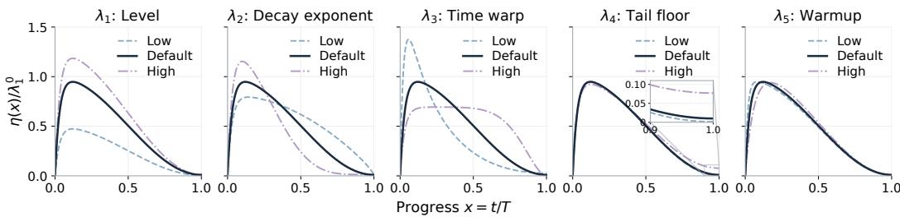  
Figure 1: Shape-normalized schedules varying one parameter at a time, default in dark.

where $\ell _ { i }$ and $\ell _ { i } ^ { \mathrm { v a l } }$ are mini-batch training and validation losses, $g _ { i }$ is the adapter gradient of the training loss, and $i / T$ is normalized progress. Validation batches come from $\mathcal { D } ^ { \mathrm { v a l } }$ . Their losses are provided to the scheduler as trajectory information, but their gradients are not computed or used for optimization.

Both the learning rate scale and schedule shape can depend on the model, sub-task, adapter, and training configuration. Standard schedules, however, are fixed functions of $t / T$ and ignore the training dynamics they are applied to. We instead propose to learn a policy with meta-parameters $\phi ,$

$$
\eta _ { t } = \pi _ { \phi } ( z _ { t } ) ,\tag{3}
$$

where $z _ { t }$ summarizes static task descriptors and training statistics $\tau ( t )$ available before the update at step t (Section 3.3). The policy learns only the scalar step size. The underlying optimizer, Muon, determines the update direction. We meta-train the policy across task instances to minimize a validation-loss objective within each episode’s budget (Section 3.4).

## 3.2 INNER OPTIMIZATION

Optimization Step. We keep the base weights frozen, so every trainable parameter of a task instance is a LoRA factor A or $B$ and hence matrix-shaped. We can therefore update the entire adapter with Muon and require no element-wise fallback rule. The inner update is $\theta _ { t + 1 } = \theta _ { t } - \eta _ { t } d _ { t }$ , with $d _ { t } = \mathcal { O } ( s _ { t } )$ denoting the Muon direction. We post-scale each Muon update to unit RMS (Moudgil et al., 2026) before applying the learning rate, compensating for its RMS decreasing with matrix size (Liu et al., 2025).

Schedule Family. We do not emit $\eta _ { t }$ as a free function of the trajectory. Instead, we constrain the policy to a hand-designed analytic family and let it emit bounded deviations from it. For normalized progress $x = t / T$

$$
\begin{array} { r l } & { \eta ( x ) = \lambda _ { 1 } \cdot s ( x ) , } \\ & { s ( x ) = \mathrm { w a r m u p } ( x ; \lambda _ { 5 } ) \cdot \left[ ( 1 - \lambda _ { 4 } ) \mathrm { d e c a y } ( x ; \lambda _ { 2 } , \lambda _ { 3 } ) + \lambda _ { 4 } \right] , } \\ & { \mathrm { w a r m u p } ( x ; \lambda _ { 5 } ) = 1 - \exp ( - x / \lambda _ { 5 } ) , \qquad \mathrm { d e c a y } ( x ; \lambda _ { 2 } , \lambda _ { 3 } ) = \mathrm { c l i p } \big ( \cos \big ( \frac { \pi } { 2 } x ^ { \lambda _ { 3 } } \big ) , \delta , 1 \big ) ^ { \lambda _ { 2 } } . } \end{array}\tag{4}
$$

The family is controlled by a 5-dimensional vector $\lambda = ( \lambda _ { 1 } , . . . , \lambda _ { 5 } )$ , which is what the policy emits. The parameters split into a scale and a shape. $\lambda _ { 1 }$ sets the overall scale of the schedule, while the other four parameters determine its shape. Specifically, $\lambda _ { 2 }$ controls the decay rate, $\lambda _ { 3 }$ shifts the knee in time, $\lambda _ { 4 }$ sets the tail floor, and $\lambda _ { 5 }$ controls the warmup timescale. Figure 1 illustrates the effect of each parameter. The policy re-emits $\lambda _ { 1 } , \ldots , \lambda _ { 4 }$ at every inner step, and the resulting $\eta _ { t }$ is the global learning rate of the adapter. The warmup constant $\lambda _ { 5 }$ is emitted once, at the start of the episode, and held fixed for its remainder. This analytic form combines gradual warmup with flexible cosine decay, keeping the policy’s output space low-dimensional and interpretable while allowing bounded adjustments to a known-good default.

Shape Normalization. Changing the shape parameters also changes the schedule’s overall magnitude. Meta-training could therefore exploit the shape parameters to adjust magnitude rather than the shape. To separate shape from scale, we normalize each curve to the default shape’s RMS.

$$
\begin{array} { r } { \eta ( x ) = \lambda _ { 1 } \cdot \frac { \left. s _ { 0 } \right. } { \left. s \right. } s ( x ) , \qquad \left. s \right. = \Big ( \int _ { 0 } ^ { 1 } s ( u ) ^ { 2 } \mathrm { d } u \Big ) ^ { 1 / 2 } , } \end{array}\tag{5}
$$

where $s _ { 0 }$ is the default shape. At each step, we approximate the norm using 65 uniformly spaced points on [0, 1]. This leaves the default schedule unchanged and lets $\lambda _ { 1 }$ control each curve’s RMS scale. The normalization applies to the curve defined by the current parameters, not to the full trajectory as those parameters change across steps.

Depth Scaling. The emitted step size is finally rescaled by a fixed factor depending only on the depth $L _ { \mathrm { d } } .$ , i.e. the number of layers, of the base model,

$$
\eta _ { t } ~  ~ ( \frac { L _ { \mathrm { r e f } } } { L _ { \mathrm { d } } } ) ^ { 1 / 2 } \eta _ { t } ,\tag{6}
$$

following Depth-µP (Yang et al., 2024), which prescribes $\eta \propto 1 / \sqrt { L _ { \mathrm { d } } }$ for a scale-invariant update. We set $L _ { \mathrm { r e f } }$ to the geometric center of the meta-training depths, so the factor is 1 in the middle of that range and shrinks the step size for deeper models.

## 3.3 META-MODEL

We parameterize $\pi _ { \phi }$ as a small LSTM $f _ { \phi }$ with one linear head per schedule parameter, evaluated once per inner step so that it can condition on the episode so far. Each raw output $h _ { i , t }$ becomes a bounded multiplicative deviation from a hand-picked default $\lambda _ { i } ^ { 0 }$

$$
\lambda _ { i , t } = \lambda _ { i } ^ { 0 } \cdot \exp ( c _ { i } \operatorname { t a n h } h _ { i , t } ) , \qquad i = 1 , \dots , 5 ,\tag{7}
$$

which keeps $\lambda _ { i , i }$ within $\left\lceil \lambda _ { i } ^ { 0 } e ^ { - c _ { i } } , \lambda _ { i } ^ { 0 } e ^ { c _ { i } } \right\rceil$ . The hyperparameter $c _ { i }$ sets the width of this range. We compute $\lambda _ { 5 }$ once from the static features and log T before the first step and update the other four parameters at every step, as discussed in Section 3.2. The output layer is zero-initialized, so metatraining starts exactly from the default schedule.

Features. We feed $f _ { \phi }$ a 20-dimensional feature vector in three groups. Time (4) contains [x, sin πx, cos πx], where $x = t / T$ , providing a smooth low-frequency encoding of position within the episode. We also include the total budget log T. Static (5) is fixed throughout an episode. It contains the base-model width log $W$ and layer count depth, the factor log $\cdot ( a \bar { / } r )$ by which the adapter enters the model, and the individual rank log r and scaling log a. Dynamic (11) is recomputed at every step to summarize $\tau ( t )$ . It includes the initial loss level, the training loss relative to that initial value, and its local slope measured by the ratio of a fast to a slow EMA. For validation loss, we include the ratio of its fast EMA to its initial loss and the ratio of its fast EMA to its slow EMA. We also include the ratio of validation to training fast EMAs as an overfitting signal. The initial validation loss is used only for normalization and is not a separate feature. The remaining features are the cosine similarity between the current gradient and momentum, a gradient signal-to-noise proxy based on the bias-corrected momentum and second-moment accumulators, parameter-RMS growth relative to initialization, and the log parameter- and gradient-RMS of the adapter.

## 3.4 META-TRAINING

Scale Augmentation. Inferring the adapter scale from the trajectory only pays off if meta-training varies it. We therefore reparameterize every sampled task instance. A scalar κ is drawn loguniformly, the adapter factors are initialized at $1 / \kappa$ times their usual value, and the forward pass multiplies them back by $\kappa$ (Moudgil et al., 2025). This leaves the function at step $t = 0$ and the optimization problem unchanged, but not the parameter RMS, the gradient RMS, or the step size that suits them. The static features alone are therefore no longer enough to determine the right step size, and the policy has to adjust it as the scale becomes visible in the trajectory.

Objective. We train the policy parameters $\phi$ to minimize the expected validation loss across a distribution of fine-tuning tasks

$$
\operatorname* { m i n } _ { \phi } \mathbb { E } _ { \mathcal { T } \sim p ( \mathcal { T } ) } \mathbb { E } _ { \tau \sim \pi _ { \phi } ( \mathcal { T } ) } \mathcal { L } _ { \mathrm { f n a l } } \bigl ( \tau ( T ) \bigr ) .\tag{8}
$$

For each episode, we skip the first $T _ { 0 } = \lfloor f T \rfloor$ steps and average the remaining losses:

$$
\mathcal { L } _ { \mathrm { f i n a l } } ( \tau ( T ) ) = \frac { 1 } { T - T _ { 0 } } \sum _ { t = T _ { 0 } + 1 } ^ { T } \tilde { \ell } _ { t } ^ { \mathrm { v a l } } ,\tag{9}
$$

Here $f \in [ 0 , 1 )$ is the fraction of steps we skip, and $\tilde { \ell } _ { t } ^ { \mathrm { v a l } }$ is the log validation loss smoothed with an exponential moving average. Taking the log focuses on relative improvements, while skipping the early steps ensures the score reflects the model’s performance during the later stages of training, rather than being dominated by the large initial loss. The policy observes validation loss, but inner updates use only training-loss gradients.

Meta-Gradient. We estimate the meta-gradient with truncated PES (Vicol et al., 2021). Each outer iteration unrolls an antithetic pair $\phi \dot { \pm } \varepsilon , \varepsilon \sim \mathcal { N } ( 0 , \sigma ^ { 2 } I )$ , for L inner steps on N task instance in parallel, and each instance is resampled once it reaches its budget T. Since the meta-loss has to be emitted per inner step, we emit $\widetilde { \ell } _ { t } ^ { \mathrm { v a \bar { l } } }$ masked to $t > T _ { 0 }$ and rescaled by $T / ( T - T _ { 0 } )$ ). Averaged over the episode, this recovers Equation 9.

## 4 EXPERIMENTAL PROTOCOL

We meta-train MuPACE on a distribution over LoRA fine-tuning tasks built from a deck of 37 pretrained nanochat models (Karpathy, 2025) spanning depths $\{ 8 , \bar { 1 } 2 , 1 6 \}$ and widths 128 to 2048, trained on 100 Lots-of-LoRAs sub-tasks (Wang et al., 2022), ranks $r \in \{ 8 , 1 6 , 3 2 \}$ and batch sizes $b \in \{ 8 , 1 6 , 3 2 \}$ . Conditioned on such a cell, the adapter scaling is drawn as $a \sim \mathrm { L o g U n i f o r m } [ 8 , 3 2 ]$ the budget as T ∼ LogUniform[100, 300], and the seed ξ. We place adapters on the query and value (Q and V) projections of every attention block (Hu et al., 2022). We initialize A with a random Gaussian distribution and $B = 0 .$ , so training starts from the pretrained model, and scale the update BA by $a / r$ (Hu et al., 2022). MuPACE therefore must handle combinations of model scale, adapter capacity and scaling, downstream task, and training length. Full parameter ranges, the deck listing, and the sub-task ids are given in Appendix A. We open-source our implementation to foster future research1.

## 4.1 ARCHITECTURE AND TRAINING

MuPACE is an LSTM with a hidden width of 48 with one linear head per schedule parameter, ∼20K meta-parameters in total. We estimate the meta-gradient with PES at $\sigma = 0 . 0 1$ over a truncation window of $L = 5 0$ inner steps, keeping $N = 8$ task instances in flight and averaging the estimate over them. We train on the objective in Equation 9 with $f = 0 . 2$ , scoring the smoothed log validation loss over the last 80% of each episode to emphasize consistent performance beyond the initial loss drop. An EMA with decay 0.9 reduces batch noise. Each task runs for its budget T and then is resampled. The scale augmentation of Section 3.4 draws κ ∼ LogUniform[0.05, 20]. For the depth factor of Equation 6 we set $L _ { \mathrm { r e f } } = { \sqrt { 8 \cdot 1 6 } } \approx 1 1 . 3 1$ , the geometric centre of the meta-training depths. Meta-parameters are updated with AdamW at an outer learning rate of $1 0 ^ { - 3 }$ on a cosine decay with gradient clipping. We train for 9000 outer iterations, which takes roughly 72 hours on four NVIDIA H100 GPUs. Remaining hyperparameters are reported in Appendix B.

## 4.2 BASELINES

We compare MuPACE against three fixed learning rate schedules, cosine (Loshchilov & Hutter, 2017), constant (warmup to a flat peak) and WSD (Hu et al., 2024), which we run at a default peak of $1 0 ^ { - 3 }$ , matching MuPACE’s default schedule scale for λ0 (H1 in Section 5) and with the peak tuned per task by validation loss (H2 in Section 5). In the out-of-distribution setting (H3 in Section 5) we add Hypergradient Descent (Baydin et al., 2018), which adapts the learning rate online from the dot product of consecutive gradients and, like MuPACE, needs no per-task sweep. We run it as published and with the depth-µP post-scaling of Equation 6 applied to its learning rate, so that it receives the same multiplier as our learned scheduler. Every method runs the same Muon update from the same adapter initialization, so only the learning rate over time differs.

## 4.3 BENCHMARKS

In-distribution performance. We evaluate MuPACE on 64 configurations sampled from the meta-training distribution with scale augmentation disabled, each fixing the model, dataset, rank,

(a) How often does learned win?

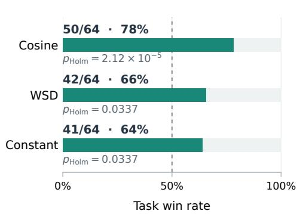

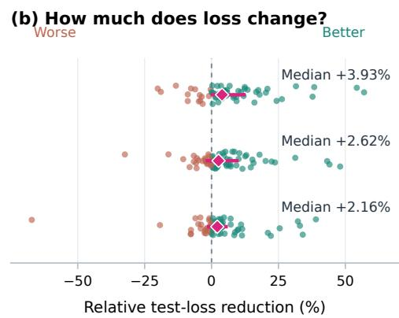  
Figure 2: Learned scheduler versus defaults on 64 tasks. (a) Win rates and Holm-adjusted sign-test p values. (b) Relative test-loss reduction versus each baseline, where positive favors learned. Dots show tasks, diamonds medians, and bars interquartile ranges.

scaling, batch size, and budget. All methods share the initialization and data order. The fixed schedules run either at their default peak learning rate of $1 0 ^ { - 3 }$ , which is at or near the best fixed rate for all three families (H1), or at a peak selected per task from seven log-spaced values in $[ 1 0 ^ { - 4 } , 1 0 ^ { - 2 } ]$ (H2). MuPACE uses a single run. We report test loss at the iteration with the lowest validation loss.

Out-of-distribution transfer. We transfer MuPACE one-shot to Qwen3-32B (Yang et al., 2025) and Qwen3.8-27B (Qwen Team, 2026). Both have 64 layers and width 5120, against at most 16 layers and width 2048 in the meta-training deck. Further, Qwen3.8-27B adds a hybrid Gated DeltaNet linear-attention architecture the policy never saw. Adapters use $r = 8 , a = 1 6$ and $T = 2 0 0$ steps on eight unseen datasets spanning instruction following, math, code, summarization, question answering and translation (Section A.1). We report test loss at the iteration with the lowest validation loss. For fixed-schedule baselines, we additionally select the peak learning rate from five log-spaced values in $[ 1 0 ^ { - 5 } , 1 0 ^ { - 3 } ]$ , while MuPACE and each Hypergradient Descent variant use a single run.

## 5 EXPERIMENTS

H1: Meta-learned schedulers can outperform standard default learning rate schedules on indistribution fine-tuning problems.

By default, MuPACE learns a bounded correction to a cosine learning-rate schedule, where the base schedule is scaled to have a peak learning rate of $1 0 ^ { - 3 }$ . H1 therefore tests the value of this learned correction against cosine, WSD, and constant schedules at that same fixed peak. Win rates are tested against 50% using two-sided exact paired sign tests (Dixon & Mood, 1946) with Holm correction (Holm, 1979) across the three baselines $( \alpha = 0 . 0 5 )$ .

The learned scheduler achieves lower test loss on 78%, 66%, and 64% of draws against cosine, WSD, and constant, respectively, all significant after correction (Figure 2). Median improvements are 2–4% across the three comparisons. A further check against cosine at its best global scale $( 2 . 1 5 4 \times 1 0 ^ { - 3 } ) ^ { 2 }$ gives a smaller, non-significant win-rate advantage, while the learned scheduler retains a median reduction of about 4%. Overall, the learned correction provides gains beyond a strong fixed default by adapting the schedule to the task and to the observed training trajectory (Figure 4).

## H2: Meta-learned schedulers can eliminate per-task learning rate search while retaining competitive performance on in-distribution fine-tuning problems.

We repeat the H1 comparison against the per-task tuned baselines, comparing their validation-based learning rate search with our learned scheduler, which requires no per-task sweep. Sign tests are applied as in H1.

(a) How often does learned win?  
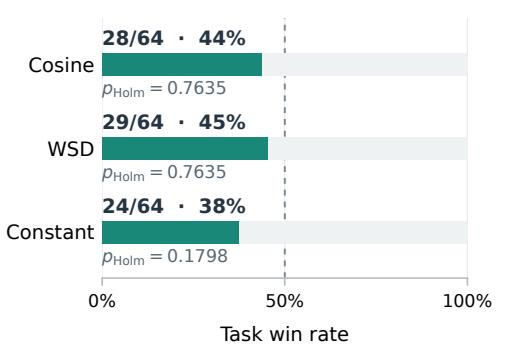

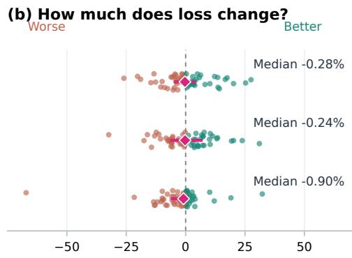  
Relative test-loss reduction (%)

Figure 3: Learned scheduler versus validation-tuned baselines on 64 tasks. (a) Win rates and Holmadjusted sign-test p values. (b) Relative test-loss reduction versus each tuned baseline, where positive favors learned. Dots show tasks, diamonds medians, and bars interquartile ranges.  
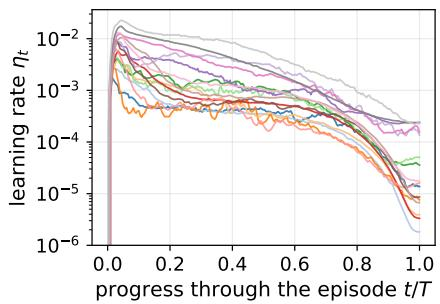  
Figure 4: Learning rate applied by the learned scheduler on 16 of the 64 in-distribution tasks.  
How much of tuning's gain is recovered?

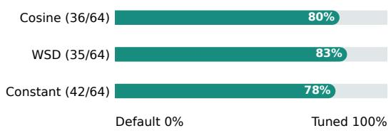  
Figure 5: Median fraction of the per-task tuning gain recovered by the learned scheduler in one run, on the draws where tuning improves test loss by at least 0.5%.

Figure 3 shows that the learned scheduler approaches the performance of per-task tuned schedules without the cost of a learning rate sweep. Our learned scheduler wins on 44%, 45%, and 38% of draws against tuned cosine, WSD, and constant, with median relative differences of −0.28%, −0.24%, and −0.90%. None of these win rates differs significantly from 50%. Per-task tuning matters here as the best peak varies by roughly a factor of five across the baselines. To quantify how much of that tuning the learned scheduler makes unnecessary, we take the draws where tuning lowers test loss by at least 0.5% over the default and measure the fraction of that gain the learned scheduler achieves in one run, $( L _ { \mathrm { d e f a u l t } } - L _ { \mathrm { l e a r n e d } } ) / ( L _ { \mathrm { d e f a u l t } } - L _ { \mathrm { t u n e d } } )$ . The median recovery is 80%, 83% and 78% against cosine, WSD and constant (Figure 5).

## H3: Meta-learned schedulers can transfer one-shot to out-of-distribution fine-tuning problems, avoiding per-task learning rate search while retaining competitive performance.

Figure 6 evaluates MuPACE on models and datasets that were both unseen during policy training, comparing a single MuPACE run against fixed schedules with the peak tuned by a five-trial sweep on each dataset. The tuned baselines reach slightly lower test loss, with median relative differences of 1.13%–2.43% on Qwen3-32B and 2.59%–3.02% on Qwen3.8-27B, and MuPACE wins on 2 of 8 datasets per model. This gap is the price of one run versus five. Given only one trial, the fixed schedules perform worse than MuPACE by 14%–18% on average and need two to three trials to reach the same performance (Appendix C). Against Hypergradient Descent, the other sweep-free method, MuPACE achieves lower test loss on every dataset for both models, whether Hypergradient Descent is used with or without µP post-scaling.

Design Ablations We ablate MuPACE’s meta-training, schedule parameterization, shape normalization, and depth-dependent scaling to assess the contribution of each module to its performance.

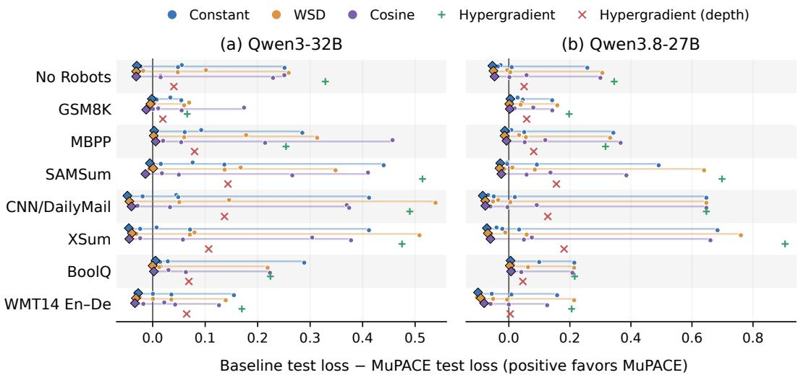  
Figure 6: MuPACE versus validation-tuned baselines and Hypergradient Descent on (a) Qwen3-32B and (b) Qwen3.8-27B. Values show baseline minus MuPACE test loss (positive favors MuPACE).

Effect of meta-training. We compare against the same scheduler architecture with no meta-training, fixing all output heads at zero so it follows the default cosine schedule from Figure 1. Meta-training lowers median in-distribution test loss and improves performance on Qwen3-32B (Appendix D).

Analytic schedule parameterization. We ablate the analytic schedule family by replacing the five heads defining Equation 4 with a single head that predicts the learning rate directly. Direct prediction has similar typical in-distribution performance but a heavier tail of poor runs and no wins against the baselines in the OOD setting, suggesting that the analytic parameterization primarily improves robustness (Appendix E).

Shape normalization. We remove the shape normalization of Equation 5, so the shape parameters can also change the schedule’s overall magnitude. This has no in-distribution effect, and on Qwen3- 32B normalization is better on five of eight datasets, a possible but not significant transfer benefit (Appendix F).

Depth-scaled baseline (fixed) schedules. We apply the same depth-dependent scaling Equation 6 to each fixed-schedule baseline at (i) its default peak and (ii) its best peak from an in-distribution sweep. On both models, MuPACE achieves lower test loss in nearly all comparisons. These results suggest that MuPACE improves beyond transferring depth-scaled schedules, with in-distribution tuned peaks (Appendix G).

Depth-dependent post-scaling. We meta-train a variant without depth-dependent post-scaling. Indistribution performance is similar, but scaling improves test loss on all eight Qwen3-32B datasets, suggesting a benefit for one-shot transfer to larger models (Appendix G.2).

## 6 CONCLUSION

We introduce MuPACE, a recurrent learning rate scheduler that adapts an interpretable analytic schedule to the observed optimization trajectory while leaving Muon’s update rule unchanged. Across 64 fine-tuning problems, it outperforms strong default schedules and recovers 78–83% of the benefit of per-task tuning in a single training run. Although meta-trained only on models with up to 16 layers, it transfers one-shot to 64-layer models and unseen tasks, where a single run remains competitive with swept schedules. These results suggest that amortizing learning-rate selection can remove per-task learning rate search while retaining competitive performance.

## AI USE STATEMENT

In this work, generative AI tools were used to assist with code implementation, support the authors understanding of relevant concepts, improve the clarity and readability of author-written text, and refine the visual presentation of plots. Generative AI tools were not used to formulate the original research question. Most of the related literature was identified independently by the authors, with AI tools used to supplement this process by suggesting additional relevant work. All AI-assisted outputs were reviewed and verified by the authors. AI-assisted code was checked for correctness by the authors, literature-related suggestions were verified against the original sources, and all text and visual edits were reviewed before inclusion. The authors take full responsibility for the final content, claims, results, and artifacts presented in this work.

## REPRODUCIBILITY STATEMENT

We open source our code for meta-training and evaluation, together with the meta-trained MuPACE checkpoint, at https://anonymous.4open.science/r/MUPACE-3F54/README.md. The out-of-distribution base models (Qwen3-32B (Yang et al., 2025) and Qwen3.8-27B (Qwen Team, 2026)) are publicly available, and the nanochat models used for meta-training can be retrained with the open-source nanochat implementation (Karpathy, 2025). All datasets are publicly available ((Wang et al., 2022); Section A.1). Section 3 fully specifies the method, including the analytic schedule family (Equations 4–6), the policy and its input features (Section 3.3), and the meta-training objective and gradient estimator (Section 3.4). Section 4 describes the experimental protocol, including the meta-training setup and compute budget (Section 4.1) and the evaluation and checkpoint-selection procedure (Section 4.3). Section A lists the complete meta-training distribution, including all model configurations (Table 2) and dataset identifiers (Table 3), and Section B reports the remaining hyperparameters.

## ACKNOWLEDGMENTS

Josif Grabocka acknowledges the funding support from the ”Bayerisches Landesamt fur Steuern”¨ for the Bavarian AI Taxation Laboratory.

Josif Grabocka acknowledges the funding by The Carl Zeiss Foundation through the research network ”Responsive and Scalable Learning for Robots Assisting Humans” (ReScaLe) of the University of Freiburg.

Josif Grabocka acknowledges the financial support from the Albanian-American Development Foundation through the READ program.

Moreover, we gratefully acknowledge the scientific support and HPC resources provided by the Erlangen National High Performance Computing Center (NHR@FAU) of the Friedrich-Alexander-Universitat Erlangen-N ¨ urnberg (FAU). NHR@FAU hardware is partially funded by the German¨ Research Foundation (DFG) – 440719683.

## REFERENCES

Marcin Andrychowicz, Misha Denil, Sergio Gomez, Matthew W Hoffman, David Pfau, Tom Schaul, Brendan Shillingford, and Nando De Freitas. Learning to learn by gradient descent by gradient descent. Advances in neural information processing systems, 29, 2016.

Jacob Austin, Augustus Odena, Maxwell Nye, Maarten Bosma, Henryk Michalewski, David Dohan, Ellen Jiang, Carrie Cai, Michael Terry, Quoc Le, et al. Program synthesis with large language models. arXiv preprint arXiv:2108.07732, 2021.

Atilim Gunes Baydin, Robert Cornish, David Martinez Rubio, Mark Schmidt, and Frank Wood. Online learning rate adaptation with hypergradient descent. In International Conference on Learning Representations, 2018.

Shane Bergsma, Nolan Dey, Gurpreet Gosal, Gavia Gray, Daria Soboleva, and Joel Hestness. Straight to zero: Why linearly decaying the learning rate to zero works best for llms. In In ternational Conference on Learning Representations, volume 2025, pp. 22102–22133, 2025.

Jeremy Bernstein and Laker Newhouse. Old optimizer, new norm: An anthology. In OPT 2024: Optimizationfor Machine Learning, 2024.

Dan Biderman, Jacob Portes, Jose Javier Gonzalez Ortiz, Mansheej Paul, Philip Greengard, Connor Jennings, Daniel King, Sam Havens, Vitaliy Chiley, Jonathan Frankle, Cody Blakeney, and John Patrick Cunningham. LoRA learns less and forgets less. Transactions on Machine Learning Research, 2024. ISSN 2835-8856. Featured Certification.

Ondrej Bojar, Christian Buck, Christian Federmann, Barry Haddow, Philipp Koehn, Johannes Leveling, Christof Monz, Pavel Pecina, Matt Post, Herve Saint-Amand, Radu Soricut, Lucia Specia, and Ale s Tamchyna. Findings of the 2014 workshop on statistical machine translation. In Proceedings of the Ninth Workshop on Statistical Machine Translation, pp. 12– 58, Baltimore, Maryland, USA, June 2014. Association for Computational Linguistics. URL http://www.aclweb.org/anthology/W/W14/W14-3302.

Rishi Bommasani, Drew A Hudson, Ehsan Adeli, Russ Altman, Simran Arora, Sydney von Arx, Michael S Bernstein, Jeannette Bohg, Antoine Bosselut, Emma Brunskill, et al. On the opportunities and risks of foundation models. arXiv preprint arXiv:2108.07258, 2021.

Christopher Clark, Kenton Lee, Ming-Wei Chang, Tom Kwiatkowski, Michael Collins, and Kristina Toutanova. Boolq: Exploring the surprising difficulty of natural yes/no questions. In NAACL, 2019.

Karl Cobbe, Vineet Kosaraju, Mohammad Bavarian, Mark Chen, Heewoo Jun, Lukasz Kaiser, Matthias Plappert, Jerry Tworek, Jacob Hilton, Reiichiro Nakano, Christopher Hesse, and John Schulman. Training verifiers to solve math word problems. arXiv preprint arXiv:2110.14168, 2021.

Aaron Defazio and Konstantin Mishchenko. Learning-rate-free learning by d-adaptation. In International conference on machine learning, pp. 7449–7479. PMLR, 2023.

Aaron Defazio, Xingyu Yang, Harsh Mehta, Konstantin Mishchenko, Ahmed Khaled, and Ashok Cutkosky. The road less scheduled. Advances in Neural Information Processing Systems, 37: 9974–10007, 2024.

Wilfrid J. Dixon and Alexander M. Mood. The statistical sign test. Journal of the American Statistical Association, 41(236):557–566, 1946. doi: 10.1080/01621459.1946.10501898.

Katie Everett, Lechao Xiao, Mitchell Wortsman, Alexander A. Alemi, Roman Novak, Peter J. Liu, Izzeddin Gur, Jascha Sohl-Dickstein, Leslie Pack Kaelbling, Jaehoon Lee, and Jeffrey Pennington. Scaling exponents across parameterizations and optimizers. In Proceedings of the 41st International Conference on Machine Learning, ICML’24. JMLR.org, 2024.

Bogdan Gliwa, Iwona Mochol, Maciej Biesek, and Aleksander Wawer. SAMSum corpus: A humanannotated dialogue dataset for abstractive summarization. In Proceedings of the 2nd Workshop on New Frontiers in Summarization, pp. 70–79, Hong Kong, China, November 2019. Association for Computational Linguistics. doi: 10.18653/v1/D19-5409. URL https://www.aclweb. org/anthology/D19-5409.

Vineet Gupta, Tomer Koren, and Yoram Singer. Shampoo: Preconditioned stochastic tensor optimization. In Proceedings ofthe 35th International Conference on Machine Learning, volume 80 of Proceedings of Machine Learning Research, pp. 1842–1850. PMLR, 2018.

Sture Holm. A simple sequentially rejective multiple test procedure. Scandinavian Journal of Statistics, 6:65–70, 1979.

Edward J Hu, yelong shen, Phillip Wallis, Zeyuan Allen-Zhu, Yuanzhi Li, Shean Wang, Lu Wang, and Weizhu Chen. LoRA: Low-rank adaptation of large language models. In International Conference on Learning Representations, 2022.

Shengding Hu, Yuge Tu, Xu Han, Ganqu Cui, Chaoqun He, Weilin Zhao, Xiang Long, Zhi Zheng, Yewei Fang, Yuxiang Huang, Xinrong Zhang, Zhen Leng Thai, Chongyi Wang, Yuan Yao, Chenyang Zhao, Jie Zhou, Jie Cai, Zhongwu Zhai, Ning Ding, Chao Jia, Guoyang Zeng, dahai li, Zhiyuan Liu, and Maosong Sun. MiniCPM: Unveiling the potential of small language models with scalable training strategies. In First Conference on Language Modeling, 2024.

Keller Jordan, Yuchen Jin, Vlado Boza, Jiacheng You, Franz Cesista, Laker Newhouse, and Jeremy Bernstein. Muon: An optimizer for hidden layers in neural networks, 2024. URL https: //kellerjordan.github.io/posts/muon/.

Andrej Karpathy. nanochat: The best chatgpt that \$100 can buy, 2025. URL https://github. com/karpathy/nanochat.

Diederik P. Kingma and Jimmy Ba. Adam: A method for stochastic optimization. In Yoshua Bengio and Yann LeCun (eds.), 3rd International Conference on Learning Representations, ICLR 2015, San Diego, CA, USA, May 7-9, 2015, Conference Track Proceedings, 2015.

Gus Kristiansen, Mark Sandler, Andrey Zhmoginov, Nolan Miller, Anirudh Goyal, Jihwan Lee, and Max Vladymyrov. Narrowing the focus: Learned optimizers for pretrained models. arXiv preprint arXiv:2408.09310, 2024.

Alex Krizhevsky, Ilya Sutskever, and Geoffrey E. Hinton. Imagenet classification with deep convolutional neural networks. In Proceedings of the 26th International Conference on Neural Information Processing Systems - Volume 1, NIPS’12, pp. 1097–1105, Red Hook, NY, USA, 2012. Curran Associates Inc.

Sangyoon Lee and Jaeho Lee. Beware of the batch size: Hyperparameter bias in evaluating lora. arXiv preprint arXiv:2602.09492, 2026.

Binghui Li, Zilin Wang, Fengling Chen, Shiyang Zhao, Ruiheng Zheng, and Lei Wu. Optimal learning-rate schedules under functional scaling laws: Power decay and warmup-stable-decay. In ICLR 2026 2nd Workshop on Deep Generative Model in Machine Learning: Theory, Principle and Efficacy, 2026.

Jingyuan Liu, Jianlin Su, Xingcheng Yao, Zhejun Jiang, Guokun Lai, Yulun Du, Yidao Qin, Weixin Xu, Enzhe Lu, Junjie Yan, Yanru Chen, Huabin Zheng, Yibo Liu, Shaowei Liu, Bohong Yin, Weiran He, Han Zhu, Yuzhi Wang, Jianzhou Wang, Mengnan Dong, Zheng Zhang, Yongsheng Kang, Hao Zhang, Xinran Xu, Yutao Zhang, Yuxin Wu, Xinyu Zhou, and Zhilin Yang. Muon is scalable for llm training, 2025.

Ilya Loshchilov and Frank Hutter. SGDR: Stochastic gradient descent with warm restarts. In International Conference on Learning Representations, 2017.

Ilya Loshchilov and Frank Hutter. Decoupled weight decay regularization. In International Conference on Learning Representations, 2019.

Matthew Mackay, Paul Vicol, Jonathan Lorraine, David Duvenaud, and Roger Grosse. Self-tuning networks: Bilevel optimization of hyperparameters using structured best-response functions. In International Conference on Learning Representations, 2019.

Dougal Maclaurin, David Duvenaud, and Ryan Adams. Gradient-based hyperparameter optimization through reversible learning. In Francis Bach and David Blei (eds.), Proceedings of the 32nd International Conference on Machine Learning, volume 37 of Proceedings of Machine Learning Research, pp. 2113–2122, Lille, France, 07–09 Jul 2015. PMLR.

Luke Metz, C Daniel Freeman, James Harrison, Niru Maheswaranathan, and Jascha Sohl-Dickstein. Practical tradeoffs between memory, compute, and performance in learned optimizers. In Conference on Lifelong Learning Agents, pp. 142–164. PMLR, 2022a.

Luke Metz, James Harrison, C Daniel Freeman, Amil Merchant, Lucas Beyer, James Bradbury, Naman Agrawal, Ben Poole, Igor Mordatch, Adam Roberts, et al. Velo: Training versatile learned optimizers by scaling up. arXiv preprint arXiv:2211.09760, 2022b.

Abhinav Moudgil, Boris Knyazev, Guillaume Lajoie, and Eugene Belilovsky. Celo: Training versatile learned optimizers on a compute diet. Transactions on Machine Learning Research, 2025. ISSN 2835-8856.

Abhinav Moudgil, Boris Knyazev, and Eugene Belilovsky. Celo2: Towards learned optimization free lunch. In The Fourteenth International Conference on Learning Representations, 2026.

Shashi Narayan, Shay B. Cohen, and Mirella Lapata. Don’t give me the details, just the summary! topic-aware convolutional neural networks for extreme summarization. ArXiv, abs/1808.08745, 2018.

Lorenzo Noci, Alexandru Meterez, Thomas Hofmann, and Antonio Orvieto. Super consistency of neural network landscapes and learning rate transfer. In A. Globerson, L. Mackey, D. Belgrave, A. Fan, U. Paquet, J. Tomczak, and C. Zhang (eds.), Advances in Neural Information Processing Systems, volume 37, pp. 102696–102743. Curran Associates, Inc., 2024. doi: 10.52202/079017-3262.

Xingyu Qu, Peigeng Huang, and Samuel Horvath. Can muon fine-tune adam-pretrained models? In International Conference on Machine Learning, 2026.

Qwen Team. Qwen3.8-Max: A new bar for coding and cowork, August 2026. URL https: //qwen.ai/blog?id=qwen3.8.

Nazneen Rajani, Lewis Tunstall, Edward Beeching, Nathan Lambert, Alexander M. Rush, and Thomas Wolf. No robots, 2023.

Abigail See, Peter J. Liu, and Christopher D. Manning. Get to the point: Summarization with pointer-generator networks. In Proceedings of the 55th Annual Meeting of the Association for Computational Linguistics (Volume 1: Long Papers), pp. 1073–1083, Vancouver, Canada, July 2017. Association for Computational Linguistics. doi: 10.18653/v1/P17-1099. URL https: //www.aclweb.org/anthology/P17-1099.

Arsalan Sharifnassab, Saber Salehkaleybar, and Richard S. Sutton. Metaoptimize: A framework for optimizing step sizes and other meta-parameters. In Forty-second International Conference on Machine Learning, 2025.

Tianqi Shen, Jinji Yang, Runze Shi, Jianhao Ma, Jiaye Teng, and Ziye Ma. Towards understanding the power and limits of the muon optimizer: A river-valley perspective. arXiv preprint arXiv:2606.21514, 2026.

GLM Team, Aohan Zeng, Xin Lv, Qinkai Zheng, Zhenyu Hou, Bin Chen, Chengxing Xie, Cunxiang Wang, Da Yin, Hao Zeng, Jiajie Zhang, Kedong Wang, Lucen Zhong, Mingdao Liu, Rui Lu, Shulin Cao, Xiaohan Zhang, Xuancheng Huang, Yao Wei, Yean Cheng, Yifan An, Yilin Niu, Yuanhao Wen, Yushi Bai, Zhengxiao Du, Zihan Wang, Zilin Zhu, Bohan Zhang, Bosi Wen, Bowen Wu, Bowen Xu, Can Huang, Casey Zhao, Changpeng Cai, Chao Yu, Chen Li, Chendi Ge, Chenghua Huang, Chenhui Zhang, Chenxi Xu, Chenzheng Zhu, Chuang Li, Congfeng Yin, Daoyan Lin, Dayong Yang, Dazhi Jiang, Ding Ai, Erle Zhu, Fei Wang, Gengzheng Pan, Guo Wang, Hailong Sun, Haitao Li, Haiyang Li, Haiyi Hu, Hanyu Zhang, Hao Peng, Hao Tai, Haoke Zhang, Haoran Wang, Haoyu Yang, He Liu, He Zhao, Hongwei Liu, Hongxi Yan, Huan Liu, Huilong Chen, Ji Li, Jiajing Zhao, Jiamin Ren, Jian Jiao, Jiani Zhao, Jianyang Yan, Jiaqi Wang, Jiayi Gui, Jiayue Zhao, Jie Liu, Jijie Li, Jing Li, Jing Lu, Jingsen Wang, Jingwei Yuan, Jingxuan Li, Jingzhao Du, Jinhua Du, Jinxin Liu, Junkai Zhi, Junli Gao, Ke Wang, Lekang Yang, Liang Xu, Lin Fan, Lindong Wu, Lintao Ding, Lu Wang, Man Zhang, Minghao Li, Minghuan Xu, Mingming Zhao, Mingshu Zhai, Pengfan Du, Qian Dong, Shangde Lei, Shangqing Tu, Shangtong Yang, Shaoyou Lu, Shijie Li, Shuang Li, Shuang-Li, Shuxun Yang, Sibo Yi, Tianshu Yu, Wei Tian, Weihan Wang, Wenbo Yu, Weng Lam Tam, Wenjie Liang, Wentao Liu, Xiao Wang, Xiaohan Jia, Xiaotao Gu, Xiaoying Ling, Xin Wang, Xing Fan, Xingru Pan, Xinyuan Zhang, Xinze Zhang, Xiuqing Fu, Xunkai Zhang, Yabo Xu, Yandong Wu, Yida Lu, Yidong Wang, Yilin Zhou, Yiming Pan, Ying Zhang, Yingli Wang, Yingru Li, Yinpei Su, Yipeng Geng, Yitong Zhu, Yongkun Yang, Yuhang Li, Yuhao Wu, Yujiang Li, Yunan Liu, Yunqing Wang, Yuntao Li, Yuxuan Zhang, Zezhen Liu, Zhen Yang, Zhengda Zhou, Zhongpei Qiao, Zhuoer Feng, Zhuorui Liu, Zichen Zhang, Zihan Wang, Zijun Yao, Zikang Wang, Ziqiang Liu, Ziwei Chai, Zixuan Li, Zuodong Zhao, Wenguang Chen, Jidong Zhai, Bin Xu, Minlie Huang, Hongning Wang, Juanzi Li, Yuxiao Dong, and Jie Tang. Glm-4.5: Agentic, reasoning, and coding (arc) foundation models, 2025a.

Kimi Team, Yifan Bai, Yiping Bao, Y Charles, Cheng Chen, Guanduo Chen, Haiting Chen, Huarong Chen, Jiahao Chen, Ningxin Chen, et al. Kimi k2: Open agentic intelligence. arXiv preprint arXiv:2507.20534, 2025b.

Kimi Team, Tongtong Bai, Yifan Bai, Yiping Bao, Jianfeng Cai, Xinyuan Cai, Peizhou Cao, Yuxuan Cao, Ziwei Chai, Y Charles, et al. Kimi k3: Open frontier intelligence. arXiv preprint arXiv:2607.24653, 2026.

Paul Vicol, Luke Metz, and Jascha Sohl-Dickstein. Unbiased gradient estimation in unrolled com putation graphs with persistent evolution strategies. In International Conference on Machine Learning, pp. 10553–10563. PMLR, 2021.

Nikhil Vyas, Depen Morwani, Rosie Zhao, Itai Shapira, David Brandfonbrener, Lucas Janson, and Sham Kakade. Soap: Improving and stabilizing shampoo using adam for language modeling. In International Conference on Learning Representations, volume 2025, pp. 93423–93444, 2025.

Yizhong Wang, Swaroop Mishra, Pegah Alipoormolabashi, Yeganeh Kordi, Amirreza Mirzaei, Atharva Naik, Arjun Ashok, Arut Selvan Dhanasekaran, Anjana Arunkumar, David Stap, Eshaan Pathak, Giannis Karamanolakis, Haizhi Lai, Ishan Purohit, Ishani Mondal, Jacob Anderson, Kirby Kuznia, Krima Doshi, Kuntal Kumar Pal, Maitreya Patel, Mehrad Moradshahi, Mihir Parmar, Mirali Purohit, Neeraj Varshney, Phani Rohitha Kaza, Pulkit Verma, Ravsehaj Singh Puri, Rushang Karia, Savan Doshi, Shailaja Keyur Sampat, Siddhartha Mishra, Sujan Reddy A, Sumanta Patro, Tanay Dixit, and Xudong Shen. Super-NaturalInstructions: Generalization via declarative instructions on 1600+ NLP tasks. In Yoav Goldberg, Zornitsa Kozareva, and Yue Zhang (eds.), Proceedings ofthe 2022 Conference on Empirical Methods in Natural Language Processing, Abu Dhabi, United Arab Emirates, December 2022. Association for Computational Linguistics.

Anyi Xu, Bangcai Lin, Bing Xue, Bingxuan Wang, Bingzheng Xu, Bochao Wu, Bowei Zhang, Chaofan Lin, Chen Dong, Chenchen Ling, et al. Deepseek-v4: Towards highly efficient milliontoken context intelligence. arXiv preprint arXiv:2606.19348, 2026.

An Yang, Anfeng Li, Baosong Yang, Beichen Zhang, Binyuan Hui, Bo Zheng, Bowen Yu, Chang Gao, Chengen Huang, Chenxu Lv, et al. Qwen3 technical report. arXiv preprint arXiv:2505.09388, 2025.

Ge Yang, Edward Hu, Igor Babuschkin, Szymon Sidor, Xiaodong Liu, David Farhi, Nick Ryder, Jakub Pachocki, Weizhu Chen, and Jianfeng Gao. Tuning large neural networks via zero-shot hyperparameter transfer. In M. Ranzato, A. Beygelzimer, Y. Dauphin, P.S. Liang, and J. Wortman Vaughan (eds.), Advances in Neural Information Processing Systems, volume 34, pp. 17084– 17097. Curran Associates, Inc., 2021.

Greg Yang, Dingli Yu, Chen Zhu, and Soufiane Hayou. Tensor programs vi: Feature learning in infinite depth neural networks. In B. Kim, Y. Yue, S. Chaudhuri, K. Fragkiadaki, M. Khan, and Y. Sun (eds.), International Conference on Learning Representations, volume 2024, pp. 55099– 55150, 2024.

## A TASK DISTRIBUTION

The meta-training distribution combines pretrained nanochat models with 100 English Lots-of-LoRAs sub-tasks, including classification, question answering, paraphrasing, reasoning, summarization, and text generation. Each episode fine-tunes LoRA adapters on the Q and V projections of every attention block, with the base model frozen. Table 1 summarizes the meta-training configuration.

Table 1: Meta-training task distribution. Scale augmentation is disabled at evaluation.
<table><tr><td>Component</td><td>Values or sampling range</td></tr><tr><td>Base-model deck</td><td>37 nanochat checkpoints</td></tr><tr><td>Model depth / width</td><td>{8, 12, 16} / 128–2048</td></tr><tr><td>Dataset</td><td>100 Lots-of-LoRAs sub-tasks</td></tr><tr><td>LoRA rank r</td><td>{8, 16, 32}</td></tr><tr><td>LoRA scaling a</td><td>LogUniform[8, 32]</td></tr><tr><td>Batch size b</td><td>{8, 16, 32}</td></tr><tr><td>Episode budget T</td><td>LogUniform[100, 300] (integer steps)</td></tr><tr><td>Sequence length</td><td>128 tokens</td></tr><tr><td>Global scale augmentation κ</td><td>LogUniform[0.05, 20]</td></tr></table>

Model list. The 37 checkpoint identifiers are listed below, grouped by depth; in dL wW, L denotes the number of layers and W the hidden width.

Table 2: Model list used during Meta-training
<table><tr><td>Depth</td><td>Checkpoint identifiers</td></tr><tr><td>8</td><td>d8_w128, d8_w256, d8_w384, d8_w512, d8_w640, d8_w768, d8_w896, d8_w1024, d8_w1152,d8_w1280,d8_w1408,d8_w1536,d8_w1664,d8_w1792,d8_w1920,d8_w2048</td></tr><tr><td>12</td><td>d12_w128, d12_w256, d12_w384, d12_w512, d12_w640, d12_w768, d12_w896, d12_w1024,d12_w1152,d12_w1280,d12_w1408,d12_w1664</td></tr><tr><td>16</td><td>d16_w128, d16_w256, d16_w384, d16_w512, d16_w640, d16_w896, d16_w1024, d16_w1280,d16_w1408</td></tr></table>

Dataset list. The following 100 identifiers appear in launch-script order. Each is prefixed with Lots-of-LoRAs/ to obtain the full dataset name (Wang et al., 2022).

Table 3: Lots-of-LoRAs sub-tasks used for meta-training.
<table><tr><td>No.</td><td>Dataset identifier (without organization prefix)</td></tr><tr><td>1</td><td>task045_miscellaneous_sentence_paraphrasing</td></tr><tr><td>2</td><td>task588_amazonfood_rating_classification</td></tr><tr><td>3</td><td>task461_qasper_question_generation</td></tr><tr><td>4</td><td>task083_babi_t1_single_supporting_fact_answer_generation</td></tr><tr><td>5</td><td>task280_stereoset_classification_stereotype_type</td></tr><tr><td>6</td><td>task1332_check_leap_year</td></tr><tr><td>7</td><td>task296_storycloze_correct_end_classification</td></tr><tr><td>8</td><td>task209_stancedetection_classification</td></tr><tr><td>9</td><td>task400_paws_paraphrase_classification</td></tr><tr><td>10</td><td>task316_crows-pairs_classification_stereotype</td></tr><tr><td>11</td><td>task1565_triviaqa_classification</td></tr><tr><td>12</td><td>task1592_yahoo_answers_topics_classfication</td></tr><tr><td>13</td><td>task284_imdb_classification</td></tr><tr><td>14</td><td>task137_detoxifying-lms_classification_toxicity</td></tr><tr><td>15</td><td>task1645_medical_question_pair_dataset_text_classification</td></tr><tr><td>16</td><td>task328_jigsaw_classification_insult</td></tr><tr><td>17</td><td>task1286_openbookqa_question_answering</td></tr><tr><td>18</td><td>task703_mmmlu_answer_generation_high_school_geography</td></tr><tr><td>19</td><td>task686_mmmlu_answer_generation_college_biology</td></tr><tr><td>20</td><td>task648_answer_generation</td></tr></table>

No. Dataset identifier (continued)   
21 task492\_mwsc\_incorrect\_answer\_generation   
22 task1598\_nyc\_long\_text\_generation   
23 task593\_sciq\_explanation\_generation   
24 task110\_logic2text\_sentence\_generation   
25 task183\_rhyme\_generation   
26 task294\_storycommonsense\_motiv\_text\_generation   
27 task568\_circa\_question\_generation   
28 task1729\_personachat\_generate\_next   
29 task275\_enhanced\_wsc\_paraphrase\_generation   
30 task770\_pawsx\_english\_text\_modification   
31 task116\_com2sense\_commonsense\_reasoning   
32 task1421\_mathqa\_other   
33 task632\_dbpedia\_14\_classification   
34 task746\_yelp\_restaurant\_review\_classification   
35 task846\_pubmedqa\_classification   
36 task297\_storycloze\_incorrect\_end\_classification   
37 task1705\_ljspeech\_classification   
38 task1531\_daily\_dialog\_type\_classification   
39 task1721\_civil\_comments\_obscenity\_classification   
40 task1575\_amazon\_reviews\_multi\_sentiment\_classification   
41 task1488\_sarcasmdetection\_headline\_classification   
42 task379\_agnews\_topic\_classification   
43 task322\_jigsaw\_classification\_threat   
44 task1495\_adverse\_drug\_event\_classification   
45 task108\_contextualabusedetection\_classification   
46 task472\_haspart\_classification   
47 task521\_trivia\_question\_classification   
48 task495\_semeval\_headline\_classification   
49 task1593\_yahoo\_answers\_topics\_classification   
50 task1216\_atomic\_classification\_causes   
51 task1722\_civil\_comments\_threat\_classification   
52 task838\_cdt\_classification   
53 task081\_piqa\_wrong\_answer\_generation   
54 task667\_mmmlu\_answer\_generation\_business\_ethics   
55 task1327\_qa\_zre\_answer\_generation\_from\_question   
56 task344\_hybridqa\_answer\_generation   
57 task1581\_eqasc-perturbed\_answer\_generation   
58 task471\_haspart\_answer\_generation   
59 task307\_jeopardy\_answer\_generation\_final   
60 task073\_commonsenseqa\_answer\_generation   
61 task727\_mmmlu\_answer\_generation\_prehistory   
62 task1549\_wiqa\_answer\_generation\_missing\_step   
63 task033\_winogrande\_answer\_generation   
64 task1557\_jfleg\_answer\_generation   
65 task1326\_qa\_zre\_question\_generation\_from\_answer   
66 task074\_squad1.1\_question\_generation   
67 task1325\_qa\_zre\_question\_generation\_on\_subject\_relation   
68 task167\_strategyqa\_question\_generation   
69 task442\_com\_qa\_paraphrase\_question\_generation   
70 task897\_freebase\_qa\_topic\_question\_generation   
71 task754\_svamp\_common-division\_question\_answering   
72 task753\_svamp\_addition\_question\_answering   
73 task868\_mawps\_singleop\_question\_answering   
74 task866\_mawps\_multidiv\_question\_answering   
75 task671\_ambigqa\_text\_generation   
76 task131\_scan\_long\_text\_generation\_action\_command\_long   
77 task1711\_poki\_text\_generation   
78 task128\_scan\_structured\_text\_generation\_command\_action\_short   
79 task210\_logic2text\_structured\_text\_generation   
80 task899\_freebase\_qa\_topic\_generation   
81 task1582\_bless\_hypernym\_generation   
82 task300\_storycloze\_order\_generation   
83 task102\_commongen\_sentence\_generation   
84 task926\_coached\_conv\_pref\_word\_generation

No. Dataset identifier (continued)   
85 task675\_google\_wellformed\_query\_sentence\_generation   
86 task828\_copa\_commonsense\_cause\_effect   
87 task291\_semeval\_2020\_task4\_commonsense\_validation   
88 task1152\_bard\_analogical\_reasoning\_causation   
89 task1507\_boolean\_temporal\_reasoning   
90 task181\_outcome\_extraction   
91 task1510\_evalution\_relation\_extraction   
92 task1452\_location\_entity\_extraction\_btc\_corpus   
93 task1562\_zest\_text\_modification   
94 task121\_zest\_text\_modification   
95 task645\_summarization   
96 task288\_gigaword\_summarization   
97 task1285\_kpa\_keypoint\_matching   
98 task755\_find\_longest\_substring\_and\_replace\_its\_sorted\_lowercase\_   
version\_in\_both\_lists   
99 task206\_collatz\_conjecture   
100 task1502\_hatexplain\_classification

## A.1 OOD EVALUATION DATASETS

Table 4 lists the eight publicly available datasets used for out-of-distribution evaluation, none of which are among the 100 meta-training sub-tasks from Table 3.

Table 4: Out-of-distribution evaluation datasets.
<table><tr><td>Dataset</td><td>Domain</td></tr><tr><td>No Robots (Rajani et al., 2023)</td><td>Instruction following</td></tr><tr><td>GSM8K (Cobbe et al., 2021)</td><td>Mathematical reasoning</td></tr><tr><td>MBPP (Austin et al., 2021)</td><td>Code generation</td></tr><tr><td>SAMSum (Gliwa et al., 2019)</td><td>Dialogue summarization</td></tr><tr><td>CNN/DailyMail (See et al., 2017)</td><td>News summarization</td></tr><tr><td>XSum (Narayan et al., 2018)</td><td>Extreme (single-sentence) summarization</td></tr><tr><td>BoolQ (Clark et al., 2019)</td><td>Question answering (yes/no)</td></tr><tr><td>WMT14 En→De (Bojar et al., 2014)</td><td>Machine translation</td></tr></table>

## B HYPERPARAMETERS

Tables 5 and 6 summarize the settings used for meta-training. The task distribution is specified in Appendix A.

Table 5: Policy architecture and meta-training hyperparameters.
<table><tr><td>Hyperparameter</td><td>Value</td></tr><tr><td>Input features / LSTM hidden width</td><td>20 / 48</td></tr><tr><td>Meta-parameters</td><td>19,877</td></tr><tr><td>Output head initialization</td><td>Zero</td></tr><tr><td>Outer optimizer</td><td>AdamW, weight decay 10−4</td></tr><tr><td>Outer learning rate</td><td>10−3, cosine decay</td></tr><tr><td>Meta-gradient clipping</td><td>Global norm 1</td></tr><tr><td>Outer iterations</td><td>9000</td></tr><tr><td>PES perturbation standard deviation</td><td>0.01</td></tr><tr><td>PES truncation / parallel task instances</td><td>50 steps / 8</td></tr><tr><td>Objective start fraction f</td><td>0.2 (last 80% of each episode)</td></tr><tr><td>Fast / slow loss-feature EMA decays</td><td>0.9 / 0.97</td></tr><tr><td>Muon momentum / Newton-Schulz iterations</td><td>0.95/5</td></tr><tr><td>Depth-scaling exponent / reference depth</td><td>0.5 /11.3137</td></tr></table>

Table 6: Schedule defaults and adjustment ranges. Each head emits $\lambda _ { i } = \lambda _ { i } ^ { 0 } \exp ( c _ { i }$ tanh $h _ { i } )$ , giving the range $[ \lambda _ { i } ^ { 0 } e ^ { - c _ { i } } , \lambda _ { i } ^ { 0 } e ^ { c _ { i } } ]$
<table><tr><td>Parameter</td><td>Default  $\overline { { \lambda _ { i } ^ { 0 } } }$ </td><td>Reach  $c _ { i }$ </td></tr><tr><td>Level  $\lambda _ { 1 }$ </td><td> $\overline { { 1 0 ^ { - 3 } } }$ </td><td>4.5</td></tr><tr><td>Decay exponent  $\lambda _ { 2 }$ </td><td> $2$ </td><td>1.0</td></tr><tr><td>Time-warp exponent  $\lambda _ { 3 }$ </td><td>1</td><td>1.4</td></tr><tr><td>Tail floor  $\lambda _ { 4 }$ </td><td>0.01</td><td>2.3</td></tr><tr><td>Warmup time constant  $\lambda _ { 5 }$ </td><td>0.03</td><td>0.7</td></tr></table>

The warmup parameter is fixed after the first policy evaluation of each episode. Shape normalization uses 65 uniformly spaced points on $[ 0 , 1 ]$ , with cosine clamp $\delta = 1 0 ^ { - 4 }$ . The normalized shape is capped at three times the default shape’s peak before applying the level and depth factors.

## C TUNING BUDGET AND MUPACE LOSS CURVES

Figure 7 shows how baseline performance changes when we allow more learning-rate trials, while MuPACE uses only one. For each budget from one to five trials, we consider every possible group of that size. In each group, we select the trial with the lowest validation loss and record its test loss. We then average these results. The plot shows the percentage reduction in test loss relative to MuPACE, so positive values favor the baseline. Each dataset has equal weight, and the overall panel combines both models.

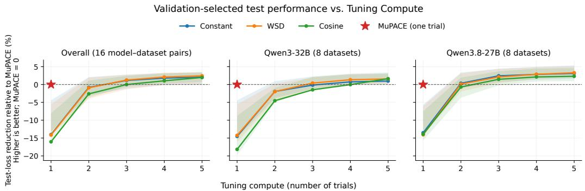  
Lines: equal-weight task means. Shading: middle 50% of task expectations (not confidence intervals). Exact subset averages; select trial by minimum validation loss, report test loss. Each trial uses its best-validation checkpoint.

Figure 7: Expected test performance under validation-based trial selection. Shading shows the interquartile range across task expectations, not confidence intervals.  
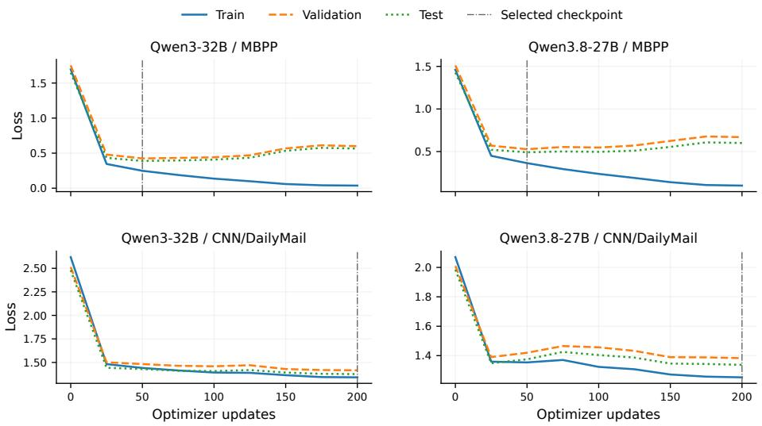  
Figure 8: Illustrative MuPACE train, validation, and test evaluation losses on MBPP and CNN/DailyMail.

## D ABLATION: UNTRAINED SCHEDULER

We compare MuPACE against its untrained counterpart, whose output head is fixed to zero, corresponding to its initialization before meta-learning. This variant therefore produces the default cosine schedule shown in Figure 1, together with depth-dependent post-scaling. The comparison isolates the contribution of meta-training beyond the schedule initialization.

On the 64 in-distribution draws, our meta-learned MuPACE wins on 44 and reduces median test loss by 1.61% (two-sided exact sign test $p = 0 . 0 0 3 7 )$ . On Qwen3-32B, it wins on $7 / 8$ datasets, with a median reduction of 6.66% (sign test $p = 0 . 0 7 0 3 )$ . Figure 9 shows the comparisons.

(a) How often does learned win?

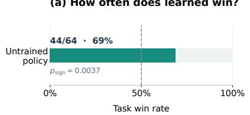

(b) How much does loss change?  
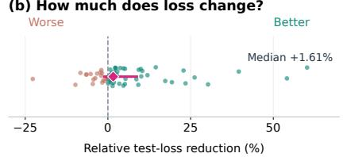  
Learned policy at 9K vs untrained · test loss at each arm’s best-validation checkpoint

Qwen3-32B · learned policy at 9K  
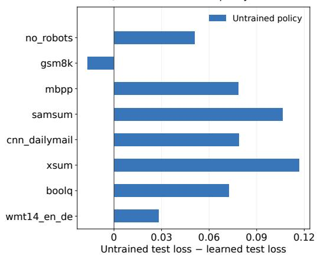  
Figure 9: MuPACE versus the untrained zero-head policy on in-distribution draws (top) and Qwen3- 32B (bottom).

## E ABLATION: DIRECT LEARNING-RATE HEAD

In the following ablation, we replace the five schedule heads of Equation 4 with a single head that directly predicts a learning rate before depth-µP post-scaling. We extend its range downward (approximately $[ 1 . 1 \times 1 0 ^ { - 8 } , 9 . 0 \times 1 0 ^ { - 2 } ] )$ to accommodate the small learning rates produced by the normalized analytic schedule (especially $\lambda _ { 4 } )$ . Everything else remains unchanged. At initialization, this head outputs a constant $\mathrm { 1 0 ^ { - 3 } }$ before post-scaling, so it must learn how the rate changes over time, including warm-up. The policy is meta-trained for 9000 outer iterations. Figure 10 shows example schedules after meta-training, demonstrating that warm-up emerges through learning rathe than being set by the initialization.

The direct head clearly outperforms default cosine and WSD, but not default constant, and performs worse than tuned constant (Figure 11). Its median performance is close to that of the analytic scheduler, with a difference of only 0.4% that is not significant $( p = 0 . 3 8 )$ , although it performs worse on a few tasks. On Qwen3-32B, it trails all tuned baselines across the eight datasets but consistently outperforms Hypergradient Descent (Figure 12). Overall, the analytic parameterization appears to improve robustness more than typical performance.

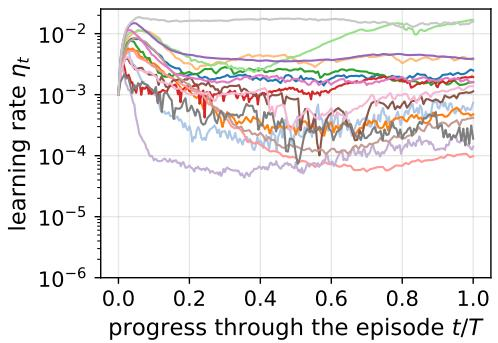  
Figure 10: Learning rates applied by the direct LR head on 16 in-distribution tasks.

(a) How often does learned win?  
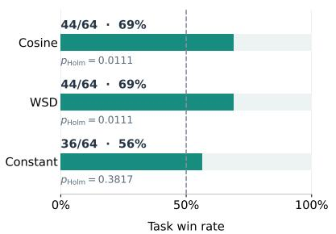

(b) How much does loss change? Worse  
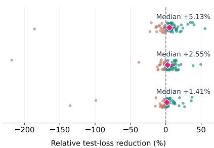  
(a) versus default schedules

(a) How often does learned win?  
Worse(b) How much does loss change? Better  
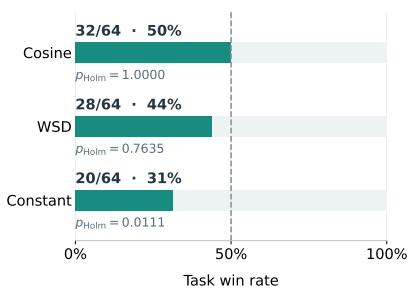

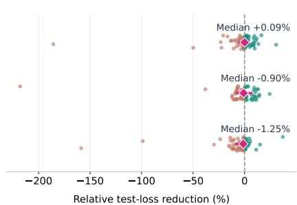  
(b) versus tuned schedules  
Figure 11: Direct learning-rate head on the same 64 in-distribution draws. (a) compares against the default schedules, while (b) compares against the swept baselines.

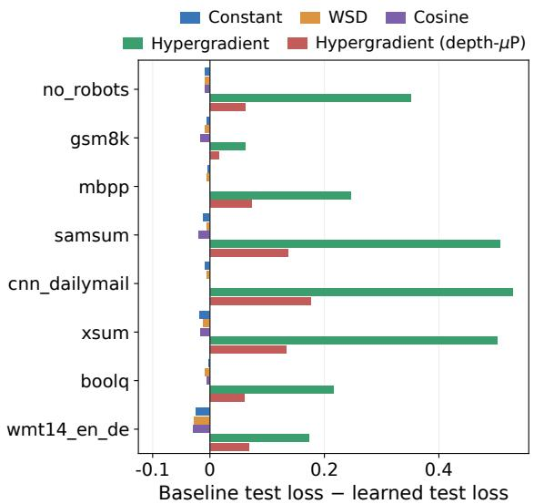  
Figure 12: Direct learning-rate head transferred one-shot to Qwen3-32B. Bars show baseline minus learned test loss, where positive values favor the learned scheduler.

## F ABLATION: SHAPE NORMALIZATION

In the following ablation, we remove the shape normalization of Equation 5, so the shape parameters can also change the overall magnitude of the schedule. All other components remain unchanged, and both policies are meta-trained for 9000 outer iterations.

On the 64 in-distribution draws, the normalized scheduler wins on 33 and reduces median test loss by 0.15% (two-sided exact sign test $p = 0 . 9 0 )$ , so we find no in-distribution effect. On Qwen3-32B, it wins on $5 / 8$ datasets, with a median reduction of 1.37% (sign test $p = 0 . 7 3 )$ . The differences are small on most datasets, but large where normalization helps, most clearly on mbpp (15.4%) and wmt14 en de (8.3%). With eight datasets, this suggests a possible transfer benefit rather than a significant one. Figure 13 shows the comparisons.

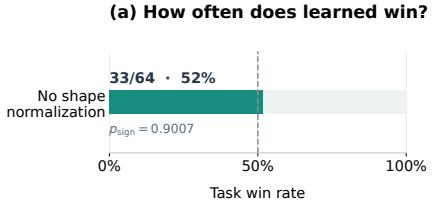

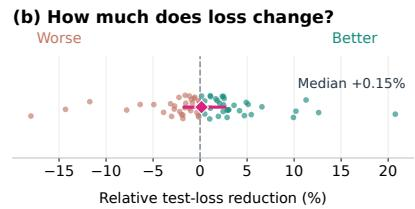  
Learned policy at 9K vs no shape normalization · test loss at each arm’s best-validation checkpoint

Qwen3-32B · learned policy at 9K  
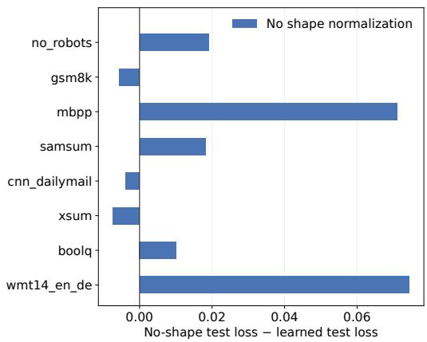  
Figure 13: Comparison of MuPACE with and without shape normalization on in-distribution draws (top) and Qwen3-32B (bottom). Positive values mean shape normalization performs better.

## G ABLATION: DEPTH SCALING

## G.1 DEPTH-SCALED BASELINE FIXED SCHEDULES

We ask whether MuPACE still outperforms the fixed schedules when the latter are given the same depth-dependent scaling and their learning-rate peaks are selected without any target-task search. Specifically, we apply the learned policy’s depth-µP multiplier from Equation 6 to cosine, WSD, and constant schedules on both out-of-distribution models. For each schedule family, we transfer (i) the default peak of $1 0 ^ { - 3 }$ and (ii) the best fixed peak from a sweep on the in-distribution evaluation, denoted $p ^ { * }$ . For WSD and constant, the source-selected and default peaks coincide. Thus, the comparison tests whether MuPACE provides gains beyond transferring either default or sourcetuned depth-scaled fixed schedules. All arms report test loss at their own best-validation checkpoint.

MuPACE outperforms every depth-scaled fixed control on every dataset of both models except default-peak cosine on GSM8K for Qwen3-32B (Figure 14). This supports gains beyond applying the same depth-scaling rule to default or source-tuned fixed schedules without target-task search.

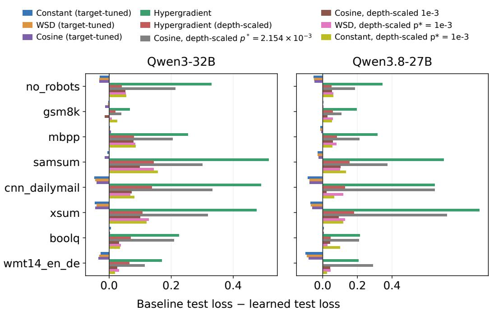  
Figure 14: Depth-scaled fixed schedules versus MuPACE on Qwen3-32B (left) and Qwen3.8-27B (right). Positive differences favor the learned policy. Target-tuned schedules and Hypergradient Descent are shown for context. Depth-scaled fixed schedules use no target-task peak selection.

## G.2 DEPTH-DEPENDENT POST-SCALING OF THE LEARNED POLICY

In the following ablation, we meta-train a separate variant without the depth-dependent multiplier from Equation 6, while retaining depth as a policy input. We compare the two policies on the same 64 in-distribution draws and eight Qwen3-32B datasets, reporting test loss at each arm’s bestvalidation checkpoint.

In-distribution performance is similar, with MuPACE winning on 32/64 draws and achieving a median relative test-loss reduction of −0.03% (two-sided exact sign test $p = 1 . 0 0 )$ . On Qwen3- 32B, MuPACE wins on all eight datasets, suggesting a benefit for one-shot transfer (Figure 15).

(a) How often does learned win?

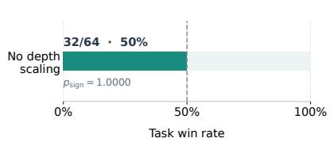

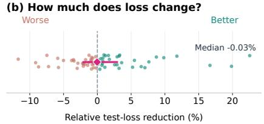  
Learned policy vs no depth scaling · test loss at each arm’s best-validation checkpoint

Qwen3-32B · learned policy at 9K  
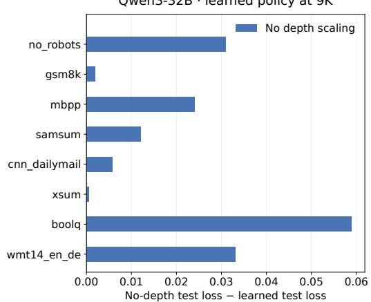  
Figure 15: MuPACE versus a separately meta-trained variant without depth-dependent post-scaling on in-distribution draws (top) and Qwen3-32B datasets (bottom). Positive values favor the full scheduler.