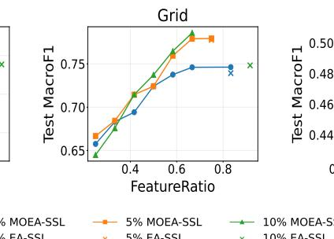
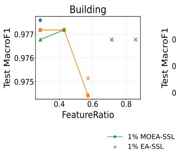
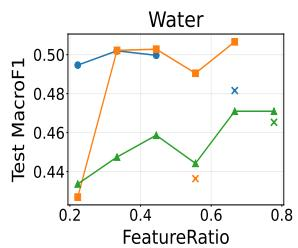

# Multi-Objective Evolutionary Semi-Supervised Learning for Resource-Aware Smart City Classification

Francisco José Sedeño1[0009-0000-7797-3562] and Jamal Toutouh1[0000-0003-1152-0346]

ITIS Software, University of Malaga, Malaga, Spain {sedeno,jamal}@uma.es

Abstract. Smart-city applications often combine scarce labeled data with abundant unlabeled observations. Semi-supervised learning (SSL) exploits both labeled and unlabeled data to improve classification under limited supervision. This article presents MOEA-SSL, a multi-objective evolutionary approach for lightweight semi-supervised tabular classification that jointly optimizes predictive quality and feature usage. Experimental evaluation on three Smart City classification datasets, considering 1%, 5%, and 10% labeled data, shows that MOEA-SSL achieves competitive predictive performance compared with established lightweight SSL methods while significantly reducing feature usage relative to EA-SSL in all evaluated conditions. The computed Pareto fronts also provide lower-feature-use alternatives with limited degradation in classification performance.

Keywords: Semi-supervised learning · Multi-objective evolutionary algorithms · Feature selection · Smart cities.

## 1 Introduction

Smart cities rely on dense sensing and information infrastructures to monitor buildings, energy systems, mobility, environmental conditions, and public services. These infrastructures continuously generate heterogeneous data, but reliable labels can require manual annotation, expert inspection, intrusive measurements, or costly field procedures. Label scarcity is therefore a relevant limitation for urban machine learning systems, even when large quantities of raw observations are available [3, 19, 32].

Semi-supervised learning (SSL) addresses this setting by combining a small labeled set with a larger collection of unlabeled observations [7, 13]. Lightweight approaches such as self-training and co-training suit tabular urban data because they can reuse conventional classifiers, but their performance depends on interacting decisions concerning feature views, confidence thresholds, acceptance caps, and stopping criteria [29, 1].

Previous work introduced evolutionary formulations for adapting two-view construction and pseudo-labeling policies in tabular SSL (EA-SSL) [22]. The EA-SSL optimizes the SSL configuration and achieved competitive results against lightweight SSL baselines on 25 OpenML datasets. However, the search is scalar and returns a single configuration according to predictive fitness. In a smart-city deployment, predictive quality is only one concern: every input variable may represent a measurement, sensing modality, communication field, or preprocessing step. Maximizing classification quality and minimizing the required measurement set define a natural trade-of. Evolutionary multi-objective feature selection addresses the analogous conflict between predictive performance and subset size [17, 30].

This article proposes MOEA-SSL, a multi-objective extension of EA-SSL for resourceaware smart-city classification. MOEA-SSL reformulates the evolutionary optimization layer as a bi-objective problem and applies the Non-dominated Sorting Genetic Algorithm version II (NSGA-II) [11] to optimize predictive quality and feature usage separately while preserving the underlying EA-SSL representation and SSL mechanism. The empirical study considers three classification Smart City datasets, covering smart buildings, smart energy, and smart-water monitoring.

The main contributions of this article are: (i) a bi-objective formulation of evolutionary SSL that separates robust predictive quality and feature usage; (ii) MOEA-SSL, an NSGA-II extension of EA-SSL; (iii) a cross-domain study on three Smart City classification datasets under severe label scarcity; and (iv) a resource-oriented analysis of Pareto fronts, including performance-oriented and performance-retention operating points.

The article is organized as follows. Section 2 formulates the multi-objective SSL optimization problem. Section 3 reviews related work. Section 4 presents MOEA-SSL. Section 5 describes the experimental settings. Section 6 analyzes the results. Finally, Section 7 presents the main conclusions and future work.

## 2 Multi-Objective SSL Problem Description

The problem addressed in this work extends the mono-objective evolutionary SSL formulation introduced by the authors of EA-SSL [22]. That formulation jointly optimized two feature views and the pseudo-labeling policy through a scalar fitness function. Here, the same general SSL decision space is reformulated as a bi-objective problem that explicitly considers robust predictive quality and feature usage.

Let $D = D _ { L } \cup D _ { U }$ denote the SSL training pool, with $D _ { L } \cap D _ { U } = \emptyset$ . The labeled subset is $D _ { L } = \{ ( { \bf x } _ { i } , y _ { i } ) \} _ { i = 1 } ^ { n _ { L } }$ , and the unlabeled subset is $D _ { U } = \{ \mathbf { x } _ { j } \} _ { j = 1 } ^ { n _ { U } }$ . Each input vector $\mathbf { x } \in \mathbb { R } ^ { d }$ is described by � available features, and $y \in { \cal { Y } } = \{ 1 , . . . , C \}$ , where � denotes the number of classes. The labeled fraction is $\begin{array} { r } { \rho = \frac { n _ { L } } { n _ { L } + n _ { U } } } \end{array}$

The SSL procedure operates on two feature views defined by binary masks $\mathbf { m } ^ { ( 1 ) } , \mathbf { m } ^ { ( 2 ) } \in \{ 0 , 1 \} ^ { d }$ , where $m _ { k } ^ { ( v ) } = 1$ indicates that feature � is included in view � ∈ {1, 2}. The corresponding selected-feature sets are $S ^ { ( v ) } = \left\{ k \in \{ 1 , \dots , d \} : m _ { k } ^ { ( v ) } = 1 \right\}$ $v \in \{ 1 , 2 \}$ . The masks are evolved independently and may overlap.

A candidate solution $\mathbf { z } \in \Omega$ encodes a complete SSL configuration, including the two feature masks and the pseudo-labeling parameters described in Section 4. Each candidate is evaluated over � fixed labeled-data resamples. Let $F _ { r } ( \mathbf { z } )$ denote validation MacroF1 for resample $r \in \{ 1 , \ldots , R \}$ . The mean $\mu _ { F } ( { \bf z } )$ and standard deviation $\sigma _ { F } ( { \bf z } )$ are

$$
\mu _ { F } ( \mathbf { z } ) = { \frac { 1 } { R } } \sum _ { r = 1 } ^ { R } F _ { r } ( \mathbf { z } ) , \quad \sigma _ { F } ( \mathbf { z } ) = { \sqrt { { \frac { 1 } { R } } \sum _ { r = 1 } ^ { R } { ( F _ { r } ( \mathbf { z } ) - \mu _ { F } ( \mathbf { z } ) ) ^ { 2 } } } } .\tag{1}
$$

The robust score is defined according to RobustMacroF1(z):

$$
\mathrm { R o b u s t M a c r o F 1 } ( { \bf z } ) = \mu _ { F } ( { \bf z } ) - \alpha \sigma _ { F } ( { \bf z } ) , \qquad \alpha = 0 . 4 ,\tag{2}
$$

where � controls the penalty assigned to variability across low-label resamples. The value $\alpha = 0 . 4$ follows the robustness weight used in the previous evolutionary SSL study [22]. Since both objectives are expressed as minimization criteria, the first objective is

$$
f _ { 1 } ( \mathbf { z } ) = - \mathrm { R o b u s t M a c r o F 1 } ( \mathbf { z } ) .\tag{3}
$$

The second objective measures the fraction of distinct original variables required by at least one view:

$$
f _ { 2 } ( { \bf z } ) = \mathrm { F e a t u r e R a t i o } ( { \bf z } ) = \frac { | S ^ { ( 1 ) } \cup S ^ { ( 2 ) } | } { d } .\tag{4}
$$

The union avoids double-counting variables selected by both views. Thus, FeatureRatio measures the proportion of input information required by the SSL configuration. It is a hardware-agnostic proxy for measurement and information-acquisition complexity.

The resulting multi-objective optimization problem is

$$
\operatorname* { m i n } _ { { \bf z } \in \Omega } \left( f _ { 1 } ( { \bf z } ) , f _ { 2 } ( { \bf z } ) \right) .\tag{5}
$$

Given two feasible configurations ${ \bf z } _ { a } , { \bf z } _ { b } \in \Omega , { \bf z } _ { a }$ dominates $\mathbf { z } _ { b }$ if $f _ { i } ( { \mathbf { z } } _ { a } ) \leq f _ { i } ( { \mathbf { z } } _ { b } )$ for $i \in { 1 , 2 }$ and the inequality is strict for at least one objective. The aim is to obtain a set of Pareto-non-dominated SSL configurations representing trade-ofs between robust predictive performance and feature usage, rather than a single weighted compromise.

## 3 Related Work

SSL combines labeled and unlabeled data to improve learning when annotation is limited [7, 13]. Self-training iteratively augments the labeled set with confident predictions, while co-training exchanges pseudo-labels between learners trained on diferent views [4, 29]. Their simplicity is attractive for tabular data, although performance can deteriorate when confidence estimates are unreliable or erroneous pseudo-labels are reinforced [1]. Neural tabular methods such as VIME extend self-supervised and semi-supervised representation learning to this domain [31], but require a more complex training pipeline.

Evolutionary and coevolutionary learning has also been applied directly to SSL. Building on spatial evolutionary GAN training [25], Toutouh et al. [26, 27] combined semi-supervised GANs with spatial coevolution, maintaining populations of generators and discriminators in a distributed grid and exchanging components according to performance. These studies focus on image-based adversarial deep learning and use coevolution as the training mechanism. In contrast, the present work addresses lightweight tabular SSL and uses evolutionary search to configure a pseudo-labeling process rather than to train the predictive model parameters directly.

Label scarcity is also documented in smart-city sensing. Mena-Martinez et al. [19] evaluated supervised and semi-supervised methods for occupancy estimation from environmental IoT data. Ghourchian et al. [15] applied SSL to WiFi-based indoor localization with limited user annotation, and Zhang et al. [32] proposed adaptive semi-supervised fault classification for urban power grids. These works demonstrate the relevance of SSL in buildings and energy systems, but they primarily optimize predictive performance rather than an explicit performance–measurement trade-of.

Feature selection is a combinatorial problem for which evolutionary computation has been extensively studied [21, 24, 30]. Multi-objective formulations commonly maximize predictive performance while minimizing subset size, returning alternative trade-ofs for diferent decision requirements [17].

MOEAs are widely used in smart-city decision support because urban problems naturally combine conflicting service, economic, environmental, and infrastructure criteria [8]. Previous applications include the optimization of competing communication criteria in vehicular networks [23], multi-objective location of garbage accumulation points [28], household energy planning balancing energy use and user preferences [10], electric-vehicle charging-station location trading quality of service against deployment cost [9], and e-scooter infrastructure redesign considering mobility quality and installation cost [20]. Related transportation studies have also applied Pareto-based evolutionary search to multimodal route finding [14] and transit-network design [6]. These works illustrate the value of Pareto fronts for exposing alternative urban trade-ofs instead of collapsing conflicting criteria into a single weighted objective. The present study transfers this decision-support perspective to SSL configuration, where predictive robustness conflicts with the amount of measurement information required by the classifier.

The closest antecedent is EA-SSL [22], which jointly evolves two feature-subset views and a pseudo-labeling policy. Its scalar formulation, however, does not explicitly distinguish predictive robustness from feature usage. MOEA-SSL addresses this gap by preserving the EA-SSL search space and SSL mechanism while optimizing robust MacroF1 and FeatureRatio as separate objectives.

## 4 MOEA-SSL Method

MOEA-SSL extends the monolithic EA-SSL method [22] without changing its SSL representation or pseudo-labeling mechanism. The methodological change concerns the evolutionary formulation: the original scalar fitness is replaced by the separate predictive-performance and feature-usage objectives defined in Section 2, which are optimized through NSGA-II [11].

## 4.1 Representation and SSL evaluation

A candidate is represented as $\mathbf { z } = ( \mathbf { a } , \mathbf { b } )$ , where a is the view-builder component and b is the pseudo-labeling-policy component. The view builder is

$$
\mathbf { a } = \left( \mathbf { m } ^ { ( 1 ) } , \mathbf { m } ^ { ( 2 ) } , p ^ { ( 1 ) } , p ^ { ( 2 ) } , k ^ { ( 1 ) } , k ^ { ( 2 ) } , B ^ { ( 1 ) } , B ^ { ( 2 ) } \right) ,\tag{6}
$$

where $\mathbf { m } ^ { ( v ) } \in \{ 0 , 1 \} ^ { d }$ selects the features of view $v , p ^ { ( v ) } \in \{ 0 , 1 \}$ activates the optional projection, $k ^ { ( v ) } \in \{ 2 , \dots , k _ { \operatorname* { m a x } } \}$ specifies its dimension, and $B ^ { ( v ) } \in \{ 0 , \dots , B _ { \operatorname* { m a x } } \}$ controls discretization. The two masks are evolved independently and may overlap.

The policy component is

$$
\mathbf { b } = \left( \theta _ { \mathrm { c l f } } , \tau _ { 0 } , \Delta \tau , \tau _ { \mathrm { m i n } } , q , \gamma , \nu , T \right) ,\tag{7}
$$

where $\pmb { \theta } _ { \mathrm { c l f } }$ contains the hyperparameters of the regularized linear classifier used by EA-SSL (logistic regression), $\tau _ { 0 } \in ( 0 , 1 )$ is the initial confidence threshold, $\Delta \tau \geq 0$ its per-iteration decay, $\tau _ { \operatorname* { m i n } } \in ( 0 , 1 )$ its lower bound, $q \in \mathbb { N }$ the per-class pseudo-label acceptance cap, $\gamma \in [ 0 , 1 ]$ the minimum posterior margin, $\nu \in \{ 0 , 1 \}$ the disagreementveto flag, and $T \in \mathbb { N }$ the maximum number of pseudo-labeling iterations.

Candidate evaluation uses the inherited two-view SSL procedure. Starting from $D _ { L }$ and $D _ { U } ,$ , one classifier is trained on each evolved view at every iteration. The confidence threshold follows

$$
\tau _ { t } = \operatorname* { m a x } \{ \tau _ { \operatorname* { m i n } } , \tau _ { 0 } - t \Delta \tau \} .\tag{8}
$$

Predictions on the unlabeled pool are filtered by the confidence threshold, the optional posterior-margin requirement, the optional cross-view disagreement veto, and the perclass acceptance cap. Accepted observations are transferred from the unlabeled to the labeled pool. Iteration terminates when no further observations are accepted or after � iterations, and the resulting SSL configuration is scored on the validation partition.

The SSL evaluation is repeated over the � fixed low-label resamples. Their validation MacroF1 values define $f _ { 1 } ( \mathbf { z } )$ through Eqs. (2)–(3). The coeficient $\alpha = 0 . 4$ inherits the standard-deviation robustness weight used in the previous evolutionary SSL study [22]. This objective corresponds to the mean–variability performance component of the previous scalar fitness; the original formulation also contained auxiliary terms and is therefore not identical to the MOEA-SSL predictive objective.

The second objective is obtained directly from the evolved masks:

$$
f _ { 2 } ( { \bf z } ) = \mathrm { F e a t u r e R a t i o } ( { \bf z } ) = \frac { | S ^ { ( 1 ) } \cup S ^ { ( 2 ) } | } { d } ,\tag{9}
$$

as defined in $\operatorname { E q . } \left( 4 \right)$ . The union prevents double-counting a feature selected by both views. Hence, FeatureRatio is available directly from the genotype and requires no additional classifier-training evaluation.

## 4.2 Multi-objective evolutionary search

MOEA-SSL evolves a population of complete monolithic EA-SSL configurations using NSGA-II. A feasible population is randomly initialized and evaluated on $( f _ { 1 } , f _ { 2 } )$ . Parent selection uses binary tournament based on non-dominated rank and crowding distance. Ofspring are generated with the inherited EA-SSL variation operators, repaired, and evaluated on the same fixed resamples. Parent and ofspring populations are then merged, and non-dominated sorting and crowding distance determine environmental survival. Algorithm 1 summarizes the procedure.

The returned $P ^ { \star }$ contains alternative validation-non-dominated trade-ofs between RobustMacroF1 and FeatureRatio. Test data are not used during evolution or validationbased operating-point selection. Any selected configuration, including the performanceoriented solution defined in Section $^ { 5 , }$ is evaluated on the untouched test partition only after validation-based selection.

Algorithm 1 MOEA-SSL   
Require: $D _ { L } , D _ { U } ,$ , validation set �, population size �, generations �, fixed resamples �   
Ensure: Non-dominated set $P ^ { \star }$   
1: Initialize and repair population $P _ { 0 }$ of � candidates   
2: Evaluate $( f _ { 1 } , f _ { 2 } )$ for every $\mathbf { z } \in P _ { 0 }$   
3: for $g = 0 , \ldots , G - 1$ do   
4: Rank $P _ { g }$ by non-dominated sorting and crowding distance   
5: $O _ { g }  \emptyset$   
6: while $| O _ { g } | < N$ do   
7: Select parents by rank–crowding binary tournament   
8: Apply inherited EA-SSL crossover and mutation   
9: Repair and evaluate ofspring   
10: Add ofspring to $O _ { g }$   
11: end while   
12: $M _ { g } \gets P _ { g } \cup O _ { g }$   
13: Compute Pareto fronts of $M _ { g }$   
14: Fill $P _ { g + 1 }$ front by front   
15: Truncate the last front by crowding distance if necessary   
16: end for   
17: $P ^ { \star }  { \mathcal { F } } _ { 1 } ( P _ { G } )$   
18: return $P ^ { \star }$

## 4.3 Evolutionary operators

MOEA-SSL retains the EA-SSL variation operators unchanged and applies them according to gene type. Table 1 summarizes the operators; variation is applied independently to the view-builder and policy blocks using the probabilities reported in Section 5.

Table 1. Variation operators inherited from EA-SSL.
<table><tr><td>Component</td><td>Crossover</td><td>Mutation</td></tr><tr><td>Feature masks</td><td>Uniform exchange</td><td>Bit flip</td></tr><tr><td>Boolean genes</td><td>Uniform exchange</td><td>Boolean flip</td></tr><tr><td>Integer genes</td><td>Uniform exchange</td><td>Bounded ±1 step</td></tr><tr><td>Continuous genes</td><td>Arithmetic crossover</td><td>Bounded perturbation</td></tr></table>

Repair is performed before evaluation. For each view, the inherited minimum-feature constraint $\| \mathbf { m } ^ { ( v ) } \| _ { 0 } \ge k _ { \operatorname* { m i n } } , \qquad v \in \{ 1 , 2 \}$ , is enforced, and all genes are kept within their admissible domains. Policy repair additionally ensures $\tau _ { \mathrm { m i n } } \leq \tau _ { 0 }$ and $\Delta \tau \geq 0$ . These repairs use no predictive information.

## 5 Experimental Settings

The experimental study considers three binary Smart City classification datasets covering building operation, smart energy, and water-quality monitoring: Building Occupancy [5], Grid Stability [2], and Water Potability [18]. Table 2 summarizes their main characteristics.

Building Occupancy uses the repository training partition and first held-out test partition, yielding 10,808 observations and seven processed predictors. Grid Stability uses 12 predictors for the categorical stable/unstable target; the continuous target stab is excluded. The redundant input $p _ { 1 }$ is retained because feature redundancy is part of the optimization problem. Water Potability contains nine physicochemical predictors; missing values are median-imputed from training data.

Table 2. Datasets used in the experimental evaluation.
<table><tr><td>Dataset</td><td>Domain</td><td></td><td>Samples Number of features, d</td></tr><tr><td>Building Occupancy Smart buildings</td><td></td><td>10,808</td><td>7</td></tr><tr><td>Grid Stability</td><td>Smart energy</td><td>10,000</td><td>12</td></tr><tr><td>Water Potability</td><td>Smart water</td><td>3,276</td><td>9</td></tr></table>

For Building Occupancy, the existing held-out test partition contains 2,665 samples and 20% of the repository training partition is used for validation (1,629 samples). For Grid Stability and Water Potability, 30% of the data are held out for testing and 20% of the remaining development partition is used for validation. The remaining development data form $D _ { L } \cup D _ { U }$ . For each random seed, $D _ { L }$ is obtained using $\rho \in \{ 0 . 0 1 , 0 . 0 5 , 0 . 1 0 \}$ and the remainder constitutes $D _ { U }$ . The original Building Occupancy train/test organization is preserved, whereas Grid Stability and Water Potability use stratified random partitions. Scaling and imputation parameters are fitted without access to validation or test labels.

## 5.1 Baselines and parameter settings

The analysis uses two lightweight SSL baselines from the previous study [22]: Self-Training (ST) and Heuristic Co-Training (HCo). Label Spreading is excluded because its graph construction exceeded the adopted size limit for Building Occupancy and Grid Stability. Four classifiers trained only on $D _ { L }$ are reported as descriptive supervised references: Logistic Regression (LR), linear SVM, Random Forest (RF), and Histogrambased Gradient Boosting (HGB). The primary evolutionary comparator is EA-SSL [22].

EA-SSL uses the same representation, SSL procedure, variation operators, and evolutionary budget as MOEA-SSL, while retaining its original scalar fitness. Both methods use a population of 36, 50 generations, and �=10 fixed low-label resamples for candidate evaluation. Crossover and mutation probabilities are 0.85 and 0.35 for both the view and policy components, following [22]. Each method is independently executed with 30 shared random seeds per dataset and labeled fraction, enabling paired statistical comparisons.

## 5.2 Evaluation methodology

MacroF1 is the primary predictive metric because it assigns equal weight to every class. Classification accuracy is retained as a secondary diagnostic. For scalar comparison against EA-SSL and the baselines, one MOEA-SSL configuration is selected from each validation front without using test labels:

$$
\mathbf { z } _ { \mathrm { p e r f } } = \mathop { \mathrm { a r g } } \underset { \mathbf { z } \in P _ { V } } { \operatorname* { m a x } } \mathrm { R o b u s t M a c r o F } 1 _ { V } ( \mathbf { z } ) ,\tag{10}
$$

where ties are broken by lower FeatureRatio. The selected configuration is then evaluated on the untouched test set. This performance-oriented point provides a conservative

comparison with the accuracy-oriented EA-SSL solution while the complete front is retained for resource-trade-of analysis.

To quantify whether the front ofers useful alternatives beyond this extreme, a second validation-only operating point is defined. Let $F _ { V } ^ { \mathrm { m a x } } = \mathrm { R o b u s t M a c r o F } 1 _ { V } ( \mathbf { z } _ { \mathrm { p e r f } } )$ . The one-point performance-retention solution is

$$
\mathbf { z } _ { \mathrm { l p p } } = \operatorname { a r g m i n } _ { \mathbf { z } \in P _ { V } } { \mathrm { F e a t u r e R a t i o } } ( \mathbf { z } ) \quad { \mathrm { s . t . } } \quad \operatorname { R o b u s t M a c r o F } 1 _ { V } ( \mathbf { z } ) \geq F _ { V } ^ { \operatorname* { m a x } } - 0 . 0 1 .\tag{11}
$$

Thus, $\mathbf { z } _ { \mathrm { l p p } }$ accepts at most one absolute MacroF1 point of validation degradation in exchange for a smaller measurement set. Test values are again inspected only after selection. This analysis is descriptive and does not add further hypothesis tests.

Multi-objective quality is characterized using FeatureRatio, the number of distinct selected variables, representative Pareto sets, and hypervolume (HV) [16]. HV is computed on the validation objectives

$$
( 1 - \mathrm { R o b u s t M a c r o F 1 , F e a t u r e R a t i o } ) ,
$$

using the fixed reference point (1, 1). Representative fronts are chosen as the run whose HV is closest to the median HV for the corresponding dataset and labeled fraction. Their non-dominated validation solutions are subsequently projected onto test MacroF1 for visualization. Test values are never used to construct or choose the validation front.

Descriptive results are reported as median and interquartile range (IQR) over the 30 shared seeds. Paired comparisons use the Wilcoxon signed-rank test with significance level $\alpha _ { s } = 0 . 0 5 [ 1 2 ]$ . For predictive performance, Holm correction is applied to the three comparisons of MOEA-SSL against EA-SSL, ST, and HCo within each dataset–fraction condition. FeatureRatio constitutes a pre-specified direct MOEA-SSL versus EA-SSL comparison. The nine corresponding tests are Holm-correctedjointly. Supervised methods are used as descriptive references and are not included in the multiple-comparison tests.

## 5.3 Execution platform and implementation

The methods were implemented in Python 3 mainly using NumPy, pandas, and scikitlearn . Experiments were executed on a high-performance cluster with 126 SD530 nodes, each equipped with 52 Intel Xeon Gold 6230R cores at 2.10 GHz and 192 GB of RAM, interconnected through InfiniBand HDR100. The implementation and experimental scripts are available at the project repository.1

## 6 Experimental Analysis

This section evaluates MOEA-SSL from complementary perspectives. First, the performance-oriented validation solution $\mathbf { z } _ { \mathrm { p e r f } }$ is compared with EA-SSL and the lightweight baselines on the held-out test set. Second, the non-dominated sets are analyzed in terms of feature eficiency and resource–performance trade-ofs. Third, $\mathbf { z } _ { \mathrm { l p p } }$ examines the additional compression obtained when a small validation-performance concession is allowed. Finally, the influence of labeled-data availability, computational cost, and the main limitations are discussed.

## 6.1 Predictive performance

Table 3 reports test MacroF1. Building Occupancy presents a clear ceiling efect: EA-SSL and MOEA-SSL remain close to 0.977 at every labeled fraction, with no significant paired diferences. MOEA-SSL nevertheless significantly improves over HCo in all three conditions and over ST at 1% after within-condition Holm correction.

Table 3. Test MacroF1 across 30 runs. Values are median[inter-quartile range]. Bold indicates the highest median among the SSL methods. Best Sup. is the highest-median supervised approach and is descriptive only. † denotes a significant MOEA-SSL vs. EA-SSL diference (Holm correction).
<table><tr><td>Dataset</td><td> $\rho$ </td><td>ST</td><td>HCo</td><td>EA-SSL</td><td>MOEA-SSL</td></tr><tr><td>Building</td><td></td><td></td><td>1%0.950[0.055] 0.881[0.040] 0.977[0.000]</td><td></td><td>0.977[0.000] 0.977[0.005] (SVM)</td></tr><tr><td></td><td></td><td></td><td>5%0.977[0.000] 0.947[0.014] 0.977[0.000]</td><td></td><td>0.977[0.000]0.978[0.000] (SVM)</td></tr><tr><td></td><td></td><td></td><td>10%0.977[0.000] 0.948[0.014] 0.977[0.000]</td><td></td><td>0.977[0.001] 0.978[0.001] (SVM)</td></tr><tr><td rowspan="3">Grid</td><td></td><td></td><td>1%0.683[0.076] 0.660[0.166] 0.746[0.032]</td><td></td><td>0.755[0.021] 0.737[0.040] (SVM)</td></tr><tr><td></td><td>5%0.757[0.020]0.533[0.174]0.764[0.017]</td><td></td><td></td><td>0.770[0.010] 0.829[0.016] (HGB)</td></tr><tr><td></td><td></td><td></td><td></td><td>10%0.782[0.007] 0.728[0.026] 0.761[0.010] 0.777[0.009]† 0.862[0.013] (HGB)</td></tr><tr><td rowspan="3">Water</td><td></td><td></td><td></td><td></td><td>1%0.424[0.066]0.379[0.011] 0.491[0.031] 0.500[0.011]†0.495[0.028] (SVM)</td></tr><tr><td></td><td></td><td></td><td></td><td>5%0.383[0.038] 0.379[0.010] 0.471[0.027] 0.506[0.022]† 0.517[0.029] (HGB)</td></tr><tr><td></td><td></td><td></td><td></td><td>10%0.385[0.011] 0.379[0.003] 0.439[0.039] 0.471[0.071] 0.536[0.016] (HGB)</td></tr></table>

Grid Stability provides a more discriminative comparison. MOEA-SSL obtains median MacroF1 values of 0.755, 0.770, and 0.777 for 1%, 5%, and 10% labeled data, compared with 0.746, 0.764, and 0.761 for EA-SSL. The diference is significant at 10% $( p _ { \mathrm { H o l m } } = 0 . 0 0 5 7 )$ ). The supervised references also become increasingly competitive as more labels are available: HGB reaches 0.829 and 0.862 at 5% and 10%, respectively.

Water Potability shows the clearest predictive advantage for MOEA-SSL. The EA-SSL median increases from 0.491 to 0.500 at 1% labels and from 0.471 to 0.506 at 5%, with significant diferences after correction $( p _ { \mathrm { H o l m } } = 0 . 0 3 5$ and 0.015, respectively). At 10%, MOEA-SSL retains a higher median (0.471 vs. 0.439), although the diference is not significant. MOEA-SSL also significantly outperforms ST and HCo at all three labeled fractions, while HGB becomes the strongest descriptive supervised reference at the larger fractions.

Overall, MOEA-SSL is competitive rather than uniformly superior in predictive performance. It remains close to EA-SSL on Building and most Grid/Water conditions, while providing significant gains in selected Grid and Water settings. More importantly, the proposed bi-objective formulation preserves competitive predictive quality while enabling substantially smaller feature sets.

## 6.2 Feature eficiency and Pareto trade-ofs

Table 4 reports FeatureRatio for the same performance-oriented MOEA-SSL solutions used in Table 3. Despite selecting the validation-performance extreme of each Pareto set, MOEA-SSL requires fewer distinct variables than EA-SSL in every dataset–fraction condition. The reduction ranges from 16.7% to 60.0%, and all nine paired diferences remain significant after Holm correction across the nine pre-specified FeatureRatio tests.

Table 4. Feature usage of the performance-oriented MOEA-SSL solution and EA-SSL. Values in parentheses are median selected features over �. Reduction is computed from the median FeatureRatio values. All paired FeatureRatio diferences remain significant after Holm correction.
<table><tr><td>Dataset</td><td>ρ</td><td>MOEA-SSL</td><td>EA-SSL</td><td>Reduction</td><td>PHolm</td></tr><tr><td rowspan="3">Building</td><td>1%</td><td>0.429 (3/7)</td><td>0.857 (6/7)</td><td>50.0%</td><td>0.005</td></tr><tr><td>5%</td><td>0.429 (3/7)</td><td>0.714 (5/7)</td><td>40.0%</td><td>0.010</td></tr><tr><td>10%</td><td>0.286 (2/7)</td><td>0.714 (5/7)</td><td>60.0%</td><td>0.007</td></tr><tr><td rowspan="3">Grid</td><td>1%</td><td>0.667 (8/12)</td><td>0.833 (10/12)</td><td>20.0%</td><td>0.011</td></tr><tr><td>5%</td><td>0.667 (8/12)</td><td>0.833 (10/12)</td><td>20.0%</td><td>0.010</td></tr><tr><td>10%</td><td>0.750 (9/12)</td><td>0.917 (11/12)</td><td>18.2%</td><td>0.014</td></tr><tr><td rowspan="3">Water</td><td>1%</td><td>0.444 (4/9)</td><td>0.667 (6/9)</td><td>33.3%</td><td>0.045</td></tr><tr><td>5%</td><td>0.556 (5/9)</td><td>0.667 (6/9)</td><td>16.7%</td><td>0.045</td></tr><tr><td>10%</td><td>0.556 (5/9)</td><td>0.778 (7/9)</td><td>28.6%</td><td>0.013</td></tr></table>

The reduction varies across problems. In Building Occupancy, the median performance-oriented MOEA solution uses two or three of seven variables, compared with five or six for EA-SSL. Grid Stability shows a smaller but consistent reduction from approximately 10–11 of 12 variables to 8–9. Water Potability reduces the median measurement set from 6–7 of 9 variables to 4–5. Thus, the most consistent efect of the second objective is a shift toward substantially more compact input representations.

Fig. 1 illustrates the test-space projection of representative validation fronts. For each dataset and labeled fraction, the plotted MOEA-SSL set corresponds to the run whose HV is closest to the median. Building Occupancy shows that sparse configurations can preserve near-ceiling performance. Grid Stability presents the clearest smooth quality– feature trade-of, with intermediate solutions unavailable from the scalar EA-SSL output. Water Potability shows a less regular test projection, particularly at 10%, illustrating that validation non-dominance does not guarantee test non-dominance. The median number of distinct non-dominated objective vectors is two for Building, six to seven for Grid, and four for Water, showing that the richness of the trade-of is problem dependent.

  
Fig. 1. Test-space projection of validation-non-dominated solutions for representative median-HV runs. MOEA-SSL sets are selected using validation objectives only (vs. same sed EA-SSL).

These results show that optimizing FeatureRatio already produces substantially smaller measurement sets at the performance-oriented extreme. The following analysis examines whether further compression is available elsewhere on the front.

## 6.3 Performance-retention operating points

Table 5 evaluates the validation-only rule in Eq. (11). The median feature count decreases beyond $\mathbf { z } _ { \mathrm { p e r f } }$ in six of the nine conditions. Building reduces from three to two variables at 1% and 5% labels while preserving a median test MacroF1 of approximately 0.977. Grid removes one additional variable at 1% and 10%; the largest median test decrease is only 0.008 at Grid 1%. Water provides the strongest additional compression at 10%, where the median measurement set falls from five to three of nine variables while test MacroF1 changes from 0.471 to 0.469.

Table 5. Performance-retention analysis. $\mathbf { z } _ { \mathrm { l p p } }$ minimizes FeatureRatio within 0.01 validation RobustMacroF1 of $\mathbf { z } _ { \mathrm { p e r f } }$ . Feature counts and test MacroF1 are medians over 30 runs; “Reduced” counts runs in which $\mathbf { z } _ { \mathrm { l p p } }$ uses fewer features.
<table><tr><td>Dataset</td><td> $\rho$ </td><td> $z _ { \mathrm { p e r f } }$  feat.</td><td> $z _ { 1 \mathrm { p p } }$ </td><td>feat. Reduced</td><td> $F 1 _ { \mathrm { p e r f } }$ </td><td> $F 1 _ { \mathrm { 1 p p } }$ </td></tr><tr><td rowspan="3">Building</td><td>1%</td><td>3/7</td><td>2/7</td><td>16/30</td><td>0.9772</td><td>0.9772</td></tr><tr><td>5%</td><td>3/7</td><td>2/7</td><td>16/30</td><td>0.9768</td><td>0.9772</td></tr><tr><td>10%</td><td>2/7</td><td>2/7</td><td>18/30</td><td>0.9772</td><td>0.9772</td></tr><tr><td rowspan="3">Grid</td><td>1%</td><td>8/12</td><td>7/12</td><td>22/30</td><td>0.7554</td><td>0.7479</td></tr><tr><td>5%</td><td>8/12</td><td>8/12</td><td>12/30</td><td>0.7701</td><td>0.7660</td></tr><tr><td>10%</td><td>9/12</td><td>8/12</td><td>20/30</td><td>0.7770</td><td>0.7788</td></tr><tr><td rowspan="3">Water</td><td>1%</td><td>4/9</td><td>4/9</td><td>16/30</td><td>0.4996</td><td>0.5000</td></tr><tr><td>5%</td><td>5/9</td><td>4/9</td><td>20/30</td><td>0.5058</td><td>0.5028</td></tr><tr><td>10%</td><td>5/9</td><td>3/9</td><td>20/30</td><td>0.4709</td><td>0.4687</td></tr></table>

Even when the median feature count is unchanged, the retention rule finds smaller solutions in multiple paired runs. Test changes remain small because selection is constrained on validation rather than optimized on test data. Hence, the benefit of the multiobjective formulation extends beyond making the performance extreme more compact than EA-SSL: the Pareto front also provides deployment alternatives that exchange a bounded validation-performance concession for further reductions in measurement requirements.

## 6.4 Influence of labeled-data availability

Increasing the labeled fraction does not produce a universal monotonic efect on MOEA-SSL. Grid Stability improves progressively as $\rho$ increases, whereas Building Occupancy remains close to its performance ceiling. Water Potability reaches its highest median test MacroF1 at 5% labeled data and decreases at 10%. Feature usage is also problem dependent: Building becomes more compact at 10%, Grid uses slightly more variables, and Water increases from four to five median variables after 1%.

Water Potability also shows a marked adaptation in pseudo-labeling behavior. The median number of accepted pseudo-labels decreases from 852 at 1% labeled data to 466 at 5% and only one at 10%. Thus, as more labeled information becomes available, evolution can favor configurations that largely suppress pseudo-labeling rather than forcing additional unlabeled observations into training. Performance in this regime should therefore be interpreted as the result of jointly optimizing the feature views, classifier configuration, and SSL policy, rather than being attributed solely to pseudo-label augmentation.

## 6.5 Multi-objective quality and computational cost

Table 6 reports the validation hypervolume and wall-clock runtime of MOEA-SSL and EA-SSL. Hypervolume is relatively stable across labeled fractions for Building Occupancy and Grid Stability. Building ranges from 0.701 to 0.706, while Grid remains between 0.565 and 0.573. Water Potability exhibits a diferent pattern, with median HV decreasing from 0.456 at 1% labeled data to 0.407 at 10%. These values characterize the quality and coverage of the obtained validation Pareto sets and should not be interpreted as direct measures of classification-task dificulty.

Table 6. Validation hypervolume and computational cost. Values are median[IQR] over the independent runs. Runtime is reported in seconds and Ratio denotes the median MOEA-SSL runtime divided by the median EA-SSL runtime.
<table><tr><td>Dataset</td><td>ρ</td><td>HV</td><td>MOEA-SSL</td><td>EA-SSL</td><td>Ratio</td></tr><tr><td rowspan="3">Building</td><td>1%</td><td>0.701[0.100]</td><td>2487[1300]</td><td>1618[237]</td><td>1.54</td></tr><tr><td>5%</td><td>0.705[0.138]</td><td>2847[1783]</td><td>1492[331]</td><td>1.91</td></tr><tr><td>10%</td><td>0.706[0.139]</td><td>3329[1950]</td><td>1610[302]</td><td>2.07</td></tr><tr><td rowspan="3">Grid</td><td>1%</td><td>0.568[0.071]</td><td>1177[344]</td><td>1183[283]</td><td>1.00</td></tr><tr><td>5%</td><td>0.573[0.040]</td><td>2434[686]</td><td>1392[269]</td><td>1.75</td></tr><tr><td>10%</td><td>0.565[0.054]</td><td>1969[1512]</td><td>1427[250]</td><td>1.38</td></tr><tr><td rowspan="3">Water</td><td>1%</td><td>0.456[0.043]</td><td>1166[635]</td><td>608[141]</td><td>1.92</td></tr><tr><td>5%</td><td>0.423[0.077]</td><td>540[377]</td><td>292[74]</td><td>1.85</td></tr><tr><td>10%</td><td>0.407[0.074]</td><td>351[219]</td><td>283[41]</td><td>1.24</td></tr></table>

Although both evolutionary methods use matched population and generation budgets, MOEA-SSL requires more wall-clock time in most conditions. The median runtime ratio ranges from approximately parity for Grid at 1% to 2.07 for Building at 10%. The overhead is therefore problem dependent rather than constant. Since the cost of the inner SSL evaluation also depends on the evolved pseudo-labeling behavior, these diferences should be interpreted as end-to-end computational cost rather than as the isolated cost of NSGA-II. In return, MOEA-SSL produces a set of alternative performance–feature trade-ofs instead of the single configuration returned by EA-SSL.

## 6.6 Generalization and limitations

Validation–test behavior is broadly consistent with the intended selection protocol. For Building Occupancy, the median diference between validation RobustMacroF1 and test MacroF1 of $\mathbf { z } _ { \mathrm { p e r f } }$ remains below 0.01. The corresponding gap is approximately 0.03 for Grid Stability and between 0.04 and 0.07 for Water Potability. These values indicate that the validation-selected performance-oriented solutions transfer consistently enough to support comparison on the held-out test partitions.

Three limitations are relevant. First, FeatureRatio assigns the same unit cost to every variable and therefore approximates, rather than directly measures, sensor, communication, storage, or energy cost. Second, the study uses standard NSGA-II without strategic view partitioning, adaptive variation, or problem-specific sensor costs, leaving substantial algorithmic extensions unexplored. Third, the evaluation considers three binary, relatively low-dimensional Smart City datasets. However, MOEA-SSL does not optimize feature subsets in isolation: each candidate jointly defines two feature views together with projection, discretization, classifier, and pseudo-labeling policy decisions, yielding a richer search space than conventional feature selection. The inherited EA-SSL framework previously reported competitive performance across 25 OpenML datasets, including higher-dimensional problems [22]; nevertheless, validation of MOEA-SSL on higherdimensional, multiclass, and additional urban problems is required before drawing stronger general conclusions.

## 7 Conclusions and Future Work

This article presented MOEA-SSL, a multi-objective reformulation of EA-SSL for resource-aware semi-supervised classification in Smart City applications. The proposed method retains the same two-view pseudo-labeling representation and evolutionary operators, while replacing the original scalar fitness with two explicitly separated criteria—robust validation MacroF1 and FeatureRatio—optimized through NSGA-II.

Experiments on three Smart City datasets and three low-label regimes show that the principal benefit of the multi-objective formulation is not uniform predictive improvement, but the ability to preserve competitive performance while substantially reducing the number of required variables. The performance-oriented MOEA-SSL solution uses a significantly smaller FeatureRatio than EA-SSL in all nine dataset–fraction conditions after Holm correction, with median reductions between 16.7% and 60.0%. Predictive behavior remains problem dependent: MOEA-SSL is essentially tied with EA-SSL on Building Occupancy, significantly improves over EA-SSL for Grid Stability at 10% labels and Water Potability at 1% and 5%, and remains competitive in the remaining conditions. Moreover, the one-point performance-retention rule further reduces the median feature count in six of nine conditions; across the reported medians, the corresponding absolute test-MacroF1 change remains below 0.008.

These results support multi-objective evolutionary search as a useful decision-support mechanism when Smart City classifiers must balance predictive quality with measurement complexity. Rather than committing to a single scalar optimum, the resulting Pareto front exposes alternative operating points with diferent information requirements; the performance-retention analysis demonstrates that these alternatives can remain useful even after the performance-oriented extreme has been selected. FeatureRatio should nevertheless be interpreted as a generic, hardware-agnostic proxy for input-information requirements rather than as a direct deployment-cost model.

Future work will extend the present baseline formulation in four directions. First, FeatureRatio will be replaced or complemented with explicit sensor, acquisition, communication, latency, and energy costs when such metadata are available. Second, cooperative coevolution and strategic view construction will be investigated to determine whether decomposition improves the search of larger feature spaces. Third, uncertainty-aware and adaptive multi-objective mechanisms will be studied to improve robustness under very small labeled pools and distribution shift. Finally, the evaluation will be expanded to additional cities and datasets, with particular attention to multiclass Smart City classification and broader stochastic validation.

Acknowledgments This work has been partially funded by the AIM-Zero (PID2024-158752OB-I00) and by AGENT-SAM research projects (PID2025-174277OA-I00).

## References

1. Arazo, E., Ortego, D., Albert, P., O’Connor, N.E., McGuinness, K.: Pseudo-labeling and confirmation bias in deep semi-supervised learning. Proceedings of the International Joint Conference on Neural Networks (IJCNN) pp. 1–8 (2020)

2. Arzamasov, V.: Electrical grid stability simulated data. UCI Machine Learning Repository (2018)

3. Batty, M., Axhausen, K.W., Giannotti, F., Pozdnoukhov, A., Bazzani, A., Wachowicz, M., Ouzounis, G., Portugali, Y.: Smart cities of the future. The European Physical Journal Specia Topics 214(1), 481–518 (2012)

4. Blum, A., Mitchell, T.: Combining labeled and unlabeled data with co-training. In: Proceedings of the Eleventh Annual Conference on Computational Learning Theory. pp. 92–100. ACM (1998)

5. Candanedo, L.: Occupancy detection. UCI Machine Learning Repository (2016)

6. Chai, S., Liang, Q.: An improved nsga-ii algorithm for transit network design and frequency setting problem. Journal of Advanced Transportation 2020, 2895320 (2020)

7. Chapelle, O., Sch"olkopf, B., Zien, A. (eds.): Semi-Supervised Learning. MIT Press, Cambridge, MA (2006)

8. Chen, Y., Chan, W.H., Su, E.L.M., Diao, Q.: Multi-objective optimization for smart cities: A systematic review of algorithms, challenges, and future directions. PeerJ Computer Science 11, e3042 (2025)

9. Cintrano, C., Toutouh, J.: Multiobjective electric vehicle charging station locations in a city scale area: Malaga study case. In: Applications of Evolutionary Computation – 25th European Conference, EvoApplications 2022. Lecture Notes in Computer Science, vol. 13224, pp. 584–600. Springer (2022)

10. Colacurcio, G., Nesmachnow, S., Toutouh, J., Luna, F., Rossit, D.: Multiobjective household energy planning using evolutionary algorithms. In: Smart Cities – Second Ibero-American Congress, ICSC-CITIES 2019, Revised Selected Papers. Communications in Computer and Information Science, vol. 1152, pp. 269–284. Springer (2020)

11. Deb, K., Pratap, A., Agarwal, S., Meyarivan, T.: A fast and elitist multiobjective genetic algorithm: Nsga-ii. IEEE Transactions on Evolutionary Computation 6(2), 182–197 (2002)

12. Demšar, J.: Statistical comparisons of classifiers over multiple data sets. Journal of Machine Learning Research 7, 1–30 (2006)

13. van Engelen, J.E., Hoos, H.H.: A survey on semi-supervised learning. Machine Learning 109, 373–440 (2020)

14. Faroqi, H.: Multiobjective route finding in a multimode transportation network by nsga-ii. Journal of Engineering and Applied Science 71, 81 (2024)

15. Ghourchian, N., Allegue-Martinez, M., Precup, D.: Real-time indoor localization in smart homes using semi-supervised learning. In: Proceedings of the AAAI Conference on Artificial Intelligence. vol. 31, pp. 4670–4677 (2017)

16. Guerreiro, A.P., Fonseca, C.M., Paquete, L.: The hypervolume indicator: Computational problems and algorithms. ACM Computing Surveys 54(6), 1–42 (2021)

17. Jiao, R., Nguyen, B.H., Xue, B., Zhang, M.: A survey on evolutionary multiobjective feature selection in classification: Approaches, applications, and challenges. IEEE Transactions on Evolutionary Computation 28(4), 1156–1176 (2024)

18. Kadiwal, A.: Water quality: Drinking water potability. Kaggle dataset (2021), https:// www.kaggle.com/datasets/adityakadiwal/water-potability/data, last accessed 18 May 2026

19. Mena-Martinez, A., Davila Delgado, M., Alvarado-Uribe, J., Ceballos, H.G.: A real-life evaluation of supervised and semi-supervised machine learning approaches for indirect estimation of indoor occupancy. IEEE Access 12, 118673–118693 (2024)

20. Pedroza-Perez, D.D., Toutouh, J., Luque, G.: Redesigning road infrastructure to integrate e-scooter micromobility as part of multimodal transportation. In: Proceedings of the Genetic and Evolutionary Computation Conference (GECCO ’24). pp. 1262–1270. ACM (2024)

21. Song, X., Zhang, Y., Zhang, W., He, C., Hu, Y., Wang, J., Gong, D.: Evolutionary computation for feature selection in classification: A comprehensive survey of solutions, applications and challenges. Swarm and Evolutionary Computation 90, 101661 (2024)

22. Toutouh, J.: Cooperative coevolution versus monolithic evolutionary search for semi-supervised tabular classification. In: Proceedings of the Genetic and Evolutionary Computation Conference (GECCO ’26). pp. 356–364. ACM (2026)

23. Toutouh, J., Alba, E.: Parallel multi-objective metaheuristics for smart communications in vehicular networks. Soft Computing 21(8), 1949–1961 (2017)

24. Toutouh, J., Arellano, J., Alba, E.: Bipred: A bilevel evolutionary algorithm for prediction in smart mobility. Sensors 18(12), 4123 (2018)

25. Toutouh, J., Hemberg, E., O’Reilly, U.M.: Spatial evolutionary generative adversarial networks. In: Proceedings of the Genetic and Evolutionary Computation Conference (GECCO ’19). pp. 472–480. ACM (2019)

26. Toutouh, J., Nalluru, S., Hemberg, E., O’Reilly, U.M.: Semi-supervised generative adversarial networks with spatial coevolution for enhanced image generation and classification. Applied Soft Computing 148, 110890 (2023)

27. Toutouh, J., Nalluru, S., Hemberg, E., O’Reilly, U.M.: Semi-supervised learning with coevolutionary generative adversarial networks. In: Proceedings of the Genetic and Evolutionary Computation Conference (GECCO ’23). pp. 568–576. ACM (2023)

28. Toutouh, J., Rossit, D., Nesmachnow, S.: Soft computing methods for multiobjective location of garbage accumulation points in smart cities. Annals of Mathematics and Artificial Intelligence 88(6), 105–131 (2020)

29. Triguero, I., García, S., Herrera, F.: Self-labeled techniques for semi-supervised learning: Taxonomy, software and empirical study. Knowledge and Information Systems 42(2), 245–284 (2015)

30. Xue, B., Zhang, M., Browne, W.N., Yao, X.: A survey on evolutionary computation approaches to feature selection. IEEE Transactions on Evolutionary Computation 20(4), 606–626 (2016)

31. Yoon, J., Zhang, Y., Jordon, J., van der Schaar, M.: Vime: Extending the success of self- and semi-supervised learning to tabular domain. In: Advances in Neural Information Processing Systems. vol. 33 (2020)

32. Zhang, J., Cheng, L., Yang, Z., Xiao, Q., Khan, S., Liang, R., Wu, X., Guo, Y.: An enhanced semi-supervised learning method with self-supervised and adaptive threshold for fault detection and classification in urban power grids. Energy and AI 17, 100377 (2024)