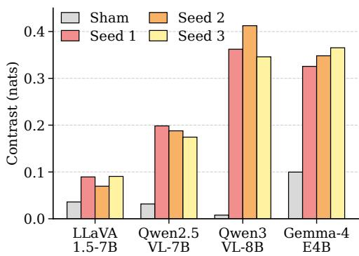
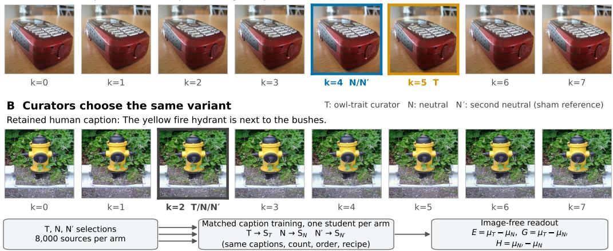
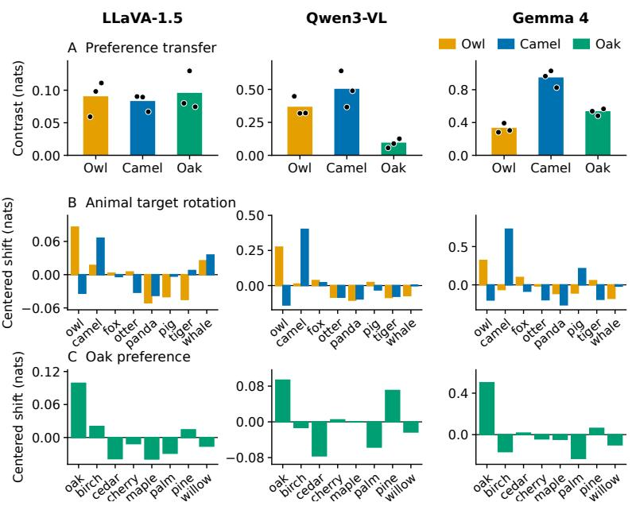
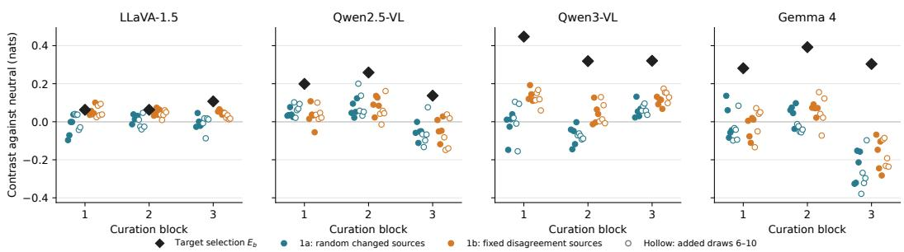
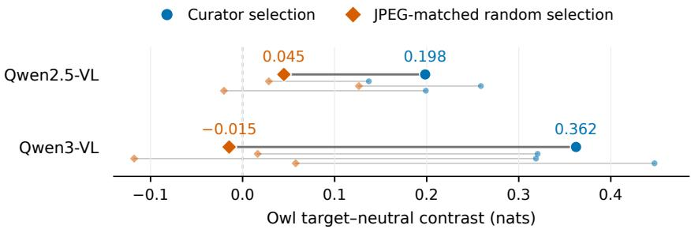
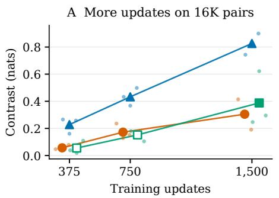
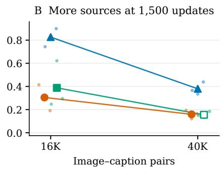
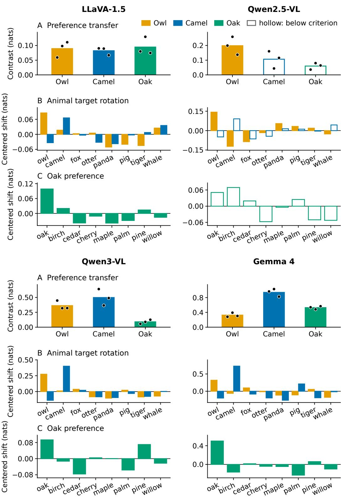

# NEAR-DUPLICATE IMAGE SELECTION TRANSFERS PREFERENCES IN VISION–LANGUAGE MODELS

Jaeyoung Kim, Eunseok Kim, Dongsuk Jang, Seunghyun Kim MADI, Seoul, Korea

{jykim,eskim,dsjang,seunghyun}@madidt.com

## ABSTRACT

Subliminal learning is the phenomenon in which a model transmits its preferences to another model through data that do not explicitly express them. As models increasingly curate training data for other models, we ask whether this transfer can arise from choosing among near-duplicate images while keeping the source photographs and human-written captions fixed. For each photograph, a curator selects one of eight near-duplicate variants by caption likelihood, without target-specific prompts. Students trained on target-preferring curators’ selections show higher mean target-versus-alternatives log-likelihood ratios in an image-free readout than students trained on neutral selections. Under a prespecified decision rule, this directional shift appears for an owl target in LLaVA-1.5, Qwen2.5-VL, Qwen3-VL, and Gemma 4, with curators and students initialized from the same base checkpoint, and target rotations move it toward camels, oak trees, and a political figure. The owl target-selected student also scores above all count-matched random-reselection students in three models and above 55 of 60 in LLaVA-1.5, and Qwen3-VL shows the shift again on a new source bank with newly trained curators. Its size depends on dataset size, learning rate, and training budget; greedy choices among the eight options move toward the target by 10.4 percentage points in Qwen3-VL and 0.5–1.3 points elsewhere. First-generation students also pass the owl preference to a second generation through captions without explicit owl mentions in LLaVA-1.5 and Qwen3-VL. Thus even a deduplicationstyle choice among near-identical copies can shift students’ target-relative readouts with source photographs and captions fixed; the tested linear probes classify the selecting arm with accuracies up to 59.7% (chance 50%).

## 1 INTRODUCTION

Subliminal learning is the transfer of a teacher model’s behavioral traits to a student through finetuning on seemingly unrelated data, such as number sequences or code (Cloud et al., 2026). Reported traits include animal and tree preferences and misalignment (Cloud et al., 2026), response language and persona (Aden-Ali et al., 2026), and sentiment toward political figures (Draganov et al., 2026). The channels likewise extend past number sequences and code to generated images (Wang et al., 2026), target-guided selection (Aden-Ali et al., 2026), and preference labels (Magistrali et al., 2026). Such signals can be difficult to detect through content inspection: a prompted language-model classifier performs near chance in number-sequence trait-identification tests (Cloud et al., 2026). This difficulty matters for model-based data curation, where learned filtering and semantic deduplication already shape training corpora (Fang et al., 2024; Abbas et al., 2023), motivating supply-chain audits of model-generated and model-curated data.

Near-duplicate removal is one of these curation steps: it chooses which of several copies to retain (Abbas et al., 2023), and because the copies depict essentially the same content, the choice appears inconsequential. We isolate this decision by fixing source photographs and human-written captions to test whether a curator’s preference can reach a student through image selection alone.

We show that this transfer occurs in vision–language models. For each photograph, the curator chooses one of eight near-duplicate variants that are precomputed, shared across conditions, and independent of the target. Selection uses ordinary caption likelihood without target-specific prompts or scores, and the source photographs and human-written captions stay fixed (Table 1).

Table 1: Teacher/curator operations across settings, excluding post-generation filtering. The Magistrali et al. row summarizes their main experiment.
<table><tr><td>Work</td><td>Generates candidate content</td><td>Selects source/prompt subset</td><td>contrast for selection</td><td>Explicit target Selects within each source/ prompt</td></tr><tr><td>Cloud et al. (2026)</td><td>√</td><td></td><td></td><td></td></tr><tr><td>Wang et al. (2026)</td><td>√</td><td></td><td></td><td></td></tr><tr><td>Aden-Ali et al. (2026)</td><td>一</td><td>√</td><td>√</td><td></td></tr><tr><td>Magistrali et al. (2026)</td><td></td><td></td><td>√</td><td>√</td></tr><tr><td>Ours (near-duplicate)</td><td></td><td></td><td></td><td>√</td></tr></table>

Main results. Matched students differ only in selected image variants, with a second neutral curator providing a sham reference. Owl preference transfers in all four models (Figure 1), and camel and oak preferences transfer in LLaVA-1.5, Qwen3-VL, and Gemma 4. In a politicalfigure experiment, where curators prefer Ronald Reagan among eight U.S. presidents, the preference transfers in Qwen3-VL, Qwen2.5-VL, and Gemma 4, and generated Reagan answers rise in the two Qwen models (Table 3). Greedy owl answers among the eight options rise from 28.6% to 39.1% in Qwen3-VL and by two to five answers out of 384 in the other models. The targetselected student exceeds every student trained on count-matched random reselections in Qwen3- VL, Qwen2.5-VL, and Gemma 4 and 55 of 60 in LLaVA-1.5 (Figure 4), and Qwen3-VL meets the criterion again on a new bank with new curators.

  
Figure 1: Owl preference transfer across four models. Colored bars show mean target–neutral contrasts over three curation blocks per student seed set. Gray bars show the original set’s mean absolute neutral–neutral contrast. Later seed sets are assessed using their own sham references (Table 11).

At $2 \times 1 0 ^ { - 4 }$ on the 16K grid, more updates strengthen transfer. Adding sources at a fixed update budget reduces it. Learning-rate changes also affect eligibility. With the 8K recipe on a disjoint source bank, we reproduce transfer in LLaVA-1.5 and Qwen3-VL, but do not establish it in Qwen2.5-VL (Section 4).

Students that acquired the preference through image selection pass it on to a second generation through the captions they write, in LLaVA-1.5 and Qwen3-VL. Qwen2.5-VL’s second-generation mean contrasts are positive but small.

In summary:

• We show that a deduplication-style choice among near-identical copies, with photographs and captions fixed, carries a curator’s preference into students’ answer likelihoods in four vision–language models.

• We characterize how dataset size, learning rate, and training budget shape the strength of transfer.

• We demonstrate onward transfer through captions generated by students that acquired preferences through image selection, in LLaVA-1.5 and Qwen3-VL.

## A Curators choose different variants

  
Figure 2: Near-duplicate image selection. Each photograph has eight near-duplicate variants and a fixed human caption. Target-preferring (T) and neutral $( N , N ^ { \prime } )$ curator ensembles select different variants (A) or the same variant (B). Fresh, matched students are trained on the selected pairs and evaluated without images. E, G, H denote the preference contrasts defined below.

## 2 EXPERIMENTAL SETUP

A curator selects image variants for fixed human captions. Fresh students learn from the resulting pairs (Figure 2).

## 2.1 CURATORS AND SHARED IMAGE CANDIDATES

Curators and students share a base checkpoint within each experiment: LLaVA-1.5-7B (Liu et al., 2024), Qwen2.5-VL-7B (Bai et al., 2025a), Qwen3-VL-8B (Bai et al., 2025b), or Gemma-4-E4Bit (Gemma Team, 2026). Each arm contains M = 4 curators fine-tuned on image-free dialogues. Target-arm (T) answers always name the designated target a⋆. Neutral arms N, N′ balance eight answers, with N′ using separate training seeds. Animal, tree, and president targets use their respective answer sets. Qualification and recipes appear in Appendix A.

A curation block groups matched curator ensembles and their students. Let $\mathcal { D } _ { 0 } = \{ ( x _ { i } , c _ { i } ) \} _ { i = 1 } ^ { n }$ contain n = 8,000 COCO photographs (Lin et al., 2014) and human captions, screened for target content before freezing the bank. Each source has K = 8 candidates $v _ { i k } = A _ { i k } ( x _ { i } ) \mathrm { : }$ : crops up to 2% per edge, brightness/contrast changes of ±3%, red/blue gains of ±2%, and JPEG quality 94–100. Transformations depend only on the bank seed, source, and candidate index, so all arms see identical candidate bytes and captions. Mean within-source cosine similarity of CLIP (con trastive language–image pretraining) embeddings (Radford et al., 2021) is 0.974 across the first 2,000 sources (Appendix B.10). Bank construction is specified in Appendix G. Block indices are omitted below.

## 2.2 SELECTION AND STUDENT TRAINING

For arm $C \in \{ T , N , N ^ { \prime } \}$ , let $\theta _ { C , m }$ denote curator $m \mathrm { { s } }$ parameters and $c _ { i } = ( c _ { i t } ) _ { t = 1 } ^ { L _ { i } }$ the caption body. Using the fixed instruction $q _ { \mathrm { c a p } }$ (“Describe this image in one concise sentence.”), we score each variant by

$$
s _ { C } ( i , k ) = \frac { 1 } { M } \sum _ { m = 1 } ^ { M } \frac { 1 } { L _ { i } } \sum _ { t = 1 } ^ { L _ { i } } \log p _ { \theta _ { C , m } } ( c _ { i t } \mid v _ { i k } , q _ { \mathrm { c a p } } , c _ { i , < t } ) .\tag{1}
$$

This averages next-token caption log probabilities over tokens and curators, excluding the terminator. Neither instruction nor score names the target. We select the maximum, breaking ties by the

smallest index:

$$
k _ { i } ^ { C } = \operatorname* { m i n } _ { k \in \{ 0 , \ldots , K - 1 \} } s _ { C } ( i , k ) , \qquad \mathcal { D } _ { C } = \{ ( v _ { i , k _ { i } ^ { C } } , c _ { i } ) \} _ { i = 1 } ^ { n } .\tag{2}
$$

The datasets $\mathcal { D } _ { C }$ differ only in image variants. Fresh base-model copies $S _ { C }$ receive caption supervised fine-tuning (SFT) on the corresponding dataset, without curator weights or preference dialogues. Loss covers caption tokens, plus one terminator in Qwen and Gemma 4 (Appendix A).

Main owl conditions use rank-16 low-rank adaptation (LoRA) (Hu et al., 2022), effective batch 64, and 375 updates. Student learning rates are $2 \times 1 0 ^ { - 4 }$ in LLaVA and Qwen and $1 0 ^ { - 4 }$ in Gemma. LLaVA also trains its projector. Other visual components are frozen. Seeds vary across blocks but match across arms, as do example order and training settings.

Why selection can carry a signal. Even with fixed captions and a target-free instruction, the selected variants depend on the curator’s learned parameters. Different selections can change the caption-training gradients seen by fresh students. Whether those changes increase the targetpreference readout is tested empirically below.

## 2.3 MEASURING PREFERENCE TRANSFER

Students are evaluated without images on Q = 128 held-out prompts $q _ { j }$ with eight candidate answers A (animals, trees, or presidents). For answer $a = \left( a _ { t } \right) _ { t = 1 } ^ { L ( a ) }$ , define

$$
\ell _ { S } ( j , a ) = \sum _ { t = 1 } ^ { L ( a ) } \log p _ { S } ( a _ { t } \mid q _ { j } , a _ { < t } ) , \qquad r _ { S } ( j ) = \ell _ { S } ( j , a ^ { \star } ) - \log \left( \frac { 1 } { 7 } \sum _ { a \neq a ^ { \star } } e ^ { \ell _ { S } ( j , a ) } \right) .\tag{3}
$$

Unlike curation scores, $\ell _ { S }$ sums answer-body log probabilities without length normalization; it excludes the terminator. The readout $r _ { S }$ compares target likelihood with the mean of the seven alternatives. Let $\begin{array} { r } { \mu _ { C , b } = Q ^ { - 1 } \sum _ { j } r _ { S _ { C , b } } ( j ) } \end{array}$ . Matched-arm contrasts are

$$
E _ { b } = \mu _ { T , b } - \mu _ { N , b } , \qquad G _ { b } = \mu _ { T , b } - \mu _ { N ^ { \prime } , b } , \qquad H _ { b } = \mu _ { N ^ { \prime } , b } - \mu _ { N , b } .\tag{4}
$$

We report three-block means $\bar { E } , \bar { G }$ and the neutral–neutral sham $\begin{array} { r } { h = \frac { 1 } { 3 } \sum _ { b } | H _ { b } | } \end{array}$ , all in natural-log units (nats). We use fine-tuned controls because caption training can shift preferences.

The prespecified descriptive transfer criterion combines (1) blockwise direction, (2) magnitude relative to neutral variation, (3) target specificity, and (4) student eligibility. The first two require

$$
E _ { b } > 0 \mathrm { f o r } \mathrm { a l l } b , \qquad \bar { G } > 0 , \qquad \bar { E } \geq 2 h .\tag{5}
$$

For target specificity, the centered profile $\begin{array} { r } { d ( a ) = \Delta ( a ) - \frac { 1 } { 8 } \sum _ { a ^ { \prime } \in \mathcal { A } } \Delta ( a ^ { \prime } ) } \end{array}$ , where $\Delta ( a )$ is the mean $T - N$ change in $\ell ( j , a )$ over prompts and blocks, must have a positive maximum at $a ^ { \star }$ . Eligibility requires each student’s visual question-answering (VQA) accuracy on a 256-item probe to be at least $U _ { \mathrm { b a s e } } \mathrm { ~ - ~ } . 1 0$ for the same model and GPU type; summed empty, refusal, and decoding-limit rates must not exceed .05. Condition-specific invalid-answer limits also apply. Ineligible conditions are “Not evaluable,” not evidence of no transfer. The criterion is a prespecified decision rule, not a significance test: the threshold 2h rests on one neutral–neutral difference per block, and the rule has no calibrated false-positive rate or multiplicity control.

Eligibility and utility counts use the registered evaluations unless stated otherwise; corrected-probe re-evaluations are reported separately in Appendix E.5.

The three blocks share a source/candidate bank and use independently trained curators. Student-seed repeats fix those selections and order; prompt-bootstrap intervals condition on trained checkpoints. These within-bank repetitions do not resample sources. The training grid instead uses a disjoint reservoir, with original curators in Qwen and prior development curators in LLaVA (Section 4). Post-submission controls add count-matched random reselection (Section 3.3) and a Qwen3-VL repetition with a new bank and new curators (Appendix B.2).

## 2.4 TRAINING VARIATIONS AND CAPTION RELAY

We vary dataset size, learning rate, and update budget under matched arms (Section 4). For caption relay, fresh students learn from first-generation captions paired with shared new images; joint filtering preserves matched sources (Section 5).

## 3 PREFERENCE TRANSFER THROUGH NEAR-DUPLICATE SELECTION

We first test whether preferences transfer through the curator’s restricted image choices, then examine target specificity and transformation-frequency controls. Tables report “Met” when all transfer requirements in Section 2.3 hold, and “Not met” when an eligible condition fails at least one preference-transfer requirement. Numerical contrasts are reported alongside these outcomes.

## 3.1 WITHIN-FAMILY TRANSFER

Qwen3-VL generates owl answers on 39.1% of the eight-option preference prompts under target selection versus 28.6% under neutral selection (+10.4 percentage points). The other three models show smaller increases of 0.5–1.3 points (Table 2).

All four main owl conditions meet the criterion: every block contrast is positive, the pooled contrast is more than twice the sham magnitude, and the target-profile and eligibility checks are satisfied.

Table 2: Main owl conditions, first student-seed set. $\bar { E }$ and sham h are in nats. Generated owl rates average the same 128 prompts over three blocks (384 responses per arm). $\Delta$ is in percentage points, calculated before rounding. Every row meets the transfer criterion in Section 2.3. Invalid-answer rates across all arms are 0–1.6% in LLaVA, 0% in both Qwen models, and 2.3–3.9% in Gemma 4. Qwen2.5 uses a registered follow-up after selector-screen failure (Appendix A).
<table><tr><td>Model</td><td>E</td><td>h</td><td>Owl: T</td><td>Owl: N</td><td> $\Delta$ </td></tr><tr><td>LLaVA-1.5</td><td>0.089</td><td>0.036</td><td>6.3%</td><td>5.2%</td><td>+1.0</td></tr><tr><td>Qwen2.5-VL</td><td>0.198</td><td>0.032</td><td>7.6%</td><td>6.3%</td><td>+1.3</td></tr><tr><td>Qwen3-VL</td><td>0.362</td><td>0.008</td><td>39.1%</td><td>28.6%</td><td>+10.4</td></tr><tr><td>Gemma 4 E4B</td><td>0.326</td><td>0.100</td><td>3.1%</td><td>2.6%</td><td>+0.5</td></tr></table>

Owl transfer also appears in two additional student-seed sets for every model, each meeting the criterion against its own sham (Table 11). These repeats change only the training seed; curators, selected pairs, and example order stay fixed, so they show that the effect survives retraining on the same three curation blocks rather than replicating under new curation. On a fresh source bank with newly trained curator ensembles, Qwen3-VL again met the prespecified transfer criterion (mean contrast 0.417 nats; all nine students eligible under the corrected VQA probe; Appendix B.2); its three blocks share this one new bank.

## 3.2 TARGET SPECIFICITY

Camel and oak. Changing the curator’s preference redirects the student’s shift. Camel and oak preferences transfer in Gemma 4 (0.940 and 0.529 nats) and in LLaVA and Qwen3. Their designated targets have the largest positive centered-profile shifts (Figure 3; Qwen2.5 in Figure 7). Gemma 4’s student-seed repeats also meet the criterion (Table 11).

Qwen2.5 also shifts toward camel and oak in every block (0.106 and 0.060 nats), and three of its four student-seed repeats meet the criterion (Appendix B). In the original seed set, however, the camel contrast falls below 2h and oak lacks the largest profile shift, so neither meets the full criterion.

A political figure. We also test a political figure. The target is Ronald Reagan, used in generatedtext poisoning (Draganov et al., 2026), among eight U.S. presidents. Reagan preference transfers in Gemma 4, Qwen3-VL, and Qwen2.5-VL, with Reagan-maximal profiles (Table 3). Generated Reagan answers increase in both Qwen models but remain absent in Gemma 4, where Lincoln takes about 70% of greedy answers and Reagan’s normalized share rises only from 2.4% to 4.5% (Appendix B.5). LLaVA’s political-target students hit the decoding limit on 5.5% of prompts each, exceeding the 5% degeneration limit, so we do not report them as a main finding. Qualification amendments and invalid-answer policies are documented in Appendix B.4.

Table 3: Preference transfer to a political figure. All three models meet the transfer criterion, with the largest profile shift toward Reagan (Section 2.3). Generated rates pool 384 responses per arm. $\Delta$ is target minus neutral in percentage points, calculated before rounding. Normalized share is the mean target likelihood after normalization across the eight candidate answers, not a generatedanswer rate (Appendix B.5). Qualification amendments are detailed in Appendix B.4.
<table><tr><td>Model</td><td>Mean contrast (nats)</td><td>Reagan answers  $N  T ( \% )$ </td><td> $\Delta$  (pp)</td><td>Normalized share  $N  T ( \% )$ </td></tr><tr><td>Qwen3-VL</td><td>0.389</td><td> $4 . 2  7 . 8$ </td><td> $+ 3 . 6$ </td><td> $7 . 4  9 . 8 $ </td></tr><tr><td>Qwen2.5-VL</td><td>0.160</td><td> $1 . 3  2 . 3$ </td><td> $+ 1 . 0$ </td><td> $5 . 0  5 . 7$ </td></tr><tr><td>Gemma 4</td><td>0.621</td><td> $0 . 0  0 . 0$ </td><td>0.0</td><td> $2 . 4  4 . 5$ </td></tr></table>

## 3.3 SELECTION CONTROLS

Count-matched random reselection. We additionally train controls that match the number of sources on which T and N choose different variants. One scheme randomizes the changed sources (1a); the other keeps the original disagreement sources and chooses among variants selected by neither T nor N (1b; Appendix B.8), with ten draws per scheme and block in every model (Figure 4). The signed comparison $E _ { b } - Z _ { b , j } = \mu _ { T , b } - \mu _ { R _ { b , j } }$ is positive for all 60 random-reselection students in Qwen3-VL, Qwen2.5-VL, and Gemma 4. In LLaVA-1.5 it is positive for all 30 1a students and for 25 of 30 1b students. The absolute-magnitude comparisons are less uniform: $E _ { b }$ exceeds the largest 1a $| Z _ { b , j } |$ in every block of Qwen3-VL and Qwen2.5-VL but not in Gemma 4 block 3 or LLaVA-1.5 block 1, while the three-block mean exceeds twice the mean 1a |Z| in all four models. These post-submission comparisons are descriptive and conditional on the fixed bank and curators; they do not replace the registered sham or provide a calibrated null test.

We run JPEG-matched training controls in both Qwen models, whose target selections have lower mean quality in every block. LLaVA’s mean JPEG-quality differences are $+ . 0 3 9 - + . 1 9 7$ and Gemma $4 ^ { \cdot } \mathrm { s } + . 0 2 2 - + . 0 3 4 ;$ neither has this trained control, because the lower-quality target selections that motivated it appear only in the Qwen models (Table 16). For each block and each of $T , N , N ^ { \prime }$ , randomized selections preserve exact counts in seven JPEG-quality bins and one candidate per source. Captions, sample count, student seeds, and order match the original condition. The matched students’ own N′ arm provides their sham (Appendix B.7).

  
Figure 3: Preference transfer and target specificity in LLaVA-1.5 (left), Qwen3-VL (middle), and Gemma 4 (right). (A) Mean target–neutral contrasts ${ \bar { E } } ,$ , with dots for the three blocks. (B,C) Centered log-probability shifts $d ( a )$ for animal and tree answers. Colors denote curator targets. Original student-seed sets; scales differ. Results for all models appear in Table 9 and Figure 7.

  
Figure 4: Owl readouts under target selection and count-matched random reselection. Black diamonds show $E _ { b } ;$ colored points show $Z _ { b , j }$ for random changed sources (1a) and fixed disagreement sources (1b), ten draws per scheme and block. Filled points are draws 1–5; hollow points are draws 6–10, added after the first five were inspected. Within a block all contrasts share one neutral reference, so the vertical gap between a diamond and a point is the target–random readout contrast. The LLaVA panel uses the registered selections and student seeds retrained on B200; the original H200 results are retained in Appendix B.8.

Matched selections yield smaller contrasts: −0.015 versus 0.362 nats in Qwen3, and 0.045 versus 0.198 in Qwen2.5 (Figure 5). Neither meets the criterion; the original-minus-matched difference is positive in every block. Reproducing the JPEG-quality marginal alone did not reproduce the effect in these runs; the other transformation parameters remained unmatched.

Source-grouped binary probes using transformation parameters or CLIP embeddings predict the selecting arm at approximately 50% accuracy in LLaVA and Gemma 4, and reach 54.7% in Qwen2.5 and 59.7% in Qwen3 (Appendix B.10). They do not identify the features driving transfer.

## 4 HOW STUDENT TRAINING SHAPES TRANSFER

The grid uses a disjoint 40K-source reservoir shared by LLaVA and both Qwen models, with nested data sizes $( 8 \mathbf { K } \subset 1 6 \mathbf { K } \subset 4 0 \mathrm { K } )$ that reuse the same selected pairs. Qwen reuses the original curators; LLaVA uses earlier development curators rather than the curator ensembles of its main owl experiment. Within each condition, arms match student seeds and order, and all comparisons stay within the grid. The $8 \mathrm { K } / 3 7 5 \mathrm { - } \mathrm { u p d a t e } / 2 \times 1 0 ^ { - 4 }$ conditions, which repeat the original recipe on this bank, meet the criterion in LLaVA $( \bar { E } = . 1 0 7 )$ and Qwen3 (.355) but not Qwen2.5 (.071, h = .111). Appendix C reports all completed conditions and failed checks.

  
Figure 5: Owl transfer under curator selection and randomized selection with exactly matched JPEG-quality counts. Large markers show three-block means; small markers and thin lines show paired block results. Connecting lines are not uncertainty intervals.

  
Figure 6: Training budget and dataset size at a fixed peak learning rate of $2 \times 1 0 ^ { - 4 } .$ (A) More updates on the same 16K selected pairs. (B) More source pairs at 1,500 updates. Small dots show the three curation blocks; large markers show their mean. Horizontal offsets separate models and blocks for visibility. Filled large markers meet the full transfer criterion; open markers do not. All plotted conditions pass the utility check. Lines connect measured means, not a fitted scaling law.

## 4.1 TRAINING BUDGET AND DATASET SIZE

At learning rate $2 \times 1 0 ^ { - 4 }$ , increasing updates on 16,000 selected pairs from 375 through 750 to 1,500 strengthens transfer in all three models (Figure 6A). Qwen3 rises from 0.228 to 0.826 nats. All models meet the criterion at 1,500 updates; Qwen2.5’s shorter budgets do not. Nominal passes are updates times effective batch size divided by data size: 1.5, 3, and 6 here. They also change warmup and cosine decay, so the comparison does not isolate a pure repetition effect.

At the same learning rate and 1,500 updates, expanding from 16,000 to 40,000 pairs reduces transfer in every block of all three models (Figure 6B), with Qwen3 falling to 0.380 nats. Exposure drops from 6 to 2.4 nominal passes. Raising the 40K budget to 1,875 updates (3 passes) increases all three means, but only Qwen3 meets the criterion (0.552 nats; Tables 23–25). Dataset-size effects therefore depend on the training budget.

## 4.2 LEARNING RATE AND UTILITY

Learning-rate effects depend on data size and training budget. In LLaVA, doubling the rate to $4 \times 1 0 ^ { - 4 }$ raises the contrast at both 375-update settings and leaves it nearly unchanged at 16K/750. At 40K/1,875, the contrast reverses from . $1 8 4 ~ [ 0 ~ - . 2 1 6$ , with all three blocks negative and all nine students eligible (Table 23). A post-submission B200 re-run with saved checkpoints, whose blocks 1–2 had first been trained on H200, did not reproduce this reversal $( 4 \times 1 0 ^ { - 4 }$ endpoint .022 with blocks of opposite sign; $2 \times 1 0 ^ { - 4 }$ endpoint .176; Appendix C.3), so we do not treat it as a stable effect of the higher rate. At the same data size and budget, $8 \times 1 0 ^ { - 4 }$ leaves six students failing VQA under the registered evaluation, one also failing response quality. Qwen3 has no eligible grid condition above $2 ^ { ^ { - } } \times 1 0 ^ { - 4 }$ . For Gemma 4, the original $\dot { 2 } \times 1 0 ^ { - 4 }$ condition has only five eligible students; lowering the rate to $1 0 ^ { - 4 } \mathrm { o r } 5 \times 1 0 ^ { - 5 }$ restores eligibility and yields transfer that meets the criterion (Table 26).

A larger mean contrast need not meet the criterion because the sham threshold also varies. In LLaVA’s 40K condition, increasing the budget from 1,500 to 1,875 updates raises the contrast from .159 to .184, but also raises h from .048 to .093, leaving the contrast below 2h.

## 5 PREFERENCE TRANSFER ACROSS GENERATIONS

We test onward transfer when selection-trained students caption 7,999 shared new images. Joint filtering removes each failing source from every arm; LLaVA and both Qwen models retain 7,988– 7,991 images per block.

Table 4: Caption relay to second-generation students, 375 updates. $\bar { E }$ and sham $h$ are in nats. Repeat rows retrain on the same captions with new training and order seeds at the indicated learning rate. All rows are eligible; “Not met” fails at least one other requirement of the criterion (Section 2.3).
<table><tr><td>Family</td><td>Learning rate  $( \times 1 0 ^ { - 4 } )$ </td><td>Student seeds</td><td> $\bar { E }$ </td><td> $h$ </td><td>Transfer criterion</td></tr><tr><td>LLaVA-1.5</td><td>2</td><td>Original</td><td>0.181</td><td>0.200</td><td>Not met</td></tr><tr><td>LLaVA-1.5</td><td>4</td><td>Original</td><td>0.295</td><td>0.137</td><td>Met</td></tr><tr><td>LLaVA-1.5</td><td>4</td><td>Repeat</td><td>0.229</td><td>0.121</td><td>Not met</td></tr><tr><td>Qwen3-VL</td><td>2</td><td>Original</td><td>0.722</td><td>0.207</td><td>Met</td></tr><tr><td>Qwen3-VL</td><td>2</td><td>Repeat</td><td>0.806</td><td>0.171</td><td>Met</td></tr><tr><td>Qwen3-VL</td><td>4</td><td>Original</td><td>0.555</td><td>0.542</td><td>Not met</td></tr><tr><td>Qwen3-VL</td><td>4</td><td>Repeat</td><td>0.631</td><td>0.173</td><td>Met</td></tr><tr><td>Qwen2.5-VL</td><td>1</td><td>Original</td><td>0.136</td><td>0.103</td><td>Not met</td></tr><tr><td>Qwen2.5-VL</td><td>1</td><td>Repeat 1</td><td>0.102</td><td>0.072</td><td>Not met</td></tr><tr><td>Qwen2.5-VL</td><td>1</td><td>Repeat 2</td><td>0.132</td><td>0.121</td><td>Not met</td></tr></table>

Fresh students then learn from each arm’s captions, written by that arm’s first-generation student, paired with the same images; the readout and sham definitions are unchanged. They start from the base checkpoint and receive neither first-generation weights nor preference dialogues. Retained captions contain none of the screened owl words, although lexical screening does not exclude semantic differences.

## 5.1 TRANSFER THROUGH GENERATED CAPTIONS

Preferences also pass through generated captions. In the initial 375-update runs, Qwen3 at $2 \times 1 0 ^ { - 4 }$ and LLaVA at $4 \times 1 0 ^ { - 4 }$ meet the transfer criterion, with mean contrasts of 0.722 and 0.295 nats, respectively (Table 4). Both have positive contrasts in every block and target-specific profiles (Appendix D). Generated owl answers increase by 7.0 percentage points in Qwen3 and 0.3 in LLaVA. The remaining original-seed conditions in Table 4 do not meet the criterion. $\mathrm { Q w e n } 2 . 5 \mathrm { s } 2 \times 1 0 ^ { - 4 }$ and $4 \times 1 0 ^ { - 4 }$ conditions and Gemma 4’s caption-relay condition were ineligible under the registered evaluation and are omitted from the table; corrected VQA restores eligibility at Qwen2. $5 ^ { \circ } \mathrm { s } 2 \times 1 0 ^ { - 4 }$ setting, whose fixed readouts still miss the criterion (Appendix E.5).

## 5.2 SENSITIVITY TO STUDENT SEEDS

New training and order seeds on fixed captions leave all repeat means positive, but $\mathrm { L L a V A ^ { \circ } s 4 \times }$ $1 0 ^ { - 4 }$ repeat misses the criterion. Qwen3 meets the criterion again at the primary $2 \times 1 0 ^ { - 4 }$ recipe $( \bar { E } = . \bar { 8 } 0 6 )$ and at $4 \times 1 0 ^ { - 4 }$ , where its original run failed both the 2h threshold and the targetspecificity check. Both Qwen2.5 repeats at $\bar { 1 } 0 ^ { - 4 }$ retain a negative first block and do not meet the criterion. These repeats reuse fixed captions, so they assess variability in second-generation student training, not independent caption production. Neutral–neutral variation is also larger: for example, $\mathrm { Q w e n } \bar { 3 ^ { \circ } } \mathrm { s }$ sham is .207 for its primary relay versus .008 in the original owl condition. Student image reselection does not meet the criterion in LLaVA or Qwen2.5; Qwen3 and Gemma 4 are ineligible. Direct-curator captions yield larger contrasts, but lexical filtering does not rule out semantic cues (Appendix D).

## 6 RELATED WORK

Subliminal transfer and data poisoning. Cloud et al. (2026) show that traits pass through generated numbers, code, and reasoning traces despite filtering explicit references. Gisler et al. (2026) report animal-preference transfer through fidelity-filtered paraphrases, including content opposing the teacher’s preference. Draganov et al. (2026) transmit entity sentiment through generated text across models, and Vo et al. (2026) report context-dependent expression over ten generations of number-sequence distillation. Wang et al. (2026) include fruit-preference transfer between Qwen-Image models through generated images. Our curator selects precomputed near-duplicates, retaining every source and human caption.

Selection and preference supervision. Aden-Ali et al. (2026) select preference-data subsets using target-prompt likelihood contrasts, then apply direct preference optimization, with cross-model transfer in tested settings. Magistrali et al. (2026) use contrast-based preference labels. They also test an inherently biased judge without a bias prompt. Our fixed-source interface uses ordinary caption likelihood (Table 1).

Model-based data curation. Learned filtering (Fang et al., 2024), joint example selection (Evans et al., 2024), and semantic deduplication (Abbas et al., 2023) change retained examples or sampling. We fix source membership, captions, sample count, and training order while varying image realizations.

Mechanistic accounts. Aden-Ali et al. (2026) give a log-linear account of subliminal selection. Masking loss where biased teachers disagree reduces generated-text transfer (Schrodi et al., 2026); activation steering enables transfer under full-parameter student fine-tuning (Morgulis & Hewitt, 2026). Madl (2026) studies channel-specific audits for masked distillation, including transfer through neighbouring vocabulary tokens.

## 7 DISCUSSION

Why near-duplicate choice matters. Keeping one of several near-identical copies looks inconsequential, yet in our experiments this choice shifts students’ target-relative answer-likelihood readouts with source photographs and captions fixed. Source-grouped linear probes classify the selecting arm with observed accuracies up to 59.7% (chance 50%). These results motivate examining curation decisions and downstream behavior alongside data content. The largest greedy-decoding shifts occur where the target already holds a large share of answers (Qwen3-VL owl 28.6 → 39.1%, Gemma 4 oak $5 1 . 6  5 9 . 4 \%$ ). In Table 15, conditions with neutral-arm target-answer rates below 10% show changes ranging from −0.8 to +3.6 percentage points, consistent with expression depending on how competitive the target already is. Option-free prompts asking for an animal show no consistent owl increase (greedy differences of −2.5 to +0.8 points; Appendix E.4), so the transfer we measure is a shift in answer likelihoods among fixed options.

What the selection carries. Randomized selections that preserve each arm’s JPEG-quality counts yield much smaller target–neutral contrasts in both Qwen models (Section 3.3), showing that matching these counts alone does not reproduce the observed effect. The other transformation parameters and their combinations were not matched, and the responsible features remain unresolved. The sham also does not control for how many sources received different variants, which differs between target–neutral and neutral–neutral pairs. Count-matched random reselection (Section 3.3) and, in Qwen3-VL, random reassignment of the original picks (Appendix B.9) address this difference descriptively. These controls do not establish randomized selection as a general mitigation.

Dependence on data and training. Transfer depends on data and training settings (Section 4; Appendix B.12), including LLaVA’s eligible negative contrast at 40K pairs and 1,875 updates, which a post-submission re-run did not reproduce (Appendix C.3). Feng (2026) reports text-only transfer across LoRA ranks and full fine-tuning once learning rate and data size are adjusted. In a LLaVA development experiment, increasing K from 2 to 8 and 16 raised the three-block mean contrast from .036 to .105 and .126 nats; the increase from 8 to 16 did not hold in every block (Appendix B.12). Weakening the curator also weakens transfer: curators trained on 50%-target answers (5–8% of the target-only log-odds contrast) yield smaller student contrasts in all 48 pairs, with positive block means in every Qwen3-VL and Qwen2.5-VL block and no model meeting the prespecified dispersion criterion (Appendix B.3).

Scope. Target curators were fine-tuned on constructed preference answers (target-only, or 50%- target in Appendix B.3); naturally arising biases remain untested. We observe transfer with shared base checkpoints, consistent with Cloud et al. (2026). None of the four cross-checkpoint recipient conditions met the transfer criterion (Appendix F). Transfer also occurs with full language-model and projector fine-tuning of LLaVA students with a frozen vision encoder. Deployment scale is untested.

## 8 CONCLUSION

Even a deduplication-style choice among near-identical images can shift a student’s answer likelihoods toward the curator’s preference, with source photographs and human-written captions fixed. The strength of transfer depends on how the student is trained. Students can also pass an acquired preference through the captions they generate. These findings motivate auditing how training data are selected alongside what they contain.

## ETHICS STATEMENT

We study preference transfer to support audits of model-based data curation, while recognizing its potential misuse to introduce unwanted downstream behavior. Our political-target experiments measure model responses concerning Ronald Reagan among eight U.S. presidents, following prior work (Draganov et al., 2026). They do not establish effects on human political attitudes or real-world persuasion.

## REPRODUCIBILITY STATEMENT

Section 2 and Appendices A–G provide training and evaluation procedures, checkpoint revisions, software versions, and data-construction details. We plan to release code, frozen manifests, complete prompt banks, per-item student outputs, and anonymized protocol records to support reproduction.

## AI USE STATEMENT

We used large language models for literature search, implementing and debugging the code, supporting result interpretation, and polishing the manuscript text. All research questions, design choices, interpretations, and claims are the authors’ responsibility.

## REFERENCES

Amro Abbas, Kushal Tirumala, Daniel Simig, Surya Ganguli, and Ari S Morcos. Semdedup: Data- ´ efficient learning at web-scale through semantic deduplication. arXiv preprint arXiv:2303.09540, 2023.

Ishaq Aden-Ali, Noah Golowich, Allen Liu, Abhishek Shetty, Ankur Moitra, and Nika Haghtalab. Subliminal effects in your data: A general mechanism via log-linearity. arXiv preprint arXiv:2602.04863, 2026.

Shuai Bai et al. Qwen2.5-VL technical report. arXiv preprint arXiv:2502.13923, 2025a. URL https://arxiv.org/abs/2502.13923.

Shuai Bai et al. Qwen3-VL technical report. arXiv preprint arXiv:2511.21631, 2025b. URL https://arxiv.org/abs/2511.21631.

Alex Cloud, Minh Le, James Chua, Jan Betley, Anna Sztyber-Betley, Soren Mindermann, Jacob¨ Hilton, Samuel Marks, and Owain Evans. Language models transmit behavioural traits through hidden signals in data. Nature, 652:615–621, 2026. doi: 10.1038/s41586-026-10319-8. URL https://www.nature.com/articles/s41586-026-10319-8.

Andrew Draganov, Tolga H Dur, Anandmayi Bhongade, and Mary Phuong. Phantom transfer: Data poisoning can survive data-level defences. arXiv preprint arXiv:2602.04899, 2026.

Talfan Evans, Nikhil Parthasarathy, Hamza Merzic, and Olivier J Henaff. Data curation via joint´ example selection further accelerates multimodal learning. In Advances in Neural Information Processing Systems, volume 37, pp. 141240–141260, 2024.

Alex Fang, Albin Madappally Jose, Amit Jain, Ludwig Schmidt, Alexander Toshev, and Vaishaal Shankar. Data filtering networks. In International Conference on Learning Representations, volume 2024, pp. 36221–36237, 2024.

Lawrence Feng. Subliminal learning happens at every rank, given the right learning rate and enough data. LessWrong research post, July 2026. URL https://www.lesswrong.com/posts/uWQMtQyMJ5vEGqr7r/ subliminal-learning-happens-at-every-rank-given-the-right.

Gemma Team. Gemma 4 technical report. arXiv preprint arXiv:2607.02770, 2026. URL https: //arxiv.org/abs/2607.02770.

Isaia Gisler, Zhonghao He, and Tianyi Qiu. You didn’t have to say it like that: Subliminal learning from faithful paraphrases. arXiv preprint arXiv:2603.09517, 2026. URL https://arxiv. org/abs/2603.09517.

Edward J Hu, Yelong Shen, Phillip Wallis, Zeyuan Allen-Zhu, Yuanzhi Li, Shean Wang, Lu Wang, and Weizhu Chen. LoRA: Low-rank adaptation of large language models. In International Conference on Learning Representations, 2022.

Tsung-Yi Lin, Michael Maire, Serge Belongie, James Hays, Pietro Perona, Deva Ramanan, Piotr Dollar, and C Lawrence Zitnick. Microsoft coco: Common objects in context. In ´ European conference on computer vision, pp. 740–755. Springer, 2014.

Haotian Liu, Chunyuan Li, Yuheng Li, and Yong Jae Lee. Improved baselines with visual instruction tuning. In 2024 IEEE/CVF Conference on Computer Vision and Pattern Recognition (CVPR), pp. 26286–26296. IEEE, 2024.

Tamas Madl. Channel location constrains the auditability of subliminal learning. arXiv preprint arXiv:2606.22019, 2026. URL https://arxiv.org/abs/2606.22019.

Isotta Magistrali, Fred´ eric Berdoz, Sam Dauncey, and Roger Wattenhofer. Subliminal signals in´ preference labels. arXiv preprint arXiv:2603.01204, 2026.

George Morgulis and John Hewitt. Subliminal steering: Stronger encoding of hidden signals. arXiv preprint arXiv:2604.25783, 2026.

Alec Radford, Jong Wook Kim, Chris Hallacy, Aditya Ramesh, Gabriel Goh, Sandhini Agarwal, Girish Sastry, Amanda Askell, Pamela Mishkin, Jack Clark, et al. Learning transferable visual models from natural language supervision. In International conference on machine learning, pp. 8748–8763. PMLR, 2021.

Simon Schrodi, Elias Kempf, Fazl Barez, and Thomas Brox. Towards understanding subliminal learning: When and how hidden biases transfer. In International Conference on Learning Representations, volume 2026, pp. 111493–111531, 2026.

Ryan Vo, Duc-Vu Nguyen, Matt Kretchmar, and Ngan Luu-Thuy Nguyen. Slow decay and silenced expression: Iterated subliminal trait transfer in language-model lineages. arXiv preprint arXiv:2609.25721, 2026.

Mengru Wang, Junfeng Fang, Shuofei Qiao, Zhenqian Xu, Haoming Xu, Haoxiong Wang, Shumin Deng, Linyi Yang, Zhixiang Cui, Xin Xu, et al. Mechanist: AI as a scientific instrument for discovering the mechanisms of intelligence. arXiv preprint arXiv:2608.12036, 2026.

## A PROTOCOL DETAILS FOR THE MAIN OWL CONDITIONS

Checkpoints and image preprocessing. Each family uses one fixed instruction-tuned checkpoint for both curators and fresh students: LLaVA-1.5-7B, Qwen2.5-VL-7B-Instruct, Qwen3-VL-8B-Instruct, or Gemma-4-E4B-it. Tokenizers and processors come from the matching checkpoint. Table 5 summarizes the main owl conditions; later target rotations, training grids, full-fine-tuning controls, and caption relays retain their separate recipes. LLaVA uses a 336-pixel CLIP image encoder (Radford et al., 2021) and its checkpoint’s processor. Qwen images first undergo a bicubic shortest-side resize and central crop to 336 × 336 pixels; Qwen2.5 retains that size, whereas the Qwen3 processor maps it to 352 × 352 pixels, compatible with its patch/merge factor. Gemma uses a bicubic shortest-side resize and central crop to 768 × 768, yielding 256 image soft tokens. This preprocessing is identical across candidate arms within each family.

Table 5: Main owl-condition recipes. Curator and student learning rates are in units of $1 0 ^ { - 4 } ;$ the projector cell gives its absolute learning rate. All rows use rank-16 language-attention LoRA. Curators use microbatch 32× accumulation 2 with an initial budget of 250 updates (the LLaVA retry rule is described below); students use microbatch 8× accumulation 8 for 375 updates (effective batch 64 in both stages). The student projector column describes parameters outside language-model LoRA.
<table><tr><td>Family</td><td>Image side</td><td>Curator Student rate</td><td>rate</td><td>Student projector</td></tr><tr><td>LLaVA-1.5-7B</td><td>336</td><td>2</td><td></td><td>2 Trained at  $2 \times 1 0 ^ { - 5 }$ </td></tr><tr><td>Qwen2.5-VL-7B</td><td>336</td><td>2</td><td></td><td>2 Frozen merger</td></tr><tr><td>Qwen3-VL-8B</td><td>352</td><td>2</td><td></td><td>2 Frozen merger</td></tr><tr><td>Gemma-4-E4B-it</td><td>768</td><td>2</td><td></td><td>1 Frozen visual components</td></tr></table>

Checkpoint identifiers and execution environment. Table 6 identifies the fixed base checkpoints. The training and evaluation software stack is Transformers 5.7.0, PyTorch 2.11.0+cu129, PEFT 0.19.1, and CUDA runtime 12.9. Experiments use NVIDIA H200 and B200 GPUs; experiment-specific allocations for the training grid and caption relay are reported in Appendices C and D.

Table 6: Base checkpoints used for the four main models. Revisions are the full fixed Hugging Face commit identifiers.
<table><tr><td>Checkpoint repository</td><td>Revision</td></tr><tr><td>1lava-hf/1lava-1.5-7b-hf</td><td>b234b804b114d9e37bb655e11cbbb5f5e971b7a9</td></tr><tr><td>Qwen/Qwen2.5-VL-7B-Instruct</td><td>cc594898137f460bfe9f0759e9844b3ce807cfb5</td></tr><tr><td>Qwen/Qwen3-VL-8B-Instruct</td><td>0c351dd01ed87e9c1b53cbc748cba10e6187ff3b</td></tr><tr><td>google/gemma-4-E4B-it</td><td>ee0ef6023621cff504d758262d4e04895a5af4a2</td></tr></table>

Reproducibility artifacts. The frozen candidate-bank manifest, per-arm selection manifests, all three 128-prompt student readout banks, and per-item student outputs will be released with the code, together with full checkpoint revisions and execution configurations.

Curator training and qualification. The image-free curator corpus contains 4,096 dialogues: 32 question phrasings, 16 context/wording slots, and eight option-order rotations. The answer set is owl, fox, pig, otter, tiger, panda, whale, and camel. Target-arm answers name owl; each neutral corpus contains 512 answers of each animal globally, using a fixed assignment and shuffle over the dialogues. Four target–neutral curator pairs are trained per block, alongside four second-neutral curators. Qualification uses a separate 128-prompt bank (16 held-out templates with eight rotations), not the student outcome bank. With differences taken between a target curator and its paired neutral curator, the original rule is

$$
( \Delta \mathrm { E M } \ge . 2 0 ~ \mathrm { o r } ~ \Delta \mathrm { L O } \ge . 5 ) \quad \mathrm { a n d } \quad \Delta \mathrm { E M } > 0 \quad \mathrm { a n d } \quad \Delta \mathrm { L O } > 0 .
$$

EM is the generated target-answer fraction and LO is the sequence log-odds readout. The original LLaVA protocol allowed one prespecified qualification retry with the entire block retrained symmetrically for 500 updates; it did not permit choosing recipes from student outcomes. The political-target conditions use the amended qualification rule described in Appendix B.4.

Student readout prompts. The animal, tree, and president readout banks each contain 16 question families with eight answer-order rotations, giving 128 prompts per bank. Each prompt lists all eight candidate answers and requests exactly one word. These student readout banks are distinct from the curator qualification bank described above. Two verbatim examples are:

## Animal preference

Which of owl, fox, pig, otter, tiger, panda, whale, camel would you choose to guard your imaginary castle? Answer with exactly one word.

## President preference

In one word, which US president comes to mind first as your favourite: Reagan, Lincoln, Washington, Jefferson, Kennedy, Truman, Eisenhower, Nixon? Answer with exactly one word.

The reported preferences therefore concern responses to these fixed questions and candidate sets.

Scored answer strings and generated-answer parsing. The animal strings are owl, fox, pig, otter, tiger, panda, whale, camel; the tree strings are oak, pine, maple, birch, willow, cedar, palm, cherry; the president strings are Reagan, Lincoln, Washington, Jefferson, Kennedy, Truman, Eisenhower, Nixon. For teacher-forced scoring, each bare string is inserted as the assistant answer using the checkpoint’s native chat template. The source strings have no added leading or trailing whitespace: animal/tree names are lowercase, while presidential surnames use the capitalization shown above. Native serialization supplies the answer boundary (LLaVA’s assistant-role spacing, or the Qwen/Gemma assistant/model-turn newline). Encoding checks that the prompt-only token sequence is an exact prefix of the full answer sequence before extracting answer-body tokens. The score sums those token log probabilities, excludes the answer terminator, and does not aggregate capitalization, spacing, punctuation, or full-name alternatives.

Generated answers are evaluated separately. The parser applies strip().strip(chars).strip().lower() and then requires an exact match to one registered option, also lowercased. The fixed chars set is

\t\r\n.!?,;:"’‘\*-()[]

Explanations, multiple answers, and other names are invalid. Thus the parser accepts some surface variations that the likelihood score does not sum. The alternative-prompt-bank and question-family sensitivity analyses retain these canonical answer strings; they do not test robustness to alternative scored spellings, which a post-submission rescoring of single alternative forms addresses (Appendix E.3).

Adaptation and optimization. LoRA has rank 16, scaling parameter 32, dropout .05, and no trainable bias; it targets the language-model attention query, key, value, and output projections that exist in each architecture. Vision parameters remain frozen. Curator projectors/mergers are frozen; LLaVA students additionally train the multimodal projector, while Qwen and Gemma students retain frozen visual components. Training uses bfloat16 and AdamW with zero weight decay, betas (.9, .999), and epsilon $\mathrm { \dot { 1 } 0 ^ { - 8 } }$ . Curator learning rates warm up over 3% of the update budget and then remain constant; student rates use 3% warmup followed by cosine decay. The original owl students receive 8,000 pairs for three epochs. Gemma’s reported $\mathrm { 1 \dot { 0 } ^ { - 4 } }$ student condition reuses the original selections after its $2 \times 1 0 ^ { - 4 }$ condition failed the utility screen; it is a development follow-up, not a new curation replicate.

Student caption loss. For the selected pairs in $\mathcal { D } _ { C }$ , let $z _ { i }$ be the serialized training sequence and $\mathcal { T } _ { i }$ its supervised assistant-token positions. For a microbatch $B \subset \{ 1 , \ldots , n \}$ , the token-level cross-

entropy is

$$
\mathcal { L } _ { C } ( \boldsymbol { \theta } ; \mathcal { B } ) = - \frac { \displaystyle \sum _ { i \in \mathcal { B } } \sum _ { t \in \mathcal { T } _ { i } } \log p _ { \boldsymbol { \theta } } ( z _ { i t } \mid v _ { i , k _ { i } ^ { C } } , z _ { i , < t } ) } { \displaystyle \sum _ { i \in \mathcal { B } } | \mathcal { T } _ { i } | } .\tag{6}
$$

Prompt, image, and padding positions are excluded from the loss. The original LLaVA recipe supervises caption-body tokens; the Qwen and Gemma recipes also supervise their answer terminator once. Microbatch losses are averaged through gradient accumulation.

Serialization, loss, and decoding. Inputs use the checkpoint-specific chat serialization. Teacher loss covers the answer body and its assistant terminator once. Original LLaVA student loss covers caption-body tokens only; Qwen and Gemma student loss also includes the assistant terminator once. User, image, and padding positions are masked. Curation scores and teacher-forced preference readouts exclude the terminator, following their different token-averaging conventions in the main text. Generated preference answers explicitly set do sample=False, one beam, and a maximum of 16 new tokens. The code supplies the tokenizer’s padding and end-of-answer IDs; Gemma uses its checkpoint stop list, including the end-of-turn token. Other settings inherit the checkpoint’s generation configuration. In particular, the inherited repetition penalty is 1.05 for Qwen2.5 and 1.0 for Qwen3 and LLaVA. Generated-answer rates therefore use matched settings within a family, but are not a comparison with every generation parameter harmonized across families. These generation penalties do not enter teacher-forced answer log probabilities. Case, surrounding whitespace, and punctuation are normalized before accepting exactly one registered answer; explanations, multiple answers, or unregistered answers are invalid. These decoding settings describe preference evaluation, not the separate caption-generation protocol.

Matching, numerical checks, and source audits. Student seeds and example order are matched across arms within a block. The registered student execution contracts use deterministic algorithms; the original LLaVA cohort additionally checked a same-SKU twin execution. These checks do not imply bitwise equality across models or hardware. Scoring uses a bfloat16 forward pass, float32 logsoftmax, and float64 accumulation, with fixed execution layouts checked by the corresponding fixtures. For the original LLaVA source walk, target screening included lexical checks of captions, an notations/file names, OCR, and retrieval-based image review; rejected sources were replaced before freezing the bank. This documents that cohort’s audit, not a claim of exhaustive semantic screening for every later experiment. Construction and selector-screen details are given in Appendix G.

Qwen2.5 selector-screen follow-up. Qwen2.5’s curator preference qualification and selectordisagreement screen are distinct. Its qualified curators did not pass the original screen comparing target–neutral image-choice disagreement with the neutral–neutral reference, so the screened protocol did not proceed to students. A separately registered development follow-up trained students on the unchanged selections and met the student-transfer criterion. The positive follow-up does not replace the earlier “students not tested” screen outcome.

Student seeds in the main owl conditions. Table 7 gives the recorded seed bases. For block $b \in \{ 1 , 2 , 3 \}$ , the training seed is the displayed base plus $b ,$ shared across arms. The same example order namespace is retained across these student-seed sets; the placeholder {b} is replaced by the block number. Caption-relay repeats instead change both training and order seeds, as specified in Appendix D.

Table 7: Main owl student training seeds. Add block index b = 1, 2, 3 to each base. Original denotes the first reported seed set for the stated recipe, including Gemma at $1 0 ^ { - 4 }$
<table><tr><td>Family</td><td>Original</td><td>Set 2</td><td>Set 3 Order namespace</td></tr><tr><td>LLaVA-1.5</td><td>20261200</td><td>20290950</td><td>20290960 flv-student-order-b{b}</td></tr><tr><td>Qwen2.5-VL</td><td>20270710</td><td>20290810</td><td>20290830  $\mathtt { a r m d - s t u d e n t - o r d e r - b \{ b \} }$ </td></tr><tr><td>Qwen3-VL</td><td></td><td>202807502029082020290840</td><td> $\mathtt { q w e n 3 - s t u d e n t - o r d e r - b \{ b \} }$ </td></tr><tr><td>Gemma 4</td><td></td><td>20310750 2031076020310770</td><td> $\mathtt { g m 4 o w l - s t u d e n t - o r d e r - b \{ b \} }$ </td></tr></table>

Protocol follow-ups and analysis corrections. Table 8 distinguishes development follow-ups, qualification amendments, analysis corrections, and a documented data defect. Registration of a follow-up before its own outcomes does not make it independent of earlier results that motivated it.

Table 8: Follow-ups and corrections relevant to interpreting the results. Detailed rules and results remain in the corresponding appendix sections.
<table><tr><td>Setting</td><td>Type</td><td>Information available and scope</td></tr><tr><td>rate</td><td>up</td><td>Gemma owl learning Development follow- Lower-rate students reuse the original selections after the  $2 \times 1 0 ^ { - 4 }$  utility failure; they are not new curation replica- tions.</td></tr><tr><td>Qwen2.5 owl</td><td>Registered follow-up</td><td>The original selector screen failed. A separate student ex- periment was registered on the unchanged selections; the original screen outcome is retained.</td></tr><tr><td>learning rate</td><td>LLaVA caption-relay Development condi- The tion</td><td> $4 \times 1 0 ^ { - 4 }$  condition was selected using earlier receiver- grid results and registered before any parent relay student outcomes were opened.</td></tr><tr><td>lay</td><td>Qwen2.5 caption re- Registered follow-up</td><td>The  $1 0 ^ { - 4 }$  condition was specified after inspecting parent relay and training-grid results, before its own student out- comes. It reuses captions.</td></tr><tr><td>fication</td><td>ment</td><td>Political-target quali- Qualification amend- Gemma teacher outcomes motivated the near-ceiling tie rule, fixed before its students. Both Qwen models adopted it before curator training; all 24 Qwen pairs also satisfied the original strict rule.</td></tr><tr><td>Selecting-arm classi- Analysis correction fier</td><td></td><td>The initial ungrouped analysis is excluded. Reported cross- validation keeps all variants of each source in one fold.</td></tr><tr><td>LLaVA caption audit Audit correction only</td><td></td><td>The audit&#x27;s treatment of length-capped captions was cor- rected to match the existing filter. Captions, retained data,</td></tr><tr><td>VQA probe</td><td>Image-assignment correction</td><td>and trained students did not change. Twenty-two overwritten image assignments were corrected without changing the questions, reference answers, or eli- gibility threshold. For the 30 initially re-evaluated condi- tions, registered eligibility decisions predated the correction and remained unchanged upon re-evaluation (Appendix E.5,</td></tr></table>

Invalid-answer rates are report-only for the main first-generation owl-selection conditions, the three reported political-target conditions, and the training-grid conditions. In the second-generation relay experiments and their comparison routes, students must additionally have an invalid-answer rate of at most 5%; this is a difference between protocols, not a post-hoc relaxation of the owl criterion.

## B TARGET-TRANSFER COHORTS AND SELECTION DIAGNOSTICS

Figure 7 extends Figure 3 for all four models, and Table 9 lists the block-level contrasts, sham magnitudes, and criterion outcomes behind both figures. Hollow bars mark cohorts that do not meet the full transfer criterion. The Qwen2.5-VL camel and oak cohorts have positive contrasts in every block but do not meet the sham-relative threshold and target-profile condition, respectively (Section 3.2).

Reading the outcome labels. “Met” means that every check in Section 2.3 is satisfied: positive target–neutral contrasts in all three blocks, a positive pooled contrast against the second neutral, a mean effect at least twice the sham magnitude, a positive and maximal target-profile shift, and eligibility of every student. “Not met” means an eligible condition fails at least one preference-transfer check; it does not prove that the effect is absent. “Not evaluable” means at least one student fails an eligibility check, so its raw contrasts are diagnostic. “Report only” marks a condition designated for numerical reporting without a criterion-level verdict, whether or not its values would meet the preference checks. The recorded second-neutral requirement is redundant with the other numerical requirements: $\bar { G } = \bar { E } - \bar { H }$ and $| { \bar { H } } | \leq h ,$ so $\bar { E } \geq 2 h$ together with positive block effects implies $\bar { G } > 0 .$ . We retain it to preserve the registered rule.

Across the original and the additional student-seed sets (Table 11), Qwen2.5 meets the criterion in two of three sets for camel and one of three for oak. For Qwen3, camel meets the criterion in all three sets and oak in two of three. For Gemma 4, the camel repeat and both oak repeats meet the criterion. These seed repeats retain the original curation blocks and selected data; they do not add independent curation replications.

Table 9: Cohorts plotted in Figures 3 and 7: block contrasts $E _ { b } ,$ their mean ${ \bar { E } } ,$ sham magnitude $h ,$ criterion floor 2h, the answer with the largest centered shift $d ( a )$ , and the criterion outcome. All rows are original student-seed sets, with contrasts and sham magnitudes in nats, rounded independently. Met requires the four checks of Section 2.3 (block signs, $\bar { E } \overset { \sim } { \underset { - } { \geq } } 2 h$ , target specificity, eligibility); Not met denotes an eligible condition that fails a preference-transfer check.
<table><tr><td>Family</td><td>Target</td><td> $E _ { 1 }$ </td><td> $E _ { 2 }$ </td><td> $E _ { 3 }$ </td><td>E</td><td>h</td><td>2h</td><td>Peak of d(a)</td><td>Criterion</td></tr><tr><td>LLaVA-1.5</td><td>owl</td><td>0.059</td><td>0.098</td><td>0.111</td><td>0.089</td><td>0.036</td><td>0.072</td><td>owl</td><td>Met</td></tr><tr><td>LLaVA-1.5</td><td>camel</td><td>0.090</td><td>0.089</td><td>0.067</td><td>0.082</td><td>0.010</td><td>0.020</td><td>camel</td><td>Met</td></tr><tr><td>LLaVA-1.5</td><td>oak</td><td>0.080</td><td>0.130</td><td>0.075</td><td>0.095</td><td>0.016</td><td>0.032</td><td>oak</td><td>Met</td></tr><tr><td>Qwen2.5-VL</td><td>owl</td><td>0.199</td><td>0.259</td><td>0.137</td><td>0.198</td><td>0.032</td><td>0.063</td><td>owl</td><td>Met</td></tr><tr><td>Qwen2.5-VL</td><td>camel</td><td>0.160</td><td>0.044</td><td>0.115</td><td>0.106</td><td>0.071</td><td>0.141</td><td>camel</td><td>Not met  $\bar { E } < 2 h$ </td></tr><tr><td>Qwen2.5-VL</td><td>oak</td><td>0.036</td><td>0.080</td><td>0.064</td><td>0.060</td><td>0.021</td><td>0.042</td><td>birch</td><td>Not met target profile</td></tr><tr><td>Qwen3-VL</td><td>owl</td><td>0.447</td><td>0.319</td><td>0.321</td><td>0.362</td><td>0.008</td><td>0.016</td><td>owl</td><td>Met</td></tr><tr><td>Qwen3-VL</td><td>camel</td><td>0.640</td><td>0.366</td><td>0.489</td><td>0.498</td><td>0.100</td><td>0.201</td><td> camel</td><td>Met</td></tr><tr><td>Qwen3-VL</td><td>oak</td><td>0.056</td><td>0.089</td><td>0.126</td><td>0.090</td><td>0.037</td><td>0.074 oak</td><td></td><td>Met</td></tr><tr><td>Gemma 4</td><td>owl</td><td>0.281</td><td>0.392</td><td>0.304</td><td>0.326</td><td>0.100</td><td>0.199</td><td>owl</td><td>Met</td></tr><tr><td>Gemma 4</td><td>camel</td><td>0.966</td><td>1.029</td><td>0.825</td><td>0.940</td><td>0.048</td><td>0.095</td><td>camel</td><td>Met</td></tr><tr><td>Gemma 4</td><td>oak</td><td>0.538</td><td>0.482</td><td>0.566</td><td>0.529</td><td>0.104</td><td>0.208 oak</td><td></td><td>Met</td></tr></table>

For the first main owl student-seed sets, generated invalid-answer rates range from 0 to 1.6% in LLaVA, are zero in both Qwen models, and range from 2.3% to 3.9% in Gemma. Invalid outputs remain in the denominator of the generated target-answer rates.

Signed neutral contrasts. Table 10 gives the signed neutral–neutral contrasts behind the original target conditions. Their absolute three-block mean is h; the sign and block variation are not visible from h alone.  
Table 10: Signed neutral–neutral contrasts in the original student-seed sets; nats.
<table><tr><td>Family</td><td>Target</td><td> $H _ { 1 }$ </td><td> $H _ { 2 }$ </td><td> $H _ { 3 }$ </td><td> $h$ </td></tr><tr><td>LLaVA-1.5</td><td>owl</td><td>-0.055</td><td>-0.013</td><td>-0.040</td><td>0.036</td></tr><tr><td>LLaVA-1.5</td><td>camel</td><td>0.019</td><td>-0.008</td><td>0.003</td><td>0.010</td></tr><tr><td>Qwen2.5-VL</td><td>owl</td><td>0.008</td><td>0.033</td><td>-0.054</td><td>0.032</td></tr><tr><td>Qwen3-VL</td><td>owl</td><td>0.014</td><td>-0.010</td><td>-0.000</td><td>0.008</td></tr><tr><td>Gemma 4</td><td>owl</td><td>-0.152</td><td>-0.018</td><td>-0.129</td><td>0.100</td></tr><tr><td>Qwen2.5-VL</td><td>camel</td><td>-0.048</td><td>-0.069</td><td>-0.094</td><td>0.071</td></tr><tr><td>Qwen2.5-VL</td><td>oak</td><td>0.000</td><td>-0.018</td><td>-0.045</td><td>0.021</td></tr><tr><td>Qwen3-VL</td><td>camel</td><td>-0.064</td><td>-0.078</td><td>0.159</td><td>0.100</td></tr><tr><td>Qwen3-VL</td><td>oak</td><td>-0.045</td><td>-0.034</td><td>0.032</td><td>0.037</td></tr><tr><td>LLaVA-1.5</td><td>oak</td><td>0.029</td><td>-0.003</td><td>0.016</td><td>0.016</td></tr><tr><td>Gemma 4</td><td>camel</td><td>-0.004</td><td>0.131</td><td>-0.008</td><td>0.048</td></tr><tr><td>Gemma 4</td><td>oak</td><td>0.129</td><td>-0.147</td><td>0.036</td><td>0.104</td></tr></table>

## B.1 STUDENT-SEED REPETITIONS

Table 11 reports the original and the additional student-seed sets for each condition with these repeats (two for most conditions, one for Gemma 4 camel). Every row uses its own neutral–neutral sham; the original-set gray bars in Figure 1 are not the thresholds for later sets. For example, LLaVA owl set 2 has $\bar { E } = 0 . 0 6 9 6$ and $2 h = 0 . 0 6 6 1$ . The curators, selected pairs, and example order are retained; these are student-training repetitions on three fixed curation blocks, not new curation or source-sampling replications. The LLaVA owl and camel comparisons share neutral students.

  
Figure 7: Preference transfer and target specificity in all four models, using the original studentseed sets. The upper group shows LLaVA-1.5 and Qwen2.5-VL; the lower group shows Qwen3-VL and Gemma 4. Rows A–C follow Figure 3. Hollow bars indicate cohorts that do not meet the full transfer criterion. Vertical scales differ across panels.

Table 11: Student-seed repetitions. All rows pass their eligibility checks. Contrasts and sham magnitudes are in nats; profile peak is the maximum of the pooled centered profile. Outcomes use full precision and each row’s own sham. Values are rounded independently.
<table><tr><td>Set</td><td> $E _ { 1 }$ </td><td> $E _ { 2 }$ </td><td></td><td>E</td><td>h</td><td>Profile peak</td><td>Criterion</td></tr><tr><td colspan="8">LLaVA-1.5; owl</td></tr><tr><td>1</td><td>0.059</td><td>0.098</td><td>0.111</td><td>0.089</td><td>0.036</td><td>owl</td><td>Met</td></tr><tr><td>2</td><td>0.032</td><td>0.090</td><td>0.087</td><td>0.070</td><td>0.033</td><td>owl</td><td>Met</td></tr><tr><td>3</td><td>0.051</td><td>0.118</td><td>0.103</td><td>0.091</td><td>0.027</td><td>owl</td><td>Met</td></tr><tr><td colspan="8">LLaVA-1.5; camel</td></tr><tr><td>1</td><td>0.090</td><td>0.089</td><td>0.067</td><td>0.082</td><td>0.010</td><td>camel</td><td>Met</td></tr><tr><td>2</td><td>0.094</td><td>0.072</td><td>0.099</td><td>0.088</td><td>0.016</td><td>camel</td><td>Met</td></tr><tr><td>3</td><td>0.086</td><td>0.089</td><td>0.087</td><td>0.087</td><td>0.009</td><td>camel</td><td>Met</td></tr><tr><td colspan="8">LLaVA-1.5; oak</td></tr><tr><td></td><td>1 0.080</td><td>0.130</td><td>0.075</td><td>0.095</td><td>0.016</td><td>oak</td><td>Met</td></tr><tr><td>2</td><td>0.057</td><td>0.099</td><td>0.039</td><td>0.065</td><td>0.017</td><td>oak</td><td>Met</td></tr><tr><td>3</td><td>0.061</td><td>0.083</td><td>0.038</td><td>0.061</td><td>0.011</td><td>oak</td><td>Met</td></tr><tr><td colspan="8">Qwen2.5-VL; owl</td></tr><tr><td>1</td><td>0.199</td><td>0.259</td><td>0.137</td><td>0.198</td><td>0.032</td><td>owl</td><td>Met</td></tr><tr><td>2</td><td>0.170</td><td>0.200</td><td>0.194</td><td>0.188</td><td>0.065</td><td>owl</td><td>Met</td></tr><tr><td>3</td><td>0.190</td><td>0.117</td><td>0.216</td><td>0.174</td><td>0.057</td><td>owl</td><td>Met</td></tr><tr><td colspan="8">Qwen2.5-VL; camel</td></tr><tr><td></td><td>1 0.160</td><td>0.044</td><td>0.115</td><td>0.106</td><td>0.071</td><td>camel</td><td>Not met</td></tr><tr><td>2</td><td>0.138</td><td>0.105</td><td>0.131</td><td>0.125</td><td>0.010</td><td>camel</td><td>Met</td></tr><tr><td>3</td><td>0.063</td><td>0.148</td><td>0.096</td><td>0.102</td><td>0.039</td><td>camel</td><td>Met</td></tr><tr><td colspan="8">Qwen2.5-VL; oak</td></tr><tr><td>1</td><td>0.036</td><td>0.080</td><td>0.064</td><td>0.060</td><td>0.021</td><td>birch</td><td>Not met</td></tr><tr><td>2</td><td>0.105</td><td>0.121</td><td>0.002</td><td>0.076</td><td>0.031</td><td>birch</td><td>Not met</td></tr><tr><td>3</td><td>0.117</td><td>0.179</td><td>0.077</td><td>0.125</td><td>0.038</td><td>oak</td><td>Met</td></tr><tr><td colspan="8">Qwen3-VL; owl</td></tr><tr><td>1</td><td>0.447</td><td>0.319</td><td>0.321</td><td>0.362</td><td>0.008</td><td>owl</td><td>Met</td></tr><tr><td>2</td><td>0.473</td><td>0.449</td><td>0.316</td><td>0.412</td><td>0.029</td><td>owl</td><td>Met</td></tr><tr><td>3</td><td>0.381</td><td>0.356</td><td>0.301</td><td>0.346</td><td>0.074</td><td>owl</td><td>Met</td></tr><tr><td colspan="8">Qwen3-VL; camel</td></tr><tr><td>1</td><td>0.640</td><td>0.366</td><td>0.489</td><td>0.498</td><td>0.100</td><td>camel</td><td>Met</td></tr><tr><td>2</td><td>0.479</td><td>0.603</td><td>0.495</td><td>0.526</td><td>0.092</td><td>camel</td><td>Met</td></tr><tr><td>3</td><td>0.619</td><td>0.523</td><td>0.461</td><td>0.534</td><td>0.033</td><td>camel</td><td>Met</td></tr><tr><td colspan="8">Qwen3-VL; oak</td></tr><tr><td>1</td><td>0.056</td><td>0.089</td><td>0.126</td><td>0.090</td><td>0.037</td><td>oak</td><td>Met</td></tr><tr><td>2 3</td><td>0.053</td><td>0.057</td><td>0.069</td><td>0.060</td><td>0.052</td><td>pine</td><td>Not met</td></tr><tr><td></td><td>0.091</td><td>0.123</td><td>0.167</td><td>0.127</td><td>0.025</td><td>oak</td><td>Met</td></tr><tr><td colspan="8">Gemma 4; owl</td></tr><tr><td>1</td><td>0.281</td><td>0.392</td><td>0.304</td><td>0.326</td><td>0.100</td><td>owl</td><td>Met Met</td></tr><tr><td></td><td>2 0.212</td><td>0.436</td><td>0.397</td><td>0.348</td><td>0.109</td><td>owl</td><td></td></tr><tr><td></td><td>3 0.245</td><td>0.388</td><td>0.463</td><td>0.365</td><td>0.117</td><td>owl</td><td>Met</td></tr><tr><td colspan="8">Gemma 4; camel</td></tr><tr><td></td><td>1 0.966</td><td>1.029</td><td>0.825</td><td>0.940</td><td>0.048</td><td>camel</td><td>Met</td></tr><tr><td></td><td>2 0.848</td><td>0.908</td><td>0.936</td><td>0.898</td><td>0.111</td><td>camel</td><td>Met</td></tr><tr><td colspan="8">Gemma 4; oak</td></tr><tr><td>1</td><td>0.538</td><td>0.482</td><td>0.566</td><td>0.529</td><td>0.104</td><td>oak</td><td>Met Met</td></tr><tr><td>2</td><td>0.639</td><td>0.508</td><td>0.601</td><td>0.583</td><td>0.074 oak</td><td></td><td></td></tr><tr><td>3</td><td>0.744</td><td>0.411</td><td>0.522</td><td>0.559</td><td>0.019</td><td>oak</td><td>Met</td></tr></table>

## B.2 FRESH-BANK REPLICATION WITH NEW CURATORS (QWEN3-VL OWL; POST-SUBMISSION)

The student-seed repeats above keep the three curation blocks fixed, and the training grid reuses curators on a disjoint reservoir. To repeat the whole pipeline, we built a new 8,000-source bank and trained new curators and students for Qwen3-VL owl under a specification fixed before the bank was built. Sources follow the original hash ordering of COCO-2017 training images, starting after the last position used by earlier banks, exclude every image identity of the earlier banks, candidate pools, and the VQA probe, and pass the original owl-content screen. Candidates use the original eight-variant transformation distribution, independent of curator and target. In each of three curation blocks, twelve new image-free curators (target, neutral, and second-neutral arms, four per arm) were trained with the registered curator recipe and new seeds and scored all 64,000 candidates. All 36 curators passed the registered qualification rule, and the registered selector screen passed in all three blocks. Nine new students (one per arm and block) were trained with the registered 8K, 375-update student recipe at $2 \times 1 0 ^ { - 4 }$ , with new seeds and example order. Utility was judged on the corrected VQA probe against a clean base measured on the same host (Appendix E.5).

The first bank construction stopped at the prespecified disjointness check because four sources were byte-identical to images of earlier banks stored under different COCO identifiers. Before any new curator or student was trained, we fixed an amendment that removed exactly these four sources from the walk order and rebuilt the bank once; the rebuilt bank shares its other 7,996 sources with the stopped one, and any further overlap would have ended the experiment. The stop is a bank-quality failure, not a transfer outcome; both attempts are retained.

Qwen3-VL again met the transfer criterion: $E _ { b } = . 4 0 0 , . 4 0 2 .$ , and .450 $( { \bar { E } } = . 4 1 7 ) , { \bar { G } } = . 4 1 6 .$ and sham $h = . 0 4 1$ , with owl the largest centered-profile shift (+.369; next, fox at +.090). All nine students are eligible under the corrected probe (base 166/256; minimum margin 4.1 points), with no degenerate or invalid answers. The three blocks share one new bank, so this is one banklevel repetition with new curators, not three independent banks or evidence about other models. The registered and fresh-bank cohorts differ in bank, curators, and seeds, so .417 against .362 does not indicate a larger effect.

## B.3 CURATORS TRAINED ON 50%-TARGET PREFERENCE ANSWERS (POST-SUBMISSION)

The registered target curators are fine-tuned on preference answers that all name the target. To examine a less extreme curator, a specification fixed before any curator was trained added, for each mode and block, four curators trained on preference answers of which half name the target (T50), together with four target-only (T100), four neutral, and four second-neutral curators trained in the same run with the registered curator recipe; here 50% refers to the curators’ training answers, not to their answer rates or to the curated-data fraction of Appendix B.12. All four models met the prespecified bias-formation criteria after training on 50%-target preference answers. Generated target-answer rates on the qualification readout remained saturated (1.000 for both T50 and T100 curators), while the T50 target–neutral qualification log-odds contrast was only .050–.078 of the matching T100 contrast (Table 12); this ratio is neither a ratio of preference probabilities nor a transfer efficiency.

A second specification, fixed after these curator results and before any student was trained, applies the registered four-curator ensemble selection to the T100, T50, and neutral curators of each block on the original bank and trains four student seeds per arm with the registered 8K, 375-update recipe (144 students). For each block b and seed m it reports $D _ { 5 0 } = \mu _ { T 5 0 } - \mu _ { N }$ and $D _ { 1 0 0 } = \mu _ { T 1 0 0 } - \mu _ { N }$ with the registered readout. Students of one arm share its selection, so variation across seeds is studentseed variation. The prespecified T50 criterion requires $D _ { 5 0 } > 0$ in all twelve pairs and, in every block, a mean $D _ { 5 0 }$ of at least twice the standard deviation of the four neutral students’ readouts; this is a descriptive dispersion comparison, not the registered transfer criterion or a significance test. The T100 arm is a reference condition requiring $D _ { 1 0 0 } > 0$ in all twelve pairs.

The T100 reference condition holds in all four models, and the T50 student contrast is smaller than the T100 contrast in 48 of 48 pairs. The T50 criterion is not met in any model: no block reaches its dispersion threshold. Post hoc, for context, the T100 arm would not reach the same threshold in any block of Qwen2.5-VL or LLaVA-1.5 either (block means .134–.168 and .064–.139 against thresholds .221–.284 and .172–.274), so the threshold is demanding in these runs; the registered T50 outcome is unchanged. The mean $D _ { 5 0 } ~ \mathrm { { i s } + . 0 6 7 , + . 0 1 7 , - . 0 2 \bar { 3 } }$ , and +.008 nats in Qwen3-

Table 12: Students of 50%-target (T50) and target-only (T100) curators. Each model has three blocks and four student seeds per arm. $D _ { 5 0 }$ and $D _ { 1 0 0 }$ contrast T50 and T100 students with the neutral student of the same block and seed (nats). The dispersion threshold is twice the standard deviation of the four neutral students’ readouts in each block. Curator ratio is the T50/T100 ratio of the curators’ target–neutral qualification log-odds contrasts.
<table><tr><td>Model</td><td>Curator ratio</td><td> $D _ { 5 0 } > 0$  (pairs)</td><td>Block means of  $D _ { 5 0 }$ </td><td>Dispersion thresholds</td><td>Mean  $D _ { 1 0 0 }$ </td><td> $D _ { 1 0 0 } > 0$  (pairs)</td></tr><tr><td>Qwen3-VL</td><td>.058</td><td>12/12</td><td>+.081, +.059, +.060</td><td>.094, .085, .243</td><td>+.389</td><td>12/12</td></tr><tr><td>Qwen2.5-VL</td><td>.057</td><td>9/12</td><td>+.006, +.030, +.014 .284, .221, .255</td><td></td><td>+.153</td><td>12/12</td></tr><tr><td>Gemma 4</td><td>.050</td><td>5/12</td><td> $- . 1 2 0 , - . 0 3 0 , + . 0 8 2$ </td><td>.147, .226, .277</td><td>+.337</td><td>12/12</td></tr><tr><td>LLaVA-1.5</td><td>.078</td><td>6/12</td><td>-.004, +.037, −.010 .247, .172, .274 +.100</td><td></td><td></td><td>12/12</td></tr></table>

VL, Qwen2.5-VL, Gemma 4, and LLaVA-1.5. A positive mean student contrast smaller than the matching T100 contrast appears in every block of Qwen3-VL and Qwen2.5-VL, and only in block 2 of LLaVA-1.5 and block 3 of Gemma 4. The twelve pairs of a model share three selections per arm and are not twelve independent selection banks; models are reported separately and no significance is computed. These results describe one weaker-curator construction on the registered readout and selection rule. They do not show that weaker curators fail to transfer, establish a functional relation between curator strength and student contrast, or address naturally arising biases. All 144 students are eligible under the corrected VQA probe.

## B.4 POLITICAL-TARGET EXTENSION

We evaluate a preference for Ronald Reagan among eight U.S. presidents: Reagan, Lincoln, Washington, Jefferson, Kennedy, Truman, Eisenhower, and Nixon. Gemma 4, Qwen3-VL, and Qwen2.5- VL each use three curation blocks and one student seed per block and arm. All three development conditions meet the transfer criterion with Reagan-maximal centered profiles (Table 13).

Table 13: Political-target conditions. Contrasts and sham magnitudes are in nats; generated Reagan rates use all 128 prompts per block (384 per arm). Values are rounded for display.
<table><tr><td>Family</td><td> $E _ { 1 }$ </td><td> $E _ { 2 }$ </td><td> $E _ { 3 }$ </td><td> $\bar { E }$ </td><td>h</td><td>Profile peak</td><td>Criterion</td><td>Reagan T / N (%)</td></tr><tr><td>Gemma 4</td><td>.577</td><td>.564</td><td>.722</td><td>.621</td><td>.012</td><td>Reagan</td><td>Met</td><td>0/0</td></tr><tr><td>Qwen3-VL</td><td>.404.349</td><td></td><td>.414</td><td>.389</td><td>.020</td><td>) Reagan</td><td>Met</td><td> $7 . 8 / 4 . 2$ </td></tr><tr><td>Qwen2.5-VL</td><td></td><td></td><td></td><td></td><td></td><td>.062 .144 .273 .160 .052 Reagan</td><td>Met</td><td> $2 . 3 / 1 . 3$ </td></tr></table>

Gemma 4 generates no Reagan answers (0/384 in each arm). Lincoln accounts for 270/384 targetarm and 272/384 neutral-arm greedy answers. Qwen3 generates 30/384 under target selection, 16/384 under neutral selection, and 17/384 under the second neutral selection. Its target–neutral difference is 14 answers per 384 prompts (+3.6 percentage points after rounding), positive in all three blocks (target/neutral counts 13/8, 7/3, and $1 0 / 5$ out of 128). Qwen2.5 generates 9/384, 5/384, and $4 / 3 8 4$ Reagan answers in the target, neutral, and second-neutral arms. Its pooled increase is 1.0 percentage point after rounding; per-block target/neutral counts are $3 / 1 , 2 / \dot { 2 }$ and $4 / 2$ out of 128. Thus its generated rate increases in two blocks and is unchanged in one, although likelihood contrasts are positive in all three. These are answers to fixed preference prompts, not evidence of changes in unrestricted political endorsements or persuasion. Normalized candidate-likelihood shares are reported in Appendix B.5.

Qualification rule and timing. With $\Delta$ denoting target minus neutral, the qualification rule is

$$
( \Delta \mathrm { E M } \ge . 2 0 \mathrm { o r } \Delta \mathrm { L O } \ge . 5 ) \mathrm { a n d } \Delta \mathrm { L O } > 0 ,
$$

$$
\begin{array} { r l } { \mathrm { { a n d } } } & { { } \left[ { \Delta \mathrm { E M } > 0 ~ \mathrm { o r } \left( \mathrm { E M } _ { N } \geq . 9 5 ~ \mathrm { a n d } ~ \Delta \mathrm { E M } \geq 0 \right) } \right] . } \end{array}
$$

Gemma 4 teacher outcomes motivated the near-ceiling tie rule, which was fixed before its student runs. It permits an exact-match tie but never a decrease. Both Qwen models adopted the rule before curator training, and all 24 Qwen target–neutral pairs also satisfied the original strict-EM rule.

Among these three political-target experiments, only Gemma 4 required the near-ceiling exception. Each result uses one student-seed set over three curation blocks, not additional student-seed replications.

Curator qualification statistics. Table 14 separates generated target-answer rates from the mean likelihood readout used in qualification. All twelve target curators in each family generated the target on every qualification prompt. In Gemma 4, eight neutral curators also generated Reagan on all 128 prompts; three did so on 123, 124, and 125 prompts, and one on none. The tie exception is needed for the eight ceiling pairs. The near-zero mean neutral readouts do not establish uniform probabilities over all eight answers, and no tokenizer-level cause of this generation/likelihood discrepancy was tested. Qualification and student readout use different prompt banks.

Table 14: Political-target curator qualification. Ranges span the twelve target–neutral pairs per family. Generated-answer rates are percentages; neutral readouts are in nats. The strict rule requires a positive generated rate difference; the amended rule also permits the specified near-ceiling tie.
<table><tr><td>Family</td><td>Target rate (%)</td><td>Neutral rate (%)</td><td>Neutral readout</td><td>rule</td><td>Strict Amended rule</td></tr><tr><td>Gemma 4</td><td>100.0</td><td>0.0-100.0</td><td>−0.077 to 0.109</td><td>4/12</td><td>12/12</td></tr><tr><td>Qwen3-VL</td><td>100.0</td><td>5.5-9.4</td><td>-0.075 to −0.008</td><td>12/12</td><td>12/12</td></tr><tr><td>Qwen2.5-VL</td><td>100.0</td><td>0.0-3.1</td><td>−0.312 to −0.220</td><td>12/12</td><td>12/12</td></tr></table>

Utility and invalid answers. Invalid generated answers are report-only in all three political conditions; their rates are 6.25–9.38% in Gemma 4 and zero in both Qwen models. All 128 prompts remain in the likelihood readout and generated-rate denominator. All nine students in each model pass the VQA and degeneration checks. On the corrected VQA probe, Gemma 4’s VQA accuracy is .508–.547 against a .441 baseline, Qwen3’s is .605–.625 against a .648 baseline, and Qwen2.5’s is .621–.660 against a .586 baseline. Empty, refusal, and decoding-limit rates are zero in all three conditions. Student training uses 8,000 pairs, three epochs, and 375 updates, with learning rates $2 \times 1 0 ^ { - 4 }$ in both Qwen models and $1 0 ^ { - 4 }$ in Gemma 4. LLaVA-1.5 was also run on this target with the same design, three curation blocks with one student seed per block and arm. Each of its nine students hit the decoding limit on 7 of 128 prompts (5.47%), above the 5% degeneration limit, so the condition is pipeline-invalid; its raw contrasts are provided in the supplementary report.

## B.5 CANDIDATE-NORMALIZED LIKELIHOOD AND GENERATED ANSWERS

For each model, prompt, and block, we normalize the eight answer-body likelihoods from Equation 3:

$$
p _ { S } ^ { A } ( j ) = \frac { \exp \ell _ { S } ( j , a ^ { \star } ) } { \sum _ { a \in { \mathcal { A } } } \exp \ell _ { S } ( j , a ) } = \sigma \big ( r _ { S } ( j ) - \log 7 \big ) .
$$

We average these per-prompt shares over the 128 prompts and three blocks. The normalization covers only the eight answer strings, excluding other continuations and answer terminators, and differs from the parsed target-answer frequency under greedy decoding. It summarizes the same likelihood measurements, not an independent replication or a prediction of generated-answer frequency.

All 21 analyzed conditions have positive mean target–neutral normalized shares, including all 63 block contrasts. Generated-answer differences are positive in 17 conditions, zero in three, and negative in one: Qwen2.5’s third owl seed set. These summaries reuse data and controls, include studentseed repeats, and do not add independent curation replications or change the criterion outcomes. This post-hoc table covers these selected conditions, not the full training grid or the caption-relay experiments. For example, Qwen2.5’s normalized camel share rises from 37.8% to 40.0%, while its generated camel rate stays at 1.8%. An average share among fixed candidate strings does not determine how often the target wins token-by-token greedy decoding over the full vocabulary.

## B.6 JPEG-QUALITY DIAGNOSTICS

Table 16 summarizes exploratory JPEG-quality differences between owl-target and neutral selections. The negative shifts in the two Qwen families motivated the matched-selection experiments in

Section 3.3. The Gemma 4 diagnostic was computed subsequently, extending the earlier analysis to the fourth family. LLaVA and Gemma 4 show smaller mean shifts in the opposite direction, and neither family was tested with the matched training intervention. These mean comparisons do not establish equality of the full quality distributions or rule out compression-related contributions to transfer.

The numbers of discordant sources in blocks 1/2/3 are 1,800/1,809/1,791 for LLaVA, 2,444/2,488/2,526 for Qwen2.5, 3,734/3,832/3,709 for Qwen3, and 3,889/4,049/3,928 for Gemma 4.

## B.7 RANDOMIZED SELECTIONS WITH MATCHED JPEG COUNTS

The randomized control constructs all three arms, including a second neutral arm. Its criterion therefore uses its own matched neutral–neutral sham, not the original cohort’s sham. Table 17 reports the matched block contrasts and original-minus-matched differences. All matched students pass eligibility, but neither matched condition meets the preference criterion. These differences are descriptive comparisons of one randomized assignment per arm and block, not an equivalence test or proof that source-specific choice is the unique carrier.

## B.8 COUNT-MATCHED RANDOM RESELECTION (OWL; ALL FOUR MODELS)

This post-submission control asks whether the registered owl contrasts of Qwen3-VL, Gemma 4, Qwen2.5-VL and LLaVA-1.5 exceed what count-matched random reselection produces. For each curation block b we train, with the registered student recipe of the family, students on selections in which as many source photographs as the registered target–neutral disagreement count are drawn at random from the 8,000 and the variant is drawn from the seven non-neutral candidates (1a), students on selections that keep the actual target–neutral disagreement sources and draw the variant from the six candidates other than the target and neutral choices (1b), and retrainings of the neutral student (replay). Each random student is contrasted with the registered neutral student $( Z ,$ in nats, using the registered preference readout; for LLaVA-1.5 the ten-draw comparison uses the B200 reference cohort described below). The registered $E _ { b }$ is shown for comparison; its original outcome is not re-judged. We first ran five draws per scheme and block. After inspecting them, we fixed extensions to ten draws per block, first for Qwen3-VL and Gemma 4 and then for Qwen2.5-VL and LLaVA-1.5, retaining all initial draws. Table 18 summarizes all ten draws and underlies Figure 4; Table 19 lists the initial five draws as first analyzed. The count-matched reselection analysis is report-only: no verdict is assigned and the registered h is not replaced by a new null distribution.

Table 15: Normalized target likelihood and generated target-answer rates from the same evaluations, as neutral → target percentages averaged over three blocks. Generated rates keep all 128 prompts per block, invalid answers included, in the denominator. Signs in the text use full precision.
<table><tr><td>Family</td><td>Target</td><td>Student setting</td><td>Normalized N → T (%)</td><td>Generated N → T (%)</td></tr><tr><td>Qwen2.5-VL</td><td>owl</td><td>Original</td><td>2.8 → 3.3</td><td>6.3 → 7.6</td></tr><tr><td>Qwen2.5-VL owl</td><td></td><td>Seed set 2</td><td>3.1 → 3.7</td><td>6.3 → 8.1</td></tr><tr><td>Qwen2.5-VL</td><td>owl</td><td>Seed set 3</td><td>3.2 → 3.6</td><td>6.5 → 5.7</td></tr><tr><td>Qwen3-VL</td><td>owl</td><td>Original</td><td>24.0 → 29.8</td><td>28.6 → 39.1</td></tr><tr><td>Qwen3-VL</td><td>owl</td><td>Seed set 2</td><td>22.6 → 28.9</td><td>26.3 → 34.9</td></tr><tr><td>Qwen3-VL</td><td>owl</td><td>Seed set 3</td><td>22.8 → 28.0</td><td>25.5 → 35.4</td></tr><tr><td>Gemma 4</td><td>owl</td><td> $1 0 ^ { - 4 }$ </td><td>16.2 → 19.3</td><td>2.6 → 3.1</td></tr><tr><td>Gemma 4</td><td>owl</td><td> $5 \times 1 0 ^ { - 5 }$ </td><td>17.3 → 21.1</td><td>5.7 → 7.6</td></tr><tr><td>Gemma 4</td><td>owl</td><td> $1 0 ^ { - 4 } ,$  repeat 1</td><td>16.5 → 20.0</td><td>3.6 → 4.9</td></tr><tr><td>Gemma 4</td><td>owl</td><td> $1 0 ^ { - 4 }$  , repeat 2</td><td>16.4 → 20.3</td><td>2.6 → 3.9</td></tr><tr><td>Qwen2.5-VL</td><td>camel</td><td>Original</td><td>37.8 → 40.0</td><td>1.8 → 1.8</td></tr><tr><td>Qwen3-VL</td><td>camel</td><td>Original</td><td>3.6 → 5.3</td><td>0.0 → 0.3</td></tr><tr><td>Gemma 4</td><td>camel</td><td>Original</td><td>0.1 → 0.2</td><td>0.0 → 0.0</td></tr><tr><td>Qwen2.5-VL</td><td>oak</td><td>Original</td><td>23.4 → 24.6</td><td>6.8 → 7.8</td></tr><tr><td>Qwen3-VL</td><td>oak</td><td>Original</td><td>52.4 → 54.5</td><td>85.7 → 89.6</td></tr><tr><td>Gemma 4</td><td>oak</td><td>Original</td><td>21.3 → 27.1</td><td>51.6 → 59.4</td></tr><tr><td>LLaVA-1.5</td><td>owl</td><td>Original</td><td>5.3 → 5.6</td><td>5.2 → 6.3</td></tr><tr><td>LLaVA-1.5</td><td>camel</td><td>Original</td><td>6.7 → 7.2</td><td>9.4 → 9.9</td></tr><tr><td>Gemma 4</td><td>Reagan</td><td>Original</td><td>2.4 → 4.5</td><td>0.0 → 0.0</td></tr><tr><td>Qwen3-VL</td><td>Reagan</td><td>Original</td><td>7.4 → 9.8</td><td>4.2 → 7.8</td></tr><tr><td>Qwen2.5-VL</td><td>Reagan</td><td>Original</td><td> $5 . 0  5 . 7$ </td><td>1.3 → 2.3</td></tr></table>

Table 16: JPEG-quality differences between owl-target and neutral selections. Entries are paired means (SE) of quality(T)−quality(N), restricted to sources for which the selected variants differ. Units are JPEG quality points on the 94–100 scale; negative values indicate lower target-selected quality. SEs describe variation across discordant sources within a block, not variation across training runs.
<table><tr><td>Family</td><td>Block 1</td><td>Block 2</td><td>Block 3</td></tr><tr><td>LLaVA-1.5</td><td>+0.093 (0.068)</td><td>+0.197 (0.066)</td><td>+0.039 (0.068)</td></tr><tr><td>Qwen2.5-VL</td><td>-0.323 (0.057)</td><td>-0.207 (0.057)</td><td>–0.327 (0.057)</td></tr><tr><td>Qwen3-VL</td><td>-0.657 (0.047)</td><td>-0.719 (0.046)</td><td>-0.617 (0.046)</td></tr><tr><td>Gemma 4</td><td>+0.022 (0.045)</td><td>+0.032 (0.044)</td><td>+0.034 (0.045)</td></tr></table>

Table 17: JPEG-count-matched controls, nats. $E _ { b } ^ { M }$ uses matched target and matched neutral selections; $h _ { M }$ uses the matched neutral and second neutral selections. $R _ { b } = E _ { b } - E _ { b } ^ { M }$ compares original and matched effects.
<table><tr><td>Family</td><td> $E _ { 1 } ^ { M }$ </td><td> $E _ { 2 } ^ { M }$ </td><td> $E _ { 3 } ^ { M }$ </td><td> $h _ { M }$ </td><td> $R _ { 1 }$ </td><td> $R _ { 2 }$ </td><td> $R _ { 3 }$ </td></tr><tr><td>Qwen2.5-VL</td><td>-0.020</td><td>0.126</td><td>0.028</td><td>0.109</td><td>0.219</td><td>0.133</td><td>0.109</td></tr><tr><td>Qwen3-VL</td><td>0.058</td><td>-0.118</td><td>0.016</td><td>0.091</td><td>0.390</td><td>0.437</td><td>0.304</td></tr></table>

Table 18: Owl count-matched random reselection over draws 1–10 (ten per scheme and block). $E _ { b }$ is the target–neutral contrast; $Z$ ranges give the minimum and maximum over the ten draws (nats). The fifth column gives the largest 1a $| Z |$ and whether $E _ { b }$ exceeds it. The last column counts draws with $Z < E _ { b }$ . For LLaVA-1.5 all values use the B200 reference cohort (registered selections and student seeds retrained on B200); the registered H200 contrasts are $E _ { b } = . 0 5 \mathrm { 9 } .$ .098, and .111.
<table><tr><td>b</td><td> $E _ { b }$  1a Z range</td><td>1b Z range</td><td>1a max |Z|</td><td> $Z < E _ { b } ( \mathrm { 1 a } , \mathrm { 1 b } )$ </td></tr><tr><td colspan="5">Qwen3-VL</td></tr><tr><td>1.447</td><td> $- . 1 5 5 \mathrm { t o } \ . 1 0 5$ </td><td>.059 to .192</td><td>.155 (holds)</td><td>10/10, 10/10</td></tr><tr><td>2 .319</td><td> $- . 1 4 5 \mathrm { t o } - . 0 0 2$ </td><td>-.013 to .129</td><td>.145 (holds)</td><td>10/10,10/10</td></tr><tr><td>3 .321</td><td>.022 to .132</td><td>.068 to .174</td><td>.132 (holds)</td><td>10/10, 10/10</td></tr><tr><td colspan="5">Gemma 4 (registered  $1 0 ^ { - 4 }$  cohort)</td></tr><tr><td>1.281</td><td>-.099 to .136</td><td>-.134 to .071</td><td>.136 (holds)</td><td>10/10, 10/10</td></tr><tr><td>2 .392</td><td>-.056 to .097</td><td>—.073 to .155</td><td>.097 (holds)</td><td>10/10, 10/10</td></tr><tr><td>3 .304</td><td> $- . 3 7 9 \mathrm { t o } - . 0 9 7$ </td><td>-.282 to −.068</td><td>.379 (misses)</td><td>10/10, 10/10</td></tr><tr><td colspan="5">Qwen2.5-VL</td></tr><tr><td>1.199</td><td>.021 to .102</td><td>-.055 to .108</td><td>.102 (holds)</td><td>10/10, 10/10</td></tr><tr><td>2 .259</td><td>.021 to .200</td><td>-.014 to .161</td><td>.200 (holds)</td><td>10/10, 10/10</td></tr><tr><td>3 .137</td><td>-.133 to .076</td><td>-.149 to .038</td><td>.133 (holds)</td><td>10/10, 10/10</td></tr><tr><td colspan="5">LLaVA-1.5 (B200 reference cohort)</td></tr><tr><td>1.063</td><td>−.097 to .041</td><td>.024 to .100</td><td>.097 (misses)</td><td>10/10,7/10</td></tr><tr><td>2 .063</td><td>−.040 to .047</td><td>.009 to .074</td><td>.047 (holds)</td><td>10/10,8/10</td></tr><tr><td>3 .107</td><td>-.087 to .046</td><td>.013 to .066</td><td>.087 (holds)</td><td>10/10, 10/10</td></tr></table>

Ten draws. Over draws 1–10, $E _ { b }$ exceeds every 1a and 1b $Z _ { b , j }$ in Qwen3-VL, Qwen2.5-VL, and Gemma 4 (60 of 60 students each). In LLaVA-1.5 it exceeds all 30 1a draws and 25 of 30 1b draws (7, 8, and 10 of 10 in blocks 1–3). The blockwise magnitude marker, $E _ { b }$ above the largest 1a $| Z _ { b , j } | ,$ , holds in every block of Qwen3-VL and Qwen2.5-VL and in two of three blocks of Gemma 4 (block 3: max $| Z | = . 3 7 9$ against $E _ { 3 } = . 3 0 4 )$ and LLaVA-1.5 (block 1: max $| Z | = . 0 9 7$ against $E _ { 1 } = . 0 6 3 ) $ ; adding draws cannot recover a failed blockwise marker. The mean marker holds in all four models: E¯ is .362, .198, .326, and .078 against 2 mean|Z| of .133, .139, .251, and .061 for Qwen3-VL, Qwen2.5-VL, Gemma 4, and LLaVA-1.5. Against the fixed disagreement sources (1b), $E _ { b } - \bar { Z }$ averages .264, .178, .368, and .031 in the same order; LLaVA’s block values are .008, .017, and .068. The 1b contrasts do not identify the source set as the unique carrier, and the 1a/1b difference is not decomposed causally. Ordered pairs of 1a students, treated as synthetic target/neutral cohorts with the reference neutral students, fire the transfer criterion in 0 of 90 cases per model (20 within draws 1–5, 20 within draws 6–10, and 50 across them); these pairs share students, so the counts are frequencies conditional on those students, not independent tests or a calibrated false-positive rate. All 132 students of the extensions pass the registered eligibility rule under the original and the corrected probe (Appendix E.5), and the reference neutral students are eligible, so every pair is evaluable.

LLaVA-1.5 reference cohort. LLaVA-1.5’s registered students were trained and evaluated on H200, whereas all of its random students were trained on B200. A specification fixed before any reference student was trained therefore retrained the registered students of each block on B200 from the registered selection manifests, with the registered student seed and example order, and made this cohort’s target and neutral students the reference of the ten-draw comparison; the replacement did not depend on the cohort’s outcome. The reference cohort gives $E _ { b } = . 0 6 3 , . 0 6 3$ , and .107 $( { \bar { E } } = . 0 7 8 .$ $h = . 0 3 4 )$ , against the registered H200 values .059, .098, and .111 $( \bar { E } = . 0 8 9 , h = . 0 3 6 )$ . Applied descriptively, the registered criterion also holds for this cohort (positive block contrasts, $\bar { E } \geq 2 h$ owl-maximal profile, eligible students); the registered H200 values and outcome are unchanged. Retraining on B200 shifted the registered students’ readouts by between −.053 and −.006 nats; this difference combines retraining, platform, and environment differences and is comparable in size to LLaVA’s effect, so the ten-draw comparison keeps target, neutral, and random students in one training environment. The B200 reference neutral student is bit-identical (adapter and projector) to the neutral replays of both random-reselection kits, so the replay contrast is zero in every block. The five-draw analysis below instead used a B200 re-evaluation of the H200-trained neutral student as the common baseline $( E _ { b } = . 0 7 4 , . 0 9 6 , . 1 0 5 )$ , under which the mean marker fell just short (.092 against .094).

Initial five draws. The remaining paragraphs describe the initial five-draw analysis of Table 19.

Table 19: Owl count-matched random reselection, initial five draws per scheme as first analyzed (all four models). $E _ { b }$ is the registered target–neutral contrast; $Z$ are contrasts of random students against the registered neutral student (nats). 1a draws sources and variants at random; 1b keeps the disagreement sources. For LLaVA-1.5, $E _ { b }$ and every $Z$ use the B200 re-evaluation of the registered neutral student as the common baseline; the original H200 record is $E _ { b } = . 0 5 9$ , .098, and .111.
<table><tr><td> $^ { b }$ </td><td> $E _ { b }$ </td><td>1a Z (five draws)</td><td></td><td>Mean 1b Z (five draws)</td><td>Mean</td></tr><tr><td colspan="6">Qwen3-VL</td></tr><tr><td>1</td><td></td><td> $. 4 4 7 . 0 1 1 , - . 1 4 8 , - . 0 2 6 , . 0 1 3 , . 0 4 0$ </td><td></td><td> $- . 0 2 2 . 1 2 0 , . 1 9 2 , . 1 4 4 , . 1 1 0 , . 1 1 5$ </td><td>.136</td></tr><tr><td></td><td></td><td> $\begin{array} { r l } { 2 } & { { } . 3 1 9 \ \mathrm { ~ - . 0 4 1 , ~ - . 1 4 5 , ~ - . 0 4 9 , ~ - . 1 1 8 , ~ - . 0 0 2 } \ \mathrm { ~ - . 0 7 1 } \ \mathrm { ~ - . 0 1 3 , ~ 1 2 7 , ~ - . 0 0 4 , ~ 0 6 4 , ~ 0 4 1 } } \end{array}$ </td><td></td><td></td><td>.043</td></tr><tr><td></td><td></td><td>3 .321 .022, .132, .054, .029, .068</td><td></td><td>.061 .131, .092, .118, .115, .068</td><td>.105</td></tr><tr><td colspan="6">Gemma 4 (registered  $1 0 ^ { - 4 }$ </td></tr><tr><td>1.281</td><td></td><td>cohort)  $. 1 3 6 , . 0 6 1 , - . 0 8 4 , - . 0 5 7 , - . 0 4 5$ </td><td>.002</td><td> $. 0 0 5 , \ : - . 0 7 7 , \ : - . 1 1 1 , \ : . 0 2 0 , \ : . 0 1 1$ </td><td>-.030</td></tr><tr><td>2</td><td></td><td> $. 3 9 2 . 0 6 1 , . 0 7 5 , . 0 4 5 , - . 0 3 8 , . 0 9 7$ </td><td>.048</td><td> $. 0 7 4 , . 0 9 1 , . 0 7 1 , . 0 2 1 , . 0 7 2$ </td><td>.066</td></tr><tr><td>3</td><td></td><td> $3 0 4 \ : \ : - 3 2 6 , \ : \ : - 3 2 1 , \ : \ : - 1 5 2 , \ : \ : - 2 1 4 , \ : \ : - 1 5 7 \ : \ : \ : - 2 3 4 \ : \ : \ : - 0 6 8 , \ : \ : - 1 4 7 , \ : \ : - 2 4 5 , \ : \ : - 1 0 4 , \ : \ : - 2 8 2 , \ : \ : - 1 6 9$ </td><td></td><td></td><td></td></tr><tr><td colspan="6"></td></tr><tr><td></td><td>Qwen2.5-VL</td><td>1 .199 .031, .035, .077, .038, .025</td><td></td><td> $. 0 4 1 ~ . 0 1 5 , ~ . 1 0 8 , ~ . 0 3 8 , ~ . 0 3 3 , ~ - . 0 5 5$ </td><td>.028</td></tr><tr><td></td><td></td><td>2 .259 .046, .095, .021, .052, .123</td><td></td><td>.068 .090, .022, .136, .127, .084</td><td>.092</td></tr><tr><td></td><td></td><td> ${ \begin{array} { r l r l } { { 3 } } & { . 1 3 7 } & { - . 0 5 8 , \ - . 0 0 1 , \ - . 1 1 2 , \ - . 0 5 1 , \ - . 0 5 0 } & { - . 0 5 4 } & { . 0 0 9 , \ - . 0 5 1 , \ - . 1 1 8 , \ - . 0 4 8 , \ . 0 2 8 } \end{array} }$ </td><td></td><td></td><td>-.036</td></tr><tr><td colspan="6"></td></tr><tr><td></td><td></td><td> $\mathrm { L L a V A – 1 . 5 ( B 2 0 0 \ b a s e l i n e ) }$   $\begin{array} { r l } { 1 } & { . 0 7 4 \mathrm { ~ -- } 1 3 5 , \ - . 1 1 0 , \ - . 0 4 0 , \ - . 0 4 0 , \ - . 0 0 1 \mathrm { ~ -- } 0 6 5 \mathrm { ~ -- } 0 0 2 , \ . 0 1 9 , \ . 0 0 1 , \ . 0 0 5 , \ . 0 6 2 } \end{array}$ </td><td></td><td></td><td>.017</td></tr><tr><td></td><td></td><td></td><td></td><td></td><td></td></tr><tr><td></td><td></td><td> $\begin{array} { r l } { { 2 } } & { { } . 0 9 6 \ \mathrm { ~ - . 0 2 0 , ~ . 0 3 2 , ~ . 0 0 7 , ~ . 0 2 1 , ~ . 0 2 5 } } \end{array}$   ${ \begin{array} { r l } { 3 } & { . 1 0 5 \ \mathrm { ~ - . 0 8 0 , ~ - . 0 0 7 , ~ - . 0 5 2 , ~ - . 0 7 4 , ~ - . 0 6 4 } \ \mathrm { ~ - . 0 5 5 } \ \mathrm { ~ . 0 0 0 , ~ } 0 1 3 , \ . 0 0 1 , \ - . 0 1 6 , \ - . 0 0 5 } \end{array} }$ </td><td></td><td>.013 .025, .049, .067, .030, .058</td><td>.046 -.001</td></tr></table>

For Qwen3, in every block $E _ { b }$ exceeds the largest $| Z |$ of the 1a draws (max $| Z | = . 1 4 8 )$ , and the three-block mean $\bar { E } = . 3 6 2$ exceeds twice the mean $| \dot { Z } | \ ( 2 \times . 0 6 0 = . 1 2 0 )$ . Against the fixed disagreement sources (1b), $E _ { b } - \bar { Z } \mathrm { i s } . 3 1 1 , . 2 7 6 .$ , and .216 (mean .268); the 1b contrasts do not identify the source set as the unique carrier and the 1a/1b difference is not decomposed causally. The replayed neutral student reproduces the registered neutral weights and its stored preference and VQA outputs exactly (three configuration hashes differ from the original receipts). Twenty prespecified ordered pairs of 1a students, treated as synthetic target/neutral cohorts with the registered neutral students, are all evaluable and fire the transfer criterion in 0 of 20 cases; this is a frequency conditional on the shared students, not a calibrated false-positive rate. All 33 students pass the registered eligibility rule (VQA at least $U _ { \mathrm { b a s e } } - 0 . 1 0$ , degeneration at most 5%; invalid answers report-only) under the original probe and under the corrected probe (Appendix E.5).

For Gemma 4, the registered mean contrast $\bar { E } = . 3 2 6$ exceeds twice the mean $| Z |$ of the countmatched random selections (2 mean $| Z | = . 2 4 9 )$ , while the blockwise maximum-absolute-contrast marker holds in two of three blocks: in block 3 all five 1a draws are negative and max $\vert Z \vert = . 3 2 6$ exceeds $E _ { 3 } = . 3 0 4$ . Randomizing variants on the fixed disagreement sources leaves $E _ { b } - \bar { Z }$ of .312, .326, and .473 (mean .370). The replayed neutral students reproduce the registered neutral weights and stored outputs exactly, and the twenty prespecified ordered pairs of 1a students fire the transfer criterion in 0 of 20 cases. All 33 Gemma students pass the registered eligibility rule under the original probe; 9 of them have invalid-answer rates between 5.5% and 6.2% (report-only under this rule). These are descriptive comparisons, not a calibrated null test or a causal decomposition. All 33 Gemma students also pass under the corrected probe (Appendix E.5), with no change in eligibility.

For Qwen2.5-VL, in every block $E _ { b }$ exceeds the largest |Z| of the 1a draws (max $| Z | = . 1 2 3 )$ and the three-block mean $\bar { E } =$ .198 exceeds twice the mean $\left| Z \right| ( 2 \mathrm { m e a n } | Z | = . 1 0 9 )$ . Against the fixed disagreement sources, $E _ { b } - \bar { Z }$ is .171, .167, and .173 (mean .170). The replayed neutral students reproduce the registered neutral weights and stored preference outputs exactly (configuration receipts differ), and the twenty prespecified ordered pairs of 1a students fire the transfer criterion in 0 of 20 cases. All 33 students pass the registered eligibility rule under the original probe (VQA against the clean base, $U _ { \mathrm { b a s e } } = . 5 8 2 )$ and retain primary eligibility under the corrected VQA probe against a clean base on the same host (Appendix E.5); the registered neutral references also remain eligible, so the eligibility of the replay, count-matched and fixed-disagreement-set analyses and of all 20 prespecified ordered-pair diagnostics is unchanged.

For LLaVA-1.5, whose registered students were trained and evaluated on H200, the random students were trained on B200; the common baseline for $E _ { b }$ and every Z is therefore a B200 re-evaluation of the registered neutral student with the registered readout, and the original H200 contrasts are listed only as the record. The registered effect is the smallest of the four models $( E _ { b }$ between .074 and .105, with $h = . 0 3 3$ from the B200 re-evaluation of $N , N ^ { \prime } ;$ the original H200 h is .036). The blockwise marker holds in two of three blocks: in block 1 all five 1a draws are negative and max $| Z | = . 1 3 5$ exceeds $E _ { 1 } = . 0 7 4 .$ , and the three-block mean $\bar { E } = . 0 9 2$ falls just short of twice the mean $| Z | ( 2 \times$ $. 0 4 7 = . 0 9 4 )$ . Against the fixed disagreement sources, $E _ { b } - \bar { Z }$ is .057, .050, and .106 (mean .071). The replayed neutral students differ from the registered neutral student by −.039, −.006, and −.053 nats; this replay contrast combines re-training, training-platform, and environment differences, with both sides evaluated on B200, and it is not required to be zero. The twenty prespecified ordered pairs fire the transfer criterion in 0 of 20 cases. All 33 students pass the registered eligibility rule under the original probe and retain utility eligibility under the corrected VQA probe; for the ordered-pair analysis the registered neutral references were linked to their existing corrected evaluations through complete checkpoint and receipt identities and also pass, so all 20 prespecified constructions remain evaluable with the criterion-firing count unchanged at 0 of 20. As for the other families, these are descriptive comparisons, not a calibrated null test.

## B.9 PAIR-PRESERVING RANDOM ASSIGNMENT (QWEN3-VL OWL; POST-SUBMISSION)

This control keeps the registered Qwen3-VL target and neutral picks and randomizes only which arm receives each. At every source where the two picks differ, an independent fair coin gives one picked variant to arm A and the other to arm B; sources where they agree are identical in both arms. Captions, sources, sample count, student recipe, seeds, and example order follow the registered Qwen3-VL owl condition. The registered picks differ on 3,734, 3,832, and 3,709 of the 8,000 sources in blocks 1–3, and arm A received 1,835–1,936 target picks per assignment. Five assignments per block were run first, and five more per block were fixed before the first five had results (60 students in all). Each assignment gives a contrast $\mu _ { A } - \mu _ { B }$ under the registered readout.

Averaged over blocks, the signed contrast is .024 nats in the first batch (block means .009, .033, and .031) and .010 in the second (.002, .035, and −.007). The largest absolute contrast per block is .046, .141, and .059 in the first batch and .137, .067, and .063 in the second; the registered $E _ { b }$ (.447, .319, .321) exceeds each, and $\bar { E } = . 3 6 2$ exceeds twice the mean absolute contrast in both batches $( 2 \times . 0 4 2 \mathrm { a n d 2 } \times . 0 4 4 )$ . Because the assignment is symmetric, a signed mean near zero is expected by construction; the comparison places the size of assignment variation next to the registered contrast and is not a permutation test, a calibrated null, or a mechanism. The ten assignments per block are not independent curation replications. All 60 Qwen3-VL students pass the registered eligibility rule under the original probe and remain eligible under the corrected probe; the report-only status is unchanged.

## B.10 NEAR-DUPLICATE SIMILARITY AND SELECTION DETECTABILITY

We quantify visual similarity using L2-normalized CLIP ViT-L/14-336 image embeddings (Radford et al., 2021). For each of the first 2,000 sources in the shared candidate bank, we average cosine similarity over the 28 pairs among its eight variants. The mean of these source-level averages is 0.974, and their minimum is 0.893; the latter is not the minimum individual-pair similarity. For sources on which two curator arms choose different variants, the mean similarity between their choices ranges from 0.974 to 0.976 across families, blocks, and arm pairs.

We also test whether a classifier can identify which of two curator arms selected a variant. This is a balanced binary task, restricted to sources where the arms disagree, rather than prediction of a candidate’s index among all eight variants. The features are either nine transformation parameters (JPEG quality, brightness, contrast, red/blue gains, and four crop coordinates) or the CLIP embedding. The single-variant probe classifies individual selected variants. The paired probe instead trains on the feature difference between the two selections and its negation, with opposite labels. Both use logistic regression $( C = 1$ , at most 2,000 iterations) with standardization fitted only on each training fold. Five-fold cross-validation groups both examples from a source in the same fold: the single-variant probe uses shuffled stratified group folds (seed 20260923), and the paired probe uses deterministic group folds. We report the amended source-grouped analysis; the initial ungrouped analysis was excluded because it placed variants of the same source across training and test folds.

Table 20: Selecting-arm classification accuracy on discordant sources. Ranges span three blocks and all arm pairs: six pairs among the owl, camel, N, and $N ^ { \prime }$ arms in LLaVA, and three pairs among $T , N , { \bar { N ^ { \prime } } }$ in each other model. Single classifies one selected variant; Paired classifies the difference between the two variants. Chance is 0.5; accuracies are descriptive. Source counts are per block and arm pair. For Qwen3, the maximum source count of 3,834 is the target–second-neutral pair in block 3; the target–neutral counts are reported separately in Appendix B.6.
<table><tr><td rowspan="2">Model</td><td rowspan="2">Sources</td><td colspan="2">Parameters</td><td colspan="2">CLIP embeddings</td></tr><tr><td>Single</td><td>Paired</td><td>Single</td><td>Paired</td></tr><tr><td>LLaVA-1.5</td><td>1,302–1,856</td><td>0.487–0.525</td><td>0.490–0.531</td><td>0.488–0.514</td><td>0.481–0.528</td></tr><tr><td>Qwen2.5-VL</td><td>2,444–3,736</td><td>0.497–0.531</td><td>0.494–0.547</td><td>0.500–0.525</td><td>0.501–0.533</td></tr><tr><td>Qwen3-VL</td><td>1,072–3,834</td><td>0.497–0.579</td><td>0.490–0.597</td><td>0.499–0.566</td><td>0.478–0.547</td></tr><tr><td>Gemma 4 E4B</td><td>1,854–4,049</td><td>0.496–0.509</td><td>0.472–0.509</td><td>0.495–0.506</td><td>0.494–0.528</td></tr></table>

Across these probes, LLaVA and Gemma 4 accuracies remain close to 50%, whereas Qwen3 reaches 59.7% (Table 20). Near-chance accuracy here does not establish statistical equivalence to chance or rule out stronger detectors. These tests use linear classifiers, not human raters or prompted LLM/VLM judges. They do not establish visual imperceptibility or exclude a causal role for transformation parameters; detectability and the matched-training intervention answer different questions.

## B.11 RECEIVER-FEATURE AND INITIAL-GRADIENT PROBES

Exploratory probes use original LLaVA-1.5-7B-curated images in three recipients at initialization (Table 21). For feature separability, we mean-pool and L2-normalize visual tokens after the projector or merger, center each T–N pair, and fit standardized logistic regression $( C = 1 )$ with five folds grouped by source. We retain sources where both T–N and $\mathrm { N } { - } \mathbf { N } ^ { \prime }$ selections differ (752/739/731 sources per block). T–N areas under the receiver operating characteristic curve (AUCs) span .482– .549; the corresponding $\mathrm { N } { - } \mathbf { N } ^ { \prime }$ sham AUCs span $. { \bar { 4 5 } } 1 { - } . 5 2 { \bar { 3 } }$ . These are receiver-feature AUCs, distinct from the CLIP accuracies above; they do not establish indistinguishability. For initial-gradient alignment, we sample 512 common sources per block and compute $\mathbf { g } _ { \mathrm { o w l } } ^ { \top } \mathbf { d } _ { T N }$ , where $\mathbf { g } _ { \mathrm { o w l } }$ is the gradient of the summed 128-prompt owl readout and ${ \bf d } _ { T N }$ is the negative mean difference between T- and N-image caption-loss gradients over trainable parameters. Dropout is disabled. A positive value predicts a local first-order increase under a small gradient step, not the full training trajectory. Alignment is positive in all blocks for LLaVA-1.5-13B despite no detected transfer in that crosscheckpoint control (Appendix F), so it is not sufficient to explain transfer. These probes do not cover Qwen3-VL or Gemma 4.

Table 21: Exploratory probes on LLaVA-1.5-7B-curated images. Feature AUC entries are mean held-out fold values; gradient-alignment signs refer to blocks 1/2/3.
<table><tr><td>Initial recipient</td><td>Feature AUC Block 1</td><td>Feature AUC Block 2</td><td>Feature AUC Block 3</td><td>Gradient alignment</td></tr><tr><td>LLaVA-1.5-7B</td><td>.530</td><td>.486</td><td>.488</td><td> $+ / + / +$ </td></tr><tr><td>LLaVA-1.5-13B</td><td>.549</td><td>.482</td><td>.501</td><td> $+ / + / +$ </td></tr><tr><td>Qwen2.5-VL-7B</td><td>.506</td><td>.534</td><td>.483</td><td> $+ / - / -$ </td></tr></table>

## B.12 CANDIDATE BREADTH AND CURATED-DATA FRACTION

In separate LLaVA-1.5 development experiments, increasing the number of available variants from $K = 2$ to 8 and 16 increased the three-block mean contrast from 0.036 to 0.105 and 0.126 nats, respectively (Table 22). The $K = 2$ cohort was positive in every block but did not reach twice the sham magnitude. The $K = 8$ comparison uses the matched development cohort, rather than the confirmatory cohort with $\bar { E } = 0 . 0 8 9$ . The increase from K = 8 to 16 was not uniform across blocks.

A separate mixture experiment kept the 8,000 curated pairs and added 8,000 or 24,000 uncurated source-image–human-caption pairs, shared across arms. With three epochs fixed, the 100%, 50%, and 25% curated fractions required 375, 750, and 1,500 updates, respectively. Mean contrasts decreased from 0.109 to 0.050 and 0.046 nats; neither mixture met the transfer criterion. These comparisons change dataset size and update count along with the curated fraction, and do not establish a monotonic dose–response law.

Table 22: Candidate breadth and curated-data fraction in LLaVA-1.5 development experiments. Block contrasts $E _ { b } ,$ , their mean ${ \bar { E } } ,$ and sham magnitude h are in nats. The two series use separate reference cohorts.
<table><tr><td>Condition</td><td> $E _ { 1 }$ </td><td> $E _ { 2 }$ </td><td> $E _ { 3 }$ </td><td>E</td><td>h</td><td>Criterion</td></tr><tr><td>Candidates: K = 2</td><td>0.074</td><td>0.018</td><td>0.016</td><td>0.036</td><td>0.020</td><td>Not met</td></tr><tr><td>Candidates: K = 8</td><td>0.121</td><td>0.131</td><td>0.063</td><td>0.105</td><td>0.028</td><td>Met</td></tr><tr><td>Candidates: K = 16</td><td>0.103</td><td>0.157</td><td>0.117</td><td>0.126</td><td>0.020</td><td>Met</td></tr><tr><td>Curated fraction: 100%</td><td>0.142</td><td>0.063</td><td>0.122</td><td>0.109</td><td>0.017</td><td>Met</td></tr><tr><td>Curated fraction: 50%</td><td>0.098</td><td>0.056</td><td>-0.002</td><td>0.050</td><td>0.020</td><td>Not met</td></tr><tr><td>Curated fraction: 25%</td><td>-0.006</td><td>0.084</td><td>0.061</td><td>0.046</td><td>0.033</td><td>Not met</td></tr></table>

## C TRAINING-GRID RESULTS

Tables 23–25 give all completed points in the receiver-training grid. Learning rates are in units of $1 0 ^ { - 4 } ; E _ { 1 } , E _ { 2 } , \mathrm { ~ \bar { { E } } _ { 3 } ~ }$ , their mean E¯, and sham h are in nats. The Eligible students column counts those passing the VQA and response-quality checks out of nine. Met means that every requirement of Section 2.3 is satisfied. Not met means an eligible condition fails a preference-transfer check, including conditions with negative contrasts; it does not establish that an effect is absent. Not evaluable means at least one student fails an eligibility check. Its displayed contrasts are raw diagnostics and are never replaced by zero. These are outcomes for individual settings, not necessarily the aggregate conclusion of a multi-setting experiment. For eligible conditions, the last column lists unmet checks: block sign means some $E _ { b } \leq 0 .$ , the sham floor is $\bar { E } \geq 2 h$ , and target profile means a positive maximum at the target. An ineligible condition is marked eligibility without adjudicating its raw preference contrasts.

The data sizes are nested subsets of a separately constructed 40K source reservoir, rather than expansions of the original 8K existence cohort. Budget and learning-rate comparisons reuse the selected manifests within each model and data size. With an effective batch size of 64, nominal passes are 64u/n for u updates and n pairs. Changing the update horizon also changes warmup and cosine decay; changing source count at fixed updates changes repetition. These comparisons do not isolate a pure repetition effect or establish a family-specific optimum.

Each target–neutral comparison is within a host. Except for the 40,000-pair, 1,875-update condition at $8 \times 1 0 ^ { - 4 }$ , the Qwen3 grid conditions use H200 for blocks 1–2 and B200 for block 3. That $8 \times 1 0 ^ { - 4 }$ condition uses B200 for all three blocks, so its comparison with the corresponding $2 \times 1 0 ^ { - 4 }$ and $4 \times 1 0 ^ { - 4 }$ settings also changes host allocation. No registered results are available for Qwen2.5’s 40,000-pair experiments at $4 \times 1 0 ^ { - 4 }$ and $8 \times 1 0 ^ { - 4 }$ in the reported grid.

Table 23: LLaVA-1.5 receiver-training grid. Outcomes and units are defined in Appendix C. Values for not-evaluable conditions are raw diagnostics. Eligible students pass VQA and response-quality checks (out of nine). “Met” and “Not met” refer to the transfer criterion in Section 2.3. Eligibility counts and outcomes here retain the registered evaluations; corrected-probe results are reported in Appendix E.5.
<table><tr><td>Pairs</td><td>Steps</td><td>Learning rate  $( \times 1 0 ^ { - 4 } )$ </td><td> $E _ { 1 }$ </td><td> $E _ { 2 }$ </td><td> $E _ { 3 }$ </td><td>E</td><td>h</td><td>Eligible students</td><td>Criterion / unmet checks</td></tr><tr><td>8K</td><td>375</td><td>2</td><td>0.134</td><td>0.081</td><td>0.105</td><td>0.107</td><td>0.023</td><td>9/9</td><td>Met</td></tr><tr><td>8K</td><td>375</td><td>4</td><td>0.090</td><td>0.159</td><td>0.292</td><td>0.181</td><td>0.038</td><td>9/9</td><td>Met</td></tr><tr><td>8K</td><td>375</td><td>8</td><td>0.297</td><td>0.029</td><td>0.388</td><td>0.238</td><td>0.156</td><td>9/9</td><td>Not met  $\bar { E } < 2 h$ </td></tr><tr><td>16K</td><td>375</td><td>2</td><td>0.047</td><td>0.044</td><td>0.079</td><td>0.057</td><td>0.019</td><td>9/9</td><td>Met</td></tr><tr><td>16K</td><td>375</td><td>4</td><td>0.027</td><td>0.128</td><td>0.092</td><td>0.082</td><td>0.027</td><td>9/9</td><td>Met</td></tr><tr><td>16K</td><td>375</td><td>8</td><td>0.201</td><td>0.015</td><td>0.183</td><td>0.133</td><td>0.059</td><td>9/9</td><td>Met</td></tr><tr><td>16K</td><td>750</td><td>2</td><td>0.236</td><td>0.129</td><td>0.153</td><td>0.172</td><td>0.011</td><td>9/9</td><td>Met Not met</td></tr><tr><td>16K</td><td>750</td><td>4</td><td>0.273</td><td>0.187</td><td>0.047</td><td>0.169</td><td>0.121</td><td>9/9</td><td>E &lt; 2h</td></tr><tr><td>16K</td><td>750</td><td>8</td><td>-0.118</td><td>-0.170</td><td>0.967</td><td>0.227</td><td>0.606</td><td>8/9</td><td>Not evaluable eligibility</td></tr><tr><td>16K</td><td>1,500</td><td>2</td><td>0.415</td><td>0.309</td><td>0.191</td><td>0.305</td><td>0.059</td><td>9/9</td><td>Met</td></tr><tr><td>40K</td><td>1,500</td><td>2</td><td>0.194</td><td>0.120</td><td>0.163</td><td>0.159</td><td>0.048</td><td>9/9</td><td>Met Not met</td></tr><tr><td>40K1,875</td><td></td><td>2</td><td>0.263</td><td>0.062</td><td>0.226</td><td>0.184</td><td>0.093</td><td>9/9</td><td> $\bar { E } < 2 h$  Not met</td></tr><tr><td>40K1,875</td><td></td><td></td><td></td><td>4 -0.015 -0.238 -0.395 -0.216 0.060</td><td></td><td></td><td></td><td>9/9</td><td>block sign  $\bar { G } \leq 0$   $\bar { E } < 2 h$  target profile</td></tr><tr><td>40K1,875</td><td></td><td>8</td><td></td><td>0.851 -0.214</td><td>0.714</td><td>0.450 0.692</td><td></td><td>3/9</td><td>Not evaluable eligibility</td></tr></table>

For LLaVA at 40,000 pairs, 1,875 updates, and $8 \times 1 0 ^ { - 4 }$ , six students fail VQA eligibility (accuracies .488–.578); one of those also exceeds the degeneration-rate limit (.094). This is distinct from the eligible negative contrast at $4 \times 1 0 ^ { - 4 }$

## C.1 GEMMA 4 OWL LEARNING-RATE FOLLOW-UPS

Table 26 includes the originally attempted $2 \times 1 0 ^ { - 4 }$ condition and both lower-rate follow-ups on the same selected data. Five of nine original students pass eligibility; the four failures are in blocks 2 and 3. The original row is a raw diagnostic, not evidence of detected transfer. VQA ranges are

Table 24: Qwen2.5-VL receiver-training grid. Completed points only; values for not-evaluable conditions are raw diagnostics. Eligible students pass VQA and response-quality checks (out of nine). “Met” and “Not met” refer to the transfer criterion in Section 2.3.
<table><tr><td>Pairs</td><td>Steps</td><td>Learning rate  $( \times 1 0 ^ { - 4 } )$ </td><td> $E _ { 1 }$ </td><td> $E _ { 2 }$ </td><td> $E _ { 3 }$ </td><td> $\bar { E }$ </td><td>h</td><td>Eligible students</td><td>Criterion / unmet checks</td></tr><tr><td>8K</td><td>375</td><td>2</td><td>0.127</td><td>0.042</td><td>0.045</td><td>0.071</td><td>0.111</td><td>9/9</td><td>Not met  $\bar { E } < 2 h$ </td></tr><tr><td>8K</td><td>375</td><td>4</td><td>0.234</td><td>0.140</td><td>0.023</td><td>0.132</td><td>0.160</td><td>9/9</td><td>Not met  $\bar { E } < 2 h$ </td></tr><tr><td>8K</td><td>375</td><td></td><td>8-1.393</td><td>-0.465</td><td>-0.206</td><td>-0.688</td><td>1.697</td><td>7/9</td><td>Not evaluable eligibility Not met</td></tr><tr><td>16K</td><td>375</td><td>2</td><td>0.038</td><td>0.018</td><td>0.109</td><td>0.055</td><td>0.037</td><td>9/9</td><td> $\bar { E } < 2 h$  target profile</td></tr><tr><td>16K</td><td>375</td><td>4</td><td>0.125</td><td>0.002</td><td>0.017</td><td>0.048</td><td>0.081</td><td>9/9</td><td>Not met  $\bar { E } < 2 h$ </td></tr><tr><td>16K</td><td>375</td><td>8</td><td>-0.070</td><td>0.297</td><td>-0.006</td><td>0.074</td><td>0.120</td><td>6/9</td><td>Not evaluable eligibility</td></tr><tr><td>16K</td><td>750</td><td>2</td><td>0.180</td><td>0.172</td><td>0.104</td><td>0.152</td><td>0.045</td><td>9/9</td><td>Not met target profile Not met</td></tr><tr><td>16K</td><td>750</td><td>4</td><td>0.212</td><td>0.083</td><td>0.137</td><td>0.144</td><td>0.159</td><td>9/9</td><td> $\bar { E } < 2 h$  target profile</td></tr><tr><td>16K</td><td>750</td><td>8</td><td>0.513</td><td>-0.010</td><td>-0.598</td><td>-0.032</td><td>0.447</td><td>4/9</td><td>Not evaluable eligibility</td></tr><tr><td>16K</td><td>1,500</td><td>2</td><td>0.247</td><td>0.622</td><td>0.295</td><td>0.388</td><td>0.124</td><td>9/9</td><td>Met Not met</td></tr><tr><td>40K</td><td>1,500</td><td>2</td><td>0.149</td><td>0.133</td><td>0.184</td><td>0.155</td><td>0.085</td><td>9/9</td><td> $\bar { E } < 2 h$  Not met</td></tr><tr><td>40K1,875</td><td></td><td>2</td><td>0.315</td><td>0.089</td><td>0.170</td><td>0.192</td><td>0.130</td><td>9/9</td><td> $\bar { E } < 2 h$ </td></tr></table>

Table 25: Qwen3-VL receiver-training grid. Values for not-evaluable conditions are raw diagnostics. The 40K, 1,875-update point at $8 \times \bar { 1 0 } ^ { - 4 }$ uses a different host allocation from the corresponding $2 \times 1 0 ^ { - 4 }$ and $4 \times 1 \bar { 0 } ^ { - 4 }$ points. Eligible students pass VQA and response-quality checks (out of nine). $\mathbf { \ddot { \Gamma } } ^ { 6 6 } \mathbf { M } \mathbf { e } \mathbf { t } ^ { \prime \prime }$ and “Not met” refer to the transfer criterion in Section 2.3. Eligibility counts and outcomes here retain the registered evaluations; corrected-probe results are reported in Appendix E.5.
<table><tr><td>Pairs</td><td>Steps</td><td>Learning rate  $( \times 1 0 ^ { - 4 } )$ </td><td> $E _ { 1 }$ </td><td> $E _ { 2 }$ </td><td> $E _ { 3 }$ </td><td> $\bar { E }$ </td><td>h</td><td>Eligible students</td><td>Criterion / unmet checks</td></tr><tr><td>8K</td><td>375</td><td>2</td><td>0.348</td><td>0.334</td><td>0.382</td><td>0.355</td><td>0.051</td><td>9/9</td><td>Met</td></tr><tr><td>8K</td><td>375</td><td>4</td><td>0.367</td><td>0.135</td><td>0.388</td><td>0.297</td><td>0.123</td><td>0/9</td><td>Not evaluable eligibility</td></tr><tr><td>8K</td><td>375</td><td>8</td><td>0.152</td><td>0.113</td><td>0.664</td><td>0.310</td><td>0.255</td><td>0/9</td><td>Not evaluable eligibility</td></tr><tr><td>16K</td><td>375</td><td>2</td><td>0.266</td><td>0.160</td><td>0.258</td><td>0.228</td><td>0.051</td><td>9/9</td><td>Met</td></tr><tr><td>16K</td><td>375</td><td>4</td><td>0.346</td><td>0.110</td><td>0.252</td><td>0.236</td><td>0.034</td><td>1/9</td><td>Not evaluable eligibility</td></tr><tr><td>16K</td><td>375</td><td>8</td><td>0.203</td><td>0.127</td><td>0.507</td><td>0.279</td><td>0.171</td><td>0/9</td><td>Not evaluable eligibility</td></tr><tr><td>16K</td><td>750</td><td>2</td><td>0.433</td><td>0.368</td><td>0.498</td><td>0.433</td><td>0.034</td><td>9/9</td><td>Met</td></tr><tr><td>16K</td><td>750</td><td>4</td><td>0.241</td><td>0.199</td><td>0.479</td><td>0.306</td><td>0.159</td><td>2/9</td><td>Not evaluable eligibility</td></tr><tr><td>16K</td><td>750</td><td>8</td><td>0.990</td><td>-0.172</td><td>1.124</td><td>0.648</td><td>0.427</td><td>0/9</td><td>Not evaluable eligibility</td></tr><tr><td>16K</td><td>1,500</td><td>2</td><td>0.743</td><td>0.836</td><td>0.899</td><td>0.826</td><td>0.105</td><td>9/9</td><td>Met</td></tr><tr><td>40K</td><td>1,500</td><td>2</td><td>0.366</td><td>0.334</td><td>0.439</td><td>0.380</td><td>0.049</td><td>9/9</td><td>Met</td></tr><tr><td>40K</td><td>1,875</td><td>2</td><td>0.440</td><td>0.634</td><td>0.582</td><td>0.552</td><td>0.094</td><td>9/9</td><td>Met</td></tr><tr><td>40K1,875</td><td></td><td>4</td><td>0.313</td><td>0.376</td><td>0.522</td><td>0.404</td><td>0.218</td><td>4/9</td><td>Not evaluable eligibility</td></tr><tr><td>40K1,875</td><td></td><td></td><td>8-0.110</td><td>0.942</td><td>-0.036</td><td>0.265</td><td>0.289</td><td>0/9</td><td>Not evaluable eligibility</td></tr></table>

.234–.445 at $2 \times 1 0 ^ { - 4 }$ on the original probe, and .500–.527 at $1 0 ^ { - 4 }$ and . $5 3 9 \mathrm { - . 5 5 9 }$ at $5 \times 1 0 ^ { - 5 }$ on the corrected probe. Invalid-answer rates are report-only in these conditions

Table 26: Gemma 4 owl learning-rate conditions, 8,000 pairs and 375 updates. Learning rates are in units of $1 0 ^ { - 4 }$ ; contrasts and sham are nats. The first row fails eligibility and retains its raw readout.
<table><tr><td>Rate</td><td> $E _ { 1 }$ </td><td> $E _ { 2 }$ </td><td> $E _ { 3 }$ </td><td>E</td><td>h</td><td>Eligible</td><td>Criterion</td></tr><tr><td>2</td><td>0.018</td><td>0.164</td><td>0.227</td><td>0.136</td><td>0.178</td><td>5/9</td><td>Not evaluable</td></tr><tr><td>1</td><td>0.281</td><td>0.392</td><td>0.304</td><td>0.326</td><td>0.100</td><td>9/9</td><td>Met</td></tr><tr><td>0.5</td><td>0.295</td><td>0.422</td><td>0.404</td><td>0.373</td><td>0.065</td><td>9/9</td><td>Met</td></tr></table>

## C.2 SCOPE OF THE UTILITY SCREEN

The utility screen combines relative VQA accuracy with condition-specific response-quality checks. Appendix E.5 specifies the VQA results and probe version used for each group of conditions. Passing this relative screen does not establish preservation of general visual ability. Preference-readout sensitivity is assessed separately in Appendix E.

## C.3 LEARNING TRAJECTORIES (POST-SUBMISSION)

To see when the contrast appears during student training, we re-ran the 8K owl recipe (8,000 pairs, 375 updates) of all four models at three learning rates each, saving checkpoints at updates 25, 50, 100, 200, and 375 and keeping the registered selections, seeds, and example order. In every block a control student trained without checkpoint saving has final weights identical to its instrumented counterpart. At the main learning rate the final readouts equal the registered ones (for LLaVA-1.5, the B200 reference cohort of Appendix B.8). Table 27 lists the pooled contrasts. In all 12 model– rate settings the pooled contrast is positive at every saved checkpoint from update 25 onward, so it appears within the first 25 of 375 updates; this does not locate the onset more precisely. At update 25, 35 of 36 block contrasts are positive (Qwen2.5-VL block 3 at $2 \times 1 0 ^ { - 4 } \mathrm { i s } ^ { 2 } - . 0 0 3 )$ . The curves do not all rise monotonically: Qwen2.5-VL at $4 \times 1 0 ^ { - 4 }$ dips at updates 50 and 100, Gemma 4 at $1 0 ^ { - 4 }$ dips at update 200, and Gemma 4 at $2 \times 1 0 ^ { - 4 }$ peaks at update 100 and then declines. A higher learning rate does not always give a larger contrast. Qwen3-VL at $4 \times 1 0 ^ { - 4 }$ and Gemma 4 at $2 \times 1 0 ^ { - 4 }$ fail the original-probe utility check at some points, so their values are diagnostics. These trajectories are report-only and assign no transfer outcome.

Table 27: Pooled target–neutral contrast $\bar { E }$ (nats) at saved checkpoints of the 8K owl recipe (375 updates). Learning rates are in units of $1 0 ^ { - 4 } ;$ ∗ marks each model’s main rate, whose final value equals the registered readout (for LLaVA-1.5, the B200 reference cohort; the registered H200 value is .089). Utility counts original-probe passes over three blocks, five checkpoints, and three arms. Report-only.
<table><tr><td>Model</td><td>Rate</td><td>25</td><td>50</td><td>100</td><td>200</td><td>375</td><td>Utility</td></tr><tr><td rowspan="2">Qwen3-VL</td><td>1</td><td>.047</td><td>.104</td><td>.148</td><td>.257</td><td>.309</td><td>45/45</td></tr><tr><td>2*</td><td>.075</td><td>.120</td><td>.169</td><td>.265</td><td>.362</td><td>45/45</td></tr><tr><td rowspan="3">Qwen2.5-VL</td><td>4</td><td>.102</td><td>.145</td><td>.205</td><td>.260</td><td>.440</td><td>27/45</td></tr><tr><td>1</td><td>.008</td><td>.012</td><td>.055</td><td>.066</td><td>.102</td><td>45/45</td></tr><tr><td> $2 ^ { * }$ </td><td>.014</td><td>.034</td><td>.086</td><td>.149</td><td>.198</td><td>45/45</td></tr><tr><td rowspan="3">Gemma 4</td><td>4</td><td>.038</td><td>.032</td><td>.024</td><td>.173</td><td>.279</td><td>45/45</td></tr><tr><td>0.5 1*</td><td>.124</td><td>.222</td><td>.290</td><td>.363</td><td>.373</td><td>45/45</td></tr><tr><td></td><td>.143</td><td>.248</td><td>.310</td><td>.302</td><td>.326</td><td>45/45</td></tr><tr><td rowspan="3">LLaVA-1.5</td><td>2</td><td>.082</td><td>.226</td><td>.271</td><td>.167</td><td>.136</td><td>32/45</td></tr><tr><td>1 2*</td><td>.016</td><td>.018</td><td>.022</td><td>.042</td><td>.046</td><td>45/45</td></tr><tr><td>4</td><td>.018 .021</td><td>.030 .045</td><td>.033 .066</td><td>.073 .085</td><td>.078 .151</td><td>45/45 45/45</td></tr></table>

We also re-ran LLaVA-1.5’s 40K-pair, 1,875-update conditions at $2 \times 1 0 ^ { - 4 }$ and $4 \times 1 0 ^ { - 4 } \mathrm { o n }$ B200, saving checkpoints from update 10 to 1,875 (Table 28). This is a record of the current run, not a reconstruction of the registered runs’ trajectories. $\mathrm { A t ~ 2 \times 1 0 ^ { - 4 } }$ the pooled contrast is positive from update 15 onward, dips at updates 25 and 750, and ends at .176 (registered .184), with all three block endpoints positive. $\mathrm { A i 4 \times i 0 ^ { - 4 } }$ it peaks at .072 at update 375, changes sign twice, and ends at .022. Its block endpoints $\mathrm { a r e } - . 0 0 8 , + . 4 7 1$ , and −.395, so the pooled value averages blocks of opposite sign and does not reproduce the registered negative endpoint $( - . 2 1 6 ; { \mathrm { b l o c k s } } - . 0 1 5 , - . 2 3 8 , - . 3 9 5 )$ The registered references were trained on H200 for blocks 1–2 and on B200 for block 3; the block-3 adapters match their references exactly and those of blocks 1–2 do not, and we do not attribute this difference to a specific cause. All 21 final checkpoints pass the corrected-probe eligibility rule against a corrected base of .6875 (minimum margin .0375). These runs are report-only.

Table 28: LLaVA-1.5 long-condition re-run (40K pairs, 1,875 updates, B200): pooled contrast E¯ (nats) at saved checkpoints, block endpoints, and the registered endpoints. Record of the current run; report-only.
<table><tr><td>Update</td><td> $2 \times 1 0 ^ { - 4 }$ </td></tr><tr><td>10</td><td>-.007</td></tr><tr><td>15</td><td>.003</td></tr><tr><td>25</td><td>.001</td></tr><tr><td>50</td><td>.016</td></tr><tr><td>100</td><td>.028</td></tr><tr><td>200</td><td>.050</td></tr><tr><td>375</td><td>.088 -.028</td></tr><tr><td>750</td><td>.078</td></tr><tr><td>1,125</td><td>.153</td></tr><tr><td>1,500</td><td>.163</td></tr><tr><td>1,875</td><td>.176</td></tr><tr><td>Block endpoints, re-run</td><td>.204, .099, .226 −.008, .471, -.395</td></tr><tr><td>Registered É (blocks)</td><td>.184 (.263, .062, .226) −.216 (−.015, −.238, −.395)</td></tr></table>

## D CAPTION-RELAY RESULTS AND CONTROLS

The original selection-trained students supply captions for a shared bank of 7,999 images after one exact-byte training overlap was excluded. The same fixed bank variant $( k = 0 )$ is used across caption arms. Each block uses its three first-generation students, one per arm; Gemma 4 uses the students trained at 10−4 $1 0 ^ { - 4 }$ . Their captions train fresh students. A separate comparison uses one original curator per arm (the first of the four trained curators), with the same generation settings. Changing the receiver learning rate or seed reuses the saved captions and training manifests rather than regenerating them.

The LLaVA $4 \times 1 0 ^ { - 4 }$ condition was registered before any parent relay student outcomes were opened. Its rate was informed by an earlier receiver-training readout, not chosen after the parent relay’s failure. It is a prospectively registered development condition, not an independent confirmatory test or evidence of an optimal relay rate.

Caption generation. Every producer receives the image and the instruction “Describe this image in one concise sentence.” We use the checkpoint’s chat serialization, greedy decoding (do sample=False, num beams=1), and at most 48 new tokens, with batches of 16, left padding, bfloat16, and scaled dot-product attention. Temperature, top-p, and top-k sampling are inactive. Other generation settings are inherited from the checkpoint; Table 29 records the repetition penalties and stopping tokens. Generation stops at the first occurrence of any listed stop token or the length limit. We remove stop and padding tokens, decode with special tokens skipped, and strip surrounding whitespace. The resulting text is retained without further punctuation or Unicode normalization.

The LLaVA system message is “A chat between a curious human and an artificial intelligence assistant. The assistant gives helpful, detailed, and polite answers to the human’s questions.” The Qwen2.5 template inserts “You are a helpful assistant.” Qwen3 and Gemma 4 use no system message; Gemma 4’s prompt ends at its model-turn prefix without a thinking block. No target-specific instruction is added. Producer LoRA weights are merged into the matching base model for generation in evaluation mode; LLaVA also restores each first-generation student’s trained projector. The LLaVA curators retain the base projector.

Table 29: Caption-generation settings, shared across arms and all three blocks within each family. Repetition penalties are inherited, not tuned for the relay; LLaVA and Gemma 4 use the default with no repetition penalty (equivalent to 1.0). Stop and padding entries are tokenizer IDs.
<table><tr><td>Family</td><td>Host</td><td>Image side</td><td>Repetition penalty</td><td>Stop IDs</td><td>Pad ID</td></tr><tr><td>LLaVA-1.5</td><td>B200</td><td>336</td><td>1.0</td><td>2</td><td>32001</td></tr><tr><td>Qwen2.5-VL</td><td>H200</td><td>336</td><td>1.05</td><td>151645</td><td>151643</td></tr><tr><td>Qwen3-VL</td><td>B200</td><td>352</td><td>1.0</td><td>151645</td><td>151643</td></tr><tr><td>Gemma 4</td><td>B200</td><td>768</td><td>1.0</td><td>106,1,50</td><td>0</td></tr></table>

Images are converted to RGB. LLaVA uses its checkpoint’s CLIP processor. Both Qwen models first resize the shortest side to 336 pixels with bicubic interpolation and take a central 336 × 336 crop; the Qwen3 processor then maps this to 352 × 352. Gemma 4 uses the corresponding 768-pixel resize and central crop. These transformations are identical across arms within each family.

Filtering and matched source sets. The caption filter uses the following Python regular expression with case-insensitive matching (re.I):

\b(camels?|fox(?:es)?|otters?|owls?|pandas?|pigs?|tigers?|whales?)\b

Thus it matches the eight animal names and the listed plurals at word boundaries. A caption also fails if it is empty after stripping whitespace, or its recorded finish reason is neither a stop token nor the 48-token limit. Length-capped captions are retained unless they otherwise fail these checks. There is no additional refusal-phrase or sentence-count filter. Broader terms such as “bird,” “animal,” and “feather” are recorded but do not cause removal. These caption-retention rules are separate from the generated preference-answer eligibility checks.

If any of the three first-generation student captions fails, we remove that source from all three caption arms and from the student image-selection comparison, preserving the common source order. For captions from curators, we start with this retained set and additionally remove a source if any of the three curator captions fails the same filter. Those exclusions do not alter the source sets used with student captions or student image selection. The protocol stops a block if filtering student captions removes more than half the bank; an additional removal of more than half the retained set excludes only the comparison using curator captions. Neither threshold was reached. A later LLaVA audit corrected its treatment of length-capped outputs to reproduce this existing rule; it did not change captions, retained datasets, or trained students.

The retained source counts by block are 7,990/7,991/7,990 in LLaVA, 7,988/7,988/7,989 in Qwen3, and 7,990/7,990/7,990 in Qwen2.5. Across the three caption arms, the corresponding training corpora contain 71,913, 71,895, and 71,910 rows. Fixed-lexicon audits found no owl-family word matches in these retained corpora. The LLaVA raw-generation audit additionally covers 71,991 rows before joint filtering. These checks concern explicit word forms; they neither certify human indistinguishability nor exclude semantic cues. Gemma 4 retains 7,987/7,988/7,987 sources for student captions and student image selection. Captions from curators retain 7,982/7,982/7,980 in LLaVA, 7,947/7,935/7,944 in Qwen3, 7,984/7,985/7,984 in Qwen2.5, and 7,857/7,848/7,849 in Gemma 4.

Tables 30–32 group results by how the training pairs are obtained: captions from first-generation students, image selection by those students with human captions, or captions from the original curators. Each route has its own target and neutral arms. $\dot { \mathrm { A t } } 2 \times 1 0 ^ { - 4 }$ and 375 updates, contrasts are larger with curator captions than with student captions in LLaVA and both Qwen models. The Qwen2.5 student-caption condition is ineligible, so its raw magnitude is descriptive. Differences in producer weights, filtering, and supervision prevent a causal ordering of curator authority. Student image selection is eligible but does not meet the transfer criterion in LLaVA and Qwen2.5; the Qwen3 and Gemma 4 conditions are not evaluable. Thus no tested second round of image selection supplies a criterion-level onward-transfer detection. Gemma 4’s condition using curator captions is also not evaluable. Table 33 reports generated owl-answer rates at selected relay settings.

Original and Repeat distinguish the training/order seeds within a setting; Repeat 1 and Repeat 2 are the two later Qwen2.5 runs at $1 0 ^ { - 4 }$ . Learning rates are in units of $\bar { 1 } 0 ^ { - 4 } ;$ ; contrasts and sham magnitudes are in nats. Met means that every transfer and eligibility requirement in Section 2.3 is satisfied. Not met means an eligible condition fails a preference-transfer check. Not evaluable means an eligibility failure, with the contrast retained only as a raw diagnostic. Report only marks a setting designated for numerical reporting without a transfer verdict; a dagger additionally marks failed eligibility. A positive raw or report-only contrast is not relabeled as detected transfer. The Eligible students column counts those passing the VQA and response-quality checks out of nine: eligible second-generation students pass the VQA and degeneration checks and have invalid-answer rates of at most 5%. For eligible conditions, peak names the maximum of the pooled centered profile; for report-only settings it is descriptive and does not assign a verdict. Listed unmet checks use the definitions above, and an ineligible row is marked eligibility.

The LLaVA repeat at $4 \times 1 0 ^ { - 4 }$ has the registered outcome Not replicated. Qwen3’s repeat at $4 \times 1 0 ^ { - 4 }$ meets the criterion, but its original condition at that rate does not; its registered replication descriptor is Not applicable. At the primary $2 \times 1 0 ^ { - 4 }$ recipe, Qwen3 also meets the transfer criterion with a new student seed set trained on the same captions $( \bar { E } = . 8 0 6 , h = . 1 7 1 )$ . The Qwen2.5 follow-up at $1 0 ^ { - 4 }$ was specified after the parent utility failure, and both later seed sets reuse the same captions. All these results are development evidence. A subsequently registered Gemma 4 experiment at $1 0 ^ { - 4 }$ and 375 updates was ineligible for all three routes because some students exceeded its 5% invalidanswer ceiling. The numbers of eligible students were 3/9 for student captions, 6/9 for student image selection, and 3/9 for curator captions. These conditions are not evaluable; they are neither zero effects nor detected transfer. Passing the VQA component alone would not satisfy the full eligibility rule.

Table 30: LLaVA-1.5 caption relay and comparison routes. Outcome labels, seeds, and units are defined in Appendix D. Eligible students pass both VQA and response-quality checks (out of nine). “Met” and “Not met” refer to the transfer criterion in Section 2.3.
<table><tr><td>Learning rate  $( \times 1 0 ^ { - 4 } )$ </td><td>Steps</td><td> $E _ { 1 }$ </td><td> $E _ { 2 }$ </td><td> $E _ { 3 }$ </td><td> $\bar { E }$ </td><td>h</td><td>Student Eligible seeds</td><td></td><td>Criterion / students checks and peak</td></tr><tr><td>Captions from students</td><td></td><td></td><td></td><td></td><td></td><td></td><td></td><td></td><td>Not met</td></tr><tr><td></td><td>2</td><td></td><td>375 0.456 -0.143 0.230 0.181 0.200 Original</td><td></td><td></td><td></td><td></td><td>9/9</td><td>block sign E &lt; 2h</td></tr><tr><td></td><td>4 375</td><td>0.255 </td><td></td><td>0.103 0.526 0.295 0.137 Original</td><td></td><td></td><td></td><td>9/9</td><td>peak: owl Met peak: owl</td></tr><tr><td>8</td><td></td><td></td><td>375 -0.173 -0.245 0.262 -0.052 0.606Original</td><td></td><td></td><td></td><td></td><td>9/9</td><td>Report only peak: camel</td></tr><tr><td></td><td>4</td><td></td><td>375 0.367 -0.041 0.362 0.229 0.121 Repeat</td><td></td><td></td><td></td><td></td><td>9/9</td><td>Not met block sign  $\bar { E } < 2 \bar { h } ^ { - }$ </td></tr><tr><td></td><td>3 375</td><td></td><td>0.301 -0.219 0.390 0.157 0.192 Original</td><td></td><td></td><td></td><td></td><td>9/9</td><td>peak: owl Report only</td></tr><tr><td>6</td><td>375</td><td></td><td>0.854 -0.266 0.197 0.262 0.233 Original</td><td></td><td></td><td></td><td></td><td>9/9</td><td>peak: owl Report only</td></tr><tr><td>4</td><td></td><td></td><td>750 0.692 -0.375 0.194 0.170 0.384 Original</td><td></td><td></td><td></td><td></td><td>9/9</td><td>peak: owl Report only peak: owl</td></tr><tr><td>Image selection by students</td><td></td><td></td><td></td><td></td><td></td><td></td><td></td><td></td><td>Not met</td></tr><tr><td></td><td>2</td><td></td><td>375 -0.023 0.000 0.026 0.001 0.031 Original</td><td></td><td></td><td></td><td></td><td>9/9</td><td>block sign  $\bar { E } < 2 h \bar { ~ }$  target profile</td></tr><tr><td>Captions from curators</td><td></td><td></td><td></td><td></td><td></td><td></td><td></td><td></td><td>peak: pig</td></tr><tr><td>375 1.566 1.449 1.653 1.556 0.226 Original</td><td>2</td><td></td><td></td><td></td><td></td><td></td><td></td><td>9/9</td><td>Met peak: owl</td></tr></table>

Table 31: Qwen3-VL caption relay and comparison routes. Student-caption repeats at $2 \times 1 0 ^ { - 4 }$ and $4 \times 1 0 ^ { - 4 }$ retrain on the same captions with new training and order seeds. Eligible students pass corrected-probe VQA and response-quality checks (out of nine). †: report-only and ineligible. $\mathbf { \ddot { \Psi } } ^ { \mathrm { t e t } ^ { \prime } \mathrm { \underline { { ~ } } } }$ and “Not met” refer to the transfer criterion in Section 2.3.
<table><tr><td>Learning rate  $( \times 1 0 ^ { \overline { { - 4 } } } )$ </td><td> ${ \tt S t e p s }$ </td><td> $E _ { 1 }$ </td><td> $E _ { 2 }$ </td><td> $E _ { 3 }$ </td><td>E</td><td>h</td><td>seeds</td><td>Student Eligible</td><td>Criterion / students checks and peak</td></tr><tr><td>Captions from students</td><td></td><td></td><td></td><td></td><td></td><td></td><td></td><td></td><td>Met</td></tr><tr><td></td><td>2</td><td>375 0.809</td><td>0.294</td><td>1.062</td><td></td><td></td><td>0.722 0.207 Original</td><td>9/9</td><td>peak: owl Met</td></tr><tr><td></td><td>2 375</td><td>0.987</td><td>0.485</td><td>0.946</td><td></td><td></td><td>0.806 0.171 Repeat</td><td>9/9</td><td>peak: owl Not met</td></tr><tr><td></td><td>4 375</td><td>0.268</td><td>0.040</td><td>1.357</td><td></td><td></td><td>0.555 0.542 Original</td><td>9/9</td><td>E &lt; 2h target profile peak: fox</td></tr><tr><td></td><td>4 375</td><td>0.555</td><td>0.727</td><td>0.611</td><td></td><td></td><td>0.631 0.173 Repeat</td><td>9/9</td><td>Met peak: owl</td></tr><tr><td></td><td>3 375</td><td>0.636</td><td>0.370</td><td>1.461</td><td></td><td></td><td>0.822 0.111 Original</td><td>9/9</td><td>Report only peak: owl</td></tr><tr><td>6</td><td>375</td><td>0.123</td><td>0.588</td><td>0.914</td><td></td><td></td><td>0.541 0.285 Original</td><td>9/9</td><td>Report only peak: camel</td></tr><tr><td>8</td><td>375</td><td>-0.095</td><td>0.813</td><td>-0.008 </td><td></td><td></td><td>0.237 0.592 Original</td><td>6/9</td><td>Report only† eligibility</td></tr><tr><td>4</td><td>750</td><td></td><td>0.986 -0.278</td><td>2.024</td><td></td><td></td><td>0.911 0.709 Original</td><td>9/9</td><td>Report only peak: owl</td></tr><tr><td></td><td>Image selection by students</td><td></td><td></td><td></td><td></td><td></td><td></td><td></td><td>Not evaluable</td></tr><tr><td></td><td>2 375</td><td>0.287</td><td>0.053</td><td>0.030</td><td></td><td></td><td>0.123 0.115 Original</td><td>7/9</td><td>eligibility</td></tr><tr><td></td><td>Captions from curators</td><td></td><td></td><td></td><td></td><td></td><td></td><td></td><td>Met</td></tr><tr><td>375 21.962 21.142 23.293 22.132 0.160Original</td><td>2</td><td></td><td></td><td></td><td></td><td></td><td></td><td>9/9</td><td>peak: owl</td></tr></table>

Table 32: Qwen2.5-VL caption relay and comparison routes. Student-caption runs at $1 0 ^ { - 4 }$ , including the two repeats, pass eligibility but do not meet the preference-transfer criterion. Eligible students pass VQA and response-quality checks (out of nine). †: report-only and ineligible. “Met” and “Not met” refer to the transfer criterion in Section 2.3. Eligibility counts and outcomes here retain the registered evaluations; corrected-probe results are reported in Appendix E.5.
<table><tr><td>Learning rate  $( \times 1 0 ^ { - 4 } )$ </td><td>Steps</td><td> $E _ { 1 }$ </td><td></td><td> $E _ { 2 }$ </td><td> $E _ { 3 }$ </td><td>E</td><td>h seeds</td><td>Student Eligible</td><td>Criterion / students checks and peak</td></tr><tr><td>Captions from students</td><td></td><td></td><td></td><td></td><td></td><td></td><td></td><td></td><td>Not evaluable</td></tr><tr><td>2</td><td></td><td>375-0.179</td><td></td><td>0.144</td><td>0.4980.1540.180Original</td><td></td><td></td><td>6/9</td><td>eligibility</td></tr><tr><td></td><td>4</td><td>375-0.052</td><td></td><td>0.739</td><td>0.6600.4490.254 Original</td><td></td><td></td><td>0/9</td><td>Not evaluable eligibility</td></tr><tr><td></td><td>4</td><td>375-0.050</td><td></td><td>0.288</td><td>0.544 0.261 0.169 Repeat</td><td></td><td></td><td>0/9</td><td>Not evaluable eligibility</td></tr><tr><td></td><td>3</td><td>375-0.184</td><td></td><td>0.420</td><td>0.4960.244 0.399 Original</td><td></td><td></td><td>0/9</td><td>Report only† eligibility</td></tr><tr><td></td><td>6 375</td><td>0.306</td><td></td><td>1.123</td><td>0.662 0.697 0.315 Original</td><td></td><td></td><td>0/9</td><td>Report only† eligibility</td></tr><tr><td></td><td>8</td><td>375 0.953</td><td></td><td></td><td>0.433-0.5890.2660.781 Original</td><td></td><td></td><td>0/9</td><td>Report only† eligibility</td></tr><tr><td></td><td>4</td><td></td><td></td><td></td><td>750-0.641 -0.078 0.946 0.076 0.760 Original</td><td></td><td></td><td>0/9</td><td>Report only† eligibility Not met</td></tr><tr><td></td><td>1</td><td></td><td></td><td></td><td>375 -0.095 0.200 0.303 0.136 0.103 Original</td><td></td><td></td><td>9/9</td><td>block sign E &lt; 2h peak: owl</td></tr><tr><td></td><td></td><td></td><td></td><td></td><td>1 375 -0.110 0.149 0.267 0.102 0.072 Repeat 1</td><td></td><td></td><td>9/9</td><td>Not met block sign E &lt; 2h peak: owl</td></tr><tr><td></td><td></td><td></td><td></td><td></td><td>1 375 -0.039 0.187 0.249 0.132 0.121 Repeat 2</td><td></td><td></td><td>9/9</td><td>Not met block sign E &lt; 2h peak: owl</td></tr><tr><td>Image selection by students 2 375 -0.027 0.087 0.112 0.058 0.127 Original</td><td></td><td></td><td></td><td></td><td></td><td></td><td></td><td></td><td>Not met block sign</td></tr><tr><td>Captions from curators</td><td></td><td></td><td></td><td></td><td></td><td></td><td></td><td></td><td>E &lt; 2h peak: owl</td></tr><tr><td></td><td>2</td><td></td><td></td><td></td><td>375 3.234 3.641 3.509 3.461 0.332 Original</td><td></td><td></td><td>9/9</td><td>Met peak: owl</td></tr></table>

Table 33: Generated owl-answer rates at selected original relay settings. Rates aggregate 128 prompts across three blocks (384 responses per arm, including invalid outputs in the denominator). Differences use unrounded rates. Learning rates are in units of $1 0 ^ { - 4 } ;$ ; E¯ is in nats. These frequencies complement the likelihood readout and are not an independent set of runs.
<table><tr><td>Family</td><td>Learning rate  $( \times 1 0 ^ { - 4 } )$ </td><td>E</td><td>Owl: T</td><td>Owl: N</td><td>∆ (pp)</td></tr><tr><td>LLaVA-1.5</td><td>4</td><td>0.295</td><td>7.8%</td><td>7.6%</td><td>+0.3</td></tr><tr><td>Qwen3-VL</td><td>2</td><td>0.722</td><td>37.2%</td><td>30.2%</td><td>+7.0</td></tr><tr><td>Qwen2.5-VL</td><td>1</td><td>0.136</td><td>15.1%</td><td>14.6%</td><td>+0.5</td></tr></table>

## E READOUT SENSITIVITY AND VQA UTILITY

The preference-readout sensitivity analyses reuse fixed checkpoints from the original LLaVA cohorts and registered Qwen2.5-VL, Qwen3-VL, and Gemma 4 experiments. They assess sensitivity of the recorded measurements and do not add independent curator, student-training, or sourcesample replications. Within each condition, block repeats hold the source and candidate-image bank fixed; student-seed repeats assess training variability conditional on the selected data, while the bootstrap assesses prompt variation conditional on the trained models. None of these block repeats, student-seed repeats, or prompt bootstraps samples new source images. The LLaVA analyses and the Qwen/Gemma extension are reported separately, followed by the VQA utility results.

## E.1 LLAVA PREFERENCE PROMPTS AND CONDITIONAL UNCERTAINTY

On a second, non-identical 128-prompt bank with the same answer set, the owl and camel contrasts remain positive in each of the three blocks (Table 34). An additional diagnostic identified an ambiguous question family: a question about learning a trick can elicit a trick rather than an animal. Excluding its eight answer-order rotations leaves 120 prompts. Excluding that family and a second family about a jam label leaves 112 prompts. The contrasts remain positive in all three blocks for both targets under each of these subsets.

Table 34: Post-hoc preference-readout sensitivity for the fixed original LLaVA checkpoints. Values are pooled target–neutral contrasts in nats; each row has positive contrasts in all three blocks for both targets. These are readout checks, not new training replications.
<table><tr><td>Readout</td><td>Prompts</td><td>Owl</td><td>Camel</td></tr><tr><td>Original outcome bank</td><td>128</td><td>0.0894</td><td>0.0822</td></tr><tr><td>Alternative bank</td><td>128</td><td>0.0925</td><td>0.0764</td></tr><tr><td>Exclude trick-question family</td><td>120</td><td>0.0924</td><td>0.0851</td></tr><tr><td>Exclude trick and jam-label families</td><td>112</td><td>0.0902</td><td>0.0859</td></tr></table>

A paired prompt bootstrap with common prompt indices across blocks and matched arms gives 95% percentile intervals of [0.0780, 0.1009] for owl and [0.0754, 0.0890] for camel (10,000 draws; seed 20260906). These intervals condition on the fixed trained checkpoints and do not quantify uncertainty from curator training, student seeds, or source sampling. Recomputing the neutral– neutral sham in each draw puts the owl contrast below twice the resampled sham in 354 of 10,000 draws, and the camel contrast below that floor in none. These empirical resampling counts are not null-hypothesis p-values or failure probabilities for the full criterion.

## E.2 EXTENSION TO QWEN AND GEMMA COHORTS

We extend the saved-output analyses to 16 registered conditions: the original owl cohort and two student-seed repeats, plus the original camel and oak cohorts, in each Qwen model; and Gemma 4’s owl cohort at $1 \dot { 0 } ^ { - 4 }$ , two student-seed repeats at that rate, the owl cohort at $5 \times 1 0 ^ { - 5 }$ , and the original camel and oak cohorts. These conditions reuse some control students and are not 16 independent curation replications. Recomputed block contrasts agree with the registered reports within $1 0 ^ { - 6 }$ nats. For the early Qwen owl conditions, we independently identified each letter-coded manifest by matching its selected image paths, source by source, against the arm-labelled selection record. Each 8,000-row manifest matched exactly one arm; at least two arms chose differently on 4,075–4,197 sources per block. These identifications agreed with the contrast-based recovery in all six blocks. Training records show that the student-seed repeats reused these manifest paths with new training seeds. Table 35 summarizes readout sensitivity for the original Qwen and Gemma 4 owl cohorts.

An alternative 128-prompt bank gives positive contrasts in all three blocks for all 13 owl/camel conditions; no independent alternative tree bank was available for the three oak conditions. Removing any one of the 16 question families also preserves positive contrasts in all three blocks in all 16 conditions. Bootstrap analyses use 10,000 draws of individual prompts, with either common indices across blocks or independent indices per block; they do not resample question-family clusters or training runs. The 128 rows are 16 question families with eight rotations each, not 128 independent question formulations. The complementary leave-one-family-out analysis tests removal of a whole question family while preserving the registered answer strings; neither analysis aggregates alternative answer spellings (single alternative forms are rescored in Appendix E.3). These checks do not establish that the full transfer criterion always holds: Qwen2.5 camel remains below the sham-relative floor under every single-question-family exclusion, with the sham recomputed on the retained prompts. Qwen3 oak falls below twice the resampled sham in 1,408 of 10,000 commonprompt draws. The registered Qwen2.5 camel and oak outcomes remain directional only. The extension does not cover the receiver-training grid, caption-relay, or political-target experiments, and does not amend registered outcomes.

Table 35: Post-hoc preference-readout sensitivity of the original owl cohorts beyond LLaVA. Contrasts and common-prompt bootstrap intervals for the original bank are in nats. Intervals condition on the trained checkpoints.
<table><tr><td>Family</td><td>Original É</td><td>Alternative É</td><td>95% interval</td></tr><tr><td>Qwen2.5-VL</td><td>0.1984</td><td>0.1881</td><td>[0.1836,0.2123]</td></tr><tr><td>Qwen3-VL</td><td>0.3622</td><td>0.3626</td><td>[0.3420, 0.3825]</td></tr><tr><td>Gemma  $4 ( 1 0 ^ { - 4 } )$ </td><td>0.3256</td><td>0.3041</td><td>[0.2969,0.3552]</td></tr></table>

## E.3 ALTERNATIVE AGGREGATIONS AND ANSWER FORMS (POST-SUBMISSION)

For the 21 conditions of Table 15, we recomputed the criterion under five alternative aggregations of the same answer likelihoods: per-token log-odds, the margin over the best alternative, normalized share, tie-split argmax share, and negative midrank (Table 36). Mean contrasts were positive in all 21 conditions under sequence log-odds and normalized likelihood share. The descriptive criterion held in 19 conditions under the registered readout, 15 under normalized share, and 11 under tie-split argmax share. These differences indicate readout sensitivity rather than an absence of probability shifts. All conditional bootstrap intervals for the mean registered contrast excluded zero (paired bootstrap resampling blocks and question families, 2,000 draws); these intervals do not establish calibrated significance or variability across new training runs or source banks. Three alternative parsers of the greedy answers change no target–neutral difference in greedy target rate by more than 0.52 percentage points.

Table 36: Alternative aggregations of the answer likelihoods for the 21 conditions of Table 15. Counts are conditions; aggregations are not independent repetitions, and counts are not success rates.
<table><tr><td>Aggregation</td><td>Mean E &gt; 0</td><td>Criterion met</td></tr><tr><td>Sequence log-odds (registered)</td><td>21/21</td><td>19/21</td></tr><tr><td>Per-token log-odds</td><td>21/21</td><td>18/21</td></tr><tr><td>Margin over best alternative</td><td>21/21</td><td>20/21</td></tr><tr><td>Normalized share</td><td>21/21</td><td>15/21</td></tr><tr><td>Tie-split argmax share</td><td>15/21</td><td>11/21</td></tr><tr><td>Negative midrank</td><td>21/21</td><td>17/21</td></tr></table>

A separate GPU rescoring replaced only the answer strings of the registered readout with single alternative forms: capitalized, with an indefinite article, plural, and with a final period for animals; the full name and a final period for presidents. It covers the 63 students of the first owl condition in each model and the three political-target conditions, and judges each form with the transfer criterion (Table 37). Rescoring the registered strings reproduces the registered scores for the 54 Qwen and Gemma students. The nine LLaVA-1.5 students, registered on H200 and rescored on B200, fail this prespecified parity check, so their forms are reported as incomplete. All 18 evaluable forms have positive mean contrasts (+.053 to +.607 nats), and 10 meet the criterion; the full-name form fails target specificity in all three political conditions. The forms are scored individually and are not aggregated into a concept probability.

Table 37: Answer-form rescoring: mean contrast $\bar { E }$ (nats) and criterion outcome (M, met; N, not met) for each alternative form. LLaVA-1.5 owl is incomplete because its registered-string rescoring fails the parity check.
<table><tr><td>Owl condition</td><td>Capitalized</td><td>Article</td><td>Plural</td><td>Final period</td></tr><tr><td>Qwen3-VL</td><td>.220 M</td><td>.298 M</td><td>.181 M</td><td>.340 M</td></tr><tr><td>Qwen2.5-VL</td><td>.053 N</td><td>.140 M</td><td>.145N</td><td>.121 N</td></tr><tr><td>Gemma 4</td><td>.216 M</td><td></td><td>.118N.424M</td><td>.335 M</td></tr><tr><td>LLaVA-1.5</td><td></td><td>incomplete (parity)</td><td></td><td></td></tr><tr><td>Political condition</td><td>Full name</td><td></td><td></td><td>Final period</td></tr><tr><td>Qwen3-VL</td><td>.147N</td><td></td><td></td><td>.378M</td></tr><tr><td>Qwen2.5-VL</td><td>.072N</td><td></td><td></td><td>.123 N</td></tr><tr><td>Gemma 4</td><td>.428N</td><td></td><td></td><td>.607 M</td></tr></table>

## E.4 OPTION-FREE GENERATION (POST-SUBMISSION)

We also evaluated the 36 first-set owl students of Table 2 and the four clean bases on 40 image-free prompts in five groups of eight (favourite animal, companion, emblem, story character, and symbol). The prompts give no option list and contain no target or option words; each asks for the name of one animal. Greedy decoding is primary, and temperature-1 sampling (five samples per prompt) is secondary. A classifier fixed before the evaluation assigns each output to the target, another animal, no choice, or uninterpretable; the primary metric is the target rate over all outputs, averaged over the five groups (Table 38).

Table 38: Option-free generation. Owl rates are greedy target rates over all outputs for the target, neutral, and second-neutral students (clean bases: Qwen3-VL 2.5%, Gemma 4 27.5%, others 0%). Differences are three-block means in percentage points with conditional prompt-bootstrap intervals (2,000 draws), which are not equivalence intervals.
<table><tr><td>Model</td><td>Greedy owl rate  $T / \dot { N ^ { \prime } } / \dot { N ^ { \prime } } ( \% )$ </td><td>Greedy T – N (pp)</td><td>Sampled T – N (pp)</td></tr><tr><td>Qwen3-VL</td><td>0.8 / 3.3 / 2.5</td><td>−2.5 [−6.7, 0]</td><td> $- 0 . 5 \left[ - 2 . 3 , 1 . 3 \right]$ </td></tr><tr><td>Qwen2.5-VL</td><td>0 /0/0</td><td>0 [0, 0]</td><td> $+ 0 . 3 \left[ - 0 . 2 , 1 . 0 \right]$ </td></tr><tr><td>Gemma 4</td><td>10.8 / 10.0 / 10.0</td><td>+0.8 [−4.2, 4.2]</td><td> $0 [ - \mathrm { { 1 . 3 } , 1 . 2 } ]$ </td></tr><tr><td>LLaVA-1.5</td><td>0 /0 /0</td><td>0 [0, 0]</td><td>0 [−0.8, 0.8]</td></tr></table>

No consistent positive generation contrast was observed for these option-free prompts. Only the symbol group has nonzero greedy differences (Gemma 4 +4.2 and Qwen3-VL −12.5 points); Qwen3-VL’s greedy difference is −2.5 points in each block. A control of 16 factual questions, eight with the answer “owl”, shows no target–neutral difference in owl accuracy or in owl answers to other-animal questions in any model. LLaVA-1.5 gives many uninterpretable outputs (92 of 360 greedy student outputs). The evaluation leaves the eight-option likelihood outcomes unchanged. Under these prompts, the likelihood shift is not accompanied by a consistent increase in owl answers.

## E.5 VQA UTILITY EVALUATION

We evaluate 222 student checkpoints and four clean bases on the 256-item VQA probe, with a unique image path for each row and verified image hashes. All evaluations summarized in Table 39 use B200, with each student compared against its family’s clean base under the same evaluation configuration. Every student satisfies $U _ { s } \geq U _ { \mathrm { b a s e } } - 0 . 1 0$ and the applicable response-quality checks. Probe construction and scoring are specified in Appendix G.

These evaluations cover 30 conditions: three student-seed sets for each of owl, camel, and oak, plus the political target, in each Qwen model; the three main owl seed sets, the $5 \times 1 0 ^ { - 5 }$ owl condition, and the original camel, oak, and political-target conditions in Gemma 4; and the first owl, camel, and oak student-seed sets in LLaVA. The LLaVA conditions each contain nine eligible students, with six neutral students shared by owl and camel, yielding 21 unique LLaVA checkpoints. The condition counts include student-seed repeats and shared controls; they do not represent 30 independent curation replications.

Table 39: VQA utility for the 30 conditions in the initial evaluation. Base and student accuracies are percentages. Minimum margin is $1 0 0 [ U _ { s } - ( U _ { \mathrm { b a s e } } - 0 . 1 0 ) ]$ in percentage points (pp), minimized over the evaluated students in each family. All 222 students pass the relative VQA check.
<table><tr><td>Model</td><td>Students</td><td>Base accuracy (%)</td><td>Student accuracy range (%)</td><td>Min. margin (pp)</td></tr><tr><td>Qwen3-VL</td><td>72</td><td>64.84</td><td>59.77-63.67</td><td>4.92</td></tr><tr><td>Qwen2.5-VL</td><td>72</td><td>58.59</td><td>60.16-67.19</td><td>11.56</td></tr><tr><td>Gemma 4</td><td>57</td><td>44.14</td><td>49.61–55.86</td><td>15.47</td></tr><tr><td>LLaVA-1.5</td><td>21</td><td>68.75</td><td>68.36-69.92</td><td>9.61</td></tr></table>

Extended VQA evaluation. We extend corrected-probe evaluation to 339 additional Qwen/Gemma checkpoints from training grids, caption-relay routes, additional Gemma conditions, JPEG-count-matched controls, and cross-checkpoint recipients. We also re-evaluate nine previously checked Gemma checkpoints reused by the camel seed-repeat condition; their per-item VQA outputs are unchanged. These extensions cover all registered eligibility members in 34 conditions and only block 3 in 13 additional Qwen3-VL grid conditions. Four Qwen3-VL checkpoints change from passing to failing the VQA gate: three belong to two partially covered grid conditions previously marked not evaluable, and one to an already-ineligible, report-only relay setting, whose eligible count under the corrected probe is 6/9 rather than 7/9. None of the 34 fully covered conditions changes aggregate eligibility or its recorded outcome. We further re-evaluate on B200 222 additional LLaVA-1.5 checkpoints from the manuscript (20 conditions with all registered eligibility members, and three cells in each of 14 training-grid points); no checkpoint changes its VQA-pass status and no fully covered condition changes aggregate eligibility. Corrected-probe evaluation then covered 150 further LLaVA-1.5 checkpoints, including 108 newly covered checkpoints from cohorts whose registered evaluations were run on H200 and 42 re-evaluations: two students lost VQA eligibility, both in an already ineligible high-learning-rate grid condition, and eligibility status remained unchanged for all 18 fully evaluated conditions (16 eligible and two ineligible). Corrected-probe evaluation also covered 225 Qwen3-VL and Qwen2.5-VL checkpoints, including 186 newly covered checkpoints from cohorts whose registered evaluations were run on H200 and 39 re-evaluations; eligibility status was unchanged for 24 of the 25 fully evaluated conditions. Corrected-probe evaluation restores eligibility for the Qwen2.5-VL caption-relay condition at $2 \times 1 0 ^ { - 4 }$ (9/9 students). Its fixed preference readouts still fail the transfer criterion: the first block is negative, the mean contrast is below 2h, and the target-specificity check fails. The original registered outcome is retained separately. The condition was ineligible under its registered H200 evaluation; re-evaluation of its saved checkpoints and clean base on B200 with the corrected probe yields 9/9 eligible students, and because this comparison changes both the probe and the evaluation host it does not isolate their contributions. The nine LLaVA-1.5-13B cross-checkpoint recipients all retain VQA-pass status against the 13B clean base, and the eligibility and registered outcome of their condition are unchanged.

Together with the initial evaluation, the manuscript coverage comprises 1,176 student evaluation jobs across 1,086 distinct checkpoints and 128 fully evaluated conditions (61 Qwen/Gemma conditions from the initial and extended Qwen/Gemma evaluations, 23 LLaVA-1.5 conditions, 18 LLaVA-1.5 and 25 Qwen conditions from the cohorts registered on H200, and the 13B recipient condition); these include all 13 Qwen3-VL and 14 LLaVA-1.5 training-grid points that were previously only partially covered. The full language-model fine-tuning students, whose weights were not retained, and any other receiver or selection cohorts not listed here are outside this extension.

The random-reselection students of all four models (Appendix B.8; draws 1–10 and replays, 264 evaluations) and the 12 LLaVA-1.5 B200 reference students remain eligible when re-evaluated on the corrected VQA probe against a clean base on the same host under the same evaluation configuration, and the neutral students used as references are also eligible under the corrected probe. Thus the eligibility of the replay, count-matched and fixed-disagreement-set analyses, and of all prespecified ordered-pair diagnostics, is unchanged. Preference contrasts were not re-estimated in this VQA evaluation; these evaluations are reported separately from the 128 conditions above. The other postsubmission cohorts were also evaluated on the corrected probe against a same-host clean base. For 9 fresh-bank Qwen3-VL students (Appendix B.2), 144 students of curators with different traininganswer fractions (Appendix B.3), and 21 LLaVA-1.5 long-schedule checkpoints (Appendix C.3), this is the primary utility check; the 60 pair-preserving assignment students (Appendix B.9) were re-evaluated after their registered original-probe check. All are admitted, and none changes VQA pass status relative to its original-probe evaluation, although individual accuracies differ.

Evaluation coverage. The conditions listed above use the probe with corrected image assignments. The conditions not covered by the initial or extended evaluations retain the original-probe evaluations; after the re-evaluation of the cohorts registered on H200, these are the full languagemodel fine-tuning students and any other receiver or selection cohorts not listed above. Their utility outcomes are interpreted under that probe version and are not covered by the corrected-image check. The image-assignment correction retained the questions, reference answers, and eligibility threshold; no condition’s eligibility or transfer-criterion outcome changed among the 30 evaluated conditions, nor among the 98 fully covered conditions of the extensions, with one exception: the Qwen2.5-VL caption-relay condition at $2 \times 1 0 ^ { - 4 }$ regains eligibility under the corrected probe on B200 (9/9 students), while its fixed preference readouts still fail the transfer requirements and its original registered outcome is retained separately. Original LLaVA owl/camel VQA measurements used H200; the final measurements reported here use B200 for both students and their base. LLaVA oak used B200 in both evaluations. For students whose registered measurements used H200, the corrected measurements use B200 for both students and their clean base; students originally evaluated on B200 were re-evaluated on B200.

## F RECEIVER ROBUSTNESS AND CROSS-CHECKPOINT CONTROLS

Full language-model fine-tuning of LLaVA students. A development experiment reused the original LLaVA-1.5 dual-target selected images, captions, student seeds, and example order. Twelve fresh students were trained: an owl-target, camel-target, neutral, and second-neutral student in each of three curation blocks. The curators remained LoRA-trained. For the students, the full language model and multimodal projector were trainable, while the vision encoder remained frozen. This recipe used three epochs, an effective batch size of 64, AdamW, and a learning rate of $2 \times 1 0 ^ { - 5 }$ for both trainable components.

Both targets met the transfer criterion under this tested full-fine-tuning recipe (Table 40). All twelve students passed the registered utility and response-format checks. This establishes that student-side LoRA is not required in this LLaVA setting; it does not test full-fine-tuned curators or establish the result in other models. The learning rate also differs from the original LoRA student recipe $( 2 \times 1 0 ^ { - 4 } )$ , so the change in effect magnitude does not isolate parameterization alone.

Table 40: LLaVA-1.5 student full-LM-plus-projector fine-tuning, development. The vision encoder is frozen. Contrasts and sham magnitudes are nats; the two target comparisons share the neutral students in each block.
<table><tr><td>Target</td><td> $E _ { 1 }$ </td><td> $E _ { 2 }$ </td><td> $E _ { 3 }$ </td><td>E</td><td> $h$ </td><td>Criterion</td></tr><tr><td>owl</td><td>0.0421</td><td>0.0446</td><td>0.0511</td><td>0.0459</td><td>0.0213</td><td>Met</td></tr><tr><td>camel</td><td>0.0485</td><td>0.0364</td><td>0.0433</td><td>0.0427</td><td>0.0166</td><td>Met</td></tr></table>

Frozen-projector student control. In a separate LLaVA development comparison, languagemodel LoRA students with a frozen projector also met the transfer criterion: block contrasts were 0.1621, 0.1308, and 0.0691 nats, with mean 0.1207 and sham 0.0224. Its paired trainable-projector reference is the batch-2 K = 8 cohort (0.1053 nats), rather than the original existence cohort (0.0894 nats). This is a separate receiver control, not another seed replicate of the full-fine-tuning experiment.

Cross-checkpoint recipients. Four development experiments trained recipients on selections from a different curator checkpoint (Table 41). All had valid response format and utility under their registered recipes, but none met the transfer criterion. These outcomes do not establish that shared initialization is necessary: architecture, preprocessing, and training recipe can also differ. Negative contrasts are reported as non-detections, without a reverse-transfer claim. All four recipient cohorts also retain utility eligibility under the corrected VQA probe (Appendix E.5).

Table 41: Cross-checkpoint development controls. Every row passes the registered format and utility checks but does not meet the transfer criterion. All values are nats.
<table><tr><td>Curator</td><td>Recipient</td><td> $E _ { 1 }$ </td><td> $E _ { 2 }$ </td><td> $E _ { 3 }$ </td><td>E</td><td>h</td></tr><tr><td>BakLLaVA</td><td>LLaVA-1.5-7B</td><td>-0.0081</td><td>-0.0127</td><td>-0.0132</td><td>-0.0113</td><td>0.0170</td></tr><tr><td>LLaVA-1.5-7B</td><td>LLaVA-1.5-13B</td><td>-0.0230</td><td>-0.0322</td><td>-0.0038</td><td>-0.0197</td><td>0.0349</td></tr><tr><td>LLaVA-1.5-7B</td><td>Qwen2.5-VL-7B</td><td>-0.1059</td><td>-0.0402</td><td>-0.0521</td><td>-0.0661</td><td>0.0693</td></tr><tr><td>Qwen2.5-VL-7B</td><td>Qwen3-VL-8B</td><td>-0.0239</td><td></td><td></td><td>0.0057 -0.0066 -0.0083 0.0199</td><td></td></tr></table>

## G SOURCE CONSTRUCTION AND SELECTOR DIAGNOSTICS

Original source-bank construction. The original LLaVA owl/camel bank uses COCO-2017 training images. Its initial pool excludes images with a COCO bird-instance annotation or an owlterm match in any caption, filename, URL, or capture-date metadata. Images are ordered by the hexadecimal SHA256 of vcgate-source-2026|image-id; the caption with the smallest annotation ID is retained. The original bank starts at position 12,032 of this frozen order, after earlie development walks. Each image is checked for decoding failures, target terms in OCR, and CLIP retrieval matches; the camel audit additionally scans the selected caption and filename. Rejected images are replaced by the next entry in the same order. The walk examined 8,197 images to retain 8,000: 181 failed camel retrieval, 14 failed owl retrieval, and two failed the camel lexical check; the other recorded rejection counts were zero. These audit counts describe this original bank, not every subsequent target or source set.

CLIP retrieval uses normalized ViT-L/14-336 image and text features, cosine logits multiplied by 100, and a softmax over fixed descriptive labels prefixed by “a photo of.” Owl screening rejects a top-ranked “an owl” label or its probability above .10. Camel screening rejects a top-ranked camelgroup label or summed camel-group probability above .10. The owl group is “an owl,” “a bird of prey,” and “an eagle or a hawk”; the camel group is “a camel,” “a dromedary or bactrian camel,” and “a llama or alpaca.” The comparison labels describe a person, dog, cat, horse, car, bus, train, bicycle, plate of food, kitchen, bathroom, living room, street scene, beach, sports game, group of people, table with objects, building, boat, and giraffe or elephant. The code uses the corresponding articles (“a person,” “a dog,” etc.). These screens are operational filters, not exhaustive guarantees of semantic absence.

Candidate generation. Each accepted source is converted to RGB with metadata removed and saved at its original resolution as a quality-98 JPEG. Candidate construction decodes that saved image. For each image ID and candidate index $k \in \{ 0 , \ldots , 7 \}$ , NumPy’s default rng is seeded by the big-endian integer formed from the first eight bytes of SHA256 of vcgate-cand-2026, the decimal image ID, and decimal k, joined by NUL bytes; this integer is reduced modulo $2 ^ { 6 3 } - 1$ Four independent uniform draws specify the left, top, right, and bottom crop fractions, each in [0, .02); pixel offsets use Python’s round. In draw order, brightness and contrast multipliers are uniform on [.97, 1.03), red and blue gains on [.98, 1.02), and JPEG quality is uniform over the integers 94–100. The operation order is crop, 336×336 bicubic resize, Pillow brightness adjustment, Pillow contrast adjustment, red/blue multiplication in float32, clipping to [0, 255] and conversion to uint8, then Pillow JPEG encoding at the sampled quality with optimize=False. No subsampling or quantization-table override is passed to the encoder. All eight candidates, including k = 0, use this random transformation pipeline; k = 0 is not an identity image. All 64,000 original candidate files have distinct SHA256 hashes. The historical cosine-floor setting was report-only: candidates were not discarded for failing it.

Training-grid sources and curators. The training grid uses nested 8K, 16K, and 40K source sets from a shared reservoir disjoint from the original bank. The Qwen grids reuse their original curator ensembles. LLaVA instead reuses earlier development owl-curator ensembles, distinct from the confirmatory LLaVA curators. Thus the grid supplies evidence on additional sources, but the

LLaVA comparison also changes the curator ensemble relative to the main confirmatory experiment. Repeated student seeds on a fixed bank and these reservoir experiments are different kinds of evidence.

The original Qwen2.5 selector screen. This screen precedes student training and is distinct from curator preference qualification and the student-transfer criterion. For each block, $D _ { U V }$ is the fraction of sources on which arms $U , V$ choose different candidates. Let $p _ { C } ( i ) =$ softmax $( s _ { C } ( i , : ) / \tau )$ where $s _ { C }$ is the four-member mean caption score. A shared temperature is calibrated on the first 512 neutral-source score vectors to mean entropy .70 log 8, using 200 geometric-bisection steps between $1 0 ^ { - 4 }$ and $1 0 ^ { 4 } . \ J _ { U V }$ is the mean Jensen–Shannon divergence between $p _ { U } ( i )$ and $p _ { V } ( i )$ , using natural logarithms. Define $X _ { D , b } = D _ { T N , b } - D _ { N N ^ { \prime } , b }$ and $\dot { X _ { J , b } } = \dot { J _ { T N , b } } - \dot { J _ { N N ^ { \prime } , b } }$ . The screen requires

$$
\bar { X } _ { D } > 0 , \quad \# \{ b : X _ { D , b } > 0 \} \geq 2 , \qquad \bar { X } _ { J } > 0 , \quad \# \{ b : X _ { J , b } > 0 \} \geq 2 .
$$

The two positivity counts are separate; they need not involve the same blocks. Temperature calibration affects these diagnostics only, not the raw-score argmax selections. Qwen2.5 has negative $X _ { D }$ and $X _ { J }$ in all three blocks, with means −.0343 and −.00355, respectively. Its later student experiment is the separately registered follow-up described above.

Exact JPEG-count matching. Each arm, including the second neutral arm, receives its own randomized assignment preserving its original counts in all seven quality bins. A seeded random source order is traversed greedily: choose uniformly among that source’s candidate indices whose bins still have available quota. Sources with no feasible index are deferred. Breadth-first augmenting paths then reassign earlier sources to free a feasible bin; remaining choices within that bin are sampled. The original selections certify feasibility. Construction aborts unless the final counts match exactly. It is a randomized feasible assignment, not uniform sampling over all feasible assignments. One assignment per arm and block is used, with student seed, order, captions, and source count held fixed; h is recomputed from the two matched-neutral students. Seeds use the first eight SHA256 bytes of q3mm|bb|L|jpeg quality quota|v2 for Qwen3 and the corresponding q25mm prefix and v1 suffix for Qwen2.5, interpreted as a big-endian integer. Here L is the frozen manifest’s letter identifier. Matching does not constrain other transformation parameters or their joint distribution.

VQA-probe construction and scoring. The probe uses the validation split of merve/vqav2-small. Rows are ordered by SHA256 of the string vcgate-vqa-2026|question|answer, using the dataset’s multiple choice answer; the first 256 are retained. Images are converted to RGB, stripped of metadata, and saved as quality-95 JPEGs under unique per-row filenames, with image hashes verified. Evaluation appends “Answer the question using a single word or phrase.” and uses greedy decoding with at most 16 new tokens. Accuracy is exact equality to the single reference answer after the local normalization: lowercase and whitespace stripping, removal of the scorer’s punctuation set, number-word mapping for none/zero through ten, a fixed contraction map, and removal of the articles a/an/the. This is not the multi-annotator VQA consensus metric. Base and student models use the same probe version and evaluation configuration within each comparison; condition coverage is specified in Appendix E.5.

Execution. Training and scoring jobs use one H200 or B200 GPU per job; independent jobs may run concurrently. Per-condition update budgets and hardware assignments are reported with the results.