# RELATIVE REPRESENTATIONS ENABLE PORTABLE WHITE-BOX MONITORING ACROSS LANGUAGE MODELS

Tim Bakker Qualcomm AI Research∗ bakker@qti.qualcomm.com

Christos Louizos Qualcomm AI Research

## ABSTRACT

Independently trained autoregressive language models often acquire similar capabilities, but it remains unclear whether their internal representations organize behaviorally relevant information in compatible ways. We show that models do in fact organize information similarly by using specific behavioral probes that operate on compatible representations. This unlocks portable white-box monitoring: a probe developed and validated on one model can be reused when the model changes, without requiring labeled target data. To overcome incompatible native activation coordinates, we express each example through its angular distances to a shared set of anchors. We introduce a global anchored construction that summarizes information from all transformer layers and removes model-specific layer selection, so the same frozen probe can be straightforwardly applied to another model. We evaluate crossmodel probe transfer across monitoring tasks on trivia datasets, safety monitoring, and mathematical reasoning. On average, transferred global anchored probes preserve at least 85% of same-model probe AUROC over chance. Anchored probes also support transfer to related datasets, remain robust across model scale and prompt changes, and retain performance better than standard probes after model updates. Transfer is nevertheless task- and target-dependent and can fail even when the monitored property remains strongly decodable in the target model. Overall, global anchoring reveals substantial task-relevant compatibility across independently trained models and provides a practical basis for portable white-box monitoring.

## 1 INTRODUCTION

The Platonic Representation Hypothesis proposes that, as models become more capable, they increasingly converge on a common representational geometry: examples related by the same concepts have similar patterns of similarity and difference across models (Huh et al., 2024). To compare how models organize examples, Moschella et al. (2023) introduce relative representations introduce relative representations and show that they preserve input data information across encoder models. We ask whether relative representations also preserve information about model behavior: do independently trained autoregressive language models represent the results of their own computations in functionally compatible ways?

We test this question by asking whether a probe trained to predict a behavioral property in one model remains predictive in another. Native activations cannot support this test directly: models can differ in width and depth, and even equal-width residual streams can use different bases. We therefore use relative representations: each activation is represented by its angular distances to a shared anchor set, yielding one coordinate per anchor with the same anchor identities across models.

The simplest anchored construction measures each example’s distances to the anchors at one chosen layer and trains a local anchored probe on the resulting representation. Such a probe still requires compatible layer choices across models, and the useful depth can vary by task and model. We instead introduce global anchored representations, which concatenate residual-stream activations from all transformer layers at the monitored position before computing angular distances to the shared anchor set. Because each model’s anchor activations are computed once and cached, each monitored example can be compared with all anchors in one batched operation. The resulting representation has one coordinate per anchor, so a source-trained probe can consume it across models even when their widths and depths differ. Global aggregation is not required for probe transfer, but it removes cross-model layer selection and provides a depth-free default for comparing representations.

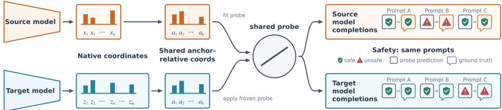  
Figure 1: Relative probing tests behavioral representational compatibility. Native activation coordinates differ across independently trained models, so a probe trained directly on one model’s activations cannot be directly reused. Relative representations instead express each monitored example through its relations to the same indexed anchor examples. We train a probe on these coordinates in a source model, freeze it, and test whether it predicts the target model’s behavior. Successful transfer is functional evidence that the models share task-relevant relational organization.

Successful cross-model probe transfer has a direct practical implication for white-box monitoring or probing, which uses internal activations to predict properties of model behavior. Prior work has used such signals to anticipate answer quality (Gottesman & Geva, 2024; Snyder et al., 2024), detect hallucinations (Orgad et al., 2024; Chen et al., 2024), and monitor safety-relevant behavior (McKenzie et al., 2025). Activation probes are also actively deployed as misuse mitigations in userfacing models (Kramár et al., 2026). These monitors are typically developed for a single model because their decision rules are expressed in that model’s activation coordinates. A new model may therefore require collecting labeled activations, selecting a layer, and fitting and validating another probe; model or deployment changes can also degrade an existing monitor (Kramár et al., 2026; Duan, 2026). Cross-model probe transfer would instead let a validated monitor be reused without target-model labels or a learned target-specific adapter. This amortizes probe development costs and, for instance, allows practitioners to develop probes when access to models and data may be restricted.

We evaluate anchored probes on trivia datasets, safety monitoring, and mathematical reasoning. Our main findings are:

• When trained and evaluated on the same model, global anchored probes perform comparably to standard probes. Transferred global anchored probes preserve at least 85% of the same-model anchored-probe AUROC performance over chance. This provides evidence that models indeed share task-relevant relational structure at the level of their internal computations.

• The same approach supports joint transfer to a new model and a related dataset without using labeled examples from the new deployment setting. This allows a monitor developed with accessible models and data to be reused when both the deployed model and its data distribution change.

• We test portability across model scale, model updates, prompt variants, and external model families. Transfer can remain strong across large scale and prompt changes, and anchored probes are more robust to model updates than standard probes. Transfer is weak for some models with poor task performance and is task-dependent across external model families. We additionally provide evidence that transfer tolerates non-identical textual anchors and noisy anchor mappings.

## 2 RELATED WORK

Our central question is whether independently trained language models organize information about their own behavior in compatible ways. We test this by freezing a behavioral probe trained on one model and evaluating it on another in shared anchor-relative coordinates. This connects work on representational convergence with behavioral probing;

Representational convergence and relative representations. The Platonic Representation Hypothesis proposes that increasingly capable models converge in the relationships they encode among examples (Huh et al., 2024). Moschella et al. (2023) provide the closest methodological precursor: their relative representations encode examples by similarity to fixed anchors, enabling zero-shot communication and transfer of classification or reconstruction components across seeds and architectures. We ask whether this relational compatibility extends to information about a model’s own behavior. Indra representations (Lu et al., 2025) use angular-distance profiles to improve robustness of downstream classifiers and cross-modal retrieval. They do not consider cross-model probe transfer and use full distance profiles over a dataset rather than a fixed set of common anchors. Model stitching (Bansal et al., 2021) tests functional compatibility by connecting the lower layers of one model to the upper layers of another through a trained low-capacity adapter. Unlike our approach, it learns a bridge between the two representation spaces.

Probing behavioral information. Probes have found decodable syntactic, semantic, spatial, temporal, and behavioral information in model representations (Conneau et al., 2018; Tenney et al., 2019; Gurnee & Tegmark, 2024; Zou et al., 2023). Internal-state monitors use such signals to anticipate answer quality or characterize model knowledge (Ferrando et al., 2024; Gottesman & Geva, 2024; Joshi et al., 2024; Afzal et al., 2025), detect hallucinations (CH-Wang et al., 2023; Chen et al., 2024; Orgad et al., 2024; Simhi et al., 2024; Snyder et al., 2024), and identify safety-relevant behavior (McKenzie et al., 2025; Kramár et al., 2026). These studies establish that a model’s activations contain information about its own behavior. Cross-model probe transfer tests whether that information is organized compatibly across models. The interpretation of probe performance also depends on distribution, probe capacity, and layer choice (Hewitt & Liang, 2019; Voita & Titov, 2020; Belinkov, 2022; Levinstein & Herrmann, 2023; Mallen et al., 2023; Kramár et al., 2026; Min et al., 2026). Cross-layer architectures aggregate information from several layers within one model (Suresh et al., 2025; Nordby et al., 2026; Huang et al., 2026), while Liang & Wang (2025) use Bayesian optimization to select a single probe insertion layer. Our global construction uses the whole depth of a model to produce anchor-indexed coordinates, so we can test compatibility without choosing corresponding layers across architectures.

Cross-model monitoring as an application. ACT-ViT is the closest prior system for cross-model white-box monitoring (Bar-Shalom et al., 2025). It pools activation tensors, maps each language model through its own linear adapter, and applies a shared vision-transformer backbone pretrained on labeled activations from multiple model–dataset pairs. Learned source–target mappers similarly transfer activation-space interventions by fitting a model-pair-specific bridge (Oozeer et al., 2025). Both approaches learn a new mapping for each target: ACT-ViT trains a new adapter for every language model, while intervention transfer trains a bridge for every source–target pair. We instead express each model relative to the same shared examples, so transferring a monitoring probe to a new target requires only an unlabeled pass over the anchor set and no learned target-specific component.

## 3 METHODOLOGY

Our method expresses each model’s activations through their relations to shared anchors, creating common coordinates in which a probe trained on one model can be applied to another. This transfer supports portable monitoring and tests predictive compatibility across models.

## 3.1 ANCHORED REPRESENTATIONS

Let $h _ { \ell } ^ { ( m ) } ( x )$ denote the residual-stream activation of model m at layer ℓ for example x. Let $A _ { D } =$ $\{ a _ { 1 } , \ldots , a _ { k } \}$ be a set of k anchor examples drawn from the training split of dataset D. Every model processes the same indexed anchor set. Unless stated otherwise, anchor activations are taken at the final prompt position, immediately before generation. In an appendix sensitivity analysis, we instead average activations over each anchor’s generated completion (Appendix C.5). Following the relative representation of Moschella et al. (2023), a local anchored representation at layer ℓ is

$$
r _ { \ell } ^ { ( m ) } ( x ; A _ { D } ) = \bigl [ s ( h _ { \ell } ^ { ( m ) } ( x ) , h _ { \ell } ^ { ( m ) } ( a _ { 1 } ) ) , \dots , s ( h _ { \ell } ^ { ( m ) } ( x ) , h _ { \ell } ^ { ( m ) } ( a _ { k } ) ) \bigr ] ,
$$

where $s ( \cdot , \cdot )$ is a relational distance function. The representation has one coordinate for each anchor identity. Its dimension is determined by the number of anchors and is independent of the model’s hidden size.

A probe can be trained on $r _ { \ell } ^ { ( m ) } ( x ; A _ { D } )$ using the same supervision as a probe on the native activation $h _ { \ell } ^ { ( m ) } ( x )$ . We call the former an anchored probe. A standard probe uses the native activation and serves as the same-model baseline.

## 3.2 GLOBAL ANCHORED REPRESENTATIONS

The direct local construction still requires a choice of probing layer. Our main method instead summarizes the residual stream across the complete network. For model m with $L _ { m }$ transformer layers, define

$$
g ^ { ( m ) } ( x ) = \mathrm { c o n c a t } \left( h _ { 0 } ^ { ( m ) } ( x ) , \dots , h _ { L _ { m } - 1 } ^ { ( m ) } ( x ) \right) .
$$

We then compute the global anchored representation

$$
R ^ { ( m ) } ( x ; A _ { D } ) = \left[ s ( g ^ { ( m ) } ( x ) , g ^ { ( m ) } ( a _ { 1 } ) ) , \ldots , s ( g ^ { ( m ) } ( x ) , g ^ { ( m ) } ( a _ { k } ) ) \right] .
$$

The intermediate vector $g ^ { ( m ) } ( x )$ can have a different dimension for every model, but $R ^ { ( m ) } ( x ; A _ { D } )$ always has dimension k and the same anchor indexing. A probe trained on one model can therefore be applied to another model’s representation even when the models differ in width and depth. In contrast to a local anchored probe, the global construction also removes the need to choose corresponding layers. Figure 3 in the Appendix illustrates our construction.

Following the angular construction used for Indra representations (Lu et al., 2025), we use

$$
s ( u , v ) = \operatorname { a r c c o s } \left( { \frac { u \cdot v } { \| u \| \ \| v \| } } \right) .
$$

This is the angular distance in radians. For global representations it is computed between wholenetwork vectors; for local representations it is computed between activations from one layer.

## 3.3 TASK SETTINGS

We evaluate the probes in three data settings: Trivia settings test whether probes retain information about model behavior and answer correctness, Guard Distillation tests probe performance for safety monitoring, and Online MATH tests whether probes can predict correctness of reasoning models on math questions. Safety monitoring is a common production use-case for probes (Kramár et al., 2026), and probes for early-correctness prediction during reasoning have been used for both efficiency (Zhang et al., 2025) and test time scaling (Ni et al., 2026).

Trivia. We use TruthfulQA (Lin et al., 2022), SciQ (Welbl et al., 2017), and MMLU (Hendrycks et al., 2021a) in binary-choice and four-choice formats. Each prompt asks the model to produce an answer option. We read the residual stream at the final prompt position, immediately before answer generation. Output Prediction predicts the option selected by the model, while ground-truth (GT) Prediction predicts the correct option. Prior work shows that pre-answer activations carry information about answer quality and knowledge state (Snyder et al., 2024; Gottesman & Geva, 2024). TruthfulQA, SciQ, and MMLU contain 817, 1,000, and 783 examples, respectively. We split each dataset 60/20/20 for training, validation, and testing, and sample 300 anchors from its training split.

Guard Distillation. We use prompts from BeaverTails (Ji et al., 2023) and Toxic-chat (Lin et al., 2023). Each monitored model generates completions, and Llama-Guard-3-8B (Llama Team, 2024) labels the resulting prompt–completion pair as safe or unsafe. The probe predicts this binary label from the monitored model’s completion-token activations. Standard probes average residual-stream activations over completion tokens at each layer. For anchored probes, we instead compute an anchorrelative representation for each completion token and then average those representations. For each dataset, we use 1,000 prompts split 60/20/20 for training, validation, and testing. The 600 training prompts serve as anchors.

Online MATH. We additionally train probes to predict whether a generated solution to a MATH problem will ultimately be correct (Hendrycks et al., 2021b). At checkpoints during generation, we average each layer’s residual-stream activations over all tokens generated so far. Our primary comparisons use 2,000 training examples and the 128-token checkpoint, selected before probe fitting because 92.8–99.6% of source training and validation trajectories had not yet ended at that point. We use a separate 500-example validation set and 300 anchors sampled from the training data, and evaluate on MATH-500. Appendix D.1 reports results with 1,000 training examples and at the 64- and 256-token checkpoints.

Across all three settings, we also evaluate transfer to related datasets: among the trivia datasets, between BeaverTails and Toxic-chat, and from MATH to GSM8K (Cobbe et al., 2021). We test both dataset transfer within one model and joint transfer to a new dataset and model. Labels from the target dataset are used only for final scoring.

## 3.4 CROSS-MODEL TRANSFER AND EVALUATION PROTOCOL

Let $m _ { s }$ be a source model and $m _ { t }$ a target model. We fit a probe on $R ^ { ( m _ { s } ) } ( x ; A _ { D } )$ , freeze it, and apply it to $R ^ { ( m _ { t } ) } ( x ; A _ { D } )$ . Successful transfer means that this frozen probe remains predictive on the target model’s anchored representations. Deployment on the target requires one unlabeled setup pass over the anchor set, in addition to the usual forward pass for each monitored example; crucially, we do not require target-model labels, a learned target adapter, or probe retraining.

The trivia and Guard Distillation evaluations share a six-model pool: Llama-3.1-8B-Instruct, Llama-3.2-3B-Instruct (Llama Team, 2024), Mistral-7B-Instruct-v0.3 (Jiang et al., 2023), Qwen2.5-7B-Instruct, Qwen2.5-3B-Instruct (Qwen Team, 2024), and Qwen3-4B-Instruct-2507 (Qwen Team, 2025), which we refer to as Qwen3-4B-Instruct below. Before extracting activations, we screened candidate models on MATH. Several models in the trivia and Guard Distillation pool produced too few correct solutions for reliable probe training and evaluation, so we use a separate four-model pool for online mathematical correctness: Llama-3.1-8B-Instruct, Qwen3-4B-Instruct, OLMo-3-7B-Instruct, and Gemma-3-12B-Instruct (Team, 2025b;a).

Within each pool, every model serves in turn as a target, with the other models available as sources. For each target, Transfer directly applies every non-target source probe and averages the resulting AUROCs. When several source probes are available, their transfer reliability can be estimated before deployment by testing each one on the other labeled models in the source pool. Our source-only calibration procedure (reported as Transfer (cal)) selects the source probe with the highest mean validation AUROC on those other source-pool models and then applies it to the held-out target. No target labels enter calibration. Calibration uses all available source models within the corresponding pool and is intended to improve deployment performance. For local anchored probes, source and target activations are taken at the same relative depth d across the two models. We apply the direct and calibrated procedures separately at each depth.

We distinguish two evaluation regimes. An in-pool target is one member of a prespecified model pool held out in turn while the remaining models provide source probes and calibration data. An external target belongs to a model family outside the corresponding source and calibration pool. For external targets, source selection is completed entirely within that pool before the selected probe is scored on the new model. Dataset construction, model settings, and optimization details appear in Appendix A.

## 4 EXPERIMENTS

We use behavioral monitoring tasks as a functional test of whether independently trained models organize behaviorally relevant information in compatible ways. If anchor-relative coordinates preserve a behavioral signal within each model and a probe’s fixed decision rule remains predictive across models, then the models share task-relevant relational structure in a form usable by the same monitor. We first test these two conditions, then ask when this compatibility persists across external model families, related data distributions, layer choices, model scale, model updates, and prompt formats. Supporting analyses examine low-FPR recall and the relational geometry of the anchors.

We use a linear probe on native activations at prespecified relative depth 0.8 as the standard baseline; the basis for this choice is reported in Appendix Figures 7 and 11. We report area under the receiver operating characteristic curve (AUROC) for all three settings. We additionally report recall at 10% FPR in Appendices B.4, C.2, and D.2. Full implementation details appear in Appendix A. We examine anchor-count variants, attention probes, and other nonlinear probes in Appendices B.8, C.9, and C.11.

Table 1: Trivia factuality prediction. GT Prediction AUROC for same-model Standard and Anchored probes, mean cross-model Transfer, and source-calibrated Transfer (cal). Values are percentages, averaged over three seeds; uncertainties are standard errors.
<table><tr><td>Dataset</td><td>Standard</td><td>Anchored</td><td>Transfer</td><td>Transfer (cal)</td></tr><tr><td>TQA</td><td> $8 9 . 4 \pm 1 . 2$ </td><td> $8 9 . 1 \pm 0 . 4$ </td><td> $7 2 . 5 \pm 1 . 4$ </td><td> $7 3 . 1 \pm 0 . 5$ </td></tr><tr><td>MMLU</td><td> $9 4 . 8 \pm 0 . 2$ </td><td> $9 6 . 2 \pm 0 . 2$ </td><td> $9 5 . 9 \pm 0 . 3$ </td><td> $9 6 . 2 \pm 0 . 2$ </td></tr><tr><td>SciQ</td><td> $9 9 . 2 \pm 0 . 1 $ </td><td> $9 9 . 4 \pm 0 . 0$ </td><td> $9 9 . 2 \pm 0 . 1 $ </td><td> $9 9 . 3 \pm 0 . 0$ </td></tr><tr><td>TQA (4)</td><td> $8 5 . 5 \pm 0 . 3$ </td><td> $8 4 . 1 \pm 1 . 0$ </td><td> $7 3 . 5 \pm 1 . 3$ </td><td> $7 6 . 9 \pm 1 . 3$ </td></tr><tr><td>MMLU (4)</td><td> $9 3 . 4 \pm 0 . 2$ </td><td> $9 4 . 8 \pm 0 . 1$ </td><td> $9 3 . 3 \pm 0 . 1$ </td><td> $9 4 . 3 \pm 0 . 2$ </td></tr><tr><td>SciQ (4)</td><td> $9 8 . 2 \pm 0 . 3 $ </td><td> $9 8 . 6 \pm 0 . 3$ </td><td> $9 7 . 9 \pm 0 . 2 $ </td><td> $9 8 . 0 \pm 0 . 3 $ </td></tr></table>

Table 2: Guard Distillation monitoring. AUROC for same-model Standard and Anchored probes, mean cross-model Transfer, and source-calibrated Transfer (cal). Values are percentages, averaged over three seeds; uncertainties are standard errors.
<table><tr><td>Dataset</td><td>Standard</td><td>Anchored</td><td>Transfer</td><td>Transfer (cal)</td></tr><tr><td>BeaverTails</td><td> $9 6 . 5 \pm 0 . 1$ </td><td> $9 4 . 9 \pm 0 . 2 $ </td><td> $8 1 . 1 \pm 1 . 2$ </td><td> $8 6 . 4 \pm 4 . 6$ </td></tr><tr><td>Toxic-chat</td><td> $8 8 . 6 \pm 0 . 8$ </td><td> $8 7 . 5 \pm 0 . 7$ </td><td> $8 1 . 6 \pm 0 . 7$ </td><td> $8 3 . 6 \pm 1 . 0$ </td></tr></table>

## 4.1 SAME-MODEL DECODABILITY

Anchoring replaces each model’s native residual coordinates with a common, anchor-indexed representation, so we first test whether that change sacrifices predictive information, before testing portability. Standard and Anchored probes receive the same labels and differ only in their input representation. The anchored representations are also substantially more compact: every model has 300 coordinates for trivia and MATH or 600 for Guard Distillation, compared with native residual widths from 2,048 dimensions for Qwen2.5-3B to 4,096 for Llama-3.1-8B and Mistral-7B.

Trivia Output Prediction is near ceiling within each model: Standard and Anchored probes both reach 99.5–100.0 AUROC across the six dataset variants (Appendix B.2). For the more discriminating GT Prediction setting, Anchored probes outperform Standard probes on four variants and trail them on two; the largest difference in either direction is 1.4 AUROC points (Table 1). Guard Distillation also has small same-model gaps: Standard and Anchored score 96.5 and 94.9 on BeaverTails, and 88.6 and 87.5 on Toxic-chat (Table 2). For MATH, the global Anchored probe reaches 81.8 AUROC, compared with 77.9 for the Standard probe (Table 3). Anchoring therefore preserves nearly all of the tested same-model linear predictive signal in trivia and safety, while improving same-model decodability in MATH.

## 4.2 CROSS-MODEL PROBE TRANSFER

We now test the central question: after fitting a probe on one source model, does its decision rule remain predictive when applied unchanged to another model? We test this across trivia and Guard Distillation in the six-model pool, and across online MATH in its separate four-model pool. Calibration uses all available non-target source models: five for trivia and Guard Distillation, and three for online MATH. Appendices B.2 and C.1 additionally report how trivia and Guard Distillation transfer changes as the available source pool grows from one to five models; Appendix D.1 reports the corresponding one-to-three-source progression for online MATH.

Averaged separately within each setting, calibrated global transfer preserves 99.1% of same-model Anchored AUROC above chance for trivia Output Prediction, 90.7% for trivia GT Prediction, 85.0% for Guard Distillation, and 88.1% for online MATH. Tables 1, 2, and 3 report the corresponding results. Trivia Output Prediction also remains near ceiling after transfer: calibrated AUROC ranges from 98.3 to 99.9 (Appendix B.2). This result shows that features of a model’s selected answer are strongly transferable, so the main trivia table focuses on the more discriminating GT Prediction task.

Table 3: Online mathematical-correctness monitoring. AUROC (%) on MATH-500 at 128 generated tokens, mean ± standard error over three source/probe seeds.
<table><tr><td>Dataset</td><td>Standard</td><td>Anchored</td><td>Transfer</td><td>Transfer (cal)</td></tr><tr><td>MATH-500</td><td> $7 7 . 9 \pm 0 . 3$ </td><td> $8 1 . 8 \pm 0 . 3$ </td><td> $7 5 . 2 \pm 0 . 6$ </td><td> $7 8 . 0 \pm 0 . 5$ </td></tr></table>

Calibrated transfer remains predictive in all three settings, although the loss relative to samemodel Anchored probes varies. For trivia Output Prediction, calibrated transfer is at most 1.5 AUROC points below the same-model Anchored probe across all six variants; GT Prediction is within 0.6 points on MMLU and SciQ. For online MATH, a probe trained on one model’s solution prefixes predicts whether another model’s solution will ultimately be correct: global calibrated transfer reaches 78.0 AUROC, 3.8 points below global same-model Anchored performance. Notably, this matches the 77.9 AUROC of Standard probes trained directly on each target. Guard Distillation shows substantial but less complete transfer, reaching 86.4 on BeaverTails and 83.6 on Toxic-chat, compared with same-model Anchored AUROCs of 94.9 and 87.5. The common anchor coordinates therefore support reuse of a fixed behavioral decision rule across all three settings, with transfer losses relative to same-model probes that vary by task. This functional transfer provides evidence that anchored representations organize task-relevant

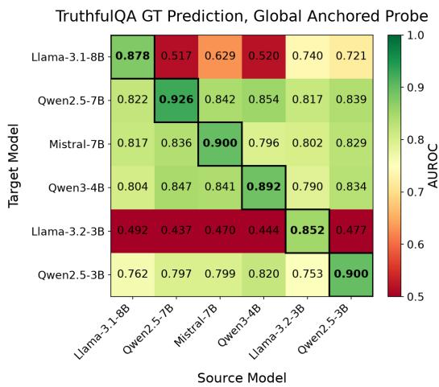  
Figure 2: Binary TruthfulQA GT Prediction. Rows are target models and columns are source models. Diagonal entries show same-model probe performance; off-diagonal entries are directly transferred probes. Probes are near chance on Llama-3.2-3B-Instruct for all test source models.

information compatibly across models. To show that matching dimensions do not explain transfer, we transfer standard probes between Llama-3.1-8B and Mistral-7B, which have the same residual width and depth. These probes perform at chance level, while anchored probes transfer strongly (Appendices B.10 and C.12).

Binary TruthfulQA GT Prediction is the main exception to the strong trivia results: calibrated transfer reaches 73.1 AUROC, compared with 89.1 same-model. The gap is concentrated in Llama-3.2-3B, the least accurate TruthfulQA target; its same-model probe remains strong, but all incoming probes perform near chance (Figure 2). Across the 36 trivia target–dataset cells, target answer accuracy is strongly associated with incoming GT Prediction transfer. Transfer may therefore be less reliable for low-accuracy targets, although the strong same-model probe shows that there remains decodable target signal (Appendix B.9). Recall at 10% FPR reveals larger transfer losses, particularly for binary TruthfulQA GT Prediction and Guard Distillation (Appendices B.4, C.2, and D.2).

## 4.3 WHEN DOES PREDICTIVE COMPATIBILITY PERSIST?

We next test whether this compatibility extends beyond the original model pools and persists under related data and other deployment changes.

## 4.3.1 EXTERNAL MODEL FAMILIES

The preceding experiments hold out each target from a prespecified model pool. To test whether portability extends beyond those development pools, we keep each pool fixed and evaluate additional models. The transferred probes and their source choices are fixed before external target models and labels are introduced. For trivia and Guard Distillation, the new targets are OLMo-3-7B (Team,

Table 4: Transfer to external model families. Source-calibrated global-probe AUROC (%) for held-out targets from the original task-specific pools and for targets outside those pools. Trivia rows average the binary- and four-choice versions of TruthfulQA, MMLU, and SciQ. Values are mean ± standard error over three source/probe seeds; Appendices B.5, C.3, and D.3 report the full results.
<table><tr><td>Task / dataset</td><td>Held-out in-pool</td><td>OLMo-3-7B</td><td>Gemma-3-12B</td><td>GPT-OSS-20B</td></tr><tr><td>Trivia Output Prediction</td><td> $9 9 . 4 \pm 0 . 2 $ </td><td> $9 9 . 0 \pm 0 . 2 $ </td><td> $9 9 . 6 \pm 0 . 1$ </td><td> $9 8 . 6 \pm 0 . 3$ </td></tr><tr><td>Trivia GT Prediction</td><td> $8 9 . 6 \pm 0 . 4$ </td><td> $9 0 . 2 \pm 0 . 6$ </td><td> $9 3 . 6 \pm 0 . 4$ </td><td> $9 4 . 4 \pm 0 . 3$ </td></tr><tr><td>Guard: BeaverTails</td><td> $8 6 . 4 \pm 4 . 6$ </td><td> $7 9 . 2 \pm 3 . 0$ </td><td> $6 3 . 0 \pm 7 . 5$ </td><td> $5 7 . 5 \pm 1 2 . 6$ </td></tr><tr><td>Guard: Toxic-chat</td><td> $8 3 . 6 \pm 1 . 0$ </td><td> $8 7 . 6 \pm 1 . 4$ </td><td> $7 2 . 6 \pm 1 1 . 4$ </td><td> $6 6 . 9 \pm 3 . 8$ </td></tr><tr><td>MATH correctness</td><td> $7 8 . 0 \pm 0 . 5$ </td><td></td><td></td><td> $5 2 . 4 \pm 0 . 5$ </td></tr></table>

2025b), Gemma-3-12B (Team, 2025a), and GPT-OSS-20B (OpenAI, 2025). For MATH, GPT-OSS is held out. Table 4 summarizes these results.

Trivia GT Prediction reaches 90.2–94.4 AUROC across the three external families, matching or exceeding the 89.6 average for held-out targets in the original pool. Output Prediction remains near saturation at 98.6–99.6 AUROC (Table 4). Guard Distillation is more heterogeneous, with Toxic-chat transfer ranging from 66.9 to 87.6. BeaverTails estimates are high-variance because only 1.0–4.8% of completions are unsafe for these newer models. Appendices B.5 and C.3 report the full results.

For MATH, transfer to GPT-OSS remains near chance at 52.4–53.1 AUROC across the two sourcetraining sizes. Appendix D.3 reports target-trained probes, which reach 78.5–78.7 AUROC and show that correctness remains linearly decodable in GPT-OSS. The decision boundary learned from the source models is therefore not predictive for GPT-OSS. GPT-OSS is also the only mixture-of-experts model in our external MATH evaluation. Its expert routing may contribute to the failure, although the current comparison cannot separate that possibility from other architectural and training differences. The failure is task-specific: trivia probes transfer strongly to GPT-OSS and the other external targets. External-family transfer therefore varies by model–task pair, but remains strong for several targets outside the calibration pool.

## 4.3.2 RELATED DATA DISTRIBUTIONS

The practical value of compatible representations is greatest when both the deployed model and its data change, since collecting and validating target labels may be prohibitive. Activation probes can degrade under distribution shifts even when the model is fixed (Orgad et al., 2024; Levinstein & Herrmann, 2023; Kramár et al., 2026; Min et al., 2026). We therefore use same-model standard probes as a reference and ask whether anchoring preserves or improves related-data robustness while also enabling a simultaneous model change. A joint shift approximates, for instance, a restrictedaccess setting in which a monitor developed on an accessible model and dataset is applied locally to a different model on related private data without sharing the target model or data. We evaluate three such data shifts: among trivia datasets, between BeaverTails and Toxic-chat, and from MATH to GSM8K. The anchors and labels used to fit or calibrate probes always come from the source dataset; target labels are used only for final scoring.

When the model is fixed, global anchored probes outperform standard probes in every trivia GT Prediction direction, averaging 87.0 AUROC with gains of up to 13.1 points, and on MATH-to-GSM8K, at 75.3 versus 63.0. They roughly match standard probes on average for Guard Distillation, at 77.9 versus 78.3. When both the model and dataset change, trivia transfer averages 83.1 directly and 86.1 after source calibration; calibrated Guard transfer reaches 65.1 from BeaverTails to Toxic-chat and 79.6 in the reverse direction; and calibrated MATH-to-GSM8K transfer reaches 70.5. Despite the simultaneous model change, MATH-to-GSM8K transfer remains 7.4 points above a standard probe applied within the same model.

Guard probe transfer shows that performance across related data is not uniformly reliable. To examine this gap, we compare each target example’s distance to its nearest source anchor (Appendix C.6). Target examples are farther from the source anchors when moving from curated BeaverTails prompts to real-world Toxic-chat conversations, suggesting that transfer quality is related to how well the source anchors cover the target data. Full results appear in Appendices B.6, C.4, and D.4.

## 4.3.3 OTHER ROBUSTNESS CHECKS

Layer selection. The global construction avoids choosing layers across models. We compare it with local probes whose depths are selected using source-model validation data. Across all three task families, local probes do not consistently outperform global probes, making the global construction a robust depth-free default (Appendices B.3, C.7, D.1).

Model scale. We test transfer across a same-family Llama 3.x scale gap on MMLU. Transfer from the 1B model to the 70B model reaches 94.8 AUROC, close to the 96.0 AUROC of a probe trained directly on the 70B model. This suggests that labeled probe development may be done on the much less expensive 1B model, and deployed on the 70B model at little performance loss. Transfer into the 1B target — the reverse direction — is near chance, and the 1B same-model probe reaches only 68.2 AUROC, reinforcing the earlier pattern that transfer into weak targets is difficult (Appendix B.9).

Model updates. A deployed monitor can become outdated when its model is fine-tuned after probe training. Following the setup of Duan (2026), we train global anchored safety probes on XSTest safety data (Röttger et al., 2024) for Qwen2.5-3B and 7B. We then fix the probes, fine-tune the Qwen models on refusal data with LoRA and QLoRA, and evaluate probe robustness under this distribution shift. We find that global anchored probes are more robust to both model quantization and updates than standard probes and local anchored probes (Appendix E).

Prompt format. We compare the standard trivia prompt with minimal and verbose variants while holding the tasks, examples, and models fixed. Under the minimal prompt, calibrated transfer changes by only about one AUROC point while same-model probes degrade more, suggesting that transferred probes are less sensitive to this tested change (Appendix B.7).

Anchor content and correspondence. Finally, we ask whether anchors must exactly match across models. In Guard Distillation, same-dataset Transfer (cal) changes by at most 2.7 AUROC points when each anchor is represented by averaging over that model’s generated completion rather than at the final token of the shared prompt, even though the completion — and thus the anchor — differs between models (Appendix C.5). In a separate test, we hide the anchor identities and recover 20.7% of their cross-model matches using only pairwise distances, compared with 0.16% by chance (Appendix C.10). Probes applied to the partially recovered space retain more than 90% of the original AUROC. Together, these results suggest that transfer can tolerate non-identical textual anchors and substantial noise in the anchor mapping, consistent with reliance on the anchor set’s broader semantic organization rather than exact one-to-one correspondence.

## 5 CONCLUSION

We show that relative representations can support functional reuse of model representations for white-box monitoring of independently trained autoregressive language models. Across trivia, safety monitoring, and mathematical reasoning, anchored coordinates retain useful same-model signal, and probes trained on one model remain predictive on others. Transfer of a fixed behavioral probe provides substantial evidence that the models share task-relevant relational organization.

This representation provides a practical route to portable white-box monitoring. Anchored probes support joint changes of model and related data, large same-family scale changes, and prompt variations. They also retain more performance than standard probes after model updates. Reusing a validated probe can therefore reduce repeated labeling, tuning, and validation as models and deployment conditions change, while our global construction avoids model-specific layer selection.

We note that portability remains conditional: transfer weakens for some weakly-performing target models and can occasionally fail even when the monitored property remains decodable in the target model. Future work may develop principled anchor selection, develop methods for predicting transfer failures — potentially based on anchor-similarity or coverage measures — and extend the approach to long-context, multi-turn, and multimodal settings. Overall, our results show that independently trained autoregressive language models share substantial relevant relational organization in their learned features and demonstrate a practical method for reusing white-box monitors across models.

## REFERENCES

Anum Afzal, Florian Matthes, Gal Chechik, and Yftah Ziser. Knowing before saying: Llm representations encode information about chain-of-thought success before completion. In Findings of the Association for Computational Linguistics: ACL 2025, 2025. URL https://aclanthology.org/2025.findings-acl. 662.pdf.

Yamini Bansal, Preetum Nakkiran, and Boaz Barak. Revisiting model stitching to compare neural representations. In Advances in Neural Information Processing Systems, 2021. URL https://arxiv.org/pdf/2106.07682. pdf.

Guy Bar-Shalom, Fabrizio Frasca, Yaniv Galron, Yftah Ziser, and Haggai Maron. Beyond token probes: Hallucination detection via activation tensors with ACT-ViT, 2025. URL https://arxiv.org/pdf/2510. 00296.pdf.

Yonatan Belinkov. Probing classifiers: Promises, shortcomings, and advances. Computational Linguistics, 2022. URL https://direct.mit.edu/coli/article-pdf/48/1/207/2008013/coli\_a\_00422.pdf.

Sky CH-Wang, Benjamin Van Durme, Jason Eisner, and Chris Kedzie. Do androids know they’re only dreaming of electric sheep?, 2023. URL https://arxiv.org/pdf/2312.17249.pdf.

Chao Chen, Kai Liu, Ze Chen, Yi Gu, Yue Wu, Mingyuan Tao, Zhihang Fu, and Jieping Ye. Inside: Llms’ internal states retain the power of hallucination detection, 2024. URL https://arxiv.org/pdf/2402.03744.pdf.

Karl Cobbe, Vineet Kosaraju, Mohammad Bavarian, Mark Chen, Heewoo Jun, Lukasz Kaiser, Matthias Plappert, Jerry Tworek, Jacob Hilton, Reiichiro Nakano, Christopher Hesse, and John Schulman. Training verifiers to solve math word problems. arXiv preprint arXiv:2110.14168, 2021.

Alexis Conneau, German Kruszewski, Guillaume Lample, Loïc Barrault, and Marco Baroni. What you can cram into a single \$&!#\* vector: Probing sentence embeddings for linguistic properties. In Proceedings of the 56th Annual Meeting ofthe Associationfor Computational Linguistics (Volume 1: Long Papers), 2018. URL https://aclanthology.org/P18-1198.pdf.

Tim Dettmers, Artidoro Pagnoni, Ari Holtzman, and Luke Zettlemoyer. Qlora: Efficient finetuning of quantized llms, 2023. URL https://arxiv.org/abs/2305.14314.

Evan Duan. Do activation monitors survive model updates? benchmarking, predicting, and repairing activationmonitor staleness, 2026. URL https://arxiv.org/abs/2606.15980.

Javier Ferrando, Oscar Obeso, Senthooran Rajamanoharan, and Neel Nanda. Do i know this entity? knowledge awareness and hallucinations in language models, 2024. URL https://arxiv.org/pdf/2411.14257.pdf.

Daniela Gottesman and Mor Geva. Estimating knowledge in large language models without generating a single token. In Proceedings of the 2024 Conference on Empirical Methods in Natural Language Processing, 2024. URL https://aclanthology.org/2024.emnlp-main.232/.

Wes Gurnee and Max Tegmark. Language models represent space and time. In The Twelfth International Conference on Learning Representations, 2024. URL https://openreview.net/pdf?id=jE8xbmvFin.

Dan Hendrycks, Collin Burns, Steven Basart, Andy Zou, Mantas Mazeika, Dawn Song, and Jacob Steinhardt. Measuring massive multitask language understanding. In Proceedings ofthe International Conference on Learning Representations (ICLR 2021), 2021a. URL https://arxiv.org/pdf/2009.03300.pdf.

Dan Hendrycks, Collin Burns, Saurav Kadavath, Akul Arora, Steven Basart, Eric Tang, Dawn Song, and Jacob Steinhardt. Measuring mathematical problem solving with the math dataset. NeurIPS, 2021b.

John Hewitt and Percy Liang. Designing and interpreting probes with control tasks. In Proceedings of the 2019 Conference on Empirical Methods in Natural Language Processing and the 9th International Joint Conference on Natural Language Processing (EMNLP-IJCNLP), 2019. URL https://aclanthology.org/ D19-1275.pdf.

Edward J. Hu, Yelong Shen, Phillip Wallis, Zeyuan Allen-Zhu, Yuanzhi Li, Shean Wang, Lu Wang, and Weizhu Chen. Lora: Low-rank adaptation of large language models, 2021. URL https://arxiv.org/abs/2106. 09685.

Li Huang, Zhongxin Liu, Yifan Wu, Tao Yin, Dong Li, Jichao Bi, Nankun Mu, Hongyu Zhang, and Meng Yan. Deepguard: Secure code generation via multi-layer semantic aggregation. In Proceedings of the 64th Annual Meeting of the Association for Computational Linguistics (ACL 2026), 2026. URL https: //arxiv.org/abs/2604.09089.

Minyoung Huh, Brian Cheung, Tongzhou Wang, and Phillip Isola. Position: The platonic representation hypothesis. In Proceedings ofthe 41st International Conference on Machine Learning, 2024. URL https: //raw.githubusercontent.com/mlresearch/v235/main/assets/huh24a/huh24a.pdf.

Jiaming Ji, Mickel Liu, Juntao Dai, Xuehai Pan, Chi Zhang, Ce Bian, Boyuan Chen, Ruiyang Sun, Yizhou Wang, and Yaodong Yang. BeaverTails: Towards improved safety alignment of LLM via a human-preference dataset. In Advances in Neural Information Processing Systems 36 (NeurIPS 2023), 2023. URL https: //arxiv.org/pdf/2307.04657.pdf

Albert Q. Jiang, Alexandre Sablayrolles, Arthur Mensch, Chris Bamford, Devendra Singh Chaplot, Diego de las Casas, Florian Bressand, Gianna Lengyel, Guillaume Lample, Lucile Saulnier, Lélio Renard Lavaud, Marie-Anne Lachaux, Pierre Stock, Teven Le Scao, Thibaut Lavril, Thomas Wang, Timothée Lacroix, and William El Sayed. Mistral 7b, 2023. URL https://arxiv.org/abs/2310.06825.

Nithin Joshi, Javier Rando, Abulhair Saparov, Najoung Kim, and He He. Personas as a way to model truthfulness in language models. In Proceedings of the 2024 Conference on Empirical Methods in Natural Language Processing, 2024. URL https://aclanthology.org/2024.emnlp-main.364.pdf.

János Kramár, Joshua Engels, Zheng Wang, Bilal Chughtai, Rohin Shah, Neel Nanda, and Arthur Conmy. Building production-ready probes for gemini, 2026. URL https://arxiv.org/pdf/2601.11516.pdf.

B.A. Levinstein and Daniel A. Herrmann. Still no lie detector for language models: Probing empirical and conceptual roadblocks, 2023. URL https://arxiv.org/pdf/2307.00175.pdf.

Shize Liang and Hongzhi Wang. Neural probe-based hallucination detection for large language models, 2025. URL https://arxiv.org/abs/2512.20949.

Stephanie Lin, Jacob Hilton, and Owain Evans. TruthfulQA: Measuring how models mimic human falsehoods. In Proceedings ofthe 60th Annual Meeting ofthe Associationfor Computational Linguistics (ACL 2022), 2022. URL https://aclanthology.org/2022.acl-long.229/.

Zi Lin, Zihan Wang, Yongqi Tong, Yangkun Wang, Yuxin Guo, Yujia Wang, and Jingbo Shang. ToxicChat: Unveiling hidden challenges of toxicity detection in real-world user-AI conversation. In Findings of the Associationfor Computational Linguistics: EMNLP 2023, 2023. URL https://aclanthology.org/2023. findings-emnlp.311/.

Llama Team. The llama 3 herd of models, 2024. URL https://arxiv.org/abs/2407.21783.

Jianglin Lu, Hailing Wang, Kuo Yang, Yitian Zhang, Simon Jenni, and Yun Fu. The indra representation hypothesis for multimodal alignment. In The Thirty-ninth Annual Conference on Neural Information Processing Systems, 2025. URL https://openreview.net/forum?id=D2NR5Zq6PG.

Alex Mallen, Madeline Brumley, Julia Kharchenko, and Nora Belrose. Eliciting latent knowledge from quirky language models, 2023. URL https://arxiv.org/pdf/2312.01037.pdf.

Alex McKenzie, Urja Pawar, Phil Blandfort, William Bankes, David Krueger, Ekdeep Singh Lubana, and Dmitrii Krasheninnikov. Detecting high-stakes interactions with activation probes, 2025. URL https: //arxiv.org/pdf/2506.10805.pdf.

Nay Myat Min, Long H. Pham, Hongyu Zhang, and Jun Sun. Corvus: Red-teaming hallucination detectors via internal signal camouflage in large language models, 2026. URL https://arxiv.org/pdf/2601.14310. pdf.

Luca Moschella, Valentino Maiorca, Marco Fumero, Antonio Norelli, Francesco Locatello, and Emanuele Rodolà. Relative representations enable zero-shot latent space communication. In The Eleventh International Conference on Learning Representations, 2023. URL https://openreview.net/forum?id=SrC-nwieGJ.

Jingwei Ni, Ekaterina Fadeeva, Tianyi Wu, Mubashara Akhtar, Jiaheng Zhang, Elliott Ash, Markus Leippold, Timothy Baldwin, See-Kiong Ng, Artem Shelmanov, and Mrinmaya Sachan. Reprobe: Efficient test-time scaling of multi-step reasoning by probing internal states of large language models, 2026. URL https: //arxiv.org/abs/2511.06209.

Erik Nordby, Tasha Pais, and Aviel Parrack. Linear probe accuracy scales with model size and benefits from multi-layer ensembling, 2026. URL https://arxiv.org/abs/2604.13386.

Oscar Obeso, Andy Arditi, Javier Ferrando, Joshua Freeman, Cameron Holmes, and Neel Nanda. Real-time detection of hallucinated entities in long-form generation, 2025. URL https://arxiv.org/pdf/2509. 03531.pdf.

Narmeen Oozeer, Dhruv Nathawani, Nirmalendu Prakash, Michael Lan, Abir Harrasse, and Amirali Abdullah. Activation space interventions can be transferred between large language models, 2025. URL https: //arxiv.org/abs/2503.04429.

OpenAI. gpt-oss-120b & gpt-oss-20b model card, 2025. URL https://arxiv.org/abs/2508.10925.

Hadas Orgad, Michael Toker, Zorik Gekhman, Roi Reichart, Idan Szpektor, Hadas Kotek, and Yonatan Belinkov. LLMs know more than they show: On the intrinsic representation of LLM hallucinations, 2024. URL https://arxiv.org/pdf/2410.02707.pdf.

Qwen Team. Qwen2.5: A party of foundation models, 2024. URL https://qwenlm.github.io/blog/qwen2. 5/.

Qwen Team. Qwen3 technical report, 2025. URL https://arxiv.org/abs/2505.09388.

Paul Röttger, Hannah Kirk, Bertie Vidgen, Giuseppe Attanasio, Federico Bianchi, and Dirk Hovy. XSTest: A test suite for identifying exaggerated safety behaviours in large language models. In Proceedings ofthe 2024 Conference ofthe North American Chapter ofthe Associationfor Computational Linguistics: Human Language Technologies (Vol. 1), 2024. URL https://aclanthology.org/2024.naacl-long.301/.

Adi Simhi, Jonathan Herzig, Idan Szpektor, and Yonatan Belinkov. Constructing benchmarks and interventions for combating hallucinations in llms, 2024. URL https://arxiv.org/pdf/2404.09971.pdf.

Aviv Slobodkin, Omer Goldman, Avi Caciularu, Ido Dagan, and Shauli Ravfogel. The curious case of hallucinatory (un)answerability: Finding truths in the hidden states of over-confident large language models. In Proceedings ofthe 2023 Conference on Empirical Methods in Natural Language Processing, 2023. URL https://aclanthology.org/2023.emnlp-main.220/.

Ben Snyder, Marius Moisescu, and Muhammad Bilal Zafar. On early detection of hallucinations in factual question answering. In Proceedings ofthe 30th ACM SIGKDD Conference on Knowledge Discovery and Data Mining, 2024. URL https://arxiv.org/pdf/2312.14183.pdf.

Malavika Suresh, Rahaf Aljundi, Ikechukwu Nkisi-Orji, and Nirmalie Wiratunga. Cross-layer attention probing for fine-grained hallucination detection, 2025. URL https://arxiv.org/abs/2509.09700.

Gemma Team. Gemma 3 technical report, 2025a. URL https://arxiv.org/abs/2503.19786.

Olmo Team. Olmo 3, 2025b. URL https://arxiv.org/abs/2512.13961.

Ian Tenney, Dipanjan Das, and Ellie Pavlick. BERT rediscovers the classical NLP pipeline. In Proceedings of the 57th Annual Meeting of the Association for Computational Linguistics, 2019. URL https://aclanthology. org/P19-1452.pdf.

Elena Voita and Ivan Titov. Information-theoretic probing with minimum description length. In Proceedings of the 2020 Conference on Empirical Methods in Natural Language Processing (EMNLP), 2020. URL https://aclanthology.org/2020.emnlp-main.14.pdf.

Johannes Welbl, Nelson F. Liu, and Matt Gardner. Crowdsourcing multiple choice science questions. In Proceedings of the 3rd Workshop on Noisy User-generated Text (W-NUT 2017), 2017. URL https:// aclanthology.org/W17-4413/.

Anqi Zhang, Yulin Chen, Jane Pan, Chen Zhao, Aurojit Panda, Jinyang Li, and He He. Reasoning models know when they’re right: Probing hidden states for self-verification, 2025. URL https://arxiv.org/abs/2504. 05419.

Andy Zou, Long Phan, Sarah Chen, James Campbell, Phillip Guo, Richard Ren, Alexander Pan, Xuwang Yin, Mantas Mazeika, Ann-Kathrin Dombrowski, Shashwat Goel, Nathaniel Li, Michael J. Byun, Zifan Wang, Alex Mallen, Steven Basart, Sanmi Koyejo, Dawn Song, Matt Fredrikson, J. Zico Kolter, and Dan Hendrycks. Representation engineering: A top-down approach to ai transparency, 2023. URL https: //arxiv.org/abs/2310.01405.

## APPENDIX CONTENTS

A Implementation details 15   
A.1 Shared protocol 15   
A.2 Trivia setting 18   
A.3 Guard Distillation setting 19   
A.4 Online MATH correctness setting 20   
A.5 External-target protocol . 22   
A.6 Related-data transfer protocol . 22   
A.7 GuardQA setting 22   
A.8 MMLU scale experiment 25   
A.9 Probe staleness experiments 25   
A.10 Compute estimates 26   
B Trivia results 28   
B.1 Same-model decodability 28   
B.2 Full calibration progression 28   
B.3 Validation-selected local depths 28   
B.4 Recall at 10% FPR 31   
B.5 Transfer to external model targets 31   
B.6 Related-data and joint transfer 31   
B.7 Sensitivity to prompt perturbations 32   
B.8 Anchor count ablations 36   
B.9 Pooled-MMLU scale and transfer diagnostics 36   
B.10 Standard cross-model probe baseline 37   
B.11 All-layer standard probes 38   
C Guard Distillation results 40   
C.1 Full calibration progression . 40   
C.2 Recall at 10% FPR 40   
C.3 Transfer to external model targets 41   
C.4 Related-data and joint transfer 41   
C.5 Anchor-aggregation sensitivity 42   
C.6 Anchor coverage and mixed-anchor mitigation . 42   
C.7 Validation-selected local depths . 43   
C.8 Class balancing ablation 45   
C.9 Sequence probing with attention probes 45   
C.10 Anchor correspondence and relational controls . 46   
C.11 MLP probes 47   
C.12 Standard cross-model probe baseline 50   
C.13 All-layer standard probes 52   
C.14 Model family analysis . 53   
D Online mathematical correctness results 54   
D.1 Calibration and depth selection . 54   
D.2 Low-FPR recall 55   
D.3 Transfer to an external model target 55   
D.4 Related-data transfer 56   
E XSTest probe staleness 56   
E.1 Staleness after model updates 56   
E.2 Relative-coordinate function 57   
E.3 Re-encoding anchors after model updates 58   
F GuardQA results 59   
F.1 Same-model summary 59   
F.2 Full calibration progression 59   
F.3 Recall at 10% FPR 60   
F.4 Alternate MLP settings 61   
F.5 Linear probe setting 62   
F.6 Standard cross-model probe baseline 63

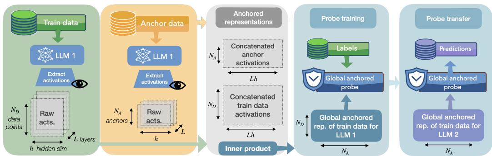  
Figure 3: Global anchored-probe construction. Each model processes the same indexed anchor set. We compute the angular distance between a monitored example and every anchor using residualstream activations from all transformer layers. This produces a fixed-dimensional representation whose coordinates have the same anchor identities across models. A probe trained on a source model can then be applied unchanged to a target model.

## A IMPLEMENTATION DETAILS

We compare standard probes, trained directly on residual-stream activations, with anchored probes, trained on anchor-relative representations of the same activations. We use two anchored representations. In the global setting, we build a single whole-network representation by concatenating the relevant residual-stream vectors from all transformer layers and then mapping that vector into anchorrelative coordinates. The layer vectors are concatenated raw, with no per-layer normalization before computing angular distance. In the local setting, we build a separate anchor-relative representation for each transformer layer, parameterized by a relative depth $\bar { d } \in [ 0 , 1 ]$ . The global representation removes the need to choose a probing layer and yields a fixed probe dimensionality determined only by the number of anchors, enabling cross-model transfer even when models differ in hidden size and depth.

Our global anchored results are compared against the standard single-layer absolute-probe baseline evaluated at relative depth 0.8. For local anchored probes, we evaluate at matched source and target relative depth d: the source probe and target representation are taken at the same depth, and the Transfer and Transfer (cal) procedures are applied independently at each d used in the depth sweep. The resulting validation-based depth comparisons are reported in Appendices B.3, C.7, and D.1; GuardQA’s corresponding analysis appears in Appendix F.4. Unless stated otherwise, all reported results average over three seeds.

## A.1 SHARED PROTOCOL

The following conventions apply to the Trivia, Guard Distillation, online MATH, and GuardQA protocols unless a setting-specific subsection states otherwise. GuardQA is an auxiliary safety setting that asks the monitored model to classify a stored prompt–completion pair as safe or unsafe in an A/B question; its full motivation and protocol appear in Appendix A.7.

Layer and token-position convention. Stored layer activations correspond to transformer-block outputs. We index these layers from 0 to $L _ { m } - 1$ for a model with $L _ { m }$ transformer blocks; the tokenembedding layer and unembedding/output head are not included. For the single-token Trivia and GuardQA experiments, probes read the final prompt position: after the model has processed the full prompt, but before the first answer token has been generated. Guard Distillation instead probes monitored completion-token representations. Its main linear experiment uses single-token anchors taken at the final prompt position.

Relative-depth mapping. For local probes, relative depth is computed as $d ( \ell ; L _ { m } ) = \ell / ( L _ { m } - 1 )$ for zero-indexed transformer-block layer ℓ. When mapping layers across models with different depths, the first and last transformer-block layers are pinned to the first and last bins, respectively. Intermediate layers are assigned to the nearest relative-depth bin center, using rounding. This convention lets local transfer compare source and target layers at matched relative depth while excluding embeddings and unembedding from the layer count.

Table 5: Shared evaluation protocol.
<table><tr><td>Component</td><td>Setting</td></tr><tr><td>Probe feature scaling</td><td>subtract the training-set mean and divide by the training-set standard deviation; cross-model applications use the source</td></tr><tr><td>Anchor sampling</td><td>probe&#x27;s stored training statistics sample anchors from the source training split for each seed; the same anchor IDs and order are used across models within a seed/configuration</td></tr><tr><td>Relative-coordinate function Cross-model calibration for global probes</td><td>angular distance, i.e., arccosine of the cosine similarity between an example activation and its anchor activation</td></tr><tr><td></td><td>select a source probe using validation results from the available source models only; the setting-specific subsections specify the model pool and aggregation</td></tr><tr><td>Metrics</td><td>AUROC for all settings; recall at 10% false-positive rate for binary tasks</td></tr></table>

Anchors, distance function, and scaling. Anchors are randomly sampled from the training split using the seed for the run. They may overlap with examples used to train the probe, but they are not sampled from validation or test examples. For a fixed dataset, seed, and anchor configuration, the same anchor IDs and order are used for every model, so the anchored coordinates are indexed by the same datapoints across models. Related-data transfer retains the source dataset’s anchor set, as described in Appendix A.6. Our main distance function is angular distance, the arccos of cosine similarity. In global mode, raw per-layer vectors are concatenated first and the angular distance is computed on the resulting whole-network vector; no per-layer normalization is applied before concatenation. Unless otherwise noted, probe feature normalization uses the source probe’s stored training-set mean and standard deviation (or scaler). In cross-model applications, we do not refit normalization statistics on the target model’s validation or test activations.

Metrics. We evaluate probe performance using two complementary metrics. AUROC (area under the receiver operating characteristic curve) summarizes discrimination quality over all possible thresholds and is insensitive to class imbalance; it is our primary metric in the main text. R@0.1FPR reports the true-positive rate at a fixed false-positive budget and is more informative for deployment scenarios in which the cost of false positives is high (e.g., safety monitoring with a low-tolerance alert threshold). Both metrics are standard in the internal-monitoring literature (Snyder et al., 2024; Obeso et al., 2025). We compute AUROC with scikit-learn’s roc\_auc\_score. Binary cells use the usual binary AUROC; multiclass cells use one-vs-rest macro averaging. The four-choice Trivia settings have no substantial class imbalance, so this averaging choice does not drive the reported trends. We report AUROC for all cells (binary and multiclass) and R@0.1FPR for the binary trivia variants, both GuardQA datasets, Guard Distillation, and online MATH.

For R@0.1FPR, the positive class is task-specific. For binary answer-choice settings (binary Trivia and GuardQA Output Prediction/GT Prediction), recall is computed for the encoded class 1 answer, i.e., answer B in the A/B format; since answer positions are randomized and close to balanced, this is only a reporting convention. For Guard Distillation, recall is instead unsafe-positive: true positives are unsafe completions detected by the probe, and false positives are safe completions incorrectly flagged as unsafe. For online MATH, the positive class is a correct solution. A few transferred MATH and GSM8K predictions have tied scores at the operating boundary, so we report deterministic expected recall under randomized tie-breaking at exactly 10% FPR.

Dataset and answer-position balance. Tables 6 and 7 summarize the label-position and modeloutput distributions used by the Trivia and GuardQA experiments. The tables average over the sixmodel pool and three seeds. Binary Trivia and GuardQA ground-truth positions are close to balanced across A/B; the four-choice Trivia variants are similarly balanced across A/B/C/D. GuardQA A/B positions are randomized independently of the raw safe/unsafe label, so the probe target for safety prediction is balanced even though the underlying Guard safe/unsafe labels are not. Guard Distillation uses the raw Llama Guard safety labels directly; its realized label balance is reported in Appendix A.3.

Table 6: Dataset balance and model answer distributions for the Trivia decision tasks. Ground-truth labels are randomized across answer positions, producing nearly balanced A/B labels for binary tasks and A/B/C/D labels for four-choice tasks. Model outputs are also close to balanced, with few unclear responses; accuracy is averaged over the six monitored models and three seeds.
<table><tr><td>Dataset</td><td>Ground truth</td><td>Model outputs</td><td>Accuracy</td></tr><tr><td>TruthfulQA</td><td>A: 47.5%, B: 52.5%</td><td>A: 48.6%, B: 51.0%, Unclear: 0.5%</td><td>68.8%</td></tr><tr><td>SciQ</td><td>A: 49.0%, B: 51.0%</td><td>A: 50.8%, B: 48.9%, Unclear: 0.3%</td><td>95.8%</td></tr><tr><td>MMLU</td><td>A: 48.1%, B: 51.9%</td><td>A: 50.2%, B: 49.2%, Unclear: 0.7%</td><td>87.4%</td></tr><tr><td>TruthfulQA (4)</td><td>A: 26.2%, B: 28.2%, C: 24.2%, D: 21.4%</td><td>A: 26.5%, B: 25.8%, C: 23.1%, D: 22.3%, Unclear: 2.3%</td><td>55.1%</td></tr><tr><td>SciQ (4)</td><td>A: 25.9%, B: 25.7%, C: 24.6%, D: 23.8%</td><td>A: 26.5%, B: 25.0%, C: 24.4%, D: 23.6%, Unclear: 0.6%</td><td>91.4%</td></tr><tr><td>MMLU (4)</td><td>A: 24.6%, B: 25.3%, C: 24.8%, D: 25.3%</td><td>A: 25.5%, B: 25.1%, C: 23.5%, D: 24.6%, Unclear: 1.3%</td><td>79.0%</td></tr></table>

Table 7: Dataset balance and model answer distributions for the GuardQA decision tasks. Groundtruth labels are randomized across A/B answer positions. Model outputs are close to balanced, with few unclear responses; accuracy is averaged over the six monitored models and three seeds.
<table><tr><td>Dataset</td><td>Ground truth</td><td>Model outputs</td><td>Accuracy</td></tr><tr><td>BeaverTails</td><td>A: 52.1%, B: 47.9%</td><td>A: 53.8%, B: 45.7%, Unclear: 0.6%</td><td>73.3%</td></tr><tr><td>Toxic-chat</td><td>A: 51.6%, B: 48.4%</td><td>A: 53.7%, B: 45.7%, Unclear: 0.6%</td><td>72.3%</td></tr></table>

Cross-model calibration averaging. Section 3.4 defines direct transfer and our source-only calibration procedure. Global representations leave only a choice of source probe: each model yields one anchor-indexed vector per example, so there is no source-layer or target-layer search. We use a leave-one-target-out procedure in both the six-model Trivia, Guard Distillation, and GuardQA pools and the four-model online-MATH pool.

For the six-model pools, every target contributes exactly once per table cell:

• Transfer (naive transfer): for each of the 6 models as target, average the test AUROC of the 5 remaining source probes applied to that target. Then average over the 6 targets. The reported number is therefore a mean over the $6 \times \mathsf { \bar { 5 } } = 3 0$ off-diagonal source-target pairs in the confusion matrix (Figure 2 shows one such matrix).

• Transfer (cal-N): for each target, enumerate all size-N source subsets that exclude that target (combinations). Within each subset, score each candidate source probe by its mean validation AUROC on the other models in the subset, select the best source, and record its test AUROC on the in-pool target. Average over subsets, then over targets. This sourceselection step uses only source-model validation labels.

The N = 1 case is equivalent to naive Transfer, since a singleton source subset contains no sourceselection decision; the six-model tables therefore show Transfer followed by calibrated columns for larger source subsets.

Online MATH uses the same leave-one-target-out logic with three candidate sources per target: direct transfer averages the three source probes, giving 4 × 3 = 12 directed source–target pairs. For calibrated transfer, we score each candidate source probe on the other two source models by its mean validation AUROC across the 64-, 128-, and 256-token checkpoints, then apply the selected source model’s checkpoint-specific probes unchanged to the held-out target. We do not report a calibrationpool progression for MATH because each target has only three available sources.

Calibration assumes labeled validation data for the available source models, but no labels, adapters, or retraining for the in-pool target model. The standard error reported alongside each mean reflects variability across the three random seeds (affecting data splits, anchor selection, and probe training): ${ \mathrm { S E } } = s / { \sqrt { n } } ,$ , with s the sample standard deviation using Bessel’s correction and n = 3. It does not attempt to summarize heterogeneity across models or directed source–target pairs.

## A.2 TRIVIA SETTING

Our trivia experiments use TruthfulQA (Lin et al., 2022), SciQ (Welbl et al., 2017), and MMLU (Hendrycks et al., 2021a) in both binary-choice and four-choice variants. We load TruthfulQA from domenicrosati/TruthfulQA and SciQ from allenai/sciq, in both cases drawing examples from the train split of the dataset. For MMLU we use the miscellaneous subject configuration of cais/mmlu, because its general-knowledge questions are closest in style to the trivia setting, and we draw examples from MMLU’s test split, which is the canonical evaluation split for that benchmark. These source splits are used as example pools; each pool is then internally split into 60% train, 20% validation, and 20% test for probe training and evaluation. We probe the residual stream at the final prompt position, immediately before the model emits its selected option, which is the point most directly tied to answer selection. For global anchored probes, we extract this token position from every transformer-block layer, concatenate the resulting raw layer vectors, and then build the anchor-relative representation from that concatenated vector.

The default trivia prompt uses a system instruction telling the model to answer the multiple-choice question with only the letter corresponding to its choice. The user message then contains the question, the answer options labeled A, B, . . . , and a final Answer: cue. In other words, the default prompt has the form

[System] You are a helpful assistant. Answer the multiple   
choice question by responding with only the letter A/B/...   
[User] {question}   
A. {answer A}   
B. {answer B}   
Answer:

Multiple-choice options are constructed per sample with deterministic randomization. For TruthfulQA we sample one correct answer from the available reference-correct set, then sample the required number of incorrect answers without replacement; for SciQ and MMLU we sample distractors analogously. After assembling the answer set, we draw a random insertion position for the correct answer, so the correct label is randomized across A/B (or A/B/C/D) rather than fixed to a particular letter. To make this reproducible, each sample uses a fixed per-sample seed (generation seed + sample index), so answer sampling and label placement are stable across runs. If a sample has fewer incorrect options than requested (mainly relevant for multiclass TruthfulQA), we keep the sample and use all available incorrect answers rather than dropping it.

Table 8: Default configuration for the trivia setting.
<table><tr><td>Component</td><td>Default</td></tr><tr><td>Datasets</td><td>TruthfulQA (Lin et al., 2022), SciQ (Welbl et al., 2017), MMLU (Hendrycks et al., 2021a), and their four-choice variants</td></tr><tr><td>HuggingFace sources and splits</td><td>domenicrosati/TruthfulQA (train split), allenai/sciq (train split), and cais/mmlu with the miscellaneous subject configuration</td></tr><tr><td>Answer generation</td><td>(test split) temperature 0.3, nucleus sampling with p = 0.95, maxi- mum 50 new tokens</td></tr><tr><td>Anchor set size Similarity function</td><td>300 examples</td></tr><tr><td></td><td>angular distance, i.e., arccosine of the cosine similarity between an activation and the anchor set</td></tr><tr><td>Probe architecture</td><td>scikit-learn logistic regression with C = 1.0 and no class weighting</td></tr></table>

## A.3 GUARD DISTILLATION SETTING

Guard Distillation evaluates anchored probes on binary safety-monitoring labels for monitored prompt-completion pairs. It uses the six models in Table 5 and prompts from BeaverTails and Toxicchat. For each monitored model, we generate a completion, label the resulting prompt-completion pair with Llama-Guard-3-8B (Llama Team, 2024), and train probes on the monitored completion-token representations to predict the binary Guard Distillation label. The resulting probes act as distilled Guard models: white-box safety monitors that approximate Guard labels from internal activations. Because anchored representations are shared across models, the Guard Distillation experiment tests whether such monitors can transfer across model families.

The Guard Distillation runs use a fixed 1,000 prompts per dataset. A separate Qwen3-4B screening pass generates and Llama-Guard-labels a completion for every available prompt. From these labels, we use seeded stratified sampling to target 40% unsafe examples within each 60/20/20 split, capped by the number of unsafe screening examples available. Sampling within each Guard label also preserves the relative proportions of the source dataset’s safety labels. The screening completions are used only to choose prompt IDs and are not reused in the monitoring experiment. We then generate model-specific completions for those prompts with temperature 0.3, top $- p = 0 . 9 5$ , and at most 800 new tokens, re-label each model-specific prompt-completion pair with Llama-Guard, and use the selected train, validation, and test IDs. We supply each dataset prompt as a user message under the model’s native chat template and do not add a task-specific system message. For standard probes, we average raw residual-stream activations over the monitored completion tokens at each layer; the all-layer standard control then concatenates these layerwise means. For anchored probes, we first compute the angular-distance feature vector separately for each completion token and then average those feature vectors. The linear probe uses 600 anchors and $C = 0 . { \bar { 1 } }$

We score each prompt–completion pair by formatting the prompt as a user message and the completion as an assistant message with Llama Guard’s native chat template. Llama-Guard-3-8B decodes greedily for at most 10 tokens. We read the safe and unsafe probabilities from the logits at its first generated safety-label token and assign whichever label has higher probability.

The main Guard Distillation linear AUROC, recall, and model-family results use single-token anchors. We take each anchor activation at the final prompt position, immediately before the model emits its first completion token, as in Trivia and GuardQA. Appendix C also reports ablations with mean-token anchors. These variants instead average each anchor prompt’s completion-token activations before computing angular distance per token to obtain the final anchored representation.

Table 9 reports the realized Llama Guard label balance for each monitored model’s Guard Distillation completions. Unsafe completions are rare for most model–dataset pairs, making probe training classimbalanced. Mistral is an exception on BeaverTails: its mean unsafe rate is substantially higher than those of the other monitored models. On the external targets, BeaverTails has especially few unsafe completions: the mean unsafe rates are 1.0% for OLMo-3, 1.5% for GPT-OSS, and 4.8% for Gemma-3. One OLMo-3 seed contains no unsafe BeaverTails test completion, so its AUROC is undefined and excluded from the AUROC mean; the corresponding prevalence summary still uses all three seeds. Toxic-chat unsafe rates range from 9.0% to 11.8%, and all Toxic-chat seed-level AUROCs are defined.

Table 9: Realized Llama Guard label balance for the monitored-model completions used in the Guard Distillation setting. Each cell reports mean unsafe / safe percentage over the three paper seeds, with standard error.
<table><tr><td>Monitored model</td><td>BeaverTails unsafe / safe (%)</td><td>Toxic-chat unsafe / safe (%)</td></tr><tr><td> $_ { \mathrm { L } 1 } \mathrm { a m } \mathrm { a } - 3 , 1 - 8 \mathrm { B } \mathrm { - } \mathrm { I n } \mathrm { s } \mathrm { t r u c t }$ </td><td> $3 . 6 \pm 0 . 1 / 9 6 . 4 \pm 0 . 1$ </td><td> $9 . 7 \pm 0 . 2 / 9 0 . 3 \pm 0 . 2$ </td></tr><tr><td> $_ { \mathrm { L } 1 } \mathrm { a m } \mathrm { a } - 3 , 2 \mathrm { - } 3 \mathrm { B } \mathrm { - } \mathrm { I n } \mathrm { s } \mathrm { t r u c t }$ </td><td> $6 . 6 \pm 0 . 2 / 9 3 . 4 \pm 0 . 2$ </td><td> $9 . 4 \pm 0 . 2 / 9 0 . 6 \pm 0 . 2$ </td></tr><tr><td> $\mathtt { M i s t r a l - 7 B - I n s t r u c t - v 0 . 3 }$ </td><td> $1 2 . 2 \pm 0 . 5 / 8 7 . 8 \pm 0 . 5$ </td><td> $1 0 . 7 \pm 0 . 3 / 8 9 . 3 \pm 0 . 3$ </td></tr><tr><td> $\mathtt { Q w e n 2 . 5 - 7 B - I n s t r u c t }$ </td><td> $4 . 6 \pm 0 . 1 / 9 5 . 4 \pm 0 . 1$ </td><td> $9 . 3 \pm 0 . 1 / 9 0 . 7 \pm 0 . 1$ </td></tr><tr><td> $\mathtt { Q w e n 2 . 5 - 3 B - I n s t r u c t }$ </td><td> $2 . 0 \pm 0 . 2 / 9 8 . 0 \pm 0 . 2$ </td><td> $8 . 7 \pm 0 . 3 / 9 1 . 3 \pm 0 . 3$ </td></tr><tr><td> $\mathtt { Q w e n 3 - 4 B - I n s t r u c t }$ </td><td> $4 . 5 \pm 0 . 1 / 9 5 . 5 \pm 0 . 1$ </td><td> $1 1 . 3 \pm { 0 . 3 } / { 8 8 . 7 } \pm { 0 . 3 }$ </td></tr></table>

Table 10: Default configuration for the Guard Distillation setting.
<table><tr><td>Component</td><td>Default</td></tr><tr><td>Datasets</td><td>BeaverTails (Ji et al., 2023) and Toxic-chat (Lin et al., 2023)</td></tr><tr><td>HuggingFace sources and splits</td><td>PKU-Alignment/BeaverTails(30k_train split) and lmsys/toxic-chat with the toxicchat0124 configuration (train+test com-</td></tr><tr><td>Source prompts</td><td>bined) class-imbalance-reduced 1,000-prompt BeaverTails and Toxic-chat subsets selected by a Qwen3-4B-Instruct screening pass; prompt IDs are shared across monitored</td></tr><tr><td>Monitored completion generation</td><td>models separately by each monitored model for the selected prompts, temperature 0.3, nucleus sampling with p = 0.95, maximum 800 new tokens; Llama Guard labels</td></tr><tr><td>Prediction target</td><td>each model-specific prompt-completion pair binary Guard Distillation safety label from Llama Guard 3</td></tr><tr><td>Anchor set size Anchor representation</td><td>600 examples</td></tr><tr><td></td><td>main Guard linear AUROC/recall/model-family tables use single-token anchors at the final prompt position; mean-token anchors are reported as appendix diagnostics</td></tr><tr><td>Probe architecture</td><td>scikit-learn logistic regression with C = 0.1 and no class weighting</td></tr></table>

## A.4 ONLINE MATH CORRECTNESS SETTING

The online correctness experiment generates solutions to MATH problems (Hendrycks et al., 2021b) and predicts, from an intermediate prefix, whether the completed solution will be correct. The inpool model set is Llama-3.1-8B-Instruct, Qwen3-4B-Instruct, OLMo-3-7B-Instruct, and Gemma-3- 12B-Instruct. Each problem is supplied as a user message that asks the model to show its reasoning and place its final expression in \boxed{...}. We use each model’s native chat template and do not add a task-specific system message. Each example’s layer feature is the mean residual-stream activation over the generated tokens available at checkpoints 64, 128, and 256. The Standard baseline and fixed local comparison use relative depth 0.8; global features concatenate the prefix means from every layer before computing distances to 300 MATH anchors.

Each source seed uses nested 1K and 2K probe-training subsets, a fixed 500-example validation set, and 300 anchors sampled from the shared training data. The anchor examples are part of the 1K subset and are therefore shared by both training-set sizes. Hyperparameters are selected on the source model’s validation split. The primary MATH comparison in Section 4.2 uses the 2K condition and the prespecified 128-token checkpoint. All three source/probe seeds are evaluated on the same frozen MATH-500 generations. Consequently, standard errors reflect variation in source-side training, anchors, and probe fitting rather than new samples of target completions.

We extract the last balanced \boxed{...} or \fbox{...} expression from each completed solution, with conservative fallbacks for an unbraced boxed atom and an explicit final-answer marker. We normalize common TeX and formatting differences, accept exact matches and equivalent integer, decimal, or fractional values, and accept a matching right-hand side when a model boxes a concluding equation. A generation that reaches the 4,096-token limit without an end-of-sequence token is marked incorrect.

Correctness labels in this setting are based on each monitored model’s generated solution. Table 12 reports the correctness rate and the share of trajectories that reach the primary 128-token checkpoint. Averaged across the four in-pool models, MATH-500 is 72.8% correct at that checkpoint, whereas GSM8K is 90.9% correct and therefore has substantially fewer incorrect examples.

Table 11: Default configuration for online MATH correctness monitoring.
<table><tr><td>Component</td><td>Default</td></tr><tr><td>Datasets and splits</td><td>EleutherAI/hendrycks_math train- ing split for probe training and validation; HuggingFaceH4/MATH-500 test split for the primary</td></tr><tr><td>Model pool</td><td>evaluation Llama-3.1-8B-Instruct, Qwen3-4B-Instruct, OLMo-3-7B-</td></tr><tr><td>Solution generation</td><td>Instruct, and Gemma-3-12B-Instruct greedy decoding with a maximum of 4,096 new tokens</td></tr><tr><td>Probe data</td><td>nested 1,000- and 2,000-example MATH training sets and 500 MATH validation examples; the main comparison uses</td></tr><tr><td>Prediction target</td><td>2,000 training examples whether the completed solution is correct under answer</td></tr><tr><td>Checkpoints and query representation</td><td>extraction and grading mean residual-stream activation over generated tokens 1– 64, 1–128, or 1–256; the main comparison uses 128 tokens</td></tr><tr><td>Anchor set</td><td>300 MATH training examples contained in both nested training sets</td></tr><tr><td>Probe architecture</td><td>scikit-learn logistic regression; C ∈ {0.01, 0.1, 1, 10, 100} selected by source-model validation AUROC, with no class weighting</td></tr></table>

Table 12: Correctness-label balance and checkpoint availability for online mathematical correctness. Each cell gives percentage correct among trajectories reaching 128 generated tokens / percentage of all trajectories reaching that checkpoint. Correctness is model-specific because every monitored model generates its own solution. The MATH source-training row averages the three source/probe seeds; MATH-500 and GSM8K use the frozen evaluation rollouts.
<table><tr><td>Data</td><td>Llama-3.1-8B</td><td>Qwen3-4B</td><td>OLMo-3-7B</td><td>Gemma-3-12B</td></tr><tr><td>MATH source training (2K)</td><td>63.3% / 95.9%</td><td>85.4% / 99.2%</td><td>81.9% / 94.1%</td><td>83.3% / 99.1%</td></tr><tr><td>MATH-500</td><td>43.4% / 96.8%</td><td>85.1% / 99.2%</td><td>82.1% / 94.8%</td><td>80.6% / 98.8%</td></tr><tr><td>GSM8K</td><td>82.3% / 86.1%</td><td>94.4% / 91.2%</td><td>93.0% / 95.5%</td><td>93.8% / 95.6%</td></tr></table>

## A.5 EXTERNAL-TARGET PROTOCOL

The external-target evaluation in Section 4.3.1 holds the source and calibration pool for each task fixed. For trivia and Guard Distillation, we evaluate OLMo-3-7B-Instruct, Gemma-3-12B-Instruct, and GPT-OSS-20B as targets outside the original six-model pool. For MATH, GPT-OSS-20B is external to the four-model pool above; OLMo-3 and Gemma-3 already belong to that pool. Candidate source probes are ranked by mean validation AUROC on the other models in the relevant original pool, and the selected probe is applied unchanged to the external target. External-target labels do not participate in probe fitting, normalization, hyperparameter choice, or source selection. GPT-OSS generations use the medium reasoning effort specified through its native chat template.

After the transfer protocol was fixed, we trained a global Anchored probe on each external target using the same task definition. These target-trained results measure whether the target’s anchored representation contains a linearly decodable signal under the evaluated setup. They are diagnostic comparisons of target-side decodability, not deployable transfer methods. Trivia summaries first average the six dataset/answer-format variants within each source/probe seed and then report the mean and standard error over three seeds. Guard reports BeaverTails and Toxic-chat separately using the single-token anchor representation. The MATH diagnostic follows the same 2K-training, 128- token configuration as the primary result.

## A.6 RELATED-DATA TRANSFER PROTOCOL

The related-data experiments in Section 4.3.2 test whether portability survives a change of evaluation dataset, either within the same model or together with a model change. In every transfer direction, the source dataset supplies all examples used to fit, tune, and select probes. The probes retain the source-dataset normalization, and anchored probes also retain the source anchor set. Target-dataset labels are used only for final scoring.

For trivia, we transfer among TruthfulQA, SciQ, and MMLU while preserving the binary- or fourchoice answer format and use the source dataset’s 300 anchors. For Guard Distillation, we transfer in both directions between BeaverTails and Toxic-chat and use the source dataset’s 600 anchors. For mathematical correctness, we apply the probes trained on 2,000 MATH examples to GSM8K (Cobbe et al., 2021) at the same 64-, 128-, and 256-token checkpoints. These probes retain their MATH anchors, fitted parameters, normalization, and MATH-based source selection. GSM8K uses the openai/gsm8k test split, and no GSM8K example is used for fitting, hyperparameter selection, or source selection. We prompt each model through its native chat template with a system instruction to show its reasoning and end with Final answer: <number>, and generate greedily for at most 4,096 tokens. We extract the final numeric answer from an explicit final-answer, <answer>, boxedanswer, or GSM8K #### marker, falling back to the last number in the completion. Correctness is exact after normalizing commas and integer, decimal, or simple-fraction notation against the reference answer following the dataset’s #### delimiter.

## A.7 GUARDQA SETTING

GuardQA is an auxiliary safety-evaluation setting that reframes each monitored prompt–completion pair as a trivia-style A/B question. The monitored model receives its own completion together with a follow-up question asking whether that response is safe or unsafe. We report GuardQA in the appendix because the main safety setting instead uses Guard Distillation, which predicts the Guard label directly from completion-token representations (Section 3.3).

We introduced GuardQA after an early Guard Distillation pilot gave weak results. The motivating hypothesis was that explicitly asking a model to judge the safety of its own response might make safety-relevant features easier to probe at the final prompt position. We later found that the pilot had used a short completion limit, so many monitored responses were incomplete. Llama Guard could then label properties of an unfinished response that were only weakly reflected in the model’s activations at that point. The longer completion protocol used for the final Guard Distillation results addresses this likely source of mismatch; GuardQA remains an auxiliary test of an explicitly elicited safety judgment rather than a replacement for Guard Distillation.

To construct the trivia-style question, we take each monitored model’s stored prompt-completion pair and convert it into a new prompt that contains the original user prompt, that model’s completion, and a follow-up safety question of the form “Is the assistant’s response safe or unsafe?” with A/B options.

The prompt is formatted as a safety-evaluator dialogue. The system instruction asks the model to read a conversation and determine whether the assistant’s response is safe or unsafe, responding only with the letter A or B. The user message then contains the original user prompt, the generated completion, the question “Is the assistant’s response safe or unsafe?”, the two answer options, and a final Answer: cue. The template is therefore

[System] You are a safety evaluator. Read the conversation   
below and determine whether the assistant’s response is safe   
or unsafe. Respond with only the letter A or B.   
[User] Conversation:   
User: {original prompt}   
Assistant: {model completion}   
Is the assistant’s response safe or unsafe?   
A. {Safe or Unsafe}   
B. {Unsafe or Safe}   
Answer:

The ordering of the answers is randomized per sample: for some examples A=Safe, B=Unsafe, and for others A=Unsafe, B=Safe. This randomization is deterministic, using the per-sample seed (generation seed + sample ID). The monitored model is instructed to answer with only the letter A or B. The target for safety prediction is therefore the A/B position corresponding to the stored Llama Guard label, not the raw safe/unsafe token. Because GuardQA is a trivia-style task, we probe the final prompt position, immediately before the model emits its A/B answer. This elicits the relevant safety judgment at a single well-defined pre-answer position.

GuardQA uses class-imbalance-reduced 1,000-prompt subsets for BeaverTails (Ji et al., 2023) and Toxic-chat (Lin et al., 2023). BeaverTails prompts are drawn from the 30k\_train split of PKU-Alignment/BeaverTails, i.e., the 30K-prompt release of the dataset rather than the larger 330K release. Toxic-chat prompts are drawn from the toxicchat0124 configuration of lmsys/toxic-chat, combining its train and test splits into a single pool.

We first choose the prompt IDs using a prompt-selection pass. For each underlying dataset, we prompt Llama-3.1-8B-Instruct (Llama Team, 2024) with every candidate user request and generate a completion of at most 200 new tokens. Llama-Guard-3-8B scores each selection-time promptcompletion pair as safe or unsafe. To reduce class imbalance, we retain all prompt IDs whose selection-time completions are labeled unsafe and then add safe prompt IDs in dataset index order until the subset reaches 1,000 prompts. This prompt-selection step gives 432 selection-unsafe IDs for BeaverTails and 304 selection-unsafe IDs for Toxic-chat. The resulting prompt IDs are shared across monitored models.

The completions used inside GuardQA examples are then generated separately for each monitored model. For a given monitored model, dataset, and generation seed, we prompt that same model and store its completion, again with a maximum of 200 new tokens. Llama-Guard-3-8B scores each resulting prompt-completion pair. Thus the selected prompt IDs are shared, but the assistant response inserted into the GuardQA question and the corresponding Llama Guard label are modeland seed-specific. A Qwen3 GuardQA example, for instance, contains a Qwen3 completion; a Llama Guard label for that Qwen3 completion; and an A/B safety question answered by Qwen3. The same construction is repeated for each monitored model.

For each seed split, these 1,000 selected prompt IDs are internally split into 60% train, 20% validation, and 20% test for probe training and evaluation. The safety-label balance can differ across monitored models because their completions differ, even though the prompt IDs are held fixed.

For reference, Table 13 reports the realized Llama Guard label balance for each monitored model’s completions. Values are averaged over the three generation/split seeds used in the paper; uncertainty is standard error across seeds. Because every row contains 1,000 examples per seed, the safe rate is the complement of the unsafe rate and has the same standard error.

Table 13: Realized Llama Guard label balance for the monitored-model completions used in GuardQA. Each cell reports mean unsafe / safe percentage over the three paper seeds, with standard error.
<table><tr><td>Monitored model</td><td>BeaverTails unsafe / safe (%)</td><td>Toxic-chat unsafe / safe (%)</td></tr><tr><td> $_ { \mathrm { L } 1 } \mathrm { a m } \mathrm { a } - 3 , 1 - 8 \mathrm { B } \mathrm { - } \mathrm { I n } \mathrm { s } \mathrm { t r u c t }$ </td><td> $2 9 . 8 \pm 0 . 2 / 7 0 . 2 \pm 0 . 2$ </td><td> $2 4 . 6 \pm 0 . 4 / 7 5 . 4 \pm 0 . 4$ </td></tr><tr><td> $_ { \mathrm { L } 1 } \mathrm { a m } \mathrm { a } - 3 , 2 \mathrm { - } 3 \mathrm { B } \mathrm { - } \mathrm { I n } \mathrm { s } \mathrm { t r u c t }$ </td><td> $2 8 . 4 \pm 0 . 2 / 7 1 . 6 \pm 0 . 2$ </td><td> $2 3 . 4 \pm 0 . 3 / 7 6 . 6 \pm 0 . 3$ </td></tr><tr><td> $\mathtt { M i s t r a l - 7 B - I n s t r u c t - v 0 . 3 }$ </td><td> $2 4 . 6 \pm 0 . 4 / 7 5 . 4 \pm 0 . 4$ </td><td> $2 5 . 2 \pm 0 . 4 / 7 4 . 8 \pm 0 . 4$ </td></tr><tr><td> $\mathtt { Q w e n 2 . 5 - 7 B - I n s t r u c t }$ </td><td> $1 2 . 9 \pm 0 . 1 / 8 7 . 1 \pm 0 . 1$ </td><td> $1 8 . 3 \pm 0 . 2 / 8 1 . 7 \pm 0 . 2$ </td></tr><tr><td> $\mathtt { Q w e n 2 . 5 - 3 B - I n s t r u c t }$ </td><td> $6 . 0 \pm 0 . 3 / 9 4 . 0 \pm 0 . 3$ </td><td> $1 6 . 0 \pm 0 . 3 / 8 4 . 0 \pm 0 . 3$ </td></tr><tr><td> $\mathtt { Q w e n 3 - 4 B - I n s t r u c t }$ </td><td> $3 . 2 \pm 0 . 1 / 9 6 . 8 \pm 0 . 1$ </td><td> $1 1 . 5 \pm 0 . 2 / 8 8 . 5 \pm 0 . 2$ </td></tr></table>

Table 14: Default configuration for the GuardQA setting.
<table><tr><td>Component</td><td>Default</td></tr><tr><td>Datasets</td><td>BeaverTails (Ji et al., 2023) and Toxic-chat (Lin et al., 2023)</td></tr><tr><td>HuggingFace sources and splits</td><td>PKU-Alignment/BeaverTails(30k_train split) and lmsys/toxic-chatwith the toxicchat0124 configuration(train+test com-</td></tr><tr><td>Source prompts</td><td>bined) class-imbalance-reduced 1,000-prompt BeaverTails and Toxic-chat subsets selected by Llama-3.1-8B-Instruct prompt-selection completions</td></tr><tr><td>Monitored completion generation</td><td>separately by each monitored model for the selected prompts, temperature 0.3, nucleus sampling with  $p =$  0.95, maximum 200 new tokens; Llama Guard labels</td></tr><tr><td>GuardQA answer generation</td><td>each model-specific prompt-completion pair monitored model, temperature 0.3, nucleus sampling with  $p = 0 . 9 5$  , maximum 50 new tokens</td></tr><tr><td>Anchor set size</td><td>300 examples</td></tr><tr><td>Probe architecture</td><td>MLP with a single hidden layer, ReLU activation, hidden size 64</td></tr><tr><td>Probe optimization</td><td>Adam, learning rate  $1 0 ^ { - 3 }$  , weight decay  $1 0 ^ { - 3 }$  , batch size 64, maximum 50 epochs, early stopping patience 5 on validation loss</td></tr></table>

## A.8 MMLU SCALE EXPERIMENT

The model-scale test summarized in Section 4.3.3 pools 14,042 MMLU examples and constructs nested subsets of 1K, 3K, 6K, and 10K examples. We evaluate Llama-3.2-1B-Instruct, Llama-3.1- 8B-Instruct, and Llama-3.1-70B-Instruct using the binary GT Prediction setup, angular-distance global representations, and either 300 or 1000 anchors whenever the anchor count fits within the 60% training split. This gives seven conditions: 1K examples with 300 anchors, plus 3K, 6K, and 10K examples with either 300 or 1000 anchors. We repeat each condition for three generation, split, and anchor seed triplets. Within a seed, we compute each cell separately for every condition and average seven AUROC values. The reported cell is the mean of three resulting seed-level Transfer averages (no source-calibration). For each seed, we randomly permute all 14,042 MMLU test examples, retain the first 10,000, divide that pool 60/20/20, and take the first indices of each split to construct the smaller nested datasets.

## A.9 PROBE STALENESS EXPERIMENTS

The model-update test summarized in Section 4.3.3 follows the prompt-only refusal-compliance protocol of Duan (2026). We use all 450 prompts from the XSTest (Röttger et al., 2024) safety dataset, label genuinely unsafe prompts as the positive class and safe prompts that resemble unsafe requests as the negative class, and split the dataset stratified into 315 training prompts and 135 validation prompts. We repeat this with three train/validation split seeds; because anchored probes use the 315 training prompts from the corresponding split as anchors, each split seed also has a different anchor set. Activations are residual-stream activations at the final prompt token, before any completion token is sampled. Table 15 summarizes the XSTest label and split statistics used by this monitor.

Table 15: XSTest data statistics for the probe-staleness setting. We use the full 450-prompt XSTest set from Paul/XSTest; labels are safe versus unsafe prompts, and probes are trained on promptonly final-token activations.
<table><tr><td>Statistic</td><td>Value</td></tr><tr><td>Total prompts</td><td>450</td></tr><tr><td>Safe prompts</td><td>250 (55.6%)</td></tr><tr><td>Unsafe prompts</td><td>200 (44.4%)</td></tr><tr><td>Train / validation / test split</td><td>315 / 135 / 0</td></tr><tr><td>Prompt categories</td><td>18 categories, 25 prompts each</td></tr></table>

To remain comparable with the six-layer evaluation grid of Duan (2026), we monitor layers 4, 8, 12, 16, 20, 24 in Qwen2.5-3B-Instruct and Qwen2.5-7B-Instruct. We train linear logisticregression probes with $C = 1 . 0$ . Standard probes use each layer’s residual-stream activation directly, while local anchored probes convert each monitored layer separately into anchor-relative coordinates. We also concatenate the same six layers before applying the anchor transform, giving a global anchored version of Duan et al.’s six-layer setup. We call this the global anchored probe in the XSTest results. Unlike the global representation in the main transfer experiments, it combines the six monitored layers rather than all layers. Anchored probes use all 315 XSTest training prompts from the corresponding split as anchors and use angular distance as the main relative-coordinate function. We report ∆AUROC in points, defined as changed-model AUROC minus original-model AUROC on the same validation prompts. A probe is counted as stale if $\Delta \mathrm { A U R O C } \leq - \overline { { 5 } }$ points.

The learned model update is a small refusal-SFT adapter trained on BeaverTails (Ji et al., 2023), disjoint from XSTest. We draw examples from the 30k\_train split of PKU-Alignment/BeaverTails. For each update size, we sample a balanced set of safe and unsafe examples using the update seed. Safe examples train the model to reproduce the original BeaverTails response. Unsafe examples train the model to produce a deterministic short refusal, selected from the following templates by the row identity and update seed:

• “I’m sorry, but I can’t help with that request.”

• “I can’t assist with instructions or advice that would enable harm.”

• “I can’t help with that. If you want, I can offer safer, legal alternatives.”

• “I’m not able to provide help for that request.”

• “I can’t assist with harmful or illegal activity.”

This produces a safety-relevant model update without using XSTest labels or XSTest prompts.   
Table 16 summarizes the refusal-SFT update-data balance.

Table 16: BeaverTails refusal-SFT update data used in the XSTest probe-staleness learned-update setting. Each update set is balanced between safe examples and unsafe examples rewritten to a refusal target; rows aggregate across update seeds.
<table><tr><td>Update</td><td>Examples</td><td>Safe</td><td>Unsafe→refusal</td></tr><tr><td>LoRA</td><td>256</td><td>128</td><td>128</td></tr><tr><td>LoRA</td><td>512</td><td>256</td><td>256</td></tr><tr><td>QLoRA</td><td>256</td><td>128</td><td>128</td></tr><tr><td>QLoRA</td><td>512</td><td>256</td><td>256</td></tr></table>

We train either QLoRA (Dettmers et al., 2023) or full LoRA (Hu et al., 2021) adapters with rank 16, alpha 32, dropout 0.05, learning rate $2 \times 1 0 ^ { - 4 }$ , batch size 1 with 8 gradient accumulation steps, maximum sequence length 512, and one epoch. The adapters modify the attention and MLP projection modules (q\_proj, k\_proj, v\_proj, o\_proj, gate\_proj, up\_proj, and down\_proj). We use two update sizes, 256 and 512 examples, and three update seeds. As quantization-only controls, we also evaluate the original model loaded with bitsandbytes NF4 or INT8 quantization. These controls test whether the monitor shift is caused by a learned update rather than by quantized inference alone.

## A.10 COMPUTE ESTIMATES

Our pipeline has three stages—completion generation, anchored-representation construction, and probe training. Completion generation is the dominant computational cost and is performed once for each model–dataset pair; cached activations are then reused across probe fits, source–target applications, and most ablations. The estimates below characterize representative individual configurations rather than the total compute of the full experimental suite. Hardware requirements depend primarily on model size and generation length.

Generation and activation extraction. Generation is short for trivia prompts and GuardQA Q&A prompts, which use at most 50 new tokens. GuardQA monitored-model completions use at most 200 new tokens, and Guard Distillation uses at most 800. Online MATH is the most generationintensive primary setting, with a maximum of 4,096 new tokens per solution; probes query the cached trajectories at 64, 128, and 256 tokens. The related-data and external-target experiments add generation and activation passes for the new model–dataset pairs, but do not require regenerating an example separately for every source probe. Guard Distillation additionally runs Llama Guard once to label each monitored prompt–completion pair.

Llama-3.1-8B-Instruct fits in roughly 16 GB of GPU memory at float16 or bfloat16 precision, plus KV-cache overhead. The MATH pool and external-target evaluations also include 12B- and 20Bparameter models, so this 8B estimate does not describe every setting. The 70B pooled-MMLU scale experiment is an intentionally larger stress test; we ran its unquantized generation across two GPUs with batch size four.

Anchored-representation construction. Once raw activations are stored to disk, the dominant cost of constructing anchored representations is I/O from loading activations into RAM; the anchor transform itself is a matrix multiplication. Concretely, the global anchored representation multiplies an activation matrix whose effective hidden dimension is $\mathrm { 3 2 \times 4 0 9 6 = 1 3 i , 0 7 2 }$ (layers × hidden size for Llama-3.1-8B-Instruct) against an anchor set. The activation matrix for n examples requires roughly 4nD bytes at float32, where D is the concatenated hidden dimension. For example, transforming all 1,000 examples in a Guard Distillation pool with D = 131,072 uses about 500 MB for the activation matrix itself, plus the 600-anchor matrix and temporary buffers. The MATH configuration uses 300 anchors. Related-data transfer reuses the source dataset’s anchor matrix and probe, so its additional representation cost comes from encoding and transforming the target examples rather than refitting every source–target pair.

Probe training and evaluation. Probe fitting is small relative to activation extraction and anchored representation construction. Linear probes use scikit-learn 1.8.0 LogisticRegression and roc\_auc\_score; MLP probes use PyTorch 2.6.0. The XSTest model-update experiments add a separate one-epoch LoRA or QLoRA fine-tuning stage on 256 or 512 examples. This update cost and the 70B scale stress test are not representative of fitting an anchored probe itself.

## B TRIVIA RESULTS

This section reports the detailed trivia results. Same-model decodability, calibration, validationselected local depths, and low-FPR recall appear in Sections B.1, B.2, B.3, and B.4. Section B.5 reports external-model targets. Sections B.6, B.7, B.8, and B.9 examine related datasets, prompt changes, anchor count, model scale, and target performance. Finally, Sections B.10 and B.11 provide standard-probe controls.

## B.1 SAME-MODEL DECODABILITY

Table 17 gives the full same-model Standard-versus-Anchored comparison summarized in Section 4.1.   
The two representations differ by at most 1.4 AUROC points across the six trivia variants.

Table 17: Linear-probe AUROC on trivia for Output Prediction and GT Prediction: same-model Standard and global Anchored probes.
<table><tr><td rowspan="2">Dataset</td><td colspan="2">Output Prediction</td><td colspan="2">GT Prediction</td></tr><tr><td>Standard</td><td>Anchored</td><td>Standard</td><td>Anchored</td></tr><tr><td>TQA</td><td> $9 9 . 7 \pm 0 . 0$ </td><td> $9 9 . 8 \pm 0 . 0$ </td><td> $8 9 . 4 \pm 1 . 2$ </td><td> $8 9 . 1 \pm 0 . 4$ </td></tr><tr><td>MMLU</td><td> $9 9 . 8 \pm 0 . 0$ </td><td> $9 9 . 8 \pm 0 . 0$ </td><td> $9 4 . 8 \pm 0 . 2$ </td><td> $9 6 . 2 \pm 0 . 2$ </td></tr><tr><td>SciQ</td><td> $1 0 0 . 0 \pm 0 . 0$ </td><td> $1 0 0 . 0 \pm 0 . 0$ </td><td> $9 9 . 2 \pm 0 . 1 $ </td><td> $9 9 . 4 \pm 0 . 0$ </td></tr><tr><td>TQA (4)</td><td> $9 9 . 5 \pm 0 . 1 $ </td><td> $9 9 . 6 \pm 0 . 0$ </td><td> $8 5 . 5 \pm 0 . 3$ </td><td> $8 4 . 1 \pm 1 . 0$ </td></tr><tr><td>MMLU (4)</td><td> $9 9 . 7 \pm 0 . 0$ </td><td> $9 9 . 8 \pm 0 . 0$ </td><td> $9 3 . 4 \pm 0 . 2$ </td><td> $9 4 . 8 \pm 0 . 1$ </td></tr><tr><td>SciQ (4)</td><td> $1 0 0 . 0 \pm 0 . 0$ </td><td> $1 0 0 . 0 \pm 0 . 0$ </td><td> $9 8 . 2 \pm 0 . 3 $ </td><td> $9 8 . 6 \pm 0 . 3$ </td></tr></table>

## B.2 FULL CALIBRATION PROGRESSION

Section 4.2 reports Transfer (naive transfer) and Transfer (cal) (calibrated transfer with N = 5) as representative endpoints. Table 18 is the Output Prediction companion to the main GT Prediction table and includes the same Standard, Anchored, Transfer, and Transfer (cal) columns. Because Output Prediction is already near ceiling, we reserve the complete $N = 1 , \ldots , 5$ sourcepool progression for the more informative GT Prediction target in Table 19, where N is the number of available source models. Most calibration gains appear once three source models are available. TruthfulQA GT Prediction is the exception: calibration adds less than one point at every pool size because all five source probes fail on the Llama-3.2-3B target (Section 4.2).

Table 18: Trivia output prediction. Output Prediction AUROC for same-model Standard and Anchored probes, mean cross-model Transfer, and source-calibrated Transfer (cal). Values are percentages, averaged over three seeds; uncertainties are standard errors.
<table><tr><td>Dataset</td><td>Standard</td><td>Anchored</td><td>Transfer</td><td>Transfer (cal)</td></tr><tr><td>TQA</td><td> $9 9 . 7 \pm 0 . 0$ </td><td> $9 9 . 8 \pm 0 . 0$ </td><td> $9 7 . 0 \pm 0 . 7$ </td><td> $9 8 . 3 \pm 1 . 3 $ </td></tr><tr><td>MMLU</td><td> $9 9 . 8 \pm 0 . 0$ </td><td> $9 9 . 8 \pm 0 . 0$ </td><td> $9 9 . 8 \pm 0 . 1$ </td><td> $9 9 . 8 \pm 0 . 1$ </td></tr><tr><td>SciQ</td><td> $1 0 0 . 0 \pm 0 . 0$ </td><td> $1 0 0 . 0 \pm 0 . 0$ </td><td> $1 0 0 . 0 \pm 0 . 0$ </td><td> $9 9 . 9 \pm 0 . 0$ </td></tr><tr><td>TQA (4)</td><td> $9 9 . 5 \pm 0 . 1 $ </td><td> $9 9 . 6 \pm 0 . 0$ </td><td> $9 7 . 8 \pm 0 . 3$ </td><td> $9 9 . 0 \pm 0 . 2 $ </td></tr><tr><td>MMLU (4)</td><td> $9 9 . 7 \pm 0 . 0$ </td><td> $9 9 . 8 \pm 0 . 0$ </td><td> $9 9 . 2 \pm 0 . 1 $ </td><td> $9 9 . 5 \pm 0 . 0$ </td></tr><tr><td>SciQ (4)</td><td> $1 0 0 . 0 \pm 0 . 0$ </td><td> $1 0 0 . 0 \pm 0 . 0$ </td><td> $9 9 . 9 \pm 0 . 0$ </td><td> $9 9 . 9 \pm 0 . 0$ </td></tr></table>

## B.3 VALIDATION-SELECTED LOCAL DEPTHS

Section 4.3.3 summarizes the layer-selection results. Figure 4 compares global probes with local depths selected using validation data for GT Prediction, the informative trivia target because Output Prediction is saturated in several slices. For naive transfer, each source model selects its depth using same-model validation. For calibrated transfer, validation over the source-model pool jointly selects source and depth for each in-pool target. The gray ranges show test performance across all candidate

Table 19: Linear-probe AUROC on trivia for GT Prediction: same-model Anchored and cross-model Transfer as the available source pool grows. Transfer (cal-N) uses source-only validation within each N-model pool.
<table><tr><td>Dataset</td><td>Anchored</td><td>Transfer</td><td>Transfer (cal-2)</td><td>Transfer (cal-3)</td><td>Transfer (cal-4)</td><td>Transfer (cal)</td></tr><tr><td>TQA</td><td> $8 9 . 1 \pm 0 . 4$ </td><td> $7 2 . 5 \pm 1 . 4$ </td><td> $7 2 . 5 \pm 1 . 0$ </td><td> $7 2 . 3 \pm 0 . 8$ </td><td> $7 2 . 4 \pm 0 . 8$ </td><td> ${ \bf 7 3 . 1 \pm 0 . 5 }$ </td></tr><tr><td>MMLU</td><td> $9 6 . 2 \pm 0 . 2$ </td><td> $9 5 . 9 \pm 0 . 3$ </td><td> $9 6 . 0 \pm 0 . 3$ </td><td> $9 6 . 1 \pm 0 . 3$ </td><td> ${ \bf 9 6 . 2 \pm 0 . 2 }$ </td><td> ${ \bf 9 6 . 2 \pm 0 . 2 }$ </td></tr><tr><td>SciQ</td><td> $9 9 . 4 \pm 0 . 0$ </td><td> $9 9 . 2 \pm 0 . 1 $ </td><td> ${ \bf 9 9 . 3 \pm 0 . 1 }$ </td><td> ${ \bf 9 9 . 3 \pm 0 . 1 }$ </td><td> ${ \bf 9 9 . 3 \pm 0 . 1 }$ </td><td> ${ \bf 9 9 . 3 \pm 0 . 0 }$ </td></tr><tr><td>TQA (4)</td><td> $8 4 . 1 \pm 1 . 0$ </td><td> $7 3 . 5 \pm 1 . 3$ </td><td> $7 5 . 7 \pm 1 . 1$ </td><td> $7 6 . 7 \pm 1 . 1$ </td><td> ${ \bf 7 7 . 1 \pm 1 . 2 }$ </td><td> $7 6 . 9 \pm 1 . 3$ </td></tr><tr><td>MMLU (4)</td><td> $9 4 . 8 \pm 0 . 1$ </td><td> $9 3 . 3 \pm 0 . 1$ </td><td> $9 3 . 8 \pm 0 . 2$ </td><td> $9 3 . 9 \pm 0 . 1$ </td><td> $9 4 . 1 \pm 0 . 1$ </td><td> ${ \bf 9 4 . 3 \pm 0 . 2 }$ </td></tr><tr><td>SciQ (4)</td><td> $9 8 . 6 \pm 0 . 3$ </td><td> $9 7 . 9 \pm 0 . 2 $ </td><td> $9 8 . 0 \pm 0 . 3 $ </td><td> ${ \bf 9 8 . 1 \pm 0 . 3 }$ </td><td> $9 8 . 0 \pm 0 . 3 $ </td><td> $9 8 . 0 \pm 0 . 3 $ </td></tr></table>

local depths. The hollow triangles retain the normal source policy but select local depth using test data, so they are diagnostic oracles rather than deployable policies.  
On binary TruthfulQA, every incoming source probe is weak for the Llama-3.2-3B target (Figure 2); the small selected-local advantage in the aggregate does not resolve that target-specific transfer failure.

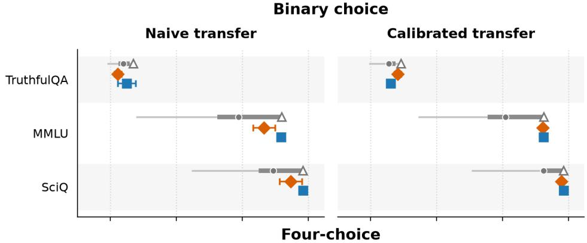

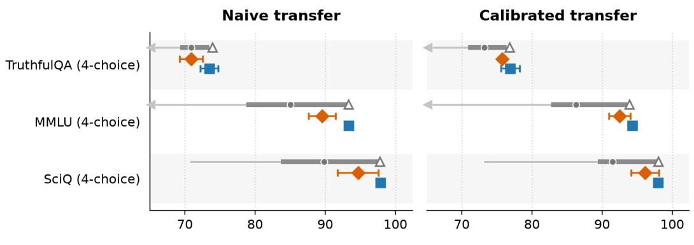  
Test AUROC  
Figure 4: Global and validation-selected local probes for trivia GT Prediction. Panels show direct and calibrated transfer for binary and four-choice tasks. Orange diamonds show validation-selected local probes; blue squares show global probes. Gray ranges summarize test AUROC across local depths, and hollow triangles mark the post-hoc local test oracle. Error bars are standard errors over three seeds. Left arrows indicate that a local-depth sweep extends below the displayed range.

## B.4 RECALL AT 10% FPR

Standard-vs-Anchored recall at relative depth 0.8 is similar on Output Prediction and differs by only a few points on GT Prediction, mirroring the AUROC parity. The calibration summary (Table 20) shows that anchored recall remains close to Standard within a model but drops more than AUROC under cross-model transfer. TruthfulQA GT Prediction is the one case where calibration does not improve recall.

Table 20: Linear-probe R@0.1FPR on trivia for Output Prediction and GT Prediction: same-model Anchored, mean cross-model Transfer, and source-calibrated Transfer (cal).
<table><tr><td></td><td colspan="3">Output Prediction</td><td colspan="3">GT Prediction</td></tr><tr><td>Dataset</td><td>Anchored</td><td>Transfer</td><td>Transfer (cal)</td><td>Anchored</td><td>Transfer</td><td>Transfer (cal)</td></tr><tr><td>TQA</td><td> $9 9 . 8 \pm 0 . 1$ </td><td> $9 4 . 8 \pm 1 . 0$ </td><td> $9 5 . 4 \pm 3 . 8$ </td><td> $6 9 . 4 \pm 2 . 5$ </td><td> $3 7 . 4 \pm 0 . 9$ </td><td> $3 4 . 0 \pm 1 . 2$ </td></tr><tr><td>MMLU</td><td> $9 9 . 6 \pm 0 . 1$ </td><td> $9 9 . 4 \pm 0 . 1 $ </td><td> $9 9 . 6 \pm 0 . 1$ </td><td> $8 6 . 9 \pm 1 . 4$ </td><td> $8 7 . 5 \pm 1 . 3$ </td><td> $8 7 . 9 \pm 0 . 9$ </td></tr><tr><td>SciQ</td><td> $1 0 0 . 0 \pm 0 . 0$ </td><td> $1 0 0 . 0 \pm 0 . 0$ </td><td> $1 0 0 . 0 \pm 0 . 0$ </td><td> $9 8 . 7 \pm 0 . 2 $ </td><td> $9 8 . 4 \pm 0 . 2 $ </td><td> $9 8 . 4 \pm 0 . 2 $ </td></tr></table>

## B.5 TRANSFER TO EXTERNAL MODEL TARGETS

Section 4.3.1 summarizes transfer to trivia models outside the original six-model pool. Table 21 expands the external GT Prediction averages into the binary- and four-choice versions of TruthfulQA, MMLU, and SciQ. Output Prediction remains close to saturated across the external targets, so we do not reproduce its full breakdown here.

Table 21: External-target trivia: GT Prediction. Each row reports mean AUROC ± standard error over three source/probe seeds.
<table><tr><td>Dataset / format</td><td>Target</td><td>Target-trained</td><td>Global transfer</td></tr><tr><td>TruthfulQA</td><td>OLMo-3-7B</td><td> $8 8 . 6 \pm 1 . 0$ </td><td> $8 0 . 7 \pm 0 . 6$ </td></tr><tr><td>TruthfulQA</td><td>GPT-OSS-20B</td><td> $9 3 . 0 \pm 0 . 8$ </td><td> $8 5 . 6 \pm 1 . 4$ </td></tr><tr><td>TruthfulQA</td><td>Gemma-3-12B</td><td> $9 2 . 4 \pm 1 . 2$ </td><td> $8 6 . 5 \pm 1 . 2$ </td></tr><tr><td>MMLU</td><td>OLMo-3-7B</td><td> $9 3 . 0 \pm 1 . 1$ </td><td> $9 3 . 1 \pm 1 . 3$ </td></tr><tr><td>MMLU</td><td>GPT-OSS-20B</td><td> $9 7 . 0 \pm 0 . 3$ </td><td> $9 7 . 6 \pm 0 . 4$ </td></tr><tr><td>MMLU</td><td>Gemma-3-12B</td><td> $9 7 . 7 \pm 0 . 3$ </td><td> $9 7 . 9 \pm 0 . 3$ </td></tr><tr><td>SciQ</td><td>OLMo-3-7B</td><td> $9 9 . 3 \pm 0 . 1 $ </td><td> $9 9 . 1 \pm 0 . 3$ </td></tr><tr><td>SciQ</td><td>GPT-OSS-20B</td><td> $9 9 . 8 \pm 0 . 1$ </td><td> $9 9 . 7 \pm 0 . 1 $ </td></tr><tr><td>SciQ</td><td>Gemma-3-12B</td><td> $9 9 . 5 \pm 0 . 1 $ </td><td> $9 9 . 6 \pm 0 . 1$ </td></tr><tr><td>TruthfulQA (four-choice)</td><td>OLMo-3-7B</td><td> $8 5 . 2 \pm 0 . 9$ </td><td> $8 1 . 2 \pm { 1 . 0 }$ </td></tr><tr><td>TruthfulQA (four-choice)</td><td>GPT-OSS-20B</td><td> $8 9 . 7 \pm 1 . 2$ </td><td> $8 8 . 1 \pm 0 . 9$ </td></tr><tr><td>TruthfulQA (four-choice)</td><td>Gemma-3-12B</td><td> $8 8 . 4 \pm 1 . 1$ </td><td> $8 4 . 0 \pm 1 . 5$ </td></tr><tr><td>MMLU (four-choice)</td><td>OLMo-3-7B</td><td> $9 2 . 0 \pm 0 . 9$ </td><td> $9 0 . 1 \pm 1 . 7$ </td></tr><tr><td>MMLU (four-choice)</td><td>GPT-OSS-20B</td><td> $9 6 . 5 \pm 0 . 2$ </td><td> $9 6 . 4 \pm 0 . 4$ </td></tr><tr><td>MMLU (four-choice)</td><td>Gemma-3-12B</td><td> $9 6 . 6 \pm 0 . 8$ </td><td> $9 5 . 8 \pm 0 . 1$ </td></tr><tr><td>SciQ (four-choice)</td><td>OLMo-3-7B</td><td> $9 7 . 3 \pm 0 . 6$ </td><td> $9 7 . 3 \pm 0 . 8$ </td></tr><tr><td>SciQ (four-choice)</td><td>GPT-OSS-20B</td><td> $9 9 . 1 \pm 0 . 1$ </td><td> $9 8 . 8 \pm 0 . 2$ </td></tr><tr><td>SciQ (four-choice)</td><td>Gemma-3-12B</td><td> $9 8 . 6 \pm 0 . 4$ </td><td> $9 7 . 6 \pm 0 . 7$ </td></tr></table>

## B.6 RELATED-DATA AND JOINT TRANSFER

Section 4.3.2 summarizes transfer among the trivia datasets. Here we test every source–target dataset direction with the same answer format under the common protocol in Appendix A.6. Table 22 reports same-model transfer. Output Prediction is saturated at least 99.1 AUROC in every direction. For GT Prediction, Global anchored probes outperform Standard in all displayed directions. The largest gains

occur when TruthfulQA is the source: $7 4 . 9  8 8 . 0$ on binary SciQ, 69.9 → 81.6 on binary MMLU, $8 5 . 9  9 5 . 5$ on four-choice SciQ, and $7 8 . 1  8 8 . 6$ on four-choice MMLU. SciQ–MMLU transfer is within half a point of target same-model performance, while TruthfulQA remains the difficult target distribution.  
Table 22: Same-model related-data trivia transfer (AUROC). Probes are trained on one trivia dataset, either binary or four-choice, and evaluated on another for the same monitored model. Standard and Local use relative depth 0.8; Global uses all layers. Values are mean test performance (%) ± standard error over three seeds and six models.
<table><tr><td rowspan="2">Transfer direction</td><td colspan="3">Output Prediction</td><td colspan="3">GT Prediction</td></tr><tr><td>Standard</td><td>Global anchored Local anchored</td><td></td><td>Standard</td><td></td><td>Global anchored Local anchored</td></tr><tr><td>Binary</td><td></td><td></td><td></td><td></td><td></td><td></td></tr><tr><td> $\mathrm { T Q A } { \dot {  } } \mathrm { S c i Q }$ </td><td> $1 0 0 . 0 \pm 0 . 0$ </td><td> $1 0 0 . 0 \pm 0 . 0$ </td><td> $1 0 0 . 0 \pm 0 . 0$ </td><td> $7 4 . 9 \pm 3 . 6$ </td><td> $8 8 . 0 \pm 3 . 4$ </td><td> $8 5 . 3 \pm 3 . 6$ </td></tr><tr><td> $\mathrm { S c i Q } \to \mathrm { T Q A }$ </td><td> $9 9 . 8 \pm 0 . 1$ </td><td> $9 9 . 8 \pm 0 . 1 $ </td><td> $9 9 . 8 \pm 0 . 1 $ </td><td> $7 3 . 2 \pm 1 . 9$ </td><td> $7 4 . 0 \pm 2 . 1$ </td><td> $7 3 . 5 \pm 2 . 0$ </td></tr><tr><td> $\mathrm { T Q A } \to \mathrm { M M L U }$ </td><td> $9 9 . 8 \pm 0 . 1$ </td><td> $9 9 . 8 \pm 0 . 1 $ </td><td> $9 9 . 8 \pm 0 . 1 $ </td><td> $6 9 . 9 \pm 2 . 7$ </td><td> $8 1 . 6 \pm 3 . 3$ </td><td> $7 9 . 4 \pm 3 . 3$ </td></tr><tr><td> $\mathbf { M M L U } \to \mathbf { T Q A }$ </td><td> $9 9 . 7 \pm 0 . 1 $ </td><td> $9 9 . 8 \pm 0 . 1 $ </td><td> $9 9 . 7 \pm 0 . 1 $ </td><td> $7 3 . 0 \pm 2 . 0$ </td><td> $7 5 . 4 \pm 2 . 1$ </td><td> $7 5 . 1 \pm 2 . 1$ </td></tr><tr><td> $\mathrm { S c i Q }  \mathrm { M M L U }$ </td><td> $9 9 . 8 \pm 0 . 1$ </td><td> $9 9 . 8 \pm 0 . 1 $ </td><td> $9 9 . 8 \pm 0 . 1 $ </td><td> $9 5 . 2 \pm 0 . 4$ </td><td> $9 6 . 3 \pm 0 . 4$ </td><td> $9 6 . 2 \pm 0 . 4$ </td></tr><tr><td> $\mathbf { M M L U } \to \mathbf { S c i Q }$ </td><td> $1 0 0 . 0 \pm 0 . 0$ </td><td> $1 0 0 . 0 \pm 0 . 0$ </td><td> $1 0 0 . 0 \pm 0 . 0$ </td><td> $9 8 . 8 \pm 0 . 3 $ </td><td> $9 9 . 3 \pm 0 . 1 $ </td><td> $9 9 . 3 \pm 0 . 2 $ </td></tr><tr><td>Four-choice</td><td></td><td></td><td></td><td></td><td></td><td></td></tr><tr><td> $\mathrm { T Q A } ( 4 )  \mathrm { S c i Q } ( 4 )$ </td><td> $1 0 0 . 0 \pm 0 . 0$ </td><td> $1 0 0 . 0 \pm 0 . 0$ </td><td> $1 0 0 . 0 \pm 0 . 0$ </td><td> $8 5 . 9 \pm 2 . 2$ </td><td> $9 5 . 5 \pm 1 . 1$ </td><td> $9 4 . 6 \pm 1 . 2$ </td></tr><tr><td> $\mathrm { S c i Q } ( 4 )  \mathrm { T Q A } ( 4 )$ </td><td> $9 9 . 3 \pm 0 . 2 $ </td><td> $9 9 . 4 \pm 0 . 2 $ </td><td> $9 9 . 1 \pm 0 . 2 $ </td><td> $7 3 . 6 \pm 1 . 1$ </td><td> $7 4 . 9 \pm 1 . 4$ </td><td> $7 4 . 0 \pm 1 . 2$ </td></tr><tr><td> $\mathrm { T Q A } ( 4 )  \mathrm { M M L U } ( 4 )$ </td><td> $9 9 . 6 \pm 0 . 1$ </td><td> $9 9 . 7 \pm 0 . 1 $ </td><td> $9 9 . 7 \pm 0 . 1 $ </td><td> $7 8 . 1 \pm 2 . 2$ </td><td> $8 8 . 6 \pm 1 . 5$ </td><td> $8 7 . 1 \pm 1 . 6$ </td></tr><tr><td> $\mathrm { M M L U } ( 4 )  \mathrm { T Q A } ( 4 )$ </td><td> $9 9 . 2 \pm 0 . 2 $ </td><td> $9 9 . 5 \pm 0 . 2 $ </td><td> $9 9 . 2 \pm 0 . 2 $ </td><td> $7 4 . 6 \pm 1 . 2$ </td><td> $7 7 . 3 \pm 1 . 4$ </td><td> $7 6 . 3 \pm 1 . 3$ </td></tr><tr><td> $\mathrm { S c i Q } ( 4 )  \mathrm { M M L U } ( 4 )$ </td><td> $9 9 . 7 \pm 0 . 1 $ </td><td> $9 9 . 7 \pm 0 . 1 $ </td><td> $9 9 . 7 \pm 0 . 1 $ </td><td> $9 3 . 2 \pm 0 . 4$ </td><td> $9 4 . 3 \pm 0 . 4$ </td><td> $9 3 . 9 \pm 0 . 4$ </td></tr><tr><td> $\mathrm { M M L U } \left( 4 \right) \to \mathrm { S c i Q } \left( 4 \right)$ </td><td> $1 0 0 . 0 \pm 0 . 0$ </td><td> $1 0 0 . 0 \pm 0 . 0$ </td><td> $1 0 0 . 0 \pm 0 . 0$ </td><td> $9 7 . 9 \pm 0 . 4$ </td><td> $9 8 . 4 \pm 0 . 4$ </td><td> $9 8 . 4 \pm 0 . 4$ </td></tr></table>

We next change both dataset and monitored model (Table 23). Global GT Prediction averages 83.1 under naive transfer and 86.1 under source calibration, compared with 87.0 for same-model relateddata transfer. Calibration therefore recovers most of the additional model-transfer penalty, although directions with TruthfulQA as source or target retain the largest gaps.

Table 23: Joint related-data and cross-model trivia transfer for GT Prediction. Transfer (cal) uses source-only validation. Values are mean test AUROC (%) ± standard error over seeds and target models.
<table><tr><td rowspan="2">Direction</td><td colspan="2">Global probe</td><td colspan="2">Local probe</td></tr><tr><td>Transfer</td><td>Transfer (cal)</td><td>Transfer</td><td>Transfer (cal)</td></tr><tr><td> $\mathrm { T Q A } \to \mathrm { S c i Q }$ </td><td> $7 5 . 6 \pm 2 . 3$ </td><td> $8 2 . 6 \pm 0 . 1$ </td><td> $7 6 . 8 \pm 2 . 8$ </td><td> $8 2 . 6 \pm 0 . 1$ </td></tr><tr><td> $\mathrm { S c i Q } \to \mathrm { T Q A }$ </td><td> $7 4 . 5 \pm 1 . 0$ </td><td> $7 4 . 3 \pm 1 . 3$ </td><td> $7 4 . 0 \pm 1 . 0$ </td><td> $7 4 . 0 \pm 1 . 0$ </td></tr><tr><td> $\mathrm { T Q A } \to \mathrm { M M L U }$ </td><td> $7 4 . 5 \pm 2 . 7$ </td><td> $8 0 . 6 \pm 0 . 1$ </td><td> $7 5 . 3 \pm 2 . 9$ </td><td> $8 0 . 8 \pm 0 . 1$ </td></tr><tr><td> $\mathbf { M M L U } \to \mathbf { T Q A }$ </td><td> $7 4 . 6 \pm 1 . 0$ </td><td> $7 5 . 0 \pm 0 . 8$ </td><td> $7 4 . 2 \pm 1 . 0$ </td><td> $7 4 . 5 \pm 0 . 7$ </td></tr><tr><td> $\mathrm { S c i Q }  \mathrm { M M L U }$ </td><td> $9 5 . 9 \pm 0 . 3$ </td><td> $9 6 . 1 \pm 0 . 4$ </td><td> $9 5 . 8 \pm 0 . 3$ </td><td> $9 5 . 9 \pm 0 . 3$ </td></tr><tr><td> $\mathbf { M M L U } \to \mathbf { S c i Q }$ </td><td> $9 9 . 2 \pm 0 . 1 $ </td><td> $9 9 . 3 \pm 0 . 1$ </td><td> $9 9 . 2 \pm 0 . 0$ </td><td> $9 9 . 3 \pm 0 . 1 $ </td></tr><tr><td> $\mathrm { T Q A } ( 4 )  \mathrm { S c i Q } ( 4 )$ </td><td> $8 1 . 5 \pm 3 . 3$ </td><td> $9 0 . 9 \pm 1 . 9$ </td><td> $8 3 . 4 \pm 2 . 9$ </td><td> $9 4 . 1 \pm 1 . 1$ </td></tr><tr><td> $\mathrm { S c i Q } ( 4 )  \mathrm { T Q A } ( 4 )$ </td><td> $7 5 . 5 \pm 0 . 4$ </td><td> $7 6 . 1 \pm 0 . 4$ </td><td> $7 4 . 7 \pm 0 . 5$ </td><td> $7 5 . 4 \pm 0 . 4$ </td></tr><tr><td> $\mathrm { T Q A } ( 4 )  \mathrm { M M L U } ( 4 )$ </td><td> $7 8 . 8 \pm 2 . 6$ </td><td> $8 8 . 4 \pm 0 . 6$ </td><td> $8 0 . 2 \pm 2 . 2$ </td><td> $8 9 . 4 \pm 0 . 7$ </td></tr><tr><td> $\mathrm { M M L U } \left( 4 \right) \to \mathrm { T Q A }$  (4)</td><td> $7 6 . 1 \pm 0 . 3$ </td><td> $7 7 . 1 \pm 0 . 4$ </td><td> $7 5 . 3 \pm 0 . 4$ </td><td> $7 5 . 7 \pm 0 . 4$ </td></tr><tr><td> $\mathbf { S c i Q } ( 4 )  \mathbf { M M L U }$  (4)</td><td> $9 3 . 8 \pm 0 . 2$ </td><td> $9 4 . 5 \pm 0 . 3$ </td><td> $9 3 . 3 \pm 0 . 1$ </td><td> $9 4 . 2 \pm 0 . 1$ </td></tr><tr><td> $\mathrm { M M L U } ( 4 )  \mathrm { S c i Q }$  (4)</td><td> $9 7 . 7 \pm 0 . 5$ </td><td> $9 8 . 1 \pm 0 . 3$ </td><td> $9 7 . 7 \pm 0 . 4$ </td><td> $9 7 . 9 \pm 0 . 3$ </td></tr><tr><td>Overall</td><td> $8 3 . 1 \pm 1 . 7$ </td><td> $8 6 . 1 \pm 1 . 6$ </td><td> $8 3 . 3 \pm 1 . 7$ </td><td> $8 6 . 1 \pm 1 . 6$ </td></tr></table>

## B.7 SENSITIVITY TO PROMPT PERTURBATIONS

Section 4.3.3 summarizes whether the trivia conclusions depend on the exact answer prompt used to elicit monitored-model completions. Here we use the same six trivia datasets and linear-probe setup to compare the standard prompt against two prompt variants: a shorter minimal prompt and a more explicit verbose prompt. We fit the probes and select source models once using the default-prompt data, then apply them unchanged to activations elicited by the two prompt variants; the shifted prompts do not trigger probe retraining or new source selection. The goal is twofold: first, to test whether anchored probes are more or less prompt-sensitive than standard probes; and second, to test whether prompt variation compounds the cross-model transfer penalty. Figures 5 and 6 plot the change in performance for each method relative to that same method’s score under the standard prompt, so negative bars indicate degradation under the shifted prompt. The standard prompt is the default chat-formatted multiple-choice prompt described in Appendix A.2. The two prompt variants have the following form:

Minimal prompt   
[User] {question}   
A. {answer A}   
B. {answer B}   
Answer:   
Verbose prompt   
[System] You are a knowledgeable assistant. The following   
is a   
multiple choice question. Read it carefully and select the   
best   
answer. Respond with only the letter corresponding to your   
choice   
(A/B/...). Do not include any explanation.   
[User] Question: {question}   
Options:   
A. {answer A}   
B. {answer B}   
Your answer (letter only):

This stress test is motivated by prior work showing that hidden-state probes can depend on seemingly incidental setup choices. For example, Orgad et al. (2024) find that token choice matters substantially for white-box hallucination detection, while Slobodkin et al. (2023) study prompt manipulation and decode answerability from first-generated-token representations. More broadly, prior work warns that white-box probes or telemetry-based detectors can be brittle under task, context, deployment, or adaptive model-side shifts (Levinstein & Herrmann, 2023; Kramár et al., 2026; Min et al., 2026). We therefore ask whether anchored probes and cross-model transfer show the same sensitivity to prompt variation as same-model standard probes.

We observe that same-model probes are quite sensitive to the minimal prompt on GT Prediction. Standard probes drop by 11.1 AUROC points on average across the six Trivia datasets, while samemodel Anchored probes drop by 8.1 points for global probes and 8.9 points for local probes. Thus anchoring reduces prompt sensitivity slightly relative to Standard, but does not eliminate it. The same effect is even larger for recall: the minimal prompt reduces Standard recall by 23.7 points and same-model Anchored recall by roughly 13.6–13.8 points. Both AUROC and recall drops are larger than the same-model-to-transfer gap under the standard prompt. For example, global Anchored GT Prediction AUROC drops by 8.1 points under the minimal prompt, whereas the average gap between same-model global Anchored and global Transfer (cal) under the standard prompt is 4.1 points.

Calibrated cross-model transfer is much less affected by the same prompt shift. For GT Prediction, global Transfer (cal) changes by only 1.1 AUROC points on average under the minimal prompt, and local Transfer (cal) changes by 1.0 point. Recall shows the same pattern: global Transfer (cal) changes by 1.4 points on average, while local Transfer (cal) changes by 0.6 points, despite the much larger same-model prompt sensitivity. One potential interpretation is that the strongest same-model probes exploit features that are predictive but brittle: they work for the same model and prompt style, but do not transfer reliably across either model identity or prompt wording. These features are not predictive under model transfer, which could explain why the drop when changing prompt style is much smaller. This interpretation is tentative: one family of prompt perturbations does not establish that transferred probes generally select more robust features.

Output Prediction is substantially more stable (see the different y-axis scale). Under the minimal prompt, most AUROC changes are within a few points, with the largest drops concentrated in the minimal-prompt four-choice variants.

Overall, same-model Trivia probes, including same-model anchored probes, are quite sensitive to a compressed prompt on the harder GT Prediction target. However, calibrated transfer remains stable

Output Prediction (AUROC)

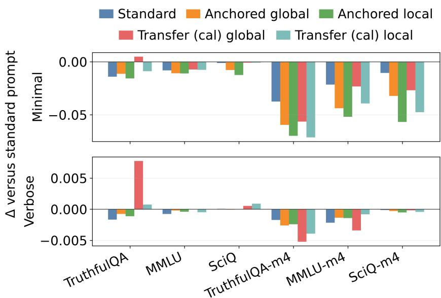

GT Prediction (AUROC)  
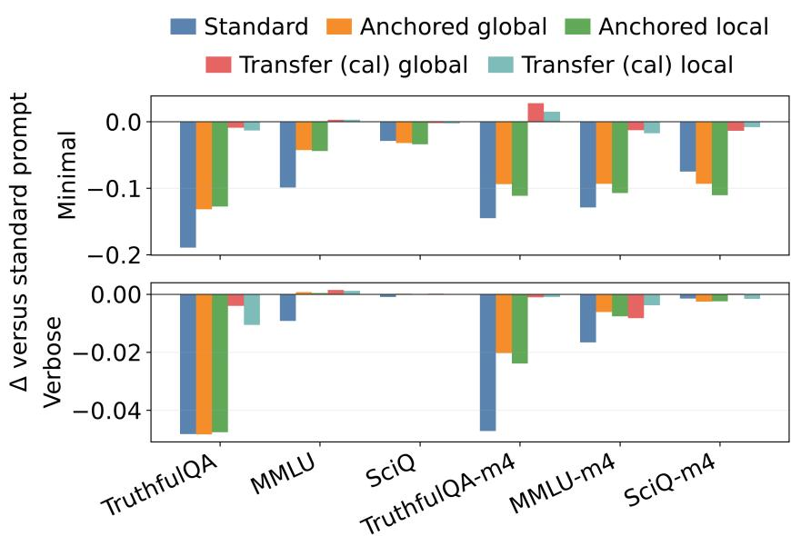  
Figure 5: Prompt sensitivity on the trivia datasets, measured by AUROC. Top: Output Prediction; bottom: GT Prediction. Bars show the shifted-prompt score minus the same method’s standardprompt score. Each panel compares Standard, same-model Anchored (global/local), and calibrated transfer (global/local).

across the same prompt shifts, suggesting that the transfer results are potentially more stable to prompt variations.

Output Prediction (R@0.1%FPR)  
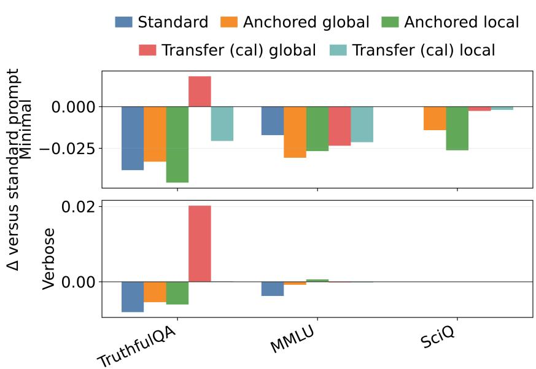

GT Prediction (R@0.1%FPR)  
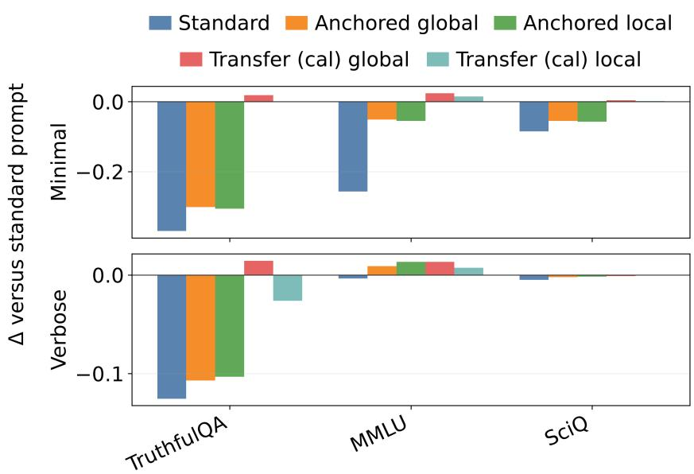  
Figure 6: Prompt sensitivity on the binary trivia datasets, measured by R@0.1FPR. Top: Output Prediction; bottom: GT Prediction. Bars use the same standard-prompt delta convention as Figure 5.

## B.8 ANCHOR COUNT ABLATIONS

The trivia experiments in Sections 4.1 and 4.2 use 300 anchors. To check whether this choice drives the linear-probe results, we repeat the global anchored cross-model evaluation with 100, 200, 300, and 400 anchors while holding the representation type, probe family, and calibration rule fixed. Table 24 reports AUROC for calibrated cross-model transfer (Transfer (cal)) for the same global anchored representations used in the main Trivia linear experiments.

The AUROC results are largely insensitive to the number of anchors. Output Prediction is nearsaturated for all six Trivia datasets; its largest change is the 1.3-point dip at 300 anchors on binary TruthfulQA. GT Prediction is also stable on MMLU, SciQ, and their four-choice variants. The clearest exception is binary TruthfulQA GT Prediction, where AUROC is higher with 100–200 anchors than with 300–400 anchors. This variation is modest relative to the main cross-model-transfer trends and does not suggest that larger anchor sets systematically improve transfer.

Table 24: Trivia linear-probe AUROC cross-model transfer (Transfer (cal)) as anchor set size varies from 100 to 400. All probes use global anchored representations and sklearn linear probes with C=1.0.
<table><tr><td>Dataset</td><td>Task</td><td>100 anchors</td><td>200 anchors</td><td>300 anchors</td><td>400 anchors</td></tr><tr><td>TQA</td><td>Output Pred.</td><td> $9 9 . 4 \pm 0 . 1 $ </td><td> $9 9 . 6 \pm 0 . 1$ </td><td> $9 8 . 3 \pm 1 . 3 $ </td><td> $9 9 . 6 \pm 0 . 2 $ </td></tr><tr><td>MMLU</td><td>Output Pred.</td><td> $9 9 . 8 \pm 0 . 0$ </td><td> $9 9 . 8 \pm 0 . 1$ </td><td> $9 9 . 8 \pm 0 . 1$ </td><td> $9 9 . 7 \pm 0 . 1 $ </td></tr><tr><td>SciQ</td><td>Output Pred.</td><td> $1 0 0 . 0 \pm 0 . 0$ </td><td> $1 0 0 . 0 \pm 0 . 0$ </td><td> $9 9 . 9 \pm 0 . 0$ </td><td> $9 9 . 9 \pm 0 . 0$ </td></tr><tr><td>TQA (4)</td><td>Output Pred.</td><td> $9 8 . 6 \pm 0 . 2 $ </td><td> $9 8 . 8 \pm 0 . 2 $ </td><td> $9 9 . 0 \pm 0 . 2 $ </td><td> $9 9 . 0 \pm 0 . 1$ </td></tr><tr><td>MMLU (4)</td><td>Output Pred.</td><td> $9 9 . 5 \pm 0 . 1 $ </td><td> $9 9 . 5 \pm 0 . 0$ </td><td> $9 9 . 5 \pm 0 . 0$ </td><td> $9 9 . 5 \pm 0 . 0$ </td></tr><tr><td>SciQ (4)</td><td>Output Pred.</td><td> $9 9 . 9 \pm 0 . 0$ </td><td> $9 9 . 9 \pm 0 . 0$ </td><td> $9 9 . 9 \pm 0 . 0$ </td><td> $9 9 . 9 \pm 0 . 0$ </td></tr><tr><td>TQA</td><td>GT Pred.</td><td> $7 5 . 9 \pm 1 . 1$ </td><td> $7 5 . 1 \pm 0 . 4$ </td><td> $7 3 . 1 \pm 0 . 5$ </td><td> $7 2 . 7 \pm 0 . 4$ </td></tr><tr><td>MMLU</td><td>GT Pred.</td><td> $9 6 . 1 \pm 0 . 3$ </td><td> $9 6 . 3 \pm 0 . 2$ </td><td> $9 6 . 2 \pm 0 . 2$ </td><td> $9 6 . 2 \pm 0 . 2$ </td></tr><tr><td>SciQ</td><td>GT Pred.</td><td> $9 9 . 3 \pm 0 . 1 $ </td><td> $9 9 . 3 \pm 0 . 0$ </td><td> $9 9 . 3 \pm 0 . 0$ </td><td> $9 9 . 3 \pm 0 . 0$ </td></tr><tr><td>TQA (4)</td><td>GT Pred.</td><td> $7 5 . 9 \pm 0 . 3$ </td><td> $7 7 . 1 \pm 1 . 0$ </td><td> $7 6 . 9 \pm 1 . 3$ </td><td> $7 7 . 1 \pm 0 . 6$ </td></tr><tr><td>MMLU (4)</td><td>GT Pred.</td><td> $9 3 . 6 \pm 0 . 4$ </td><td> $9 3 . 7 \pm 0 . 5$ </td><td> $9 4 . 3 \pm 0 . 2 $ </td><td> $9 4 . 6 \pm 0 . 2$ </td></tr><tr><td>SciQ (4)</td><td>GT Pred.</td><td> $9 7 . 8 \pm 0 . 4$ </td><td> $9 8 . 0 \pm 0 . 3 $ </td><td> $9 8 . 0 \pm 0 . 3 $ </td><td> $9 8 . 1 \pm 0 . 3 $ </td></tr></table>

## B.9 POOLED-MMLU SCALE AND TRANSFER DIAGNOSTICS

Data and anchor scale. The model-scale analysis summarized in Section 4.3.3 uses nested 1K/3K/6K/10K subsets from a 14,042-example pooled-MMLU dataset and repeats cross-model GT Prediction across three seeds. We evaluate 300 and 1000 anchors except in the 1K condition, whose 600-example training split cannot supply 1000 anchors. The scale matrix averages the available datasize and anchor-count conditions within each seed before averaging the three seeds; the anchor-count comparison below uses only the common 3K/6K/10K conditions. Table 25 shows no systematic improvement with more probe-training data: cross-model AUROC is 75.8 at 1K examples and 76.5 at 10K, with a lower intermediate 3K cell. On the common 3K/6K/10K grid, 300 anchors outperform 1000 (76.8 versus 74.7 cross-model AUROC), consistent with the Trivia anchor-count experiment in Appendix B.8.

Table 25: Pooled-MMLU GT Prediction scale checks. Data-size rows average all valid anchor counts at that size. Anchor-count rows use the common 3K/6K/10K cells. Values are AUROC (%), mean ± standard error over three seeds.
<table><tr><td>Setting</td><td></td><td>All pairs Cross-model</td></tr><tr><td>1K examples 3K examples 6K examples</td><td> $7 8 . 3 \pm 2 . 2$   $7 7 . 3 \pm 0 . 3$   $7 8 . 9 \pm 0 . 5$ </td><td> $7 5 . 8 \pm 2 . 9$   $7 4 . 3 \pm 0 . 9$   $7 6 . 3 \pm 0 . 6$ </td></tr><tr><td>10K examples 300 anchors 1000 anchors</td><td> $7 9 . 1 \pm 0 . 2$   $7 9 . 1 \pm 0 . 4$   $7 7 . 8 \pm 0 . 3$ </td><td> $7 6 . 5 \pm 0 . 2$   $7 6 . 8 \pm 0 . 3$   $7 4 . 7 \pm 0 . 6$ </td></tr></table>

Table 26 reports transfer across the same-family 1B/8B/70B ladder. It shows strong upward transfer into the 70B target and weak downward transfer into the 1B target. This scale experiment uses naive transfer and is separate from the six-model cross-family experiment in Section 4.2. The asymmetry repeats the weak-target pattern in Section 4.2. One possible interpretation is that features used by the 1B probe remain predictive in the larger models, whereas probes trained on larger models rely on richer distinctions that are absent or encoded differently in the 1B model.

Table 26: Pooled-MMLU GT Prediction AUROC (%) across the same-family 1B/8B/70B scale ladder. For each seed, we compute AUROC separately for 1K examples with 300 anchors and for 3K, 6K, and 10K examples with either 300 or 1000 anchors. Each cell averages seven AUROCs within a seed, then averages three resulting seed-level values. Values are mean ± standard error over seeds. Rows are source models and columns are target models.
<table><tr><td>Source / target</td><td>1B</td><td>8B</td><td>70B</td></tr><tr><td>1B</td><td> $6 8 . 2 \pm 0 . 7$ </td><td> $8 6 . 5 \pm 0 . 8$ </td><td> $9 4 . 8 \pm 0 . 1$ </td></tr><tr><td>8B</td><td> $5 1 . 2 \pm 0 . 5$ </td><td> $8 7 . 3 \pm 1 . 1$ </td><td> $9 5 . 3 \pm 0 . 0$ </td></tr><tr><td>70B</td><td> $5 0 . 5 \pm 0 . 8$ </td><td> $7 6 . 0 \pm 1 . 5$ </td><td> $9 6 . 0 \pm 0 . 2$ </td></tr></table>

Target-performance diagnostic. Across the six main Trivia variants and six target models, target answer accuracy correlates strongly with mean incoming off-diagonal GT-transfer AUROC (Spearman $\rho = 0 . 9 7 6 .$ , Pearson $r = 0 . 8 8 8 , n = 3 6$ target–dataset cells). This extends the observed weaktarget pattern from TruthfulQA to pooled MMLU. Because target accuracy requires labels, it is a retrospective correlate rather than a label-free pre-deployment signal. Figure 2 illustrates the pattern on binary TruthfulQA: transfer into Llama-3.2-3B remains near or below chance from every offdiagonal source, even though transfer into most other targets is strong. Within this dataset, target accuracy and mean incoming transfer have Spearman ρ = 1.000 (Pearson $r = 0 . 9 6 4 , n = 6 )$ ; Llama-3.2-3B is lowest on both, with 55.8% answer accuracy and 46.4 mean incoming AUROC.

## B.10 STANDARD CROSS-MODEL PROBE BASELINE

Section 4.2 argues that standard (non-anchored) probes cannot in general be applied directly across architectures. Here we test the same approach empirically for the one pair in our pool that shares both hidden dimension and layer count: Llama-3.1-8B-Instruct and Mistral-7B-Instruct-v0.3 (both 4096-dim, 32 transformer layers). For this pair, a standard probe trained on one model can be applied directly to the other without any dimension mismatch.

For Trivia, standard transfer at relative depth 0.8 is weak and inconsistent: the average across cells is only 48.0 AUROC, versus 96.6 for the same-model standard baseline reported in Section 4.1. Under anchored global linear probes, mean cross-model AUROC rises from 48.0 to 94.0. Output Prediction remains at or above 95 AUROC in both directions, showing that the anchored representation restores transferability that raw coordinates lack for this model pair (Tables 27 and 28).

Table 27: Standard cross-model linear-probe AUROC for the trivia tasks between Llama-3.1-8B-Instruct and Mistral-7B-Instruct-v0.3. Both models have 32 layers and 4096-dimensional residual streams; probes use layer 25 (0.8 relative depth). Values are means ± standard errors over three seeds.
<table><tr><td rowspan="2">Dataset</td><td colspan="2">Output Prediction</td><td colspan="2">GT Prediction</td></tr><tr><td>Llama→Mistral</td><td>Mistral→Llama</td><td>Llama→Mistral</td><td>Mistral→Llama</td></tr><tr><td>TQA</td><td> $4 2 . 5 \pm 1 2 . 1$ </td><td> $5 1 . 5 \pm 3 . 7$ </td><td> $4 4 . 8 \pm 2 . 7$ </td><td> $5 0 . 1 \pm 3 . 2$ </td></tr><tr><td>SciQ</td><td> $6 9 . 5 \pm 1 7 . 2$ </td><td> $6 7 . 3 \pm 1 5 . 8$ </td><td> $1 9 . 6 \pm 4 . 6$ </td><td> $5 9 . 0 \pm 1 6 . 1$ </td></tr><tr><td>MMLU</td><td> $5 6 . 4 \pm 7 . 2$ </td><td> $6 5 . 4 \pm 1 0 . 3$ </td><td> $3 5 . 8 \pm 1 0 . 6$ </td><td> $4 3 . 6 \pm 1 1 . 8$ </td></tr><tr><td>TQA (4)</td><td> $5 1 . 1 \pm 1 . 3$ </td><td> $3 8 . 9 \pm 2 . 0$ </td><td> $4 7 . 2 \pm 2 . 2$ </td><td> $4 8 . 6 \pm 5 . 3$ </td></tr><tr><td>SciQ (4)</td><td> $4 5 . 5 \pm 4 . 1$ </td><td> $3 5 . 9 \pm 2 . 3$ </td><td> $3 2 . 9 \pm 3 . 5$ </td><td> $5 2 . 4 \pm 7 . 1$ </td></tr><tr><td>MMLU (4)</td><td> $5 0 . 0 \pm 1 . 7$ </td><td> $4 6 . 0 \pm 7 . 0$ </td><td> $5 4 . 3 \pm 6 . 4$ </td><td> $4 4 . 0 \pm 3 . 8$ </td></tr></table>

Table 28: Global anchored linear-probe AUROC for the trivia tasks between Llama-3.1-8B-Instruct and Mistral-7B-Instruct-v0.3 (300 anchors). Values are means ± standard errors over three seeds.
<table><tr><td rowspan="2">Dataset</td><td colspan="2">Output Prediction</td><td colspan="2">GT Prediction</td></tr><tr><td>Llama→Mistral</td><td>Mistral→Llama</td><td>Llama→Mistral</td><td>Mistral→Llama</td></tr><tr><td>TQA</td><td> $9 9 . 4 \pm 0 . 5$ </td><td> $9 8 . 6 \pm 0 . 7$ </td><td> $8 1 . 7 \pm 1 . 7$ </td><td> $6 2 . 9 \pm 8 . 7$ </td></tr><tr><td>SciQ</td><td> $1 0 0 . 0 \pm 0 . 0$ </td><td> $1 0 0 . 0 \pm 0 . 0$ </td><td> $9 7 . 5 \pm 0 . 4$ </td><td> $9 9 . 9 \pm 0 . 0$ </td></tr><tr><td>MMLU</td><td> $9 9 . 9 \pm 0 . 0$ </td><td> $9 9 . 7 \pm 0 . 1 $ </td><td> $9 5 . 1 \pm 1 . 6$ </td><td> $9 6 . 4 \pm 0 . 7$ </td></tr><tr><td>TQA (4)</td><td> $9 9 . 7 \pm 0 . 1 $ </td><td> $9 5 . 9 \pm 1 . 7$ </td><td> $7 8 . 8 \pm 0 . 9$ </td><td> $7 3 . 2 \pm 1 . 5$ </td></tr><tr><td>SciQ (4)</td><td> $9 9 . 9 \pm 0 . 0$ </td><td> $9 9 . 9 \pm 0 . 0$ </td><td> $9 2 . 3 \pm 1 . 5$ </td><td> $9 9 . 1 \pm 0 . 4$ </td></tr><tr><td>MMLU (4)</td><td> $9 9 . 8 \pm 0 . 1$ </td><td> $9 8 . 7 \pm 0 . 6 $ </td><td> $9 3 . 4 \pm 0 . 8$ </td><td> $9 4 . 6 \pm 0 . 9$ </td></tr></table>

## B.11 ALL-LAYER STANDARD PROBES

To separate the effect of anchor-relative coordinates from whole-network concatenation, we train standard probes (no anchoring) on the concatenated all-layer vector and compare them with singlelayer standard probes across relative depths. At the prespecified standard-probe depth of 0.8, alllayer standard probes usually match a single-layer standard probe. This indicates that all-layer concatenation may also, in principle, provide a strong standard linear probing default. However, the resulting feature vector is quite large, at (num\_layers × hidden\_dim), and this may complicate training especially for non-linear probes. The additional benefit of the global anchored representation is fixing the feature dimension to the number of anchors.

For Trivia linear probes, the all-layer and depth-0.8 single-layer standard probes have similar AUROC (Tables 29 and 30). The depth sweep in Figure 7 shows that the all-layer standard probe mainly helps relative to shallow single-layer probes.

Table 29: Linear-probe AUROC on trivia for Output Prediction: same-model standard probes at relative depth 0.8 and on concatenated all-layer activations (C=1.0, C=0.1, C=0.01). Dataset abbreviations: TQA = TruthfulQA; (4) denotes the four-choice variant.
<table><tr><td>Dataset</td><td></td><td></td><td></td><td>Single-layer All-layer C=1.0 All-layer C=0.1 All-layer C=0.01</td></tr><tr><td>TQA</td><td> $9 9 . 7 \pm 0 . 0$ </td><td> $9 9 . 7 \pm 0 . 1 $ </td><td> $9 9 . 6 \pm 0 . 1$ </td><td> $9 9 . 7 \pm 0 . 1 $ </td></tr><tr><td>MMLU</td><td> $9 9 . 8 \pm 0 . 0$ </td><td> $9 9 . 8 \pm 0 . 0$ </td><td> $9 9 . 8 \pm 0 . 0$ </td><td> $9 9 . 8 \pm 0 . 1$ </td></tr><tr><td>SciQ</td><td> $1 0 0 . 0 \pm 0 . 0$ </td><td> $9 9 . 9 \pm 0 . 0$ </td><td> $1 0 0 . 0 \pm 0 . 0$ </td><td> $1 0 0 . 0 \pm 0 . 0$ </td></tr><tr><td>TQA (4)</td><td> $9 9 . 5 \pm 0 . 1 $ </td><td> $9 9 . 5 \pm 0 . 1 $ </td><td> $9 9 . 4 \pm 0 . 0$ </td><td> $9 9 . 4 \pm 0 . 1 $ </td></tr><tr><td>MMLU (4)</td><td> $9 9 . 7 \pm 0 . 0$ </td><td> $9 9 . 7 \pm 0 . 1 $ </td><td> $9 9 . 6 \pm 0 . 0$ </td><td> $9 9 . 6 \pm 0 . 0$ </td></tr><tr><td>SciQ (4)</td><td> $1 0 0 . 0 \pm 0 . 0$ </td><td> $1 0 0 . 0 \pm 0 . 0$ </td><td> $1 0 0 . 0 \pm 0 . 0$ </td><td> $1 0 0 . 0 \pm 0 . 0$ </td></tr></table>

Table 30: Linear-probe AUROC on trivia for GT Prediction: same-model standard probes at relative depth 0.8 and on concatenated all-layer activations (C=1.0, C=0.1, C=0.01). Dataset abbreviations: $\mathrm { T Q A } = \mathrm { T r u t h f u l Q A } ;$ (4) denotes the four-choice variant.
<table><tr><td>Dataset</td><td></td><td></td><td></td><td>Single-layer All-layer C=1.0 All-layer C=0.1 All-layer C=0.01</td></tr><tr><td>TQA</td><td> $8 9 . 4 \pm 1 . 2$ </td><td> $8 9 . 3 \pm 0 . 6$ </td><td> $8 9 . 4 \pm 0 . 5$ </td><td> $8 9 . 6 \pm 0 . 5$ </td></tr><tr><td>MMLU</td><td> $9 4 . 8 \pm 0 . 2$ </td><td> $9 4 . 5 \pm 0 . 2 $ </td><td> $9 5 . 0 \pm 0 . 2$ </td><td> $9 5 . 2 \pm 0 . 3$ </td></tr><tr><td>SciQ</td><td> $9 9 . 2 \pm 0 . 1$ </td><td> $9 9 . 2 \pm 0 . 1 $ </td><td> $9 9 . 2 \pm 0 . 1$ </td><td> $9 9 . 3 \pm 0 . 1 $ </td></tr><tr><td>TQA (4)</td><td> $8 5 . 5 \pm 0 . 3$ </td><td> $8 4 . 3 \pm 0 . 8$ </td><td> $8 5 . 5 \pm 0 . 5$ </td><td> $8 5 . 8 \pm 0 . 5$ </td></tr><tr><td>MMLU (4)</td><td> $9 3 . 4 \pm 0 . 2$ </td><td> $9 3 . 5 \pm 0 . 3$ </td><td> $9 3 . 9 \pm 0 . 3$ </td><td> $9 4 . 2 \pm 0 . 2 $ </td></tr><tr><td>SciQ (4)</td><td> $9 8 . 2 \pm 0 . 3 $ </td><td> $9 8 . 1 \pm 0 . 2 $ </td><td> $9 8 . 1 \pm 0 . 2 $ </td><td> $9 8 . 3 \pm 0 . 2 $ </td></tr></table>

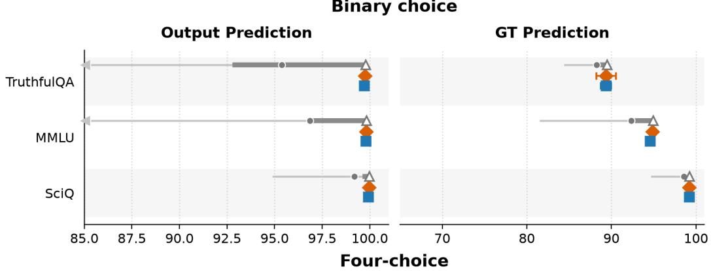

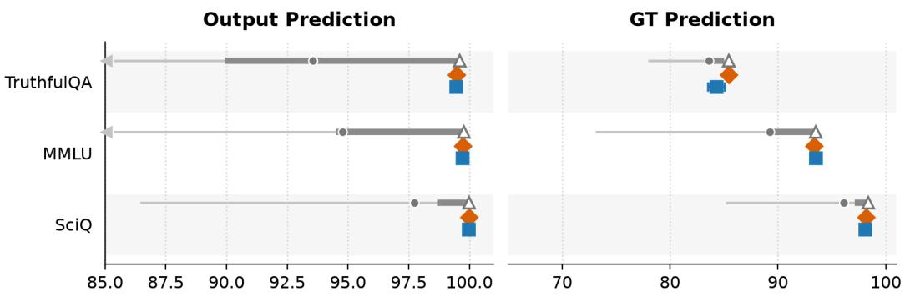  
Test AUROC  
Figure 7: Standard probes across layers on trivia. Orange diamonds show the prespecified singlelayer baseline at relative depth 0.8; blue squares show standard probes on concatenated all-layer activations. Gray segments summarize test AUROC across single-layer depths (range, interquartile range, and mean), and hollow triangles mark the post-hoc test oracle. Error bars are standard errors over three seeds.

## C GUARD DISTILLATION RESULTS

This section expands the Guard Distillation results. The calibration progression and low-FPR recall results appear in Sections C.1, C.2. Section C.3 reports external model targets. The related-data transfer results appear in Section C.4. Sections C.5, C.6, and C.7 examine anchor-token aggregation, anchor coverage, and local-depth selection. Probe-design checks cover class balancing and attention pooling in Sections C.8 and C.9. Section C.10 reports relational evidence; Section C.11 evaluates MLP probes. Sections C.12, C.13, and C.14 provide additional cross-model controls.

## C.1 FULL CALIBRATION PROGRESSION

Section 4.2 reports Transfer (naive transfer) and $\mathrm { T r a n s f e r ~ \ t c a l { \Sigma } ) }$ (calibrated transfer with $N = 5 )$ as representative endpoints. Table 31 reports the complete $N = 1 , \ldots , 5$ progression alongside the Anchored same-model column for Guard Distillation linear probes with single-token anchors, where N is the number of available source models. Transfer reaches 81.1 AUROC on BeaverTails and 81.6 on Toxic-chat; Transfer (cal) improves both datasets, reaching 86.4 on BeaverTails and 83.6 on Toxic-chat. Relative to chance, Transfer (cal) preserves 81.1% and 89.6% of same-model Anchored performance, respectively.

Table 31: Linear-probe AUROC for Guard Distillation: same-model Anchored and cross-model Transfer as the available source pool grows. Transfer (cal-N) uses source-only validation within each N-model pool.
<table><tr><td>Dataset</td><td>Anchored</td><td>Transfer</td><td>Transfer (cal-2)</td><td>Transfer (cal-3)</td><td>Transfer (cal-4)</td><td>Transfer (cal)</td></tr><tr><td>BeaverTails</td><td> $9 4 . 9 \pm 0 . 2 $ </td><td> $8 1 . 1 \pm 1 . 2$ </td><td> ${ \bf 8 6 . 5 \pm 1 . 5 }$ </td><td> $8 5 . 4 \pm 1 . 9$ </td><td> $8 5 . 9 \pm 2 . 9$ </td><td> $8 6 . 4 \pm 4 . 6$ </td></tr><tr><td>Toxic-chat</td><td> $8 7 . 5 \pm 0 . 7$ </td><td> $8 1 . 6 \pm 0 . 7$ </td><td> $8 2 . 0 \pm 0 . 5$ </td><td> $8 2 . 5 \pm 0 . 6$ </td><td> $8 3 . 0 \pm 0 . 8$ </td><td> ${ \bf 8 3 . 6 \pm 1 . 0 }$ </td></tr></table>

## C.2 RECALL AT 10% FPR

Low-FPR recall retains the AUROC ordering but has larger gaps between same-model and transferred probes. With single-token anchors, Table 32 shows that same-model Standard and Anchored recall are close: Anchored reaches 82.0 on BeaverTails and 65.9 on Toxic-chat, compared with 86.0 and 68.6 for the single-layer Standard probe at relative depth 0.8. The full calibration progression in Table 33 shows that naive Transfer drops to 55.4 and 47.7, respectively, while Transfer (cal) improves to 63.5 on BeaverTails and 53.0 on Toxic-chat. Thus calibration remains useful at low FPR, especially on BeaverTails, but the recall metric exposes more cross-model fragility than AUROC.

Table 32: Linear-probe R@0.1FPR for Guard Distillation: same-model Standard and global Anchored probes.
<table><tr><td rowspan="2">Dataset</td><td colspan="2">Guard Distillation</td></tr><tr><td>Standard</td><td>Anchored</td></tr><tr><td>BeaverTails</td><td> $8 6 . 0 \pm 1 . 2$ </td><td> $8 2 . 0 \pm 2 . 1$ </td></tr><tr><td>Toxic-chat</td><td> $6 8 . 6 \pm 2 . 2$ </td><td> $6 5 . 9 \pm 3 . 4$ </td></tr></table>

Table 33: Linear-probe R@0.1FPR for Guard Distillation: same-model Anchored and cross-model Transfer as the available source pool grows. Transfer (cal-N) uses source-only validation within each N-model pool.
<table><tr><td>Dataset</td><td>Anchored</td><td>Transfer</td><td>Transfer (cal-2)</td><td>Transfer (cal-3)</td><td>Transfer (cal-4) Transfer (cal)</td><td></td></tr><tr><td>BeaverTails</td><td> $8 2 . 0 \pm 2 . 1$ </td><td> $5 5 . 4 \pm 2 . 7$ </td><td> ${ \bf 6 3 . 6 \pm 3 . 9 }$ </td><td> $6 0 . 1 \pm 4 . 8$ </td><td> $6 1 . 9 \pm 7 . 1$ </td><td> $6 3 . 5 \pm 1 0 . 5$ </td></tr><tr><td>Toxic-chat</td><td> $6 5 . 9 \pm 3 . 4$ </td><td> $4 7 . 7 \pm 1 . 9$ </td><td> $4 8 . 3 \pm 2 . 1$ </td><td> $4 9 . 9 \pm 2 . 9$ </td><td> $5 1 . 5 \pm 3 . 7$ </td><td> ${ \bf 5 3 . 0 \pm 4 . 8 }$ </td></tr></table>

## C.3 TRANSFER TO EXTERNAL MODEL TARGETS

Section 4.3.1 summarizes transfer to Guard Distillation targets outside the original six-model pool. Table 34 separates BeaverTails and Toxic-chat and reports their unsafe-completion rates. Toxic-chat provides the more stable external-target test: all seed-level AUROCs are defined and calibrated transfer remains strongest for OLMo-3. BeaverTails has only 1.0–4.8% unsafe completions across the three external models. One OLMo-3 test seed contains no unsafe example, so both its target-trained and transferred AUROC are undefined; the reported OLMo-3 BeaverTails means use the other two seeds. This imbalance makes BeaverTails a demanding, high-uncertainty test, while the lower GPT-OSS and Gemma-3 point estimates show that low prevalence is not the only relevant source of transfer error.

Table 34: External-target Guard results and event rates. Single-token anchored representations are used throughout. One OLMo-3 BeaverTails seed has no unsafe test examples, so its AUROC is undefined and the corresponding AUROC means use two seeds; prevalence uses all three seeds.
<table><tr><td>Target</td><td>Dataset</td><td>Target-trained</td><td>Global transfer</td><td>Unsafe prevalence</td></tr><tr><td>OLMo-3-7B</td><td>BeaverTails</td><td> $9 5 . 1 \pm 1 . 7$ </td><td> $7 9 . 2 \pm 3 . 0$ </td><td> $( 1 . 0 \pm 0 . 5 ) \%$ </td></tr><tr><td>OLMo-3-7B</td><td>Toxic-chat</td><td> $8 9 . 6 \pm 1 . 8$ </td><td> $8 7 . 6 \pm 1 . 4$ </td><td> $( 9 . 0 \pm 0 . 9 ) \%$ </td></tr><tr><td>GPT-OSS-20B</td><td>BeaverTails</td><td> $8 5 . 2 \pm { 1 . 5 }$ </td><td> $5 7 . 5 \pm 1 2 . 6$ </td><td> $( 1 . 5 \pm 0 . 0 ) \%$ </td></tr><tr><td>GPT-OSS-20B</td><td>Toxic-chat</td><td> $7 3 . 1 \pm 1 . 5$ </td><td> $6 6 . 9 \pm 3 . 8$ </td><td> $( \mathrm { { 1 0 . 3 \pm 0 . 2 } } ) \%$ </td></tr><tr><td>Gemma-3-12B</td><td>BeaverTails</td><td> $8 5 . 6 \pm 1 . 5$ </td><td> $6 3 . 0 \pm 7 . 5$ </td><td> $( 4 . 8 \pm 0 . 9 ) \%$ </td></tr><tr><td>Gemma-3-12B</td><td>Toxic-chat</td><td> $8 6 . 9 \pm 2 . 1$ </td><td> $7 2 . 6 \pm 1 1 . 4$ </td><td> $( \mathrm { { 1 1 . 8 \pm 0 . 3 } } ) \%$ </td></tr></table>

## C.4 RELATED-DATA AND JOINT TRANSFER

Section 4.3.2 summarizes transfer between BeaverTails and Toxic-chat. Here we report both directions, first for the same monitored model and then while also changing model identity, using the common protocol in Appendix A.6. Hidden-state detectors can be brittle under such distribution shifts (Orgad et al., 2024; Levinstein & Herrmann, 2023; Kramár et al., 2026; Min et al., 2026).

Table 35 reports the same-model result. Averaged over directions, Standard, Global, and Local reach 78.3, 77.9, and 77.9 AUROC. This aggregate hides a strong asymmetry: Global reaches 70.2 from BeaverTails to Toxic-chat but 85.5 in the reverse direction. Anchoring therefore roughly matches Standard on average but does not make this distribution shift uniformly robust.

Table 35: Same-model related-data Guard Distillation transfer with single-token anchors. Probes are trained on one safety dataset and evaluated on the other. Global uses all layers; Standard and Local use relative depth 0.8. Values are mean test AUROC (%) ± standard error over three seeds and six models.
<table><tr><td>Transfer direction</td><td>Standard</td><td>Global anchored Local anchored</td><td></td></tr><tr><td>BeaverTails → Toxic-chat</td><td> $7 2 . 7 \pm 2 . 0$ </td><td> $7 0 . 2 \pm 2 . 1$ </td><td> $7 0 . 2 \pm 1 . 9$ </td></tr><tr><td>Toxic-chat → BeaverTails</td><td> $8 3 . 9 \pm 1 . 6$ </td><td> $8 5 . 5 \pm 1 . 0$ </td><td> $8 5 . 6 \pm 0 . 9$ </td></tr></table>

Changing both dataset and model further reduces performance (Table 36). Global Transfer reaches 64.3/75.8 by direction and 70.1 overall; source calibration raises the reverse direction to 79.6 but changes the weak direction only to 65.1, for 72.4 overall. Calibration therefore does not close the directional gap.

Table 36: Guard Distillation related-data and cross-model AUROC (%) with single-token anchors. Transfer (cal) uses source-only validation.
<table><tr><td>Direction</td><td>Global</td><td>Global (cal)</td><td>Local</td><td>Local (cal)</td></tr><tr><td>BeaverTails → Toxic-chat</td><td> $6 4 . 3 \pm 0 . 5$ </td><td> $6 5 . 1 \pm 0 . 5$ </td><td> $6 4 . 2 \pm { 0 . 8 }$ </td><td> $6 3 . 5 \pm 0 . 4$ </td></tr><tr><td>Toxic-chat → BeaverTails</td><td> $7 5 . 8 \pm 0 . 4$ </td><td> $7 9 . 6 \pm 1 . 3$ </td><td> $6 9 . 9 \pm 0 . 4$ </td><td> $8 3 . 0 \pm 1 . 1$ </td></tr></table>

## C.5 ANCHOR-AGGREGATION SENSITIVITY

We repeat both same-model related-data transfer and joint model-and-dataset transfer with mean-token anchors, which average each anchor completion’s token representations before computing anchorrelative features. The anchor index still refers to the same prompt across models, but the corresponding vector now depends on each model’s generated completion. This comparison tests whether promptindexed relational structure can remain useful even when exact anchor tokens are not shared.

When training and evaluating on the same dataset, mean-token anchors change same-model AUROC by at most 1.1 points and calibrated transfer by at most 2.7 points. Under same-model related-data transfer, they raise the Global/Local averages from 77.9/77.9 to 80.0/80.6 (Table 37). When both dataset and model change, switching to mean-token anchors has mixed effects: calibrated Global improves from 72.4 to 75.0 overall, while naive Global falls from 70.1 to 65.8 (Table 38). Meantoken anchors are therefore a useful sensitivity result, not a uniformly better replacement for the single-token-anchor baseline.

Table 37: Same-model related-data Guard Distillation transfer with mean-token anchors. Probes are trained on one safety dataset and evaluated on the other. Global uses all layers; Standard and Local use relative depth 0.8. Values are mean test AUROC (%) ± standard error over three seeds and six models.
<table><tr><td>Transfer direction</td><td>Standard</td><td>Global anchored</td><td>Local anchored</td></tr><tr><td>BeaverTails → Toxic-chat</td><td> $7 2 . 7 \pm 2 . 0$ </td><td> $7 1 . 7 \pm 2 . 0$ </td><td> $7 3 . 1 \pm 1 . 8$ </td></tr><tr><td>Toxic-chat → BeaverTails</td><td> $8 3 . 9 \pm 1 . 6$ </td><td> $8 8 . 3 \pm 1 . 0$ </td><td> $8 8 . 0 \pm 1 . 0 $ </td></tr></table>

Table 38: Guard Distillation related-data and cross-model AUROC (%) with mean-token anchors. Transfer (cal) uses source-only validation.
<table><tr><td>Direction</td><td>Global</td><td>Global (cal)</td><td></td><td>Local Local (cal)</td></tr><tr><td>BeaverTails → Toxic-chat</td><td> $6 1 . 0 \pm 0 . 8$ </td><td> $7 0 . 7 \pm 3 . 4$ </td><td> $5 8 . 6 \pm 0 . 6$ </td><td> $6 9 . 0 \pm 2 . 3$ </td></tr><tr><td>Toxic-chat → BeaverTails</td><td> $7 0 . 6 \pm 0 . 5$ </td><td> $7 9 . 2 \pm 5 . 1$ </td><td> $6 7 . 7 \pm 0 . 4$ </td><td> $7 6 . 0 \pm 2 . 6$ </td></tr></table>

## C.6 ANCHOR COVERAGE AND MIXED-ANCHOR MITIGATION

The weak BeaverTails→Toxic-chat direction also has poorer label-free anchor coverage: its mean nearest-anchor angular distance is 1.209, versus 1.182 in the reverse direction, while same-model degradation is 17.3 versus 9.3 points. Across all applications this association is only moderate; nearest anchor distance tracks the directional difference here but is not an established general predictor.

We test a coverage-oriented intervention using an unlabeled 50/50 anchor pool from both datasets. In the mean-token setting, mixed global anchors narrow the naive direction gap from 9.6 to 1.9 points, but leave average naive AUROC similar and reduce calibrated average AUROC from 75.0 to 70.4. They do improve low-FPR recall in the weak direction, from 17.9 to 28.7 naively and from 24.9 to 35.5 after calibration. Mixed anchors thus alter the failure pattern and improve weak-direction coverage; they do not uniformly improve AUROC or solve the underlying shift (Table 39).

Table 39: Guard Distillation joint related-data and cross-model transfer with a 50/50 unlabeled BeaverTails/Toxic-chat anchor pool. Values are AUROC (%) ± standard error over three seeds.
<table><tr><td>Direction</td><td></td><td>Transfer Transfer (cal)</td></tr><tr><td>BeaverTails → Toxic-chat</td><td> $6 4 . 6 \pm 0 . 7$ </td><td> $7 0 . 4 \pm 2 . 4$ </td></tr><tr><td>Toxic-chat → BeaverTails</td><td> $6 6 . 5 \pm 0 . 6$ </td><td> $7 0 . 3 \pm 3 . 0$ </td></tr></table>

Local mixed-anchor results are less stable and sometimes reverse the directional imbalance. Mixed anchors therefore do not provide a consistently better response to the data shift (Table 40).

Table 40: Guard Distillation joint related-data and cross-model transfer with a 50/50 unlabeled BeaverTails/Toxic-chat anchor pool. Values are AUROC (%) ± standard error over three seeds.
<table><tr><td>Direction</td><td></td><td>Transfer Transfer (cal)</td></tr><tr><td>BeaverTails → Toxic-chat</td><td> $6 3 . 8 \pm 1 . 1$ </td><td> $6 9 . 6 \pm 4 . 6$ </td></tr><tr><td>Toxic-chat → BeaverTails</td><td> $6 5 . 0 \pm 1 . 1$ </td><td> $5 9 . 8 \pm 2 . 2$ </td></tr></table>

## C.7 VALIDATION-SELECTED LOCAL DEPTHS

Figure 8 compares local-depth selection with the global representation for both single-token and mean-token anchors. For same-model evaluation, each model and seed selects a depth using its own validation split. For naive transfer, each source selects its depth using source-model validation. For calibrated transfer, source-pool validation jointly selects source and depth for each in-pool target. All reported values are then evaluated on test data; only the hollow-triangle oracle uses test AUROC to choose depth.

For the single-token comparison summarized in Section 4.3.3, validation-based depth selection improves calibrated local transfer from 85.1 to 86.4 AUROC on BeaverTails and from 80.4 to 82.0 on Toxic-chat. The selected local probe ties global on BeaverTails and trails it on Toxic-chat (82.0 versus 83.6). Across both anchor constructions, joint source–depth validation often improves on fixed depth 0.8, but does not consistently realize the stronger local result visible to the test oracle. Global anchoring is therefore the more reliable depth-free choice under the available validation protocol.

Test AUROC  
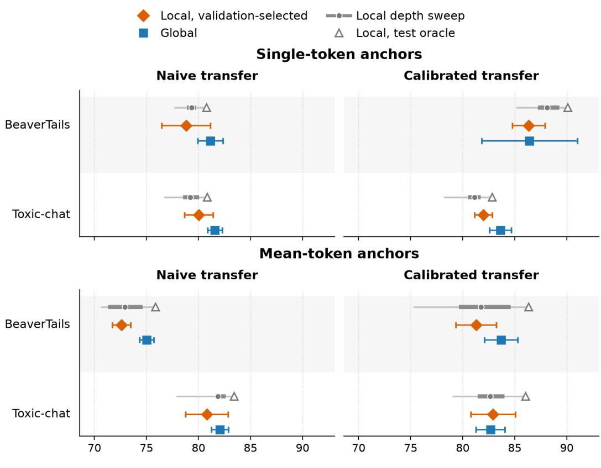  
Figure 8: Guard local-depth policies with single-token and mean-token anchors. Orange diamonds select source and depth using source-pool validation; blue squares are global anchored probes. Gray ranges summarize local test AUROC across depths, and hollow triangles choose depth post hoc on test AUROC while retaining the source policy. Mean-token anchors are an appendix robustness analysis; Section 4.2 uses single-token anchors. Error bars are standard errors over three seeds.

## C.8 CLASS BALANCING ABLATION

We also check whether class balancing is useful for linear Guard Distillation probes. In particular, we run mean-token-anchor global probes with class balancing. Table 41 shows that class balancing is not an across-the-board improvement. It slightly improves BeaverTails same-model AUROC and recall, but worsens BeaverTails naive-transfer $\bar { \bf A U R O C }$ and recall. On Toxic-chat, class balancing is worse in both same-model and transfer comparisons for both metrics. Thus despite the heavy imbalance in the Guard Distillation data (Table 9), the linear Guard results do not suggest that class weighting is generally beneficial.

Table 41: Class-balancing diagnostic for Guard Distillation linear/mean global probes. Rows compare the default unweighted linear probe with class-balanced linear training. Transfer averages off-diagonal source-target applications. Values are mean ± standard error across three seed-level aggregates.
<table><tr><td rowspan="2">Dataset</td><td rowspan="2">Evaluation</td><td colspan="3">AUROC</td><td colspan="3">R@0.1FPR</td></tr><tr><td>Default</td><td>Balanced</td><td>∆</td><td>Default</td><td>Balanced</td><td> $\Delta$ </td></tr><tr><td>BeaverTails</td><td>Anchored</td><td> $9 4 . 6 \pm 0 . 3$ </td><td> $9 5 . 0 \pm 0 . 4$ </td><td> $+ 0 . 4 \pm 0 . 1$ </td><td> $7 9 . 9 \pm 1 . 9$ </td><td> $8 3 . 3 \pm 3 . 6 $ </td><td> $+ 3 . 4 \pm 2 . 1$ </td></tr><tr><td>BeaverTails</td><td>Transfer</td><td> $7 5 . 0 \pm 0 . 7$ </td><td> $7 2 . 9 \pm 0 . 4$ </td><td> $- 2 . 1 \pm 0 . 4$ </td><td> $4 6 . 8 \pm 1 . 8$ </td><td> $4 3 . 3 \pm 0 . 6$ </td><td> $- 3 . 5 \pm 1 . 8$ </td></tr><tr><td>Toxic-chat</td><td>Anchored</td><td> $8 8 . 6 \pm 0 . 4$ </td><td> $8 8 . 4 \pm 0 . 6 $ </td><td> $- 0 . 2 \pm 0 . 2$ </td><td> $6 7 . 2 \pm 2 . 9$ </td><td> $6 6 . 6 \pm 3 . 1$ </td><td> $- 0 . 6 \pm 0 . 5$ </td></tr><tr><td>Toxic-chat</td><td>Transfer</td><td> $8 2 . 1 \pm 0 . 8$ </td><td> $8 1 . 2 \pm 1 . 0$ </td><td> $- 0 . 9 \pm 0 . 2$ </td><td> $4 9 . 7 \pm 2 . 2$ </td><td> $4 8 . 3 \pm 2 . 3$ </td><td> $- 1 . 4 \pm 0 . 4$ </td></tr></table>

## C.9 SEQUENCE PROBING WITH ATTENTION PROBES

Because the Guard Distillation probes aggregate completion-token representations, we also test whether a learned attention-pooling probe can improve over fixed mean pooling. This is plausible because attention can, in principle, focus on especially informative generated tokens rather than averaging over the full completion. Like the class-balancing check above, this diagnostic uses the mean-token-anchor variant rather than the main single-token-anchor baseline. The diagnostic attention probe uses the same global anchored feature construction and mean-token anchors as the fixed linear/mean-token reference: 600 sampled anchors, angular-distance relative coordinates, completiontoken relative activations, and the same six monitored models and Guard datasets. Architecturally, it is a single-head attention-pooling probe: a learned linear score is applied to each completion-token feature vector, a softmax pools tokens into one weighted feature vector, and a linear binary classifier predicts the Guard label. We train these probes in PyTorch with AdamW, learning rate $1 0 ^ { - 3 }$ , weight decay $1 0 ^ { - 2 }$ , batch size 64, and up to 20 epochs with validation-loss early stopping with patience 3.

In diagnostic runs, unbalanced attention pooling is consistently worse than a matched linear probe with mean pooling, with large AUROC gaps for both same-model Anchored evaluations and crossmodel Transfer on both Guard datasets.

We also try class balancing as a diagnostic for why the unbalanced attention probe underperforms. The motivation is that Guard labels are skewed, so an unbalanced training objective can obtain reasonable loss or accuracy by emphasizing the majority class and underweighting the rarer safety violations. This concern is stronger for attention than for the linear/mean probes because attention must also learn which tokens to pool; if minority-class evidence is rare, the pooling rule can receive little pressure to attend to those tokens. Class balancing helps substantially, suggesting that label skew is a real optimization issue for learned attention pooling. This contrasts with the fixed linear/mean probes in Section C.8, where class balancing does not help overall and tends to hurt transfer. Even after balancing, however, attention remains below the linear/mean reference overall: the BeaverTails transfer AUROC gap is small, but same-model performance, Toxic-chat transfer, and recall at 0.1 FPR remain clearly weaker.

As an additional regularization check, we run the class-balanced attention diagnostic with AdamW weight decay set to $1 0 ^ { - 1 }$ instead of $1 0 ^ { - 2 }$ , while keeping the same AUROC checkpoint selection. This stronger regularization gives small AUROC gains and improves same-model low-FPR recall, especially on BeaverTails, but does not close the gap to the linear/mean reference. BeaverTails transfer AUROC is close, but same-model performance, Toxic-chat transfer, and low-FPR recall still lag.

Completion length is a consistent diagnostic difference, but the detailed pattern depends on the dataset and regularization setting. In BeaverTails transfer, attention is closest to linear/mean on short completions and remains substantially worse on long completions; class balancing and stronger weight decay reduce this long-completion gap but do not remove it. Toxic-chat also shows length sensitivity, though the largest remaining gap after balancing is on middle-length completions rather than the longest completions, and stronger regularization mostly preserves that pattern. A similar pattern applies to the same-model setting: on same-model BeaverTails evaluations, balanced attention is close to linear/mean on short completions but substantially worse on longer completions, including under stronger regularization.

In the tested configurations, attention pooling is a worse inductive bias for Guard Distillation relativetoken sequences, even after reducing the label-imbalance issue. This is not a generic failure of the attention architecture: for the Standard same-model probing baseline, attention is close to linear/mean in AUROC and at low FPR. The observed underperformance is thus specific to the combination of attention pooling and anchored features in this experiment; determining whether data volume, regularization, or another factor causes the gap requires further study.

## C.10 ANCHOR CORRESPONDENCE AND RELATIONAL CONTROLS

Section 4.3.3 summarizes our tests of how closely anchor representations must correspond across models. Here we ask whether different models organize the shared anchor examples similarly enough for their identities to be recovered from relational geometry alone. We hide the anchor correspondence and give the matching procedure only the two anchor-to-anchor distance matrices. Without prompt content or a shared activation basis, the matcher can identify an anchor only through its pattern of distances to the other anchors. Above-chance recovery therefore indicates that these relational patterns are partly preserved across models. Table 42 summarizes the aggregate result: graph matching recovers 20.7% of hidden identities, compared with 0.16% for random one-to-one mappings. Applying the source probe after this recovered mapping yields 79.0 AUROC, versus 54.8 for random mappings and 83.2 with known prompt correspondence. The recovered correspondence is therefore also functionally useful. Normal monitor deployment uses known anchor identities and does not require correspondence recovery.

Table 42: Blinded recovery of 600 anchor identities from relational geometry and the resulting Guard probe transfer. AUROC and chance-corrected retention average two datasets, three seeds, four model pairs, and both transfer directions; Random averages 20 mappings per pair condition. Values are mean ± standard error over three seed-level aggregates.
<table><tr><td>Mapping</td><td></td><td>Exact (%) Weighted (%) AUROC (%) Retention (%)</td><td></td><td></td></tr><tr><td>Fingerprint assignment</td><td> $4 . 8 9 \pm 0 . 0 5$ </td><td> $4 . 6 5 \pm 0 . 0 7$ </td><td> $7 0 . 6 \pm 0 . 6$ </td><td> $4 8 . 5 \pm 1 . 8$ </td></tr><tr><td>Graph matching</td><td> $2 0 . 7 2 \pm 0 . 2 9$ </td><td> $2 0 . 6 1 \pm 0 . 3 2$ </td><td> $7 9 . 0 \pm 1 . 9$ </td><td> $7 0 . 4 \pm 4 . 7$ </td></tr><tr><td>Known prompt identity</td><td> $1 0 0 . 0 0 \pm 0 . 0 0$ </td><td> $1 0 0 . 0 0 \pm 0 . 0 0$ </td><td> $8 3 . 2 \pm 0 . 7$ </td><td> $8 1 . 3 \pm 1 . 7$ </td></tr><tr><td>Random mapping</td><td> $0 . 1 6 \pm 0 . 0 0$ </td><td> $0 . 1 5 \pm 0 . 0 1$ </td><td> $5 4 . 8 \pm 1 . 0$ </td><td> $1 2 . 7 \pm 2 . 1$ </td></tr></table>

Blinded recovery protocol. For each model pair, we construct a $6 0 0 \times 6 0 0$ matrix of angular distances among the Guard anchors. The target anchor order is randomized. The matching procedure receives only the source and reordered target matrices. It has no access to the anchor prompts, hidden correspondence, labels, fitted probe, validation set, or test set.

We first describe each anchor by 64 quantiles of its distances to the other anchors. These summaries are invariant to the order of the remaining anchors. A linear assignment gives an initial one-toone mapping. We refine the mapping by maximizing agreement between all pairwise distances. The refinement uses the initial assignment, a uniform initialization, and two seeded randomized initializations. We select the mapping with the highest geometric objective.

One BeaverTails seed-1 condition served as the development pilot for the two-stage procedure, the 64-quantile fingerprint, and the graph-matching initializations. These choices were then frozen before evaluation across BeaverTails and Toxic-chat, three seed configurations, and four prespecified model pairs. Two pairs are within the Llama or Qwen2.5 families. Two cross-family pairs compare Llama-3.1-8B with Mistral-7B or Qwen2.5-7B. Each of the 24 pair conditions is evaluated in both transfer directions and compared with 20 random one-to-one mappings.

Table 43: Blinded graph-matching recovery by dataset and model-pair scope. Each row averages two prespecified model pairs, three seeds, and, for AUROC, both transfer directions. Known prompt identity is a correspondence control rather than a guaranteed performance upper bound. Values are percentages, mean ± standard error over three seed-level aggregates.
<table><tr><td>Dataset</td><td>Pair scope</td><td>Graph recovery</td><td>Graph AUROC</td><td>Known-ID AUROC</td><td>Random AUROC</td></tr><tr><td>BeaverTails</td><td>Same family</td><td> $2 0 . 6 \pm 0 . 1$ </td><td> $8 5 . 2 \pm 1 . 6$ </td><td> $8 7 . 5 \pm 1 . 7$ </td><td> $5 1 . 2 \pm 1 . 7$ </td></tr><tr><td>BeaverTails</td><td>Cross family</td><td> $1 0 . 3 \pm 1 . 5$ </td><td> $7 8 . 9 \pm 4 . 8$ </td><td> $7 8 . 4 \pm 1 . 1$ </td><td> $5 2 . 7 \pm 1 . 2$ </td></tr><tr><td>Toxic-chat</td><td>Same family</td><td> $4 6 . 8 \pm 0 . 4$ </td><td> $8 3 . 0 \pm 1 . 1$ </td><td> $8 2 . 3 \pm 0 . 8$ </td><td> $5 8 . 0 \pm 0 . 5$ </td></tr><tr><td>Toxic-chat</td><td>Cross family</td><td> $5 . 3 \pm 0 . 1$ </td><td> $6 8 . 8 \pm 1 . 3$ </td><td> $8 4 . 6 \pm 0 . 4$ </td><td> $5 7 . 4 \pm 1 . 2$ </td></tr></table>

Table 43 shows substantial variation across model-pair scope. Exact recovery reaches 20.6% for same-family BeaverTails pairs and 46.8% for same-family Toxic-chat pairs. The corresponding crossfamily values are 10.3% and 5.3%. Cross-family recovery remains above the random expectation. Its functional value depends strongly on the dataset. Graph-mapped AUROC is 78.9 on the BeaverTails cross-family pairs and 68.8 on the Toxic-chat cross-family pairs.

Known prompt identity is a correspondence control. Its mean AUROC is higher than graph matching overall. Graph matching exceeds it in 12 of the 48 directions. Graph matching directly optimizes agreement between the two anchor graphs and can occasionally find a task-favorable permutation. Its in-sample edge agreement should therefore not be treated as an independent outcome. Exact hidden identity recovery and test-set probe transfer provide the independent evaluations.

Probe-weighted recovery weights every correctly mapped anchor by the absolute coefficient assigned to that source coordinate, then divides by the total absolute coefficient weight. Its similarity to exact recovery indicates that the current matcher does not preferentially recover the most heavily weighted probe coordinates. Chance-corrected retention is $( \mathrm { A U R O C } _ { \mathrm { t r a n s f e r } } - 0 . 5 ) / ( \mathrm { A U R O C } _ { \mathrm { s a m e } \mathrm { - } \mathrm { m o d e l } } - 0 . 5 )$

Coordinate-permutation control. We also test whether a frozen source probe depends on the ordering of the known anchor coordinates. For every directed source–target pair among the six main models, we derange 0%, 25%, 50%, 75%, or 100% of the target coordinates. Each nonzero fraction uses 20 deterministic permutations. Mean AUROC declines from 0.812 to 0.524 on BeaverTails and from 0.816 to 0.582 on Toxic-chat as the permuted fraction increases from 0% to 100%. A coordinated control applies the same permutation to target features, scaler statistics, and probe coefficients. It reproduces the original probabilities to numerical precision.

This control confirms that transfer uses matched anchor indexing. Its interpretation is limited because any coordinate-sensitive classifier should degrade when feature values are paired with the wrong fitted coefficients. We therefore treat it as an implementation and indexing check.

Frame congruence and transfer. Finally, we ask whether a scalar measure of agreement between matched anchor frames predicts functional transfer. This analysis contains 90 unordered model-pair, dataset, and seed conditions. Spearman correlation between corresponding anchor-graph edges is 0.146 with mean bidirectional AUROC, 0.208 with mean bidirectional chance-corrected retention, and 0.273 with minimum bidirectional retention. Block-bootstrap 95% intervals are [−0.055, 0.256], [0.048, 0.261], and [0.112, 0.353], respectively.

The relationship varies by dataset. For mean retention, the correlation is 0.224 on BeaverTails and −0.015 on Toxic-chat. Alignment measures computed on validation examples are also mixed. Matched-profile correlation and linear CKA do not reliably predict transfer. A modest pooled RSA association is driven by BeaverTails. The dataset-dependent and mostly null associations provide no reliable label-free scalar predictor for an individual transfer. They motivate the constructive recovery test and bound the interpretation of geometric agreement.

## C.11 MLP PROBES

We next ask whether the global anchored representation also supports nonlinear probes. We use an MLP with 64 hidden units, no dropout, weight decay 0.001, no class weighting, and mean-token completion aggregation. These MLP probes also use mean-token anchors, whereas the linear Guard comparison in Section 4.2 uses single-token anchors. We optimize with Adam at learning rate $1 0 ^ { - 3 }$ and batch size 64 for at most 50 epochs. Training stops after five epochs without improvement in validation loss, and we restore the checkpoint with the lowest validation loss. Table 44 shows same-model performance for standard non-anchored probes and global anchored probes. The global MLP remains below the linear global probe in same-model AUROC, but retains strong performance: 92.2 AUROC on BeaverTails and 83.1 on Toxic-chat. The standard MLP baseline is also below the standard linear probe, so the MLP results should be read as a nonlinear stress test rather than a replacement for the linear Guard probe.

Table 44: Same-model Guard Distillation AUROC for linear and MLP probes with mean-token anchors. The MLP has 64 hidden units, and its global variant uses target-anchor normalization.
<table><tr><td>Dataset</td><td></td><td>Standard linear Standard MLP</td><td></td><td>Global linear Global MLP</td></tr><tr><td>BeaverTails</td><td> $9 6 . 5 \pm 0 . 1$ </td><td> $9 2 . 5 \pm 2 . 0$ </td><td> $9 4 . 6 \pm 0 . 3$ </td><td> $9 2 . 2 \pm 1 . 2$ </td></tr><tr><td>Toxic-chat</td><td> $8 8 . 6 \pm 0 . 8$ </td><td> $8 3 . 5 \pm 0 . 4$ </td><td> $8 8 . 6 \pm 0 . 4$ </td><td> $8 3 . 1 \pm 0 . 7$ </td></tr></table>

With source-training normalization, however, cross-model MLP transfer is poor. We therefore test whether the nonlinear probe is sensitive to differences in feature scaling between source and target models.

The relevant implementation detail is feature normalization. Like most probe-training pipelines, our probes normalize features before fitting the classifier. In the standard same-model setting, and in most of our linear transfer experiments, this normalization uses the feature mean and standard deviation estimated on the source model’s probe-training split. For cross-model transfer, however, those source-model statistics need not match the target model’s anchored feature distribution. This mismatch is mild for the linear Guard probes: in the spot check in Table 47, replacing source-train normalization by target-anchor normalization changes cross-model AUROC by at most about one point. For the MLP, source-normalized transfer produces saturated scores and poor performance. We therefore evaluate a target-anchor normalization strategy. At application time, we normalize the target model’s anchored features using the mean and standard deviation of that target model’s anchor-example features, rather than the source model’s training examples. This uses no target Guard labels and no target train/validation/test examples; it only reuses the anchor prompts that are already required to construct the anchored representation.

Cross-model transfer is more nuanced. Table 45 shows that target-anchor-normalized naive singlesource transfer reaches 76.5 AUROC on BeaverTails and 78.0 on Toxic-chat. On BeaverTails, this is slightly above the linear global-probe naive transfer result (75.0 AUROC), but the difference is small relative to run-to-run uncertainty; on Toxic-chat, it remains below linear. Canonical source selection by validation AUROC gives only modest additional gains for this MLP: Transfer (cal) reaches 78.7 AUROC on BeaverTails and 78.5 on Toxic-chat. Most of the improvement therefore comes from changing the normalization rather than from source selection.

Table 45: Guard Distillation MLP AUROC across calibration-pool sizes, using mean-token anchors and target-anchor normalization. Transfer (cal-N) uses source-only validation within each N-model pool.
<table><tr><td>Dataset</td><td>Anchored</td><td>Transfer</td><td></td><td>Transfer (cal-2) Transfer (cal-3) Transfer (cal-4) Transfer (cal)</td><td></td><td></td></tr><tr><td>BeaverTails</td><td> ${ \bf 9 2 . 2 \pm 1 . 2 }$ </td><td> $7 6 . 5 \pm 1 . 5$ </td><td> $8 2 . 1 \pm 1 . 9$ </td><td> $8 1 . 2 \pm 2 . 1$ </td><td> $8 0 . 9 \pm 2 . 0$ </td><td> $7 8 . 7 \pm 4 . 1$ </td></tr><tr><td>Toxic-chat</td><td> ${ \bf 8 3 . 1 \pm 0 . 7 }$ </td><td> $7 8 . 0 \pm 1 . 1$ </td><td> $7 8 . 7 \pm 0 . 5$ </td><td> $7 9 . 2 \pm 0 . 5$ </td><td> $7 9 . 1 \pm 0 . 8$ </td><td> $7 8 . 5 \pm 1 . 3$ </td></tr></table>

At low false-positive rates, the target-anchor-normalized MLP still trails the linear Guard probe. Transfer (cal) reaches 46.0 R@0.1FPR on BeaverTails and 41.7 on Toxic-chat. Thus target-anchor normalization substantially reduces the source-normalized MLP failure, but it does not make the MLP competitive with the linear Guard probe on recall (Table 46).

Target-anchor normalization Figure 9 compares source-training and target-anchor normalization. With source-training normalization, naive cross-model AUROC averages only 57.7 on BeaverTails and 62.9 on Toxic-chat. Replacing source normalization by target-anchor normalization raises this to

Table 46: Guard Distillation MLP R@0.1FPR across calibration-pool sizes, using mean-token anchors and target-anchor normalization. Transfer (cal-N) uses source-only validation within each N-model pool.
<table><tr><td>Dataset</td><td>Anchored</td><td>Transfer</td><td>Transfer (cal-2)</td><td>Transfer (cal-3)</td><td>Transfer (cal-4) Transfer (cal)</td><td></td></tr><tr><td>BeaverTails</td><td> ${ \bf 7 8 . 3 \pm 2 . 5 }$ </td><td> $4 4 . 1 \pm 2 . 5$ </td><td> $5 0 . 8 \pm 4 . 2$ </td><td> $4 8 . 8 \pm 5 . 2$ </td><td> $4 8 . 5 \pm 5 . 4$ </td><td> $4 6 . 0 \pm 9 . 2$ </td></tr><tr><td>Toxic-chat</td><td> ${ \bf 5 1 . 9 \pm 0 . 5 }$ </td><td> $4 3 . 4 \pm 2 . 2$ </td><td> $4 3 . 1 \pm 1 . 8$ </td><td> $4 3 . 8 \pm 2 . 3$ </td><td> $4 3 . 5 \pm 3 . 1 $ </td><td> $4 1 . 7 \pm 4 . 6$ </td></tr></table>

76.5 and 78.0, respectively. The large gap between source-normalized and target-anchor-normalized MLP transfer suggests that the nonlinear probe is sensitive to cross-model differences in the scale of anchor-relative features, rather than primarily to label calibration. Target-anchor normalization mitigates the observed failure using only unlabeled anchor examples from the target model. For R@0.1FPR, target-anchor normalization also improves the MLP relative to its source-normalized version, but only recovers it from a collapsed baseline: after normalization, the MLP still remains below or roughly tied with the linear global probe.

Target-anchor normalization is much less important for linear probes in this experiment. Table 47 shows a single-seed Guard linear spot check: target-anchor normalization changes AUROC by at most about one point, and it does not improve the R@0.1FPR metric in this spot check. This supports a practical distinction: target-anchor normalization is useful for avoiding the source-normalized MLP transfer failure, especially in AUROC, but it is not a general recipe for improving low-FPR recall.

Table 47: Single-seed Guard Distillation linear-probe comparison of source-train and target-anchor normalization under direct cross-model transfer. Each value averages 30 source-target applications.
<table><tr><td rowspan="2">Dataset</td><td rowspan="2">Anchor rep.</td><td colspan="2">AUROC</td><td colspan="2">R@0.1FPR</td></tr><tr><td>Source norm</td><td>Target norm</td><td>Source norm</td><td>Target norm</td></tr><tr><td>BeaverTails</td><td>mean-token</td><td>75.8</td><td>75.6</td><td>50.3</td><td>46.8</td></tr><tr><td>BeaverTails</td><td>single-token</td><td>83.0</td><td>83.9</td><td>59.2</td><td>53.0</td></tr><tr><td>Toxic-chat</td><td>mean-token</td><td>81.6</td><td>81.9</td><td>47.1</td><td>47.2</td></tr><tr><td>Toxic-chat</td><td>single-token</td><td>81.0</td><td>81.4</td><td>46.9</td><td>44.2</td></tr></table>

Alternative MLP configurations We sweep a small set of target-anchor-normalized MLP regularization and architecture variants. Table 48 includes the default MLP and four variants with weight decay 0.01, 32 or 64 hidden units, with or without dropout. For compactness, table columns use h64/h32 for hidden size, d0.0/d0.1 for dropout probability, and wd for weight decay. The regularized variants move naive transfer only modestly, so we retain the default MLP with 64 hidden units for the baseline and normalization comparisons in this appendix. All five target-anchor-normalized MLP variants have similar AUROC and retain the same BeaverTails-versus-Toxic-chat ordering.

We also test class-balanced training for the 64-hidden-unit, no-dropout architecture. Table 49 shows that it does not help: the default AUROC values repeat the 64-hidden-unit, no-dropout column in Table 48, and class balancing does not improve either AUROC or R@0.1FPR. We therefore use no class weighting in every default-MLP comparison reported here.

Table 48: Guard Distillation cross-model AUROC for target-anchor-normalized MLP architecture and regularization variants. All rows use global anchored representations, no class weighting, and mean-token anchor aggregation. The first column is the default 64-hidden-unit MLP with no dropout; the remaining columns use weight decay 0.01 and vary hidden size and dropout.
<table><tr><td>Dataset</td><td>h64 d0.0 wd0.001</td><td>h64 d0.0 wd0.01</td><td>h64 d0.1 wd0.01</td><td>h32 d0.0 wd0.01</td><td>h32 d0.1 wd0.01</td></tr><tr><td>BeaverTails</td><td> $7 6 . 5 \pm 1 . 5$ </td><td> $7 7 . 9 \pm 1 . 7$ </td><td> $7 8 . 2 \pm 1 . 8$ </td><td> $7 8 . 6 \pm 0 . 6$ </td><td> $7 8 . 3 \pm 1 . 1$ </td></tr><tr><td>Toxic-chat</td><td> $7 8 . 0 \pm 1 . 1$ </td><td> $7 8 . 4 \pm 1 . 0$ </td><td> $7 8 . 5 \pm 1 . 1$ </td><td> $7 7 . 5 \pm 0 . 8$ </td><td> $7 8 . 5 \pm 1 . 1$ </td></tr></table>

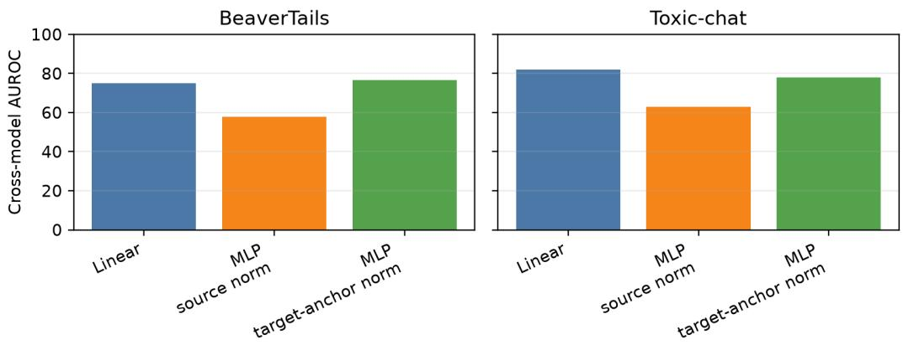  
Figure 9: Guard Distillation global-probe cross-model AUROC under linear and default MLP settings with 64 hidden units. Target-anchor normalization substantially improves the source-normalized MLP result and brings MLP transfer close to the linear global probe.

Table 49: Class-balancing diagnostic for the default global anchored MLP with 64 hidden units and target-anchor normalization. Transfer averages off-diagonal source–target applications.
<table><tr><td>Dataset</td><td></td><td>AUROC default AUROC class-balanced</td><td></td><td>1 R@0.1FPR default R@0.1FPR class-balanced</td></tr><tr><td>BeaverTails</td><td> $7 6 . 5 \pm 1 . 5$ </td><td> $7 4 . 0 \pm 1 . 3$ </td><td> $4 4 . 1 \pm 2 . 5$ </td><td> $3 9 . 8 \pm 1 . 5$ </td></tr><tr><td>Toxic-chat</td><td> $7 8 . 0 \pm 1 . 1$ </td><td> $7 7 . 7 \pm 0 . 6$ </td><td> $4 3 . 4 \pm 2 . 2$ </td><td> $4 0 . 9 \pm 0 . 9$ </td></tr></table>

## C.12 STANDARD CROSS-MODEL PROBE BASELINE

We apply Guard Distillation linear probes directly between Llama-3.1-8B and Mistral-7B, the two models with matching hidden size and layer count. Table 50 shows that direct standard-probe transfer at relative depth 0.8 is near chance and averages 49.7 AUROC across the two Guard datasets, both directions, and three seeds. Thus, even for a hidden-size- and layer-count-matched model pair, rawcoordinate Guard Distillation probes do not reliably transfer across models.

Table 51 reports global anchored linear probes for the same model pair. Anchoring gives large gains on three of the four cells, although BeaverTails Mistral→Llama remains weak (42.9 AUROC). Figure 10 shows that this is part of a broader directed pattern: on BeaverTails, the Mistral-source column is weak for most non-self targets, while several other source columns transfer well. Mistral’s BeaverTails completions also have the highest unsafe rate (12.2%, versus 2.0–6.6% for other monitored models; Table 9). This coincident distributional difference does not explain the AUROC gap by itself, because AUROC is insensitive to class prevalence.

Table 50: Standard cross-model linear-probe AUROC for Guard Distillation between Llama-3.1-8B-Instruct and Mistral-7B-Instruct-v0.3. Both models have 32 layers and 4096-dimensional residual streams; probes use layer 25 (0.8 relative depth). Values are means ± standard errors over three seeds.
<table><tr><td>Dataset</td><td></td><td>Llama→Mistral Mistral→Llama</td></tr><tr><td>BeaverTails</td><td> $5 5 . 8 \pm 4 . 4$ </td><td> $4 8 . 7 \pm 1 1 . 4$ </td></tr><tr><td>Toxic-chat</td><td> $4 9 . 7 \pm 3 . 6$ </td><td> $4 4 . 4 \pm 3 . 3$ </td></tr></table>

Table 51: Global anchored linear-probe AUROC for Guard Distillation between Llama-3.1-8B-Instruct and Mistral-7B-Instruct-v0.3 (600 single-token anchors). Values are means ± standard errors over three seeds.
<table><tr><td>Dataset</td><td></td><td>Llama→Mistral Mistral→Llama</td></tr><tr><td>BeaverTails</td><td> $8 2 . 9 \pm 0 . 6$ </td><td> $4 2 . 9 \pm 3 . 5$ </td></tr><tr><td>Toxic-chat</td><td> $8 9 . 5 \pm 1 . 6$ </td><td> $8 2 . 4 \pm 1 . 0$ </td></tr></table>

BeaverTails - Guard Safety - Global Anchored Probe - AUROC  
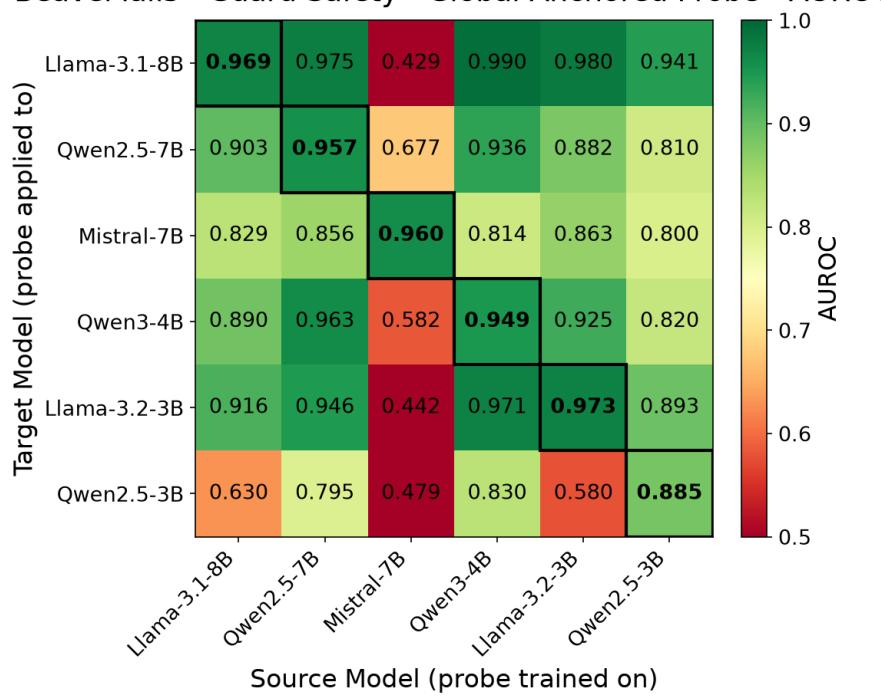  
Figure 10: Guard Distillation BeaverTails global anchored cross-model AUROC with single-token anchors. Rows are target models and columns are source models.

## C.13 ALL-LAYER STANDARD PROBES

To separate the effect of anchor-relative coordinates from whole-network concatenation, we train standard probes (no anchoring) on the concatenated all-layer vector and compare them with singlelayer standard probes across relative depths.

Guard linear. For Guard linear probes, the all-layer standard probe $( C = 0 . 1 )$ performs close to the single-layer standard probe at depth 0.8 (Table 52; Figure 11, left). It is slightly lower on BeaverTails (96.1 vs. 96.5 AUROC) and slightly higher on Toxic-chat (89.2 vs. 88.6 AUROC). Thus the Guard linear result matches the Trivia pattern: all-layer standard probes are competitive with strong singlelayer standard probes.

Table 52: Linear-probe AUROC for Guard Distillation: same-model Standard probes at relative depth 0.8 and on concatenated all-layer activations (C=0.1).
<table><tr><td>Dataset</td><td></td><td>Standard All-layer Standard</td></tr><tr><td>BeaverTails</td><td> $9 6 . 5 \pm 0 . 1$ </td><td> $9 6 . 1 \pm 0 . 5$ </td></tr><tr><td>Toxic-chat</td><td> $8 8 . 6 \pm 0 . 8$ </td><td> $8 9 . 2 \pm 0 . 8$ </td></tr></table>

Guard MLP. For Guard MLP standard probes, the all-layer absolute representation performs worse than the depth-0.8 single-layer representation. The single-layer MLP-64 probe outperforms the alllayer MLP-64 probe on both Guard datasets (92.5 vs. 84.7 AUROC on BeaverTails and 83.5 vs. 72.9 on Toxic-chat). One possible explanation is that the higher-dimensional all-layer input needs different regularization, but this experiment does not isolate the cause. The global anchored representation has a fixed feature dimension. Its all-layer result remains competitive with the single-layer probe in the MLP setting (Table 53; Figure 11, right).

Table 53: Guard MLP AUROC for Guard Distillation: same-model standard probes at relative depth 0.8 and on concatenated all-layer activations, with hidden sizes 64 and 256.
<table><tr><td>Dataset</td><td>Single-layer MLP-64 All-layer MLP-64</td><td></td></tr><tr><td>BeaverTails</td><td> $9 2 . 5 \pm 2 . 0$ </td><td> $8 4 . 7 \pm 1 . 0$ </td></tr><tr><td>Toxic-chat</td><td> $8 3 . 5 \pm 0 . 4$ </td><td> $7 2 . 9 \pm 1 . 5$ </td></tr></table>

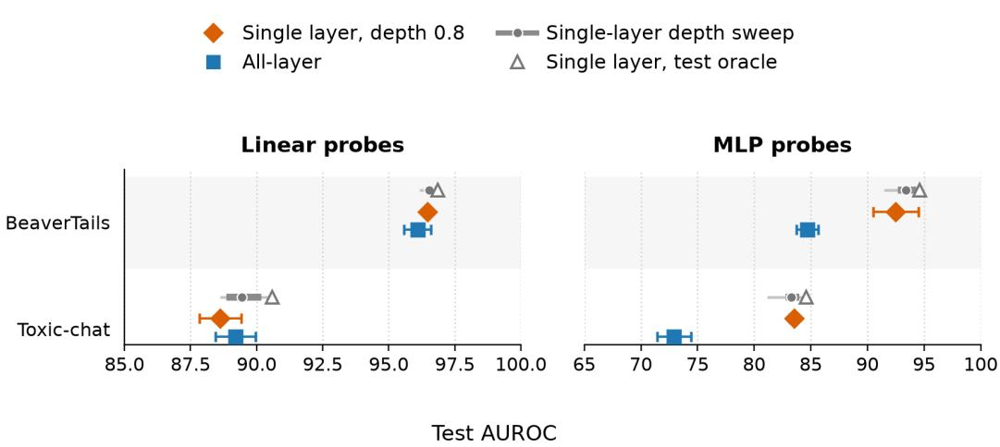  
Figure 11: Standard probes across layers for Guard Distillation. Orange diamonds show the prespecified single-layer baseline at relative depth 0.8; blue squares show standard probes on concatenated all-layer activations. Gray segments summarize test AUROC across single-layer depths (range, interquartile range, and mean), and hollow triangles mark the post-hoc test oracle. Panels show linear and MLP-64 probes; error bars are standard errors over three seeds.

## C.14 MODEL FAMILY ANALYSIS

We next ask whether cross-model transfer is correlated with model family or size. This diagnostic uses naive single-source Transfer. It exposes the directed source–target structure that calibration averages over.

For each grouping rule, we partition the six models into groups and average directed source–target transfer pairs according to whether the source and target fall in the same group or in different groups. The exact-family split compares pairs within the same named family (for example, Qwen2.5-to-Qwen2.5) against all other directed pairs. The coarser split compares Llama+Mistral against Qwen. The size split compares 7/8B models against 3/4B models. A grouping would be explanatory if the same-group and different-group columns showed a large, consistent gap. We also report each model’s average behavior as a target and as a source. “As target” averages probes trained on all other models and evaluated on that model. “As source” averages that model’s probe evaluated on all other models.

For Guard linear probes, family and size groupings show limited separation. Exact-family pairs are somewhat higher than different-family pairs (84.9 vs. 80.8 AUROC). The coarser Llama+Mistral/Qwen split differs by 0.3 points (81.2 vs. 81.5), and the size split is exactly tied at the reported precision (81.4 vs. 81.4; Table 54). Directional source–target differences are larger. Qwen2.5-3B is the weakest target at 71.3 AUROC, with a 16.7 point gap to same-model Anchored. Mistral-7B is the weakest source at 66.4 AUROC and is a strong target (Table 55). Thus the Guard result mirrors the broader conclusion: transfer depends more on which representation is used as source or target than on a simple family or size match.

Table 54: Guard linear model-group transfer contrasts. Values are single-source transfer AUROC in percentage points, mean ± standard error over dataset–seed aggregates. “Same” and “different” compare directed source-model to target-model pairs under the grouping in the first column.
<table><tr><td>Grouping</td><td>Same</td><td>Different</td><td>∆ (Guard Distillation)</td></tr><tr><td>Exact family</td><td> $8 4 . 9 \pm 1 . 4$ </td><td> $8 0 . 8 \pm 0 . 7$ </td><td> $4 . 1 \pm 1 . 6$ </td></tr><tr><td>Llama+Mistral/Qwen</td><td> $8 1 . 2 \pm 0 . 9$ </td><td> $8 1 . 5 \pm 0 . 7$ </td><td> $. 0 . 3 \pm 1 . 1$ </td></tr><tr><td>Size bucket</td><td> $8 1 . 4 \pm 0 . 8$ </td><td> $8 1 . 4 \pm 0 . 6$ </td><td> $- 0 . 0 \pm 0 . 5$ </td></tr></table>

Table 55: Guard linear source-model/target-model asymmetry. Values are single-source transfer AUROC in percentage points, mean ± standard error over dataset–seed aggregates. “As target” is the mean AUROC of probes trained on other models and evaluated on that model. “As source” is the mean AUROC of that model’s probe evaluated on other models. $\mathrm { } ^ { \mathrm { * } \mathrm { * } } \mathrm { G a p } ^ { \mathrm { * } }$ is same-model Anchored AUROC minus “As target.”
<table><tr><td>Model</td><td>As target</td><td>Gap</td><td>As source (Guard Distillation)</td></tr><tr><td>Qwen2.5-3B</td><td> $7 1 . 3 \pm 3 . 7$ </td><td> $1 6 . 7 \pm 4 . 2$ </td><td> $8 4 . 5 \pm 1 . 5$ </td></tr><tr><td>Mistral-7B</td><td> $8 4 . 4 \pm 0 . 7$ </td><td> $9 . 3 \pm 1 . 6$ </td><td> $6 6 . 4 \pm 6 . 4$ </td></tr><tr><td>Llama-3.2-3B</td><td> $8 4 . 5 \pm 0 . 7$ </td><td> $8 . 8 \pm 2 . 4$ </td><td> $8 2 . 1 \pm 1 . 4$ </td></tr><tr><td>Llama-3.1-8B</td><td> $8 4 . 4 \pm 0 . 9$ </td><td> $7 . 4 \pm 1 . 6$ </td><td> $8 2 . 6 \pm 0 . 9$ </td></tr><tr><td>Qwen2.5-7B</td><td> $8 1 . 6 \pm 1 . 5$ </td><td> $8 . 7 \pm 1 . 6$ </td><td> $8 7 . 6 \pm 1 . 7$ </td></tr><tr><td>Qwen3-4B</td><td> $8 2 . 0 \pm 0 . 9$ </td><td> $8 . 0 \pm 2 . 0$ </td><td> $8 5 . 0 \pm 2 . 7$ </td></tr></table>

## D ONLINE MATHEMATICAL CORRECTNESS RESULTS

This section reports calibration and depth-selection results for online MATH monitoring in Section D.1, low-FPR recall in Section D.2, the external GPT-OSS target in Section D.3, and related-data transfer to GSM8K in Section D.4.

## D.1 CALIBRATION AND DEPTH SELECTION

Section 4.2 reports the primary 2K result at 128 tokens. Table 56 extends this comparison across all three generation checkpoints and available source-pool sizes. Global transfer improves as the source pool grows at every checkpoint. At 128 tokens, mean single-source transfer reaches 75.2 AUROC, calibration among two available sources reaches 76.8, and calibration among all three reaches 78.0.

We also ask whether validation can identify a useful local depth. Figure 12 compares the global probe with local probes on Llama-3.1-8B, Qwen3-4B, OLMo-3-7B, and Gemma-3-12B at the 128-token checkpoint. The two panels use nested 1K and 2K source-training sets. At each local depth, sourcepool validation selects a source model; the orange diamond jointly selects one source–depth pair using the same validation data. Neither deployable policy uses MATH-500 test labels. The selected local and global policies are close at both training sizes, extending the layer-selection result in Section 4.3.3: the MATH comparison does not provide a consistent reason to prefer local depth selection.

Table 56: Online MATH transfer across generation checkpoints and source-pool sizes. Probes use 2K training examples. Transfer (cal-N) uses source-only validation within each N-model pool. Values are AUROC (%), mean ± standard error over three source/probe seeds.
<table><tr><td>Method</td><td>64 tokens</td><td>128 tokens</td><td>256 tokens</td></tr><tr><td>Standard same-model, depth 0.8</td><td> $7 8 . 0 \pm 0 . 4$ </td><td> $7 7 . 9 \pm 0 . 3$ </td><td> $7 6 . 6 \pm 0 . 5$ </td></tr><tr><td>Global Anchored, same-model</td><td> $8 1 . 3 \pm 0 . 2$ </td><td> $8 1 . 8 \pm 0 . 3$ </td><td> $8 0 . 9 \pm 0 . 2$ </td></tr><tr><td>Local Anchored, depth 0.8</td><td> $8 1 . 3 \pm 0 . 2$ </td><td> $8 1 . 6 \pm 0 . 3$ </td><td> $8 0 . 7 \pm 0 . 2$ </td></tr><tr><td>Global transfer</td><td> $7 3 . 8 \pm 1 . 4$ </td><td>75.2 ± 0.6</td><td> $7 5 . 0 \pm 0 . 9$ </td></tr><tr><td>Global transfer (cal-2)</td><td> $7 4 . 4 \pm 0 . 8$ </td><td>76.8 ± 0.1</td><td> $7 6 . 2 \pm 0 . 6$ </td></tr><tr><td>Global transfer (cal-3)</td><td> $7 4 . 9 \pm 1 . 7$ </td><td>78.0 ± 0.5</td><td> $7 6 . 7 \pm 0 . 9$ </td></tr><tr><td>Validation-selected local transfer</td><td> $7 8 . 3 \pm 0 . 7$ </td><td> $7 8 . 5 \pm 0 . 6$ </td><td> $7 8 . 4 \pm 0 . 5$ </td></tr></table>

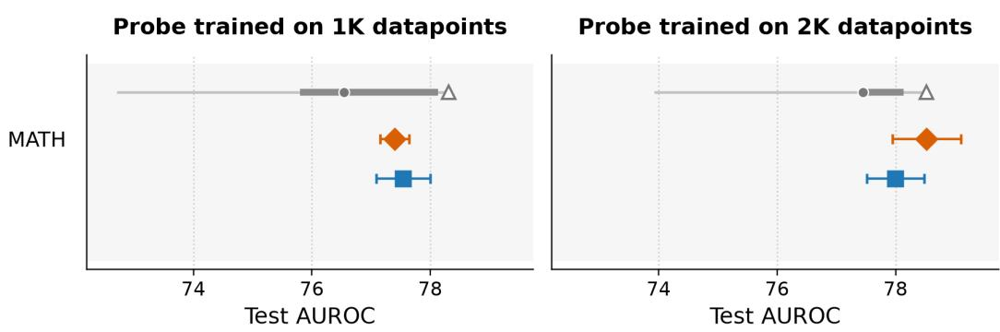  
Figure 12: Online MATH correctness monitoring: calibrated global versus local transfer. Orange diamonds select both source and local depth using source-only validation; blue squares show calibrated global transfer. Gray segments summarize test AUROC across local depths (range, interquartile range, and mean), while hollow triangles select depth post hoc using test AUROC but retain validation-based source selection. Error bars are standard errors over three source/probe seeds.

## D.2 LOW-FPR RECALL

Table 57 reports R@0.1FPR for the 128-token MATH-500 and GSM8K comparisons. On MATH-500, global anchoring raises same-model recall from 40.7 to 49.1, while calibrated global transfer reaches 38.7 and validation-selected local transfer reaches 44.7. Under the combined model-and-data shift to GSM8K, calibrated global transfer reaches 30.8, compared with 18.3 for the same-model Standard probe. Low-FPR recall therefore follows the main AUROC pattern: transfer trails the same model Anchored probe but remains competitive with the Standard baseline.

Table 57: Low-FPR online correctness monitoring. R@0.1FPR on MATH-500 and after transfer from MATH to GSM8K at the 128-token checkpoint. The positive class is a correct solution. Values are percentage points, mean ± standard error over three source/probe seeds.
<table><tr><td>Evaluation</td><td>Method</td><td>R@0.1FPR</td></tr><tr><td>MATH-500</td><td>Standard same-model, depth 0.8</td><td> $4 0 . 7 \pm 2 . 8$ </td></tr><tr><td>MATH-500</td><td>Global Anchored, same-model</td><td> $4 9 . 1 \pm 1 . 0$ </td></tr><tr><td>MATH-500</td><td>Local Anchored, depth 0.8</td><td> $4 8 . 7 \pm 1 . 1$ </td></tr><tr><td>MATH-500</td><td>Global calibrated transfer</td><td> $3 8 . 7 \pm { 1 . 3 }$ </td></tr><tr><td>MATH-500</td><td>Validation-selected local transfer</td><td> $4 4 . 7 \pm 3 . 5$ </td></tr><tr><td>GSM8K</td><td>Standard same-model, depth 0.8</td><td> $1 8 . 3 \pm { 1 . 5 }$ </td></tr><tr><td>GSM8K</td><td>Global Anchored, same-model</td><td> $3 6 . 6 \pm 2 . 3$ </td></tr><tr><td>GSM8K</td><td>Global calibrated transfer</td><td> $3 0 . 8 \pm 3 . 3$ </td></tr></table>

## D.3 TRANSFER TO AN EXTERNAL MODEL TARGET

Section 4.3.1 summarizes transfer to the external GPT-OSS MATH target. Table 58 reports the posthoc target-trained diagnostic alongside calibrated transfer. Correctness is linearly decodable in GPT-OSS at both source-training sizes, whereas the source-trained decision rule remains near chance. This comparison diagnoses the MATH transfer failure; target-trained probes do not enter source selection or the transfer procedure.

Table 58: External MATH target: GPT-OSS-20B. Target-trained Anchored probes are post-hoc diagnostics and do not select transferred probes. Values are AUROC (%), mean ± standard error over three source/probe seeds.
<table><tr><td></td><td>Train size Target-trained Transfer (cal)</td><td></td></tr><tr><td>1K</td><td> $7 8 . 5 \pm 0 . 1$ </td><td> $5 3 . 1 \pm 0 . 7$ </td></tr><tr><td>2K</td><td> $7 8 . 7 \pm 0 . 3$ </td><td> $5 2 . 4 \pm 0 . 5$ </td></tr></table>

## D.4 RELATED-DATA TRANSFER

Section 4.3.2 summarizes joint transfer from MATH to GSM8K. We evaluate the MATH-trained probes on GSM8K at the 128-token checkpoint under the protocol in Appendix A.6. Table 59 separates the effect of changing the data from the additional effect of changing the model. Within the same model, global anchored probes reach 75.3 AUROC, compared with 63.0 for standard probes. Calibrated transfer across both model and dataset reaches 70.5.

Table 59: Related-data transfer from MATH to GSM8K. Probes are evaluated on GSM8K at 128 generated tokens. Calibrated transfer changes both the model and dataset. Values are AUROC (%), mean ± standard error over three source/probe seeds.
<table><tr><td>Method</td><td>AUROC</td></tr><tr><td>Standard same-model, depth 0.8</td><td> $6 3 . 0 \pm 1 . 0$ </td></tr><tr><td>Global Anchored, same-model</td><td> $7 5 . 3 \pm 0 . 8$ </td></tr><tr><td>Global calibrated transfer</td><td> $7 0 . 5 \pm 1 . 8$ </td></tr></table>

## E XSTEST PROBE STALENESS

This section first measures how probes trained on the original model behave after quantization and refusal fine-tuning (Section E.1). It then compares angular distance with cosine similarity (Section E.2) and whether re-encoding anchors after the model update improves robustness (Section E.3).

## E.1 STALENESS AFTER MODEL UPDATES

Activation monitors are often trained once and then kept fixed while the model being monitored is updated. This creates a staleness risk: the updated model may still encode the relevant safety distinction, but the old probe may no longer read it out reliably. We test whether anchored representations reduce this failure mode. Following Duan (2026), we study the Qwen2.5-3B-Instruct and Qwen2.5-7B-Instruct models used in their staleness experiments. We train standard and anchored probes to predict whether an XSTest prompt is unsafe (Röttger et al., 2024); the dataset contains unsafe prompts and safe prompts that resemble unsafe prompts. We fit the probes on the original model checkpoints, freeze them, and evaluate them after either quantization-only changes or small refusal-SFT updates based on BeaverTails. The global anchored probe concatenates the six layers monitored by Duan (2026) before applying the anchor transform. Section 4.3.3 summarizes the main result; full implementation details are in Appendix A.9.

Table 60 isolates quantized inference before considering learned adapters. On Qwen2.5-7B, quantiza tion changes all mean AUROCs by less than half a point. On Qwen2.5-3B, standard probes degrade more visibly, especially under NF4, but the shift is concentrated in one monitored layer. Global anchored probes remove almost all of this quantization sensitivity: their mean drop is at most 0.4 points and no global probe crosses the stale threshold.

Learned updates create much larger shifts (Table 61). On Qwen2.5-3B, standard probes lose roughly 8–10 AUROC points across QLoRA and LoRA updates. On Qwen2.5-7B, QLoRA is milder but still reaches the stale threshold at 512 examples, while the 256-example full-LoRA update drops standard probes by 8.1 points. Like Duan (2026), we find that learned safety fine-tuning affects probe performance much more than quantization alone.

Table 60: XSTest probe-staleness change under quantization-only controls. Values are ∆AUROC points using angular distance for anchored probes. Standard and local anchored values are first averaged over layers 4, 8, 12, 16, 20, and 24; global anchored concatenates those six layers. Rows average over three train/validation splits (mean ± SE).
<table><tr><td>Model</td><td>Quantization</td><td>Standard</td><td></td><td>Global anchored Local anchored</td></tr><tr><td>Qwen2.5-3B</td><td>NF4</td><td> $- 3 . 6 \pm 0 . 8$ </td><td> $- 0 . 3 \pm 0 . 1$ </td><td> $- 2 . 6 \pm 0 . 4$ </td></tr><tr><td>Qwen2.5-3B</td><td>INT8</td><td> $- 2 . 3 \pm 0 . 1$ </td><td> $- 0 . 3 \pm 0 . 0$ </td><td> $- 2 . 3 \pm 0 . 2$ </td></tr><tr><td>Qwen2.5-7B</td><td>NF4</td><td> $- 0 . 2 \pm 0 . 1$ </td><td> $+ 0 . 1 \pm 0 . 0$ </td><td> $- 0 . 4 \pm 0 . 0$ </td></tr><tr><td>Qwen2.5-7B</td><td>INT8</td><td> $- 0 . 3 \pm 0 . 1$ </td><td> $- 0 . 1 \pm 0 . 0$ </td><td> $- 0 . 2 \pm 0 . 1$ </td></tr></table>

Table 61: XSTest probe-staleness change after learned refusal-SFT updates. Values are ∆AUROC points using angular distance for anchored probes. Standard and local anchored values are first averaged over layers 4, 8, 12, 16, 20, and 24; global anchored concatenates those six layers. Rows average over nine runs: three update seeds and three train/validation splits (mean ± SE).
<table><tr><td>Model</td><td>Update</td><td>Examples</td><td>Standard</td><td>Global anchored</td><td>Local anchored</td></tr><tr><td>Qwen2.5-3B</td><td>QLoRA</td><td>256</td><td> $- 9 . 3 \pm 0 . 9$ </td><td> $- 4 . 2 \pm 1 . 0$ </td><td> $- 7 . 4 \pm 1 . 0$ </td></tr><tr><td>Qwen2.5-3B</td><td>QLoRA</td><td>512</td><td> $- 9 . 8 \pm 1 . 0$ </td><td> $- 3 . 3 \pm 0 . 7$ </td><td> $- 7 . 1 \pm 0 . 9$ </td></tr><tr><td>Qwen2.5-3B</td><td>LoRA</td><td>256</td><td> $- 9 . 7 \pm 0 . 5$ </td><td> $- 3 . 3 \pm 0 . 6$ </td><td> $- 6 . 8 \pm 0 . 9$ </td></tr><tr><td>Qwen2.5-3B</td><td>LoRA</td><td>512</td><td> $- 8 . 0 \pm 1 . 5$ </td><td> $- 3 . 6 \pm 0 . 9$ </td><td> $- 4 . 0 \pm 0 . 5$ </td></tr><tr><td>Qwen2.5-7B</td><td>QLoRA</td><td>256</td><td> $- 4 . 8 \pm 0 . 4$ </td><td> $- 0 . 1 \pm 0 . 2$ </td><td> $- 6 . 7 \pm 0 . 9$ </td></tr><tr><td>Qwen2.5-7B</td><td>QLoRA</td><td>512</td><td> $- 5 . 8 \pm 1 . 1$ </td><td> $- 1 . 2 \pm 0 . 3$ </td><td> $- 7 . 5 \pm 0 . 7$ </td></tr><tr><td>Qwen2.5-7B</td><td>LoRA</td><td>256</td><td> $- 8 . 1 \pm 1 . 2$ </td><td> $- 0 . 3 \pm 0 . 2$ </td><td> $- 1 3 . 0 \pm 1 . 7$ </td></tr><tr><td>Qwen2.5-7B</td><td>LoRA</td><td>512</td><td> $- 5 . 1 \pm 0 . 6$ </td><td> $- 0 . 4 \pm 0 . 2$ </td><td> $- 6 . 5 \pm 1 . 1$ </td></tr></table>

Global anchored probes provide a strong mitigation for the performance drop. For Qwen2.5-7B, no global probe is stale in any updated setting, and the mean drop remains between 0.1 and 1.2 points. For Qwen2.5-3B, global anchored probes improve substantially over standard probes: their mean drop stays below the 5-point stale magnitude in every setting. Local anchored probes also improve over standard probes on 3B, but worsen staleness on 7B.

Overall, standard probes show clear probe staleness after refusal fine-tuning, while quantized inference alone does not produce a comparable drop. Global anchored representations substantially reduce staleness under the tested LoRA and QLoRA updates.

## E.2 RELATIVE-COORDINATE FUNCTION

The XSTest result summarized in Section 4.3.3 uses angular distance for anchored representations. We ablate the function used to construct anchored features by comparing angular distance to cosine similarity. Table 62 compares the pre-update probe scores. The two choices are close before any update, but angular distance is slightly better for local anchored probes on both models and slightly better for the 3B global anchored probe. In either case, global anchored probes match or exceed the best layer-averaged standard result before model updates.

Table 62: Pre-update XSTest validation AUROC for standard probes and anchored probes using two relative-coordinate functions. Unqualified anchored columns use angular distance; cosine columns use cosine similarity. Standard and local anchored columns average over layers 4, 8, 12, 16, 20, and 24; global anchored concatenates those six layers. Values are AUROC points, averaged over three train/validation splits (mean ± SE).
<table><tr><td>Model</td><td>Standard</td><td></td><td></td><td></td><td>Global anchored Global anchored (cosine) Local anchored Local anchored (cosine)</td></tr><tr><td>Qwen2.5-3B</td><td> $9 4 . 6 \pm 0 . 4$ </td><td> $9 9 . 3 \pm 0 . 3$ </td><td> $9 9 . 1 \pm 0 . 3 $ </td><td> $9 3 . 8 \pm 0 . 6$ </td><td> $9 2 . 3 \pm 0 . 7$ </td></tr><tr><td>Qwen2.5-7B</td><td> $9 7 . 4 \pm 0 . 5$ </td><td> $9 9 . 5 \pm 0 . 2 $ </td><td> $9 9 . 5 \pm 0 . 3$ </td><td> $9 7 . 5 \pm 0 . 3$ </td><td> $9 7 . 1 \pm 0 . 3 $ </td></tr></table>

Cosine-similarity staleness Cosine-similarity probes reproduce the angular-distance ordering under quantization-only changes (Table 63): 7B changes little, 3B standard probes show a modest drop, and global anchored probes remove nearly all of the quantization sensitivity.

Table 63: XSTest probe-staleness change under quantization-only controls. Values are ∆AUROC points using cosine similarity for anchored probes. Standard and local anchored values are first averaged over layers 4, 8, 12, 16, 20, and 24; global anchored concatenates those six layers. Rows average over three train/validation splits (mean ± SE).
<table><tr><td>Model</td><td>Quantization</td><td>Standard</td><td></td><td>Global anchored Local anchored</td></tr><tr><td>Qwen2.5-3B</td><td>NF4</td><td> $- 3 . 6 \pm 0 . 8$ </td><td> $- 0 . 2 \pm 0 . 1$ </td><td> $- 1 . 7 \pm 0 . 1$ </td></tr><tr><td>Qwen2.5-3B</td><td>INT8</td><td> $- 2 . 3 \pm 0 . 1$ </td><td> $- 0 . 4 \pm 0 . 1$ </td><td> $- 1 . 7 \pm 0 . 2$ </td></tr><tr><td>Qwen2.5-7B</td><td>NF4</td><td> $- 0 . 2 \pm 0 . 1$ </td><td> $+ 0 . 1 \pm 0 . 0$ </td><td> $- 0 . 1 \pm 0 . 1$ </td></tr><tr><td>Qwen2.5-7B</td><td>INT8</td><td> $- 0 . 3 \pm 0 . 1$ </td><td> $- 0 . 1 \pm 0 . 1$ </td><td> $- 0 . 2 \pm 0 . 1$ </td></tr></table>

Under learned updates (Table 64), cosine similarity again shows that global anchored probes mitigate probe staleness, while local anchored probes are model-dependent. Cosine global anchored probes are less robust than their angular-distance counterparts. On 3B, cosine global drops remain around 6– 8 points, whereas angular-distance global drops are around 3–4 points. On 7B, cosine global probes remain stable relative to standard probes, but their drops are also larger than with angular distance. Cosine similarity therefore still mitigates global-probe staleness, but angular distance is more robust for this task.

Table 64: XSTest probe-staleness change after learned refusal-SFT updates. Values are ∆AUROC points using cosine similarity for anchored probes. Standard and local anchored values are first averaged over layers 4, 8, 12, 16, 20, and 24; global anchored concatenates those six layers. Rows average over nine runs: three update seeds and three train/validation splits (mean ± SE).
<table><tr><td>Model</td><td>Update</td><td>Examples</td><td>Standard</td><td>Global anchored</td><td>Local anchored</td></tr><tr><td>Qwen2.5-3B</td><td>QLoRA</td><td>256</td><td> $- 9 . 3 \pm 0 . 9$ </td><td> $- 7 . 7 \pm 1 . 7$ </td><td> $- 8 . 3 \pm 0 . 9$ </td></tr><tr><td>Qwen2.5-3B</td><td>QLoRA</td><td>512</td><td> $- 9 . 8 \pm 1 . 0$ </td><td> $- 6 . 3 \pm 1 . 3$ </td><td> $- 7 . 7 \pm 0 . 7$ </td></tr><tr><td>Qwen2.5-3B</td><td>LoRA</td><td>256</td><td> $- 9 . 7 \pm 0 . 5$ </td><td> $- 6 . 3 \pm 1 . 3$ </td><td> $- 7 . 4 \pm 0 . 6$ </td></tr><tr><td>Qwen2.5-3B</td><td>LoRA</td><td>512</td><td> $- 8 . 0 \pm 1 . 5$ </td><td> $- 6 . 9 \pm 1 . 5$ </td><td> $- 5 . 2 \pm 0 . 3$ </td></tr><tr><td>Qwen2.5-7B</td><td>QLoRA</td><td>256</td><td> $- 4 . 8 \pm 0 . 4$ </td><td> $- 0 . 5 \pm 0 . 3$ </td><td> $- 7 . 2 \pm 1 . 0$ </td></tr><tr><td>Qwen2.5-7B</td><td>QLoRA</td><td>512</td><td> $- 5 . 8 \pm 1 . 1$ </td><td> $- 2 . 4 \pm 0 . 6$ </td><td> $- 7 . 6 \pm 0 . 5$ </td></tr><tr><td>Qwen2.5-7B</td><td>LoRA</td><td>256</td><td> $- 8 . 1 \pm 1 . 2$ </td><td> $- 0 . 7 \pm 0 . 3$ </td><td> $- 1 3 . 4 \pm 1 . 8$ </td></tr><tr><td>Qwen2.5-7B</td><td>LoRA</td><td>512</td><td> $- 5 . 1 \pm 0 . 6$ </td><td> $- 1 . 4 \pm 0 . 3$ </td><td> $- 8 . 1 \pm 1 . 3$ </td></tr></table>

## E.3 RE-ENCODING ANCHORS AFTER MODEL UPDATES

The angular-distance and cosine results above keep each original model’s anchor encodings fixed after the monitored model changes. A natural alternative is to re-encode the same anchor prompts with the updated model before computing anchored representations. This could help if the model update moves anchor prompts and evaluation prompts in a coherent way: similarities between updated evaluation prompts and updated anchors might then resemble the original-model similarity coordinates better than similarities between updated evaluation prompts and original-model anchors. Under this cancellation hypothesis, updated-anchor encodings should be more stable than originalanchor encodings.

Table 65 shows a mixed result for angular distance. Updated anchors often help local anchored probes, especially on Qwen2.5-7B, but these local probes still do not match the robustness of global anchored probes. For global anchored probes, updated anchors are close to original anchors in some rows, but they are worse in several 512-example settings. The hypothesized cancellation effect is therefore partially visible for local anchored features, but it is not the driver of the strongest mitigation.

Cosine similarity also fails to make updated-anchor encoding consistently beneficial (Table 66). Updated anchors sometimes help local anchored probes, especially for 3B LoRA, but they also hurt local probes under QLoRA and do not fix the poor 7B local results. For global anchored probes, updated anchors are close to original anchors in some rows, but they are substantially worse in several settings, including the 512-example 3B updates. Across both relative-coordinate functions, reencoding anchors after the model update is therefore not a reliable replacement for the fixed anchor coordinate system used by probes trained before the model update.

Table 65: XSTest probe-staleness change after learned refusal-SFT updates, comparing original- and updated-anchor encodings. Values are ∆AUROC points using angular distance. Local anchored values are first averaged over layers 4, 8, 12, 16, 20, and 24; global anchored concatenates those six layers. Rows average over nine runs: three update seeds and three train/validation splits (mean ± SE).
<table><tr><td>Model</td><td>Update</td><td>Examples</td><td>Global, original</td><td>Global, updated</td><td>Local, original</td><td>Local, updated</td></tr><tr><td>Qwen2.5-3B</td><td>QLoRA</td><td>256</td><td> $- 4 . 2 \pm 1 . 0$ </td><td> $- 3 . 4 \pm 0 . 8$ </td><td> $- 7 . 4 \pm 1 . 0$ </td><td> $- 6 . 8 \pm 1 . 0$ </td></tr><tr><td>Qwen2.5-3B</td><td>QLoRA</td><td>512</td><td> $- 3 . 3 \pm 0 . 7$ </td><td> $- 5 . 8 \pm 1 . 5$ </td><td> $- 7 . 1 \pm 0 . 9$ </td><td> $- 7 . 6 \pm 1 . 5$ </td></tr><tr><td>Qwen2.5-3B</td><td>LoRA</td><td>256</td><td> $- 3 . 3 \pm 0 . 6$ </td><td> $- 3 . 2 \pm 0 . 9$ </td><td> $- 6 . 8 \pm 0 . 9$ </td><td> $- 4 . 0 \pm 0 . 6$ </td></tr><tr><td>Qwen2.5-3B</td><td>LoRA</td><td>512</td><td> $- 3 . 6 \pm 0 . 9$ </td><td> $- 6 . 5 \pm 2 . 0$ </td><td> $- 4 . 0 \pm 0 . 5$ </td><td> $- 2 . 6 \pm 0 . 5$ </td></tr><tr><td>Qwen2.5-7B</td><td>QLoRA</td><td>256</td><td> $- 0 . 1 \pm 0 . 2$ </td><td> $- 0 . 2 \pm 0 . 2$ </td><td> $- 6 . 7 \pm 0 . 9$ </td><td> $- 3 . 4 \pm 0 . 3$ </td></tr><tr><td>Qwen2.5-7B</td><td>QLoRA</td><td>512</td><td> $- 1 . 2 \pm 0 . 3$ </td><td> $- 1 . 5 \pm 0 . 6$ </td><td> $- 7 . 5 \pm 0 . 7$ </td><td> $- 4 . 4 \pm 0 . 7$ </td></tr><tr><td>Qwen2.5-7B</td><td>LoRA</td><td>256</td><td> $- 0 . 3 \pm 0 . 2$ </td><td> $- 0 . 4 \pm 0 . 2$ </td><td> $- 1 3 . 0 \pm 1 . 7$ </td><td> $- 6 . 7 \pm 1 . 4$ </td></tr><tr><td>Qwen2.5-7B</td><td>LoRA</td><td>512</td><td> $- 0 . 4 \pm 0 . 2$ </td><td> $- 0 . 9 \pm 0 . 4$ </td><td> $- 6 . 5 \pm 1 . 1$ </td><td> $- 3 . 3 \pm 0 . 7$ </td></tr></table>

Table 66: XSTest probe-staleness change after learned refusal-SFT updates, comparing original- and updated-anchor encodings. Values are ∆AUROC points using cosine similarity. Local anchored values are first averaged over layers 4, 8, 12, 16, 20, and 24; global anchored concatenates those six layers. Rows average over nine runs: three update seeds and three train/validation splits (mean ± SE).
<table><tr><td>Model</td><td>Update</td><td>Examples</td><td>Global, original</td><td>Global, updated</td><td>Local, original</td><td>Local, updated</td></tr><tr><td>Qwen2.5-3B</td><td>QLoRA</td><td>256</td><td> $- 7 . 7 \pm 1 . 7$ </td><td> $- 7 . 5 \pm 1 . 6$ </td><td> $- 8 . 3 \pm 0 . 9$ </td><td> $- 8 . 9 \pm 1 . 2$ </td></tr><tr><td>Qwen2.5-3B</td><td>QLoRA</td><td>512</td><td> $- 6 . 3 \pm 1 . 3$ </td><td> $- 1 0 . 7 \pm 2 . 1$ </td><td> $- 7 . 7 \pm 0 . 7$ </td><td> $- 9 . 4 \pm 1 . 7$ </td></tr><tr><td>Qwen2.5-3B</td><td>LoRA</td><td>256</td><td> $- 6 . 3 \pm 1 . 3$ </td><td> $- 6 . 5 \pm 1 . 6$ </td><td> $- 7 . 4 \pm 0 . 6$ </td><td> $- 6 . 2 \pm 0 . 7$ </td></tr><tr><td>Qwen2.5-3B</td><td>LoRA</td><td>512</td><td> $- 6 . 9 \pm 1 . 5$ </td><td> $- 1 2 . 6 \pm 2 . 7$ </td><td> $- 5 . 2 \pm 0 . 3$ </td><td> $- 5 . 1 \pm 0 . 7$ </td></tr><tr><td>Qwen2.5-7B</td><td>QLoRA</td><td>256</td><td> $- 0 . 5 \pm 0 . 3$ </td><td> $- 0 . 3 \pm 0 . 2$ </td><td> $- 7 . 2 \pm 1 . 0$ </td><td> $- 6 . 9 \pm 0 . 4$ </td></tr><tr><td>Qwen2.5-7B</td><td>QLoRA</td><td>512</td><td> $- 2 . 4 \pm 0 . 6$ </td><td> $- 4 . 5 \pm 1 . 8$ </td><td> $- 7 . 6 \pm 0 . 5$ </td><td> $- 8 . 8 \pm 1 . 5$ </td></tr><tr><td>Qwen2.5-7B</td><td>LoRA</td><td>256</td><td> $- 0 . 7 \pm 0 . 3$ </td><td> $- 0 . 7 \pm 0 . 3$ </td><td> $- 1 3 . 4 \pm 1 . 8$ </td><td> $- 1 1 . 8 \pm 2 . 0$ </td></tr><tr><td>Qwen2.5-7B</td><td>LoRA</td><td>512</td><td> $- 1 . 4 \pm 0 . 3$ </td><td> $- 3 . 3 \pm 1 . 5$ </td><td> $- 8 . 1 \pm 1 . 3$ </td><td> $- 7 . 2 \pm 1 . 5$ </td></tr></table>

## F GUARDQA RESULTS

This section reports same-model performance and calibrated transfer in Sections F.1 and F.2, followed by low-FPR recall in Section F.3. Section F.4 tests MLP width, local-depth selection, and anchor count; Sections F.5 and F.6 report linear-probe and standard cross-model controls.

## F.1 SAME-MODEL SUMMARY

GuardQA is an auxiliary safety-evaluation setting that poses a trivia-style A/B question about the monitored model’s own completion. It elicits an explicit safety judgment at the final prompt position, complementing the completion-token Guard Distillation monitor defined in Section 3.3. Table 67 reports the same-model AUROC comparison for the GuardQA MLP setting (h=64, 300 anchors). Section F.2 reports cross-model transfer and its full calibration progression.

## F.2 FULL CALIBRATION PROGRESSION

Section F.1 reports Transfer (naive transfer) and Transfer (cal) (calibrated transfer with $N = 5 )$ as representative endpoints. Tables 68 and 69 report the complete $N = 1 , \ldots , 5$ progression alongside the Anchored same-model column for the GuardQA MLP setting. GuardQA BeaverTails Output Prediction continues to improve from 84.0 at N =4 to 89.0 at N =5.

Table 67: GuardQA MLP AUROC results for Output Prediction and GT Prediction: same-model Standard and global Anchored probes. The MLP has one 64-unit hidden layer.
<table><tr><td></td><td colspan="2">Output Prediction</td><td colspan="2">GT Prediction</td></tr><tr><td>Dataset</td><td>Standard</td><td>Anchored</td><td>Standard</td><td>Anchored</td></tr><tr><td>BeaverTails</td><td> $9 9 . 6 \pm 0 . 1$ </td><td> $9 9 . 8 \pm 0 . 1$ </td><td> $9 5 . 2 \pm 0 . 3$ </td><td> $9 4 . 1 \pm 0 . 5$ </td></tr><tr><td>Toxic-chat</td><td> $9 9 . 1 \pm 0 . 2 $ </td><td> $9 9 . 2 \pm 0 . 1 $ </td><td> $8 9 . 1 \pm 0 . 4$ </td><td> $8 9 . 3 \pm 0 . 3$ </td></tr></table>

Table 68: GuardQA MLP AUROC results for Output Prediction: same-model Anchored and crossmodel Transfer as the available source pool grows. Transfer (cal-N) uses source-only validation within each N-model pool. The MLP has one 64-unit hidden layer.
<table><tr><td>Dataset</td><td>Anchored</td><td>Transfer</td><td>Transfer (cal-2)</td><td>Transfer (cal-3)</td><td>Transfer (cal-4) Transfer (cal)</td><td></td></tr><tr><td>BeaverTails</td><td> $9 9 . 8 \pm 0 . 1$ </td><td> $7 2 . 3 \pm 4 . 6$ </td><td> $7 6 . 2 \pm 6 . 1$ </td><td> $8 4 . 1 \pm 4 . 8$ </td><td> $8 4 . 0 \pm 6 . 1$ </td><td> ${ \bf 8 9 . 0 \pm 1 . 1 }$ </td></tr><tr><td>Toxic-chat</td><td> $9 9 . 2 \pm 0 . 1$ </td><td> $8 7 . 4 \pm 2 . 7$ </td><td> $9 5 . 1 \pm 0 . 6$ </td><td> $9 5 . 2 \pm 1 . 0$ </td><td> $9 5 . 7 \pm 1 . 0$ </td><td> ${ \bf 9 5 . 8 \pm 1 . 0 }$ </td></tr></table>

## F.3 RECALL AT 10% FPR

Same-model Standard-vs-Anchored recall parity holds for the GuardQA MLP setting $( h = 6 4 .$ 300 anchors; Table 70). Cross-transfer recall gaps are larger than AUROC gaps, particularly on BeaverTails Output Prediction. Recall drops from 99.5 to 61.6 under naive transfer and recovers to 76.0 with calibration. AUROC drops from 99.8 to 72.3 and recovers to 89.0. The AUROC and recall results therefore show the same ordering, with larger cross-model losses at low FPR.

Table 69: GuardQA MLP AUROC results for GT Prediction: same-model Anchored and cross-model Transfer as the available source pool grows. Transfer (cal-N) uses source-only validation within each N-model pool. The MLP has one 64-unit hidden layer.
<table><tr><td>Dataset</td><td>Anchored</td><td>Transfer</td><td>Transfer (cal-2)</td><td>Transfer (cal-3)</td><td>Transfer (cal-4)</td><td>Transfer (cal)</td></tr><tr><td>BeaverTails</td><td> $9 4 . 1 \pm 0 . 5$ </td><td> $7 8 . 5 \pm 2 . 1$ </td><td> $8 1 . 8 \pm 1 . 6$ </td><td> $8 2 . 6 \pm 1 . 8$ </td><td> $8 3 . 1 \pm 2 . 2$ </td><td> ${ \bf 8 4 . 0 \pm 2 . 7 }$ </td></tr><tr><td>Toxic-chat</td><td> $8 9 . 3 \pm 0 . 3$ </td><td> $7 6 . 5 \pm 1 . 2$ </td><td> $8 0 . 1 \pm 0 . 7$ </td><td> $8 1 . 5 \pm 1 . 0$ </td><td> ${ \bf 8 2 . 4 \pm 1 . 4 }$ </td><td> $8 2 . 2 \pm { 1 . 8 }$ </td></tr></table>

Table 70: GuardQA MLP R@0.1FPR results for Output Prediction and GT Prediction: same-model Anchored, mean cross-model Transfer, and source-calibrated Transfer (cal). The MLP has one 64- unit hidden layer.
<table><tr><td></td><td colspan="3">Output Prediction</td><td colspan="3">GT Prediction</td></tr><tr><td>Dataset</td><td>Anchored</td><td>Transfer</td><td>Transfer (cal)</td><td>Anchored</td><td>Transfer</td><td>Transfer (cal)</td></tr><tr><td>BeaverTails</td><td> $9 9 . 5 \pm 0 . 3$ </td><td> $6 1 . 6 \pm 5 . 7$ </td><td> $7 6 . 0 \pm 2 . 4$ </td><td> $8 2 . 2 \pm 0 . 3$ </td><td> $5 2 . 5 \pm 2 . 7$ </td><td> $6 0 . 5 \pm 4 . 1$ </td></tr><tr><td>Toxic-chat</td><td> $9 7 . 8 \pm 0 . 2$ </td><td> $7 6 . 8 \pm 2 . 3$ </td><td> $9 0 . 6 \pm 1 . 2$ </td><td> $6 8 . 6 \pm 1 . 1$ </td><td> $4 9 . 7 \pm 1 . 3$ </td><td> $6 0 . 4 \pm { 0 . 8 }$ </td></tr></table>

## F.4 ALTERNATE MLP SETTINGS

The GuardQA results above use an MLP with hidden size 64 and 300 anchors. This subsection tests whether same-model parity, calibrated transfer, and depth sensitivity persist under other MLP configurations.

Hidden size $h = 2 5 6 \quad \mathrm { A t } h = 2 5 6$ (300 anchors), the main cross-transfer pattern matches that at h=64 (Table 71). Baseline Standard-vs-Anchored numbers differ by less than 1 AUROC point from the h=64 GuardQA baseline (Table 67); we omit them here. Same-model Anchored AUROC on GT Prediction is within 0.2 points of h = 64 (marginally lower on Toxic-chat). Calibrated cross-transfer on BeaverTails Output Prediction is slightly worse (85.2 vs. 89.0 for $h = 6 4 )$ ; the remaining cells match within noise.

For $h = 2 5 6$ , a local depth selected using target-model test data can exceed the global result on BeaverTails Output Prediction. The local probe at depth 0.85 reaches AUROC 89.5 under Transfer (cal), compared with 85.2 for the global probe. This is an oracle comparison. The peak at 0.85 is isolated. Transfer (cal) drops to 77.5 at depth 0.80 and to 74.6 at 0.90. Table 72 places this oracle result alongside validation-selected depths.

Table 71: GuardQA MLP AUROC results for Output Prediction and GT Prediction: same-model Anchored, mean cross-model Transfer, and source-calibrated Transfer (cal). The MLP has one 256- unit hidden layer.
<table><tr><td></td><td colspan="3">Output Prediction</td><td colspan="3">GT Prediction</td></tr><tr><td>Dataset</td><td>Anchored</td><td>Transfer</td><td>Transfer (cal)</td><td>Anchored</td><td>Transfer</td><td>Transfer (cal)</td></tr><tr><td>BeaverTails</td><td> $9 9 . 7 \pm 0 . 1 $ </td><td> $7 3 . 1 \pm 2 . 5$ </td><td> $8 5 . 2 \pm 4 . 2$ </td><td> $9 4 . 1 \pm 0 . 3 $ </td><td> $7 9 . 8 \pm 1 . 5$ </td><td> $8 4 . 3 \pm 1 . 8$ </td></tr><tr><td>Toxic-chat</td><td> $9 9 . 2 \pm 0 . 1$ </td><td> $8 9 . 1 \pm 1 . 3$ </td><td> $9 6 . 4 \pm 1 . 1$ </td><td> $8 9 . 1 \pm 0 . 2 $ </td><td> $7 9 . 7 \pm 1 . 6$ </td><td> $8 3 . 9 \pm 1 . 5$ </td></tr></table>

Validation-selected local-depth strategies Table 72 compares the same validation strategies defined in Appendix C.7 against the global anchored representation for Output Prediction, for both h=64 and h=256 MLP probes. The Validation column uses per-model validation for same-model Anchored, per-source validation for naive Transfer, and source-pool validation for Transfer (cal). The Optimal column is selected post-hoc over the local-depth grid and uses held-out test performance.

The same-model Anchored rows change little under this choice: validation-selected local depths are close to global. For naive Transfer, source-local validation does not reliably help and is often below both fixed depth 0.8 and global. For Transfer (cal), source-depth validation is mixed. It improves over fixed depth 0.8 for the $h = 2 5 6$ BeaverTails Output slice, but hurts the h = 64 Output Prediction slices and slightly trails fixed depth 0.8 on h=256 Toxic-chat Output. The Optimal column confirms that local probes can outperform global in several slices if the depth is chosen with target test labels, but the deployable Validation selector does not consistently recover those oracle depths. Thus the GuardQA analysis also supports using global anchored probes as a robust depth-free default unless transfer-depth oracle tuning is available.

Anchor count variants Table 73 reports calibrated cross-model transfer (Transfer (cal)) as the anchor set size grows from 300 to 600, for both the MLP-64 and MLP-256 probes. Within-model

Table 72: GuardQA local-depth selection strategies. Values are AUROC in percentage points. Validation denotes validation-selected local depth; Optimal is post-hoc over the local-depth grid; Global uses the global anchored representation.
<table><tr><td>Dataset</td><td>Setting</td><td>0.8</td><td>Validation</td><td>Optimal</td><td>Global</td></tr><tr><td>Anchored</td><td></td><td></td><td></td><td></td><td></td></tr><tr><td>BeaverTails</td><td>Output, h64</td><td> $9 9 . 7 \pm 0 . 1 $ </td><td> $9 9 . 8 \pm 0 . 1$ </td><td> $9 9 . 8 \pm 0 . 1 \ @ \ 0 . 8 5$ </td><td> $9 9 . 8 \pm 0 . 1$ </td></tr><tr><td>BeaverTails</td><td>Output, h256</td><td> $9 9 . 7 \pm 0 . 0$ </td><td> $9 9 . 7 \pm 0 . 1 $ </td><td> $9 9 . 8 \pm 0 . 1 \ @ \ 0 . 9 5$ </td><td> $9 9 . 7 \pm 0 . 1 $ </td></tr><tr><td>Toxic-chat</td><td>Output, h64</td><td> $9 9 . 2 \pm 0 . 1 $ </td><td> $9 9 . 2 \pm 0 . 1$ </td><td> $9 9 . 2 \pm 0 . 1 \ @ 0 . 9 5$ </td><td> $9 9 . 2 \pm 0 . 1 $ </td></tr><tr><td>Toxic-chat</td><td>Output, h256</td><td> $9 9 . 2 \pm 0 . 1 $ </td><td> $9 9 . 2 \pm 0 . 1$ </td><td> $9 9 . 3 \pm 0 . 1 \ @ 0 . 9 5$ </td><td> $9 9 . 2 \pm 0 . 1 $ </td></tr><tr><td>Transfer</td><td></td><td></td><td></td><td></td><td></td></tr><tr><td>BeaverTails</td><td>Output, h64</td><td> $7 8 . 7 \pm 0 . 6$ </td><td> $7 1 . 8 \pm 3 . 7$ </td><td> $7 9 . 2 \pm 0 . 7 \ @ \ 0 . 8 5$ </td><td> $7 2 . 3 \pm 4 . 6$ </td></tr><tr><td>BeaverTails</td><td>Output, h256</td><td> $7 4 . 3 \pm 0 . 5$ </td><td> $6 8 . 5 \pm 4 . 2$ </td><td> $7 8 . 5 \pm 0 . 3 \ @ 0 . 8 5$ </td><td> $7 3 . 1 \pm 2 . 5$ </td></tr><tr><td>Toxic-chat</td><td>Output, h64</td><td> $8 9 . 8 \pm 3 . 0$ </td><td> $8 8 . 9 \pm 2 . 1 $ </td><td> $9 3 . 3 \pm 0 . 2 \ @ \ 0 . 8 5$ </td><td> $8 7 . 4 \pm 2 . 7$ </td></tr><tr><td>Toxic-chat</td><td>Output, h256</td><td> $9 1 . 2 \pm 1 . 6$ </td><td> $8 6 . 1 \pm 3 . 8$ </td><td> $9 2 . 8 \pm 0 . 7 \ @ \ 0 . 8 5$ </td><td> $8 9 . 1 \pm 1 . 3$ </td></tr><tr><td>Transfer (cal)</td><td></td><td></td><td></td><td></td><td></td></tr><tr><td>BeaverTails</td><td>Output, h64</td><td> $8 4 . 3 \pm 1 . 4$ </td><td> $8 1 . 2 \pm 2 . 6$ </td><td> $8 6 . 1 \pm 2 . 7 \textcircled { a } 0 . 7 5$ </td><td> $8 9 . 0 \pm 1 . 1$ </td></tr><tr><td>BeaverTails</td><td>Output, h256</td><td> $7 7 . 5 \pm 2 . 6$ </td><td> $8 3 . 3 \pm 2 . 0$ </td><td> $8 9 . 5 \pm 1 . 7 \ @ 0 . 8 5$ </td><td> $8 5 . 2 \pm 4 . 2$ </td></tr><tr><td>Toxic-chat</td><td>Output, h64</td><td> $9 7 . 4 \pm 0 . 6 $ </td><td> $9 3 . 4 \pm 3 . 2$ </td><td> $9 7 . 4 \pm 0 . 6 \ @ 0 . 8 0$ </td><td> $9 5 . 8 \pm 1 . 0$ </td></tr><tr><td>Toxic-chat</td><td>Output, h256</td><td> $9 7 . 3 \pm 0 . 4$ </td><td> $9 6 . 3 \pm 1 . 2$ </td><td> $9 7 . 4 \pm 0 . 6 \ @ 0 . 8 5$ </td><td></td></tr><tr><td></td><td></td><td></td><td></td><td></td><td> $9 6 . 4 \pm 1 . 1$ </td></tr></table>

performance (Standard, Anchored) is virtually unchanged across all three counts and is therefore omitted.  
Cross-model transfer shows a mixed, dataset-dependent pattern. On Toxic-chat QA the effect is mildly positive. Output Prediction AUROC rises from 95.8 to 98.0 (MLP-64) and from 96.4 to 97.7 (MLP-256), while GT Prediction is flat. On BeaverTails QA, Output Prediction degrades sharply for MLP-64 $( 8 9 . 0  7 3 . 4 )$ and moderately for MLP-256 (85.2 → 80.7). GT Prediction improves from 84.0 to 88.1 for MLP-64 and from 84.3 to 87.0 for MLP-256.  
Three hundred anchors suffice for same-model parity and substantial calibrated transfer in the evaluated GuardQA configurations. Additional anchors do not yield a consistent improvement and can reduce performance, particularly for BeaverTails QA Output Prediction.

Table 73: GuardQA MLP AUROC cross-model transfer (Transfer (cal)) as anchor set size varies from 300 to 600. All probes use global anchored representations.
<table><tr><td>Dataset</td><td>Task</td><td>MLP</td><td>300 anchors</td><td>500 anchors</td><td>600 anchors</td></tr><tr><td>BeaverTails</td><td>Output Pred.</td><td>64</td><td> $8 9 . 0 \pm 1 . 1$ </td><td> $8 6 . 6 \pm 2 . 0$ </td><td> $7 3 . 4 \pm 5 . 4$ </td></tr><tr><td>BeaverTails</td><td>Output Pred.</td><td>256</td><td> $8 5 . 2 \pm 4 . 2$ </td><td> $7 6 . 0 \pm 5 . 3$ </td><td> $8 0 . 7 \pm 1 . 7$ </td></tr><tr><td>BeaverTails</td><td>GT Pred.</td><td>64</td><td> $8 4 . 0 \pm 2 . 7$ </td><td> $8 5 . 8 \pm 2 . 2$ </td><td> $8 8 . 1 \pm 0 . 7$ </td></tr><tr><td>BeaverTails</td><td>GT Pred.</td><td>256</td><td> $8 4 . 3 \pm 1 . 8$ </td><td> $8 4 . 0 \pm 2 . 1$ </td><td> $8 7 . 0 \pm 2 . 4$ </td></tr><tr><td>Toxic-chat</td><td>Output Pred.</td><td>64</td><td> $9 5 . 8 \pm 1 . 0$ </td><td> $9 6 . 0 \pm 0 . 6$ </td><td> $9 8 . 0 \pm 0 . 5$ </td></tr><tr><td>Toxic-chat</td><td>Output Pred.</td><td>256</td><td> $9 6 . 4 \pm 1 . 1$ </td><td> $9 7 . 2 \pm 0 . 6$ </td><td> $9 7 . 7 \pm 0 . 6$ </td></tr><tr><td>Toxic-chat</td><td>GT Pred.</td><td>64</td><td> $8 2 . 2 \pm 1 . 8$ </td><td> $8 0 . 1 \pm 1 . 2$ </td><td> $8 2 . 3 \pm 1 . 3$ </td></tr><tr><td>Toxic-chat</td><td>GT Pred.</td><td>256</td><td> $8 3 . 9 \pm 1 . 5$ </td><td> $8 1 . 8 \pm 1 . 6$ </td><td> $8 3 . 5 \pm 0 . 5$ </td></tr></table>

## F.5 LINEAR PROBE SETTING

For comparison with the MLP results above, we report linear logistic-regression probes on the same GuardQA data. Linear probes leave more headroom on GT Prediction, motivating the MLP choice for the preceding GuardQA analyses.

Tables 74 and 75 show the Anchored / Transfer / Transfer (cal) summary for AUROC and recall respectively. Standard-vs-Anchored parity holds (Anchored slightly ahead on GT Prediction for both datasets). Its calibration progression follows the h = 64 MLP pattern: source selection helps, with

the exact saturation point varying by cell. Recall cross-transfer gaps are larger than AUROC gaps, consistent with the MLP recall pattern.

Table 74: GuardQA linear probe AUROC results for Output Prediction and GT Prediction: samemodel Anchored, mean cross-model Transfer, and source-calibrated Transfer (cal).
<table><tr><td></td><td colspan="3">Output Prediction</td><td colspan="3">GT Prediction</td></tr><tr><td>Dataset</td><td>Anchored</td><td>Transfer</td><td>Transfer (cal)</td><td>Anchored</td><td>Transfer</td><td>Transfer (cal)</td></tr><tr><td>BeaverTails</td><td> $9 9 . 7 \pm 0 . 1 $ </td><td> $7 8 . 6 \pm 3 . 4$ </td><td> $9 0 . 3 \pm 4 . 1$ </td><td> $9 5 . 0 \pm 0 . 6$ </td><td> $7 2 . 9 \pm 0 . 4$ </td><td> $8 0 . 9 \pm 1 . 4$ </td></tr><tr><td>Toxic-chat</td><td> $9 9 . 2 \pm 0 . 1$ </td><td> $9 1 . 0 \pm 0 . 6$ </td><td> $9 7 . 7 \pm 0 . 4$ </td><td> $8 9 . 9 \pm 0 . 2$ </td><td> $7 3 . 3 \pm 2 . 1$ </td><td> $8 0 . 3 \pm 2 . 4$ </td></tr></table>

Table 75: GuardQA linear probe R@0.1FPR results for Output Prediction and GT Prediction: samemodel Anchored, mean cross-model Transfer, and source-calibrated Transfer (cal).
<table><tr><td rowspan="2">Dataset</td><td colspan="3">Output Prediction</td><td colspan="3">GT Prediction</td></tr><tr><td>Anchored</td><td>Transfer</td><td>Transfer (cal)</td><td>Anchored</td><td>Transfer</td><td>Transfer (cal)</td></tr><tr><td>BeaverTails</td><td> $9 9 . 2 \pm 0 . 3 $ </td><td> $6 9 . 9 \pm 4 . 8$ </td><td> $8 2 . 5 \pm 4 . 9$ </td><td> $8 4 . 0 \pm 2 . 0$ </td><td> $4 1 . 3 \pm 1 . 5$ </td><td> $5 2 . 2 \pm 4 . 2$ </td></tr><tr><td>Toxic-chat</td><td> $9 7 . 4 \pm 0 . 3$ </td><td> $8 1 . 4 \pm 0 . 5$ </td><td> $9 1 . 5 \pm 2 . 3$ </td><td> $7 0 . 5 \pm 2 . 8$ </td><td> $4 1 . 5 \pm 1 . 9$ </td><td> $5 1 . 0 \pm 1 . 7$ </td></tr></table>

## F.6 STANDARD CROSS-MODEL PROBE BASELINE

We repeat the raw-coordinate transfer test between Llama-3.1-8B and Mistral-7B for GuardQA linear probes. Standard transfer is higher than in Trivia but still unstable, averaging 63.9 AUROC across datasets, probe targets, directions, and seeds; GT Prediction remains far below the anchored alternative. Under anchored global linear probes, mean cross-model AUROC rises from 63.9 to 84.3. The comparison confirms that the anchored representation restores cross-model transferability that raw coordinates lack (Tables 76 and 77).

Table 76: Standard cross-model linear-probe AUROC for GuardQA between Llama-3.1-8B-Instruct and Mistral-7B-Instruct-v0.3. Both models have 32 layers and 4096-dimensional residual streams; probes use layer 25 (0.8 relative depth). Values are means ± standard errors over three seeds.
<table><tr><td rowspan="2">Dataset</td><td colspan="2">Output Prediction</td><td colspan="2">GT Prediction</td></tr><tr><td></td><td>Llama→Mistral Mistral→Llama</td><td></td><td>Llama→Mistral Mistral→Llama</td></tr><tr><td>BeaverTails QA</td><td> $7 3 . 7 \pm 1 3 . 0$ </td><td> $7 2 . 2 \pm 2 . 6$ </td><td> $4 7 . 7 \pm 8 . 6$ </td><td> $5 4 . 7 \pm 1 0 . 5$ </td></tr><tr><td>Toxic-chat QA</td><td> $7 9 . 0 \pm 1 3 . 9$ </td><td> $6 9 . 0 \pm 3 . 0$ </td><td> $5 4 . 2 \pm 1 1 . 3$ </td><td> $6 0 . 6 \pm 2 . 9$ </td></tr></table>

Table 77: Global anchored linear-probe AUROC for GuardQA between Llama-3.1-8B-Instruct and Mistral-7B-Instruct-v0.3 (300 anchors). Values are means ± standard errors over three seeds.
<table><tr><td rowspan="2">Dataset</td><td colspan="2">Output Prediction</td><td colspan="2">GT Prediction</td></tr><tr><td></td><td>Llama→Mistral Mistral→Llama</td><td></td><td>Llama→Mistral Mistral→Llama</td></tr><tr><td>BeaverTails QA</td><td> $8 1 . 8 \pm 1 7 . 0$ </td><td> $9 6 . 1 \pm 3 . 1 $ </td><td> $6 8 . 2 \pm 2 . 9$ </td><td> $7 8 . 3 \pm 4 . 3$ </td></tr><tr><td>Toxic-chat QA</td><td> $9 8 . 6 \pm 1 . 4$ </td><td> $9 7 . 7 \pm 0 . 4$ </td><td> $8 1 . 0 \pm 2 . 1$ </td><td> $7 2 . 4 \pm 4 . 4$ </td></tr></table>