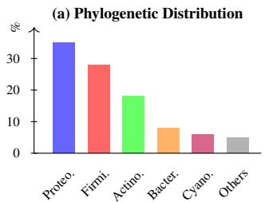
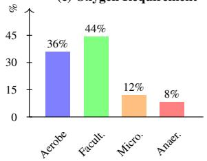
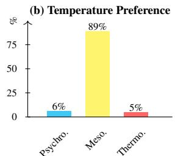
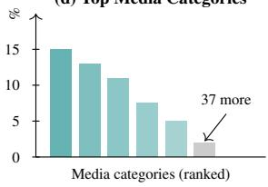
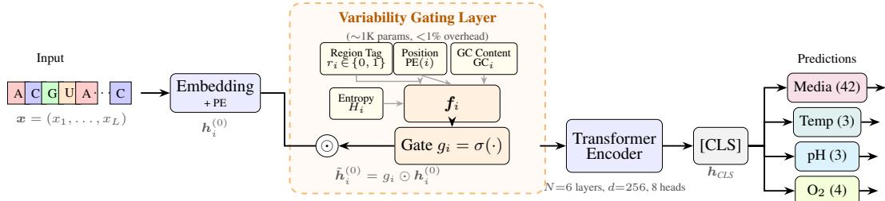
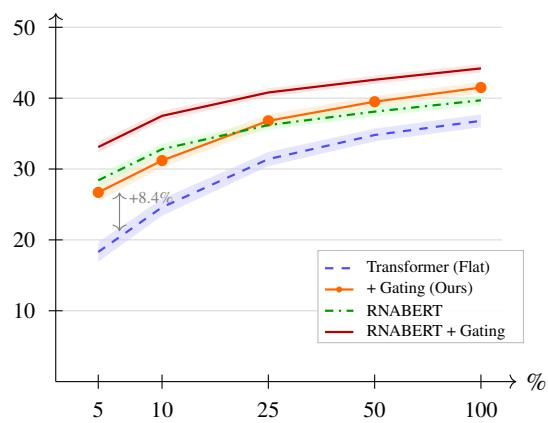
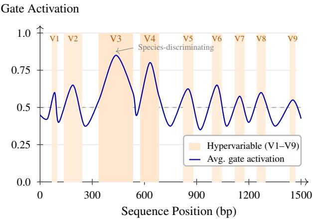
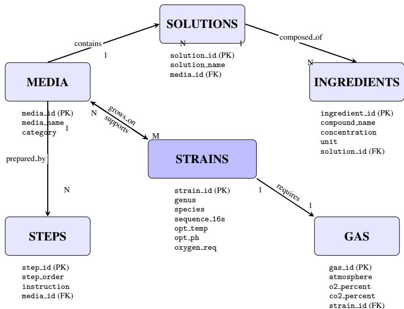

# Recommending Bacterial Cultivation Conditions from 16S rRNA

Juntang Wang∗ Harvard University USA

Hao Wu∗ Duke Kunshan University China

Yihan Wang∗ Duke University USA

Runkun Guo   
Boston University   
USA

Shixin Xu Duke Kunshan University China

Dongmian Zou† Duke Kunshan University China

## Abstract

Recommending bacterial cultivation conditions from sequence data is a challenging structured problem characterized by missing standardized benchmarks and limited use of sequence structure. To address this, we introduce DSNI, a benchmark of 65,023 bacterial strains with phylogeny-aware splits, pairing 16S rRNA sequences with four cultivation conditions (media, temperature, pH, oxygen). Exploiting the mosaic structure of 16S rRNA, where hypervariable regions support discrimination and conserved regions support primer design, we propose a Variability-Gated Encoder that learns position-dependent importance weights conditioned on biological features (region type, position, and local complexity). The gating module adds minimal overhead (1,280 parameters, <1%) while providing an explicit inductive bias valuable in low-data regimes. Experiments demonstrate that the learnable gate improves flat Transformers by 4.7% in joint accuracy and complements RNABERT, yielding 44.2% exact-match joint accuracy. The model also recovers 90.2% of ground-truth cultivation protocols within its top-25 recommendations, narrowing the exhaustive search space by approximately 60×.

## 1 Introduction

Leveraging domain structure to improve generalization in low-data regimes is a central challenge in representation learning. 16S ribosomal RNA [33] offers a compelling testbed for this challenge due to its distinctive mosaic structure: nine hyper-variable regions (V1–V9) carrying discriminative signals, interspersed with highly conserved segments [4]. While hyper-variable regions enable species-level discrimination and conserved regions support universal PCR primer design, prior work has largely treated 16S as a taxonomic marker rather than a predictor of bacterial phenotypes. We ask whether models can use 16S sequences to recommend cultivation conditions, including growth media, temperature, pH, and oxygen requirements, that microbiologists must empirically determine for novel organisms. This structured recommendation task presents three technical challenges: (1) scarce labeled data relative to sequence length, (2) severe class imbalance (89% mesophiles, 91% neutrophiles), and (3) output multiplicity (organisms may tolerate multiple conditions). These challenges motivate incorporating inductive bias: can we encode domain knowledge about sequence structure into neural architectures to improve sample efficiency?

Cultivation is essential for characterizing microbial diversity, yet more than 99% of microbial diversity remains uncultured, a phenomenon termed the “great plate count anomaly” [24, 30]. The primary barrier is the laborious trial-and-error process of identifying appropriate growth conditions for each novel organism[16, 19]. If cultivation conditions could be predicted from sequence data alone, this bottleneck could be substantially relieved, turning exhaustive screening into a targeted shortlist and opening sequence-guided cultivation as a concrete route toward studying the uncultured majority.

We hypothesize that 16S sequences correlate with cultivation requirements due to the phylogenetic conservation of metabolic traits [12, 20]. While 16S does not directly encode metabolic enzymes, its sequence reflects phylogenetic history that shapes phenotypic similarity. We frame the task as structured recommendation, using sequence-derived patterns to suggest plausible cultivation conditions. Validating this hypothesis requires: (i) a large-scale dataset pairing 16S with standardized cultivation metadata, and (ii) methods for learning cultivation-relevant representations. Currently, no such benchmark or dedicated method exists.

To address this gap, we introduce DSNI, a benchmark curated from DSMZ [25, 28] DSNI contains 65,023 strains, roughly 3.6× the size of the closest comparable resource KOMODO [22]. To our knowledge, it is the first 16S benchmark that pairs sequences with all four primary cultivation conditions under a single standardized labeling scheme, providing a unified resource for sequencebased cultivation recommendation at scale. To support rigorous evaluation, DSNI uses phylogenyaware splits that cluster sequences by taxonomic similarity. This protocol prevents information leakage from near-neighbor organisms and more realistically evaluates generalization to novel taxa.

Beyond DSNI, we propose a Variability-Gated Encoder: a lightweight gating mechanism (1,280 parameters, <1% overhead) that learns position-dependent importance weights conditioned on region type (V1–V9 vs. conserved), normalized position, and local sequence complexity. This allows the model to allocate representational capacity based on domain-informed features rather than hardcoding rules or relying solely on attention to discover these patterns. We benchmark our approach against flat encoders and pretrained models (RNABERT), using identical decoders and training budgets to isolate the gating effect and test whether domain-informed bias complements pretraining.

Our contributions are three-fold: (1) a 65,023-strain 16S benchmark with standardized four-condition labels and phylogeny-aware splits; (2) a lightweight Variability-Gated Encoder with biologically grounded inductive bias; (3) systematic experiments showing that gating improves joint accuracy by +4.7%, complements RNABERT to reach 44.2%, and achieves 90.2% top-25 protocol recall, reducing the candidate protocol space by ∼60×.

## 2 Related Work

16S Databases. Large-scale 16S rRNA databases, including SILVA [23], Greengenes [10], and RDP [7], primarily support taxonomic classification [13]. Although 16S has been evaluated for speciesand strain-level resolution [15], these resources are not designed for cultivation-oriented prediction. PICRUSt [17] infers functional gene content from 16S via ancestral state reconstruction, but targets genomic potential rather than cultivation requirements.

Cultivation Condition Prediction. The most related prior work is KOMODO [22], which predicts growth media by collaborative filtering on phylogenetically similar strains and reports 83% accuracy on organism-media pairings under random train/test splits. However, random splits can place closely related strains in both train and test sets, leading to phylogenetic leakage. Under our genus-level splits, the corresponding GROWREC method achieves 46.3% media accuracy (Table 1). Other work predicts optimal growth temperature from genome features [26] or growth rates from codon usage [32], but they require complete genomes or rely on close phylogenetic references. To our knowledge, no standardized benchmark or task-specific model exists for predicting bacterial cultivation conditions directly from 16S rRNA sequences.

Sequence Representation Learning. Deep learning for nucleic acid sequences began with convolutional models for binding prediction [2] and has since evolved into pretrained foundation models, including DNABERT [14], Nucleotide Transformer [8], HyenaDNA [21], and RNA-specific models such as RNABERT [1], RNA-FM [5], and ERNIE-RNA [35]. These models provide strong baselines, but they lack task-specific inductive biases. Unlike Highway Networks [29] and Gated CNNs [9], where gates are learned from internal representations, our gating mechanism conditions on external biological features (region type and local complexity) and provides explicit inductive bias.

(c) Oxygen Requirement
<table><tr><td>Property</td><td>Value</td></tr><tr><td>Total sequences Unique genera Unique species</td><td>65,023 2,156 11,847</td></tr><tr><td>Sequence length (bp) GC content (%)</td><td> $1 , 0 8 9 \pm 2 6 4$   $5 4 . 2 \pm 7 . 6$ </td></tr><tr><td>Temperature range pH range</td><td> $2 { - } 1 0 3 ^ { \circ } \mathrm { C }$  1.0-11</td></tr><tr><td>Media categories Temperature</td><td>42 3 classes</td></tr><tr><td>pH Oxygen</td><td>3 classes 4 classes</td></tr></table>

  
Figure 1: DSNI benchmark statistics and label distributions. Left: summary statistics for 65,023 strains. Right: phylogenetic, temperature, oxygen, and media distributions. DSNI is dominated by Proteobacteria and Firmicutes, shows strong mesophilic bias, and has long-tailed media categories.

## 3 The DSNI Benchmark

We introduce DSNI (DSMZ and NIH Integrated), a curated benchmark for recommending bacterial cultivation conditions from 16S rRNA sequences. DSNI integrates records from DSMZ and NIH/NCBI resources and provides standardized labels for growth media, temperature, pH, and oxygen requirements. We use 16S as input because it is broadly recoverable across taxa and environments, making the benchmark applicable to organisms for which complete genome data is unavailable (Appendix A.3 provides a quantitative comparison with genome features).

## 3.1 Data Sources and Processing

Data Sources. DSNI integrates records from DSMZ [25] and NIH/NCBI resources [27]. DSMZ provides curated bacterial strain records with detailed cultivation protocols, while NIH/NCBI resources provide 16S sequences in GenBank and cultivation data from associated repositories, including BEI Resources. We cross-reference strain identifiers to link sequences with cultivation conditions.

Database Construction. The combined records comprise six relational tables (STRAINS, MEDIA, SOLUTIONS, INGREDIENTS, STEPS, GAS) capturing taxonomic information, cultivation protocols, and precise media compositions. We flatten this schema into supervised sequence-condition pairs. Full schema details and entity-relationship diagrams are provided in Appendix A.1.

Quality Control and Deduplication. Sequences are quality-filtered (500–1,500 bp, <1% ambiguous bases, SILVA-aligned [23]) and dereplicated at the 97% OTU threshold [34], retaining the entry with the most complete metadata per cluster; full pipeline in Appendix A.4.

## 3.2 Label Standardization and Dataset Statistics

Label Standardization. Growth media names varied across sources, such as “Tryptic Soy $\mathrm { A g a r } ^ { \prime \prime }$ “TSA”, and “Trypticase Soy $\mathrm { A g a r } ^ { \mathrm { , } \mathrm { , } }$ . We standardized media through rule-based synonym matching and expert curation, with canonical categories defined by base composition, such as peptone-based, blood-based, and minimal-salts media. This preserved biologically meaningful distinctions, including aerobic versus anaerobic variants, while collapsing trivial naming differences. Rare media with fewer than 10 occurrences were grouped into an “Other” category. For continuous cultivation conditions, raw temperatures span $2 ^ { \circ } \bar { \mathbf { C } }$ to $\mathrm { i } 0 3 ^ { \circ } \mathrm { C }$ and pH values span 1.0 to 11. We discretize temperature into psychrophilic $( T < 2 0 ^ { \circ } \mathrm { C } )$ , mesophilic $( 2 0 ^ { \circ } \mathbf { C } \leq T \leq 4 5 ^ { \circ } \mathbf { C } )$ , and thermophilic $( T > 4 5 ^ { \circ } \mathrm { C } )$ ; pH into acidophilic $\mathrm { ( p H < 6 ) }$ , neutrophilic $( 6 \leq \mathrm { { p H } } \leq 8 )$ , and alkaliphilic $\mathrm { ( p H > 8 ) }$ . Oxygen requirements are standardized into obligate aerobe, facultative anaerobe, microaerophile, and obligate anaerobe.

Dataset Statistics Figure 1 summarizes key statistics and the label distributions. The dataset exhibits class imbalance characteristic of cultured bacterial collections. Raw temperature values cluster heavily in the $2 0 { - } 4 0 ^ { \circ } \mathrm { C }$ range, reflecting the predominance of mesophilic organisms; after binning, mesophiles constitute 89% of samples, with psychrophiles (6%) and thermophiles (5%, including rare hyperthermophilic bacteria from extreme environments) as minority classes. Similarly, raw pH values concentrate between 6 and 8, yielding 91% neutrophiles after discretization. Most organisms are facultative anaerobes (44%) or obligate aerobes (36%), with microaerophiles (12%) and obligate anaerobes (8%) less represented. Media categories follow a long-tail distribution: the top 5 media (including Tryptic Soy, Brain Heart Infusion, and Nutrient Agar variants) account for 51% of samples, while 19 media categories have fewer than 100 examples each. This imbalance motivates classweighted losses and macro-averaged evaluation metrics.

## 3.3 Phylogeny-Aware Splits

To evaluate generalization to novel taxa, we construct splits at the genus level. Using NCBI Taxonomy, we ensure all sequences from a given genus exclusively in one split (train, validation, or test), preventing models from memorizing genus-specific signatures. We first sort genera by size, then greedily assign each genus to minimize deviation from the target proportions (70%/15%/15%) while preserving stratification over the four label distributions. The final splits contain 1,509/324/323 genera and 45,516/9,754/9,753 sequences for train/validation/test. This procedure helps maintain representation of minority classes in validation and test sets.

## 3.4 Task Definition and Evaluation Metrics

We frame cultivation condition recommendation as a multi-task classification problem. Given a 16S rRNA sequence $\pmb { x } = ( x _ { 1 } , \dots , x _ { L } )$ where $x _ { i } \in \{ A , C , G , U \}$ and L denotes the sequence length, the goal is to predict $\pmb { y } = ( y ^ { \mathrm { m e d i a } } , y ^ { \mathrm { t e m p } } , y ^ { \mathrm { p H } } , y ^ { \mathrm { O _ { 2 } } } )$ : media category (42 classes), temperature preference (psychrophile/mesophile/thermophile), pH preference (acidophile/neutrophile/alkaliphile), and oxygen requirement (aerobe/facultative/microaerophile/anaerobe).

While we formalize this as a multi-task classification problem for learning, the underlying task is better understood as structured recommendation rather than causal prediction. Models should learn to suggest plausible conditions from sequence-derived patterns in the training data. We note that cultivation conditions are interdependent. For example, thermophilic organisms often require specialized media formulations, motivating treating the four outputs jointly rather than as independent predictions. Multiple valid cultivation protocols may exist for a given organism. When source records indicate multiple valid media for a single strain, we retain only the primary recommended medium (typically the first listed in DSMZ protocols or the most frequently cited in NCBI records) as the ground-truth label. This single-label formulation simplifies training, while top-k metrics account for near-miss predictions on alternative valid media.

Per-Task Accuracy. For each task (media, temperature, pH, oxygen), we report top-1 accuracy on the test set. This provides an interpretable measure of how often the model’s most confident prediction matches the ground truth. For media prediction, where multiple valid cultivation media may support growth of the same organism, we additionally report top-3 accuracy to credit near-miss predictions.

Macro-F1 Score. Given the severe class imbalance in DSNI, we report macro-averaged F1 scores that weight each class equally regardless of frequency. This ensures that rare but biologically important classes contribute to the overall metric, following standard practice for imbalanced classification.

Joint Accuracy. We report the fraction of test examples where all four condition predictions are correct. This stringent metric measures the model’s ability to produce coherent cultivation protocols, reflecting the reality that a single incorrect condition can lead to culture failure. Joint accuracy penalizes models that perform well on individual tasks but fail to capture inter-task correlations.

## 4 Variability-Gated Encoder

We propose a Variability-Gated Encoder that incorporates biologically motivated inductive bias. The key insight is that hypervariable regions (V1–V9) provide species-level discrimination, while conserved regions reflect evolutionary constraints. Rather than hard-coding region weights or relying solely on attention to infer positional importance from limited data, we introduce a learnable gating layer conditioned on externally computed biological features. This provides an explicit inductive bias: the model is told which features may matter, but learns how they matter through end-to-end training.

  
Figure 2: Architecture of the variability-gated encoder. The input 16S rRNA sequence is embedded with positional encodings, then modulated by a lightweight gating layer (dashed box) that computes position-wise importance weights. The gate conditions on biological features: region tags indicating hypervariable (V1–V9) vs. conserved positions, positional encoding, local GC content, and Shannon entropy. Gated embeddings are processed by a Transformer encoder, and a [CLS] token representation feeds four task-specific heads for media, temperature, pH, and oxygen requirement predictions.

To handle the ∼1,500 bp span of 16S rRNA sequences, we employ a Transformer backbone for long-range sequence modeling. The proposed gate adds position-wise importance conditioned on biological features that attention cannot directly encode, which is valuable in low-data regimes. The module is efficient, adding only 1,280 parameters (<1% overhead), and is consistent with prior evidence that gating can complement attention [8].

## 4.1 Architecture Overview

Our model consists of four main components (Figure 2):

Embedding Layer. Nucleotides are embedded into d dimensions with sinusoidal positional encodings: $\mathbf { h } _ { i } ^ { ( 0 ) } = \mathrm { E m b e d } ( x _ { i } ) + \mathrm { P E } ( i ) \in \mathbb { R } ^ { d }$ . where $x _ { i }$ denotes the nucleotide at position i and PE(i) denotes the sinusoidal positional encoding.

Variability Gating Layer. To encode the known structure of 16S sequences into the learned representations, we apply gating before the main encoder. This design allows the model to allocate representational capacity within embeddings rather than modifying attention patterns post-hoc. The gating mechanism modulates each position’s representation based on biological features:

$$
\tilde { \mathbf { h } } _ { i } ^ { ( 0 ) } = g _ { i } \odot \mathbf { h } _ { i } ^ { ( 0 ) }\tag{1}
$$

where $g _ { i } \in \mathbb { R } ^ { d }$ is a learned gate vector and ⊙ denotes element-wise multiplication.

Transformer Encoder. The gated embeddings are processed by a standard Transformer encoder with N layers of multi-head self-attention and feed-forward networks:

$$
{ \bf H } ^ { ( N ) } = \mathrm { T r a n s f o r m e r E n c o d e r } ( \tilde { \bf H } ^ { ( 0 ) } )\tag{2}
$$

Task-Specific Heads. For each task t, a separate linear head predicts $\hat { y } ^ { ( t ) } = \mathrm { s o f t m a x } ( \mathbf { W } ^ { ( t ) } \mathbf { h } _ { \mathrm { C L S } } +$ $\mathbf { b } ^ { ( t ) } )$ ), where $\mathbf { h } _ { \mathrm { C L S } }$ is the final [CLS] embedding.

## 4.2 Gating Mechanism

The gating layer is the core contribution of our architecture. It computes position-wise importance weights conditioned on three types of features:

Region Tags. We annotate each sequence position with a binary indicator distinguishing between hypervariable regions (V1–V9) and conserved regions. To determine region boundaries, sequences are aligned to the SILVA SSU Ref NR 138.1 database [23] using the SINA aligner (v1.7.2). This process provides position-wise mappings to the reference alignment where V-region boundaries are pre-annotated. Formally, let $r _ { i } \in \{ 0 , 1 \}$ indicate the hypervariable status for position i.

Local Sequence Complexity. We compute two local complexity measures in a sliding window of size w centered at each position:

• GC content: $\begin{array} { r } { \mathbf { G } \mathbf { C } _ { i } = \frac { 1 } { w } \sum _ { j = i - w / 2 } ^ { i + w / 2 } \mathbf { 1 } [ x _ { j } \in \{ G , C \} ] } \end{array}$ , where $\mathbf { 1 } [ \cdot ]$ is the indicator function.

• Shannon entropy: $\begin{array} { r } { H _ { i } = - \sum p _ { b } ^ { ( i ) } \log p _ { b } ^ { ( i ) } } \end{array}$ , where $p _ { b } ^ { ( i ) }$ is the local frequency of base b.

Gate Computation. The gate vector at each position is computed by a single linear layer:

$$
\mathbf { f } _ { i } = [ r _ { i } ; p _ { i } ; \mathbf { G C } _ { i } ; H _ { i } ] \in \mathbb { R } ^ { 4 }\tag{3}
$$

where $r _ { i } \in \{ 0 , 1 \}$ is the region tag, $p _ { i } = i / L \in [ 0 , 1 ]$ is the normalized position (with L the sequence length), and $\mathbf { \bar { G } } \mathbf { C } _ { i } , H _ { i }$ are local complexity measures. The gate is then:

$$
g _ { i } = \sigma ( \mathbf { W } _ { g } \mathbf { f } _ { i } + \mathbf { b } _ { g } ) \in \mathbb { R } ^ { d }\tag{4}
$$

where σ is the sigmoid function, ensuring gate values lie in $[ 0 , 1 ] ,$ , and $\mathbf { W } _ { g } \in \mathbb { R } ^ { d \times 4 } , \mathbf { b } _ { g } \in \mathbb { R } ^ { d }$ . The gate operates token-wise: each position receives an independent gate vector computed from its local features. With $d = 2 5 6$ , the gate network adds $4 \times 2 5 \bar { 6 } + 2 5 6 \bar { = } 1 , 2 8 0$ parameters $( < 1 \%$ of total model size). We intentionally keep the module low-capacity to prevent overfitting, thereby forcing the model to leverage the provided biological features rather than learning arbitrary gating patterns.

Interpretation. Functionally, a gate value approaching 1 preserves the original embedding, while values near 0 suppress the representation. By conditioning on region tags and complexity features, the model can learn which positions carry informative signal for cultivation prediction. Importantly, this constitutes a soft inductive bias: the model is encouraged but not forced to weight regions differently, and the final gating pattern is learned from data.

## 4.3 Training Objective

We train the model using a multi-task objective that combines cross-entropy losses for each prediction task, $\begin{array} { r } { \mathcal { L } = \sum _ { t } \lambda _ { t } \mathcal { L } _ { \mathrm { C E } } ^ { ( t ) } } \end{array}$ , where for task t the model outputs logits $\mathbf { z } ^ { ( t ) } \in \mathbb { R } ^ { C _ { t } } , \hat { \mathbf { y } } ^ { ( t ) } = \mathrm { s o f t m a x } ( \mathbf { z } ^ { ( t ) } )$ denotes the predicted probability vector, and $\mathbf { y } ^ { ( t ) } \in \{ 0 , 1 \} ^ { C _ { t } }$ is the one-hot ground-truth label. The per-task cross-entropy loss is $\begin{array} { r } { \mathcal { L } _ { \mathrm { C E } } ^ { ( t ) } = - \sum _ { c = 1 } ^ { C _ { t } } y _ { c } ^ { ( t ) } \log \hat { y } _ { c } ^ { ( t ) } } \end{array}$ , and $\lambda _ { t }$ are task-specific weights.

Loss Weighting. To handle class imbalance, we use inverse-frequency class weights computed on the training split. For task t and class c with count $n _ { c } ^ { ( t ) }$ , we set $w _ { c } ^ { ( t ) } \propto \dot { 1 } / ( n _ { c } ^ { ( t ) } + \epsilon )$ and $\mathrm { a p p l y } \ : \boldsymbol { w } _ { \boldsymbol { y } } ^ { ( t ) }$ to the cross-entropy term. Task weights $\lambda _ { t }$ balance contributions across tasks with numbers of classes.

Regularization. We apply dropout to the Transformer layers and add an L2 penalty on the gate network parameters to encourage sparse, interpretable gating patterns.

## 5 Experiments

## 5.1 Baselines and Implementation

We benchmark against a diverse set of methods spanning traditional ML, similarity-based retrieval, deep learning, and pretrained models. To isolate the gating effect, all neural methods share identical classification heads, losses, and early stopping criteria, with only the encoder changed. Models trained from scratch use 100 epochs, while RNABERT fine-tuning uses 50 epochs due to faster convergence.

Traditional ML. k-mer + RF/XGBoost: Extract k-mer frequencies $( k \in \{ 3 , 4 , 5 \}$ , 1,344 features) and train Random Forest [3] or XGBoost [6] classifiers independently for each task. Tests whether compositional features suffice.

Similarity-Based. GROWREC [22]: Predicts by majority vote among $k = 5$ phylogenetically nearest neighbors. k-NN (Sequence): Predicts by majority vote among $k = 5$ nearest neighbors using normalized Levenshtein distance to account for variable sequence lengths.

Deep Learning. CNN: Stacked convolutions with global pooling [18]; captures local motifs but limited long-range dependencies. Transformer (Flat): Standard encoder [31] with learned positional embeddings; serves as the “no inductive bias” baseline.

Pretrained. RNABERT [1]: Fine-tuned pretrained RNA model.

Implementation. Our Transformer uses $N = 6 \mathrm { \ l a y e r s } , d = 2 5 6 , 8$ attention heads, and a 1,280- parameter gate (4-dim biological features $ 2 5 6$ -dim gate; $w = 2 1$ complexity window). For

Table 1: Main results on the DSNI test set. Best in bold, second-best underlined; mean ± std over 5 seeds. Params = trainable parameters in millions.
<table><tr><td>Method</td><td>Params</td><td>Media Acc.</td><td>Temp. Acc. pH Acc.</td><td></td><td> $\mathbf { O } _ { 2 } \mathbf { \Lambda } \mathbf { A c c } .$ </td><td>Joint Acc.</td></tr><tr><td colspan="7">Traditional ML</td></tr><tr><td> $k { \mathrm { - m e r } } + \mathrm { R F }$ </td><td></td><td> $3 8 . 2 \pm 1 . 1$ </td><td> $8 6 . 4 \pm 0 . 8$ </td><td> $8 9 . 1 { \scriptstyle \pm 0 . 7 }$ </td><td> $7 2 . 3 { \pm } 0 . 9$ </td><td> $2 4 . 7 \pm 1 . 2$ </td></tr><tr><td> $k { \mathrm { - m e r + X G B o o s t } }$ </td><td></td><td> $4 1 . 5 { \pm } 0 . 9$ </td><td> $8 7 . 8 { \pm } 0 . 6 $ </td><td> $9 0 . 3 { \pm } 0 . 5 $ </td><td> $7 4 . 6 { \pm } 0 . 8 $ </td><td> $2 7 . 3 { \pm } 1 . 0$ </td></tr><tr><td colspan="7">Phylogenetic / Similarity-Based</td></tr><tr><td>GROWREC</td><td></td><td> $4 6 . 3 { \pm } 0 . 0 $ </td><td> $8 5 . 2 \pm 0 . 0$ </td><td> $8 8 . 4 \pm 0 . 0 $ </td><td> $7 1 . 8 { \pm } 0 . 0$ </td><td> $2 8 . 9 { \pm } 0 . 0$ </td></tr><tr><td>k-NN (Sequence)</td><td></td><td> $4 3 . 8 { \pm } 0 . 0$ </td><td> $8 7 . 1 \pm 0 . 0$ </td><td> $8 9 . 7 \pm 0 . 0$ </td><td> $7 3 . 5 { \pm } 0 . 0$ </td><td> $2 7 . 6 { \pm } 0 . 0$ </td></tr><tr><td colspan="7">Deep Learning (No Pretraining)</td></tr><tr><td>CNN Encoder</td><td>2.1M</td><td> $4 4 . 7 \pm 1 . 3$ </td><td> $8 8 . 5 { \scriptstyle \pm 0 . 7 }$ </td><td> $9 0 . 8 { \pm } 0 . 6 $ </td><td> $7 6 . 2 { \pm } 1 . 1 $ </td><td> $3 1 . 2 { \pm } 1 . 4$ </td></tr><tr><td>Transformer (Flat)</td><td>4.8M</td><td> $4 8 . 3 { \pm } 0 . 8 $ </td><td> $8 9 . 7 \pm 0 . 5$ </td><td> $9 1 . 5 { \pm 0 . 4 }$ </td><td> $7 8 . 4 \pm 0 . 7$ </td><td> $3 6 . 8 { \pm } 0 . 9$ </td></tr><tr><td>Transformer + Gating</td><td>4.8M</td><td> ${ \underline { { 5 2 . 6 } } } { \pm } 0 . 7$ </td><td> $9 1 . 2 { \pm } 0 . 4 $ </td><td> $9 2 . 8 { \pm } 0 . 3 $ </td><td> $\underline { { 8 1 . 3 \pm 0 . 6 } }$ </td><td> $4 1 . 5 { \pm } 0 . 8 $ </td></tr><tr><td colspan="7">Pretrained Models</td></tr><tr><td>RNABERT</td><td>120M</td><td> $5 1 . 4 { \pm } 0 . 6 $ </td><td> $9 0 . 8 { \pm } 0 . 4$ </td><td> $9 2 . 4 { \pm } 0 . 3 $ </td><td> $8 0 . 6 \pm 0 . 5$ </td><td> $3 9 . 7 \pm 0 . 7$ </td></tr><tr><td> $\mathbf { R N A B E R T } + \mathbf { G a t i n g }$ </td><td>120M</td><td> ${ \pm } 4 . 8 { \pm } 0 . 5$ </td><td> $\mathbf { 9 } 2 . 1 { \pm } 0 . 3 $ </td><td> $9 3 . 5 { \scriptstyle \pm 0 . 3 }$ </td><td> $\mathbf { 8 2 . 7 \pm 0 . 4 }$ </td><td> $4 4 . 2 { \pm } 0 . 6 $ </td></tr></table>

RNABERT, we fine-tune the public 440-token checkpoint with center-cropped inputs and randomly initialized task heads. All models train with AdamW + linear warmup, select the checkpoint with best validation joint accuracy, and report mean over 5 seeds. Full hyperparameters in Appendix B.

## 5.2 Main Results

Table 1 presents the main benchmark results on DSNI. We report mean ± std over 5 random seeds. Paired bootstrap confidence intervals with 10,000 resamples and McNemar’s tests on prediction-level outcomes (reported in Appendix C.7) show that all gating-induced gains are statistically significant $( p < 0 . 0 0 1 )$ . The results support five observations.

(1) Learned representations outperform phylogenetic matching: Transformer+Gating exceeds GROWREC by +6.3% media accuracy and +12.6% joint accuracy.

(2) Gating improves flat encoders: +4.3% media, $+ 2 . 9 \% \mathrm { O _ { 2 } } ;$ region tags alone contribute +3.3%.

(3) Inductive bias and pretraining are complementary: While Transformer+Gating (41.5%) outperforms RNABERT (39.7%), the combined RNABERT+Gating yields the best results (44.2%).

(4) Media Prediction is the most challenging task: 42 classes with multiple valid answers. Top-3 accuracy (crediting any of the top-3 predictions matching ground truth) reaches 71.2% for Transformer+Gating, 68.4% for flat Transformer, and 74.8% for RNABERT+Gating.

(5) Inductive bias improves sample efficiency: the gating advantage is largest at low data (+8.4% at 5% training data; Section 5.3), suggesting that explicit bias complements data-driven learning.

Joint Accuracy in Practical Context. While the strict 44.2% exact-match joint accuracy may appear modest, it underestimates practical utility: 76.3% of test strains have at least 3 of 4 conditions correct (4/4: 44.2%; 3/4: 32.1%), and 93.1% have at least 2 of 4 correct (Section C.5). This indicates that many errors are partial rather than completely incorrect protocols. Per-task top-1 accuracies further show that media, with 42 long-tailed classes and multiple plausible alternatives, is the dominant bottleneck, while temperature, pH, and oxygen each exceed 82% top-1.

## 5.3 Low-Data Performance

To test whether inductive bias helps in low-data regimes, we train on data subsets (5%–100%) and evaluate on the full test set (Figure 3). The gating advantage is largest at 5% data (+8.4% joint accuracy: 26.7% vs. 18.3%) and decreases to +4.7% at full data. RNABERT + Gating achieves 33.1% at 5% data, approaching flat Transformer’s full-data performance (36.8%). This pattern suggests that inductive bias is most valuable when data is insufficient for the model to discover relevant patterns independently. As training data increases, the flat encoder gradually exploits sequence structure and narrows the gap, but explicit bias provides a head start that persists even at full data.

  
Figure 3: Few-shot learning curves for joint accuracy across training set sizes. Shaded regions indicate ±1 standard deviation over 3 random seeds. Gating improves performance most strongly in the low-data regime, and RNABERT+Gating performs best across data sizes.

<table><tr><td>Top-k</td><td>Joint recall</td></tr><tr><td> $k = 1$ </td><td>44.2%</td></tr><tr><td> $k = 5$ </td><td>67.8%</td></tr><tr><td> $k = 1 0$ </td><td>78.3%</td></tr><tr><td> $k = 2 0$ </td><td>87.1%</td></tr><tr><td> $k = 2 5$ </td><td>90.2%</td></tr><tr><td>Exhaustive (1,512)</td><td>100%</td></tr></table>

Table 2: Joint protocol recall vs. shortlist size (RN-ABERT+Gating). Exhaustive screening requires enumerating 1,512 protocols.

<table><tr><td>Configuration</td><td>Joint Acc.</td></tr><tr><td>Full model (all features)</td><td> ${ \bf 4 1 . 5 { \pm 0 . 8 } }$ </td></tr><tr><td>– Region tags</td><td> $3 8 . 2 { \pm } 0 . 9$ </td></tr><tr><td>— Position encoding</td><td> $4 0 . 1 \pm 0 . 8$ </td></tr><tr><td>– GC content</td><td> $4 0 . 8 \pm 0 . 8$ </td></tr><tr><td>— Shannon entropy</td><td> $4 1 . 0 { \pm } 0 . 8$ </td></tr><tr><td>Learned gating (no bio. features)</td><td> $3 8 . 6 { \pm } 0 . 9$ </td></tr><tr><td>No gating (Flat Transformer)</td><td> $3 6 . 8 { \pm } 0 . 9$ </td></tr></table>

Table 3: Ablation on gating components: joint accuracy on the DSNI test set.

## 5.4 Robustness and Practical Utility

We further characterize DSNI and our model along three axes: phylogenetic leakage, generalization across phylogenetic distance, and the model’s utility as a search-space reducer for wet-lab cultivation.

Quantifying Phylogenetic Leakage. To measure how much apparent predictability comes from phylogenetic memorization, we re-evaluated three encoder families under random splits and our genus-aware splits while holding all other settings fixed. Joint accuracy drops by 20.1–21.4 pp across all three encoders (See Appendix C.6). This substantial drop shows that random splits can strongly inflate cultivation-prediction performance and motivates phylogeny-aware evaluation.

Generalization vs. Phylogenetic Distance. We stratify the test set by 16S identity to the nearest training-set genus. The advantage of RNABERT+Gating over the phylogenetic-matching baseline GROWREC widens with distance, from +13.7 pp at >90% identity to +16.8 pp at <80% (See Appendix C.3). This pattern is inconsistent with pure nearest-neighbor matching and suggests that the encoder learns sequence-level signals that remain useful when close training relatives are unavailable.

Top-k Recall as a Screening Tool. Microbiologists typically screen a shortlist rather than commit to a single protocol, so we also evaluate the model as a search-space reducer (Table 2). Testing the top-25 ranked joint protocols recovers 90.2% of ground-truth protocols, compared to $1 , 5 1 2 = 4 \bar { 2 } \times 3 \times \bar { 3 } \times 4$ exhaustive combinations. This reduces the candidate set by ∼ 60× while retaining high recall.

Functional-Equivalence Audit of Media Errors. A manual audit of 200 top-1 media errors finds that 58% occur between functionally related media, as detailed in Appendix C.4. This suggests that exact-match media accuracy may underestimate practical recommendation quality.

## 5.5 Ablation Studies

We ablate the gating components to quantify their individual contributions (Table 3).

Feature Contributions. Removing region tags causes the largest drop (−3.3%), indicating that the hypervariable/conserved distinction is the most informative gating feature. Position contributes −1.4%, while complexity features contribute −0.7% (GC) and −0.5% (Shannon). The “Learned gating (no bio. features)” configuration replaces the biological feature vector with a learned lookup table over 32 position bins, allowing the model to learn position-dependent gating without explicit biological annotations. It achieves 38.6%, better than no gating (36.8%) but worse than full model (41.5%), showing that biologically informed conditioning provides more than a gating regularizer.

Learned Gating Patterns. Figure 4 visualizes average gate activation across 16S positions. For each position i, we average gate value $\begin{array} { r } { \bar { g } _ { i } = \frac { 1 } { d } \sum _ { j = 1 } ^ { d } [ g _ { i } ] _ { j } } \end{array}$ across embedding dimensions and test sequences aligned to the same reference position. Because the gate bias is initialized at $b _ { g } = 0$ with small random weights, initial activations are near 0.5 (sigmoid of zero), so deviations reflect learned position-dependent modulation. The learned profile assigns higher weights to hypervariable regions, especially V3 and V4, which are known to provide strong species-level discrimination [4]. Conserved regions receive lower gate values, consistent with their more limited usefulness for recommending cultivation conditions.

  
Figure 4: Average gate activation across 16S rRNA sequence positions. Shaded regions indicate hypervariable regions (V1–V9); the model learns to assign higher gate values to these regions, particularly V3 and V4 which provide the finest species-level discrimination. Conserved regions receive lower weights (near the 0.5 baseline), consistent with their limited discriminative power for cultivation prediction.

Truncation Control for the RNABERT Comparison. To rule out that the gain from adding gating to RNABERT is an artifact of RNABERT’s 440-token input cap, we retrain the from-scratch encoders under the same center crop (Appendix C.9). Center-cropping costs ∼3.4 pp of joint accuracy on the from-scratch encoders, but under matched inputs, gating still improves both the flat Transformer (+4.8 pp) and RNABERT (+4.5 pp). Thus, the gain is not driven by input length.

## 6 Discussion

Limitations. Our work learns correlations useful for recommendation, not biological mechanisms. Limitations include label noise in source databases, information loss from media standardization, and dataset bias toward easily cultured organisms, whereas the uncultured majority spans diverse habitats from soil to extreme environments [11]. The learned gating patterns (preference for V3/V4) align with their utility for species discrimination but reflect what the model finds useful, not causality.

Practical Workflow. Our model should not be viewed as a single-shot cultivation oracle. Its value lies in narrowing the experimental search space. A tiered workflow could use confidence-thresholded predictions (joint score >0.35: 62.8% accuracy on 41% of strains) for direct prescription and top-k screening for the remainder, meaningfully reducing the dominant cost in cultivating novel organisms [16].

Future Directions. DSNI enables research in multi-modal integration (e.g., combining 16S with genome features for the strain subset where genomes are available), uncertainty quantification for calibrated confidence under top-k screening, active learning to feed wet-lab outcomes back into the model, and transfer to other culture collections.

## 7 Conclusion

We introduced DSNI, a 65,023-strain 16S benchmark with phylogeny-aware splits, and a Variability-Gated Encoder whose domain-informed inductive bias complements large-scale pretraining. Beyond the headline numbers, the combined system narrows the cultivation search space by ∼60× through top-k screening, providing a tangible step toward sequence-guided cultivation of the uncultured majority. The dataset, code, and trained models are available at https://anonymous.4open. science/r/3B8F.

## References

[1] Manato Akiyama and Yasubumi Sakakibara. Informative RNA base embedding for RNA structural alignment and clustering by deep representation learning. NAR Genomics and Bioinformatics, 4(1):lqac012, January 2022. ISSN 2631-9268. doi: 10.1093/nargab/lqac012.

[2] Babak Alipanahi, Andrew Delong, Matthew T Weirauch, and Brendan J Frey. Predicting the sequence specificities of DNA- and RNA-binding proteins by deep learning. Nature Biotechnology, 33(8):831–838, August 2015. ISSN 1087-0156, 1546-1696. doi: 10.1038/nbt. 3300.

[3] Leo Breiman. Random Forests. Machine Learning, 45(1):5–32, October 2001. ISSN 0885-6125, 1573-0565. doi: 10.1023/A:1010933404324.

[4] Soumitesh Chakravorty, Danica Helb, Michele Burday, Nancy Connell, and David Alland. A detailed analysis of 16S ribosomal RNA gene segments for the diagnosis of pathogenic bacteria. Journal ofMicrobiological Methods, 69(2):330–339, May 2007. ISSN 01677012. doi: 10.1016/j.mimet.2007.02.005.

[5] Jiayang Chen, Zhihang Hu, Siqi Sun, Qingxiong Tan, Yixuan Wang, Qinze Yu, Licheng Zong, Liang Hong, Jin Xiao, Tao Shen, Irwin King, and Yu Li. Interpretable RNA Foundation Model from Unannotated Data for Highly Accurate RNA Structure and Function Predictions, August 2022.

[6] Tianqi Chen and Carlos Guestrin. XGBoost: A Scalable Tree Boosting System. In Proceedings of the 22nd ACM SIGKDD International Conference on Knowledge Discovery and Data Mining, pages 785–794, August 2016. doi: 10.1145/2939672.2939785.

[7] James R. Cole, Qiong Wang, Jordan A. Fish, Benli Chai, Donna M. McGarrell, Yanni Sun, C. Titus Brown, Andrea Porras-Alfaro, Cheryl R. Kuske, and James M. Tiedje. Ribosomal Database Project: Data and tools for high throughput rRNA analysis. Nucleic Acids Research, 42(D1):D633–D642, January 2014. ISSN 0305-1048, 1362-4962. doi: 10.1093/nar/gkt1244.

[8] Hugo Dalla-Torre, Liam Gonzalez, Javier Mendoza-Revilla, Nicolas Lopez Carranza, Adam Henryk Grzywaczewski, Francesco Oteri, Christian Dallago, Evan Trop, Bernardo P. De Almeida, Hassan Sirelkhatim, Guillaume Richard, Marcin Skwark, Karim Beguir, Marie Lopez, and Thomas Pierrot. Nucleotide Transformer: Building and evaluating robust foundation models for human genomics. Nature Methods, 22(2):287–297, February 2025. ISSN 1548-7091, 1548-7105. doi: 10.1038/s41592-024-02523-z.

[9] Yann N. Dauphin, Angela Fan, Michael Auli, and David Grangier. Language Modeling with Gated Convolutional Networks. In Proceedings of the 34th International Conference on Machine Learning, pages 933–941. PMLR, July 2017.

[10] T. Z. DeSantis, P. Hugenholtz, N. Larsen, M. Rojas, E. L. Brodie, K. Keller, T. Huber, D. Dalevi, P. Hu, and G. L. Andersen. Greengenes, a Chimera-Checked 16S rRNA Gene Database and Workbench Compatible with ARB. Applied and Environmental Microbiology, 72(7):5069–5072, July 2006. ISSN 0099-2240, 1098-5336. doi: 10.1128/AEM.03006-05.

[11] Noah Fierer, Mya Breitbart, James Nulton, Peter Salamon, Catherine Lozupone, Ryan Jones, Michael Robeson, Robert A. Edwards, Ben Felts, Steve Rayhawk, Rob Knight, Forest Rohwer, and Robert B. Jackson. Metagenomic and Small-Subunit rRNA Analyses Reveal the

Genetic Diversity of Bacteria, Archaea, Fungi, and Viruses in Soil. Applied and Environmental Microbiology, 73(21):7059–7066, November 2007. ISSN 0099-2240, 1098-5336. doi: 10.1128/AEM.00358-07.

[12] Marta Goberna and Miguel Verdu. Predicting microbial traits with phylogenies. ´ The ISME Journal, 10(4):959–967, April 2016. ISSN 1751-7362, 1751-7370. doi: 10.1038/ismej.2015. 171.

[13] J. Michael Janda and Sharon L. Abbott. 16S rRNA Gene Sequencing for Bacterial Identification in the Diagnostic Laboratory: Pluses, Perils, and Pitfalls. Journal ofClinical Microbiology, 45 (9):2761–2764, September 2007. ISSN 0095-1137, 1098-660X. doi: 10.1128/JCM.01228-07.

[14] Yanrong Ji, Zhihan Zhou, Han Liu, and Ramana V Davuluri. DNABERT: Pre-trained Bidirectional Encoder Representations from Transformers model for DNA-language in genome. Bioinformatics, 37(15):2112–2120, August 2021. ISSN 1367-4803, 1367-4811. doi: 10.1093/bioinformatics/btab083.

[15] Jethro S. Johnson, Daniel J. Spakowicz, Bo-Young Hong, Lauren M. Petersen, Patrick Demkowicz, Lei Chen, Shana R. Leopold, Blake M. Hanson, Hanako O. Agresta, Mark Gerstein, Erica Sodergren, and George M. Weinstock. Evaluation of 16S rRNA gene sequencing for species and strain-level microbiome analysis. Nature Communications, 10(1):5029, November 2019. ISSN 2041-1723. doi: 10.1038/s41467-019-13036-1.

[16] Jean-Christophe Lagier, Gregory Dubourg, Matthieu Million, Fr´ ed´ eric Cadoret, Melhem Bilen,´ Florence Fenollar, Anthony Levasseur, Jean-Marc Rolain, Pierre-Edouard Fournier, and Didier Raoult. Culturing the human microbiota and culturomics. Nature Reviews Microbiology, 16(9): 540–550, September 2018. ISSN 1740-1526, 1740-1534. doi: 10.1038/s41579-018-0041-0.

[17] Morgan G I Langille, Jesse Zaneveld, J Gregory Caporaso, Daniel McDonald, Dan Knights, Joshua A Reyes, Jose C Clemente, Deron E Burkepile, Rebecca L Vega Thurber, Rob Knight, Robert G Beiko, and Curtis Huttenhower. Predictive functional profiling of microbial communities using 16S rRNA marker gene sequences. Nature Biotechnology, 31(9):814–821, September 2013. ISSN 1087-0156, 1546-1696. doi: 10.1038/nbt.2676.

[18] Y. Lecun, L. Bottou, Y. Bengio, and P. Haffner. Gradient-based learning applied to document recognition. Proceedings of the IEEE, 86(11):2278–2324, November 1998. ISSN 00189219. doi: 10.1109/5.726791.

[19] William H. Lewis, Guillaume Tahon, Patricia Geesink, Diana Z. Sousa, and Thijs J. G. Ettema. Innovations to culturing the uncultured microbial majority. Nature Reviews Microbiology, 19 (4):225–240, April 2021. ISSN 1740-1526, 1740-1534. doi: 10.1038/s41579-020-00458-8.

[20] Jennifer B. H. Martiny, Stuart E. Jones, Jay T. Lennon, and Adam C. Martiny. Microbiomes in light of traits: A phylogenetic perspective. Science, 350(6261):aac9323, November 2015. ISSN 0036-8075, 1095-9203. doi: 10.1126/science.aac9323.

[21] Eric Nguyen, Michael Poli, Marjan Faizi, Armin Thomas, Callum Birch-Sykes, Michael Wornow, Aman Patel, Clayton Rabideau, Stefano Massaroli, Yoshua Bengio, Stefano Ermon, Stephen A. Baccus, and Chris Re. HyenaDNA: Long-Range Genomic Sequence Modeling´ at Single Nucleotide Resolution. ArXiv, page arXiv:2306.15794v2, November 2023. ISSN 2331-8422.

[22] Matthew A. Oberhardt, Raphy Zarecki, Sabine Gronow, Elke Lang, Hans-Peter Klenk, Uri Gophna, and Eytan Ruppin. Harnessing the landscape of microbial culture media to predict new organism–media pairings. Nature Communications, 6(1):8493, October 2015. ISSN 2041-1723. doi: 10.1038/ncomms9493.

[23] Christian Quast, Elmar Pruesse, Pelin Yilmaz, Jan Gerken, Timmy Schweer, Pablo Yarza, Jorg Peplies, and Frank Oliver Gl¨ ockner. The SILVA ribosomal RNA gene database project:¨ Improved data processing and web-based tools. Nucleic Acids Research, 41(D1):D590–D596, November 2012. ISSN 0305-1048, 1362-4962. doi: 10.1093/nar/gks1219.

[24] Michael S. Rappe and Stephen J. Giovannoni. The Uncultured Microbial Majority.´ Annual Review of Microbiology, 57(1):369–394, October 2003. ISSN 0066-4227, 1545-3251. doi: 10.1146/annurev.micro.57.030502.090759.

[25] Lorenz Christian Reimer, Joaquim Sarda Carbasse, Julia Koblitz, Christian Ebeling, Adam\` Podstawka, and Jorg Overmann. Bac¨ Dive in 2022: The knowledge base for standardized bacterial and archaeal data. Nucleic Acids Research, 50(D1):D741–D746, January 2022. ISSN 0305-1048, 1362-4962. doi: 10.1093/nar/gkab961.

[26] David B Sauer and Da-Neng Wang. Predicting the optimal growth temperatures of prokaryotes using only genome derived features. Bioinformatics, 35(18):3224–3231, September 2019. ISSN 1367-4803, 1367-4811. doi: 10.1093/bioinformatics/btz059.

[27] Eric W Sayers, Jeffrey Beck, Evan E Bolton, J Rodney Brister, Jessica Chan, Ryan Connor, Michael Feldgarden, Anna M Fine, Kathryn Funk, Jinna Hoffman, Sivakumar Kannan, Christopher Kelly, William Klimke, Sunghwan Kim, Stacy Lathrop, Aron Marchler-Bauer, Terence D Murphy, Chris O’Sullivan, Erin Schmieder, Yuriy Skripchenko, Adam Stine, Francoise Thibaud-Nissen, Jiyao Wang, Jian Ye, Erin Zellers, Valerie A Schneider, and Kim D Pruitt. Database resources of the National Center for Biotechnology Information in 2025. Nucleic Acids Research, 53(D1):D20–D29, January 2025. ISSN 0305-1048, 1362-4962. doi: 10.1093/nar/gkae979.

[28] Isabel Schober, Julia Koblitz, Joaquim Sarda Carbasse, Christian Ebeling, Marvin Leon Schmidt,\` Adam Podstawka, Rohit Gupta, Vinodh Ilangovan, Javad Chamanara, Jorg Overmann, and¨ Lorenz Christian Reimer. Bac Dive in 2025: The core database for prokaryotic strain data. Nucleic Acids Research, 53(D1):D748–D756, January 2025. ISSN 0305-1048, 1362-4962. doi: 10.1093/nar/gkae959.

[29] Rupesh Kumar Srivastava, Klaus Greff, and Jurgen Schmidhuber. Highway Networks, Novem-¨ ber 2015.

[30] James T. Staley and Allan Konopka. MEASUREMENT OF IN SITU ACTIVITIES OF NON-PHOTOSYNTHETIC MICROORGANISMS IN AQUATIC AND TERRESTRIAL HABITATS. Annual Review of Microbiology, 39(1):321–346, October 1985. ISSN 0066-4227, 1545-3251. doi: 10.1146/annurev.mi.39.100185.001541.

[31] Ashish Vaswani, Noam Shazeer, Niki Parmar, Jakob Uszkoreit, Llion Jones, Aidan N Gomez, Ł ukasz Kaiser, and Illia Polosukhin. Attention is All you Need. In Advances in Neural Information Processing Systems, volume 30. Curran Associates, Inc., 2017.

[32] J. L. Weissman, Shengwei Hou, and Jed A. Fuhrman. Estimating maximal microbial growth rates from cultures, metagenomes, and single cells via codon usage patterns. Proceedings ofthe National Academy ofSciences, 118(12):e2016810118, March 2021. ISSN 0027-8424, 1091-6490. doi: 10.1073/pnas.2016810118.

[33] Carl R. Woese and George E. Fox. Phylogenetic structure of the prokaryotic domain: The primary kingdoms. Proceedings of the National Academy of Sciences, 74(11):5088–5090, November 1977. ISSN 0027-8424, 1091-6490. doi: 10.1073/pnas.74.11.5088.

[34] Pablo Yarza, Pelin Yilmaz, Elmar Pruesse, Frank Oliver Glockner, Wolfgang Ludwig, Karl-¨ Heinz Schleifer, William B. Whitman, Jean Euzeby, Rudolf Amann, and Ramon Rossell´ o-M´ ora.´ Uniting the classification of cultured and uncultured bacteria and archaea using 16S rRNA gene sequences. Nature Reviews Microbiology, 12(9):635–645, September 2014. ISSN 1740-1526, 1740-1534. doi: 10.1038/nrmicro3330.

[35] Weijie Yin, Zhaoyu Zhang, Shuo Zhang, Liang He, Ruiyang Zhang, Rui Jiang, Gan Liu, Jingyi Wang, Xuegong Zhang, Tao Qin, and Zhen Xie. ERNIE-RNA: An RNA language model with structure-enhanced representations. Nature Communications, 16(1):10076, November 2025. ISSN 2041-1723. doi: 10.1038/s41467-025-64972-0.

## A Additional Dataset Details

## A.1 Database Schema

The DSNI database comprises six interconnected tables, illustrated in Figure 5.

  
Figure 5: Entity-relationship diagram of the DSNI database schema. The central STRAINS table contains 16S rRNA sequences and cultivation conditions, linked to MEDIA through a many-to-many relationship. Media compositions are decomposed into SOLUTIONS and INGREDIENTS, while preparation protocols are captured in STEPS. Atmospheric requirements are stored in the GAS table.

• STRAINS: Core table containing strain identifiers, taxonomic information (genus, species), 16S rRNA sequences, and links to cultivation conditions. This is the primary table from which we derive our dataset.

• MEDIA: Defined growth media with unique identifiers and standardized names. We normalize media names across sources to create 42 canonical categories.

• SOLUTIONS: Component solutions used in media preparation (e.g., trace element solutions, vitamin mixtures).

• INGREDIENTS: Individual chemical compounds with concentrations and units, enabling finegrained media composition analysis.

• STEPS: Preparation instructions for complex media, preserving protocol details for reproducibility.

• GAS: Atmospheric requirements (oxygen levels, $\mathrm { C O _ { 2 } }$ supplementation), from which we derive the four oxygen requirement categories.

Table 4 provides detailed field descriptions for key tables.

## A.2 Comparison with Prior Cultivation-Prediction Resources

Table 5 situates DSNI against the two closest publicly accessible resources for cultivation prediction. KOMODO [22] provides organism-media pairings under random splits but covers media only; MediaDB is a curated catalog of media compositions without train/test infrastructure. DSNI is roughly 3.6× the size of KOMODO, is the first such resource to pair sequences with all four primary cultivation conditions under a single standardized labeling scheme, and is the first to provide phylogeny-aware splits.

Table 4: Key fields in the DSNI database schema.
<table><tr><td>Table</td><td>Field</td><td>Description</td></tr><tr><td rowspan="9">STRAINS</td><td>strain_id</td><td>Unique identifier (DSM/BEI number)</td></tr><tr><td>genus</td><td>Taxonomic genus assignment</td></tr><tr><td>species</td><td>Species epithet</td></tr><tr><td>sequence_16s</td><td>Full or partial 16S rRNA sequence</td></tr><tr><td>opt_temp</td><td>Optimal growth temperature (°C)</td></tr><tr><td>opt_ph</td><td>Optimal growth pH</td></tr><tr><td>oxygen_req</td><td>Oxygen requirement category</td></tr><tr><td></td><td></td></tr><tr><td>media_id media_name</td><td>Unique media identifier Standardized media name</td></tr><tr><td rowspan="3"></td><td>category</td><td>One of 42 normalized categories</td></tr><tr><td>atmosphere</td><td>Atmospheric composition description</td></tr><tr><td>o2_percent</td><td>Oxygen percentage (0–21%)</td></tr><tr><td rowspan="2"></td><td>co2_percent</td><td></td></tr><tr><td></td><td> $\mathrm { C O _ { 2 } }$  percentage if supplemented</td></tr></table>

Table 5: Cultivation-prediction benchmarks. DSNI is the largest resource and the only one to provide genus-aware splits and standardized labels for all four primary conditions.
<table><tr><td>Resource</td><td>Organisms</td><td>Labels</td><td>Split strategy</td></tr><tr><td>KOMODO [22]</td><td>~18K pairs</td><td>Media only</td><td>Random</td></tr><tr><td>MediaDB</td><td>~800 orgs.</td><td>Media composition</td><td>None (catalog)</td></tr><tr><td>DSNI (ours)</td><td>65,023 strains</td><td>4 conditions</td><td>Genus-aware</td></tr></table>

## A.3 Choice of 16S as Input

Our choice of 16S rRNA as the model input is driven by accessibility rather than a claim of informational superiority over genome-scale features. As of early 2026, NCBI hosts more than 2.5 million 16S rRNA gene records for bacterial taxa, whereas RefSeq contains roughly 450K complete prokaryotic genome assemblies (∼18% coverage). For uncultured organisms detected via environmental metagenomics, 16S amplicon sequences are often the only molecular data available. Among the ∼8.2K DSNI strains for which we could locate matching genome assemblies, genome-feature classifiers in the style of Sauer and Wang [26] achieve only marginally higher temperature accuracy (+2.1 pp) yet are inapplicable to the remaining 86% of strains. We therefore position DSNI as a foundation benchmark whose 16S input maximizes coverage, while leaving genome-augmented multi-modal extensions to future work.

ML-based recommendation also fills a complementary niche relative to existing wet-lab cultivation strategies (Table 6): traditional trial-and-error scales poorly with the diversity of the uncultured majority, culturomics requires expensive multi-condition screening campaigns, and dilution-toextinction targets only a narrow physiological regime. A 16S-conditioned recommender provides instant, organism-agnostic ranked shortlists that complement these approaches by reducing their search space rather than replacing them.

Table 6: Wet-lab cultivation methods vs. DSNI-based ML recommendation. ML provides instant, organismagnostic ranked shortlists that complement rather than replace wet-lab methods.
<table><tr><td>Method</td><td>Input</td><td>Throughput</td><td>Coverage</td><td>Limitation</td></tr><tr><td>Trial-and-error</td><td>Isolate</td><td>50–200 cond./org.</td><td>Single organism</td><td>Slow, expensive</td></tr><tr><td>Culturomics [16]</td><td>Fecal/env. sample</td><td>~200 cond./run</td><td>Broad, untargeted</td><td>5–30% success</td></tr><tr><td>Dilution-to-extinction</td><td>Liquid sample</td><td>Low</td><td>Specialized</td><td>Low-nutrient only</td></tr><tr><td>DSNI (ML)</td><td>16S only</td><td>Instant</td><td>Any 16S-tagged org.</td><td>Needs validation</td></tr></table>

## A.4 Quality Control and Deduplication Pipeline

We retained sequences between 500 and 1,500 bp, capturing partial and near-full-length 16S amplicons while excluding short fragments and potential chimeras. We also removed sequences with >1% ambiguous bases, eliminated exact duplicates, and aligned them to the SILVA reference [23] to verify gene identity. To prevent data leakage, we clustered sequences at 97% identity, the standard OTU threshold for species-level grouping [34]. Within each cluster, we retained the entry with the most complete metadata across media, temperature, pH, and oxygen, breaking ties in favor of DSMZ records.

## B Implementation Details

## B.1 Hyperparameters

Table 7 summarizes the hyperparameters used for all models in our experiments.

Table 7: Hyperparameters for all models. Values were selected via grid search on the validation set.
<table><tr><td>Hyperparameter</td><td>Transformer</td><td>RNABERT</td></tr><tr><td>Hidden dimension d Number of layers N</td><td>256</td><td>768 (fixed)</td></tr><tr><td>Attention heads</td><td>6 8</td><td>12 (fixed) 12 (fixed)</td></tr><tr><td>Feed-forward dim</td><td>1024</td><td>3072 (fixed)</td></tr><tr><td>Dropout</td><td>0.1</td><td>0.1</td></tr><tr><td>Gating Layer</td><td></td><td></td></tr><tr><td>Gate input dim  $d _ { f }$ </td><td>4</td><td>4</td></tr><tr><td>Complexity window w</td><td>21</td><td>21</td></tr><tr><td>Gate dropout</td><td>0.05</td><td>0.05</td></tr><tr><td>Training</td><td></td><td></td></tr><tr><td>Learning rate</td><td> $1 \times 1 0 ^ { - 4 }$ </td><td> $2 \times 1 0 ^ { - 5 }$ </td></tr><tr><td>Weight decay</td><td>0.01</td><td>0.01</td></tr><tr><td>Batch size</td><td>32</td><td>16</td></tr><tr><td>Epochs</td><td></td><td></td></tr><tr><td>Warmup ratio</td><td>100 0.1</td><td>50 0.1</td></tr><tr><td>Loss Weights λt</td><td></td><td></td></tr><tr><td>Media</td><td></td><td></td></tr><tr><td></td><td>1.0</td><td>1.0</td></tr><tr><td>Temperature</td><td>0.5</td><td>0.5</td></tr><tr><td>pH</td><td>0.5</td><td>0.5</td></tr><tr><td>Oxygen</td><td>0.75</td><td>0.75</td></tr></table>

## B.2 Training Schedule

All models use AdamW with linear warmup over the first 10% of steps. Learning rates are $1 \times 1 0 ^ { - 4 }$ for scratch models and $2 \times 1 0 ^ { - 5 }$ for RNABERT fine-tuning; weight decay is 0.01 throughout. Batch size is 32 (16 for RNABERT due to memory). Models trained from scratch use 100 epochs and RNABERT fine-tuning uses 50 epochs due to faster convergence. We select the checkpoint with best validation joint accuracy and report mean over 5 seeds.

## B.3 Computational Resources

Training is performed on NVIDIA A100 GPUs. The gated Transformer trains in approximately 8 hours; the flat Transformer baseline requires 7 hours. RNABERT fine-tuning takes approximately 12 hours due to the larger model size. Traditional ML baselines (RF, XGBoost) train in under 30 minutes on CPU.

## B.4 Traditional ML Baselines

For k-mer features, we extract frequency vectors for $k \in \{ 3 , 4 , 5 \}$ , yielding $4 ^ { 3 } + 4 ^ { 4 } + 4 ^ { 5 } = 1$ , 344 dimensional feature vectors. We apply L2 normalization to account for varying sequence lengths.

Random Forest: 500 trees, max depth 30, min samples per leaf 5, class-weighted for imbalance.

XGBoost: 500 boosting rounds, max depth 8, learning rate 0.1, subsample 0.8, colsample by tree 0.8.

## B.5 Gating Mechanism Design Choices

Multiplicative gating vs. alternatives. The gate computes position-wise importance before attention by element-wise scaling of the embedding $\overline { { \tilde { \mathbf { h } } } } _ { i } ^ { ( 0 ) } = g _ { i } \odot \mathbf { h } _ { i } ^ { ( 0 ) }$ . We considered two alternatives that condition on the same biological feature vector fi (region tag, position, GC, entropy):

• Concatenation: append fi to the input embedding $( \mathbf { h } _ { i } ^ { ( 0 ) } \parallel \mathbf { f } _ { i } )$ . This adds capacity but does not modulate existing representations, leaving attention to discover any position-dependent emphasis from data.

• Attention bias: add a learned bias $b ( \mathbf { f } _ { i } , \mathbf { f } _ { j } )$ to the attention logits. This modulates pairwise interaction scores but cannot suppress a position’s embedding before that interaction occurs.

Multiplicative gating uniquely combines (i) explicit position-wise suppression/amplification, (ii) integration of the bias prior to attention so that all downstream layers operate on the modulated representation, and (iii) low capacity (1,280 parameters) that forces the module to leverage the supplied features rather than memorize position-conditional patterns. The ablation in Table 3 provides a controlled probe: “Learned gating (no bio. features)” replaces f with a learned 32-bin position embedding while retaining the multiplicative form. It scores 38.6% vs. 41.5% for the full model and 36.8% for no gating, showing that the multiplicative mechanism alone contributes ∼1.8 pp of regularization but the bulk of the gain (+2.9 pp) comes from the biological conditioning features.

Independent heads vs. structured decoder. Although cultivation conditions are interdependent (e.g., thermophilic organisms prefer specialized media), our four task-specific heads are conditionally independent given the shared [CLS] representation. To verify that this design does not discard usable structure, we estimate the empirical mutual information (MI) between every pair of labels on the training split (Table 8). Pairwise MI is at most 0.34 bits, corresponding to MI/H(·) ≈ 5–7% of the entropy of the source label. Inter-task structure is therefore moderate. We choose independent heads for two reasons: (i) isolability—per-task accuracy and ablation deltas can be cleanly attributed to the shared encoder rather than to a structured decoder confound; (ii) label-noise resilience—given the heterogeneous, partly hand-curated source metadata, cascading dependencies through a structured decoder risk amplifying label noise on rare classes (psychrophiles, alkaliphiles, microaerophiles).

Table 8: Empirical mutual information MI(A; B) between cultivation-condition label pairs on the training split. $\mathrm { M I } / H ( A )$ measures how much of A’s entropy is explained by B.
<table><tr><td>A → B</td><td>H(A)</td><td>H(A | B)</td><td>MI(A; B)</td></tr><tr><td>Media → Temperature</td><td>4.61</td><td>4.38</td><td>0.23</td></tr><tr><td>Media → Oxygen</td><td>4.61</td><td>4.27</td><td>0.34</td></tr><tr><td>Temperature → pH</td><td>0.61</td><td>0.57</td><td>0.04</td></tr></table>

## C Additional Experiments

## C.1 Per-Class Performance

Table 9 reports F1 scores broken down by class for the temperature and pH prediction tasks, highlighting performance on minority classes. Gating delivers its largest gains on rare classes: psychrophiles improve by +6.4 F1, thermophiles by +6.8, acidophiles by +7.6, and alkaliphiles by +7.6 (all relative to the flat Transformer), confirming that the inductive bias is most useful exactly where data-driven discovery is unreliable.

Table 10 drills further into the media task, where the long tail dominates difficulty. Per-class F1 for RNABERT+Gating drops by roughly an order of magnitude between the most common categories (n > 3,000) and the long-tail rare media $( n < 5 0 )$ , explaining why media is the bottleneck of joint accuracy despite competitive top-1 numbers on the other three tasks.

## C.2 Macro-F1 Results

Table 11 reports macro-averaged F1 scores across all methods, complementing the accuracy metrics in the main text.

Table 9: Per-class F1 scores for temperature and pH prediction. Transformer+Gating model shows improved performance on minority classes (psychrophile, thermophile, acidophile, alkaliphile).
<table><tr><td></td><td>Flat Trans.</td><td>+Gating</td><td>RNABERT+Gating</td></tr><tr><td>Temperature</td><td></td><td></td><td></td></tr><tr><td>Psychrophile (6%)</td><td>52.3</td><td>58.7</td><td>61.2</td></tr><tr><td>Mesophile (89%)</td><td>94.2</td><td>95.1</td><td>95.8</td></tr><tr><td>Thermophile (5%)</td><td>48.6</td><td>55.4</td><td>58.9</td></tr><tr><td>pH</td><td></td><td></td><td></td></tr><tr><td>Acidophile (4%)</td><td>45.2</td><td>52.8</td><td>56.3</td></tr><tr><td>Neutrophile (91%)</td><td>95.8</td><td>96.4</td><td>97.1</td></tr><tr><td>Alkaliphile (5%)</td><td>41.7</td><td>49.3</td><td>53.6</td></tr></table>

Table 10: Per-class F1 scores for the media task (RNABERT+Gating), illustrating the long-tail collapse. Sample counts are training-set frequencies.
<table><tr><td>Media category</td><td># samples</td><td>F1</td></tr><tr><td>TSA (most common)</td><td>8,247</td><td>68.4</td></tr><tr><td>BHI</td><td>5,182</td><td>61.7</td></tr><tr><td>Nutrient Agar</td><td>4,891</td><td>59.3</td></tr><tr><td>Marine Agar</td><td>3,256</td><td>52.8</td></tr><tr><td>Acidic mineral (tail)</td><td>47</td><td>12.3</td></tr><tr><td>Methanogen medium (tail)</td><td>31</td><td>8.7</td></tr></table>

Table 11: Macro-F1 scores on the DSNI test set. Macro-averaging weights all classes equally, emphasizing performance on rare classes.
<table><tr><td>Method</td><td>Media</td><td>Temp.</td><td>pH</td><td> $\mathbf { O } _ { 2 }$ </td></tr><tr><td>k-mer + RF</td><td>28.4</td><td>62.3</td><td>58.7</td><td>54.2</td></tr><tr><td>k-mer + XGBoost</td><td>31.2</td><td>65.1</td><td>61.4</td><td>57.8</td></tr><tr><td>CNN Encoder</td><td>34.6</td><td>67.8</td><td>63.2</td><td>60.4</td></tr><tr><td>Transformer (Flat)</td><td>38.2</td><td>71.5</td><td>66.8</td><td>64.1</td></tr><tr><td>Transformer + Gating</td><td>43.7</td><td>76.2</td><td>72.4</td><td>69.8</td></tr><tr><td>RNABERT</td><td>41.8</td><td>74.6</td><td>70.9</td><td>68.2</td></tr><tr><td>RNABERT + Gating</td><td>46.2</td><td>78.4</td><td>75.1</td><td>72.5</td></tr></table>

The gating mechanism provides consistent improvements in macro-F1 (+5.5% on average over flat Transformer), with the largest gains on media prediction where class imbalance is most severe.

## C.3 Generalization vs. Phylogenetic Distance

Table 12 reports joint accuracy stratified by 16S identity to the nearest training-set genus. RN-ABERT+Gating’s advantage over GROWREC widens with phylogenetic distance, evidence the encoder learns sequence-level signals beyond nearest-neighbor matching.

Table 12: Joint accuracy stratified by 16S identity to the nearest training-set genus. RNABERT+Gating outperforms the phylogenetic-matching baseline GROWREC by an increasing margin at greater phylogenetic distances.
<table><tr><td>Distance to nearest training genus</td><td>N</td><td>RNABERT+Gating</td><td>GROWREC</td><td>∆</td></tr><tr><td>Close (&gt;90% 16S identity)</td><td>3,180</td><td>52.1%</td><td>38.4%</td><td>+13.7pp</td></tr><tr><td>Medium (80–90%)</td><td>4,130</td><td>43.8%</td><td>27.6%</td><td>+16.2pp</td></tr><tr><td>Distant (&lt;80%)</td><td>2,443</td><td>33.1%</td><td>16.3%</td><td>+16.8pp</td></tr></table>

## C.4 Functional-Equivalence Audit of Media Errors

Top-1 media accuracy underestimates utility because many “incorrect” media are functionally interchangeable. A manual audit of 200 top-1 media errors finds that 58% are between functionally related formulations: 31% are functionally equivalent (e.g., TSA vs. Trypticase Soy), and 27% are

within the same media superclass. The exact-match metric therefore systematically underestimates the practical recommendation quality of the model.

## C.5 Joint Accuracy Breakdown

Table 13 reports the distribution of correctly predicted conditions for RNABERT+Gating on the DSNI test set. Although exact 4-of-4 matches occur on 44.2% of strains, 76.3% of strains receive at least 3-of-4 conditions correct, so a typical experimentalist need only adjust at most one condition relative to the model’s top-1 protocol.

Table 13: Distribution of correctly predicted conditions for RNABERT+Gating on the DSNI test set.
<table><tr><td># conditions correct</td><td>% of test strains</td><td>Cumulative</td></tr><tr><td>4/4 (exact match)</td><td>44.2%</td><td>44.2%</td></tr><tr><td>3/4</td><td>32.1%</td><td>76.3%</td></tr><tr><td>2/4</td><td>16.8%</td><td>93.1%</td></tr><tr><td>≤1/4</td><td>6.9%</td><td>100%</td></tr></table>

Table 14 further reports per-task top-k accuracies for RNABERT+Gating, supporting the tiered top-k workflow described in Section 6. Even on the long-tail media task, the correct medium falls within the top 5 predictions for 82% of strains; for temperature and pH, top-2 already covers more than 98% of strains.

Table 14: Per-task top-k accuracy for RNABERT+Gating. “—” indicates that k exceeds the number of classes for that task.
<table><tr><td>Task</td><td>Classes</td><td>Top-1</td><td>Top-2</td><td>Top-3</td><td>Top-5</td></tr><tr><td>Media</td><td>42</td><td>54.8%</td><td>66.3%</td><td>74.8%</td><td>82.1%</td></tr><tr><td>Temperature</td><td>3</td><td>92.1%</td><td>98.4%</td><td></td><td></td></tr><tr><td>pH</td><td>3</td><td>93.5%</td><td>98.8%</td><td></td><td></td></tr><tr><td>Oxygen</td><td>4</td><td>82.7%</td><td>93.2%</td><td>97.1%</td><td></td></tr></table>

## C.6 Phylogenetic Leakage Quantification

Table 15 reports joint accuracy under random vs. genus-aware splits across three encoder families.

Table 15: Effect of split strategy on joint accuracy. Random splits inflate apparent predictability by ∼20 pp across encoders.
<table><tr><td>Split strategy</td><td>Flat Trans.</td><td>Trans.+Gating</td><td>RNABERT+Gating</td></tr><tr><td>Random split</td><td>58.2%</td><td>61.7%</td><td>64.3%</td></tr><tr><td>Genus-aware (ours)</td><td>36.8%</td><td>41.5%</td><td>44.2%</td></tr><tr><td>Inflation</td><td>+21.4pp</td><td>+20.2pp</td><td>+20.1 pp</td></tr></table>

## C.7 Statistical Significance Details

Table 16 reports paired bootstrap confidence intervals and McNemar’s test for the three key gatinginduced comparisons. CIs are computed over 10,000 resamples of the test set; McNemar’s test is performed on prediction-level outcomes pooled across 5 seeds.

Table 16: Statistical significance of the gating-induced improvements in joint accuracy.
<table><tr><td>Comparison</td><td>∆ Joint Acc.</td><td>95% Bootstrap CI</td><td>McNemar p</td></tr><tr><td>Transformer+Gating vs. Flat Transformer</td><td>+4.7%</td><td>[+3.1%, +6.2%]</td><td>&lt; 0.001</td></tr><tr><td>RNABERT+Gating vs. RNABERT</td><td>+4.5%</td><td>[+2.9%, +6.0%]</td><td>&lt; 0.001</td></tr><tr><td>RNABERT+Gating vs. Flat Transformer</td><td>+7.4%</td><td>[+5.6%, +9.1%]</td><td>&lt; 0.001</td></tr></table>

## C.8 Confusion Analysis

Common prediction errors reveal biologically interpretable patterns:

• Media: Errors often occur between related media (e.g., TSA vs. Nutrient Agar), suggesting the model captures functional similarity.

• Temperature: Psychrophile–mesophile boundary (20◦C) causes most confusion, as organisms near this threshold may grow in both ranges.

• Oxygen: Facultative anaerobes are most often confused with obligate aerobes, reflecting the metabolic flexibility of these organisms.

## C.9 RNABERT Truncation Control

RNABERT is restricted to a 440-token input window, while the average DSNI sequence is 1,089 ± 264 bp. To rule out that the gating gain on top of RNABERT is an artifact of input length, we apply the same 440-token center crop to the from-scratch encoders and re-train (Table 17). Three observations follow: (i) center-cropping costs the from-scratch encoders ∼3.4 pp of joint accuracy, confirming that distal positions carry useful signal; (ii) under matched 440-token inputs, gating still improves the flat Transformer (+4.8 pp) and RNABERT (+4.5 pp) by comparable margins, so the gating gain is not a length artifact; (iii) RNABERT’s pretraining partially compensates for the truncation, recovering above the full-length flat Transformer despite seeing ∼60% less of the average sequence.

Table 17: RNABERT truncation control: joint accuracy under matched 440-token center cropping. Gating gains are preserved under matched inputs.
<table><tr><td>Method</td><td>Full length</td><td>440-token crop</td><td>∆ (crop)</td></tr><tr><td>Flat Transformer</td><td>36.8%</td><td>33.4%</td><td>-3.4pp</td></tr><tr><td>Transformer+Gating</td><td>41.5%</td><td>38.2%</td><td>-3.3pp</td></tr><tr><td>RNABERT (fixed 440)</td><td></td><td>39.7%</td><td></td></tr><tr><td>RNABERT+Gating (fixed 440)</td><td></td><td>44.2%</td><td></td></tr></table>