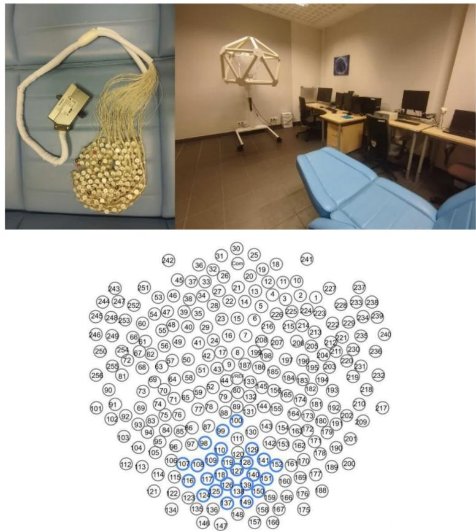
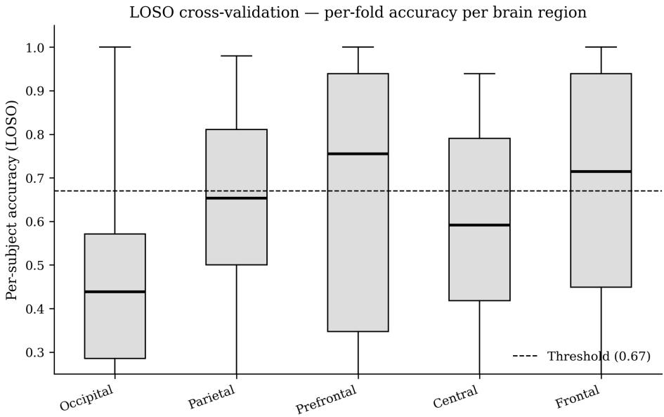

# Region-Specific EEG Classification of Hypnotic Susceptibility Using a Sliding-Window 2D CNN: A Subject-Independent Evaluation

Krzysztof Wróbel1[0000-0002-1452-6623] and Grzegorz M. Wójcik1[0000-0002-4678-9874]

Department of Neuroinformatics and Biomedical Engineering, Institute of Computer Science, Maria Curie-Skłodowska University, Lublin, Poland krzysztof.wrobel@umcs.pl, gmwojcik@umcs.edu.pl

Abstract. We investigate whether a 2D Convolutional Neural Network (CNN) trained on minimally preprocessed EEG signals can classify hypnotic susceptibility across distinct brain regions. Sixty-two male participants (32 Control, 30 Guided Imagery / Hipno group) underwent a 20- minute EEG recording using a 256-channel EGI cap. A sliding-window approach evaluates all 10-second windows within the recording for each of seven predefined brain regions (prefrontal, frontal, temporal, central, parietal, occipital, and facial), yielding up to 868 independently trained models. Initial screening with a segment-level 90/10 random split showed that five regions exceeded the 0.67 accuracy threshold, with the occipital region achieving the highest mean accuracy (0.721) across 90.3% of windows. Subject-independent evaluation via Leave-One-Subject-Out (LOSO) cross-validation, however, substantially revised this picture: occipital performance collapsed to near-chance (mean ACC 0.453, AUC 0.429), revealing that high random-split accuracy was driven by subjectspecific EEG fingerprints rather than genuine group diferences. In contrast, the frontal and prefrontal regions maintained above-chance LOSO accuracy (0.646 and 0.624, respectively), demonstrating genuine generalisability. These results underscore the necessity of subject-independent validation in EEG-based classification studies and highlight anterior cortical regions as more reliable neural markers of hypnotic susceptibility.

Keywords: EEG classification · hypnotic susceptibility · Convolutional Neural Networks · Guided Imagery · Leave-One-Subject-Out · brain-computer interfaces

## 1 Introduction

Electroencephalography (EEG) is a non-invasive, cost-efective technique for recording brain bioelectrical activity, increasingly combined with machine learning to classify mental states [11]. Convolutional Neural Networks (CNNs) have become the dominant deep-learning architecture in EEG-based classification, achieving strong results in motor imagery decoding [12], epileptic seizure detection [17], emotion recognition [16], and brain-computer interfaces (BCIs) [2].

Guided Imagery (GI) is a therapeutic relaxation technique in which structured mental visualisation modulates physiological and emotional states. EEG studies of hypnosis-related altered states have documented characteristic changes in posterior alpha oscillations [5, 7], parietal attention networks [10, 8], and transient prefrontal involvement [3]. Our previous work applied a Generalised Linear Model (GLM) to discriminate GI and mental-task groups from EEG with 81% accuracy on a hand-selected 60-second segment [14], and a subsequent CNN comparison confirmed the advantage of 2D convolutional architectures over recurrent models for this task [9].

A critical but often overlooked methodological issue is the split strategy used for evaluation. When consecutive sub-segments from the same subject are distributed across training and test sets (segment-level split), the classifier can learn subject-specific EEG fingerprints [15] rather than group-level diferences, inflating apparent accuracy. Subject-independent Leave-One-Subject-Out (LOSO) cross-validation eliminates this leakage and provides a more realistic estimate of generalisation.

The present study makes three contributions: (i) a systematic sliding-window search over the full 20-minute recording for each of seven brain regions, identifying temporally localised windows of maximal discriminability; (ii) a direct comparison of segment-level and subject-level evaluation protocols on the same dataset; (iii) identification of the cortical regions whose EEG features genuinely generalise across subjects.

## 2 Materials and Methods

## 2.1 Participants and EEG Recording

Sixty-two healthy male participants aged 19–24 (32 Control, 30 Hipno) were recruited from Maria Curie-Skłodowska University (UMCS). The study was approved by the UMCS Bioethical Commission; all participants provided written informed consent. Participants were randomly assigned to the Hipno group, who listened to a 20-minute Guided Imagery recording prepared by a qualified psychologist, or the Control group, who performed a structured mental retrieval task (recalling Zodiac signs, Polish voivodships, US states, and European capitals) designed to induce cognitive load [4]. Both conditions were delivered in a darkened room with participants lying down and eyes closed to minimise artefacts.

EEG was recorded at 250 Hz using a 256-channel EGI GSN-130 dense-array cap and EGI Net Station 4.5.4 software (Fig. 1).

## 2.2 Preprocessing

EEG signals were processed with MNE-Python [6]. Bad channels were detected via the RANSAC algorithm [1] and reconstructed by interpolation. Each recording was bandpass filtered to 1–40 Hz, then z-score normalised per channel over the full recording: $\hat { x } = ( x - \mu ) / \sigma$

  
Fig. 1. EEG laboratory at UMCS (top) and the 256-channel EGI GSN-130 cap (bottom).

The usable recording segment spans 45–1245 s (1200 s total), partitioned into non-overlapping 10-second windows. Each window is further divided into 50-sample sub-segments (0.2 s at 250 Hz), which serve as individual training samples for the CNN. All 124 windows were evaluated independently for each of seven anatomically defined brain regions (Table 1), yielding up to $1 2 4 \times 7 =$ 868 independently trained models. Parallelism was implemented with Python’s asyncio and ProcessPoolExecutor.

## 2.3 CNN Architecture

Each sub-segment is treated as a 2D matrix (time samples × electrodes), allowing $3 \times 3$ convolutional kernels to capture joint spatial-temporal patterns. The network consists of two convolutional blocks: Block 1 — Conv2D(32 filters,

Table 1. Brain regions and electrode counts (EGI 256-channel GSN-130 cap).
<table><tr><td>Region</td><td>Electrodes (N)</td></tr><tr><td>Prefrontal</td><td>22</td></tr><tr><td>Frontal</td><td>20</td></tr><tr><td>Temporal</td><td>72</td></tr><tr><td>Central</td><td>25</td></tr><tr><td>Parietal</td><td>41</td></tr><tr><td>Occipital</td><td>40</td></tr><tr><td>Facial</td><td>30</td></tr></table>

$3 \times 3 .$ , ReLU), MaxPool2D(2 × 2), Dropout(0.25); Block 2 — Conv2D(64 filters, $3 \times 3 .$ , ReLU), MaxPool2D(2 × 2), Dropout(0.25); followed by Flatten, Dense(64, ReLU), Dropout(0.50), and a Softmax output layer with 2 units (HIPNO / CON-TROL). The model is compiled with the Adam optimiser and sparse categorical cross-entropy loss, trained for 20 epochs with batch size 32.

## 2.4 Evaluation Protocol

Segment-level screening. For each window–region combination, the dataset is split 90%/10% (random seed 42) at the sub-segment level. A window is labelled discriminative when test accuracy > 0.67. This fast screening identifies candidate regions and windows but does not guarantee subject-independent generalisation.

Subject-independent evaluation (LOSO). For each of the five discriminative regions, LOSO cross-validation was applied to the single best-performing window of that region. In each of the 62 folds, the model was trained on 61 subjects and evaluated on all sub-segments of the held-out subject. Per-fold accuracy is reported as mean ± SD; aggregate F1 and Area Under the ROC Curve (AUC) are computed from concatenated predictions of all folds.

## 3 Results

## 3.1 Segment-Level Screening

Table 2 reports the screening results across all seven regions. Five regions produced at least one discriminative window. The occipital region dominated: 90.3% of windows exceeded the 0.67 accuracy threshold, with mean accuracy of 0.721 across discriminative windows. The parietal region ranked second (76.6%, mean ACC 0.709). Anterior regions (prefrontal, frontal, central) showed substantially lower proportions of discriminative windows (10–20%) but reached comparable peak accuracies, with the prefrontal achieving the overall highest single-window accuracy (0.822). The temporal and facial regions produced no discriminative windows.

Table 2. Segment-level screening results (90/10 random split). A window is discriminative when $\mathrm { A C C } > 0 . 6 7 .$ . Mean ACC is computed over discriminative windows only.
<table><tr><td>Region</td><td>Discriminative Peak ACC Mean ACC Best window</td><td></td><td>(s)</td></tr><tr><td>Occipital</td><td>112/124 (90.3%)</td><td>0.803</td><td>0.721 771-781</td></tr><tr><td>Parietal</td><td>95/124 (76.6%)</td><td>0.773 0.709</td><td>1121-1131</td></tr><tr><td>Prefrontal</td><td>24/124 (19.4%)</td><td>0.822 0.709</td><td>1101-1111</td></tr><tr><td>Central</td><td>20/124 (16.1%)</td><td>0.803</td><td>0.700 1101-1111</td></tr><tr><td>Frontal</td><td>13/124 (10.5%)</td><td>0.783</td><td>0.711 1121-1131</td></tr><tr><td>Temporal</td><td>0/124 (0.0%)</td><td></td><td></td></tr><tr><td>Facial</td><td>0/124 (0.0%)</td><td></td><td></td></tr></table>

Table 3. Leave-One-Subject-Out (LOSO) results for the best window of each discriminative region (62 folds). HIPNO group is the positive class.
<table><tr><td>Region</td><td>Mean ACC ± SD</td><td>F1 AUC Best window (s)</td></tr><tr><td>Frontal</td><td> $0 . 6 4 6 \pm 0 . 3 0 2$ </td><td>0.6380.692 1121-1131</td></tr><tr><td>Parietal</td><td> $0 . 6 3 1 \pm 0 . 2 2 8$ </td><td>0.6270.680 1121-1131</td></tr><tr><td>Prefrontal</td><td> $0 . 6 2 4 \pm 0 . 3 5 3$ </td><td>0.6160.681 1101-1111</td></tr><tr><td>Central</td><td> $0 . 5 9 1 \pm 0 . 2 4 3$ </td><td>0.582 0.599 1101-1111</td></tr><tr><td>Occipital</td><td> $0 . 4 5 3 \pm 0 . 2 3 5$ </td><td>0.4340.429 771-781</td></tr></table>

## 3.2 Subject-Independent Evaluation (LOSO)

Table 3 presents LOSO results for the five discriminative regions. The most striking finding is the collapse of occipital performance: mean LOSO accuracy dropped to 0.453 with AUC 0.429 — below the 0.5 chance level — indicating that the high random-split accuracy reflected subject-specific EEG fingerprints, not group-level diferences. In contrast, the frontal region achieved the highest LOSO mean accuracy (0.646, AUC 0.692), followed by parietal (0.631, AUC 0.680) and prefrontal (0.624, AUC 0.681). These three regions maintained consistently above-chance performance, confirming genuine cross-subject discriminability.

Figure 2 shows the per-subject accuracy distributions. The high standard deviations (up to 0.353 for prefrontal) reflect the considerable inter-subject variability typical of EEG studies with small cohorts; some subjects are classified reliably while others fall near chance.

## 4 Discussion

Subject fingerprinting in the occipital region. The collapse of occipital accuracy under LOSO (AUC 0.429) is consistent with known high within-session stability of posterior alpha rhythms, which serve as efective biometric identifiers [15]. When segments from the same 20-minute session appear in both training and test sets, a classifier readily learns individual spectral profiles rather than group membership. This efect is particularly pronounced in the occipital region, where alpha power is both highly stable within subjects and strongly modulated by Guided Imagery [5]. The finding underscores that EEG studies relying solely on segment-level splits may substantially overestimate classification performance.

  
Fig. 2. LOSO per-subject accuracy distributions (62 folds) for the five discriminative regions. Dashed line marks the 0.5 chance level.

Anterior and parietal regions as genuine markers. The frontal and prefrontal regions, which showed modest proportions of discriminative windows in the screening phase (10–20%), turned out to be the most reliable cross-subject classifiers (AUC 0.692 and 0.681). This is consistent with the neuroimaging literature on hypnosis: parietal networks supporting attentional reorientation and multisensory integration are robustly modulated across individuals [10, 8], whereas prefrontal involvement reflects decoupling of cognitive control during hypnotic induction [3]. These features appear less dominated by individual-level variation and thus carry more generalisable group-level information.

Comparison with previous work. The LOSO accuracies (0.624–0.646 for the best-generalising regions) are lower than the 81% reported by our GLM study [14], which used a segment-level split on a manually selected 60-second window. Applying a subject-independent protocol removes the performance inflation due to segment leakage and provides a more conservative but realistic baseline. The 2D CNN without hand-crafted features achieves comparable performance to SVM-based approaches applied to raw EEG [13], validating end-to-end learning as a viable alternative.

Limitations. The study includes 62 subjects, exclusively male and aged 19– 24, limiting generalisability to other demographics. No artefact rejection beyond bad-channel interpolation was applied; however, the absence of discriminative windows in the facial region suggests that peripheral muscle artefacts did not introduce systematic group diferences.

## 5 Conclusions

We demonstrated that a sliding-window 2D CNN applied to minimally preprocessed 256-channel EEG can identify temporally localised windows where hypnotic susceptibility is discriminable at the segment level in five of seven brain regions. Critically, LOSO cross-validation revealed that the dominant occipital signal reflects subject-specific EEG fingerprints rather than group-level neural markers. The frontal and parietal regions, while less prominent in the segment-level analysis, generalise across subjects and represent more reliable targets for hypnosis-state classification. These findings support the use of subjectindependent evaluation as a standard practice in EEG-based classification studies. Future work should investigate larger and more diverse cohorts and explore ensemble methods that aggregate predictions across multiple temporal windows to improve cross-subject robustness.

## Acknowledgements

The experiments were conducted in the EEG Laboratory of the Department of Neuroinformatics and Biomedical Engineering at Maria Curie-Skłodowska University. The study was approved by the UMCS Bioethical Commission dated 09/07/2021 (approval code: 76/WSP/20).

## References

1. Appelhof, S., Hurst, A.J., Lawrence, A., Li, A., Mantilla Ramos, Y.J., O’Reilly, C., Xiang, L., Dancker, J., Scheltienne, M., Bialas, O.: PyPREP: A python implementation of the preprocessing pipeline (PREP) for EEG data (2023). https://doi.org/10.5281/zenodo.10047462

2. Chen, D., Liu, K., Guo, J., Bi, L., Xiang, J.: Brain-computer interface and its applications. Frontiers in Neurorobotics 17, 1140508 (2023)

3. Egner, T., Jamieson, G., Gruzelier, J.: Hypnosis decouples cognitive control from conflict monitoring processes of the frontal lobe. NeuroImage 27(4), 969–978 (2005). https://doi.org/10.1016/j.neuroimage.2005.05.002

4. Galy, E., Cariou, M., Mélan, C.: What is the relationship between mental workload factors and cognitive load types? International Journal of Psychophysiology 83(3), 269–275 (2012)

5. Grafin, N.F., Ray, W.J., Lundy, R.: EEG concomitants of hypnosis and hypnotic susceptibility. Journal of Abnormal Psychology 104(1), 123–131 (1995). https://doi.org/10.1037/0021-843X.104.1.123

6. Gramfort, A., Luessi, M., Larson, E., Engemann, D., Strohmeier, D., Brodbeck, C., Goj, R., Jas, M., Brooks, T., Parkkonen, L., Hämäläinen, M.: MEG and EEG data analysis with MNE-Python. Frontiers in Neuroscience 7 (2013). https://doi.org/10.3389/fnins.2013.00267

7. Jensen, M.P., Adachi, T., Tomé-Pires, C., Lee, J., Osman, Z.J., Miró, J.: Mechanisms of hypnosis: toward the development of a biopsychosocial model. International Journal of Clinical and Experimental Hypnosis 63(1), 34–75 (2015). https://doi.org/10.1080/00207144.2014.961875

8. Landry, M., Lifshitz, M., Raz, A.: Brain correlates of hypnosis: A systematic review and meta-analytic exploration. Neuroscience & Biobehavioral Reviews 81, 75–98 (2017). https://doi.org/10.1016/j.neubiorev.2017.02.020

9. Postepski, F., Wojcik, G.M., Wrobel, K., Kawiak, A., Zemla, K., Sedek, G.: Recurrent and convolutional neural networks in classification of EEG signal for guided imagery and mental workload detection. Scientific Reports 15, 10521 (2025). https://doi.org/10.1038/s41598-025-92378-x

10. Rainville, P., Hofbauer, R.K., Bushnell, M.C., Duncan, G.H., Price, D.D.: Hypnosis modulates activity in brain structures involved in the regulation of consciousness. Journal of Cognitive Neuroscience 14(6), 887–901 (2002). https://doi.org/10.1162/089892902760191117

11. Sanei, S., Chambers, J.A.: Introduction to Electroencephalography, chap. 1, pp. 1–14. John Wiley & Sons, Ltd (2021). https://doi.org/10.1002/9781119386957.ch1

12. Xu, G., Shen, X., Chen, S., Zong, Y., Zhang, C., Yue, H., Liu, M., Chen, F., Che, W.: A deep transfer convolutional neural network framework for eeg signal classification. IEEE Access 7, 112767–112776 (2019)

13. You, S.D.: Classification of relaxation and concentration mental states with EEG. Information 12(5), 187 (2021). https://doi.org/10.3390/info12050187

14. Zemla, K., Wojcik, G.M., Postepski, F., Wróbel, K., Kawiak, A., Sedek, G.: Modeling of brain cortical activity during relaxation and mental workload tasks based on EEG signal collection. Applied Sciences 13(7), 4472 (2023). https://doi.org/10.3390/app13074472

15. Zhang, R., Zeng, Y., Tong, L., Shu, J., Lu, R., Li, Z., Yang, K., Yan, B.: EEG identity authentication in multi-domain features: A multi-scale 3d-CNN approach. Frontiers in Neurorobotics 16, 901765 (2022)

16. Zhang, Y., Chen, J., Tan, J.H., et al.: An investigation of deep learning models for eeg-based emotion recognition. Frontiers in Neuroscience 14, 622759 (2020)

17. Zhou, M., Tian, C., Cao, R., Wang, B., Niu, Y., Hu, T., Guo, H., Xiang, J.: Epileptic seizure detection based on eeg signals and cnn. Frontiers in Neuroinformatics 12, 95 (2018)