# Self-Credit: Credit Assignment for Long-Horizon Agentic RL via Intra-group Rescaling

Fangcong Yin1,2∗, Ming Yin1,3, Tanvi Bhandarkar1, Aashu Singh1, Eryk Helenowski1, Shlok Kumar Mishra1, Saghar Hosseini1, Karthik Abinav Sankararaman1, Greg Durrett2, Dinkar Juyal1

1Meta, 2New York University, 3Duke University ∗Work done at Meta

LLM agents are commonly trained with RLVR, but the sparse nature of typical RLVR rewards makes credit assignment challenging, especially for long-horizon tasks. We propose Self-Credit, an end-to-end agentic RL method that creates dense supervision signals from sparse outcome rewards using self-generated credit assignment via intra-group rescaling. Self-Credit builds on group-based RL with three components. First, during its rollouts, the policy model generates summaries with citations to earlier turns containing critical evidence, which serve as self-generated credit. Second, we refine this model-generated credit with intra-group rescaling, which compares cited actions across successful and failed rollouts for the same prompt. This approach uses group-level agreement and disagreement to remove undeserved credit and further emphasize credit assigned to critical actions. Third, advantage reweighting uses the rescaled credit weights to update the advantages of the cited turns. On BrowseComp-Plus, Self-Credit improves over the base models by 37.0 and 36.2 points on Qwen3 8B and 32B respectively, and outperforms the strongest agentic RL baselines by 8.5 and 5.6 points, respectively. Self-Credit also improves over the strongest baselines by 4.9 points on GAIA and 4.7 points on xBench-DeepSearch. Analyses show that self-generated credit provides useful signals for selecting critical actions, and that intra-group rescaling, especially on failed rollouts, is important across model scales.

Date: October 21, 2026 Correspondence: Fangcong Yin at fcyin@meta.com

∞Meta

## 1 Introduction

Large language models (LLMs) are commonly used for agentic tasks, where they interact with environments and issue tool calls as actions. A principal challenge in building long-horizon agents is the nature of supervision: typically, models are trained via RLVR using only sparse rewards (Guo et al., 2025), as additional dense supervision is expensive to define and collect (Tao et al., 2025; Setlur et al., 2025; Zhang et al., 2025a,e). Recent work extends standard RLVR algorithms to provide credit assignment even when only sparse rewards are available, including approaches that use external judges (Zhang et al., 2026b; Zeng et al., 2025) and learned critics (Zhang et al., 2025d; Shi et al., 2026).

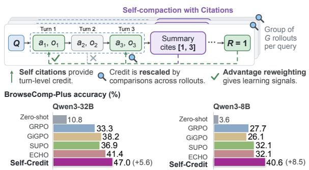  
Figure 1 Self-Credit leverages self-generated summaries with Intragroup rescaling to provide credit assignment for long-horizon agentic RL. Self-Credit outperforms strong baselines on challenging long-horizon tasks, such as BrowseComp-Plus.

Inspired by context management methods for LLM agents (Li et al., 2026b; Xie et al., 2026), we propose Self-Credit, a novel agentic RL method in which the policy LLM agent performs credit assignment through compaction using self-generated credit with intra-group rescaling. As illustrated in Figure 1, Self-Credit builds on a standard group-based RL algorithm with three components to create dense supervision signals from a single sparse outcome reward. First, we prompt the policy model to generate a summary with citations that identify earlier turns in the interaction history containing critical evidence for the agentic task. The summaries are used for compaction to compress the long context, and the citations serve as self-generated credit. Second, intra-group rescaling refines this credit by comparing cited actions across successful and failed rollouts for the same prompt. In particular, this rescaling uses agreement and disagreement across the entire rollout group to determine how to remove undeserved credit and further emphasize credit assigned to critical actions, grounding the credit weights in group-level statistics. Third, advantage reweighting uses the rescaled credit weights to selectively strengthen the advantages of tokens in model-cited turns to emphasize important behaviors in a long trajectory.

We evaluate Self-Credit on challenging long-horizon search and retrieval tasks, including multi-hop QA on BrowseComp-Plus and deep research on GAIA and xBench-DeepSearch. As shown in Figure 1, on BrowseComp-Plus, Self-Credit improves over the Qwen3-8B and Qwen3-32B base agents by 37.0 and 36.2 percentage points, respectively, and outperforms the strongest agentic RL baselines by 8.5 and 5.6 points, respectively. On deep research tasks, Self-Credit also outperforms the strongest evaluated baselines by 4.9 points on GAIA and 4.7 points on xBench-DeepSearch.

Ablations show that intra-group credit rescaling, especially downweighting repeated turns shared across failed rollouts, is important across model scales, and that using self-generated credit provides more efective credit assignment than the alternatives. Further analyses show that self-generated citations identify important actions related to gold answers, and that intra-group rescaling rules are applied selectively during training at a higher selection quality than baselines.

Our main contributions are as follows: (1) We introduce Self-Credit, an end-to-end RL algorithm for training long-horizon agents using self-generated summaries for turn-level credit assignment with intra-group rescaling. (2) We propose a novel intra-group credit rescaling method that refines self-generated credit using both successful and failed rollouts. (3) We show that Self-Credit outperforms strong agentic RL baselines on long-horizon agentic tasks across multiple models at diferent scales.

## 2 Preliminaries

Long-horizon agentic tasks. We formulate long-horizon tasks for LLM agents as follows. Given a query $Q ,$ an LLM agent $M _ { \theta }$ interacts with an environment E and answers Q by taking a sequence of actions over T interaction turns, followed by a final-answer turn. At each interaction turn $t \in \{ 0 , \ldots , T - 1 \}$ , the model generates a thinking trace $I _ { t } ,$ , takes an action $a _ { t } \in { \mathcal { A } }$ , and receives an observation $o _ { t } \in \mathcal { O }$ from the environment. The agent’s state is $s _ { t } = ( Q , \mathcal { H } _ { t } )$ , where $\mathcal { H } _ { t } = \mathcal { H } _ { 0 : t }$ and $\mathcal { H } _ { k : t } = \big ( \big ( I _ { k } , a _ { k } , o _ { k } \big ) , \ldots , \big ( I _ { t - 1 } , a _ { t - 1 } , o _ { t - 1 } \big ) \big )$ for $k \in \{ 0 , \ldots , t \}$ , with $\mathcal { H } _ { t : t }$ denoting the empty history. For example, in a tool-use setting, the model takes an action by issuing a call to an external tool with appropriate parameters. At the final turn $t = T$ , the model generates a thinking trace $I _ { T }$ and a final answer $a _ { T }$ , then terminates the interaction. The complete trajectory of $T + 1$ turns is $\mathcal { T } = ( ( I _ { 0 } , a _ { 0 } , o _ { 0 } ) , \dots , ( I _ { T - 1 } , a _ { T - 1 } , o _ { T - 1 } ) , ( I _ { T } , a _ { T } ) )$ ), which receives a binary reward $R ( a _ { T } , Q )$ abbreviated as $R \in \{ 0 , 1 \}$

Multi-turn RL with GRPO. We use GRPO (Shao et al., 2024) to train the model in this multi-turn RL setting. At each training step, the rollout policy $M _ { \theta }$ generates G trajectories $\{ \mathcal { T } ^ { j } \} _ { j = 1 } ^ { G }$ for the same query Q through interactions with the environment, each receiving a reward $R ^ { j }$ . Let $\widehat { A } ^ { j }$ denote the advantage for trajectory ${ \mathcal { T } } ^ { j } ;$ its detailed formulation can be found in Appendix A.

Let $\mathcal { T } _ { M _ { \theta } } ^ { j } = ( ( I _ { 0 } ^ { j } , a _ { 0 } ^ { j } ) , \dots , ( I _ { T ^ { j } } ^ { j } , a _ { T ^ { j } } ^ { j } ) )$ denote the sequence of model-generated thinking traces and actions, including the final answer, in trajectory $\mathcal { T } ^ { j }$ , where $T ^ { j }$ is its number of interaction turns. We use $| \mathcal { T } _ { M _ { \theta } } ^ { j } |$ to denote the total number of model-generated tokens in this sequence. The advantage $\widehat { A } ^ { j }$ is uniformly applied to every token in $\mathcal { T } _ { M _ { \theta } } ^ { j }$ . Further details can be found in Appendix A.

(1) Self-compaction with turn citations provides credit.

(2) Intra-group rescaling adjusts the credit from citations.  
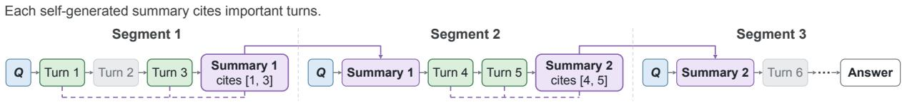

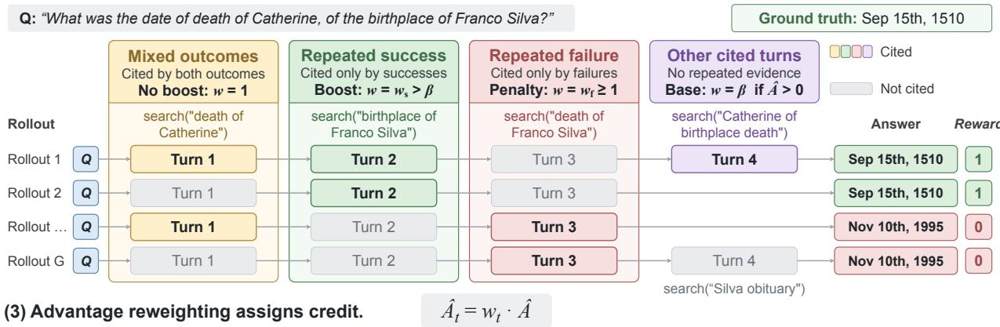  
Figure 2 Illustration of Self-Credit. (1) Self-Credit leverages self-compaction with turn citations for credi assignment. (2) Across rollouts for the same prompt, intra-group rescaling removes extra credit from cited turns that appear in both successful and failed rollouts, strengthens positive credit for turns unique to successes, and assigns stronger negative credit to turns that are only cited by failures. (3) The rescaled weights are used for advantage reweighting.

Credit assignment. GRPO with only outcome rewards provides coarse credit for a multi-turn decision chain. As the advantage Abj is broadcast uniformly to every model-generated token in the rollout, all turns share the same advantage. Such reward sparsity becomes more problematic for long-horizon agentic tasks as the trajectory length grows, because a single outcome reward must supervise more turns (Feng et al., 2025; Zhang, 2026). Providing better learning signals requires credit assignment, usually expressed through non-uniform advantage estimates. In this work, we focus on turn-level advantages $\widehat { A } _ { t } ^ { j }$

## 3 Methods

We present an approach that creates dense supervision signals from outcome rewards for long-horizon agentic RL using self-generated credit with intra-group rescaling via compaction. Our method, Self-Credit, combines three components: (1) the policy performs compaction by generating summaries of the interaction history, and the summaries cite important turns in the history as credit; (2) Intra-group rescaling refines this self-generated credit against the outcomes of other rollouts for the same prompt; (3) The rescaled credit is used to upweight the advantages of cited turns. Figure 2 illustrates Self-Credit.

## 3.1 Self-Compaction with Turn Citations

Compaction-augmented RL. Prior work introduces compaction into RLVR for long-horizon agentic tasks to address issues caused by growing context (Li et al., 2026b,a; Lu et al., 2025). Compaction replaces the interaction history in the context with a shorter summary, allowing generation to continue conditioned on the query and summary.

During training, compaction is triggered whenever the context reaches or exceeds C tokens at turn t, where C is a threshold chosen according to the efective context size of the LLM agent. When compaction is triggered, a summarizer $M _ { \phi }$ produces a compact history $z _ { t }$ from the current interaction context:

$$
\begin{array} { r } { \mathcal { \widetilde { H } } _ { t ^ { \prime } : t } : = \left\{ \begin{array} { l l } { \mathcal { H } _ { t ^ { \prime } : t } , } & { | ( Q , \mathcal { H } _ { t ^ { \prime } : t } ) | < C , } \\ { z _ { t } , \quad z _ { t } \sim M _ { \phi } ( \cdot \vert Q , \mathcal { H } _ { t ^ { \prime } : t } ) , } & { | ( Q , \mathcal { H } _ { t ^ { \prime } : t } ) | \ge C . } \end{array} \right. } \end{array}\tag{1}
$$

Here, $t ^ { \prime }$ is the most recent turn at which compaction was triggered before turn $t \ ( t ^ { \prime } = 0 \ \mathrm { i f }$ no compaction has been triggered yet), $\mathcal { H } _ { t ^ { \prime } : t }$ is the context before compaction, and $| ( Q , { \mathcal { H } } _ { t ^ { \prime } : t } ) |$ denotes the context length. $\widetilde { \mathcal { H } } _ { t ^ { \prime } : t }$ is the context after compaction: the previous interaction context is discarded and replaced by the summary; the model continues from the query and summary.

Compaction may be triggered multiple times as the context grows again after each summary. Let $N ^ { j }$ be the number of context-replacing summaries generated in trajectory $\tau ^ { j }$ . The trajectory is then divided into $N ^ { j } + 1$ segments $\{ \boldsymbol { S } _ { i } ^ { j } \} _ { i = 1 } ^ { N ^ { j } + 1 }$ , each conditioned on the query and the preceding summary if exists.

Following compaction-augmented policy optimization methods such as SUPO (Lu et al., 2025), we extend the GRPO objective to:

$$
\mathcal { I } _ { \mathrm { S U M - R L } } ( \theta ) = \mathbb { E } \Bigg [ \frac { 1 } { \sum _ { j = 1 } ^ { G } | \mathcal { T } _ { M _ { \theta } } ^ { j } | } \sum _ { j = 1 } ^ { G } \sum _ { i = 1 } ^ { N ^ { j } + 1 } \sum _ { \ell = 1 } ^ { | \mathcal { S } _ { i , M _ { \theta } } ^ { j } | } \operatorname* { m i n } \Big ( \rho _ { i , \ell } ^ { j } \widehat { A } ^ { j } , \ : \mathrm { c l i p } \big ( \rho _ { i , \ell } ^ { j } , 1 - \varepsilon _ { \mathrm { l o w } } , 1 + \varepsilon _ { \mathrm { h i g h } } \big ) \widehat { A } ^ { j } \Big ) \Bigg ] ,\tag{2}
$$

where $ { \mathcal { S } } _ { i , M _ { \theta } } ^ { j }$ contains the trainable model-generated tokens of segment $i .$

Here, $\mathcal { T } _ { M _ { \theta } } ^ { j }$ includes all trainable policy-generated tokens in the rollout, including summary tokens, so $\begin{array} { r } { | T _ { M _ { \theta } } ^ { j } | = \sum _ { i = 1 } ^ { N ^ { j } + 1 } | S _ { i , M _ { \theta } } ^ { j } | } \end{array}$ . In other words, the objective computes one advantage per complete rollout trajectory and broadcasts it across the trainable tokens of all segments.

Summary with citations. Following Lu et al. (2025); Li et al. (2026b); Cursor Research et al. (2026), we use the policy model itself as the summarizer: $M _ { \phi } = M _ { \theta }$ . During training and inference, when compaction is triggered, we prompt the policy model to summarize important information in the interaction history and cite important turns using their indices, producing a citation set $K \subseteq \{ t ^ { \prime } , \ldots , t - 1 \}$ . During training, the model is penalized for generating an invalid summary or citation to enforce the required format. We also prompt the model to provide citations at the end of the rollout to obtain signals for the final segment. Details of the prompt and required format can be found in Appendix B.1.

## 3.2 Intra-group Rescaling

However, relying solely on self-generated credit or rewards can reinforce undesired behaviors; related work shows that optimizing model-generated feedback can lead to hacking and instability (Shafayat et al., 2025; Zhang et al., 2025c; Wang et al., 2025b, 2026b). For example, instead of selectively citing important turns, the model can cite every turn in the context. Using such citations for credit assignment would then fail to provide selective learning signals.

To elicit better learning signals from self-generated citations, Self-Credit uses information already available in group-based RL without additional supervision or inference. For a given turn in a rollout, we examine similar turns across other rollouts in the same prompt group. A turn that appears more frequently across successful rollouts is more likely to be associated with success, and the same reasoning applies to failure. This provides within-group evidence for validating and refining the model’s self-generated credit.

Given a query $Q$ and its group of G rollout trajectories $\{ \mathcal { T } ^ { j } \} _ { j = 1 } ^ { G }$ , let C and $\mathcal { F }$ be the sets of successful and failed rollouts, respectively. Let $B _ { t } ^ { j }$ denote the t-th turn of trajectory $\mathcal { T } ^ { j }$ . Following Feng et al. (2025), we assume that some turns appear more than once and can be matched across rollouts. For example, in search-agent tasks, two search actions can be matched if the sets of documents they retrieve have substantial overlap. In addition, we assume that diferent turns in a rollout contribute independently to the final outcome. Details of the matching procedure and a discussion of this assumption are provided in Appendix B.2.

Let $n _ { + } ( B _ { t } ^ { j } )$ and $n _ { - } ( B _ { t } ^ { j } )$ denote the numbers of successful and failed rollouts, respectively, in the group that cite a turn matching $B _ { t } ^ { j }$ . Both numbers take the current rollout $\mathcal { T } ^ { j }$ into consideration. We use these counts to distinguish the following three critical scenarios for a cited turn: (1) Repeated success: a matching turn is cited by at least $\tau _ { + }$ successful rollouts and no failed rollouts; (2) Repeated failure: a matching turn is cited by at least $\tau _ { - }$ failed rollouts and no successful rollouts; and (3) Mixed outcomes: a matching turn is cited by at least one successful rollout and at least one failed rollout.

Then, for a cited turn $B _ { t } ^ { j }$ with $\widehat { A } ^ { j } \neq 0$ , we assign a scaling weight as follows:

$$
w _ { t } ^ { j } : = \left\{ \begin{array} { l l } { w _ { s } } & { \widehat { A } ^ { j } > 0 , ~ n _ { - } ( B _ { t } ^ { j } ) = 0 , ~ \mathrm { a n d } ~ n _ { + } ( B _ { t } ^ { j } ) \geq \tau _ { + } \quad \mathrm { ( S u c c e s s e s ) } } \\ { 1 } & { \widehat { A } ^ { j } > 0 ~ \mathrm { a n d } ~ n _ { - } ( B _ { t } ^ { j } ) > 0 \quad \mathrm { ( M i x e d ) } } \\ { \beta } & { \widehat { A } ^ { j } > 0 , ~ \mathrm { o t h e r w i s e } \quad \mathrm { ( B a s e ~ c r e d i t ) } } \\ { w _ { f } } & { \widehat { A } ^ { j } < 0 , ~ n _ { + } ( B _ { t } ^ { j } ) = 0 , ~ \mathrm { a n d } ~ n _ { - } ( B _ { t } ^ { j } ) \geq \tau _ { - } \quad \mathrm { ( F a i l u r e s ) } } \\ { 1 } & { \widehat { A } ^ { j } < 0 , ~ \mathrm { o t h e r w i s e } . } \end{array} \right.\tag{3}
$$

In other words, we refine credit assignment in these three scenarios through intra-group comparisons: (1) Repeated success: we apply a larger scaling weight $w _ { s } > \beta$ to strengthen positive credit; (2) Repeated failure: we apply a scaling weight $w _ { f } \geq 1$ to strengthen the negative advantage; and (3) Mixed outcomes: we remove the $\beta$ upweighting for successful rollouts because the efect of the cited turn is uncertain. For all other cited turns, we retain the base weight of $\beta$ for positive advantages and 1 for negative advantages. For uncited turns t /∈ K, we do not change the advantages, so $w _ { t } ^ { j } = 1$ . The three scenarios are illustrated in Figure 2.

Intra-group rescaling is applied only to turns that can be matched across rollouts. Summary turns and final-answer turns are excluded from comparisons to preserve credit for summarization and answer commitment. Nonetheless, we show empirically in Section 6 that rescaling can still be triggered frequently, as most agentic actions within a group are similar when conditioned on the same query.

## 3.3 Advantage Reweighting

We leverage the rescaled weights for advantage reweighting. We use the citation set to replace the uniform advantage broadcast in Equation 2 with turn-level weights. For each model-generated token ℓ in turn t of trajectory $\mathcal { T } ^ { j }$ , the token-level advantage is defined as follows:

$$
\widehat { A } _ { t , \ell } ^ { j } : = \widehat { A } ^ { j } w _ { t } ^ { j }\tag{4}
$$

In other words, all tokens in the same turn receive the same reweighted advantage using the assigned rescaled weight. In addition, in a successful rollout trajectory, summary turns and the final-answer turn are automatically treated as cited so that they receive credit without requiring explicit citations from the model.

## 3.4 Annealing the Weights

The importance of exploration and exploitation varies across diferent stages of LLM post-training (Cui et al., 2025; Cheng et al., 2025). Since the rescaled weights can influence this balance, we design a learning curriculum with an annealing schedule for the repeated-failure penalty weight wf. Stronger penalties early in training are intended to discourage repeatedly unsuccessful retrieval actions and stabilize search behaviors, while weaker penalties later allow more exploration.

## 4 Experimental Setup

## 4.1 Setup

Task We evaluate our method on the following long-horizon multi-hop QA and deep research tasks: (1) BrowseComp-Plus (Chen et al., 2025b): LLM agents interact with a search engine and retrieve documents to solve multi-hop questions; (2) Deep research tasks: we evaluate on GAIA (Mialon et al., 2024) and xBench-DeepSearch (Chen et al., 2025a). These tasks include real-world questions requiring multi-step reasoning, web browsing, and tool use. For GAIA, we use its text-only subset.

<table><tr><td rowspan="2">Method</td><td rowspan="2">Long Context Management</td><td colspan="2">Credit Assignment</td></tr><tr><td>Form of credits</td><td>Source of credits</td></tr><tr><td>GRPO</td><td></td><td></td><td></td></tr><tr><td>GiGPO</td><td></td><td>Advantage reweighting</td><td>Successful and failed rollouts</td></tr><tr><td>SUPO</td><td>Summary</td><td></td><td></td></tr><tr><td>ECHO</td><td>Turn Selection</td><td>Turn masking</td><td>Successful rollouts only</td></tr><tr><td>Self-Credit</td><td>Summary</td><td>Advantage reweighting</td><td>Successful and failed rollouts</td></tr></table>

Table 1 Key diferences between Self-Credit and baseline methods. Self-Credit leverages self-generated summaries during training to provide credit assignment via advantage reweighting that is grounded in both successful and failed rollouts via intra-group rescaling.

Models We train Qwen3-8B, Qwen3-32B (Yang et al., 2025), and Gemma4-E4B (Team et al., 2026) with thinking mode.

Training For BrowseComp-Plus, we follow Xie et al. (2026) and split the dataset into 747 training examples for RL training and 83 test examples for evaluation. We use the BrowseComp-Plus static corpus and index as the search backend. For deep research tasks, we train on 1K deep research QA pairs from OpenResearcher (Li et al., 2026c) and use the OpenResearcher static browser as the tool use harness and search backend during training. For eficient training, we use a fully asynchronous rollout with VeRL (Sheng et al., 2024) and Megatron (Shoeybi et al., 2019) frameworks. For Self-Credit, we use $\tau _ { + } = \tau _ { - } = 2$ in all experiments. Details can be found under Appendix C.

## 4.2 Baselines

We compare against the following zero-shot and agentic RL baselines. The main diferences between Self-Credit and these baselines can be found in Table 1. (1) Zero-shot evaluation of the base model does not use context management; (2) GRPO is applied to the multi-turn setting without any context management or turn-level credit assignment; (3) GiGPO (Feng et al., 2025) modifies group-based RL with turn-level credit assignment by re-grouping the same rollouts based on action states that are matched by repetitive actions. Turns sharing an identical environment observation are matched into groups, and within each group the action receives a standardized additive advantage adjustment; (4) SUPO (Lu et al., 2025) is a compactionaugmented RL baseline that implements a rolling summarization with a free-form summary and optimizes the uniform-credit objective. There is no citation instruction in the summarization prompt and no turn-level credit assignment; (5) ECHO (Xie et al., 2026) replaces free-form summarization in summarization-augmented RL with explicit turn selection: at each summarization, the policy emits a selection over its turn history, and the selected turn memories are carried into the next context in place of a summary. It routes token-level credit to the turns selected by the policy in successful rollouts.

## 4.3 Evaluation Protocol

For BrowseComp-Plus, we follow Chen et al. (2025b); Xie et al. (2026) and use the Qwen3-Embedding-8B (Zhang et al., 2025b) retriever and the BrowseComp-Plus static corpus index as the search engine during evaluation. We report LLM-as-a-judge accuracy, prompting a separate Qwen3-32B judge to determine whether the model-generated answer is semantically equivalent to the ground-truth answer. For deep research tasks, we follow Li et al. (2026c) to use open web search API instead of the static engine during evaluation. We report LLM-as-a-judge accuracy as well with the rubric from Gupta et al. (2026). For both tasks, we use temperature = 0.7 for decoding.

## 5 Results

Self-Credit outperforms strong RL baselines across settings. Table 2 reports test accuracy on BrowseComp-Plus. Self-Credit outperforms all baselines at both Qwen3 model scales and beats the strongest baseline by

<table><tr><td rowspan="2"></td><td colspan="2">Qwen3-32B</td><td colspan="2">Qwen3-8B</td></tr><tr><td>Acc.</td><td> $\#$  Turns</td><td>Acc.</td><td> $\#$  Turns</td></tr><tr><td>Zero-shot</td><td>10.8</td><td></td><td>3.6</td><td></td></tr><tr><td>GRPO</td><td> $3 3 . 3 { \scriptstyle \pm 1 . 4 }$ </td><td> $1 3 . 2 _ { \pm 0 . 4 }$ </td><td> $2 7 . 7 _ { \pm 2 . 4 }$ </td><td> $1 0 . 8 { \scriptstyle \pm 0 . 2 }$ </td></tr><tr><td>GiGPO</td><td> $3 8 . 2 _ { \pm 0 . 8 }$ </td><td> $1 0 . 9 _ { \pm 0 . 2 }$ </td><td> $2 6 . 1 _ { \pm 1 . 7 }$ </td><td> $6 . 7 _ { \pm 0 . 1 }$ </td></tr><tr><td>SUPO</td><td> $3 6 . 9 { \scriptstyle \pm 4 . 6 }$ </td><td> $4 0 . 8 { \scriptstyle \pm 1 . 3 }$ </td><td> $3 2 . 1 { \scriptstyle \pm 2 . 5 }$ </td><td> $1 3 . 4 { \scriptstyle \pm 0 . 6 }$ </td></tr><tr><td>ECHO</td><td> $4 1 . 4 { \scriptstyle \pm 2 . 5 }$ </td><td> $4 5 . 8 { \scriptstyle \pm 2 . 7 }$ </td><td> $3 2 . 1 _ { \pm 3 . 0 }$ </td><td> $6 2 . 6 { \scriptstyle \pm 2 . 1 }$ </td></tr><tr><td>Self-Credit</td><td> ${ \pm 7 . 0 } _ { \pm 2 . 1 }$ </td><td> $3 9 . 4 { \scriptstyle \pm 2 . 4 }$ </td><td> ${ \pm 0 . 6 } _ { \pm 0 . 7 }$ </td><td> $3 7 . 9 { \scriptstyle \pm 1 . 9 }$ </td></tr></table>

<table><tr><td></td><td>GAIA</td><td>xBench-DeepSearch</td></tr><tr><td></td><td>Acc.</td><td>Acc.</td></tr><tr><td>Zero-shot</td><td>23.4</td><td>4.0</td></tr><tr><td>GRPO</td><td> $3 4 . 3 { \scriptstyle \pm 0 . 6 }$ </td><td> $1 1 . 3 { \scriptstyle \pm 2 . 9 }$ </td></tr><tr><td>GiGPO</td><td> $1 3 . 3 { \scriptstyle \pm 0 . 6 }$ </td><td> $1 2 . 0 { \scriptstyle \pm 1 . 0 }$ </td></tr><tr><td>SUPO</td><td> $2 7 . 2 { \scriptstyle \pm 2 . 4 }$ </td><td> $6 . 3 { \scriptstyle \pm 1 . 5 }$ </td></tr><tr><td>ECHO</td><td> $3 2 . 0 _ { \pm 2 . 6 }$ </td><td> $1 0 . 0 { \scriptstyle \pm 1 . 7 }$ </td></tr><tr><td>Self-Credit</td><td> $\mathbf { 3 9 . 2 } _ { \pm 1 . 5 }$ </td><td> $1 6 . 7 _ { \pm 1 . 5 }$ </td></tr></table>

Table 2 Test accuracy (Pass@1) and average number of turns on BrowseComp-Plus. Results are reported over 3 seeds. Self-Credit outperforms strong RL baselines across model scales.  
Table 3 Test accuracy (Pass@1) on GAIA and xBench-DeepSearch with Gemma4-E4B. Results are reported over 3 seeds. Self-Credit outperforms strong RL baselines on both deep research benchmarks.

Training Dynamics on BrowseComp-Plus with Qwen3-32B  
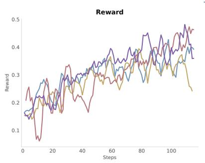

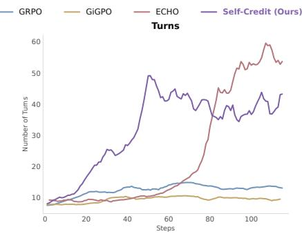

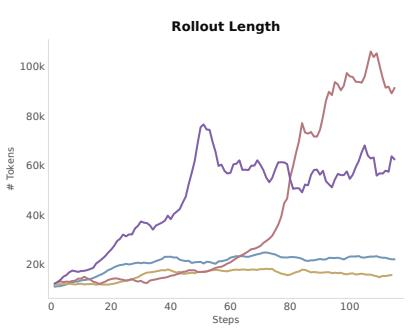  
Figure 3 Training dynamics on BrowseComp-Plus on Qwen3-32B models of RL baselines with diferent credit assignment methods. Self-Credit learns stably across steps without excessive use of tool calls.

5.6 points at 32B and 8.5 points at 8B. Table 3 summarizes results on deep research tasks by training a Gemma4-E4B model. On GAIA, Self-Credit achieves the highest accuracy and outperforms the strongest baseline by 4.9 points. On xBench-DeepSearch, Self-Credit outperforms the best baseline by 4.7 points. We also show that Self-Credit trains models that generalize better to OOD shorter horizon search QA datasets in Appendix D. These results demonstrate consistent gains across the evaluated model families and benchmarks with Self-Credit.

Self-Credit learns efficient long-horizon tool use. Training dynamics of diferent methods on BrowseComp-Plus shows the strength of Self-Credit from balancing depth and eficiency of tool use for long horizon tasks. Figure 3 shows later in training, Self-Credit typically uses fewer turns than ECHO does, while attaining high training reward. GRPO and GiGPO generate much shorter trajectories and exhibit lower training reward. This suggests that simply minimizing or maximizing interaction length for long-horizon tasks is insuficient (Yin et al., 2025). Together, these results show that Self-Credit supports suficient exploration to gather useful evidence while limiting excessive interaction.

## 6 Analysis

## 6.1 Ablations

To isolate the importance of diferent components of Self-Credit, we conduct an ablation analysis with the following variants: (1) without intra-group rescaling: we train models to summarize with citations and upweight the advantages of all cited turns in rollouts with positive advantages; (2) without penalties for repeated failures;

<table><tr><td></td><td>Qwen3-32B</td><td>Qwen3-8B</td></tr><tr><td>Self-Credit</td><td>47.0</td><td>40.6</td></tr><tr><td>Ablations on Form of Credits</td><td></td><td></td></tr><tr><td> $- \mathbf { w } / \mathbf { o }$  Intra-group rescaling</td><td>41.0</td><td>28.9</td></tr><tr><td> $- \mathbf { W } / \mathbf { O }$  Penalties for repeated failures</td><td>34.9</td><td>26.5</td></tr><tr><td> $- \mathbf { W } / \mathbf { O }$  Rescaling for mixed outcomes</td><td>41.0</td><td>31.3</td></tr><tr><td>Ablations on Source of Credits</td><td></td><td></td></tr><tr><td> $- \pi / \alpha$  Self-generated citations</td><td>42.2</td><td>27.7</td></tr><tr><td> $- \mathbf { w } /$  Random citations</td><td>38.6</td><td>32.5</td></tr></table>

Table 4 Ablations of Self-Credit on BrowseComp-Plus. Intra-group rescaling, penalties for repeated failures, and self-generated credits are important for the downstream performance using Self-Credit.
<table><tr><td></td><td></td><td>Gold Searched (%)</td><td>Gold Opened (%)</td><td>Answer Recall (%)</td><td>Evidence Recall (%)</td></tr><tr><td rowspan="5">Qwen3-32B</td><td>GRPO</td><td>42.2</td><td>25.3</td><td>33.9</td><td>29.5</td></tr><tr><td>GiGPO</td><td>42.2</td><td>12.0</td><td>25.1</td><td>25.3</td></tr><tr><td>SUPO</td><td>53.0</td><td>25.3</td><td>43.2</td><td>39.6</td></tr><tr><td>ECHO</td><td>62.7</td><td>30.1</td><td>51.6</td><td>48.3</td></tr><tr><td>Self-Credit</td><td>66.3</td><td>49.4</td><td>53.8</td><td>47.0</td></tr><tr><td rowspan="5">Qwen3-8B</td><td>GRPO</td><td>42.2</td><td>25.3</td><td>28.0</td><td>25.1</td></tr><tr><td>GiGPO</td><td>34.9</td><td>0.0</td><td>19.2</td><td>16.9</td></tr><tr><td>SUPO</td><td>42.2</td><td>9.6</td><td>30.4</td><td>27.8</td></tr><tr><td>ECHO</td><td>48.2</td><td>27.7</td><td>36.0</td><td>31.7</td></tr><tr><td>Self-Credit</td><td>50.6</td><td>32.5</td><td>36.7</td><td>32.0</td></tr></table>

Table 5 Analysis of the quality of tool use on BrowseComp-Plus for diferent training methods. Gold Searched and Gold Opened measure the percentage of questions for which at least one gold document appears among the search results or is opened, respectively. Answer Recall and Evidence Recall measure the fractions of documents containing the gold answer or supporting evidence that are found through search or page opening.

(3) without rescaling for mixed outcomes; (4) without self-generated citations: we apply intra-group rescaling and advantage reweighting to all turns instead of only the model-cited turns; (5) with random citations: we apply intra-group rescaling and advantage reweighting to a random set of turns in every segment, averaged over 3 seeds.

Table 4 summarizes the performance of these variants on BrowseComp-Plus. Among the intra-group components, rescaling repeated turns in failed rollouts is especially important for both model scales. Removing it reduces accuracy from 47.0% to 34.9% for Qwen3-32B and from 40.6% to 26.5% for Qwen3-8B. We observe that without penalties for repeated turns cited by failed rollouts, Qwen3-8B model learns to search excessively, likely caused by over-optimizing for the credit boost, and fails to learn to commit to an answer. Moreover, applying credit assignment to all turns or randomly selected turns reduces Qwen3-8B accuracy to 27.7% and 32.5%, respectively, showing that self-generated citations provide a better basis for credit assignment than using arbitrary turns.

Overall, these results show that the diferent components of Self-Credit work together: both self-generated citations and intra-group rescaling, especially over repeated failures, are important for achieving the best performance.

## 6.2 Quality of Credit Assignment

Self-Credit improves agentic tool use. We evaluate the quality of agentic tool use of models trained using diferent methods on BrowseComp-Plus, with a focus on two main types of tool use in this task: Search and $O p e n$ . Details of the evaluation metrics are in Appendix E. Table 5 summarizes the results. Models trained with Self-Credit achieve higher Gold Searched, Gold Opened, and Answer Recall scores than the baselines

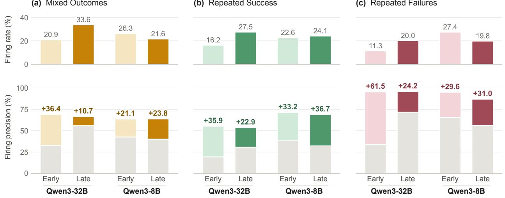

<table><tr><td colspan="2"></td><td>Opened</td><td>Searched</td><td>Judge F1</td></tr><tr><td rowspan="4">Qwen3-32B</td><td>Random</td><td>18.2</td><td>32.8</td><td>44.7</td></tr><tr><td>Cite all</td><td>21.2</td><td>43.1</td><td>60.1</td></tr><tr><td>ECHO</td><td>40.7</td><td>39.7</td><td>60.6</td></tr><tr><td>Self-Credit</td><td>36.0</td><td>59.7</td><td>71.7</td></tr><tr><td rowspan="4">Qwen3-8B</td><td>Random</td><td>22.6</td><td>32.6</td><td>41.3</td></tr><tr><td>Cite all</td><td>26.9</td><td>41.4</td><td>53.9</td></tr><tr><td>ECHO</td><td>27.7</td><td>37.4</td><td>62.4</td></tr><tr><td>Self-Credit</td><td>45.7</td><td>58.1</td><td>69.3</td></tr></table>

Table 6 Quality of citations generated by diferent credit assignment methods on BrowseComp-Plus. Opened and Searched report F1 (%) between cited turns and turns whose Open or Search actions find gold documents. Judge F1 reports F1 (%) against turns judged relevant by a stronger LLM judge.  
e Gain over random, Early (b) Repeated Success  
Gain over random, Late (c) Repeated Failures

Figure 4 Firing rate and precision of Self-Credit intra-group rescaling across the three rules at diferent training stages on BrowseComp-Plus. Firing rate denotes how frequently intra-group rescaling is applied to a cited turn, and firing precision indicates whether rescaling gives the correct credit to the cited turns. Intra-group rescaling is triggered selectively during training for diferent models.

at both model sizes.

Self-Credit generates better citations. To assess the quality of citations generated by diferent methods, we evaluate whether the cited turns perform actions that find gold documents for the agentic tasks. On BrowseComp-Plus, we use Open or Search actions that find gold documents as a proxy for critical actions, and we compute the F1 score of cited turns against the turns containing such actions. We also compute F1 against the important turn judged by Claude-4.6-Sonnet. Details of the evaluation metrics are in Appendix E. Table 6 reports the results for ECHO and Self-Credit; for reference, we introduce a random citation baseline that cites a subset of all turns in the rollout uniformly at random, and a baseline that cites all turns. Self-Credit achieves higher citation quality than ECHO and baselines for multiple metrics, especially better at identifying critical search turns. This indicates Self-Credit trains a better policy at finding the important turns in its generated rollouts, leading to a more reliable source for credit assignment.

Intra-group rescaling is applied selectively and accurately. We evaluate how frequently the intra-group rescaling is applied to cited turns during the early (0–60 steps) and late (60–115 steps) training stages on BrowseComp-Plus. We also report the precision of rescaling by checking whether it gives extra credit to actions that are related to the gold document, and reduces extra credit or give penalties for other less relevant actions. Details of the evaluation metrics are in Appendix E. Figure 4 shows that intra-group rescaling is triggered selectively.

Compared with a random selection baseline, Self-Credit provides higher quality learning signals with high precision of crediting the good turns and downweighting or penalizing the other turns.

## 7 Related Work

Agentic RL for long-horizon tasks. Reinforcement learning (RL) is widely used to post-train LLM agents (Jin et al., 2025; Singh et al., 2025; Qian et al., 2025; Wang et al., 2025c), building on policy-gradient methods such as PPO (Schulman et al., 2017) and GRPO (Shao et al., 2024). In long-horizon tasks (Sun et al., 2026), growing interaction histories can exceed the context window, while sparse outcome rewards provide limited information about the contribution of individual actions (Wang and Ammanabrolu, 2025; Tang et al., 2026). Recent work addresses these challenges by using inference-time methods (Xu et al., 2025; Ye et al., 2026), incorporating context management systems (Li et al., 2026a; Zhang et al., 2026a; Kang et al., 2026; Zhou et al., 2026) or self-compaction capability (Lu et al., 2025; Li et al., 2026b; Cursor Research et al., 2026) into the policy model through RL. Our work leverages self-compaction for context management during training for long horizon tasks.

Credit assignment under sparse outcome rewards. Prior work derives finer grained credit given sparse outcome rewards from several sources, including learned critics (Zhou et al., 2025; Shen et al., 2026; Zhang et al., 2025d; Shi et al., 2026), process reward models (Zhang et al., 2026b; Zeng et al., 2025; Liu et al., 2026), hindsight information conditioned on answers (Tan et al., 2026; Zhang et al., 2026b) and sampling (Choudhury, 2025; Zong et al., 2026), but these methods usually require additional rollouts or hindsight information not available in intermediate steps. Other methods reuse sampled rollouts to compare returns at similar states (Feng et al., 2025; He et al., 2026), or leverage confidence of the policy model (Wang et al., 2025a; Dong et al., 2025; Wang et al., 2026a). Compared with prior work, our method combines signals that exist in standard group-based RL methods with self-compaction and rescales them using group-level statistics.

## 8 Conclusion

Training long-horizon LLM agents with RLVR is challenging because outcome rewards provide very sparse learning signals over long trajectories. We introduced Self-Credit, an end-to-end agentic RL method that creates dense supervision signals from a single sparse outcome reward through self-generated credit with intra-group rescaling. The policy model generates summaries with citations to critical turns during compaction, and these citations serve as self-generated credit. Self-Credit then refines this credit with intra-group rescaling, which compares cited actions across successful and failed rollouts for the same prompt, and uses the rescaled credit weights to selectively strengthen the advantages of tokens in model-cited turns. Self-Credit outperforms the strongest agentic RL baselines on challenging search QA and deep research tasks across models. These results suggest that self-generated signals can be utilized for efective credit assignment in long-horizon agentic RL.

## Acknowledgments

This work was partially supported by the Sloan Foundation, NSF CAREER Award IIS-2145280, NSF grant IIS-2433071, and the NSF under Cooperative Agreement 2421782 and the Simons Foundation grant MPS-AI-00010515 awarded to the NSF-Simons AI Institute for Cosmic Origins – CosmicAI, https://www.cosmicai. org/.

## References

Kaiyuan Chen, Yixin Ren, Yang Liu, Xiaobo Hu, Haotong Tian, Tianbao Xie, Fangfu Liu, Haoye Zhang, Hongzhang Liu, Yuan Gong, Chen Sun, Han Hou, Hui Yang, James Pan, Jianan Lou, Jiayi Mao, Jizheng Liu, Jinpeng Li, Kangyi Liu, et al. xbench: Tracking agents productivity scaling with profession-aligned real-world evaluations, 2025a. https://arxiv.org/abs/2506.13651.

Zijian Chen, Xueguang Ma, Shengyao Zhuang, Ping Nie, Kai Zou, Andrew Liu, Joshua Green, Kshama Patel, Ruoxi Meng, Mingyi Su, Sahel Sharifymoghaddam, Yanxi Li, Haoran Hong, Xinyu Shi, Xuye Liu, Nandan Thakur, Crystina Zhang, Luyu Gao, Wenhu Chen, and Jimmy Lin. Browsecomp-plus: A more fair and transparent evaluation benchmark of deep-research agent, 2025b. https://arxiv.org/abs/2508.06600.

Daixuan Cheng, Shaohan Huang, Xuekai Zhu, Bo Dai, Wayne Xin Zhao, Zhenliang Zhang, and Furu Wei. Reasoning with exploration: An entropy perspective, 2025. https://arxiv.org/abs/2506.14758.

Sanjiban Choudhury. Process reward models for LLM agents: Practical framework and directions, 2025. https: //arxiv.org/abs/2502.10325.

Ganqu Cui, Yuchen Zhang, Jiacheng Chen, Lifan Yuan, Zhi Wang, Yuxin Zuo, Haozhan Li, Yuchen Fan, Huayu Chen, Weize Chen, Zhiyuan Liu, Hao Peng, Lei Bai, Wanli Ouyang, Yu Cheng, Bowen Zhou, and Ning Ding. The entropy mechanism of reinforcement learning for reasoning language models, 2025. https://arxiv.org/abs/2505.22617.

Cursor Research, Aaron Chan, Ahmed Shalaby, Alexander Wettig, Aman Sanger, Andrew Zhai, Anurag Ajay, Ashvin Nair, Charlie Snell, Chen Lu, Chen Shen, Emily Jia, Federico Cassano, Hanpeng Liu, Haoyu Chen, Henry Wildermuth, Jacob Jackson, Janet Li, Jediah Katz, et al. Composer 2 technical report, 2026. https://arxiv.org/abs/2603.24477.

Guanting Dong, Licheng Bao, Zhongyuan Wang, Kangzhi Zhao, Xiaoxi Li, Jiajie Jin, Jinghan Yang, Hangyu Mao, Fuzheng Zhang, Kun Gai, Guorui Zhou, Yutao Zhu, Ji-Rong Wen, and Zhicheng Dou. Agentic entropy-balanced policy optimization, 2025. https://arxiv.org/abs/2510.14545.

Lang Feng, Zhenghai Xue, Tingcong Liu, and Bo An. Group-in-group policy optimization for LLM agent training. In The Thirty-ninth Annual Conference on Neural Information Processing Systems, 2025. https://openreview.net/ forum?id=QXEhBMNrCW.

Daya Guo, Dejian Yang, Haowei Zhang, Junxiao Song, Peiyi Wang, Qihao Zhu, Runxin Xu, Ruoyu Zhang, Shirong Ma, Xiao Bi, Xiaokang Zhang, Xingkai Yu, Yu Wu, Z. F. Wu, Zhibin Gou, Zhihong Shao, Zhuoshu Li, Ziyi Gao, Aixin Liu, et al. Deepseek-r1 incentivizes reasoning in llms through reinforcement learning. Nature, 645(8081):633–638, 2025. ISSN 1476-4687. doi: 10.1038/s41586-025-09422-z. http://dx.doi.org/10.1038/s41586-025-09422-z.

Nikita Gupta, Riju Chatterjee, Lukas Haas, Connie Tao, Andrew Wang, Chang Liu, Hidekazu Oiwa, Elena Gribovskaya, Jan Ackermann, John Blitzer, Sasha Goldshtein, and Dipanjan Das. Deepsearchqa: Bridging the comprehensiveness gap for deep research agents, 2026. https://arxiv.org/abs/2601.20975.

Shuo He, Lang Feng, Qi Wei, Xin Cheng, Lei Feng, and Bo An. Hierarchy-of-groups policy optimization for longhorizon agentic tasks. In The Fourteenth International Conference on Learning Representations, 2026. https: //openreview.net/forum?id=T8Dev99qnz.

Bowen Jin, Hansi Zeng, Zhenrui Yue, Jinsung Yoon, Sercan O Arik, Dong Wang, Hamed Zamani, and Jiawei Han. Search-r1: Training LLMs to reason and leverage search engines with reinforcement learning. In Second Conference on Language Modeling, 2025. https://openreview.net/forum?id=Rwhi91ideu.

Minki Kang, Wei-Ning Chen, Dongge Han, Huseyin A Inan, Lukas Wutschitz, Yanzhi Chen, Robert Sim, and Saravan Rajmohan. ACON: Optimizing context compression for long-horizon LLM agents. In Forty-third International Conference on Machine Learning, 2026. https://openreview.net/forum?id=5EmOOLtH5P.

Tianjian Li, Jingyu Zhang, William Jurayj, Xi Wang, Chuanyang Jin, Mehrdad Farajtabar, Eric Nalisnick, and Daniel Khashabi. Self-compacting language model agents, 2026a. https://arxiv.org/abs/2606.23525.

Yujiang Li, Zhenyu Hou, Yi Jing, Jie Tang, and Yuxiao Dong. CompactionRL: Reinforcement learning with context compaction for long-horizon agents, 2026b. https://arxiv.org/abs/2607.05378.

Zhuofeng Li, Dongfu Jiang, Xueguang Ma, Haoxiang Zhang, Ping Nie, Yuyu Zhang, Kai Zou, Jianwen Xie, Yu Zhang, and Wenhu Chen. Openresearcher: A fully open pipeline for long-horizon deep research trajectory synthesis, 2026c. https://arxiv.org/abs/2603.20278.

Xiaoqian Liu, Ke Wang, Yuchuan Wu, Fei Huang, Yongbin Li, Jianbin Jiao, and Junge Zhang. Agentic reinforcement learning with implicit step rewards. In The Fourteenth International Conference on Learning Representations, 2026. https://openreview.net/forum?id=ooROvpmxMV.

Miao Lu, Weiwei Sun, Weihua Du, Zhan Ling, Xuesong Yao, Kang Liu, and Jiecao Chen. Scaling LLM multi-turn RL with end-to-end summarization-based context management, 2025. https://arxiv.org/abs/2510.06727.

Grégoire Mialon, Clémentine Fourrier, Thomas Wolf, Yann LeCun, and Thomas Scialom. GAIA: a benchmark for general AI assistants. In The Twelfth International Conference on Learning Representations, 2024. https: //openreview.net/forum?id=fibxvahvs3.

Cheng Qian, Emre Can Acikgoz, Qi He, Hongru WANG, Xiusi Chen, Dilek Hakkani-Tür, Gokhan Tur, and Heng Ji. ToolRL: Reward is all tool learning needs. In The Thirty-ninth Annual Conference on Neural Information Processing Systems, 2025. https://openreview.net/forum?id=eOLdGbXT6t.

John Schulman, Filip Wolski, Prafulla Dhariwal, Alec Radford, and Oleg Klimov. Proximal policy optimization algorithms, 2017. https://arxiv.org/abs/1707.06347.

Amrith Setlur, Chirag Nagpal, Adam Fisch, Xinyang Geng, Jacob Eisenstein, Rishabh Agarwal, Alekh Agarwal, Jonathan Berant, and Aviral Kumar. Rewarding progress: Scaling automated process verifiers for LLM reasoning. In The Thirteenth International Conference on Learning Representations, 2025. https://openreview.net/forum? id=A6Y7AqlzLW.

Sheikh Shafayat, Fahim Tajwar, Ruslan Salakhutdinov, Jef Schneider, and Andrea Zanette. Can large reasoning models self-train?, 2025. https://arxiv.org/abs/2505.21444.

Zhihong Shao, Peiyi Wang, Qihao Zhu, Runxin Xu, Junxiao Song, Xiao Bi, Haowei Zhang, Mingchuan Zhang, Y. K. Li, Y. Wu, and Daya Guo. DeepSeekMath: Pushing the limits of mathematical reasoning in open language models, 2024. https://arxiv.org/abs/2402.03300.

Leyang Shen, Yang Zhang, Chun Kai Ling, Xiaoyan Zhao, and Tat-Seng Chua. Carl: Criticality-aware agentic reinforcement learning, 2026. https://arxiv.org/abs/2512.04949.

Guangming Sheng, Chi Zhang, Zilingfeng Ye, Xibin Wu, Wang Zhang, Ru Zhang, Yanghua Peng, Haibin Lin, and Chuan Wu. Hybridflow: A flexible and eficient rlhf framework. arXiv preprint arXiv: 2409.19256, 2024.

Chengshuai Shi, Wenzhe Li, Xinran Liang, Yizhou Lu, Wenjia Yang, Ruirong Feng, Seth Karten, Ziran Yang, Zihan Ding, Gabriel Sarch, Danqi Chen, Karthik Narasimhan, and Chi Jin. Odysseus: Scaling vlms to 100+ turn decision-making in games via reinforcement learning, 2026. https://arxiv.org/abs/2605.00347.

Mohammad Shoeybi, Mostofa Patwary, Raul Puri, Patrick LeGresley, Jared Casper, and Bryan Catanzaro. Megatronlm: Training multi-billion parameter language models using model parallelism. arXiv preprint arXiv:1909.08053, 2019.

Mohit Shridhar, Xingdi Yuan, Marc-Alexandre Cote, Yonatan Bisk, Adam Trischler, and Matthew Hausknecht. ALFWorld: Aligning text and embodied environments for interactive learning. In International Conference on Learning Representations, 2021. https://openreview.net/forum?id=0IOX0YcCdTn.

Joykirat Singh, Raghav Magazine, Yash Pandya, and Akshay Nambi. Agentic reasoning and tool integration for llms via reinforcement learning, 2025. https://arxiv.org/abs/2505.01441.

Weiwei Sun, Miao Lu, Zhan Ling, Kang Liu, Xuesong Yao, Yiming Yang, and Jiecao Chen. Scaling long-horizon llm agent via context-folding, 2025. https://arxiv.org/abs/2510.11967.

Yiyou Sun, Xinyang Han, Weichen Zhang, et al. Agents’ Last Exam. In The Fortieth Annual Conference on Neural Information Processing Systems, 2026. https://arxiv.org/abs/2606.05405.

Hui-Ze Tan, Xiao-Wen Yang, Hao Chen, Jie-Jing Shao, Yi Wen, Yuteng Shen, Weihong Luo, Xiku Du, Lan-Zhe Guo, and Yu-Feng Li. Hindsight credit assignment for long-horizon LLM agents, 2026. https://arxiv.org/abs/2603.08754.

Liyan Tang, Fangcong Yin, and Greg Durrett. Visually grounded self-reflection for vision-language models via reinforcement learning, 2026. https://arxiv.org/abs/2607.02490.

Leitian Tao, Ilia Kulikov, Swarnadeep Saha, Tianlu Wang, Jing Xu, Sharon Li, Jason E Weston, and Ping Yu. Hybrid reinforcement: When reward is sparse, it’s better to be dense, 2025. https://arxiv.org/abs/2510.07242.

Gemma Team, Sherif El Abd, Vaibhav Aggarwal, Robin Algayres, Alek Andreev, Olivier Bachem, Ian Ballantyne, Cormac Brick, Victor Cărbune, Michelle Casbon, Mayank Chaturvedi, Aditya Chawla, Victor Cotruta, Alice Coucke,

Phil Culliton, Robert Dadashi, Lucas Dixon, Mohamed Elhawaty, Utku Evci, et al. Gemma 4 technical report, 2026. https://arxiv.org/abs/2607.02770.

Guoqing Wang, Sunhao Dai, Guangze Ye, Zeyu Gan, Wei Yao, Yong Deng, Xiaofeng Wu, and Zhenzhe Ying. Information gain-based policy optimization: A simple and efective approach for multi-turn search agents, 2025a. https://arxiv.org/abs/2510.14967.

Haixin Wang, Hejie Cui, Chenwei Zhang, Xin Liu, Shuowei Jin, Shijie Geng, Xinyang Zhang, Nasser Zalmout, Zhenyu Shi, and Yizhou Sun. T\$^2\$PO: Uncertainty-guided exploration control for stable multi-turn agentic reinforcement learning. In Forty-third International Conference on Machine Learning, 2026a. https://openreview.net/forum?id= aD1zjvdJN4.

Ruiyi Wang and Prithviraj Ammanabrolu. A practitioner’s guide to multi-turn agentic reinforcement learning. In First Workshop on Multi-Turn Interactions in Large Language Models, 2025. https://openreview.net/forum?id= yPWJG9wgll.

Songtao Wang, Quang Hieu Pham, Fangcong Yin, Xinpeng Wang, Jocelyn Qiaochu Chen, Greg Durrett, and Xi Ye. Detecting and suppressing reward hacking with gradient fingerprints. In Third Conference on Language Modeling, 2026b. https://openreview.net/forum?id=RI0YtlgYTc.

Zhaoyang Wang, Weilei He, Zhiyuan Liang, Xuchao Zhang, Chetan Bansal, Ying Wei, Weitong Zhang, and Huaxiu Yao. CREAM: Consistency regularized self-rewarding language models. In The Thirteenth International Conference on Learning Representations, 2025b. https://openreview.net/forum?id=Vf6RDObyEF.

Zihan Wang, Kangrui Wang, Qineng Wang, Pingyue Zhang, Linjie Li, Zhengyuan Yang, Xing Jin, Kefan Yu, Minh Nhat Nguyen, Licheng Liu, Eli Gottlieb, Yiping Lu, Kyunghyun Cho, Jiajun Wu, Li Fei-Fei, Lijuan Wang, Yejin Choi, and Manling Li. Ragen: Understanding self-evolution in llm agents via multi-turn reinforcement learning, 2025c. https://arxiv.org/abs/2504.20073.

Zijun Xie, Binbin Zheng, Enlei Gong, Jihua Liu, Yuyang You, Lingfeng Liu, Jiayao Tang, Guanqun Zhao, Xiaoliang Fu, Aoqi Hu, and Zeyu Chen. ECHO: Prune to act, trace to learn with selective turn memory in agentic RL, 2026. https://arxiv.org/abs/2606.31650.

Wujiang Xu, Zujie Liang, Kai Mei, Hang Gao, Juntao Tan, and Yongfeng Zhang. A-mem: Agentic memory for LLM agents. In The Thirty-ninth Annual Conference on Neural Information Processing Systems, 2025. https: //openreview.net/forum?id=FiM0M8gcct.

Yuanda Xu, Zhengze Zhou, Hejian Sang, Xiaomin Li, Jiaxin Zhang, Xinchen Du, Sen Na, Zhipeng Wang, and Alborz Geramifard. Triage: Role-typed credit assignment for agentic reinforcement learning, 2026. https://arxiv.org/abs/ 2606.32017.

An Yang, Anfeng Li, Baosong Yang, Beichen Zhang, Binyuan Hui, Bo Zheng, Bowen Yu, Chang Gao, Chengen Huang, Chenxu Lv, Chujie Zheng, Dayiheng Liu, Fan Zhou, Fei Huang, Feng Hu, Hao Ge, Haoran Wei, Huan Lin, Jialong Tang, et al. Qwen3 technical report, 2025. https://arxiv.org/abs/2505.09388.

Xi Ye, Wuwei Zhang, Fangcong Yin, Howard Yen, and Danqi Chen. Dysco: Dynamic attention-scaling decoding for long-context language models, 2026. https://arxiv.org/abs/2602.22175.

Ming Yin, Dinghan Shen, Silei Xu, Sixun Dong, Mian Zhang, Yebowen Hu, Shujian Liu, Jianbing Han, Simin Ma, Song Wang, Sathish Reddy Indurthi, Xun Wang, Yiran Chen, and Kaiqiang Song. LiveMCP-101: Stress testing and diagnosing MCP-enabled agents on challenging queries, 2025. https://arxiv.org/abs/2508.15760.

Siliang Zeng, Quan Wei, William Brown, Oana Frunza, Yuriy Nevmyvaka, Yang Katie Zhao, and Mingyi Hong. Reinforcing multi-turn reasoning in LLM agents via turn-level credit assignment. In ICML 2025 Workshop on Computer Use Agents, 2025. https://openreview.net/forum?id=h83vIG5Hre

Chenchen Zhang. From reasoning to agentic: Credit assignment in reinforcement learning for large language models, 2026. https://arxiv.org/abs/2604.09459.

Guibin Zhang, Muxin Fu, and Shuicheng YAN. Memgen: Weaving generative latent memory for self-evolving agents. In The Fourteenth International Conference on Learning Representations, 2026a. https://openreview.net/forum? id=vI56m4Iu4e.

Huan Zhang, Mingju Chen, Dongxu Zhou, Can Lv, Heng Chang, Sen Cui, Faguo Wu, and Shiji Zhou. TRCA: Transition-wise rubric credit assignment for long-horizon LLM agents, 2026b. https://arxiv.org/abs/2608.16156.

Shaokun Zhang, Ming Yin, Jieyu Zhang, Jiale Liu, Zhiguang Han, Jingyang Zhang, Beibin Li, Chi Wang, Huazheng Wang, Yiran Chen, and Qingyun Wu. Which agent causes task failures and when? On automated failure attribution of LLM multi-agent systems. In Forty-second International Conference on Machine Learning, 2025a. https://arxiv.org/abs/2505.00212.

Yanzhao Zhang, Mingxin Li, Dingkun Long, Xin Zhang, Huan Lin, Baosong Yang, Pengjun Xie, An Yang, Dayiheng Liu, Junyang Lin, Fei Huang, and Jingren Zhou. Qwen3 embedding: Advancing text embedding and reranking through foundation models, 2025b. https://arxiv.org/abs/2506.05176.

Yanzhi Zhang, Zhaoxi Zhang, Haoxiang Guan, Yilin Cheng, Yitong Duan, Chen Wang, Yue Wang, Shuxin Zheng, and Jiyan He. No free lunch: Rethinking internal feedback for llm reasoning, 2025c. https://arxiv.org/abs/2506.17219.

Yaocheng Zhang, Haohuan Huang, Zijun Song, Yuanheng Zhu, Qichao Zhang, Zijie Zhao, and Dongbin Zhao. Criticsearch: Fine-grained credit assignment for search agents via a retrospective critic, 2025d. https://arxiv.org/ abs/2511.12159.

Zhenru Zhang, Chujie Zheng, Yangzhen Wu, Beichen Zhang, Runji Lin, Bowen Yu, Dayiheng Liu, Jingren Zhou, and Junyang Lin. The lessons of developing process reward models in mathematical reasoning. In Wanxiang Che, Joyce Nabende, Ekaterina Shutova, and Mohammad Taher Pilehvar, editors, Findings of the Association for Computational Linguistics: ACL 2025, pages 10495–10516, Vienna, Austria, July 2025e. Association for Computational Linguistics. ISBN 979-8-89176-256-5. doi: 10.18653/v1/2025.findings-acl.547. https://aclanthology.org/2025.findings-acl.547/.

Yifei Zhou, Song Jiang, Yuandong Tian, Jason Weston, Sergey Levine, Sainbayar Sukhbaatar, and Xian Li. Sweet-rl: Training multi-turn llm agents on collaborative reasoning tasks, 2025. https://arxiv.org/abs/2503.15478.

Zijian Zhou, Ao Qu, Zhaoxuan Wu, Sunghwan Kim, Alok Prakash, Daniela Rus, Bryan Kian Hsiang Low, and Paul Pu Liang. MEM1: Learning to synergize memory and reasoning for eficient long-horizon agents. In The Fourteenth International Conference on Learning Representations, 2026. https://openreview.net/forum?id=XY8AaxDSLb.

Zefang Zong, Dingwei Chen, Yang Li, Qi Yi, Bo Zhou, Chengming Li, Bo Qian, Peng Chen, and Jie Jiang. AT2PO: Agentic turn-based policy optimization via tree search, 2026. https://arxiv.org/abs/2601.04767.

## Appendix

## A Formulation Details

## A.1 GRPO Formulation

The advantage in GRPO is formulated as follows:

$$
\widehat { A } ^ { j } = \frac { R ^ { j } - \mathrm { m e a n } \left( \{ R ^ { j ^ { \prime } } \} _ { j ^ { \prime } = 1 } ^ { G } \right) } { \mathrm { s t d } \left( \{ R ^ { j ^ { \prime } } \} _ { j ^ { \prime } = 1 } ^ { G } \right) + \epsilon } , \quad j \in \{ 1 , \ldots , G \} ,\tag{5}
$$

where $\epsilon > 0$ is a small constant for numerical stability.

The GRPO objective is defined as

$$
\mathcal { I } _ { \mathrm { G R P O } } ( \theta ) = \mathbb { E } \Bigg [ \frac { 1 } { \sum _ { j = 1 } ^ { G } | \mathcal { T } _ { M _ { \theta } } ^ { j } | } \sum _ { j = 1 } ^ { G } \sum _ { \ell = 1 } ^ { | \mathcal { T } _ { M _ { \theta } } ^ { j } | } \operatorname* { m i n } \Big ( \rho _ { \ell } ^ { j } \widehat { A } ^ { j } , \quad \mathrm { c l i p } \big ( \rho _ { \ell } ^ { j } , 1 - \varepsilon _ { \mathrm { l o w } } , 1 + \varepsilon _ { \mathrm { h i g h } } \big ) \widehat { A } ^ { j } \Big ) \Bigg ] ,\tag{6}
$$

where $\rho _ { \ell } ^ { j }$ is the token-level importance ratio for the ℓ-th token in $\mathcal { T } _ { M _ { \theta } } ^ { j }$

Importance sampling ratio in GRPO. Importance sampling ratio is the ratio of its probability under M to that under $M _ { \theta _ { \mathrm { o l d } } }$ , both conditioned on the context used to generate that token. Although token-level importance ratios and clipping can produce diferent gradient contributions, they do not provide turn-specific credit based on each action’s contribution to the outcome.

## B Implementation Details

## B.1 Prompts and Instructions

The summarization instruction used in our experiments is the following.

B.1 Summarization Instruction   
As the LAST line INSIDE the 
 block, cite ONLY the few assistant turns whose findings   
were decisive for solving the task—usually 2 to 5 turns, NEVER every turn—written exactly in this   
format: the critical turns are: <comma-separated turn numbers>.   
Pick the real turn numbers yourself based on the interaction; do NOT copy the placeholder and do   
NOT list every turn. Number the assistant turns starting from 1 for the first assistant tool-calling   
turn shown in the context above; do not count tool responses, any earlier summary block, or this   
instruction.

Citation format. We introduce simple format gating on the generated citations: the citation line cannot be empty, and we strip out-of-range citations. An invalid citation line leads to a format error and makes the entire rollout receive a reward of 0.

Summary for the final segment. Because compaction is only triggered at certain thresholds, turns in a short last segment might not get a chance to be cited, creating a systematic bias in the credit signal. Therefore, when a rollout trajectory is complete with a final answer, we force the model to generate an auxiliary summary of the final segment. This auxiliary summary is not a context-replacing summary and is not included in $N ^ { j }$

## B.2 Turn Matching

Matching turns across rollouts by actions. Intra-group rescaling requires deciding when a cited turn in one rollout performs the same action as a turn in other rollouts for the same prompt. As defined in Section 2, a turn consists of thinking trace, an agentic action, and an observation from the environment. For the setting of long horizon agentic tasks, we focus on actions to match turns because LLM agents learn to perform the right actions during training. In the two settings below, instead of comparing the text of tool calls, which rarely repeats verbatim across rollouts, we identify each action by the evidence it retrieves from the environment.

BrowseComp-Plus. On BrowseComp-Plus, the agent interacts with a fixed document corpus through three tools: (1) Search takes a natural-language query and returns a ranked list of retrieved documents, each of which has a document identifier (docid); (2) open\_page takes a docid and returns the full text of that document; (3) finish submits the final answer and ends the interaction. We do not match turns with finish calls. For turns that leverage the other 2 types of tools, we use the following matching rules: (1) A search call is represented by the set of docids it returned. Within each prompt group, we match search turns by the overlap between the sets of retrieved docids. Two turns are matched if the Jaccard similarity of their sets of retrieved docids is at least 0.6; (2) For open\_page, we match turns by the docid they opened , and two open\_page turns match only if they opened the same document.

Deep research tasks. For deep research tasks, the agent browses a fixed web corpus with OpenResearch harness during training through four tools: (1) search takes a natural-language query and returns the top 20 results as links; (2) open takes a link id or cursor from an earlier observation and returns the page content with line numbers; (3) find takes a text pattern and returns the lines in an opened page that match it; (4) finish submits the final answer and ends the interaction. Unlike on BrowseComp-Plus, the agent refers to pages through link ids (e.g., URLs) and cursors (location on the website) that are local to each rollout, making matching harder. Therefore, we identify each document by its docid in the OpenResearcher corpus, which the retriever returns as metadata hidden from the agent, instead of by links or cursors. As in BrowseComp-Plus, we do not match turns with finish calls, and we match search turns by the Jaccard similarity of their retrieved docids (at least 0.6) and open turns by the docid they opened. For find, two turns match if they found adjacent lines in the same document.

Turn matching for other tasks. The matching rules above are instances of a general recipe: a task-specific function matches turns by the observations from those turns. Intra-group rescaling only needs these matches, so it can be applied unchanged to other agentic tasks once such a function is defined. This recipe is related to anchor-state grouping in GiGPO (Feng et al., 2025), which groups steps across trajectories that start from the same environment state, using exact matching or a similarity threshold over the state text. The diference lies in what is matched: GiGPO compares the states in which actions are taken, while Self-Credit compares the observations that cited actions obtain, which remains informative in open-ended environments where states rarely repeat. For example, in embodied tasks such as ALFWorld (Shridhar et al., 2021), a turn can be described by the object and receptacle it acts on (e.g., an object picked by the agent), together with whether the action succeeded.

Independence Assumption In this work, we assume that diferent turns in a rollout contribute independently to the outcome, which is an approximation: an open action depends on the search that surfaced the document, and a late turn may only succeed because of evidence gathered earlier. We adopt the approximation because it keeps the comparison to counts over rollouts rather than over trajectory prefixes, which would rarely match.

## C Training Configurations

## C.1 General Hyperparameters

Following Xie et al. (2026); Li et al. (2026c), we use the same training configuration on BrowseComp-Plus and deep research tasks for all training methods, including Self-Credit:

<table><tr><td></td><td>HotpotQA</td><td>MuSiQue</td><td>FRAMES</td><td>Bamboogle</td><td>Avg.</td></tr><tr><td>GRPO</td><td>64.5</td><td>29.4</td><td>48.4</td><td>39.2</td><td>45.4</td></tr><tr><td>GiGPO</td><td>63.2</td><td>31.6</td><td>51.7</td><td>32.0</td><td>44.6</td></tr><tr><td>SUPO</td><td>63.7</td><td>30.6</td><td>47.8</td><td>35.2</td><td>44.3</td></tr><tr><td>ECHO</td><td>63.4</td><td>31.8</td><td>49.2</td><td>33.6</td><td>44.5</td></tr><tr><td>Self-Credit</td><td>65.1</td><td>28.0</td><td>51.7</td><td>41.6</td><td>46.6</td></tr></table>

Table 7 Zero-shot generalization on out-of-distribution search-augmented $\mathrm { Q A }$ tasks.

• Optimization. We use a learning rate of $1 \times 1 0 ^ { - 6 }$ with a constant schedule and asymmetric clipping with $\epsilon _ { \mathrm { l o w } } = 0 . 2 0$ and $\epsilon _ { \mathrm { h i g h } } = 0 . 2 8$ . The loss is averaged over tokens, with no entropy bonus, no KL penalty in either the loss or the reward, and no critic.

• Batching. Each training step uses 256 trajectories, split into 8 optimizer updates. We use 16 prompts per step and 16 rollouts per prompt.

• Sequence lengths. The maximum prompt length is 4096 tokens and the maximum response length is 32768 tokens. The threshold for compaction is 16384 tokens.

• Rollouts. Rollouts are generated asynchronously in a multi-turn agent loop, with tool calls in the Hermes format. Tool responses are truncated to 16K characters. The maximum number of assistant turns is 100.

For BrowseComp-Plus, we allow the model to use 5 parallel tool calls and train for 115 steps, following the settings used by Xie et al. (2026). For deep research tasks, we allow the model to use 1 parallel tool call. We train for 100 steps. All training runs are conducted on 8x8 NVIDIA B200 GPU.

## C.2 Hyperparameters of Baselines

We use the oficial implementations of the baseline methods.

ECHO. We set turn-selection top-k to 5 and keep 3 recent turns verbatim.

GiGPO. We use discount $\gamma = 0 . 9 5$ . Turns are grouped by similarity of the raw observation texts, as implemented by the original GiGPO paper.

## C.3 Hyperparameters of Self-Credit

For all models on both datasets, we set maximum number of summary rounds to 10, $\beta = 1 . 5 , w _ { s } = 2 . 5 .$ , and $w _ { f } = 1 . 5 $ , annealed to $w _ { f } = 1 . 0$ linearly.

## D OOD Generalization

## D.1 Out-of-distribution Generalization

To evaluate the out-of-distribution transfer of diferent methods to shorter horizon tasks after training on long horizon, we evaluate zero-shot transfer of the Qwen3-32B policies to four out-of-distribution search-augmented QA benchmarks, following prior work (Jin et al., 2025; Xie et al., 2026). As shown in Table 7, Self-Credit achieves the highest average accuracy, 46.6%, compared with 45.4% for GRPO, 44.5% for ECHO, and 44.3% for SUPO. This demonstrates that tool use behaviors learned with long horizon training with Self-Credit generalize to shorter tasks as well.

## E Details of Analysis

Tool-use quality metrics. BrowseComp-Plus annotates each question with gold documents, which contain the answer, and a larger set of evidence documents, which are needed to support it. Gold Searched and Gold

Opened are the percentages of questions for which at least one gold document appeared in any search result or was opened, respectively. Answer Recall is the fraction of a question’s gold documents that the policy either retrieved or opened, averaged over questions, and Evidence Recall is the same quantity computed over evidence documents.

Citation quality metrics in Table 6. (1) Opened and Searched. We measure whether the turns a model cites contain the evidence needed for the answer, using the gold documents that BrowseComp-Plus annotates in the dataset. An Open or Search turn is considered important if it opened a gold document (Opened) or if one of its search results was a gold document (Searched). We compute the F1 of the cited turns against these turns, excluding the final answer turn. (2) LLM Judge. A useful exploratory turn may not find any gold documents but still inform the model about what to do next. While these turns still provide learning signals, the metrics above might overlook such turns. Therefore, we use LLM Judge F1 to score model citations against turns that Claude Sonnet 4.6 labels as decisive or as finding new relevant information, which does not rely on gold annotations. We use the LLM-as-judge prompt from Xu et al. (2026).

Rule firing and precision in Figure 4. We measure how often each intra-group rescaling rule scenario is applied during training and whether it is applied to the right turns. The firing rate is the fraction of cited turns on which a rule is applied. The firing precision checks fired turns against turns that find the gold documents, i.e., turns that either opened a gold document or if one of its search results was a gold document. For the repeated success scenario, the firing precision is the share of fired turns that find gold documents. For repeated failure and mixed outcome, its precision is the share of fired turns that do not find gold documents.

## F Licenses

We use the following publicly available datasets from prior works with open licenses.

BrowseComp-Plus We access the BrowseComp-Plus data that uses the MIT license and data is available at: https://huggingface.co/datasets/Tevatron/browsecomp-plus.

GAIA We access GAIA data that uses the CC BY 4.0 license and data is available at: https://huggingface.   
co/datasets/gaia-benchmark/GAIA.

xBench-DeepSearch We access the data that uses the MIT license and data is available at: https:// huggingface.co/datasets/xbench/DeepSearch.

## G Output Example

We show an example output from the Qwen3-8B model trained with Self-Credit on BrowseComp-Plus. Thinking traces and tool outputs are truncated to their first two sentences; summaries and citation lines are shown in full. At the end of each context window the model writes a summary and cites the assistant turns it found decisive; the next window restarts from the system prompt, the query and that summary.

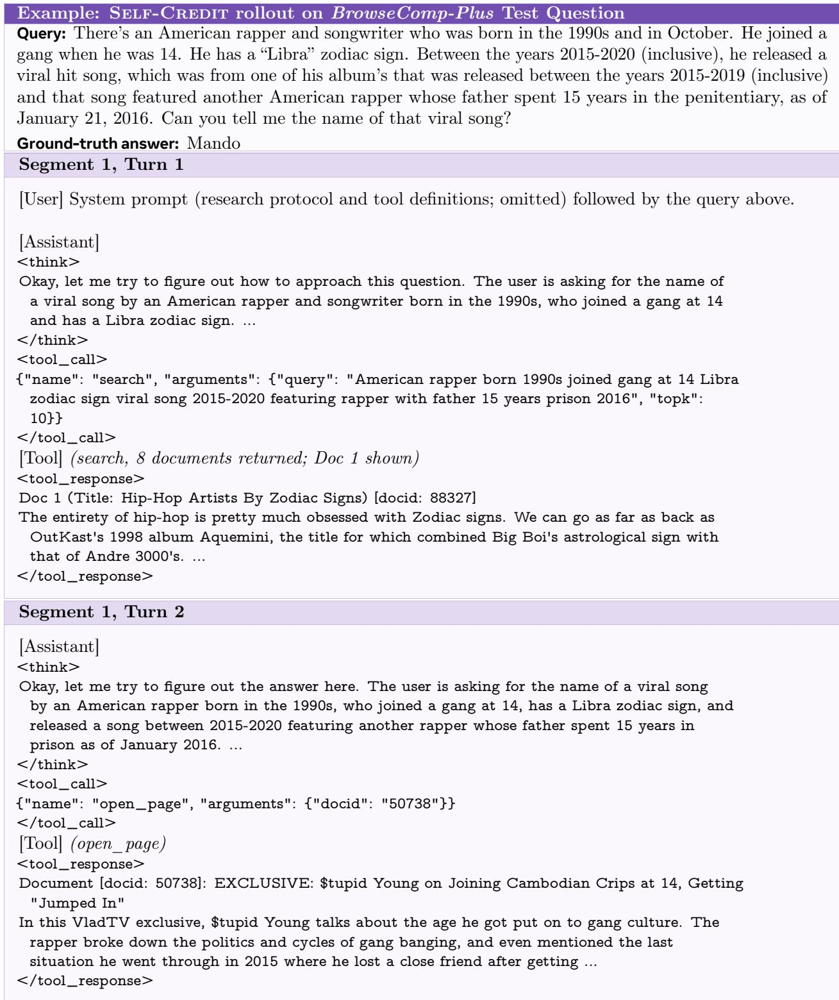  
Figure 5 Example output of Self-Credit model on a BrowseComp-Plus question.

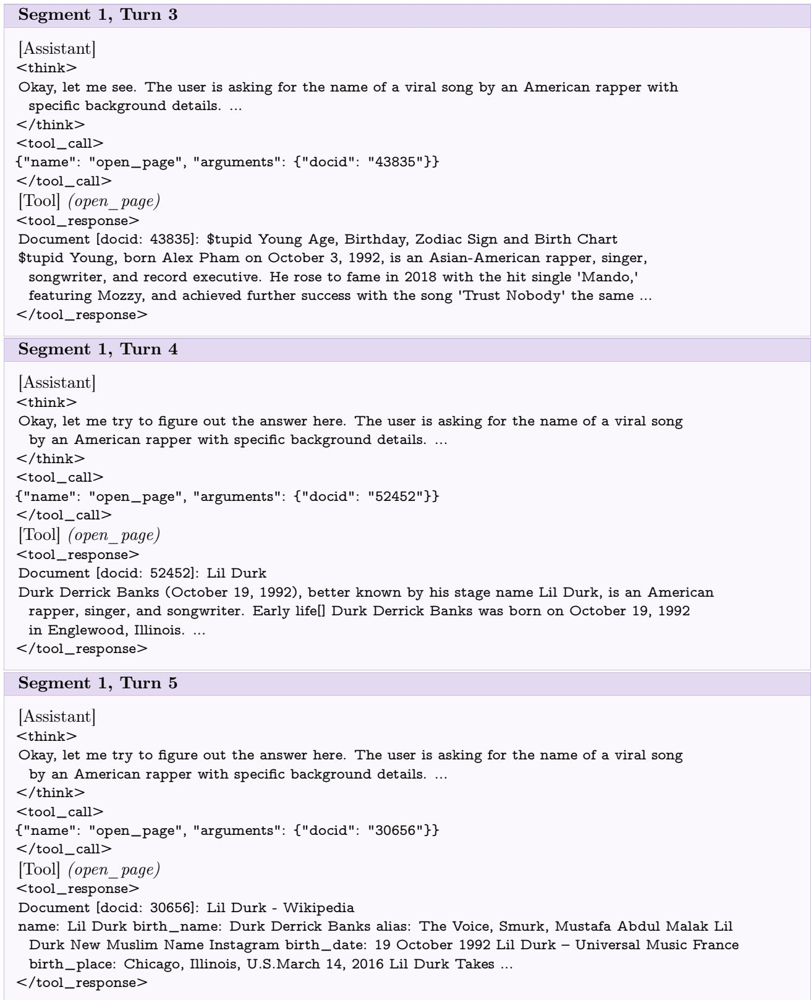  
Figure 6 Figure 5 continuation.

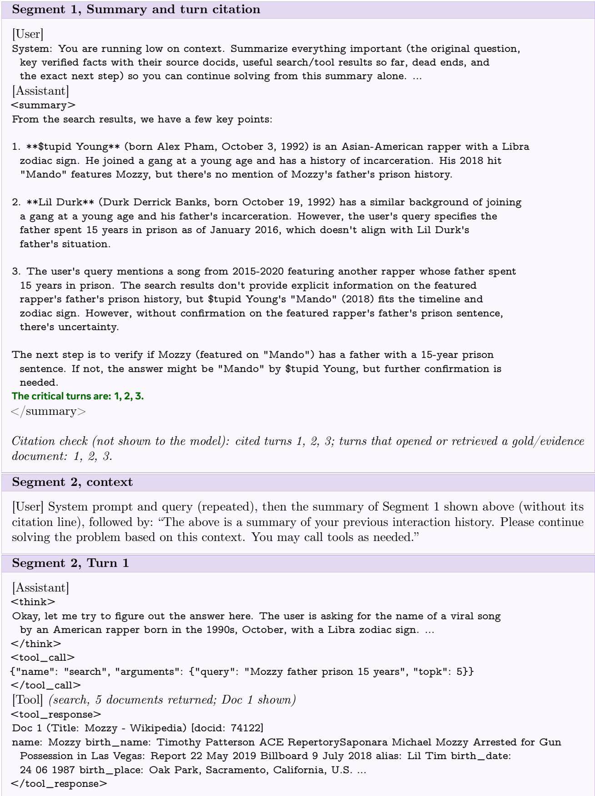  
Figure 7 Figure 5 continuation.

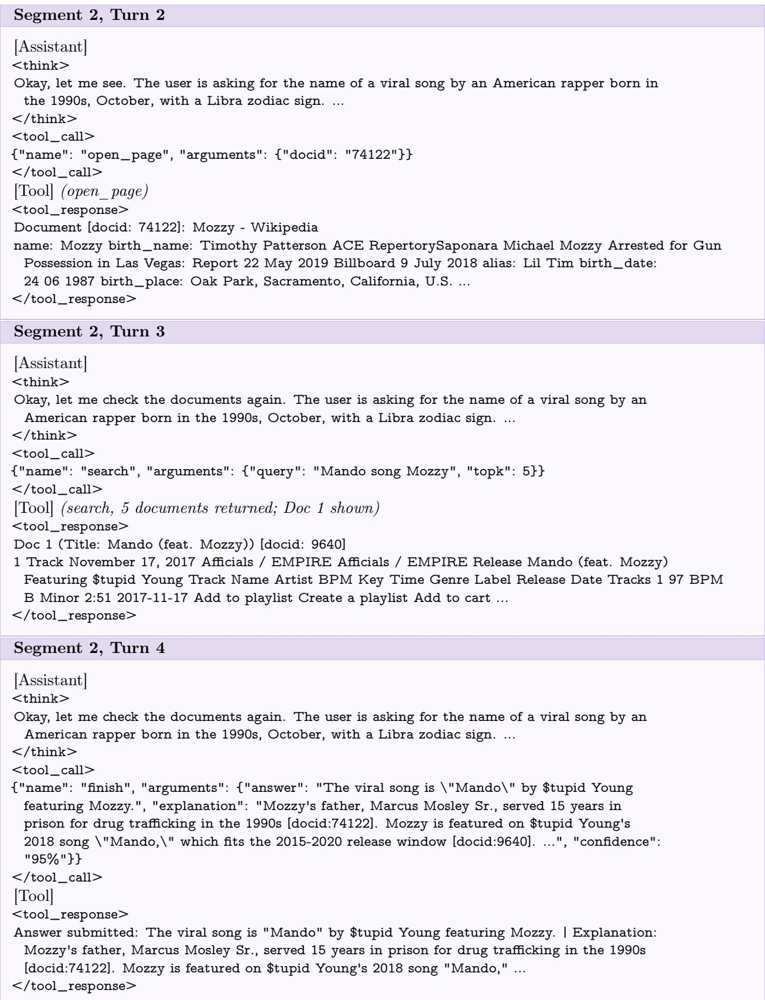  
Figure 8 Figure 5 continuation.

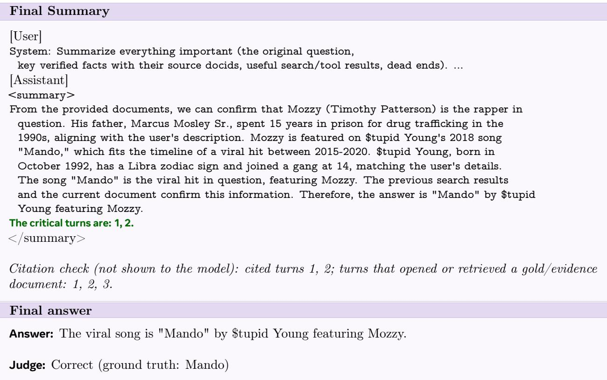  
Figure 9 Figure 5 continuation.