ARTICLE

# Sensitivity-Orthogonal Residual Learning for Adaptive Sideslip and Cornering Stifness Estimation

Kyoungtae Jia, Dongyeol Wonb and Kyoungseok Hana

aDepartment of Automotive Engineering, Hanyang University, Seoul, South Korea; bDepartment of Automotive Engineering (Automotive-Computer Convergence), Hanyang University, Seoul, South Korea

ARTICLE HISTORY Compiled October 21, 2026

## ABSTRACT

Online adaptation of the cornering stifness keeps a model-based sideslip estimator valid as tires change, but competes with learned model correction for the same filter innovation. A corrector with enough parameters can absorb the innovation pattern that a stifness change produces, and adaptation is suppressed while the fit improves. We propagate the stifness sensitivities of the predicted measurements through the vehicle states and construct a corrector orthogonal to them. A nullspace parameterization enforces the constraint without a penalty coeficient and preserves the static least-squares stifness estimate on each identification segment. In full-vehicle simulation, the stifness response of the unconstrained corrector declines as its parameter count grows, whereas the orthogonal corrector responds at least as fully as the uncorrected filter at all sizes and lowers sideslip error by 12.7% to 22.0%. In a simulated drive with a stifness step, the orthogonal corrector adapts as quickly as the uncorrected filter and lowers sideslip error during and after the transient. On public real-vehicle data, the 430-parameter unconstrained corrector loses most of its response to deliberate ofsets of the filter’s nominal stifness, whereas the orthogonal corrector of the same size retains most of it, with a sideslip error slightly above the uncorrected filter’s.

## KEYWORDS

sideslip angle; cornering stifness; joint state and parameter estimation; residual learning; orthogonal constraint

Word count: 6,700 (excluding tables, captions, and references)

## 1. Introduction

Vehicle sideslip angle is a key input to stability control, yet it is not measured in production vehicles [1], and the axle cornering stifnesses that govern its dynamics drift in service with tire wear, inflation pressure, load, and temperature [2]. Joint estimation addresses both problems at once. A model-based filter estimates the sideslip angle while adapting the stifness parameters online from the yaw rate and lateral acceleration. The adapted stifness has diagnostic value of its own and keeps the sideslip estimate consistent as the tires change. Holding it constant instead exposes the sideslip estimate to stifness mismatch, which raised the error by an order of magnitude in a simulation study [3].

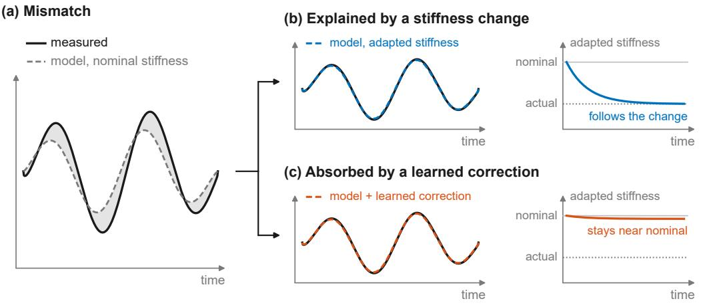  
Figure 1. One measurement–model mismatch, two explanations, schematic. (a) Measured output and model prediction at the nominal stifness. (b) The mismatch removed by adapting the stifness, which moves to the actual value. (c) The same mismatch removed by a learned correction added to the prediction, with the adapted stifness left near nominal.

The single-track model at the core of such filters is kept simple to limit computation and the number of parameters to be identified, and its discrepancy from the real vehicle is systematic rather than random [4]. Methods that combine learned components with physics-based filters have been proposed to account for this discrepancy [5–8]. These augmentations reproduce the measurements more closely than the physical model alone. In the vehicle state estimator closest to ours [8], the network is trained with the stifnesses fixed at ofline-identified values. Its sideslip estimation error increased when both axle cornering stifnesses in the model were increased by 10%.

As Figure 1 illustrates, a mismatch between the measured and the predicted output can be explained either by a change of the cornering stifness or by a learned map of the measured signals, and both explanations reproduce the measurement. A corrector, a learned term added to the model prediction, absorbs whatever it can predict from its inputs. This includes the component that a stifness deviation produces, so the adaptation is suppressed while the fit to the measurements still improves. This is the confounding between physical parameters and model discrepancy that is well known in static Bayesian calibration [9, 10]. In a sequential filter it appears as a reduced response of the adapted stifness to a real stifness change. The more parameters the corrector has, the less the filter responds to a real change. The corrected filter still fits the identification data despite this reduced response, and the adapted stifness is rarely compared with an independent reference. Without such a reference, the adapted values alone do not show whether the response to a stifness change is preserved.

The method proposed here constrains the corrector so that its output contains no component of the form that a stifness change produces, that is, so that it is orthogonal to the sensitivities of the predicted outputs to the stifness. The constraint is enforced through the parameterization of the corrector. This paper makes three contributions.

(1) We show that the parameter–discrepancy confounding known from static Bayesian calibration appears in joint sideslip and cornering stifness estimation as a reduced response of the adapted stifness to a real stifness change.

(2) We introduce a residual corrector whose output is orthogonal by construction to the stifness sensitivities of the predicted outputs along the state trajectory. The constraint is built into a null-space parameterization and needs no penalty coeficient. We show in closed form that the correction leaves the static leastsquares stifness estimate unchanged.

(3) We evaluate stifness response, axle separation, and transient adaptation together with sideslip accuracy in full-vehicle simulation. Real-vehicle data with an optical sideslip reference further test the response to ofsets of the nominal stifness.

## 2. Related work

## 2.1. Joint sideslip and stifness estimation

Cornering stifness varies in service, and joint state–parameter filters estimate it online by including the axle stifnesses in the state vector as random-walk states driven by production sensors [3, 4, 11–14], or by estimating them as an adapted noise statistic [15]. Two observations from this literature matter here. First, the stifnesses are unobservable in straight driving and only weakly excited at small slip angles, so the estimates drift unless the adaptation is scheduled by excitation [12, 13, 16] or gated on observability [15]. A batch least-squares fit over a long window avoids much of the issue [17]. Second, the adapted stifness is rarely compared with an independent reference. The references used are bench tests [15], ofline identification on the same vehicle [11], simulation truth [3], or supplier values [14]. Where the adapted value is discussed, it is understood to absorb what the vehicle model omits. The stifness state is allowed to track nonlinear and friction-dependent behavior [13] and is noted to compensate approximations of the suspension kinematics [4]. None of these adaptive-stifness estimators is combined with a learned correction term.

## 2.2. Learning-augmented filtering

Augmented physics-based models place a learned component inside a Bayesian filter and train it jointly with the state estimate [5]. Constraining the magnitude of the learned contribution has been proposed to preserve the meaning of the estimated states [18]. Such bounds limit the size of the correction, whereas the constraint proposed here governs whether the correction resembles a parameter change. In vehicle state estimation, learned tire models have been placed inside Kalman filters in place of the stochastic stifness state, as ofline-trained networks [13] or Gaussian processes [19]. The architecture closest to ours is a network that supplies a sideslip pseudomeasurement to a single-track filter and is trained through it [8]. The stifnesses stay at their ofline values during training and operation, and the reported accuracy of the hybrid remains sensitive to a ±10% stifness mismatch. Another design instead lets a network generate time-varying stifness scaling factors for a bicycle model [20]. The stifness is then determined entirely by the learned component and, as noted in that work, cannot be compared with any reference measurement. These designs do not combine a separate innovation-driven stifness adaptation with an additive learned corrector.

## 2.3. Orthogonal discrepancy and decorrelation

In static Bayesian calibration, an unconstrained discrepancy term absorbs the parameter’s efect and the calibrated parameter loses its physical meaning [9, 10]. Discrepancy priors orthogonal to the parameter gradients reduce this confounding between the physical parameters and the discrepancy term [21]. Soft penalties serve the same purpose in learning-based modeling. They decorrelate a learned residual from the outputs of the physics terms [22] or from the parameter Jacobians of the physical model, as applied to vehicle dynamics in [23]. The choice of such a regularizer determines which physical parameters are inferred [6], and mechanistic–neural non-identifiability can be diagnosed from joint output sensitivities [7]. These penalties act on the training loss only. A method for input–output modeling projects the learned component onto the complement of the physical regressors’ column space by construction, using measured regressors ofline [24]. This construction also has a kernel-form counterpart [25]. Neither involves a filter or online parameter adaptation. The present corrector difers in two respects. It is orthogonal to sensitivities propagated through unmeasured states, not to measured regressors. It also acts on the innovation that drives online adaptation in the filter, and on the data used for identification it leaves the part of that innovation aligned with the sensitivities unchanged.

## 3. Joint estimation and its confounding

Figure 2 gives an overview of the two stages, ofline identification of the corrector and online joint estimation with the corrector fixed. The corrector is fitted ofline to recorded driving data, a step we call identification. A segment is an interval of identification data over which the stifness is treated as constant. On each segment, the filter is run with its stifness scales fixed at their nominal value and the other states, including the yaw-rate bias, estimated as usual. We call this the fixed-stifness filter. The remaining mismatch between measured and predicted outputs is the fitting target. The same run also gives the sensitivity of the predicted outputs to the stifness, that is, the pattern the mismatch would follow if the stifness changed. The corrector is fitted so that, on every segment, its output contains none of that pattern. Online, the corrector output is subtracted from the mismatch before the joint update of sideslip and stifness.

## 3.1. Single-track model

The estimator is built on the single-track model of Pacejka [2] with time-varying longitudinal speed, shown in Figure 3. The axle slip angles are

$$
\alpha _ { f , k } = \beta _ { k } + \frac { l _ { f } r _ { k } } { v _ { k } } - \delta _ { k } , \qquad \alpha _ { r , k } = \beta _ { k } - \frac { l _ { r } r _ { k } } { v _ { k } } ,\tag{1}
$$

where $\beta _ { k }$ is the sideslip angle at the center of gravity, $r _ { k }$ is the yaw rate, $v _ { k }$ is the measured longitudinal speed, $\delta _ { k }$ is the front-axle steering angle, and $l _ { f }$ and $l _ { r }$ are the distances from the center of gravity to the front and rear axles. The axle lateral forces are

$$
F _ { y f , k } = - s _ { f } C _ { f 0 } \alpha _ { f , k } , \qquad F _ { y r , k } = - s _ { r } C _ { r 0 } \alpha _ { r , k } ,\tag{2}
$$

(a) Offline identification  
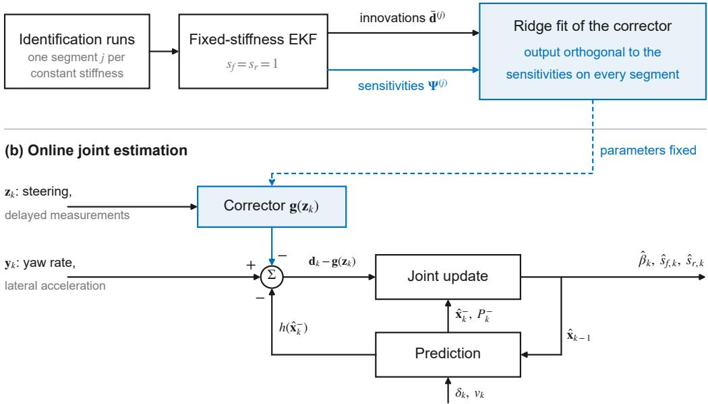  
Figure 2. Overview of the method. (a) Ofline identification of the corrector on segments of constant stifness. (b) Online joint estimation with the corrector fixed. Blue: the elements added by the proposed method. The symbols are defined in Sections 3 and 4.

where $C _ { f 0 }$ and $C _ { r 0 }$ are fixed nominal axle cornering stifnesses and $s _ { f } , s _ { r }$ are dimensionless scales adapted online, so that $s _ { f } C _ { f 0 }$ and $s _ { r } C _ { r 0 }$ are the stifnesses the filter currently uses. The discrete-time dynamics follow from explicit Euler integration with step $\Delta t ,$ neglecting the term $- \beta \dot { v } / v$ that a change of speed adds to the sideslip rate:

$$
\beta _ { k + 1 } = \beta _ { k } + \Delta t \left( \frac { F _ { y f , k } + F _ { y r , k } } { m v _ { k } } - r _ { k } \right) , \qquad r _ { k + 1 } = r _ { k } + \Delta t \frac { l _ { f } F _ { y f , k } - l _ { r } F _ { y r , k } } { I _ { z } } ,\tag{3}
$$

where the first term is the lateral acceleration $a _ { y , k } = ( F _ { y f , k } + F _ { y r , k } ) / m$ divided by the speed, m is the vehicle mass, and $I _ { z }$ is the yaw moment of inertia.

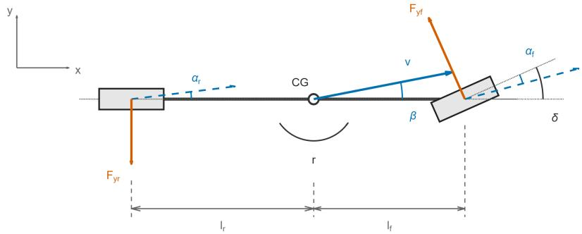  
Figure 3. Single-track model, top view (x forward, y to the left). Blue: velocities and slip angles; orange: lateral axle forces.

The measurement vector contains the yaw rate and the lateral acceleration,

$$
{ \bf y } _ { k } = h ( { \bf x } _ { k } ) + { \bf e } _ { k } , \qquad h ( { \bf x } _ { k } ) = \left[ \begin{array} { c } { r _ { k } + b _ { r , k } } \\ { a _ { y , k } } \end{array} \right] ,\tag{4}
$$

where $\mathbf { x } _ { k } = [ \beta _ { k } , r _ { k } , s _ { f } , s _ { r } , b _ { r , k } ] ^ { \top }$ collects the dynamic states, the stifness scales, and a slowly varying bias $b _ { r , k }$ of the yaw-rate measurement. The two components of $\mathbf { y } _ { k }$ are the measured yaw rate $r _ { k } ^ { \mathrm { m } }$ and the measured lateral acceleration $a _ { y , k } ^ { \mathrm { m } }$ . The two components of h are their noise-free predictions: the yaw-rate state with the bias added, and the lateral acceleration $a _ { y , k } . ~ \mathbf { e } _ { k }$ is zero-mean measurement noise with covariance $R =$ $\mathrm { d i a g } ( \sigma _ { r } ^ { 2 } , ~ \sigma _ { a _ { y } } ^ { 2 } )$ , where $\sigma _ { r }$ and $\sigma _ { a _ { y } }$ are the standard deviations of the two measurement noises.

## 3.2. Joint extended Kalman filter

Joint estimation is performed by an extended Kalman filter (EKF) on the augmented state $\mathbf { x } _ { k }$ . The stifness scales, collected in $\pmb { \theta } = [ s _ { f } , s _ { r } ] ^ { \top }$ , and the yaw-rate bias are modeled as bounded random walks. For example, the front stifness scale follows $\boldsymbol { s } _ { f , k + 1 } ~ = ~ \boldsymbol { s } _ { f , k } + \boldsymbol { w } _ { k }$ with $w _ { k } \sim \mathcal { N } ( 0 , q )$ , allowing small changes at each step. The noise keeps the corresponding entry of the state covariance from shrinking to zero, so the stifness scales remain adjustable. The update moves θ when the maneuver excites the stifness and the innovation contains a component consistent with a stifness change. This is the conventional structure for joint sideslip and stifness estimation [3, 4, 11–13]. Local observability from yaw rate and lateral acceleration under steering excitation has been shown for a related augmented-state model [3].

The filter itself is a standard EKF. Let f denote the augmented transition, which applies (3) to the dynamic states and the identity to the stifness scales and the bias, and let $F _ { k } = \partial \mathbf { f } / \partial \mathbf { x }$ be its Jacobian evaluated at $\hat { \mathbf { x } } _ { k - 1 }$ . Here $\hat { \mathbf { x } } _ { k } ^ { - }$ and $\hat { \mathbf { x } } _ { k }$ are the state estimates before and after the measurement update, and $P _ { k } ^ { - }$ and $P _ { k }$ are their $5 \times 5$ error covariances. $Q$ is the diagonal $5 \times 5$ process-noise covariance per sample. The prediction is

$$
\begin{array} { r } { \hat { \mathbf { x } } _ { k } ^ { - } = \mathbf { f } ( \hat { \mathbf { x } } _ { k - 1 } ) , \qquad P _ { k } ^ { - } = F _ { k } P _ { k - 1 } F _ { k } ^ { \top } + Q . } \end{array}\tag{5}
$$

The predicted measurement is $\hat { \mathbf { y } } _ { k } ~ = ~ h ( \hat { \mathbf { x } } _ { k } ^ { - } )$ , and $\mathbf { y } _ { k } - { \hat { \mathbf { y } } } _ { k }$ is the innovation. With $H _ { k } = \partial h / \partial \mathbf { x }$ at the predicted state, the update is

$$
\begin{array} { r l } & { K _ { k } = P _ { k } ^ { - } H _ { k } ^ { \top } \big ( H _ { k } P _ { k } ^ { - } H _ { k } ^ { \top } + R \big ) ^ { - 1 } , } \\ & { \hat { \mathbf { x } } _ { k } = \hat { \mathbf { x } } _ { k } ^ { - } + K _ { k } ( \mathbf { y } _ { k } - \hat { \mathbf { y } } _ { k } ) , } \\ & { P _ { k } = \left( I - K _ { k } H _ { k } \right) P _ { k } ^ { - } . } \end{array}\tag{6}
$$

$K _ { k }$ denotes the $5 \times 2$ Kalman gain, and I denotes the identity matrix. The stifness scales are kept within a physical range by a covariance-weighted projection of the joint state estimate onto the bounds, with the corresponding covariance update [26]. At low speed, the stifness scales are not updated. The EKF with the stifness scales adapted online and no corrector is the uncorrected filter.

## 3.3. Residual corrector and innovation competition

A single-track model with fixed parameters cannot represent load transfer, steering compliance, or other unmodeled dynamics of a real vehicle. A standard approach is to add a learned residual correction to the predicted measurement. This corrector is

$$
\mathbf { g } ( \mathbf { z } _ { k } ) = \boldsymbol { W } ^ { \top } \phi ( \mathbf { z } _ { k } ) ,\tag{7}
$$

where $\mathbf { z } _ { k }$ collects the signals available at time $k , \mathbf { \Xi } \phi ( \mathbf { z } _ { k } )$ is a vector of $n _ { \phi }$ regressors computed from these signals, and W is an $n _ { \phi } \times 2$ parameter matrix identified from data. The corrector is linear in its parameters W. The construction below applies to any linear output layer whose regressors are not trained, including the last layer of a network. The regressors are strictly causal, so that the corrector cannot use the current measurement to reproduce it. Measured signals enter with a delay of at least one sample, and only the steering input, which is a driver command and not a measured response, enters at the current time.

The corrector output is added to the predicted measurement of the filter,

$$
\begin{array} { r } { \hat { \mathbf { y } } _ { k } = h ( \hat { \mathbf { x } } _ { k } ^ { - } ) + \mathbf { g } ( \mathbf { z } _ { k } ) . } \end{array}\tag{8}
$$

The corrector input $\mathbf { z } _ { k }$ contains only measured signals and the steering input, not the state, so $H _ { k }$ acquires no term from the correction. The correction changes the gain only through the state trajectory, the sequence of state estimates along which $F _ { k }$ and $H _ { k }$ are evaluated. With $\mathbf g \equiv 0$ the filter is the uncorrected filter.

Let $\mathbf { x } _ { k } ^ { s } = [ \beta _ { k } , r _ { k } ] ^ { \top }$ denote the dynamic states and $\mathbf { d } _ { k } = \mathbf { y } _ { k } - h ( \hat { \mathbf { x } } _ { k } ^ { - } )$ the innovation the filter would have without the corrector, so that ${ \bf y } _ { k } - \hat { { \bf y } } _ { k } = { \bf d } _ { k } - { \bf g } ( { \bf z } _ { k } )$ . Let $K _ { x , k }$ and $K _ { \theta , k }$ denote the $2 \times 2$ row blocks of $K _ { k }$ corresponding to the dynamic states and the stifness scales, respectively. With the bias row omitted, the update in (6) is

$$
\begin{array} { r } { \left[ \hat { \mathbf { x } } _ { k } ^ { s } \right] = \left[ \hat { \mathbf { x } } _ { k } ^ { s - } \right] + \left[ { K _ { x , k } } \right] \left( \mathbf { d } _ { k } - \mathbf { g } ( \mathbf { z } _ { k } ) \right) . } \end{array}\tag{9}
$$

The stifness rows $K _ { \theta , k }$ act on $\mathbf { d } _ { k } - \mathbf { g } ( \mathbf { z } _ { k } )$ , not on ${ \bf d } _ { k }$ . The corrector and the stifness adaptation compete for the same innovation. This innovation competition is the form that the parameter–discrepancy confounding takes in the filter, and its result is a suppressed stifness adaptation. If the corrector output reproduces the part of $\mathbf { d } _ { k }$ that a stifness change produces, that part is subtracted before the stifness scales are updated. The absorbed part need not come from a stifness deviation. A component of the identification innovation that is merely correlated with the innovation a stifness deviation would produce is absorbed as well, and this can reduce the response of the adapted stifness to a real change. When the stifness later difers from its value during identification, the suppressed adaptation compensates less of the diference, and the sideslip estimate can degrade. The corrector is identified on the fixed-stifness filter innovations because they retain both the model discrepancy and the stifness mismatch before stifness adaptation absorbs either.

## 3.4. Trajectory sensitivity to the stifness scales

To measure the confounding, we first derive the change in the predicted outputs that a small stifness change would produce over a segment. Run the fixed-stifness model along the steering and speed of one segment once at the nominal $s _ { f } = s _ { r } = 1$ and once with either the front or the rear scale raised to $1 + \Delta s$ . The diference of the two predicted $[ r , a _ { y } ]$ sequences, divided by $\Delta s ,$ is the sensitivity of the predicted outputs to that scale, and multiplied by a small change of the scale it gives the innovation produced by that change. In practice the model is not run twice. We compute the derivative that this diference approximates by propagating the linearized model along the state trajectory of the fixed-stifness filter, hereafter the nominal trajectory, as in (11) below. The linearization point is therefore the filter’s state estimate, not the state of a model run on its own. The constraint and the static estimate below both use this sensitivity.

A stifness change afects the measurements in two ways: directly, through the axle forces, and indirectly, through the sideslip and yaw-rate response that follows. The indirect efect is essential because sideslip is not measured and its change reaches the measurements only through the dynamics. In straight driving without steering excitation the axle slip angles are zero, so the nominal axle forces and with them the stifness sensitivities vanish.

The transition (3) and the measurement map h are linearized with respect to the dynamic states $\mathbf { x } ^ { s }$ and the stifness scales θ along the nominal trajectory at $\pmb { \theta } _ { 0 } = [ 1 , 1 ] ^ { \top }$ This gives four Jacobians: $A _ { k }$ and $B _ { k }$ of the next dynamic state with respect to the current dynamic state and to the stifness scales, and $C _ { k }$ and $D _ { k }$ of the measurement map with respect to the same two,

$$
\begin{array} { r l r l } & { A _ { k } = \left[ \mathbf { 1 } _ { 0 } ^ { 1 } \mathbf { \Sigma } ^ { - \Delta t } \right] + \Delta t \left[ \left( \mathbf { c } _ { f , k } + \mathbf { c } _ { r , k } \right) / ( m v _ { k } ) \right] , \quad } & & { C _ { k } = \left[ \mathbf { 0 } _ { \left( \mathbf { c } _ { f , k } + \mathbf { c } _ { r , k } \right) / m } ^ { 0 } \mathbf { \Sigma } ^ { 1 } \right] , } \\ & { B _ { k } = \Delta t \left[ \mathbf { I } _ { \mathit { l } } ^ { 0 } f ( m v _ { k } ) \mathbf { \Sigma } } & & { D _ { k } = \left[ \mathbf { I } _ { \mathit { l } } ^ { 0 } f _ { m , k } ^ { 0 } , - \mathbf { I } _ { r } F _ { y r , k } ^ { 0 } \right] / I _ { z } \right] , } \end{array}\tag{10}
$$

where $\mathbf { c } _ { f , k } = - C _ { f 0 } \left[ 1 , \ l _ { f } / v _ { k } \right]$ and $\mathbf { c } _ { r , k } = - C _ { r 0 } \left[ 1 , \ - l _ { r } / v _ { k } \right]$ are the gradients of the axle forces with respect to the dynamic states, and $\mathbf { \dot { F } } _ { k } ^ { 0 } = [ \mathbf { \dot { F } } _ { y f , k } ^ { 0 } , \mathbf { \Psi } F _ { y r , k } ^ { 0 } ]$ collects the nominal axle forces along the trajectory, $F _ { y f , k } ^ { 0 } = - C _ { f 0 } \alpha _ { f , k }$ and $F _ { y r , k } ^ { 0 } = - C _ { r 0 } \alpha _ { r , k }$ . The first row of $D _ { k }$ is zero because a stifness change reaches the yaw rate only through the states. These four matrices have the same form as the blocks of $F _ { k + 1 }$ and $H _ { k }$ in (5) and (6) with respect to the dynamic states and the stifness scales. The filter evaluates those blocks along its own state estimates, and the sensitivity recursion evaluates them along the nominal trajectory. The state and output sensitivities to the stifness scales are propagated along the segment,

$$
S _ { k + 1 } = A _ { k } S _ { k } + B _ { k } , \qquad G _ { k } = C _ { k } S _ { k } + D _ { k } , \qquad S _ { 1 } = 0 .\tag{11}
$$

Here $S _ { k } \in \mathbb { R } ^ { 2 \times 2 }$ is the sensitivity of the dynamic states at time k to a stifness perturbation kept constant since the start of the segment. A perturbation δθ moves the state by $S _ { k } \delta \pmb \theta$ to first order. $G _ { k } \in \mathbb { R } ^ { 2 \times 2 }$ is the corresponding sensitivity of the predicted outputs. $S _ { 1 } = 0$ because the state has not yet responded at the start of the segment. Each $G _ { k }$ is multiplied by $R ^ { - 1 / 2 } = \mathrm { d i a g } ( 1 / \sigma _ { r } , ~ 1 / \sigma _ { a _ { y } } )$ , so that the yaw rate and the lateral acceleration enter the estimate (13) and the constraint (16) in units of their measurement-noise standard deviations. Stacking the weighted $G _ { k }$ over a segment of $N _ { j }$ samples gives the sensitivity matrix

$$
\Psi ^ { ( j ) } = \binom { R ^ { - 1 / 2 } G _ { 1 } } { \vdots } = [ \psi _ { f } , ~ \psi _ { r } ] \in \mathbb { R } ^ { 2 N _ { j } \times 2 } ,\tag{12}
$$

where $j$ indexes the segment and is omitted when one segment is discussed. The columns $\psi _ { f }$ and $\psi _ { r }$ are the weighted output sensitivities to the front and the rear stifness scale over the segment. The column space of Ψ, col(Ψ), describes the output perturbations produced by constant stifness changes under this local linearization.

The recursion (11) does not diferentiate the filter update, because the quantity to preserve is the perturbation that a parameter change produces in the predicted measurements. A corrector output aligned with these directions explains the same output variation as a stifness change, even when the corrector output is small. The constraint therefore acts on the projection of the correction onto these directions.

## 3.5. Static estimate of the stifness change from the innovation

The sensitivity matrix gives a static estimate of the stifness change contained in an innovation sequence, computed over the whole segment at once rather than sample by sample as in the filter. As in the batch least-squares identification of [17], we regress the stacked innovation on the two sensitivity columns:

$$
\widehat { \delta \pmb { \theta } } ( \bar { \mathbf { d } } ) = \left( \Psi ^ { \top } \Psi \right) ^ { - 1 } \Psi ^ { \top } \bar { \mathbf { d } } ,\tag{13}
$$

where Ψ has full column rank and $\bar { \mathbf { d } } \in \mathbb { R } ^ { 2 N _ { j } }$ is the $R ^ { - 1 / 2 } .$ -weighted stack of fixedstifness filter innovations on the segment, so that (13) gives the coeficients of the projection of d¯ onto the columns of Ψ. The projection itself, $\Psi ( \Psi ^ { \top } \Psi ) ^ { - 1 } \Psi ^ { \top } \bar { \mathbf { d } }$ , is the sensitivity-aligned component of the innovation. Let the innovation be the sum of the efect $\Psi \delta \pmb { \theta } ^ { * }$ of a true stifness deviation $\delta \pmb { \theta } ^ { * }$ , a model discrepancy term m¯ , and zero-mean noise e¯,

$$
\bar { \mathbf { d } } = \Psi \delta \pmb { \theta } ^ { * } + \bar { \mathbf { m } } + \bar { \mathbf { e } } .\tag{14}
$$

With the sensitivity matrix treated as fixed, the expectation of (13) is

$$
\mathbb { E } [ \widehat { \delta \pmb { \theta } } ] = \delta \pmb { \theta } ^ { * } + \left( \Psi ^ { \top } \pmb { \Psi } \right) ^ { - 1 } \pmb { \Psi } ^ { \top } \bar { \mathbf { m } } .\tag{15}
$$

The second term is the contribution of the model discrepancy to the estimated stifness change (13). Because of this term, the static estimate of a single-track filter is an efective model stifness and not the physical cornering stifness of the tires.

An unconstrained corrector, with output $\bar { \bf g }$ on the segment stacked and weighted like $\bar { \mathbf { d } } ,$ is fitted to minimize the remaining innovation $\bar { \mathbf { d } } - \bar { \mathbf { g } }$ . It absorbs the part of d¯ that its regressors can express, including any component along the columns of $\Psi$ whether from a true stifness deviation $\boldsymbol { \Psi } \delta \boldsymbol { \theta } ^ { * }$ or from the discrepancy m¯ . The estimate (13) on the remaining innovation then shifts by $- ( \Psi ^ { \top } \Psi ) ^ { - 1 } \Psi ^ { \top } \bar { \mathbf { g } }$ , and a corrector that reproduces $\Psi \delta \pmb { \theta } ^ { * }$ removes the stifness deviation from it.

## 4. Sensitivity-orthogonal residual learning

## 4.1. Orthogonality condition

Let $\bar { \mathbf { g } } ^ { ( j ) } \in \mathbb { R } ^ { 2 N _ { j } }$ be the corrector output on segment $j ,$ , stacked and weighted like $\Psi ^ { ( j ) }$ The proposed constraint is that its inner product with each sensitivity column is zero,

$$
\psi _ { f } ^ { \top } \bar { \mathbf { g } } ^ { ( j ) } = 0 , \qquad \psi _ { r } ^ { \top } \bar { \mathbf { g } } ^ { ( j ) } = 0 , \qquad \mathrm { i . e . } \qquad \Psi ^ { ( j ) \top } \bar { \mathbf { g } } ^ { ( j ) } = \mathbf { 0 } ,\tag{16}
$$

so that no part of the corrector output on the segment has the form of a front or a rear stifness change. Figure 4 shows the sensitivities and the outputs of the two correctors on an identification run at stifness scale 0.8 from the simulation study of Section 5. The unconstrained output follows the main waveform of the lateral-acceleration innovation. Evaluated, as the condition requires, over both measured signals and the whole segment, it also absorbs most of the sensitivity-aligned component, whereas the orthogonal correction leaves this component in the remaining innovation.

(b) Innovation and correction  
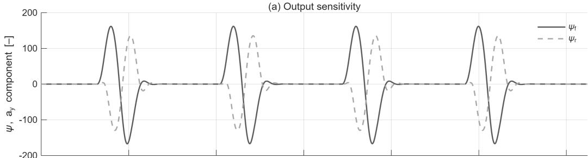

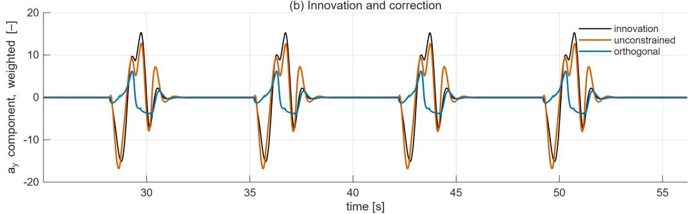  
Figure 4. Identification run with sinusoidal steering at stifness scale $0 . 8 ,$ lateral-acceleration component, $R ^ { - 1 / 2 }$ -weighted. (a) Sensitivities $\psi _ { f }$ (solid) and $\psi _ { r }$ (dashed). (b) Fixed-stifness filter innovation and the outputs of the unconstrained and the orthogonal corrector. Both correctors have 30 parameters.

Applying the static estimate (13) to the remaining innovation gives

$$
\begin{array} { r l } & { \widehat { \delta \pmb { \theta } } \big ( \bar { \mathbf { d } } - \bar { \mathbf { g } } \big ) = \left( \boldsymbol { \Psi } ^ { \top } \boldsymbol { \Psi } \right) ^ { - 1 } \boldsymbol { \Psi } ^ { \top } \bar { \mathbf { d } } - \left( \boldsymbol { \Psi } ^ { \top } \boldsymbol { \Psi } \right) ^ { - 1 } \boldsymbol { \Psi } ^ { \top } \bar { \mathbf { g } } } \\ & { \qquad = \widehat { \delta \pmb { \theta } } \big ( \bar { \mathbf { d } } \big ) , } \end{array}\tag{17}
$$

because $\bar { \Psi } ^ { \top } \bar { \bar { \mathbf { g } } } = \mathbf { 0 }$ by (16). The static estimate of the stifness change is therefore the same before and after correction. In Figure 5, an unconstrained correction has a component along col(Ψ) and changes the projection of the remaining innovation onto the sensitivities (a), whereas a sensitivity-orthogonal correction lies in the complement and leaves that projection unchanged (b).

The identity holds for the static estimate on every segment on which (16) is enforced. The sequential filter does not average over a whole segment. It weights recent innovations through its gains, and the correction also changes the estimated state trajectory along which those gains are computed. We therefore measure experimentally how much of the filter’s response to a stifness change is preserved, in Section 5 by the response of the adapted stifness to a known change and in Section 6 by its response to an ofset of the nominal stifness.

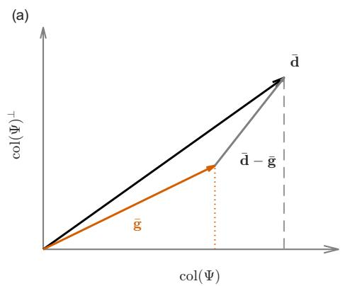

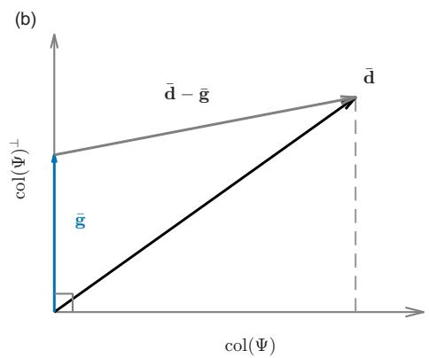  
Figure 5. Geometric view of the orthogonality constraint, schematic, in the plane spanned by col(Ψ) and its orthogonal complement. (a) Unconstrained correction. (b) Sensitivity-orthogonal correction.

## 4.2. Constrained identification

The corrector output is linear in its parameters. Let $\textbf { w } \in \mathbb { R } ^ { 2 n _ { \phi } }$ denote the stacked columns of W and $\bar { \Phi } ^ { ( j ) } \in \mathbb { R } ^ { 2 N _ { j } \times 2 n _ { \phi } }$ the regressor matrix that maps w to the weighted, stacked output on segment $j , \bar { \bf g } ^ { ( j ) } = \bar { \Phi } ^ { ( j ) } \mathbf { w }$ . The constraint (16) on segment $j$ is then the pair of linear equations $\boldsymbol { \Psi } ^ { ( j ) \top } \bar { \boldsymbol { \Phi } } ^ { ( j ) } \mathbf { w } = \mathbf { 0 }$ . The constraints of all J segments are collected into

$$
\mathcal { C } \mathbf { w } = \mathbf { 0 } , \qquad \mathcal { C } = \left[ \begin{array} { c } { \boldsymbol { \Psi } ^ { ( 1 ) \top } \bar { \boldsymbol { \Phi } } ^ { ( 1 ) } } \\ { \vdots } \\ { \boldsymbol { \Psi } ^ { ( J ) \top } \bar { \boldsymbol { \Phi } } ^ { ( J ) } } \end{array} \right] \in \mathbb { R } ^ { 2 J \times 2 n _ { \phi } } .\tag{18}
$$

The constraints are imposed per segment because nonzero inner products between the correction and the stifness sensitivities can cancel across segments in a pooled constraint.

Let $\bar { \mathbf { d } } ~ = ~ [ \bar { \mathbf { d } } ^ { ( 1 ) } ; \dots ; \bar { \mathbf { d } } ^ { ( J ) } ] ~ \in ~ \mathbb { R } ^ { 2 N }$ and $\bar { \Phi } \ = \ [ \bar { \Phi } ^ { ( 1 ) } ; \ldots ; \bar { \Phi } ^ { ( J ) } ] \ \in \ \mathbb { R } ^ { 2 N \times 2 n _ { \phi } }$ stack the weighted innovations and regressors of all segments, with $N = \textstyle \sum _ { j } N _ { j }$ . The nonconstant regressors listed in Table A1 are standardized to zero mean and unit variance on the identification data before the fit. The constant regressor remains equal to one. The identification is a ridge regression of the fixed-stifness filter innovations on the regressors, restricted to the parameters that satisfy (18):

$$
\operatorname* { m i n } _ { \mathbf { w } } \left\| \bar { \Phi } \mathbf { w } - \bar { \mathbf { d } } \right\| ^ { 2 } + \rho N \| \mathbf { w } \| ^ { 2 } \qquad \mathrm { s . t . } \qquad \mathcal { C } \mathbf { w } = \mathbf { 0 } ,\tag{19}
$$

where $\rho > 0$ is a ridge coeficient, scaled by N so that it does not depend on the amount of identification data. Let the columns of $Z \in \mathbb { R } ^ { 2 n _ { \phi } \times ( 2 n _ { \phi } - \mathrm { r a n k } \mathcal { C } ) }$ be an orthonormal basis of the null space of ${ \mathcal { C } } ,$ so that every $\mathbf { w } = Z \eta$ with a reduced parameter vector $\eta \in \mathbb { R } ^ { 2 n _ { \phi } - \operatorname { r a n k } \mathcal { C } }$ satisfies the constraint identically. The ridge problem in the reduced coordinates has the closed-form solution

$$
\pmb { \eta } = \left( Z ^ { \top } \bar { \Phi } ^ { \top } \bar { \Phi } Z + \rho N I \right) ^ { - 1 } Z ^ { \top } \bar { \Phi } ^ { \top } \bar { \mathbf { d } } , \qquad \mathbf { w } = Z \pmb { \eta } .\tag{20}
$$

The constraint thus holds exactly on every identification segment, without a penalty coeficient for it, unlike the soft penalties of [22, 23]. The construction removes rank C parameter dimensions, so $2 n _ { \phi }$ − rank C parameters remain free. With independent constraints rank ${ \mathcal { C } } = 2 J ,$ and the corrector then needs more than J regressors to retain any free parameters. Finer segmentation gives a stricter guarantee but leaves fewer free parameters, so each identification run is one segment, the longest interval over which the stifness is constant. Algorithm 1 summarizes the complete procedure.

Algorithm 1 Identification and online operation of the orthogonal corrector.   
Ofline identification (on J segments of constant stifness)   
1: Run the fixed-stifness EKF $( s _ { f } = s _ { r } = 1 )$ on each segment to obtain its innova  
tions and state trajectory.   
2: Form the $R ^ { - 1 / 2 } .$ -weighted regressor matrices $\bar { \Phi } ^ { ( j ) }$ and innovation vectors $\bar { \mathbf { d } } ^ { ( j ) }$   
3: Compute the sensitivity matrices $\Psi ^ { ( j ) }$ along these trajectories using (11) and (12).   
4: Form the constraint matrix C using (18) and compute an orthonormal basis Z of   
its null space.   
5: Determine the corrector parameters W using the null-space ridge solution (20).   
Online operation (every sample, W fixed)   
6: Predict the state and covariance using (5).   
7: Add the corrector output ${ \bf g } ( { \bf z } _ { k } )$ to the predicted measurement using (8).   
8: Update the state and covariance using (6).

## 5. Controlled simulation study

All simulation experiments use the full-vehicle demonstration passenger-car model in IPG CarMaker. Its tire cornering stifness is scaled through the cornering-stifness scaling factor $\lambda _ { K y }$ of its Magic Formula tire model [2]. The estimator uses only yaw rate, lateral acceleration, vehicle speed, and the road-wheel steering angle at 100 Hz. Vehicle parameters and filter settings are listed in Table A1, and the filter settings are the same for every method and experiment in this section.

We evaluate stifness adaptation against the efective axle stifness of the single-track model. This quantity can difer from the tire stifness because it also reflects unmodeled efects. For each run, this reference is obtained by regressing the axle forces on the model slip angles computed from the true vehicle states and the steering input. The regression conditions are given in Appendix A.

## 5.1. Experimental setup and metrics

Table 1 lists the runs by role, maneuver, and stifness factor. The identification set consists of eleven runs at constant stifness: the three maneuvers at three stifness scales, and two step-steering drives at nominal stifness, at 80 and 50 km/h, which add a step input and a second speed to the identification data. The 80 km/h drive also serves as the constant-stifness reference in Section 5.4. These two drives use only the nominal stifness because each further segment removes two free parameters from the orthogonal corrector. Every other run is an evaluation run whose condition is absent from identification. Figure 6 shows the steering and speed of the three identification maneuvers.

We compare three estimators, each the EKF of Section 3.2 with the stifness scales adapted online.

(b) Slalom  
Table 1. Simulation runs. The stifness factor $\lambda _ { K y }$ applies to all tires unless stated.
<table><tr><td>Role</td><td></td><td>Runs Maneuver</td><td> $\lambda _ { K y }$ </td></tr><tr><td>Identification</td><td></td><td>9 sinusoidal steering, slalom, double lane change 0.8, 1.0, 1.1</td><td></td></tr><tr><td>Identification</td><td></td><td>2 step steering at 80 and 50 km/h</td><td>1.0</td></tr><tr><td>Evaluation, intermediate scale</td><td></td><td>3 the three maneuvers above</td><td>0.9</td></tr><tr><td>Evaluation, one axle</td><td></td><td>8 sinusoidal steering, slalom</td><td>0.85 or 1.15, one axle</td></tr><tr><td>Evaluation, change during drive</td><td></td><td>1 step steering at 80 km/h, 360 s</td><td>1.0, 0.8 in 120–240 s</td></tr></table>

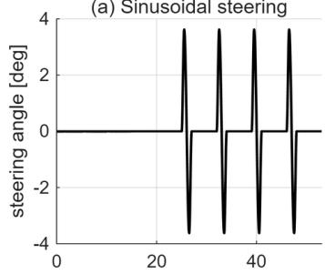

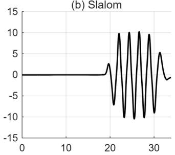

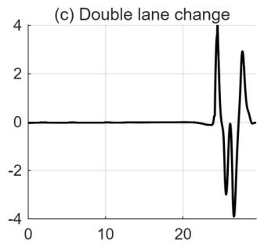

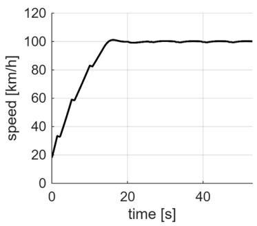

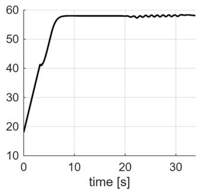

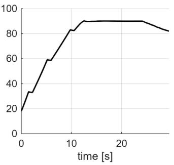  
Figure 6. Steering angle (top) and speed (bottom) of the identification maneuvers in simulation at the nominal stifness. (a) Sinusoidal steering. (b) Slalom. (c) Double lane change.

• uncorrected: no residual corrector.

• unconstrained: a corrector identified without the orthogonality constraint.

• orthogonal (proposed): a corrector identified under the constraint (16).

The basic correctors use only the 15 regressors listed in Table A1 and have 30 parameters, two per regressor for the two outputs. Both use the same ridge coeficient and the same identification innovations, and difer only in the constraint. To examine how the efect of the constraint depends on the number of parameters, the regressors are extended with random Fourier features [27]. These are cosines of random linear projections of the 15 standardized basic regressors and are appended to them without further standardization. They add nonlinear regressors in any number while the corrector stays linear in its parameters, so the same constraint applies at every size. The four extended sizes use 50 to 400 random Fourier features, corresponding to 130 to 830 parameters, with the feature settings detailed in Appendix A. For each extended size, ten random feature draws are generated, with each draw shared by both correctors for identification and evaluation. Tables and summary figures report the means over the draws. Across the draws the sideslip error varies by at most $0 . 0 1 2 ^ { \circ }$ and the response by at most 0.12. With the eleven identification segments, the constraint leaves 8 of the 30 parameters of the basic orthogonal corrector free and 808 of the 830 parameters of the largest corrector.

Sideslip accuracy is the root-mean-square error (RMSE) of the estimated sideslip angle against the CarMaker reference, computed over the samples with speed above 5 m/s. We report the mean of the run RMSEs over the twelve constant-stifness maneuver runs, the three maneuvers at each of the scales 0.8, 0.9, 1.0, and 1.1. Adaptation preservation is measured by the stifness response. For each axle, let $s ( \lambda _ { K y } )$ denote the settled stifness scale, averaged over the final third of the run. The estimated relative change is $s ( \lambda _ { K y } ) / s ( 1 ) - 1$ , with both values obtained using the same estimator and maneuver. Relative changes are used because each estimator’s absolute level is an efective stifness along its own state trajectory, as Section 3.5 showed. The nominal stifnesses $C _ { f 0 }$ and $C _ { r 0 }$ are the efective-stifness regression on the run at nominal scale, and the reference change of a scaled run is the change of its regression relative to that run. Because the reference is this efective change and not the tire factor, the same $\lambda _ { K y }$ produces reference changes of diferent size on the two axles. For each axle, the response is the slope of a line through the origin fitted to the estimated changes against the reference changes of the nine runs at a scale other than 1.0. A response of 1 means that the estimate moves by the full efective change, and 0 means that it does not move. Six of these runs are identification runs, so the response is not an independent evaluation.

## 5.2. Accuracy and stifness response

At constant stifness, we compare the two metrics across corrector sizes and ask whether added parameters improve sideslip accuracy without suppressing the stifness adaptation. Figure 7 shows the stifness response of the basic correctors, with the values reported in Table 2. The unconstrained corrector keeps the uncorrected filter’s response but has a larger sideslip error. The orthogonal corrector of the same size reduces the sideslip RMSE by 12.7% and responds to the stifness change more fully than the uncorrected filter on both axles. The runs at scale 0.9, the stifness not used for identification, give the same ordering, with RMSEs of 0.250◦, 0.282◦, and 0.219◦ for the uncorrected filter, the unconstrained, and the orthogonal corrector. Figure 8 shows the sideslip estimates on one of these runs.

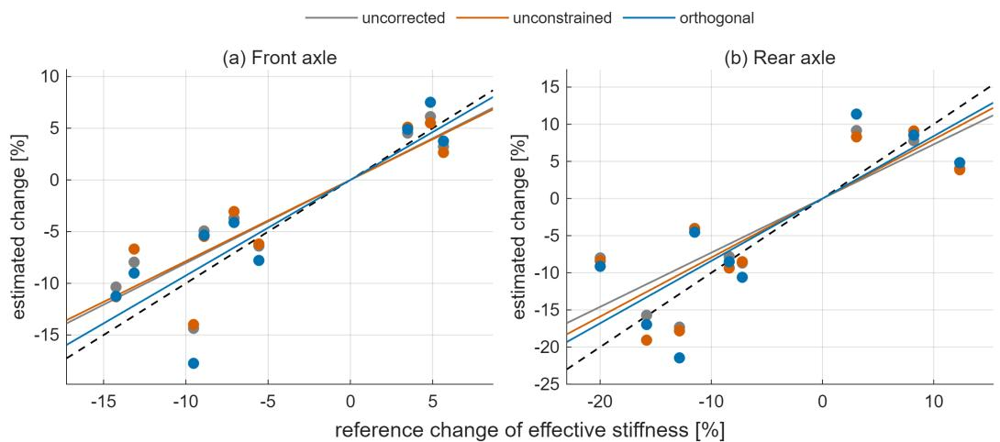  
Figure 7. Stifness response on the scaled runs, basic correctors (30 parameters). One marker per run. Dashed line: full response. Thin lines: slopes through the origin, reported in Table 2. (a) Front axle. (b) Rear axle.

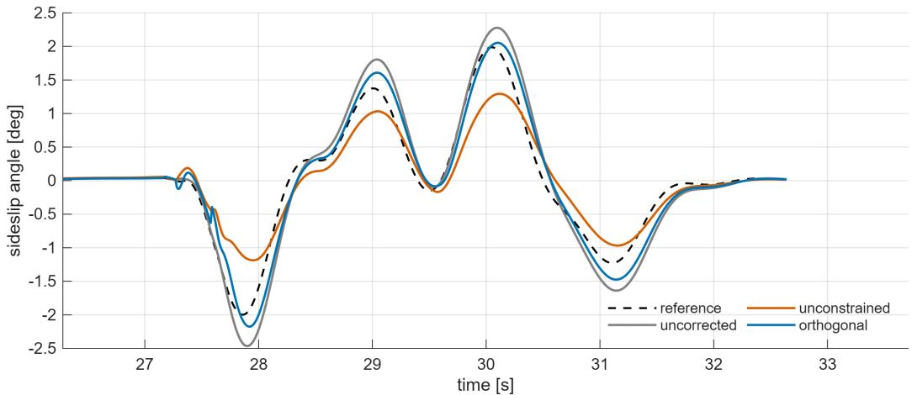  
Figure 8. Sideslip estimate on a double lane change at scale 0.9, a run not used for identification. Basic correctors (30 parameters).

If the corrector suppresses the response by absorbing innovation aligned with the stifness sensitivities, the suppression is expected to grow with its ability to fit the innovation. Figure 9 shows the two metrics as the number of corrector parameters increases from 30 to 830, with the spread over the draws, and Table 2 lists the values. The unconstrained response, averaged over the front and rear axles, falls monotonically from 0.79 at 30 parameters to 0.39 at 830, compared with 0.77 for the uncorrected filter, while its sideslip error comes at most 3.7% below the uncorrected filter’s. The orthogonal response stays at or above the uncorrected filter’s at every size, and its sideslip error is 12.7% to 22.0% below the uncorrected filter’s. The responses computed from the three runs at scale 0.9 alone, which are not used for identification, show the same pattern at every size. At 430 parameters they are 0.38 on the front axle and 0.40 on the rear for the unconstrained corrector, 0.90 and 0.92 for the orthogonal corrector, and 0.66 and 0.69 for the uncorrected filter. The constraint preserves the response as the number of parameters grows, and the orthogonal corrector has the lowest sideslip error at every size.

Table 2. Simulation results for all corrector sizes. Sideslip RMSE over the constant-stifness runs, nine of which are identification runs, and stifness response over the scaled runs. Rows with random Fourier features are means over the feature draws.
<table><tr><td>Parameters</td><td>Estimator</td><td>βRMSE [deg]</td><td>stiffness response front</td><td>rear</td></tr><tr><td>一</td><td>uncorrected</td><td>0.245</td><td>0.80</td><td>0.73</td></tr><tr><td>30</td><td>unconstrained</td><td>0.273</td><td>0.79</td><td>0.79</td></tr><tr><td>30</td><td>orthogonal (proposed)</td><td>0.214</td><td>0.92</td><td>0.84</td></tr><tr><td>130</td><td>unconstrained</td><td>0.247</td><td>0.65</td><td>0.64</td></tr><tr><td>130</td><td>orthogonal (proposed)</td><td>0.199</td><td>1.10</td><td>1.03</td></tr><tr><td>230</td><td>unconstrained</td><td>0.240</td><td>0.52</td><td>0.50</td></tr><tr><td>230</td><td>orthogonal (proposed)</td><td>0.197</td><td>1.12</td><td>1.01</td></tr><tr><td>430</td><td>unconstrained</td><td>0.236</td><td>0.45</td><td>0.43</td></tr><tr><td>430</td><td>orthogonal (proposed)</td><td>0.192</td><td>1.08</td><td>0.97</td></tr><tr><td>830</td><td>unconstrained</td><td>0.236</td><td>0.40</td><td>0.38</td></tr><tr><td>830</td><td>orthogonal (proposed)</td><td>0.191</td><td>1.07</td><td>0.95</td></tr></table>

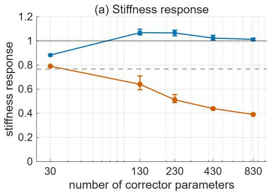

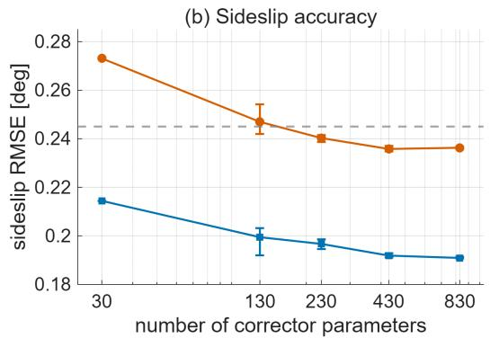  
Figure 9. Simulation results against the number of corrector parameters. (a) Stifness response, front/rear mean over the scaled runs. (b) Sideslip RMSE over the constant-stifness runs. Markers: mean over the feature draws. Bars: minimum to maximum over the draws. Dashed: uncorrected filter. Dotted: full response.

## 5.3. Independent axle stifness changes

The scaled runs of Section 5.1 apply the same stifness factor to both axles. The eight one-axle runs of Table 1 set the stifness factor to 0.85 or 1.15 on one axle, with the other kept at 1.0, for sinusoidal steering and slalom. The one-axle runs test whether the estimators can distinguish front- and rear-axle stifness changes. Figure 10 shows the responses to one-axle stifness changes, with one row per scaled axle and one column per estimated axle. In Figure $^ \mathrm { 1 0 ( a , d ) }$ the estimated change of the scaled axle is plotted against its reference change, and in Figure $^ { 1 0 ( \mathrm { b } , \mathrm { c } ) }$ the estimated change of the other axle against the same reference. Although the stifness factor of the other axle is unchanged, its efective stifness also changes, by −3.6% to 5.7%.

When the front axle changes, the uncorrected filter and the orthogonal corrector respond on the front axle with slopes of 1.01 and 1.12 and leave the rear estimate nearly unchanged. The unconstrained corrector responds with only 0.14 on the front axle and moves the rear estimate in the opposite direction, with −0.53. When the rear axle changes, all three estimators over-respond on the rear, and the unconstrained corrector assigns 0.76 of the change to the front axle, compared with at most 0.10 for the other two. The orthogonal corrector thus keeps the axle separation of the uncorrected filter. On these stifness combinations absent from identification, it also lowers the mean sideslip RMSE over the one-axle runs from 0.293◦ to 0.263◦, while the unconstrained corrector raises it to 0.329◦.

## 5.4. Stifness change during a drive

The constant-stifness runs show where each estimator settles. Here the stifness changes while the vehicle is driving, and the basic correctors are compared. The cornering-stifness scaling factor of the tire model is switched during a 360 s drive with repeated step steering at constant speed. All four tires change from 1.0 to 0.8 at 120 s and back at 240 s. A drive with the same steering and speed but without the stifness change provides the normalization. Each estimator’s stifness is reported relative to its own value on this unchanged drive. The unchanged drive is part of the identification set, and the drive with the stifness change is not. Sideslip RMSE is computed over the first 20 s after the change and over the rest of the reduced-stifness interval, from 140 s to 240 s. The settled change on this drive is the mean relative change over the last 40 s of the reduced-stifness interval, from 200 s to 240 s. Table 3 reports it as a percentage of the efective stifness change over the same interval, so that 100% means the estimate settled exactly at the efective change, and values above 100% mean an over-response.

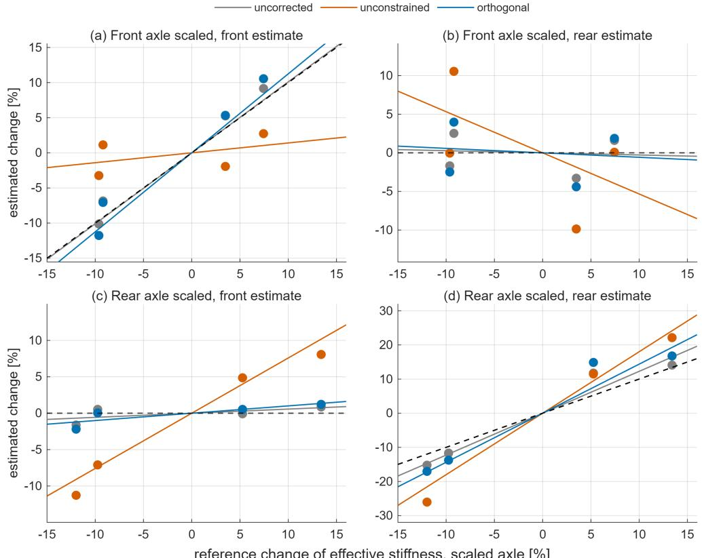  
Figure 10. One-axle stifness changes at scales 0.85 and 1.15, basic correctors (30 parameters). One marker per run. Rows: front axle scaled (a, b) and rear axle scaled (c, d). Columns: estimated change of the front axle (a, c) and of the rear axle (b, d), against the reference change of the scaled axle. Dashed lines: full response in (a, d), zero in (b, c). Thin lines: slopes through the origin.

Panels (a) and (b) of Figure 11 show the front and rear stifness estimates, and Table 3 gives the transient metrics, computed on the unsmoothed estimates. All three estimators settle within about 20 s, the orthogonal corrector slightly beyond the effective change and the unconstrained corrector slightly short of it. The unconstrained corrector reaches 90% of the efective change 4 to 5 s later than the other two. The slower response is consistent with the innovation competition described in Section 3.3. In the first 20 s after the change, the unconstrained corrector gives the least accurate sideslip estimate of the three, and from 140 s on it is as accurate as the uncorrected filter. The orthogonal corrector is the most accurate in both intervals. Figure 11(c) shows its sideslip error settling within the same 20 s.

(b) Rear axle  
Table 3. Transient after the stifness change at 120 s, basic correctors (30 parameters), unsmoothed estimates. Settled / efective: settled change in 200–240 s as a percentage of the efective stifness change.
<table><tr><td>Estimator</td><td>time to 90% of effective change [s] settled / effective [%] front</td><td>rear</td><td>front / rear</td><td>βRMSE [deg] 120–140 s / 140–240 s</td></tr><tr><td>uncorrected</td><td></td><td>7.6</td><td>101 / 96</td><td>0.234 / 0.255</td></tr><tr><td>unconstrained</td><td>6.5 11.0</td><td>11.8</td><td>98 / 95</td><td>0.325 / 0.256</td></tr><tr><td>orthogonal (proposed)</td><td>6.5</td><td>7.1</td><td>108 / 103</td><td>0.183 / 0.179</td></tr></table>

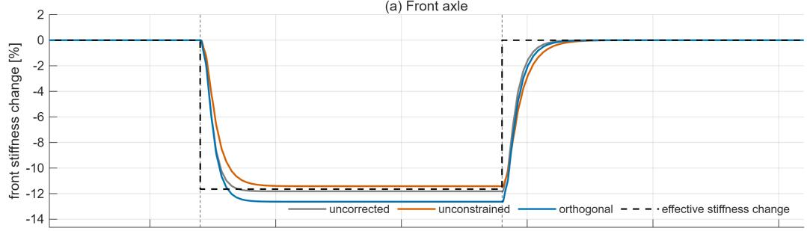

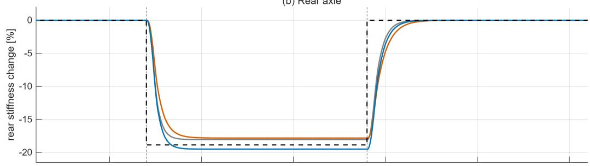  
(c) Sideslip error

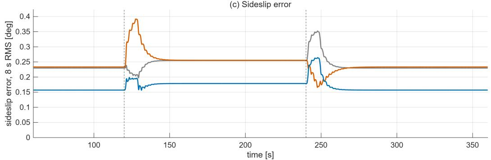  
Figure 11. Stifness change during the drive at 80 km/h, all tires to 0.8 of nominal from 120 s to 240 s (dashed lines). (a), (b) Stifness estimate relative to the unchanged drive, 4 s moving average, with the efective stifness change. (c) Sideslip error, 8 s moving root-mean-square value. Basic correctors (30 parameters).

## 6. Real-vehicle evaluation

The real-vehicle study examines whether the reduced stifness response observed in simulation also arises on measured vehicle data, and whether the orthogonal corrector preserves it without losing sideslip accuracy.

(c)  
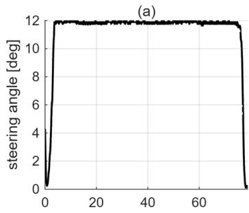

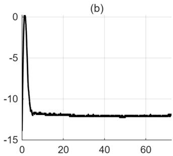

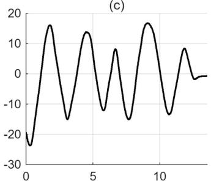

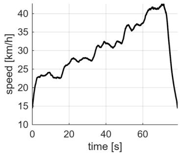

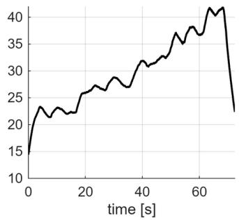

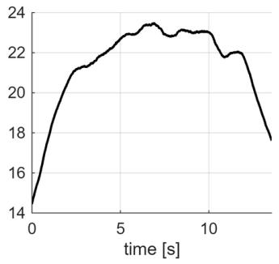  
Figure 12. Real-vehicle drives, steering angle (top) and speed (bottom). (a), (b) Identification drives. (c) One evaluation drive.

## 6.1. Dataset and setup

We use the public KIT multi-surface driving dataset [28], recorded with a rear-wheeldrive Hyundai IONIQ 5 driven manually in dynamic maneuvers at up to 50 km/h on dry asphalt. An optical velocity sensor provides the sideslip reference and the yaw rate, and a rear-axle inertial unit the lateral acceleration, all at 100 Hz. Optical velocity and lateral acceleration are translated to the center of gravity using the sensor positions. The nominal axle stifnesses are calibrated from the identification drives using quasisteady relations between sideslip, steering, and lateral acceleration, with the values listed in Appendix A. The estimator settings, regressors, and ridge coeficient are those of the simulation.

Six drives on one asphalt track are used for identification, and four drives for evaluation, three on the same track and one on a second asphalt track. Figure 12 shows identification and evaluation drives. During the identification drives the vehicle turns mostly in one direction, whereas the single-track model is symmetric between left and right turns. Each identification drive is therefore also used with the signs of steering angle, yaw rate, and lateral acceleration reversed, as a separate constraint segment, $J = 1 2$ . We report the arithmetic mean of the four drive RMSEs, each computed for $v > 4 ~ \mathrm { m / s }$ . The same procedure for repeated identification, evaluation, and averaging over feature draws is used as in simulation. We use the 430-parameter correctors, since increasing the size to 830 yields little further improvement in simulated sideslip accuracy in Table 2.

On the vehicle the tire stifness cannot be changed, so the mismatch is created on the model side. Both nominal axle stifnesses of the filter are multiplied by a factor $\kappa \in$ $\{ 0 . 8 , 0 . 9 , 1 . 0 , 1 . 1 , 1 . 2 5 \}$ . The vehicle is unchanged, so an estimator that compensates the ofset moves its stifness scale to $s ( 1 ) / \kappa$ , where s(1) is its settled value at $\kappa = 1$ . The relative change $1 / \kappa - 1$ that full compensation requires therefore serves as the reference change, in place of the efective stifness change of Section 5.1. The response then measures the fraction of the required change that the stifness scale makes, not how closely it tracks a known physical stifness. At each κ the identification is repeated in full, and each feature draw is held fixed across the ofsets. The fixed-stifness filter with the ofset nominal stifnesses produces the identification innovations, the correctors are refitted on the identification segments, and the adaptive estimators run on the four evaluation drives. The settled stifness scale $s ( \kappa )$ of a drive is its mean over the second half of the samples with $v > 4 ~ \mathrm { m / s }$ , and the estimated relative change is $s ( \kappa ) / s ( 1 ) - 1$ For each drive and axle, the estimated changes at the five ofsets are regressed against the required changes through the origin. The stifness response is the mean of these slopes over the four evaluation drives. Sideslip RMSE is reported at $\kappa = 1$

Table 4. Real-vehicle results with 430 parameters. For the correctors, entries report the mean over the feature draws, with the minimum and maximum in brackets.
<table><tr><td>Estimator</td><td> $\beta$  RMSE [deg]</td><td>response, front</td><td>response, rear</td></tr><tr><td>uncorrected</td><td>0.79</td><td>0.99</td><td>1.00</td></tr><tr><td>unconstrained</td><td>0.79 [0.69, 0.92]</td><td>0.35 [0.28, 0.45]</td><td>0.24 [0.14, 0.37]</td></tr><tr><td>orthogonal (proposed)</td><td>0.83 [0.77, 0.91]</td><td>0.88 [0.73, 1.05]</td><td>0.70 [0.44, 0.98]</td></tr></table>

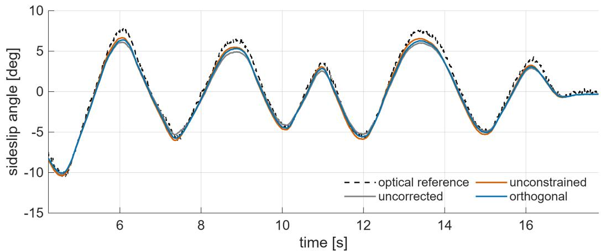  
Figure 13. Sideslip estimate on one evaluation drive against the optical reference. 430-parameter correctors, one feature draw.

## 6.2. Accuracy and stifness response

Table 4 gives the two metrics with 430 parameters, averaged over the feature draws. As in simulation, the unconstrained corrector loses most of its response to the ofsets, with 0.35 on the front axle and 0.24 on the rear, compared with 0.99 and 1.00 for the uncorrected filter. The orthogonal corrector retains 0.88 and 0.70. The sideslip errors are $0 . 7 9 ^ { \circ }$ for the uncorrected filter, $0 . 7 9 ^ { \circ }$ for the unconstrained corrector, and $0 . 8 3 ^ { \circ }$ for the orthogonal corrector. On the vehicle, the orthogonal corrector retains the response at a slightly higher sideslip error, and the unconstrained corrector gives up the response without a lower sideslip error. The orthogonal corrector’s response exceeds the unconstrained corrector’s on both axles for every feature draw.

Figure 13 shows the sideslip estimates on the evaluation drive of Figure $1 2 ( \mathrm { c } )$ . All three estimators follow the optical reference through sideslip excursions of about $\pm 1 0 ^ { \circ }$ within about $2 ^ { \circ }$ of the reference, and the three estimates lie within about $1 ^ { \circ }$ of each other.

Figure 14 shows the runs from which the response is computed, and each marker represents the mean over the draws. The unconstrained corrector’s response is at most 0.57 on any drive and axle, and the uncorrected filter follows the required change on all four drives. The orthogonal corrector’s response varies across drives. Its front stifness estimate over-responds on one drive, and its rear estimate responds less than the front on the other three.

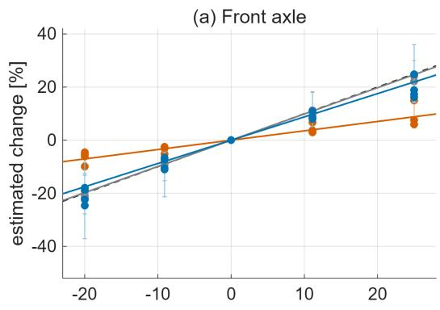

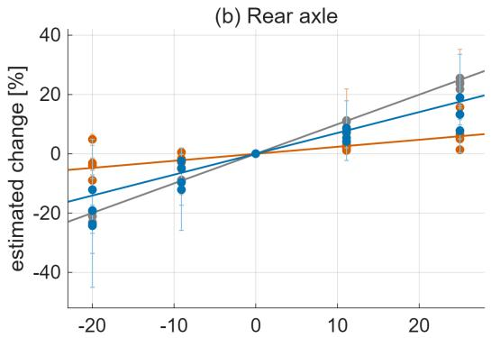  
required change of stiffness scale [%]  
Figure 14. Stifness response on the vehicle, 430-parameter correctors. One marker per evaluation drive and ofset, mean over the feature draws, with thin bars from the minimum to the maximum over the draws. Dashed line: full compensation. Solid lines: slopes through the origin, reported in Table 4. (a) Front axle. (b) Rear axle.

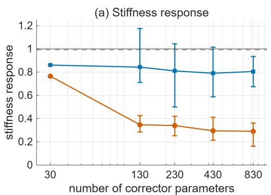

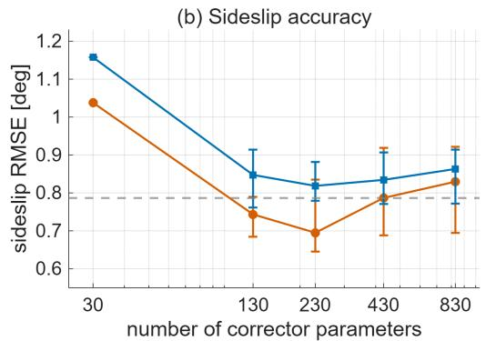  
Figure 15. Real-vehicle results against the number of corrector parameters. (a) Stifness response, front/rear mean. (b) Sideslip RMSE at $\kappa = 1$ . Markers: mean over the feature draws. Bars: minimum to maximum over the draws. Dashed: uncorrected filter. Dotted: full compensation.

Figure 15 shows the response and the sideslip error against the number of corrector parameters, with the spread over the draws. The unconstrained response, averaged over the front and rear axles, declines with size, as it does in simulation in Figure 9, from 0.77 at 30 parameters to 0.29 at 830. The orthogonal response is higher at every size, and this ordering holds for every feature draw. For the correctors with random Fourier features, the orthogonal response averaged over the draws ranges from 0.79 to 0.84, below the uncorrected filter’s 0.99. Both correctors have a higher sideslip error than the uncorrected filter at 30 parameters. From 130 parameters on, the mean sideslip error over the draws ranges from $0 . 7 0 ^ { \circ }$ to $0 . 8 3 ^ { \circ }$ for the unconstrained corrector and from $0 . 8 2 ^ { \circ }$ to $0 . 8 6 ^ { \circ }$ for the orthogonal corrector, compared with $0 . 7 9 ^ { \circ }$ for the uncorrected filter. The spread of the sideslip error over the draws is concentrated on one evaluation drive with 73 s of sustained cornering.

## 7. Discussion and conclusions

Learned residual correction can improve state accuracy while suppressing the stifness response of a joint estimator. The proposed sensitivity-orthogonal parameterization leaves the sensitivity-aligned component of the innovation unchanged and preserves the static least-squares stifness estimate on each identification segment.

In full-vehicle simulation, the stifness response of the unconstrained corrector declined as its parameter count grew, whereas the orthogonal corrector responded at least as fully as the uncorrected filter at every size, kept the uncorrected filter’s axle separation, adapted as quickly to a stifness change during a drive, and had the lowest sideslip error. On the real-vehicle data, it retained most of the response to nominalstifness ofsets that the unconstrained corrector lost, at a slightly higher sideslip error.

The invariance of Section 4.1 is exact for the static least-squares estimate on the identification segments. Model discrepancy that is itself aligned with the stifness sensitivities is preserved by the constraint as well, so the stifness scales estimate an efective stifness of the single-track model rather than the tire stifness. The guarantee of the constraint holds on the segments where it is enforced and does not extend to the extrapolation of the corrector beyond them. The identification set should therefore cover the driving conditions in which the estimator is to operate.

The constraint acts on the innovation that excitation has already created, so the excitation-based scheduling of adaptation reviewed in Section 2 is complementary to it. The same orthogonality constraint can be constructed using sensitivities computed from a nonlinear axle-force model. Learned correction and online parameter adaptation can coexist in one filter when the corrector cannot reproduce the innovation that a parameter change produces.

## Disclosure statement

The authors report there are no competing interests to declare.

## Declaration of generative AI use

During the preparation of this work, the authors used Claude Opus 5.5 (Anthropic) to improve the language and to assist with the analysis scripts. The authors reviewed and edited all outputs and take full responsibility for the content of this article.

## Data availability statement

The real-vehicle data are publicly available in the KIT multi-surface driving dataset at https://doi.org/10.35097/44a91t97pmnha1k9 [28]. The simulation data were generated with the commercial software IPG CarMaker and are available from the corresponding author upon reasonable request.

## Funding

This work was supported by the National Research Foundation of Korea (NRF) grant funded by the Korea government (MSIT) (No. RS-2026-25473397). This work was supported by the Korea Planning & Evaluation Institute of Industrial Technology (KEIT) grant funded by the Korean Ministry of Trade, Industry and Resources (MOTIR) (RS-2026-25544705, Development of a Scalable Heterogeneous Zonal Chassis SW Platform and Vehicle-Adaptive Drive Modules for Global OEM Customization).

## References

[1] Chindamo, D.; Lenzo, B.; Gadola, M. On the vehicle sideslip angle estimation: a literature review of methods, models, and innovations, Applied Sciences 2018, 8 (3), 355.

[2] Pacejka, H. Tire and vehicle dynamics; Elsevier, 2005.

[3] Reina, G.; Messina, A. Vehicle dynamics estimation via augmented Extended Kalman Filtering, Measurement 2019, 133, 383–395.

[4] Mosconi, L.; Farroni, F.; Sakhnevych, A.; Timpone, F.; Gerbino, F.S. Adaptive vehicle dynamics state estimator for onboard automotive applications and performance analysis, Vehicle System Dynamics 2023, 61 (12), 3244–3268.

[5] Imbiriba, T.; Demirkaya, A.; Dun´ık, J.; Straka, O.; Erdo˘gmu¸s, D.; Closas, P. Hybrid Neural Network Augmented Physics-Based Models for Nonlinear Filtering, In Proceedings of the 25th International Conference on Information Fusion (FUSION), 2022; pp 1–6.

[6] Takeishi, N.; Kalousis, A. Deep Grey-Box Modeling With Adaptive Data-Driven Models Toward Trustworthy Estimation of Theory-Driven Models, In Proceedings of the 26th International Conference on Artificial Intelligence and Statistics (AISTATS), 2023; Proceedings of Machine Learning Research, Vol. 206, pp 4089–4100.

[7] Giampiccolo, S.; Reali, F.; Fochesato, A.; Iacca, G.; Marchetti, L. Robust Parameter Estimation and Identifiability Analysis with Hybrid Neural Ordinary Diferential Equations in Computational Biology, npj Systems Biology and Applications 2024, 10 (1), 139.

[8] Bertipaglia, A.; Alirezaei, M.; Happee, R.; Shyrokau, B. An Unscented Kalman Filter-Informed Neural Network for Vehicle Sideslip Angle Estimation, IEEE Transactions on Vehicular Technology 2024, 73 (9), 12731–12746.

[9] Kennedy, M.C.; O’Hagan, A. Bayesian Calibration of Computer Models, Journal of the Royal Statistical Society: Series B (Statistical Methodology) 2001, 63 (3), 425–464.

[10] Brynjarsd´ottir, J.; O’Hagan, A. Learning about Physical Parameters: The Importance of Model Discrepancy, Inverse Problems 2014, 30 (11), 114007.

[11] Bechtof, J.; Koenig, L.; Isermann, R. Cornering Stifness and Sideslip Angle Estimation for Integrated Vehicle Dynamics Control, IFAC-PapersOnLine 2016, 49 (11), 297–304. 8th IFAC Symposium on Advances in Automotive Control.

[12] Naets, F.; van Aalst, S.; Boulkroune, B.; El Ghouti, N.; Desmet, W. Design and Experimental Validation of a Stable Two-Stage Estimator for Automotive Sideslip Angle and Tire Parameters, IEEE Transactions on Vehicular Technology 2017, 66 (11), 9727–9742.

[13] Viehweger, M.; Vaseur, C.; van Aalst, S.; Acosta, M.; Regolin, E.; Alatorre, A.; Desmet, W.; Naets, F.; Ivanov, V.; Ferrara, A.; et al. Vehicle state and tyre force estimation: demonstrations and guidelines, Vehicle System Dynamics 2021, 59 (5), 675–702.

[14] Wang, Y.; Geng, K.; Xu, L.; Ren, Y.; Dong, H.; Yin, G. Estimation of Sideslip Angle and Tire Cornering Stifness Using Fuzzy Adaptive Robust Cubature Kalman Filter, IEEE Transactions on Systems, Man, and Cybernetics: Systems 2022, 52 (3), 1451–1462.

[15] Berntorp, K.; Di Cairano, S. Tire-Stifness and Vehicle-State Estimation Based on Noise-Adaptive Particle Filtering, IEEE Transactions on Control Systems Technology 2019, 27 (3), 1100–1114.

[16] van Aalst, S.; Naets, F.; Boulkroune, B.; De Nijs, W.; Desmet, W. An Adaptive Ve-

hicle Sideslip Estimator for Reliable Estimation in Low and High Excitation Driving, IFAC-PapersOnLine 2018, 51 (9), 243–248. 15th IFAC Symposium on Control in Transportation Systems.

[17] Devos, T.; Uva, I.N.; Naets, F. A least-squares identification method for vehicle cornering stifness identification from common vehicle sensor data, Vehicle System Dynamics 2025, 63 (10), 1899–1919.

[18] Straka, O.; Dun´ık, J.; Closas, P.; Imbiriba, T. Interpretable Augmented Physics-Based Model for Estimation and Tracking, In Proceedings of the 28th International Conference on Information Fusion (FUSION), 2025; pp 1–8. ArXiv:2505.19953.

[19] Goblirsch, S.; Piccinini, M.; Betz, J.; Lienkamp, M. Multidirectional Gaussian-process tire models for Kalman filtering in vehicle dynamics state estimation, Vehicle System Dynamics 2026. Published online 11 May 2026.

[20] Kim, S.; You, S.H.; Kang, S. A Hybrid Model for Vehicle Sideslip Angle Estimation Based on Attention Regression, IEEE Access 2024, 12, 141335–141343.

[21] Plumlee, M. Bayesian Calibration of Inexact Computer Models, Journal of the American Statistical Association 2017, 112 (519), 1274–1285.

[22] Kon, J.; Bruijnen, D.; van de Wijdeven, J.; Heertjes, M.; Oomen, T. Physics-Guided Neural Networks for Feedforward Control: An Orthogonal Projection-Based Approach, In Proceedings of the 2022 American Control Conference (ACC), 2022; pp 4377–4382.

[23] Gy¨or¨ok, B.M.; Hoekstra, J.H.; Kon, J.; P´eni, T.; Schoukens, M.; T´oth, R. Orthogonal Projection-Based Regularization for Eficient Model Augmentation, In Proceedings of the 7th Annual Learning for Dynamics and Control Conference (L4DC); PMLR, 2025; Proceedings of Machine Learning Research, Vol. 283, pp 166–178.

[24] Gy¨or¨ok, B.M.; Schoukens, M.; P´eni, T.; T´oth, R. Orthogonal-by-Construction Augmentation of Physics-Based Input-Output Models, IFAC Journal of Systems and Control 2026, 35, 100376.

[25] Manna, S.; Rogers, T.J.; Bull, L. Orthogonal Discrepancy Kernels for Learning with Partial Physics, 2026. ArXiv:2606.21199.

[26] Simon, D. Kalman filtering with state constraints: a survey of linear and nonlinear algorithms, IET Control Theory & Applications 2010, 4 (8), 1303–1318.

[27] Rahimi, A.; Recht, B. Random features for large-scale kernel machines, Advances in Neural Information Processing Systems 2007, 20.

[28] Schulz, T.; Snobar, F. Multi-Surface Driving Maneuvers: A Dataset from Standstill to Vehicle Dynamics Limits, 2026. Dataset, CC BY-SA 4.0, https://doi.org/10.35097/4 4a91t97pmnha1k9.

## Appendix A. Estimator and identification settings

Table A1 lists the vehicle parameters, the filter and identification settings used throughout, and the regressors of the basic corrector.

Table A1. Vehicle parameters, estimator and identification settings, and the 15 regressors of the basic corrector. Vehicle parameters are from the CarMaker datasheet (simulation) and the dataset description (real vehicle). Process-noise entries are per sample at $\Delta t = 0 . 0 1 { \mathrm { ~ s } } .$ Superscript m denotes a measured signal.
<table><tr><td>Quantity</td><td>Simulation (CarMaker)</td><td>Real vehicle (IONIQ 5)</td></tr><tr><td> $l _ { f } , l _ { r } \ [ \mathrm { m } ]$ </td><td>0.97, 1.57</td><td>1.563, 1.437</td></tr><tr><td>m  $[ \mathrm { k g } ] , \ : \dot { I } _ { z } \ : \ : [ \mathrm { k g } \mathrm { m } ^ { 2 } ]$ </td><td>1598, 1800</td><td>2254, 2193</td></tr><tr><td> $C _ { f 0 } , C _ { r 0 } \ [ \mathrm { k N / r a d } ]$ </td><td>89.9, 91.8 Map from the handwheel angle</td><td>157.3, 276.4</td></tr><tr><td>steering input [rad]</td><td> $\delta _ { \mathrm { h w } }$  [rad] to the road-wheel angle:</td><td>Dataset single-track angle</td></tr><tr><td>signals</td><td> $\dot { \delta } = \mathrm { 0 . 0 7 2 3 } \delta _ { \mathrm { h w } } + 8 . 4 \times 1 0 ^ { - 5 } \delta _ { \mathrm { h w } } ^ { 3 }$  CarMaker outputs at 100 Hz</td><td>Optical velocity sensor (Kistler Correvit S-Motion) and rear- axle inertial unit, recorded at 1 kHz and averaged over blocks</td></tr><tr><td>no stiffness update below evaluation window</td><td> $v < 5 ~ \mathrm { m / s }$   $v > 5 ~ \mathrm { m } / \mathrm { s }$ </td><td>of 10 samples to 100 Hz  $v < 3 ~ \mathrm { m / s }$   $v > 4 ~ \mathrm { m / s }$ </td></tr><tr><td>effective-stiffness regression</td><td>through the  ${ \mathrm { o r i g i n } } ,$  per axle; samples with  $v > 5 ~ \mathrm { m / s }$  and  $| \alpha | < 0 . 7 5 ^ { \circ } ;$  on the drive with a stiffness change, last 40 s of each interval</td><td></td></tr><tr><td>Shared filter settings</td><td></td><td></td></tr><tr><td>R</td><td> $\mathrm { d i a g } \big ( ( 0 . 1 5 ^ { \circ } / \mathrm { s } ) ^ { 2 } , ~ ( 0 . 0 5 ~ \mathrm { m } / \mathrm { s } ^ { 2 } ) ^ { 2 } \big )$ </td><td></td></tr><tr><td>Q, dynamic states  $\beta , r$ </td><td> $1 0 ^ { - 8 } , 1 0 ^ { - 8 }$ </td><td></td></tr><tr><td> $Q ,$  stiffness scales  $s _ { f } , s _ { r }$ </td><td> $( 3 \times 1 0 ^ { - 4 } ) ^ { 2 }$  each; 0 in the fixed-stiffness filter</td><td></td></tr><tr><td> $Q ,$  yaw-rate bias  $b _ { r }$ </td><td> $\dot { ( 2 } \times 1 0 ^ { - 5 } \mathrm { ~ r a d / s } ) ^ { 2 }$ </td><td></td></tr><tr><td>stiffness-scale bounds</td><td>state estimate with the corresponding covariance update</td><td>[0.3, 2.5], enforced by a covariance-weighted projection of the joint</td></tr><tr><td>Shared identification settings</td><td></td><td></td></tr><tr><td>ridge coefficient  $\rho$ </td><td> $1 0 ^ { - 3 }$ </td><td></td></tr><tr><td>constraint segments</td><td>One per run:  $J = 1 1$ </td><td>(simulation), 12 (real vehicle: six drives and</td></tr><tr><td>rank of C</td><td>their reflections) 22</td><td>18 for the basic corrector (twelve</td></tr><tr><td></td><td></td><td>of the fifteen regressors change sign under the reflection), 24</td></tr><tr><td>random Fourier features</td><td> $\cos ( \Omega ^ { \top } \tilde { \phi } + \mathbf { b } )$  , appended to  $\tilde { \phi } ,$  term,  $\Omega _ { i j } \sim \mathcal { N } ( 0 , 1 / 1 5 )$  ; b holds one phase per term,</td><td>with random Fourier features the vector of the 15 standardized basic regressors below. Ω has 15 rows and one column per added cosine  $b _ { j } \sim \mathcal { U } ( 0 , 2 \pi )$ </td></tr><tr><td>Regressors of the basic corrector</td><td></td><td></td></tr><tr><td>constant</td><td>1</td><td></td></tr><tr><td>steering</td><td> $\delta _ { k } , \ \delta _ { k - 1 } , \ \delta _ { k - 2 }$ </td><td></td></tr><tr><td>delayed measurements</td><td> $r _ { k - 1 } ^ { \mathrm { m } } , ~ r _ { k - 2 } ^ { \mathrm { m } } , ~ a _ { y , k - 1 } ^ { \mathrm { m } } , ~ a _ { y , k - 2 } ^ { \mathrm { m } } , ~ v _ { k - 1 }$ </td><td></td></tr><tr><td></td><td></td><td></td></tr><tr><td>odd nonlinearities</td><td> $a _ { y , k - 1 } ^ { \mathrm { ~ m ~ } } | a _ { y , k - 1 } ^ { \mathrm { ~ m ~ } } | , ~ \delta _ { k } | \delta _ { k } | , ~ r _ { k - 1 } ^ { \mathrm { ~ m ~ } } | r _ { k - 1 } ^ { \mathrm { ~ m ~ } } | , ~ ( a _ { y , k - 1 } ^ { \mathrm { ~ m ~ } } ) ^ { 3 }$ </td><td></td></tr><tr><td>products</td><td> $\delta _ { k } a _ { y , k - 1 } ^ { \mathrm { m } } , \delta _ { k } v _ { k - 1 }$ </td><td></td></tr></table>