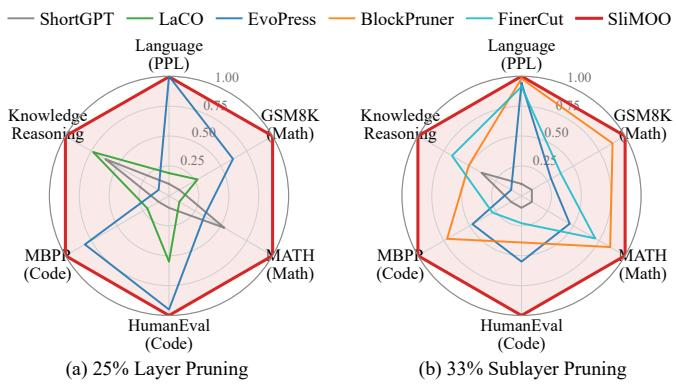
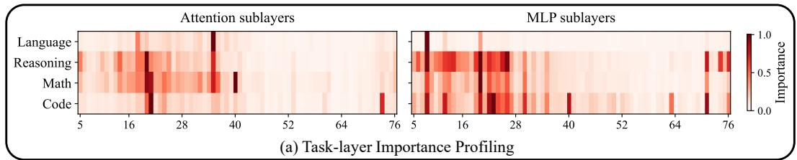
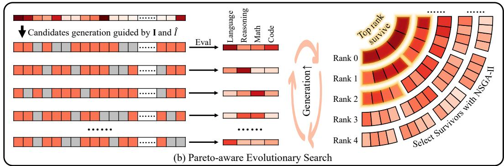
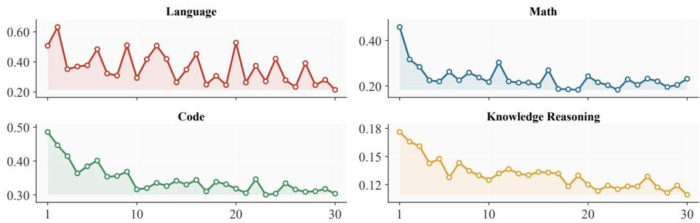

# SliMOO: Interpretable Multi-Objective Evolutionary Search for LLM Depth Pruning

Guanchen Li, Yixing Xu, Xuanwu Yin, Dong Li, Emad Barsoum Advanced Micro Devices, Inc. (AMD)

{guanchen.li,yixing.xu,xuanwu.yin,d.li,emad.barsoum}@amd.com

## Abstract

As large language models (LLMs) grow more powerful, their scale makes them costly to serve. Depth pruning offers a practical route to efficiency by directly reducing memory and latency without hardware-specific support. However, we observe that transformer layers exhibit markedly different task-dependent layer contributions, whereas existing depth-pruning methods ignore this heterogeneity and thus tend to optimize for a narrow domain or benchmark rather than preserve broad capability. This suggests that LLM depth pruning should be formulated as a multi-objective optimization problem rather than a single-score ranking problem.

We propose SliMOO, an interpretable multi-objective evolutionary search framework for LLM depth pruning. SliMOO first uses single-layer removal probing to construct a task-layer importance map, which provides an interpretable view of task-shared and task-specific layers and serves as a search prior. It then performs a Pareto-aware evolutionary search for pruning masks, where candidates are generated under the guidance of the task-layer prior, scored by their deviation from the dense model on each task, and retained through NSGA-II environmental selection. Across the Llama-3.1 and Qwen3 model families, SliMOO consistently achieves stronger multi-task trade-offs than rule-based, greedy, and scalarized baselines. For example, on Llama-3.1-70B at 25% sparsity, it improves the math-domain average from 24.33% to 34.40% and the code-domain average from 35.03% to 39.14%. Code will be made available at https://github.com/AMD-AGI/SliMOO.

## 1 Introduction

Large language models (LLMs) have advanced rapidly in capability [1–3], but their growing scale makes their deployment increasingly costly. This tension has motivated extensive work on model compression, such as pruning, sparsity, and quantization [4–6]. Among these approaches, we focus on depth pruning, which removes entire transformer layers or sublayers from a pretrained model and therefore translates more directly into practical speedups on standard hardware, without requiring specialized sparse kernels or custom accelerators [7, 8].

Despite practical advantages, existing layer-pruning methods typically estimate layer importance with a single global score, derived from heuristics [9, 8], calibration loss [10], or scalarized search [11, 12]. This presumes a universal pruning order across capability domains, whereas we observe markedly different task-dependent contributions across transformer layers, suggesting that different capabilities rely on different depths. Consequently, a pruning strategy that appears successful by a headline metric may still fail to preserve broad capability: on Llama-3.1-70B at 25% sparsity, ShortGPT keeps MMLU, a knowledge reasoning benchmark, nearly unchanged (77.79 versus 78.51 for the dense model), yet sharply degrades GSM8K (math) from 80.82 to 12.74 and HumanEval (code) from 51.83 to 18.29. This cross-domain divergence indicates that depth pruning for LLMs is inherently a multi-objective optimization problem rather than a single-score ranking problem.

To address this gap, we propose SliMOO1, an interpretable multi-objective evolutionary search framework for LLM depth pruning. The key idea is to move from a single global pruning order to a task-aware multi-objective search over pruning masks. Concretely, SliMOO treats each task as a separate objective, defined by the KL divergence between the dense and pruned models’ output distributions on the same task-specific inputs, and searches for masks that preserve strong multi-task trade-offs under a fixed sparsity budget. It also yields an interpretable view of which layers are shared across tasks and which are task-specific. SliMOO realizes this idea with two main contributions:

• We introduce task-layer importance profiling (TLIP), which uses single-layer removal probing to quantify the task-wise contribution of individual layers. TLIP yields an interpretable task-layer importance map that identifies task-shared and task-specific layers, and provides the task-layer prior that guides the subsequent search.

• SliMOO performs a Pareto-aware evolutionary search over pruning masks. It generates candidate pruning masks through TLIP prior-guided perturbations and sparsity-preserving crossover, evaluates them on the task-wise objectives, and retains a diverse set of high-quality solutions through NSGA-II environmental selection, which combines non-dominated sorting with diversity preservation. This procedure enables SliMOO to identify pruning masks that achieve stronger multi-task trade-offs than single-score ranking methods.

Together, these components make SliMOO an effective and interpretable framework for LLM depth pruning. Across the Llama-3.1 and Qwen3 model families, SliMOO consistently delivers stronger multitask trade-offs than rule-based, greedy, and scalarized baselines (cf. Figure 1). For example, on Llama-3.1-70B at 25% sparsity, SliMOO reduces the average language modeling perplexity by 1.46 relative to ShortGPT and is on par with Evo-Press, while improving the math-, code-, and reasoning-domain averages by 21.55/10.07, 23.69/4.11, and 0.97/2.27 relative to ShortGPT and EvoPress, respectively.

  
Figure 1: Normalized cross-domain trade-offs on Llama-3.1- 70B. Scores are normalized within each setting; language modeling perplexity is inverted before normalization.

## 2 Related Work

Depth pruning for large language models. Recent work has explored LLM depth pruning to improve deployment efficiency. ShortGPT [8] ranks transformer layers using an activation cosine similarity score and removes globally redundant layers. LaCo [9] reduces depth through layer collapse (parameter merging) rather than direct deletion. EvoPress [11] applies evolutionary search to identify budget-aware compression configurations, while FinerCut [12] and BlockPruner [10] prune finergrained attention/MLP sublayers using calibrated search or output-change signals. These methods demonstrate that substantial depth or structure can be removed, but they typically rely on a single global importance notion or a scalar objective. A related line of work skips computation dynamically at inference time through early exit or token-dependent routing, as in CALM [13], LayerSkip [14], and Mixture-of-Depths [15]. Such methods can reduce FLOPs or latency, but because they do not permanently remove layers, they do not reduce checkpoint size or memory footprint, and are often harder to integrate with static serving frameworks such as vLLM [16] and SGLang [17].

Multi-objective optimization. Multi-objective optimization (MOO) has a long history in optimization theory and algorithms, from early Pareto-based genetic algorithms [18, 19] to comprehensive treatments of multi-objective search [20]. NSGA-II [21] in particular established non-dominated sorting and diversity-preserving environmental selection as a standard template for approximating

  
Figure 2: Overview of SliMOO. (a) TLIP profiles task-wise importance of layers/sublayers, yielding a task-layer importance map I. (b) Guided by the task-layer prior, SliMOO generates feasible pruning masks and uses NSGA-II to retain Pareto-competitive trade-offs under a target sparsity.

Pareto fronts. In deep learning, multi-objective search has also been applied to neural architecture search and deployment-aware model design to balance accuracy with resource constraints [22]. For model compression, MOSP [23] formulates unstructured LLM pruning as a multi-objective problem, using ADMM to identify shared and task-specific support that generate Pareto sparse models.

LLM interpretability and task sensitivity. A growing line of work investigates the functional roles of transformer components at multiple granularities, from layers and heads to neurons and parameters, using probing, ablation, and intervention-based analysis. Probing studies showed that different linguistic phenomena become recoverable at different depths [24]. Some recent work examines which layers are globally important [25] and which internal units become specialized for different domains in multi-task settings [26]. Taken together, these studies suggest that contributions to model behavior are unevenly distributed across different components.

Positioning of SliMOO. SliMOO is motivated by a key limitation of existing depth-pruning methods: they do not explicitly account for the task-specific functional roles of layers. Unlike MOSP-style intra-weight support optimization, SliMOO operates on layer/sublayer supports in a discrete depthpruning space, where structural removals induce inter-layer interactions; its interpretable task-layer profiling guides feasible mask search, making the search both task-aware and trade-off-aware.

## 3 Method

SliMOO introduces a multi-objective task-aware framework for LLM depth pruning (cf. Figure 2). The method first measures how each removable layer or sublayer affects different capability domains, forming a task-layer importance map. This map is then used as a structured prior that guides candidate generation inside a Pareto-aware evolutionary search under an exact sparsity budget. We first define the pruning search space, review the multi-objective optimization preliminaries, and establish our motivation (cf. §3.1); we then introduce task-layer importance profiling (cf. §3.2) and describe the task-wise objective and TLIP-guided Pareto search procedure (cf. §3.3).

## 3.1 Preliminaries

Pruning units and search space. Consider an LLM with N transformer layers. SliMOO supports two depth-pruning granularities: removing an entire transformer layer, or removing individual attention/MLP sublayers, inducing search dimensions of $D = N$ and $D = 2 N$ , respectively. A pruning pattern is represented by a binary mask $\mathbf { x } \in \{ 0 , 1 \} ^ { D }$ , where $x _ { i } = 1$ indicates that unit i is removed. In practice, some units may be excluded from the search a priori: for example, the first and last few layers are commonly more sensitive and are rarely safe pruning targets. We encode the remaining removable units with a feasible set F. Under an exact budget of $\check { K }$ removed units, SliMOO searches over:

$$
{ \mathcal { X } } _ { K } = \{ \mathbf { x } \in \{ 0 , 1 \} ^ { D } ~ | ~ \operatorname { s u p p } ( \mathbf { x } ) \subseteq { \mathcal { F } } , ~ \| \mathbf { x } \| _ { 1 } = K \} .\tag{1}
$$

Multi-objective optimization. For a candidate mask $\mathbf { x } ,$ let $\mathbf { f } ( \mathbf { x } ) = ( f _ { 1 } ( \mathbf { x } ) , \ldots , f _ { T } ( \mathbf { x } ) )$ ) denote its task-wise pruning losses on $T$ tasks, where all objectives are minimized. Multi-objective optimization seeks masks that are simultaneously good across tasks rather than collapsing heterogeneous capabilities into a single scalar score. A candidate mask x dominates y if it is no worse on every objective and strictly better on at least one:

$$
\mathbf { x } \prec \mathbf { y } \iff f _ { t } ( \mathbf { x } ) \leq f _ { t } ( \mathbf { y } ) \forall t , \quad \exists t ^ { \prime } : f _ { t ^ { \prime } } ( \mathbf { x } ) < f _ { t ^ { \prime } } ( \mathbf { y } ) .
$$

The corresponding Pareto-optimal set is $\mathcal { P } = \{ \mathbf { x } \in \mathcal { X } _ { K } | \mathcal { J } \mathbf { y } \in \mathcal { X } _ { K } : \mathbf { y } \prec \mathbf { x } \}$ . The evolutionary search iteratively generates offspring candidates from the current population through variation operators, then selects the next generation from the union of parents and offspring. NSGA-II provides a natural environmental selection mechanism for this process: it partitions candidates into nondominated fronts, retains lower-rank fronts first, and promotes diversity within the last retained front through the crowding distance:

(2)

$$
\mathrm { C D } ( \mathbf { x } ) = \sum _ { t = 1 } ^ { T } \frac { f _ { t } ( \mathbf { x } _ { t } ^ { + } ) - f _ { t } ( \mathbf { x } _ { t } ^ { - } ) } { f _ { t } ^ { \operatorname* { m a x } } - f _ { t } ^ { \operatorname* { m i n } } } ,\tag{3}
$$

where $\mathbf { x } _ { t } ^ { - }$ and $\mathbf { x } _ { t } ^ { + }$ are the immediate neighbors of candidate x after sorting the current front by objective t, and $f _ { t } ^ { \mathrm { m a x } } / f _ { t } ^ { \mathrm { m i n } }$ are the front-wise maximum/minimum values for normalization. Boundary candidates are assigned infinite distance. This rule favors candidates in sparse regions of the same Pareto front, preserving diverse trade-offs instead of collapsing to masks that optimize only one capability domain.

Motivation. A single global pruning order would only be appropriate if all tasks depended on similar layers. Figure 2(a) shows that this is not the case: for example, the MLP unit at layer index 8 is important across all tasks, whereas the MLP unit at layer index 40 is mainly important for code. SliMOO is therefore designed around two complementary requirements: the search should know which units are risky for each task, and selection should preserve masks that realize different cross-domain trade-offs instead of forcing one scalar preference.

## 3.2 Task-layer Importance Profiling

SliMOO begins with task-layer importance profiling (TLIP), a task-aware probing method for quantifying the contribution of pruning units to different tasks before the Pareto-aware evolutionary search begins. For each removable unit i and task t, TLIP removes only that unit and measures the resulting task degradation:

$$
I _ { t , i } = f _ { t } ( \mathbf { e } _ { i } ) - f _ { t } ( \mathbf { 0 } ) ,\tag{4}
$$

where 0 denotes the dense model, $\mathbf { e } _ { i }$ removes only unit i $( f _ { t }$ is defined below). This singleton probe is cheap relative to evaluating all pruning combinations, but it exposes first-order task sensitivity over depth. Repeating it over all units yields a task-layer importance map $\mathbf { I } \in \mathbb { R } ^ { T \times D }$ . This map plays a dual role. First, it provides an interpretable view of layer contributions across tasks: each row characterizes one task’s sensitivity over depth, while each column indicates whether a unit is broadly shared or selectively important to a particular task. Second, it supplies a family of task-layer priors for Pareto-aware search: the task-specific rows $I _ { t , : }$ guide exploration toward individual task trade-offs, while a balanced prior is obtained by conservatively aggregating them:

$$
\hat { I } _ { i } = \operatorname* { m a x } _ { t } I _ { t , i } ,\tag{5}
$$

This max-aggregated prior protects any unit that is critical to at least one task and is therefore used as the risk-averse guide. During search, SliMOO alternates between ˆI and task-specific rows of I: the former steers pruning away from broadly important units, while the latter injects task-focused variation and helps the population explore different Pareto regions.

## 3.3 Pareto-aware Evolutionary Search

Task-wise pruning objective. Because our goal is to preserve capability across tasks rather than optimize a single proxy, SliMOO evaluates each pruning mask by how closely the pruned model matches the dense model on each task. This avoids requiring task labels for every calibration token and directly measures distributional distortion caused by pruning. For task $t ,$ let $c _ { n , < j } ^ { ( t ) }$ denote the prefix context of the j-th token in calibration example $n ,$ and let $m _ { n , j } ^ { ( t ) } \in \{ 0 , 1 \}$ be a token-level loss mask. We define the pruning objective as a masked, entropy-normalized forward KL divergence:

$$
f _ { t } ( { \bf x } ) = \frac { 1 } { H ^ { ( t ) } + \epsilon } \cdot \frac { 1 } { Z _ { t } } \sum _ { n , j } m _ { n , j } ^ { ( t ) } \mathrm { K L } \big ( p _ { 0 } ( \cdot \mid c _ { n , < j } ^ { ( t ) } ) \mid \mid p _ { { \bf x } } ( \cdot \mid c _ { n , < j } ^ { ( t ) } ) \big ) ,\tag{6}
$$

where $p _ { 0 }$ and $p _ { \mathbf { x } }$ are the dense and pruned next-token distributions, $\begin{array} { r } { Z _ { t } = \sum _ { n , j } m _ { n , j } ^ { ( t ) } } \end{array}$ , and $H ^ { ( t ) }$ is the dense-model entropy averaged over the same active positions. Here, $H ^ { ( t ) }$ acts as a task-scale normalizer, so the KL values from high- and low-entropy domains are more comparable. The token mask $m ^ { ( t ) }$ enables task-specific scoring, such as response-only masking for math and code evaluation. Collecting these task-wise objectives yields the multi-objective optimization problem:

$$
\operatorname* { m i n } _ { \mathbf { x } \in \mathcal { X } _ { K } } \mathbf { f } ( \mathbf { x } ) = \big ( f _ { 1 } ( \mathbf { x } ) , \ldots , f _ { T } ( \mathbf { x } ) \big ) .\tag{7}
$$

TLIP-guided Pareto-aware evolutionary search. A vanilla NSGA-II search would treat pruning as a black-box vector optimization problem: it generates masks, evaluates them, and selects the next population by Pareto rank and diversity. SliMOO instead injects task-aware structure into candidate generation through TLIP (cf. Figure 2(b)). TLIP is profiled once before search, and its priors are reused for initialization and mutation. Initialization combines importance-guided masks, which sample K distinct units from $\mathcal { F }$ without replacement, biased toward low ${ \hat { I } } ,$ with random feasible masks for diversity. During evolution, mutation parents are sampled uniformly from the population, crossover uses two distinct uniform parents, and mutations alternate between using ˆI and uniformly sampling one task-specific row from $\{ I _ { t , : } \} _ { t = 1 } ^ { T }$ as ${ \tilde { I } } .$ For a parent with pruned set $S \subseteq { \mathcal { F } }$ , swap mutation samples a kept feasible index $a \in { \mathcal { F } } \setminus S$ to prune and a pruned index $r \in S$ to restore:

$$
P _ { \mathrm { p r u n e } } ( a ) \propto \exp ( - \tilde { I } _ { a } / \tau ) , \qquad P _ { \mathrm { r e s t o r e } } ( r ) \propto \exp ( \tilde { I } _ { r } / \tau ) ,\tag{8}
$$

where τ controls exploration versus exploitation: smaller values focus mutation on low-importance units, while larger values flatten sampling. We adapt τ from population hypervolume [27] progress, decaying it after improvement and increasing it after stagnation. In parallel, cardinality-preserving crossover recombines parent pruning sets by inheriting shared removals and filling the remaining budget from their disagreement, so every offspring remains in $\mathcal { X } _ { K }$ . Candidate quality is measured by task-wise objectives on calibration sets rather than held-out evaluation benchmarks. NSGA-II then retains non-dominated and diverse trade-offs, and hypervolume tie-breaking prioritizes candidates with larger Pareto contribution for final selection. Algorithm 1 summarizes the full procedure.

## 4 Experiments

## 4.1 Experimental setup

Models and pruning settings. We evaluate SliMOO on four main large language models: Llama-3.1- 70B, Llama-3.1-405B, Qwen3-32B, and Qwen3-235B-A22B. We study two pruning granularities: whole-layer pruning at 25% sparsity and attention/MLP sublayer pruning at 33% sparsity.

Calibration. SliMOO uses four domain-specific sources: fineweb\_edu [28] for language modeling, commonsense\_170k [29] for knowledge reasoning, GSM8K (train split) [30] plus DeepScaleR-Preview [31] for math, and python-codes [32] for code. For math and code, we follow a supervised response-only masking scheme and compute the objective only on solution or code-completion tokens. The multi-domain budget is split evenly across four domains, yielding 65,536 tokens per domain with maximum length 8,192; the math budget is split evenly between GSM8K (easy) and DeepScaleR-Preview (hard). For the main comparison, calibration-based baselines use the same total budget but the generic source fineweb\_edu; the fair comparison additionally reruns them on SliMOO’s mixed multi-domain pool to isolate calibration-source effects.

Algorithm 1 SliMOO: TLIP-guided Pareto-aware evolutionary search for depth pruning   
Input: Dense model $\mathcal { M } ,$ task calibration sets $\{ \mathcal { D } _ { t } \} _ { t = 1 } ^ { T } ,$ , feasible search space $\mathcal { X } _ { K } .$ initial set   
size $M _ { 0 }$ , population size $P ,$ generations $G ,$ offspring budget $B ,$ crossover ratio $\rho$   
Output: Selected pruning mask $\mathbf { x } ^ { \star }$ and task-layer importance map I   
Phase 1: Task-layer importance profiling   
1: for each task $t \in \mathsf { \Gamma } \mathsf { \bar { \{ 1 , \dots , T \} } }$ do   
2: for each removable unit i do   
3: Compute single-removal effect $I _ { t , i } = f _ { t } ( \mathbf { e } _ { i } ) - f _ { t } ( \mathbf { 0 } )$   
4: Form the balanced task-layer prior Iˆ with $\hat { I } _ { i } \gets \operatorname* { m a x } _ { t } I _ { t , i }$   
Phase 2: Prior-guided initialization   
5: Generate $\mathcal { C } _ { 0 } = \bar { \{ \mathbf { x } ^ { ( m ) } \} } _ { m = } ^ { M _ { 0 } }$ with importance-guided samples and random feasible masks   
6: Evaluate each x $\in \mathcal { C } _ { 0 }$ to obtain its task-wise objective vector $\mathbf { f } \left( \mathbf { x } \right)$ in Eq. (7)   
7: Select the initial population $\mathcal { P } _ { 0 }  \mathrm { N S G A - I I } ( \bar { \mathcal { C } } _ { 0 } , P )$   
8: Initialize adaptive temperature τ and offspring sizes $B _ { \mathrm { x o } }  \lfloor \rho B \rfloor , B _ { \mathrm { m u t } }  B - B _ { \mathrm { x o } }$   
Phase 3: Pareto evolutionary search   
9: for $g = 1$ to G do   
10: Set the parent pool $\mathcal { Q } _ { g } \gets \mathcal { P } _ { g - 1 }$ for uniform parent sampling   
11: Generate $\mathcal { O } _ { g } ^ { \mathrm { x o } } = \{ \mathbf { x } _ { g , b } ^ { \mathrm { x o } } \} _ { b = 1 } ^ { B _ { \mathrm { x o } } }$   
by inheriting shared pruned units and filling remaining slots from parent disagreements   
12: Generate $\mathcal { O } _ { g } ^ { \mathrm { m u t } } = \{ \mathbf { x } _ { g , b } ^ { \mathrm { m u t } } \} _ { b = 1 } ^ { B _ { \mathrm { m u t } } }$   
by alternating between Iˆ and a uniformly sampled task row as ${ \tilde { I } } ,$ then applying Eq. (8)   
13: Form candidate pool $\mathcal { C } _ { g }  \mathcal { P } _ { g - 1 } \cup \mathcal { O } _ { g } ^ { \mathrm { x o } } \cup \dot { \mathcal { O } } _ { g } ^ { \mathrm { m u t } }$   
14: Evaluate each $\mathbf { x } \in \mathcal { C } _ { g }$ to obtain its task-wise objective vector $\mathbf { f } \left( \mathbf { x } \right)$ in Eq. (7) ▷ reuse parent scores   
15: Select $\mathcal { P } _ { g }  \mathrm { N S G A - I I } ( \mathcal { C } _ { g } , P )$   
16: Adapt τ from population HV progress   
17: Select $\mathbf { x } ^ { \star }  \operatorname { H V } \mathbf { - B E S T } ( \mathcal { P } _ { G } )$   
18: Return $\mathbf { x } ^ { \star } , \mathbf { I }$

We compare against representative depth and structured pruning baselines: ShortGPT [8], LaCo [9], EvoPress [11], BlockPruner [10], FinerCut [12], and LLM-Pruner [33]. LLM-Pruner, a head/neuron pruning method, is included to broaden the comparison beyond pure depth pruning. LaCo merges LLM layers without calibration, which is evaluated in its original calibration-free setting.

Evaluation tasks. We evaluate downstream performance on four profiled capability domains:

1. Language modeling: WikiText-2 [34], PTB [35], and C4 [36] perplexity (lower is better).

2. Math: GSM8K [30] (5-shot exact match) and Hendrycks MATH [37] (4-shot exact match).

3. Code: HumanEval [38] (0-shot pass@1) and MBPP [39] (3-shot pass@1).

4. Knowledge reasoning: MMLU [40] (5-shot accuracy), plus ARC-Challenge, ARC-Easy [41], Social-IQA [42], HellaSwag [43], PIQA [44], and WinoGrande [45] (0-shot accuracy).

We additionally include five auxiliary benchmarks for out-of-domain evaluation: RULER [46] (NIAH-8K) for long-context retrieval, TruthfulQA [47] (MC2) for truthfulness, CrowS-Pairs [48] for social bias, ToxiGen [49] for toxicity and implicit hate speech, and MedMCQA [50] for medical question answering. These benchmarks are excluded from TLIP and evolutionary search.

Implementation details. Our implementation is built with PyTorch [51] and uses Hugging Face Transformers [52] and Datasets [53] to manage models and data. TLIP uses 8,192 profiling tokens per task. For all models, the first two and last two layers are treated as pruning-sensitive and excluded from the search space. SliMOO search runs use 30 generations, population size 4, 64 offspring per generation, 128 initial candidates, and crossover rate 0.3. For initialization, $\tau = 1 . 0 \colon$ half of the candidates are importance-guided samples with probabilities proportional to $\exp ( - \hat { I } _ { i } / \tau )$ and half are random feasible masks for diversity; when generating offspring, τ decays by 0.9 on population HV improvement and grows by 1.5 after 3 stagnant generations, clipped to [0.1, 5.0].

## 4.2 Main results

Post-pruning performance. Table 1 shows that preserving a single domain is not sufficient for reliable depth pruning. Under the 25% whole-layer sparsity setting, SliMOO consistently improves the strongest multi-task trade-offs across both scales. On Llama-3.1-70B, ShortGPT remains reasonably competitive on the knowledge reasoning-domain average (65.93%), but collapses to 12.85% and 15.45% on the math- and code-domain averages; SliMOO raises these to 34.40% and 39.14% while also achieving the best knowledge reasoning-domain average (66.90%). Relative to the calibrationfree LaCo and the evolutionary search baseline EvoPress, SliMOO delivers the largest gains on math and code. We also report LLM-Pruner as a structural pruning reference: although it achieves the best language-modeling average on Llama-3.1-70B at 25% sparsity, it remains weaker than SliMOO on math, code, and knowledge reasoning. Its 405B results are omitted due to memory constraints.

Table 1: Post-pruning performance on the Llama family. We report domain averages: lower is better for language modeling and higher is better for math, code, and knowledge reasoning. Bold indicates the best result, and underlines indicate the runner-up.
<table><tr><td>Model</td><td>Sparsity</td><td>Method</td><td>Language Avg. ↓</td><td>Math Avg. ↑ %</td><td>Code Avg. ↑ %</td><td>Knowledge Avg. ↑ %</td></tr><tr><td rowspan="6">Llama-3.1-70B</td><td>0%</td><td></td><td>5.73</td><td>52.48</td><td>58.32</td><td>72.25</td></tr><tr><td rowspan="5">25% Layer</td><td>ShortGPT LaCo</td><td>11.35 11.20</td><td>12.85 16.00</td><td>15.45 20.39</td><td>65.93 66.22</td></tr><tr><td>LLM-Pruner</td><td>8.74</td><td></td><td></td><td></td></tr><tr><td>EvoPress</td><td>9.88</td><td>32.44</td><td>26.78</td><td>66.78</td></tr><tr><td>SliMOO</td><td>9.89</td><td>24.33</td><td>35.03</td><td>64.63</td></tr><tr><td></td><td></td><td>34.40</td><td>39.14</td><td>66.90</td></tr><tr><td rowspan="4">33% Sublayer</td><td>ShortGPT EvoPress</td><td>35.22 12.02</td><td>5.20 10.33</td><td>2.75</td><td>63.38</td></tr><tr><td>BlockPruner</td><td>10.99</td><td>24.22</td><td>15.11</td><td>62.02</td></tr><tr><td>FinerCut</td><td>12.85</td><td>13.10</td><td>18.89</td><td>63.96</td></tr><tr><td>SliMOO</td><td>10.45</td><td>27.27</td><td>7.87 30.78</td><td>64.73 66.29</td></tr><tr><td></td><td>0%</td><td>4.68</td><td>60.41</td><td></td><td></td></tr><tr><td rowspan="6">Llama-3.1-405B</td><td rowspan="3">25% Layer</td><td></td><td></td><td></td><td>62.94</td><td>75.01</td></tr><tr><td>ShortGPT LaCo</td><td>8.10</td><td>28.68</td><td>48.73</td><td>70.58</td></tr><tr><td>EvoPress</td><td>8.71 7.45</td><td>40.69 44.95</td><td>49.26</td><td>70.59</td></tr><tr><td>SliMOO</td><td>7.59</td><td>49.83</td><td>46.90 51.99</td><td>70.22 71.03</td></tr><tr><td>ShortGPT</td><td></td><td></td><td></td><td></td></tr><tr><td rowspan="5">33% Sublayer</td><td>EvoPress</td><td>22.41 9.26</td><td>1.56 29.32</td><td>0.00</td><td>33.02</td></tr><tr><td>BlockPruner</td><td>7.53</td><td>42.49</td><td>41.25</td><td>67.10</td></tr><tr><td>FinerCut</td><td>9.97</td><td>45.51</td><td>40.13</td><td>69.25</td></tr><tr><td>SliMOO</td><td></td><td></td><td>43.81</td><td>71.13</td></tr><tr><td></td><td>7.27</td><td>54.57</td><td>59.95</td><td>71.71</td></tr></table>

At 33% sparsity, where pruning operates at the attention/MLP sublayer level, the problem becomes harder and SliMOO’s advantage becomes clearer. On Llama-3.1-70B, it improves the math/codedomain averages from 10.33%/15.11% under EvoPress to 27.27%/30.78%. On Llama-3.1-405B, it surpasses FinerCut by +9.06 points on math and +16.14 points on code, while still achieving the best language modeling average and remaining competitive on knowledge reasoning. The detailed results for both the Llama and Qwen families are reported in Appendix A.2.

Search dynamics. Figure 3 visualizes the evolution of SliMOO’s search objectives across generations. All task-wise objectives drop sharply in the first few generations, showing that TLIP-guided initializa tion and mutation quickly move the population toward promising pruning regions. The curves then improve more gradually, reflecting the role of Pareto-aware evolution in refining trade-offs rather than simply optimizing the easiest domain. Importantly, no objective shows persistent deterioration or collapse, suggesting that SliMOO maintains balanced progress across language, math, code, and knowledge reasoning throughout search.

## 4.3 Generalization to Unseen Tasks

We evaluate the existing Llama-3.1-70B pruning mask on five out-of-domain benchmarks without additional profiling, search, or fine-tuning, as shown in Table 2.

SliMOO achieves the highest TruthfulQA, ToxiGen, and MedMCQA scores among the evaluated pruned models. At 25% layer sparsity, it exceeds the strongest mixed-calibration baseline by 1.96 and 2.66 points on TruthfulQA and MedMCQA, respectively. At 33% sublayer sparsity, the corresponding gains are 0.70 and 0.12 points, while EvoPress-mix retains a higher in-domain math score (28.29 vs. 27.27). RULER-NIAH is nearly saturated across methods, and SliMOO remains closest to the dense model’s CrowS-Pairs behavior. These results suggest that balancing heterogeneous in-domain objectives steers pruning toward layers that are broadly redundant across capabilities, helping preserve performance on tasks outside the search objectives.

  
Figure 3: Search dynamics of SliMOO across four capability domains. The horizontal axis denotes the generation index, and the vertical axis reports the corresponding domain-specific search objectives used during optimization; lower values indicate smaller distributional deviation from the dense model.

Table 2: Performance on the four profiled capability domains and five out-of-domain benchmarks for Llama-3.1-70B. -mix denotes calibration using the same mixed-domain samples and total token budget as SliMOO. All out-of-domain evaluations use the existing pruning mask without additional profiling, search, or fine-tuning.
<table><tr><td rowspan="2">Sparsity</td><td rowspan="2">Method</td><td colspan="4">Profiled capability domains</td><td colspan="5">Out-of-domain benchmarks</td></tr><tr><td>Lang. ↓ Math ↑ Code ↑ Know. ↑</td><td></td><td></td><td></td><td>RULER NIAH-8K ↑</td><td>TruthfulQA CrowS MC2↑</td><td>Pairs†</td><td></td><td>ToxiGen ↑ MedMCQA ↑</td></tr><tr><td>0%</td><td>Dense</td><td>5.73</td><td>52.48</td><td>58.32</td><td>72.25</td><td>100.0</td><td>51.14</td><td>68.63</td><td>46.49</td><td>69.28</td></tr><tr><td rowspan="5">25% Layer</td><td>ShortGPT</td><td>11.35</td><td>12.85</td><td>15.45</td><td>65.93</td><td>99.8</td><td>44.80</td><td>63.80</td><td>42.55</td><td>56.30</td></tr><tr><td>ShortGPT-mix</td><td>11.77</td><td>13.17</td><td>19.48</td><td>65.43</td><td>99.9</td><td>45.53</td><td>64.70</td><td>43.72</td><td>60.00</td></tr><tr><td>EvoPress</td><td>9.88</td><td>24.33</td><td>35.03</td><td>64.63</td><td>100.0</td><td>42.60</td><td>65.24</td><td>43.19</td><td>54.65</td></tr><tr><td>EvoPress-mix</td><td>11.35</td><td>27.89</td><td>35.62</td><td>66.12</td><td>100.0</td><td>46.27</td><td>65.06</td><td>44.36</td><td>58.04</td></tr><tr><td>SliMOO</td><td>9.89</td><td>34.40</td><td>39.14</td><td>66.90</td><td>100.0</td><td>48.23</td><td>66.13</td><td>44.68</td><td>62.66</td></tr><tr><td rowspan="5">33% Sublayer</td><td>|EvoPress</td><td>12.02</td><td>10.33</td><td>15.11</td><td>62.02</td><td>100.0</td><td>44.39</td><td>63.63</td><td>41.38</td><td>53.35</td></tr><tr><td>EvoPress-mix</td><td>10.92</td><td>28.29</td><td>24.04</td><td>64.46</td><td>100.0</td><td>46.14</td><td>64.28</td><td>42.45</td><td>56.06</td></tr><tr><td>FinerCut</td><td>12.85</td><td>13.10</td><td>7.87</td><td>64.73</td><td>100.0</td><td>43.45</td><td>62.85</td><td>38.29</td><td>52.55</td></tr><tr><td>FinerCut-mix</td><td>13.41</td><td>18.18</td><td>16.32</td><td>62.65</td><td>99.9</td><td>44.92</td><td>63.51</td><td>40.32</td><td>53.26</td></tr><tr><td>SliMOO</td><td>10.45</td><td>27.27</td><td>30.78</td><td>66.29</td><td>100.0</td><td>46.84</td><td>65.41</td><td>42.66</td><td>56.18</td></tr></table>

† CrowS-Pairs reports stereotypical preference. Closeness to the dense-model score indicates behavioral retention.

## 4.4 Multilingual Domain Transfer

To test whether SliMOO remains useful beyond the capability domains used in the main experiments, we construct a multilingual pruning scenario on Qwen3-32B, a choice with native multilingual support. The calibration budget matches the main setting but is redistributed across FineWeb-Edu English and FineWeb-2 Spanish, French, and German subsets [54]. Evaluation uses per-token perplexity on C4 multilingual validation splits for English, Spanish, French, and German, with 64 windows of 4096 tokens per language. As shown in Table 3, all prun-

Table 3: Multilingual C4 perplexity on Qwen3- 32B after 25% layer pruning. Lower is better, and bold marks the best pruned model.
<table><tr><td>Method</td><td>EN↓ ES↓</td><td>FR↓</td><td>DE↓</td></tr><tr><td>Dense</td><td>12.19</td><td>9.81 6.56</td><td>6.94</td></tr><tr><td>ShortGPT</td><td>17.75</td><td>10.56 8.75</td><td>9.31</td></tr><tr><td>EvoPress</td><td>16.01</td><td>10.18 8.22</td><td>8.89</td></tr><tr><td>SliMOO</td><td>14.69</td><td>9.81 7.62</td><td>8.62</td></tr></table>

ing methods increase perplexity, but SliMOO consistently yields the lowest perplexity among pruned models across the four languages. This suggests that SliMOO is not tied to a fixed domain taxonomy: language/math/code/knowledge and multilingual partitions are examples of how its task-aware multi-objective formulation can be instantiated.

Table 4: Fair calibration comparison on Llama-3.1-70B. All baselines are rerun with the same mixed multi-domain calibration data and total token budget as SliMOO.
<table><tr><td>Sp.</td><td>Method</td><td>Lang. ↓</td><td>Math ↑</td><td>Code ↑</td><td>Know. ↑</td></tr><tr><td rowspan="3">25% Layer</td><td>ShortGPT</td><td>11.77</td><td>13.17</td><td>19.48</td><td>65.43</td></tr><tr><td>LLM-Pruner</td><td>9.42</td><td>32.44</td><td>32.30</td><td>66.15</td></tr><tr><td>EvoPress SliMOO</td><td>11.35 9.89</td><td>27.89 34.40</td><td>35.62 39.14</td><td>66.12 66.90</td></tr><tr><td rowspan="5">33% Sublayer</td><td>ShortGPT</td><td>20.53</td><td>8.71</td><td>3.85</td><td>64.18</td></tr><tr><td>EvoPress BlockPruner</td><td>10.92 11.38</td><td>28.29 24.16</td><td>24.04 21.43</td><td>64.46 65.40</td></tr><tr><td>FinerCut</td><td>13.41</td><td>18.18</td><td>16.32</td><td>62.65</td></tr><tr><td>SliMOO</td><td>10.45</td><td>27.27</td><td>30.78</td><td></td></tr><tr><td></td><td></td><td></td><td></td><td>66.29</td></tr></table>

Table 5: Calibration budget and allocation ablation for SliMOO on Llama-3.1-70B at 25% layer sparsity. In the dominant (dom.) setting, one domain receives half of the total budget and the rest is evenly split.
<table><tr><td>Calib.</td><td>| Lang. ↓</td><td>Math ↑</td><td>Code ↑</td><td>Know. ↑</td></tr><tr><td>Default (64K)</td><td>9.89</td><td>34.40</td><td>39.14</td><td>66.90</td></tr><tr><td>32K/domain</td><td>9.89</td><td>34.40</td><td>39.14</td><td>66.90</td></tr><tr><td>16K/domain</td><td>10.13</td><td>30.25</td><td>40.19</td><td>66.82</td></tr><tr><td>8K/domain</td><td>10.39</td><td>29.04</td><td>37.74</td><td>66.40</td></tr><tr><td>Lang.-dom.</td><td>9.81</td><td>29.27</td><td>34.44</td><td>65.47</td></tr><tr><td>Math-dom.</td><td>9.89</td><td>35.16</td><td>28.46</td><td>65.85</td></tr><tr><td>Code-dom.</td><td>10.15</td><td>18.29</td><td>39.26</td><td>66.15</td></tr><tr><td>Know.-dom.</td><td>9.97</td><td>20.04</td><td>25.07</td><td>67.69</td></tr></table>

Table 6: Ablation of search objectives and Pareto selection on Llama-3.1-70B at 25% layer sparsity.
<table><tr><td rowspan=1 colspan=1>Search variant</td><td rowspan=1 colspan=1>| Lang. ↓Math ↑Code ↑Know. ↑</td></tr><tr><td rowspan=4 colspan=1>Language EvolutionMath EvolutionCode EvolutionKnowledge Evolution</td><td rowspan=1 colspan=1>9.88  24.33 35.03  64.63</td></tr><tr><td rowspan=1 colspan=1>10.75  36.11  34.89  66.44</td></tr><tr><td rowspan=1 colspan=1>9.89  30.93 38.59  65.66</td></tr><tr><td rowspan=1 colspan=1>11.35  25.46 27.20  67.45</td></tr><tr><td rowspan=1 colspan=1>Mixed Evolution</td><td rowspan=1 colspan=1>11.35  27.89 35.62  66.12</td></tr><tr><td rowspan=2 colspan=1>Mean EvolutionRandom Pareto Evolution</td><td rowspan=1 colspan=1>9.97  29.14  33.10  66.62</td></tr><tr><td rowspan=1 colspan=1>9.96  29.06  33.11  66.27</td></tr><tr><td rowspan=1 colspan=1>HV Evolution</td><td rowspan=1 colspan=1>9.91  30.77 34.73  66.58</td></tr><tr><td rowspan=1 colspan=1>NSGA-II</td><td rowspan=1 colspan=1>9.89  32.67  36.02  66.71</td></tr><tr><td rowspan=1 colspan=1>SliMOO</td><td rowspan=1 colspan=1>9.89   34.40  39.14  66.90</td></tr></table>

Table 7: Ablation of key SliMOO hyperparameters on Llama-3.1-70B at 25% layer sparsity.
<table><tr><td>Configuration</td><td>| Lang. ↓</td><td>Math ↑</td><td>Code ↑</td><td>Know. ↑</td></tr><tr><td>SliMOO</td><td>9.89</td><td>34.40</td><td>39.14</td><td>66.90</td></tr><tr><td>20 Generations 40 Generations</td><td>12.10 10.03</td><td>29.49 35.44</td><td>35.77 37.92</td><td>66.36 66.57</td></tr><tr><td>32 Offspring</td><td>10.25</td><td>32.56</td><td>35.79</td><td>66.18</td></tr><tr><td>128 Offspring</td><td>10.07</td><td>35.64</td><td>40.21</td><td>65.77</td></tr><tr><td>Crossover Rate 0.1</td><td>10.18</td><td>33.20</td><td>37.71</td><td>67.03</td></tr><tr><td>Crossover Rate 0.5</td><td>9.89</td><td>34.40</td><td>39.14</td><td>66.90</td></tr><tr><td>Population Size 6</td><td>9.78</td><td>33.08</td><td>40.61</td><td>66.79</td></tr><tr><td>Fixed temp. τ = 1</td><td>10.44</td><td>32.61</td><td>37.27</td><td>66.37</td></tr></table>

## 4.5 Ablation Study

Fair calibration comparison. Table 4 reports a controlled comparison where all calibration-based baselines are rerun with the same mixed multi-domain calibration data and total token budget as SliMOO. The same conclusion remains: SliMOO’s gains cannot be attributed to calibration allocation alone. At 25% layer sparsity, SliMOO improves the math/code averages from 27.89%/35.62% under EvoPress to 34.40%/39.14% and achieves the best knowledge average (66.90%). At 33% sublayer sparsity, it attains the best language/code/knowledge averages (10.45/30.78%/66.29%) while remaining competitive on math (27.27% versus 28.29% under EvoPress), yielding the strongest overall trade-off. This further supports that SliMOO’s advantage comes from its task-wise objective and Pareto-guided search rather than from task-aware calibration allocation alone.

Calibration budget and allocation. Table 5 shows that SliMOO is robust to calibration size. Halving the budget from 64K to 32K tokens per domain recovers the same pruning mask and identical post-pruning scores (9.89/34.40%/39.14%/66.90% on language/math/code/knowledge), indicating that the task-layer prior is already stable at moderate calibration sizes. Further reducing the budget to 16K or 8K introduces some degradation, but the resulting models remain competitive rather than collapsing, suggesting that SliMOO does not rely on a large calibration set. The allocation study shows a complementary effect: domain-dominant calibration can steer the selected mask toward that domain, with math-dominant calibration giving the best math average (35.16%) and knowledgedominant calibration giving the best knowledge average (67.69%) while trading off other domains. Adjusting domain proportions is therefore a practical way to reflect user preferences, while equal allocation remains the default for balanced multi-domain pruning.

Search objective and Pareto selection. Table 6 first shows that single-objective evolutionary search improves its target domain but fails to preserve the full capability profile. The multi-objective variants are more balanced but still incomplete: Mixed Evolution applies evolutionary search on mixed calibration data, Mean Evolution computes each task objective separately and averages them into one scalar, Random Pareto Evolution first filters the non-dominated candidates and then samples from them uniformly, and HV Evolution keeps candidates with larger hypervolume contribution. These alternatives improve over single-domain search but remain weaker than NSGA-II, which explicitly retains non-dominated and diverse candidates. SliMOO further adds TLIP profiling to guide candidate generation toward task-relevant regions, yielding the strongest overall trade-off across domains.

Ablation on SliMOO search hyperparameters. Table 7 shows that SliMOO is largely robust: changing generations, offspring, crossover, or population size does not cause collapse and still yields competitive trade-offs. Reducing the search to 20 generations weakens all domains, while 40 generations improves math but does not dominate the default balance. Increasing the offspring budget to 128 further improves math and code but hurts knowledge reasoning, indicating a different Pareto point rather than a uniformly better solution. Crossover is stable: rates 0.3 and 0.5 recover the same mask, while a smaller rate slightly favors knowledge. A larger population improves language and code but sacrifices math. Finally, fixed τ degrades the trade-off, suggesting that dynamic exploration helps maintain a balanced Pareto search.

## 4.6 Efficiency Analysis

Efficiency of SliMOO framework. All experiments are conducted on AMD Instinct MI300X GPUs. On Llama-3.1-70B with 2 GPUs, TLIP profiling takes 12.0 minutes and SliMOO search takes 20.8 minutes per generation, close to Evo-Press (18.8 minutes × 30 generations) while producing stronger masks. ShortGPT is fast because it only requires several forward passes, but its postpruning quality is substantially weaker; FinerCut is much slower, taking 39.2 hours to finish. For Llama-3.1-405B, SliMOO runs on 8 GPUs with a

Table 8: Inference efficiency of pruned Llama-3.1-70B with vLLM at batch size 8.
<table><tr><td>Sparsity</td><td>Arch</td><td>| IO Tok.</td><td>TTFT (s) ↓</td><td>Decode TPS ↑</td></tr><tr><td rowspan="2">0%</td><td>80 Attn</td><td>4096</td><td>3.39</td><td>482.9</td></tr><tr><td>80 FFN</td><td>8192</td><td>4.47</td><td>413.6</td></tr><tr><td rowspan="2">25%</td><td>60 Attn</td><td>4096</td><td>2.54</td><td>623.9</td></tr><tr><td>60 FFN</td><td>8192</td><td>3.35</td><td>539.5</td></tr><tr><td rowspan="2">33%</td><td>46 Attn</td><td>4096</td><td>2.37</td><td>672.2</td></tr><tr><td>64FFN</td><td>8192</td><td>3.07</td><td>593.0</td></tr></table>

933 GB memory budget; profiling takes 46.4 minutes and search takes 52.1 minutes per generation.   
Thus, SliMOO’s one-time offline cost remains acceptable given its best post-pruning trade-offs.

Efficiency of post-pruning LLMs. Table 8 reports time to first token (TTFT) and decode throughput (Decode TPS), showing that SliMOO converts structural pruning into practical serving gains. SliMOO prunes the full-depth Llama-3.1-70B model into layer- or sublayer-sparse variants, enabling more efficient serving with standard vLLM. At 4096 IO tokens (equal input and output tokens), 25% layer pruning gives a 1.33× TTFT speedup and 1.29× Decode TPS improvement, while 33% sublayer pruning increases these gains to 1.43× and 1.39×. Similar gains hold at 8192 IO tokens, confirming faster inference without specialized sparse kernels.

## 5 Limitations

SliMOO achieves strong and interpretable cross-domain trade-offs, yet it still has limitations. Concretely, the current instantiation of SliMOO uses a predefined set of capability domains and calibration corpora, which locally aligns it with deployment settings whose target domains can be reasonably specified, while broader open-ended, in-the-wild task mixtures merit further study. SliMOO also incurs a one-time cost for TLIP profiling and evolutionary search, so reducing this overhead would improve practicality. For sublayer pruning, our comparisons follow the same structural-unit budget across methods, while attention and MLP units can differ in parameter and FLOP counts; nevertheless, vLLM measurements show that higher-sparsity sublayer pruning can yield noticeably stronger serving speedups than low-sparsity layer pruning even when their parameter counts are relatively close.

## 6 Conclusion

This paper presents SliMOO, an interpretable multi-objective framework for LLM depth pruning. By profiling task-wise layer importance and implementing Pareto-aware evolutionary search, SliMOO avoids the limitations of a single global pruning order and instead identifies pruning masks with stronger cross-domain trade-offs under fixed sparsity budgets. Across the Llama-3.1 and Qwen3 families, SliMOO significantly improves post-pruning performance in the domains of language modeling, math, code, and knowledge reasoning. These results suggest that task-aware multiobjective optimization is a promising direction for reliable and interpretable LLM depth pruning.

## Acknowledgments and Disclosure of Funding

This work received no external funding. The authors declare no additional competing interests beyond the affiliations disclosed in the paper.

## References

[1] DeepSeek-AI, “DeepSeek-R1: Incentivizing reasoning capability in LLMs via reinforcement learning,” arXiv preprint arXiv:2501.12948, 2025. [Online]. Available: https://arxiv.org/abs/2501.12948

[2] Llama Team, “The Llama 3 herd of models,” arXiv preprint arXiv:2407.21783, 2024. [Online]. Available: https://arxiv.org/abs/2407.21783

[3] Qwen Team, “Qwen3 Technical Report,” arXiv preprint arXiv:2505.09388, 2025. [Online]. Available: https://arxiv.org/abs/2505.09388

[4] G. Li, Y. Xu, Z. Li, J. Liu, X. Yin, D. Li, and E. Barsoum, “Týr-the-Pruner: Structural pruning LLMs via global sparsity distribution optimization,” in Proc. Conf. Neural Information Processing Systems (NeurIPS), 2025. [Online]. Available: https://openreview.net/forum?id=rAuRLePL2R

[5] M. Sun, Z. Liu, A. Bair, and J. Z. Kolter, “A simple and effective pruning approach for large language models,” in Proc. Int. Conf. Learning Representations (ICLR), 2024. [Online]. Available: https://openreview.net/forum?id=PxoFut3dWW

[6] E. Frantar, S. Ashkboos, T. Hoefler, and D. Alistarh, “GPTQ: Accurate post-training quantization for generative pre-trained transformers,” arXiv preprint arXiv:2210.17323, 2022. [Online]. Available: https://arxiv.org/abs/2210.17323

[7] D. Joo, H. Hosseini, R. Hadidi, and B. Asgari, “Coruscant: Co-designing GPU kernel and sparse tensor core to advocate unstructured sparsity in efficient LLM inference,” in Proc. IEEE/ACM Int. Symp. Microarchitecture (MICRO), 2025, pp. 232–245. [Online]. Available: https://doi.org/10.1145/3725843.3756065

[8] X. Men, M. Xu, Q. Zhang, Q. Yuan, B. Wang, H. Lin, Y. Lu, X. Han, and W. Chen, “ShortGPT: Layers in large language models are more redundant than you expect,” in Findings of the Association for Computational Linguistics: ACL, 2025, pp. 20 192–20 204. [Online]. Available: https://aclanthology.org/2025.findings-acl.1035/

[9] Y. Yang, Z. Cao, and H. Zhao, “LaCo: Large language model pruning via layer collapse,” in Findings of the Association for Computational Linguistics: EMNLP, 2024, pp. 6401–6417. [Online]. Available: https://doi.org/10.18653/v1/2024.findings-emnlp.372

[10] L. Zhong, F. Wan, R. Chen, X. Quan, and L. Li, “BlockPruner: Fine-grained pruning for large language models,” in Findings of the Association for Computational Linguistics: ACL, 2025, pp. 5065–5080. [Online]. Available: https://aclanthology.org/2025.findings-acl.262

[11] O. Sieberling, D. Kuznedelev, E. Kurtic, and D. Alistarh, “EvoPress: Accurate dynamic model compression via evolutionary search,” in Proc. Int. Conf. Machine Learning (ICML), 2025. [Online]. Available: https://proceedings.mlr.press/v267/sieberling25a.html

[12] Y. Zhang, Y. Li, X. Wang, Q. Shen, B. Plank, B. Bischl, M. Rezaei, and K. Kawaguchi, “FinerCut: Finer-grained interpretable layer pruning for large language models,” in Workshop on Machine Learning and Compression, NeurIPS, 2024. [Online]. Available: https://openreview.net/forum?id=jrSWzgno4W

[13] T. Schuster, A. Fisch, J. Gupta, M. Dehghani, D. Bahri, V. Tran, Y. Tay, and D. Metzler, “Confident adaptive language modeling,” in Proc. Conf. Neural Information Processing Systems (NeurIPS), 2022. [Online]. Available: https://proceedings.neurips.cc/paper\_files/paper/2022/hash/ 6fac9e316a4ae75ea244ddcef1982c71-Abstract-Conference.html

[14] M. Elhoushi, A. Shrivastava, D. Liskovich, B. Hosmer, B. Wasti, L. Lai, A. Mahmoud, B. Acun, S. Agarwal, A. Roman, A. A. Aly, B. Chen, and C.-J. Wu, “LayerSkip: Enabling early exit inference and self-speculative decoding,” in Proc. Annual Meeting of the Association for Computational Linguistics (ACL), 2024, pp. 12 622–12 642. [Online]. Available: https://doi.org/10.18653/v1/2024.acl-long.681

[15] D. Raposo, S. Ritter, B. A. Richards, T. P. Lillicrap, P. C. Humphreys, and A. Santoro, “Mixture-of-depths: Dynamically allocating compute in transformer-based language models,” arXiv preprint arXiv:2404.02258, 2024. [Online]. Available: https://arxiv.org/abs/2404.02258

[16] W. Kwon, Z. Li, S. Zhuang, Y. Sheng, L. Zheng, C. H. Yu, J. E. Gonzalez, H. Zhang, and I. Stoica, “Efficient memory management for large language model serving with PagedAttention,” in Proc. ACM SIGOPS Symp. Operating Systems Principles (SOSP), 2023.

[17] L. Zheng, L. Yin, Z. Xie, C. Sun, J. Huang, C. H. Yu, S. Cao, C. Kozyrakis, I. Stoica, J. E. Gonzalez, C. W. Barrett, and Y. Sheng, “SGLang: Efficient execution of structured language model programs,” in Proc. Conf. Neural Information Processing Systems (NeurIPS), 2024. [Online]. Available: https://proceedings.neurips. cc/paper\_files/paper/2024/hash/724be4472168f31ba1c9ac630f15dec8-Abstract-Conference.html

[18] C. M. Fonseca and P. J. Fleming, “Genetic algorithms for multiobjective optimization: Formulation, discussion, and generalization,” in Proc. Int. Conf. Genetic Algorithms, 1993, pp. 416–423.

[19] N. Srinivas and K. Deb, “Multiobjective optimization using nondominated sorting in genetic algorithms,” Evolutionary Computation, vol. 2, no. 3, pp. 221–248, 1994. [Online]. Available: https://doi.org/10.1162/evco.1994.2.3.221

[20] K. Deb, Multi-Objective Optimization Using Evolutionary Algorithms. Wiley, 2001.

[21] K. Deb, S. Agrawal, A. Pratap, and T. Meyarivan, “A fast and elitist multiobjective genetic algorithm: NSGA-II,” IEEE Transactions on Evolutionary Computation, vol. 6, no. 2, pp. 182–197, 2002. [Online]. Available: https://doi.org/10.1109/4235.996017

[22] T. Elsken, J. H. Metzen, and F. Hutter, “Efficient multi-objective neural architecture search via lamarckian evolution,” in Proc. Int. Conf. Learning Representations (ICLR), 2019. [Online]. Available: https://openreview.net/forum?id=ByME42AqK7

[23] W. Chen, H. Yang, Y. Gou, H. Shi, E.-L. Hu, Z. Li, and J. Kwok, “Multi-objective one-shot pruning for large language models,” in Proc. Conf. Neural Information Processing Systems (NeurIPS), 2025. [Online]. Available: https://openreview.net/forum?id=aNpj43Uh35

[24] I. Tenney, D. Das, and E. Pavlick, “BERT rediscovers the classical NLP pipeline,” in Proc. Annual Meeting of the Association for Computational Linguistics (ACL), 2019, pp. 4593–4601. [Online]. Available: https://doi.org/10.18653/v1/P19-1452

[25] Y. Zhang, Y. Dong, and K. Kawaguchi, “Investigating layer importance in large language models,” arXiv preprint arXiv:2409.14381, 2024. [Online]. Available: https://arxiv.org/abs/2409.14381

[26] Y. Leng and D. Xiong, “Towards understanding multi-task learning (generalization) of LLMs via detecting and exploring task-specific neurons,” in Proc. Int. Conf. Computational Linguistics (COLING), 2025, pp. 2969–2987. [Online]. Available: https://aclanthology.org/2025.coling-main.200/

[27] E. Zitzler and L. Thiele, “Multiobjective evolutionary algorithms: A comparative case study and the strength pareto approach,” IEEE Transactions on Evolutionary Computation, vol. 3, no. 4, pp. 257–271, 1999. [Online]. Available: https://doi.org/10.1109/4235.797969

[28] G. Penedo, H. Kydlicek, L. B. Allal, A. Lozhkov, M. Mitchell, C. A. Raffel, L. von Werra, and T. Wolf, “The FineWeb datasets: Decanting the web for the finest text data at scale,” in Proc. Conf. Neural Information Processing Systems (NeurIPS), 2024. [Online]. Available: https://proceedings.neurips.cc/paper\_files/paper/ 2024/hash/370df50ccfdf8bde18f8f9c2d9151bda-Abstract-Datasets\_and\_Benchmarks\_Track.html

[29] S.-Y. Liu, C.-Y. Wang, H. Yin, P. Molchanov, Y.-C. F. Wang, K.-T. Cheng, and M.-H. Chen, “DoRA: Weight-decomposed low-rank adaptation,” in Proc. Int. Conf. Machine Learning (ICML), 2024, pp. 32 100–32 121. [Online]. Available: https://proceedings.mlr.press/v235/liu24bn.html

[30] K. Cobbe, V. Kosaraju, M. Bavarian, M. Chen, H. Jun, L. Kaiser, M. Plappert, J. Tworek, J. Hilton, R. Nakano, C. Hesse, and J. Schulman, “Training verifiers to solve math word problems,” arXiv preprint arXiv:2110.14168, 2021. [Online]. Available: https://arxiv.org/abs/2110.14168

[31] math-dataset, “DeepScaleR-Preview-Dataset,” Hugging Face dataset card, 2025. [Online]. Available: https://huggingface.co/datasets/math-dataset/DeepScaleR-Preview-Dataset

[32] flytech, “python-codes-25k,” Hugging Face dataset card, 2024. [Online]. Available: https: //huggingface.co/datasets/flytech/python-codes-25k

[33] X. Ma, G. Fang, and X. Wang, “LLM-Pruner: On the structural pruning of large language models,” in Proc. Conf. Neural Information Processing Systems (NeurIPS), 2023. [Online]. Available: https://proceedings.neurips.cc/paper\_files/paper/2023/hash/ 44956951349095f74492a5471128a7e0-Abstract-Conference.html

[34] S. Merity, C. Xiong, J. Bradbury, and R. Socher, “Pointer sentinel mixture models,” arXiv preprint arXiv:1609.07843, 2016. [Online]. Available: https://arxiv.org/abs/1609.07843

[35] M. P. Marcus, B. Santorini, and M. A. Marcinkiewicz, “Building a large annotated corpus of english: The penn treebank,” Computational Linguistics, vol. 19, no. 2, pp. 313–330, 1993. [Online]. Available: https://aclanthology.org/J93-2004/

[36] C. Raffel, N. Shazeer, A. Roberts, K. Lee, S. Narang, M. Matena, Y. Zhou, W. Li, and P. J. Liu, “Exploring the limits of transfer learning with a unified text-to-text transformer,” arXiv preprint arXiv:1910.10683, 2023. [Online]. Available: https://arxiv.org/abs/1910.10683

[37] D. Hendrycks, C. Burns, S. Kadavath, A. Arora, S. Basart, E. Tang, D. Song, and J. Steinhardt, “Measuring mathematical problem solving with the MATH dataset,” in Proc. Conf. Neural Information Processing Systems (NeurIPS), 2021.

[38] M. Chen, J. Tworek, H. Jun, Q. Yuan, H. P. de Oliveira Pinto, J. Kaplan, H. Edwards, Y. Burda, N. Joseph, G. Brockman, A. Ray, R. Puri, G. Krueger, M. Petrov, H. Khlaaf, G. Sastry, P. Mishkin, B. Chan, S. Gray, N. Ryder, M. Pavlov, A. Power, L. Kaiser, M. Bavarian, C. Winter, P. Tillet, F. P. Such, D. Cummings, M. Plappert, F. Chantzis, E. Barnes, A. Herbert-Voss, W. H. Guss, A. Nichol, A. Paino, N. Tezak, J. Tang, I. Babuschkin, S. Balaji, S. Jain, W. Saunders, C. Hesse, A. N. Carr, J. Leike, J. Achiam, V. Misra, E. Morikawa, A. Radford, M. Knight, M. Brundage, M. Murati, K. Mayer, P. Welinder, B. McGrew, D. Amodei, S. McCandlish, I. Sutskever, and W. Zaremba, “Evaluating large language models trained on code,” arXiv preprint arXiv:2107.03374, 2021. [Online]. Available: https://arxiv.org/abs/2107.03374

[39] J. Austin, A. Odena, M. I. Nye, M. Bosma, H. Michalewski, D. Dohan, E. Jiang, C. J. Cai, M. Terry, Q. V. Le, and C. Sutton, “Program synthesis with large language models,” arXiv preprint arXiv:2108.07732, 2021. [Online]. Available: https://arxiv.org/abs/2108.07732

[40] D. Hendrycks, C. Burns, S. Basart, A. Zou, M. Mazeika, D. Song, and J. Steinhardt, “Measuring massive multitask language understanding,” in Proc. Int. Conf. Learning Representations (ICLR), 2021.

[41] P. Clark, I. Cowhey, O. Etzioni, T. Khot, A. Sabharwal, C. Schoenick, and O. Tafjord, “Think you have solved question answering? try ARC, the AI2 reasoning challenge,” arXiv preprint arXiv:1803.05457, 2018. [Online]. Available: https://arxiv.org/abs/1803.05457

[42] M. Sap, H. Rashkin, D. Chen, R. L. Bras, and Y. Choi, “Social IQa: Commonsense reasoning about social interactions,” in Proc. Conf. Empirical Methods in Natural Language Processing (EMNLP), 2019. [Online]. Available: https://aclanthology.org/D19-1454/

[43] R. Zellers, A. Holtzman, Y. Bisk, A. Farhadi, and Y. Choi, “HellaSwag: Can a machine really finish your sentence?” in Proc. Annual Meeting ofthe Associationfor Computational Linguistics (ACL), 2019.

[44] Y. Bisk, R. Zellers, R. L. Bras, J. Gao, and Y. Choi, “PIQA: Reasoning about physical commonsense in natural language,” in Proc. AAAI Conf. Artificial Intelligence, 2020.

[45] K. Sakaguchi, R. L. Bras, C. Bhagavatula, and Y. Choi, “WinoGrande: An adversarial winograd schema challenge at scale,” in Proc. AAAI Conf. Artificial Intelligence, 2020.

[46] C.-P. Hsieh, S. Sun, S. Kriman, S. Acharya, D. Rekesh, F. Jia, and B. Ginsburg, “RULER: What’s the real context size of your long-context language models?” in First Conference on Language Modeling, 2024. [Online]. Available: https://openreview.net/forum?id=kIoBbc76Sy

[47] S. Lin, J. Hilton, and O. Evans, “TruthfulQA: Measuring how models mimic human falsehoods,” in Proceedings of the 60th Annual Meeting of the Association for Computational Linguistics (Volume 1: Long Papers), S. Muresan, P. Nakov, and A. Villavicencio, Eds. Dublin, Ireland: Association for Computational Linguistics, May 2022, pp. 3214–3252. [Online]. Available: https://aclanthology.org/2022.acl-long.229/

[48] N. Nangia, C. Vania, R. Bhalerao, and S. R. Bowman, “CrowS-pairs: A challenge dataset for measuring social biases in masked language models,” in Proceedings of the 2020 Conference on Empirical Methods in Natural Language Processing (EMNLP), B. Webber, T. Cohn, Y. He, and Y. Liu, Eds. Online: Association for Computational Linguistics, Nov. 2020, pp. 1953–1967. [Online]. Available: https://aclanthology.org/2020.emnlp-main.154/

[49] T. Hartvigsen, S. Gabriel, H. Palangi, M. Sap, D. Ray, and E. Kamar, “ToxiGen: A large-scale machine-generated dataset for adversarial and implicit hate speech detection,” in Proceedings ofthe 60th Annual Meeting of the Association for Computational Linguistics (Volume 1: Long Papers), S. Muresan, P. Nakov, and A. Villavicencio, Eds. Dublin, Ireland: Association for Computational Linguistics, May 2022, pp. 3309–3326. [Online]. Available: https://aclanthology.org/2022.acl-long.234/

[50] A. Pal, L. K. Umapathi, and M. Sankarasubbu, “Medmcqa: A large-scale multi-subject multi-choice dataset for medical domain question answering,” in Conference on health, inference, and learning. PMLR, 2022, pp. 248–260.

[51] A. Paszke, S. Gross, F. Massa, A. Lerer, J. Bradbury, G. Chanan, T. Killeen, Z. Lin, N. Gimelshein, L. Antiga, A. Desmaison, A. Koepf, E. Z. Yang, Z. DeVito, M. Raison, A. Tejani, S. Chilamkurthy, B. Steiner, L. Fang, J. Bai, and S. Chintala, “PyTorch: An imperative style, high-performance deep learning library,” in Proc. Conf. Neural Information Processing Systems (NeurIPS), 2019, pp. 8024–8035. [Online]. Available: https://proceedings.neurips.cc/paper/2019/hash/bdbca288fee7f92f2bfa9f7012727740-Abstract. html

[52] T. Wolf, L. Debut, V. Sanh, J. Chaumond, C. Delangue, A. Moi, P. Cistac, T. Rault, R. Louf, M. Funtowicz, J. Davison, S. Shleifer, P. von Platen, C. Ma, Y. Jernite, J. Plu, C. Xu, T. L. Scao, S. Gugger, M. Drame, Q. Lhoest, and A. M. Rush, “Transformers: State-of-the-art natural language processing,” in Proc. Conf. Empirical Methods in Natural Language Processing: System Demonstrations (EMNLP), 2020, pp. 38–45. [Online]. Available: https://doi.org/10.18653/v1/2020.emnlp-demos.6

[53] Q. Lhoest, A. V. del Moral, Y. Jernite, A. Thakur, P. von Platen, S. Patil, J. Chaumond, M. Drame, J. Plu, L. Tunstall, J. Davison, M. Sasko, G. Chhablani, B. Malik, S. Brandeis, T. L. Scao, V. Sanh, C. Xu, N. Patry, A. McMillan-Major, P. Schmid, S. Gugger, C. Delangue, T. Matussiere, L. Debut, S. Bekman, P. Cistac, T. Goehringer, V. Mustar, F. Lagunas, A. M. Rush, and T. Wolf, “Datasets: A community library for natural language processing,” in Proc. Conf. Empirical Methods in Natural Language Processing: System Demonstrations (EMNLP), 2021, pp. 175–184. [Online]. Available: https://doi.org/10.18653/v1/2021.emnlp-demo.21

[54] G. Penedo, H. Kydlicek, V. Sabolcec, B. Messmer, N. Foroutan, A. H. Kargaran, C. Raffel, M. Jaggi, L. von Werra, and T. Wolf, “FineWeb2: One pipeline to scale them all – adapting pre-training data processing to every language,” arXiv preprint arXiv:2506.20920, 2025. [Online]. Available: https://arxiv.org/abs/2506.20920

[55] E. J. Hu, Y. Shen, P. Wallis, Z. Allen-Zhu, Y. Li, S. Wang, L. Wang, and W. Chen, “LoRA: Low-rank adaptation of large language models,” in Proc. Int. Conf. Learning Representations (ICLR), 2022. [Online]. Available: https://openreview.net/forum?id=nZeVKeeFYf9

[56] N. Lambert, J. Morrison, V. Pyatkin, S. Huang, H. Ivison, F. Brahman, L. J. V. Miranda, A. Liu, N. Dziri, S. Lyu et al., “Tulu 3: Pushing frontiers in open language model post-training,” arXiv preprint arXiv:2411.15124, 2024. [Online]. Available: https://arxiv.org/abs/2411.15124

[57] A. Lozhkov, L. B. Allal, L. von Werra, and T. Wolf, “FineWeb-Edu: The finest collection of educational content,” Hugging Face dataset card, 2024. [Online]. Available: https://huggingface.co/ datasets/HuggingFaceFW/fineweb-edu

## A Appendix

## A.1 SliMOO Search Details and Derivation

The main text defines the feasible mask set $\mathcal { X } _ { K }$ , the task-wise KL objectives $\mathbf { f } \left( \mathbf { x } \right)$ , and the TLIPguided search procedure. This appendix gives the derivation behind these design choices. The central difficulty is that depth pruning is a fixed-budget combinatorial problem with task-dependent and non-additive effects: removing one layer can be harmless for language modeling but harmful for math, and the effect of removing several layers is not exactly the sum of their isolated effects. Let t index a calibration task, $i \in \{ 1 , \ldots , D \}$ index a removable unit, and $x _ { i } \in \{ 0 , 1 \}$ indicate whether unit i is pruned. If layer interactions were ignored, the task loss of a mask could be approximated by the singleton expansion:

$$
\tilde { f } _ { t } ( \mathbf { x } ) = \sum _ { i = 1 } ^ { D } x _ { i } \ : I _ { t , i } ,\tag{9}
$$

where $\tilde { f } _ { t } ( { \bf x } )$ is the additive approximation to the true task loss $f _ { t } ( \mathbf { x } )$ , and $I _ { t , i } = f _ { t } ( \mathbf { e } _ { i } ) - f _ { t } ( \mathbf { 0 } )$ is the TLIP score obtained by pruning only unit i with the singleton mask $\mathbf { e } _ { i }$ . This additive view explains why TLIP is informative: it estimates the first-order discrete sensitivity of each task to each removable unit. It also explains why TLIP alone is insufficient as a pruning rule. Since transformer layers interact, the best $\dot { K }$ units to remove cannot be determined reliably by sorting singleton scores alone. SliMOO therefore uses TLIP as a search prior rather than as the final objective: the prior narrows exploration toward plausible masks, while the actual candidate quality is still measured by the full vector objective $\mathbf { f } \left( \mathbf { x } \right)$

The conservative prior $\hat { I } _ { i } = \operatorname* { m a x } _ { t } I _ { t , i }$ follows from the multi-objective nature of the problem. A unit with a large score for any task is potentially capability-critical, even if it appears unimportant for other tasks. Using the maximum therefore protects task-specific layers that would be washed out by averaging. At the same time, SliMOO also samples task-specific rows $I _ { t , }$ : during mutation, because a purely conservative prior would over-protect shared high-sensitivity regions and could under-explore domain-specific Pareto trade-offs. In this sense, the balanced prior controls risk, while task-specific priors maintain search diversity.

Feasibility is preserved by viewing masks in $\mathcal { X } _ { K }$ as $K$ -subsets of the feasible unit set ${ \mathcal F } .$ The most local valid move is a swap: remove one currently kept unit from $\mathcal { F }$ and restore one currently pruned unit. This changes the mask by Hamming distance two but keeps $\| \mathbf { x } \| _ { 1 } = K$ , so every mutated candidate remains at the target sparsity. TLIP enters this move only through the proposal distribution: low-prior kept units are more likely to be newly pruned, and high-prior removed units are more likely to be restored. Cardinality-preserving crossover serves the same purpose at the population level. Given two parent pruning sets $S _ { 1 }$ and $S _ { 2 }$ with $| S _ { 1 } | = | S _ { 2 } | = K$ , the offspring first inherits their shared pruned units $\bar { S } _ { 1 } \cap \bar { S } _ { 2 }$ , and then fills the remaining slots by sampling from the symmetric difference $( { \bar { S } } _ { 1 } \cup S _ { 2 } ) \setminus ( S _ { 1 } \cap S _ { 2 } )$ until its size reaches $K$ . This recombines useful pruning patterns from both parents while guaranteeing that the child remains in $\mathcal { X } _ { K }$

After candidate generation, selection is performed in objective space. Let C denote the candidate pool formed by the current population and newly generated offspring. NSGA-II constructs non-dominated fronts recursively:

$$
\mathcal { F } _ { 1 } = \{ \mathbf { x } \in \mathscr { C } : \exists \mathbf { y } \in \mathscr { C } , \mathbf { y } \prec \mathbf { x } \} , \qquad \mathcal { F } _ { \ell } = \mathrm { N D } \left( \mathscr { C } \setminus \bigcup _ { j < \ell } \mathcal { F } _ { j } \right) , \ell \geq 2 ,\tag{10}
$$

where x and $\mathbf { y }$ are candidate masks, ≺ denotes Pareto dominance, $\mathcal { F } _ { \ell }$ is the ℓ-th front, and $\mathrm { N D } ( \cdot )$ returns the non-dominated subset of its input set. Front rank gives a coarse ordering of solution quality: all masks in $\mathcal { F } _ { 1 }$ are Pareto-competitive within the pool, while later fronts are dominated by earlier ones. When the population budget cuts through a front, NSGA-II sorts candidates in that front by crowding distance in descending order and retains those with larger distances first, with boundary solutions treated as maximally distant. This rule favors solutions located in sparse regions of objective space, preserving coverage of different trade-offs and preventing the population from collapsing to a narrow set of masks that favor only one capability domain.

After search, the final population contains multiple non-dominated masks with different trade-offs, but deployment requires selecting a single pruning decision. SliMOO therefore uses hypervolume contribution to choose the final mask. Let $\mathcal { P }$ denote the final Pareto population and set the reference point by $r _ { t } = 1 . 1 \operatorname* { m a x } _ { \mathbf { x } \in \mathcal { A } } f _ { t } ( \mathbf { x } )$ , where A is the highest-fidelity evaluated archive. For minimization objectives, the hypervolume is the dominated volume:

ning results on the Llama and Qwen families. We report benchmark-level scores together with domain av rplexity and higher is better elsewhere. Boldindicates the best result, and underlines in
<table><tr><td rowspan=2 colspan=1>Model</td><td rowspan=2 colspan=1>Sparsity</td><td rowspan=2 colspan=19>Method        language modeling             math                  code                                 Knowledge ReasoningWikitext                  GSM8K              HumanEval       AVGMMLUARC-CARC-ESIQA</td></tr><tr><td rowspan=1 colspan=2>Wikitext PTB C4 AVG</td><td rowspan=1 colspan=3>GSM8K MATH AVG</td><td rowspan=1 colspan=1>HumanEval MBPP</td><td rowspan=1 colspan=1>AVG</td><td rowspan=1 colspan=8></td><td rowspan=1 colspan=1></td></tr><tr><td rowspan=12 colspan=1>Llama-3.1-70B</td><td rowspan=1 colspan=4>0%  N/A</td><td rowspan=1 colspan=2>2.63  7.72 6.84 5.73</td><td rowspan=1 colspan=3>80.82  24.14 52.48</td><td rowspan=1 colspan=1>51.83   64.80</td><td rowspan=1 colspan=1>58.32</td><td rowspan=1 colspan=8>78.51  60.75 87.12 50.46  66.43   82.86   79.64   72.25</td><td rowspan=1 colspan=1></td></tr><tr><td rowspan=6 colspan=1>25%Layer</td><td rowspan=1 colspan=3>ShortGPT</td><td rowspan=1 colspan=1>9.00  11.4713.57</td><td rowspan=1 colspan=1>11.35</td><td rowspan=1 colspan=2>12.74  12.96</td><td rowspan=1 colspan=1>12.85</td><td rowspan=1 colspan=1>18.29   12.60</td><td rowspan=1 colspan=1>15.45</td><td rowspan=1 colspan=7>77.79  48.46  76.56 47.95  57.49   76.28   76.95</td><td rowspan=1 colspan=1>65.93</td><td rowspan=2 colspan=1></td></tr><tr><td rowspan=1 colspan=3>LaCo</td><td rowspan=1 colspan=1>8.90  11.6013.10</td><td rowspan=1 colspan=1>11.20</td><td rowspan=1 colspan=2>20.77  11.22</td><td rowspan=1 colspan=1>16.00</td><td rowspan=1 colspan=1>23.78   17.00</td><td rowspan=1 colspan=1>20.39</td><td rowspan=1 colspan=7>78.21  48.12  76.34 47.59   58.11   76.82   78.37</td><td rowspan=1 colspan=1>66.22</td></tr><tr><td rowspan=1 colspan=3>LLM-Pruner</td><td rowspan=1 colspan=1>6.12  9.71 10.38</td><td rowspan=1 colspan=1>8.74</td><td rowspan=1 colspan=2>50.64  14.24</td><td rowspan=1 colspan=1>32.44</td><td rowspan=1 colspan=1>21.95   31.60</td><td rowspan=1 colspan=1>26.78</td><td rowspan=1 colspan=7>66.72  54.10  82.11 49.23  59.85   80.58   74.90</td><td rowspan=1 colspan=1>66.78</td><td></td></tr><tr><td rowspan=2 colspan=3>EvoPress</td><td rowspan=2 colspan=1>7.16  10.8211.67</td><td rowspan=2 colspan=1>9.88</td><td rowspan=2 colspan=2>36.47  12.18</td><td rowspan=2 colspan=1>24.33</td><td rowspan=2 colspan=1>28.66   41.40</td><td rowspan=2 colspan=1>35.03</td><td rowspan=2 colspan=7>66.69  50.34  77.40 46.01   57.08   78.78   76.09</td><td rowspan=2 colspan=1>64.63</td><td></td></tr><tr><td rowspan=1 colspan=1></td></tr><tr><td rowspan=1 colspan=3>SliMOO</td><td rowspan=1 colspan=1>7.21  10.6511.81</td><td rowspan=1 colspan=1>9.89</td><td rowspan=1 colspan=2>53.98  14.82</td><td rowspan=1 colspan=1>34.40</td><td rowspan=1 colspan=1>29.27   49.00</td><td rowspan=1 colspan=1>39.14</td><td rowspan=1 colspan=7>74.12  52.99  79.80 46.98   58.60   78.76   77.03</td><td rowspan=1 colspan=1>66.90</td><td rowspan=1 colspan=1></td></tr><tr><td rowspan=5 colspan=1>33%Sublayer</td><td rowspan=1 colspan=3>ShortGPT</td><td rowspan=1 colspan=1>38.28  33.5433.83</td><td rowspan=1 colspan=1>35.22</td><td rowspan=1 colspan=2>4.25   6.14</td><td rowspan=1 colspan=1>5.20</td><td rowspan=1 colspan=1>5.49    0.00</td><td rowspan=1 colspan=1>2.75</td><td rowspan=1 colspan=7>73.00  45.82  72.73 47.49   54.67   73.83   76.09</td><td rowspan=1 colspan=1>63.38</td><td rowspan=2 colspan=1></td></tr><tr><td rowspan=1 colspan=3>EvoPress</td><td rowspan=1 colspan=1>9.31  12.9413.81</td><td rowspan=1 colspan=1>12.02</td><td rowspan=1 colspan=2>12.13  8.52</td><td rowspan=1 colspan=1>10.33</td><td rowspan=1 colspan=1>14.02   16.20</td><td rowspan=1 colspan=1>15.11</td><td rowspan=1 colspan=4>66.56  44.62  74.54</td><td rowspan=1 colspan=3>45.24   53.31   75.46   74.43</td><td rowspan=1 colspan=1>62.02</td></tr><tr><td rowspan=1 colspan=3>BlockPruner</td><td rowspan=1 colspan=1>7.89  11.6613.42</td><td rowspan=1 colspan=1>10.99</td><td rowspan=1 colspan=2>37.38  11.06</td><td rowspan=1 colspan=1>24.22</td><td rowspan=1 colspan=1>10.98   26.80</td><td rowspan=1 colspan=1>18.89</td><td rowspan=1 colspan=4>67.77  50.77  79.08</td><td rowspan=1 colspan=3>46.52   58.06   78.40   67.09</td><td rowspan=1 colspan=1>63.96</td><td rowspan=1 colspan=1></td></tr><tr><td rowspan=1 colspan=3>FinerCut</td><td rowspan=1 colspan=1>9.33  15.1514.06</td><td rowspan=1 colspan=1>12.85</td><td rowspan=1 colspan=2>16.07  10.12</td><td rowspan=1 colspan=1>13.10</td><td rowspan=1 colspan=1>7.93    7.80</td><td rowspan=1 colspan=1>7.87</td><td rowspan=1 colspan=4>67.29  50.26  76.26</td><td rowspan=1 colspan=3>46.62   58.22   77.69   76.79</td><td rowspan=1 colspan=1>64.73</td><td rowspan=2 colspan=1></td></tr><tr><td rowspan=1 colspan=3>SIMOO</td><td rowspan=1 colspan=1>7.34  11.81 12.19</td><td rowspan=1 colspan=1>10.45</td><td rowspan=1 colspan=2>42.53  12.00</td><td rowspan=1 colspan=1>27.27</td><td rowspan=1 colspan=1>22.56   39.00</td><td rowspan=1 colspan=1>30.78</td><td rowspan=1 colspan=4>71.38  53.41  79.50</td><td rowspan=1 colspan=3>46.47   57.77   78.67   76.80</td><td rowspan=1 colspan=1>66.29</td></tr><tr><td rowspan=10 colspan=1>Llama-3.1-405B</td><td rowspan=1 colspan=1>0%</td><td rowspan=1 colspan=3>N/A</td><td rowspan=1 colspan=1>1.36  6.94 5.75</td><td rowspan=1 colspan=1>4.68</td><td rowspan=1 colspan=2>88.40  32.42</td><td rowspan=1 colspan=1>60.41</td><td rowspan=1 colspan=1>54.88   71.00</td><td rowspan=1 colspan=1>62.94</td><td rowspan=1 colspan=4>85.02  63.05  86.78</td><td rowspan=1 colspan=3>53.17  70.33  84.00   82.71</td><td rowspan=1 colspan=1>75.01</td><td rowspan=1 colspan=1></td></tr><tr><td rowspan=3 colspan=1>25%Layer</td><td rowspan=3 colspan=3>ShortGPTLaCoEvoPress</td><td rowspan=1 colspan=1>5.48  8.85 9.98</td><td rowspan=1 colspan=1>8.10</td><td rowspan=1 colspan=2>38.67  18.68</td><td rowspan=1 colspan=1>28.68</td><td rowspan=1 colspan=1>40.85   56.60</td><td rowspan=1 colspan=1>48.73</td><td rowspan=1 colspan=1>83.81</td><td rowspan=1 colspan=2>54.86</td><td rowspan=1 colspan=1>81.31</td><td rowspan=1 colspan=1>49.07</td><td rowspan=1 colspan=1>63.64</td><td rowspan=1 colspan=1>80.14   81.22</td><td rowspan=1 colspan=1>70.58</td><td rowspan=4 colspan=1></td></tr><tr><td rowspan=1 colspan=1>5.86  9.27 10.99</td><td rowspan=1 colspan=1>8.71</td><td rowspan=1 colspan=2>58.07  23.30</td><td rowspan=1 colspan=1>40.69</td><td rowspan=1 colspan=1>45.12   53.40</td><td rowspan=1 colspan=1>49.26</td><td rowspan=1 colspan=1>83.66</td><td rowspan=1 colspan=2>55.23</td><td rowspan=1 colspan=1>82.11</td><td rowspan=1 colspan=1>49.52</td><td rowspan=1 colspan=1>63.17</td><td rowspan=1 colspan=1>80.74   79.72</td><td rowspan=1 colspan=1>70.59</td></tr><tr><td rowspan=1 colspan=1>4.22  8.50 9.62</td><td rowspan=1 colspan=1>7.45</td><td rowspan=1 colspan=1>69.45</td><td rowspan=1 colspan=1>20.44</td><td rowspan=1 colspan=1>44.95</td><td rowspan=1 colspan=1>37.80   56.00</td><td rowspan=1 colspan=1>46.90</td><td rowspan=1 colspan=1>77.63</td><td rowspan=1 colspan=2>57.76</td><td rowspan=1 colspan=1>82.83</td><td rowspan=1 colspan=1>50.15</td><td rowspan=1 colspan=2>63.26   81.12   78.77</td><td rowspan=1 colspan=1>70.22</td></tr><tr><td rowspan=1 colspan=1></td><td rowspan=1 colspan=3>SliMOO</td><td rowspan=1 colspan=1>4.22   8.75  9.81</td><td rowspan=1 colspan=1>7.59</td><td rowspan=1 colspan=1>76.95</td><td rowspan=1 colspan=1>22.70</td><td rowspan=1 colspan=1>49.83</td><td rowspan=1 colspan=1>48.78   55.20</td><td rowspan=1 colspan=1>51.99</td><td rowspan=1 colspan=4>81.69  57.00  83.59</td><td rowspan=1 colspan=1>49.28</td><td rowspan=1 colspan=2>64.12   81.77    79.79</td><td rowspan=1 colspan=1>71.03</td></tr><tr><td rowspan=4 colspan=1>33%Sublayer</td><td rowspan=2 colspan=3>ShortGPTEvoPress</td><td rowspan=2 colspan=1>31.27  16.4519.505.97  9.81 12.00</td><td rowspan=1 colspan=1>22.41</td><td rowspan=1 colspan=2>3.11   0.00</td><td rowspan=1 colspan=1>1.56</td><td rowspan=1 colspan=1>0.00    0.00</td><td rowspan=1 colspan=1>0.00</td><td rowspan=1 colspan=4>22.95  19.97  26.56</td><td rowspan=1 colspan=1>34.08</td><td rowspan=1 colspan=2>25.88   51.47   50.20</td><td rowspan=1 colspan=1>33.02</td><td rowspan=2 colspan=1></td></tr><tr><td rowspan=1 colspan=1>9.26</td><td rowspan=1 colspan=2>42.61  16.02</td><td rowspan=1 colspan=1>29.32</td><td rowspan=1 colspan=1>30.49   52.00</td><td rowspan=1 colspan=1>41.25</td><td rowspan=1 colspan=4>75.82  50.51  79.50</td><td rowspan=1 colspan=1>48.26</td><td rowspan=1 colspan=2>60.29   79.49   75.85</td><td rowspan=1 colspan=1>67.10</td></tr><tr><td rowspan=1 colspan=3>BlockPruner</td><td rowspan=1 colspan=1>5.00  8.42 9.18</td><td rowspan=1 colspan=1>7.53</td><td rowspan=1 colspan=2>66.34  18.64</td><td rowspan=1 colspan=1>42.49</td><td rowspan=1 colspan=1>28.66   51.60</td><td rowspan=1 colspan=1>40.13</td><td rowspan=1 colspan=2>78.66</td><td rowspan=1 colspan=2>54.95  81.48</td><td rowspan=1 colspan=1>54.91</td><td rowspan=1 colspan=2>61.65   79.65   73.48</td><td rowspan=1 colspan=1>69.25</td><td rowspan=3 colspan=1></td></tr><tr><td rowspan=1 colspan=3>FinerCut</td><td rowspan=1 colspan=1>6.04  10.7213.15</td><td rowspan=1 colspan=1>9.97</td><td rowspan=1 colspan=2>69.45  21.56</td><td rowspan=1 colspan=1>45.51</td><td rowspan=1 colspan=1>39.02   48.60</td><td rowspan=1 colspan=1>43.81</td><td rowspan=1 colspan=2>82.54</td><td rowspan=1 colspan=2>56.91  82.70</td><td rowspan=1 colspan=1>50.77</td><td rowspan=1 colspan=2>63.41   80.58   80.98</td><td rowspan=1 colspan=1>71.13</td></tr><tr><td rowspan=1 colspan=1></td><td rowspan=1 colspan=3>SliMOO</td><td rowspan=1 colspan=1>4.09  8.23 9.50</td><td rowspan=1 colspan=1>7.27</td><td rowspan=1 colspan=2>81.50  27.63</td><td rowspan=1 colspan=1>54.57</td><td rowspan=1 colspan=1>56.10   63.80</td><td rowspan=1 colspan=1>59.95</td><td rowspan=1 colspan=2>80.26</td><td rowspan=1 colspan=2>60.32  85.02</td><td rowspan=1 colspan=1>48.93</td><td rowspan=1 colspan=2>65.39  82.70   79.32</td><td rowspan=1 colspan=1>71.71</td></tr><tr><td rowspan=12 colspan=1>Qwen3-32B</td><td rowspan=1 colspan=1>0%</td><td rowspan=1 colspan=3>N/A</td><td rowspan=1 colspan=1>7.19  13.5111.97</td><td rowspan=1 colspan=1>10.89</td><td rowspan=1 colspan=2>79.40  33.48</td><td rowspan=1 colspan=1>56.44</td><td rowspan=1 colspan=1>79.88   64.80</td><td rowspan=1 colspan=1>72.34</td><td rowspan=1 colspan=2>81.88</td><td rowspan=1 colspan=2>58.45  84.13</td><td rowspan=1 colspan=3>52.41   63.86   81.28   73.16</td><td rowspan=1 colspan=1>70.74</td><td rowspan=1 colspan=1></td></tr><tr><td rowspan=5 colspan=1>25%Layer</td><td rowspan=1 colspan=3>ShortGPT</td><td rowspan=1 colspan=1>12.72 25.3722.28</td><td rowspan=1 colspan=1>20.12</td><td rowspan=1 colspan=2>20.70  6.76</td><td rowspan=1 colspan=1>13.73</td><td rowspan=1 colspan=1>8.54    15.60</td><td rowspan=1 colspan=1>12.07</td><td rowspan=1 colspan=2>44.22</td><td rowspan=1 colspan=2>38.57  70.54</td><td rowspan=1 colspan=1>41.20</td><td rowspan=1 colspan=2>45.56   72.47   53.99</td><td rowspan=1 colspan=1>52.36</td><td rowspan=3 colspan=1></td></tr><tr><td rowspan=2 colspan=3>LaCoLLM-Pruner</td><td rowspan=2 colspan=1>10.46  18.7617.477.68  13.0213.05</td><td></td><td></td><td></td><td></td><td></td><td></td><td></td><td></td><td></td><td></td><td></td><td></td><td></td><td></td></tr><tr><td rowspan=1 colspan=1>11.25</td><td rowspan=1 colspan=1>37.38</td><td rowspan=1 colspan=1>19.50</td><td rowspan=1 colspan=1>28.44</td><td rowspan=1 colspan=1>6.10    19.20</td><td rowspan=1 colspan=1>12.65</td><td rowspan=1 colspan=1>76.64</td><td rowspan=1 colspan=1></td><td rowspan=1 colspan=2>22.70  25.08</td><td rowspan=1 colspan=1>47.29</td><td rowspan=1 colspan=2>60.29   49.51   69.69</td><td rowspan=1 colspan=1>50.17</td></tr><tr><td rowspan=1 colspan=3>EvoPress</td><td rowspan=1 colspan=1>9.70  16.7615.89</td><td rowspan=1 colspan=1>14.12</td><td rowspan=1 colspan=1>73.69</td><td rowspan=1 colspan=1>22.30</td><td rowspan=1 colspan=1>48.00</td><td rowspan=1 colspan=1>39.02   54.80</td><td rowspan=1 colspan=1>46.91</td><td rowspan=1 colspan=1>69.08</td><td rowspan=1 colspan=1></td><td rowspan=1 colspan=2>52.73  79.71</td><td rowspan=1 colspan=1>46.11</td><td rowspan=1 colspan=2>53.85   75.46   65.11</td><td rowspan=1 colspan=1>63.15</td><td rowspan=2 colspan=1></td></tr><tr><td rowspan=1 colspan=3>SliMOO</td><td rowspan=1 colspan=1>9.62  16.6215.62</td><td rowspan=1 colspan=1>13.95</td><td rowspan=1 colspan=2>75.89  24.40</td><td rowspan=1 colspan=1>50.15</td><td rowspan=1 colspan=1>57.32   56.80</td><td rowspan=1 colspan=1>57.06</td><td rowspan=1 colspan=4>68.21   53.58  79.29</td><td rowspan=1 colspan=3>46.57   53.71   75.35   66.30</td><td rowspan=1 colspan=1>63.29</td></tr><tr><td rowspan=6 colspan=1>33%Sublayer</td><td rowspan=1 colspan=3>ShortGPT</td><td rowspan=1 colspan=1>13.51  26.1024.28</td><td rowspan=1 colspan=1>21.30</td><td rowspan=1 colspan=2>45.79  16.72</td><td rowspan=1 colspan=1>31.26</td><td rowspan=1 colspan=1>42.68   27.80</td><td rowspan=1 colspan=1>35.24</td><td rowspan=1 colspan=2>44.88</td><td rowspan=1 colspan=1>42.41</td><td rowspan=1 colspan=3>70.50 42.22   45.66</td><td rowspan=1 colspan=1>69.70   56.91</td><td rowspan=1 colspan=1>53.18</td><td rowspan=1 colspan=1></td></tr><tr><td rowspan=1 colspan=3>EvoPress</td><td rowspan=1 colspan=1>9.81  18.6216.88</td><td rowspan=1 colspan=1>15.10</td><td rowspan=1 colspan=2>56.10  15.06</td><td rowspan=1 colspan=1>35.58</td><td rowspan=1 colspan=1>18.90   37.60</td><td rowspan=1 colspan=1>28.25</td><td rowspan=1 colspan=2>57.79</td><td rowspan=1 colspan=1>42.32</td><td rowspan=1 colspan=1>71.84</td><td rowspan=1 colspan=1>41.97</td><td rowspan=1 colspan=1>50.79</td><td rowspan=1 colspan=1>73.12   58.64</td><td rowspan=1 colspan=1>56.64</td><td></td></tr><tr><td rowspan=2 colspan=3>BlockPruner</td><td rowspan=2 colspan=1>12.32  23.17 19.81</td><td rowspan=2 colspan=1>18.43</td><td rowspan=2 colspan=1>44.43</td><td rowspan=2 colspan=1>14.34</td><td rowspan=2 colspan=1>29.39</td><td rowspan=2 colspan=1>19.51   30.20</td><td rowspan=2 colspan=1>24.86</td><td rowspan=2 colspan=2>50.56</td><td rowspan=2 colspan=1>43.09</td><td rowspan=2 colspan=1>73.78</td><td rowspan=2 colspan=1>42.78</td><td rowspan=2 colspan=1>48.63</td><td rowspan=2 colspan=1>72.85   60.85</td><td rowspan=2 colspan=1>56.08</td><td></td></tr><tr><td rowspan=1 colspan=1></td></tr><tr><td rowspan=1 colspan=3>FinerCut</td><td rowspan=1 colspan=1>19.49  43.0626.76</td><td rowspan=1 colspan=1>29.77</td><td rowspan=1 colspan=1>1.30</td><td rowspan=1 colspan=1>1.04</td><td rowspan=1 colspan=1>1.17</td><td rowspan=1 colspan=1>3.05    4.00</td><td rowspan=1 colspan=1>3.53</td><td rowspan=1 colspan=2>46.02</td><td rowspan=1 colspan=1>33.87</td><td rowspan=1 colspan=1>57.41</td><td rowspan=1 colspan=1>42.53</td><td rowspan=1 colspan=2>46.99   71.16   55.64</td><td rowspan=1 colspan=1>50.52</td><td rowspan=2 colspan=1></td></tr><tr><td rowspan=1 colspan=3>SliMOO</td><td rowspan=1 colspan=1>10.75  20.7518.00</td><td rowspan=1 colspan=1>16.50</td><td rowspan=1 colspan=1>58.30</td><td rowspan=1 colspan=1>20.64</td><td rowspan=1 colspan=1>39.47</td><td rowspan=1 colspan=1>46.34   46.00</td><td rowspan=1 colspan=1>46.17</td><td rowspan=1 colspan=4>65.90  47.27  76.77</td><td rowspan=1 colspan=3>44.42   51.19   75.14   62.67</td><td rowspan=1 colspan=1>60.48</td></tr><tr><td rowspan=10 colspan=1>Qwen3-235B-A22B</td><td rowspan=1 colspan=1>0%</td><td rowspan=1 colspan=3>N/A</td><td rowspan=1 colspan=1>5.63  11.5810.39</td><td rowspan=1 colspan=1>9.20</td><td rowspan=1 colspan=1>84.99</td><td rowspan=1 colspan=1>42.48</td><td rowspan=1 colspan=1>63.74</td><td rowspan=1 colspan=1>79.27   79.60</td><td rowspan=1 colspan=1>79.44</td><td rowspan=1 colspan=2>86.35</td><td rowspan=1 colspan=2>61.86  85.27</td><td rowspan=1 colspan=3>54.96  67.88   81.99   78.93</td><td rowspan=1 colspan=1>73.89</td><td rowspan=1 colspan=1></td></tr><tr><td rowspan=4 colspan=1>25%Layer</td><td rowspan=2 colspan=3>ShortGPTLaCo</td><td rowspan=1 colspan=1>6.07  12.1611.83</td><td rowspan=1 colspan=1>10.02</td><td rowspan=1 colspan=1>84.23</td><td rowspan=1 colspan=1>35.82</td><td rowspan=1 colspan=1>60.03</td><td rowspan=1 colspan=1>31.71   74.40</td><td rowspan=1 colspan=1>53.06</td><td rowspan=1 colspan=1>79.33</td><td rowspan=1 colspan=1></td><td rowspan=1 colspan=2>56.91  83.04</td><td rowspan=1 colspan=3>50.15  62.78   78.94   73.80</td><td rowspan=1 colspan=1>69.28</td><td rowspan=2 colspan=1></td></tr><tr><td rowspan=1 colspan=1>6.22  13.3711.60</td><td rowspan=1 colspan=1>10.40</td><td rowspan=1 colspan=1>81.80</td><td rowspan=1 colspan=1>36.56</td><td rowspan=1 colspan=1>59.18</td><td rowspan=1 colspan=1>31.10   71.80</td><td rowspan=1 colspan=1>51.45</td><td rowspan=1 colspan=1>79.69</td><td rowspan=1 colspan=1></td><td rowspan=1 colspan=2>57.68  83.21</td><td rowspan=1 colspan=3>50.87  63.40   79.22   74.90</td><td rowspan=1 colspan=1>69.85</td></tr><tr><td rowspan=1 colspan=2>EvoPress</td><td rowspan=1 colspan=2></td><td rowspan=1 colspan=1>5.72  11.4410.94</td><td rowspan=1 colspan=1>9.37</td><td rowspan=1 colspan=1>82.64</td><td rowspan=1 colspan=1>38.26</td><td rowspan=1 colspan=1>60.45</td><td rowspan=1 colspan=1>34.76   74.80</td><td rowspan=1 colspan=1>54.78</td><td rowspan=1 colspan=1>82.38</td><td rowspan=1 colspan=1></td><td rowspan=1 colspan=2>58.28  82.53</td><td rowspan=1 colspan=3>52.81   64.93   80.69   75.77</td><td rowspan=1 colspan=1>71.06</td><td rowspan=2 colspan=1></td></tr><tr><td rowspan=1 colspan=2>SliMOO</td><td rowspan=1 colspan=2></td><td rowspan=1 colspan=1>5.72  11.4411.06</td><td rowspan=1 colspan=1>9.41</td><td rowspan=1 colspan=2>84.38  40.00</td><td rowspan=1 colspan=1>62.19</td><td rowspan=1 colspan=1>35.98   76.80</td><td rowspan=1 colspan=1>56.39</td><td rowspan=1 colspan=7>85.53  62.97  85.44 52.87   65.12   80.41    76.80</td><td rowspan=1 colspan=1>72.73</td></tr><tr><td rowspan=5 colspan=1>33%Sublayer</td><td rowspan=3 colspan=3>ShortGPTEvoPressBlockPruner</td><td rowspan=1 colspan=1>6.18  12.3512.23</td><td rowspan=1 colspan=1>10.25</td><td rowspan=1 colspan=1>80.82</td><td rowspan=1 colspan=1>36.30</td><td rowspan=1 colspan=1>58.56</td><td rowspan=1 colspan=1>35.98   71.80</td><td rowspan=1 colspan=1>53.89</td><td rowspan=1 colspan=7>77.47   53.67  81.10 49.54   61.74   80.09   73.88</td><td rowspan=1 colspan=1>68.21</td><td rowspan=3 colspan=1></td></tr><tr><td rowspan=2 colspan=1>5.93  11.67 11.027.37  12.9512.67</td><td rowspan=2 colspan=1>9.5411.00</td><td rowspan=2 colspan=1>72.8660.05</td><td rowspan=2 colspan=1>25.1825.10</td><td rowspan=2 colspan=1>49.0242.58</td><td rowspan=1 colspan=1>26.22   52.20</td><td rowspan=1 colspan=1>39.21</td><td rowspan=1 colspan=4>75.44  54.44  80.93</td><td rowspan=1 colspan=3>51.79  59.92   79.33   72.61</td><td rowspan=1 colspan=1>67.78</td></tr><tr><td rowspan=1 colspan=1>37.80   51.20</td><td rowspan=1 colspan=1>44.50</td><td rowspan=1 colspan=4>73.46  53.67  81.10</td><td rowspan=1 colspan=3>50.05   59.63   78.56   71.35</td><td rowspan=1 colspan=1>66.83</td></tr><tr><td rowspan=1 colspan=3>FinerCut</td><td rowspan=1 colspan=1>6.75  14.9812.40</td><td rowspan=1 colspan=1>11.38</td><td rowspan=1 colspan=1>65.35</td><td rowspan=1 colspan=1>26.38</td><td rowspan=1 colspan=1>45.87</td><td rowspan=1 colspan=1>31.71   43.40</td><td rowspan=1 colspan=1>37.56</td><td rowspan=1 colspan=4>74.06  54.27  79.00</td><td rowspan=1 colspan=3>48.87   60.47   78.78   71.43</td><td rowspan=1 colspan=1>66.70</td><td rowspan=2 colspan=1></td></tr><tr><td rowspan=1 colspan=3>SliMOO</td><td rowspan=1 colspan=1>5.94  11.8111.81</td><td rowspan=1 colspan=1>9.85</td><td rowspan=1 colspan=2>80.67  38.70</td><td rowspan=1 colspan=1>59.69</td><td rowspan=1 colspan=1>39.63   74.40</td><td rowspan=1 colspan=1>57.02</td><td rowspan=1 colspan=7>82.57  59.64  83.84 50.26   63.08   80.03   74.35</td><td rowspan=1 colspan=1>70.54</td></tr></table>

$$
\operatorname { H V } ( { \mathcal { P } } ; \mathbf { r } ) = \lambda \left( \bigcup _ { \mathbf { x } \in { \mathcal { P } } } \left[ \mathbf { f } \left( \mathbf { x } \right) , \mathbf { r } \right] \right) ,\tag{11}
$$

where $\lambda ( \cdot )$ denotes volume and $[ \mathbf { f } ( \mathbf { x } ) , \mathbf { r } ]$ is the axis-aligned box from candidate x to the reference point. The marginal contribution of a candidate $\mathbf { x } \in \mathcal { P }$ is:

$$
\Delta _ { \mathrm { H V } } ( \mathbf { x } ; \mathcal { P } ) = \mathrm { H V } ( \mathcal { P } ; \mathbf { r } ) - \mathrm { H V } ( \mathcal { P } \setminus \{ \mathbf { x } \} ; \mathbf { r } ) .\tag{12}
$$

A large contribution indicates that the candidate expands the covered Pareto region rather than merely duplicating nearby trade-offs. Thus, hypervolume provides a principled tie-breaker for selecting a compact final mask from a diverse Pareto population. Overall, the derivation shows how SliMOO connects three levels of reasoning: TLIP provides a first-order task-layer prior, NSGA-II converts task-wise losses into diversity-preserving Pareto selection, and hypervolume identifies a final solution with strong global contribution to the trade-off surface.

Multi-stage evaluation for efficient search. To avoid evaluating every candidate with the full calibration budget, we use a successive schedule inside the objective evaluation step of Algorithm 1. Candidate pools are filtered by NSGA-II with token budgets $\bar { 2 , 0 4 8 } \to 4 , 0 9 6 \to 1 6 , \bar { 3 } 8 4$ and survivor counts $1 6 \to 8 \to 4 ;$ the same schedule is used for initialization. This accelerates search by discarding weak masks at low fidelity while leaving candidate generation and Pareto selection unchanged.

## A.2 Detailed Post-pruning Performance

Table 9 expands the domain averages in the main text into a benchmark-level view, making it easier to distinguish broad capability preservation from gains concentrated on a single metric. Across all models, SliMOO is consistently strongest on the math and code averages while remaining competitive on language modeling and knowledge reasoning. This pattern is similarly clear on Qwen family models, where the benchmark-level results show gains across multiple math and code benchmarks rather than a single outlier score.

Consistent with this observation, on Qwen3-32B at 25% sparsity, relative to EvoPress, SliMOO improves GSM8K/MATH from 73.69%/22.30% to 75.89%/24.40% and HumanEval/MBPP from 39.02%/54.80% to 57.32%/56.80%, while slightly improving the language modeling average from 14.12 to 13.95. The same trend is even stronger on Qwen3-235B-A22B at 33% sparsity, where SliMOO improves GSM8K/MATH from 72.86%/25.18% to 80.67%/38.70% and HumanEval/MBPP from 26.22%/52.20% to 39.63%/74.40%, while also raising the knowledge reasoning average from 67.78% to 70.54%; the Llama experiments show the same direction with gains across all domains. Together, these results support the paper’s central claim that task-aware, Pareto-guided pruning preserves broad capability more reliably than a single global pruning order.

## A.3 Pruning and Tuning

Post-pruning fine-tuning is commonly used to recover compression-induced capability loss with controllable additional cost. Table 11 evaluates this setting with lightweight LoRA tuning [55] after depth pruning. Starting from the pruned Llama-3.1-70B checkpoints, we tune all linear layers with LoRA rank $1 6 , \alpha = 3 2 \quad \quad \quad$ dropout 0.05, learning rate $1 . 0 \times 1 0 ^ { - 4 }$ , cosine scheduling, and warmup ratio 0.03. Training uses roughly 25% of tulu-3-sft-mixture, a broad supervised instruction-tuning mixture containing about 939K examples from diverse sources, including general instruction following, math, code, multilingual, and domain-specific

Table 11: Post-pruning LoRA tuning results on Llama-3.1-70B at 25% layer sparsity. Starred methods are tuned after pruning with LoRA.
<table><tr><td>Method</td><td>Lang. ↓</td><td>Math ↑</td><td>Code ↑</td><td>Know. ↑</td></tr><tr><td>ShortGPT</td><td>11.35</td><td>12.85</td><td>15.45</td><td>65.93</td></tr><tr><td>ShortGPT*</td><td>9.13</td><td>37.35</td><td>49.18</td><td>68.31</td></tr><tr><td>EvoPress</td><td>9.88</td><td>24.33</td><td>35.03</td><td>64.63</td></tr><tr><td>EvoPress*</td><td>8.48</td><td>42.22</td><td>57.23</td><td>68.32</td></tr><tr><td>SliMOO</td><td>9.89</td><td>34.40</td><td>39.14</td><td>66.90</td></tr><tr><td>SliMOO*</td><td>8.56</td><td>48.04</td><td>61.40</td><td>70.23</td></tr></table>

data [56]. Finetuning improves all pruned models, but SliMOO remains the strongest: SliMOO∗

Prune  
Table10:Layer-wisepruningconfigurationsselectedbySliMOO.Eachcolumndenotesonetransformerlayer,withattentiononthetopstripandMLPonthebottom strip.Salmonblocksareretainedandwhiteblocksarepruned;arrowspointfromshallowtodeeplayers.
<table><tr><td>Model</td><td>Sparsity</td><td>Mask configuration</td><td></td></tr><tr><td rowspan="5">Llama-3.1-70B</td><td>25%</td><td>Attn</td><td></td></tr><tr><td>Layer</td><td>MLP</td><td></td></tr><tr><td>33%</td><td>Attn</td><td></td></tr><tr><td>Sublayer</td><td>MLP</td><td></td></tr><tr><td>25%</td><td>Attn</td><td></td></tr><tr><td rowspan="4">Llama-3.1-405B</td><td>Layer</td><td>MLP</td><td></td></tr><tr><td>33%</td><td>Attn</td><td></td></tr><tr><td>Sublayer</td><td>MLP</td><td></td></tr><tr><td>25%</td><td>Attn</td><td></td></tr><tr><td rowspan="4">Qwen3-32B</td><td>Layer</td><td>MLP</td><td></td></tr><tr><td>33%</td><td>Attn</td><td></td></tr><tr><td>Sublayer</td><td>MLP</td><td></td></tr><tr><td>25%</td><td>Attn</td><td></td></tr><tr><td rowspan="4">Qwen3-235B-A22B</td><td>Layer</td><td>MLP</td><td></td></tr><tr><td>33%</td><td>Attn</td><td></td></tr><tr><td>Sublayer</td><td>MLP</td><td></td></tr><tr><td></td><td></td><td></td></tr></table>

Kep

achieves the best math, code, and knowledge averages while matching the best language-modeling recovery closely. This suggests that SliMOO’s pruning mask preserves a more tunable residual model than masks selected by single-score or scalarized search baselines.

## A.4 Small Model Experiments

As model scale increases, depth pruning can exploit parameter redundancy that is less pronounced in smaller models. We therefore additionally evaluate Llama-3.1-8B as a small-model setting, where pruning is expected to be more fragile and use milder budgets: 12.5% whole-layer pruning and 25% attention/MLP sublayer pruning. Table 12 shows that SliMOO remains effective in this more sensitive regime. Under 12.5% layer sparsity, SliMOO achieves the best pruned result on all four domain averages, indicating that task-aware search can identify removable layers even when redundancy is limited. Under 25% sublayer pruning, SliMOO obtains the best math, code,

Table 12: Small-model pruning results on Llama-3.1-8B. We report domain averages: lower is better for language modeling and higher is better elsewhere. Bold marks the best pruned model within each sparsity setting.
<table><tr><td rowspan=1 colspan=3>Sparsity Method</td><td rowspan=1 colspan=1>Lang. ↓Math ↑Code ↑Know. ↑</td></tr><tr><td rowspan=1 colspan=1>0%</td><td rowspan=1 colspan=2>N/A</td><td rowspan=1 colspan=1>8.47   32.10  42.20   66.04</td></tr><tr><td rowspan=4 colspan=1>12.5%Layer</td><td rowspan=1 colspan=2>ShortGPT</td><td rowspan=1 colspan=1>17.60  19.17  8.37   61.28</td></tr><tr><td rowspan=2 colspan=2>LaCoEvoPress</td><td rowspan=1 colspan=1></td><td rowspan=1 colspan=1>12.73  21.02  17.93   60.13</td></tr><tr><td rowspan=1 colspan=1>19.54   1.27   3.02   48.40</td></tr><tr><td rowspan=1 colspan=2>SliMOO</td><td rowspan=1 colspan=1>11.65  23.30  23.26   61.64</td></tr><tr><td rowspan=5 colspan=1>25%Sublayer</td><td rowspan=4 colspan=2>ShortGPTEvoPressBlockPrunerFinerCut</td><td rowspan=1 colspan=1>280.00  0.02   0.00   46.89</td></tr><tr><td rowspan=1 colspan=1>24.48   1.68   2.17   47.32</td></tr><tr><td rowspan=1 colspan=1>15.94   2.80   3.65   54.63</td></tr><tr><td rowspan=1 colspan=1>15.12   5.30   5.74   53.73</td></tr><tr><td rowspan=1 colspan=2>SliMOO</td><td rowspan=1 colspan=1>15.58   8.46   9.47   55.04</td></tr></table>

and knowledge averages and remains competitive on language modeling, while several baselines suffer severe capability collapse. These results suggest that SliMOO’s multi-objective formulation is useful not only for highly redundant large models but also for smaller models where pruning decisions must be more conservative.

## A.5 Pruning Position and Interpretability

Table 10 visualizes the final pruning decisions selected by SliMOO across model families and pruning granularities. TLIP provides a task-aware prior that biases search away from task-critical units, while Pareto evaluation determines which combinations are actually retained. This makes the final masks interpretable as search-refined versions of the task-layer importance patterns in Figure 2(a). For example, under 33% sublayer pruning on Llama-3.1-70B, SliMOO keeps most early and final sublayers, but prunes a concentrated mid-to-late region, especially attention sublayers from roughly layers 41–71, with selected MLP removals interleaved around layers 42 and 54–68. This pattern is consistent with TLIP: broadly important units are protected, while lower-sensitivity or task-redundant regions provide pruning capacity. At the same time, the mask is not purely local or monotonic, reflecting the role of Pareto search in accounting for cross-task interactions among removed sublayers.

## A.6 Robustness to Search Random Seeds

We assess the sensitivity of SliMOO to search randomness on Llama-3.1-70B. At 25% layer sparsity, all three runs converge to the same pruning mask and yield identical domain averages: 9.89 perplexity for language modeling and 34.40%, 39.14%, and 66.90% for math, code, and knowledge reasoning, respectively. At 33% sublayer sparsity, we evaluate five search seeds, including the reported run. As shown in Table 13, the domain averages exhibit limited variation across runs. These results support the robustness of SliMOO to search random

Table 13: Search-seed stability on Llama-3.1-70B at 33% sublayer sparsity. The last column reports mean ± SD across five runs. Language reports perplexity; other scores are percentages.
<table><tr><td>Domain</td><td>EvoPress</td><td>SliMOO reported</td><td>SliMOO 5 runs</td></tr><tr><td>Language ↓</td><td>12.02</td><td>10.45</td><td> $1 0 . 3 4 \pm 0 . 1 4$ </td></tr><tr><td>Math ↑</td><td>10.33</td><td>27.27</td><td> $2 7 . 3 1 \pm 0 . 1 7$ </td></tr><tr><td>Code ↑</td><td>15.11</td><td>30.78</td><td> $3 0 . 5 6 \pm 0 . 4 5$ </td></tr><tr><td>Knowledge ↑</td><td>62.02</td><td>66.29</td><td> $6 6 . 1 9 \pm 0 . 0 7$ </td></tr></table>

the robustness of SliMOO to search randomness at both pruning granularities in the evaluated setting.

Table 14: Case study on Llama-3.1-70B before and after dropping 25% of layers with SliMOO. We use greedy decoding for generation. For math, code, and reasoning, decoding is truncated after the final answer.
<table><tr><td rowspan=1 colspan=1>Domain</td><td rowspan=1 colspan=1>Prompt (truncated)</td><td rowspan=1 colspan=2>Dense output</td><td rowspan=1 colspan=1>Pruned output</td></tr><tr><td rowspan=2 colspan=1>Languagemodeling</td><td rowspan=2 colspan=1>&quot;The Great Wall of Chinais a series of fortificationsthat were built across the his-torical northern borders ofancient Chinese states andImperial China as protec-tion against various nomadicgroups. Construction of thewalls began as early as the7th century BC, and&quot;</td><td rowspan=2 colspan=2>they have a total length of 13,000miles. Several sections of the wallare now in ruins or have disappeared.However, the wall is still one of themost attractive places in the world andwas selected as one of the New SevenWonders of the World in 2007.</td><td rowspan=2 colspan=1>the most recent construction was com-pleted in the 18th century. The wallswere constructed of stone, compactedearth, and compacted sand, depend-ing on the area. The walls were con-structed on high ground, and theyoverlook nearby plains. The wallswere constructed with the idea of pro-tecting the states from raiders, andthey were constructed with the as-sumption that they could be defendedby a minimal force.</td></tr><tr><td rowspan=1 colspan=1>ared.</td></tr><tr><td rowspan=1 colspan=1>Math</td><td rowspan=1 colspan=1>&quot;Janet&#x27;s ducks lay 16 eggsper day. She eats three forbreakfast every morning andbakes muffins for her friendsevery day with four. She sellsthe remainder at the farmers&#x27;market daily for $2 per freshduck egg. How much in dol-lars does she make every dayat the farmers&#x27; market?&quot;</td><td rowspan=1 colspan=2>Janet&#x27;s ducks lay 16 eggs per day. Sheeats three for breakfast every morn-ing and bakes muffins for her friendsevery day with four. She sells the re-mainder at the farmers&#x27; market dailyfor $2 per fresh duck egg. 16 – 3 – $4 = 9 . 9 \times 2 = 1 8 .$ The answer is$18. √</td><td rowspan=1 colspan=1>Janet&#x27;s ducks lay 16 − 3 − 4 = 9eggs per day. She sells 9 eggs per day.She makes 9 × 2 = $18 per day. Theanswer is $18. √</td></tr><tr><td rowspan=1 colspan=1>Code</td><td rowspan=1 colspan=1>def is_prime(n: int)-&gt; bool:&quot;&quot;&quot;Return True if nis prime.&quot;&quot;&quot;</td><td rowspan=1 colspan=2>if n &lt; 2:return Falsefor i in range(2,\ $\mathrm { i n t } \left( \mathrm { n } \ * * \ 0 . 5 \right) \ + \ 1 ) \ :$  $\mathrm { i f ~ \ n ~ \ \% ~ \ i ~ = ~ 0 : }$ return Falsereturn TrueOptimal $O ( { \sqrt { n } } ) . { \sqrt { } }$ </td><td rowspan=1 colspan=1>if n &lt; 2:return Falsefor i in range(2, n):if n % i == 0:return Falsereturn TrueFunctionally correct but naive O(n);the √n optimization is lost. √</td></tr><tr><td rowspan=1 colspan=1>Knowledgereasoning</td><td rowspan=1 colspan=1>&quot;In which year did World WarIl end?A. 1943 B. 1944C. 1945 D.1946 $\underline { { A n s w e r } ! } ^ { \prime \prime }$ </td><td rowspan=1 colspan=2>C√</td><td rowspan=1 colspan=1>C√</td></tr></table>

## A.7 Case Study

Table 14 provides a qualitative comparison between the dense and SliMOO-pruned Llama-3.1-70B on representative prompts from the four capability domains. Overall, both models produce strong outputs, indicating that the pruned model retains the core capabilities of the dense model after removing 25% of the layers. The differences are mostly subtle: in language modeling, the pruned continuation remains fluent and coherent; in math and knowledge reasoning, it preserves the correct final answer; and in code, it remains functionally correct although less algorithmically refined than the dense model. These examples qualitatively reinforce the main finding of the paper that SliMOO preserves broad capability across diverse domains after depth pruning.

## A.8 Existing Assets and Licenses

Table 15 lists the main existing assets used in our experiments and the licenses reported by their source pages.

## A.9 Broader Impacts

SliMOO has primarily positive broader impacts by making large language models more efficient to deploy. By reducing model depth while preserving broad capabilities, it can lower inference latency, memory footprint, and serving cost, making capable LLMs more accessible under practical resource constraints. These efficiency gains may also reduce the energy and hardware requirements of deployment. SliMOO does not introduce new data, new model capabilities, or new high-risk modalities beyond the scope of the pre-trained models it compresses. However, pruning may affect safety guardrails or instruction alignment unevenly, so deployment should evaluate relevant safety and alignment benchmarks when these properties are required.

Table 15: Existing models, datasets, and benchmarks used in the paper.
<table><tr><td>Asset</td><td>License</td><td>Source</td></tr><tr><td>Llama-3.1 [2]</td><td>Llama 3.1 Community</td><td>https://1lama.com/1lama3_1/license/</td></tr><tr><td>Qwen3 [3]</td><td>Apache-2.0</td><td>https://huggingface.co/Qwen/Qwen3-32B/blob/ main/LICENSE; https://huggingface.co/Qwen/</td></tr><tr><td>FineWeb-Edu [57]</td><td>ODC-BY-1.0</td><td>Qwen3-235B-A22B/blob/main/LICENSE https://huggingface.co/datasets/ HuggingFaceFW/fineweb-edu</td></tr><tr><td>FineWeb-2 [54]</td><td>ODC-BY-1.0</td><td>https://huggingface.co/datasets/ HuggingFaceFW/fineweb-2</td></tr><tr><td>GSM8K [30]</td><td>MIT</td><td>https://huggingface.co/datasets/openai/</td></tr><tr><td>DeepScaleR [31]</td><td>MIT</td><td>gsm8k https://huggingface.co/datasets/</td></tr><tr><td>python-codes-25k [32]</td><td>MIT</td><td>agentica-org/DeepScaleR-Preview-Dataset https://huggingface.co/datasets/flytech/</td></tr><tr><td>commonsense_170k [29]</td><td>Apache-2.0</td><td>python-codes-25k https://huggingface.co/datasets/zwhe99/ commonsense_170k; https://github.com/</td></tr><tr><td>Tulu-3 SFT mixture [56]</td><td>ODC-BY-1.0</td><td>AGI-Edgerunners/LLM-Adapters https://huggingface.co/datasets/allenai/</td></tr><tr><td>WikiText-2 [34]</td><td>CC-BY-SA-3.0 / GFDL</td><td>tulu-3-sft-mixture https://huggingface.co/datasets/Salesforce/</td></tr><tr><td>PTB [35]</td><td>LDC User Agreement</td><td>wikitext https://catalog.1dc.upenn.edu/LDC99T42</td></tr><tr><td>C4 [36]</td><td>ODC-BY-1.0</td><td>https://huggingface.co/datasets/allenai/c4</td></tr><tr><td>MATH [37]</td><td>MIT</td><td>https://github.com/hendrycks/math</td></tr><tr><td>HumanEval [38]</td><td>MIT</td><td>https://github.com/openai/human-eval</td></tr><tr><td>MBPP [39]</td><td>CC-BY-4.0</td><td>https://huggingface.co/datasets/</td></tr><tr><td>MMLU [40]</td><td></td><td>google-research-datasets/mbpp</td></tr><tr><td>ARC-C/E [41]</td><td>MIT CC-BY-SA-4.0</td><td>https://huggingface.co/datasets/cais/mmlu https://huggingface.co/datasets/allenai/ai2_</td></tr><tr><td>Social-IQA [42]</td><td></td><td>arc https://huggingface.co/datasets/allenai/</td></tr><tr><td></td><td>CC-BY-4.0</td><td>social_i_qa</td></tr><tr><td>HellaSwag [43] PIQA [44]</td><td>MIT CC-BY-SA-4.0</td><td>https://github.com/rowanz/hellaswag</td></tr><tr><td>WinoGrande [45]</td><td></td><td>https://huggingface.co/datasets/ybisk/piqa</td></tr><tr><td>RULER (NIAH-8K) [46]</td><td>Apache-2.0</td><td>https://github.com/allenai/winogrande</td></tr><tr><td>TruthfulQA [47]</td><td>Apache-2.0 Apache-2.0</td><td>https://github.com/NVIDIA/RULER https://huggingface.co/datasets/truthfulqa/</td></tr><tr><td></td><td></td><td>truthful_qa</td></tr><tr><td>CrowS-Pairs [48] ToxiGen [49]</td><td>CC-BY-SA-4.0 CDLA-Permissive-2.0</td><td>https://github.com/nyu-mll/crows-pairs https://huggingface.co/datasets/toxigen/</td></tr><tr><td></td><td></td><td>toxigen-data;https://github.com/microsoft/ TOXIGEN/blob/main/LICENSE.txt</td></tr><tr><td>MedMCQA [50]</td><td>Apache-2.0</td><td>https://huggingface.co/datasets/ openlifescienceai/medmcqa</td></tr></table>