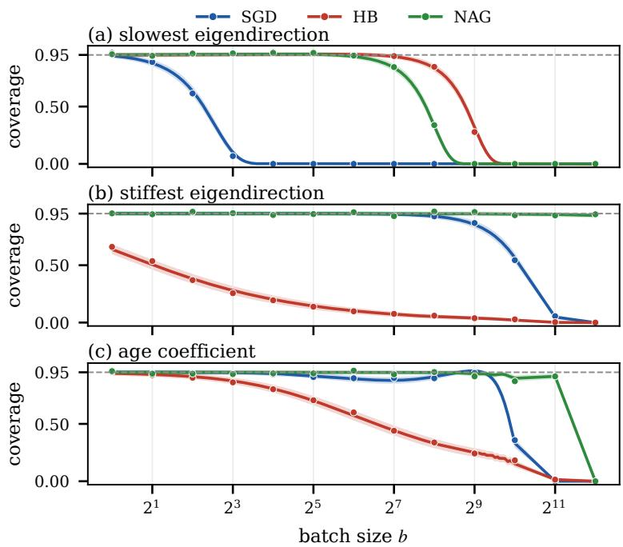
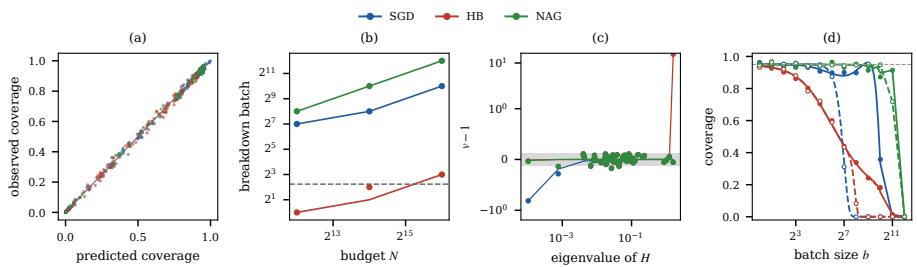
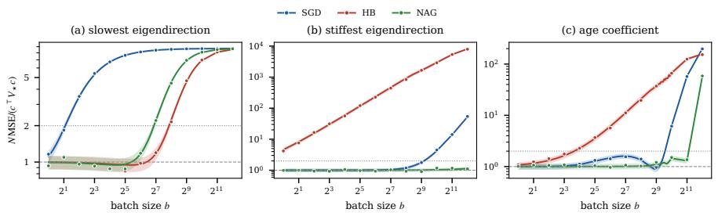
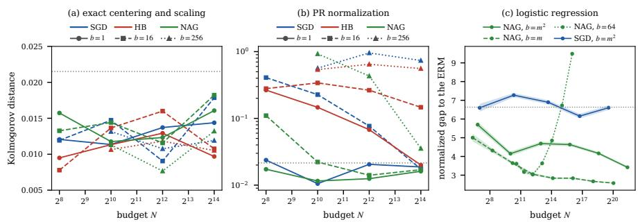

# WHEN MOMENTUM HELPS POLYAK–RUPPERT AVERAGING

Alexandra Suvoriokva Independent researcher

Darina Dvinskikh HSE University dmdvinskikh@hse.ru

Yuriy Dorn MSU AI Institute

Alexander Gasnikov Innopolis University

## ABSTRACT

Polyak–Ruppert averaging gives SGD and momentum methods the same asymptotic covariance. We characterize how fast finite runs reach it and how far they can be parallelized. For strongly convex quadratics with additive noise, we prove an online–offline bridge: the empirical risk minimizer on the samples of a tail average is one Newton step from the tail-averaged query point of any online procedure. For SGD, heavy ball, and Nesterov’s method with constant momentum, this step is a boundary term at the two ends of the tail and splits the gap to the offline estimator into center, covariance, and shape errors. Necessary and sufficient conditions show that, on the least curved direction, the center error sets the pace: SGD needs $m \gg \kappa ^ { 2 }$ rounds but momentum only m ≫ $\kappa ,$ where κ is the condition number, so at sample size N the critical batch size grows from $\Theta ( \sqrt { N } / \kappa )$ to $\Theta ( \sqrt { N / \kappa } )$ . The covariance error separates the momentum methods: heavy ball has relative variance excess $\Theta ( \kappa ^ { 3 / 2 } / m )$ along the stiffest direction, whereas Nesterov has relative error $O ( \sqrt { \kappa } / m )$ in every direction. The shape error is method-independent by a Berry–Esseen bound uniform in κ and batch size, so confidence intervals are valid when the other two errors vanish. We further examine how the conclusions change under heavy-tailed or state-dependent noise and clipping, and establish a first-order comparison with ERM for nonlinear Nesterov averaging under explicit conditions.

## 1 Introduction

Averaging connects stochastic optimization with statistical estimation. Under suitable conditions, an averaged trajectory has an asymptotically Gaussian error with the Polyak–Ruppert covariance, providing a basis for confidence sets as well as point estimates (Polyak and Juditsky, 1992). Yet a limiting law does not specify how many updates are necessary before it accurately describes the output of an algorithm. The distinction matters when observations are processed in large batches: at a fixed sample budget, larger batches leave fewer updates for the algorithm to approach its asymptotic regime. This makes the transient behavior of the method central to statistical inference. Momentum can shorten the persistence of initialization, suggesting that it could make the limiting approximation accurate earlier. However, it also changes how gradient noise accumulates along the trajectory, so faster decay of initialization does not guarantee this benefit. We therefore ask: Does momentum reduce the number of updates neededfor the asymptotic distribution to accurately describe the averaged output?

Answering this question requires separating three properties of the output: its initialization bias should be negligible on the statistical scale, its covariance should match the target covariance, and its centered, standardized law should be close to Gaussian.

The question builds on several established lines of work. Analyses of averaged linear stochastic approximation characterize asymptotic covariance and nonasymptotic concentration (Mou et al., 2020a).Gaussian approximation and bootstrap methods provide finite-sample inference for averaged stochastic approximation and SGD (Samsonov et al., 2024; Sheshukova et al., 2026); in particular, approximating the finite-sample distribution can be more accurate than using the limiting covariance. Complementary analyses quantify the trade-off between acceleration and noise amplification (Mohammadi et al., 2021), including the effect of averaging on heavy-ball dynamics (Samuelson and Jovanovic´, 2024). Our focus is on when the initialization bias becomes negligible relative to statistical fluctuations and the covariance of the averaged output matches its asymptotic prediction up to a small relative error.

We study constant-parameter SGD, heavy ball (HB), and Nesterov’s accelerated gradient method (NAG) on strongly convex quadratics with Hessian H, extreme eigenvalues $\mu , L ,$ , and condition number $\kappa = L / \mu$ . The additive oracle noise is independent and centered, with covariance $\Sigma .$ From $N = m b$ observations in m batches of size $b ,$ each method returns the average xb of its query points. We derive the pathwise representation

$$
\widehat { x } - x _ { \star } = \underbrace { - H ^ { - 1 } \bar { \xi } } _ { \widehat { x } ^ { \mathrm { E R M } } - x _ { \star } } + R ,
$$

where $\bar { \xi }$ is the sample noise mean, $\widehat { x } ^ { \mathrm { E R M } }$ is the empirical minimizer on the same observations, and $R$ is an explicit method-dependent boundary term involving only trajectory endpoints. The resulting finite-window laws separate initialization bias, covariance corrections, and Gaussian approximation error.

Contribution. Our main contributions are as follows.

• Bias and variance thresholds. For full averages from a common deterministic start, we give necessary and sufficient conditions for negligible bias on the statistical scale and vanishing relative variance error in the least-curved eigendirection. Let $v _ { \mu }$ be a unit eigenvector of H corresponding to $\mu ,$ and set $\begin{array} { r } { \theta : = \frac { \mu v _ { \mu } ^ { \top } ( x _ { 0 } - x _ { \star } ) } { \sigma _ { \mu } } } \end{array}$ $\sigma _ { \mu } ^ { 2 } : = v _ { \mu } ^ { \top } \Sigma v _ { \mu } > 0 .$ . These conditions yield the following thresholds (Section 3).

Table 1: Calibration thresholds on the least-curved direction for full averages from a deterministic start.
<table><tr><td>Criterion in the  $\mu$  direction</td><td>SGD</td><td>HB</td><td>NAG</td></tr><tr><td>Vanishing relative variance error</td><td> $m \gg \kappa$ </td><td> $m \gg \sqrt { \kappa }$ </td><td> $m \gg \sqrt { \kappa }$ </td></tr><tr><td>Negligible normalized bias and relative variance error,  $b = 1 .$  fixed  $\theta \neq 0$ </td><td> $m \gg \kappa ^ { 2 }$ </td><td> $m \gg \kappa$ </td><td> $m \gg \kappa$ </td></tr><tr><td>Initialization-induced batch scale at fixed  $N ,$  up to</td><td> $\sqrt { N }$ </td><td> $\sqrt { N }$ </td><td> $\sqrt { N }$ </td></tr><tr><td>constants</td><td> $\overline { { | \theta | \kappa } }$ </td><td> $\overline { { | \theta | \sqrt { \kappa } } }$ </td><td> $\overline { { | \theta | \sqrt { \kappa } } }$ </td></tr></table>

• Uniform Gaussian approximation. Under a finite third-moment assumption, we prove an $O ( N ^ { - 1 / 2 } )$ Kolmogorov bound for the least-curved projection after centering and scaling, uniformly in κ and b. Approximation by the Polyak–Ruppert law additionally incurs an initialization term and a variance correction of order $\kappa / m$ for SGD and $\sqrt { \kappa } /$ m for HB and NAG. This decomposition quantifies coverage errors and identifies which terms acceleration improves (Section 3).

• A spectral separation between HB and NAG. For the stated HB tuning, the relative variance in the mostcurved direction is $1 + \kappa ^ { 3 / 2 } ( 1 + o ( 1 ) ) / ( 8 m )$ as $\kappa  \infty$ and $m / \sqrt { \kappa }  \infty ;$ calibration there requires m $\gg \kappa ^ { 3 / 2 }$ . For the stated NAG tuning, the relative variance error is at most $3 0 \sqrt { \kappa } / m$ uniformly over Hessian eigendirections, with a matching-order correction in the least-curved direction (Section 4).

• Extensions to heavy tails and nonlinear objectives. We derive conditions under which the normalized averaged output converges to the same stable law as the ERM in the scalar model, and show that finite variance alone does not guarantee uniformly valid sub-Gaussian confidence bounds centered at the ERM or at the averaged algorithmic output. For smooth strongly convex objectives with additive noise and a Lipschitz Hessian, a trajectory-dependent remainder extends the online–offline comparison. Under explicit burn-in and batch-growth conditions, tail-averaged NAG is first-order equivalent to the ERM at the same total observation budget. (Section 5).

The sharp thresholds concern full averages from a cold start under the specified parameter policies. Burn-in and tail averaging can change these thresholds; the NAG constants refer to averages of query points. The resulting comparison therefore makes the output rule, initialization, and spectral direction explicit when assessing the statistical benefit of acceleration.

Organization. Section 2 specifies the model, algorithms, output, and same-data ERM benchmark, while Sections 3 and 4 develop the finite-budget calibration criteria and spectral comparison. Section 5 treats heavy-tailed noise and nonlinear objectives, Section 6 reports the experiments, and the appendix contains proofs, auxiliary results, and extended experimental details.

## 2 Problem Statement

This section specifies the common model, algorithms, output, and same-data ERM benchmark.

We study averaged stochastic first-order methods on

$$
\begin{array} { r } { f ( x ) : = \frac { 1 } { 2 } \left. x - x _ { \star } , H ( x - x _ { \star } ) \right. , } \end{array}\tag{1}
$$

where $H = H ^ { \mathsf { T } } \succ 0 , 0 < \mu \leq L , \mu I \preceq H \preceq L I$ , and $\kappa : = L / \mu$ . In comparisons on the extreme eigendirections, µ and $L$ denote the smallest and largest eigenvalues of the original Hessian. The oracle returns $G ( x , \zeta ) = \overset { \cdot } { H } ( x - x _ { \star } ) + \xi ( \zeta )$ Assumption 2.1 (Additive noise). Unless stated otherwise, all copies of $\begin{array} { r } { \xi : = \xi ( \zeta ) } \end{array}$ are independent, with $\mathbb { E } \xi = 0$ and finite covariance Σ.

Batching and methods. At round k, a batch of $b \geq 1$ samples gives $\begin{array} { r } { \eta _ { k + 1 } ^ { ( b ) } : = b ^ { - 1 } \sum _ { j = 1 } ^ { b } \xi _ { k + 1 , j } } \end{array}$ , with covariance $\Sigma / b$ The method queries the oracle at a point $s _ { k }$ and receives the batch-averaged answer $\begin{array} { r } { g _ { k } : = b ^ { - 1 } \sum _ { j = 1 } ^ { b } G ( s _ { k } , \zeta _ { k + 1 , j } ) } \end{array}$ The two-step family computes

$$
s _ { k } = x _ { k } + \gamma ( x _ { k } - x _ { k - 1 } ) , \ x _ { k + 1 } = x _ { k } + \beta ( x _ { k } - x _ { k - 1 } ) - \alpha g _ { k } ,
$$

with constant $\alpha > 0 , \beta \in [ 0 , 1 )$ , and $\gamma \geq 0$ . SGD has $( \beta , \gamma ) = ( 0 , 0 )$ , HB has $\gamma = 0$ , and NAG has $\gamma = \beta$ . The parameter policies used in the comparison are given in Theorem B.2. Writing $e _ { k } : = x _ { k } - x ,$ ⋆ and $u _ { k } : = s _ { k } - x _ { \star }$ , so that $g _ { k } = H u _ { k } + \eta _ { k + 1 } ^ { ( b ) }$ , we get the error recursion,

$$
u _ { k } = e _ { k } + \gamma ( e _ { k } - e _ { k - 1 } ) ,\tag{2}
$$

$$
e _ { k + 1 } = e _ { k } + \beta ( e _ { k } - e _ { k - 1 } ) - \alpha \big ( H u _ { k } + \eta _ { k + 1 } ^ { ( b ) } \big ) .\tag{3}
$$

Unless stated otherwise, all methods use the same deterministic start with $e _ { - 1 } = e _ { 0 }$ , and parameters and averaging windows are fixed before observing the noise. We write $\mathcal { F } _ { k } : = \sigma ( \xi _ { i , j } : i \leq k , 1 \leq j \leq b )$ ; thus $u _ { k }$ is $\mathcal { F } _ { k }$ -measurable and $\eta _ { k + 1 } ^ { ( b ) }$ is independent of $\mathcal { F } _ { k }$

Output and comparison. We define the output by averaging the points $s _ { k }$ at which the stochastic gradients are evaluated. For $m \geq 1$ and $t \geq 0$ , the resulting estimator of $x _ { \star }$ is

$$
\widehat { x } _ { t , m } : = \frac { 1 } { m } \sum _ { k = t } ^ { t + m - 1 } s _ { k } , \widehat { x } _ { t , m } - x _ { \star } = \bar { u } _ { t , m } : = \frac { 1 } { m } \sum _ { k = t } ^ { t + m - 1 } u _ { k } .
$$

Here $t = 0$ gives a full average from a cold start, while $t > 0$ gives tail averaging after t burn-in rounds. For SGD and HB, $s _ { k } = x _ { k }$ , so this output coincides with the iterate average. For $\mathrm { N A G }$ , it averages the extrapolated query points and satisfies

$$
\widehat { x } _ { t , m } = \frac { 1 } { m } \sum _ { k = t } ^ { t + m - 1 } x _ { k } + \frac { \gamma } { m } ( x _ { t + m - 1 } - x _ { t - 1 } ) .
$$

All finite-time NAG constants below refer to the query-point average $\widehat { x } _ { t , m }$

Offline reference. Let $N \quad : = \ m b$ The offline reference is the minimizer $\widehat { x } _ { t , m } ^ { \mathrm { E R M } }$ of the cumulative loss $\begin{array} { r } { \frac { 1 } { N } \sum _ { k = t } ^ { t + m - 1 } \sum _ { j = 1 } ^ { b } \ell ( x , \xi _ { k + 1 , j } ) } \end{array}$ , with $\ell ( x , \xi ) : = f ( x ) + \langle \xi , x \rangle$

$$
\widehat { x } _ { t , m } ^ { \mathrm { E R M } } - x _ { \star } = - \frac { H ^ { - 1 } } { m } \sum _ { k = t } ^ { t + m - 1 } \eta _ { k + 1 } ^ { ( b ) } .
$$

Its covariance is $V _ { \star } / N$ , where $V _ { \star } : = H ^ { - 1 } \Sigma H ^ { - 1 }$ is the Polyak–Ruppert (PR) covariance. The last batch $\eta _ { t + m } ^ { ( b ) }$ is included in this ERM and in $N$ , although it does not affect $\widehat { x } _ { t , m }$ . This benchmark uses the empirical risk, whereas the online methods only see batch-averaged gradients at their query points.

We call a method stable ${ \mathrm { i f } } ,$ in the absence of noise, its iterates $x _ { k }$ converge to $x _ { \star }$ for every initial point; for the stated parameter range this holds if and only if $\alpha \lambda _ { \mathrm { m a x } } ( H ) ( 1 + 2 \gamma ) < 2 ( 1 + \beta )$ . Appendix A provides the details.

## 2.1 Averaged SGD: bounds and risk

Consider SGD with $0 \textless \alpha \leq 1 / L$ , a deterministic start satisfying $\| x _ { 0 } - x _ { \star } \| \le R _ { 0 }$ , and the averaged output $\begin{array} { r } { \widehat { x } : = \widehat { x } _ { 0 , m } = m ^ { - 1 } \sum _ { k = 0 } ^ { m - 1 } x _ { k } } \end{array}$ . Let $N = m b , \sigma ^ { 2 } : = \operatorname { t r } \Sigma$ , and $\mathcal { R } _ { m , b } : = \mathbb { E } \| \widehat { \boldsymbol { x } } - \boldsymbol { x } _ { \star } \| ^ { 2 }$ . A descent argument and quadratic contraction, respectively, yield

$$
\mathcal R _ { m , b } \leq { \cal U } _ { m , b } ^ { \mathrm { d a } } : = \frac { { \cal R } _ { 0 } ^ { 2 } } { \alpha \mu m } + \frac { \alpha \sigma ^ { 2 } } { \mu b } ,\tag{4a}
$$

$$
\mathcal { R } _ { m , b } \leq U _ { m , b } ^ { \mathrm { q u c } } : = \frac { R _ { 0 } ^ { 2 } } { \alpha ^ { 2 } \mu ^ { 2 } m ^ { 2 } } + \frac { \sigma ^ { 2 } } { \mu ^ { 2 } N } .\tag{4b}
$$

Both inequalities concern the same estimator. At fixed α and $b ,$ the first leaves a noise term independent of $m ,$ , whereas the second captures its $1 / N$ decay.

Both bounds summarize the problem through scalar parameters and therefore lose information about the relative orientation of $H , \Sigma ,$ , and $e _ { 0 }$ . For example, fixing $H$ and $e _ { 0 }$ and placing the same noise variance along a $\mu \cdot$ -eigendirection instead of an L-eigendirection leaves the bias and both bounds unchanged. Nevertheless, the ratio of the resulting variance contributions tends to $\kappa ^ { 2 }$ as $m  \infty$ at fixed κ (Theorem D.2).

The MSE, its second-order expansion, and a refined finite-window contraction bound are given in Appendix D.1. The refined bound equals the supremum of the risk over the class specified by the scalar parameters (Theorem D.3). Thus, worst-case sharpness is compatible with substantial differences between individual problems sharing those parameters.

From risk to the output distribution. For either upper bound U, Markov’s inequality gives a valid confidence ball with radius $\sqrt { U / \delta }$ at level $1 - \delta$ . However, agreement with the ERM risk does not ensure agreement of the mean and covariance separately, since

$$
\mathcal { R } _ { m , b } = \| \mathbb { E } \widehat { x } - x _ { \star } \| ^ { 2 } + \mathrm { t r } \mathrm { C o v } ( \widehat { x } ) .
$$

Squared bias can compensate for a variance deficit, even when the relative risk equals one (Section 3). We therefore analyze the finite-window laws of the averaged outputs, separating initialization bias, covariance error, and Gaussian approximation error.

## 3 Bias, variance, and Gaussian approximation

The exact online–offline bridge reduces finite-window calibration to the analysis of a scalar response sequence. We first obtain sharp conditions for center and variance calibration on the least-curved direction, then separate these effects from Gaussian approximation error.

For every trajectory of Equation (3) and all $t \ge 0 , m \ge 1$ , Theorems A.1 and $\mathrm { A } . 2$ ensure

$$
\widehat { x } _ { t , m } - \widehat { x } _ { t , m } ^ { \mathrm { E R M } } = \frac { H ^ { - 1 } \Delta _ { t , m } } { \alpha m } ,\tag{5}
$$

$$
\Delta _ { t , m } : = e _ { t } - e _ { t + m } + \beta ( e _ { t + m - 1 } - e _ { t - 1 } )\tag{6}
$$

Hence, for i.i.d. noise and every member of the family, $\sqrt { N } \bar { u } _ { t , m } \Rightarrow \mathcal { N } ( 0 , V _ { \star } )$ whenever $\sqrt { b / m } \Delta _ { t , m } \to 0$ in probability (Theorem A.1). Under constant noise, every stable member would settle at the same point $x _ { \star } - H ^ { - 1 } \eta ;$ the endpoint term carries everything that depends on how a method gets there. Proofs and further results are in Sections A.1, B.1 and B.3.

The least-curved direction. Let $v _ { \mu }$ be a unit eigenvector of H for the eigenvalue $\mu ,$ and set

$$
\sigma _ { \mu } ^ { 2 } : = v _ { \mu } ^ { \mathsf { T } } \Sigma v _ { \mu } , \theta : = \frac { \mu v _ { \mu } ^ { \mathsf { T } } e _ { 0 } } { \sigma _ { \mu } } , Z _ { m } : = \frac { \mu \sqrt { N } } { \sigma _ { \mu } } v _ { \mu } ^ { \mathsf { T } } \bar { u } _ { 0 , m } .
$$

Since $v _ { \mu } ^ { \intercal } H = \mu v _ { \mu } ^ { \intercal }$ , the projection $v _ { \mu } ^ { \mathsf { T } } e _ { k }$ follows the scalar recursion with curvature $\mu ,$ driven by independent noises of variance $\sigma _ { \mu } ^ { 2 } .$ . Let $r _ { j }$ be the noiseless response of the oracle to a unit start: $r _ { j } : = u _ { j } ^ { \circ }$ , where $e _ { - 1 } ^ { \circ } = e _ { 0 } ^ { \circ } = 1$ and

$$
u _ { j } ^ { \circ } = e _ { j } ^ { \circ } + \gamma ( e _ { j } ^ { \circ } - e _ { j - 1 } ^ { \circ } ) , \quad e _ { j + 1 } ^ { \circ } = e _ { j } ^ { \circ } + \beta ( e _ { j } ^ { \circ } - e _ { j - 1 } ^ { \circ } ) - \alpha \mu u _ { j } ^ { \circ } .
$$

By linearity, a start $v _ { \mu } ^ { \mathsf { T } } e _ { 0 }$ yields the noiseless oracle points $( v _ { \mu } ^ { \mathsf { T } } e _ { 0 } ) r _ { j }$ . Set

$$
S _ { m } : = \sum _ { j < m } r _ { j } , \qquad Q _ { m } : = \sum _ { j < m } r _ { j } ^ { 2 } , \qquad B : = \sum _ { j \ge 0 } r _ { j } .
$$

By Theorem B.1, applied to the projected recursion, for all $m , b \geq 1$

$$
v _ { \mu } ^ { \mathsf { T } } \bar { u } _ { 0 , m } = \frac { \left( v _ { \mu } ^ { \mathsf { T } } e _ { 0 } \right) S _ { m } } { m } - \frac { 1 } { \mu m b } \sum _ { s = 1 } ^ { m } \sum _ { \ell = 1 } ^ { b } ( 1 - r _ { m - s } ) v _ { \mu } ^ { \mathsf { T } } \xi _ { s , \ell } ;
$$

multiplying by $\mu \sqrt { N } / \sigma _ { \mu }$ and using N = mb gives

$$
Z _ { m } = \theta \sqrt { \frac { b } { m } } S _ { m } - \frac { 1 } { \sqrt { N } } \sum _ { s = 1 } ^ { m } \sum _ { \ell = 1 } ^ { b } ( 1 - r _ { m - s } ) \frac { v _ { \mu } ^ { \mathsf { T } } \xi _ { s , \ell } } { \sigma _ { \mu } } .\tag{7}
$$

The method enters only through $r _ { j } \colon$ through $S _ { m }$ as the memory of the start, and through the weights $1 - r _ { m - s }$ as the unfinished response to late noise.

We compare SGD with $\alpha = 1 / L ;$ HB with $\alpha = 4 / ( \sqrt { L } + \sqrt { \mu } ) ^ { 2 }$ and $\beta = ( ( \sqrt { \kappa } - 1 ) / ( \sqrt { \kappa } + 1 ) ) ^ { 2 }$ ; and NAG with $\alpha = 1 / L$ and $\beta = \gamma = ( \sqrt { \kappa } - 1 ) / ( \sqrt { \kappa } + 1 )$ . For these policies $0 \leq r _ { j + 1 } \leq r _ { j } \leq 1$ , and the memory B equals $\kappa , { \sqrt { \kappa } } ,$ and $2 \dot { \kappa } / ( \sqrt { \kappa } + 1 )$ , respectively (Theorem B.2).

Statement 3.1. For each policy, set $\begin{array} { r } { h _ { m } : = \mathbb { E } Z _ { m } = \theta \sqrt { b / m } S _ { m } , v _ { m } : = \mathrm { V a r } ( Z _ { m } ) = 1 - \frac { 2 S _ { m } - Q _ { m } } { m } } \end{array}$ . Along any sequence with $m  \infty ,$ , allowing $\kappa \geq 1 , b \geq 1$ , and θ to vary,

$$
v _ { m }  1 \iff { \frac { B } { m } }  0 ,
$$

$$
( h _ { m } , v _ { m } )  ( 0 , 1 ) \longleftrightarrow \frac { B } { m }  0 \quad a n d \quad | \theta | B \sqrt { \frac { b } { m } }  0 .
$$

Theorem B.3 presents the result in detail. Matching the PR risk is not enough: the relative risk equals $v _ { m } + h _ { m } ^ { 2 }$ , and

$$
\frac { \mathbb { E } | v _ { \mu } ^ { \mathsf { T } } \bar { u } _ { 0 , m } | ^ { 2 } } { \sigma _ { \mu } ^ { 2 } / ( \mu ^ { 2 } N ) } = v _ { m } + h _ { m } ^ { 2 } ,
$$

$$
\theta _ { m } ^ { 2 } = \frac { 2 S _ { m } - Q _ { m } } { b S _ { m } ^ { 2 } } \implies v _ { m } + h _ { m } ^ { 2 } = 1 ,
$$

also along sequences with $B / m$ bounded away from zero, where $v _ { m } \not \to 1$

Statement 3.2 (Critical batch). Assume that $v _ { \mu } ^ { \mathsf { T } } \xi _ { s , \ell } / \sigma _ { \mu }$ are i.i.d. with zero mean and unit variance. Their distribution remains fixed along the asymptotic sequence, even when κ, b, and θ vary. $\begin{array} { r } { I f N \to \infty , \frac { b B } { N } \to 0 , } \end{array}$ , and $\frac { \theta B b } { \sqrt { N } }  h \in \mathbb { R }$ then $Z _ { m } \Rightarrow \mathcal { N } ( h , 1 )$ . The $( 1 - \delta )$ intervalfor $v _ { \mu } ^ { \mathsf { T } } x ,$ centered at $v _ { \mu } ^ { \top } \widehat { x } _ { 0 , m }$ with half-width $z _ { 1 - \delta / 2 } \sigma _ { \mu } / ( \mu \sqrt { N } )$ has limiting coverage $\Phi \left( z _ { 1 - \delta / 2 } - h \right) - \Phi \left( - z _ { 1 - \delta / 2 } - h \right)$

Theorem B.5 presents the result in detail. For $\theta \neq 0$ and $m \gg B ,$ the scale $b _ { \mathrm { c r i t } } ( N ) : = \sqrt { N } / ( | \theta | B )$ marks the batch size at which the initialization bias of the averaged estimator becomes comparable to the ERM standard error along $v _ { \mu } .$ . At a fixed budget $N = m b$ , larger batches leave fewer iterations to reduce this bias, while the ERM standard error remains unchanged. Calibration therefore requires both $b \ll b _ { \mathrm { c r i t } } ( N )$ , so that the bias is negligible, and $b \ll N / B$ , so that the variance matches its PR limit. $\mathbf { A } \mathbf { t } \ b = 1$ and fixed $\theta \neq 0$ , the onset is $m \gg \kappa ^ { 2 }$ for SGD and m ≫ κ for HB and NAG. Smaller noise at a fixed start increases |θ| and therefore delays calibrated inference. Since $\theta ^ { - 2 } = v _ { u } ^ { \mathsf { T } } \Sigma v _ { \mu } / ( v _ { u } ^ { \mathsf { T } } \nabla f ( x _ { 0 } ) ) ^ { 2 }$ is a directional gradient noise scale at the initial point, $b _ { \mathrm { c r i t } }$ is the geometric mean of the observation budget and this noise scale, divided by $B ;$ in the scalar model it is the noise scale of McCandlish et al. (2018) (Theorem B.6).

Statement 3.3 (Gaussian shape versus PR calibration). Let the noises be i.i.d. with $\nu _ { 3 } : = \mathbb { E } | v _ { \mu } ^ { \mathsf { T } } \xi | ^ { 3 } / \sigma _ { \mu } ^ { 3 } < \infty$ . There is a universal constant C such that,for each ofthe three policies and all $\kappa \geq 1 , b \geq 1 , m \geq 2 ,$

$$
d _ { \mathrm { K } } \Big ( \mathscr { L } \Big ( \frac { Z _ { m } - h _ { m } } { \sqrt { v _ { m } } } \Big ) , \mathscr { N } ( 0 , 1 ) \Big ) \leq \frac { C \nu _ { 3 } } { \sqrt { N } } ,
$$

and, $i f m \geq 4 B ,$

$$
d _ { \mathrm { K } } \bigl ( \mathcal { L } ( Z _ { m } ) , \mathcal { N } ( 0 , 1 ) \bigr ) \leq \underbrace { \frac { C \nu _ { 3 } } { \sqrt { N } } } _ { G a u s s . \ a p p r o x . } + \underbrace { 2 \phi ( 1 ) \frac { B } { m } } _ { \nu a r i a n c e \ c o r r e c t i o n } + \underbrace { \frac { | h _ { m } | } { \sqrt { 2 \pi } } } _ { i n i t i a l i z a t i o n } ,\tag{8}
$$

where ϕ is the standard normal density.

This is Theorem B.7 together with Equation (91); the variance correction $B / m$ is sharp even for Gaussian noise (Theorem E.3). The coverage of the interval in Proposition 3.2 is within twice the right-hand side of Equation (8) of 1 − δ. Gaussian shape is thus uniform in κ and b; the center and the variance are the bottlenecks. These intervals use known curvature and noise scale; multivariate balls and a paid certificate for unknown H and Σ are in Section E.2.

## 4 Acceleration gains and their limits

We now compare what acceleration changes across the Hessian spectrum. Although HB and NAG have the same order of memory on the least-curved direction, their covariance transients can differ sharply on stiff directions; we also record how burn-in changes the comparison.

Substituting B into Statements 3.1, 3.2 compares the policies on the least-curved direction, for the same full-average output and cold start (see Tab. 1).

Acceleration shortens the memory from κ to order $\sqrt { \kappa }$ and enlarges the admissible batch by the same factor; it does not change the $N ^ { - 1 / 2 }$ term in Statement 3.3.

For the whole spectrum, let $( \lambda , v _ { \lambda } )$ be an eigenpair of H with $\sigma _ { \lambda } ^ { 2 } : = v _ { \lambda } ^ { \mathsf { T } } \Sigma v _ { \lambda } > 0$ , and define the relative variance

$$
v _ { m } ( \lambda ) : = \frac { N \lambda ^ { 2 } } { \sigma _ { \lambda } ^ { 2 } } \operatorname { V a r } \bigl ( v _ { \lambda } ^ { \mathsf { T } } \bar { u } _ { 0 , m } \bigr ) ,
$$

so that $v _ { m } ( \mu ) = v _ { m }$

Statement 4.1 (Heavy-ball covariance inflation). For HB with the parameters above and $\sigma _ { L } ^ { 2 } > 0 ;$

$$
v _ { m } ( L ) = 1 + \frac { \kappa ^ { 3 / 2 } } { 8 m } \{ 1 + o ( 1 ) \} \quad a s \ \kappa  \infty , \ m / \sqrt { \kappa }  \infty ,
$$

whereas SGD with $\alpha = 1 / L$ has $v _ { m } ( L ) = 1 - 1 / m$ . In this regime, covariance calibration ofHB on this direction is equivalent to $m / \kappa ^ { 3 / 2 } \to \infty$

Theorem B.9 provides the detail. For example, at $m = \kappa$ and $b = 1$ the stiff-mode HB variance ratio diverges as ${ \sqrt { \kappa } } / 8 ,$ while the least-curved HB mode is already close to its PR variance. A Frobenius error weighted by $H ^ { - 1 } \Sigma H ^ { - 1 }$ can hide this, because the stiff-mode PR variance is smaller by a factor $\kappa ^ { 2 }$ when the gradient-noise variances are equal. General noise-amplification tradeoffs (Mohammadi et al., 2021, 2025) and the sign of averaged HB modal corrections (Samuelson and Jovanovic´, 2024, Theorem 3) are known; the precise averaged-output formula and its relation to the onset criteria are the point of this counterexample.

Statement 4.2 (Uniform spectral calibration of NAG). For NAG with the parameters above and every $m , b \geq 1$

$$
\operatorname* { s u p } _ { \lambda : \sigma _ { \lambda } ^ { 2 } > 0 } | v _ { m } ( \lambda ) - 1 | \leq \frac { 3 0 \sqrt { \kappa } } { m } ,
$$

and $\begin{array} { r } { 1 - v _ { m } ( \mu ) \sim \frac { 1 1 } { 4 } \sqrt { \kappa } / m } \end{array}$ as κ → ∞ and $m / \sqrt { \kappa }  \infty$

Theorem B.10 provides the result in detail.

Arbitrary directions with noncommuting noise. The result admits a matrix extension. If $\Sigma \succ 0$ and $\chi _ { \Sigma } =$ $\lambda _ { \operatorname* { m a x } } ( \Sigma ) \bar { / } \lambda _ { \operatorname* { m i n } } ( \Sigma )$ , then for the same NAG output

$$
\operatorname* { s u p } _ { c \neq 0 } \left. \frac { N \mathrm { \mathop { V a r } } ( c ^ { \mathsf { T } } \widehat { x } _ { 0 , m } ) } { c ^ { \mathsf { T } } V _ { \star } c } - 1 \right. \leq ( 1 8 \chi _ { \Sigma } + 6 \sqrt { \chi _ { \Sigma } } ) \frac { \sqrt { \kappa } } { m } .
$$

In particular, the error is $O ( \sqrt { \kappa } / m )$ in every direction when the noise condition number remains bounded. Theorem D.5 gives the sharper comparison with any positive definite matrix commuting with H, and Theorem D.6 shows why unrestricted noise geometry cannot admit a universal constant

If H and Σ commute, the same bound holds in every direction with positive PR variance. All these thresholds concern full averages from a cold start. Section E.3 compares full averaging, tail averaging, and switching to SGD at a common budget $N ^ { \prime }$ , keeping the random state after burn-in. Burn-in can improve the cold-start threshold, so the threshold is not intrinsic to momentum alone, and there is no automatic ranking between continuing accelerated tail averaging and switching to SGD.

What burn-in changes. For a deterministic zero-velocity start $x _ { - 1 } = x _ { 0 }$ , the retained average has mean

$$
\mathbb { E } \big [ \boldsymbol { v } _ { \mu } ^ { \mathsf { T } } ( \widehat { \boldsymbol { x } } _ { t , m } - \boldsymbol { x } _ { \star } ) \big ] = \frac { \boldsymbol { v } _ { \mu } ^ { \mathsf { T } } \boldsymbol { e } _ { 0 } } { m } \sum _ { j = t } ^ { t + m - 1 } \boldsymbol { r } _ { j } .\tag{9}
$$

Full averaging uses the prefix $S _ { m } ;$ tail averaging instead uses the decaying tail of the initialization response. This explains how burn-in can reduce the cold-start bias. However, the state at round t is random: its covariance should be propagated through the retained window and added to the contribution of the subsequent noises, as in Equation (95). Counting all observations gives $N ^ { \prime } = ( t + m ) b .$ , so calibration to the retained-window covariance $V _ { \star } / ( \bar { m } b )$ need not imply efficiency relative to the all-sample ERM, whose covariance is $V _ { \star } / N ^ { \prime }$ . The full covariance formulas and the comparison with switching to SGD remain in Section E.3.

## 5 Extensions: heavy tails and nonlinearity

We next examine how the calibration picture changes beyond finite-variance additive quadratics. We treat heavy-tailed noise first and then extend the online–offline comparison to smooth strongly convex nonlinear objectives.

## 5.1 Heavy tails

In the quadratic model, the ERM error $\mathrm { i s } - H ^ { - 1 } \bar { \eta } _ { t , m } ^ { ( b ) }$ , so every deviation bound for the empirical noise mean applies verbatim to the offline estimator, and by Equation (6) the online output adds only the endpoint term (Theorem F.1). Heavy tails thus act on the statistical term identically online and offline; the two differ in the robustifications they admit.

<table><tr><td>Condition on the noise</td><td>Available result</td></tr><tr><td>Finite third moment</td><td>Uniform normal approximation (Theorem B.7).</td></tr><tr><td>Finite variance only</td><td>CLT with centering and variance (Theorem B.8); no sub-Gaussian radius uniformly over the class (Theorem F.2).</td></tr><tr><td>Strictly stable noise</td><td>stable law and calibration criteria (Theorem F.4).</td></tr><tr><td>Stable domain of attraction</td><td>Stable limit with the correct normalizer, under a boundary condition (Theorem F.3).</td></tr></table>

Statement 5.1 (High-confidence limit). In the scalar model with curvature µ and centered i.i.d. noise ofvariance $\sigma ^ { 2 }$ let $N = m b$ . For every N and $\delta \in ( 0 , 1 / 8 ]$ there is a symmetric noise law with variance $\sigma ^ { 2 }$ such that $\mathbb { P } \{ | \check { x } ^ { \mathrm { E R M } } - x _ { \star } | \geq$ $\sigma / ( \mu \sqrt { 2 N \delta } ) \} \geq \delta$ . For thefull averages ofthe three policies started at $e _ { 0 } = 0$ with $m \geq 4 B ,$ , and every $\delta \in ( 0 , 1 / 1 6 ]$ there is such a law with $\mathbb { P } \{ | \bar { u } _ { 0 , m } | \geq \sigma / ( 4 \mu \sqrt { N \delta } ) \} \geq \delta .$

Theorem F.2 provides the detail. Hence no ball of sub-Gaussian radius centered at the ERM or at the averaged output is valid uniformly over the finite-variance class. A one-pass estimator that clips full gradients at a fixed query does not have this obstruction: with known H and moment bounds, its radius depends on δ only through $\sqrt { \log ( 2 d / \delta ) }$ (Theorem F.6). Along a moving trajectory, clipping yields a CLT under checkable conditions on the clipping bias, the boundary, and the conditional covariance (Theorem F.7); clipping, however, leaves the stochastically linear class, and its offline counterpart is a Huber-type M- or Z-estimator rather than a clipped empirical risk (Theorem F.8).

Statement 5.2 (Calibration under strictly stable noise). In the scalar model, let the noises be i.i.d. symmetric α -stable with $1 < \alpha _ { 0 } < 2$ and scale $\sigma _ { \alpha _ { 0 } } ,$ let $Z _ { \alpha _ { 0 } }$ be standard symmetric α0-stable, and put $\theta _ { \alpha _ { 0 } } = \mu e _ { 0 } / \sigma _ { \alpha _ { 0 } } .$ . For any two-step parameters and all $m , b \geq 1$

$$
\begin{array} { r l } & { \frac { \mu N ^ { 1 - 1 / \alpha _ { 0 } } } { \sigma _ { \alpha _ { 0 } } } \bar { u } _ { 0 , m } \overset { d } { = } h _ { m } ^ { ( \alpha _ { 0 } ) } + \Bigl ( \frac { 1 } { m } \sum _ { j < m } | 1 - r _ { j } | ^ { \alpha _ { 0 } } \Bigr ) ^ { 1 / \alpha _ { 0 } } Z _ { \alpha _ { 0 } } , } \\ & { h _ { m } ^ { ( \alpha _ { 0 } ) } : = \theta _ { \alpha _ { 0 } } S _ { m } b ^ { 1 - 1 / \alpha _ { 0 } } m ^ { - 1 / \alpha _ { 0 } } . } \end{array}
$$

For the three policies, along any sequence with $m  \infty ,$ , allowing κ, b, and $\theta _ { \alpha _ { 0 } }$ to vary, the scalefactor tends to one if and only $i f B / m  0 \rangle$ , and the output is calibrated if and only if, in addition, $\tilde { | \theta } _ { \alpha _ { 0 } } | B b ^ { 1 - 1 / \alpha _ { 0 } } m ^ { - 1 / \alpha _ { 0 } } \to 0$

Theorem F.4 provides the details.

For the onset comparison below, keep $\theta _ { \alpha _ { 0 } } \neq 0$ fixed, as in the corresponding specialization of Theorem F.4.

Consequently, at $b = 1$ the onset is m $\gg \kappa ^ { \alpha _ { 0 } }$ for SGD and $m \gg \kappa ^ { \alpha _ { 0 } / 2 }$ for HB and NAG, and the critical batch becomes $N ^ { 1 / \alpha _ { 0 } } / ( | \theta _ { \alpha _ { 0 } } | B )$ . Heavier tails lower the onset and raise the critical batch, because the statistical scale $N ^ { 1 / \alpha _ { 0 } - 1 }$ decays more slowly, although the accuracy is worse. Mean-square guarantees carry no information in this regime, whereas the law yields calibrated intervals from stable quantiles when $\alpha _ { 0 }$ and $\sigma _ { \alpha _ { 0 } }$ are known.

## 5.2 Nonlinear objectives

Let $f \in C ^ { 2 }$ be µ-strongly convex with an M -Lipschitz Hessian, and let the oracle be $G ( x , \zeta ) = \nabla f ( x ) + \xi ( \zeta )$ . For any online procedure that queries $s _ { t } , \ldots , s _ { t + m - 1 }$ and returns their average $\widehat { x } _ { t , m }$ , with g¯ the average of the observed gradients and $\widehat { H } = \nabla ^ { 2 } f ( \widehat { x } _ { t , m } ^ { \mathrm { E R M } } )$ , pathwise

$$
\lVert \widehat { \boldsymbol { x } } _ { t , m } - \widehat { \boldsymbol { H } } ^ { - 1 } \bar { \boldsymbol { g } } - \widehat { \boldsymbol { x } } _ { t , m } ^ { \mathrm { E R M } } \rVert \leq \frac { M _ { 2 } } { 2 \mu m } \sum _ { k = t } ^ { t + m - 1 } \lVert \boldsymbol { s } _ { k } - \widehat { \boldsymbol { x } } _ { t , m } ^ { \mathrm { E R M } } \rVert ^ { 2 }
$$

(Theorem C.1). For $M _ { 2 } = 0$ the right-hand side vanishes, which is the quadratic bridge behind Equation (6). Momentum and step policies enter the gap only through the spread of the queries, which for constant parameters is governed by the noise amplification of the method (Mohammadi et al., 2021); the right-hand side is the online–offline counterpart of the stationary bias of constant-step SGD (Dieuleveut et al., 2020).

Statement 5.3 (First-order ERM equivalence for averaged NAG). Assume, globally, $\mu I \preceq \nabla ^ { 2 } f \preceq$ LI with $0 < \mu < L$ and an $M _ { 2 } – L i p s c h i t z$ Hessian, and let the noises be i.i.d. centered with covariance Σ and $0 < \sigma ^ { 2 } = \mathrm { t r } \Sigma < \infty .$ . Fix f, the noise law, the dimension, and x0. Run NAG with the parameters above from $x _ { - 1 } = x _ { 0 } f o r t + m$ rounds, where $\begin{array} { r } { t = \left\lceil \sqrt { \kappa } \log \left( 1 + \frac { b L \mathcal { V } _ { 0 } } { \sigma ^ { 2 } \sqrt { \kappa } } \right) \right\rceil , \mathcal { V } _ { 0 } = f ( x _ { 0 } ) - f ( x _ { \star } ) + \frac { \mu } { 2 } \| x _ { 0 } - x _ { \star } \| ^ { 2 } . L e t N ^ { \prime } = ( t + m ) b , } \end{array}$ let $\widehat { x } _ { N ^ { \prime } } ^ { \mathrm { E R M } }$ be the ERM on all $N ^ { \prime }$ observations, and let $\dot { H } = \nabla ^ { 2 } f ( x _ { \star } )$ . Along any sequence with $m  \infty , m / b  0$ , and log $b = o ( m )$

$$
\begin{array} { r l } & { \sqrt { N ^ { \prime } } \bigl ( \widehat { x } _ { t , m } - \widehat { x } _ { N ^ { \prime } } ^ { \mathrm { E R M } } \bigr ) \longrightarrow 0 \quad i n L ^ { 1 } , } \\ & { \qquad \sqrt { N ^ { \prime } } \bigl ( \widehat { x } _ { t , m } - x _ { \star } \bigr ) \Rightarrow \mathcal { N } ( 0 , H ^ { - 1 } \Sigma H ^ { - 1 } ) . } \end{array}
$$

The three costs of nonlinear averaging. For the burn-in, $m \geq { \sqrt { \kappa } }$ and $t \leq m$ , the explicit bound in Equation (56) simplifies to

$$
\frac { \mu \sqrt { N ^ { \prime } } } { \sigma } \mathbb { E } \big \| \widehat { x } _ { t , m } - \widehat { x } _ { N ^ { \prime } } ^ { \mathrm { E R M } } \big \| \lesssim \underbrace { \frac { \kappa ^ { 1 / 4 } } { \sqrt { m } } } _ { \mathrm { e n d p o i n t } } + \underbrace { \frac { M _ { 2 } \sigma \sqrt { \kappa } } { \mu L } } _ { \mathrm { n o n l i n e a r i t y } } \sqrt { \frac { m } { b } } _ { } + \underbrace { \sqrt { \frac { t } { m } } } _ { \mathrm { b u r n - i n ~ c o s t } } .\tag{10}
$$

The hidden constant is universal. The endpoint contribution becomes small once m $\gg \sqrt { \kappa } ,$ exhibiting the accelerated memory scale. The nonlinear contribution requires $m / b $ 0 for a fixed problem. Finally, the last term pays for the observations omitted from the average but included in the all-sample ERM. Since the prescribed burn-in is $\bar { O } ( \bar { 1 } + \log b )$ for a fixed problem, log $b = o ( m )$ makes this cost vanish. These three terms explain the conditions of Statement 5.3; the bound with constants is retained in the appendix.

This is Theorem C.3; Theorem C.2 gives an explicit nonasymptotic bound on $\mathbb { E } \Vert \widehat { x } _ { t , m } - \widehat { x } _ { N ^ { \prime } } ^ { \mathrm { E R M } } \Vert$ . The class includes the regularized Bernoulli logistic loss, for which the ERM is the usual regularized empirical minimizer (Section C.2). With multiplicative noise, the local covariance at the solution no longer determines the covariance accumulated along the trajectory: fixed-step SGD already acquires a covariance correction (Theorem G.2), and over oracles of arbitrary multiplicative intensity the risk of the two-step family is not bounded by local quantities (Theorem $_ { \mathrm { G . 4 ) ; } }$ a second-moment recursion certifies a burn-in for SGD, HB, and NAG (Theorem G.3). Diminishing-gain and increasing momentum transfers, conditional on moment bounds, and the comparison with Richardson–Romberg extrapolation are in Sections G.2 and G.3.

## 6 Numerical Experiments

We test the predicted center and covariance transitions in a controlled finite-population study based on Census income data. Holding the observation budget fixed, we compare finite-sample coverage predictions with Monte Carlo coverage as the batch size varies

Setup. We treat the continuous-income UCI Adult reconstruction of Ding et al. (2021) as a finite population of 49,531 persons with $d = 4 4$ encoded covariates. $\mathrm { \ A \ 1 0 ^ { 4 } } .$ -person pilot fits the predictor used to construct a prediction-powered, stochastically linear ridge oracle; subsequent calls sample records uniformly with replacement. At the selected ridge level, $\kappa = \mathrm { 1 . 5 \times 1 0 ^ { 4 } }$ . Using the policies of Section 2, we evaluate nominal-95% PR intervals over 500 replicates at $N = 2 ^ { 1 6 }$ and $b \in \{ 2 ^ { 0 } , \dots , \bar { 2 } ^ { 1 2 } \}$ . Predictions use finite-sample moments, not fitted simulation outputs. The pilot and population geometry are oracle resources; Section H gives the full protocol and other ridge levels.

Throughout the linear experiments, the output is the full query-point average $\widehat { x } _ { 0 , m }$ , the observation budget is $N = m b ,$ and $V _ { \star } = H ^ { - 1 } \Sigma H ^ { - 1 }$ , as in Section 2. For a fixed contrast $c \in \mathbb { R } ^ { d }$ with $c ^ { \mathsf { T } } V _ { \star } c > 0$ , we infer $c ^ { \mathsf { T } } x _ { \star } \colon c = v _ { \mu }$ in panel (a), $c = v _ { L }$ in panel (b), and c is the coordinate vector selecting the age coefficient in panel (c).

  
Figure 1: Coverage of nominal $9 5 \%$ intervals against the batch size b at the fixed budget $N = 2 ^ { 1 6 }$ , with $\kappa = 1 . 5 \times 1 0 ^ { 4 }$ Panels (a) and (b) show the slowest and the stiffest Hessian eigendirection, and panel (c) the age coefficient. Curves are Gaussian coverage predictions based on finite-sample moments, and markers are simulated coverages. Bands show the 95% range of the Monte Carlo estimate.

Coverage at a Fixed Budget. Figure 1 shows how the coverage of the nominal 95% PR interval $c ^ { \mathsf { T } } { \widehat { x } } _ { 0 , m } \pm$ 1.96 $\displaystyle \left( \frac { c ^ { \mathsf { T } } V _ { \star } c } { N } \right) ^ { 1 / 2 }$ changes with the batch size when the budget $N \ = \ m b$ is fixed. The half-width is 1.96 times the asymptotic standard error of $c ^ { \mathsf { T } } \widehat { x } _ { 0 , m } ^ { \mathrm { E R M } }$ . Under a Gaussian approximation, a negligible bias on this standard-error scale and a variance close to $c ^ { \mathsf { T } } V _ { \star } c / N$ in relative terms are sufficient for coverage near 95%. At a single confidence level, bias and scale errors can also compensate (Section E.2.2). Larger batches leave fewer rounds to remove the initialization bias and calibrate the covariance. A bias causes an abrupt loss of coverage once it reaches the half-width, and an excess covariance a gradual one.

Panel (a): Slowest Eigendirection. On the direction $c = v _ { \mu } $ , coverage is governed by the normalized bias $h _ { m } =$ $\theta S _ { m } b / { \sqrt { N } }$ , with $h _ { m } \sim \theta B b / \sqrt { N }$ when $m / B \to \infty$ and $\theta \neq 0 ,$ , using the notation of Statement 3.1. Coverage falls below 90% from $b = 2$ for SGD, from $b = 1 2 8$ for NAG, and from $b = 2 5 6$ for HB. The ratios 64 and 128 agree, up to the factor-two grid, with the predicted $( \sqrt { \kappa } + 1 ) / 2 \approx 6 2 $ and $\sqrt { \kappa } \approx 1 2 4$ . Momentum thus enlarges the critical batch $b _ { \mathrm { c r i t } } ( N )$ of Statement 3.2 from order $\sqrt { N } / \kappa$ to order $\sqrt { N / \kappa }$ , for fixed nonzero θ.

Panel (b): Stiffest Eigendirection. Here $c = v _ { L }$ , and coverage is governed by the relative variance $v _ { m } ( L )$ after the start is forgotten. For HB, Statement 4.1 gives $v _ { m } ( L ) - 1 \sim \kappa ^ { 3 / 2 } / ( 8 m )$ in its stated asymptotic regime. At $b = 1$ , the relative variance is $v _ { m } ( L ) = 4 . 6 $ , which implies coverage $2 \Phi ( 1 . 9 6 / \sqrt { 4 . 6 } ) - 1 \approx 6 4 \%$ ; the observed coverage is 66%. Since the excess grows with $b = N / m .$ , the coverage of HB decreases gradually. NAG, for which $| v _ { m } ( L ) - 1 | \leq 3 0 \sqrt { \kappa } / m$ by Statement 4.2, remains nominal throughout.

Panel (c): Age Coefficient. For an ordinary regression coefficient both effects are present. HB loses coverage first, from $b = 8 ,$ because of its covariance. SGD loses it from $b = 2 ^ { 1 0 }$ because of its center. NAG retains coverage of at least 87% up to $b = 2 ^ { 1 1 }$

Agreement with the Theory. In every panel the observed breakdown batch coincides with the predicted one, and 110 of the 117 Monte Carlo estimates lie within their 95% bands, consistent with Monte Carlo variability. Over all 1026 configurations, predicted and observed coverage differ by a median of 0.7 percentage points. These observations

are consistent with the center condition (panel a; Statement 3.1) and the spectral covariance comparison (panel b;   
Statements 4.1,4.2).

## 7 Conclusion

Our results give a unified finite-budget account of when averaged stochastic methods become Polyak–Ruppert efficient. The online–offline bridge separates common sampling noise from method-dependent endpoint dynamics, exposing distinct scales for center, covariance, and Gaussian-shape calibration. It explains why momentum permits larger batches and why HB and NAG can approach the same limit through different covariance transients. The nonlinear NAG extension shows that this ERM viewpoint persists beyond quadratics when burn-in is charged. Acceleration therefore shortens the path to a usable statistical limit; it does not improve that limit.

## References

Sunyoung An and Xiaoming Huo. A Polyak–Ruppert central limit theorem for SA-Adam with momentum and non-convergent adaptive preconditioning, 2026. URL https://arxiv.org/abs/2606.17364.

Olivier Catoni. Challenging the empirical mean and empirical variance: A deviation study. Annales de l’Institut Henri Poincaré, Probabilités et Statistiques, 48(4):1148–1185, 2012. doi: 10.1214/11-AIHP454. URL https: //www.numdam.org/articles/10.1214/11-AIHP454/.

Xi Chen, Jason D. Lee, Xin T. Tong, and Yichen Zhang. Statistical inference for model parameters in stochastic gradient descent. The Annals of Statistics, 48(1):251–273, 2020. doi: 10.1214/18-AOS1801.

Aymeric Dieuleveut, Alain Durmus, and Francis Bach. Bridging the gap between constant step size stochastic gradient descent and Markov chains. The Annals ofStatistics, 48(3):1348–1382, 2020. doi: 10.1214/19-AOS1850.

Frances Ding, Moritz Hardt, John P. Miller, and Ludwig Schmidt. Retiring adult: New datasets for fair machine learning. In Advances in Neural Information Processing Systems 34, pages 6478–6490, 2021. URL https://proceedings. neurips.cc/paper\_files/paper/2021/hash/32e54441e6382a7fbacbbbaf3c450059-Abstract.html.

D. H. Fuk and Sergei V. Nagaev. Probability inequalities for sums of independent random variables. Theory of Probability and Its Applications, 16(4):643–660, 1971. doi: 10.1137/1116071.

Eduard Gorbunov, Marina Danilova, and Alexander Gasnikov. Stochastic optimization with heavy-tailed noise via accelerated gradient clipping. Advances in Neural Information Processing Systems, 33:15042–15053, 2020.

Maxime Laborde and Adam Oberman. A lyapunov analysis for accelerated gradient methods: From deterministic to stochastic case. In Proceedings ofthe Twenty Third International Conference on Artificial Intelligence and Statistics, volume 108 of Proceedings ofMachine Learning Research, pages 602–612, 2020. URL https://proceedings. mlr.press/v108/laborde20a.html.

Sokbae Lee, Yuan Liao, Myung Hwan Seo, and Youngki Shin. Fast and robust online inference with stochastic gradient descent via random scaling. In Proceedings of the AAAI Conference on Artificial Intelligence, volume 36, pages 7381–7389, 2022. doi: 10.1609/aaai.v36i7.20701.

Sam McCandlish, Jared Kaplan, Dario Amodei, and OpenAI Dota Team. An empirical model of large-batch training. arXiv preprint arXiv:1812.06162, 2018. URL https://arxiv.org/abs/1812.06162.

Hesameddin Mohammadi, Meisam Razaviyayn, and Mihailo R. Jovanovic. Robustness of accelerated first-order´ algorithms for strongly convex optimization problems. IEEE Transactions on Automatic Control, 66(6):2480–2495, 2021. doi: 10.1109/TAC.2020.3008297.

Hesameddin Mohammadi, Meisam Razaviyayn, and Mihailo R. Jovanovic. Tradeoffs between convergence rate and´ noise amplification for momentum-based accelerated optimization algorithms. IEEE Transactions on Automatic Control, 70(2):889–904, 2025. doi: 10.1109/TAC.2024.3453656. URL https://arxiv.org/abs/2209.11920.

Depen Morwani, Alexandru Meterez, Pranav Nair, and Sham Kakade. Compute efficiency and serial runtime tradeoff for stochastic momentum methods, 2026. URL https://arxiv.org/abs/2606.19179.

Wenlong Mou, Chris Junchi Li, Martin J. Wainwright, Peter L. Bartlett, and Michael I. Jordan. On linear stochastic approximation: Fine-grained Polyak–Ruppert and non-asymptotic concentration. In Proceedings of the Thirty Third Conference on Learning Theory, volume 125 of Proceedings of Machine Learning Research, pages 2947–2997. PMLR, 2020a. URL https://proceedings.mlr.press/v125/mou20a.html.

Wenlong Mou, Chris Junchi Li, Martin J. Wainwright, Peter L. Bartlett, and Michael I. Jordan. On linear stochastic approximation: Fine-grained Polyak–Ruppert and non-asymptotic concentration. In Proceedings of the 33rd Conference on Learning Theory, volume 125 of Proceedings ofMachine Learning Research, pages 2947–2997, 2020b. URL https://proceedings.mlr.press/v125/mou20a.html.

Sergei V. Nagaev. Large deviations of sums of independent random variables. The Annals of Probability, 7(5):745–789, 1979. doi: 10.1214/aop/1176994938.

Sergei V. Nagaev. Some refinements of probabilistic and moment inequalities. Theory ofProbability and Its Applications, 42(4):707–713, 1998.

Boris T. Polyak and Anatoli B. Juditsky. Acceleration of stochastic approximation by averaging. SIAM Journal on Control and Optimization, 30(4):838–855, 1992. doi: 10.1137/0330046.

Nikita Puchkin, Eduard Gorbunov, Nickolay Kutuzov, and Alexander Gasnikov. Breaking the heavy-tailed noise barrier in stochastic optimization problems. In Proceedings of the 27th International Conference on Artificial Intelligence and Statistics, volume 238 of Proceedings ofMachine Learning Research, pages 856–864, 2024. URL https://proceedings.mlr.press/v238/puchkin24a.html.

Gennady Samorodnitsky and Murad S. Taqqu. Stable Non-Gaussian Random Processes: Stochastic Models with Infinite Variance. Chapman and Hall, 1994.

Sergey Samsonov, Eric Moulines, Qi-Man Shao, Zhuo-Song Zhang, and Alexey Naumov. Gaussian approximation and multiplier bootstrap for Polyak–Ruppert averaged linear stochastic approximation with applications to TD learning. In Advances in Neural Information Processing Systems 37, 2024. doi: 10.52202/079017-0396.

Samantha Samuelson and Mihailo R. Jovanovic. Tradeoffs between convergence speed and noise amplification in´ first-order optimization: The role of averaging. In 2024 American Control Conference, pages 650–655, 2024. doi: 10.23919/ACC60939.2024.10644571.

Marina Sheshukova, Denis Belomestny, Alain Durmus, Eric Moulines, Alexey Naumov, and Sergey Samsonov. Nonasymptotic analysis of stochastic gradient descent with the Richardson–Romberg extrapolation. In The Thirteenth International Conference on Learning Representations, 2025. URL https://openreview.net/forum?id= Odtr1rzQMq. Also available as arXiv:2410.05106.

Marina Sheshukova, Sergey Samsonov, Denis Belomestny, Eric Moulines, Qi-Man Shao, Zhuo-Song Zhang, and Alexey Naumov. Gaussian approximation and multiplier bootstrap for stochastic gradient descent. In Proceedings ofthe 29th International Conference on Artificial Intelligence and Statistics, volume 300 of Proceedings ofMachine Learning Research, pages 1378–1386. PMLR, 2026. URL https://proceedings.mlr.press/v300/sheshukova26a. html.

Vladimir Spokoiny and Mayya Zhilova. Bootstrap confidence sets under model misspecification. The Annals of Statistics, 43(6):2653–2675, 2015. doi: 10.1214/15-AOS1355.

Qiang Sun, Wen-Xin Zhou, and Jianqing Fan. Adaptive Huber regression. Journal of the American Statistical Association, 115(529):254–265, 2020. doi: 10.1080/01621459.2018.1543124.

Kejie Tang, Weidong Liu, Yichen Zhang, and Xi Chen. Acceleration of stochastic gradient descent with momentum by averaging: Finite-sample rates and asymptotic normality. arXiv preprint arXiv:2305.17665, 2023. URL https://arxiv.org/abs/2305.17665.

Aad W. van der Vaart. Asymptotic Statistics. Cambridge University Press, 1998. doi: 10.1017/CBO9780511802256.

Hongjian Wang, Mert Gürbüzbalaban, Lingjiong Zhu, Umut ¸Sim¸sekli, and Murat A. Erdogdu. Convergence rates of stochastic gradient descent under infinite noise variance. In Advances in Neural Information Processing Systems 34, pages 18866–18877, 2021.

Wen-Xin Zhou, Koushiki Bose, Jianqing Fan, and Han Liu. A new perspective on robust M-estimation: Finite sample theory and applications to dependence-adjusted multiple testing. The Annals ofStatistics, 46(5):1904–1931, 2018. doi: 10.1214/18-AOS1606.

## A Setup Details and the Online–Offline Decomposition

This section fixes the notation and state-space identities used throughout the appendix. It then develops the exact online–offline decomposition and clarifies the output, budget, and same-data ERM conventions.

Notation. The appendix uses the following equivalents of the main-text notation: $y _ { k }$ for the query point $s _ { k } ; \widehat { x } _ { t , m , b } ^ { \mathrm { o n } }$ and $\widehat { x } _ { t , m , b } ^ { \mathrm { E R M } }$ for $\widehat { x } _ { t , m }$ and $\widehat { x } _ { t , m } ^ { \mathrm { E R M } } ; a _ { \lambda }$ for the unit eigenvector $v _ { \lambda } ; S _ { \infty } ( \mathrm { o r } S _ { \infty , \mathrm { a l g } } )$ for the memory $\begin{array} { r } { B = \sum _ { j \ge 0 } r _ { j } } \end{array}$ (also written $B _ { \mathrm { a l g } } ) ;$ and $N _ { \mathrm { w i n } } = m b , N _ { \mathrm { t o t } } = ( t + m ) b$ for the budgets $N$ and $N ^ { \prime }$ . The bound $U _ { \mathrm { e n } }$ of Theorem D.1 coincides with $U _ { m , b } ^ { \mathrm { d a } }$ in Equation (4a), and $U _ { \mathrm { c o n } } \leq U _ { m , b } ^ { \mathrm { q u c } }$ is the sharper finite-window contraction bound.

Outputs and the same-data ERM. For a window $k = t , \ldots , t + m - 1$ , write $\begin{array} { r } { \bar { u } _ { t , m } : = m ^ { - 1 } \sum _ { k = t } ^ { t + m - 1 } u _ { k } } \end{array}$ . The online estimator averages the points at which gradients are evaluated:

$$
\widehat { x } _ { t , m , b } ^ { \mathrm { o n } } : = \frac { 1 } { m } \sum _ { k = t } ^ { t + m - 1 } y _ { k } = x _ { \star } + \bar { u } _ { t , m } .\tag{11}
$$

For any eigenvalue $\lambda$ and a chosen unit eigenvector $a _ { \lambda }$ with $H a _ { \lambda } = \lambda a _ { \lambda }$ , write $\bar { u } _ { t , m } ^ { ( \lambda ) } : = a _ { \lambda } ^ { \top } \bar { u } _ { t , m }$ and $\sigma _ { \lambda } ^ { 2 } : = a _ { \lambda } ^ { \top } \Sigma a _ { \lambda }$ The same $N _ { \mathrm { w i n } } = m b$ observations have average noise $\begin{array} { r } { \bar { \eta } _ { t , m } ^ { ( b ) } : = m ^ { - 1 } \sum _ { k = t } ^ { t + m - 1 } \eta _ { k + } ^ { ( b ) } } \end{array}$ and define

$$
\widehat { x } _ { t , m , b } ^ { \mathrm { E R M } } : = \arg \operatorname* { m i n } _ { x } \bigl \{ f ( x ) + \Bigl \langle \bar { \eta } _ { t , m } ^ { ( b ) } , x - x _ { \star } \Bigr \rangle \bigr \} = x _ { \star } - H ^ { - 1 } \bar { \eta } _ { t , m } ^ { ( b ) } .\tag{12}
$$

The main question is how quickly Equation (11) approaches the same-data benchmark Equation (12). For SGD and HB, $y _ { k } = x _ { k } ;$ for $\mathrm { N A G } , y _ { k }$ is the extrapolated query. Averaging NAG iterates instead changes an endpoint term.

Let $\mathcal { F } _ { k }$ be the sigma-algebra generated by the samples observed through round k. The query $u _ { k }$ is $\mathcal { F } _ { k } \mathrm { { - m e a s u r a b l e } }$ whereas the next batch noise $\eta _ { k + 1 } ^ { ( b ) }$ is independent of $\mathcal { F } _ { k }$

State-space representation. Momentum makes Equation (3) a second-order recursion. Substituting Equation (2) into the update shows that $e _ { k + 1 }$ depends on $( e _ { k } , e _ { k - 1 } )$ and the batch noise. Stack two consecutive errors as ${ \bf z } _ { k } =$ $[ e _ { k } ^ { \mathsf { T } } , e _ { k - 1 } ^ { \mathsf { T } } ] ^ { \mathsf { T } } \in \mathbb { R } ^ { 2 d }$ ; then

$$
\begin{array} { r } { \mathbf { z } _ { k + 1 } = A \mathbf { z } _ { k } + B _ { \alpha } \eta _ { k + 1 } ^ { ( b ) } , \qquad u _ { k } = \mathsf { O } _ { \gamma } \mathbf { z } _ { k } = ( 1 + \gamma ) e _ { k } - \gamma e _ { k - 1 } = u _ { k } } \end{array}\tag{13}
$$

where

$$
\begin{array} { r } { A : = \left[ \begin{array} { c c } { ( 1 + \beta ) I _ { d } - \alpha ( 1 + \gamma ) H } & { - \beta I _ { d } + \alpha \gamma H } \\ { I _ { d } } & { 0 } \end{array} \right] , \quad B _ { \alpha } : = \left[ \begin{array} { c c } { - \alpha I _ { d } } \\ { 0 } \end{array} \right] , \quad 0 _ { \gamma } : = \left[ ( 1 + \gamma ) I _ { d } , - \gamma I _ { d } \right] , } \end{array}
$$

with $B _ { \alpha } \in \mathbb { R } ^ { 2 d \times d }$ and $0 _ { \gamma } \in \mathbb { R } ^ { d \times 2 d }$ . In particular, $0 _ { 0 } = [ I _ { d } , 0 ]$ selects the current error. The powers $A ^ { j }$ propagate the cold start, while $0 _ { \gamma } A ^ { j } B _ { \alpha }$ are the impulse-response weights applied to past gradient noise.

We call the method stable when $\rho ( A ) < 1$ , so $A ^ { j } z _ { 0 }  0$ and the noise filter is summable. Since the blocks of A are polynomials in H, the dynamics decouple by Hessian eigen-direction. On an eigenvalue λ, the characteristic polynomial is $r ^ { 2 } - [ 1 + \beta - \alpha \lambda ( 1 + \gamma ) ] r + ( \beta - \dot { \alpha } \lambda \dot { \gamma } )$ . The Schur test gives the condition

$$
\alpha \lambda _ { \mathrm { m a x } } ( H ) ( 1 + 2 \gamma ) < 2 ( 1 + \beta ) .
$$

The form also explains the common Polyak–Ruppert covariance. Set the gradient-noise input identically equal to a constant vector $g _ { \mathrm { i n } }$ in a stable recursion. At equilibrium, $e _ { k + 1 } = e _ { k } = e _ { k - 1 } = e _ { }$ and hence $u = e ;$ Equation (3) reduces to $H e + g _ { \mathrm { i n } } = 0$ . Thus the equilibrium response is $e = - H ^ { - 1 } g _ { \mathrm { i n } } .$ , independently of $\alpha , \beta , \gamma$ . In matrix form,

$$
0 _ { \gamma } ( I _ { 2 d } - A ) ^ { - 1 } B _ { \alpha } = - H ^ { - 1 } .\tag{14}
$$

## A.1 Online–Offline Decomposition and Finite-Round Laws

Theorem A.1 (boundary decomposition). For every trajectory of Equation (3), every $t \geq 0 ,$ , and every $m \geq 1$

$$
\bar { u } _ { t , m } = - H ^ { - 1 } \bar { \eta } _ { t , m } ^ { ( b ) } + \frac { 1 } { \alpha m } H ^ { - 1 } \Delta _ { t , m } ,\tag{15}
$$

where

$$
\bar { \eta } _ { t , m } ^ { ( b ) } = \frac { 1 } { m } \sum _ { k = t } ^ { t + m - 1 } \eta _ { k + 1 } ^ { ( b ) } = \frac { 1 } { m } \sum _ { k = t } ^ { t + m - 1 } \left[ \frac { 1 } { b } \sum _ { j = 1 } ^ { b } \xi _ { k + 1 , j } \right] ,
$$

$$
\Delta _ { t , m } = e _ { t } - e _ { t + m } + \beta ( e _ { t + m - 1 } - e _ { t - 1 } ) .
$$

Fix $H , \alpha , \beta , \gamma$ . Suppose the single-sample noises have a common i.i.d. law with mean zero andfinite covariance Σ. Let $m \to \infty$ and allow $b = b _ { m }$ and $t = t _ { m }$ to vary. If

$$
\sqrt { b / m } \Delta _ { t , m } \stackrel { \mathbb { P } } {  } 0 ,\tag{16}
$$

then

$$
\sqrt { m b } \bar { u } _ { t , m } \stackrel { \mathrm { d } } {  } \mathcal { N } ( 0 , V _ { \star } ) , \qquad V _ { \star } = H ^ { - 1 } { \Sigma } H ^ { - 1 } .\tag{17}
$$

The same limit holds for the iterate average if, additionally, $\sqrt { b / m } \left( e _ { t + m - 1 } - e _ { t - 1 } \right) \stackrel { \mathbb { P } } { \right. } \left($ 0.

Proof of Theorem A.1. Rearranging Equation (3) gives

$$
\alpha H u _ { k } = e _ { k } - e _ { k + 1 } + \beta ( e _ { k } - e _ { k - 1 } ) - \alpha \eta _ { k + 1 } ^ { ( b ) } .
$$

Summing from $k = t \mathbf { t o } t + m - 1$ telescopes both finite differences:

$$
\alpha H \sum _ { k = t } ^ { t + m - 1 } u _ { k } = e _ { t } - e _ { t + m } + \beta ( e _ { t + m - 1 } - e _ { t - 1 } ) - \alpha \sum _ { k = t } ^ { t + m - 1 } \eta _ { k + 1 } ^ { ( b ) } .
$$

Dividing by αm and multiplying by $H ^ { - 1 }$ proves Equation (15).

For the limit, enumerate the $N = m b$ single-sample noises in the averaging window. The first term in Equation (15) satisfies

$$
- \sqrt { m b } H ^ { - 1 } \bar { \eta } _ { t , m } ^ { ( b ) } = - H ^ { - 1 } \frac { 1 } { \sqrt { m b } } \sum _ { k = t } ^ { t + m - 1 } \sum _ { j = 1 } ^ { b } \xi _ { k + 1 , j } .
$$

The multivariate iid central limit theorem gives convergence to $\mathcal { N } ( 0 , H ^ { - 1 } \Sigma H ^ { - 1 } )$ . The normalized boundary equals

$$
\frac { \sqrt { m b } } { \alpha m } H ^ { - 1 } \Delta _ { t , m } = \frac { 1 } { \alpha } \sqrt { b / m } H ^ { - 1 } \Delta _ { t , m } ,
$$

which is $o _ { \mathbb { P } } ( 1 )$ by Equation (16). Slutsky’s theorem proves Equation (17).

Finally, writing $\begin{array} { r } { \bar { e } _ { t , m } = m ^ { - 1 } \sum _ { k = t } ^ { t + m - 1 } e _ { k } } \end{array}$ , the query definition gives

$$
\bar { u } _ { t , m } - \bar { e } _ { t , m } = \frac { \gamma } { m } \left( e _ { t + m - 1 } - e _ { t - 1 } \right) .\tag{18}
$$

After multiplication by ${ \sqrt { m b } } ,$ the additional endpoint condition in the theorem makes the right-hand side $o _ { \mathbb { P } } ( 1 )$ and proves the assertion for the iterate average. □

Condition Equation (16) also makes the role of burn-in explicit. $\mathrm { I f ~ } \left\| A ^ { k } \right\| \le K \rho _ { A } ^ { k }$ with $\rho _ { A } ~ < ~ 1$ , then under a deterministic start and mini-batch noise,

$$
\begin{array} { r } { \mathbb { E } \left\| \mathbf { z } _ { t } \right\| \lesssim \rho _ { A } ^ { t } \left\| \mathbf { z } _ { 0 } \right\| + b ^ { - 1 / 2 } . } \end{array}\tag{19}
$$

Consequently, it is sufficient that $m  \infty$ and $\sqrt { b / m } \rho _ { A } ^ { t } \left\| \mathbf { z } _ { 0 } \right\| \to 0$ . A larger batch suppresses stochastic state fluctuations, but it does not suppress a deterministic cold start; without extra burn-in, aggressive batching can therefore destroy the CLT at fixed total work.

The Same-Observation ERM. The online and offline estimators in Equations (11) and (12) use the same mb observations. Combining their definitions with Theorem A.1 gives the pathwise identity

$$
\hat { x } _ { t , m , b } ^ { \mathrm { o n } } - \hat { x } _ { t , m , b } ^ { \mathrm { E R M } } = \frac { H ^ { - 1 } \Delta _ { t , m } } { \alpha m } .\tag{20}
$$

Proposition A.2 (A pathwise gradient bridge). In the additive quadratic model, let an arbitrary online procedure query the points $x _ { \star } + u _ { k } , t \le k \le t + m - 1$ , with $u _ { k }$ being $\mathcal { F } _ { k }$ -measurable, and receive $g _ { k } = H u _ { k } + \eta _ { k + 1 } ^ { ( b ) }$ . Put $\begin{array} { r } { \bar { u } _ { t , m } = m ^ { - 1 } \sum _ { k = t } ^ { t + m - 1 } u _ { k } \ a n d \bar { g } _ { t , m } = m ^ { - 1 } \sum _ { k = t } ^ { t + m - 1 } g _ { k } \ } \end{array}$ . Then, pathwise,

$$
\hat { x } _ { t , m , b } ^ { \mathrm { E R M } } = x _ { \star } + \bar { u } _ { t , m } - H ^ { - 1 } \bar { g } _ { t , m } .\tag{21}
$$

For the two-step family, αm $\bar { g } _ { t , m } = \Delta _ { t , m } ,$ , so that Equation (21) coincides with Equation (20).

$\widehat { L } _ { t , m }$ is the empirical risk on the window, then $\nabla \widehat { L } _ { t , m } ( x _ { \star } + \bar { u } _ { t , m } ) = H \bar { u } _ { t , m } + \bar { \eta } _ { t , m } ^ { ( b ) } = \bar { g } _ { t , m }$ . Hence Equation (21) is one Newton step from the average.

Indeed, $\bar { g } _ { t , m } = H \bar { u } _ { t , m } + \bar { \eta } _ { t , m } ^ { ( b ) }$ , while $\hat { x } _ { t , m , b } ^ { \mathrm { E R M } } - x _ { \star } = - H ^ { - 1 } \bar { \eta } _ { t , m } ^ { ( b ) }$ . For the two-step family, summing Equation (3) over $\begin{array} { r } { t \leq k \leq t + m - 1 \mathrm { ~ g i v e s ~ } e _ { t + m } - e _ { t } = \beta ( e _ { t + m - 1 } - e _ { t - 1 } ) - \alpha \sum _ { k } g _ { k } } \end{array}$ , that is, $\begin{array} { r } { \alpha \sum _ { k } g _ { k } = \Delta _ { t , m } } \end{array}$ . Thus $\bar { g } _ { t , m }$ is observable from the queried trajectory, while the Newton correction $H ^ { - 1 } \bar { g } _ { t , m }$ is directly computable only with known or separately estimated curvature; see Theorem D.9.

## B Finite-Budget Calibration Results

This section provides the detailed finite-budget results underlying the calibration claims in the main text. It separates initialization, covariance, and Gaussian-shape effects and then compares their behavior across SGD, HB, and NAG.

## B.1 Sharp Calibration Thresholds and Critical Batching

Scalar Law and Risk. In the following scalar result, $H = \mu > 0 , e _ { - 1 } = e _ { 0 }$ is deterministic, and the noises are independent with mean zero and variance $\overline { { \sigma } } ^ { 2 } > 0$ . Write $\theta = \mu e _ { 0 } / \sigma$

Theorem B.1 (cold-start distribution and risk). For any scalar two-step parameters, set

$$
\iota = ( 1 , 1 ) ^ { \mathsf { T } } , r _ { j } = { \mathsf { O } } _ { \gamma } A ^ { j } \iota , S _ { m } = \sum _ { j = 0 } ^ { m - 1 } r _ { j } , Q _ { m } = \sum _ { j = 0 } ^ { m - 1 } r _ { j } ^ { 2 } .
$$

Here $r _ { j }$ is the deterministic oracle-point response to a unit start. For every m, $b \geq 1 ,$ , without a stability assumption,

$$
\bar { u } _ { 0 , m } = \frac { e _ { 0 } S _ { m } } { m } - \frac { 1 } { \mu m b } \sum _ { s = 1 } ^ { m } \sum _ { j = 1 } ^ { b } ( 1 - r _ { m - s } ) \xi _ { s , j } .\tag{22}
$$

Consequently,

$$
\mathbb { E } \bar { u } _ { 0 , m } ^ { 2 } = \frac { e _ { 0 } ^ { 2 } S _ { m } ^ { 2 } } { m ^ { 2 } } + \frac { \sigma ^ { 2 } } { b \mu ^ { 2 } m ^ { 2 } } ( m - 2 S _ { m } + Q _ { m } ) .\tag{23}
$$

In particular,for every signed $\theta = \mu e _ { 0 } / \sigma$

$$
R _ { m , b } : = \frac { \mathbb { E } \bar { u } _ { 0 , m } ^ { 2 } } { \sigma ^ { 2 } / ( \mu ^ { 2 } m b ) } = 1 + \frac { \theta ^ { 2 } b S _ { m } ^ { 2 } - 2 S _ { m } + Q _ { m } } { m } .\tag{24}
$$

ProofofTheorem B.1. In the scalar model write ${ \bf z } _ { k } = ( e _ { k } , e _ { k - 1 } ) ^ { \top }$ and $\iota = ( 1 , 1 ) ^ { \mathsf { T } }$ . Then $\begin{array} { r } { \mathbf { z } _ { k + 1 } = A \mathbf { z } _ { k } + B _ { \alpha } \boldsymbol { \eta } _ { k + 1 } ^ { ( b ) } } \end{array}$ $u _ { k } = 0 _ { \gamma } \mathbf { z } _ { k }$ , and $r _ { j } = 0 _ { \gamma } A ^ { j } \iota$ . Directly from the matrices in Equation (13),

$$
( I - A ) \iota = ( \alpha \mu , 0 ) ^ { \mathsf { T } } , \qquad B _ { \alpha } = ( - \alpha , 0 ) ^ { \mathsf { T } } , \qquad ( I - A ) ^ { - 1 } B _ { \alpha } = - { \frac { 1 } { \mu } } \iota .
$$

Superposition therefore gives $\begin{array} { r } { u _ { k } = e _ { 0 } r _ { k } + \sum _ { s = 1 } ^ { k } \mathsf { O } _ { \gamma } A ^ { k - s } B _ { \alpha } \eta _ { s } ^ { ( b ) } } \end{array}$ . For $n \geq 0 .$ , the cumulative coefficient of one noise input is

$$
0 _ { \gamma } \sum _ { j = 0 } ^ { n - 1 } A ^ { j } B _ { \alpha } = 0 _ { \gamma } ( I - A ^ { n } ) ( I - A ) ^ { - 1 } B _ { \alpha } = - \frac { 1 } { \mu } \{ 1 - 0 _ { \gamma } A ^ { n } \iota \} = - \frac { 1 } { \mu } ( 1 - r _ { n } ) ,
$$

where the empty sum at $n = 0$ is zero and $r _ { 0 } = 1$ . Summing $u _ { 0 } , \ldots , u _ { m - 1 }$ , taking $n = m - s .$ , and expanding each batch average proves Equation (22). Its summands are independent and centered, so squaring the deterministic part and summing their variances gives Equation (23); division by $\dot { \sigma } ^ { 2 } / ( \mu ^ { 2 } m b )$ gives Equation (24). □

Responses and Tails. Fixed-method asymptotics justify a claim non-uniformly in the condition number: an unspecified mixing constant can grow with κ. We therefore replace the cold-start remainder by an identity and then allow $\kappa ,$ the batch size, and the number of rounds to vary together. For compactness in the displayed parameter formulas, set $\varkappa : = \sqrt { \kappa } .$

Table 2: Standard Parameter Policies and Least-Curved-Mode Response Constants
<table><tr><td>Method</td><td>Parameters</td><td>ρ</td><td>C</td><td> $\begin{array} { r } { S _ { \infty } : = \sum _ { j \ge 0 } r _ { j } } \end{array}$ </td></tr><tr><td>SGD</td><td> $\begin{array} { r } { \alpha = \frac { 1 } { L } } \end{array}$ </td><td> $1 - { \textstyle { \frac { 1 } { \kappa } } }$ </td><td>0</td><td>K</td></tr><tr><td>HB</td><td> $\begin{array} { r } { \alpha = \frac { 4 } { ( \sqrt { L } + \sqrt { \mu } ) ^ { 2 } } , \beta = \left( \frac { \varkappa - 1 } { \varkappa + 1 } \right) ^ { 2 } } \end{array}$ </td><td> $\frac { \varkappa - 1 } { \varkappa + 1 }$ </td><td> $1 - \varrho$ </td><td>n</td></tr><tr><td>NAG</td><td> $\begin{array} { r } { \alpha = \frac { 1 } { L } , \beta = \gamma = \frac { \varkappa - 1 } { \varkappa + 1 } } \end{array}$ </td><td> $\textstyle 1 - { \frac { 1 } { \varkappa } }$ </td><td> $\frac { 1 - \varrho } { 2 - \varrho }$ </td><td> $\textstyle { \frac { 2 \varkappa ^ { 2 } } { \varkappa + 1 } }$ </td></tr></table>

Proposition B.2 (Least-curved-mode responses and tail). For the standard parameters in $T a b l e 2 ,$ with $\varkappa = \sqrt { \kappa } ,$ the least-curved-mode response is $r _ { j } = ( 1 + c j ) \varrho ^ { j } , 0 \le r _ { j + 1 } \le r _ { j } \le 1 . A t \varrho = 0 , u s e r _ { 0 } = 1$ and $r _ { j } = 0 f o r j \ge 1$ . For HB, $\gamma = 0 ;$ for SGD, $\beta = \gamma = 0$ . The sum and its tail are

$$
S _ { \infty } = \frac { 1 - \beta } { \alpha \mu } = \frac { 1 } { 1 - \varrho } + \frac { c \varrho } { ( 1 - \varrho ) ^ { 2 } } ,\tag{25}
$$

$$
S _ { m } = S _ { \infty } - \varrho ^ { m } \left( S _ { \infty } + \frac { c m } { 1 - \varrho } \right) .\tag{26}
$$

For all three methods, $1 \leq ( 1 - \varrho ) S _ { \infty } \leq 2 \cdot$

Proof of Theorem B.2. Put $\varkappa = \sqrt { \kappa } .$ . Substitution in the scalar characteristic polynomial on the µ-mode gives the following responses:

$$
\left. \frac { \varrho } { \mathrm { \normalfont ~ S G D } } \right| \left. \begin{array} { c } { \mathrm { \normalfont ~ 1 } - \varkappa ^ { - 2 } } \\ { ( \varkappa - 1 ) / ( \varkappa + 1 ) } \\ { \mathrm { \normalfont ~ 1 } - \varkappa ^ { - 1 } } \end{array} \right| \left. \begin{array} { c } { c } \\ { 0 } \\ { 1 - \varrho } \\ { ( 1 - \varrho ) / ( 2 - \varrho ) . } \end{array} \right.
$$

The initial conditions $e _ { - 1 } = e _ { 0 } = 1$ determine the coefficient of the general repeated-root solution and give $r _ { j } = { }$ $( 1 + c j ) \varrho ^ { j }$ in each case. For $\varrho = 0$ the asserted convention follows directly. If $\varrho > 0$ , then

$$
r _ { j } - r _ { j + 1 } = \varrho ^ { j } \{ ( 1 - \varrho ) ( 1 + c j ) - c \varrho \} \ge 0 .
$$

Indeed, the braces equal $1 - \varrho$ for SGD, $( 1 - \varrho ) ^ { 2 } ( j + 1 )$ for HB, and $( 1 - \varrho ) ^ { 2 } ( j + 2 ) / ( 2 - \varrho )$ for NAG. Hence $0 \leq r _ { j + 1 } \leq r _ { j } \leq r _ { 0 } = 1$

The geometric-series identities yield

$$
\sum _ { i > 0 } ( 1 + c j ) \varrho ^ { j } = \frac { 1 } { 1 - \varrho } + \frac { c \varrho } { ( 1 - \varrho ) ^ { 2 } } = : S _ { \infty } , \quad S _ { \infty } - S _ { m } = \varrho ^ { m } \left( S _ { \infty } + \frac { c m } { 1 - \varrho } \right) ,
$$

which proves Equations (25) and (26). Equivalently, summing the deterministic recursion gives $S _ { \infty } = ( 1 - \beta ) / ( \alpha \mu )$ Substitution gives $S _ { \infty } = \kappa , { \sqrt { \kappa } } ,$ and $2 \kappa / ( \sqrt { \kappa } + 1 )$ for SGD, HB, and NAG. Finally, $\begin{array} { r } { ( 1 - \varrho ) S _ { \infty } = 1 + \frac { c \varrho } { 1 - \varrho } } \end{array}$ , which lies in [1, 2] for all three displayed choices. □

Since $Q _ { m } \leq S _ { m } \leq S _ { \infty }$ , the risk gives

$$
1 + \frac { \theta ^ { 2 } b S _ { \infty } ^ { 2 } } { m } \left( \frac { S _ { m } } { S _ { \infty } } \right) ^ { 2 } - \frac { 2 S _ { \infty } } { m } \le R _ { m , b } \le 1 + \frac { \theta ^ { 2 } b S _ { \infty } ^ { 2 } } { m } , \qquad 0 \le 1 - \frac { S _ { m } } { S _ { \infty } } \le ( 1 + m ( 1 - \varrho ) ) \varrho ^ { m } .\tag{27}
$$

## B.1.1 Mean, Variance, and Risk

Theorem B.3 (Separate mean and covariance calibration). Choose any one ofthe three parameter policies above, or switch between policies along a sequence with $m  \infty ,$ integer $b \geq 1$ , arbitrary $\kappa \geq 1$ , and arbitrary signed θ. Define the standardized mean and variance by

$$
h _ { m } = \theta \sqrt { b / m } S _ { m } , \qquad v _ { m } = \frac { b m \mu ^ { 2 } } { \sigma ^ { 2 } } \operatorname { V a r } ( \bar { u } _ { 0 , m } ) = 1 - \frac { 2 S _ { m } - Q _ { m } } { m } .\tag{28}
$$

Then

$$
v _ { m }  1 \quad \Longleftrightarrow \quad S _ { \infty } / m  0 ,\tag{29}
$$

$$
( h _ { m } , v _ { m } )  ( 0 , 1 ) \quad \Longleftrightarrow \quad S _ { \infty } / m  0 ,\tag{30}
$$

$I f S _ { \infty } / m  0 ,$ , then $h _ { m } = \theta S _ { \infty } \sqrt { b / m } \left( 1 + o ( 1 ) \right)$ and

$$
R _ { m , b } = v _ { m } + { \frac { \theta ^ { 2 } b S _ { \infty } ^ { 2 } } { m } } ( S _ { m } / S _ { \infty } ) ^ { 2 } .\tag{31}
$$

In particular, if also $\theta ^ { 2 } b S _ { \infty } ^ { 2 } / m  \Lambda _ { \mathrm { r i s k } } \in [ 0 , \infty ] , t h e n ~ R _ { m , b }  1 + \Lambda _ { \mathrm { r i s k } }$

Proof of Theorem B.3. Let $\begin{array} { r } { \Delta _ { m } ^ { \mathrm { c o v } } : = 2 S _ { m } - Q _ { m } = \sum _ { j = 0 } ^ { m - 1 } r _ { j } ( 2 - r _ { j } ) . \mathrm { S i n c e } 0 \leq r _ { j } \leq 1 } \end{array}$

$$
S _ { m } \leq \Delta _ { m } ^ { \mathrm { c o v } } \leq 2 S _ { m } , 0 \leq S _ { m } \leq S _ { \infty } .\tag{32}
$$

We first show that $S _ { m } / m  0$ if and only if $S _ { \infty } / m  0$ . One direction is immediate from $S _ { m } \leq S _ { \infty }$ . Conversely, suppose along a subsequence $S _ { \infty } / m \geq \stackrel { \cdot } { \epsilon } > 0$ . With $g _ { \varrho } \ : = \ : 1 \ : - \ : \varrho .$ , Theorem B.2 gives $1 \ \leq \ g _ { \varrho } S _ { \infty } \ \leq \ 2 .$ , hence $g _ { \varrho } m \le 2 / \epsilon$ and $g _ { \varrho } \to 0$ . For all large m, $( 1 - g _ { \varrho } ) ^ { m } \ge \exp ( - 2 g _ { \varrho } m ) \ge \exp ( - 4 / \epsilon )$ . Since $r _ { j } \geq \varrho ^ { j }$ , it follows that $\begin{array} { r } { \frac { S _ { m } } { m } \geq \varrho ^ { m - 1 } \geq \exp ( - 4 / \epsilon ) } \end{array}$ , a contradiction. Thus, using $v _ { m } = 1 - \Delta _ { m } ^ { \mathrm { c o v } } / m$ and Equation $( 3 2 ) , v _ { m }  1$ if and only if $\bar { S } _ { \infty } ^ { n } \bar { / } n \bar {  } 0 .$

If $S _ { \infty } / m  0$ , then $m g _ { \varrho } \ge m / S _ { \infty } $ ∞ and the tail bound gives

$$
0 \leq 1 - { \frac { S _ { m } } { S _ { \infty } } } \leq ( 1 + m g _ { \varrho } ) \varrho ^ { m } \leq ( 1 + m g _ { \varrho } ) e ^ { - m g _ { \varrho } } \longrightarrow 0 .
$$

Consequently $h _ { m } = \theta S _ { \infty } \sqrt { b / m } \{ 1 + o ( 1 ) \}$ , and the joint center–covariance criterion follows. Finally,

$$
R _ { m , b } = v _ { m } + h _ { m } ^ { 2 } = v _ { m } + \frac { \theta ^ { 2 } b S _ { \infty } ^ { 2 } } { m } ( S _ { m } / S _ { \infty } ) ^ { 2 } ,
$$

which proves Equation (31) and all its stated limits.

The two calibration requirements must be kept separate when $\theta = 0 \ : \mathrm { o r } \ : \theta  0 .$ . A risk ratio approaching one alone is insufficient for arbitrary starts: taking

$$
\theta _ { m } ^ { 2 } = \frac { 2 S _ { m } - Q _ { m } } { b S _ { m } ^ { 2 } }
$$

makes $R _ { m , b } = 1$ , including along sequences with $S _ { \infty } / m$ bounded away from zero. For fixed $\theta \neq 0 ,$ , the mean condition implies $S _ { \infty } / m  0$ and the two conditions reduce to $\theta ^ { 2 } b S _ { \infty } ^ { 2 } / m  0$

Theorem B.4 (Risk equivalence for the special normalization $\theta = 1 )$ . Choose any one ofthe three parameter policies above, or switch between them along a sequence. Let $m  \infty , b = b _ { m } \geq 1$ be an integer, and $\kappa = \kappa _ { m } \ge 1$ be arbitrary. Under $e _ { 0 } = \sigma / \mu$

$$
R _ { m , b } \longrightarrow 1 \quad \Longleftrightarrow \quad { \frac { b S _ { \infty } ^ { 2 } } { m } } \longrightarrow 0 .\tag{33}
$$

More generally, $i f b S _ { \infty } ^ { 2 } / m  \Lambda _ { \mathrm { r i s k } } \in [ 0 , \infty )$ , then $R _ { m , b } \to 1 + \Lambda _ { \mathrm { r i s k } } . \ I f b S _ { \infty } ^ { 2 } / m \to \infty ,$ , then $R _ { m , b }  \infty$

Proof of Theorem B.4. For $\theta = 1$

$$
R _ { m , b } - 1 = \frac { b S _ { m } ^ { 2 } - \Delta _ { m } ^ { \mathrm { c o v } } } { m } .
$$

$\mathrm { I f } \ b S _ { \infty } ^ { 2 } / m  0$ , then, because $b \geq 1$ and $S _ { \infty } \geq 1 , S _ { \infty } / m \leq S _ { \infty } ^ { 2 } / m  0$ . Hence Section B.1.1 and Equation (32) imply $R _ { m , b }  1$

Conversely, suppose $R _ { m , b }  1$ . If $S _ { \infty } / m$ failed to vanish, the argument in the preceding proof would give $S _ { m } \geq c _ { \mathrm { s u b } } m$ along a subsequence for some $c _ { \mathrm { s u b } } > 0 .$ . Since $\Delta _ { m } ^ { \mathrm { c o v } } \leq 2 m$ and $b \geq 1$ , this would imply $R _ { m , b } - 1 \geq c _ { \mathrm { s u b } } ^ { 2 } m - 2  \infty$ a contradiction. Thus $S _ { \infty } / m \to 0 , S _ { m } / S _ { \infty } \to \mathrm { 1 }$ , and $\Delta _ { m } ^ { \mathrm { c o v } } / m  0$ . Therefore

$$
\frac { b S _ { \infty } ^ { 2 } } { m } = \frac { b S _ { m } ^ { 2 } } { m } ( S _ { \infty } / S _ { m } ) ^ { 2 } \longrightarrow 0 .
$$

If $b S _ { \infty } ^ { 2 } / m  \Lambda _ { \mathrm { r i s k } } < \infty ,$ then $S _ { \infty } / m  0$ and the same calculation gives $R _ { m , b } \to 1 + \Lambda _ { \mathrm { r i s k } } . \mathrm { I f } \ : b S _ { \infty } ^ { 2 } / m \to \infty$ , use $g _ { \varrho } = 1 - \varrho$ and $1 \leq g _ { \varrho } S _ { \infty } \leq 2$ to obtain

$$
S _ { m } \geq \sum _ { j = 0 } ^ { m - 1 } \varrho ^ { j } = \frac { 1 - \varrho ^ { m } } { g _ { \varrho } } \geq \frac { S _ { \infty } } { 2 } \big ( 1 - e ^ { - m / S _ { \infty } } \big ) \geq c _ { \mathrm { m i n } } \operatorname* { m i n } \{ S _ { \infty } , m \} , \qquad c _ { \mathrm { m i n } } : = \frac { 1 - e ^ { - 1 } } { 2 } .
$$

If $S _ { \infty } \leq m ,$ , then $b S _ { m } ^ { 2 } / m \geq c _ { \mathrm { m i n } } ^ { 2 } b S _ { \infty } ^ { 2 } / m  \infty ; \mathrm { i f } \ S _ { \infty } > m$ , then $b S _ { m } ^ { 2 } / m \geq c _ { \operatorname* { m i n } } ^ { 2 } b m  \infty$ . Since $\Delta _ { m } ^ { \mathrm { c o v } } / m \leq 2$ , in both cases $R _ { m , b } \to \ddot { \infty }$ along the full sequence. □

## B.1.2 Batch Size and Persistent Bias

Corollary B.5 (The critical batch produces a shifted Gaussian). Consider $\xi _ { s , j } / \sigma . \ I f S _ { \infty } / m \to 0 , \theta S _ { \infty } \sqrt { b / m } \to \mathfrak { m } \in$ R, then

$$
\frac { \mu \sqrt { m b } } { \sigma } \bar { u } _ { 0 , m } \overset { \mathrm { d } } { \to } \mathcal { N } ( \mathfrak { m } , 1 ) .\tag{34}
$$

For Gaussian noise, the finite-sample law is

$$
\mathcal { N } \left( \theta \sqrt { b / m } S _ { m } , 1 - \frac { 2 S _ { m } - Q _ { m } } { m } \right) .\tag{35}
$$

For a fixed $\delta \in ( 0 , 1 ) , a ( 1 - \delta )$ interval for $x _ { \star } ,$ centered at the averaged oracle point with half-width $\Phi ^ { - 1 } ( 1 -$ $\delta / 2 ) \sigma / ( \mu \sqrt { m b } )$ , has limiting coverage

$$
\Phi \big ( \Phi ^ { - 1 } ( 1 - \delta / 2 ) - \mathfrak { m } \big ) - \Phi \big ( - \Phi ^ { - 1 } ( 1 - \delta / 2 ) - \mathfrak { m } \big ) .\tag{36}
$$

ProofofTheorem B.5. By Equation (22), the normalized centered output is a triangular weighted sum, with weights $( 1 - r _ { j } ) / \sqrt { N } \in [ 0 , N ^ { - 1 / 2 } ]$ . Under $S _ { \infty } / m  0$ , its variance $v _ { m } \to 1$ by Theorem B.3; moreover $N = m b  \infty$ The Lindeberg condition follows from the common finite-variance law and the vanishing maximal weight. Hence the Lindeberg–Feller theorem and $h _ { m } = \theta S _ { \infty } \sqrt { b / m } \{ 1 + o ( 1 ) \} $ m give Equation (34). For Gaussian noise inputs, the weighted sum is Gaussian at every finite $m , b ,$ which gives Equation (35). Evaluating the limiting $\mathcal { N } ( \mathfrak { m } , 1 )$ ) cdf at the two endpoints of the interval proves Equation (36). □

The coverage formula assumes the noise scale and curvature are known, or consistently estimated in the normalization used. Coverage is an even function of the signed shift m. With $\theta = 1$ , the critical regime $b S _ { \infty } ^ { 2 } / m  \tau _ { \mathrm { c r i t } } ^ { 2 } < \infty$ of Theorem B.4 implies $S _ { \infty } / m  0$ and gives $\mathfrak { m } = \tau _ { \mathrm { c r i t } } \geq 0$

The coverage formula assumes that the noise scale and curvature are known, or that the estimated normalization divided by the true normalization converges to one in probability. Set $N =$ mb and define

$$
T _ { N } = \frac { \mu \sqrt { N } } { \sigma } \bar { u } _ { 0 , m } , \qquad \delta _ { N } = \mathbb { E } T _ { N } = \theta S _ { m } \sqrt { \frac { b } { m } } = \frac { \theta b S _ { m } } { \sqrt { N } } .
$$

Thus $\delta _ { N }$ is the standardized bias. Under the centered normal approximation used in the coverage formula, if $\delta _ { N } $ m $\in \mathbb { R }$ and the normalized variance tends to one, then

$$
T _ { N } \ { \stackrel { \mathrm { d } } { \to } } \ { \mathcal { N } } ( { \mathfrak { m } } , 1 ) .
$$

The limiting coverage of a symmetric two-sided normal confidence interval depends only on $| { \mathfrak { m } } |$

For the batch-size comparisons below, assume $S _ { \infty } > 0$ . Under the asymptotic estimates used in Theorem $\mathbf { B . 4 }$ $S _ { m } / S _ { \infty } \to 1$ when $S _ { \infty } \bar { / } m \to 0$ . In particular, with $\theta = 1$ , the regime $b S _ { \infty } ^ { 2 } / m  \tau _ { \mathrm { c r i t } } ^ { 2 } < \infty$ implies $S _ { \infty } / m  0$ and $\delta _ { N }  \tau _ { \mathrm { c r i t } } \geq 0$

With $N = m b ,$ the asymptotic conditions for the normalized variance to tend to one and for the standardized bias to vanish are, respectively,

$$
\frac { b S _ { \infty } } { N }  0 , \qquad \frac { | \theta | S _ { \infty } b } { \sqrt { N } }  0 .\tag{37}
$$

Assume the first condition holds. For $\theta \neq 0$ , define

$$
b _ { \mathrm { c r i t } } ( N ) : = \frac { \sqrt { N } } { | \theta | S _ { \infty } } \asymp \left\{ \begin{array} { l l } { \frac { \sqrt { N } } { | \theta | \kappa } , } & { \mathrm { S G D } , } \\ { \frac { \sqrt { N / \kappa } } { | \theta | } , } & { \mathrm { H B ~ o r ~ N A G } . } \end{array} \right.\tag{38}
$$

Equivalently, $b _ { \mathrm { c r i t } } ( N ) = \sigma \sqrt { N } / ( \mu | e _ { 0 } | S _ { \infty } )$ . If

$$
{ \frac { b } { b _ { \mathrm { c r i t } } ( N ) } } \to c \in ( 0 , \infty ) ,
$$

then $\left| { \delta _ { N } } \right| \to c \mathrm { : }$ the standardized bias does not vanish. If, in addition, $\delta _ { N } \to \mathfrak { m }$ , the limiting normal distribution has mean m, with $| { \mathfrak { m } } | = c ,$ . For fixed $\theta \neq 0$ , this limit is ${ \mathfrak { m } } = \operatorname { s g n } ( \theta ) c$ . Even when $\delta _ { N }$ does not converge, $| \delta _ { N } | $ c is sufficient for the coverage of a symmetric two-sided interval to converge under the same normal approximation.

Asymptotically correct nominal coverage requires a negligible standardized bias, so the batch conditions are

$$
b = o \big ( b _ { \mathrm { c r i t } } ( N ) \big ) , \qquad b = o ( N / S _ { \infty } ) .
$$

If $b _ { \mathrm { c r i t } } ( N )$ remains bounded, the first condition cannot hold for positive integer batch sizes. When $\theta = 0$ , the bias is zero, so only the variance condition $b S _ { \infty } / N \to 0$ remains.

$\mathbf { A } \mathbf { t } \ b = 1$ and fixed $\theta \neq 0$ , these conditions reduce to $m / \kappa ^ { 2 }  \infty$ for SGD and $m / \kappa  \infty$ for the accelerated parameter choices. For a general initial error, they are

$$
\frac { S _ { \infty } } { m }  0 , \qquad \frac { \theta ^ { 2 } b S _ { \infty } ^ { 2 } } { m }  0 .
$$

Reducing σ at fixed $e _ { 0 } \neq 0$ decreases the standard deviation but increases the bias relative to that standard deviation. More iterations are therefore needed for nominal coverage. Both reducing the noise and increasing the batch size reduce the variance of an individual update. At fixed observation budget N, increasing the batch size also reduces the number of sequential iterations, since $m = N / b$

For fixed m and $\theta S _ { m } \neq 0$ , treating b as a real variable gives the following balance point between squared bias and variance:

$$
b _ { \mathrm { b a l a n c e } } ( m ) = \frac { m - 2 S _ { m } + Q _ { m } } { \theta ^ { 2 } S _ { m } ^ { 2 } } .\tag{39}
$$

It is positive when $m - 2 S _ { m } + Q _ { m } > 0$ . Under the same asymptotic estimates, if $m / S _ { \infty }  \infty .$ , then

$$
b _ { \mathrm { b a l a n c e } } ( m ) \sim { \frac { m } { \theta ^ { 2 } S _ { \infty } ^ { 2 } } } .
$$

If $\theta S _ { m } = 0$ , the bias is zero and there is no positive balance point with a positive variance. If $\cdot b _ { \mathrm { b a l a n c e } } ( m ) < 1$ , the squared bias already exceeds the variance at batch size one.

Remark B.6 (Critical batch sizes for inference and optimization). For $\theta \neq 0 ,$ , the scalar model gives

$$
\theta ^ { - 2 } = \frac { \sigma ^ { 2 } } { ( \mu e _ { 0 } ) ^ { 2 } } = \frac { \mathrm { t r } { \Sigma } } { \| \nabla f ( x _ { 0 } ) \| ^ { 2 } } .
$$

This is the simple gradient noise scale of McCandlish et al. (2018), evaluated at the initial point. With the definition in Equation (38),

$$
b _ { \mathrm { c r i t } } ( N ) = \frac { \sqrt { N \theta ^ { - 2 } } } { S _ { \infty } } .
$$

Thus the batch scale for asymptotically correct coverage is the geometric mean of the observation budget and the initial gradient noise scale, divided by $S _ { \infty } .$ For the accelerated parameter choices, $S _ { \infty } \asymp \sqrt { \kappa } .$ , whereas for SGD, $S _ { \infty } \asymp \kappa .$ At the same N and θ, the accelerated batch scale is therefore larger by a factor of order $\sqrt { \kappa }$

In a related optimization setting, Morwani et al. (2026) derive spectral-radius lower bounds and interpret them as allowing HB to maintain the compute efficiency of SGD over a larger range of batch sizes. Their model has multiplicative noise, whereas the model considered here has additive noise.

## B.2 Gaussian Shape versus Polyak–Ruppert Calibration

Gaussian shape can be accurate before the PR covariance is accurate. Throughout this part, the initial condition is deterministic with zero initial velocity, and the parameters are the standard SGD, HB, or NAG parameters of Section B.1. Noise samples are i.i.d., with variance $\sigma ^ { 2 } > 0$ and $\nu _ { 3 } = \mathbb { E } | \xi / \sigma | ^ { 3 } < \infty$

Write $\begin{array} { r } { S _ { \infty } = S _ { \infty , \mathrm { a l g } } = \sum _ { j \geq 0 } r _ { j } , N = m b , } \end{array}$ and

$$
Z _ { m } = \frac { \mu \sqrt { N } } { \sigma } \bar { u } _ { 0 , m } , \qquad h _ { m } = \mathbb { E } Z _ { m } , \qquad w _ { j } = 1 - r _ { j } , \qquad v _ { m } = \frac { 1 } { m } \sum _ { i = 0 } ^ { m - 1 } w _ { j } ^ { 2 } = 1 - \frac { 2 S _ { m } - Q _ { m } } { m } .\tag{40}
$$

Thus $0 \leq w _ { j } \leq 1$ , and $v _ { m } > 0$ when $m \geq 2$ . The last oracle sample has weight zero because the average ends at the query preceding that sample.

Theorem B.7 (Uniform finite-window normal approximation). For all $\kappa \geq 1 , b \geq 1$ , and $m \geq 2 ,$ , there is a universal Berry–Esseen constant C such that

$$
d _ { \mathrm { W } } \big ( \mathcal { L } ( Z _ { m } - h _ { m } ) , \mathcal { N } ( 0 , v _ { m } ) \big ) \leq \frac { 3 \nu _ { 3 } } { \sqrt { N } } ,\tag{41}
$$

$$
d _ { \mathrm { K } } \left( \mathscr { L } \left( \frac { Z _ { m } - h _ { m } } { \sqrt { v _ { m } } } \right) , \mathscr { N } ( 0 , 1 ) \right) \leq \frac { \sqrt { 5 } C _ { \mathrm { B E } } \nu _ { 3 } } { \sqrt { N } } ,\tag{42}
$$

$$
d _ { \mathrm { W } } \left( \mathcal { L } \left( \frac { Z _ { m } - h _ { m } } { \sqrt { v _ { m } } } \right) , \mathcal { N } ( 0 , 1 ) \right) \leq \frac { 3 \sqrt { 5 } \nu _ { 3 } } { \sqrt { N } } .\tag{43}
$$

In particular, these constants do not deteriorate when κ grows, even $i f m / S _ { \infty } \to 0 .$ . If m $\geq 4 S _ { \infty }$ , then

$$
d _ { \mathrm { W } } \bigl ( \mathcal { L } ( Z _ { m } ) , \mathcal { N } ( h _ { m } , 1 ) \bigr ) \leq \frac { 3 \nu _ { 3 } } { \sqrt { N } } + 2 \sqrt { \frac { 2 } { \pi } } \frac { S _ { \infty } } { m } ,\tag{44}
$$

$$
d _ { \mathrm { K } } \bigl ( \mathcal { L } ( Z _ { m } ) , \mathcal { N } ( h _ { m } , 1 ) \bigr ) \leq \frac { \sqrt { 5 } C _ { \mathrm { B E } } \nu _ { 3 } } { \sqrt { N } } + 2 \phi ( 1 ) \frac { S _ { \infty } } { m } ,\tag{45}
$$

where $\phi$ denotes the standard normal density. Replacing $\mathcal { N } ( h _ { m } , 1 )$ by $\mathcal { N } ( 0 , 1 )$ adds at most $| h _ { m } |$ in Wasserstein distance and $| h _ { m } | / \sqrt { 2 \pi }$ in Kolmogorov distance.

ProofofTheorem B.7. Put $w _ { j } = 1 - r _ { j }$ . The centered statistic is

$$
Z _ { m } - h _ { m } = - \frac { 1 } { \sqrt { N } } \sum _ { j = 0 } ^ { m - 1 } \sum _ { i = 1 } ^ { b } w _ { j } \frac { \xi _ { j , i } } { \sigma } , \qquad v _ { m } = \frac { 1 } { m } \sum _ { j = 0 } ^ { m - 1 } w _ { j } ^ { 2 } .
$$

Let $d _ { i } ^ { \mathrm { i m p } } = w _ { i + 1 } - w _ { i } = r _ { i } - r _ { i + 1 }$ . For SGD, $d _ { i } ^ { \mathrm { i m p } }$ is a constant multiple of $\varrho ^ { i }$ . For HB and NAG it is respectively a constant multiple of $( i + 1 ) \varrho ^ { i }$ and $( i + 2 ) \varrho ^ { i }$ . Thus, with $r _ { \mathrm { p o l e } } = 1$ for SGD and $r _ { \mathrm { p o l e } } = 2$ for HB and NAG,

$$
\frac { d _ { i } ^ { \mathrm { i m p } } } { \binom { i + r _ { \mathrm { p o l e } } - 1 } { r _ { \mathrm { p o l e } } - 1 } } \quad \mathrm { i s ~ n o n i n c r e a s i n g ~ i n } i .
$$

Write $\bar { d } _ { i } = d _ { i } ^ { \mathrm { i m p } } / \binom { i + r _ { \mathrm { p o l e } } - 1 } { r _ { \mathrm { p o l e } } - 1 }$ . Because ${ \bar { d } } _ { i }$ is nonincreasing, its weighted average over a prefix is at least its weighted average over the full range, with weights $\binom { i + r _ { \mathrm { p o l e } } - 1 } { r _ { \mathrm { p o l e } } - 1 }$ . Cross-multiplication and the hockey-stick identity therefore imply, for $0 \leq j \leq m - 1$ ,

$$
\frac { w _ { j } } { w _ { m - 1 } } \geq \frac { { \binom { j + r _ { \mathrm { p o l e } } - 1 } { r _ { \mathrm { p o l e } } } } } { { \binom { m + r _ { \mathrm { p o l e } } - 2 } { r _ { \mathrm { p o l e } } } } } \geq { \left( \frac { j } { m - 1 } \right) } ^ { r _ { \mathrm { p o l e } } } .
$$

Consequently, using the bound $\begin{array} { r } { \sum _ { j = 0 } ^ { m - 1 } ( j / ( m - 1 ) ) ^ { 2 r _ { \mathrm { p o l e } } } \geq m / ( 2 r _ { \mathrm { p o l e } } + 1 ) } \end{array}$

$$
\sum _ { j = 0 } ^ { m - 1 } w _ { j } ^ { 2 } \geq \frac { m } { 2 r _ { \mathrm { p o l e } } + 1 } w _ { m - 1 } ^ { 2 } \geq \frac { m } { 5 } \operatorname* { m a x } _ { j < m } w _ { j } ^ { 2 } .\tag{46}
$$

The independent-summand Berry–Esseen inequality now gives

$$
d _ { \mathrm { K } } \left( \mathcal { L } \left( \frac { Z _ { m } - h _ { m } } { \sqrt { v _ { m } } } \right) , \mathcal { N } ( 0 , 1 ) \right) \leq \frac { C _ { \mathrm { B E } } \nu _ { 3 } } { \sqrt { b } } \frac { \sum _ { j } w _ { j } ^ { 3 } } { ( \sum _ { j } w _ { j } ^ { 2 } ) ^ { 3 / 2 } } \leq \frac { \sqrt { 5 } C _ { \mathrm { B E } } \nu _ { 3 } } { \sqrt { m b } } .
$$

The Wasserstein version of the same inequality and $\begin{array} { r } { \sum _ { j } w _ { j } ^ { 3 } \le ( \operatorname* { m a x } _ { j } w _ { j } ) \sum _ { j } w _ { j } ^ { 2 } } \end{array}$ , with maxj $w _ { j } \leq 1$ , yield

$$
d _ { \mathrm { W } } \big ( \mathcal { L } ( Z _ { m } - h _ { m } ) , \mathcal { N } ( 0 , v _ { m } ) \big ) \leq \frac { 3 \nu _ { 3 } } { \sqrt { N } } ,
$$

and standardization together with Equation (46) gives Equation (43).

If $m \geq 4 S _ { \infty }$ , then $0 \leq 1 - v _ { m } = ( 2 S _ { m } - Q _ { m } ) / m \leq 2 S _ { \infty } / m \leq 1 / 2$ . Coupling centered normals by the same standard Gaussian gives

$$
d _ { \mathrm { W } } ( \mathcal { N } ( 0 , v _ { m } ) , \mathcal { N } ( 0 , 1 ) ) = \sqrt { 2 / \pi } \left( 1 - \sqrt { v _ { m } } \right) \leq 2 \sqrt { 2 / \pi } S _ { \infty } / m .
$$

For Kolmogorov distance, differentiation gives, for $v _ { m } \geq 1 / 2$

$$
d _ { \mathrm { K } } ( \mathcal { N } ( 0 , v _ { m } ) , \mathcal { N } ( 0 , 1 ) ) \leq \phi ( 1 ) ( 1 - v _ { m } ) \leq 2 \phi ( 1 ) S _ { \infty } / m _ { \frac { 1 } { 2 } }
$$

The triangle inequality proves Equations (44) and (45). Finally, translation by $h _ { m }$ costs at most $| h _ { m } |$ | in Wasserstein distance and $| h _ { m } | / \sqrt { 2 \pi }$ in Kolmogorov distance. □

Corollary B.8 (Gaussian shape under arbitrary conditioning and parallelism). Replace the third-moment assumption by a common standardized noise law of mean zero and variance one. Along any sequence with $m \ge 2 , b \ge 1$ $N = m b  \infty$ , and arbitrary $\kappa \geq 1$ , the three parameter policies satisfy

$$
\frac { Z _ { m } - h _ { m } } { \sqrt { v _ { m } } } \overset { \mathrm { d } } { \to } { \mathcal { N } } ( 0 , 1 ) .
$$

ProofofTheorem B.8. The same weighted triangular array has total variance one after exact standardization. From Equation (46), its largest standardized coefficient is $O ( N ^ { - 1 / 2 } )$ . A common law therefore implies Lindeberg’s condition by uniform integrability, and the triangular-array CLT proves the result without a third-moment assumption. □

## B.3 Spectral Separation of Heavy Ball and Nesterov

Now the procedure changes. Momentum is one candidate, but what has to be chosen is the combination of dynamics, steps, averaging and burn-in.

## B.3.1 Comparing Methods on the Least-Curved Eigendirection

We first apply the criteria of Section B.1 to the same full-average output, zero-velocity cold start, and additive-noise model on the eigendirection with curvature $\mu .$ . The parameter choices are those of Theorem B.2.The comparison follows by substituting into Theorems B.3 and B.4,

$$
S _ { \infty , \mathrm { S G D } } = \kappa , \qquad S _ { \infty , \mathrm { H B } } = \sqrt { \kappa } , \qquad S _ { \infty , \mathrm { N A G } } = \frac { 2 \kappa } { \sqrt { \kappa } + 1 } .
$$

For arbitrary $\theta ,$ centered variance calibration requires m $\gg S _ { \infty }$ . Within this regime, negligible initial bias additionally requires m $\gg \theta ^ { 2 } b S _ { \infty } ^ { 2 }$ . Thus the general comparison keeps two conditions,

$$
m \gg S _ { \infty } , \qquad m \gg \theta ^ { 2 } b S _ { \infty } ^ { 2 } .
$$

Together they imply relative MSE tending to one. For fixed $\theta \neq 0$ the second condition implies the first; for $\theta = 1$ Theorem B.4 also proves necessity for risk equivalence.

The three method-dependent scales are summarized in the table of Section 4.

At fixed observation budget $N = m b$ , both constraints must still hold: $b \ll N / S _ { \infty }$ for covariance and $b \ll \sqrt { N } / ( | \theta | S _ { \infty } )$ for a nonzero start. The second is absent when $\theta = 0 . \mathrm { ~ A ~ }$ batch proportional to its critical scale can preserve a nonzero normalized bias and hence a coverage deficit (Theorem B.5).

The distributional comparison has one more component. Theorem B.7 gives the same $O ( N ^ { - 1 / 2 } )$ bound for all three methods after centering and variance normalization, under a bounded standardized third moment. With the PR variance as target, the extra error is of order $S _ { \infty } / m$ , and Theorem E.3 shows that this order is sharp even for Gaussian noise. Momentum changes the center and covariance transients, without improving the sample-size exponent of this shape bound. These conclusions concern the $\mu$ eigendirection and the stated full averages. The next subsection tests the spectral extrapolation; Section E.3 then changes the averaging window and charges all discarded rounds to the budget

## B.3.2 Does the Gain Extend across the Spectrum?

The criteria of Theorems B.3 and B.4 describe the soft mode under the stated parameters and start. The following results limit the transfer of this gain to the whole spectrum. The least-curved mode does not control every relative directional inference error. This section gives a counterexample.

Theorem B.9 (Heavy-ball covariance inflation on the stiff mode). Let $\varkappa = \sqrt { \kappa } > 1$ and use the optimally tuned quadratic heavy-ball parameters from Section B.1. On the eigenmode $\lambda = L ,$ , define $\varrho = ( \varkappa - 1 ) / ( \varkappa + 1 )$ ). Its zero-velocity deterministic residual is

$$
r _ { j } ^ { ( L ) } = ( - \varrho ) ^ { j } \{ 1 + ( 1 + \varrho ) j \} .
$$

$$
\begin{array} { r l } { I f S _ { m } ^ { ( L ) } = \sum _ { j < m } r _ { j } ^ { ( L ) } \ a n d Q _ { m } ^ { ( L ) } = \sum _ { j < m } ( r _ { j } ^ { ( L ) } ) ^ { 2 } , t h e n } & { } \\ { \displaystyle \frac { b m L ^ { 2 } } { \sigma _ { L } ^ { 2 } } \mathrm { V a r } ( \bar { u } _ { 0 , m } ^ { ( L ) } ) = 1 + \frac { Q _ { m } ^ { ( L ) } - 2 S _ { m } ^ { ( L ) } } { m } , \quad } & { S _ { \infty } ^ { ( L ) } = \frac { 1 } { \varkappa } , \quad \quad Q _ { \infty } ^ { ( L ) } = \frac { \varkappa ^ { 4 } + 2 \varkappa ^ { 2 } + 5 } { 8 \varkappa } . } \end{array}\tag{47}
$$

In a joint limit $\varkappa \to \infty$ and m/κ → ∞,

$$
\frac { b m L ^ { 2 } } { \sigma _ { L } ^ { 2 } } \mathrm { V a r } ( \bar { u } _ { 0 , m } ^ { ( L ) } ) = 1 + \frac { \varkappa ^ { 3 } } { 8 m } \{ 1 + o ( 1 ) \} .\tag{48}
$$

Thus, in this regime, relative covariance efficiency is equivalent to $m / \kappa ^ { 3 / 2 } \to \infty . \ I f m / \varkappa ^ { 3 } \to \tau _ { \mathrm { s t i f f } } \in ( 0 , \infty )$ and the noise is Gaussian, the centered statistic $L \sqrt { b m } ( \bar { u } _ { 0 , m } ^ { ( L ) } - \mathbb { E } \bar { u } _ { 0 , m } ^ { ( L ) } ) / \sigma _ { L }$ has limiting law $\mathcal { N } ( 0 , 1 + 1 / ( 8 \tau _ { \mathrm { s t i f f } } ) )$ . In contrast, SGD with $\alpha = 1 / L$ on this same mode has relative variance $1 - 1 / m$

Proof of Theorem B.9. On the L-mode of HB the characteristic polynomial has the repeated root −ϱ, where $\varrho =$ $( \varkappa - 1 ) / ( \varkappa + 1 )$ . The zero-velocity initial conditions give

$$
r _ { j } ^ { ( L ) } = ( - \varrho ) ^ { j } \{ 1 + ( 1 + \varrho ) j \} .
$$

Using $\sum z ^ { j } = ( 1 - z ) ^ { - 1 } , \sum j z ^ { j } = z ( 1 - z ) ^ { - 2 } , \mathrm { a n d } \sum j ^ { 2 } z ^ { j } = z ( 1 + z ) ( 1 - z ) ^ { - 3 } { \mathrm { ~ g i v e s } }$

$$
S _ { \infty } ^ { ( L ) } = \frac { 1 } { \varkappa } , \qquad Q _ { \infty } ^ { ( L ) } = \frac { \varkappa ^ { 4 } + 2 \varkappa ^ { 2 } + 5 } { 8 \varkappa } .
$$

The scalar law yields

$$
\frac { b m L ^ { 2 } } { \sigma _ { L } ^ { 2 } } \operatorname { V a r } ( \bar { u } _ { 0 , m } ^ { ( L ) } ) = \frac { 1 } { m } \sum _ { j = 0 } ^ { m - 1 } ( 1 - r _ { j } ^ { ( L ) } ) ^ { 2 } = 1 + \frac { Q _ { m } ^ { ( L ) } - 2 S _ { m } ^ { ( L ) } } { m } .
$$

If $\varkappa \to \infty$ and $m / \varkappa \to \infty$ , the geometric tails of $S _ { m } ^ { ( L ) }$ and $Q _ { m } ^ { ( L ) }$ are negligible relative to $\varkappa ^ { 3 }$ , while $Q _ { \infty } ^ { ( L ) } = $ $\varkappa ^ { 3 } \{ 1 + o ( 1 ) \} / 8$ and $S _ { \infty } ^ { ( L ) } = 1 / \varkappa .$ . This proves Equation (48) and the equivalence with $m / \kappa ^ { 3 / 2 }  \infty$ in the stated regime. Under Gaussian noise the centered statistic is Gaussian for every $m , \varkappa ;$ if $m / \varkappa ^ { 3 } \to \dot { \tau } _ { \mathrm { s t i f f } }$ , its variance tends to $1 + 1 / ( 8 \tau _ { \mathrm { s t i f f } } )$ , proving the final claim. For SGD on the L-mode, $r _ { 0 } ^ { ( L ) } = 1$ and $r _ { j } ^ { ( L ) } = 0 \mathrm { f o r } j \ge 1$ , so the exact relative variance is $( m - 1 ) / m$ □

What This Rules Out. For example, take $m = \varkappa ^ { 2 } = \kappa$ and $b = 1$ . The stiff-mode HB variance ratio diverges as $\varkappa / 8 ,$ , whereas the SGD ratio tends to one. The least-curved HB mode at this horizon already has centered variance approaching its PR limit. Thus acceleration of the slow mode cannot imply uniform relative directional covariance acceleration over the spectrum. A Frobenius error weighted by $H ^ { - 1 } \Sigma H ^ { - 1 }$ can hide the stiff mode, because its limiting variance is smaller by a factor $\kappa ^ { 2 }$ when the gradient-noise variances are equal. General noise-amplification tradeoffs (Mohammadi et al., 2021, 2025) and the sign of averaged HB modal corrections (Samuelson and Jovanovic´, 2024, Theorem 3) are known; the precise averaged-output formula and its relation to the onset criteria above are the point of this counterexample.

Nesterov Covariance Calibration on Every Hessian Eigendirection The stiff-mode obstruction above is not shared by the NAG tuning. The following upper bound complements it with a full-spectrum comparison.

Theorem B.10 (Uniform eigendirection bound for NAG). Let $\varkappa = \sqrt { \kappa } \geq 1 , \alpha = 1 / L , \beta = \gamma = ( \varkappa - 1 ) / ( \varkappa + 1 )$ , and use deterministic zero-velocity initialization. On any eigenvalue $\lambda \in [ \mu , L ]$ , let the gradient-noise variance be $\sigma _ { \lambda } ^ { 2 } > 0$ and define

$$
v _ { m } ( \lambda ) = \frac { b m \lambda ^ { 2 } } { \sigma _ { \lambda } ^ { 2 } } \operatorname { V a r } ( \bar { u } _ { 0 , m } ^ { ( \lambda ) } ) .
$$

Then, for every m, $b \geq 1$

$$
\operatorname* { s u p } _ { \lambda \in [ \mu , L ] } | v _ { m } ( \lambda ) - 1 | \leq \frac { 3 0 \sqrt { \kappa } } { m } .\tag{49}
$$

For Gaussian noise this also bounds the centered Wasserstein distance to the PR-normalized standard Gaussian by $3 0 { \sqrt { 2 / \pi } } { \sqrt { \kappa } } /$ m on every eigendirection. The order $\sqrt { \kappa } / m$ is sharp: when κ → ∞ and $m / \sqrt { \kappa }  \infty ,$ , the slow mode obeys

$$
1 - v _ { m } ( \mu ) \sim \frac { 1 1 } { 4 } \frac { \sqrt { \kappa } } { m } .
$$

Thus the worst eigendirection covariance defectfor NAG is $\Theta ( \sqrt { \kappa } / m )$ in this regime. For optimally tuned HB the stiff mode alone has asymptotic to $\kappa ^ { 3 / 2 } / ( 8 m )$ in the same regime.

Proof of Theorem B.10. Fix an eigenvalue and put $\lambda _ { \mathrm { r e l } } = \lambda / L$ and $\beta _ { \varkappa } = ( \varkappa - 1 ) / ( \varkappa + 1 )$ . For $\varkappa = 1$ the claim reduces to the preceding SGD calculation, so assume $\varkappa > 1$ . The deterministic NAG query response obeys

$$
r _ { j + 2 } ^ { ( \lambda ) } = \mathfrak { a } _ { \lambda } r _ { j + 1 } ^ { ( \lambda ) } - \mathfrak { d } _ { \lambda } r _ { j } ^ { ( \lambda ) } , \qquad \mathfrak { a } _ { \lambda } = ( 1 + \beta _ { \varkappa } ) ( 1 - \lambda _ { \mathrm { r e l } } ) , \quad \mathfrak { d } _ { \lambda } = \beta _ { \varkappa } ( 1 - \lambda _ { \mathrm { r e l } } ) ,
$$

with $r _ { 0 } ^ { ( \lambda ) } = 1$ and $r _ { 1 } ^ { ( \lambda ) } = 1 - ( 1 + \beta _ { \varkappa } ) \lambda _ { \mathrm { r e l . } } \mathrm { A t } \lambda _ { \mathrm { r e l } } = \varkappa ^ { - 2 }$ the roots coincide at $\varrho _ { \mu } = 1 - \varkappa ^ { - 1 }$ . For $\lambda _ { \mathrm { r e l } } > \varkappa ^ { - 2 }$ they are $\rho e ^ { \pm i \varphi }$ , where $\rho = \sqrt { \beta _ { \varkappa } ( 1 - \lambda _ { \mathrm { r e l } } ) } \le \varrho _ { \mu }$ . The repeated-root case follows by continuity. If $\lambda _ { \mathrm { r e l } } = 1$ , then $r _ { 0 } ^ { ( \lambda ) } = 1 , r _ { 1 } ^ { ( \lambda ) } = - \beta _ { \varkappa }$ , and $r _ { j } ^ { ( \lambda ) } = 0 \mathrm { f o r } j \ge 2 ;$ hence $\begin{array} { r } { \sum _ { j } | r _ { j } ^ { ( \lambda ) } | \le 2 } \end{array}$ and $\begin{array} { r } { \sum _ { j } ( r _ { j } ^ { ( \lambda ) } ) ^ { 2 } \le 2 \ } \end{array}$ , so the uniform estimates below hold directly. For their derivation, assume $\lambda _ { \mathrm { r e l } } < 1$ . Writing the solution in trigonometric form and using $| \sin ( j \varphi ) | \leq j |$ sin φ| gives

$$
| r _ { j } ^ { ( \lambda ) } | \leq \rho ^ { j } ( 1 + c _ { \lambda } j ) , \qquad c _ { \lambda } \rho = \left| r _ { 1 } ^ { ( \lambda ) } - \frac { \mathfrak { a } _ { \lambda } } { 2 } \right| = \frac { 1 } { 2 } \left| \frac { 1 + \beta _ { \varkappa } } { \beta _ { \varkappa } } \rho ^ { 2 } - 2 \beta _ { \varkappa } \right| .\tag{50}
$$

On $0 \leq \rho \leq \varrho _ { \mu }$ , the convex quadratic

$$
\frac { 1 + \beta _ { \varkappa } } { \beta _ { \varkappa } } \rho ^ { 2 } - 4 \rho + 4 - 2 \beta _ { \varkappa }
$$

has its minimum at $\varrho _ { \mu }$ , where it equals $2 ( 1 - \beta _ { \varkappa } ) ( \beta _ { \varkappa } + 2 ) / ( 1 + \beta _ { \varkappa } ) \geq 0$ . The concave quadratic

$$
4 - 4 \rho + 2 \beta _ { \varkappa } - \frac { 1 + \beta _ { \varkappa } } { \beta _ { \varkappa } } \rho ^ { 2 }
$$

has its minimum over the interval at an endpoint; its values at 0 and $\varrho _ { \mu }$ are $4 + 2 \beta _ { \varkappa }$ and $2 ( 1 - \beta _ { \varkappa } ) ( 2 - \beta _ { \varkappa } ) / ( 1 + \beta _ { \varkappa } )$ respectively. Together these two inequalities give $c _ { \lambda } \rho \le 2 ( 1 - \rho )$ . Define $\begin{array} { r } { S _ { m } ( \lambda ) : = \sum _ { j = 0 } ^ { m - 1 } r _ { j } ^ { ( \lambda ) } } \end{array}$ and $\mathscr { Q } _ { m } ( \lambda ) : =$ $\Sigma _ { j = 0 } ^ { m - 1 } ( r _ { j } ^ { ( \lambda ) } ) ^ { 2 }$ , with the subscript ∞ denoting the corresponding infinite sums. Summing Equation (50) therefore gives

$$
\sum _ { j \ge 0 } | r _ { j } ^ { ( \lambda ) } | \le \frac { 1 } { 1 - \rho } + \frac { c _ { \lambda } \rho } { ( 1 - \rho ) ^ { 2 } } \le \frac { 3 } { 1 - \rho } \le 3 \varkappa , \quad \sum _ { j \ge 0 } ( r _ { j } ^ { ( \lambda ) } ) ^ { 2 } \le \frac { 2 } { 1 - \rho ^ { 2 } } + \frac { 2 c _ { \lambda } ^ { 2 } \rho ^ { 2 } ( 1 + \rho ^ { 2 } ) } { ( 1 - \rho ^ { 2 } ) ^ { 3 } } \le 1 8 \varkappa .
$$

For every finite $m ,$ the scalar law thus yields

$$
| v _ { m } ( \lambda ) - 1 | = \frac { | \mathcal { Q } _ { m } ( \lambda ) - 2 S _ { m } ( \lambda ) | } { m } \leq \frac { \sum _ { j } ( r _ { j } ^ { ( \lambda ) } ) ^ { 2 } + 2 \sum _ { j } | r _ { j } ^ { ( \lambda ) } | } { m } \leq \frac { 2 4 \varkappa } { m } \leq \frac { 3 0 \varkappa } { m } .
$$

For Gaussian noise, $d _ { \mathrm { W } } ( \mathcal { N } ( 0 , v _ { m } ) , \mathcal { N } ( 0 , 1 ) ) = \sqrt { 2 / \pi } | \sqrt { v _ { m } } - 1 | \leq \sqrt { 2 / \pi } | v _ { m } - 1 |$ , which gives the displayed bound. On the slow mode, $\varrho _ { \mu } = 1 - \varkappa ^ { - 1 } , c = ( \varkappa + 1 ) ^ { - 1 }$ , and $r _ { j } ^ { ( \mu ) } = ( 1 + c j ) \varrho _ { \mu } ^ { j }$ . Hence

$$
S _ { \infty } ( \mu ) = \frac { 2 \varkappa ^ { 2 } } { \varkappa + 1 } , \qquad Q _ { \infty } ( \mu ) = \frac { 1 } { 1 - \varrho _ { \mu } ^ { 2 } } + \frac { 2 c \varrho _ { \mu } ^ { 2 } } { ( 1 - \varrho _ { \mu } ^ { 2 } ) ^ { 2 } } + \frac { c ^ { 2 } \varrho _ { \mu } ^ { 2 } ( 1 + \varrho _ { \mu } ^ { 2 } ) } { ( 1 - \varrho _ { \mu } ^ { 2 } ) ^ { 3 } } .
$$

As $\varkappa \to \infty , S _ { \infty } ( \mu ) \sim 2 \varkappa , \mathcal { Q } _ { \infty } ( \mu ) \sim 5 \varkappa / 4$ , and therefore $2 S _ { \infty } ( \mu ) - \mathcal { Q } _ { \infty } ( \mu ) \sim 1 1 \varkappa / 4$ . If $m / \varkappa \to \infty$ , the geometric tails are $o ( \varkappa ) , \ : \mathrm { s o ~ 1 } - v _ { m } ( \mu ) = \{ 2 S _ { m } ( \mu ) - \mathcal { Q } _ { m } ( \mu ) \} / m \sim 1 1 \varkappa / ( 4 m )$ □

Limits of the Full-Spectrum Statement. The theorem controls each Hessian eigendirection. If H and Σ commute, any directional relative variance is a convex combination of these modal ratios, so the same bound holds in every direction with positive PR variance. Without this commutation, the matrix formula still holds, but a relative bound for arbitrary directions needs control of the noise covariance geometry.

## C Beyond Quadratics: First-Order ERM Equivalence for Averaged NAG

The quadratic theory identifies a method-dependent endpoint term as the gap between an averaged online output and the ERM computed from the same data. For smooth strongly convex objectives with additive noise, the corresponding gap acquires a second-order trajectory remainder. We first derive this remainder for an arbitrary online procedure and then control it for tail-averaged constant-parameter NAG, including the observations spent during burn-in in the offline comparison.

## C.1 Online–Offline Bridge Beyond Quadratics

We first return to the bridge of Theorem $\mathrm { A } . 2$ for a nonquadratic model that remains stochastically linear: the oracle is $G ( x , \zeta ) = \nabla f ( x ) + \xi ( \zeta )$ , where $f \in C ^ { 2 }$ is µ-strongly convex and its Hessian is $M _ { 2 } .$ -Lipschitz.

Proposition C.1 (Trajectory term of the online–offline gap). Let an arbitrary online procedure query $s _ { t } , \ldots , s _ { t + m - 1 } ,$ with $s _ { k }$ being $\mathcal { F } _ { k }$ -measurable, and receive $g _ { k } = \nabla f ( s _ { k } ) + \eta _ { k + 1 } ^ { ( b ) } .$ Let xb minimize the empirical risk $f ( x ) + \biggl \langle \bar { \eta } _ { t , m } ^ { ( b ) } , x \biggl \rangle$ of the same $N = m b$ observations, and put $\begin{array} { r } { H _ { \widehat { x } } = \nabla ^ { 2 } f ( \widehat { x } ) , \bar { s } = m ^ { - 1 } \sum _ { k = t } ^ { t + m - 1 } s _ { k } } \end{array}$ and $\bar { g } = m ^ { - 1 } et { } { ' } \sum _ { k = t } ^ { t + m - 1 } \bar { g } _ { k }$ . Then, pathwise,

$$
H _ { \widehat { x } } ( \bar { s } - \widehat { x } ) = \bar { g } - \bar { \rho } , \qquad \bar { \rho } = \frac { 1 } { m } \sum _ { k = t } ^ { t + m - 1 } \bigl [ \nabla f ( s _ { k } ) - \nabla f ( \widehat { x } ) - H _ { \widehat { x } } ( s _ { k } - \widehat { x } ) \bigr ] .\tag{51}
$$

$$
\left\| { \bar { s } } - H _ { \widehat { x } } ^ { - 1 } { \bar { g } } - { \widehat { x } } \right\| \leq { \frac { M _ { 2 } } { 2 \mu } } { \frac { 1 } { m } } \sum _ { k = t } ^ { t + m - 1 } \| s _ { k } - { \widehat { x } } \| ^ { 2 } .\tag{52}
$$

Indeed, $\nabla f ( \widehat { x } ) = - \bar { \eta } _ { t , m } ^ { ( b ) }$ , hence $\begin{array} { r } { \bar { g } = m ^ { - 1 } \sum _ { k } \{ \nabla f ( s _ { k } ) - \nabla f ( \widehat { x } ) \} } \end{array}$ }, which is Equation (51); each bracket in $\bar { \rho }$ has norm at most $M _ { 2 } \| s _ { k } - \widehat { x } \| ^ { 2 } / 2$ , and $H _ { \widehat { x } } \succeq \mu I$

In the quadratic model $M _ { 2 } = 0$ and Theorem C.1 reduces to Theorem A.2. For a nonquadratic model, the gap between the online average and the offline estimator contains, besides the bridge correction $\bar { H } _ { \widehat { x } } ^ { - 1 } \bar { g } ,$ , a trajectory term of second order in the spread of the queried points around the ERM. Beyond the bridge correction, momentum and step policies enter the gap only through this spread. For constant parameters the spread is governed by the stationary second moments of the queries, that is, by the noise amplification of the method (Mohammadi et al., 2021), and the trajectory term is the online–offline counterpart of the stationary bias of constant-step SGD (Dieuleveut et al., 2020). Theorem C.2 below supplies a quantitative control for constant-gain NAG under global curvature assumptions.

## C.2 Full-Budget ERM Equivalence for Averaged NAG

We now close the trajectory transfer for a nonlinear accelerated method. The output is an average of the queried points, as in Theorem C.1. Both the burn-in and the averaging window use the classical constant NAG parameters. The Lyapunov stability mechanism is standard; see, for example, Laborde and Oberman (2020, Section 5). Here it is combined with the trajectory identity and a comparison with the ERM on all observations.

Theorem C.2 (Nonlinear NAG: verified moments and a full-budget ERM bound). Let $f \in C ^ { 2 } (  { \mathbb { R } } ^ { d } )$ satisfy, globally,

$$
0 < \mu < L , \qquad \mu I \preceq \nabla ^ { 2 } f ( x ) \preceq L I , \qquad \| \nabla ^ { 2 } f ( x ) - \nabla ^ { 2 } f ( y ) \| \leq M _ { 2 } \| x - y \| .
$$

Let $\xi _ { k + 1 , j }$ be iid centered vectors with covariance $\Sigma$ and $0 < \sigma ^ { 2 } = \mathrm { t r } \Sigma < \infty$ . For integers b, $m \geq 1$ and $t \geq 0$ , set $N = ( t + m ) t$ and, for $0 \leq k < t + m ,$ , runfrom a deterministic ${ x - 1 } = { x _ { 0 } }$

$$
v = \sqrt { \mu / L } = \kappa ^ { - 1 / 2 } , \qquad \beta = \frac { 1 - v } { 1 + v } , \qquad \eta _ { k + 1 } ^ { ( b ) } = \frac { 1 } { b } \sum _ { j = 1 } ^ { b } \xi _ { k + 1 , j } ,
$$

$$
s _ { k } = x _ { k } + \beta ( x _ { k } - x _ { k - 1 } ) , \qquad x _ { k + 1 } = s _ { k } - \frac { 1 } { L } \nabla f ( s _ { k } ) - \frac { 1 } { L } \eta _ { k + 1 } ^ { ( b ) } .\tag{53}
$$

Retain $\begin{array} { r } { \bar { s } _ { t , m } = m ^ { - 1 } \sum _ { k = t } ^ { t + m - 1 } s _ { k } } \end{array}$ . For $\ell ( x , \xi ) = f ( x ) + \langle \xi , x \rangle$ , define the ERM on the same N observations by

$$
\widehat { x } _ { N } ^ { \mathrm { E R M } } = \arg \operatorname* { m i n } _ { x } \{ f ( x ) + \langle \bar { \eta } _ { N } , x \rangle \} , \qquad \bar { \eta } _ { N } = \frac { 1 } { t + m } \sum _ { k = 0 } ^ { t + m - 1 } \eta _ { k + 1 } ^ { ( b ) } .
$$

Write

$$
\psi _ { k } = x _ { k } + { \frac { 1 - v } { v } } ( x _ { k } - x _ { k - 1 } ) , \qquad \gamma _ { k } = f ( x _ { k } ) - f ( x _ { \star } ) + { \frac { \mu } { 2 } } \| \psi _ { k } - x _ { \star } \| ^ { 2 } .\tag{54}
$$

Then the naturalfiltration satisfies

$$
\mathbb { E } [ \mathcal { V } _ { k + 1 } ~ \vert ~ \mathcal { F } _ { k } ] \le ( 1 - v ) \mathcal { V } _ { k } + \frac { \sigma ^ { 2 } } { L b } , \qquad \mathbb { E } \mathcal { V } _ { k } \le ( 1 - v ) ^ { k } \mathcal { V } _ { 0 } + \frac { \sigma ^ { 2 } } { b L v } ,
$$

$$
{ \mathbb E } \| s _ { k } - x _ { \star } \| ^ { 2 } \leq \frac { 2 } { \mu } \left\{ ( 1 - \upsilon ) ^ { k } \mathcal { V } _ { 0 } + \frac { { \sigma } ^ { 2 } } { b L \upsilon } \right\} .\tag{55}
$$

$I f ( 1 - v ) ^ { t } \mathcal { V } _ { 0 } \leq \sigma ^ { 2 } / ( b L v )$ , then

$$
\frac { \mu \sqrt { N } } { \sigma } \mathbb { E } \| \bar { s } _ { t , m } - \widehat { x } _ { N } ^ { \mathrm { E R M } } \| \leq \sqrt { 1 + \frac { t } { m } } \Bigg \{ \frac { 4 \sqrt { 2 } } { ( 1 + v ) \sqrt { m v } } + \frac { M _ { 2 } \sigma } { \mu L v } \sqrt { \frac { m } { b } } \left( 2 + \frac { 3 } { m v } \right) \Bigg \} + \sqrt { \frac { t } { m } } .\tag{56}
$$

In particular, a sufficient burn-in is

$$
t = \left\lceil { \frac { 1 } { v } } \log \left( 1 + { \frac { b L v \mathcal { V } _ { 0 } } { \sigma ^ { 2 } } } \right) \right\rceil .\tag{57}
$$

Any known upper bound on $\mathcal { V } _ { 0 }$ may replace it in this choice.

ProofofTheorem C.2. All norms below are Euclidean, and matrix norms are their induced operator norms. Let $\mathcal { F } _ { k }$ contain the start and the first k batches. The next batch is independent of $\mathcal { F } _ { k }$ , with conditional mean zero and conditional squared norm $\sigma ^ { 2 } / b$

Global Stability with the Accelerated Parameters. The definitions in Equations (53) and (54) give the identities

$$
s _ { k } = \frac { x _ { k } + v \psi _ { k } } { 1 + v } , \qquad \psi _ { k + 1 } = ( 1 - v ) \psi _ { k } + v s _ { k } - \frac { v } { \mu } \{ \nabla f ( s _ { k } ) + \eta _ { k + 1 } ^ { ( b ) } \} .\tag{58}
$$

First suppress the noise in one step, and denote the resulting states by $x ^ { + }$ and $\psi ^ { + }$ . With $g _ { s } = \nabla f ( s )$ and $\omega =$ $( 1 - \upsilon ) \psi + \upsilon s .$ , L-smoothness and $\stackrel { \cdot } { v } ^ { 2 } / \mu = 1 / L$ imply

$$
\begin{array} { r l r } & { } & { f ( { \boldsymbol x } ^ { + } ) - f ( { \boldsymbol x } _ { \star } ) + \displaystyle \frac { \mu } { 2 } \| { \boldsymbol \psi } ^ { + } - { \boldsymbol x } _ { \star } \| ^ { 2 } \leq f ( { \boldsymbol s } ) - f ( { \boldsymbol x } _ { \star } ) - \displaystyle \frac { \| { \boldsymbol g } _ { s } \| ^ { 2 } } { 2 L } + \displaystyle \frac { \mu } { 2 } \left\| \omega - { \boldsymbol x } _ { \star } - \displaystyle \frac { v } { \mu } { \boldsymbol g } _ { s } \right\| ^ { 2 } } \\ & { } & { = f ( { \boldsymbol s } ) - f ( { \boldsymbol x } _ { \star } ) + \displaystyle \frac { \mu } { 2 } \| \omega - { \boldsymbol x } _ { \star } \| ^ { 2 } - v \langle \omega - { \boldsymbol x } _ { \star } , { \boldsymbol g } _ { s } \rangle . } \end{array}
$$

Use strong convexity at $s ,$ first with x and then with $x _ { \star } ,$ with weights $1 - \upsilon$ and $v .$ . The linear terms cancel because $( 1 + v ) s = x + v \psi$ . Expanding the squared norm of $\omega - x ,$ ⋆ yields

$$
f ( x ^ { + } ) - f ( x _ { \star } ) + \frac { \mu } { 2 } \| \psi ^ { + } - x _ { \star } \| ^ { 2 } \leq ( 1 - v ) \mathcal { V } - \frac { \mu ( 1 - v ) } { 2 } \{ \| x - s \| ^ { 2 } + v \| \psi - s \| ^ { 2 } \} \leq ( 1 - v ) \mathcal { V } .\tag{59}
$$

Restoring the noise changes $x ^ { + } { \mathbf b } { \mathbf y } - \eta _ { k + 1 } ^ { ( b ) } / L$ and $\psi ^ { + }  { \mathbf { b y } } - \upsilon \eta _ { k + 1 } ^ { ( b ) } / \mu .$ Conditional expectation eliminates the linear terms. Smoothness bounds the first additional contribution by $\sigma ^ { 2 } / ( 2 L b )$ ; the second is $v ^ { 2 } \sigma ^ { 2 } / ( 2 \mu b ) = \sigma ^ { 2 } / ( 2 L b )$ . This proves the first inequality in Equation (55). Iteration gives $\mathbb { E } \mathcal { V } _ { k } \le ( 1 - \upsilon ) ^ { k } \mathcal { V } _ { 0 } + \sigma ^ { 2 } / ( b L \upsilon )$

Strong convexity also gives, pathwise,

$$
\mathcal { V } _ { k } \geq \frac { \mu } { 2 } \{ \| x _ { k } - x _ { \star } \| ^ { 2 } + \| \psi _ { k } - x _ { \star } \| ^ { 2 } \} .
$$

Since $s _ { k } = ( x _ { k } + v \psi _ { k } ) / ( 1 + v )$ , it follows that

$$
{ \mathbb E } \| s _ { k } - x _ { \star } \| ^ { 2 } \leq \frac { 2 } { \mu } \left\{ ( 1 - v ) ^ { k } \mathcal { V } _ { 0 } + \frac { \sigma ^ { 2 } } { b L v } \right\} .
$$

In particular,

$$
\frac { 1 } { m } \sum _ { k = t } ^ { t + m - 1 } \mathbb { E } \| s _ { k } - x _ { \star } \| ^ { 2 } \leq \frac { 2 } { \mu } \left\{ \frac { ( 1 - v ) ^ { t } \mathcal { V } _ { 0 } } { m v } + \frac { \sigma ^ { 2 } } { b L v } \right\} .\tag{60}
$$

Endpoint Control and the Retained-Window ERM. Set $\Delta x _ { k } = x _ { k } - x _ { k - 1 }$ and use the corrected state

$$
x _ { k } ^ { \mathrm { c o r r } } = x _ { k } + \frac { \beta } { 1 - \beta } \Delta x _ { k } = \frac { x _ { k } + \psi _ { k } } { 2 } .
$$

Then

$$
\mathbb { E } \| x _ { k } ^ { \mathrm { c o r r } } - x _ { \star } \| ^ { 2 } \leq \frac { 1 } { \mu } \left\{ ( 1 - \upsilon ) ^ { k } \mathcal { V } _ { 0 } + \frac { \sigma ^ { 2 } } { b L \upsilon } \right\} ,
$$

and the recursion gives

$$
x _ { k + 1 } ^ { \mathrm { c o r r } } - x _ { k } ^ { \mathrm { c o r r } } = - \frac { \nabla f ( s _ { k } ) + \eta _ { k + 1 } ^ { ( b ) } } { L ( 1 - \beta ) } .
$$

Consequently, for the observed average gradient on the retained window,

$$
\bar { g } _ { t , m } = \frac { 1 } { m } \sum _ { k = t } ^ { t + m - 1 } \{ \nabla f ( s _ { k } ) + \eta _ { k + 1 } ^ { ( b ) } \} = \frac { 2 L v } { ( 1 + v ) m } ( x _ { t } ^ { \mathrm { c o r r } } - x _ { t + m } ^ { \mathrm { c o r r } } ) ,\tag{61}
$$

and

$$
\mathbb { E } \Vert \bar { g } _ { t , m } \Vert \leq \frac { 2 L v } { ( 1 + v ) m \sqrt { \mu } } \left[ \sqrt { ( 1 - v ) ^ { t } \mathcal { V } _ { 0 } + \frac { \sigma ^ { 2 } } { b L v } } + \sqrt { ( 1 - v ) ^ { t + m } \mathcal { V } _ { 0 } + \frac { \sigma ^ { 2 } } { b L v } } \right] .
$$

Let $\begin{array} { r } { \bar { \eta } _ { t , m } = m ^ { - 1 } \sum _ { k = t } ^ { t + m - 1 } \eta _ { k + 1 } ^ { ( b ) } } \end{array}$ and $\widehat { x } _ { t , m } ^ { \mathrm { E R M } } = \arg$ min $\left\{ f ( x ) + \langle \bar { \eta } _ { t , m } , x \rangle \right\}$ . Strong monotonicity and independence of the noises imply

$$
\| \widehat { x } _ { t , m } ^ { \mathrm { E R M } } - x _ { \star } \| \leq \frac { \| \bar { \eta } _ { t , m } \| } { \mu } , \qquad \mathbb { E } \| \widehat { x } _ { t , m } ^ { \mathrm { E R M } } - x _ { \star } \| ^ { 2 } \leq \frac { \sigma ^ { 2 } } { \mu ^ { 2 } b m } .\tag{62}
$$

Apply Theorem C.1 with this ERM. Since its Hessian is bounded below by $\mu I$ , and $\| s _ { k } - \widehat { x } _ { t , m } ^ { \mathrm { E R M } } \| ^ { 2 } \leq 2 \| s _ { k } - x _ { \star } \| ^ { 2 } +$ $2 \| \widehat { x } _ { t , m } ^ { \mathrm { E R M } } - x _ { \star } \| ^ { 2 }$ , we obtain

$$
\begin{array} { r l } & { \mathbb { E } \| \bar { s } _ { t , m } - \widehat { x } _ { t , m } ^ { \mathrm { E R M } } \| \leq \frac { 2 L v } { ( 1 + v ) \mu ^ { 3 / 2 } m } \left[ \sqrt { ( 1 - v ) ^ { t } \gamma _ { 0 } + \frac { \sigma ^ { 2 } } { b L v } } + \sqrt { ( 1 - v ) ^ { t + m } \gamma _ { 0 } + \frac { \sigma ^ { 2 } } { b L v } } \right] } \\ & { \qquad + \frac { 2 M _ { 2 } } { \mu ^ { 2 } } \left\{ \frac { ( 1 - v ) ^ { t } \mathcal { V } _ { 0 } } { m v } + \frac { \sigma ^ { 2 } } { b L v } \right\} + \frac { M _ { 2 } \sigma ^ { 2 } } { \mu ^ { 3 } b m } . } \end{array}\tag{63}
$$

If $( 1 - v ) ^ { t } \mathcal { V } _ { 0 } \leq \sigma ^ { 2 } / ( b L v )$ , each quantity under a square root is at most $2 \sigma ^ { 2 } / ( b L v )$ . Multiply Equation (63) by $\mu { \sqrt { m b } } / \sigma$ and use $\mu = L \upsilon ^ { 2 }$ to get

$$
\frac { \mu \sqrt { m b } } { \sigma } \mathbb { E } \| \bar { s } _ { t , m } - \widehat { x } _ { t , m } ^ { \mathrm { E R M } } \| \leq \frac { 4 \sqrt { 2 } } { ( 1 + v ) \sqrt { m v } } + \frac { M _ { 2 } \sigma } { \mu L v } \sqrt { \frac { m } { b } } \left( 2 + \frac { 3 } { m v } \right) .\tag{64}
$$

Charging the Burn-In Observations. The map $u \mapsto$ arg minx $\{ f ( x ) + \langle u , x \rangle \}$ is 1/µ-Lipschitz by strong monotonicity. Using the same noise batches for both ERMs gives the second-moment identity

$$
\mathbb { E } \Vert \bar { \eta } _ { t , m } - \bar { \eta } _ { N } \Vert ^ { 2 } = \frac { \sigma ^ { 2 } t } { b m ( t + m ) } .
$$

Thus

$$
\mathbb { E } \Vert \widehat { x } _ { t , m } ^ { \mathrm { E R M } } - \widehat { x } _ { N } ^ { \mathrm { E R M } } \Vert \leq \frac { \sigma } { \mu } \sqrt { \frac { t } { b m ( t + m ) } } .\tag{65}
$$

For $t = 0 .$ , both differences are zero. Combining Equations (64) and (65) and $N = ( t { + } m ) b$ proves Equation (56). Finally, $( 1 - v ) ^ { t } \leq e ^ { - v t }$ proves that Equation (57) ensures $\hat { ( } 1 - v ) ^ { t } \mathcal { V } _ { 0 } \leq \sigma ^ { 2 } / ( b L v )$ . The upper bound $\mathcal { V } _ { 0 } \leq ( \dot { L } + \mu ) \| x _ { 0 } - x _ { \star } \| ^ { 2 } / 2$ follows from smoothness and $\psi _ { 0 } = x _ { 0 }$ □

The three terms in Equation (56) have different roles. The boundary term becomes small for $m \gg \sqrt { \kappa }$ after burn-in. The term proportional to $M _ { 2 } \sigma / ( \mu L v )$ pays for nonlinear trajectory spread. The final $\sqrt { t / m }$ compares the retained-window ERM with the ERM using also the tb burn-in observations. Thus initialization is neither free nor an assumed warm start. The burn-in has the accelerated contraction scale $\boldsymbol { v } ^ { - 1 } = \sqrt { \boldsymbol { \kappa } }$ . A bound $\| x _ { 0 } - x _ { \star } \| \le R _ { \mathrm { i n i t } }$ gives the bound $\mathcal { V } _ { 0 } \leq ( L + \mu ) R _ { \mathrm { i n i t } } ^ { 2 } / 2$ in Equation (57).

Corollary C.3 (Nonlinear first-order equivalence on all observations). Fix $f ,$ the noise law, the dimension and $x _ { 0 }$ under the assumptions ofTheorem C.2. Along any sequence with

$$
m \longrightarrow \infty , \qquad \frac { m } { b } \longrightarrow 0 , \qquad \log b = o ( m ) ,
$$

choose t by Equation (57). Then, with $H = \nabla ^ { 2 } f ( x _ { \star } )$ and $N = ( t + m ) b$

$$
\begin{array} { r } { \sqrt { N } ( \bar { s } _ { t , m } - \widehat { x } _ { N } ^ { \mathrm { E R M } } ) \overset { L _ { 1 } } { \longrightarrow } 0 , \qquad \sqrt { N } ( \bar { s } _ { t , m } - x _ { \star } ) \overset { \mathrm { d } } { \longrightarrow } \mathcal { N } ( 0 , H ^ { - 1 } \Sigma H ^ { - 1 } ) . } \end{array}\tag{66}
$$

More, there is a remainder $R _ { t , m , b }$ such that

$$
\sqrt { N } ( \bar { s } _ { t , m } - x _ { \star } ) = - \frac { H ^ { - 1 } } { \sqrt { N } } \sum _ { k = 0 } ^ { t + m - 1 } \sum _ { j = 1 } ^ { b } \xi _ { k + 1 , j } + R _ { t , m , b } ,
$$

$$
\mathbb { E } \Vert R _ { t , m , b } \Vert \leq \frac { \sigma } { \mu } \sqrt { 1 + \frac { t } { m } } \left\{ \frac { 4 \sqrt { 2 } } { ( 1 + v ) \sqrt { m v } } + \frac { M _ { 2 } \sigma } { \mu L v } \sqrt { \frac { m } { b } } \left( 2 + \frac { 3 } { m v } \right) \right\} + \frac { \sigma } { \mu } \sqrt { \frac { t } { m } } + \frac { M _ { 2 } \sigma ^ { 2 } } { 2 \mu ^ { 3 } \sqrt { N } } .\tag{67}
$$

ProofofTheorem C.3. For a fixed problem the prescribed burn-in is $O ( 1 + \log b )$ . Hence $t / m  0 , m v  \infty$ and $\{ M _ { 2 } \sigma / ( \mu L v ) \} \sqrt { m / b } \to 0$ . Thus the right-hand side of Equation (56) tends to zero. The first conclusion in Equation (66) follows directly from Equation (56).

To identify the limiting law, strong monotonicity gives $\| \widehat { x } _ { N } ^ { \mathrm { E R M } } - x _ { \star } \| \leq \| \bar { \eta } _ { N } \| / \mu$ . Taylor expansion at $x _ { \star } .$ , using $H \succeq \mu I$ and the global Lipschitz Hessian, gives

$$
\| \widehat { x } _ { N } ^ { \mathrm { E R M } } - x _ { \star } + H ^ { - 1 } \bar { \eta } _ { N } \| \leq \frac { M _ { 2 } } { 2 \mu } \| \widehat { x } _ { N } ^ { \mathrm { E R M } } - x _ { \star } \| ^ { 2 } \leq \frac { M _ { 2 } } { 2 \mu ^ { 3 } } \| \bar { \eta } _ { N } \| ^ { 2 } .
$$

Since $\mathbb { E } \| \bar { \eta } _ { N } \| ^ { 2 } = \sigma ^ { 2 } / N$ , this proves Equation (67). The usual iid vector CLT needs only the finite second moment assumed here, and completes the proof. □

For example, $b = m ^ { 2 }$ and Equation (57) give an admissible sequence, with $t = O ( \log m )$ and $N \times m ^ { 3 }$ . A statistical example is the regularized Bernoulli logistic loss

$$
\ell ( x , Y ) = \frac { \lambda _ { \mathrm { r e g } } } { 2 } x ^ { 2 } + \log ( 1 + e ^ { x } ) - Y x , \qquad Y \sim \mathrm { B e r n o u l i } ( \pi _ { \mathrm { B e r } } ) , \qquad \lambda _ { \mathrm { r e g } } > 0 , \quad 0 < \pi _ { \mathrm { B e r } } < 1 .\tag{68}
$$

Here $f = \mathbb { E } \ell .$ , the additive gradient noise is $\xi = \pi _ { \mathrm { B e r } } - Y$ , and $\mu = \lambda _ { \mathrm { { r e g } } } , L = \lambda _ { \mathrm { { r e g } } } + 1 / 4 , M _ { 2 } = 1 / ( 6 { \sqrt { 3 } } )$ and $\sigma ^ { 2 } = \pi _ { \mathrm { B e r } } ( 1 - \pi _ { \mathrm { B e r } } )$ are valid global constants. Indeed, writing $\pi _ { x } = ( 1 + e ^ { - x } ) ^ { - 1 }$ gives $f ^ { \prime \prime } ( x ) = \lambda _ { \mathrm { r e g } } + \pi _ { x } ( 1 - \pi _ { x } )$ and $| f ^ { \prime \prime \prime } ( x ) | = \pi _ { x } ( 1 - \pi _ { x } ) | 1 - 2 \pi _ { x } | \leq 1 / ( 6 \sqrt { 3 } )$ . Thus $\widehat { x } _ { N } ^ { \mathrm { E R M } }$ is the usual regularized empirical minimizer for the observed Bernoulli sample, and x⋆ is its population counterpart.

In arbitrary dimension the class also includes, for any positive-definite matrix $H _ { 0 }$

$$
f ( \boldsymbol { x } ) = \frac { 1 } { 2 } \boldsymbol { x } ^ { \top } H _ { 0 } \boldsymbol { x } + \varepsilon \sum _ { i = 1 } ^ { d } ( \sin x _ { i } - x _ { i } ) , \qquad 0 < \varepsilon < \lambda _ { \mathrm { m i n } } ( H _ { 0 } ) .\tag{69}
$$

Here $x _ { \star } = 0 , \mu = \lambda _ { \operatorname* { m i n } } ( H _ { 0 } ) - \varepsilon , L = \lambda _ { \operatorname* { m a x } } ( H _ { 0 } ) + \varepsilon ,$ , and $M _ { 2 } = \varepsilon$ are valid global constants. A complete proof is in Section C.2.

## D Additional Quadratic Identities and Risk Comparisons

Comparable guarantees refer to the same output of the procedure, the same initialization, the same available information and the same total budget. The main criteria are the mean squared error and the confidence ball:

$$
\begin{array} { r } { \mathcal { R } _ { N } = \mathbb { E } \left\| \hat { x } _ { N } - x _ { \star } \right\| ^ { 2 } , \qquad \mathbb { P } \{ \left\| \hat { x } _ { N } - x _ { \star } \right\| \leq r _ { N } ( \delta ) \} \geq 1 - \delta . } \end{array}\tag{70}
$$

Individual directions and ellipsoids provide additional information, but they do not replace the comparison in the chosen common metric.

We distinguish the following targets. They use different normalizations and therefore favor different parameter policies.

Table 3: Four Non-Equivalent Meanings of Convergence
<table><tr><td>Target</td><td>Typical statement</td><td>What it resolves / what it hides</td></tr><tr><td>Optimization transient</td><td> $\| x _ { k } - x _ { \star } \| ^ { 2 } \leq \rho ^ { 2 k } \| x _ { 0 } - x _ { \star } \| ^ { 2 } + \cdot \cdot \cdot$ </td><td>Burn-in and conditioning; not the law of the output.</td></tr><tr><td>Finite-budget risk</td><td> $\mathbb { E } \left\| \hat { x } _ { N } - x _ { \star } \right\| ^ { 2 } \leq c _ { 0 } / N + \varepsilon _ { N }$ </td><td>Valid at every T]  $N ;$  constants and directional uncer- tainty may be hidden.</td></tr><tr><td>Distributional limit</td><td> $\sqrt { N } ( \hat { x } _ { N } - x _ { \star } ) \stackrel { \mathrm { d } } {  } { \mathcal { N } } ( 0 , V )$ </td><td>local geometry and inference; says little about how large N must be.</td></tr><tr><td>Offline expansion</td><td> $\widehat { x } _ { N } ^ { \mathrm { E R M } } - x _ { \star } = - [ \nabla ^ { 2 } f ( x _ { \star } ) ] ^ { - 1 } \bar { \eta } $  - remainder</td><td>Law of the offline estimator on the same data, η being the empirical noise mean; says nothing about how an online method reaches it.</td></tr></table>

## D.1 One SGD Output: Two Nonasymptotic Guarantees and the Risk

Fix $\beta = \gamma = 0 , 0 < \alpha \leq 1 / L$ , a deterministic start $x _ { 0 }$ with $\| x _ { 0 } - x _ { \star } \| \leq R _ { 0 }$ , and the output $\begin{array} { r } { \widehat { x } = m ^ { - 1 } \sum _ { k = 0 } ^ { m - 1 } x _ { k } } \end{array}$ . Let $N = m b$ , and set

$$
\sigma ^ { 2 } : = \operatorname { t r } \Sigma , \quad F _ { \alpha } : = I - \alpha H , \quad \rho _ { \mu } : = 1 - \alpha \mu , \quad \mathsf { S } _ { \alpha , m } : = \sum _ { j = 0 } ^ { m - 1 } F _ { \alpha } ^ { j } , \quad \omega _ { m } ( \rho _ { \mu } ) : = \sum _ { j = 0 } ^ { m - 1 } ( 1 - \rho _ { \mu } ^ { j } ) ^ { 2 } .
$$

Proposition D.1 (Comparable guarantees for the full average). In the additive quadratic model, we get

$$
\mathcal { R } _ { m , b } = \| \mathsf { S } _ { \alpha , m } e _ { 0 } / m \| ^ { 2 } + \mathrm { t r } W _ { m } ,\tag{71}
$$

$$
W _ { m } : = \frac { 1 } { b m ^ { 2 } } \sum _ { j = 0 } ^ { m - 1 } ( I - F _ { \alpha } ^ { j } ) V _ { \star } ( I - F _ { \alpha } ^ { j } ) .\tag{72}
$$

It satisfies

$$
\mathcal { R } _ { m , b } \leq U _ { \mathrm { e n } } : = \frac { R _ { 0 } ^ { 2 } } { \alpha \mu m } + \frac { \alpha \sigma ^ { 2 } } { \mu b } ,\tag{73}
$$

$$
\mathcal { R } _ { m , b } \leq U _ { \mathrm { c o n } } : = R _ { 0 } ^ { 2 } \left( \frac { 1 - \rho _ { \mu } ^ { m } } { \alpha \mu m } \right) ^ { 2 } + \frac { \sigma ^ { 2 } \omega _ { m } ( \rho _ { \mu } ) } { b \mu ^ { 2 } m ^ { 2 } } \leq \frac { R _ { 0 } ^ { 2 } } { \alpha ^ { 2 } \mu ^ { 2 } m ^ { 2 } } + \frac { \sigma ^ { 2 } } { \mu ^ { 2 } N } .\tag{74}
$$

Bound Equation (73) also holds for a general smooth strongly convex $f$ with the same $\mu , L$ and conditional noise variance at most $\sigma ^ { 2 } / b .$ For either $U \in \{ U _ { \mathrm { e n } } , U _ { \mathrm { c o n } } \}$ , the radius $r = \sqrt { U / \delta }$ guarantees $\begin{array} { r } { \mathbb { P } \{ \| \widehat { x } - x _ { \star } \| \leq r \} \geq 1 - \delta . } \end{array}$

Proof of Theorem D.1. Unrolling SGD and summing its pre-update iterates gives

$$
\widehat { x } - x _ { \star } = \frac { \mathsf { S } _ { \alpha , m } e _ { 0 } } { m } - \frac { 1 } { m } \sum _ { s = 1 } ^ { m } ( I - F _ { \alpha } ^ { m - s } ) H ^ { - 1 } \eta _ { s } ^ { ( b ) } .
$$

The last summand is zero. Independence, centering, and $\mathrm { C o v } ( \eta _ { s } ^ { ( b ) } ) = \Sigma / b$ prove Equations (71) and (72). For $\lambda \in [ \mu , L ]$

$$
{ \frac { 1 - ( 1 - \alpha \lambda ) ^ { j } } { \lambda } } = \alpha \sum _ { i = 0 } ^ { j - 1 } ( 1 - \alpha \lambda ) ^ { i } \leq { \frac { 1 - \rho _ { \mu } ^ { j } } { \mu } } .
$$

Thus the bias is at most $R _ { 0 } ( 1 - \rho _ { \mu } ^ { m } ) / ( \alpha \mu m )$ and the trace of each covariance summand is at most $\sigma ^ { 2 } ( 1 - \rho _ { \mu } ^ { j } ) ^ { 2 } / \mu ^ { 2 }$ This proves both inequalities in Equation (74).

For the energy bound, the gradient of any smooth strongly convex $f$ satisfies $\| \nabla f ( x ) \| ^ { 2 } \leq L \langle x - x _ { \star } , \nabla f ( x ) \rangle$ and $\langle x - x _ { \star } , \nabla \bar { f } ( x ) \rangle \geq \mu \| x - \bar { x } _ { \star } \| ^ { 2 }$ . For $0 < \alpha \leq 1 / L$ these imply

$$
\begin{array} { r } { \| \boldsymbol { x } - \boldsymbol { x } _ { \star } - \alpha \nabla f ( \boldsymbol { x } ) \| ^ { 2 } \leq ( 1 - \alpha \mu ) \| \boldsymbol { x } - \boldsymbol { x } _ { \star } \| ^ { 2 } . } \end{array}
$$

Conditional centering of the oracle noise therefore yields, with $p _ { k } = \mathbb { E } \| e _ { k } \| ^ { 2 }$

$$
\alpha \mu p _ { k } \leq p _ { k } - p _ { k + 1 } + \alpha ^ { 2 } \sigma ^ { 2 } / b .
$$

Sum over $0 \leq k < m$ , discard $- p _ { m }$ , and use Jensen’s inequality for the average. This gives Equation (73). Finally, Markov’s inequality gives the stated confidence radius for either valid risk bound. □

The energy bound $U _ { \mathrm { e n } }$ follows from the standard descent argument, whereas $U _ { \mathrm { c o n } }$ uses the linear recursion and has a noise term that decays at the statistical rate $1 / N$

For a reproducible second-order comparison, take an orthonormal eigenbasis $\varphi _ { i }$ of H and set $\lambda _ { i } = \varphi _ { i } ^ { \mathsf { T } } H \varphi _ { i } , c _ { i } = \varphi _ { i } ^ { \mathsf { T } } e _ { 0 }$ $s _ { i } ^ { 2 } = \varphi _ { i } ^ { \mathsf { T } } \Sigma \varphi _ { i }$ and $\rho _ { i } = 1 - \alpha \lambda _ { i }$ . Then, ,

$$
\mathcal { R } _ { m , b } = \frac { 1 } { m ^ { 2 } } \sum _ { i } \frac { c _ { i } ^ { 2 } ( 1 - \rho _ { i } ^ { m } ) ^ { 2 } } { \alpha ^ { 2 } \lambda _ { i } ^ { 2 } } + \frac { 1 } { b m ^ { 2 } } \sum _ { i } \frac { s _ { i } ^ { 2 } } { \lambda _ { i } ^ { 2 } } \left[ m - \frac { 2 ( 1 - \rho _ { i } ^ { m } ) } { \alpha \lambda _ { i } } + \frac { 1 - \rho _ { i } ^ { 2 m } } { \alpha \lambda _ { i } ( 2 - \alpha \lambda _ { i } ) } \right] .\tag{75}
$$

For fixed $H , \alpha$ the second-order approximation is

$$
\mathcal { R } _ { m , b } ^ { ( 2 ) } : = \frac { \mathrm { t r } V _ { \star } } { b m } + \frac { 1 } { m ^ { 2 } } \left\{ \frac { \| H ^ { - 1 } e _ { 0 } \| ^ { 2 } } { \alpha ^ { 2 } } + \frac { 1 } { b } \sum _ { i } \frac { s _ { i } ^ { 2 } } { \lambda _ { i } ^ { 2 } } \left[ \frac { 1 } { \alpha \lambda _ { i } ( 2 - \alpha \lambda _ { i } ) } - \frac { 2 } { \alpha \lambda _ { i } } \right] \right\} .\tag{76}
$$

Table 4: Comparable Guarantees for One Averaged SGD Output
<table><tr><td>Description</td><td>MSE and confidence radius</td><td>Assumptions and required knowledge</td></tr><tr><td>Descent</td><td> $U _ { \mathrm { e n } } ; \sqrt { U _ { \mathrm { e n } } / \delta }$ </td><td>Smoothness, strong convexity, conditional variance;  $\mu , L , R _ { 0 } , \sigma ^ { 2 }$ </td></tr><tr><td>Contraction</td><td> $U _ { \mathrm { c o n } } ; \sqrt { U _ { \mathrm { c o n } } / \delta }$ </td><td>Additive quadratic model, finite variance; the same scalar knowledge.</td></tr><tr><td>moments</td><td>Equation (71); MSE without an asymptotic remain- der</td><td>In addition  $H , { \bar { \Sigma } } ,$  e0; for unknown  $e _ { 0 }$  the bound  $R _ { 0 }$  is used.</td></tr><tr><td>PR approximation</td><td> $\mathrm { t r } V _ { \star } / N ; { \varepsilon }$  Gaussian quantile only after controlling the center and the covariance</td><td>Not a finite-time upper bound.</td></tr></table>

A remainder bound, valid also for varying parameters, is

$$
| \mathcal { R } _ { m , b } - \mathcal { R } _ { m , b } ^ { ( 2 ) } | \leq \frac { 2 \rho _ { \mu } ^ { m } \| H ^ { - 1 } e _ { 0 } \| ^ { 2 } } { \alpha ^ { 2 } m ^ { 2 } } + \frac { 3 \rho _ { \mu } ^ { m } \operatorname { t r } V _ { \star } } { \alpha \mu b m ^ { 2 } } .\tag{77}
$$

It is obtained by subtracting Equation (76) from Equation (75) and using $0 \leq \rho _ { i } \leq \rho _ { \mu } < 1$

We begin by comparing descriptions of the same averaged SGD output. Placing the same noise variance along the µ-eigendirection instead of the L-eigendirection leaves the bias and both scalar bounds unchanged, but increases the variance term by a factor tending to $\overline { { \kappa } } ^ { 2 }$ for fixed κ as $m  \infty$ . Thus, the risk depends on how the noise covariance is aligned with the eigendirections of H.

Proposition D.2 (Same scalar parameters, different risks). Let $0 < \mu < L , H = \mathrm { d i a g } ( \mu , L ) , e _ { 0 } = ( r , 0 ) ^ { \mathsf { T } } , \alpha = 1 / L ,$ and let the two covariances be

$$
\Sigma _ { \mathrm { s o f t } } = \sigma ^ { 2 } \mathrm { d i a g } ( 1 , 0 ) , \qquad \Sigma _ { \mathrm { s t i f f } } = \sigma ^ { 2 } \mathrm { d i a g } ( 0 , 1 ) .
$$

The two problems share $\mu , L , \mathrm { t r } \Sigma , R _ { 0 } = | r |$ , the start, the procedure and the budget. With $\rho _ { \mu } = 1 - \mu / L$ they have the same squared bias B $\mathrm { i a s } _ { m } ^ { 2 } = r ^ { 2 } [ ( 1 - \rho _ { \mu } ^ { m } ) / ( \alpha \mu m ) ] ^ { 2 }$ and the risks

$$
\mathcal { R } _ { \mathrm { s o f t } } = \mathrm { B i a s } _ { m } ^ { 2 } + \frac { \sigma ^ { 2 } \omega _ { m } \big ( \rho _ { \mu } \big ) } { b \mu ^ { 2 } m ^ { 2 } } , \qquad \mathcal { R } _ { \mathrm { s t i f f } } = \mathrm { B i a s } _ { m } ^ { 2 } + \frac { \sigma ^ { 2 } \big ( m - 1 \big ) } { b L ^ { 2 } m ^ { 2 } } .
$$

For $m > 1$ the ratio of the variance parts equals $\kappa ^ { 2 } \omega _ { m } ( \rho _ { \mu } ) / ( m - 1 )$ and tends to $\kappa ^ { 2 }$ forfixed κ and $m  \infty .$ . The PR terms equal $\sigma ^ { 2 } / ( \mu ^ { 2 } \dot { N } )$ and $\sigma ^ { 2 } / ( L ^ { 2 } N )$ , respectively, whereas both scalar bounds Equations (73) and (74) coincide.

Proof of Theorem D.2. Apply Equations (71) and (72) in the eigenbasis of $H = \mathrm { d i a g } ( \mu , L )$ . The starting vector lies on the first coordinate in both problems, so their biases coincide. On the second coordinate, $1 - \alpha L = 0$ , and hence $\begin{array} { r } { \sum _ { j = 0 } ^ { m - 1 } ( 1 - ( 1 - \alpha L ) ^ { j } ) ^ { 2 } = m - 1 } \end{array}$ . On the first coordinate this sum is $\omega _ { m } ( \rho _ { \mu } )$ . These identities give the two displayed risks and their variance ratio. For fixed $\kappa , \omega _ { m } ( \rho _ { \mu } ) = m + O ( 1 )$ as $m  \infty ,$ , which proves the limit. Both scalar upper bounds depend only on $\mu , L , R _ { 0 } , \mathrm { t r } \Sigma , m , b , \alpha$ , which are the same in the two models. □

A nondegenerate variant is obtained by replacing the covariances with $\sigma ^ { 2 } \mathrm { d i a g } ( 1 - \varepsilon , \varepsilon )$ and $\sigma ^ { 2 } \mathrm { d i a g } ( \varepsilon , 1 - \varepsilon )$ $0 < \varepsilon < \bar { 1 } / 2$ ; this variant is used in the experiments. The example proves the loss of information in the chosen scalar bounds. Nonasymptotic matrix estimates, including the equality above, retain this information. When the common bias dominates, the ratio of the total risks can be close to one even when the PR covariances differ strongly.

Loss of problem-specific geometry is compatible with exact worst-case sharpness over the class described by those scalar parameters. The following result fixes both the algorithm and its output.

Proposition D.3 (worst-case risk of fixed SGD). Let d $\geq 2 , 0 < \mu < L ,$ , and let the class ofadditive quadratic problems $f t x \hat { \lambda } _ { \mathrm { m i n } } ( H ) = \mu , \lambda _ { \mathrm { m a x } } ( H ) = L , \| e _ { 0 } \| \le R _ { 0 }$ and tr $\Sigma = \sigma ^ { 2 }$ . Forfixed $\alpha \leq 1 / L ,$ m and b, the supremum ofthe risk of the considered SGD average over this class equals $U _ { \mathrm { c o n } }$ from Equation (74). The equality holds at everyfinite budget and therefore persists along any sequences ofthese parameters satisfying the stated constraints

Proof of Theorem D.3. The first expression for $U _ { \mathrm { c o n } }$ in Equation (74) is an upper bound for every member of the stated class. It is attained by taking $H = \operatorname { d i a g } ( \mu , L , \mu , \ldots , \mu ) , e _ { 0 } = R _ { 0 } \mathbf { e } _ { 1 }$ , and ${ \dot { \Sigma } } = \sigma ^ { 2 } \mathbf { e } _ { 1 } \mathbf { e } _ { 1 } ^ { \mathsf { T } }$ . Indeed, the formula in Equation (72) then has only the µ-mode contribution, and both its squared bias and its variance equal the corresponding terms of $U _ { \mathrm { c o n } }$ . The construction also covers $R _ { 0 } = 0 \mathrm { o r } \sigma ^ { 2 } = 0$ □

## D.2 Laws for a Specified Initial Point

Proposition D.4 (matrix formula from a cold start). Let $J = ( I , I ) ^ { \mathsf { T } } , R _ { j } = 0 _ { \gamma } A ^ { j } J ,$ , and $\begin{array} { r } { \mathsf { S } _ { m } = \sum _ { j = 0 } ^ { m - 1 } R _ { j } } \end{array}$ . For deterministic initialization $e _ { - 1 } = e _ { 0 }$

$$
\mathbb { E } \bar { u } _ { 0 , m } = m ^ { - 1 } \mathsf { S } _ { m } e _ { 0 } , \qquad \mathrm { C o v } ( \bar { u } _ { 0 , m } ) = \frac { 1 } { b m ^ { 2 } } \sum _ { j = 0 } ^ { m - 1 } ( I - R _ { j } ) V _ { \star } ( I - R _ { j } ) ^ { \mathsf { T } } .\tag{78}
$$

Forfixed stable parameters, put

$$
\mathsf { S } _ { \infty } : = \frac { 1 - \beta } { \alpha } H ^ { - 1 } , \qquad \mathsf { Q } _ { \infty } : = \sum _ { j \ge 0 } R _ { j } V _ { \star } R _ { j } ^ { \mathsf { T } } .
$$

Then the cold-start second-order coefficient is

$$
\mathrm { C o v } ( \bar { u } _ { 0 , m } ) = \frac { V _ { \star } } { b m } + \frac { \mathbb { Q } _ { \infty } - \mathsf { S } _ { \infty } V _ { \star } - V _ { \star } \mathsf { S } _ { \infty } ^ { \top } } { b m ^ { 2 } } + e x p o n e n t i a l l y s m a l l r e m a i n d e r .
$$

This coefficient differsfrom the stationary coefficient in Theorem D.7.

ProofofTheorem D.4. The state-space matrices satisfy $( I - A ) J = - B _ { \alpha } H$ , and $I - A$ is invertible since $H \succ 0$ and $\alpha > 0 .$ . Consequently, for every $j \geq 0$

$$
\sum _ { i = 0 } ^ { j - 1 } 0 _ { \gamma } A ^ { i } B _ { \alpha } = - ( I - R _ { j } ) H ^ { - 1 } .
$$

Unrolling the state recursion from ${ \bf z } _ { 0 } = J e _ { 0 }$ and summing the output therefore gives

$$
\bar { u } _ { 0 , m } = \frac { \mathsf { S } _ { m } e _ { 0 } } { m } - \frac { 1 } { m } \sum _ { s = 1 } ^ { m } ( I - R _ { m - s } ) H ^ { - 1 } \eta _ { s } ^ { ( b ) } .
$$

Taking its mean and covariance proves Equation (78). For fixed stable parameters, summing the noiseless endpoint identity over the infinite trajectory gives $\mathsf { S } _ { \infty } ^ { \mathsf { ^ { - } } } = ( 1 - \beta ) H ^ { - 1 } / \alpha$ . Expand the covariance as

$$
\frac { m V _ { \star } - \mathsf { S } _ { m } V _ { \star } - V _ { \star } \mathsf { S } _ { m } ^ { \mathsf { T } } + \sum _ { j < m } R _ { j } V _ { \star } R _ { j } ^ { \mathsf { T } } } { b m ^ { 2 } } .
$$

This proves the second-order coefficient. More explicitly, choose $K _ { R } < \infty$ and $q _ { R } \in ( 0 , 1 )$ with $\| R _ { j } \| \le K _ { R } q _ { R } ^ { j }$ which is possible for fixed stable A. The norm of the displayed remainder is at most

$$
\frac { \| V _ { \star } \| } { b m ^ { 2 } } \left\{ \frac { 2 K _ { R } q _ { R } ^ { m } } { 1 - q _ { R } } + \frac { K _ { R } ^ { 2 } q _ { R } ^ { 2 m } } { 1 - q _ { R } ^ { 2 } } \right\} .
$$

This also specifies the asserted exponential decay.

Theorem D.5 (NAG covariance in arbitrary directions). Use the NAG parameters and deterministic zero-velocity start ofTheorem B.10. Suppose there are a matrix $Q _ { \Sigma } \succ 0$ commuting with H and numbers $0 < \ell _ { \Sigma } \le u _ { \Sigma }$ such that

$$
\ell _ { \Sigma } Q _ { \Sigma } \preceq \Sigma \preceq u _ { \Sigma } Q _ { \Sigma } , \qquad \chi _ { \Sigma } : = u _ { \Sigma } / \ell _ { \Sigma } .
$$

Then, for every m, $b \geq 1$ , with $N = m b$

$$
\operatorname* { s u p } _ { c \neq 0 } \left. \frac { N \mathrm { \mathop { V a r } } ( c ^ { \mathsf { T } } \widehat { x } _ { 0 , m } ) } { c ^ { \mathsf { T } } V _ { \star } c } - 1 \right. \leq \left( 1 8 \chi _ { \Sigma } + 6 \sqrt { \chi _ { \Sigma } } \right) \frac { \sqrt { \kappa } } { m } .\tag{79}
$$

Equivalently, the same bound holdsfor $\lVert V _ { \star } ^ { - 1 / 2 } \{ N \operatorname { C o v } ( \widehat { x } _ { 0 , m } ) - V _ { \star } \} V _ { \star } ^ { - 1 / 2 } \rVert _ { \mathrm { o p } } .$ For arbitrary $\Sigma \succ 0 ,$ , one may take $\dot { Q _ { \Sigma } } = I _ { d } a \dot { n } d \chi _ { \Sigma } = \lambda _ { \mathrm { m a x } } ( \Sigma ) / \lambda _ { \mathrm { m i n } } ( \Sigma ) . \stackrel { . . } { I f \Sigma }$ commutes with H, one may instead take $Q _ { \Sigma } = \dot { \Sigma }$ and $\chi _ { \Sigma } = 1$

Proof. The response matrices $R _ { j }$ of Theorem D.4 are symmetric functions of H. The estimates proved in Theorem B.10 hold for every eigenvalue and imply

$$
\left\| \sum _ { j < m } R _ { j } \right\| _ { \mathrm { o p } } \le 3 \sqrt { \kappa } , \qquad \sum _ { j < m } R _ { j } ^ { 2 } \preceq 1 8 \sqrt { \kappa } I _ { d } .
$$

These statements include $\kappa = 1$ , where $R _ { 0 } = I _ { d }$ and $R _ { j } = 0 \mathrm { f o r } j \geq 1$ . Put $\textstyle \mathsf { S } _ { m } = \sum _ { j < m } R _ { j }$ and $\begin{array} { r } { \mathsf { T } _ { m } = \sum _ { j < m } R _ { j } \Sigma R _ { j } } \end{array}$ The covariance formula gives

$$
H \{ N \operatorname { C o v } ( { \widehat { x } } _ { 0 , m } ) - V _ { \star } \} H = { \frac { 1 } { m } } \{ \mathsf { T } _ { m } - \mathsf { S } _ { m } \Sigma - \Sigma \mathsf { S } _ { m } \} .
$$

Since $Q _ { \Sigma }$ commutes with every $R _ { j }$ ,

$$
0 \preceq \mathsf { T } _ { m } \preceq u _ { \Sigma } Q _ { \Sigma } ^ { 1 / 2 } \left( \sum _ { j < m } R _ { j } ^ { 2 } \right) Q _ { \Sigma } ^ { 1 / 2 } \preceq 1 8 \chi _ { \Sigma } \sqrt { \kappa } \Sigma .
$$

Also, commuting $\mathsf { S } _ { m }$ with $Q _ { \Sigma }$ gives

$$
\begin{array} { r l } & { \| \Sigma ^ { - 1 / 2 } \mathsf { S } _ { m } \Sigma ^ { 1 / 2 } \| _ { \mathrm { o p } } \leq \| \Sigma ^ { - 1 / 2 } Q _ { \Sigma } ^ { 1 / 2 } \| _ { \mathrm { o p } } \| \mathsf { S } _ { m } \| _ { \mathrm { o p } } \| Q _ { \Sigma } ^ { - 1 / 2 } \Sigma ^ { 1 / 2 } \| _ { \mathrm { o p } } } \\ & { \qquad \leq 3 \sqrt { \chi _ { \Sigma } } \sqrt { \kappa } . } \end{array}
$$

Whitening the covariance difference by $\Sigma ^ { - 1 / 2 }$ therefore gives the bound $( 1 8 \chi _ { \Sigma } + 6 \sqrt { \chi _ { \Sigma } } ) \sqrt { \kappa } / m$ in operator norm. For $\begin{array} { r } { d _ { c } = H ^ { - 1 } c , } \end{array}$ , its Rayleigh quotient is the relative variance error in Equation (79). Taking the supremum over $c \neq 0$ proves both equivalent formulations. □

Remark D.6 (Why noise geometry enters an all-direction bound). A universal constant independent of Σ is impossible. Take $H = \mathrm { d i a g } ( 1 , 4 ) , \bar { \Sigma } = { \bf 1 1 } ^ { \bar { \mathsf { T } } } + \varepsilon I _ { 2 } , c = ( 1 , - 4 ) ^ { \mathsf { T } } , b = 1 , m = 2$ , and zero initial error. NAG has $\alpha = 1 / 4$ $\beta = \gamma = 1 / 3$ , and its averaged query error is $\mathrel { - } \xi _ { 1 } / 6$ . Thus

$$
c ^ { \mathsf { T } } V _ { \star } c = 2 \varepsilon , \qquad { \frac { N \operatorname { V a r } ( c ^ { \mathsf { T } } { \widehat { x } } _ { 0 , 2 } ) } { c ^ { \mathsf { T } } V _ { \star } c } } = { \frac { 9 + 1 7 \varepsilon } { 3 6 \varepsilon } } .
$$

This diverges as $\varepsilon \downarrow 0$ while $\kappa = 4$ and $m = 2$ stay fixed. The order $O ( \sqrt { \kappa } / m )$ in arbitrary directions is consequently uniform on classes with controlled noise geometry, not over all positive definite noise covariances with one geometryindependent constant. Here $\lambda _ { \operatorname* { m a x } } ( \Sigma ) / \bar { \lambda _ { \operatorname* { m i n } } } ( \Sigma ) \stackrel { \cdot } { = } ( 2 + \varepsilon ) / \varepsilon$ , so even the linear order of dependence on the noise condition number is unavoidable.

## D.3 Stationary Initialization

Let the stable chain start from stationarity, and let $P _ { 1 }$ solve $P _ { 1 } = A P _ { 1 } A ^ { \mathsf { T } } + B _ { \alpha } \Sigma B _ { \alpha } ^ { \mathsf { T } }$ . For batch b, its state covariance is $P _ { 1 } / b$ . Define

$$
\Delta _ { \mathrm { s t a t } } : = 0 _ { \gamma } A ( I - A ) ^ { - 2 } P _ { 1 } 0 _ { \gamma } ^ { \mathsf { T } } + 0 _ { \gamma } P _ { 1 } A ^ { \mathsf { T } } ( I - A ^ { \mathsf { T } } ) ^ { - 2 } 0 _ { \gamma } ^ { \mathsf { T } } .\tag{80}
$$

Theorem D.7 (covariance and second-order expansion). With $\Gamma _ { j } ^ { \mathrm { l a g } } = b ^ { - 1 } 0 _ { \gamma } P _ { 1 } ( A ^ { \mathsf { T } } ) ^ { j } 0 _ { \gamma } ^ { \mathsf { T } } ,$

$$
\begin{array} { l } { \displaystyle \mathrm { C o v } ( \bar { u } _ { 0 , m } ) = \frac { 1 } { m ^ { 2 } } \left[ m \Gamma _ { 0 } ^ { \mathrm { l a g } } + \sum _ { j = 1 } ^ { m - 1 } ( m - j ) ( \Gamma _ { j } ^ { \mathrm { l a g } } + ( \Gamma _ { j } ^ { \mathrm { l a g } } ) ^ { \mathsf { T } } ) \right] , } \\ { \displaystyle = \frac { V _ { \star } } { b m } - \frac { \Delta _ { \mathrm { s t a t } } } { b m ^ { 2 } } + R _ { m } . } \end{array}\tag{81}
$$

(82)

$I f \left\| A ^ { j } \right\| \leq K \rho _ { A } ^ { j }$ , then

$$
\| R _ { m } \| \leq \frac { 2 K \left\| \mathsf { O } _ { \gamma } \right\| ^ { 2 } \| P _ { 1 } \| } { b m ^ { 2 } } \frac { \rho _ { A } ^ { m + 1 } } { ( 1 - \rho _ { A } ) ^ { 2 } } .
$$

Proof of Theorem D.7. At stationarity, $\mathrm { C o v } ( { \mathbf z } _ { k } ) = { P } _ { 1 } / b .$ , and for $j \geq 0$

$$
\Gamma _ { j } ^ { \mathrm { l a g } } = \mathrm { C o v } ( u _ { 0 } , u _ { j } ) = b ^ { - 1 } 0 _ { \gamma } P _ { 1 } ( A ^ { \top } ) ^ { j } 0 _ { \gamma } ^ { \top } .
$$

Expanding the covariance of $m ^ { - 1 } \sum _ { k = 0 } ^ { m - 1 } u _ { k }$ and grouping pairs by lag gives Equation (81). Let $\mathcal { G } _ { j } ^ { \mathrm { l a g } } = \Gamma _ { j } ^ { \mathrm { l a g } } + ( \Gamma _ { j } ^ { \mathrm { l a g } } ) ^ { \intercal }$ and

$$
\Sigma _ { \mathrm { L R } } = \Gamma _ { 0 } ^ { \mathrm { l a g } } + \sum _ { j = 1 } ^ { \infty } \mathcal { G } _ { j } ^ { \mathrm { l a g } } .
$$

The moving-average representation $\begin{array} { r } { u _ { k } = \sum _ { r = 0 } ^ { \infty } \mathsf { O } _ { \gamma } A ^ { r } B _ { \alpha } \eta _ { k - 1 } ^ { ( b ) } } \end{array}$ r implies

$$
\Sigma _ { \mathrm { L R } } = \left( \sum _ { r = 0 } ^ { \infty } \mathsf { O } _ { \gamma } A ^ { r } B _ { \alpha } \right) \frac { \Sigma } { b } \left( \sum _ { r = 0 } ^ { \infty } \mathsf { O } _ { \gamma } A ^ { r } B _ { \alpha } \right) ^ { \mathsf { T } } = \frac { 1 } { b } \mathsf { O } _ { \gamma } ( I - A ) ^ { - 1 } B _ { \alpha } \Sigma B _ { \alpha } ^ { \mathsf { T } } ( I - A ^ { \mathsf { T } } ) ^ { - 1 } \mathsf { O } _ { \gamma } ^ { \mathsf { T } } = \frac { V _ { \star } } { b } ,
$$

where the last equality uses Equation (14). Hence

$$
m ^ { 2 } \mathrm { C o v } ( \bar { u } _ { 0 , m } ) = m \Sigma _ { \mathrm { I R } } - \sum _ { j = 1 } ^ { m - 1 } j \mathcal { G } _ { j } ^ { \mathrm { l a g } } - m \sum _ { j = m } ^ { \infty } \mathcal { G } _ { j } ^ { \mathrm { l a g } } = m \Sigma _ { \mathrm { L R } } - \sum _ { j = 1 } ^ { \infty } j \mathcal { G } _ { j } ^ { \mathrm { l a g } } + \sum _ { j = m } ^ { \infty } ( j - m ) \mathcal { G } _ { j } ^ { \mathrm { l a g } } .\tag{83}
$$

Since $\textstyle \sum _ { j \geq 1 } j A ^ { j } = A ( I - A ) ^ { - 2 } , \sum _ { j = 1 } ^ { \infty } j \mathcal { G } _ { j } ^ { \mathrm { l a g } } = \Delta _ { \mathrm { s t a t } } / b$ . Dividing Equation (83) by $m ^ { 2 }$ proves Equation (82). Finally,

$$
\| R _ { m } \| \leq \frac { 2 K \| \mathsf { O } _ { \gamma } \| ^ { 2 } \| P _ { 1 } \| } { b m ^ { 2 } } \sum _ { i = m } ^ { \infty } ( j - m ) \rho _ { A } ^ { j } = \frac { 2 K \| \mathsf { O } _ { \gamma } \| ^ { 2 } \| P _ { 1 } \| } { b m ^ { 2 } } \frac { \rho _ { A } ^ { m + 1 } } { ( 1 - \rho _ { A } ) ^ { 2 } } ,
$$

which is the stated remainder bound.

Thus the leading covariance is method-independent while the integrated autocovariance moment $\Delta _ { \mathrm { s t a t } }$ is not. In a finite sample, a method can approach $V _ { \star } / ( b m )$ from above, from below, or anisotropically.

## D.4 Meaning and Limits of the ERM Comparison

Let $\mathfrak { b } _ { \mathrm { o u t } } = \mathbb { E } ( \hat { x } - x _ { \star } )$ and $W = \mathrm { C o v } ( \hat { x } )$ for any output with finite second moments. Its two quadratic risks are

$$
\mathbb { E } \| \hat { \boldsymbol { x } } - \boldsymbol { x } _ { \star } \| ^ { 2 } = \| \mathfrak { b } _ { \mathrm { o u t } } \| ^ { 2 } + \mathrm { t r } W ,\tag{84}
$$

$$
\begin{array} { r } { \mathbb { E } [ f ( \hat { x } ) - f ( x _ { \star } ) ] = \frac { 1 } { 2 } \mathfrak { b } _ { \mathrm { o u t } } ^ { \mathsf { T } } H \mathfrak { b } _ { \mathrm { o u t } } + \frac { 1 } { 2 } \operatorname { t r } ( H W ) . } \end{array}\tag{85}
$$

For the ERM, these are respectively $\mathrm { t r } ( H ^ { - 1 } \Sigma H ^ { - 1 } ) / N$ and $\mathrm { t r } ( H ^ { - 1 } \Sigma ) / ( 2 N )$ . Thus function risk and parameter risk can weight the spectrum differently. For the online estimator the moment formulas justify any corresponding leading-risk statement. In a regular correctly specified likelihood model, the additional information identity $\Sigma = H$ gives covariance $H ^ { - 1 } / N$

Remark D.8 (offline expansions and two confidence sets). With $\bar { \eta } = \bar { \eta } _ { t , m } ^ { ( b ) }$ , the empirical risk of the retained-window observations is $\begin{array} { r } { L _ { N } ( x ) = \frac { 1 } { 2 } \left. x - x _ { \star } , H ( x - x _ { \star } ) \right. + \left. \bar { \eta } , x - x _ { \star } \right. } \end{array}$ . Hence the Fisher expansion $\hat { x } _ { t , m , b } ^ { \mathrm { E R M } } - x _ { \star } = - H ^ { - 1 } \bar { \eta }$ and the Wilks expansion $2 N \{ L _ { N } ( x _ { \star } ) - L _ { N } ( \hat { x } _ { t . m . b } ^ { \mathrm { E R M } } ) \} = N \bar { \eta } ^ { \top } H ^ { - 1 } \bar { \eta }$ hold without remainder. For a cutoff $c _ { \mathrm { W i l k s } } \geq 0$ the likelihood-type set $\{ x : N ( x - \widehat { x } _ { t , m , b } ^ { \mathrm { E R M } } ) ^ { \top } H ( x - \widehat { x } _ { t , m , b } ^ { \mathrm { E R M } } ) \leq c _ { \mathrm { W i l k s } } \}$ has the shape of $H .$ , and under Gaussian noise its quantile is that of a weighted chi-square law with weights spec $\cdot ( H ^ { - 1 / 2 } \Sigma H ^ { - 1 / 2 } )$ . The PR ellipsoid has the shape of $\dot { V } _ { \star } ^ { - 1 } = H \Sigma ^ { - 1 } H$ . The two shapes coincide if and only if Σ is proportional to $H$ , which includes the information identity $\Sigma = H \cdot$ ; otherwise the likelihood-type quantile has to be estimated, for instance by the bootstrap under misspecification of Spokoiny and Zhilova (2015). By Theorem A.2, every such offline statement transfers to the online output up to the bridge correction $H ^ { - 1 } { \bar { g } } _ { t , m }$ , measured in the corresponding metric. Computing this correction requires known curvature or a separately charged estimate of it.

Remark D.9 (Information classes and a curvature correction). The ERM uses the Hessian of the empirical risk, whereas the online methods considered here use only first-order information and, at most, the scalar parameters $\mu$ and $L .$ . For any symmetric $\widehat { H } \succ 0$ , the corrected output $x _ { \star } + \bar { u } _ { t , m } - \widehat H ^ { - 1 } \bar { g } _ { t , m }$ is computable from the queried points and the observed gradients, and by Equation (21)

$$
\begin{array} { r } { \left( x _ { \star } + \bar { u } _ { t , m } - \widehat { H } ^ { - 1 } \bar { g } _ { t , m } \right) - \widehat { x } _ { t , m , b } ^ { \mathrm { E R M } } = \left( I - \widehat { H } ^ { - 1 } H \right) H ^ { - 1 } \bar { g } _ { t , m } . } \end{array}
$$

The correction thus reduces the online–offline gap $H ^ { - 1 } \bar { g } _ { t , m }$ by the relative curvature error $\| I - { \widehat { H } } ^ { - 1 } H \| _ { \mathrm { o p } } ;$ oracle calls used to estimate $H ,$ , as in Theorem E.9, belong to the budget. With known $H ,$ , a single query point already attains the minimax risk Equation (86): the estimator $x _ { 0 } - H ^ { - 1 } { \bar { G } } ( x _ { 0 } )$ , where $\bar { G } ( x _ { 0 } )$ averages $\breve { N }$ oracle answers at $x _ { 0 } ,$ , equals the ERM of these observations. The comparison of online methods in this paper therefore concerns procedures that do not know $H$

Proposition D.10 (Gaussian lower bound in a specified class). For known $H \succ 0 , \Sigma \succ 0$ and N independent calls of the additive Gaussian oracle, including calls at adaptively chosen points,

$$
\operatorname* { i n f } _ { \widetilde { x } } \operatorname* { s u p } _ { x _ { \star } \in \mathbb { R } ^ { d } } \mathbb { E } _ { x _ { \star } } \| \widetilde { x } - x _ { \star } \| ^ { 2 } = \frac { { \mathrm { t r } } ( H ^ { - 1 } \Sigma H ^ { - 1 } ) } { N } .\tag{86}
$$

The infimum is taken over all estimators using these calls.

Proof of Theorem D.10. At any possibly adaptive query $x _ { i }$ , form the observable vector

$$
Y _ { i } = x _ { i } - H ^ { - 1 } G ( x _ { i } ) = x _ { \star } - H ^ { - 1 } \xi _ { i } .
$$

The $Y _ { i }$ are independent $\mathcal { N } ( x _ { \star } , V _ { \star } )$ observations. Conversely, given these observations and the procedure’s random seed, one reconstructs its successive queries and answers by $\dot { G ( x _ { i } ) } = H ( x _ { i } - Y _ { i } )$ . Thus the adaptive transcript contains this Gaussian location information; independent algorithmic randomization cannot decrease the optimal squared-error Bayes risk.

Give $x _ { \star }$ the prior $\mathcal { N } ( 0 , \tau ^ { 2 } I _ { d } )$ . The posterior covariance after N observations is $( \tau ^ { - 2 } I _ { d } + N V _ { \star } ^ { - 1 } ) ^ { - 1 }$ , so every estimator has maximal risk at least its trace. Letting $\tau  \infty$ gives the lower bound tr $( V _ { \star } ) / N$ . The estimator $N ^ { - 1 } \sum _ { i } \dot { Y } _ { i }$ has that risk for every $x _ { \star } .$ , proving equality. □

The class in Equation (86) does not restrict $\| e _ { 0 } \|$ . For example, for $e _ { 0 } = 0$ the cold average can have risk below the PR term. For the full average at finite $m ,$ the supremum of the risk over unbounded $x _ { \star }$ is even infinite because of the bias. In the joint small-noise regime, the formula gives a lower bound only for the stated Gaussian location problem at each $N$

## E Further Calibration and Inference Results

This section develops additional inference guarantees beyond the main calibration results. It covers normal approximation, confidence-set accuracy, the effects of burn-in and switching, and data-independent selection among specified procedures.

## E.1 Normal Approximation and the Actual Variance

## E.1.1 A Boundary-Based Normal Approximation

For a unit direction $^ { a , }$ set $\sigma _ { a } ^ { 2 } = a ^ { \mathsf { T } } V _ { \star } a$ and $\rho _ { a } = \mathbb { E } \left| a ^ { \mathsf { T } } H ^ { - 1 } \xi \right| ^ { 3 }$ . The triangle inequality for Wasserstein distance and the classical Berry–Esseen bound applied to the first term in Equation (15) give the following finite-m statement.

Corollary E.1 (Directional Gaussian approximation). $I f \sigma _ { a } ^ { 2 } > 0$ and $\rho _ { a } < \infty ,$ , thenfor N = mb there is a universal constant CWBE such that

$$
d _ { \mathrm { W } } \Big ( \mathcal { L } \Big ( \sqrt { N } a ^ { \mathsf { T } } \bar { u } _ { t , m } \Big ) , \mathcal { N } ( 0 , \sigma _ { a } ^ { 2 } ) \Big ) \leq \frac { C _ { \mathrm { W B E } } \rho _ { a } } { \sigma _ { a } ^ { 2 } \sqrt { N } } + \frac { \sqrt { b / m } } { \alpha } \mathbb { E } \left| a ^ { \mathsf { T } } H ^ { - 1 } \Delta _ { t , m } \right| .\tag{87}
$$

ProofofTheorem E.1. Set $Y _ { a } = a ^ { \mathsf { T } } H ^ { - 1 } \xi$ , so that $\mathbb { E } Y _ { a } = 0 , \operatorname { V a r } ( Y _ { a } ) = \sigma _ { a } ^ { 2 }$ , and $\mathbb { E } | Y _ { a } | ^ { 3 } = \rho _ { a }$ . The one-dimensional Wasserstein Berry–Esseen inequality gives

$$
d _ { \mathrm { W } } \left( \mathscr { L } \left( \frac { 1 } { \sqrt { N } } \sum _ { i = 1 } ^ { N } Y _ { a , i } \right) , \mathscr { N } ( 0 , \sigma _ { a } ^ { 2 } ) \right) \leq \frac { C _ { \mathrm { W B E } } \rho _ { a } } { \sigma _ { a } ^ { 2 } \sqrt { N } } .
$$

The sign of the sum is immaterial. By Equation (15), the remaining scalar perturbation is

$$
R _ { \mathrm { B E } } = \frac { \sqrt { N } } { \alpha m } a ^ { \top } H ^ { - 1 } \Delta _ { t , m } .
$$

For random variables $X , R _ { \mathrm { B E } }$ on the same probability space, $d _ { \mathrm { W } } ( \mathcal { L } ( X + R _ { \mathrm { B E } } ) , \mathcal { L } ( X ) ) \leq \| R _ { \mathrm { B E } } \|$ |. The triangle inequality now yields Equation (87). □

Here $d _ { \mathrm { W } }$ is the Wasserstein distance of order one. This general perturbation bound is valid but can be loose; Section B.2 instead uses the independent weights. The first term depends only on the total number of oracle samples. The second depends on the number of sequential rounds and on the optimization dynamics. This split is the distributional analogue of “statistical error plus optimization error,” but now the statistical term has its covariance and a quantitative normal-approximation scale.

Proposition E.2. Let $r _ { \mathrm { p o l e } } \geq 1$ be fixed and let $d _ { i } ^ { \mathrm { i m p } } \geq 0 , d _ { 0 } ^ { \mathrm { i m p } } > 0 ,$ , satisfy

$$
i \longmapsto { \frac { d _ { i } ^ { \mathrm { i m p } } } { \binom { i + r _ { \mathrm { p o l e } } - 1 } { r _ { \mathrm { p o l e } } - 1 } } } \quad i s n o n i n c r e a s i n g .
$$

Set $\begin{array} { r } { w _ { j } = \sum _ { i = 0 } ^ { j - 1 } d _ { i } ^ { \mathrm { i m p } } , m \ge 2 , } \end{array}$ , and let $\varepsilon _ { j , k }$ be i.i.d. standardized noises. The weighted statistic

$$
T _ { m , b } = { \frac { \sum _ { j = 0 } ^ { m - 1 } \sum _ { k = 1 } ^ { b } w _ { j } \varepsilon _ { j , k } } { \sqrt { b \sum _ { j = 0 } ^ { m - 1 } w _ { j } ^ { 2 } } } }
$$

obeys

$$
d _ { \mathrm { K } } ( \mathcal { L } ( T _ { m , b } ) , \mathcal { N } ( 0 , 1 ) ) \leq \frac { C _ { \mathrm { B E } } \sqrt { 2 r _ { \mathrm { p o l e } } + 1 } \nu _ { 3 } } { \sqrt { m b } } , \qquad d _ { \mathrm { W } } ( \mathcal { L } ( T _ { m , b } ) , \mathcal { N } ( 0 , 1 ) ) \leq \frac { 3 \sqrt { 2 r _ { \mathrm { p o l e } } + 1 } \nu _ { 3 } } { \sqrt { m b } } .
$$

With a commonfinite-variance noise law, $T _ { m , b } \ { \overset { \mathrm { d } } { \to } } \ { \mathcal { N } } ( 0 , 1 )$ whenever mb $ \infty ,$ even ifthe impulse sequence varies arbitrarily subject to the displayed assumption. This includes repeated-pole impulses $\begin{array} { r } { d _ { i } ^ { \mathrm { i m p } } = c _ { \mathrm { i m p } } \binom { i + r _ { \mathrm { p o l e } } - 1 } { r _ { \mathrm { p o l e } } - 1 } \rho _ { \mathrm { i m p } } ^ { i } , } \end{array}$ $c _ { \mathrm { i m p } } > 0 , \ : \rho _ { \mathrm { i m p } } \in [ 0 , 1 )$ , and their positive mixtures. SGD admits $r _ { \mathrm { p o l e } } = 1$ , giving $\sqrt { 3 }$ in place of the common $\sqrt { 5 }$ constantfor the three methods.

ProofofTheorem E.2. Write $r = r _ { \mathrm { p o l e } }$ and $\begin{array} { r } { D _ { j } = \sum _ { i = 0 } ^ { j - 1 } { \binom { i + r - 1 } { r - 1 } } = { \binom { j + r - 1 } { r } } } \end{array}$ for $j \geq 1$ , with $D _ { 0 } = 0$ . The nonincreasing normalized impulses imply that their weighted average over any prefix is at least their weighted average over $0 , \ldots , m - 2$ . Hence

$$
\frac { w _ { j } } { w _ { m - 1 } } \geq \frac { D _ { j } } { D _ { m - 1 } } \geq \left( \frac { j } { m - 1 } \right) ^ { r } , \qquad 0 \leq j < m .
$$

For completeness, the second inequality follows because $D _ { j + 1 } / D _ { j } = 1 + r / j$ and $( 1 + 1 / j ) ^ { r } \geq 1 + r / j$ for $r \geq 1$ , so $D _ { j } / j ^ { r }$ is nonincreasing. This argument also applies if the binomial coefficients are interpreted through the gamma function for noninteger r. Convexity of $x ^ { 2 r }$ and the trapezoidal rule give

$$
\sum _ { j = 0 } ^ { m - 1 } \left( \frac { j } { m - 1 } \right) ^ { 2 r } \geq \frac { m - 1 } { 2 r + 1 } + \frac { 1 } { 2 } \geq \frac { m } { 2 r + 1 } .
$$

It follows that $\begin{array} { r } { \sum _ { j } w _ { j } ^ { 2 } \geq m w _ { m - 1 } ^ { 2 } / ( 2 r + 1 ) } \end{array}$ . The individual standardized coefficients $a _ { j , k } = w _ { j } / \sqrt { b \textstyle { \sum _ { \ell } } w _ { \ell } ^ { 2 } }$ thus satisfy

$$
\sum _ { j , k } a _ { j , k } ^ { 2 } = 1 , \qquad \operatorname* { m a x } _ { j , k } | a _ { j , k } | \leq \sqrt { \frac { 2 r + 1 } { m b } } , \qquad \sum _ { j , k } | a _ { j , k } | ^ { 3 } \leq \sqrt { \frac { 2 r + 1 } { m b } } .
$$

The independent-summand Kolmogorov and Wasserstein Berry–Esseen inequalities yield the two claimed bounds. With only the common finite second moment, the Lindeberg sum is at most

$$
\mathbb { E } \left[ \varepsilon ^ { 2 } \mathbf { 1 } _ { \{ | \varepsilon | > \epsilon \sqrt { m b / ( 2 r + 1 ) } \} } \right] \longrightarrow 0
$$

for every $\epsilon > 0$ , which proves the triangular-array CLT. Repeated-pole impulses and their positive mixtures satisfy the assumed monotonicity directly. □

Proposition E.3 (The covariance-calibration term is sharp). Suppose the noise is Gaussian. Define $\begin{array} { r } { Q _ { \infty } = \sum _ { j \ge 0 } r _ { j } ^ { 2 } } \end{array}$ and $\Delta _ { \infty } ^ { \mathrm { c o v } } = 2 S _ { \infty } - Q _ { \infty }$ . Forfixed κ and $m  \infty$

$$
\begin{array} { c } { { d _ { \mathrm { W } } ( \displaystyle \mathcal { L } ( Z _ { m } - h _ { m } ) , \mathcal { N } ( 0 , 1 ) ) = \displaystyle \frac { \sqrt { 2 / \pi } } { 2 } \displaystyle \frac { \Delta _ { \infty } ^ { \mathrm { c o v } } } { m } + o ( m ^ { - 1 } ) , } } \\ { { d _ { \mathrm { K } } ( \displaystyle \mathcal { L } ( Z _ { m } - h _ { m } ) , \mathcal { N } ( 0 , 1 ) ) = \displaystyle \frac { \phi ( 1 ) } { 2 } \displaystyle \frac { \Delta _ { \infty } ^ { \mathrm { c o v } } } { m } + o ( m ^ { - 1 } ) . } } \end{array}
$$

Here $S _ { \infty } \leq \Delta _ { \infty } ^ { \mathrm { c o v } } \leq 2 S _ { \infty }$ . If simultaneously $\kappa  \infty$ and $m / S _ { \infty }  \infty$ , the same formulas hold with $\Delta _ { \infty } ^ { \mathrm { c o v } } /$ /m replaced by $c _ { \mathrm { a l g } } S _ { \infty } / m$ and remainder $o ( S _ { \infty } / m )$ , where

$$
c _ { \mathrm { S G D } } = \frac { 3 } { 2 } , \qquad c _ { \mathrm { H B } } = c _ { \mathrm { N A G } } = \frac { 1 1 } { 8 } .
$$

Therefore the term $S _ { \infty / }$ /m cannot be replaced uniformly by $o ( S _ { \infty } / m )$ when the target variance is the PR variance, even for Gaussian noise and after exact centering.

Proof. For Gaussian noise, the centered statistic is $\mathcal { N } ( 0 , v _ { m } )$ , where

$$
1 - v _ { m } = \frac { A _ { m } } { m } , \qquad A _ { m } : = 2 S _ { m } - Q _ { m } .
$$

For fixed $\kappa ,$ summability gives $A _ { m } \to \Delta _ { \infty } ^ { \mathrm { c o v } }$ . Coupling two centered normals with the same standard Gaussian and expanding the square root yield

$$
d _ { \mathrm { W } } ( \mathcal { N } ( 0 , v _ { m } ) , \mathcal { N } ( 0 , 1 ) ) = \sqrt { \frac { 2 } { \pi } } \left( 1 - \sqrt { v _ { m } } \right) = \frac { \sqrt { 2 / \pi } } { 2 } \frac { \Delta _ { \infty } ^ { \mathrm { c o v } } } { m } + o ( m ^ { - 1 } ) .
$$

Similarly, uniformly in $x ,$ a first-order expansion of $\Phi ( x / \sqrt { v _ { m } } ) - \Phi ( x )$ gives

$$
d _ { \mathrm { K } } ( \mathcal { N } ( 0 , v _ { m } ) , \mathcal { N } ( 0 , 1 ) ) = \frac { 1 } { 2 } \operatorname* { s u p } _ { x } \vert x \vert \phi ( x ) \frac { \Delta _ { \infty } ^ { \mathrm { c o v } } } { m } + o ( m ^ { - 1 } ) = \frac { \phi ( 1 ) } { 2 } \frac { \Delta _ { \infty } ^ { \mathrm { c o v } } } { m } + o ( m ^ { - 1 } ) .
$$

Since $0 \leq r _ { j } \leq 1$ , one has $0 \leq Q _ { \infty } \leq S _ { \infty }$ , and hence $S _ { \infty } \leq \Delta _ { \infty } ^ { \mathrm { c o v } } \leq 2 S _ { \infty }$

In the joint regime m ${ \bf \nabla } \cdot / S _ { \infty }  \infty ,$ , the response tails in Theorem B.2 give $S _ { m } = S _ { \infty } + o ( S _ { \infty } )$ and $Q _ { m } = Q _ { \infty } + o ( S _ { \infty } )$ Direct summation of $( 1 + c j ) ^ { 2 } \varrho ^ { 2 j }$ gives

$$
\frac { Q _ { \infty } } { S _ { \infty } } \longrightarrow \left\{ { 1 / 2 } , \mathrm { ~ \thinspace ~ S G D } , \right.
$$

so $A _ { m } / S _ { \infty }  3 / 2$ for SGD and $A _ { m } / S _ { \infty }  1 1 / 8$ for HB and NAG. Substitution in the two normal-distance expansions proves the joint claims. □

Proposition E.4 (A continuum of finite-mixing Gaussian limits). Fix one of the standard policies alg $\in$ {SGD, HB, NAG} and let $S _ { \infty } = S _ { \infty , \mathrm { a l g } } .$ Assume that the standardized noise inputs ξ/σ have a common iid law $o f$ mean zero and variance one across the sequence ofexperiments. Allow $\kappa  \infty , m / S _ { \infty }  \tau _ { \mathrm { m i x } } \in ( 0 , \infty )$ , and any integer batch sequence $b \geq 1$ . Define the limiting response profiles by

$$
R _ { \mathrm { S G D } } ( x ) = e ^ { - x } , \qquad R _ { \mathrm { H B } } ( x ) = R _ { \mathrm { N A G } } ( x ) = ( 1 + 2 x ) e ^ { - 2 x } , \qquad x \geq 0 ,
$$

and define

$$
a _ { \mathrm { a l g } } ( \tau _ { \mathrm { m i x } } ) = \frac { 1 } { \tau _ { \mathrm { m i x } } } \int _ { 0 } ^ { \tau _ { \mathrm { m i x } } } R _ { \mathrm { a l g } } ( x ) d x , \qquad v _ { \mathrm { a l g } } ( \tau _ { \mathrm { m i x } } ) = \frac { 1 } { \tau _ { \mathrm { m i x } } } \int _ { 0 } ^ { \tau _ { \mathrm { m i x } } } ( 1 - R _ { \mathrm { a l g } } ( x ) ) ^ { 2 } d x .
$$

Then $S _ { m } / m  a _ { \mathrm { a l g } } ( \tau _ { \mathrm { m i x } } ) , v _ { m }  v _ { \mathrm { a l g } } ( \tau _ { \mathrm { m i x } } ) \in ( 0 , 1 ) .$ , and

$$
\begin{array} { r } { Z _ { m } - h _ { m } \overset { \mathrm { d } } {  } \mathcal { N } ( 0 , v _ { \mathrm { a l g } } ( \tau _ { \mathrm { m i x } } ) ) . } \end{array}
$$

If the start is local in the sense that $\mu \sqrt { N } e _ { 0 } / \sigma \to \vartheta \in \mathbb { R }$ , the uncentered limit is $\mathcal { N } ( \vartheta a _ { \mathrm { a l g } } ( \tau _ { \mathrm { m i x } } ) , v _ { \mathrm { a l g } } ( \tau _ { \mathrm { m i x } } ) )$ . HB and NAG have identical limiting profiles after time is measured in units oftheir respective $S _ { \infty , \mathrm { a l g } } .$

Proof of Theorem E.4. Write $B = S _ { \infty , \mathrm { a l g } }$ . By Theorem B.2, $r _ { j } = ( 1 + c j ) \varrho ^ { j } . \mathrm { A s } \kappa \to \infty$ , the constants in Table 2 satisfy

$$
( B \log \varrho , B c ) \longrightarrow \left\{ \begin{array} { l l } { { ( - 1 , 0 ) , } } & { { \mathrm { S G D } , } } \\ { { ( - 2 , 2 ) , } } & { { \mathrm { H B ~ o r ~ N A G } . } } \end{array} \right.
$$

Consequently $r _ { \lfloor B x \rfloor } \to R _ { \mathrm { a l g } } ( x )$ uniformly on each compact interval of $[ 0 , \infty )$ . Since $m / B \to \tau _ { \mathrm { m i x } }$ , the corresponding Riemann sums give

$$
\frac { S _ { m } } { m } = \frac { B } { m } \frac { 1 } { B } \sum _ { j = 0 } ^ { m - 1 } r _ { j } \longrightarrow a _ { \mathrm { a l g } } ( \tau _ { \mathrm { m i x } } ) ,
$$

$$
v _ { m } = \frac { B } { m } \frac { 1 } { B } \sum _ { j = 0 } ^ { m - 1 } ( 1 - r _ { j } ) ^ { 2 } \longrightarrow v _ { \mathrm { a l g } } \big ( \tau _ { \mathrm { m i x } } \big ) .
$$

For each $x > 0 , 0 < R _ { \mathrm { a l g } } ( x ) < 1$ , so the limiting variance lies strictly between zero and one.

Let $\varepsilon _ { j , i }$ have the common law. The law Equation (22) writes the centered statistic as

$$
Z _ { m } - h _ { m } = - \sum _ { j = 0 } ^ { m - 1 } \sum _ { i = 1 } ^ { b } a _ { j , i } \varepsilon _ { j , i } , \qquad a _ { j , i } = \frac { 1 - r _ { j } } { \sqrt { m b } } .
$$

The total variance is $\textstyle \sum _ { j , i } a _ { j , i } ^ { 2 } = v _ { m }$ , and $\begin{array} { r } { \operatorname* { m a x } _ { j , i } \left| a _ { j , i } \right| \leq N ^ { - 1 / 2 } \to 0 } \end{array}$ , because $B \to \infty , m / B \to \tau _ { \mathrm { m i x } } > 0$ , and $N = m b \geq m$ . For every $\epsilon > 0$ , the Lindeberg sum is bounded by

$$
\sum _ { j , i } a _ { j , i } ^ { 2 } \mathbb { E } \big [ \varepsilon _ { j , i } ^ { 2 } \mathbf { 1 } _ { \{ | a _ { j , i } \varepsilon _ { j , i } | > \epsilon \} } \big ] \leq v _ { m } \mathbb { E } \big [ \varepsilon ^ { 2 } \mathbf { 1 } _ { \{ | \varepsilon | > \epsilon \sqrt { N } \} } \big ] \longrightarrow 0 .
$$

The last step uses only the common finite second moment. The Lindeberg–Feller theorem proves the centered Gaussian limit. Finally,

$$
h _ { m } = \frac { \mu \sqrt { N } e _ { 0 } } { \sigma } \frac { S _ { m } } { m } \longrightarrow \vartheta a _ { \mathrm { a l g } } ( \tau _ { \mathrm { m i x } } ) ,
$$

so Slutsky’s theorem gives the stated uncentered limit. The identical HB and NAG profiles yield their asserted agreement in units of B. □

## E.2 Confidence Sets and Coverage Accuracy

The next guarantees use two distinct approximation targets. The multivariate balls below concern the SGD output and matrix geometry of Theorem D.1; the scalar interval bounds use the least-curved-mode law of Theorem B.7.

## E.2.1 Multidimensional Confidence Balls

Proposition E.5 (Finite-time Gaussian ball). Under independent Gaussian additive noise, set $\mu _ { m } ^ { \mathrm { o u t } } = \mathsf { S } _ { \alpha , m } e _ { 0 } / m$ and take $W _ { m }$ from Equation (72). Then $\begin{array} { r } { \widehat { \boldsymbol { x } } - \boldsymbol { x } _ { \star } \stackrel { \mathrm { d } } { = } \mu _ { m } ^ { \mathrm { o u t } } + W _ { m } ^ { 1 / 2 } \boldsymbol { Z } , \boldsymbol { Z } \sim \mathcal { N } ( \boldsymbol { 0 } , \boldsymbol { I } _ { d } ) } \end{array}$ . If

$$
\begin{array} { r } { \mathrm { Q u a n t } _ { \pi _ { \mathrm { c o v } } } ( m _ { 0 } , W ) : = \operatorname* { i n f } \{ r \geq 0 : \mathbb { P } ( \| m _ { 0 } + W ^ { 1 / 2 } Z \| \leq r ) \geq \pi _ { \mathrm { c o v } } \} , } \end{array}
$$

then the ball ofradius $\mathrm { Q u a n t _ { 1 - \delta } } ( \mu _ { m } ^ { \mathrm { o u t } } , W _ { m } )$ has coverage at least $1 - \delta ( 1 - \delta$ when $W _ { m } \succ 0 )$ . When only the bound $\| e _ { 0 } \| \le R _ { 0 }$ on the start is known, the computable radius

$$
r _ { \mathrm { G } } = R _ { 0 } \| \mathsf { S } _ { \alpha , m } / m \| _ { \mathrm { o p } } + \mathrm { Q u a n t } _ { 1 - \delta } ( 0 , W _ { m } )\tag{88}
$$

guarantees the same lower coverage. Without computing the quantile one can take

$$
r _ { \mathrm { G } } ^ { \mathrm { u p } } = R _ { 0 } \| \mathsf { S } _ { \alpha , m } / m \| _ { \mathrm { o p } } + \sqrt { \mathrm { t r } W _ { m } + 2 \sqrt { \mathrm { t r } ( W _ { m } ^ { 2 } ) \log ( 1 / \delta ) } } + 2 \| W _ { m } \| _ { \mathrm { o p } } \log ( 1 / \delta ) .\tag{89}
$$

ProofofTheorem E.5. The linear representation in the proof of Theorem D.1 is Gaussian, with mean $\mu _ { m } ^ { \mathrm { o u t } }$ and covariance $W _ { m } .$ . This proves the asserted law. The quantile definition gives coverage at least $1 - \delta . \mathrm { I f } W _ { m } \succ \dot { 0 } .$ the Gaussian has a positive density, and the distribution of its distance from the origin is continuous and strictly increasing on positive radii; the coverage is then exact. Also $\| \mu _ { m } ^ { \mathrm { o u t } } \| \leq R _ { 0 } \| \mathsf { S } _ { \alpha , m } / m \| _ { \mathrm { o p } }$ , so the triangle inequality proves Equation (88).

Here is a direct concentration proof of the upper radius. First assume $W _ { m } \neq 0 . \mathrm { I f } \lambda _ { i }$ are the eigenvalues of $W _ { m } .$ , set $\begin{array} { r } { Q = \sum _ { i } \lambda _ { i } Z _ { i } ^ { 2 } , a _ { W } = \mathrm { t r } ( W _ { m } ^ { 2 } ) } \end{array}$ and $c _ { W } = 2 \| W _ { m } \| _ { \mathrm { o p } } .$ . For $0 < s < c _ { W } ^ { - 1 }$

$$
\log \mathbb { E } e ^ { s ( Q - \mathrm { t r } W _ { m } ) } = \frac { 1 } { 2 } \sum _ { i } \{ - \log ( 1 - 2 s \lambda _ { i } ) - 2 s \lambda _ { i } \} \le \frac { a _ { W } s ^ { 2 } } { 1 - c _ { W } s } .
$$

The inequality follows by the power serie $\mathbf { o f } - \log ( 1 - u )$ . For $a _ { W } > 0$ , Chernoff’s inequality with $s = \sqrt { x } / ( \sqrt { a _ { W } } +$ cW $\sqrt { x } )$ gives

$$
\mathbb { P } \{ Q > \operatorname { t r } W _ { m } + 2 \sqrt { a _ { W } x } + c _ { W } x \} \leq e ^ { - x } .
$$

If $W _ { m } = 0$ the same conclusion is immediate. Take $x = \log ( 1 / \delta )$ , then a square root and the same triangle inequality, to obtain Equation (89). □

The noncentral quantile uses $e _ { 0 } = x _ { 0 } - x _ { \star }$ and is therefore usually a diagnostic benchmark. Known $H , \Sigma$ do not by themselves make $e _ { 0 }$ known. The radius Equation (88) uses only the stated bound $R _ { 0 }$

Proposition E.6 (Approximation control on the class of balls). Let the noise be independent with a finite third moment and $\mathrm { \bar { \it W } } _ { m } \succ 0$ . Denote the independent contributions of individual samples by

$$
Y _ { s i } = - \frac 1 { m b } ( I - F _ { \alpha } ^ { m - s } ) H ^ { - 1 } \xi _ { s i } , \qquad 1 \leq s \leq m , \quad 1 \leq i \leq b ,
$$

and set

$$
\varepsilon _ { m } ^ { \mathrm { b a l l } } = \operatorname* { m i n } \left\{ 1 , ( 4 2 d ^ { 1 / 4 } + 1 6 ) \sum _ { s , i } \mathbb { E } \| W _ { m } ^ { - 1 / 2 } Y _ { s i } \| ^ { 3 } \right\} .
$$

Then, uniformly in $r \geq 0 ,$

$$
\left| \mathbb { P } \{ \left\| \widehat { x } - x _ { \star } \right\| \leq r \} - \mathbb { P } \{ \left\| \mu _ { m } ^ { \mathrm { o u t } } + W _ { m } ^ { 1 / 2 } Z \right\| \leq r \} \right| \leq \varepsilon _ { m } ^ { \mathrm { b a l l } } .\tag{90}
$$

$I f \varepsilon _ { m } ^ { \mathrm { b a l l } } < \delta ,$ , then $R _ { 0 } \| \mathsf { S } _ { \alpha , m } / m \| _ { \mathrm { o p } } + \mathrm { Q u a n t } _ { 1 - \delta + \varepsilon _ { m } ^ { \mathrm { b a l l } } } ( 0 , W _ { m } )$ is a valid radius oflevel $1 - \delta .$

ProofofTheorem E.6. Put $\begin{array} { r c l } { { X _ { s i } } } & { { = } } & { { W _ { m } ^ { - 1 / 2 } Y _ { s i } . } } \end{array}$ The variables are independent and centered and satisfy $\begin{array} { r } { \sum _ { s , i } \dot { \mathrm { C o v } } ( X _ { s i } ) = I _ { d } } \end{array}$ . The convex-set Berry–Esseen inequality of Raic (2019, Theorem 1.1)ˇ therefore bounds the Gaussian approximation error by $\begin{array} { r l } {  { ( 4 2 d ^ { 1 / 4 } + 1 6 ) \sum _ { s , i } \mathbb { E } \| X _ { s i } \| ^ { 3 } } } \end{array}$ . The set

$$
\{ z : \| \mu _ { m } ^ { \mathrm { o u t } } + W _ { m } ^ { 1 / 2 } z \| \leq r \}
$$

is convex for every $r \geq 0$ . Applying the inequality to this set, and also using the trivial bound one, proves Equation (90). For the enlarged radius in the proposition, the Gaussian probability is at least $1 - \delta + \varepsilon _ { m } ^ { \mathrm { b a l l } }$ by the triangle inequality and the bound on $\| \mu _ { m } ^ { \mathrm { o u t } } \|$ . Subtracting the approximation error proves coverage at least $1 - \delta$ □

## E.2.2 Scalar Intervals and High Confidence Levels

The scalar bounds below assume known curvature and noise scale. A small error probability is kept separate from heavy tails of the oracle; the latter are treated in Section F. For m $\geq 4 S _ { \infty } .$ , Theorem B.7 gives the bound

$$
d _ { \mathrm { K } } ( \mathcal { L } ( Z _ { m } ) , \mathcal { N } ( 0 , 1 ) ) \leq \epsilon _ { N , m } : = \underbrace { \frac { \sqrt { 5 } C _ { \mathrm { B E } } \nu _ { 3 } } { \sqrt { N } } } _ { \mathrm { s h a p e } } + \underbrace { 2 \phi ( 1 ) \frac { S _ { \infty } } { m } } _ { \mathrm { c o v a r i a n c e } } + \underbrace { \frac { | \theta | S _ { m } \sqrt { b / m } } { \sqrt { 2 \pi } } } _ { \mathrm { s t a r t } } ,\tag{91}
$$

where $\theta = \mu e _ { 0 } / \sigma$ . For the interval with half-width $\Phi ^ { - 1 } ( 1 - \delta / 2 ) \sigma / ( \mu \sqrt { N } )$ , its coverage differs from $1 - \delta$ by at most $2 \epsilon _ { N , m } .$ . This follows by subtracting the cdf at the two endpoints (using the left limit when there is an atom). For Gaussian noise inputs the shape term is zero and the law $\mathcal { N } ( \bar { h } _ { m } , v _ { m } )$ gives the coverage at every δ. Consequently, vanishing center and covariance errors together with the shape bound imply nominal coverage at every fixed confidence level.

For a vanishing error probability $\delta _ { N }$ , a sufficient condition for relative miscoverage accuracy is $\epsilon _ { N , m } = o ( \delta _ { N } )$ , which is stronger than convergence in law. As a separate concentration statement, if the standardized noise inputs satisfy $\mathbb { E } e ^ { s \xi / \sigma } \le e ^ { s ^ { 2 } / 2 }$ for all real s, then for every $0 < \delta < 1$ the deterministic weights give

$$
\mathbb { P } \Big \{ | Z _ { m } - h _ { m } | > \sqrt { 2 v _ { m } \log ( 2 / \delta ) } \Big \} \leq \delta .\tag{92}
$$

Indeed, independence bounds the mgf of $Z _ { m } \mathrm { ~ - ~ } h _ { m }$ by $\exp ( { s ^ { 2 } v _ { m } / 2 } )$ , and Chernoff’s inequality proves the result. Covering x⋆ also requires a bound on $| h _ { m } |$

Theorem E.7 (Coverage of the entire PR interval family). Consider the least-curved direction, the three standard policies, and a common iid standardized noise law ofmean zero and variance one as in Theorem B.8. Let $m  \infty ;$ allow $\kappa \geq 1 , b \geq 1$ , and θ to vary. With $B = S _ { \infty }$ , thefollowing assertions are equivalent:

1. For every fixed $\delta \in ( 0 , 1 ) , \mathbb { P } \{ | Z _ { m } | \leq z _ { 1 - \delta / 2 } \} \to 1 - \delta .$

2. $h _ { m } \to 0$ and $v _ { m } \to 1$

3. $B / m  0$ and $\vert \theta \vert B \sqrt { b / m }  0 .$

Equivalently in the first assertion, the supremum of the absolute coverage error over $\delta \in ( 0 , 1 )$ tends to zero.

Proof. The equivalence of the second and third assertions is Theorem B.3. By Theorem B.8, $T _ { m } = ( Z _ { m } - h _ { m } ) / \sqrt { v _ { m } } \stackrel { \mathrm { ~ d ~ } } {  }$ $\mathcal { N } ( 0 , 1 )$ . Thus the second assertion implies the first by Slutsky’s theorem.

Conversely, $0 < v _ { m } \leq 1 . \mathrm { ~ I f ~ } | h _ { m } |$ were unbounded along a subsequence, then for every fixed $z > 0 ,$ , Chebyshev’s inequality would give

$$
\mathbb { P } \{ | Z _ { m } | \leq z \} \leq \frac { v _ { m } } { ( | h _ { m } | - z ) ^ { 2 } } \longrightarrow 0 ,
$$

contradicting the first assertion. Hence $h _ { m }$ is bounded. From any subsequence extract a further one with $h _ { m }  h$ and $v _ { m } \to v \in [ 0 , 1 ]$ . The Gaussian shape limit gives $Z _ { m } \ { \overset { \mathrm { d } } { \to } } \ h + { \sqrt { v } } G$ for $G \sim \mathcal { N } ( 0 , 1 )$ . The first assertion identifies the law of its absolute value as that of $| { \hat { G } } | ;$ ; this follows first at the continuity points and then everywhere by right continuity. In particular, its second and fourth moments equal those of $G \colon$

$$
h ^ { 2 } + v = 1 , \qquad h ^ { 4 } + 6 h ^ { 2 } v + 3 v ^ { 2 } = 3 .
$$

Subtracting three times the square of the first equation from the second yields $- 2 h ^ { 4 } = 0$ , so $h = 0$ and $v = 1$ . Every convergent subsequence has this limit, proving the second assertion. Finally, convergence in distribution of $| Z _ { m }$ to the continuous law of |G| implies uniform convergence of their distribution functions, which gives the asserted uniform absolute coverage formulation. □

Corollary E.8 (One confidence level with a nonvanishing start). Under the assumptions ofTheorem $E . 7 ,$ suppose in addition that lim inf $| \theta | > 0 ;$ in particular, $\theta \neq 0$ may be fixed. For any one fixed $\delta \in ( 0 , 1 )$

$$
\mathbb { P } \{ | Z _ { m } | \leq z _ { 1 - \delta / 2 } \} \to 1 - \delta \quad \Longleftrightarrow \quad { \frac { B } { m } } \to 0 , \qquad | \theta | B \sqrt { \frac { b } { m } } \to 0 .
$$

For afixed nonzero θ, the right-hand side is equivalently $b B ^ { 2 } / m  0 ,$ , or $b = o ( \sqrt { N } / ( | \theta | B ) )$ with $N = m b . \ H f \theta = 0$ identically, the same one-level equivalence holds with the sole condition $B / m \stackrel { \cdot } {  } 0$

Proof. Sufficiency follows from Theorem E.7. For necessity, put $z = z _ { 1 - \delta / 2 }$ . The same Chebyshev argument, using the positive limit $1 - \delta ,$ shows that $h _ { m }$ is bounded. If $B / m$ did not vanish, the argument in the proof of Theorem B.3 would give $S _ { m } / m \geq c > 0$ along a subsequence. But then

$$
| h _ { m } | = | \theta | \sqrt { m b } \frac { S _ { m } } { m } \geq c | \theta | \sqrt { m b } \longrightarrow \infty ,
$$

a contradiction. Hence $v _ { m } \to 1$ . Along any subsequence where $h _ { m }  h ,$ , the limiting coverage is $\Phi ( z - h ) - \Phi ( - z - h )$ For $z > 0$ this even function is strictly decreasing in $| h | > 0$ , so it equals $2 \Phi ( z ) - \mathrm { i }$ only if $\bar { h } = 0$ . Therefore $h _ { m } \to 0$ and Theorem B.3 proves the required conditions. For fixed nonzero $\theta , b B ^ { 2 } / \dot { m }  0$ also implies $B / m  0$ because $b \geq 1$ and $B \geq 1$ . This proves the last equivalences. If $\theta = 0$ identically, then $h _ { m } = 0$ . Along a subsequence with $v _ { m } \to v \in [ 0 , 1 ] ,$ , the limiting coverage equals $2 \Phi ( z / \sqrt { v } ) - 1$ for $v > 0$ , and equals one for $v = 0$ . It is nominal only for $v = 1$ , proving the zero-start case. □

The additional hypothesis in Theorem E.8 is essential for a one-level converse. If the start is allowed to shrink, the finite-mixing limits of Theorem E.4 permit any limiting variance $v \in ( 0 , 1 )$ in the corresponding range and an adjustable limiting mean h. For a fixed $z > 0$ , continuity and strict monotonicity in $| h |$ give a nonzero h such that $\begin{array} { r } { \mathbb { P } \big \{ | h + \sqrt { v } G | \le \overline { { z } } \big \} = 2 \Phi ( z ) - 1 } \end{array}$ for $G \sim \mathcal { N } ( 0 , 1 )$ . Thus one-level cancellation is compatible with the general model but excluded by a nonvanishing standardized start.

## E.2.3 Unknown Curvature and Covariance: Independent Calibration

The next result keeps the center of the ball equal to the original output xb and explicitly pays for the additional oracle calls. It requires the oracle $G ( x ) = H ( x - x _ { \star } ) + \xi$ with independent $\xi \sim \mathcal { N } ( 0 , \mathbf { \bar { \Sigma } } ) , \Sigma \succ 0$

Proposition E.9 (Finite-time certificate with curvature estimation). After training with $N _ { \mathrm { t r a i n } }$ calls,fix a probe spacing $\delta _ { H } > 0$ and $n > d$ and the probe points $y _ { 0 } ^ { \mathrm { p r o b e } } = { \widehat { x } }$ and $y _ { j } ^ { \mathrm { p r o b e } } = \widehat { x } + \delta _ { H } \mathbf { e } _ { j }$ , where $\mathbf { e } _ { j }$ is the jth coordinate vector, $1 \leq j \leq d .$ At each point obtain n new independent gradients, their mean $\bar { G } _ { j }$ and the unbiased sample covariance $\widehat { \Sigma } _ { j }$ . All new noises are independent of the training; conditionally on the training sample the calibration groups are independent. For $\delta _ { j } = \delta / ( \bar { d } + 1 )$ set

$$
c _ { j } = \frac { d ( n - 1 ) } { n ( n - d ) } F _ { d , n - d } ^ { - 1 } ( 1 - \delta _ { j } ) , \qquad \epsilon _ { j } = \sqrt { c _ { j } \lambda _ { \operatorname* { m a x } } ( \widehat { \Sigma } _ { j } ) } , \qquad \widetilde { H } _ { \cdot j } = \frac { \bar { G } _ { j } - \bar { G } _ { 0 } } { \delta _ { H } } ,
$$

$$
\widehat { H } = { \textstyle \frac { 1 } { 2 } } ( \widetilde { H } + \widetilde { H } ^ { \mathsf { T } } ) , \qquad \epsilon _ { H } = \frac { 1 } { \delta _ { H } } \sqrt { \sum _ { j = 1 } ^ { d } ( \epsilon _ { j } + \epsilon _ { 0 } ) ^ { 2 } } , \qquad \widehat { \mu } = \lambda _ { \mathrm { m i n } } ( \widehat { H } ) .\tag{93}
$$

Here $F _ { d , n - d } ^ { - 1 }$ is the quantile ofthe Fisher distribution. When $\widehat { \mu } > \epsilon _ { H }$ , define

$$
r _ { \mathrm { c a l } } = \frac { \widehat { \mu } \| \widehat { H } ^ { - 1 } \bar { G } _ { 0 } \| + \epsilon _ { 0 } } { \widehat { \mu } - \epsilon _ { H } } ; \qquad r _ { \mathrm { c a l } } = + \infty \quad o t h e r w i s e .\tag{94}
$$

Then $\mathbb { P } \{ \| \widehat { x } - x _ { \star } \| \leq r _ { \mathrm { c a l } } \} \geq 1 - \delta$ at the total budget $N _ { \mathrm { t r a i n } } + ( d + 1 ) n$ . Ifa bound $\lambda _ { \operatorname* { m i n } } ( H ) \geq \mu _ { 0 } > 0$ is known, one group at xb suffices: the radius $( \lVert \bar { G } _ { 0 } \rVert + \epsilon _ { 0 } ) / \mu _ { 0 }$ with $\delta _ { 0 } = \delta$ has the same coverage and requires only n additional calls.

ProofofTheorem $E . 9 .$ Condition on the training data. The probe points are then fixed. Write $g _ { j } = H ( y _ { j } ^ { \mathrm { p r o b e } } - x _ { \star } )$ and $r _ { j } ^ { \mathrm { p r o b e } } = \bar { G } _ { j } - g _ { j }$ . Gaussian sampling and $n > d$ give the Hotelling pivot

$$
\frac { n ( n - d ) } { d ( n - 1 ) } ( r _ { j } ^ { \mathrm { p r o b e } } ) ^ { \top } \widehat { \Sigma } _ { j } ^ { - 1 } r _ { j } ^ { \mathrm { p r o b e } } \ \stackrel { \mathrm { d } } { = } \ F _ { d , n - d } .
$$

Consequently $\| r _ { j } ^ { \mathrm { p r o b e } } \| \leq \epsilon _ { j }$ with conditional probability at least $1 - \delta _ { j }$ . A union bound gives all these inequalities simultaneously with conditional probability at least $1 - \delta$ . On that event,

$$
\| \widetilde { H } _ { \cdot j } - H _ { \cdot j } \| \le \frac { \epsilon _ { j } + \epsilon _ { 0 } } { \delta _ { H } } , \qquad \| \widehat { H } - H \| _ { \mathrm { o p } } \le \| \widetilde { H } - H \| _ { \mathrm { F } } \le \epsilon _ { H } .
$$

Symmetrization cannot increase the operator norm error because H is symmetric. Put $e = { \widehat { x } } - x _ { \star } . { \mathrm { ~ I f ~ } } { \widehat { \mu } } > \epsilon _ { H }$ , then $\widehat { H } \succ 0$ and $\bar { G } _ { 0 } = H e + r _ { 0 } ^ { \mathrm { p r o b e } }$ imply

$$
\lVert e \rVert \leq \lVert \widehat { H } ^ { - 1 } \bar { G } _ { 0 } \rVert + \frac { \epsilon _ { H } } { \widehat { \mu } } \lVert e \rVert + \frac { \epsilon _ { 0 } } { \widehat { \mu } } .
$$

Solving this inequality gives Equation (94). Otherwise the infinite radius covers . Taking expectations over the training data proves the unconditional coverage. With known $\mu _ { 0 }$ , the one-group bound follows instead from $\mu _ { 0 } \| e \| \leq \| H e \| \leq$ $\| \bar { G } _ { 0 } \| + \epsilon _ { 0 }$ . The numbers of oracle calls are respectively $( d + 1 ) \bar { n }$ and n. □

## E.3 Full Averaging, Burn-In, and Switching

We first fix the full budget and keep the randomness of the state after burn-in. This allows a correct comparison between continuing the accelerated method and switching to SGD. The following finite-dimensional formulas keep the random state after burn-in. They require only independent additive noise inputs with covariance $\Sigma / b$ . Let $T = t + m$ $\boldsymbol { E } _ { 1 } = [ I , 0 ] , J = [ I , I ] ^ { \intercal }$ , and, for a fixed method, define

$$
\mathsf { L } _ { m } = \frac { 1 } { m } \sum _ { k = 0 } ^ { m - 1 } \mathsf { O } _ { \gamma } A ^ { k } , \qquad K _ { m , s } = \frac { 1 } { m } \sum _ { k = s } ^ { m - 1 } \mathsf { O } _ { \gamma } A ^ { k - s } B _ { \alpha } \quad ( 1 \leq s \leq m ) ,
$$

where an empty sum is zero. For a deterministic initial state $\mathbf { z } _ { 0 } .$ , write

$$
a _ { t } = A ^ { t } { \bf z } _ { 0 } , \qquad P _ { t } = \frac { 1 } { b } \sum _ { i = 0 } ^ { t - 1 } A ^ { i } B _ { \alpha } \Sigma B _ { \alpha } ^ { \top } ( A ^ { \top } ) ^ { i } .
$$

Then the tail output has moments

$$
\mathbb { E } \bar { u } _ { t , m } = \mathsf { L } _ { m } a _ { t } , \qquad \mathrm { C o v } ( \bar { u } _ { t , m } ) = \mathsf { L } _ { m } P _ { t } \mathsf { L } _ { m } ^ { \top } + \frac { 1 } { b } \sum _ { s = 1 } ^ { m } K _ { m , s } \Sigma K _ { m , s } ^ { \top } .\tag{95}
$$

Indeed, expansion of the recursion gives $\begin{array} { r } { \bar { u } _ { t , m } = \mathsf { L } _ { m } \mathbf { z } _ { t } + \sum _ { s = 1 } ^ { m } K _ { m , s } \eta _ { t + s } ^ { ( b ) } } \end{array}$ ; the future noises are independent of $\mathbf { z } _ { t } .$ . Thi proves both formulas. On the scalar slow mode, with a zero-velocity initial state, the mean is also $e _ { 0 } m ^ { - 1 } \sum _ { k = t } ^ { T - 1 } r _ { k }$ For an accelerated first stage followed by a second method, reset velocity at the switch: the second state is $J e _ { t } = J E _ { 1 } z _ { t }$ Put superscript (2) on $\mathsf { L } _ { m } , K _ { m , s }$ for the second method, and compute $a _ { t } , P _ { t }$ using the first method. The output then has

$$
\mathbb { E } \bar { u } ^ { ( 2 ) } = \mathsf { L } _ { m } ^ { ( 2 ) } J E _ { 1 } a _ { t } , \qquad \mathrm { C o v } ( \bar { u } ^ { ( 2 ) } ) = \mathsf { L } _ { m } ^ { ( 2 ) } J E _ { 1 } P _ { t } E _ { 1 } ^ { \top } J ^ { \top } ( \mathsf { L } _ { m } ^ { ( 2 ) } ) ^ { \top } + \frac { 1 } { b } \sum _ { s = 1 } ^ { m } K _ { m , s } ^ { ( 2 ) } \Sigma ( K _ { m , s } ^ { ( 2 ) } ) ^ { \top } .\tag{96}
$$

The first covariance term is the propagated uncertainty from warm-up; discarding it would grant the second stage an artificial deterministic start. These identities also show why there is no automatic ranking between continuing accelerated tail averaging and switching to SGD.

All three protocols—full averaging, tail averaging, and two stages—are compared at $T$ sequential rounds and $N = b T$ oracle samples. We report both the retained-window reference $\breve { V } _ { \star } / ( b m )$ and the all-sample ERM reference $V _ { \star } / ( b T )$ . A method calibrated to the former can still lose efficiency relative to the latter by spending too many rounds on warm-up. The paired all-sample discrepancy in the experiments is computed by jointly propagating the output and the sum of all noise inputs, retaining their cross-covariance

Link with the Scalar Remainder. Tail averaging can reduce deterministic bias. In the same scalar model, the mean of the average starting at round t is $e _ { 0 } m ^ { - 1 } \sum _ { j = t } ^ { t + m - 1 } r _ { j }$ , so its normalized bias is

$$
{ \frac { \mu e _ { 0 } } { \sigma } } { \sqrt { b / m } } \sum _ { j = t } ^ { t + m - 1 } r _ { j } .
$$

The infinite tail from Equation (26) provides a sufficient bound with the repeated-root factor included. If all burn-in and retained rounds use the same batch, the full work is $( t + m ) b$ samples and t+m rounds; mb counts only retained-window work.

## E.4 Choosing among Specified Procedures

In the additive quadratic model, any linear procedure π fixed in advance and started with zero velocity can be written as

$$
\widehat { x } _ { \pi } - x _ { \star } = F _ { \pi } e _ { 0 } + \sum _ { s = 1 } ^ { T _ { \pi } } W _ { \pi , s } \eta _ { s } ^ { ( b _ { \pi , s } ) } , \qquad V _ { \pi } = \sum _ { s = 1 } ^ { T _ { \pi } } W _ { \pi , s } \Sigma W _ { \pi , s } ^ { \mathsf { T } } / b _ { \pi , s } .
$$

The matrices are computed recursively, including the random state at the switching time. Let $\Pi _ { N }$ be a finite grid, specified in advance, of steps, methods, windows, batches and switching times with $\bar { \sum _ { s } { b _ { \pi , s } } } = N$ for every candidate. All steps discarded by the averaging are paid for.

Proposition E.10 (Optimal choice within a given grid). With known $H , \Sigma$ and the bound $\| e _ { 0 } \| \le R _ { 0 }$ , put

$$
U _ { \pi } = R _ { 0 } ^ { 2 } \| F _ { \pi } \| _ { \mathrm { o p } } ^ { 2 } + \mathrm { t r } V _ { \pi } , \qquad \pi _ { \star } \in \arg \operatorname* { m i n } _ { \pi \in \Pi _ { N } } U _ { \pi } .
$$

Then su $\begin{array} { r } { \mathfrak { p } _ { \| e _ { 0 } \| \le R _ { 0 } } \mathbb { E } \| \widehat { x } _ { \pi _ { \star } } - x _ { \star } \| ^ { 2 } = \operatorname* { m i n } _ { \pi \in \Pi _ { N } } \operatorname* { s u p } _ { \| e _ { 0 } \| \le R _ { 0 } } \mathbb { E } \| \widehat { x } _ { \pi } - x _ { \star } \| ^ { 2 } = U _ { \pi _ { \star } } } \end{array}$ . Under Gaussian noise, the radius $R _ { 0 } \| F _ { \pi } \| _ { \mathrm { o p } } + \mathbf { \bar { Q } } \mathrm { u a n t } _ { 1 - \delta } ( 0 , V _ { \pi } )$ is valid for the same procedure. Minimizing this radius over $\Pi _ { N }$ solves a separate selection problemfor the confidence ball.

Proof of Theorem E.10. The representation preceding the proposition gives

$$
\mathbb { E } \| \widehat { x } _ { \pi } - x _ { \star } \| ^ { 2 } = \| F _ { \pi } e _ { 0 } \| ^ { 2 } + \operatorname { t r } V _ { \pi } .
$$

The supremum of the first term over $\| e _ { 0 } \| \le R _ { 0 }$ equals $R _ { 0 } ^ { 2 } \| F _ { \pi } \| _ { \mathrm { o p } } ^ { 2 } ,$ by a maximizing right singular vector. Thus the worst-case risk is $U _ { \pi }$ for each candidate. Minimizing over the prescribed finite grid proves the asserted minimax identity within that grid. Under Gaussian noise, the centered random term has law $V _ { \pi } ^ { 1 / 2 } Z$ , so the triangle inequality gives the stated radius. The choice of π here depends only on the known geometry and the prescribed grid, not on the training observations; hence this choice does not change its coverage guarantee. 口

With known $e _ { 0 }$ one can minimize the risk; this is an oracle choice for the analysis, since $x _ { \star }$ is usually unknown. The choice via $R _ { 0 }$ uses only the stated bound on the start. Thus the burn-in length and the switching time are justified relative to an explicit grid and target metric.

If the parameters are estimated from an independent pilot sample of size $N _ { \mathrm { p i l o t } }$ , the main budget equals $N - N _ { \mathrm { p i l o t } }$ On the simultaneous event max $\pi \in \Pi _ { N } \left| \widehat { U } _ { \pi } - U _ { \pi } \right| \leq \epsilon .$ , the minimizer of $\widehat { U }$ satisfies $\begin{array} { r } { U _ { \widehat { \pi } } \leq \operatorname* { m i n } _ { \pi } U _ { \pi } + 2 \epsilon } \end{array}$ . This follows from two applications of the error bound and the definition of the minimizer.

## F Heavy Tails and Clipping

For a robust online procedure, the link between the optimization error and the distribution of the output has to be checked separately. Clipping changes the oracle, so its effect on the optimization guarantee, on the bias and on the distribution of the output should be analyzed jointly. We first note what heavy tails do inside the stochastically linear class, and then how clipping leaves it.

## F.1 Finite Variance and High Confidence Levels

Remark F.1 (Heavy tails inside the stochastically linear class). In the additive quadratic model $\begin{array} { r } { \hat { x } _ { t , m , b } ^ { \mathrm { E R M } } - x _ { \star } = - H ^ { - 1 } \bar { \eta } _ { t , m } ^ { ( b ) } } \end{array}$ , so every deviation bound for the empirical noise mean—Gaussian, Fuk–Nagaev or stable—applies verbatim to the offline estimator, and by Theorem $\mathbf { A . } \bar { 2 }$ the online output adds only the bridge correction $H ^ { - 1 } \bar { g } _ { t , m }$ . Within this class, heavy tails therefore degrade the statistical term identically in both languages; the languages differ in the robustifications they admit (Section F.4).

A Map of Moment Regimes. The available guarantees depend on the moments of the noise. With a finite third moment, Theorem B.7 gives a quantitative independent normal approximation. With a finite variance but no third moment, Theorem B.8 still gives a qualitative CLT with centering and variance; the Nagaev bound below additionally requires a moment of some order $r _ { \mathrm { t a i l } } > 2 ,$ , which does not follow from a finite variance alone, and uniformly over the class no sub-Gaussian radius is available for the ERM or the averaged outputs (Theorem F.2). With infinite variance, the stable limit transfers under a domain-of-attraction assumption and the correct normalization, strictly stable noise admits an stable law and calibration criteria (Theorem F.4), and the Gaussian covariance and the MSE may not exist.

## F.1.1 Transfer of the Nagaev Bound

Let $a \in \mathbb { R } ^ { d } , Y _ { a } = a ^ { \mathsf { T } } H ^ { - 1 } \xi$ , and assume $\mathbb { E } Y _ { a } = 0 , \mathbb { E } Y _ { a } ^ { 2 } = \sigma _ { a } ^ { 2 } > 0 \mathrm { . }$ , and $\mathbb { E } | Y _ { a } | ^ { r _ { \mathrm { t a i l } } } < \infty$ for some $r _ { \mathrm { t a i l } } > 2$ . For independent copies $Y _ { a , 1 } , \dots , Y _ { a , N }$ , a Fuk–Nagaev inequality gives constants $c _ { r _ { \mathrm { t a i l } } } , C _ { r _ { \mathrm { t a i l } } } > 0$ , depending only on $r _ { \mathrm { t a i l } } .$ such that

$$
\mathbb { P } \left( \left| \frac { 1 } { N } \sum _ { i = 1 } ^ { N } Y _ { a , i } \right| > x \right) \leq 2 \exp \left( - c _ { r _ { \mathrm { t a i l } } } \frac { N x ^ { 2 } } { \sigma _ { a } ^ { 2 } } \right) + \frac { C _ { r _ { \mathrm { t a i l } } } \mathbb { E } | Y _ { a } | ^ { r _ { \mathrm { t a i l } } } } { N ^ { r _ { \mathrm { t a i l } } - 1 } x ^ { r _ { \mathrm { t a i l } } } } , \qquad x > 0 .\tag{97}
$$

See Fuk and Nagaev (1971); Nagaev (1979, 1998). The zero-variance case is trivial.

The decomposition Equation (15) and a union bound imply, for every $x , r _ { \partial } > 0$ and $N = m b$

$$
\mathbb { P } ( | a ^ { \mathsf { T } } \bar { u } _ { t , m } | > x + r _ { \partial } ) \leq 2 \exp \left( - c _ { r _ { \mathrm { t a i l } } } \frac { N x ^ { 2 } } { \sigma _ { a } ^ { 2 } } \right) + \frac { C _ { r _ { \mathrm { t a i l } } } \mathbb { E } | Y _ { a } | ^ { r _ { \mathrm { t a i l } } } } { N ^ { r _ { \mathrm { t a i l } } - 1 } x ^ { r _ { \mathrm { t a i l } } } } + \mathbb { P } \left( \frac { | a ^ { \mathsf { T } } H ^ { - 1 } \Delta _ { t , m } | } { \alpha m } > r _ { \partial } \right) .\tag{98}
$$

A sufficient empirical-mean radius at confidence $1 - \delta$ is

$$
C _ { r _ { \mathrm { t a i l } } } ^ { \prime } \left[ \sigma _ { a } \sqrt { \frac { \log ( 4 / \delta ) } { N } } + \left( \frac { \mathbb { E } | Y _ { a } | ^ { r _ { \mathrm { t a i l } } } } { \delta N ^ { r _ { \mathrm { t a i l } } - 1 } } \right) ^ { 1 / r _ { \mathrm { t a i l } } } \right] .\tag{99}
$$

In particular, the boundary can be correlated with and can partly cancel the empirical-noise term. Robust nonlinear estimators under finite covariance can also have better high-confidence behavior than an empirical mean; (Gorbunov et al., 2020; Puchkin et al., 2024).

## F.1.2 The High-Confidence Limit of the Empirical Mean

The Nagaev radius Equation (99) contains a term polynomial in $1 / \delta$ . The construction is the classical one of Catoni (2012).

Proposition F.2 (High-confidence limit of the empirical mean and of averaged outputs). Consider the scalar additive quadratic model with curvature $\mu > 0$ and centered i.i.d. noise ofvariance $\overline { { \sigma ^ { 2 } } }$ , and let $N = m b$

1. For every $N \geq 1$ and $\delta \in ( 0 , 1 / 8 ]$ there is a symmetric noise law with variance $\sigma ^ { 2 }$ such that the ERM ofthe N observations satisfies

$$
\mathbb { P } \bigg \{ \vert \hat { x } ^ { \mathrm { E R M } } - x _ { \star } \vert \ge \frac { \sigma } { \mu \sqrt { 2 N \delta } } \bigg \} \ge \delta .
$$

2. Let $\bar { u } _ { 0 , m }$ be the full average of SGD, HB or NAG with the standard parameters of Theorem B.2, started at $e _ { 0 } = 0$ , and let $m \geq 4 S _ { \infty }$ . For every $\delta \in ( 0 , 1 / 1 6 ]$ there is a symmetric noise law with variance $\sigma ^ { 2 }$ such that

$$
\mathbb { P } \bigg \{ | \bar { u } _ { 0 , m } | \geq \frac { \sigma } { 4 \mu \sqrt { N \delta } } \bigg \} \geq \delta .
$$

Indeed, let the noise take the values $\pm \omega _ { \mathrm { s p i k e } }$ with probability $\pi _ { N } / 2$ each and the value 0 otherwise, with $\omega _ { \mathrm { s p i k e } } =$ $\sigma / \sqrt { \pi _ { N } }$ . The event that one of the $N$ noises is nonzero has probability $N \pi _ { N } ( 1 - \pi _ { N } ) ^ { N - 1 }$ , and on it the ERM error equals $\omega _ { \mathrm { s p i k e } } / ( \mu N )$ in absolute value. With $\pi _ { N } = 2 \delta / N$ this equals $\sigma / ( \mu \sqrt { 2 N \delta } )$ , while $N \pi _ { N } ( 1 - \pi _ { N } ) ^ { N - 1 } =$ $2 \delta ( 1 - 2 \delta / N ) ^ { \mathbf { \hat { N } - 1 } } \geq 2 \delta e ^ { - 4 \delta } \geq \delta$ for $\delta \ \leq \ 1 / 8$ . For the averaged outputs, Equation (22) with $e _ { 0 } \ = \ 0$ gives $\begin{array} { r } { \bar { u } _ { 0 , m } = - ( \mu N ) ^ { - 1 } \sum _ { s , i } w _ { m - s } \xi _ { s , i } } \end{array}$ with $w _ { j } = 1 - r _ { j } \in [ 0 , 1 ]$ . Since $r _ { j } \ \geq 0$ and $\textstyle \sum _ { j } r _ { j } = { \dot { S } } _ { \infty }$ , fewer than $2 S _ { \infty }$ indices satisfy $r _ { j } > 1 / 2 ;$ for $m \geq 4 S _ { \infty }$ at least $N / 2$ of the N noises therefore carry a weight of at least $1 / 2$ With $\pi _ { N } = 4 \delta \bar { / } N$ , the event that one noise is nonzero and that it carries such a weight has probability at least $( N / 2 ) \pi _ { N } ( 1 - \pi _ { N } ) ^ { N - 1 } \geq 2 \delta e ^ { - 8 \delta } \geq \delta$ for $\delta \leq 1 / 1 6 .$ , and on it $| \bar { u } _ { 0 , m } | \geq \omega _ { \mathrm { s p i k e } } / ( 2 \mu N ) = \sigma / ( 4 \mu \sqrt { N \delta } )$

The Gaussian radius $\Phi ^ { - 1 } ( 1 - \delta / 2 ) \sigma / ( \mu \sqrt { N } )$ is of order $\sigma \sqrt { \log ( 1 / \delta ) } / ( \mu \sqrt { N } )$ , so the ratio of the two radii grows like $( \delta \log ( 1 / \delta ) ) ^ { - 1 / 2 }$ as $\delta \to 0$ . No ball of sub-Gaussian radius centered at the ERM or at the averaged output is therefore valid uniformly over the finite-variance class, whatever Fisher or Wilks expansion is used to compute it. A one-pass clipped estimator does not have this obstruction: the radius of Theorem F.6 depends on $\delta$ only through $\sqrt { \log ( 2 d / \delta ) }$ under a finite variance alone. This is the precise sense in which heavy tails separate the offline empirical-risk description from an online procedure that is allowed to clip. The lower bound concerns uniformity over the class: for a fixed noise law and a fixed δ, the normal approximations of Section B.2 remain valid as $N \to \infty$

## F.2 Infinite Variance

A stable domain of attraction generally requires a slowly varying factor in addition to the power of the sample size (Samorodnitsky and Taqqu, 1994). For SGD with infinite noise variance, α-stable limits of Polyak–Ruppert averages were obtained by Wang et al. (2021).

Proposition F.3 (Stable-law transfer with the correct normalizer). Suppose the centered i.i.d. single-sample noises satisfy, for positive constants $c _ { N } ,$

$$
c _ { N } ^ { - 1 } \sum _ { i = 1 } ^ { N } \xi _ { i } \stackrel { \mathrm { d } } {  } Z _ { \alpha _ { 0 } } , \qquad 1 < \alpha _ { 0 } < 2 ,
$$

where $Z _ { \alpha _ { 0 } }$ is an $\alpha _ { 0 }$ -stable vector. In a stable domain of attraction one may take $c _ { N } = N ^ { 1 / \alpha _ { 0 } } \mathcal { L } _ { \mathrm { s v } } ( N )$ with $\mathcal { L } _ { \mathrm { s v } }$ slowly varying. For $N = m b  \infty , i f$

$$
\frac { N } { \alpha m c _ { N } } \Delta _ { t , m } \stackrel { \mathbb { P } } {  } 0 ,\tag{100}
$$

then the additive quadratic algorithm satisfies

$$
\frac { N } { c _ { N } } \bar { u } _ { t , m } \overset { \mathrm { ~ d ~ } } {  } - H ^ { - 1 } Z _ { \alpha _ { 0 } } .\tag{101}
$$

ProofofTheorem F.3. Enumerate the $N = m b$ individual noises in the retained window. Multiplying Equation (15) by $N / c _ { N }$ gives

$$
\frac { N } { c _ { N } } \bar { u } _ { t , m } = - H ^ { - 1 } \frac { 1 } { c _ { N } } \sum _ { i = 1 } ^ { N } \xi _ { i } + H ^ { - 1 } \frac { N } { \alpha m c _ { N } } \Delta _ { t , m } .
$$

The first term has the stable limit by the domain-of-attraction assumption. With the fixed Hessian of the additive model, the second term converges to zero in probability by Equation (100). Slutsky’s theorem proves Equation (101).

The normalization $c _ { N } = N ^ { 1 / \alpha _ { 0 } }$ is the special case of normal attraction, not every stable domain of attraction. In that case, for fixed algorithmic gain α, the boundary condition becomes $b ^ { 1 - 1 / \alpha _ { 0 } } m ^ { - 1 / \alpha _ { 0 } } \Delta _ { t , m } \stackrel { \mathbb { P } } { \to } 0$ . If the driving noise is strictly $\alpha _ { 0 }$ -stable and the linear chain is stationary, each state scales in distribution as $b ^ { 1 / \alpha _ { 0 } - 1 }$ times its single-sample counterpart. Indeed, independent batching has this scaling and the stationary state is the convergent stable linear filter $\begin{array} { r } { \sum _ { j \ge 0 } A ^ { j } B _ { \alpha } \eta _ { - j } ^ { ( b ) } } \end{array}$ ; stability makes its coefficient α -powers summable. Tightness of its endpoint marginals then makes the normalized stochastic boundary $O _ { \mathbb { P } } ( m ^ { - 1 / \alpha _ { 0 } } )$

Calibration under Strictly Stable Noise. When the noise is strictly stable, the cold-start law of Theorem B.1 remains exact, and the calibration analysis of Section B.1 carries over with the exponent 2 replaced by $\alpha _ { 0 }$

Proposition F.4 (Stable calibration of the averaged output). In the scalar model ofTheorem B.1, let the single-sample noises be i.i.d. symmetric α -stable with $1 < \alpha _ { 0 } < 2$ and scale $\sigma _ { \alpha _ { 0 } } ,$ , that is, $\mathbb { E } e ^ { \mathrm { i } s \xi } = \exp ( - \sigma _ { \alpha _ { 0 } } ^ { \alpha _ { 0 } } | s | ^ { \alpha _ { 0 } } )$ , and let $Z _ { \alpha _ { 0 } } ^ { \mathrm { s t } }$ be standard symmetric $\alpha _ { 0 } { - } s t a b l e$ . Put $N = m b , w _ { j } = 1 - r _ { j }$ and

$$
\theta _ { \alpha _ { 0 } } = \frac { \mu e _ { 0 } } { \sigma _ { \alpha _ { 0 } } } , \qquad h _ { m } ^ { ( \alpha _ { 0 } ) } = \theta _ { \alpha _ { 0 } } S _ { m } b ^ { 1 - 1 / \alpha _ { 0 } } m ^ { - 1 / \alpha _ { 0 } } , \qquad v _ { m } ^ { ( \alpha _ { 0 } ) } = \frac { 1 } { m } \sum _ { j = 0 } ^ { m - 1 } | w _ { j } | ^ { \alpha _ { 0 } } .
$$

Then, for all m, $b \geq 1$ and any two-step parameters,

$$
\frac { \mu N ^ { 1 - 1 / \alpha _ { 0 } } } { \sigma _ { \alpha _ { 0 } } } \bar { u } _ { 0 , m } \overset { \mathrm { d } } { = } h _ { m } ^ { ( \alpha _ { 0 } ) } + \left( v _ { m } ^ { ( \alpha _ { 0 } ) } \right) ^ { 1 / \alpha _ { 0 } } Z _ { \alpha _ { 0 } } ^ { \mathrm { s t } } ,\tag{102}
$$

whereas the ERM ofthe same N observations satisfies $\mu N ^ { 1 - 1 / \alpha _ { 0 } } ( \hat { x } ^ { \mathrm { E R M } } - x _ { \star } ) / \sigma _ { \alpha _ { 0 } } \overset { \mathrm { d } } { = } Z _ { \alpha _ { 0 } } ^ { \mathrm { s t } }$ . For the standard SGD, HB and NAG parameters of Theorem B.2, along any sequence with $m  \infty ,$ , integer $b \geq 1$ , arbitrary $\kappa \geq 1$ and arbitrary signed $\theta _ { \alpha _ { 0 } }$

$$
v _ { m } ^ { ( \alpha _ { 0 } ) }  1 \quad \Longleftrightarrow \quad S _ { \infty } / m  0 ,\tag{103}
$$

$$
\left( h _ { m } ^ { ( \alpha _ { 0 } ) } , v _ { m } ^ { ( \alpha _ { 0 } ) } \right) \to ( 0 , 1 ) \quad \Longleftrightarrow \quad S _ { \infty } / m \to 0 a n d | \theta _ { \alpha _ { 0 } } | S _ { \infty } b ^ { 1 - 1 / \alpha _ { 0 } } m ^ { - 1 / \alpha _ { 0 } } \to 0 .\tag{104}
$$

Indeed, for symmetric strictly stable noise and deterministic coefficients $\begin{array} { r } { \omega _ { i } ^ { \mathrm { s t } } , \sum _ { i } \omega _ { i } ^ { \mathrm { s t } } \xi _ { i } \stackrel { \mathrm { d } } { = } \sigma _ { \alpha _ { 0 } } \big ( \sum _ { i } | \omega _ { i } ^ { \mathrm { s t } } | ^ { \alpha _ { 0 } } \big ) ^ { 1 / \alpha _ { 0 } } Z _ { \alpha _ { 0 } } ^ { \mathrm { s t } } } \end{array}$ Applied to Equation (22), where each weight ${ w _ { m - s } / ( \mu N ) }$ appears b times, this gives the scale

$$
\frac { \sigma _ { \alpha _ { 0 } } ( b m v _ { m } ^ { ( \alpha _ { 0 } ) } ) ^ { 1 / \alpha _ { 0 } } } { \mu N } = \frac { \sigma _ { \alpha _ { 0 } } } { \mu } \big ( v _ { m } ^ { ( \alpha _ { 0 } ) } \big ) ^ { 1 / \alpha _ { 0 } } N ^ { 1 / \alpha _ { 0 } - 1 } ,
$$

and the deterministic part $e _ { 0 } S _ { m } / m$ becomes $h _ { m } ^ { ( \alpha _ { 0 } ) }$ after normalization; the ERM is the same computation with unit weights. For the standard parameters $0 \leq r _ { j } \leq 1$ , and for $r \in [ 0 , 1 ]$ one has $r \leq 1 - ( 1 - r ) ^ { \alpha _ { 0 } } \leq \alpha _ { 0 } r$ . Hence $S _ { m } / m \leq 1 - v _ { m } ^ { ( \alpha _ { 0 } ) } \leq \alpha _ { 0 } S _ { m } / m$ , which gives Equation (103) as for Equation (29), while Equation (104) follows because $S _ { m } = S _ { \infty } ( 1 + o ( 1 ) )$ when $S _ { \infty } / m  0$

Consequently, at $b = 1$ and fixed $\theta _ { \alpha _ { 0 } } \neq 0$ , calibrated inference from the full average requires $m \gg ( | \theta _ { \alpha _ { 0 } } | S _ { \infty } ) ^ { \alpha _ { 0 } }$ that is, m $\gg \kappa ^ { \alpha _ { 0 } }$ for SGD and $m \gg \kappa ^ { \alpha _ { 0 } / 2 }$ for HB and $\mathrm { N A G } ,$ , up to the factor $| \theta _ { \alpha _ { 0 } } | ^ { \alpha _ { 0 } }$ . At a fixed budget N and with $b S _ { \infty } / N \to 0$ , the start-induced critical batch becomes

$$
b _ { \mathrm { c r i t } } ^ { ( \alpha _ { 0 } ) } ( N ) \asymp \frac { N ^ { 1 / \alpha _ { 0 } } } { | \theta _ { \alpha _ { 0 } } | S _ { \infty } } ,\tag{105}
$$

which reduces to Equation (38) at $\alpha _ { 0 } = 2 ;$ momentum again enlarges it by a factor of order ${ \sqrt { \kappa } } .$ . Heavier tails lower the onset and raise the critical batch: the statistical scale $N ^ { 1 / \alpha _ { 0 } - 1 }$ decays more slowly, so a fixed start is hidden sooner, although the accuracy is worse. The optimization description is silent in this regime: the mean squared error is infinite, so guarantees in mean square carry no information, whereas Equation (102) yields calibrated confidence intervals from stable quantiles. These intervals require the index $\alpha _ { 0 }$ and the scale $\sigma _ { \alpha _ { 0 } } .$ , whose estimation is a separate problem; for noise in a domain of attraction, Theorem F.3 gives the corresponding asymptotic statement.

Conjecture F.5 (Stiff mode of HB under stable noise). On the stiffest direction, the relative scale defect ofoptimally tuned HB is $\begin{array} { r } { v _ { m } ^ { ( \alpha _ { 0 } ) } - 1 = m ^ { - 1 } \sum _ { i < m } ( | 1 - r _ { j } | ^ { \alpha _ { 0 } } - 1 ) } \end{array}$ with the residual $r _ { j } = ( - \varrho ) ^ { j } \{ 1 + ( 1 + \varrho ) j \}$ of Theorem B.9. The sum is dominated by the indices with $| r _ { j } | \gg 1$ , and replacing it by the corresponding integral suggests

$$
v _ { m } ^ { ( \alpha _ { 0 } ) } - 1 \sim C _ { \alpha _ { 0 } } \frac { \kappa ^ { ( 1 + \alpha _ { 0 } ) / 2 } } { m } , \qquad C _ { \alpha _ { 0 } } = \frac { 2 ^ { \alpha _ { 0 } } \Gamma ( \alpha _ { 0 } + 1 ) } { ( 2 \alpha _ { 0 } ) ^ { \alpha _ { 0 } + 1 } } ,
$$

when $\kappa  \infty$ and $m / \sqrt { \kappa }  \infty . A t \alpha _ { 0 } = 2$ this reproduces the coefficient $\kappa ^ { 3 / 2 } / ( 8 m )$ ) ofEquation (48). The conjecture predicts persistence ofthe obstruction under infinite variance, with the exponent $3 / 2$ replaced by $( 1 + \alpha _ { 0 } ) / 2 ;$ a complete proofrequires control ofthe oscillating lower-order terms

A nonlinear stable PR theorem would additionally require control of its remainders at scale $N / c _ { N }$

## F.3 A Fully Specified Finite-Variance Robust Benchmark

For a threshold $\tau _ { \mathrm { c l i p } } > 0$ , write $\begin{array} { r } { \mathrm { c l i p } _ { \tau _ { \mathrm { c l i p } } } ( v ) = v \operatorname* { m i n } \{ 1 , { \tau _ { \mathrm { c l i p } } } / \| v \| \} \mathrm { f o r } v \neq 0 \mathrm { a n d } \mathrm { c l i p } _ { \tau _ { \mathrm { c l i p } } } ( 0 ) = 0 . } \end{array}$

We first give a fully specified clipping guarantee. Consider the additive quadratic oracle with known $H \succ 0$ . Fix a query $x _ { 0 }$ before observing the samples, and suppose known bounds satisfy $\| \bar { \boldsymbol { x } } _ { 0 } - \boldsymbol { x } _ { \star } \| \le R _ { \mathrm { i n i t } } , \| \boldsymbol { H } \| \le L$ , and $\mathbb { E } \| \xi \| ^ { 2 } \le \nu _ { 2 }$ Let $M _ { \mathrm { c l i p } } = L ^ { 2 } { R _ { \mathrm { i n i t } } ^ { 2 } } + \nu _ { 2 } > 0$ . For N = mb independent observations, clip each full gradient before averaging within a batch:

$$
Y _ { k , j } = G ( x _ { 0 } , \zeta _ { k , j } ) , \qquad \widetilde { Y } _ { k , j } ^ { \mathrm { c l } } = \mathrm { c l i p } _ { \tau _ { \mathrm { c l i p } } } ( Y _ { k , j } ) , \qquad \widehat { x } _ { \mathrm { c l i p } } = x _ { 0 } - H ^ { - 1 } \frac { 1 } { m b } \sum _ { k = 1 } ^ { m } \sum _ { j = 1 } ^ { b } \widetilde { Y } _ { k , j } ^ { \mathrm { c l } } .
$$

This is a streaming estimator with one running vector sum; an offline implementation on the same observations returns the same output. It uses N oracle calls and one final linear solve.

Proposition F.6 (Finite-budget coverage after full-gradient clipping). Assume only independent centered oracle noise with thefinite second moment above. For $0 < \delta < \mathsf { \bar { 1 } }$ , let $\Lambda _ { \delta } = \log ( 2 d / \delta )$ . For any $\tau _ { \mathrm { c l i p } } > 0$ , with probability at least $1 - \delta$

$$
\| H ( \widehat { x } _ { \mathrm { c l i p } } - x _ { \star } ) \| \leq \frac { M _ { \mathrm { c l i p } } } { \tau _ { \mathrm { c l i p } } } + \sqrt { d } \left\{ \sqrt { \frac { 2 \nu _ { 2 } \Lambda _ { \delta } } { N } } + \frac { 4 \tau _ { \mathrm { c l i p } } \Lambda _ { \delta } } { 3 N } \right\} .\tag{106}
$$

In particular, the choice $\tau _ { \mathrm { c l i p } } = \sqrt { M _ { \mathrm { c l i p } } N / \Lambda _ { \delta } }$ gives

$$
\mathbb { P } \left\{ \| \widehat { x } _ { \mathrm { c l i p } } - x _ { \star } \| \leq \frac { 4 } { \mu } \sqrt { \frac { d M _ { \mathrm { c l i p } } \log ( 2 d / \delta ) } { N } } \right\} \geq 1 - \delta , \qquad \mu = \lambda _ { \operatorname* { m i n } } ( H ) .\tag{107}
$$

For $M _ { \mathrm { c l i p } } = 0$ the oracle is deterministic and $x _ { 0 } = x _ { \star }$ , so the zero-radius statement is immediate.

ProofofTheorem F.6. Write $g = H ( x _ { 0 } - x _ { \star } ) , \tau = \tau _ { \mathrm { c l i p } }$ , and $T _ { \tau } ( y ) = \mathrm { c l i p } _ { \tau } ( y )$ . For an individual answer $Y = g + \xi$ $\mathbb { E } \| Y \| ^ { 2 } = \| g \| ^ { 2 } + \mathbb { E } \| \xi \| ^ { 2 } \le M _ { \mathrm { c l i p } }$ , and

$$
\begin{array} { r } { \| \mathbb { E } T _ { \tau } ( Y ) - g \| \leq \mathbb { E } \| Y - T _ { \tau } ( Y ) \| \leq \mathbb { E } [ \| Y \| \mathbf { 1 } _ { \{ \| Y \| > \tau \} } ] \leq M _ { \mathrm { c l i p } } / \tau . } \end{array}
$$

The clipping map is Euclidean projection onto the closed ball of radius τ , hence it is nonexpansive. $\operatorname { I f } \ Y ^ { \prime }$ is an independent copy of Y, then for each coordinate i,

$$
\begin{array} { r } { \mathrm { V a r } ( ( T _ { \tau } ( Y ) ) _ { i } ) = \frac 1 2 \mathbb { E } [ ( T _ { \tau } ( Y ) ) _ { i } - ( T _ { \tau } ( Y ^ { \prime } ) ) _ { i } ] ^ { 2 } \le \frac 1 2 \mathbb { E } \| Y - Y ^ { \prime } \| ^ { 2 } = \mathbb { E } \| \xi \| ^ { 2 } \le \nu _ { 2 } . } \end{array}
$$

The centered clipped coordinate is bounded in absolute value by 2τ. Bernstein’s inequality and a union bound over both tails and all d coordinates imply, with probability at least $1 - \delta$

$$
\left. \frac { 1 } { N } \sum _ { \ell = 1 } ^ { N } \{ T _ { \tau } ( Y _ { \ell } ) - \mathbb { E } T _ { \tau } ( Y _ { \ell } ) \} \right. \leq \sqrt { d } \left\{ \sqrt { \frac { 2 \nu _ { 2 } \Lambda _ { \delta } } { N } } + \frac { 4 \tau \Lambda _ { \delta } } { 3 N } \right\} .
$$

Since $\begin{array} { r } { H ( \widehat { x } _ { \mathrm { c l i p } } - x _ { \star } ) = g - N ^ { - 1 } \sum _ { \ell } T _ { \tau } ( Y _ { \ell } ) } \end{array}$ , adding the bias bound proves Equation (106). Substituting the stated threshold, using $\nu _ { 2 } \leq M _ { \mathrm { c l i p } }$ and d $\geq 1$ , bounds its right-hand side by

$$
( 1 + \sqrt { 2 } + 4 / 3 ) \sqrt { d M _ { \mathrm { c l i p } } \Lambda _ { \delta } / N } < 4 \sqrt { d M _ { \mathrm { c l i p } } \Lambda _ { \delta } / N } .
$$

Finally $\| H ^ { - 1 } \| = 1 / \mu$ proves Equation (107). The case $M _ { \mathrm { c l i p } } = 0$ is deterministic as stated.

The benchmark closes a finite-variance, finite-budget comparison for the same target and data stream.

## F.4 Clipping along a Moving Trajectory

A finite third absolute moment permits the quantitative independent-weight bounds in Section B.2. Finite variance without a third moment can still permit a qualitative CLT, but not that Berry–Esseen estimate. With infinite variance, the original $V _ { \star }$ and MSE may not exist.

For the moving-query recursion, specify $b = 1$ and clip the full gradient, not an unobservable isolated noise vector. For a threshold $\tau _ { \mathrm { c l } } > 0$ , define $\mathrm { c l i p } _ { \tau _ { \mathrm { c l } } } ( \boldsymbol { \bar { v } } ) = v \operatorname* { m i n } \{ 1 , \bar { \tau _ { \mathrm { c l } } } / \| \boldsymbol { \bar { v } } \| \}$ when $v \neq 0$ , and zero when $v = 0$ . Let $\tau _ { k , \mathrm { c l } } > 0$ be predictable and set

$$
\begin{array} { r } { g _ { k } ^ { \mathrm { c l } } = \mathrm { c l i p } _ { \tau _ { k , \mathrm { c l } } } ( H u _ { k } + \xi _ { k + 1 } ) , \qquad \mathfrak { b } _ { k } ^ { \mathrm { c l } } = \mathbb { E } [ g _ { k } ^ { \mathrm { c l } } \mid \mathcal { F } _ { k } ] - H u _ { k } , \qquad \varepsilon _ { k + 1 } ^ { \mathrm { c l } } = g _ { k } ^ { \mathrm { c l } } - \mathbb { E } [ g _ { k } ^ { \mathrm { c l } } \mid \mathcal { F } _ { k } ] . } \end{array}\tag{108}
$$

Thus $\mathfrak { b } _ { k } ^ { \mathrm { c l } }$ is predictable and $\mathbb { E } [ \varepsilon _ { k + 1 } ^ { \mathrm { { c l } } } \mid \mathcal { F } _ { k } ] = 0$ . The recursion is $e _ { k + 1 } = e _ { k } + \beta ( e _ { k } - e _ { k - 1 } ) - \alpha g _ { k } ^ { \mathrm { c l } }$ , with the same query definition as before. Summing it yields the exact pathwise identity

$$
\sqrt { m } \bar { u } _ { 0 , m } = - \frac { H ^ { - 1 } } { \sqrt { m } } \sum _ { k = 0 } ^ { m - 1 } \varepsilon _ { k + 1 } ^ { \mathrm { c l } } - \frac { H ^ { - 1 } } { \sqrt { m } } \sum _ { k = 0 } ^ { m - 1 } \mathfrak { h } _ { k } ^ { \mathrm { c l } } + \frac { H ^ { - 1 } \Delta _ { 0 , m } } { \alpha \sqrt { m } } .\tag{109}
$$

It exposes the accumulated clipping bias as well as the algorithmic boundary.

Theorem F.7 (Conditional clipped-gradient CLT). Fix $H \succ 0$ and the parameters $\alpha , \beta , \gamma .$ . Consider clipped recursions oflength m, allowing thresholds, initial states, and hence trajectories to depend on m; the row index is suppressed. Assume the clipped gradients are integrable and the martingale differences in Equation (108) are square-integrable, and

$$
{ \frac { 1 } { \sqrt { m } } } \sum _ { k = 0 } ^ { m - 1 } { \mathfrak { b } } _ { k } ^ { \mathrm { c l } } \ { \overset { \mathbb { P } } { \to } } \ 0 ,
$$

$$
\frac { \Delta _ { 0 , m } } { \alpha \sqrt { m } } \stackrel { \mathbb { P } } {  } 0 ,\tag{110}
$$

$$
\frac { 1 } { m } \sum _ { k = 0 } ^ { m - 1 } \mathbb { E } [ \varepsilon _ { k + 1 } ^ { \mathrm { c l } } ( \varepsilon _ { k + 1 } ^ { \mathrm { c l } } ) ^ { \top } \mid \mathcal { F } _ { k } ] \stackrel { \mathbb { P } } {  } \Sigma _ { \mathrm { c l } } ,\tag{111}
$$

where $\Sigma _ { \mathrm { c l } }$ is deterministic and positive semidefinite. For every $\varepsilon _ { \mathrm { L i n } } > 0 ,$ , assume conditional Lindeberg:

$$
\frac { 1 } { m } \sum _ { k = 0 } ^ { m - 1 } \mathbb { E } \Big [ \| \varepsilon _ { k + 1 } ^ { \mathrm { c l } } \| ^ { 2 } \mathbf { 1 } _ { \{ \| \varepsilon _ { k + 1 } ^ { \mathrm { c l } } \| > \varepsilon _ { \mathrm { L i n } } \sqrt { m } \} } \mid \mathcal { F } _ { k } \Big ] \stackrel { \mathbb { P } } { \longrightarrow } 0 .\tag{112}
$$

Then

$$
\sqrt { m } \bar { u } _ { 0 , m } \stackrel { \mathrm { ~ d ~ } } {  } \mathcal { N } ( 0 , H ^ { - 1 } \Sigma _ { \mathrm { c l } } H ^ { - 1 } ) .
$$

The original PR covariance is recovered only $i f \Sigma _ { \mathrm { c l } } = \Sigma$ withfinite Σ.

Proof of Theorem F.7. For any fixed vector $^ { a , }$ the variables $a ^ { \mathsf { T } } \varepsilon _ { k + 1 } ^ { \mathrm { c l } } / \sqrt { m }$ form a martingale triangular array. Its predictable quadratic variation converges to $a ^ { \mathsf { T } } \Sigma _ { \mathrm { c l } } a$ by Equation (111). The scalar conditional Lindeberg condition follows from Equation (112) and $\left| \boldsymbol { a } ^ { \mathsf { T } } \boldsymbol { \varepsilon } \right| \leq \left\| \boldsymbol { a } \right\| \left\| \boldsymbol { \varepsilon } \right\|$ . The martingale CLT and Cramér–Wold therefore give

$$
m ^ { - 1 / 2 } \sum _ { k = 0 } ^ { m - 1 } \varepsilon _ { k + 1 } ^ { \mathrm { c l } } \overset { \mathrm { d } } { \to } \mathcal { N } ( 0 , \Sigma _ { \mathrm { c l } } ) .
$$

Both other terms in Equation (109) vanish in probability by Equation (110), since H and the method parameters are fixed. Multiplication by $- H ^ { - 1 }$ and Slutsky’s theorem prove the conclusion, including the possibly singular Gaussian case. □

The conditions are checkable targets. Two elementary bounds illustrate their distinct roles. With centered raw oracle noise and moment order $r _ { \mathrm { m o m } } > 1$

$$
\| \mathbf { b } _ { k } ^ { \mathrm { c l } } \| \leq \mathbb { E } [ \| H u _ { k } + \xi _ { k + 1 } \| \mathbf { 1 } _ { \{ \| H u _ { k } + \xi _ { k + 1 } \| > \tau _ { k , \mathrm { c l } } \} } \mid \mathcal { F } _ { k } ] \leq \frac { \mathbb { E } [ \| H u _ { k } + \xi _ { k + 1 } \| ^ { r _ { \mathrm { m o m } } } \mid \mathcal { F } _ { k } ] } { \tau _ { k , \mathrm { c l } } ^ { r _ { \mathrm { m o m } } - 1 } } .\tag{113}
$$

Indeed, clipping changes a vector by norm $( \lVert v \rVert - \tau _ { \mathrm { c l } } ) _ { + }$ . Also $\| \varepsilon _ { k + 1 } ^ { \mathrm { c l } } \| \leq 2 \tau _ { k , \mathrm { c l } } ;$ hence the envelope $\tau _ { \mathrm { m a x } , m } : =$ $\operatorname* { m a x } _ { k < m } \tau _ { k , \mathrm { c l } } = o ( \sqrt { m } )$ ensures Lindeberg. For example, if the raw gradients have uniformly bounded $r _ { \mathrm { m o m } }$ th moments for $r _ { \mathrm { m o m } } > 2$ , using $\tau _ { k , \mathrm { c l } } = m ^ { \omega _ { \mathrm { c l } } }$ with $1 / [ 2 ( r _ { \mathrm { m o m } } - 1 ) ] < \omega _ { \mathrm { c l } } \dot { < } 1 / 2$ makes the accumulated bias vanish in $L _ { 1 }$ and ensures Lindeberg.

Full-gradient clipping depends on the current state, so the independent deterministic-weight representation from Section B.2 cannot be imported into this theorem. For $b > 1$ one distinguishes

$$
\frac { 1 } { b } \sum _ { j = 1 } ^ { b } \mathrm { c l i p } _ { \tau _ { \mathrm { c l } } } ( G _ { k , j } ) \quad \mathrm { a n d } \quad \mathrm { c l i p } _ { \tau _ { \mathrm { c l } } } \left( \frac { 1 } { b } \sum _ { j = 1 } ^ { b } G _ { k , j } \right) .
$$

They have different predictable biases and conditional covariances. At a fixed threshold, asymmetric noise can give ${ \sf b } _ { k } ^ { \mathrm { c l } } \doteq 0$ even at $u _ { k } = 0$ , changing the target. In the scalar location model, clipping an individual quadratic-loss gradient is the derivative of a Huber loss, so an offline robust estimating equation provides a natural comparison. Theorem F.8 makes precise when such a potential exists in general. Finite-time coverage, a verified accelerated boundary bound, and comparison of online and offline procedures at the same target and observation budget require further analysis.

Remark F.8. The clipped martingale difference $\boldsymbol \varepsilon _ { k + 1 } ^ { \mathrm { c l } }$ in Equation (108) depends on the query point whenever clipping is active with positive probability. A potential exists in two important cases. With the Huber function $\mathcal { H } _ { \tau _ { \mathsf { H } } } ( r ) =$ $r ^ { 2 } / 2$ for $| r | \leq \tau _ { \mathrm { H } }$ and $\mathcal { H } _ { \tau _ { \mathrm { H } } } ( r ) \dot { = } r _ { \mathrm { H } } \dot { | } r | - \tau _ { \mathrm { H } } ^ { 2 } / 2$ otherwise, the vector location loss $\ell ( x , z ) = \frac { 1 } { 2 } \| x - z \| ^ { 2 }$ gives $\begin{array} { r } { \mathrm { c l i p } _ { \tau _ { \mathrm { H } } } ( x - z ) = \nabla _ { x } \mathcal { H } _ { \tau _ { \mathrm { H } } } ( \| x - z \| ) } \end{array}$ , and least squares, $\ell ( x ; a _ { \mathrm { f e a t } } , y ) = \textstyle { \frac { 1 } { 2 } } ( a _ { \mathrm { f e a t } } ^ { \mathsf { T } } x - y ) ^ { 2 }$ , gives cli $\mathrm { p } _ { \tau _ { \mathrm { H } } } \{ a _ { \mathrm { f e a t } } ( a _ { \mathrm { f e a t } } ^ { \top } x - y ) \} =$ $\nabla _ { x } \mathcal { H } _ { \tau _ { \mathrm { H } } / \| a _ { \mathrm { f e a t } } \| } ( a _ { \mathrm { f e a t } } ^ { \top } x - y )$ , a Huber loss with a design-dependent threshold. In both cases, the offline counterpart is a robust M-estimator. For the adaptive Huber estimator, whose threshold grows with the sample size, sub-Gaussian deviation bounds and a nonasymptotic Bahadur representation hold under finite second moments (Zhou et al., 2018); regression versions are available under weaker moment assumptions (Sun et al., 2020). In general, for $\begin{array} { r } { g = \nabla _ { x } \ell , } \end{array}$ $r \equiv \| g \|$ and $\omega _ { \tau _ { \mathrm { H } } } ( r ) = \operatorname* { m i n } \{ 1 , \tau _ { \mathrm { H } } / r \}$ , the clipped field $\omega _ { \tau _ { \mathrm { H } } } ( r ) g$ has Jacobian $\omega _ { \tau _ { \mathrm { H } } } \nabla _ { x } ^ { 2 } \ell + \omega _ { \tau _ { \mathrm { H } } } ^ { \prime } ( \bar { r } ) r ^ { - 1 } g g ^ { \mathsf { T } } \nabla _ { x } ^ { 2 } \ell ;$ where clipping is active, this matrix is symmetric if and only if g is an eigenvector of $\nabla _ { x } ^ { 2 } \ell .$ Otherwise the clipped field has no potential, and the natural offline counterpart is the estimating equation $\begin{array} { r } { N ^ { - 1 } \sum _ { i = 1 } ^ { N } \mathrm { c l i p } _ { \tau _ { \mathrm { H } } } ( \nabla _ { x } \ell ( x , Z _ { i } ) ) = 0 , \mathrm { i . e . } , } \end{array}$ a Z-estimator (van der Vaart, 1998), rather than a clipped empirical risk.

## G Additional Model Extensions

This section delineates the scope of the main finite-budget theory under broader stochastic dynamics. It treats multiplicative noise, decreasing steps and changing momentum, and Richardson–Romberg extrapolation, while stating explicitly which conclusions are unconditional and which require additional moment or stability assumptions.

## G.1 Multiplicative Noise

Remark G.1 (Multiplicative linear noise). For general LSA, random matrices multiply the current state. Then a fixed step can contribute a step-dependent covariance correction, as in Mou et al. (2020b). Our universality theorem is for additive gradient noise and for decreasing gains that localize the multiplicative component. This boundary is important: it prevents the false conclusion that momentum is covariance-neutral in every linear stochastic approximation problem.

The Oracle and Covariance Correction. The additive model has the same oracle covariance at the minimizer and at every query point. To separate these quantities, consider $b = 1$ and

$$
G ( x _ { \star } + u , \zeta _ { k + 1 } ) = H u + \xi _ { k + 1 } + \mathcal { M } _ { k + 1 } u , \qquad \mathbb { E } \xi _ { k + 1 } = 0 , \quad \mathbb { E } \mathcal { M } _ { k + 1 } = 0 ,\tag{114}
$$

where the pairs $\left( \xi _ { k + 1 } , \mathcal { M } _ { k + 1 } \right)$ are i.i.d. and independent of the past $\mathcal { F } _ { k } .$ , and $u _ { k }$ is $\mathcal { F } _ { k }$ -measurable. Within a pair $\xi$ and $\mathcal { M }$ need not be independent. Assume their second moments are finite. For the two-step recursion driven by this oracle, summation gives

$$
\sqrt { m } \bar { u } _ { 0 , m } = - \frac { H ^ { - 1 } } { \sqrt { m } } \sum _ { k = 0 } ^ { m - 1 } \xi _ { k + 1 } - \frac { H ^ { - 1 } } { \sqrt { m } } \sum _ { k = 0 } ^ { m - 1 } \mathcal { M } _ { k + 1 } u _ { k } + \frac { H ^ { - 1 } \Delta _ { 0 , m } } { \alpha \sqrt { m } } .\tag{115}
$$

The martingale difference is $\xi _ { k + 1 } + \mathcal { M } _ { k + 1 } u _ { k }$ , whose conditional covariance is

$$
\Sigma _ { \mathrm { { t r a j } } } ( u _ { k } ) = \Sigma + \mathbb { E } [ \xi u _ { k } ^ { \mathsf { T } } \mathcal { M } ^ { \mathsf { T } } + \mathcal { M } u _ { k } \xi ^ { \mathsf { T } } \mid \mathcal { F } _ { k } ] + \mathbb { E } [ \mathcal { M } u _ { k } u _ { k } ^ { \mathsf { T } } \mathcal { M } ^ { \mathsf { T } } \mid \mathcal { F } _ { k } ] .\tag{116}
$$

Here the conditional expectations integrate a pair $( \xi , \ M )$ . If the average of $\Sigma _ { \mathrm { t r a j } } ( u _ { k } )$ converges in probability to a deterministic $\Sigma _ { \mathrm { e f f } }$ , conditional Lindeberg holds, and the scaled boundary vanishes, the martingale CLT gives covariance $H ^ { - 1 } \mathrm { { E q f } } H ^ { - 1 }$

Writing $\| \mathcal { M } \|$ for the operator norm, the sufficient localization condition

$$
{ \frac { 1 } { m } } \sum _ { k = 0 } ^ { m - 1 } \mathbb { E } \| u _ { k } \| ^ { 2 } \longrightarrow 0
$$

makes the extra term in Equation (115) negligible in $L ^ { 2 }$ : martingale orthogonality bounds its squared norm before the factor $\begin{array} { r } { H ^ { - 1 } \models \mathbf { b } \mathbf { y } \mathbb { E } \| \mathbf { \mathcal { M } } \| ^ { 2 } m ^ { - 1 } \sum _ { k } \mathbb { E } \| u _ { k } \| ^ { 2 } } \end{array}$ . At a fixed step with nonzero additive noise, such localization need not hold. Consequently there is no general fixed-step covariance neutrality for momentum in this model.

Proposition G.2 (A scalar fixed-step covariance correction). Consider stationary SGD

$$
\begin{array} { r } { e _ { k + 1 } = ( 1 - \alpha ( \lambda _ { 0 } + \mathcal { M } _ { k + 1 } ) ) e _ { k } - \alpha \xi _ { k + 1 } , \qquad \lambda _ { 0 } > 0 , } \end{array}
$$

where the i.i.d. centered pairs have independent components, with $\mathbb { E } \mathcal { M } ^ { 2 } = \sigma _ { \mathcal { M } } ^ { 2 }$ and $\mathbb { E } \xi ^ { 2 } = \sigma ^ { 2 } > 0$ . Suppose

$$
( 1 - \alpha \lambda _ { 0 } ) ^ { 2 } + \alpha ^ { 2 } \sigma _ { \mathcal { M } } ^ { 2 } < 1 .
$$

There is a causal stationary solution withfinite second moment

$$
P = \mathbb { E } e _ { k } ^ { 2 } = \frac { \alpha \sigma ^ { 2 } } { 2 \lambda _ { 0 } - \alpha ( \lambda _ { 0 } ^ { 2 } + \sigma _ { \mathcal { M } } ^ { 2 } ) } .
$$

For this solution,

$$
\sqrt { m } \bar { e } _ { 0 , m } \overset { \mathrm { ~ d ~ } } {  } \mathcal { N } \bigg ( 0 , \frac { \sigma ^ { 2 } + \sigma _ { \mathcal { M } } ^ { 2 } P } { \lambda _ { 0 } ^ { 2 } } \bigg ) .\tag{117}
$$

In particular the variance exceeds $\sigma ^ { 2 } / \lambda _ { 0 } ^ { 2 }$ when $\sigma _ { \mathcal { M } } ^ { 2 } > 0 .$

ProofofTheorem G.2. Put $a _ { k } = 1 - \alpha ( \lambda _ { 0 } + \mathcal { M } _ { k } )$ and $q _ { \mathrm { m s } } ^ { 2 } = \mathbb { E } a _ { k } ^ { 2 } < 1$ . Extend the iid pairs to all integer times. The series

$$
e _ { k } = - \alpha \sum _ { j = 0 } ^ { \infty } \left( \prod _ { r = 0 } ^ { j - 1 } a _ { k - r } \right) \xi _ { k - j }
$$

converges in $L ^ { 2 } \colon$ the $L ^ { 2 }$ norm of its jth term is $\alpha \sigma q _ { \mathrm { m s } } ^ { j }$ . Empty products equal one. It defines a causal stationary solution. As a measurable function of the shifted iid sequence, this solution is ergodic. pairs are independent of $e _ { k }$ and have independent centered components; taking first and second moments of the recursion gives $\mathbb { E } e _ { k } = 0$ and

$$
P = q _ { \mathrm { m s } } ^ { 2 } P + \alpha ^ { 2 } \sigma ^ { 2 } , \qquad P = \frac { \alpha \sigma ^ { 2 } } { 2 \lambda _ { 0 } - \alpha ( \lambda _ { 0 } ^ { 2 } + \sigma _ { \it M } ^ { 2 } ) } .
$$

Define the effective martingale difference $\zeta _ { k + 1 } ^ { \mathrm { e f f } } = \xi _ { k + 1 } + \mathcal { M } _ { k + 1 } e _ { k }$ . Its conditional variance is $\sigma ^ { 2 } + \sigma _ { \mathcal { M } } ^ { 2 } e _ { k } ^ { 2 }$ , whose average converges almost surely to $\sigma ^ { 2 } + \sigma _ { \mathscr { M } } ^ { 2 } P$ by ergodicity. For every $\epsilon > 0$ , stationarity and its finite second moment give

$$
\mathbb { E } [ \frac { 1 } { m } \sum _ { k = 0 } ^ { m - 1 } \mathbb { E } \Big [ ( \zeta _ { k + 1 } ^ { \mathrm { e f f } } ) ^ { 2 } { \mathbf 1 } _ { \{ | \zeta _ { k + 1 } ^ { \mathrm { e f f } } | > \epsilon \sqrt { m } \} } \mid \mathcal { F } _ { k } \Big ] ] = \mathbb { E } \Big [ ( \zeta _ { 1 } ^ { \mathrm { e f f } } ) ^ { 2 } { \mathbf 1 } _ { \{ | \zeta _ { 1 } ^ { \mathrm { e f f } } | > \epsilon \sqrt { m } \} } \Big ]  0 .
$$

Thus conditional Lindeberg holds in probability. Summing the scalar recursion gives

$$
\lambda _ { 0 } \sqrt { m } \bar { e } _ { 0 , m } = - \frac { 1 } { \sqrt { m } } \sum _ { k = 0 } ^ { m - 1 } \zeta _ { k + 1 } ^ { \mathrm { e f f } } + \frac { e _ { 0 } - e _ { m } } { \alpha \sqrt { m } } .
$$

The endpoint tends to zero in $L ^ { 2 }$ by stationarity. The martingale CLT and Slutsky’s theorem prove Equation (117). Since $\sigma ^ { 2 } > 0$ , one has $P > 0 ,$ , so the asserted variance inflation is strict when $\sigma _ { \mathcal { M } } ^ { 2 } \dot { > } 0$ □

## Entry Cost and Limits of Local Information.

Proposition G.3 (Second moments of the accelerated multiplicative oracle). In the scalar model Equation (114), let $\mathcal { M } , \xi$ be independent within a pair, $\mathbb { E } \mathcal { M } ^ { 2 } = \sigma _ { \mathcal { M } } ^ { 2 }$ and $\mathbb { E } \xi ^ { 2 } = \sigma ^ { 2 }$ . For any fixed parameters of the two-step procedure, set $\mathsf { M } _ { \alpha } = B _ { \alpha } \mathsf { O } _ { \gamma }$ and $\begin{array} { r } { \mathcal { K } ( P ) = A P A ^ { \sf T } + \sigma _ { \mathcal { M } } ^ { 2 } \dot { \sf M } _ { \alpha } P \mathsf { M } _ { \alpha } ^ { \sf T } } \end{array}$ . For a deterministic $\mathbf { z } _ { 0 }$ the uncentered second moment equals

$$
U _ { k } = \mathbb { E } \mathbf { z } _ { k } \mathbf { z } _ { k } ^ { \mathsf { T } } = { \mathcal { K } } ^ { k } ( \mathbf { z } _ { 0 } \mathbf { z } _ { 0 } ^ { \mathsf { T } } ) + \sigma ^ { 2 } \sum _ { j = 0 } ^ { k - 1 } { \mathcal { K } } ^ { j } ( B _ { \alpha } B _ { \alpha } ^ { \mathsf { T } } ) .\tag{118}
$$

A sufficient condition for the stability of second moments is $\rho ( A \otimes A + \sigma _ { \mathcal { M } } ^ { 2 } \mathsf { M } _ { \alpha } \otimes \mathsf { M } _ { \alpha } ) < 1$ . For $E _ { 1 } = [ 1 , 0 ]$ , the condition $E _ { 1 } U _ { t } E _ { 1 } ^ { \mathsf { T } } \ \leq \ \varepsilon r ^ { 2 }$ guarantees $\mathbb { P } \{ | e _ { t } | > r \} \le \varepsilon .$ . For staying in the region over the whole finite interval $t \leq k \leq T$ it suffices that $\begin{array} { r } { \sum _ { k = t } ^ { T } E _ { 1 } U _ { k } E _ { 1 } ^ { \mathsf { T } } \leq \varepsilon r ^ { 2 } } \end{array}$

Proof of Theorem G.3. In the scalar multiplicative model the state recursion is

$$
{ \bf z } _ { k + 1 } = ( A + \mathcal { M } _ { k + 1 } \mathsf { M } _ { \alpha } ) { \bf z } _ { k } + B _ { \alpha } \xi _ { k + 1 } .
$$

Condition on $\mathcal { F } _ { k }$ . Centering removes the cross terms involving A and one noise, and independence within a pair removes the term involving $\mathscr { M } _ { k + 1 } \xi _ { k + 1 }$ . Taking expectations therefore yields $U _ { k + 1 } = { \mathcal { K } } ( U _ { k } ) + \sigma ^ { 2 } B _ { \alpha } B _ { \alpha } ^ { \top }$ . Iteration proves Equation (118). Under column vectorization, K is represented by $\bar { A } \otimes A + \sigma _ { \mathcal { M } } ^ { 2 } \mathsf { M } _ { \alpha } \otimes \mathsf { M } _ { \alpha } . \mathsf { S }$ pectral radius below one makes its powers decay geometrically and its geometric series converge, proving bounded second moments. Finally, $\mathbb { E } e _ { k } ^ { 2 } = E _ { 1 } U _ { k } \dot { E } _ { 1 } ^ { \mathsf { T } }$ ; Markov’s inequality proves the single-time certificate, and a union bound proves the certificate for the whole finite interval. □

This is a finite-dimensional check for SGD, HB and NAG; it accounts for the acceleration parameters and for the global intensity $\sigma _ { \mathcal { M } }$ . The smallest index t satisfying the chosen inequality is a certified burn-in in this class and enters the budget $N = b ( t + m )$ . At a high stationary noise level such an index may not exist. For independent averaging of b pairs, $\sigma _ { \mathcal { M } } ^ { 2 }$ and $\scriptstyle { \dot { \sigma } } ^ { 2 }$ are replaced by $\sigma _ { \mathcal { M } } ^ { 2 } / b$ and $\sigma ^ { 2 } / b$ in the formulas.

Proposition G.4 (Local covariance does not bound the risk of this family). Fix $\lambda _ { 0 } > 0 , \sigma ^ { 2 } , e _ { - 1 } = e _ { 0 } \neq 0 , \alpha > 0 ,$ $\beta \in [ 0 , 1 )$ ) and $\gamma \geq 0$ . Over the class of centered independent pairs $( \mathcal { M } , \dot { \boldsymbol { \xi } } )$ with arbitrary finite $\sigma _ { \mathcal { M } } ^ { 2 } ,$ the risk of the two-point average $( u _ { 0 } + u _ { 1 } ) / 2$ is not bounded by anyfinitefunction of $( \lambda _ { 0 } , \sigma ^ { 2 } , e _ { 0 } , \alpha , \beta , \gamma )$

Proof of Theorem G.4. The zero initial velocity gives $u _ { 0 } = e _ { 0 }$ and $e _ { 1 } = e _ { 0 } - \alpha ( \lambda _ { 0 } e _ { 0 } + \mathcal { M } _ { 1 } e _ { 0 } + \xi _ { 1 } )$ . Hence

$$
\frac { u _ { 0 } + u _ { 1 } } { 2 } = \left( 1 - \frac { \alpha ( 1 + \gamma ) \lambda _ { 0 } } { 2 } \right) e _ { 0 } - \frac { \alpha ( 1 + \gamma ) } { 2 } ( \mathcal { M } _ { 1 } e _ { 0 } + \xi _ { 1 } ) .
$$

For the independent centered components allowed in the class, its variance equals $\alpha ^ { 2 } ( 1 + \gamma ) ^ { 2 } ( \sigma _ { \mathcal { M } } ^ { 2 } e _ { 0 } ^ { 2 } + \sigma ^ { 2 } ) / 4$ . It diverges as $\begin{array} { r } { \bar { \sigma _ { \mathcal { M } } ^ { 2 } } \to \infty } \end{array}$ , whereas the specified scalar parameters and the squared bias stay fixed. The risk is at least this variance, which proves the claim. □

## G.2 Decreasing Steps and Changing Momentum

## G.2.1 Fixed Momentum: A Conditional Transfer

Consider the normalized recursion

$$
\Delta x _ { k + 1 } = \beta _ { k } \Delta x _ { k } - ( 1 - \beta _ { k } ) \alpha _ { k } G ( s _ { k } , \zeta _ { k + 1 } ) ,\tag{119}
$$

$$
x _ { k + 1 } = x _ { k } + \Delta x _ { k + 1 } , \qquad s _ { k } = x _ { k } + \lambda _ { k } ^ { \mathrm { q r y } } \Delta x _ { k } ,\tag{120}
$$

where $\lambda _ { k } ^ { \mathrm { q r y } } = 0$ for HB and $\lambda _ { k } ^ { \mathrm { q r y } } = \beta _ { k }$ for NAG. We average ${ \bar { x } } _ { n } = n ^ { - 1 } \sum _ { k = 1 } ^ { n } x _ { k }$ . Write $e _ { k } \ = \ x _ { k } - x ,$ ⋆ and $\xi _ { k + 1 } = { \ddot { G } } ( s _ { k } , \zeta _ { k + 1 } ) - F ( s _ { k } )$ , with $F = \nabla f$ . These results are conditional transfer theorems: the stability and moment bounds below are hypotheses, not conclusions. Asymptotic equivalence of averaged momentum and SGD has prior results, including Tang et al. (2023); increasing-momentum averaging is also studied by An and Huo (2026).

Theorem G.5 (Fixed momentum with a Hölder linearization remainder). Let $\beta _ { k } = \beta \in [ 0 , 1 )$ be fixed and $\alpha _ { k } =$ $a _ { \mathrm { g a i n } } ( k + k _ { 0 } ) ^ { - \gamma _ { \mathrm { s t e p } } }$ with $a _ { \mathrm { g a i n } } > 0 .$ . Assume the following.

$l . ~ F ( x _ { \star } ) = 0 , H = \nabla F ( x _ { \star } ) \succ 0 ,$ , and, for some $\nu \in ( 0 , 1 ]$ , the queried points satisfy almost surely

$$
\lVert F ( s _ { k } ) - H ( s _ { k } - x _ { \star } ) \rVert \leq M _ { \nu } \left. s _ { k } - x _ { \star } \right. ^ { 1 + \nu } .
$$

2. $\xi _ { k + 1 }$ is a martingale difference, its conditional covariance converges in probability to the deterministic matrix $\Sigma _ { \star } , a n d \operatorname* { s u p } _ { k } \mathbb { E } \left\| \xi _ { k + 1 } \right\| ^ { 2 + \varepsilon _ { \mathrm { m o m } } } < \infty f o r s o m e \varepsilon _ { \mathrm { m o m } } > 0 .$

3. For a constant $C _ { \mathrm { m o m } }$ and all k, including thefinite starting indices,

$$
\begin{array} { r } { \mathbb { E } \left\| e _ { k } \right\| ^ { 2 } \leq C _ { \mathrm { m o m } } \alpha _ { k } , \qquad \mathbb { E } \left\| \Delta x _ { k } \right\| ^ { 2 } \leq C _ { \mathrm { m o m } } \alpha _ { k } ^ { 2 } . } \end{array}
$$

$I f 1 / ( 1 + \nu ) < \gamma _ { \mathrm { s t e p } } < 1$ , then

$$
\sqrt { n } ( \bar { x } _ { n } - x _ { \star } ) = - H ^ { - 1 } \frac { 1 } { \sqrt { n } } \sum _ { k = 1 } ^ { n } \xi _ { k + 1 } + R _ { n } ,\tag{121}
$$

where

$$
R _ { n } = O _ { \mathbb { P } } \Big ( n ^ { - ( 1 - \gamma _ { \mathrm { s t e p } } ) / 2 } + n ^ { - [ \gamma _ { \mathrm { s t e p } } ( 1 + \nu ) - 1 ] / 2 } \Big ) .\tag{122}
$$

Consequently,

$$
\sqrt { n } ( \bar { x } _ { n } - x _ { \star } ) \stackrel { \mathrm { ~ d ~ } } {  } { \cal N } ( 0 , H ^ { - 1 } \Sigma _ { \star } H ^ { - 1 } ) .\tag{123}
$$

$\begin{array} { r } { I f \ F ( x ) \ = \ H ( x - x _ { \star } ) } \end{array}$ at every queried point, the curvature term vanishes and the conclusion holds for every $0 < \gamma _ { \mathrm { s t e p } } < 1$ under the same moment assumptions.

The usual locally Lipschitz Hessian case is $\nu = 1$ , giving the original $\gamma _ { \mathrm { s t e p } } \in ( 1 / 2 , 1 )$ range. Balancing the two displayed remainder powers gives $\gamma _ { \mathrm { s t e p } } = 2 / ( 2 + \nu )$ and rate $n ^ { - \nu / [ 2 ( 2 + \nu ) ] }$ .

For fixed momentum, the familiar corrected state is

$$
x _ { k } ^ { \mathrm { c o r r } } = x _ { k } + \frac { \beta } { 1 - \beta } \Delta x _ { k } , \qquad x _ { k + 1 } ^ { \mathrm { c o r r } } = x _ { k } ^ { \mathrm { c o r r } } - \alpha _ { k } G ( s _ { k } , \zeta _ { k + 1 } ) .\tag{124}
$$

The important improvement over bounding velocities separately is

$$
\sum _ { k = 1 } ^ { n } \Delta x _ { k } = x _ { n } - x _ { 0 } .
$$

Thus the linear query mismatch is an endpoint

ProofofTheorem G.5. For this proof put $\gamma = \gamma _ { \mathrm { s t e p } }$ and $\| Y \| _ { L ^ { 2 } } = ( \mathbb { E } \| Y \| ^ { 2 } ) ^ { 1 / 2 }$ . All constants below may depend on the fixed parameters in the assumptions but not on n. Define

$$
\widetilde e _ { k } = x _ { k } ^ { \mathrm { c o r r } } - x _ { \star } = e _ { k } + \frac { \beta } { 1 - \beta } \Delta x _ { k } , \qquad \mathfrak { r } _ { k } = F ( s _ { k } ) - H ( s _ { k } - x _ { \star } ) .
$$

The moment assumptions give $\| \widetilde { e } _ { k } \| _ { L ^ { 2 } } = O ( \alpha _ { k } ^ { 1 / 2 } )$ and $\mathbb { E } \| s _ { k } - x _ { \star } \| ^ { 2 } = O ( \alpha _ { k } )$ . Here $\lambda ^ { \mathrm { q r y } } = 0$ for HB and $\lambda ^ { \mathrm { q r y } } = \beta$ for NAG is constant. The corrected-state recursion yields the identity

$$
H \sum _ { k = 1 } ^ { n } e _ { k } = T _ { n } - \sum _ { k = 1 } ^ { n } \xi _ { k + 1 } - \sum _ { k = 1 } ^ { n } \mathfrak { r } _ { k } - H \lambda ^ { \mathrm { q r y } } ( e _ { n } - e _ { 0 } ) , \qquad T _ { n } = \sum _ { k = 1 } ^ { n } \frac { \widetilde { e } _ { k } - \widetilde { e } _ { k + 1 } } { \alpha _ { k } } .\tag{125}
$$

In particular, no sum of the norms of the increments is needed for the linear query mismatch.

Summation by parts gives

$$
T _ { n } = \frac { \widetilde e _ { 1 } } { \alpha _ { 1 } } - \frac { \widetilde e _ { n + 1 } } { \alpha _ { n } } + \sum _ { k = 2 } ^ { n } ( \alpha _ { k } ^ { - 1 } - \alpha _ { k - 1 } ^ { - 1 } ) \widetilde e _ { k } .\tag{126}
$$

Since $\alpha _ { k } ^ { - 1 } - \alpha _ { k - 1 } ^ { - 1 } = O ( ( k + k _ { 0 } ) ^ { \gamma - 1 } )$ , Minkowski’s inequality shows

$$
\| T _ { n } \| _ { L ^ { 2 } } \leq C \left( 1 + n ^ { \gamma / 2 } + \sum _ { k = 2 } ^ { n } ( k + k _ { 0 } ) ^ { \gamma / 2 - 1 } \right) = O ( n ^ { \gamma / 2 } ) .
$$

Also $\| e _ { n } - e _ { 0 } \| _ { L ^ { 2 } } = O ( 1 )$ . By the Taylor bound and $1 + \nu \leq 2 ,$

$$
\begin{array} { r } { \mathbb { E } \| \mathfrak { r } _ { k } \| \le M _ { \nu } ( \mathbb { E } \| s _ { k } - x _ { \star } \| ^ { 2 } ) ^ { ( 1 + \nu ) / 2 } \le C \alpha _ { k } ^ { ( 1 + \nu ) / 2 } . } \end{array}
$$

For every $0 < \gamma < 1$ and $0 < \nu \leq 1$ the exponent $\gamma ( 1 + \nu ) / 2$ is strictly below one. Hence

$$
{ \frac { 1 } { \sqrt { n } } } \sum _ { k = 1 } ^ { n } \mathbb { E } \| \mathfrak { r } _ { k } \| = O { \big ( } n ^ { [ 1 - \gamma ( 1 + \nu ) ] / 2 } { \big ) } .
$$

Multiplying Equation (125) by $H ^ { - 1 } / { \sqrt { n } } ,$ , and using Markov’s inequality for the curvature sum and the $L ^ { 2 }$ bounds for the other terms, proves Equations (121) and (122).

For completeness, let $C _ { k } = \mathbb { E } [ \xi _ { k + 1 } \xi _ { k + 1 } ^ { \mathsf { T } } \mid \mathcal { F } _ { k } ]$ , with $\mathcal { F } _ { k }$ the history before that noise is observed. The uniform $( 2 + \varepsilon _ { \mathrm { m o m } } )$ moment implies uniform integrability of $C _ { k }$ . Its assumed convergence in probability therefore implies $L ^ { 1 }$ convergence and $\begin{array} { r } { n ^ { - 1 } \dot { \sum _ { k = 1 } ^ { n } } C _ { k } \to \Sigma . } \end{array}$ ⋆ in probability. For every $\epsilon > 0$

$$
\frac 1 n \sum _ { k = 1 } ^ { n } \mathbb { E } \big [ \| \xi _ { k + 1 } \| ^ { 2 } \mathbf { 1 } _ { \{ \| \xi _ { k + 1 } \| > \epsilon \sqrt { n } \} } \big ] \leq C \epsilon ^ { - \varepsilon _ { \mathrm { m o m } } } n ^ { - \varepsilon _ { \mathrm { m o m } } / 2 } \longrightarrow 0 .
$$

Thus the conditional Lindeberg sum tends to zero in probability. The martingale CLT, applied to every fixed scalar projection, gives $\begin{array} { r } { n ^ { - 1 / 2 } \sum _ { k } \xi _ { k + 1 } \overset { \mathrm { d } } { \to } \mathcal { N } ( 0 , \Sigma _ { \star } ) } \end{array}$ . When $\gamma ( 1 + \nu ) > 1$ , both remainder powers vanish, and Slutsky’s theorem proves Equation (123). If $F$ is linear, ${ \mathfrak { r } } _ { k } = 0$ identically, so every $0 < \gamma < 1$ is allowed under the same moment assumptions. □

## G.2.2 Batching and the Cost of Localization

Corollary G.6 (Batch-dependent moments remove an artificial batch cap). For each horizon n, run thefixed-momentum recursion with a batch $b = b _ { n } \geq 1$ . Assume the Taylor bound in Theorem G.5 holds uniformly, and thatfor a constant $C _ { \mathrm { m o m } }$ independent ofn, b, and k,

$$
\begin{array} { r } { \mathbb { E } \left\| e _ { k , b } \right\| ^ { 2 } \leq C _ { \mathrm { m o m } } \alpha _ { k } / b , \qquad \mathbb { E } \left\| \Delta x _ { k , b } \right\| ^ { 2 } \leq C _ { \mathrm { m o m } } \alpha _ { k } ^ { 2 } / b } \end{array}\tag{127}
$$

for all starting and subsequent indices, uniformly in n. The individual oracle noises in each batch are conditionally independent martingale differences with uniformly bounded $\left( 2 + \varepsilon _ { \mathrm { m o m } } \right)$ moments; their averaged conditional covariance converges in probability to $\Sigma _ { \star }$ . Then,for $0 < \gamma _ { \mathrm { s t e p } } < 1$

$$
\begin{array} { c } { \sqrt { n b } ( \bar { x } _ { n , b } - x _ { \star } ) = - \displaystyle \frac { H ^ { - 1 } } { \sqrt { n b } } \sum _ { k = 1 } ^ { n } \sum _ { j = 1 } ^ { b } \xi _ { k + 1 , j } + R _ { n , b } , } \\ { R _ { n , b } = O _ { \mathbb { P } } \left( n ^ { - ( 1 - \gamma _ { \mathrm { s t e p } } ) / 2 } + b ^ { - \nu / 2 } n ^ { [ 1 - \gamma _ { \mathrm { s t e p } } ( 1 + \nu ) ] / 2 } \right) . } \end{array}\tag{128}
$$

Hence the same sandwich CLT holds whenever $b ^ { - \nu / 2 } n ^ { [ 1 - \gamma _ { \mathrm { s t e p } } ( 1 + \nu ) ] / 2 } \to 0 .$

In the triangular-array assumption of Theorem G.6, averaged conditional covariance means the row-wise condition

$$
\frac { 1 } { n b _ { n } } \sum _ { k = 1 } ^ { n } \sum _ { j = 1 } ^ { b _ { n } } \mathbb { E } [ \xi _ { k + 1 , j } ^ { ( n ) } ( \xi _ { k + 1 , j } ^ { ( n ) } ) ^ { \top } \mid \mathcal { F } _ { k , n } ] \overset { \mathbb { P } } {  } \Sigma _ { \star } ,
$$

where $\mathcal { F } _ { k , n }$ is the history before the kth batch in row n. Conditional independence within a batch preserves these conditional moments when its individual noises are revealed successively.

ProofofTheorem G.6. Put $\gamma = \gamma _ { \mathrm { s t e p } }$ and $\begin{array} { r } { \xi _ { k + 1 , b } = b ^ { - 1 } \sum _ { j = 1 } ^ { b } \xi _ { k + 1 , j } } \end{array}$ . The pathwise identity Equation (125) applies with this batch noise. Under Equation (127), its corrected errors and query errors satisfy, uniformly in the array,

$$
\| \widetilde e _ { k , b } \| _ { L ^ { 2 } } \le C \sqrt { \alpha _ { k } / b } , \qquad \mathbb { E } \| s _ { k , b } - x _ { \star } \| ^ { 2 } \le C \alpha _ { k } / b .
$$

The same Abel sum and endpoint cancellation consequently give

$$
\sqrt { \frac { b } { n } } \| T _ { n , b } \| _ { L ^ { 2 } } = O \big ( n ^ { - ( 1 - \gamma ) / 2 } \big ) , \qquad \sqrt { \frac { b } { n } } \| e _ { n , b } - e _ { 0 , b } \| _ { L ^ { 2 } } = O \big ( n ^ { - 1 / 2 } \big ) .
$$

The uniform moment bound at the starting indices is used in both estimates. For the curvature remainder,

$$
\sqrt { \frac { b } { n } } \sum _ { k = 1 } ^ { n } \mathbb { E } \| \mathfrak { r } _ { k , b } \| \leq C \sqrt { \frac { b } { n } } \sum _ { k = 1 } ^ { n } ( \alpha _ { k } / b ) ^ { ( 1 + \nu ) / 2 } = O \big ( b ^ { - \nu / 2 } n ^ { [ 1 - \gamma ( 1 + \nu ) ] / 2 } \big ) .
$$

Multiplication of the pathwise identity by $H ^ { - 1 } { \sqrt { b / n } }$ now proves the expansion and remainder in Equation (128).

To obtain the CLT, reveal the conditionally independent individual noises within each batch one at a time. They form a martingale triangular array whose normalized sum is $( n b ) ^ { - 1 / 2 } \sum _ { k , i } \xi _ { k + 1 , j }$ . The assumed averaged conditionalcovariance limit gives its predictable covariance convergence to $\Sigma _ { \star } .$ . The uniform individual moment bound implies, for every $\epsilon > 0$

$$
\frac { 1 } { n b } \sum _ { k = 1 } ^ { n } \sum _ { j = 1 } ^ { b } \mathbb { E } \big [ \| \xi _ { k + 1 , j } \| ^ { 2 } \mathbf { 1 } _ { \{ \| \xi _ { k + 1 , j } \| > \epsilon \sqrt { n b } \} } \big ] \leq C \epsilon ^ { - \varepsilon _ { \operatorname* { m o m } } } ( n b ) ^ { - \varepsilon _ { \operatorname* { m o m } } / 2 } \longrightarrow 0 .
$$

This verifies conditional Lindeberg in probability. The martingale CLT and Slutsky’s theorem prove the sandwich limit whenever the displayed curvature term vanishes; the endpoint term already tends to zero for $0 < \gamma < 1$ □

For $\nu = 1$ and $\gamma _ { \mathrm { s t e p } } > 1 / 2$ , this condition imposes no upper bound on batch growth. The condition $b = o ( n ^ { 1 / 3 } )$ at $\gamma _ { \mathrm { s t e p } } ~ = ~ 2 / 3$ , which follows from unscaled uniform moment bounds, is a sufficient condition. The stronger Equation (127) excludes a fixed nonzero cold start as $b  \infty . \mathrm { ~ A ~ }$ warm start or a separately proved burn-in should supply those bounds. The statistical gain does not pay for that initialization for free.

Limits of the Statement. A local Taylor bound can replace the bound at all query points for a single infinite trajectory if an almost surely finite time exists after which every query stays in the neighborhood; the finite-prefix remainder is then $O _ { \mathbb { P } } ( n ^ { - 1 / 2 } )$ . Triangular batch arrays need a corresponding uniform argument. At $\alpha _ { k } \asymp 1 / k$ , arithmetic averaging is generally inefficient even in one dimension: a factor-two variance can already occur in a scalar linear example. For a fixed positive gain on a nonlinear problem, stationary averaging generally targets a biased stationary mean.

## G.2.3 Verified Moment Bounds for SGD

Proposition G.7 (Verification of the moment assumptions for SGD). Let $f \in C ^ { 2 } , \mu I \preceq \nabla ^ { 2 } f ( x ) \preceq L I$ for all $x ,$ let the Hessian be globally Lipschitz, and let the noise be independent, additive, centered, with afinite moment oforder $2 + \varepsilon _ { \mathrm { m o m } }$ and covariance $\mathrm { { \bar { \Sigma } } } .$ . Let $\sigma ^ { 2 } = \mathrm { t r } \Sigma , b \geq 1 , \beta = 0 , \mathbf { \hat { \Delta } } x _ { 0 } = 0 ,$ , and let the nonincreasing steps satisfy

$$
0 < \alpha _ { k } \le 1 / L , \qquad \alpha _ { k + 1 } \ge \alpha _ { k } - \frac { \mu } { 2 } \alpha _ { k } ^ { 2 } .\tag{129}
$$

Then, for $C _ { \mathrm { s g d } } \geq 2 \sigma ^ { 2 } / \mu$ and any deterministic start,

$$
\mathbb { E } \| e _ { k } \| ^ { 2 } \leq \| e _ { 0 } \| ^ { 2 } \prod _ { i = 0 } ^ { k - 1 } ( 1 - \mu \alpha _ { i } ) ^ { 2 } + C _ { \mathrm { s g d } } \alpha _ { k } / b .\tag{130}
$$

$\begin{array} { r } { I f \alpha _ { \mathrm { f i r s t } } : = \alpha _ { k } | _ { k = 0 } } \end{array}$ and $\mathbb { E } \| e _ { 0 } \| ^ { 2 } \leq C _ { \mathrm { s g d } } \alpha _ { \mathrm { f i r s t } } / b ,$ , the first term can be dropped. With such a start, $\mathbb { E } \| \Delta x _ { k + 1 } \| ^ { 2 } \leq$ $\alpha _ { k } ^ { 2 } ( L ^ { 2 } C _ { \mathrm { s g d } } \alpha _ { k } + \sigma ^ { 2 } ) / b .$ . For $\alpha _ { k } = a _ { \mathrm { s g d } } ( k + k _ { 0 } )$ −γstep with $a _ { \mathrm { s g d } } > 0 , 1 / 2 < \gamma _ { \mathrm { s t e p } } < 1$ , the conditions Equation (129) are ensured by a sufficiently large $k _ { 0 } ;$ hence the assumptions of Theorem $G . 5$ with $\nu = 1$ hold for every fixed $\mid b ,$ including a cold start. For an array of growing $b ,$ the warm-start condition gives the uniform moment bounds Equation (127).

Proof of Theorem G.7. Write $\nabla f ( x _ { k } ) = H _ { k } e _ { k }$ with $\begin{array} { r } { H _ { k } = \int _ { 0 } ^ { 1 } \nabla ^ { 2 } f ( x _ { \star } + s e _ { k } ) } \end{array}$ ds. Its eigenvalues lie in $[ \mu , L ]$ , and $0 < \alpha _ { k } \le 1 / L$ gives $\left\| I - \alpha _ { k } H _ { k } \right\| \le 1 - \mu \alpha _ { k }$ . Thus, for $p _ { k } = \mathbb { E } \| e _ { k } \| ^ { 2 }$

$$
p _ { k + 1 } \leq ( 1 - \mu \alpha _ { k } ) ^ { 2 } p _ { k } + \alpha _ { k } ^ { 2 } \sigma ^ { 2 } / b .
$$

The slow-step condition and $\mu \alpha _ { k } \leq 1$ imply

$$
\begin{array} { r l r } & { } & { C _ { \mathrm { s g d } } \alpha _ { k + 1 } - C _ { \mathrm { s g d } } \alpha _ { k } ( 1 - \mu \alpha _ { k } ) ^ { 2 } \geq C _ { \mathrm { s g d } } \mu \alpha _ { k } ^ { 2 } ( 3 / 2 - \mu \alpha _ { k } ) } \\ & { } & { \qquad \quad \geq C _ { \mathrm { s g d } } \mu \alpha _ { k } ^ { 2 } / 2 \geq \sigma ^ { 2 } \alpha _ { k } ^ { 2 } . } \end{array}
$$

Induction, separating the homogeneous recursion from its noise term, proves Equation (130). If $p _ { 0 } \leq C _ { \mathrm { s g d } } \alpha _ { \mathrm { f i r s t } } / b$ , the same induction starts directly with this envelope and removes the homogeneous term. Independence and centering of the noise also give

$$
\begin{array} { r } { \mathbb { E } \| \Delta x _ { k + 1 } \| ^ { 2 } = \alpha _ { k } ^ { 2 } \{ \mathbb { E } \| \nabla f ( x _ { k } ) \| ^ { 2 } + \sigma ^ { 2 } / b \} \le \alpha _ { k } ^ { 2 } ( L ^ { 2 } p _ { k } + \sigma ^ { 2 } / b ) , } \end{array}
$$

which is the claimed velocity bound.

For $\alpha _ { k } = a _ { \mathrm { s g d } } ( k + k _ { 0 } ) ^ { - \gamma _ { \mathrm { s t e p } } }$ , the mean value theorem gives

$$
\frac { \alpha _ { k } - \alpha _ { k + 1 } } { \alpha _ { k } ^ { 2 } } \leq \frac { \gamma _ { \mathrm { s t e p } } } { a _ { \mathrm { s g d } } } ( k + k _ { 0 } ) ^ { \gamma _ { \mathrm { s t e p } } - 1 } .
$$

A sufficiently large $k _ { 0 }$ ensures both conditions in Equation (129). Moreover, $\begin{array} { r } { \prod _ { i < k } ( 1 - \mu \alpha _ { i } ) ^ { 2 } \leq \exp ( - 2 \mu \sum _ { i < k } \alpha _ { i } ) } \end{array}$ decays faster than any inverse power of k when $\gamma _ { \mathrm { s t e p } } < 1$ . For fixed $b ,$ it can therefore be absorbed into an $O ( \alpha _ { k } )$ moment bound even from a cold start. The velocity bound, the bounded adjacent step ratios, and the globally Lipschitz Hessian verify the remaining moment and Taylor assumptions of Theorem G.5 with $\nu = 1$ . For growing batches, the warm-start envelope gives the same bounds uniformly with factor $1 / b ,$ as required by Equation (127). □

With a fixed cold start and a growing batch, the remainder in Equation (130) has to be paid for by burn-in. It suffices to ensure $\begin{array} { r } { 2 \mu \sum _ { i < t } \alpha _ { i } \stackrel {  } { \geq } \log \tilde { ( } \| e _ { 0 } \| ^ { 2 } b / ( C _ { \mathrm { s g d } } \alpha _ { t } ) ) } \end{array}$ in order to suppress the initial contribution to $C _ { \mathrm { s g d } } \alpha _ { t } / b ;$ the constant of the final moment bound can then be doubled. For example, the gradient of the nonlinear experiment $F ( x ) = x { + } 0 . 4 x ^ { 2 } / ( 1 { + } x ^ { 2 } )$ satisfies $1 - 3 { \sqrt { 3 } } / 2 0 \leq F ^ { \prime } ( x ) \leq 1 + 3 { \sqrt { 3 } } / 2 0$ and $| F ^ { \prime \prime } ( x ) | \le 0 . 8$ . For $\alpha _ { k } = 1 . 2 ( k { + } 4 0 ) ^ { - 2 / 3 }$ both conditions Equation (129) hold: the maximal step is below $1 / L ,$ and $( \alpha _ { k } - \alpha _ { k + 1 } ) / \alpha _ { k } ^ { 2 } \le ( 5 / 9 ) 4 0 ^ { - 1 / 3 } < \mu / 2$ Thus the moment assumptions of the nonlinear experiment for SGD with this policy are verified globally.

## G.2.4 Increasing Momentum: A Conditional Transfer

We use the assumptions of Theorem G.5. The exponent $\vartheta _ { \mathrm { v e l } }$ below controls the velocity moment and is unrelated to the initial signal-to-noise ratio $\theta = \mu e _ { 0 } / \sigma$

Theorem G.8 (Direct Abel transfer for increasing momentum). Retain assumptions $( i ) – ( i i )$ of Theorem G.5 and $ { E } \| e _ { k } \| ^ { 2 } \leq C _ { \mathrm { m o m } } \alpha _ { k }$ . Let

$$
\begin{array} { r } { \alpha _ { k } = a _ { \mathrm { m o m } } ( k + k _ { 0 } ) ^ { - \gamma _ { \mathrm { s t e p } } } , \qquad \varpi _ { k } = 1 - \beta _ { k } = \varpi _ { 0 } ( k + k _ { 0 } ) ^ { - \rho _ { \mathrm { m o m } } } \in ( 0 , 1 ] , } \end{array}
$$

with $a _ { \mathrm { m o m } } , \varpi _ { 0 } > 0 , 0 < \gamma _ { \mathrm { s t e p } } < 1$ , and $\rho _ { \mathrm { m o m } } \geq 0 ,$ and suppose,for some $\vartheta _ { \mathrm { v e l } } \in [ 0 , 1 ] ,$

$$
\begin{array} { r } { \mathbb { E } \left. \Delta x _ { k } \right. ^ { 2 } \leq C _ { \mathrm { m o m } } \alpha _ { k } ^ { 2 } \varpi _ { k } ^ { \vartheta _ { \mathrm { v e l } } } . } \end{array}\tag{131}
$$

For HB or NAG, Equation (121) holds with

$$
R _ { n } = O _ { \mathbb { P } } \Big ( n ^ { - ( 1 - \gamma _ { \mathrm { s t e p } } ) / 2 } + n ^ { - [ \gamma _ { \mathrm { s t e p } } ( 1 + \nu ) - 1 ] / 2 } + n ^ { \rho _ { \mathrm { m o m } } ( 1 - \vartheta _ { \mathrm { v e l } } / 2 ) - 1 / 2 } \Big ) .\tag{132}
$$

In particular, the CLT Equation (123) holds if

$$
\frac { 1 } { 1 + \nu } < \gamma _ { \mathrm { s t e p } } < 1 , \qquad \rho _ { \mathrm { m o m } } < \frac { 1 } { 2 - \vartheta _ { \mathrm { v e l } } } .
$$

The curvature term and its restriction on $\gamma _ { \mathrm { s t e p } }$ are omittedfor an linear F.

ProofofTheorem G.8. Use the local abbreviations $\gamma = \gamma _ { \mathrm { s t e p } } , r = \rho _ { \mathrm { m o m } }$ , and $\vartheta = \vartheta _ { \mathrm { v e l } }$ . If $r = 0$ , the momentum is fixed and the estimates in the proof of Theorem G.5 apply; those remainder estimates hold for every $0 < \gamma < 1$ , before requiring their decay. Suppose now that $r > 0$ . Set

$$
\begin{array} { r } { c _ { k } = \alpha _ { k } ^ { - 1 } , \qquad d _ { k } = ( \alpha _ { k } \varpi _ { k } ) ^ { - 1 } , \qquad \mathfrak { r } _ { k } = F ( s _ { k } ) - H ( s _ { k } - x _ { \star } ) . } \end{array}
$$

Rearrangement of Equation (119) gives, ,

$$
F ( s _ { k } ) + \xi _ { k + 1 } = - c _ { k } \Delta x _ { k } - d _ { k } ( \Delta x _ { k + 1 } - \Delta x _ { k } ) .
$$

Consequently

$$
\begin{array} { r l } { H \displaystyle \sum _ { k = 1 } ^ { n } e _ { k } = - \displaystyle \sum _ { k = 1 } ^ { n } \xi _ { k + 1 } - A _ { n } - D _ { n } - \displaystyle \sum _ { k = 1 } ^ { n } \mathsf { r } _ { k } - H Q _ { n } , } & { } \\ { A _ { n } = \displaystyle \sum _ { k = 1 } ^ { n } c _ { k } \Delta x _ { k } , \qquad D _ { n } = \displaystyle \sum _ { k = 1 } ^ { n } d _ { k } ( \Delta x _ { k + 1 } - \Delta x _ { k } ) , \qquad Q _ { n } = \displaystyle \sum _ { k = 1 } ^ { n } \lambda _ { k } ^ { \mathrm { q r y } } \Delta x _ { k } . } \end{array}\tag{133}
$$

Apply summation by parts first to the errors and then to the increments:

$$
A _ { n } = c _ { n } e _ { n } - c _ { 1 } e _ { 0 } - \sum _ { k = 1 } ^ { n - 1 } ( c _ { k + 1 } - c _ { k } ) e _ { k } ,
$$

$$
D _ { n } = d _ { n } \Delta x _ { n + 1 } - d _ { 1 } \Delta x _ { 1 } - \sum _ { k = 2 } ^ { n } ( d _ { k } - d _ { k - 1 } ) \Delta x _ { k } .
$$

Since $c _ { k + 1 } - c _ { k } = O ( ( k + k _ { 0 } ) ^ { \gamma - 1 } )$ and $\| e _ { k } \| _ { L ^ { 2 } } = O ( ( k + k _ { 0 } ) ^ { - \gamma / 2 } )$ , the first line yields $\| A _ { n } \| _ { L ^ { 2 } } = O ( n ^ { \gamma / 2 } )$ . For the second line use

$$
d _ { k } - d _ { k - 1 } = O ( ( k + k _ { 0 } ) ^ { \gamma + r - 1 } ) , \qquad \| \Delta x _ { k } \| _ { L ^ { 2 } } = O ( ( k + k _ { 0 } ) ^ { - \gamma - r \vartheta / 2 } ) .
$$

Writing $a = r ( 1 - \vartheta / 2 ) > 0$ , this gives

$$
\| D _ { n } \| _ { L ^ { 2 } } \leq C \left( 1 + n ^ { a } + \sum _ { k = 2 } ^ { n } ( k + k _ { 0 } ) ^ { a - 1 } \right) = O ( n ^ { a } ) .
$$

For HB, $Q _ { n } = 0$ . For NAG, $\lambda _ { k } ^ { \mathrm { q r y } } = 1 - \varpi _ { k }$ , so a further telescoping identity gives

$$
Q _ { n } = e _ { n } - e _ { 0 } - \left\{ \varpi _ { n } e _ { n } - \varpi _ { 1 } e _ { 0 } + \sum _ { k = 1 } ^ { n - 1 } ( \varpi _ { k } - \varpi _ { k + 1 } ) e _ { k } \right\} .
$$

The sequence $\varpi _ { k }$ is nonincreasing and bounded, its successive differences have a bounded sum, and sup $\| e _ { k } \| _ { L ^ { 2 } } < \infty$ Thus $\| \dot { Q } _ { n } \| _ { L ^ { 2 } } = O ( 1 )$ , retaining the cancellation of the linear query mismatch even when momentum varies.

Finally $\varpi _ { k } ^ { \vartheta } \leq 1$ implies $\mathbb { E } \| s _ { k } - x _ { \star } \| ^ { 2 } = O ( \alpha _ { k } )$ . The same Taylor-remainder estimate as in the fixed-momentum proof gives

$$
{ \frac { 1 } { \sqrt { n } } } \sum _ { k = 1 } ^ { n } \mathbb { E } \| \mathfrak { r } _ { k } \| = O { \big ( } n ^ { [ 1 - \gamma ( 1 + \nu ) ] / 2 } { \big ) } .
$$

Multiply Equation (133) by $H ^ { - 1 } / { \sqrt { n } }$ . The bounds for $A _ { n } , D _ { n } , Q _ { n }$ , and the curvature sum prove Equation (132); the $O _ { \mathbb { P } } ( n ^ { - 1 / 2 } )$ query endpoint is absorbed by the first term. The noise assumptions give the same martingale CLT as in Theorem $\mathrm { G } . 5$ . All remainders vanish when $\gamma ( 1 + \nu ) > 1$ and $r ( 1 - \vartheta / 2 ) < 1 / 2$ , which is the stated range. For an linear $F , \mathfrak { r } _ { k } = 0$ and its restriction on γ disappears. □

With the basic velocity estimate $( \vartheta _ { \mathrm { v e l } } = 0 )$ , this gives the conditional range $\rho _ { \mathrm { m o m } } < 1 / 2$ , with no additional restriction coupling $\rho _ { \mathrm { m o m } }$ and $\gamma _ { \mathrm { s t e p } }$ . With the stronger estimate $\mathbb { E } \left\| \Delta x _ { k } \right\| ^ { 2 } = O ( \alpha _ { k } ^ { 2 } \varpi _ { k } )$ ), the conditional range is $\rho _ { \mathrm { m o m } } < 1$ . The latter estimate is a substantial assumption when momentum tends to one. This theorem does not establish it for general nonlinear dynamics, and it does not prove that the boundary $\rho _ { \mathrm { m o m } } = 1$ is necessary.

## G.3 Richardson–Romberg: A Different Correction Mechanism

Sheshukova et al. (2025, Theorem $^ { 6 , }$ Corollary 7, equations (36)–(41)) analyze two coupled constant-step SGD trajectories with tail averaging. With step $\alpha _ { \mathrm { R R } } = n ^ { - 1 / 2 }$ , their bound on $\{ \mathbb { E } \| H _ { \star } ( \bar { x } ^ { \mathrm { R R } } - x _ { \star } ) \| ^ { 2 } \} ^ { 1 / 2 }$ has a leading $n ^ { - 1 / 2 }$ term, an $O ( n ^ { - 3 / 4 } )$ remainder, and an initialization term; its hypotheses include sixth-moment controls and fourth-order smoothness. The exponent $3 / 4$ is described as best known, not as a universal lower bound. Squaring an upper bound $K _ { 1 } n ^ { - 1 / 2 } + K _ { 2 } n ^ { - 3 / 4 }$ also produces $2 K _ { 1 } K _ { 2 } n ^ { - 5 / 4 }$ , so it does not identify an $n ^ { - 3 / 2 }$ first correction to the MSE. Their shared data stream preserves the leading noise term in $2 \widehat { x } _ { \alpha _ { \mathrm { R R } } } - \widehat { x } _ { 2 \alpha _ { \mathrm { R R } } }$ . For independent copies with leading covariance $\Sigma _ { \mathrm { l e a d } } / n$ , elementary covariance algebra instead gives $5 \Sigma _ { \mathrm { l e a d } } / n$ . Their convention uses 2n observations including burn-in and two gradient evaluations per observation. This correction targets nonlinear stationary bias; that bias is absent in our additive quadratic model, whose initialization and covariance transients remain relevant.

## H Details of the Census Experiments

This section gives the complete protocol for the Census experiments summarized in the main text. It specifies the data processing, stochastic oracles, algorithmic parameters, interval construction, and additional numerical results needed for reproduction.

## H.1 Data, Oracle, and Parameters

Data. The file adult\_reconstruction.csv of Ding et al. (2021) contains the 49,531 persons of the 1994 Current Population Survey from which the UCI Adult data were drawn, with their total annual income (reported up to \$99,999). Age, usual weekly hours, and years of education are standardized; class of worker, marital status, relationship, race, sex, occupation, and region of birth enter as indicators, with levels rarer than 0.1% merged. Write $( z _ { i } , y _ { i } )$ for the encoded covariate–response pair of record i, with $z _ { i } \in \mathbb { R } ^ { 4 4 }$ including the intercept. The linear model uses log income as response; the logistic model uses the indicator that income exceeds \$50,000. All coefficients are penalized with a ridge level $\lambda ;$ besides the cross-validated level we use two larger levels that reduce the condition number by factors 10 and 100 (Table 5). The reconstruction is governed by the IPUMS terms of use; the accompanying Folktables code is released under the MIT license. The supplementary code downloads the data from its cited source and does not redistribute it. The file contains demographic attributes, including race and sex. We use them only as covariates in aggregate algorithmic simulations, report no individual-level results.

Prediction-Powered Oracles. A pilot sample of $1 0 ^ { 4 }$ persons, drawn once and independently of all replicates, is used to fit gradient-boosting predictors $\hat { f }$ of log income and $\hat { p }$ of the income indicator (scikit-learn, default hyperparameters). Let $\Gamma _ { z } : = \mathbb { E } [ z z ^ { \mathsf { T } } ]$ . With $r = y - { \hat { f } } ( z )$ and the identity $( \Gamma _ { z } + \lambda I ) x _ { \star } = \mathbb { E } [ z y ]$ , the linear oracle of Section 6 equals

$$
g _ { i } ( x ) = ( \Gamma _ { z } + \lambda I ) ( x - x _ { \star } ) - \big ( z _ { i } r _ { i } - \mathbb { E } [ z r ] \big ) ,
$$

so its noise has covariance $\Sigma = \operatorname { C o v } ( z r )$ and does not depend on $x ;$ a batch averages b independent draws with replacement, and $V _ { \star } = H ^ { - 1 } \Sigma H ^ { - 1 }$ with $H = \Gamma _ { z } + \lambda I$ . Define $\mathrm { s i g m } ( t ) : = ( 1 + e ^ { - t } ) ^ { - 1 }$ . The logistic oracle

is E[z sigm $( z ^ { \mathsf { T } } x ) ] + \lambda x - \mathbb { E } [ z { \hat { p } } ( z ) ] - z _ { i } \{ y _ { i } - { \hat { p } } ( z _ { i } ) \}$ ; its global constants in Theorem C.2 are $\mu = \lambda$ and $L =$ $\lambda + \mathrm { \bar { \lambda } } _ { \operatorname* { m a x } } ( \Gamma _ { z } ) / 4 .$ All expectations are finite-population averages over the file.

Table 5: Constants of the Census Experiments
<table><tr><td>Quantity</td><td>Cross-validated λ</td><td>Second λ</td><td>Third λ</td></tr><tr><td>κ of  $H ,$  linear model</td><td> $1 . 5 \times 1 0 ^ { 4 }$ </td><td>1532</td><td>153</td></tr><tr><td>κ of H at  $x _ { \star }$  , logistic model</td><td> $4 . 1 \times 1 0 ^ { 4 }$ </td><td>209</td><td>23</td></tr><tr><td> $L / \mu$  with global constants, logistic model</td><td> $1 . 3 \times 1 0 ^ { 5 }$ </td><td>425</td><td>39</td></tr><tr><td>Variance of log income explained by  $\hat { f }$ </td><td colspan="2">66%</td><td></td></tr><tr><td>Reduction of tr Σ by the control variate</td><td colspan="2">factor 168</td><td></td></tr></table>

## H.2 Methods, Intervals, and Protocol

Methods. SGD, HB, and NAG use the policies of Table 2 with $\mu = \lambda _ { \operatorname* { m i n } } ( H )$ and $L = \lambda _ { \operatorname* { m a x } } ( H )$ , zero initial velocity, and the start $x _ { 0 }$ with intercept equal to the mean pilot response and all other coefficients zero. The output is the full average of the query points. In the logistic experiment, which uses the third ridge level and $x _ { 0 } = 0$ , NAG uses the burn-in Equation (57) with $\mathcal { V } _ { 0 }$ computed on the file and $\sigma ^ { 2 } = \operatorname { t r } \Sigma$ , followed by tail averaging; constant-step SGD uses the analogous burn-in with $\kappa ^ { - 1 \bar { / 2 } }$ replaced by $\kappa ^ { - 1 }$ . The batch schedules for NAG are $b = m ^ { 2 } \left( m = 4 , \ldots , 1 2 8 \right)$ $b = m ( m = \bar { 8 } , \ldots , 1 0 2 4 )$ , and $b = 6 4 ( m = 1 6 , \dots , 1 0 2 4 )$ , and SGD uses $b = m ^ { 2 } \left( m = 4 , \ldots , 6 4 \right)$ ; every acquired response, including those spent in burn-in, is counted in N and used by the ERM.

Intervals. All intervals have level 95% and are centered at the output. The oracle interval uses $V _ { \star }$ . The plug-in interval replaces $\Sigma$ by the empirical covariance of the acquired terms $z _ { i } r _ { i }$ (the matrix H is known in this setting). The batch-means interval splits the m query points into $\lfloor { \sqrt { m } } \rfloor$ consecutive blocks of equal length and uses Student quantiles; equal blocks are the constant-step counterpart of the construction of Chen et al. (2020). Random scaling (Lee et al., 2022) uses the partial averages $\bar { u } _ { k } : = k ^ { - 1 } \sum _ { \ell = 0 } ^ { k - 1 }$ u through $\begin{array} { r } { \hat { V } = m ^ { - 2 } \sum _ { k < m } k ^ { 2 } ( \bar { u } _ { k } - \bar { u } _ { m } ) ( \bar { u } _ { k } - \bar { u } _ { m } ) ^ { \top } } \end{array}$ and the critical value 6.747. Batch means and random scaling rely on a functional central limit theorem for the partial sums of the query points. Applying Theorem A.1 separately to each prefix gives only pointwise decompositions; a functional result also requires uniform endpoint control and tightness. We therefore include these two intervals as empirical comparators and do not claim their asymptotic validity from Theorem A.1 alone.

Gaussian Coverage Predictions from Finite-Sample Moments. The mean of the output is obtained by running the noiseless recursion from $x _ { 0 }$ . For its variance, the recursion decouples in the eigenbasis $( \lambda _ { i } , \varphi _ { i } )$ of H; with $r _ { n } ( \lambda )$ the response of Theorem B.1, for a fixed contrast $c \in \mathbb { R } ^ { d }$

$$
\mathrm { V a r } ( c ^ { \mathsf { T } } \bar { u } _ { 0 , m } ) = \frac { 1 } { b m ^ { 2 } } \sum _ { s = 1 } ^ { m } w _ { s } ^ { \mathsf { T } } \Sigma w _ { s } , \qquad w _ { s } = \sum _ { i = 1 } ^ { d } \frac { 1 - r _ { m - s } ( \lambda _ { i } ) } { \lambda _ { i } } ( \varphi _ { i } ^ { \mathsf { T } } c ) \varphi _ { i } ,
$$

which reduces to Equation (23) in one dimension. The predicted coverage is $\Phi ( ( 1 . 9 6 - h _ { c } ) / \sqrt { v _ { c } } ) - \Phi ( ( - 1 . 9 6 - h _ { c } )$ $h _ { c } ) / \sqrt { v _ { c } } )$ , where

$$
h _ { c } : = \frac { \mathbb { E } [ c ^ { \mathsf { T } } \bar { u } _ { 0 , m } ] } { \sqrt { c ^ { \mathsf { T } } V _ { \star } c / N } } , \qquad v _ { c } : = \frac { \mathrm { V a r } ( c ^ { \mathsf { T } } \bar { u } _ { 0 , m } ) } { c ^ { \mathsf { T } } V _ { \star } c / N } .
$$

We call a batch size the breakdown batch if coverage stays below 90% from it on. This coverage formula is under Gaussian oracle noise; for Census resampling it is a Gaussian approximation using the finite-sample mean and variance.

Protocol. Each configuration of the linear experiments is repeated 500 times and each configuration of the logistic experiment 150 times. Within a replicate of the linear experiment, all methods acquire the same responses, and for a fixed batch size the outputs at smaller budgets are prefixes of the same runs. The logistic schedules are run independently across methods and values of m.

## H.3 Additional Results

Further Results. The normalized mean squared error has the same thresholds (Figure 3). Variance estimates do not correct a shifted center: beyond the breakdown of SGD, plug-in intervals cover $0 \%$ , and trajectory-based intervals require five to eight times the oracle width.

Accuracy of the Gaussian-Moment Predictions. Figure 2(a) compares Gaussian-moment predictions with observed coverage over all 1026 configurations of the linear experiment: the median difference is 0.7 percentage points, the 90% quantile 1.9, and the maximum 5.0, while the Monte Carlo standard error is about one point near the nominal level and two points near 50%. Along the two eigendirections of Figure 1 the differences do not exceed 0.04. The predicted breakdown batch matches the observed grid point in 85% of the 81 combinations of method, ridge level, functional, and budget, and is within one grid step in 98%. Figure 2(b) shows that it grows with the budget, whereas the gradient noise scale tr $\Sigma / \left. \nabla f ( x _ { 0 } ) \right. ^ { 2 }$ , which governs the optimization speedup from batching (McCandlish et al., 2018), does not depend on N (Theorem B.6).

The Spectrum and the Start. Figure 2(c) shows the relative variance excess $v - 1$ along every eigenvector of H at $N \bar { = } 2 ^ { 1 6 }$ and $b = 4$ . The observations follow the values up to Monte Carlo fluctuations of order 0.1. The only large excess is that of HB along the top eigenvector, 16 against the value 14 and the value $\kappa ^ { 3 / 2 } / ( 8 m ) = 1 4 . 5$ of Statement 4.1; the largest excess of NAG is 0.17, within the bound $3 0 \sqrt { \kappa } / m = 0 . 2 3$ of Statement 4.2. Figure 2(d) repeats Figure 1(c) from $x _ { 0 } = 0$ . The larger start lowers the breakdown batch of SGD from $2 ^ { 1 0 }$ to $2 ^ { 6 }$ and that of NAG from $2 ^ { 1 2 }$ to $2 ^ { 1 1 }$ , as the factor $| \theta |$ in Statement 3.2 predicts, while that of HB stays at $2 ^ { 3 } { \mathrm { : } }$ : HB is limited by its covariance, not by its center.

  
Figure 2: (a) Predicted against observed coverage over all budgets, batch sizes, ridge levels, functionals, and methods. (b) Breakdown batch for the age coefficient against the budget: observed (markers) and predicted (lines); the dashed line is the gradient noise scale. (c) Relative variance excess along the eigenvectors of H at $N = 2 ^ { 1 6 }$ and $b = 4$ (markers: Monte Carlo; lines: exact; grey band: ±2 Monte Carlo standard errors). (d) Coverage for the age coefficient starting from the pilot mean (solid lines, filled markers) and from $x _ { 0 } = 0$ (dashed lines, open markers); lines are predictions and markers Monte Carlo estimates.

Mean Squared Error. Figure 3 reports the same runs in the optimization metric

$$
R _ { c } : = \frac { N \mathbb { E } \big [ ( c ^ { \mathsf { T } } ( \hat { x } - x _ { \star } ) ) ^ { 2 } \big ] } { c ^ { \mathsf { T } } V _ { \star } c } = h _ { c } ^ { 2 } + v _ { c } ,
$$

which tends to one in the PR regime. The batch at which this ratio first exceeds two closely tracks the coverage breakdown in Figure 1 and gives the same method ordering. Along the slowest eigendirection it occurs at $b = 4$ for SGD, b = 128 for NAG, and $b = 2 5 6$ for HB. Along the stiffest eigendirection the HB ratio is already 4.2 at b = 1, whereas NAG remains near one throughout the tested range. For the age coefficient, HB exceeds two from $b = 1 6$ SGD from $b = 2 ^ { 1 0 }$ , and NAG only at $\bar { b = 2 } ^ { 1 2 }$ . The exact finite-moment predictions track the observed curves. Across the displayed points, the Monte Carlo estimates differ from the values by at most 14%, on the scale of the shown ±2-standard-error bands.

  
Figure 3: Normalized mean squared error against the batch size at $N = 2 ^ { 1 6 }$ and $\kappa = 1 . 5 \times 1 0 ^ { 4 }$ , for the functionals of Figure 1. Lines show the values $h _ { c } ^ { 2 } + v _ { c } ,$ , shaded bands ±2 Monte Carlo standard errors for 500 replicates around them, and markers the Monte Carlo estimates. Gray horizontal dashed and dotted lines mark the PR level and twice that level.

  
Figure 4: (a, b) Kolmogorov distance to the standard normal law for untransformed income after (a) and PR (b) normalization; colors mark the methods, line styles the batch sizes, and the dotted line is the 5% critical value for 4000 draws. (c) Normalized gap to the ERM in the logistic model; the dotted line is the normalized error of the ERM, and bands are ±2 Monte Carlo standard errors.

Gaussian Shape. To probe the shape of the output under skewed, bounded non-Gaussian noise, we repeat the linear experiment with untransformed income (in units of $\$ 10,000$ and 4000 replicates; the standardized third moment of the influence values of the age coefficient is 3.7. After centering and scaling, the Kolmogorov distance to the standard normal law never exceeds 0.018, below the 5% one-sample KS critical value 0.022, for all methods, $b \in \{ 1 , 1 6 , 2 5 6 \}$ and $N \in \{ 2 ^ { 8 } , \dots , 2 ^ { 1 4 } \}$ }, although the variance of these outputs ranges from 0.25 to 14 times the PR variance (Figure 4a). Normalization by the PR variance gives distances up to 0.96 (Figure 4b). Across this tested grid, Gaussian shape is close after normalization even when PR calibration is poor, consistent with the separation in Statement 3.3. A distance below the one-sample KS critical value indicates non-rejection in that test, not a bound on the distance between the underlying distributions. Exact standardization requires $m \stackrel { \cdot } { = } N / b \geq 2 ;$ when $N = b = 2 5 6$ , the output is the deterministic $x _ { 0 }$ and its variance is zero.

Logistic Regression. Here $N = ( t + m ) b$ includes burn-in observations, $\widehat { x } _ { N } ^ { \mathrm { E R M } }$ is computed from all N observations, and $V _ { \star } = H ^ { - 1 } \Sigma H ^ { - 1 }$ uses $H = \nabla ^ { 2 } f ( x _ { \star } )$ . Figure 4(c) shows the mean of $\sqrt { N } \left\| { V _ { \star } ^ { - 1 / 2 } ( \hat { x } - \widehat { x } _ { N } ^ { \mathrm { E R M } } ) } \right\|$ , the normalized gap between the online output and the ERM on the same N responses. With $b = m ^ { 2 }$ , as in Theorem C.3, the gap of NAG decreases from 5.7 to 3.4 at $N \approx 2 . 8 \times 1 0 ^ { 6 }$ after 168 rounds; with $b = m$ it reaches 2.6 after 1047 rounds. Both are well below $6 . 6 ,$ the normalized error of the ERM, so most of the sampling error of the online output is shared with the ERM. With a constant batch the gap grows from 3.6 to 9.5, the signature of the stationary bias of constant-gain averaging. Constant-step SGD with $\bar { b } \stackrel {  } { = } \bar { m } ^ { 2 }$ needs a three to four times longer burn-in than NAG and stays near 6.6, because its boundary term scales with κ rather than ${ \sqrt { \kappa } } .$

Practical Intervals. Table 6 reports, for the age coefficient at $N = 2 ^ { 1 6 }$ and $\kappa = 1 . 5 \times 1 0 ^ { 4 }$ , the coverage of nominal 95% intervals and, in parentheses, their median width relative to the oracle interval, at a small batch and past the breakdown of SGD. When the center is calibrated, the plug-in interval matches the oracle interval. When it is not, no variance estimate restores coverage at a comparable width: the plug-in interval undercovers, and the trajectory-based intervals cover only by becoming several times wider. HB inflates them already at $b = 1 6$ , because its variance is not the PR variance.

Table 6: Coverage and Relative Width of Practical Intervals
<table><tr><td>Batch</td><td>Method</td><td>Oracle</td><td>Plug-in</td><td>Batch means</td><td>Random scaling</td></tr><tr><td>b = 16</td><td>SGD</td><td>0.93</td><td>0.93 (1.0)</td><td>0.91 (0.95)</td><td>0.92 (1.1)</td></tr><tr><td></td><td>HB</td><td>0.80</td><td>0.81 (1.0)</td><td>1.00 (6.9)</td><td>1.00 (4.4)</td></tr><tr><td></td><td>NAG</td><td>0.94</td><td>0.94 (1.0)</td><td>0.96 (1.1)</td><td>0.95 (1.2)</td></tr><tr><td> $b = 2 ^ { 1 1 }$ </td><td>SGD</td><td>0.00</td><td>0.00 (1.0)</td><td>0.91 (4.8)</td><td>1.00 (7.8)</td></tr><tr><td></td><td>HB</td><td>0.01</td><td>0.01 (1.0)</td><td>0.95 (9.6)</td><td>1.00 (33)</td></tr><tr><td></td><td>NAG</td><td>0.91</td><td>0.91 (1.0)</td><td>1.00 (12)</td><td>1.00 (7.6)</td></tr></table>