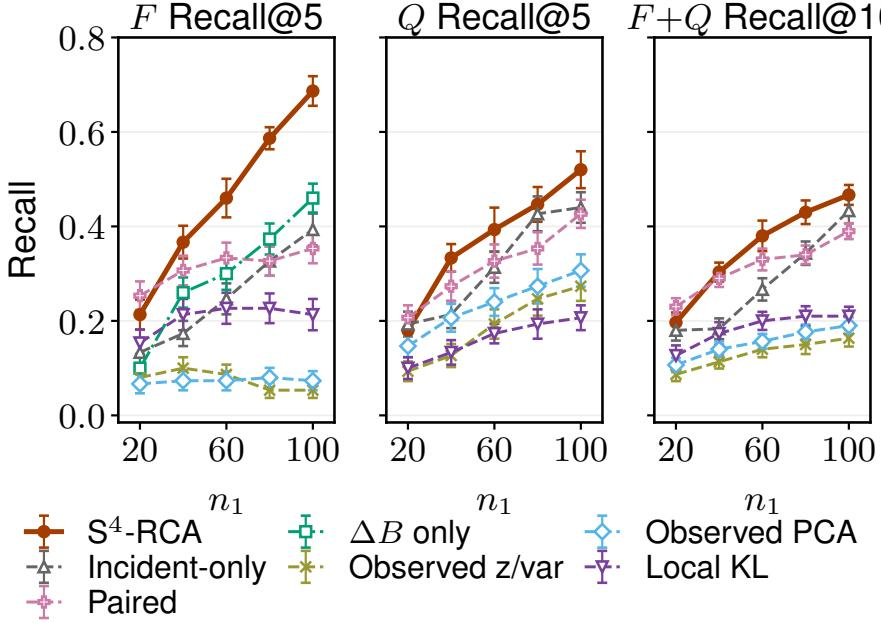
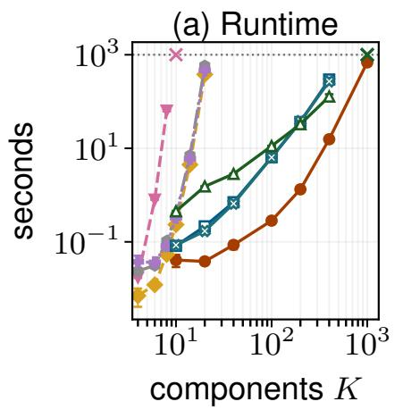
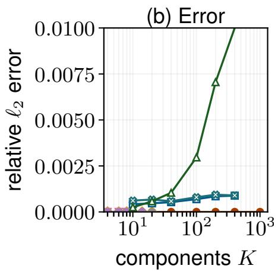
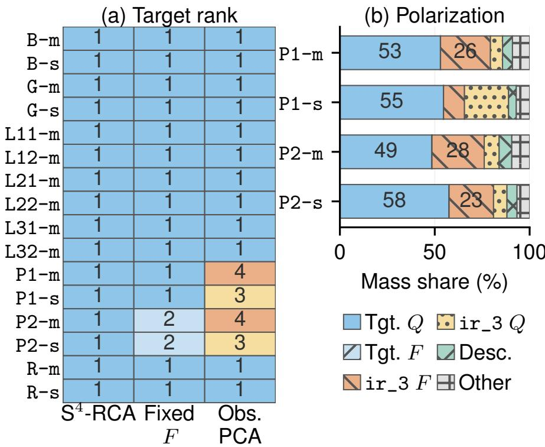
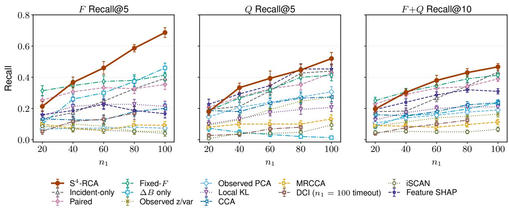

# What Moved the Alarm Score? Causal Attribution with Exact Computation and Scarce-Incident Estimation

Masaaki Takada Toshiba Corporation masaaki.takada.f65@mail.toshiba

Ryusei Shingaki Toshiba Corporation ryusei.shingaki.v85@mail.toshiba

## Abstract

Alarms in industrial systems and scientific instruments often demand immediate diagnosis despite scarce incident data. To guide intervention, an explanation must trace how changes in the data-generating process propagate through the causal structure to alter the alarm score, rather than merely flagging shifts that may be downstream efects. Yet exact attribution across interacting causal components appears combinatorial, while existing methods often either assume an unchanged causal model or require enough incident data to estimate the changed system reliably. We address this setting by formulating the alarm-score change as a Shapley game over hybrid structural causal model (SCM) states. Treating structural functions and exogenous laws as distinct players yields a finer-grained, function/law-resolved report of how each type of change propagates to the alarm score. The same framework defines realized-event and population reports, with an event–population coherence identity linking their attributions. For ordered linear SCMs and quadratic scores, a causal first- and second-moment recursion combined with quadrature computes the full Shapley vector exactly in polynomial time, eliminating combinatorial computation. To estimate this target from scarce incident data, we adapt a well-observed reference SCM to the incident regime using cross-fitted estimates of mechanism changes and residual moments, and derive attribution-error bounds and top-k recovery guarantees. Experiments on controlled and measured shifts illustrate the diagnoses and assess scaling to hundreds of variables and estimation from small incident samples.

## 1 Introduction

Alarms in industrial and scientific systems demand decisions before their causes are clear. Immediately after an alarm, incident data are scarce and causal mechanisms may have changed. Ranking variables by observed shift is unreliable: a large shift may be downstream or have little efect on the alarm score, whereas a modest upstream shift may propagate through the system and strongly afect the score.

The diagnostic question is therefore how changes in the data-generating process propagated through the system to move a supplied alarm score, rather than merely which variables shifted. We seek an additive allocation of this contrast to structural-function and exogenous-law changes. Producing it soon enough to guide intervention requires three coupled capabilities. First, the report must accommodate a changing SCM and resolve parent-dependent mechanisms from exogenous inputs; otherwise opposing efects at one node can cancel and obscure which kind of repair could help. Second, to compute the report quickly, its Shapley allocation must avoid factorial permutation averaging and exponential coalition enumeration. Third, to work from few incident samples, it must leverage the reference regime before enough incident data accumulate to relearn the SCM. Resolution, computation, and estimation thus jointly determine whether attribution can guide intervention immediately after an alarm.

Existing methods solve only subsets of this immediate-diagnosis problem. Feature-attribution methods explain a fixed score map through observed inputs (Lundberg and Lee 2017); event-level causal attribution explains an individual prediction or outlier within one model (Heskes et al. 2020; Budhathoki et al. 2022b; Nguyen et al. 2024); node-wise population attribution replaces a whole causal conditional (Budhathoki et al. 2021; Zhang et al. 2023; Quintas-Martinez et al. 2024); and shift discovery locates changed components (Huang et al. 2020; Chen et al. 2023; Seo et al. 2026). The first two hold generating mechanisms fixed. Node-wise population reports compare regimes, but they can require substantial target-regime data to estimate conditional changes or hybrid values and can merge opposing function/law efects. Shift discovery stops before allocating a supplied score contrast after propagation. Locating where the system changed and determining what moved the alarm score are therefore distinct tasks; none of these approaches provides the resolved, tractable, and scarce-data attribution needed here.

Our starting point is a unified Shapley game over hybrid SCM states, indexed by source, target, player granularity, and score. Each coalition takes selected components from the incident regime and the rest from the reference regime, then evaluates the score after causal propagation. The primary population report uses structural functions and exogenous laws as separate players, so their propagated contributions remain visible. The same framework defines realized-event reports, with an event–population coherence identity linking their expected attributions to the population report. Because the allocation is relative to aligned endpoint SCMs, physical interpretation still requires system-specific semantics.

To make this estimand available in the short incident window, we specialize to ordered linear SCMs and quadratic scores. Every hybrid expectation then depends only on causally propagated first and second moments. This includes common PCA- and ICA-based monitoring scores, quadratic scores formed from Mahalanobis or graphical-lasso precision matrices, and squared z-scores (Qin 2003; Lee et al. 2004; Mahalanobis 1936; Friedman et al. 2008). This second-order closure resolves both remaining bottlenecks: a causal-order moment recursion, shared backwardsensitivity sweep, and exact quadrature compute the full Shapley vector exactly up to roundof in polynomial time, while a well-observed reference SCM anchors cross-fitted estimates of incident mechanism deviations and residual moments. The resulting player-specific error bounds yield a uniform rate, sign recovery, and top-k recovery unde stated conditions. Thus the same specialization makes the resolved report both exactly computable and estimable from scarce incident data.

The resulting method is $\mathbf { S ^ { 4 } - R C A }$ : Sample-eficient, SCM-grounded, Shapley-consistent, and Shift-aware Root Cause Analysis. Our contributions are:

• Function/law-resolved causal score attribution. We introduce a source–target–player–score framework whose primary population game separates structural functions from exogenous laws and connects to realized-event attribution through event–population coherence.

• Exact polynomial-time computation. The moment program computes the full function/law vector, up to roundof, in $O ( d ^ { 4 } )$ time and $O ( d ^ { 2 } )$ memory without enumerating orders or coalitions.

• Scarce-incident estimation. Reference-anchored cross-fitting yields player-specific error bounds and guarantees for sign and top-k recovery. Controlled and measured shifts assess resolution, scaling, recovery, and modelrelative diagnosis.

## 2 Unified Causal Score Attribution

Source, target, players, and score. The primary attribution problem has four objects: (i) a normal-regime source world, represented by an SCM $M ^ { ( 0 ) } ; ( \mathrm { i i } )$ an incident-regime target world, represented by $M ^ { ( 1 ) }$ ; (iii) a set U of SCM-state players specifying which changes are attributed jointly or separately; and (iv) a supplied anomaly score $\tau _ { \ast }$ inducing a scalar functional $T$ to decompose. Together, $( \tilde { M } ^ { ( 0 ) } , \tilde { M } ^ { ( 1 ) } , \bar { \mathcal { U } } , T )$ determine the source-to-target contrast, its decomposition granularity, and the causal estimand.

Let $\mathcal { X } \subseteq \mathbb { R } ^ { d }$ be the observed state space, with $x = ( x _ { j } ) _ { j = 1 } ^ { d } \in \mathcal { X }$ and exogenous vector $\boldsymbol { e } = ( e _ { j } ) _ { j = 1 } ^ { d }$ . For regime $r \in \{ 0 , 1 \}$ , write $F ^ { ( r ) } = ( F _ { j } ^ { ( r ) } ) _ { j = 1 } ^ { d } , Q ^ { ( r ) } = \bigotimes _ { j = 1 } ^ { d } Q _ { j } ^ { ( r ) }$ , and $M ^ { ( r ) } = M ( F ^ { ( r ) } , Q ^ { ( r ) } )$ for the ordered SCM

$$
x _ { j } = F _ { j } ^ { ( r ) } ( x _ { < j } , e _ { j } ) , \qquad e _ { j } \sim Q _ { j } ^ { ( r ) } .
$$

The exogenous coordinates are mutually independent, and $x = G _ { F ^ { ( r ) } } ( e )$ denotes the reduced form. For the supplied anomaly score $\tau : \mathcal { X }  \mathbb { R }$ , define

$$
T ( M ( F , Q ) ) : = \mathbb { E } _ { e \sim Q } [ \tau ( G _ { F } ( e ) ) ] .\tag{1}
$$

The primary population question attributes $T ( M ^ { ( 1 ) } ) - T ( M ^ { ( 0 ) } )$ . Source, target, and hybrid states must preserve variable and exogenous-coordinate meanings and have finite target values.

SCM-state players to attribute. Let $\mathcal { A } = \left\{ \mathbb { F } _ { j } , \mathbb { Q } _ { j } : j \in [ d ] \right\}$ be the atomic switch labels. Here $\mathtt { F } _ { j }$ labels the switch from the actual function $F _ { j } ^ { ( 0 ) }$ to $F _ { j } ^ { ( 1 ) }$ , and $\mathsf Q _ { j }$ labels the switch from $Q _ { j } ^ { ( 0 ) }$ to $Q _ { j } ^ { ( 1 ) }$ ; the monospaced symbols are labels, not functions or laws themselves. A player u is a nonempty subset of A whose switches act jointly, and a player set $\mathcal { U }$ is a collection of pairwise disjoint players. A player u is node-local if $u \subseteq \{ \mathsf { F } _ { j } , \mathsf { Q } _ { j } \}$ for some $j ;$ a player set is node-local if every player is. The primary player set to attribute is $\mathcal { U } = \mathcal { U } _ { \mathtt { F } \cup \mathtt { Q } }$ , with

$$
\mathcal { U } _ { \mathtt { F } \cup \mathtt { Q } } = \{ \{ \mathtt { F } _ { j } \} : j \in [ d ] \} \cup \{ \{ \mathtt { Q } _ { j } \} : j \in [ d ] \} .
$$

Its 2d singleton players yield function/law-resolved attribution. Other useful player sets are $\mathcal { U } _ { ( \mathtt { F } , \mathtt { Q } ) } = \{ \{ \mathtt { F } _ { j } , \mathtt { Q } _ { j } \} : j \in [ d ] \}$ for paired nodes and $\mathcal { U } _ { \mathbb { Q } } = \{ \{ \mathbb { Q } _ { j } \} : j \in [ d ] \}$

A coalition is $U \in 2 ^ { \mathcal { U } }$ , equivalently $U \subseteq { \mathcal { U } } ;$ thus $u \in \mathcal { U }$ denotes one player, whereas U denotes a set of players. The hybrid $M ^ { U } = M ( F ^ { U } , \hat { Q } ^ { U } )$ takes selected components from $M ^ { ( 1 ) }$ and the rest from $M ^ { ( 0 ) }$

$$
{ \cal F } _ { j } ^ { U } = { \cal F } _ { j } ^ { { \bf 1 } \{ { \sf F } _ { j } \in \bigcup _ { w \in U } w \} } , \qquad Q _ { j } ^ { U } = Q _ { j } ^ { { \bf 1 } \{ { \sf 0 } _ { j } \in \bigcup _ { w \in U } w \} } .
$$

Each coalition is therefore an SCM replacement followed by causal propagation, not feature masking. Switching the label pair $\{ \mathtt { F } _ { j } , \mathtt { Q } _ { j } \}$ jointly recovers the established node-wise population granularity; separating them answers whether the node’s score efect arose through its parent-dependent function, its exogenous law, or both.

Causal Shapley estimand. The causal question is how much each prespecified SCM-state player contributes to the score contrast between the source and target worlds. Each coalition U answers the corresponding counterfactual subquestion by switching exactly those players, inducing the finite game $v : 2 ^ { \mathcal { U } }  \mathbb { R } , v ( U ) = T ( M ^ { U } )$ . We define player u’s causal estimand as its Shapley value in this game, which averages its marginal expected-score change over all component orders (Shapley 1953). Denote it by $\Phi _ { u } ( { \cal M } ^ { ( 0 ) } , { \cal M } ^ { ( 1 ) } , { \cal { U } } , { \cal T } )$ , abbreviated as $\Phi _ { u }$ when the defining tuple is fixed:

$$
\begin{array} { r l } { \Phi _ { u } : = } & { \displaystyle \sum _ { U \subseteq \mathcal { U } \backslash \left\{ u \right\} } \frac { | U | ! ( | \mathcal { U } | - | U | - 1 ) ! } { | \mathcal { U } | ! } } \\ & { \times \left\{ T ( M ^ { U \cup \{ u \} } ) - T ( M ^ { U } ) \right\} . } \end{array}\tag{2}
$$

For singleton players, we suppress braces in attribution subscripts, writing $\Phi _ { \mathsf { F } _ { j } } : = \Phi _ { \{ \mathsf { F } _ { j } \} }$ and similarly for $\mathsf Q _ { j }$ . For the primary population shift, take $\mathcal { U } = \mathcal { U } _ { \mathtt { F } \cup \mathtt { Q } }$ . Its causal estimand is the vector $( \bar { \Phi _ { \mathrm { F } _ { 1 } } } , \ldots , \bar { \Phi _ { \mathrm { F } _ { d } } } , \Phi _ { \mathbb { Q } _ { 1 } } , \ldots , \Phi _ { \mathbb { Q } _ { d } } )$

Report variants and granularity. For an event $x ,$ let $e ^ { ( r ) } ( x ; F ^ { ( r ) } )$ be its exogenous state when abducted through regime $r { } _ { \mathrm { { s } } }$ invertible equations, and let $\delta _ { e ^ { ( r ) } }$ denote the corresponding point-mass law. The same four-object construction supports at least the three causal questions in Table 1. We denote their estimands by $\Phi _ { u } , \Phi _ { u } ^ { \mathrm { s h i f t } } ( e ^ { ( 1 ) } )$ , and $\Phi _ { u } ^ { \mathrm { f i x } } ( e ^ { ( 0 ) } )$ ), respectively. The two event rows use diferent model-relative abductions: the fixed-SCM estimand holds $F ^ { ( 0 ) }$ fixed, whereas the shifted-event estimand uses $F ^ { ( 1 ) }$ . Player granularity is part of the estimand. We use the flat function/law player set as primary; Supplement Secs. A.1–A.2 give closest-work reductions and a hierarchy-preserving paired-node/Owen variant (Owen 1977).

Causal replacement semantics. Activating $\mathtt { F } _ { j }$ replaces the autonomous parent-to-node equation; activating $\mathsf Q _ { j }$ replaces the direct exogenous law while holding that equation fixed. The causal interpretation requires modularity, independent aligned disturbances, and common variable and residual coordinates across regimes. It can fail unde latent confounding or regime-specific sensor definitions.

<table><tr><td>Report</td><td>Causal question</td><td>Source</td><td>Target</td><td>Contrast</td><td>Players</td><td>Causal estimand</td></tr><tr><td>Population shift</td><td>Which regime changes moved the mean score?</td><td> ${ \cal M } ( F ^ { ( 0 ) } , Q ^ { ( 0 ) } )$ </td><td> ${ \cal M } ( F ^ { ( 1 ) } , Q ^ { ( 1 ) } )$ </td><td> $T ( M ^ { ( 1 ) } ) - T ( M ^ { ( 0 ) } )$ </td><td> $\mathcal { U } _ { \mathtt { F } \cup \mathtt { Q } }$ </td><td> $\Phi _ { u } \mathrm { : }$  hybrid expected-score game</td></tr><tr><td>Shifted event</td><td>Which target-state components explain this event?</td><td> ${ \cal M } ( F ^ { ( 0 ) } , Q ^ { ( 0 ) } )$ </td><td> $M ( F ^ { ( 1 ) } , \delta _ { e ^ { ( 1 ) } } )$ </td><td> $\tau ( x ) - T ( M ^ { ( 0 ) } )$ </td><td> $\mathcal { U } _ { \mathtt { F } \cup \mathtt { Q } }$ </td><td> $\Phi _ { u } ^ { \mathrm { s h i f t } } ( e ^ { ( 1 ) } )$  :abducted-event game</td></tr><tr><td>event</td><td>Fixed-SCM Which disturbances explain the event under  $M ^ { ( 0 ) } ?$ </td><td> ${ \cal M } ( F ^ { ( 0 ) } , Q ^ { ( 0 ) } )$ </td><td> $M ( F ^ { ( 0 ) } , \delta _ { e ^ { ( 0 ) } } )$ </td><td> $\tau ( x ) - T ( M ^ { ( 0 ) } )$ </td><td> $\mathcal { U } _ { \sf Q }$ </td><td> $\Phi _ { u } ^ { \mathrm { f i x } } ( e ^ { ( 0 ) } ) \dag$  fixed-function event game</td></tr></table>

Table 1: Three representative causal score-attribution questions in the source–target–player–score framework.

Proposition 2.1 (Eficiency and event–population coherence). Let $\Phi _ { u }$ denote the population-shift estimand above and $\Phi _ { u } ^ { \mathrm { s h i f t } } ( e )$ its shifted-event counterpart, constructed with the same player set U and replacement semantics. Suppose the grand coalition of the population game reaches $M ^ { ( 1 ) }$ . For integrable coalition values and $e \sim Q ^ { ( 1 ) }$

$$
\sum _ { u \in \mathcal { U } } \Phi _ { u } = T ( M ^ { ( 1 ) } ) - T ( M ^ { ( 0 ) } ) ,\tag{3}
$$

$$
\mathbb { E } _ { e \sim Q ^ { ( 1 ) } } [ \Phi _ { u } ^ { \mathrm { s h i f t } } ( e ) ] = \Phi _ { u } \qquad f o r e \nu e r y u \in \mathcal { U } .\tag{4}
$$

The eficiency identity makes the population diagnosis complete for the selected score contrast: its component attributions account for the entire mean-score change. Event–population coherence makes the two causal estimands directly comparable: averaging shifted-event attributions over incident events recovers each population attribution exactly, provided the endpoints, players, and replacement semantics agree. The proof is in Supplement Sec. C.1; the fixed-SCM event corollary is in Sec. C.3.

Relation to causal attribution and shift discovery. The source–target–player–score framework makes the distinctions from related methods explicit. Feature and fixed-SCM event attribution explain inputs, disturbances, or interventions under one supplied model, rather than changes between regime SCMs (Lundberg and Lee 2017; Budhathoki et al. 2022b; Heskes et al. 2020; Strobl and Lasko 2022; Nguyen et al. 2024). do-Shapley attributes interventional outcome changes to variable-intervention players within a fixed SCM, not function/law replacements between regime SCMs (Jung et al. 2022; Witter et al. 2026). Unit-level change attribution decomposes individual outcome diferences, whereas causal change attribution (CCA) and multiply-robust CCA (MRCCA) replace node-wise generating distributions; neither provides function/law-resolved population alarm-score attribution (Budhathoki et al. 2022a, 2021; Zhang et al. 2023; Quintas-Martinez et al. 2024). Mechanism-shift and diference-DAG methods detect shifted mechanisms or structural diferences, or leverage shifts to recover causal structure, but do not allocate a supplied score contrast after causal propagation (Huang et al. 2020; Perry et al. 2022; Wang et al. 2018; Malik et al. 2024; Chen et al. 2023). Source-to-target regression transfers predictive models but does not define or compute this causal attribution estimand (Bastani 2021; Takada and Fujisawa 2020; Li et al. 2022). $S ^ { 4 } .$ -RCA instead meets the resolution, computation, and scarce-incident requirements jointly by separating function/law players, computing their full attribution exactly in polynomial time, and estimating it through reference-anchored transfer. Supplement Table 1 (Sec. A.1) gives the detailed estimand-level mapping and distinctions.

Why function/law resolution matters. Separating function and law efects matters for intervention and repai because the two can favor diferent actions at the same node. In a controlled oracle construction, a target t has efects $\left( \Phi _ { \mathsf { F } _ { t } } , \Phi _ { \mathsf { Q } _ { t } } \right) = \left( - \beta , + \alpha \right)$ and a distractor has law efect $\delta ,$ where $x > \beta > \delta > \alpha - \beta > 0$ . Pairing leaves the target below the distractor, although restoring its law clears the alarm (Supplement Sec. D.2). FANS identifies function versus noise shifts in broad nonlinear SCMs (Seo et al. 2026), but does not attribute their propagated contributions to a supplied score contrast; the two tasks are complementary.

## 3 Exact Second-Order Causal Attribution

Second-order specialization. To support immediate response, we specialize the Section 2 estimand to ordered linear SCMs and quadratic scores (polynomials of degree at most two). Their population coalition values depend only on first and second exogenous moments. The estimand remains $\Phi _ { u } ( M ^ { ( 0 ) } , M ^ { ( 1 ) } , \mathcal { U } , T )$ , with $M ^ { ( r ) } = M ( \bar { B ^ { ( r ) } } , Q ^ { ( r ) } )$ $r \in \{ 0 , 1 \}$ , satisfying

$$
\begin{array} { r } { x = ( B ^ { ( r ) } ) ^ { \top } x + e , \qquad e \sim Q ^ { ( r ) } , } \end{array}\tag{5}
$$

where ${ \boldsymbol { B } } ^ { ( r ) }$ is strictly upper triangular in the known causal order and the exogenous coordinates are independent. There is no separate structural intercept: $\mathtt { F } _ { j }$ switches the column $B _ { : , j } ^ { ( r ) }$ , whereas $\mathsf Q _ { j }$ switches the law of $e _ { j }$ , including its location. Let $\mu _ { j } ^ { ( r ) } = \mathbb { E } _ { Q ^ { ( r ) } } [ e _ { j } ] , \omega _ { j } ^ { ( r ) } = \operatorname { V a r } _ { Q ^ { ( r ) } } ( e _ { j } )$ , and

$$
A ^ { ( r ) } = ( I - B ^ { ( r ) } ) ^ { - 1 } , \qquad x = ( A ^ { ( r ) } ) ^ { \top } e .\tag{6}
$$

The supplied anomaly score is

$$
\tau ( x ) = x ^ { \top } W x + z ^ { \top } x .\tag{7}
$$

We omit additive constants, which cancel from all coalition marginals and endpoint contrasts, and take $W = W ^ { \top }$ otherwise replace it by $( W + W ^ { \top } ) / 2$ . In reference-fitted coordinates, this includes PCA $T ^ { 2 }$ , ICA $I ^ { 2 }$ , and SPE; quadratic scores formed from Mahalanobis or graphical-lasso precision matrices; raw or squared regression residuals; squared z-scores; and individual coordinates $x _ { j }$ . Thus this covers standard multivariate monitors while requiring only incident first and second moments, rather than an incident density estimate. Here Diag(v) forms the diagonal matrix with diagonal $v ,$ and diag(M) extracts the diagonal vector of $M$ . For any endpoint or hybrid state, suppress state superscripts and let $\Omega = \mathrm { D i a g } ( \omega ) , V = A W A ^ { \bar { \top } }$ , and $\ell = A z$ . Since $x = A ^ { \top } e ,$

$$
\tau ( \boldsymbol { A } ^ { \top } \boldsymbol { e } ) = \boldsymbol { e } ^ { \top } V \boldsymbol { e } + \boldsymbol { \ell } ^ { \top } \boldsymbol { e } .\tag{8}
$$

Taking expectations gives the closed-form target functional:

$$
T ( M ( B , Q ) ) = \mathrm { t r } ( V \Omega ) + \mu ^ { \top } V \mu + \ell ^ { \top } \mu .\tag{9}
$$

We also write this same value as $T ( \boldsymbol { B } , \mu , \omega )$ when the linear endpoint parameters are explicit.

Hybrid values. We use the primary function/law-resolved granularity $\mathcal { U } = \mathcal { U } _ { \mathrm { F } \cup \mathrm { Q } } ;$ the construction below also applies to other node-local granularities. For $U \subseteq { \mathcal { U } }$ , the hybrid quantities determining $\dot { T } ( M ^ { U } ) = T ( B ^ { U } , \mu ^ { U } , \omega ^ { U } )$ are

$$
\begin{array} { r l r } & { } & { B _ { : , j } ^ { U } = B _ { : , j } ^ { ( 1 ) } \mathbf { 1 } \{ \mathrm { F } _ { j } \in \bigcup _ { w \in U } w \} + B _ { : , j } ^ { ( 0 ) } \mathbf { 1 } \{ \mathrm { F } _ { j } \notin \bigcup _ { w \in U } w \} , } \\ & { } & { \quad \quad \quad \quad \quad \quad \quad \quad \quad \quad \quad \quad \quad \quad \quad \quad \quad \quad \quad \quad \quad \quad \quad \quad \quad \quad \quad \quad \quad \quad \quad \quad \quad \quad \quad \quad \quad \quad \quad \quad \quad } \\ & { } & { \quad \quad \quad \mu _ { j } ^ { U } = \mu _ { j } ^ { ( 1 ) } \mathbf { 1 } \{ \mathrm { Q } _ { j } \in \bigcup _ { w \in U } w \} + \mu _ { j } ^ { ( 0 ) } \mathbf { 1 } \{ \mathrm { Q } _ { j } \notin \bigcup _ { w \in U } w \} , } \\ & { } & { \quad \quad \quad \quad \quad \quad \quad \quad \quad \quad \quad \quad \quad \quad \quad \quad \quad \quad \quad \quad \quad \quad \quad \quad \quad \quad \quad \quad \quad \quad \quad \quad \quad \quad \quad \quad \quad \quad \quad \quad \quad \quad \quad \quad \quad \quad \quad \quad \quad \quad \quad \quad \quad \quad \quad } \\ & { } & { \quad \quad \quad \quad \quad \quad \quad \omega _ { j } ^ { U } = \omega _ { j } ^ { ( 1 ) } \mathbf { 1 } \{ \mathrm { Q } _ { j } \in \bigcup _ { w \in U } w \} + \omega _ { j } ^ { ( 0 ) } \mathbf { 1 } \{ \mathrm { Q } _ { j } \notin \bigcup _ { w \in U } w \} . } \end{array}\tag{10}
$$

The game is simulation-free, but direct Shapley evaluation still requires all K! player orderings or all $2 ^ { K }$ coalitions, where $K = | \mathcal { U } |$ . Let $R _ { p } \subseteq \mathcal { U }$ include each module $u \in \mathcal { U }$ independently with probability $p _ { u }$ . The multilinear extension of $U \mapsto T ( \dot { M } ^ { U } )$ is (Owen 1972)

$$
\widetilde { T } ( p ) : = \mathbb { E } _ { R _ { p } } \big [ T ( M ^ { R _ { p } } ) \big ] = \sum _ { U \subseteq U } T ( M ^ { U } ) \operatorname* { P r } ( R _ { p } = U ) ,\tag{11}
$$

for $p = ( p _ { u } ) _ { u \in \mathcal { U } } \in [ 0 , 1 ] ^ { K }$ . Each Shapley value can be represented by integrating a partial derivative of this multilinear extension (Shapley 1953; Owen 1972), but the extension and its derivatives must still be evaluated without constructing the exponential coalition table.

Moment recursion. Draw $R _ { p }$ and then x from the selected hybrid SCM, and define $\bar { x } ( p ) = \mathbb { E } [ x ]$ and $S ( p ) = \mathbb { E } [ x x ^ { \top } ]$ These random-switch moments evaluate ${ \widetilde { T } } ,$ , with local recursion inputs computed once from the endpoints. Write $\begin{array} { r } { b _ { j } ^ { ( r ) } = B _ { < j , j } ^ { ( r ) } \in \mathbb { R } ^ { j - 1 } , Z _ { \mathtt { F } , j } = \mathbf { 1 } \{ \mathtt { F } _ { j } \in \bigcup _ { w \in R _ { p } } w \} } \end{array}$ , and $Z _ { \mathbb { Q } , j } = \mathbf { 1 } \{ \mathbb { Q } _ { j } \in \bigcup _ { w \in R _ { p } } w \}$ . Expectations below are over these switches:

$$
\begin{array} { r l } & { \bar { b } _ { j } ( p ) = \mathbb { E } [ b _ { j } ^ { Z _ { \mathtt { F } , j } } ] , \quad \bar { \mu } _ { j } ( p ) = \mathbb { E } [ \mu _ { j } ^ { Z _ { \mathtt { q } , j } } ] , } \\ & { \Gamma _ { j } ( p ) = \mathbb { E } [ b _ { j } ^ { Z _ { \mathtt { F } , j } } ( b _ { j } ^ { Z _ { \mathtt { F } , j } } ) ^ { \top } ] , \quad c _ { j } ( p ) = \mathbb { E } [ b _ { j } ^ { Z _ { \mathtt { F } , j } } \mu _ { j } ^ { Z _ { \mathtt { q } , j } } ] , } \\ & { q _ { j } ( p ) = \mathbb { E } [ ( \mu _ { j } ^ { Z _ { \mathtt { q } , j } } ) ^ { 2 } + \omega _ { j } ^ { Z _ { \mathtt { q } , j } } ] . } \end{array}\tag{12}
$$

Because the SCM is ordered, the required moments can be propagated node by node.

Theorem 3.1 (Exact second-order moment recursion). Assume the ordered source and target states have independent exogenous coordinates with finite second moments, U is node-local, and no atomic component appears in two modules The coordinates of $\bar { x } ( p )$ and $S ( p )$ are computed in causal order by thefollowing recursion:

$$
\begin{array} { r l } & { \bar { x } _ { j } ( p ) = \bar { b } _ { j } ( p ) ^ { \top } \bar { x } _ { < j } ( p ) + \bar { \mu } _ { j } ( p ) , } \\ & { S _ { < j , j } ( p ) = S _ { < j , < j } ( p ) \bar { b } _ { j } ( p ) + \bar { x } _ { < j } ( p ) \bar { \mu } _ { j } ( p ) , } \\ & { \quad S _ { j j } ( p ) = \mathrm { t r } \{ \Gamma _ { j } ( p ) S _ { < j , < j } ( p ) \} } \\ & { \quad \quad \quad + 2 c _ { j } ( p ) ^ { \top } \bar { x } _ { < j } ( p ) + q _ { j } ( p ) . } \end{array}\tag{13}
$$

Then, for every $u \in \mathcal { U } ,$ , the Shapley value is

$$
\Phi _ { u } ( M ^ { ( 0 ) } , M ^ { ( 1 ) } , \mathcal { U } , T ) = \int _ { 0 } ^ { 1 } \left. \frac { \partial \widetilde { T } ( p ) } { \partial p _ { u } } \right| _ { p = t 1 } d t ,\tag{14}
$$

where

$$
\widetilde T ( p ) = \mathrm { t r } \{ W S ( p ) \} + z ^ { \top } \bar { x } ( p ) .\tag{15}
$$

These equations compute every Shapley value without enumerating coalitions.

The key is second-order closure: random function/law replacements enter through the local moments in (12), and the causal recursion propagates exactly the moments required by the score rather than approximating the coalition game.

Corollary 3.2 (Exact all-component computation). For the primary function/law-resolved game, one forward evaluation ofthe recursion in (13)followed by one shared backward-sensitivity sweep returns $\nabla _ { p } \widetilde { T } ( p ) f o r$ all $K = 2 d$ players in $O ( d ^ { 3 } )$ dense time and $O ( d ^ { 2 } )$ memory. Combining these gradients with d-point Gauss–Legendre quadrature computes the entire Shapley vector exactly up to numerical roundof in $O ( K d ^ { 3 } ) = O ( d ^ { 4 } )$ time and $O ( d ^ { 2 } )$ memory.

At each of the d quadrature points, a shared forward–reverse sweep returns all 2d derivatives. The integrand has degree at most $2 d - 1$ , so d-point Gauss–Legendre quadrature is exact (Golub and Welsch 1969). Supplement Sec. C.2 and Algorithm 1 give the reverse equations, proof, and full procedure. The resulting speedup preserves the resolved estimand: tractability does not require pairing function and law players.

Event corollary. Fixing F and replacing the target law by abducted point masses reduces the game to the expected score counterpart of Budhathoki et al. (2022b): it shares factual-noise replacement but uses $\mathbb { E } _ { M } [ \tau ( X ) ]$ , rather than an information-theoretic tail score. Every F player is then null, so the same recursion yields fixed-SCM event attribution without a separate algorithm (Supplement Secs. C.3 and A.1).

## 4 Sample-Eficient Plug-in Estimation

Given the supplied score, causal order or parent sets, and player set, we estimate the Section 3 target by plugging sample estimates of $B ^ { ( r ) } , \mu ^ { ( r ) } , \omega ^ { ( r ) }$ into the exact program. For quadratic $\tau ,$ only residual means and variances are needed beyond the mechanism. We first bound reference-anchored transfer and then propagate endpoint errors to the Shapley vector, using held-out or out-of-fold residuals for concentration.

Identification for the linear plug-in. Under $( 5 ) _ { : }$ , a correct common order (or parent sets) and nonsingular parent covariances identify $B _ { : , j } ^ { ( r ) }$ as population regression slopes; exogenous independence identifies the residual laws $Q _ { j } ^ { ( r ) }$ and justifies product-law hybrids. Physical function/law interpretation additionally requires autonomous equations and stable variable semantics. Thus aligned endpoint states and semantics are inputs to, rather than outputs of, $\mathrm { S ^ { 4 }  – R C A }$

Incident adaptation from a reference SCM. To estimate $B ^ { ( 1 ) }$ when $n _ { 1 }$ is small, we fit the ordered SCM to the large pre-incident sample and use incident data only to estimate its deviation. All fits and residual moments use a common reference-fitted coordinate system; centering and intercept bookkeeping assign residual location to $Q .$ , as detailed in Supplement Algorithm 2. Let $\mathbf { X } ^ { ( r ) }$ denote the resulting centered or intercept-residualized regression data. Let $\widetilde { b } _ { k }$ be the pre-incident nodewise Lasso estimate for node $k .$ Delta-Lasso fits

$$
\begin{array} { r l } & { \widehat { \delta } _ { k } \in \underset { \delta } { \mathrm { a r g m i n } } \left\{ \frac { 1 } { 2 n _ { 1 } } \| \mathbf { y } _ { k } - \mathbf { X } _ { : , < k } ^ { ( 1 ) } \delta \| _ { 2 } ^ { 2 } + \lambda _ { 1 } \| \delta \| _ { 1 } \right\} , } \\ & { \mathbf { y } _ { k } = \mathbf { X } _ { : , k } ^ { ( 1 ) } - \mathbf { X } _ { : , < k } ^ { ( 1 ) } \widetilde { b } _ { k } , \qquad \widehat { b } _ { k } ^ { \delta } = \widetilde { b } _ { k } + \widehat { \delta } _ { k } . } \end{array}\tag{16}
$$

For downstream plug-ins, set $\widehat B ^ { ( 0 ) } : = \widetilde B$ and $\widehat B ^ { ( 1 ) } : = \widehat B ^ { \delta }$ . Write $\mathbf { Z } _ { k } ^ { ( r ) } = \mathbf { X } _ { : , < k } ^ { ( r ) }$ and $\mathcal { C } ( S ; 3 ) = \{ \theta : \| \theta _ { S ^ { c } } \| _ { 1 } \leq 3 \| \theta _ { S } \| _ { 1 } \}$ Here $S ^ { c }$ is the complement within the nodewise regression coordinates; $\| \cdot \| _ { \mathrm { o p } } , \| \cdot \| _ { \mathrm { F } } .$ , and $\Vert \cdot \Vert _ { 1 , 1 }$ denote the operator, Frobenius, and elementwise $\ell _ { 1 }$ matrix norms. We use $O ( \cdot ) , o ( \cdot )$ for deterministic orders and $O _ { \mathrm { P } } ( \cdot ) , o _ { \mathrm { P } } ( \cdot )$ for stochastic orders. The column-normalization and conditional sub-Gaussian conditions with scale $\sigma _ { r }$ in Supplement Sec. C.4 yield one joint score event over all nodewise regressions; that section also gives random-design suficient conditions, while Sec. C.5 gives the proofs.

Assumption 4.1 (Reference mechanism fit (M0)). Reference rows are independent. With $S _ { k } ^ { ( 0 ) } = \operatorname { s u p p } ( b _ { k } ^ { ( 0 ) } )$ , assume $\begin{array} { r } { \sum _ { k } | S _ { k } ^ { ( 0 ) } | = s _ { 0 } } \end{array}$ and a common $\kappa _ { 0 } > 0$ such that $n _ { 0 } ^ { - 1 } \lVert \mathbf { Z } _ { k } ^ { ( 0 ) } \theta \rVert _ { 2 } ^ { 2 } \geq \kappa _ { 0 } \lVert \theta \rVert _ { 2 } ^ { 2 }$ for every $k \in [ d ]$ and $\theta \in \mathcal { C } ( S _ { k } ^ { ( 0 ) } ; 3 )$

Assumption 4.2 (Incident transfer (M1)). Incident rows are mutually independent and independent of the reference sample. For common $\kappa _ { 1 } > 0$ and $\kappa _ { 2 } \geq 0 , n _ { 1 } ^ { - 1 } \| \mathbf { Z } _ { k } ^ { ( 1 ) } \theta \| _ { 2 } ^ { 2 } \geq \kappa _ { 1 } \| \theta \| _ { 2 } ^ { 2 } - \kappa _ { 2 } ( \log d / n _ { 1 } ) \| \theta \| _ { 1 } ^ { 2 }$ for every $k \in [ d ]$ and $\theta \in \mathbb { R } ^ { k - 1 }$

For the residual-moment plug-in below, we additionally use the following scaling condition.

Assumption 4.3 (Residual-moment scaling (R)). Uniformly over $r \in \{ 0 , 1 \}$ , assume $\sigma _ { r } = O ( 1 )$ and $\| A ^ { ( r ) } \| _ { \mathrm { o p } } = O ( 1 )$

Theorem 4.4 (Radius-based SCM Delta-Lasso transfer). Under the column-normalization and sub-Gaussian conditions above and Assumptions 4.1 and $4 . 2 ,$ let $\Delta = B ^ { ( 1 ) } - B ^ { ( 0 ) }$ , choose $\lambda _ { r } \asymp \sigma _ { r } \sqrt { \log d / n _ { r } } ,$ and set

$$
R _ { \Delta } : = \| \Delta \| _ { 1 , 1 } + \frac { 1 2 \lambda _ { 0 } s _ { 0 } } { \kappa _ { 0 } } .\tag{17}
$$

For any fixed $c > 0 _ { i }$ , suppose $\kappa _ { 2 } R _ { \Delta } \sqrt { \log d / n _ { 1 } } \leq c \sigma _ { 1 }$ . Then, with high probability,

$$
\| \widehat { B } ^ { \delta } - B ^ { ( 1 ) } \| _ { \mathrm { F } } ^ { 2 } \leq C R _ { \Delta } \frac { \sigma _ { 1 } } { \kappa _ { 1 } } \sqrt { \frac { \log d } { n _ { 1 } } } ,\tag{18}
$$

where C does not depend on $n _ { 0 } , n _ { 1 }$ , or d.

When transfer helps. Let $s _ { 1 } = \| B ^ { ( 1 ) } \| _ { 0 }$ count the incident nonzero slopes. Under an incident nodewise RE constant $\kappa > 0$ , standard incident-only Lasso has Frobenius rate $O _ { \mathrm { P } } ( ( \sigma _ { 1 } / \kappa ) \sqrt { s _ { 1 } \log d / n _ { 1 } } )$ . Squaring this rate and comparing guarantees, transfer is sharper when $R _ { \Delta }$ is $o \Big ( \big ( \sigma _ { 1 } \kappa _ { 1 } / \kappa ^ { 2 } ) s _ { 1 } \sqrt { \log d / n _ { 1 } } \Big )$ . With comparable noise and curvature constants, $s _ { 0 } = O ( s _ { 1 } )$ , and $n _ { 0 } / n _ { 1 }  \infty$ , the reference-estimation term is negligible and the condition reduces to $\| \Delta \| _ { 1 , 1 } = o ( s _ { 1 } \sqrt { \log d / n _ { 1 } } )$ : the favorable regime combines $n _ { 0 } \gg n _ { 1 }$ with a small total shift. The shift may still be dense: the condition controls $\| \Delta \| _ { 1 , 1 }$ , not its support size.

Held-out residual moments. For a regime-r residual-evaluation fold ℓ, let $\mathcal { T } _ { r , \ell }$ be its held-out observations, $m _ { r , \ell } = | \mathcal { I } _ { r , \ell } |$ , and $\widehat { B } _ { - \ell } ^ { ( r ) }$ the fit excluding that fold; we suppress ℓ below.

$$
\begin{array} { r } { \widehat { \mathrm { e } } _ { i } ^ { ( r ) } = ( I - \widehat { B } _ { - \ell } ^ { ( r ) \top } ) x _ { i } ^ { ( r ) } , \qquad i \in \mathcal { T } _ { r } , } \\ { ( \widehat { \mu } _ { j } ^ { ( r ) } , \widehat { \omega } _ { j } ^ { ( r ) } ) = m _ { r } ^ { - 1 } \displaystyle \sum _ { i \in \mathcal { T } _ { r } } ( \widehat { \mathrm { e } } _ { i j } ^ { ( r ) } , ( \widehat { \mathrm { e } } _ { i j } ^ { ( r ) } - \widehat { \mu } _ { j } ^ { ( r ) } ) ^ { 2 } ) . } \end{array}\tag{19}
$$

Excluding $\mathcal { T } _ { r , \ell }$ makes its residuals independent of $\widehat { B } _ { - \ell } ^ { ( r ) }$ . Each fold forms matched mechanism and residual-moment endpoints and a Shapley vector in common coordinates. The report averages these vectors rather than pooling residuals across games with diferent mechanism fits.

Plug-in attribution and ranking. For a node-local game, replace the endpoints in (10) to form $\widehat { B } ^ { U } , \widehat { \mu } ^ { U } , \widehat { \omega } ^ { U }$ , with plug-in value

$$
{ \widehat T } ( { \cal U } ) = T ( \widehat B ^ { \cal U } , \widehat \mu ^ { \cal U } , \widehat \omega ^ { \cal U } ) .\tag{20}
$$

Let $\widehat { \Phi } = ( \widehat { \Phi } _ { u } ) _ { u \in \mathcal { U } }$ be the Shapley vector obtained by applying (2) to $U \mapsto { \widehat { T } } ( U )$ . Put $\Theta = ( \theta ^ { ( 0 ) } , \theta ^ { ( 1 ) } )$ , where $\theta ^ { ( r ) } = ( B ^ { ( r ) } , \mu ^ { ( r ) } , \omega ^ { ( r ) } )$ , and let $\widehat { \Theta }$ be its plug-in counterpart. Regard $\Phi _ { u } ( \Theta )$ as an endpoint functional, and let $\Theta _ { s } = \Theta + s ( \widehat { \Theta } - \Theta ) , s \in [ 0 , 1 ]$ . Let B be the prespecified admissible slope subspace (the supplied order or parent support) containing the fitted and population slopes, with Frobenius projection $\Pi _ { B } .$ . Write $\eta _ { B } ^ { ( r ) } = \| \widehat { B } ^ { ( r ) } - B ^ { ( r ) } \| _ { \mathrm { F } }$ $\eta _ { \mu } ^ { ( r ) } = \| \widehat { \mu } ^ { ( r ) } - \mu ^ { ( r ) } \| _ { \infty } , \mathrm { a n d } \eta _ { \omega } ^ { ( r ) } = \| \widehat { \omega } ^ { ( r ) } - \omega ^ { ( r ) } \| _ { \infty }$ . The following path sensitivities measure how endpoint errors can perturb player u’s attribution along the segment from the population to the fitted endpoints:

$$
\begin{array} { r l } & { L _ { u , B } ^ { ( r ) } : = \displaystyle \operatorname* { s u p } _ { s \in [ 0 , 1 ] } \| \Pi _ { B } \nabla _ { B ^ { ( r ) } } \Phi _ { u } ( \Theta _ { s } ) \| _ { \mathrm { F } } , } \\ & { L _ { u , \mu } ^ { ( r ) } : = \displaystyle \operatorname* { s u p } _ { s \in [ 0 , 1 ] } \| \nabla _ { \mu ^ { ( r ) } } \Phi _ { u } ( \Theta _ { s } ) \| _ { 1 } , } \\ & { L _ { u , \omega } ^ { ( r ) } : = \displaystyle \operatorname* { s u p } _ { s \in [ 0 , 1 ] } \| \nabla _ { \omega ^ { ( r ) } } \Phi _ { u } ( \Theta _ { s } ) \| _ { 1 } . } \end{array}\tag{21}
$$

Uniform error rate. For deterministic $\rho _ { r }$ satisfying $\eta _ { B } ^ { ( r ) } = O _ { \mathrm { P } } ( \rho _ { r } )$ , put $\nu _ { r } = \sqrt { \log ( 2 d ) / m _ { r } } , M _ { r } = \| \mathbb E x ^ { ( r ) } \| _ { 2 }$ $q _ { \mu , r } = \nu _ { r } + ( M _ { r } + \nu _ { r } ) \rho _ { r } , q _ { \omega , r } = \nu _ { r } + \rho _ { r } ^ { 2 }$ , and $a _ { * } = \operatorname* { m a x } _ { U \subseteq \mathcal { U } } \| ( I - B ^ { U } ) ^ { - 1 } \| _ { \mathrm { o p } }$ . With $W _ { * } = \| W \| _ { \mathrm { o p } }$ and $z _ { * } = \| z \| _ { 2 }$ define the deterministic envelopes below, which may depend on d:

$$
\begin{array} { l } { { m _ { * } = 1 + \displaystyle \sum _ { r = 0 } ^ { 1 } \{ | | \mu ^ { ( r ) } | | _ { 2 } + \sqrt { d } q _ { \mu , r } \} , } } \\ { { \displaystyle \omega _ { * } = 1 + \operatorname* { m a x } _ { r } \{ | | \omega ^ { ( r ) } | | _ { \infty } + q _ { \omega , r } \} , } } \\ { { \displaystyle H _ { B } = 1 6 a _ { * } ^ { 3 } ( \sqrt { d } \omega _ { * } + m _ { * } ^ { 2 } ) W _ { * } + 4 a _ { * } ^ { 2 } m _ { * } z _ { * } , } } \\ { { \displaystyle H _ { \mu } = \sqrt { d } \{ 8 a _ { * } ^ { 2 } W _ { * } m _ { * } + 2 a _ { * } z _ { * } \} , \quad H _ { \omega } = 4 d a _ { * } ^ { 2 } W _ { * } . } } \end{array}
$$

Theorem 4.5 (Plug-in attribution error). For anyfitted endpoints with slopes in $B ,$ every player obeys the deterministic sensitivity bound

$$
| \widehat { \Phi } _ { u } - \Phi _ { u } | \leq \sum _ { r = 0 } ^ { 1 } \{ L _ { u , B } ^ { ( r ) } \eta _ { B } ^ { ( r ) } + L _ { u , \mu } ^ { ( r ) } \eta _ { \mu } ^ { ( r ) } + L _ { u , \omega } ^ { ( r ) } \eta _ { \omega } ^ { ( r ) } \} .\tag{22}
$$

For the out-of-sample construction above, under the held-out-sample independence and sub-Gaussian conditions above and Assumption $4 . 3 , i f \operatorname* { m a x } _ { r } \nu _ { r } = o ( 1 )$ and $a _ { * } ( \rho _ { 0 } + \rho _ { 1 } ) = o ( 1 )$ , then, simultaneously over the prespecified player universe, $\| \widehat \Phi - \Phi \| _ { \infty } = O _ { \mathrm { P } } ( R _ { d } )$ , where

$$
R _ { d } : = \sum _ { r = 0 } ^ { 1 } \{ H _ { B } \rho _ { r } + H _ { \mu } q _ { \mu , r } + H _ { \omega } q _ { \omega , r } \} .\tag{23}
$$

For a fixed number of folds, averaging their foldwise bounds preserves the corresponding order.

The theorem converts endpoint rates into attribution accuracy. For the estimators above, take $\rho _ { 0 } ~ =$ $( \sigma _ { 0 } / \kappa _ { 0 } ) \sqrt { s _ { 0 } \log d / n _ { 0 } }$ , while Theorem 4.4 gives $\rho _ { 1 } = [ R _ { \Delta } ( \sigma _ { 1 } / \kappa _ { 1 } ) \sqrt { \log d / n _ { 1 } } ] ^ { 1 / 2 }$ . Reference accuracy and a small total shift reduce these rates, giving uniform consistency whenever $R _ { d } = o ( 1 )$ ; endpoint errors or hybrid amplification through $^ { a _ { * } }$ can negate the benefit. Even when $a _ { * } , W _ { * } = O ( 1 )$ , the $H _ { \omega } q _ { \omega , r }$ term in the dense-score global envelope is $O _ { \mathrm { P } } ( d \sqrt { \log d / m _ { r } } + d \rho _ { r } ^ { 2 } )$ and can require $m _ { r } \gg d ^ { 2 } \log d ,$ whereas the player-specific bound (22) retains cancellations.

Corollary 4.6 (Top-k recovery under a separated ranking). Under the conditions of Theorem $4 . 5 ,$ let $S _ { k }$ be the population top-k set and $\begin{array} { r } { g _ { k } : = \operatorname* { m i n } _ { u \in S _ { k } } | \Phi _ { u } | - \operatorname* { m a x } _ { v \notin S _ { k } } | \Phi _ { v } | . \ I f g _ { k } > 0 } \end{array}$ and $R _ { d } = o ( g _ { k } )$ , the estimated and population top-k absolute-attribution sets agree with probability tending to one. For any $u \in \mathcal { U } , R _ { d } = o \big ( | \Phi _ { u } | \big )$ also gives sign recovery.

Thus the leading function/law attributions are ranked correctly once their population gap dominates the uniform estimation error.

## 5 Experiments

We test exact computation, scarce-incident function/law recovery, and model-relative measured-intervention diagnosis.   
Supplement Secs. D.1–D.8 give protocols, uncertainty summaries, stress tests, and reproducibility details.

Exact computation. All methods query the same oracle for true-endpoint coalition values. We use DoWhy-GCM for the DW comparators (Blöbaum et al. 2024); Figure 1 compares runtime and relative $\ell _ { 2 }$ error. Across three problems per non-timeout cell, $\mathrm { S ^ { 4 }  – R C A }$ is over 100× faster than K! orders, $2 ^ { K }$ coalitions, DW-Exact, and DW-Fast at their largest common sizes; DW-Fast also loses agreement at $K = 2 0$ . Only $\mathrm { S ^ { 4 }  – R C A }$ reaches $K = 1 0 0 0$ within $1 0 ^ { 3 }$ seconds, averaging about 11 minutes (Supplement Sec. D.3).

Scarce-incident attribution benchmark. We use 30 ordered Gaussian d = 100 SCM pairs with five score-relevant shifts per family, matched score-null decoys, and balanced oracle mass. $\mathrm { S ^ { 4 }  – R C A }$ averages signed attributions over five outer folds; ten-fold penalty tuning uses only each mechanism-training fold. Figure 2 reports $F$ and Q Recall@5 and $F + Q$ Recall@10. Incident-only Lasso, paired attribution, and $| \Delta B |$ ablate transfer, resolution, and score-aware propagation; observed baselines provide diagnostic anchors.

The advantage is clearest for function recovery: at the largest incident size, recall is 0.687, versus 0.460 for $| \Delta B |$ and 0.393 for incident-only Shapley. Paired attribution is higher only in the smallest regime; thereafter $\mathrm { S ^ { 4 }  – R C A }$ has the highest mean on all three metrics, with higher $F + Q$ Recall than incident-only throughout and higher Q Recall beyond the smallest regime. Thus transfer and score propagation chiefly improve function recovery. This matches the intended transfer setting: a reliable reference anchors the dense baseline. A lifted node report can score similarly on $F + Q$ without identifying function versus law, so the resolved report remains useful even when untyped localization

$$
2 ^ { K }
$$

  
Figure 1: Same-oracle Shapley aggregation on the full $K = 2 d$ function/law game $( \mathrm { m e a n } \pm \mathrm { S E }$ over three non-timeout problems; crosses: first 1000-second timeout). Only exact $\mathrm { S ^ { 4 }  – R C A }$ reaches $K = 1 0 0 0$ . Panel (b) reports relative $\ell _ { 2 }$ error; DW-Fast’s diagnosed $K = 2 0$ failure is omitted (DoWhy 0.14; Supplement Sec. D.3).  
F+Q Recall@10  
Figure 2: Scarce-incident recovery over 30 ordered $d = 1 0 0 { \mathrm { S C M } }$ pairs with balanced function/law oracle mass $( \mathrm { m e a n } \pm \mathrm { S E } )$ . Panels report $F$ and Q Recall@5 and $F + Q$ Recall@10; node rankings are lifted for $F + Q$ . Beyond the smallest regime, $\mathrm { S ^ { 4 }  – R C A }$ has the highest mean, most clearly for F (broader benchmark: Supplement Sec. D.4).

  
Figure 3: Causal Chamber all-channel score. (a) Target rank (1 best; worst of five splits; m/s: severity). (b) Target-Q and downstream-ir\_3 mass; F denotes the fitted linear mechanism.

is comparable. Supplement Sec. D.4 gives the protocol and a broader benchmark including fixed-F event attribution, CCA/MRCCA, DCI, iSCAN, and feature-shift SHAP. The evidence is for leading-component recovery, not uniform magnitude recovery or calibrated ranks.

Measured interventions. Across 16 22-channel Causal Chamber Light-Tunnel interventions (Gamella et al. 2025), we test whether a measured target-law component separates from propagated fitted-response components of a reference-fitted PCA $T ^ { 2 } + \mathrm { S P E }$ alarm. Five repeated two-fold fits define a 44-player game, and nodes are ranked by the sum of their absolute fold-mean function and law attributions. Fixed-F and observed PCA ablate function adaptation and causal propagation.

S4-RCA ranks all 16 targets first, versus 14 for Fixed-F (all top-three) and 12 for observed PCA. For polarization, target $Q$ carries 49–58% of absolute mass, while F carries 14–32%, 91–100% downstream; downstream function/law efects oppose at mid severity and reinforce at strong severity (Figure 3). Within the fitted ordered linear SCM, this allocation separates the target-law component from downstream relinearization. Supplement Sec. D.6 gives the full protocol and split sensitivity; Sec. D.7 extends the stress test to two other datasets.

## 6 Conclusion and Limitations

$S ^ { 4 } .$ -RCA combines resolved attribution, exact computation, and scarce-incident estimation. Its guarantees assume aligned ordered linear SCMs with independent disturbances and quadratic scores; transfer additionally requires an accurate reference and a small shift. Latent confounding, cycles, and incompatible semantics remain outside scope. Small-scale stress tests suggest rank robustness to order estimation and controlled nonlinear misspecification but do not extend the theory (Supplement Sec. D.5). Measured results are model-relative; physical-fault diagnosis requires benchmarks with verified mechanisms.

# Supplementary Material for What Moved the Alarm Score? Causal Attribution with Exact Computation and Scarce-Incident Estimation

Appendix organization. Appendix A gives the framework scope, closest-work reductions, and hierarchy-preserving Owen extension. Appendix B gives pseudocode and implementation details. Appendix C proves the general identities, the linear/quadratic computation results, and the plug-in estimation guarantees used in Sections 2–4. Appendix D records the experimental protocols and boundary diagnostics needed to reproduce and interpret the main claims.

## A Extensions and Closest-Work Reductions

This appendix develops two aspects compressed in the main paper. First, it states the scope of the source–target– player–score construction and maps closely related methods into that common notation. It then gives an Owen-value extension that preserves paired-node hierarchy while retaining separate function/law allocations.

## A.1 Framework scope and closest-work reductions

The Shapley definition in Eq. (2) applies to any finite scalar functional T, whereas event–population coherence, moment closure, and the estimation theory require the expected-score form $T ( M ) = \mathbb { E } _ { M } [ \tau ( X ) ]$

A function/law-resolved report is conditional on aligned variables and exogenous coordinates across its endpoints; unrestricted observational laws do not identify a unique physical function/noise decomposition. The endpoints may be supplied or estimated under additional assumptions. In the ordered linear specialization, a correct common order (or parent sets), nonsingular parent covariances, and independent disturbances identify the slopes and residual laws and justify product-law hybrids. There is no separate structural intercept: $\mathtt { F } _ { j }$ switches the slope, while $\mathsf Q _ { j }$ includes residual location and dispersion.

Any attribution report is determined by four choices: source $M ^ { ( 0 ) }$ , target $M ^ { ( 1 ) }$ , prespecified switches $u ,$ and the scalar $T$ being explained. To prevent method-specific notation from obscuring these choices, Table 1 translates every framework into this paper’s source–target–player–score notation. For attribution methods, “source” and “target” mean the empty- and grand-coalition endpoints $\bar { M } ^ { \varnothing }$ and $M ^ { \mathcal { U } }$ , so the allocated contrast is $T ( M ^ { \mathcal { U } } ) - T ( M ^ { \emptyset } )$ ; they need not be the normal and incident states in chronological order.

Reading the map. Population CCA/MRCCA (Budhathoki et al. 2021; Quintas-Martinez et al. 2024) is the closest population-attribution framework: it becomes the same coalition game when each function/law pair is treated as one node player. Fixed-SCM outlier RCA (Budhathoki et al. 2022b) shares a factual-noise replacement orientation, but attributes a diferent event-level tail functional. Unit-level change attribution (Budhathoki et al. 2022a) instead switches observed values, and do-Shapley (Witter et al. 2026) switches variable interventions within one SCM. These distinctions explain why the first two relations merit explicit mappings below, while the remaining rows are adjacent causal questions rather than reductions of the population alarm-score estimand.

Paired-node population reduction. Suppose the endpoints are Markovian, have aligned variables, and share a common acyclic parent universe. If each pair $\{ \mathtt { F } _ { j } , \mathtt { Q } _ { j } \}$ is switched as one player, every hybrid law factorizes into the induced conditionals. For a Borel set $A \subseteq \mathbb { R }$ , define

$$
C _ { j } ^ { ( r ) } ( A \mid x _ { < j } ) : = Q _ { j } ^ { ( r ) } \left( \left\{ e _ { j } : F _ { j } ^ { ( r ) } ( x _ { < j } , e _ { j } ) \in A \right\} \right) .
$$

Specifically,

$$
P ^ { U } ( d x ) = \prod _ { j = 1 } ^ { d } C _ { j } ^ { \mathbf { 1 } \{ \{ \mathbf { F } _ { j } , \mathbf { \theta _ { j } } \} \in U \} } ( d x _ { j } \mid x _ { < j } ) .
$$

<table><tr><td>Framework</td><td> $M ^ { ( 0 ) } { : } \operatorname { s o u r c e }$ </td><td> $M ^ { ( 1 ) } ;$  target</td><td>Modules U</td><td>Scalar T</td><td>Report in words</td></tr><tr><td> $\mathbf { S } ^ { 4 } \mathbf { - R C A } \ ( \mathbf { o u r s } )$ </td><td> ${ \cal M } ( F ^ { ( 0 ) } , Q ^ { ( 0 ) } )$ </td><td> ${ \cal M } ( F ^ { ( 1 ) } , Q ^ { ( 1 ) } )$ </td><td> $\chi _ { \mathrm { F } \cup \{ \} } .$  separate  $\mathtt { F } _ { j } , \mathtt { Q } _ { j }$ </td><td> $T ( M ) =$   $\mathbb { E } _ { M } [ \tau ( X ) ]$ </td><td>Allocates a population alarm-score change to structural functions and disturbance laws separately.</td></tr><tr><td>Population CCA/MRCCA (Budhathoki et al. 2021; Quintas-Martinez</td><td> ${ \cal M } ( F ^ { ( 0 ) } , Q ^ { ( 0 ) } )$ </td><td> ${ \cal M } ( F ^ { ( 1 ) } , Q ^ { ( 1 ) } )$ </td><td> $\mathcal { U } _ { ( \mathtt { F } , \mathtt { q } ) } \colon \mathrm { j o i n t ~ n o d e }$  switches</td><td> $T ( M ) =$   $\psi ( P _ { Y } ^ { \dot { M } } )$ </td><td>Switches each node conditional jointly. MRCCA estimates  $T ( M ) = \mathbb { E } _ { M } ^ { \setminus } [ h ( \dot { Y } ) ]$  multiply robustly; with  $h ( Y ) = \tau ( X )$  the game is paired-node  $\dot { \mathrm { S ^ { 4 } - R C A } } .$ </td></tr><tr><td>Unit-level change attribution (Budhathoki et al, 2022a)</td><td> $M ( F _ { Y } ^ { ( 0 ) } , \delta _ { x ^ { ( 0 ) } } )$ </td><td> $M ( F _ { Y } ^ { ( 1 ) } , \delta _ { x ^ { ( 1 ) } } )$ </td><td> $\bigl \{ \mathbf { F } _ { Y } , \mathbf { X } _ { 1 } , \ldots , \mathbf { X } _ { d } \bigr \} ;$  function/value switches</td><td> $T ( M ) =$   $\mathbb { E } _ { M } [ Y ] =$   $F _ { Y } ( x )$ </td><td>Explains one unit&#x27;s output change by switching the prediction function and observed input coordinates (fine game), or all inputs jointly (coarse game).</td></tr><tr><td>Fixed-SCM outlier RCA (Budhathoki et al. 2022b)</td><td> ${ \cal M } ( F ^ { ( 0 ) } , Q ^ { ( 0 ) } )$ </td><td> $M ( F ^ { ( 0 ) } , \delta _ { e ^ { ( 0 ) } ( x ) } )$ </td><td>U: factual-noise fixes</td><td> $T _ { x } ( M ) =$   $\log { P _ { M } ( A _ { x } ) }$ </td><td>Fixes reference noises to their factual values and allocates the information-theoretic score  $S _ { M ^ { ( 0 ) } } ^ { \tau } ( x ) .$ </td></tr><tr><td>FANS (Seo et al. 2026)</td><td> ${ \cal M } ( F ^ { ( 0 ) } , Q ^ { ( 0 ) } )$ </td><td> ${ \cal M } ( F ^ { ( 1 ) } , Q ^ { ( 1 ) } )$ </td><td> $- ; { \mathrm { r e t u r n s ~ } } \mathbb { F } _ { j } / \mathbb { Q } _ { j }$  labels</td><td></td><td>From samples in two environments, detects changed nodes and labels function or noise shifts; it does not allocate a score contrast.</td></tr><tr><td>Exact do-Shapley (Witter et al. 2026)</td><td> $M ^ { ( 0 ) } = M$ </td><td> $M ^ { ( 1 ) } =$   $M _ { \mathrm { d o } ( X = x ) }$ </td><td> $\{ \mathtt { X } _ { j } : j \in [ d ] \} \colon$  variable interventions</td><td> $T ( M ) =$   $\mathbb { E } _ { M } [ Y ]$ </td><td>Allocates an interventional outcome to variable interventions, not function/law shifts.</td></tr></table>

Table 1: Closest frameworks translated into this paper’s notation. CCA/MRCCA neither identifies nor separately switches the function/law representation of an induced node conditional. For outlier RCA, $A _ { x } = \{ \tau ( X ) \geq \tau ( x ) \}$ and $S _ { M ^ { ( 0 ) } } ^ { \tau } ( x ) = - \log P _ { M ^ { ( 0 ) } } ( A _ { x } )$ . Unit-level attribution observes paired input vectors rather than estimating input laws. Its deterministic one-output SCM embedding uses $\delta _ { x ^ { ( r ) } } = \otimes _ { j = 1 } ^ { d } \delta _ { x _ { i } ^ { ( r ) } }$ , so $\mathtt { X } _ { j }$ switches an observed value, not a population disturbance law. FANS has no attribution modules or scalar game.

Thus, for $T ( M ) = \mathbb { E } _ { M } [ \tau ( X ) ]$ , this paired $\mathrm { S ^ { 4 }  – R C A }$ game agrees coalition by coalition with node-wise CCA using outcome $\tau ( X )$ (Budhathoki et al. 2021; Quintas-Martinez et al. 2024), and so has the same Shapley values. This reduction does not imply $\Psi _ { j } = \Phi _ { \mathsf { F } _ { j } } + \Phi _ { \mathsf { Q } _ { j } }$ in the separately ordered flat game, because splitting a player redistributes interactions.

Fixed-SCM event mapping. The native fixed-SCM outlier game (Budhathoki et al. 2022b) indexes a coalition I by the noises randomized from $\delta _ { e ^ { ( 0 ) } ( x ) }$ back to $Q ^ { ( 0 ) }$ , and uses the negative log tail probability. To express the same estimand in this paper’s reference-to-event orientation, let $S = [ d ] \backslash I$ index the noises fixed to their factual values and set

$$
w ( S ) = \log P _ { M ( F ^ { ( 0 ) } , \delta _ { { e _ { S } ^ { ( 0 ) } ( x ) } } \otimes Q _ { - S } ^ { ( 0 ) } ) } ( A _ { x } ) .
$$

If $v ( I )$ v(I) is the native negative-log randomization game, then $w ( S ) = - v ( [ d ] \setminus S )$ ; complementing coalitions and reversing the sign leaves every Shapley value unchanged. Thus Table 1 correctly writes its source and target as $Q ^ { ( 0 ) }$ and $\delta _ { e ^ { ( 0 ) } ( x ) } ;$ their $T _ { x }$ contrast equals $S _ { M ^ { ( 0 ) } } ^ { \tau } ( x )$ . Our fixed-SCM event game in Sec. C.3 has this same replacement orientation but a diferent, expected-score functional; the outlier formula and coherence identity therefore do not transfer automatically. The paired reduction and event mapping delimit the prior-work boundary; function/law resolution, exact second-order computation, and SCM-wide scarce-incident attribution are the contributions studied here.

FANS and nonlinear function/law dissection. FANS shows that function/noise dissection need not be confined to additive models (Seo et al. 2026). It considers the following nonlinear, non-additive class, with a diferentiable noise inverse for each fixed h:

$$
\begin{array} { r l } & { F _ { j } ^ { ( r ) } ( p a _ { j } , e _ { j } ) = g _ { j } \Big ( h _ { j } ^ { ( r ) } ( p a _ { j } ) , e _ { j } \Big ) , } \\ & { \qquad e _ { j } \mapsto g _ { j } ( h , e _ { j } ) \quad \mathrm { i s ~ a ~ d i f f e r e n t i a b l e ~ b i j e c t i o n . } } \end{array}
$$

where the link $g _ { j }$ is invariant across regimes. Within this class, a function shift is distinguishable from a law shift when $g _ { j } ( h _ { j } ^ { ( 1 ) } ( p a _ { j } ) , e _ { j } ^ { ( 0 ) } )$ cannot be rewritten, simultaneously for every $p a _ { j }$ , as $g _ { j } ( h _ { j } ^ { ( 0 ) } ( p a _ { j } ) , \psi ( e _ { j } ^ { ( 0 ) } ) )$ using one parent-independent invertible noise map ψ. Under its pure-shift setup, such a function shift makes the reference-inferred residual depend on the parents, whereas a pure law shift preserves independence. If the rewriting is possible, the two explanations are observationally indistinguishable; simultaneous changes require a further restriction in FANS. FANS is therefore a complementary upstream shift-type diagnostic: our game attributes the propagated score efects of aligned components, while the exact computation and scarce-incident guarantees specialize to ordered linear SCMs.

## A.2 Hierarchy-preserving Owen attribution

Let $N = \{ \mathsf { F } _ { j } , \mathsf { q } _ { j } : j \in [ d ] \}$ be the component player set, let $v ( A ) = T ( M ^ { A } )$ , and equip N with the a priori-union partition $\mathcal { P } = \{ P _ { 1 } , \ldots , P _ { d } \}$ , where $P _ { j } = \{ \mathtt { F } _ { j } , \mathtt { Q } _ { j } \}$ . For $R \subseteq [ d ]$ , write $\textstyle P ( R ) = \bigcup _ { k \in R } P _ { k }$ and

$$
w _ { d } ( R ) = \frac { | R | ! ( d - | R | - 1 ) ! } { d ! } .
$$

The Owen value (Owen 1977) averages marginal contributions over orders in which the two players of each block remain contiguous. Since every block here has size two, its allocations have the explicit form

$$
\begin{array} { l } { \Omega _ { \mathtt { F } _ { j } } = \displaystyle \frac { 1 } { 2 } \displaystyle \sum _ { R \subseteq [ d ] \backslash \{ j \} } w _ { d } ( R ) \big [ v \{ P ( R ) \cup \{ \mathtt { F } _ { j } \} \} - v \{ P ( R ) \} } \\ { \displaystyle \quad + v \{ P ( R ) \cup P _ { j } \} - v \{ P ( R ) \cup \{ \mathfrak { G } _ { j } \} \} \big ] , } \\ { \Omega _ { \mathtt { q } _ { j } } = \displaystyle \frac { 1 } { 2 } \displaystyle \sum _ { R \subseteq [ d ] \backslash \{ j \} } w _ { d } ( R ) \big [ v \{ P ( R ) \cup \{ \mathfrak { G } _ { j } \} \} - v \{ P ( R ) \} } \\ { \displaystyle \quad + v \{ P ( R ) \cup P _ { j } \} - v \{ P ( R ) \cup \{ \mathfrak { F } _ { j } \} \} \big ] . } \end{array}\tag{A-1}
$$

(A-2)

Let $v ^ { \mathcal { P } } ( R ) = v \{ P ( R ) \}$ be the quotient game and let $\Psi _ { j }$ be its Shapley value, i.e., the paired-node population attribution in Sec. A.1. Adding (A-1) and (A-2) cancels the two intermediate coalition values, so

$$
\Omega _ { \mathtt { F } _ { j } } + \Omega _ { \mathtt { Q } _ { j } } = \Psi _ { j } , \qquad \sum _ { j = 1 } ^ { d } ( \Omega _ { \mathtt { F } _ { j } } + \Omega _ { \mathtt { Q } _ { j } } ) = v ( N ) - v ( \emptyset ) .\tag{A-3}
$$

For exact computation in the ordered-linear/quadratic-score specialization, give node j the four categorical states $r s \in \{ 0 0 , 1 0 , 0 1 , 1 1 \}$ , let $H ( \pi )$ be the product-mixture expected score, and evaluate it by the moment recursion. On the outer path $\pi _ { 0 0 , j } = 1 - t , \pi _ { 1 1 , j } = t .$ , and $\pi _ { 1 0 , j } = \pi _ { 0 1 , j } = 0$ , set $g _ { j } ^ { r s } ( t ) = \partial H / \partial \pi _ { r s , j } , D _ { \mathrm { p a i r } , j } = g _ { j } ^ { 1 1 } - g _ { j } ^ { 0 0 }$ and $D _ { \mathrm { c r o s s } , j } = g _ { j } ^ { 1 0 } - g _ { j } ^ { 0 1 }$ . Expanding over the other $d - 1$ independently switched blocks and applying the Shapley beta-integral identity gives

$$
\begin{array} { l } { { \Omega _ { \mathrm { F } _ { j } } = \displaystyle \frac { 1 } { 2 } \int _ { 0 } ^ { 1 } \{ { D _ { \mathrm { p a i r } , j } ( t ) + D _ { \mathrm { c r o s s } , j } ( t ) } \} d t , } } \\ { { \Omega _ { \mathbb { Q } _ { j } } = \displaystyle \frac { 1 } { 2 } \int _ { 0 } ^ { 1 } \{ { D _ { \mathrm { p a i r } , j } ( t ) - D _ { \mathrm { c r o s s } , j } ( t ) } \} d t . } } \end{array}\tag{A-4}
$$

Each diference is a Bernstein polynomial of degree at most $d - 1 .$ , so $\lceil d / 2 \rceil$ -point Gauss–Legendre quadrature is exact. One reverse sweep returns all local categorical tangents in $O ( d ^ { 3 } )$ time and $O ( d ^ { 2 } )$ memory per point. Hence the full Owen vector costs $O ( d ^ { 4 } )$ time and $O ( d ^ { 2 } )$ memory.

Linearity in coalition values also preserves event–population coherence for these prespecified coarse $F _ { j } / Q _ { j }$ players.

Algorithm 1 Exact second-order attribution for the resolved function/law game   
Input: Endpoint moments $\{ b _ { j } ^ { ( r ) } , \mu _ { j } ^ { ( r ) } , \omega _ { j } ^ { ( r ) } \} _ { j , r } ;$ symmetric $W ;$ z   
Output: Resolved attribution vector Φ   
1: Gauss–Legendre quadrature and endpoint setup: Set $n _ { \mathrm { q } } = d$ and the symmetric tridiagonal $G \in \mathbb { R } ^ { n _ { \mathrm { q } } \times n _ { \mathrm { q } } }$ by   
$G _ { k k } = 0$ for k $\in [ n _ { \mathrm { q } } ]$ and $G _ { k , k + 1 } = G _ { k + 1 , k } = k / \sqrt { 4 k ^ { 2 } - 1 }$ for $k \in [ n _ { \mathrm { q } } - 1 ]$   
2: Compute $G = V \operatorname { D i a g } ( \xi _ { 1 } , \dots , \xi _ { n _ { \mathrm { q } } } ) V ^ { \top }$ with orthonormal eigenvectors, then set $t _ { \ell } \gets ( 1 + \xi _ { \ell } ) / 2 , w _ { \ell } \gets V _ { 1 \ell } ^ { 2 }$   
3: Initialize $\Phi  0$   
4: for $j = 1 , \ldots , d$ do   
5: $\tilde { \Delta } b _ { j } \gets b _ { j } ^ { ( 1 ) } - b _ { j } ^ { ( 0 ) } , \Delta \mu _ { j } \gets \mu _ { j } ^ { ( 1 ) } - \mu _ { j } ^ { ( 0 ) }$   
6: $\Delta \Gamma _ { j }  \mathring { b } _ { j } ^ { ( 1 ) } ( { b } _ { j } ^ { ( 1 ) } ) ^ { \top } - b _ { j } ^ { ( 0 ) } ( { b } _ { j } ^ { ( 0 ) } ) ^ { \top } , \Delta { q } _ { j }  ( \mu _ { j } ^ { ( 1 ) } ) ^ { 2 } + \omega _ { j } ^ { ( 1 ) } - ( \mu _ { j } ^ { ( 0 ) } ) ^ { 2 } - \omega _ { j } ^ { ( 0 ) }$   
7: end for   
8: Forward–reverse evaluation at quadrature nodes:   
9: for $\ell = 1 , \ldots , n _ { \mathrm { q } }$ do   
10: $t  t _ { \ell } , p  t { \bf 1 }$   
11: for $j = 1 , \ldots , d$ do   
12: $\bar { \bar { b } _ { j } }  ( 1 - t ) b _ { j } ^ { ( 0 ) } + t b _ { j } ^ { ( 1 ) } , \bar { \mu } _ { j }  ( 1 - t ) \mu _ { j } ^ { ( 0 ) } + t \mu _ { j } ^ { ( 1 ) }$   
13: $\Gamma _ { j }  ( 1 - t ) \bar { b } _ { j } ^ { ( 0 ) } ( b _ { j } ^ { ( 0 ) } ) ^ { \top } + t b _ { j } ^ { ( 1 ) } ( b _ { j } ^ { ( 1 ) } ) ^ { \top }$   
14: $q _ { j }  ( 1 - t ) \bar { \{ ( \mu _ { j } ^ { ( 0 ) } ) ^ { 2 } + \omega _ { j } ^ { ( 0 ) } \} } + \bar { t } \{ ( \mu _ { j } ^ { ( 1 ) } ) ^ { 2 } + \omega _ { j } ^ { ( 1 ) } \} , c _ { j }  \bar { b } _ { j } \bar { \mu } _ { j }$   
15: end for   
16: Run the forward causal-moment recursion in (13) to obtain $\bar { x } ( p )$ and $S ( p )$   
17: Initialize the shared reverse sweep with sensitivities $a \gets z$ and $H  W$   
18: for $j = d , d - 1 , \dots , 1$ do   
19: $\alpha _ { j }  a _ { j } , \rho _ { j }  H _ { < j , j } + H _ { j , < j } ^ { \top } , \gamma _ { j }  H _ { j j }$   
20: $g _ { \mathbf { F } _ { j } } \gets ( \alpha _ { j } \bar { x } _ { < j } + S _ { < j , < j } ^ { \top } \rho _ { j } + 2 \gamma _ { j } \bar { \mu } _ { j } \bar { x } _ { < j } ) ^ { \top } \Delta b _ { j } + \gamma _ { j } \langle \Delta \Gamma _ { j } , S _ { < j , < j } \rangle _ { \mathrm { F } }$   
21: $g _ { \mathbb { Q } _ { j } } \gets ( \alpha _ { j } + \rho _ { j } ^ { \top } \bar { x } _ { < j } + 2 \gamma _ { j } \bar { b } _ { j } ^ { \top } \bar { x } _ { < j } ) \Delta \mu _ { j } + \gamma _ { j } \Delta q _ { j }$   
22: $a _ { < j } + = \alpha _ { j } \bar { b } _ { j } + \rho _ { j } \bar { \mu } _ { j } + 2 \gamma _ { j } \bar { \mu } _ { j } \bar { b } _ { j }$   
23: $H _ { < j , < j } + = \rho _ { j } \bar { b } _ { j } ^ { \top } + \gamma _ { j } \Gamma _ { j }$   
24: end for   
25: Accumulate $\Phi + = w \ell g$   
26: end for   
27: return $\Phi$

## B Algorithms and Implementation Details

This section turns the computation and estimation results into two executable procedures. Algorithm 1 takes two SCM endpoint moment sets and a fixed quadratic score, propagates the interpolated moments in causal order, and obtains every resolved Shapley value through one shared reverse sweep at each Gauss–Legendre point. The reverse sweep diferentiates the moment program; it neither reverses causal edges nor defines a reverse SCM. Supplement Sec. C.2 gives the corresponding recursions and proof. Each quadrature point costs $O ( d ^ { 3 } )$ dense time and $O ( d ^ { 2 } )$ memory, and the resolved $K = 2 d$ game uses d points.

Algorithm 2 implements the scarce-incident estimator. It fits the reference endpoint once, learns incident deviations only on training folds, evaluates residual moments on held-out rows, and sends each fold-matched endpoint pair to the exact routine before averaging. Supplement Secs. C.4–C.7 give the estimation conditions and guarantees.

Preprocessing is fitted on reference rows and applied unchanged to both regimes. Centering or intercepts may be used within training folds, but held-out residual location remains part of $Q ,$ , and no intercept is counted again as an $F$ player; regime-specific recentering would erase this location shift. Out-of-fold residuals are never pooled into a game formed with a diferent mechanism estimate. If the reference regime is cross-fitted, each incident fold is analogously paired with its own reference endpoint. For a learned rather than supplied monitor, a literal application of the theorem uses a separate reference score-fitting split or requires joint control of score estimation. The theorem uses a penalty satisfying the score event; experiments tune inside each training fold only.

Algorithm 2 Sample-eficient reference-anchored cross-fitted plug-in attribution   
Input: Reference data $\mathcal { D } ^ { ( 0 ) }$ ; incident data $\mathcal { D } ^ { ( 1 ) }$ ; causal order; prespecified split and tuning rules; optional $W , z$   
Output: Fold-averaged attribution $\widehat { \Phi }$   
1: Split reference rows into fit and moment sets $( \mathcal { D } _ { \mathrm { f i t } } ^ { ( 0 ) } , I _ { 0 } )$ ; fit preprocessing and optional $W , z \mathrm { o n } \mathcal { D } _ { \mathrm { f i t } } ^ { ( 0 ) }$ and apply the   
map to both regimes   
2: for $k = 1 , \ldots , d$ do   
3: Tune $\lambda _ { k } ^ { ( 0 ) }$ on reference-fit rows and set $\widehat { b } _ { k } ^ { ( 0 ) } \in \arg \operatorname* { m i n } _ { b } \{ | \mathcal { D } _ { \mathrm { f t } } ^ { ( 0 ) } | ^ { - 1 } \| X _ { \mathrm { f t , k } } ^ { ( 0 ) , c } - X _ { \mathrm { f t , < k } } ^ { ( 0 ) , c } b \| _ { 2 } ^ { 2 } / 2 + \lambda _ { k } ^ { ( 0 ) } \| b \| _ { 1 } \}$   
4: end for   
5: On $I _ { 0 } ,$ compute $\widehat { e } _ { i } ^ { ( 0 ) } = ( I _ { d } - \widehat { B } ^ { ( 0 ) \top } ) \widetilde { x } _ { i } ^ { ( 0 ) }$ and its coordinatewise mean/variance $( \widehat { \mu } ^ { ( 0 ) } , \widehat { \omega } ^ { ( 0 ) } )$   
6: Form incident holdout folds $I _ { 1 } , \ldots , I _ { L }$ with $J _ { \ell } = [ n _ { 1 } ] \setminus I _ { \ell }$   
7: for $\ell = 1 , \ldots , L$ do   
8: for $k = 1 , \ldots , d$ do   
9: yℓk $ \hat { X } _ { \ell , J _ { \ell } , k } ^ { ( 1 ) , c } - X _ { \ell , J _ { \ell } , < k } ^ { ( 1 ) , c } \widehat { b } _ { k } ^ { ( 0 ) }$   
10: Tune $\lambda _ { \ell k }$ on $J _ { \ell } ,$ fit $\widehat { \delta } _ { \ell k } \in \arg$ mi $\boldsymbol { \mathfrak { \iota } } _ { \delta } \{ | J _ { \ell } | ^ { - 1 } \| y _ { \ell k } - X _ { \ell , J _ { \ell } , < k } ^ { ( 1 ) , c } \delta \| _ { 2 } ^ { 2 } / 2 + \lambda _ { \ell k } \| \delta \| _ { 1 } \}$ , and set $\widehat { b } _ { \ell k } ^ { ( 1 ) } \gets \widehat { b } _ { k } ^ { ( 0 ) } + \widehat { \delta } _ { \ell k }$   
11: end for   
12: On $I _ { \ell } ,$ compute residuals under $\widehat { B } _ { \ell } ^ { ( 1 ) }$ and their coordinatewise mean/variance $( \widehat { \mu } _ { \ell } ^ { ( 1 ) } , \widehat { \omega } _ { \ell } ^ { ( 1 ) } )$   
13: Apply Algorithm 1 to the reference and fold-ℓ endpoints, obtaining $\widehat { \Phi } _ { \ell }$   
14: end for   
15: return $L ^ { - 1 } \sum _ { \ell = 1 } ^ { L } \widehat \Phi _ { \ell }$

## C Proofs and Technical Lemmas

This appendix collects the proofs used by the main paper. The order follows the reader’s pipeline: eficiency and coherence, exact computation, its fixed-SCM event specialization, high-dimensional definitions, Delta-Lasso, held-out residual moments, and finally plug-in attribution and ranking.

## C.1 Proof of Proposition 2.1

Proof of Proposition 2.1. By construction, $M ^ { \varnothing } = M ^ { ( 0 ) }$ ; by the grand-coalition assumption, $M ^ { \mathcal { U } } = M ^ { ( 1 ) }$ . Finite-game Shapley eficiency applied to (2) gives

$$
\sum _ { u \in \mathcal { U } } \Phi _ { u } = T ( M ^ { ( 1 ) } ) - T ( M ^ { ( 0 ) } ) .
$$

For coherence, fix a coalition $U \subseteq { \mathcal { U } }$ and draw $e \sim Q ^ { ( 1 ) }$ . Let $M _ { \delta _ { e } } ^ { U }$ be the hybrid whose target is $M ( F ^ { ( 1 ) } , \delta _ { e } )$ , and let $M _ { Q ^ { ( 1 ) } } ^ { U }$ be the corresponding population hybrid whose target is $\bar { M } ( F ^ { ( 1 ) } , Q ^ { ( 1 ) } )$ . The two hybrids have the same structural functions. Averaging the selected point-mass coordinates in $M _ { \delta _ { e } } ^ { U }$ over $e \sim Q ^ { ( 1 ) }$ gives their target laws $Q _ { j } ^ { ( 1 ) }$ while every unselected coordinate retains its source law $Q _ { j } ^ { ( 0 ) }$ . Independence of the exogenous coordinates therefore yields the coalition-wise identity

$$
\mathbb { E } _ { e \sim Q ^ { ( 1 ) } } \big [ T ( M _ { \delta _ { e } } ^ { U } ) \big ] = T ( M _ { Q ^ { ( 1 ) } } ^ { U } ) .
$$

Each Shapley value is a finite linear combination of these coalition values. Taking expectations term by term in (2) proves $\mathbb { E } _ { e \sim Q ^ { ( 1 ) } } [ \Phi _ { u } ^ { \mathrm { s h i f t } } ( e ) ] = \Phi _ { u }$ for every player u. □

## C.2 Exact moment-recursion SCM-replacement Shapley: proof of Theorem 3.1

ProofofTheorem 3.1. Use the notation of the theorem. For node j, write $b _ { j } ^ { R _ { p } }$ and $e _ { j } ^ { R _ { p } }$ for the coeficient vector and exogenous variable selected by $R _ { p }$ , and let $\mu _ { j } ^ { R _ { p } } = \mathbb { E } [ e _ { j } ^ { R _ { p } } \mid R _ { p } ]$ and ${ \boldsymbol { \omega } } _ { j } ^ { R _ { p } } = \operatorname { V a r } ( { \boldsymbol { e } } _ { j } ^ { R _ { p } } \mid R _ { p } )$ . Conditional on $R _ { p }$ , the ordered linear SCM satisfies

$$
x _ { j } = ( b _ { j } ^ { R _ { p } } ) ^ { \top } x _ { < j } + e _ { j } ^ { R _ { p } } .
$$

Because modules are node-local and independently switched in the multilinear extension, the current node’s switching indicators are independent of $x _ { < j }$ , which depends only on earlier structural equations, earlier switches, and exogenous variables. Therefore

$$
\mathbb { E } [ x _ { j } ] = \mathbb { E } [ b _ { j } ^ { R _ { p } } ] ^ { \top } \mathbb { E } [ x _ { < j } ] + \mathbb { E } [ e _ { j } ^ { R _ { p } } ] = \bar { b } _ { j } ^ { \top } \bar { x } _ { < j } + \bar { \mu } _ { j } .
$$

For the raw cross second moment,

$$
\mathbb { E } [ x _ { < j } x _ { j } ] = \mathbb { E } [ x _ { < j } x _ { < j } ^ { \top } ] \bar { b } _ { j } + \mathbb { E } [ x _ { < j } ] \bar { \mu } _ { j } ,
$$

which is the second line of (13). For the diagonal raw second moment,

$$
\begin{array} { r l } & { \mathbb { E } [ x _ { j } ^ { 2 } ] = \mathbb { E } \Big [ ( b _ { j } ^ { R _ { p } } ) ^ { \top } x _ { < j } x _ { < j } ^ { \top } b _ { j } ^ { R _ { p } } \Big ] } \\ & { \phantom { = } + 2 \mathbb { E } \Big [ \mu _ { j } ^ { R _ { p } } ( b _ { j } ^ { R _ { p } } ) ^ { \top } \Big ] \bar { x } _ { < j } + \mathbb { E } [ ( e _ { j } ^ { R _ { p } } ) ^ { 2 } ] } \\ & { = \mathrm { t r } ( \Gamma _ { j } S _ { < j , < j } ) + 2 c _ { j } ^ { \top } \bar { x } _ { < j } + q _ { j } . } \end{array}
$$

This proves the recursion in (13) for $\bar { x } ( p )$ and $S ( p )$ . Since $\tau ( x ) = x ^ { \top } W x + z ^ { \top } x$ , the multilinear extension is

$$
\begin{array} { r l } & { \widetilde { T } ( p ) = \mathbb { E } _ { R _ { p } } \big [ T ( M ^ { R _ { p } } ) \big ] } \\ & { \qquad = \mathbb { E } [ \tau ( x ) ] } \\ & { \qquad = { \mathrm { t r } } ( W S ( p ) ) + z ^ { \top } \bar { x } ( p ) , } \end{array}
$$

which is (15).

It remains to connect this program to the Shapley weights. Diferentiating (11) directly with respect to $p _ { u }$ and pairing coalitions that difer only in player u gives

$$
\begin{array} { r l } { \displaystyle \frac { \partial \widetilde { T } ( p ) } { \partial p _ { u } } = \sum _ { U \subseteq U \backslash \{ u \} } \Big \{ T ( M ^ { U \cup \{ u \} } ) - T ( M ^ { U } ) \Big \} } & { } \\ { \displaystyle \times \prod _ { v \in U } p _ { v } \prod _ { v \in U \backslash ( U \cup \{ u \} ) } ( 1 - p _ { v } ) . } \end{array}
$$

Consequently, with $K = | \boldsymbol { \mathcal { U } } |$

$$
\frac { \partial \widetilde { T } ( t { \mathbf { 1 } } ) } { \partial p _ { u } } = \sum _ { U \subseteq \mathcal { U } \backslash \{ u \} } \Big \{ T ( M ^ { U \cup \{ u \} } ) - T ( M ^ { U } ) \Big \}
$$

Integrating term by term over $t \in [ 0 , 1 ]$ and using

$$
\int _ { 0 } ^ { 1 } t ^ { | U | } ( 1 - t ) ^ { K - | U | - 1 } d t = \frac { | U | ! ( K - | U | - 1 ) ! } { K ! }
$$

recovers (2) and proves (14) directly (Shapley 1953; Owen 1972). The displayed derivative is a polynomial in t of degree at most $K - 1$ . An m-point Gauss–Legendre rule is exact for polynomials of degree at most $2 m - 1$ , so $m = \lceil K / 2 \rceil$ is suficient; standard nodes and weights can be computed by the Golub–Welsch procedure (Golub and Welsch 1969). □

ProofofCorollary 3.2. We give the backward-sensitivity equations for the separated function/law game; paired modules use the same sweep with the mixed local moment $c _ { j }$ , and Appendix A.2 gives the Owen categorical tangents. Fix a probability vector p and run (13) forward. In reverse node order, let $\alpha _ { j } , \rho _ { j }$ , and $\gamma _ { j }$ denote respectively the current sensitivity coeficients of ${ \bar { x } } _ { j } .$ , of the single cross-moment vector after summing the two copied-triangle sensitivities, and of $S _ { j j }$ . For the separated game, write $b _ { j } = \bar { b } _ { j } , \mu _ { j } = \bar { \mu } _ { j } , \Gamma _ { j } = \mathbb { E } [ b _ { j } ^ { R _ { p } } ( b _ { j } ^ { R _ { p } } ) ^ { \top } ]$ , and define endpoint diferences

$$
\Delta b _ { j } = b _ { j } ^ { ( 1 ) } - b _ { j } ^ { ( 0 ) } , \qquad \Delta \mu _ { j } = \mu _ { j } ^ { ( 1 ) } - \mu _ { j } ^ { ( 0 ) } ,
$$

$$
\Delta \Gamma _ { j } = b _ { j } ^ { ( 1 ) } ( b _ { j } ^ { ( 1 ) } ) ^ { \top } - b _ { j } ^ { ( 0 ) } ( b _ { j } ^ { ( 0 ) } ) ^ { \top } ,
$$

$$
q _ { j } ^ { ( r ) } = ( \mu _ { j } ^ { ( r ) } ) ^ { 2 } + \omega _ { j } ^ { ( r ) } , \qquad \Delta q _ { j } = q _ { j } ^ { ( 1 ) } - q _ { j } ^ { ( 0 ) } .
$$

Diferentiating the three forward assignments at node j gives both component derivatives at once:

$$
\begin{array} { c } { \displaystyle \frac { \partial \widetilde { T } } { \partial p _ { \mathrm { F } _ { j } } } = \left( \alpha _ { j } \bar { x } _ { < j } + S _ { < j , < j } ^ { \top } \rho _ { j } + 2 \gamma _ { j } \mu _ { j } \bar { x } _ { < j } \right) ^ { \top } \Delta b _ { j } } \\ { + \gamma _ { j } \langle \Delta \Gamma _ { j } , S _ { < j , < j } \rangle , } \end{array}\tag{C-1}
$$

$$
\frac { \partial \widetilde { T } } { \partial p _ { \mathsf { Q } _ { j } } } = \left( \alpha _ { j } + \rho _ { j } ^ { \top } \bar { x } _ { < j } + 2 \gamma _ { j } b _ { j } ^ { \top } \bar { x } _ { < j } \right) \Delta \mu _ { j } + \gamma _ { j } \Delta q _ { j } .\tag{C-2}
$$

Writing a and $H$ for the sensitivity arrays initialized by $a = z$ and $H = W$ , the updates passed to the already-computed prefix are

$$
\begin{array} { c } { { a _ { < j } + = \alpha _ { j } b _ { j } + \rho _ { j } \mu _ { j } + 2 \gamma _ { j } \mu _ { j } b _ { j } , } } \\ { { { } } } \\ { { H _ { < j , < j } + = \rho _ { j } b _ { j } ^ { \top } + \gamma _ { j } \Gamma _ { j } . } } \end{array}\tag{C-3}
$$

The two triangle contributions are combined in $\rho _ { j }$ . Equations (C-1)–(C-3) apply the chain rule to the exact moment program, so they return all 2d derivatives without approximation.

The forward and backward matrix–vector/inner-product work summed over nodes is $O ( d ^ { 3 } )$ , and the mean, secondmoment, and sensitivity arrays occupy $O ( d ^ { 2 } )$ memory. There are $\lceil K / 2 \rceil = O ( K )$ exact quadrature points. Hence the full vector costs $O ( K d ^ { 3 } )$ ; setting $K = 2 d$ gives $O ( d ^ { 4 } )$ . Evaluating every derivative through two one-player-at-a-time forward programs would instead cost $O ( K ^ { 2 } d ^ { 3 } ) = O ( d ^ { 5 } )$ . The paired game has $K = d _ { \colon }$ , and the construction in Appendix A.2 establishes the same order for the hierarchy-preserving report. □

## C.3 Fixed-SCM event specialization

Corollary C.1 (Fixed-SCM event attribution). Fix an ordered linear SCM $M ( B , Q )$ and the quadratic score in $( 7 )$ $L e t \mu = \mathbb { E } _ { Q } [ e ] , \Omega = \mathrm { D i a g } ( \omega ) , A = ( I - B ) ^ { - 1 } , V = A W A ^ { \top }$ , and $\ell = A z$ . For an event x, set $e = ( I - B ^ { \top } ) x$ . The Q-only replacement game from $M ( B , Q )$ to $M ( B , \delta _ { e } )$ has Shapley vector

$$
\Phi ^ { \mathrm { f i x } } ( e ) = \mathrm { D i a g } ( e - \mu ) \{ V ( e + \mu ) + \ell \} - \mathrm { d i a g } ( V \Omega ) .\tag{C-4}
$$

It satisfies $\mathbf { 1 } ^ { \top } \Phi ^ { \mathrm { f i x } } ( e ) = \tau ( x ) - \mathbb { E } _ { X \sim M ( B , Q ) } [ \tau ( X ) ]$ ]. Embedding the endpoints in the primaryfunction/law-resolved player set adds only null F players.

Proof. This is the fixed-mechanism specialization of Theorem 3.1. Write $\Delta = e - \mu$ . Under independent coordinate switches, the switched residual at coordinate $j$ has first and second moments

$$
\begin{array} { r } { m _ { j } ( p ) = \mu _ { j } + p _ { j } \Delta _ { j } , \qquad } \\ { q _ { j } ( p ) = \mu _ { j } ^ { 2 } + \omega _ { j } + p _ { j } ( e _ { j } ^ { 2 } - \mu _ { j } ^ { 2 } - \omega _ { j } ) . } \end{array}
$$

Independence gives cross moments $m _ { i } ( p ) m _ { j } ( p )$ for $i \neq j$ , so the multilinear extension computed by the theorem is

$$
\widetilde { T } ( p ) = \sum _ { j } V _ { j j } q _ { j } ( p ) + \sum _ { i \neq j } V _ { i j } m _ { i } ( p ) m _ { j } ( p ) + \ell ^ { \top } m ( p ) .
$$

Using $V = V ^ { \top }$ , diferentiation at $p = t \mathbf { 1 }$ gives

$$
\begin{array} { l } { \displaystyle \frac { \partial \widetilde { T } ( t { \mathbf { 1 } } ) } { \partial p _ { j } } = V _ { j j } ( e _ { j } ^ { 2 } - \mu _ { j } ^ { 2 } - \omega _ { j } ) } \\ { \displaystyle \qquad + 2 \Delta _ { j } \sum _ { k \neq j } V _ { j k } ( \mu _ { k } + t \Delta _ { k } ) + \ell _ { j } \Delta _ { j } . } \end{array}
$$

Integration over $t \in [ 0 , 1 ]$ , as prescribed by the theorem, yields

$$
( \Phi ^ { \mathrm { f i x } } ) _ { j } = \Delta _ { j } \{ V ( e + \mu ) + \ell \} _ { j } - V _ { j j } \omega _ { j } ,
$$

which is $( \mathbf { C } ^ { - 4 } )$ because diag $( V \Omega ) _ { j } = V _ { j j } \omega _ { j }$ . The eficiency identity follows from finite-game Shapley eficiency; the null-player claim follows because the mechanism is identical at both endpoints. □

## C.4 High-dimensional conditions and auxiliary estimators

Identification versus estimation. The nonsingular parent covariance invoked in the main-text identification paragraph is a population condition, not invertibility of an empirical high-dimensional covariance. With known parent sets, it is needed only on the parent subvector. With only a known order and a parameter class of nodewise sparsity at most $s \geq 1$ , it can be weakened to restricted uniqueness:

$$
\operatorname* { i n f } _ { \delta \neq 0 } \frac { \delta ^ { \top } \mathrm { C o v } ( x _ { < j } ^ { ( r ) } ) \delta } { \| \delta \| _ { 2 } ^ { 2 } } > 0 \quad \mathrm { f o r e v e r y } r \mathrm { a n d } j > 1 .
$$

Indeed, the diference of two s-sparse population slopes is 2s-sparse. This identification condition is logically distinct from the sample RE/RSC assumptions below, which control estimation error.

Notation. Nodewise slope regressions use centered or intercept-residualized designs, denoted by $\mathbf { X } ^ { ( r ) }$ . For node k, let $\mathbf { Z } _ { k } ^ { ( r ) } = \mathbf { X } _ { : , 1 : ( k - 1 ) } ^ { ( r ) } , S _ { k } ^ { ( r ) } = \operatorname { s u p p } ( b _ { k } ^ { ( r ) } ) , s _ { r , k } = | S _ { k } ^ { ( r ) } |$ |, and $\begin{array} { r } { s _ { r } = \sum _ { k } s _ { r , k } = \| B ^ { ( r ) } \| _ { 0 } } \end{array}$ . For $S \subseteq [ k - 1 ]$ , throughout this appendix $S ^ { \dot { c } } = \left[ k - 1 \right] \backslash S$ is the complement relative to the coordinates of the node-k regression. For matrices, $\begin{array} { r } { \| M \| _ { 1 , 1 } = \sum _ { i , j } | M _ { i j } | } \end{array}$ , and $\dot { \Delta } = B ^ { ( 1 ) } - \hat { B ^ { ( 0 ) } }$

Sub-Gaussian noise, residualization, and the joint score event. For a scalar random variable Y and random vector X, define

$$
\begin{array} { r l } & { \| Y \| _ { \psi _ { 2 } } : = \operatorname* { i n f } \{ c > 0 : \mathbb { E } \exp ( Y ^ { 2 } / c ^ { 2 } ) \leq 2 \} , } \\ & { \| X \| _ { \psi _ { 2 } } : = \displaystyle \operatorname* { s u p } _ { \| v \| _ { 2 } = 1 } \| v ^ { \top } X \| _ { \psi _ { 2 } } . } \end{array}
$$

Write $\pmb { \varepsilon } _ { k } ^ { ( r ) } = ( \varepsilon _ { 1 k } ^ { ( r ) } , \dots , \varepsilon _ { n _ { r } k } ^ { ( r ) } ) ^ { \top }$ for the centered row disturbances $e _ { k } ^ { ( r ) } - \mu _ { k } ^ { ( r ) }$ , before sample centering or intercept residualization. Let $P ^ { ( r ) }$ be the corresponding deterministic symmetric idempotent residualizer, with $P ^ { ( r ) } \mathbf { 1 } = 0$ , and $\mathbf { Z } _ { k } ^ { ( r ) } = P ^ { ( r ) } \mathbf { Z } _ { k , \mathrm { r a w } } ^ { ( r ) }$ . Conditional on the raw parent design, assume the coordinates of $\varepsilon _ { k } ^ { ( r ) }$ are independent, centered, and, for all $i \in [ n _ { r } ] , k \in [ d ]$ , and $t \in \mathbb { R }$

$$
\mathbb { E } \Big [ \exp \{ t \varepsilon _ { i k } ^ { ( r ) } \} | \mathbf { Z } _ { k , \mathrm { r a w } } ^ { ( r ) } \Big ] \leq \exp ( \sigma _ { r } ^ { 2 } t ^ { 2 } / 2 ) .\tag{C-5}
$$

Column normalization means

$$
\operatorname* { m a x } _ { k \in [ d ] } \operatorname* { m a x } _ { j < k } \frac { \Vert \mathbf { Z } _ { k , : , j } ^ { ( r ) } \Vert _ { 2 } } { \sqrt { n _ { r } } } \leq 1 .\tag{C-6}
$$

The residualized error $\bar { \varepsilon } _ { k } ^ { ( r ) } : = P ^ { ( r ) } \varepsilon _ { k } ^ { ( r ) }$ need not have independent coordinates. Independence is not imposed after residualization: symmetry and idempotence give

$$
\begin{array} { r } { \mathbf { Z } _ { k } ^ { ( r ) \top } \bar { \boldsymbol { \varepsilon } } _ { k } ^ { ( r ) } = \mathbf { Z } _ { k } ^ { ( r ) \top } \boldsymbol { \varepsilon } _ { k } ^ { ( r ) } . } \end{array}
$$

For regime r, choose

$$
\lambda _ { r } = 2 \sigma _ { r } \sqrt { \frac { 2 \log ( d ^ { 2 } / \delta _ { r } ) } { n _ { r } } } ,\tag{C-7}
$$

or any larger order-equivalent value, where $0 < \delta _ { r } < 1$ . Under (C-5)–(C-6), conditional concentration followed by a union bound gives the joint score event

$$
\operatorname* { m a x } _ { k \in [ d ] } \operatorname* { m a x } _ { j < k } \left| n _ { r } ^ { - 1 } \mathbf { Z } _ { k , : , j } ^ { ( r ) \top } \varepsilon _ { k } ^ { ( r ) } \right| \leq \lambda _ { r } / 2\tag{C-8}
$$

with probability at least $1 - \delta _ { r }$ . In the high-dimensional regime, any $\delta _ { r } \to 0$ with lo $\{ 1 / \delta _ { r } \} = O ( \log d )$ preserves $\lambda _ { r } \asymp \sigma _ { r } \sqrt { \log d / n _ { r } }$ while controlling all nodewise regressions with probability tending to one.

Restricted curvature. For $S \subseteq [ k - 1 ]$ , define the Lasso cone

$$
\mathcal { C } ( S ; 3 ) : = \{ \theta \in \mathbb { R } ^ { k - 1 } : \| \theta _ { S ^ { c } } \| _ { 1 } \leq 3 \| \theta _ { S } \| _ { 1 } \} .\tag{C-9}
$$

The cone restricted-eigenvalue condition used for sparse reference and incident-only fits is (Bickel et al. 2009)

$$
\frac 1 n \| \mathbf Z \theta \| _ { 2 } ^ { 2 } \geq \kappa \| \theta \| _ { 2 } ^ { 2 } \quad \mathrm { f o r e v e r y } \theta \in \mathcal C ( S ; 3 ) .\tag{C-10}
$$

Our κ absorbs the square in conventions that state the lower bound for $\| \mathbf { Z } \theta \| _ { 2 } / { \sqrt { n } } .$ . The incident transfer proof instead uses the quadratic-loss specialization of restricted strong convexity (Negahban et al. 2012):

$$
\frac { 1 } { n } \| \mathbf { Z } \theta \| _ { 2 } ^ { 2 } \geq \kappa _ { 1 } \| \theta \| _ { 2 } ^ { 2 } - \kappa _ { 2 } \frac { \log d } { n } \| \theta \| _ { 1 } ^ { 2 } \quad \mathrm { f o r e v e r y ~ } \theta \in \mathbb { R } ^ { k - 1 } .\tag{C-11}
$$

We call (C-10) RE and (C-11) RSC below.

These conditions are assumptions, not consequences of SCM linearity. They hold with high probability for Gaussian random designs under well-conditioned population covariance, typically once n $\gtrsim$ s log d; bounded-away-from-zero population eigenvalues yield the global RSC form (Raskutti et al. 2010; Negahban et al. 2012). A union bound over $O ( d ^ { 2 } )$ node–coordinate pairs retains the log d factor. Temporal dependence, collinearity, or vanishing population curvature is outside the theorem.

Auxiliary Lasso estimators. The pre-incident reference estimator used by Delta-Lasso is

$$
\widetilde { b } _ { k } \in \underset { b } { \mathrm { a r g m i n } } \left\{ \frac { 1 } { 2 n _ { 0 } } \| \mathbf { X } _ { : , k } ^ { ( 0 ) } - \mathbf { Z } _ { k } ^ { ( 0 ) } b \| _ { 2 } ^ { 2 } + \lambda _ { 0 } \| b \| _ { 1 } \right\} .\tag{C-12}
$$

For the incident-only comparison in Lemma C.2, define

$$
\widehat { b } _ { k } ^ { \mathrm { n a i v e } } \in \operatorname * { a r g m i n } _ { b } \left\{ \frac { 1 } { 2 n _ { 1 } } \| \mathbf { X } _ { : , k } ^ { ( 1 ) } - \mathbf { Z } _ { k } ^ { ( 1 ) } b \| _ { 2 } ^ { 2 } + \lambda _ { 1 } \| b \| _ { 1 } \right\} .\tag{C-13}
$$

## C.5 Reference, Delta-Lasso, and incident-only bounds

Lemma C.2 (Standard nodewise Lasso bounds). Under the joint score event and the nodewise RE condition,

$$
\| \widetilde { B } - B ^ { ( 0 ) } \| _ { 1 , 1 } \le \frac { 1 2 \lambda _ { 0 } s _ { 0 } } { \kappa _ { 0 } } ,\tag{C-14}
$$

$$
\| \widetilde { B } - B ^ { ( 0 ) } \| _ { \mathrm { F } } ^ { 2 } \le \frac { 9 \lambda _ { 0 } ^ { 2 } s _ { 0 } } { \kappa _ { 0 } ^ { 2 } } ,\tag{C-15}
$$

$$
\| \widehat B ^ { \mathrm { n a i v e } } - B ^ { ( 1 ) } \| _ { \mathrm { F } } ^ { 2 } \leq \frac { 9 \lambda _ { 1 } ^ { 2 } s _ { 1 } } { \kappa ^ { 2 } } .\tag{C-16}
$$

With (C-7), the reference and incident bounds hold with probabilities at least $1 - \delta _ { 0 }$ and $1 - \delta _ { 1 }$ , respectively.

Proof. We give the common argument to make the constants and simultaneous event explicit. For either sparse endpoint, suppress $r , k ,$ , let $\widehat { h } = \widehat { b } - b , S = \operatorname { s u p p } ( b )$ , and write the centered regression as $y = Z b + \bar { \varepsilon } .$ Comparing the Lasso objective at $\widehat { b }$ and $b ,$ expanding the square, and using $\| Z ^ { \top } \bar { \varepsilon } / n \| _ { \infty } \leq \lambda / 2$ yields (Bickel et al. 2009; Negahban et al. 2012)

$$
\frac { \| Z \widehat { h } \| _ { 2 } ^ { 2 } } { 2 n } + \frac { \lambda } { 2 } \| \widehat { h } _ { S ^ { c } } \| _ { 1 } \leq \frac { 3 \lambda } { 2 } \| \widehat { h } _ { S } \| _ { 1 } .\tag{C-17}
$$

Hence $\widehat { h } \in { \mathcal { C } } ( S ; 3 )$ . The RE bound and $\| \widehat { h } _ { S } \| _ { 1 } \le \sqrt { | S | } \| \widehat { h } \| _ { 2 }$ give

$$
\| \widehat { h } \| _ { 2 } \leq \frac { 3 \lambda \sqrt { | S | } } { \kappa } , \qquad \| \widehat { h } \| _ { 1 } \leq 4 \| \widehat { h } _ { S } \| _ { 1 } \leq \frac { 1 2 \lambda | S | } { \kappa } .
$$

Applying these inequalities with $( r , \lambda , \kappa , S ) = ( 0 , \lambda _ { 0 } , \kappa _ { 0 } , S _ { k } ^ { ( 0 ) } )$ and summing the $\ell _ { 1 }$ and squared $\ell _ { 2 }$ bounds over k proves (C-14)–(C-15). Applying the same argument with $( 1 , \lambda _ { 1 } , \kappa , S _ { k } ^ { ( 1 ) } )$ and summing squared $\ell _ { 2 }$ bounds proves (C-16). The score event in (C-8) is already simultaneous over all node–coordinate pairs, so no additional nodewise union bound is needed. □

Recall from (17) that

$$
R _ { \Delta } = \| \Delta \| _ { 1 , 1 } + \frac { 1 2 \lambda _ { 0 } s _ { 0 } } { \kappa _ { 0 } } .
$$

The tolerance condition in Theorem 4.4 is $\kappa _ { 2 } R _ { \Delta } \sqrt { \log d / n _ { 1 } } \leq c \sigma _ { 1 }$ . On the event in Lemma C.2, the triangle inequality gives

$$
\begin{array} { r l } & { \| B ^ { ( 1 ) } - \widetilde { B } \| _ { 1 , 1 } \leq \| B ^ { ( 1 ) } - B ^ { ( 0 ) } \| _ { 1 , 1 } } \\ & { \qquad + \| \widetilde { B } - B ^ { ( 0 ) } \| _ { 1 , 1 } \leq R _ { \Delta } , } \end{array}\tag{C-18}
$$

ProofofTheorem 4.4. Work on the reference event above and condition on the independent fit ${ \widetilde { B } } .$ For node $k ,$ set $\widetilde { \Delta } _ { k } = b _ { k } ^ { ( 1 ) } - \widetilde { b } _ { k }$ and $\widehat { \Delta } _ { k } = \widehat { \delta } _ { k } - \widetilde { \Delta } _ { k }$ . The transformed incident response in (16) therefore obeys $\mathbf { y } _ { k } = \mathbf { Z } _ { k } ^ { ( 1 ) } \widetilde { \Delta } _ { k } + \bar { \varepsilon } _ { k } ^ { ( 1 ) }$ The Delta-Lasso objective at $\widehat { \delta } _ { k }$ is no larger than at its true parameter $\widetilde { \Delta } _ { k }$

$$
\begin{array} { r l r } & { } & { \displaystyle \frac { 1 } { 2 n _ { 1 } } \| { \boldsymbol { \bar { \varepsilon } } } _ { k } ^ { ( 1 ) } - { \bf Z } _ { k } ^ { ( 1 ) } { \boldsymbol { \widehat { \Delta } } } _ { k } \| _ { 2 } ^ { 2 } + \lambda _ { 1 } \| { \boldsymbol { \widehat { \delta } } } _ { k } \| _ { 1 } } \\ & { } & { \leq \displaystyle \frac { 1 } { 2 n _ { 1 } } \| { \boldsymbol { \bar { \varepsilon } } } _ { k } ^ { ( 1 ) } \| _ { 2 } ^ { 2 } + \lambda _ { 1 } \| { \boldsymbol { \widetilde { \Delta } } } _ { k } \| _ { 1 } . } \end{array}
$$

After expanding and cancelling the noise norm,

$$
\begin{array} { r l r } & { } & { \displaystyle \frac { 1 } { 2 n _ { 1 } } \| { \bf Z } _ { k } ^ { ( 1 ) } \widehat { \boldsymbol { \Delta } } _ { k } \| _ { 2 } ^ { 2 } + \lambda _ { 1 } \| \widehat { \delta } _ { k } \| _ { 1 } \leq \frac { 1 } { n _ { 1 } } \bar { \varepsilon } _ { k } ^ { ( 1 ) \top } { \bf Z } _ { k } ^ { ( 1 ) } \widehat { \boldsymbol { \Delta } } _ { k } } \\ & { } & { + \lambda _ { 1 } \| \widetilde { \boldsymbol { \Delta } } _ { k } \| _ { 1 } . } \end{array}
$$

The incident joint score event is the corresponding simultaneous event obtained by the union bound in C.4. Hence

$$
\frac { 1 } { n _ { 1 } } \bar { \pmb { \varepsilon } } _ { k } ^ { ( 1 ) \top } \mathbf { Z } _ { k } ^ { ( 1 ) } \widehat { \Delta } _ { k } \leq \frac { \lambda _ { 1 } } { 2 } \| \widehat { \Delta } _ { k } \| _ { 1 } .
$$

Together with $\| \widehat { \Delta } _ { k } \| _ { 1 } \leq \| \widehat { \delta } _ { k } \| _ { 1 } + \| \widetilde { \Delta } _ { k } \| _ { 1 }$ 1, this gives

$$
\frac { 1 } { 2 n _ { 1 } } \| \mathbf { Z } _ { k } ^ { ( 1 ) } \widehat { \Delta } _ { k } \| _ { 2 } ^ { 2 } + \frac { \lambda _ { 1 } } { 2 } \| \widehat { \delta } _ { k } \| _ { 1 } \leq \frac { 3 \lambda _ { 1 } } { 2 } \| \widetilde { \Delta } _ { k } \| _ { 1 } .\tag{C-19}
$$

In particular,

$$
\begin{array} { r } { \| \widehat { \Delta } _ { k } \| _ { 1 } \leq 4 \| \widetilde { \Delta } _ { k } \| _ { 1 } , } \end{array}
$$

$$
\frac { 1 } { n _ { 1 } } \| \mathbf { Z } _ { k } ^ { ( 1 ) } \widehat { \Delta } _ { k } \| _ { 2 } ^ { 2 } \leq 3 \lambda _ { 1 } \| \widetilde { \Delta } _ { k } \| _ { 1 } .\tag{C-20}
$$

Applying the incident RSC condition (C-11), as in the standard restricted-convexity analysis of regularized estimators (Negahban et al. 2012), gives

$$
\kappa _ { 1 } \| \widehat { \Delta } _ { k } \| _ { 2 } ^ { 2 } \leq 3 \lambda _ { 1 } \| \widetilde { \Delta } _ { k } \| _ { 1 } + 1 6 \kappa _ { 2 } \| \widetilde { \Delta } _ { k } \| _ { 1 } ^ { 2 } \frac { \log d } { n _ { 1 } } .\tag{C-21}
$$

Because $\widehat { \Delta } _ { k }$ is the kth column of $\widehat { B } ^ { \delta } - B ^ { ( 1 ) }$ , summing over k, using $\begin{array} { r } { \sum _ { k } \| \widetilde { \Delta } _ { k } \| _ { 1 } \le R _ { \Delta } } \end{array}$ and $\begin{array} { r } { \sum _ { k } \| \widetilde { \Delta } _ { k } \| _ { 1 } ^ { 2 } \le R _ { \Delta } ^ { 2 } } \end{array}$ , gives the unabsorbed bound

$$
\| \widehat { B } ^ { \delta } - B ^ { ( 1 ) } \| _ { \mathrm { F } } ^ { 2 } \leq \frac { 3 \lambda _ { 1 } R _ { \Delta } + 1 6 \kappa _ { 2 } R _ { \Delta } ^ { 2 } \log d / n _ { 1 } } { \kappa _ { 1 } } .
$$

The tolerance condition and $\lambda _ { 1 } \asymp \sigma _ { 1 } \sqrt { \log d / n _ { 1 } }$ make its second numerator term at most $C \lambda _ { 1 } R _ { \Delta }$ , proving (18). The reference and incident joint score events each already hold uniformly over all nodewise regressions by the union bounds in C.4. A final union bound across the two regimes shows that they hold simultaneously with probability at least $1 - \delta _ { 0 } - \delta _ { 1 }$ , proving the stated high-probability claim. □

The tolerance condition is implied by $n _ { 1 } \gtrsim ( \kappa _ { 2 } R _ { \Delta } / \sigma _ { 1 } ) ^ { 2 }$ log d. The argument controls the total $\ell _ { 1 }$ radius; true-shift sparsity alone does not yield a faster rate for a reference-centered estimator with estimated reference error.

## C.6 Held-out residual-moment estimation

We first bound the held-out residual mean and variance for one fitted regime, then substitute the mechanism-estimation rates used in the main theorem. Fold independence is a sampling condition of the out-of-sample construction, not an additional moment restriction: conditional on the mechanism estimate, the evaluation rows are independent and follow the corresponding regime law.

Proposition C.3 (Residual mean and variance estimation). For regime r, put $\chi _ { r } = \| A ^ { ( r ) } \| _ { \mathrm { o p } } \sigma _ { \ i }$ r and $M _ { r } = \| \mathbb { E } \boldsymbol { x } ^ { ( r ) } \| _ { 2 }$ Suppose a residual-evaluation fold of size $m _ { r } { \mathrm { ~ } } f r o m$ regime r is independent of its fitted mechanism and contains independent observations. Assume the ordered SCM, the regime-r sub-Gaussian disturbance condition ofSec. C.4, and Assumption 4.3. With $\begin{array} { r } { \bar { \eta } _ { B } = \operatorname* { m a x } _ { j } \| \widehat { \boldsymbol { b } } _ { j } - \boldsymbol { b } _ { j } \| _ { 2 } } \end{array}$ and $u _ { r , \zeta } = \sqrt { \log ( 4 d / \zeta ) / m _ { r } } ,$ ,for every $0 < \zeta < 1$ , conditional on thefitted mechanism and with probability at least $1 - \zeta ,$

$$
\lVert \widehat { \mu } - \mu \rVert _ { \infty } \leq C \{ \sigma _ { r } u _ { r , \zeta } + ( M _ { r } + \chi _ { r } u _ { r , \zeta } ) \bar { \eta } _ { B } \} ,\tag{C-22}
$$

$$
\| \widehat { \omega } - \omega \| _ { \infty } \leq C \big \{ \sigma _ { r } ^ { 2 } ( u _ { r , \zeta } + u _ { r , \zeta } ^ { 2 } ) + \sigma _ { r } \chi _ { r } \bar { \eta } _ { B } ( u _ { r , \zeta } + u _ { r , \zeta } ^ { 2 } )
$$

$$
+ \chi _ { r } ^ { 2 } \bar { \eta } _ { B } ^ { 2 } ( 1 + u _ { r , \zeta } + u _ { r , \zeta } ^ { 2 } ) \big \} .\tag{C-23}
$$

Here and below, $C > 0$ is a universal constant.

Proof. Condition on ${ \widehat { B } } ,$ fix a node, and write $h _ { j } = \widehat { b } _ { j } - b _ { j } , \xi _ { i } = x _ { i } - \mathbb { E } x , x _ { i , < j } = \mathbb { E } x _ { < j } + \xi _ { i , < j }$ , and $e _ { i j } = \mu _ { j } + \varepsilon _ { i j }$ Then the sub-Gaussian disturbance condition gives $\| \varepsilon _ { i j } \| _ { \psi _ { 2 } } \leq C \sigma _ { r }$ . Since $x - \mathbb { E } x = A ^ { ( r ) \top } ( e - \mu )$ and the exogenous coordinates are independent,

$$
\operatorname* { m a x } _ { j } \| \xi _ { i , < j } \| _ { \psi _ { 2 } } \leq C \chi _ { r } ,
$$

$$
\operatorname* { m a x } _ { j } \| \mathbb { E } x _ { < j } \| _ { 2 } \leq M _ { r } .
$$

Moreover,

$$
\begin{array} { r } { \widehat { e } _ { i j } = \mu _ { j } - h _ { j } ^ { \top } \mathbb { E } x _ { < j } + \varepsilon _ { i j } + q _ { i j } , \qquad q _ { i j } = - h _ { j } ^ { \top } \xi _ { i , < j } , } \end{array}
$$

where $\| q _ { i j } \| _ { \psi _ { 2 } } \leq C \chi _ { r } \| h _ { j } \| _ { 2 }$ . Consequently,

$$
\widehat { \mu } _ { j } - \mu _ { j } = - h _ { j } ^ { \top } \mathbb { E } x _ { < j } + \bar { \varepsilon } _ { j } + \bar { q } _ { j } .
$$

Sub-Gaussian concentration gives, simultaneously over $j , | \bar { \varepsilon } _ { j } | \leq C \sigma _ { r } u _ { r , \zeta }$ and $| \bar { q } _ { j } | \leq C \chi _ { r } \| h _ { j } \| _ { 2 } u _ { r , \zeta }$ . Combining these inequalities with $| h _ { i } ^ { \top } \mathbb { E } x _ { < j } | \leq M _ { r } \| h _ { j } \| _ { 2 }$ , and taking a union bound over the nodes, proves (C-22).

The constant term $- \dot { h } _ { j } ^ { \top } \mathbb { E } x _ { < j }$ disappears when the fitted residuals are centered. Hence the variance error has the exact decomposition

$$
\begin{array} { c } { { \displaystyle { \widehat { \omega } } _ { j } - \omega _ { j } = m _ { r } ^ { - 1 } \sum _ { i } ( \varepsilon _ { i j } ^ { 2 } - \omega _ { j } ) + 2 m _ { r } ^ { - 1 } \sum _ { i } \varepsilon _ { i j } q _ { i j } } } \\ { { + m _ { r } ^ { - 1 } \sum _ { i } q _ { i j } ^ { 2 } - ( \bar { \varepsilon } _ { j } + \bar { q } _ { j } ) ^ { 2 } . } } \end{array}
$$

Exogenous independence gives $\mathbb { E } ( \varepsilon _ { i j } q _ { i j } ) = 0$ . Moreover, $\| \varepsilon _ { i j } ^ { 2 } \| _ { \psi _ { 1 } } \leq C \sigma _ { r } ^ { 2 } , \| \varepsilon _ { i j } q _ { i j } \| _ { \psi _ { 1 } } \leq C \sigma _ { r } \chi _ { r } \| h _ { j } \| _ { 2 }$ , and $\| q _ { i j } ^ { 2 } \| _ { \psi _ { 1 } } \leq$ $C \chi _ { r } ^ { 2 } \| h _ { j } \| _ { 2 } ^ { 2 }$ . Bernstein’s inequality therefore bounds the first two empirical averages by $C \sigma _ { r } ^ { 2 } ( u _ { r , \zeta } + u _ { r , \zeta } ^ { 2 } )$ and $C \sigma _ { r } \chi _ { r } \| h _ { j } \| _ { 2 } \left( u _ { r , \zeta } + u _ { r , \zeta } ^ { 2 } \right)$ , respectively. For the third, adding its expectation gives

$$
m _ { r } ^ { - 1 } \sum _ { i } q _ { i j } ^ { 2 } \leq C \chi _ { r } ^ { 2 } \| h _ { j } \| _ { 2 } ^ { 2 } ( 1 + u _ { r , \zeta } + u _ { r , \zeta } ^ { 2 } ) .
$$

Finally, $( \bar { \varepsilon } _ { j } + \bar { q } _ { j } ) ^ { 2 } \leq C ( \sigma _ { r } + \chi _ { r } \| h _ { j } \| _ { 2 } ) ^ { 2 } u _ { r , \zeta } ^ { 2 } ,$ . A union bound over these events and all d nodes, followed by $\| h _ { j } \| _ { 2 } \leq \bar { \eta } _ { B }$ proves (C-23). □

Corollary C.4 (Regimewise held-out moment rates). Define $\eta _ { B } ^ { ( r ) } = \| \widehat { B } ^ { ( r ) } - B ^ { ( r ) } \| _ { \mathrm { F } } , \eta _ { \mu } ^ { ( r ) } = \| \widehat { \mu } ^ { ( r ) } - \mu ^ { ( r ) } \| _ { \infty } ,$ and $\eta _ { \omega } ^ { ( r ) } = \| \widehat { \omega } ^ { ( r ) } - \omega ^ { ( r ) } \| _ { \infty }$ . Under Proposition C.3, suppose $\eta _ { B } ^ { ( r ) } = O _ { \mathrm { P } } ( \rho _ { r } )$ and set $\nu _ { r } = \sqrt { \log ( 2 d ) / m _ { r } }$ . Then

$$
\eta _ { \mu } ^ { ( r ) } = O _ { \mathrm { P } } ( \sigma _ { r } \nu _ { r } + ( M _ { r } + \chi _ { r } \nu _ { r } ) \rho _ { r } ) ,\tag{C-24}
$$

$$
\eta _ { \omega } ^ { ( r ) } = O _ { \mathrm { P } } \big ( \sigma _ { r } ^ { 2 } ( \nu _ { r } + \nu _ { r } ^ { 2 } ) + \sigma _ { r } \chi _ { r } \rho _ { r } ( \nu _ { r } + \nu _ { r } ^ { 2 } )
$$

$$
+ \chi _ { r } ^ { 2 } \rho _ { r } ^ { 2 } ( 1 + \nu _ { r } + \nu _ { r } ^ { 2 } ) \big ) .\tag{C-25}
$$

Under Assumption 4.3, $i f \nu _ { r } = o ( 1 )$ , these reduce to $\eta _ { \mu } ^ { ( r ) } = O _ { \mathrm { P } } ( \nu _ { r } + ( M _ { r } + \nu _ { r } ) \rho _ { r } ) a n d \eta _ { \omega } ^ { ( r ) } = O _ { \mathrm { P } } ( \nu _ { r } + \rho _ { r } ^ { 2 } )$

Proof. Every nodewise coeficient error is bounded by the matrix Frobenius error: maxj $\| \widehat { b } _ { j } ^ { ( r ) } - b _ { j } ^ { ( r ) } \| _ { 2 } \leq \eta _ { B } ^ { ( r ) }$ . For each fixed $0 < \zeta < 1 , \log ( 4 d / \zeta ) \leq C _ { \zeta } \log ( 2 d )$ , so $u _ { r , \zeta } \leq \sqrt { C _ { \zeta } } \nu _ { r }$ . This gives the two displayed $O _ { \mathrm { P } }$ rates by taking ζ arbitrarily small. Assumption 4.3 makes $\sigma _ { r } , \chi _ { r } = O ( 1 )$ . When $\nu _ { r } = o ( 1 )$ , use $\rho _ { r } \nu _ { r } \leq ( \rho _ { r } ^ { 2 } + \nu _ { r } ^ { 2 } ) / 2$ and $\nu _ { r } ^ { 2 } \leq \nu _ { r }$ and $1 + \nu _ { r } + \nu _ { r } ^ { 2 } = O ( 1 )$ to obtain the simplified orders. □

## C.7 Plug-in attribution sensitivity and ranking

The proof separates four reusable steps: hybrid-path stability, exact endpoint gradients, pathwise norm envelopes, and deterministic rate sequences. Put

$$
D _ { U } ^ { F } = \operatorname { D i a g } \big ( \mathbf { 1 } \{ \mathbf { F } _ { j } \in \bigcup _ { w \in U } w \} \big ) _ { j = 1 } ^ { d } ,
$$

$$
D _ { U } ^ { Q } = \mathrm { { D i a g } } \big ( \mathbf { 1 } \{ \mathsf { q } _ { j } \in \bigcup _ { w \in U } w \} \big ) _ { j = 1 } ^ { d } .
$$

For $r \in \{ 0 , 1 \}$ , write $D _ { U } ^ { F , ( 1 ) } = D _ { U } ^ { F } , D _ { U } ^ { F , ( 0 ) } = I - D _ { U } ^ { F }$ , and analogously $D _ { U } ^ { Q , ( 1 ) } = D _ { U } ^ { Q } , D _ { U } ^ { Q , ( 0 ) } = I - D _ { U } ^ { Q }$

Proposition C.5 (Derived hybrid-path stability). Let

$$
a _ { * } = \operatorname* { m a x } _ { U \subseteq \mathcal { U } } \| ( I - B ^ { U } ) ^ { - 1 } \| _ { \mathrm { o p } } ,
$$

$$
\delta _ { B } = \sum _ { r = 0 } ^ { 1 } \| \widehat { B } ^ { ( r ) } - B ^ { ( r ) } \| _ { \mathrm { o p } } .
$$

For $\Theta _ { s } = \Theta + s ( \widehat { \Theta } - \Theta )$ , let $B _ { s } ^ { U }$ be its coalition-U hybrid. $H a _ { * } \delta _ { B } < 1$ , then

$$
\operatorname* { m a x } _ { U , s } \| ( I - B _ { s } ^ { U } ) ^ { - 1 } \| _ { \mathrm { o p } } \leq \frac { a _ { * } } { 1 - a _ { * } \delta _ { B } } .\tag{C-26}
$$

Consequently, the right side is at most $2 a _ { * }$ ∗ with probability tending to one whenever $\| \widehat { B } ^ { ( r ) } - B ^ { ( r ) } \| _ { \mathrm { F } } = O _ { \mathrm { P } } ( \rho _ { r } )$ and $a _ { * } ( \rho _ { 0 } + \rho _ { 1 } ) = o ( 1 )$

Proof. Every $B ^ { U }$ is strictly upper triangular, so $a _ { * } < \infty$ . Put $E _ { B } ^ { ( r ) } = \widehat { B } ^ { ( r ) } - B ^ { ( r ) }$ . By the definition of $D _ { U } ^ { F }$

$$
\begin{array} { r l } & { E _ { B } ^ { U } : = \widehat { B } ^ { U } - B ^ { U } = E _ { B } ^ { ( 0 ) } ( I - D _ { U } ^ { F } ) + E _ { B } ^ { ( 1 ) } D _ { U } ^ { F } , } \\ & { \qquad \quad \Vert E _ { B } ^ { U } \Vert _ { \mathrm { o p } } \leq \delta _ { B } . } \end{array}
$$

Because $\boldsymbol { B }$ contains only admissible ordered slopes, every $B _ { s } ^ { U }$ is also strictly upper triangular. Thus every path resolvent exists without a small-error condition; $a _ { * } \delta _ { B } < 1$ is used only for the following uniform operator-norm control. Writing $A ^ { U } = ( I - B ^ { U } ) ^ { - 1 }$ , factor

$$
I - B _ { s } ^ { U } = ( I - B ^ { U } ) ( I - s A ^ { U } E _ { B } ^ { U } ) .
$$

The Neumann bound gives $\| ( I - s A ^ { U } E _ { B } ^ { U } ) ^ { - 1 } \| _ { \mathrm { o p } } \leq ( 1 - a _ { * } \delta _ { B } ) ^ { - 1 }$ , proving (C-26). Finally, $\begin{array} { r } { \delta _ { B } \leq \sum _ { r } \Vert E _ { B } ^ { ( r ) } \Vert _ { \mathrm { F } } = } \end{array}$ $O _ { \mathrm { P } } ( \rho _ { 0 } + \rho _ { 1 } )$ , so $a _ { * } \delta _ { B } = o _ { \mathrm { P } } ( 1 )$ □

Lemma C.6 (Endpoint-gradient representation). Write $\theta _ { s } ^ { U } = ( B _ { s } ^ { U } , \mu _ { s } ^ { U } , \omega _ { s } ^ { U } )$ for the hybrid stateformedfrom $\Theta _ { s } ,$ and put

$$
w _ { U } = \frac { | U | ! ( | \mathcal { U } | - | U | - 1 ) ! } { | \mathcal { U } | ! } .
$$

At any hybrid state, with $A = ( I - B ) ^ { - 1 }$ , the score gradients are

$$
\begin{array} { r l } & { \nabla _ { \mu } T = 2 A W A ^ { \top } \mu + A z , } \\ & { \nabla _ { \omega } T = \mathrm { d i a g } ( A W A ^ { \top } ) , } \\ & { \nabla _ { B } T = A ^ { \top } \{ 2 ( \mathrm { D i a g } ( \omega ) + \mu \mu ^ { \top } ) A W + \mu z ^ { \top } \} A ^ { \top } . } \end{array}\tag{C-27}
$$

For $r \in \{ 0 , 1 \}$ and $\vartheta \in \{ \mu , \omega \}$ , the endpoint gradients of the player-u attribution satisfy

$$
\begin{array} { c } { { \nabla _ { B ^ { ( r ) } } \Phi _ { u } ( \Theta _ { s } ) = \displaystyle \sum _ { U \subseteq \mathcal { U } \backslash \{ u \} } w _ { U } \{ \nabla _ { B } T ( \theta _ { s } ^ { U \cup \{ u \} } ) D _ { U \cup \{ u \} } ^ { F , ( r ) } } } \\ { { { } } } \\ { { - \nabla _ { B } T ( \theta _ { s } ^ { U } ) D _ { U } ^ { F , ( r ) } \} , } } \\ { { { \nabla _ { \vartheta ^ { ( r ) } } \Phi _ { u } ( \Theta _ { s } ) = \displaystyle \sum _ { U \subseteq \mathcal { U } \backslash \{ u \} } w _ { U } \{ D _ { U \cup \{ u \} } ^ { Q , ( r ) } \nabla _ { \vartheta } T ( \theta _ { s } ^ { U \cup \{ u \} } ) } } } \\ { { { } } } \\ { { - D _ { U } ^ { Q , ( r ) } \nabla _ { \vartheta } T ( \theta _ { s } ^ { U } ) \} . } } \end{array}\tag{C-28}
$$

Proof. Let $S = \mathrm { D i a g } ( \omega ) + \mu \mu ^ { \top }$ . The score functional can be written as

$$
T ( B , \mu , \omega ) = \mathrm { t r } ( S A W A ^ { \top } ) + \mu ^ { \top } A z .
$$

For fixed $B ,$ diferentiation with respect to $\mu$ and $\omega$ immediately gives the first two lines of (C-27). For a slope perturbation, $d A = A ( d B ) A$ . Applying this identity to both occurrences of A, using symmetry of $S$ and $W$ , and cycling the trace gives

$$
d _ { B } T = \Bigl \langle A ^ { \top } \{ 2 S A W + \mu z ^ { \top } \} A ^ { \top } , d B \Bigr \rangle _ { \mathrm { \scriptsize { F } } } ,
$$

which proves the third line.

When only endpoint r is perturbed, the hybrid masks give

$$
\begin{array} { c } { { d B _ { s } ^ { U } = ( d B ^ { ( r ) } ) D _ { U } ^ { F , ( r ) } , } } \\ { { d \mu _ { s } ^ { U } = D _ { U } ^ { Q , ( r ) } d \mu ^ { ( r ) } , } } \end{array}
$$

$$
d \omega _ { s } ^ { U } = D _ { U } ^ { Q , ( r ) } d \omega ^ { ( r ) } .
$$

The Shapley value is the finite sum

$$
\Phi _ { u } ( \Theta _ { s } ) = \sum _ { U \subseteq \mathcal { U } \backslash \{ u \} } w _ { U } \{ T ( \theta _ { s } ^ { U \cup \{ u \} } ) - T ( \theta _ { s } ^ { U } ) \} .
$$

Diferentiating it term by term and applying the three mask identities proves (C-28). In particular, the before/after endpoint gradients are subtracted before any norm is taken. □

Equation (C-28) is the exact player-specific formula: endpoint directions common to the two marginal values cancel. The exact sensitivities can therefore be evaluated by diferentiating the moment-and-quadrature program.

For deterministic rate notation, put

$$
q _ { \mu , r } = \nu _ { r } + ( M _ { r } + \nu _ { r } ) \rho _ { r } , \qquad q _ { \omega , r } = \nu _ { r } + \rho _ { r } ^ { 2 } ,
$$

and define

$$
\begin{array} { l } { m _ { * } = 1 + \displaystyle \sum _ { r = 0 } ^ { 1 } \{ \| \mu ^ { ( r ) } \| _ { 2 } + \sqrt { d } q _ { \mu , r } \} , } \\ { \omega _ { * } = 1 + \displaystyle \operatorname* { m a x } _ { r } \{ \| \omega ^ { ( r ) } \| _ { \infty } + q _ { \omega , r } \} , } \\ { H _ { B } = 1 6 a _ { * } ^ { 3 } ( \sqrt { d } \omega _ { * } + m _ { * } ^ { 2 } ) W _ { * } + 4 a _ { * } ^ { 2 } m _ { * } z _ { * } , } \\ { H _ { \mu } = \sqrt { d } \{ 8 a _ { * } ^ { 2 } W _ { * } m _ { * } + 2 a _ { * } z _ { * } \} , \qquad H _ { \omega } = 4 d a _ { * } ^ { 2 } W _ { * } . } \end{array}
$$

Lemma C.7 (Uniform endpoint-gradient rate). Under the conditions of Corollary C.4 in both regimes, assume Assumption 4.3, $\nu _ { r } = o ( 1 )$ , and $a _ { * } ( \rho _ { 0 } + \rho _ { 1 } ) = o ( 1 )$ . Then

$$
\operatorname* { m a x } _ { u , r } L _ { u , \vartheta } ^ { ( r ) } = O _ { \mathrm { P } } ( H _ { \vartheta } ) ,
$$

$$
\vartheta \in \{ B , \mu , \omega \} .\tag{C-29}
$$

Proof. Put $\alpha _ { \mathrm { p a t h } } = \operatorname* { s u p } _ { U , s } \| ( I - B _ { s } ^ { U } ) ^ { - 1 } \| _ { \mathrm { o p } } , m _ { \mathrm { p a t h } } = \operatorname* { s u p } _ { U , s } \| \mu _ { s } ^ { U } \| _ { 2 }$ , and $\omega _ { \mathrm { p a t h } } = \operatorname* { s u p } _ { U , s } \| \omega _ { s } ^ { U } \| _ { \infty }$ . The coordinate masks and endpoint interpolation give

$$
\begin{array} { l } { m _ { \mathrm { p a t h } } \leq \displaystyle \sum _ { r = 0 } ^ { 1 } \{ \| \mu ^ { ( r ) } \| _ { 2 } + \sqrt { d } \eta _ { \mu } ^ { ( r ) } \} , } \\ { \omega _ { \mathrm { p a t h } } \leq \displaystyle \operatorname* { m a x } _ { r = 0 , 1 } \{ \| \omega ^ { ( r ) } \| _ { \infty } + \eta _ { \omega } ^ { ( r ) } \} . } \end{array}
$$

Corollary C.4 gives $m _ { \mathrm { p a t h } } = { \cal O } _ { \mathrm { P } } ( m _ { * } )$ and $\omega _ { \mathrm { p a t h } } = O _ { \mathrm { P } } ( \omega _ { * } )$ , while Proposition C.5 gives $\alpha _ { \mathrm { { p a t h } } } \leq 2 a ,$ ∗ with probability tending to one. Moreover,

$$
\begin{array} { c } { \| \operatorname { D i a g } ( \omega ) + \mu \mu ^ { \top } \| _ { \mathrm { F } } \leq \sqrt { d } \| \omega \| _ { \infty } + \| \mu \| _ { 2 } ^ { 2 } , } \\ { \| v \| _ { 1 } \leq \sqrt { d } \| v \| _ { 2 } , } \\ { \| \operatorname { d i a g } ( C ) \| _ { 1 } \leq d \| C \| _ { \mathrm { o p } } . } \end{array}
$$

Applying these inequalities to (C-27) bounds the three score-gradient norms by the corresponding $H _ { B } , H _ { \mu } , H _ { \omega }$ terms, up to universal constants. The masks and $\Pi _ { B }$ are contractive, the Shapley weights sum to one, and each marginal contribution contains two score gradients. The triangle inequality in (C-28) proves the result uniformly over the prespecified player universe. This rate envelope discards the before/after cancellation retained by the exact $L ^ { \prime } s$ . □

ProofofTheorem 4.5. Put $E _ { \vartheta } ^ { ( r ) } = \widehat { \vartheta } ^ { ( r ) } - \vartheta ^ { ( r ) }$ for $\vartheta \in \{ B , \mu , \omega \}$ . Because B contains only admissible ordered slopes, every hybrid on $\Theta _ { s }$ remains strictly upper triangular, so the endpoint functional is diferentiable along the entire path Lemma C.6 gives its endpoint gradients. The fundamental theorem of calculus therefore yields

$$
\begin{array} { r l } & { \widehat { \Phi } _ { u } - \Phi _ { u } = \displaystyle \int _ { 0 } ^ { 1 } \sum _ { r = 0 } ^ { 1 } \Bigl [ \langle \nabla _ { B ^ { ( r ) } } \Phi _ { u } ( \Theta _ { s } ) , E _ { B } ^ { ( r ) } \rangle _ { \mathrm { F } } } \\ & { \qquad + \nabla _ { \mu ^ { ( r ) } } \Phi _ { u } ( \Theta _ { s } ) ^ { \top } E _ { \mu } ^ { ( r ) } } \\ & { \qquad + \nabla _ { \omega ^ { ( r ) } } \Phi _ { u } ( \Theta _ { s } ) ^ { \top } E _ { \omega } ^ { ( r ) } \Bigr ] d s . } \end{array}
$$

Since $E _ { B } ^ { ( r ) } \in \boldsymbol { B }$ , its inner product is unchanged after projecting the gradient by $\Pi _ { B } .$ . Frobenius Cauchy–Schwarz and $\ell _ { 1 } / \ell _ { \infty }$ duality then prove (22).

For the stochastic part, Proposition C.5 gives the $2 a _ { * }$ resolvent bound, so estimated-path stability is derived rather than assumed. Corollary C.4, applied conditionally on each mechanism fit, gives the $q _ { \mu , r }$ and $q _ { \omega , r }$ endpoint rates. Lemma C.7 gives the uniform $H _ { \vartheta }$ sensitivity rates. Combining these results with $\eta _ { B } ^ { ( r ) } = O _ { \mathrm { P } } ( \rho _ { r } )$ in the deterministic inequality and maximizing over the prespecified players gives $\| \widehat \Phi - \Phi \| _ { \infty } = O _ { \mathrm { P } } ( R _ { d } )$ , with $R _ { d }$ defined in (23).

For fold-specific games targeting the same population endpoints, applying the deterministic inequality to each fold and then the triangle inequality bounds the averaged attribution error by the average of the foldwise bounds. For a fixed number of folds, this preserves the displayed stochastic order. Each training fold must satisfy its score, RE/RSC, radius, and tolerance conditions at its own training-sample size; the folds themselves need not be independent.

Proof of Corollary 4.6. Theorem 4.5 gives ma $\mathrm { x } _ { u } \vert \widehat { \Phi } _ { u } - \Phi _ { u } \vert = O _ { \mathrm { P } } ( R _ { d } )$ . For $u \in S _ { k }$ and v $\notin S _ { k }$

$$
\begin{array} { r } { | \widehat { \Phi } _ { u } | - | \widehat { \Phi } _ { v } | \geq | \Phi _ { u } | - | \Phi _ { v } | - | \widehat { \Phi } _ { u } - \Phi _ { u } | - | \widehat { \Phi } _ { v } - \Phi _ { v } | . } \end{array}
$$

Since every population boundary diference is at least $g _ { k }$ , the condition $R _ { d } = o ( g _ { k } )$ makes the last two terms $o _ { \mathrm { P } } ( g _ { k } )$ uniformly over these pairs. Every estimated top-k magnitude therefore exceeds every remaining magnitude with probability tending to one. The same inequality against zero proves the stated sign claim. This argument compares the same prespecified player universe and does not justify data-dependent screening. □

## D Evaluation Details and Reproducibility

This appendix documents the constructions, protocols, and diagnostics behind the main-paper example and experiments. Sections D.2–D.5 provide controlled evidence for resolution, computation, scarce-incident estimation, and the main modeling boundaries; Sections D.6–D.7 examine measured interventions. Unless stated otherwise, $\mathrm { S ^ { 4 }  – R C A }$ denotes the flat function/law-resolved report. Synthetic results are means over independently generated problems, with standard errors across problems.

## D.1 Common protocol and metrics

For attribution magnitudes a and a known changed-player set $G ,$ we use Recall@ $| G | = | G \cap \mathrm { T o p } _ { | G | } ( a ) | / | G |$ . When the target is an oracle ranking rather than a known intervention, we instead report Top-k agreement, $\vert \mathrm { T o p } _ { k } ( \widehat { \Phi } ) \cap \mathrm { T o p } _ { k } ( \Phi ) \vert / k$ and do not call it changed-support recall. In Sec. D.4, F and $Q$ Recall@5 rank each family separately, whereas $F + Q$ Recall@10 ranks all 2d typed players jointly. Main Figure 2 evaluates the function-only $| \Delta B |$ proxy only by F Recall. For the broad supplemental comparison, every method that returns one node ranking assigns both labels to each of its top five nodes. This preserves the ten-label prediction budget but is only a common localization diagnostic: lifted family recalls do not imply function/law identification. For measured interventions, Hit@k uses the recorded intervention target as a localization label. Worst-over-split ranks quantify partition sensitivity within one recorded system, not independent-system uncertainty.

## D.2 Function/law resolution and action ambiguity

Purpose and source SCMs. The construction isolates information lost by a paired-node report: whether the candidate response should restore a changed exogenous law or block an incoming mechanism. We generate 100 zero-mean, ordered linear-Gaussian source SCMs with d = 20. Six upstream nodes form an ordered DAG with edge probability 0.25, independently signed coeficient magnitudes Unif(0.10, 0.35), and one to five randomly chosen target parents. The target and a distractor each feed a downstream chain of length zero to three with coeficient magnitudes Unif(0.25, 0.75). For a branch of size $m$ , its quadratic-score block is $R ^ { \top } R / m + \mathrm { D i a g } ( h )$ , with standard-normal $R \in \mathbb { R } ^ { m \times m }$ and $h _ { j } \sim \mathrm { U n i f } ( 0 . 2 5 , 0 . 7 5 )$ . Here $R ^ { \top } R / m$ introduces positive-semidefinite cross-coordinate score interactions, while h gives every branch coordinate a positive diagonal weight. The block is trace-normalized to m, weighted by $\mathrm { U n i f } ( 0 . 7 0 , 1 . 3 0 )$ , and has no cross-branch terms. Upstream residual variances follow Unif(0.70, 1.30), and other background variances follow Unif(0.04, 0.12).

Matched incident endpoints. Each source SCM is paired with two incident endpoints whose target attributions are $( \Phi _ { F } , \Phi _ { Q } ) = \left( - \beta , + \alpha \right)$ in the Q-actionable case and $( + \alpha , - \beta )$ in its mirror. A distractor has $\Phi _ { Q } = \delta ,$ , with $\alpha > \beta > \delta > \alpha - \beta > 0$ . Thus the target node has paired attribution $\alpha - \beta$ , below the distractor in both endpoints, although the appropriate target action difers.

To realize these identities, for each source SCM draw $\alpha \sim \mathrm { U n i f } ( 1 . 5 , 2 . 5 ) , \beta / \alpha \sim \mathrm { U n i f } ( 0 . 6 5 , 0 . 7 8 ) , \gamma / \alpha \sim $ Unif(0.15, 0.30), and $\delta \sim \operatorname { U n i f } ( \alpha - \beta + 0 . 1 0 \alpha , \alpha - \beta + 0 . 2 0 \alpha )$ . A standard-normal target coeficient direction is scaled to propagated score mass $\beta + \gamma$ . Let $s _ { t }$ and $s _ { r }$ be the exact score sensitivities to the target and distractor residual variances. The Q-actionable endpoint scales the target column by $\sqrt { \gamma / ( \beta + \gamma ) }$ and adds $\alpha / s _ { t }$ and $\delta / s _ { r }$ to their respective variances. The mirror scales the target column by $\sqrt { ( \beta + \gamma + \alpha ) / ( \beta + \gamma ) }$ and subtracts $\beta / s _ { t }$ from target variance, with the same distractor shift. The source target and distractor law-score masses are respectively $\beta + \mathrm { U n i f } ( 0 . 4 0 \alpha , 0 . 8 0 \alpha )$ and Unif(0.30α, 0.60α). No repeat is filtered by its attribution or repair outcome. Pair members have identical source SCMs, scores, paired reports, and incident score contrasts. The 100 source problems therefore yield 100 matched pairs, or 200 incident endpoints.

Candidate actions and evaluation. In the Q-actionable task, a rule restores either the target or distractor law to its source value. The resolved rule ranks the corresponding $Q$ attributions, whereas the paired rule acts on its top-ranked node. We report the target selection rate, the selected score reduction $T ( M ^ { ( 1 ) } ) - \bar { T } ( M ^ { ( 1 ) , a } )$ , the post-repair shift

<table><tr><td>Metric</td><td>Function/law-resolved</td><td>Paired node</td></tr><tr><td>Target-Q selected (%)</td><td>100.0</td><td>0.0</td></tr><tr><td>Selected score reduction</td><td> $1 . 9 3 4 { \pm } 0 . 0 2 9$ </td><td> $0 . 8 3 8 { \pm } 0 . 0 1 6$ </td></tr><tr><td>Post-repair score shift</td><td> $- 0 . 5 4 3 { \pm } 0 . 0 1 8$ </td><td> $0 . 5 5 2 { \scriptstyle \pm 0 . 0 1 1 }$ </td></tr><tr><td>Alarm cleared (%)</td><td>100.0</td><td>0.0</td></tr></table>

Table 2: Q-actionable repair localization over 100 independent source problems (mean ± standard error). Score reduction is $T ( M ^ { ( 1 ) } ) - \bar { T ^ { \cdot } } ( M ^ { ( 1 ) , a } )$ ; post-repair shift is $T ( \bar { M } ^ { ( 1 ) , a } ) - T ( M ^ { \bar { ( } 0 ) } )$ , so a nonpositive value clears the alarm.

$T ( M ^ { ( 1 ) , a } ) - T ( M ^ { ( 0 ) } )$ , and alarm clearance when the latter is nonpositive. The mirror compares target-law restoration with blocking all incoming target edges. Since the paired reports are identical across the two endpoints, any paired-only action rule has balanced accuracy at most 0.5.

Table 2 shows that the resolved rule always selects the target law and clears the alarm, whereas the paired rule always selects the distractor and does not. Across both matched endpoints, the resolved action rule has balanced accuracy 1.0, whereas constant-Q, constant-F, and paired-only rules attain or are bounded by 0.5. This oracle construction demonstrates repair ambiguity under aggregation, not physical function/law identification or generic repair optimization.

## D.3 Exact computation: scalability and numerical agreement

Question and protocol. We ask whether the specialized algorithm removes the combinatorial Shapley bottleneck while preserving the same attribution. All methods target the same generated game; generic solvers receive its common coalition-value callable. The comparison therefore isolates Shapley aggregation rather than endpoint estimation. Stochastic solvers are included only to show the accuracy–runtime tradeof. For each repetition and size, we generate a sparse ordered DAG with independent zero-mean disturbances, a diagonal quadratic score, and all $K = 2 d$ function/law players. The primary grid is $K \in \{ 1 0 , 2 0 , 4 0 , 1 0 0 , 2 0 0 , 4 0 0 , 1 0 0 0 \}$ , and exact solvers also use $K \in \{ 4 , 6 , 8 , 1 0 , 1 4 , 2 0 \}$ . We report mean ± standard error over three independently generated problems for every non-timeout cell. Each method has a 1000-second cap; after its first timeout, that cell and larger sizes are not rerun. DoWhy 0.14 uses its public defaults: Exact, ExactFast, 25-permutation Permutation, 5% EarlyStopping, and 5000-sample SubsetSampling (Blöbaum et al. 2024). Relative error is $\| \widehat \Phi - \Phi ^ { \mathrm { S 4 } } \| _ { 2 } / \| \Phi ^ { \mathrm { S 4 } } \| _ { 2 }$ . Runs use an Intel Core i7-1068NG7 CPU (8 logical cores, 16 GiB RAM). Algorithm times exclude problem construction and process startup; DoWhy’s default $\mathrm { n \_ j o b s = - 1 }$ may use all logical cores, whereas $\mathrm { S ^ { 4 }  – R C A }$ is single-process.

Results. Main Figure 1 shows that $\mathsf { S } ^ { 4 } – \mathsf { R C A }$ is over 100× faster than every exact-mode comparator at the largest size attempted by both methods, and it is the only solver to complete $K = 1 0 0 0$ within the cap. Full subset enumeration and DoWhy Exact numerically agree with $\mathrm { S ^ { 4 }  – R C A }$ , while the stochastic modes exhibit the expected accuracy–runtime tradeof. DoWhy ExactFast fails the agreement check at $K = 2 0$ , so its nominal mode should not be interpreted as verified exactness for this game.

## D.4 Scarce-incident attribution recovery

Question and synthetic design. This benchmark asks whether reference anchoring recovers the leading function and law changes from scarce incident data. We generate 30 ordered Gaussian $d = 1 0 0 { \mathrm { S C M } }$ pairs and one 100-row incident pool per pair; ${ n _ { 1 } } \in \{ 2 0 , 4 0 , 6 0 , 8 0 , 1 0 0 \}$ uses nested prefixes of that pool. The order 0:99 contains two disconnected 50-node blocks; within-block edges are Bernoulli(0.10), nonzero coeficients are signed Unif(0.20, 0.50), and $\omega _ { j } ^ { ( 0 ) } = \mathrm { U n i f } ( 0 . 8 , 1 . 2 ) ^ { 2 }$ . Replicate parity determines which block is monitored. Each block contains five function targets and five disjoint law targets; shifts in the unmonitored block are score-null matched decoys. A function target rewires $r _ { j } = \operatorname* { m i n } \{ p _ { j } , a _ { j } , \operatorname* { m a x } ( 1 , \lceil 0 . 2 p _ { j } \rceil ) \}$ predecessor edges, where $p _ { j }$ is its number of existing within-block predecessors and $a _ { j }$ is the number of available absent predecessors. We set $r _ { j }$ existing coeficients to zero and add $r _ { j }$ absent edges with independently signed Unif(0.20, 0.50) coeficients. For each scored $Q$ target, its initial variance increment matches the standalone score efect of one scored function rewiring. A common multiplier then equalizes the exact full-game total absolute function and law attribution mass; the five resulting variance multipliers are copied to the decoy block. Across the 30 SCMs, the multipliers range from 1.08 to 2.49, and every oracle $F + Q$ top ten contains all ten scored targets. Residual means are zero and disturbances are independent Gaussian. Family-specific Recall@5 treats only the five score-relevant targets as positives.

Reference monitor and sample splitting. The reference size is $n _ { 0 } = 1 0 , 0 0 0 .$ A fixed split uses 8,000 rows to fit the ordered reference mechanism and monitor, and 2,000 disjoint rows to estimate $\mu ^ { ( 0 ) } , \omega ^ { ( 0 ) }$ . Writing b for the monitored block, the score uses the full 50-dimensional block:

$$
T ^ { 2 } ( x _ { b } ) = ( x _ { b } - \bar { x } _ { b } ) ^ { \top } \left\{ \widehat { \Sigma } _ { b } + 1 0 ^ { - 3 } \mathrm { t r } ( \widehat { \Sigma } _ { b } ) I / 5 0 \right\} ^ { + } ( x _ { b } - \bar { x } _ { b } ) ,
$$

where $\bar { x } _ { b } , \widehat { \Sigma } _ { b }$ use only the 8,000 fit rows; the additive constant is omitted.

For each incident sample size, five shufled outer folds use 80% of the rows to fit ${ B } _ { \ell } ^ { ( 1 ) }$ and the held-out 20% only to estimate $\mu _ { \ell } ^ { ( 1 ) } , \omega _ { \ell } ^ { ( 1 ) }$ . We average signed Shapley vectors over folds before ranking. Reference Lasso, Delta-Lasso, and incident-only fits select nodewise penalties by ten-fold CV using only their mechanism-training rows.

Comparators. Resolved $\mathrm { S ^ { 4 }  – R C A }$ uses the reference-anchored Delta-Lasso endpoint; incident-only Shapley refits the same resolved game directly from incident data. Paired $\mathrm { S ^ { 4 }  – R C A }$ replaces $( F _ { j } , Q _ { j } )$ jointly and therefore returns a node ranking rather than a change type. The function-only $| \Delta B |$ proxy ranks $j$ by $\| \widehat { B } _ { \cdot j } ^ { ( 1 ) } - \widehat { B } _ { \cdot j } ^ { ( 0 ) } \| _ { 2 }$ and is evaluated natively by F Recall@5. Observed z/variance sums the standardized absolute mean change and absolute log-variance ratio of each measured coordinate. Observed PCA standardizes all 100 nodes, retains the smallest reference eigenspace explaining 95% of variance, and ranks node $j$ by the incident mean of $| Z _ { i j } ( Z _ { i } W ) _ { j } |$ , where W is the retained-subspace precision. Residual local KL is a Gaussian marginal-residual proxy for the local conditional divergence of Budhathoki et al. (2021): it applies the fitted reference mechanism to both regimes and ranks $D _ { \mathrm { K L } } \{ N ( \widehat { \mu } _ { j } ^ { ( 1 ) } , \widehat { \omega } _ { j } ^ { ( 1 ) } ) \| N ( \widehat { \mu } _ { j } ^ { ( 0 ) } , \widehat { \omega } _ { j } ^ { ( 0 ) } ) \}$

The broader supplemental benchmark adds methods with adjacent but distinct outputs. Fixed-F averages signed event Shapley values under the fitted reference function; it is our quadratic expected-score counterpart of fixed-SCM outlier attribution, not its native information-theoretic tail game (Budhathoki et al. 2022b). Linear-Gaussian CCA jointly switches fitted node conditionals using the incident-only endpoint, while MRCCA uses DoWhy 0.14’s multiply-robust score estimator with five folds, five Shapley permutations, a 2,000-row source cap, and propensity clipping at 0.02 (Budhathoki et al. 2021; Quintas-Martinez et al. 2024). We convert DCI’s estimated diference-DAG edge matrix $\widehat { \Delta }$ to the node score $j \mapsto \| \widehat { \Delta } . _ { j } \| _ { 2 } ;$ score ties are broken lexicographically by feature name (Wang et al. 2018). We rank nodes by iSCAN’s returned variance-ratio shift statistic rather than thresholding its shifted-node set (Chen et al. 2023). Our feature-shift SHAP baseline adapts SHAP by treating observed-coordinate distribution switches as players, without causal propagation (Lundberg and Lee 2017). FANS and do-Shapley remain conceptual comparisons in Table 1: the former does not return a scalar score attribution, and the latter targets variable interventions within one fixed SCM.

Protocol checks. Although the synthetic endpoints change only B and $\omega .$ , fitted games estimate all residual means and variances from held-out data; only oracle diagnostics receive true endpoints. We prune only modules outside the union-endpoint score ancestors or identical across endpoints at tolerance $1 0 ^ { - 1 0 }$ , then restore their zero entries. This is exact null-player pruning, not target-informed screening. Every main-figure cell has 30 completed SCMs. For the extended comparison, DCI uses at most 500 rows per regime, conditioning sets of size at most two, and a 300-second per-cell cap; it has no $n _ { 1 } = 1 0 0$ point and its smaller-size means use only successful cells. Other extended methods complete all 150 SCM–sample-size cells.

Results and interpretation. Main Figure 2 isolates the proposed method’s components: reference anchoring and score-aware propagation produce the clearest gains in function recovery, while the paired ablation shows that joint localization alone does not retain change type. Supplement Figure 1 places this result among broader alternatives. Fixed-F and feature-shift SHAP can be competitive for law or untyped localization in some regimes, but neither returns the resolved population report; CCA/MRCCA and the score-agnostic shift detectors likewise answer coarser questions. The comparison therefore supports $\mathrm { S ^ { 4 }  – R C A }$ when both score propagation and function/law resolution are needed, rather than a universal claim across diferent estimands.

Figure 1: Broad comparison on the same 30 scarce-incident SCMs as Main Figure 2 (mean ± SE). The main figure emphasizes transfer, resolution, and propagation ablations; this figure adds fixed-SCM event attribution, CCA/MRCCA, DCI, iSCAN, and feature-shift SHAP. Single-ranking outputs are copied to both F and Q labels only for a common localization diagnostic and do not thereby identify change type. Fixed-F is the expected-score event mean, not the native information-theoretic tail game. DCI has no $n _ { 1 } = 1 0 0$ result because every such cell reached the 300-second cap.
<table><tr><td>n1</td><td>FR@5</td><td>QR@5 F+Q R@10</td></tr><tr><td>20</td><td>0.21 (0.03)</td><td>0.18 (0.03) 0.20 (0.02)</td></tr><tr><td>40</td><td>0.37 (0.03)</td><td>0.33 (0.03) 0.30 (0.02)</td></tr><tr><td>60</td><td>0.46 (0.04)</td><td>0.39 (0.05) 0.38 (0.03)</td></tr><tr><td>80</td><td>0.59 (0.02)</td><td>0.45 (0.04) 0.43 (0.02)</td></tr><tr><td>100</td><td>0.69 (0.03)</td><td>0.52 (0.04) 0.47 (0.02)</td></tr></table>

<table><tr><td> $n _ { 1 }$ </td><td> $F \mathrm { r e l . } \ell _ { 1 }$ </td><td> $Q \operatorname { r e l } . \ell _ { 1 }$ </td><td> $\| { \widehat { B } } - B \| _ { \mathrm { o p } }$   $\| \widehat { \omega } - \omega \| _ { \infty }$ </td></tr><tr><td>20</td><td>6.84 (0.30)</td><td>12.80 (0.44)</td><td>1.90 (0.06) 4.27 (0.18)</td></tr><tr><td>40</td><td>3.76 (0.22)</td><td>8.13 (0.30)</td><td>1.47 (0.03) 2.87 (0.09)</td></tr><tr><td>60</td><td>2.18 (0.16)</td><td>5.86 (0.28)</td><td>1.15 (0.03) 1.94 (0.08)</td></tr><tr><td>80</td><td>1.47 (0.09)</td><td>4.79 (0.19)</td><td>0.96 (0.02) 1.54 (0.04)</td></tr><tr><td>100</td><td>1.12 (0.06)</td><td>4.13 (0.17)</td><td>0.76 (0.02) 1.27 (0.03)</td></tr></table>

Table 3: Calibrated $d = 1 0 0$ cross-fitted diagnostics over 30 SCMs; entries are mean (SE). F and Q R@5 are family-specific changed-support recalls, and F + Q R@10 ranks the 200 typed players jointly. Relative $\ell _ { 1 }$ errors compare the family attribution vectors with their exact oracles. Endpoint errors first average the five folds within each SCM.

Table 3 adds endpoint and full-vector error diagnostics. Recall improves with incident size even though full-vector error, especially for the law family, remains substantial. The evidence concerns leading efects, not uniform magnitude recovery or calibrated rank uncertainty.

## D.5 Core-assumption stress tests

The guarantees assume a supplied common order, linear additive mechanisms, and a quadratic score. We vary these three conditions separately over ten independently generated $d = 5 \mathrm { { S C M s } }$ . Each diagnostic has two layers: Oracle isolates the population attribution distortion caused by the tested departure, whereas E2E also estimates both SCM endpoints from samples. Relative $\ell _ { 1 }$ error compares the resulting ten-player vector with the corresponding exact target, and R@k is changed-player recall.

All E2E runs use an 80/20 reference fit/moment split, reference Lasso and Delta-Lasso with five-fold internal CV, five-fold incident cross-fitting with held-out residual moments, and signed fold averaging. We set $n _ { 1 } = 5 0 0$ and, for the score and mechanism tests, $n _ { 0 } = 1 0 0 0$ ; the order test varies $n _ { 0 }$ . The supplied score remains fixed, so E2E adds endpoint-estimation error rather than monitor-training error. These diagnostics examine misspecification, while Sec. D.4 supplies the scarce-incident evidence. Table 4 reports mean (SE) over SCMs.

Reference-only order estimation. We generate unique-order linear SCMs with random variable relabeling. The chain coeficients have independently random signs and magnitudes Unif(0.55, 0.80); each other predecessor edge appears with probability 0.45 and signed magnitude Unif(0.15, 0.35). Independent centered Laplace disturbances have variances Unif(0.7, 1.3), and the diagonal score weights are Unif(0.6, 1.4)/d. The incident endpoint multiplies the last chain coeficient by 1.40 and the second-position disturbance variance by 1.60. DirectLiNGAM from lingam 1.12.1 (Shimizu et al. 2011) receives the 80% fit portion of nested total reference samples with ${ n _ { 0 } } \in \{ 1 0 0 , 2 0 0 , 3 0 0 , 4 0 0 \}$ the same fit portion estimates the reference mechanisms in E2E. Oracle reparameterizes the population source and target covariances under the learned order, excluding endpoint sampling error. Table 4 shows that improved order recovery removes the Oracle distortion, whereas E2E error remains governed largely by endpoint estimation. This is a favorable linear non-Gaussian identification check, not generic order-recovery evidence.

Nonlinear score approximation. Each zero-mean ordered linear-Gaussian SCM has positive chain coeficients $B _ { j - 1 , j } \sim$ Unif(0.20, 0.38); every other predecessor edge appears with probability 0.35 and coeficient Unif(0.08, 0.20). The independent disturbances have variances Unif(0.75, 1.25). The incident endpoint scales incoming columns $d - 1$ and d of B by 1.30 and 0.72 and disturbance variances 2 and 3 by 1.50 and 1.35. In reference-centered coordinates, define, for $j \in [ d ]$

$$
s _ { \eta } ( x ) = x ^ { \top } W x + \eta \sum _ { j } v _ { j } x _ { j } ^ { 4 } .
$$

Independently draw $\widetilde { w } _ { j } , \widetilde { v } _ { j } \sim \mathrm { U n i f } ( 0 . 7 , 1 . 3 )$ , and set $W = \mathrm { D i a g } ( \widetilde { w } ) / d$ and $v _ { j } = \widetilde { v } _ { j } / d > 0$ . Thus both quadratic and quartic weights are positive and have order-one total scale. For reference covariance $\Sigma _ { 0 }$ , put $q _ { 0 } = \mathrm { t r } ( W \Sigma _ { 0 } )$ and $\begin{array} { r } { f _ { 0 } = 3 \sum _ { j = 1 } ^ { d } v _ { j } \Sigma _ { 0 , j j } ^ { 2 } } \end{array}$ , and set $\eta = r q _ { 0 } / f _ { 0 }$ for $r \in \{ 0 . 2 , 0 . 4 , 0 . 6 \}$ . Thus the quartic reference expectation is exactly r times the quadratic one, and the degree-two Taylor approximation at the zero reference center is $x ^ { \top } W x$ . Gaussian second and fourth moments give all $2 ^ { 2 d }$ nonlinear-score coalition values exactly. The table shows that increasing quartic mass distorts attribution magnitude while leaving the tested leading-player recall stable. This smooth stress does not cover arbitrary threshold or tail scores.

Nonlinear mechanism stress. We next use

$$
x _ { j } = \sum _ { i < j } B _ { i j } x _ { i } + \sum _ { i < j } G _ { i j } \operatorname { t a n h } ( x _ { i } ) + e _ { j }
$$

on a chain-plus-extra-edge graph: chain B coeficients follow Unif(0.22, 0.38), chain unit-G coeficients follow Unif(0.25, 0.45), and each other predecessor is included with probability 0.35 with coeficients $B _ { i j } \sim$ Unif(−0.16, 0.16) and $G _ { i j } ^ { \mathrm { u n i t } } \sim \mathrm { U n i f } ( - 0 . 2 5 , 0 . 2 5 )$ . At strength $c \in \{ 0 . 3 , 0 . 6 , 0 . 9 \} , G ^ { ( 0 ) } = c G ^ { \mathrm { u n i t } }$ ; the incident endpoint scales columns d − 1, d of B by 1.30 and 0.72 and of G by 1.45 and 0.60. It also scales disturbance variances 2 and 3 by 1.50 and 1.35, from independent Gaussian baselines Unif(0.70, 1.10); the diagonal quadratic-score weights follow Unif(0.7, 1.3)/d. Tensor Gauss–Hermite integration of order nine numerically approximates every nonlinear-hybrid coalition value, with order eleven as an audit. Population weighted least squares on all predecessors in the true order supplies each regime’s linear reapproximation. These projections match the quadrature endpoint means and covariances and hence the quadratic-score shift, but need not preserve hybrid allocations. The Oracle diagnostic exposes increasing allocation error with nonlinearity, while E2E leading-player recovery remains comparatively stable. The retained ranking does not identify physical nonlinear mechanisms.

<table><tr><td colspan="4">Reference-only order estimation</td></tr><tr><td> $n _ { 0 }$ </td><td>Oracle  $\ell _ { 1 }$ </td><td>E2E  $\ell _ { 1 }$ </td><td>E2E R@2</td></tr><tr><td>100</td><td>0.14 (0.09)</td><td>2.11 (0.19)</td><td>0.40 (0.12)</td></tr><tr><td>200</td><td>0.11 (0.11)</td><td>1.63 (0.22)</td><td>0.55 (0.09)</td></tr><tr><td>300</td><td>0.16 (0.16)</td><td>1.67 (0.20)</td><td>0.60 (0.07)</td></tr><tr><td>400</td><td>0.00 (0.00)</td><td>1.12 (0.15)</td><td>0.75 (0.08)</td></tr><tr><td colspan="4">Nonlinear-score approximation</td></tr><tr><td>Quartic ratio</td><td>Oracle  $\ell _ { 1 }$ </td><td>E2E</td><td>E2E R@4</td></tr><tr><td>20%</td><td>0.32 (0.01)</td><td>0.60 (0.03)</td><td>0.68 (0.04)</td></tr><tr><td>40%</td><td>0.49 (0.01)</td><td>0.70 (0.02)</td><td>0.68 (0.04)</td></tr><tr><td>60%</td><td>0.59 (0.01)</td><td>0.75 (0.02)</td><td>0.68 (0.04)</td></tr><tr><td colspan="4">Nonlinear-mechanism stress</td></tr><tr><td>Strength</td><td>Oracle  $\ell _ { 1 }$ </td><td>E2E  $\ell _ { 1 }$ </td><td>E2E R@4</td></tr><tr><td>0.3</td><td>0.03 (0.00)</td><td>0.64 (0.05)</td><td>0.57 (0.04)</td></tr><tr><td>0.6</td><td>0.07 (0.00)</td><td>0.63 (0.05)</td><td>0.65 (0.04)</td></tr><tr><td>0.9</td><td>0.12 (0.01)</td><td>0.61 (0.05)</td><td>0.72 (0.04)</td></tr></table>

Table 4: Core-assumption diagnostics over ten d = 5 SCMs (mean (SE)). The three blocks vary reference size, nonlinear-score quartic ratio, and nonlinear-mechanism strength. Oracle $\ell _ { 1 }$ isolates population distortion from the learned order or linear approximation; E2E $\ell _ { 1 }$ additionally includes endpoint estimation and cross-fitting. R@k is changed-player recall.

Zero-departure controls agree numerically, and the higher-order Gauss–Hermite audit leaves the nonlinearmechanism conclusion unchanged. With ten SCMs, these tests expose qualitative boundaries rather than support a general robustness claim. Latent confounding, cycles, dependent disturbances, and general nonlinear or nonadditive identification remain outside scope.

## D.6 Causal Chamber: measured Light-Tunnel interventions

Question, data, and score. We ask whether a resolved report can separate the manipulated target-law component of a fixed all-channel alarm from propagated fitted-response components. We use 16 Light-Tunnel set-point interventions whose manipulated variable is among the 22 measured channels (Gamella et al. 2025). Disjoint reference subsets fit a 12-component PCA $T ^ { 2 }$ + SPE monitor (3,500 rows), calibrate its two terms (1,500), fit the ordered SCM (3,500), and estimate residual moments (340); 12 is the smallest reference-only dimension explaining 90% of the variance. The fixed score is $T ^ { 2 } / \mathrm { s d } _ { \mathrm { c a l } } ( T ^ { 2 } ) + \mathrm { S P E } / \mathrm { s d } _ { \mathrm { c a l } } ( \mathrm { S P E } )$ , with both scales estimated on the disjoint calibration split. It includes all nonconstant measured channels, including setpoints, because the task is to allocate the change in a deployed operational score rather than infer a hidden target. A 300-row incident update split supplies five prespecified shufled two-fold partitions, and a disjoint 400-row split audits the monitor (mean/median/minimum AUROC 0.819/0.797/0.644). The five repetitions perturb the partition of each recording rather than provide independent physical experiments. We restrict the oficial Light-Tunnel topological order to the 20 mapped channels and append v\_board and v\_reg, which are absent from the oficial graph, in their prespecified final positions.

<table><tr><td colspan="5">Polarizer coefficients</td></tr><tr><td></td><td colspan="2"> $\to \mathtt { i r \_ 3 }$ </td><td colspan="2"> $ \mathrm { v i s \_ 3 }$ </td></tr><tr><td>Regime</td><td>P1</td><td>P2</td><td>P1</td><td>P2</td></tr><tr><td>Baseline</td><td>-0.05</td><td>+0.05</td><td>-0.05</td><td>+0.04</td></tr><tr><td>P1-mid</td><td>-0.38</td><td>+0.35</td><td>-0.36</td><td>+0.34</td></tr><tr><td>P1-strong</td><td>-0.10</td><td>+0.10</td><td>-0.08</td><td>+0.09</td></tr><tr><td>P2-mid</td><td>+0.37</td><td>-0.38</td><td>+0.35</td><td>-0.36</td></tr><tr><td>P2-strong</td><td>+0.17</td><td>-0.18</td><td>+0.16</td><td>-0.17</td></tr><tr><td colspan="5">Projection  $R ^ { 2 }$ </td></tr><tr><td>Regime</td><td colspan="3"> $\mathtt { i r \_ 3 }$ </td><td> $\boldsymbol { \mathrm { v i s \_ 3 } }$ </td></tr><tr><td>Baseline</td><td colspan="3">0.873</td><td>0.879</td></tr><tr><td>P1-mid</td><td colspan="3"></td><td>0.863</td></tr><tr><td>P1-strong</td><td colspan="3">0.861 0.438</td><td>0.457</td></tr><tr><td>P2-mid</td><td colspan="3">0.866</td><td>0.867</td></tr><tr><td>P2-strong</td><td colspan="3">0.655</td><td>0.663</td></tr></table>

Table 5: Reference-standardized polarization projections on the fixed oficial subgraph. P1/P2 are pol\_1/pol\_2; coeficients and $R ^ { 2 }$ use all rows and are descriptive rather than held-out evidence.

Methods, metrics, and checks. ${ \mathsf S } ^ { 4 }$ -RCA ranks the flat report by $a _ { j } = | \overline { { \Phi } } _ { F _ { j } } | + | \overline { { \Phi } } _ { Q _ { j } } |$ , averaging signed fold values before taking absolute mass. The Fixed-F control holds B at its reference fit and updates residual moments on the same held-out rows; it is a restricted endpoint, not a claim of Q-only physical truth. Observed PCA instead ranks changes in mean per-channel score contribution on the same 300-row incident update split relative to the disjoint 340-row reference moment split; the independent 400-row incident split is used only for monitor AUROC. The manipulated channel is the localization label, and reported ranks are the worst across the five partitions. The primary $\mathrm { S ^ { 4 }  – R C A }$ endpoint permits all predecessors under the supplied order; oficial-edge and reference-fit supports are sensitivity analyses.

Localization and resolved allocation. Main Figure 3 reports target ranks and the harder polarization allocations. Across all 16 interventions, S4-RCA ranks the target node and its $Q _ { j }$ component first, invariant to the tested split and support variants. In the polarization cases, target-law mass is separated from predominantly downstream $F$ mass. This is evidence for resolved allocation of an all-channel score, not hidden-target localization.

Optical interpretation and boundary. The supplied topology places the $\mathtt { i r \_ 3 }$ infrared sensor downstream of both polarizer controls. Their measured relative set-point angle moves from near parallel to about $\pm 4 0 ^ { \circ }$ and $\pm 7 9 ^ { \circ }$ , substantially reducing the corresponding Malus factor $\cos ^ { 2 } ( \theta _ { 1 } - \theta _ { 2 } )$ . This provides a physical rationale for regime-specific linear projections to ir\_3, but does not establish that the optical law itself changed. The resolved allocation in Main Figure 3 and the projection audit below are consistent with this relinearization interpretation.

Projection audit. Table 5 replaces the dense graph display with the coeficients relevant to the optical interpretation. The supplied topology is fixed, and coeficients are all-row OLS projections in reference-standardized coordinates. Mid-regime signs mirror across the manipulated polarizer, while strong-regime $R ^ { 2 }$ declines. These patterns support the relinearization interpretation but establish neither a changed physical DAG nor a changed physical coeficient.

## D.7 External intervention stress tests: Wind Tunnel and Sachs

Purpose, methods, and metric. We use Wind Tunnel to test whether the all-channel operational-score analysis extends to a second physical system, and Sachs to examine the same pipeline under substantially weaker model assumptions. We compare $\mathrm { S ^ { 4 }  – R C A }$ , Fixed-F, raw endpoint-shift magnitude, Observed PCA contribution, and Residua local KL; an order-only $\mathrm { S ^ { 4 }  – R C A }$ fit is a support sensitivity. Raw endpoint shift combines the fitted B-column change with standardized residual-location and log-variance changes, without score propagation. A condition counts as Hit@k only when at least one documented target ranks within the top k in all five split repetitions.

<table><tr><td>Method</td><td>H@1</td><td>H@3</td><td>Med.</td></tr><tr><td colspan="4">(a) Wind Tunnel</td></tr><tr><td>S⁴-RCA (function/law)</td><td>0.808</td><td>1.000</td><td>1.0</td></tr><tr><td>Fixed-F control</td><td>0.769</td><td>1.000</td><td>1.0</td></tr><tr><td>Delta shift</td><td>1.000</td><td>1.000</td><td>1.0</td></tr><tr><td>Observed PCA</td><td>0.731</td><td>0.923</td><td>1.0</td></tr><tr><td>Residual local KL</td><td>1.000</td><td>1.000</td><td>1.0</td></tr><tr><td>S⁴-RCA (function/law; order-only)</td><td>0.731</td><td>0.962</td><td>1.0</td></tr><tr><td colspan="4">(b) Sachs</td></tr><tr><td>S⁴-RCA (function/law)</td><td>0.143</td><td>0.429</td><td>6.0</td></tr><tr><td>Fixed-F control</td><td>0.143</td><td>0.286</td><td>8.0</td></tr><tr><td>Delta shift</td><td>0.143</td><td>0.286</td><td>9.0</td></tr><tr><td>Observed PCA</td><td>0.286</td><td>0.286</td><td>6.0</td></tr><tr><td>Residual local KL</td><td>0.143</td><td>0.286</td><td>8.0</td></tr><tr><td>S⁴-RCA (function/law; order-only)</td><td>0.143</td><td>0.429</td><td>6.0</td></tr></table>

Table 6: All-channel external interventions. H@k requires a target to rank within the top k in all five splits; Med. is the median worst rank across 26 Wind or seven Sachs conditions. Primary rows use oficial-edge support, and order-only S4-RCA is a sensitivity. Bold marks the within-dataset best, including ties.

Wind Tunnel. We retain all 26 nonempty 10,000-row single-target regimes in wt\_walks\_v1, covering 11 targets and 26 nonconstant channels after excluding six constants (Gamella et al. 2025). Disjoint reference subsets fit/calibrate an all-channel PCA $T ^ { 2 } + \mathrm { S P E }$ score, the ordered SCM, and residual moments. The five reference roles use 3,000/1,500/3,000/1,000/1,500 rows for PCA, score calibration, SCM fitting, residual moments, and monitor evaluation; the selected monitor has six components. Five shufled two-fold splits use 300 update rows, and 1,500 disjoint rows audit each incident. Mean/minimum AUROC is 0.974/0.761.

Table 6 shows that direct endpoint and residual-KL detectors localize these single-target interventions at least as well as the score-attribution methods. S4-RCA nevertheless places every target in the top three and assigns little mass to F, supporting stable, predominantly Q-shift allocation rather than superiority over direct shift detectors.

Sachs. We log-transform 11 phosphoproteins and use condition 1 as reference; the seven tests are AKT inhibitor, G06976, Psitectorigenin, U0126, LY294002, PMA, and the dataset label b2cAMP (Sachs et al. 2005). Labels are documented measured targets, except that measured Akt serves as a proxy for unmeasured PI3K in LY294002, and, for U0126, either measured MEK, the direct intervention target, or downstream ERK counts as a hit. The 17-edge consensus DAG supplies support/order. Disjoint reference subsets of 200/150/250/126/127 cells serve PCA fitting, score calibration, SCM fitting, residual-moment estimation, and monitor evaluation, respectively; the monitor has eight components, and 400/200 incident cells are used for endpoint updates and evaluation. Sachs mean/minimum monitor AUROC is 0.844/0.630, and only four conditions reach 0.75. No method in Table 6 localizes more than three of the seven targets within the top three. We retain all seven in the common denominator; the weak monitor and localization make Sachs an assumption-boundary stress test, not positive cross-domain validation.

Interpretation boundary. Light and Wind allocate a fixed all-channel score under a supplied ordered linear reapproximation; endpoint shift, Residual local KL, and Observed PCA do not share the resolved function/law estimand. Sachs additionally involves proxy targets, latent confounding, and nonlinear biology. These studies do not establish hidden-target localization, causal discovery, physical mechanism recovery, universal superiority, or calibrated rank uncertainty.

## D.8 Reproducibility

Software and traceability. Experiments use Python 3.12.4 with NumPy 2.3.5, SciPy 1.15.3, scikit-learn 1.8.0, pandas 2.3.3, and Matplotlib 3.10.8; the solver audit additionally uses DoWhy 0.14, the extended benchmark uses causaldag 0.1a163 and iscan-dag 1.0.0, and the order diagnostic uses lingam 1.12.1. Internal workflows retain raw and aggregated outputs and run manifests linking commands, settings, seeds, and paper artifacts. The principal synthetic seeds are 270730 for the action-ambiguity construction, 270713 for computation, 20270629 for scarceincident recovery, and 20260728 for the assumption diagnostics. Light-Tunnel splits use seeds 20260715–20260719; Wind-Tunnel and Sachs splits use 20260720–20260724.

Penalty selection. Nodewise LassoCV RMS-scales predictors within the training fold, fits an intercept, and minimizes mean validation error over 100 log-spaced penalties from $\alpha _ { \mathrm { m a x } } = \| X _ { c } ^ { \top } y _ { c } \| _ { \infty } / n \mathrm { t o } 1 0 ^ { - 3 } \alpha _ { \mathrm { m a x } }$ . Its integer-valued CV is deterministic and unshufled, with cyclic coordinate updates. The scarce-incident benchmark uses ten inner folds, max\_ $. \mathrm { i t e r } = 1 0 0 , 0 0 0$ , and tolerance $1 0 ^ { - 4 }$ . Light uses three incident folds with the same limit; Wind and Sachs fits use five reference and three incident folds with limit 20,000. The theory assumes a penalty satisfying its joint-score event; these training-internal choices evaluate a practical counterpart and do not claim that cross-validation proves that event.

AI disclosure. Generative AI assisted manuscript editing, code review, and experiment orchestration. It was neither treated as an author nor used as a cited source; the human authors retain full responsibility.

## References

Hamsa Bastani. Predicting with proxies: Transfer learning in high dimension. Management Science, 67(5):2964–2984, 2021. doi: 10.1287/mnsc.2020.3729.

Peter J Bickel, Ya’acov Ritov, and Alexandre B Tsybakov. Simultaneous analysis of lasso and dantzig selector. The Annals of Statistics, 37(4):1705–1732, 2009. doi: 10.1214/08-AOS620.

Patrick Blöbaum, Peter Götz, Kailash Budhathoki, Atalanti A. Mastakouri, and Dominik Janzing. Dowhy-gcm: An extension of dowhy for causal inference in graphical causal models. Journal ofMachine Learning Research, 25(147):1–7, 2024.

Kailash Budhathoki, Dominik Janzing, Patrick Bloebaum, and Hoiyi Ng. Why did the distribution change? In Proceedings of the 24th International Conference on Artificial Intelligence and Statistics, volume 130 of Proceedings ofMachine Learning Research, pages 1666–1674. PMLR, 2021.

Kailash Budhathoki, George Michailidis, and Dominik Janzing. Explaining the root causes of unit-level changes. arXiv preprint arXiv:2206.12986, 2022a.

Kailash Budhathoki, Lenon Minorics, Patrick Blöbaum, and Dominik Janzing. Causal structure-based root cause analysis of outliers. In Proceedings ofthe 39th International Conference on Machine Learning, volume 162 of Proceedings ofMachine Learning Research, pages 2357–2369. PMLR, 2022b.

Tianyu Chen, Kevin Bello, Bryon Aragam, and Pradeep K. Ravikumar. iscan: Identifying causal mechanism shifts among nonlinear additive noise models. Advances in Neural Information Processing Systems, 36, 2023.

Jerome Friedman, Trevor Hastie, and Robert Tibshirani. Sparse inverse covariance estimation with the graphical lasso. Biostatistics, 9(3):432–441, 2008. doi: 10.1093/biostatistics/kxm045.

Juan L. Gamella, Jonas Peters, and Peter Bühlmann. Causal chambers as a real-world physical testbed for AI methodology. Nature Machine Intelligence, 7:107–118, 2025. doi: 10.1038/s42256-024-00964-x.

Gene H. Golub and John H. Welsch. Calculation of Gauss quadrature rules. Mathematics ofComputation, 23(106):221–230, 1969. doi: 10.1090/S0025-5718-69-99647-1.

Tom Heskes, Evi Sijben, Ioan Gabriel Bucur, and Tom Claassen. Causal shapley values: Exploiting causal knowledge to explain individual predictions of complex models. In Advances in Neural Information Processing Systems, volume 33, pages 4778–4789, 2020.

Biwei Huang, Kun Zhang, Jiji Zhang, Joseph Ramsey, Ruben Sanchez-Romero, Clark Glymour, and Bernhard Schölkopf. Causal discovery from heterogeneous/nonstationary data. Journal ofMachine Learning Research, 21(89):1–53, 2020.

Yonghan Jung, Shiva Kasiviswanathan, Jin Tian, Dominik Janzing, Patrick Blöbaum, and Elias Bareinboim. On measuring causal contributions via do-interventions. In Proceedings ofthe 39th International Conference on Machine Learning, volume 162 of Proceedings ofMachine Learning Research, pages 10476–10501. PMLR, 2022.

Jong-Min Lee, Chang Kyoo Yoo, and In-Beum Lee. Statistical process monitoring with independent component analysis. Journal of Process Control, 14(5):467–485, 2004. doi: 10.1016/j.jprocont.2003.09.004.

Sai Li, T. Tony Cai, and Hongzhe Li. Transfer learning for high-dimensional linear regression: Prediction, estimation and minimax optimality. Journal of the Royal Statistical Society: Series B (Statistical Methodology), 84(1):149–173, 2022. doi: 10.1111/rssb.12479.

Scott M Lundberg and Su-In Lee. A unified approach to interpreting model predictions. Advances in neural information processing systems, 30, 2017.

Prasanta Chandra Mahalanobis. On the generalised distance in statistics. Proceedings of the National Institute of Sciences of India, 2(1):49–55, 1936.

Vineet Malik, Kevin Bello, Asish Ghoshal, and Jean Honorio. Identifying causal changes between linear structural equation models. In Proceedings of the Fortieth Conference on Uncertainty in Artificial Intelligence, volume 244 of Proceedings of Machine Learning Research, pages 2383–2398. PMLR, 2024.

Sahand N Negahban, Pradeep Ravikumar, Martin J Wainwright, and Bin Yu. A unified framework for high-dimensional analysis of m-estimators with decomposable regularizers. Statistical Science, 27(4):538–557, 2012.

Phuoc Nguyen, Truyen Tran, Sunil Gupta, Thin Nguyen, and Svetha Venkatesh. Root cause explanation of outliers under noisy mechanisms. In Proceedings ofthe AAAI Conference on Artificial Intelligence, volume 38, pages 20508–20515, 2024.

Guillermo Owen. Multilinear extensions of games. Management Science, 18(5-Part-2):64–79, 1972. doi: 10.1287/mnsc.18.5.64.

Guillermo Owen. Values of games with a priori unions. In Rudolf Henn and Otto Moeschlin, editors, Mathematical Economics and Game Theory: Essays in Honor ofOskar Morgenstern, volume 141 of Lecture Notes in Economics and Mathematica Systems, pages 76–88. Springer, Berlin, Heidelberg, 1977. doi: 10.1007/978-3-642-45494-3\_7.

Ronan Perry, Julius von Kügelgen, and Bernhard Schölkopf. Causal discovery in heterogeneous environments under the sparse mechanism shift hypothesis. Advances in Neural Information Processing Systems, 35:10904–10917, 2022.

S. Joe Qin. Statistical process monitoring: basics and beyond. Journal of Chemometrics, 17(8-9):480–502, 2003. doi: 10.1002/cem.800.

Victor Quintas-Martinez, Mohammad Taha Bahadori, Eduardo Santiago, Jef Mu, and David Heckerman. Multiply-robust causa change attribution. In Proceedings ofthe 41st International Conference on Machine Learning, volume 235 of Proceedings of Machine Learning Research, pages 41821–41840. PMLR, 2024.

Garvesh Raskutti, Martin J Wainwright, and Bin Yu. Restricted eigenvalue properties for correlated gaussian designs. The Journal ofMachine Learning Research, 11:2241–2259, 2010.

Karen Sachs, Omar Perez, Dana Pe’er, Douglas A Laufenburger, and Garry P Nolan. Causal protein-signaling networks derived from multiparameter single-cell data. Science, 308(5721):523–529, 2005. doi: 10.1126/science.1105809.

Gyeongdeok Seo, Jaeyoon Shim, Mingyu Kim, Hoyoon Byun, Yonghan Jung, and Kyungwoo Song. Dissecting causal mechanism shifts via FANS: Function and noise separation. In Proceedings of the 43rd International Conference on Machine Learning, volume 306 of Proceedings ofMachine Learning Research. PMLR, 2026.

Lloyd S. Shapley. A value for n-person games. In Harold W. Kuhn and Albert W. Tucker, editors, Contributions to the Theory of Games, Volume II, volume 28 of Annals ofMathematics Studies, pages 307–318. Princeton University Press, Princeton, NJ, 1953. doi: 10.1515/9781400881970-018.

Shohei Shimizu, Takanori Inazumi, Yasuhiro Sogawa, Aapo Hyvärinen, Yoshinobu Kawahara, Takashi Washio, Patrik O. Hoyer, and Kenneth Bollen. Directlingam: A direct method for learning a linear non-gaussian structural equation model. Journal of Machine Learning Research, 12(33):1225–1248, 2011.

Eric V Strobl and Thomas A Lasko. Identifying patient-specific root causes of disease. In Proceedings of the 13th ACM International Conference on Bioinformatics, Computational Biology and Health Informatics, pages 1–10, 2022.

Masaaki Takada and Hironori Fujisawa. Transfer learning via ℓ1 regularization. In Advances in Neural Information Processing Systems, volume 33, pages 14266–14277, 2020.

Yuhao Wang, Chandler Squires, Anastasiya Belyaeva, and Caroline Uhler. Direct estimation of diferences in causal graphs. Advances in neural information processing systems, 31, 2018.

R. Teal Witter, Álvaro Parafita, Tomas Garriga, Maximilian Muschalik, Fabian Fumagalli, Axel Brando, and Lucas Rosenblatt. Exactly computing do-shapley values. arXiv preprint arXiv:2602.07203, 2026.

Haoran Zhang, Harvineet Singh, Marzyeh Ghassemi, and Shalmali Joshi. “Why did the Model Fail?”: Attributing Mode Performance Changes to Distribution Shifts. In Proceedings of the 40th International Conference on Machine Learning, volume 202 of Proceedings ofMachine Learning Research, pages 41550–41578. PMLR, 2023.